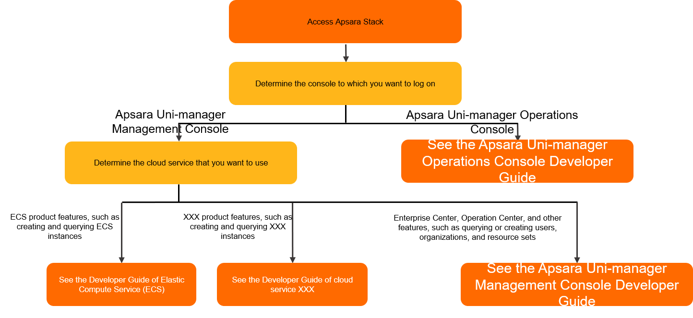

Alibaba Cloud  
Apsara Stack  
Data Management  
Developer Guide  
Product Version: v3.18.6-2607  
Document Version: 20260831

**Table of Contents**

- [1.Getting started](#section-1)
    - [1.1. Usage notes on development documentation](#section-1-1)
    - [1.2. Call an API operation](#section-1-2)
- [2.Preparations](#section-2)
    - [2.1. Log on to OpenAPI Explorer](#section-2-1)
    - [2.2. Obtain the information and the endpoint of an API operation](#section-2-2)
    - [2.3. Obtain an AccessKey pair](#section-2-3)
    - [2.4. Obtain an STS AccessKey 3-tuple](#section-2-4)
    - [2.5. Obtain the endpoint of DMS](#section-2-5)
    - [2.6. Obtain an SDK installation package of DMS](#section-2-6)
- [3.Call examples for SDK for Java](#section-3)
    - [3.1. Getting started](#section-3-1)
    - [3.2. Use SDK](#section-3-2)
        - [3.2.1. Install DMS SDK for Java](#section-3-2-1)
        - [3.2.2. Configure authentication credentials](#section-3-2-2)
        - [3.2.3. Configure connection requests](#section-3-2-3)
        - [3.2.4. Initiate a request](#section-3-2-4)
        - [3.2.5. Troubleshooting](#section-3-2-5)
        - [3.2.6. Use CommonRequest to call API operations](#section-3-2-6)
- [4.Call examples for SDK for Python](#section-4)
    - [4.1. Getting started](#section-4-1)
    - [4.2. Use SDK](#section-4-2)
        - [4.2.1. Install DMS SDK for Python](#section-4-2-1)
        - [4.2.2. Configure authentication credentials](#section-4-2-2)
        - [4.2.3. Set HTTPS requests](#section-4-2-3)
        - [4.2.4. Initiate a request](#section-4-2-4)
        - [4.2.5. Handle errors](#section-4-2-5)
        - [4.2.6. Use CommonRequest to call API operations](#section-4-2-6)
- [5.Call examples for SDK for Go](#section-5)
    - [5.1. Get started with DMS SDK for Go](#section-5-1)
    - [5.2. Use SDK](#section-5-2)
        - [5.2.1. Install Go SDK](#section-5-2-1)
        - [5.2.2. Configure authentication credentials](#section-5-2-2)
        - [5.2.3. Initiate a request](#section-5-2-3)
        - [5.2.4. Handle errors](#section-5-2-4)
        - [5.2.5. Use CommonRequest to call API operations](#section-5-2-5)
- [6.API Reference](#section-6)
    - [6.1. API overview](#section-6-1)
    - [6.2. User management](#section-6-2)
        - [6.2.1. RegisterUser](#section-6-2-1)
        - [6.2.2. DisableUser](#section-6-2-2)
        - [6.2.3. EnableUser](#section-6-2-3)
        - [6.2.4. UpdateUser](#section-6-2-4)
        - [6.2.5. DeleteUser](#section-6-2-5)
        - [6.2.6. ListUsers](#section-6-2-6)
        - [6.2.7. ListUserTenants](#section-6-2-7)
        - [6.2.8. GetUserActiveTenant](#section-6-2-8)
        - [6.2.9. GetUser](#section-6-2-9)
    - [6.3. Instance management](#section-6-3)
        - [6.3.1. ListServers](#section-6-3-1)
        - [6.3.2. ListServerGroups](#section-6-3-2)
        - [6.3.3. RegisterInstance](#section-6-3-3)
        - [6.3.4. ListInstances](#section-6-3-4)
        - [6.3.5. GetInstance](#section-6-3-5)
        - [6.3.6. UpdateInstance](#section-6-3-6)
        - [6.3.7. DeleteInstance](#section-6-3-7)
    - [6.4. Operation logs](#section-6-4)
        - [6.4.1. GetOpLog](#section-6-4-1)
    - [6.5. Approval processes](#section-6-5)
        - [6.5.1. ListWorkFlowTemplates](#section-6-5-1)
        - [6.5.2. ListWorkFlowNodes](#section-6-5-2)
    - [6.6. Metadata of databases and tables](#section-6-6)
        - [6.6.1. SearchDatabase](#section-6-6-1)
        - [6.6.2. SearchTable](#section-6-6-2)
        - [6.6.3. ListDatabases](#section-6-6-3)
        - [6.6.4. ListLogicDatabases](#section-6-6-4)
        - [6.6.5. ListTables](#section-6-6-5)
        - [6.6.6. ListLogicTables](#section-6-6-6)
        - [6.6.7. ListColumns](#section-6-6-7)
        - [6.6.8. ListIndexes](#section-6-6-8)
        - [6.6.9. GetDatabase](#section-6-6-9)
        - [6.6.10. GetLogicDatabase](#section-6-6-10)
        - [6.6.11. GetMetaTableDetailInfo](#section-6-6-11)
        - [6.6.12. GetTableDBTopology](#section-6-6-12)
        - [6.6.13. GetMetaTableColumn](#section-6-6-13)
        - [6.6.14. SyncDatabaseMeta](#section-6-6-14)
        - [6.6.15. SyncInstanceMeta](#section-6-6-15)
        - [6.6.16. GetPhysicalDatabase](#section-6-6-16)
        - [6.6.17. GetTableTopology](#section-6-6-17)
    - [6.7. Ticket operations](#section-6-7)
        - [6.7.1. General](#section-6-7-1)
            - [6.7.1.1. ApproveOrder](#section-6-7-1-1)
            - [6.7.1.2. CloseOrder](#section-6-7-1-2)
            - [6.7.1.3. GetApprovalDetail](#section-6-7-1-3)
            - [6.7.1.4. GetOrderBaseInfo](#section-6-7-1-4)
            - [6.7.1.5. ListOrders](#section-6-7-1-5)
            - [6.7.1.6. SubmitOrderApproval](#section-6-7-1-6)
            - [6.7.1.7. CreateOrder](#section-6-7-1-7)
        - [6.7.2. Data changes](#section-6-7-2)
            - [6.7.2.1. ExecuteDataCorrect](#section-6-7-2-1)
            - [6.7.2.2. GetDataCorrectBackupFiles](#section-6-7-2-2)
            - [6.7.2.3. GetDataCorrectOrderDetail](#section-6-7-2-3)
            - [6.7.2.4. CreateFreeLockCorrectOrder](#section-6-7-2-4)
            - [6.7.2.5. CreateDataCorrectOrder](#section-6-7-2-5)
            - [6.7.2.6. GetDataCronClearTaskDetailList](#section-6-7-2-6)
            - [6.7.2.7. GetDataCorrectTaskDetail](#section-6-7-2-7)
            - [6.7.2.8. GetDataCorrectSQLFile](#section-6-7-2-8)
            - [6.7.2.9. CreateDataCronClearOrder](#section-6-7-2-9)
            - [6.7.2.10. CreateDataImportOrder](#section-6-7-2-10)
        - [6.7.3. Schema design](#section-6-7-3)
            - [6.7.3.1. CreatePublishGroupTask](#section-6-7-3-1)
            - [6.7.3.2. ListDDLPublishRecords](#section-6-7-3-2)
        - [6.7.4. Data export](#section-6-7-4)
            - [6.7.4.1. ExecuteDataExport](#section-6-7-4-1)
            - [6.7.4.2. GetDataExportDownloadURL](#section-6-7-4-2)
            - [6.7.4.3. GetDataExportOrderDetail](#section-6-7-4-3)
        - [6.7.5. Database and table synchronization](#section-6-7-5)
            - [6.7.5.1. GetStructSyncOrderDetail](#section-6-7-5-1)
            - [6.7.5.2. GetStructSyncExecSqlDetail](#section-6-7-5-2)
            - [6.7.5.3. ExecuteStructSync](#section-6-7-5-3)
            - [6.7.5.4. GetStructSyncJobAnalyzeResult](#section-6-7-5-4)
            - [6.7.5.5. SubmitStructSyncOrderApproval](#section-6-7-5-5)
            - [6.7.5.6. CreateStructSyncOrder](#section-6-7-5-6)
            - [6.7.5.7. GetStructSyncJobDetail](#section-6-7-5-7)
        - [6.7.6. SQL review](#section-6-7-6)
            - [6.7.6.1. GetSQLReviewCheckResultStatus](#section-6-7-6-1)
            - [6.7.6.2. CreateSQLReviewOrder](#section-6-7-6-2)
            - [6.7.6.3. ListSQLReviewOriginSQL](#section-6-7-6-3)
        - [6.7.7. File upload](#section-6-7-7)
            - [6.7.7.1. CreateUploadOSSFileJob](#section-6-7-7-1)
            - [6.7.7.2. GetUserUploadFileJob](#section-6-7-7-2)
            - [6.7.7.3. CreateUploadFileJob](#section-6-7-7-3)
        - [6.7.8. Permission application](#section-6-7-8)
            - [6.7.8.1. GetOwnerApplyOrderDetail](#section-6-7-8-1)
            - [6.7.8.2. GetPermApplyOrderDetail](#section-6-7-8-2)
    - [6.8. SQL task management](#section-6-8)
        - [6.8.1. ListDBTaskSQLJob](#section-6-8-1)
        - [6.8.2. ListDBTaskSQLJobDetail](#section-6-8-2)
    - [6.9. Permission management](#section-6-9)
        - [6.9.1. RevokeUserPermission](#section-6-9-1)
        - [6.9.2. ListDatabaseUserPermssions](#section-6-9-2)
        - [6.9.3. SetOwners](#section-6-9-3)
        - [6.9.4. ListUserPermissions](#section-6-9-4)
        - [6.9.5. GrantUserPermission](#section-6-9-5)
    - [6.10. Security management](#section-6-10)
        - [6.10.1. ListSensitiveColumns](#section-6-10-1)
        - [6.10.2. ListSensitiveColumnsDetail](#section-6-10-2)
        - [6.10.3. ChangeColumnSecLevel](#section-6-10-3)
        - [6.10.4. AddDesensitizationRule](#section-6-10-4)
        - [6.10.5. ListDesensitizationRule](#section-6-10-5)
        - [6.10.6. ModifyDesensitizationStrategy](#section-6-10-6)
    - [6.11. Data query](#section-6-11)
        - [6.11.1. ExecuteScript](#section-6-11-1)
    - [6.12. Task orchestration](#section-6-12)
        - [6.12.1. UpdateTaskFlowConstants](#section-6-12-1)
        - [6.12.2. DeleteTaskFlow](#section-6-12-2)
        - [6.12.3. OfflineTaskFlow](#section-6-12-3)
        - [6.12.4. ListTaskFlow](#section-6-12-4)
        - [6.12.5. GetTaskInstanceRelation](#section-6-12-5)
        - [6.12.6. ListTaskFlowInstance](#section-6-12-6)
        - [6.12.7. ListDAGVersions](#section-6-12-7)
        - [6.12.8. ReDeployLhDagVersion](#section-6-12-8)
        - [6.12.9. UpdateScenario](#section-6-12-9)
        - [6.12.10. ResumeTaskFlowInstance](#section-6-12-10)
        - [6.12.11. UpdateTaskContent](#section-6-12-11)
        - [6.12.12. ListTaskFlowsByPage](#section-6-12-12)
        - [6.12.13. ListScenarios](#section-6-12-13)
        - [6.12.14. UpdateTaskConfig](#section-6-12-14)
        - [6.12.15. ListTaskFlowConstants](#section-6-12-15)
        - [6.12.16. BackFill](#section-6-12-16)
        - [6.12.17. UpdateTaskTimeVariables](#section-6-12-17)
        - [6.12.18. ListTaskFlowTimeVariables](#section-6-12-18)
        - [6.12.19. UpdateTaskFlowTimeVariables](#section-6-12-19)
        - [6.12.20. UpdateTaskFlowCooperators](#section-6-12-20)
        - [6.12.21. CreateScenario](#section-6-12-21)
        - [6.12.22. DeleteScenario](#section-6-12-22)
        - [6.12.23. UpdateSLARules](#section-6-12-23)
        - [6.12.24. GetRuleNumLimitOfSLA](#section-6-12-24)
        - [6.12.25. GetIntervalLimitOfSLA](#section-6-12-25)
        - [6.12.26. ListDefaultSLARules](#section-6-12-26)
        - [6.12.27. ListTaskFlowCooperators](#section-6-12-27)
        - [6.12.28. ListSLARules](#section-6-12-28)
        - [6.12.29. GetTask](#section-6-12-29)
        - [6.12.30. MoveTaskFlowToScenario](#section-6-12-30)
        - [6.12.31. GetTaskFlowNotification](#section-6-12-31)
        - [6.12.32. UpdateTaskName](#section-6-12-32)
        - [6.12.33. UpdateTaskOutput](#section-6-12-33)
        - [6.12.34. DeleteTaskFlowEdgesByCondition](#section-6-12-34)
        - [6.12.35. ListTaskFlowEdgesByCondition](#section-6-12-35)
        - [6.12.36. AddTaskFlowEdges](#section-6-12-36)
        - [6.12.37. UpdateTaskFlowNameAndDesc](#section-6-12-37)
        - [6.12.38. GetTaskFlowGraph](#section-6-12-38)
        - [6.12.39. UpdateTaskFlowEdges](#section-6-12-39)
        - [6.12.40. UpdateTaskFlowOwner](#section-6-12-40)
        - [6.12.41. UpdateTaskFlowSchedule](#section-6-12-41)
        - [6.12.42. UpdateTaskFlowRelations](#section-6-12-42)
        - [6.12.43. UpdateTaskFlowNotification](#section-6-12-43)
        - [6.12.44. ListTasksInTaskFlow](#section-6-12-44)
        - [6.12.45. CreateTaskFlow](#section-6-12-45)
        - [6.12.46. SuspendTaskFlowInstance](#section-6-12-46)
        - [6.12.47. ReRunTaskFlowInstance](#section-6-12-47)
        - [6.12.48. MakeTaskFlowInstanceSuccess](#section-6-12-48)
        - [6.12.49. DeleteTask](#section-6-12-49)
        - [6.12.50. PublishAndDeployTaskFlow](#section-6-12-50)
        - [6.12.51. StopTaskFlowInstance](#section-6-12-51)
        - [6.12.52. CreateTask](#section-6-12-52)
    - [6.13. Logical databases and tables](#section-6-13)
        - [6.13.1. GetDBTopology](#section-6-13-1)
- [7.Appendixes](#section-7)
    - [7.1. NodeType values](#section-7-1)
    - [7.2. STS overview](#section-7-2)
        - [7.2.1. What is STS?](#section-7-2-1)
        - [7.2.2. Obtain an STS token](#section-7-2-2)

<a id="section-1"></a>

# 1.Getting started

<a id="section-1-1"></a>

## 1.1. Usage notes on development documentation

This topic describes how to view the desired product development documentation when you use Apsara Stack API (ASAPI).

**Procedure**

You can follow the procedure described in the following figure to view the desired development documentation.



**Prerequisites**

The Apsara Stack version is obtained from an O&M personnel or operations administrator.

**Procedure**

You can go to the Apsara Stack documentation center and view the desired product documentation.

1. Go to the Apsara Stack Documentation Centerpage by using a browser.

2. Click the **Enterprise**, **Agility**, or **All-in-one** tab based on the Apsara Stack version that you use.

3. Select an Apsara Stack version from the drop-down list.

4. In the left-side navigation pane, select the name of the product that you want to view.

5. In the upper-right corner of the product documentation section, click **View Details** or **Download PDF**.

<a id="section-1-2"></a>

## 1.2. Call an API operation

Alibaba Cloud Apsara Stack allows you to call API operations by using the Portable OpenAPI Proxy (POP) gateway or the Apsara Stack API (ASAPI) gateway. To ensure that Alibaba Cloud Apsara Stack provides the same experience as Alibaba Cloud public cloud, API operations in Apsara Stack are called by using the POP gateway by default in Apsara Stack Enterprise V3.16.0 and later. This topic describes how to call API operations in Apsara Stack by using the POP gateway.

> **Note**
>
> You can still use the ASAPI gateway to call API operations. For more information, see Process of API calls by using the ASAPI gateway, Obtain the endpoint of ASAPI, and Obtain the ASAPI SDK.

**Procedure**

1. Obtain an AccessKey pair.

   Obtain the AccessKey pair that is required when you call an API operation. For more information, see Obtain an AccessKey pair or Obtain an STS AccessKey 3-tuple.

   > **Note**
   >
   > We recommend that you use the AccessKey pair of a personal account assigned by Resource Access Management (RAM) or a Security Token Service (STS) AccessKey 3-tuple to call the API operations of the Apsara Uni-manager Management Console and cloud services.

2. Obtain the region ID.

   For more information, see Obtain the values of common headers.

3. Obtain the organization ID and the resource set ID.

   You must call an API operation to query the resource set ID. For more information about how to query resource set IDs, see the *ListResourceGroup* section in *Apsara Uni-manager M anagement Console Developer Guide*.

   > **Note**
   >
   > When you call an API operation, set the  `<x-acs-organizationid>`  header to the organization ID that you queried, and set the  `<x-acs-resourcegroupid>`  header to the resource set ID that you queried. This way, you can query resources in the specified organization and resource set.
   >
   > - If you do not specify the  `<x-acs-organizationid>`  header, the organization to which the current user belongs is used by default.
   >
   > - If you do not specify the  `<x-acs-resourcegroupid>`  header, this header is left empty by default. If you specify a resource set ID, you must also specify an organization ID.

4. Obtain the API reference.

   Obtain the developer guide of the cloud service that you want to use. You can learn the features of API operations and how to call the API operations. For more information, see Usage notes on development documentation.

5. Obtain the endpoint of the cloud service.

6. Obtain an SDK of the cloud service and call an API operation.

<a id="section-2"></a>

# 2.Preparations

<a id="section-2-1"></a>

## 2.1. Log on to OpenAPI Explorer

You can log on to OpenAPI Explorer from the Apsara Uni-manager Management Console.

**Prerequisites**

- The URL of the Apsara Uni-manager Management Console is obtained from the deployment engineer.

- A web browser is available. We recommend that you use Google Chrome.

**Procedure**

1. Enter the URL of the Apsara Uni-manager Management Console in the address bar of a browser and press the Enter key.

2. Enter your username and password.

   Obtain the username and password that are used to log on to the Apsara Uni-manager Management Console from the operations administrator.

   > **Note**
   >
   > The first time you log on to the Apsara Uni-manager Management Console, you must follow the instructions to change the password of your account. For security purposes, your password must be 10 to 32 characters in length and must contain at least two of the following character types:
   >
   > - Letters
   >
   > - Digits
   >
   > - Special characters, including ! @ # $ %

3. Click **Log On**.

4. If multi-factor authentication (MFA) is enabled for your account, perform operations based on your logon scenario:

   - Scenario 1: The first time you log on to the Apsara Uni-manager Management Console after MFA is enabled by the administrator.

     <ol type="a">

     <li>

     On the Bind Virtual MFA Device page, follow the instructions to bind an MFA device.

     </li>

     <li>

     Re-enter the username and password as described in Step 2 and click **Log On**.

     </li>

     </ol>

     <ol type="i" start="100">

     <li>

     Enter a six-digit MFA verification code and click **Authenticate**.

     </li>

     </ol>

   - Scenario 2: You have enabled MFA and bound an MFA device.

     Enter a six-digit MFA verification code and click **Authenticate**.

     > **Note**
     >
     > For more information, see the **Bind a virtual MFA device to enable MFA** topic in **Apsara Uni-manager Management Console User Guide**.

5. In the top navigation bar, choose **Products > Application Services > OpenAPI Explorer**.

<a id="section-2-2"></a>

## 2.2. Obtain the information and the endpoint of an API operation

To call an API operation of a cloud service, you must obtain the information about the operation, including the service code, operation name, and API version.

**Background information**

The API information on the debugging page of the Apsara Uni-manager Management Console is for reference only. For more information about how to call API operations, see the developer guides of cloud services. If the information on the debugging page is different from that in the developer guide of a cloud service, the information in the developer guide prevails.

**Procedure**

1. Log on to the Apsara Uni-manager Management Console.

2. In the top navigation bar, choose **Products** > **Application Services** > **OpenAPI Explorer**.

3. On the **OpenAPI Explorer** page, choose **API Integration** > **API Debugging**.

4. In the left-side navigation pane, select the cloud service that you want to manage.

5. Select an API version from the **Version** drop-down list.

6. In the API operation list, you can view all API operations of the current version.

7. Click the operation that you want to call. Obtain the endpoint from the Endpoint parameter on the Parameter tab.

<a id="section-2-3"></a>

## 2.3. Obtain an AccessKey pair

AccessKey credentials are assigned by RAM or STS. You can use one type of AccessKey credential for authentication when you make an API request. This topic describes how to obtain an AccessKey pair that is assigned by RAM.

**Background information**

An AccessKey pair is used to verify the identity of the request sender. An AccessKey pair consists of an AccessKey ID and an AccessKey secret that are used to implement symmetric encryption. The AccessKey ID is used to identify a user. The AccessKey secret is used to encrypt the signature string.

AccessKey credentials can be assigned by RAM or STS:

- An AccessKey pair that is assigned by RAM to a third party consists of an AccessKey ID and an AccessKey secret.

- An AccessKey 3-tuple that is assigned by STS to a third party consists of an AccessKey ID, an AccessKey secret, and a security token. For more information, see Obtain an STS AccessKey 3-tuple.

The Apsara Uni-manager Management Console provides AccessKey pairs for personal accounts and organizations. Only the administrators of level-1 organizations and operations administrators can obtain the AccessKey pairs of organizations. We recommend that you use the AccessKey pairs of personal accounts to call the operations provided by the Apsara Uni-manager Management Console and cloud services. If you use the AccessKey pair of a personal account, configure the header parameters that are described in the following table for access control. Otherwise, an error that indicates insufficient permissions can occur.

> **Warning**
>
> The AccessKey pair of a personal account is managed and controlled by
>
> the permission system of the Apsara Uni-manager Management Console. If you need to obtain the AccessKey pair of an organization, make sure that your operation is authorized by an administrator. This ensures security.

| Parameter | Description |
| --- | --- |
| x-acs-regionid | The ID of the region. Example: cn-hangzhou-\*. |
| x-acs-organizationid | The ID of the organization in the Apsara Uni-manager Management Console. For more information about how to obtain organization IDs, see the <strong>GetOrganizationList</strong> section in <strong>Apsara</strong> Uni-manager Management Console <strong>Developer Guide</strong>. |
| x-acs-resourcegroupid | The ID of the resource set in the Apsara Uni-manager Management Console. For more information about how to obtain resource set IDs, see the <strong>ListResourceGroup</strong> section in <strong>Apsara</strong> Uni-manager Management Console <strong>Developer Guide</strong>. |
| x-acs-instanceid | The ID of the instance that you want to manage.If you want to obtain the ID of an Elastic Compute Service (ECS) instance, you can obtain the ID from the ECS instance list. |

**Obtain the AccessKey pair of a personal account**

To obtain the AccessKey pair of a personal account, perform the following steps:

1. Log on to the Apsara Uni-manager Management Console.

2. Click the profile picture in the upper-right corner of the page and click **User Information**.

3. In the **AccessKey Pair** section, view the AccessKey pair of the personal account.

   

   > **Note**
   >
   > An AccessKey pair consists of an AccessKey ID and an AccessKey secret.
   >
   > These credentials provide full permissions on cloud resources within the current account. You must keep the AccessKey pair confidential.

**Obtain the AccessKey pair of an organization**

To obtain the AccessKey pair of an organization, perform the following steps:

1. Log on to the Apsara Uni-manager Management Console as an administrator.

2. In the top navigation bar, click **Enterprise**.

3. In the left-side navigation pane, choose **Resources > Organizations**.

4. In the organization list, click the name of the level-1 organization whose AccessKey pair you want to obtain.

5. Click **Management Accesskey** on the right side of the page.

6. In the dialog box that appears, view the AccessKey pair of the organization.

<a id="section-2-4"></a>

## 2.4. Obtain an STS AccessKey 3-tuple

This topic describes how to use STS to call API operations in Apsara Stack.

**Background information**

STS allows you to manage temporary credentials to your Apsara Stack resources. You can use STS to call API operations in Apsara Stack.

An STS AccessKey 3-tuple consists of an AccessKey ID, an AccessKey secret, and a security token. When you use STS to call API operations, you must specify an STS AccessKey 3-tuple. For more information about STS, see What is STS?

**Procedure**

1. Obtain the  `RAM role` .

   <ol type="i">

   <li>

   Log on to the Apsara Uni-manager Management Console.

   </li>

   <li>

   Click the profile picture in the upper-right corner of the page and click **User**

   </li>

   </ol>

   **Information**.

   <ol type="i" start="3">

   <li>

   Click **View Current Role Policy**.

   </li>

   </ol>

   In the **View Policies of Current Role** dialog box, view your  `RAM role` .

2. Obtain an STS AccessKey 3-tuple.

   > **Note**
   >
   > In the following sample code, replace the parameters with the actual information. Delete the angle brackets (<>) in the final code.
   >
   > The following section describes the parameters:
   >
   > - &lt;yourRegionID>: Replace the parameter with the region ID.
   >
   > - &lt;yourAccessKeyID>: Replace the parameter with your AccessKey ID.
   >
   > - &lt;yourAccessKeySecret>: Replace the parameter with your AccessKey secret.
   >
   > - &lt;yourRoleSessionName>: Replace the parameter with the name of the current session.
   >
   > - &lt;yourRoleArn>: Replace the parameter with the Alibaba Cloud Resource Name (ARN) of your RAM role.
   >
   > - &lt;sts.aliyuns.com>: Replace the parameter with the STS endpoint.

   ```xml
   public static void main(String[] args) {
       // Create and initialize a DefaultAcsClient instance. 
       // Specify the region ID, AccessKey ID, and AccessKey secret.
       DefaultProfile profile = DefaultProfile.getProfile("<yourRegionID>", "
   <yourAccessKeyID>", "<yourAccessKeySecret>");
       HttpClientConfig clientConfig = HttpClientConfig.getDefault();
       clientConfig.setIgnoreSSLCerts(true);
       clientConfig.setProtocolType(ProtocolType.HTTPS);
       profile.setHttpClientConfig(clientConfig);
       IAcsClient client = new DefaultAcsClient(profile);
       String assumeRole = callAssumeRole(client);
       if (StringUtils.isEmpty(assumeRole)) return;
       JSONObject assumeRoleJson = JSONObject.parseObject(assumeRole);
       JSONObject credentials = assumeRoleJson.getJSONObject("Credentials");
       // Obtain an STS AccessKey 3-tuple.
       String stsAK = credentials.getString("AccessKeyId");
       String stsSK = credentials.getString("AccessKeySecret");
       String stsToken = credentials.getString("SecurityToken");
   }

   private static String callAssumeRole(IAcsClient client) {
       CommonRequest request = new CommonRequest();
       // Replace sts.aliyuns.com with the endpoint of STS. The format of an STS endpoint is sts-vpc.${global:region}.${global:internet-domain}.
       request.setSysDomain("sts.aliyuns.com");
       request.setSysProduct("Sts");
       request.setSysAction("AssumeRole");
       request.setSysVersion("2015-04-01");
       request.setSysMethod(MethodType.POST);
       request.setHttpContentType(FormatType.FORM);
       // Replace <yourRoleSessionName> with the name of the current session.
       request.putQueryParameter("RoleSessionName", "<yourRoleSessionName>");
       // Replace <yourRoleArn> with the ARN that you obtain in the previous step for the RAM role.
       request.putQueryParameter("RoleArn", "<yourRoleArn>");
       try {
           CommonResponse response = client.getCommonResponse(request);
           return response.getData();
       } catch (ServerException e) {
           System.out.println(e.getErrCode());
           System.out.println(e.getErrMsg());
       } catch (ClientException e) {
           System.out.println(e.getErrCode());
           System.out.println(e.getErrMsg());
       }
       return null;
   }
   ```

3. Use the AccessKey 3-tuple assigned by STS to call an operation of a service. The following sample code provides an example on how to use the AccessKey 3-tuple assigned by STS to call the  `DescribeZones`  operation of ECS:

   > **Note**
   >
   > In the following sample code, replace the parameters with your actual information. Delete the angle brackets (<>) in the final code.
   >
   > The following section describes the parameters:
   >
   > - &lt;yourRegionID>: Replace the parameter with the region ID.
   >
   > - &lt;yourStsAccesskeyID>: Replace the parameter with your AccessKey ID.
   >
   > - &lt;yourStsAccessKeySecret>: Replace the parameter with your AccessKey secret.
   >
   > - &lt;yourStsToken>. Replace the parameter with your security token.
   >
   > - &lt;yourResourceGroupID>: Replace the parameter with the resource set ID.
   >
   > - &lt;yourOrganizationID>: Replace the parameter with the organization ID.

   ```xml
   public static void main(String[] args) {
       // Replace <yourRegionID> with the region ID.
       // Replace <yourStsAccessKeyID> and <yourStsAccessKeySecret> with the AccessKey I
   D and AccessKey secret of the 3-tuple obtained in the previous step.
       DefaultProfile profile = DefaultProfile.getProfile("<yourRegionID>", "
   <yourStsAccesskey>", "<yourStsAccessSecret>");
       HttpClientConfig clientConfig = HttpClientConfig.getDefault();
       clientConfig.setIgnoreSSLCerts(true);
       clientConfig.setProtocolType(ProtocolType.HTTPS);
       profile.setHttpClientConfig(clientConfig);
       IAcsClient client = new DefaultAcsClient(profile);
       CommonRequest request = new CommonRequest();
       request.setSysDomain("ecs.aliyuns.com");
       request.setSysProduct("Ecs");
       request.setSysAction("DescribeZones");
       request.setSysVersion("2014-05-26");
       request.setSysMethod(MethodType.POST);
       request.setHttpContentType(FormatType.FORM);
       // Replace <yourRegionID> with the region ID.
       request.putHeadParameter("x-acs-regionid", "<yourRegionID>");
       // Replace <yourStsToken> with the security token of the 3-tuple obtained in the previous step.
       request.putQueryParameter("SecurityToken", "<yourStsToken>");
       // Optional. Replace the parameter with the resource set ID.
       // request.putHeadParameter("x-acs-resourcegroupid", "<yourResourceGroupID>");
       // Required. Replace the parameter with the organization ID.
       request.putHeadParameter("x-acs-organizationid", "<yourOrganizationID>");
       try {
           CommonResponse response = client.getCommonResponse(request);
           System.out.println(response.getData());
       } catch (ServerException e) {
           System.out.println(e.getErrCode());
           System.out.println(e.getErrMsg());
       } catch (ClientException e) {
           System.out.println(e.getErrCode());
           System.out.println(e.getErrMsg());
       }
   }
   ```

<a id="section-2-5"></a>

## 2.5. Obtain the endpoint of DMS

This topic describes how to obtain the endpoint of Data Management (DMS).

**Background information**

To use the POP gateway to call API operations in Apsara Stack, you must specify the endpoint of a cloud service. You can obtain the endpoint from Apsara Stack onsite O&M engineers or by performing the following steps.

**Procedure**

1. Log on to the Apsara Uni-manager Operations Console.

2. In the top navigation bar, choose **Platform Operation > Apsara Infrastructure Management > O&M Tools**.

3. In the left-side navigation pane, choose **O&M Tools > Service Registration Variable Dashboard**.

4. On the **Service Registration Variable Dashboard** page, select **Service** from the drop-down list and enter  `dts-dtm`  in the search box.

5. In the **Service Registration** column of the  `dts-dtm`  service, click the  icon to show

   the hidden content, and then click the content.

   In the **Registration Variables** message, obtain the endpoint from the value of **dms.openapi.endpoint**.

<a id="section-2-6"></a>

## 2.6. Obtain an SDK installation package of DMS

To call API operations of DMS in Apsara Stack by using the POP gateway, you must use an SDK. This topic provides links for you to download Alibaba Cloud SDKs.

| Language | Download URL | Reference |
| --- | --- | --- |
| Alibaba Cloud SDK for Java | DMS SDK for Java<br>Note<br>We recommend that you download DMS SDK for Java V1.18.0. | Get started with DMS SDK for Java |
| Alibaba Cloud SDK for Python | DMS SDK for Python | Get started with DMS SDK for Python |
| Alibaba Cloud SDK for Go | DMS SDK for Go | Get started with DMS SDK for Go |

> **Note**
>
> We recommend that you use an SDK for Java, Python, or Go. If you use SDKs for other programming languages, the SDKs may be incompatible with your system.

<a id="section-3"></a>

# 3.Call examples for SDK for Java

<a id="section-3-1"></a>

## 3.1. Getting started

This topic describes how to obtain and use Data Management (DMS) SDK for Java.

**Prepare the environment**

- An Apsara Stack tenant account that has the required permissions and an AccessKey pair is obtained. An AccessKey pair consists of an AccessKey ID and an AccessKey secret. You can obtain your AccessKey pair in the Apsara Uni-manager Management Console. For more information, see Obtain an AccessKey pair.

- The endpoint of DMS is obtained. For more information, see Obtain the endpoint of DMS.

- Java Development Kit (JDK) 1.8 or later is installed before you can use Apsara Stack SDK for Java.

**Install Apsara Stack SDK for Java**

If you use Apache Maven to manage a Java project, you need to only import the JAR file of Apsara Stack SDK for Java to the pom.xml file of the project.

To use DMS SDK for Java, you must install the SDK core library and DMS SDK for Java. We recommend that you use the SDK for Java core library 4.5.17 or later, and use DMS SDK for Java 1.18.0.

**Use Apsara Stack SDK for Java**

To use Apsara Stack SDK for Java, perform the following steps:

1. Create a DefaultAcsClient instance and initiate it.

2. Create an API request and set the request parameters.

3. Initiate the API request and process the response or exception.

   > **Note**
   >
   > In the following sample code, replace the variables with the actual values. Delete the angle brackets (<>) from the final code.
   >
   > The variables to be replaced are listed as follows:
   >
   > - &lt;yourRegionID>: Replace this variable with your region ID.
   >
   > - &lt;yourAccessKeyID>: Replace the variable with your AccessKey ID.
   >
   > - &lt;yourAccessKeySecret>: Replace this variable with your AccessKey secret.
   >
   > - &lt;DMSProductCode>: Replace this variable with the service code of DMS in Apsara Stack.
   >
   > - &lt;DMSProductEndpoint>: Replace this variable with the endpoint of DMS in Apsara Stack.

   ```java
   import com.aliyuncs.DefaultAcsClient;
   import com.aliyuncs.IAcsClient;
   import com.aliyuncs.dms_enterprise.model.v20181101.GetOpLogRequest;
   import com.aliyuncs.dms_enterprise.model.v20181101.GetOpLogResponse;
   import com.aliyuncs.exceptions.ClientException;
   import com.aliyuncs.exceptions.ServerException;
   import com.aliyuncs.profile.DefaultProfile;

   public class GetOpLogSampleTest {

       public static void main(String[] args) {

           String regionId = "<yourRegionID>";
           String accessKey = "<yourAccessKeyID>";
           String secretKey = "<yourAccessKeySecret>";
           String product = "<DMSProductCode>";
           String endpoint = "<DMSProductEndpoint>";

           DefaultProfile.addEndpoint(regionId, product, endpoint);
           DefaultProfile profile = DefaultProfile.getProfile(regionId, accessKey, 
   secretKey);
           IAcsClient client = new DefaultAcsClient(profile);
           GetOpLogRequest request = new GetOpLogRequest();
           request.setStartTime("2022-01-01 00:00:00");
           request.setEndTime("2022-01-02 00:00:00");
           request.setPageNumber(1);
           request.setPageSize(100);

           try {
               GetOpLogResponse response = client.getAcsResponse(request);
               System.out.println("RequestId: " + response.getRequestId());
               System.out.println("OpLogCount: " + response.getTotalCount());
           }
           catch (ServerException e) {
               e.printStackTrace();
           } catch (ClientException e) {
               System.out.println("ErrCode:" + e.getErrCode());
               System.out.println("ErrMsg:" + e.getErrMsg());
               System.out.println("RequestId:" + e.getRequestId());
           }

       }

   }
   ```

<a id="section-3-2"></a>

## 3.2. Use SDK

<a id="section-3-2-1"></a>

### 3.2.1. Install DMS SDK for Java

This topic describes how to install and use DMS SDK for Java.

Alibaba Cloud SDK for Java supports JDK 1.8 or later. You can install SDKs for Java by adding Maven dependencies or downloading Alibaba Cloud SDKs.

To use DMS SDK for Java, you must install the core library of Alibaba Cloud SDK for Java and DMS SDK for Java. We recommend that you use the core library version 4.5.17 or later and use the SDK version 1.18.0.

To use DMS SDK for Java, you must also add the following dependency to the pom.xml file. For information about the SDK version, see Obtain an SDK installation package of DMS.

```xml
<!-- Alibaba Cloud SDK for Java -->
<dependency>
    <groupId>com.aliyun</groupId>
    <artifactId>aliyun-java-sdk-core</artifactId>
    <version>4.5.17</version>
</dependency>
<!-- dms-enterprise java sdk -->
<dependency>
    <groupId>com.aliyun</groupId>
    <artifactId>aliyun-java-sdk-dms-enterprise</artifactId>
    <version>1.18.0</version>
</dependency>
```

<a id="section-3-2-2"></a>

### 3.2.2. Configure authentication credentials

When you use Alibaba Cloud SDK to access Apsara Stack services, you must provide an Apsara Stack tenant account for authentication. This topic describes how to configure authentication credentials.

DMS SDK for Java allows you to complete the authentication process by using an AccessKey pair. For more information about how to obtain an AccessKey pair, see Obtain an AccessKey pair.

If you want to use your AccessKey pair to access Apsara Stack, you must configure the AccessKey pair as credentials when you initialize a client instance.

> **Note**
>
> Do not disclose any code that contains your AccessKey pair. For example, do not commit the code to public GitHub projects. Otherwise, your Apsara Stack tenant account may be compromised.

```text
DefaultProfile profile = DefaultProfile.getProfile(
    "<yourRegionID>",          // Replace the parameter with the region ID.
    "<yourAccessKeyID>",      // Replace the parameter with your AccessKey ID.
    "<yourAccessKeySecret>"); // Replace the parameter with your AccessKey secret.
```

> **Note**
>
> In the preceding sample code, replace the parameters with the actual information. Delete the angle brackets (<>) in the final code.

<a id="section-3-2-3"></a>

### 3.2.3. Configure connection requests

This topic describes how to configure a connection request by using the HttpClientConfig object.

You can use the following code to configure the HttpClientConfig object. We recommend that you select and configure the following parameters based on your business requirements.

> **Note**
>
> You must use actual values to replace the variables in the following sample code. Do not retain the angle brackets (<>) in the final code.
>
> The following list describes the variables:
>
> - &lt;readTimeout>: Specify the read timeout period based on your business requirements. Unit: milliseconds.
>
> - &lt;connectionTimeout>: Specify the connection timeout period based on your business requirements. Unit: milliseconds.
>
> - &lt;maxRequestsPerHost>: Specify the maximum number of requests that are supported by each server based on your business requirements. The supported data type is INTEGER.
>
> - &lt;maxRequests>: Specify the maximum number of requests based on your business requirements. The supported data type is INTEGER.
>
> - &lt;http://192.168.XX.XX:33XX>: Replace it with the actual IP address and port of the proxy.

```text
// Obtain the HttpClientConfig object.
HttpClientConfig clientConfig = HttpClientConfig.getDefault();
// Specify whether to ignore certificates.
clientConfig.setIgnoreSSLCerts(true);
// (Optional) Specify the read timeout period. Unit: milliseconds.
clientConfig.setReadTimeoutMillis(<readTimeout>);
// (Optional) Specify the connection timeout period. Unit: milliseconds.
clientConfig.setConnectionTimeoutMillis(<connectionTimeout>);
// (Optional) Specify the maximum number of requests that are supported by each server.
The supported data type is INTEGER.
clientConfig.setMaxRequestsPerHost(<maxRequestsPerHost>);
// (Optional) Specify the maximum number of requests. The supported data type is INTEGE
R.
clientConfig.setMaxRequests(<maxRequests>);
// (Optional) Specify the protocol type.
clientConfig.setProtocolType(ProtocolType.HTTP);
/** (Optional) Specify whether to configure the proxy based on your business 
requirements. The following code is available:
clientConfig.setHttpProxy("<http://192.168.XX.XX:33XX>");
Or
clientConfig.setHttpsProxy("<https://192.168.XX.XX:33XX>");
Replace https://192.168.XX.XX:33XX with the actual IP address and port of the proxy.
*/
profile.setHttpClientConfig(clientConfig);
```

<a id="section-3-2-4"></a>

### 3.2.4. Initiate a request

This topic describes how to use DMS SDK for Java to initiate a request.

**Procedure**

1. Create an AcsClient instance.

   ```text
   IAcsClient client = new DefaultAcsClient(profile);
   ```

2. Create a request.

   Name the request in the format of  `${apiName}Request` , where **${apiName}** indicates the API operation name, such as GetOpLog.

   If multiple service SDKs are used, different requests may have the same name. You can differentiate the requests based on package names.

   ```text
   GetOpLogRequest request = new GetOpLogRequest();
   request.setStartTime("2022-01-01 00:00:00");
   request.setEndTime("2022-01-02 00:00:00");
   request.setPageNumber(1);
   request.setPageSize(100);
   ```

3. Initiate the request and handle the response.

   ```text
   GetOpLogResponse response = client.getAcsResponse(request);
   ```

   In normal cases, all returned fields are deserialized into the response. You can directly call  `response.getXXX()`  to obtain the response fields.

   ```text
   OpLogCount := response.getTotalCount()
   ```

   If an exception occurs or you need to obtain the original HTTP response, call  `doAction()` .

   ```text
   HttpResponse response = client.doAction(request);
   ```

<a id="section-3-2-5"></a>

### 3.2.5. Troubleshooting

If the server or SDK encounters an error when you use SDK for Java, it returns an error response. The error response contains an error code and an error message.

In most cases, you do not need to handle the errors returned by SDK for Java. You need to only handle the errors returned by the server based on error messages.

- `ServerException`  indicates a server error.

- `ClientException`  indicates an SDK error.

For example, when the following error occurs, you can modify the AccessKey ID based on the error message to solve the problem:

```text
com.aliyuncs.exceptions.ClientException: InvalidAccessKeyId.NotFound : Specified accesskey is not found.
```

If you want to handle SDK errors, refer to the following example to write your code:

```java
try {
    FooResponse response = client.getAcsResponse(request);
    // Handle the response.
    // ...
}catch (ServerException e){
    // You can add your logic to handle errors.
    // For example, print the error message.
    System.out.println("ErrorCode=" + e.getErrCode());
    System.out.println("ErrorMessage=" + e.getErrMsg());
    // If the error persists, you can submit a ticket with the request ID included.
    System.out.println("ResponseId=" + e.getRequestId());
}catch (ClientException e){
    // You can add your logic to handle errors.
    // For example, print the error message.
    System.out.println("ErrorCode=" + e.getErrCode());
    System.out.println("ErrorMessage=" + e.getErrMsg());
}
```

<a id="section-3-2-6"></a>

### 3.2.6. Use CommonRequest to call API operations

If you want to call the API operations of a cloud service that does not provide SDKs, or the requests and responses of API operations that you call by using an SDK do not meet your business requirements, you can use CommonRequest to call API operations. You can use CommonRequest to call all API operations.

**Characteristics of CommonRequest calling**

The CommonRequest calling method has the following characteristics:

- Light weight: You only need the core package to initiate the call, without downloading or installing the SDK of each product.

- Easy and convenient: You can call the latest API without updating the SDK.

- Fast iteration

**Use CommonRequest to call an API operation**

If you want to send a CommonRequest request, you must obtain the values of the following parameters. You can obtain the values of the parameters from the API references of cloud services.

- Domain: the endpoint of the service.

- Version: the version of the API in the YYYY-MM-DD format.

  You can obtain the API version from the common parameters in the API references of cloud services.

- Action: the name of the API operation that you want to call.

  Specify the name of the API operation in the format of  `request.setSysAction("<Action>")` .

  For example, if you want to initiate a CommonRequest request to call the RegisterUser operation, you must use  `request.setSysAction("RegisterUser")`  to specify the name of the API operation.

**Call an RPC API operation**

The following sample code provides an example on how to call the RegisterUser operation of Data Management (DMS) to register a user. The DMS API is in the Remote Procedure Call (RPC) style.

> **Note**
>
> In the following sample code, replace the variables with actual values based on your business requirements and remove the angle brackets <> from the final code.
>
> Variables:
>
> - &lt;yourRegionID>: Replace the variable with the region ID.
>
> - &lt;yourAccessKeyID>: Replace the variable with the AccessKey ID.
>
> - &lt;yourAccessKeySecret>: Replace the variable with the AccessKey secret.
>
> - &lt;yourSecurityToken>: Replace the variable with the Security Token Service (STS) token.
>
> - &lt;yourResourceGroupID>: Replace the variable with the resource set ID.
>
> - &lt;yourOrganizationID>: Replace the variable with the organization ID.
>
> - &lt;yourInstanceID>: Replace the variable with the instance ID.
>
> - &lt;http://192.168.XX.XX:33XX>: Replace the variable with the IP address and port of the proxy.

```java
import com.aliyuncs.CommonRequest;
import com.aliyuncs.CommonResponse;
import com.aliyuncs.DefaultAcsClient;
import com.aliyuncs.IAcsClient;
import com.aliyuncs.exceptions.ClientException;
import com.aliyuncs.exceptions.ServerException;
import com.aliyuncs.profile.DefaultProfile;
public class Sample {
    public static void main(String[] args) {
        // Create a DefaultAcsClient instance and initialize the instance.
        DefaultProfile profile = DefaultProfile.getProfile(
            "<yourRegionUD>",          // Specify the region ID.
            "<yourAccessKeyID>",      // Specify your AccessKey ID.
            "<yourAccessKeySecret>"); // Specify your AccessKey secret.
        clientConfig.setProtocolType(ProtocolType.HTTP);
        /**
        Optional. Configure the HTTP proxy based on your business requirements.
        Example:
        clientConfig.setHttpProxy("<http://192.168.XX.XX:33XX>");
        Specify the IP address and port of the proxy.
        */
        profile.setHttpClientConfig(clientConfig);
        IAcsClient client = new DefaultAcsClient(profile);
        // Create an API request and configure the required parameters.
        CommonRequest request = new CommonRequest();
        // Specify the endpoint of the service.
        request.setDomain("dms.aliyuncs.com");
        request.setSysProduct("Dms");
        request.setVersion("2018-11-01");
        request.setAction("RegisterUser");
        request.putQueryParameter("Region", "cn-hangzhou");
        request.putQueryParameter("Uid", "1234****");
        request.putHeadParameter("x-acs-resourcegroupid", "<yourResourceGroupID>");// Optional. Specify the resource set ID.
        request.putHeadParameter("x-acs-organizationid", "<yourOrganizationID>");// Required. Specify the organization ID.
        request.putHeadParameter("x-acs-caller-sdk-source","ApiTestDemo");// Required. 
Specify the source of the API call.
        request.putHeadParameter("x-acs-regionid", "<yourRegionID>");// Optional. 
Specify the region ID. If you use Apsara Stack Enterprise V3.15.0 or earlier, this parameter is required.
        // request.putHeadParameter("x-acs-instanceid", "<yourInstanceID>");// 
Optional. Specify the instance ID. If you want to delete, modify, or query the details of an instance, this parameter is required.
        /** 
        If you use an STS token and an AccessKey pair to call an API operation, you must add the SecurityToken field in the request parameters.
        Example:
        request.putQueryParameter("SecurityToken", "<yourSecurityToken>");
        Specify the STS token.
        */
        try {
            CommonResponse response = client.getCommonResponse(request);
            System.out.println(response.getData());
        } catch (ServerException e) {
            // TODO Auto-generated catch block
            e.printStackTrace();
        } catch (ClientException e) {
            // TODO Auto-generated catch block
            e.printStackTrace();
        }
    }
}
```

<a id="section-4"></a>

# 4.Call examples for SDK for Python

<a id="section-4-1"></a>

## 4.1. Getting started

This topic describes how to obtain the Python SDK for Data Management (DMS) and start making API calls.

**Environment preparation**

- Before using the Python SDK, you need an authorized account and a pair of AccessKey ID and AccessKey Secret. For more information, see Obtain an AccessKey pair.

- Obtain the endpoint of DMS. For more information, see Obtain the endpoint of DMS.

**Install the Python SDK**

1. Install the SDK core library.

   - If you use Python 2.x, run the following command to install the Alibaba Cloud SDK core library:

     ```bash
     pip install aliyun-python-sdk-core
     ```

   - If you use Python 3.x, run the following command to install the Alibaba Cloud SDK core library:

     ```bash
     pip3 install aliyun-python-sdk-core-v3
     ```

2. Install the SDK.

   The following example shows how to install the DMS SDK:

   - If you use Python 2.x, run the following command to install the DMS SDK:

     ```bash
     pip install aliyun-python-sdk-dms-enterprise
     ```

   - If you use Python 3.x, run the following command to install the DMS SDK:

     ```bash
     pip3 install aliyun-python-sdk-dms-enterprise
     ```

**Use the Python SDK**

The following example uses DMS to demonstrate the three main steps for calling the Python SDK:

1. Create a client instance. To do so, you must obtain the region ID, AccessKey ID, and AccessKey Secret.

2. Create an API request and set the parameters.

3. Send the request and handle the response or exceptions.

   > **Note**
   >
   > In the following code example, replace all variable parameters with your actual values. Do not retain the angle brackets (<>) in the final code.
   >
   > The variable parameters to replace are as follows:
   >
   > - &lt;yourRegionID>: Replace this with your actual region ID.
   >
   > - &lt;yourAccessKeyID>: Replace this with your actual AccessKey ID.
   >
   > - &lt;yourAccessKeySecret>: Replace this with your actual AccessKey Secret.
   >
   > - &lt;DMSProductCode>: Replace this with the product code of DMS in your Apsara Stack environment.
   >
   > - &lt;DMSProductEndpoint>: Replace this with the endpoint of DMS in your Apsara Stack environment.

   ```python
   #!/usr/bin/env python
   #coding=utf-8

   from aliyunsdkcore.client import AcsClient
   from aliyunsdkcore.acs_exception.exceptions import ClientException
   from aliyunsdkcore.acs_exception.exceptions import ServerException
   from aliyunsdkcore.auth.credentials import AccessKeyCredential
   from aliyunsdkcore.auth.credentials import StsTokenCredential
   from aliyunsdkdms_enterprise.request.v20181101.GetOpLogRequest import GetOpLogRequest

   credentials = AccessKeyCredential('<yourAccessKeyID>', '<yourAccessKeySecret>')
   client = AcsClient(region_id='<yourRegionID>', credential=credentials)

   request = GetOpLogRequest()
   request.set_accept_format('json')
   request.set_endpoint('<DMSProductEndpoint>')

   response = client.do_action_with_exception(request)
   # python2:  print(response)
   print(str(response, encoding='utf-8'))
   ```

<a id="section-4-2"></a>

## 4.2. Use SDK

<a id="section-4-2-1"></a>

### 4.2.1. Install DMS SDK for Python

This topic describes how to install and use DMS SDK for Python.

Alibaba Cloud SDK for Python supports Python 2.6.x, Python 2.7.x, Python 3.x, and later versions. You can install Alibaba Cloud SDK for Python by using pip.

> **Note**
>
> To use the SDK for Python of a cloud service, you must install the core library
>
> of Alibaba Cloud SDK for Python. For example, if you want to use DMS SDK for Python, you must install the core library of Alibaba Cloud SDK for Python and DMS SDK for Python.

- If you use Python 2.x, run the following command to install the SDK core library:

  ```bash
  pip install aliyun-python-sdk-core
  ```

- If you use Python 3.x, run the following command to install the SDK core library:

  ```bash
  pip3 install aliyun-python-sdk-core-v3
  ```

The following commands are used to install DMS SDK for Python.

- If you use Python 2.x, run the following command:

  ```bash
  pip install aliyun-python-sdk-dms-enterprise
  ```

- If you use Python 3.x, run the following command:

  ```bash
  pip3 install aliyun-python-sdk-dms-enterprise
  ```

<a id="section-4-2-2"></a>

### 4.2.2. Configure authentication credentials

When you use Alibaba Cloud SDK to access Apsara Stack services, you must provide an Apsara Stack tenant account for authentication.

DMS SDK for Python allows you to complete the authentication process by using an AccessKey pair. For more information about how to obtain an AccessKey pair, see Obtain an AccessKey pair.

If you want to use your AccessKey pair to access Apsara Stack, you must configure the AccessKey pair as credentials when you initialize a client instance.

> **Important**
>
> Do not disclose any code that contains your AccessKey pair. For
>
> example, do not commit the code to public GitHub projects. Otherwise, your Apsara Stack tenant account may be compromised.

```text
clt = client.AcsClient(secret_id, secret_key, region_id)
```

<a id="section-4-2-3"></a>

### 4.2.3. Set HTTPS requests

Apsara Stack SDK for Python allows you to initiate API requests over HTTP and HTTPS.

You can specify the HTTP or HTTPS protocol for a specific request, or set a global default protocol.

> **Note**
>
> The default HTTP or HTTPS protocol of a service takes precedence over the
>
> global default protocol.

**Add OpenSSL support**

The HTTPS protocol support of Apsara Stack SDK for Python is based on the OpenSSL support in Python. To use Apsara Stack SDK for Python to send HTTPS requests, you must add OpenSSL support in Python. OpenSSL supports TLS 1.2 and later.

Run the  `python -c "import ssl"`  command to check whether your Python environment supports OpenSSL. If the error message

`ImportError: No module named ssl`  is not returned, OpenSSL is already supported. Otherwise, run the following command to install it:

```bash
pip install pyopenssl
```

**Set the protocol to HTTP or HTTPS for a single request**

The following sample code provides an example on how to set HTTPS as the protocol for a request:

```text
request = DescribeInstancesRequest()
request.set_protocol_type("https")
# Set the value to https or http.
```

**Set a global default protocol**

The following sample code provides an example on how to set a global default protocol:

```python
import aliyunsdkcore.request
aliyunsdkcore.request.set_default_protocol_type("https")
# Create a request and call client.do_action_with_exception() to send the request.
```

<a id="section-4-2-4"></a>

### 4.2.4. Initiate a request

This topic describes how to use DMS SDK for Python to initiate a request.

**Procedure**

1. Import DMS SDK for Python.

   ```python
   from aliyunsdkcore.client import AcsClient
   from aliyunsdkcore.acs_exception.exceptions import ClientException
   from aliyunsdkcore.acs_exception.exceptions import ServerException
   from aliyunsdkcore.auth.credentials import AccessKeyCredential
   from aliyunsdkcore.auth.credentials import StsTokenCredential
   from aliyunsdkdms_enterprise.request.v20181101.GetOpLogRequest import GetOpLogRequest
   ```

2. Create an AcsClient instance.

   ```text
   credentials = AccessKeyCredential('<yourAccessKeyID>', '<yourAccessKeySecret>')
   client = AcsClient(region_id='<yourRegionID>', credential=credentials)
   ```

3. Create a request.

   ```text
   request = GetOpLogRequest()
   request.set_accept_format('json')
   request.set_endpoint('<DMSProductEndpoint>')
   ```

4. Initiate the request and process the response.

   ```text
   response = client.do_action_with_exception(request)
   # python2:  print(response)
   print(str(response, encoding='utf-8'))

   response = clt.do_action_with_exception(request)

   print response
   ```

<a id="section-4-2-5"></a>

### 4.2.5. Handle errors

If an error occurs on the server side or SDK side when you use the Python SDK, the Python SDK returns the corresponding exception message. An exception message contains the detailed error information, namely the error code and the error message.

Generally, you are not required to handle the errors returned by the Python SDK. You are only required to handle the errors on the server side according to the error message.

- `ServerException`  is the error message on the server side.

- `ClientException`  is the error message on the SDK side.

For example, if the following error occurs, modify the ID of AccessKey according to the detailed error message.

```text
aliyunsdkcore.acs\_exception.exceptions.ServerException: HTTP Status: 404 
Error:InvalidAccessKeyId.NotFound Specified access key is not found.
```

To handle the errors returned by the Python SDK, see the following code example for reference:

```text
try:
    response = client.do_action_with_exception(request)
except ServerException as e:
    # Add your own error handling logic here.
    # For example, print the detailed error message.
    print e.get_http_status()
    print e.get_error_code()
    print e.get_error_msg()
```

<a id="section-4-2-6"></a>

### 4.2.6. Use CommonRequest to call API operations

If you want to call the API operations of a cloud service that does not provide SDKs, or the requests and responses of API operations that you call by using an SDK do not meet your business requirements, you can use CommonRequest to call API operations. You can use CommonRequest to call all API operations.

**Characteristics of CommonRequest calling**

The CommonRequest calling method has the following characteristics:

- Light weight: You only need the core package to initiate the call, without downloading or installing the SDK of each product.

- Easy and convenient: You can call the latest API without updating the SDK.

- Fast iteration

**Use CommonRequest to call an API operation**

If you want to send a CommonRequest request, you must obtain the values of the following parameters. You can obtain the values of the parameters from the API references of cloud services.

- Domain: the endpoint of the service.

- Version: the version of the API in the YYYY-MM-DD format.

  You can obtain the API version from the common parameters in the API references of cloud services.

- Action: the name of the API operation that you want to call.

  Specify the name of the API operation in the format of  `request.set_action_name('Action')` .

  For example, if you want to initiate a CommonRequest request to call the ListUsers operation, you must use  `request.set_action_name('ListUsers')`  to specify the name of the API operation.

**Call an RPC API operation**

The following sample code provides an example on how to call the ListUsers operation of Data Management (DMS) to query a list of users.

> **Note**
>
> In the following sample code, replace the variables with actual values based on your business requirements and remove the angle brackets <> from the final code.
>
> Variables:
>
> - &lt;yourRegionID>: Replace the variable with the region ID.
>
> - &lt;yourAccessKeyID>: Replace the variable with the AccessKey ID.
>
> - &lt;yourAccessKeySecret>: Replace the variable with the AccessKey secret.
>
> - &lt;yourSecurityToken>: Replace the variable with the Security Token Service (STS) token.
>
> - &lt;yourResourceGroupID>: Replace the variable with the resource set ID.
>
> - &lt;yourOrganizationID>: Replace the variable with the organization ID.
>
> - &lt;yourInstanceID>: Replace the variable with the instance ID.
>
> - &lt;ecs.aliyuncs.com>: Replace the variable with the endpoint of the required service.

```python
from aliyunsdkcore.client import AcsClient
from aliyunsdkcore.request import CommonRequest
# Specify the AccessKey ID, AccessKey secret, and region ID.
client = AcsClient('{<yourAccessKeyID>}', '{<yourAccessKeySecret>}', 
'{<yourRegionID>}')
request = CommonRequest()
request.set_product('dms-enterprise')
request.set_action_name('ListUsers')
request.set_version('2018-11-01')
request.set_domain('<dms-enterprise.aliyuncs.com>') # Specify the endpoint of the service.
# or:
# request = = CommonRequest(product='dms-enterprise', 
action_name='ListUsers',version='2018-11-01',domain='dms-enterprise.aliyuncs.com')
######
# Specify the request protocol. Valid values: https and http. Default value: http.
# Specify HTTPS as the protocol:
# request.set_protocol_type('https') 
######
request.set_accept_format('json')
request.set_method('POST')
request.add_query_param('PageNumber', '1')
request.add_query_param('PageSize', '30')
######
# If you use an STS token and an AccessKey pair to call an API operation, you must add the SecurityToken field in the request parameters.
# Example:
# request.add_query_param("SecurityToken", "<yourSecurityToken>");
# Specify the STS token.
######
# Optional. Specify the resource set ID.
request.add_header("x-acs-resourcegroupid", "<yourResourceGroupID>")
# Required. Specify the organization ID.
request.add_header("x-acs-organizationid", "<yourOrganizationID>")
# Required. Specify the source of the API call.
request.add_header("x-acs-caller-sdk-source","ApiTestDemo")
# Optional. Specify the region ID. If you use Apsara Stack Enterprise V3.15.0 or earlier, this parameter is required.
request.add_header("x-acs-regionid", "<yourRegionID>")
# Optional. Specify the instance ID. If you want to modify, delete, or query the details of an instance, this parameter is required.
# request.add_header("x-acs-instanceid", "<yourInstanceID>")

response = client.do_action_with_exception(request)
print(str(response, encoding = 'utf-8'))
```

<a id="section-5"></a>

# 5.Call examples for SDK for Go

<a id="section-5-1"></a>

## 5.1. Get started with DMS SDK for Go

Alibaba Cloud SDK for Go allows you to access services without complex coding. This topic describes how to obtain and use DMS SDK for Go.

**Prerequisites**

- An Apsara Stack tenant account that has the required permissions and an AccessKey pair that consists of an AccessKey ID and an AccessKey secret are obtained. For more information about how to obtain an AccessKey pair in the Apsara Uni-manager Management Console, see Obtain an AccessKey pair.

- The endpoint of DMS is obtained. For more information, see Obtain the endpoint of DMS.

**Install the core package of Alibaba Cloud SDK for Go**

Alibaba Cloud SDK for Go supports Go 1.10.x and later. You can run the following command to install the core package:

```text
go get -u github.com/aliyun/alibaba-cloud-sdk-go/sdk
```

**Use the SDK for Go**

To use the SDK for Go, perform the following steps:

1. Initialize a client instance.

2. Create an API request and set the required parameters.

3. Initiate the API request and process the response or exception.

   > **Note**
   >
   > In the following sample code, replace the parameters with the actual
   >
   > information. Delete the angle brackets (<>) in the final code.
   >
   > The following section describes the parameters:
   >
   > - &lt;yourRegionID>: Replace the parameter with the region ID.
   >
   > - &lt;yourAccessKeyID>: Replace the parameter with your AccessKey ID.
   >
   > - &lt;yourAccessKeySecret>: Replace the parameter with your AccessKey secret.
   >
   > - &lt;DMSProductCode>: Replace the parameter with the service code of DMS in Apsara Stack.
   >
   > - &lt;DMSProductEndpoint>: Replace the parameter with the endpoint of DMS in Apsara Stack.

   ```go
   package main

   import (
    "fmt"
      dms_enterprise "github.com/aliyun/alibaba-cloud-sdk-go/services/dms-enterprise"

   )

   func main() {
    client, err := dms_enterprise.NewClientWithAccessKey("<yourRegionID>", "<yourAccessKeyID>", "<yourAccessKeySecret>")

    request := dms_enterprise.CreateGetOpLogRequest()
    request.Scheme = "https"
       request.Domain = "<DMSProductEndpoint>"

    response, err := client.GetOpLog(request)
    if err != nil {
     fmt.Print(err.Error())
    }
    fmt.Printf("response is %#v\n", response)
   }
   ```

4. Optional. Switch to HTTP or HTTPS.

   ```text
   request.Scheme = "HTTPS"
   ```

<a id="section-5-2"></a>

## 5.2. Use SDK

<a id="section-5-2-1"></a>

### 5.2.1. Install Go SDK

This topic describes how to install the Go SDK.

The Alibaba Cloud Go SDK supports Go 1.7 or later versions. Install the Go SDK manually.

1. Download the source code of the Go SDK from the official site of Apsara Stack.

2. Extract the package to the directory where the GO_PATH file of the current user resides.

<a id="section-5-2-2"></a>

### 5.2.2. Configure authentication credentials

When you use Alibaba Cloud SDK to access Apsara Stack services, you must provide an Apsara Stack tenant account for authentication.

DMS SDK for Go allows you to complete the authentication process by using an AccessKey pair. For more information about how to obtain an AccessKey pair, see Obtain an AccessKey pair.

If you want to use your AccessKey pair to access Apsara Stack, you must configure the AccessKey pair as credentials when you initialize a client instance.

> **Important**
>
> Do not disclose any code that contains your AccessKey pair. For
>
> example, do not commit the code to public GitHub projects. Otherwise, your Apsara Stack tenant account may be compromised.

The following code provides an example on how to initialize a DMS client instance:

```text
// Initialize a client instance.
Client, err := dms-enterprise.NewClientWithAccessKey(
        "<yourRegionID>",                 // Replace the parameter with the region ID.
        "<yourAccessKeyID>",             // Replace the parameter with your AccessKey ID
.
        "<yourAccessKeySecret>")        // Replace the parameter with your AccessKey 
secret.
```

> **Note**
>
> In the preceding sample code, replace the parameters with the actual
>
> information. Delete the angle brackets (<>) in the final code.

<a id="section-5-2-3"></a>

### 5.2.3. Initiate a request

This topic describes how to use DMS SDK for Go to initiate a request.

To use DMS SDK for Go to initiate a request, perform the following steps:

1. Import DMS SDK for Go.

   ```text
   import github.com/aliyun/alibaba-cloud-sdk-go/services/dms-enterprise
   ```

2. Create a client instance that contains all API operations of DMS.

   > **Note**
   >
   > In the following sample code, replace the parameters with the actual
   >
   > information. Delete the angle brackets (<>) in the final code.

   ```text
   Client,err := dms_enterprise.NewClientWithAccessKey(  // Replace the parameter with the service name.
       "<yourRegionID>",  // Replace the parameter with the region ID.         
       "<yourAccessKeyID>",  // Replace the parameter with your AccessKey ID.            

       "<yourAccessKeySecret>")  // Replace the parameter with your AccessKey secret.
   ```

3. Call the  `xxx.CreateXXXRequest`  method to create a request. Specify the method name in the  `${service}.Create${apiName}Request`  format.

   - **${service}** specifies the service name in lowercase. Example: dms_enterprise.

   - **${apiName}** specifies the name of the API operation. Example: GetOpLog.

   ```text
   request := dms_enterprise.CreateGetOpLogRequest()
   request.Scheme = "https"
   request.Domain = "<DMSProductEndpoint>"
   ```

4. Initiate the request.

   ```text
   response, err := client.GetOpLog(request)
   ```

<a id="section-5-2-4"></a>

### 5.2.4. Handle errors

When you use Alibaba Cloud SDK for Go, a  `ClientError`  or a  `ServerError`  is returned when an error occurs on the server side or on the SDK side. Both error types are included in  `sdk.errors` . The errors conform to the standard Go error interface and can be handled in a similar way as standard Go errors.

**Troubleshooting**

You can use the following code to troubleshoot an error:

```text
response,err  := Client.DescribeInstances(request)
if err != nil {
    // Obtain the error information.
   err.Error()
}
```

**ClientError**

After you send a request, if an error occurs on the SDK side and cannot be automatically handled, the SDK returns a  `ClientError` .

The following code shows how to determine and obtain the error message in a  `ClientError` of DMS SDK for Go:

> **Important**
>
> If you use a specific error struct, you must add the error package
>
> `github.com/aliyun/alibaba-cloud-sdk-go/sdk/errors`  by using the following code:
>
> ```go
> package main
> import (
>     "github.com/aliyun/alibaba-cloud-sdk-go/services/dms-enterprise" 
>     "github.com/aliyun/alibaba-cloud-sdk-go/sdk/requests"
>     // The error package that you want to add.
>     "github.com/aliyun/alibaba-cloud-sdk-go/sdk/errors"
>     "fmt"
> )
> ```

```text
response, err := Client.ListInstances(request)
if clientError, ok := err.(*errors.ClientError); ok{
    // Obtain the error code.
    clientError.ErrorCode()
    // Obtain the error message.
    clientError.Message()
    // Obtain the original error. The return value may be nil.
    clientError.OriginError()
}
```

**ServerError**

The SDK wraps an error returned by the server into a  `ServerError`  and returns the error to the client. In this case, you can still obtain the original HTTP response from the response.

The following code shows how to determine and obtain the error message in a ServerError and Response of DMS SDK for Go:

> **Important**
>
> If you use a specific error struct, you must add the error package
>
> `github.com/aliyun/alibaba-cloud-sdk-go/sdk/errors`  by using the following code:
>
> ```go
> package main
> import (
>     "github.com/aliyun/alibaba-cloud-sdk-go/services/dms-enterprise" // Replace dms 
> with the name of the service.
>     "github.com/aliyun/alibaba-cloud-sdk-go/sdk/requests"
>     // The error package that you want to add.
>     "github.com/aliyun/alibaba-cloud-sdk-go/sdk/errors"
>     "fmt"
> )
> ```

```text
response, err := Client.DescribeInstances(request)    
if serverError, ok := err.(*errors.ServerError); ok{
    // Obtain the error code.
    serverError.ErrorCode()
    // Obtain the error message.
    serverError.Message()
    // Obtain the original HTTP response.
    response.GetOriginHttpResponse()
}
```

<a id="section-5-2-5"></a>

### 5.2.5. Use CommonRequest to call API operations

If you want to call the API operations of a cloud service that does not provide SDKs, or the requests and responses of API operations that you call by using an SDK do not meet your business requirements, you can use CommonRequest to call API operations. You can use CommonRequest to call all API operations.

**Call an RPC API operation**

The following sample code provides an example on how to call the ListUserTenants operation of Data Management (DMS) to query a list of tenants. The DMS API is in the Remote Procedure Call (RPC) style.

> **Note**
>
> In the following sample code, replace the variables with actual values based on your business requirements and remove the angle brackets <> from the final code.
>
> Variables:
>
> - &lt;yourRegionID>: Replace the variable with the region ID.
>
> - &lt;yourAccessKeyID>: Replace the variable with the AccessKey ID.
>
> - &lt;yourAccessKeySecret>: Replace the variable with the AccessKey secret.
>
> - &lt;ecs.aliyuncs.com>: Replace the variable with the endpoint of the service.
>
> - &lt;yourSecurityToken>: Replace the variable with the Security Token Service (STS) token.
>
> - &lt;yourResourceGroupID>: Replace the variable with the resource set ID.
>
> - &lt;yourOrganizationID>: Replace the variable with the organization ID.
>
> - &lt;yourInstanceID>: Replace the variable with the instance ID.

```go
package main
import (
    "github.com/aliyun/alibaba-cloud-sdk-go/sdk/requests"
    "github.com/aliyun/alibaba-cloud-sdk-go/sdk"
    "fmt"
)
func main() {
    client, err := sdk.NewClientWithAccessKey(
        "<yourRegionID>",        // Specify the region ID.
        "<yourAccessKeyID>",     // Specify the AccessKey ID
        "<yourAccessKeySecret>") // Specify the AccessKey secret.
    if err != nil {
        panic(err)
    }
    request := requests.NewCommonRequest()
    request.Method = "POST"
    request.Domain = "<dms-enterprise.aliyuncs.com>" // Specify the endpoint of the service.
    request.Product = "dms-enterprise"
    request.Version = "2018-11-01"
    // This is an RPC API operation. Therefore, the ApiName parameter must be 
specified.
    request.ApiName = "ListUserTenants"
    // Specify service-related parameters.
    request.QueryParams["PageNumber"] = "1"
    request.QueryParams["PageSize"] = "30"
    /* 
     If you use an STS token and an AccessKey pair to call an RPC API operation, you must add the SecurityToken field in the request parameters.
     Example:
     request.QueryParams["SecurityToken"]="<yourSecurityToken>"
     Specify your STS token.
     */
    request.Headers["x-acs-caller-sdk-source"] = "ApiTestDemo" // Required. Specify thesource of the call.
    request.Headers["x-acs-regionid"] = "<yourRegionID>" // Optional. Specify the region ID. If you use Apsara Stack Enterprise V3.15.0 or earlier, this parameter is required.
    request.Headers["x-acs-resourcegroupid"] = "<yourResourceGroupID>" // Optional. Specify the resource set ID.
    request.Headers["x-acs-organizationid"] = "<yourOrganizationID>" // Required. Specify the organization ID.
    // request.Headers["x-acs-instanceid"] = "<yourInstanceID>" // Optional. Specify the instance ID. If you want to modify, delete, or query the details of an instance, thisparameter is required.
    response, err := client.ProcessCommonRequest(request)
    if err != nil {
        panic(err)
    }
    fmt.Print(response.GetHttpContentString())
}
```

<a id="section-6"></a>

# 6.API Reference

<a id="section-6-1"></a>

## 6.1. API overview

Data Management (DMS) provides the following APIs.

**User management**

| API | Description |
| --- | --- |
| RegisterUser | Register a new user. |
| DisableUser | Disable a user. |
| EnableUser | Enable a user. |
| UpdateUser | Update user information. |
| DeleteUser | Delete a user. |
| ListUsers | Obtain the list of user details. |
| ListUserTenants | Obtain the list of current tenants. |
| GetUserActiveTenant | Obtain the current tenant information. |
| GetUser | Obtain user information. |

**Instance management**

| API | Description |
| --- | --- |
| RegisterInstance | Register a new database instance. |
| ListInstances | Retrieve the instance list and get instance details. |
| GetInstance | Obtain instance details. |
| UpdateInstance | Update instance information and check connectivity. |
| DeleteInstance | Delete an instance that DMS manages. |

**Operation log**

| API | Description |
| --- | --- |
| GetOpLog | Obtain the list of operation log details within a specified time range. |

**Approval process**

| API | Description |
| --- | --- |
| ListWorkFlowTemplates | Obtain the list of approval templates. |
| ListWorkFlowNodes | Obtain the list of approval nodes. |

**Database and table metadata**

| API | Description |
| --- | --- |
| SearchDatabase | Search database details. |
| SearchTable | Search table details. |
| ListDatabases | Get the list of database details under an instance. |
| ListLogicDatabases | Obtain the list of logical database details. |
| ListTables | Obtain the list of table details under a database. |
| ListLogicTables | Obtain the list of logical table details under a specified logical database. |
| ListColumns | List columns of a table. |
| ListIndexes | List indexes of a table. |
| GetDatabase | Obtain database details. |
| GetLogicDatabase | Obtain logical database details. |
| GetMetaTableDetailInfo | Obtain fields, indexes, and other information of a table. |
| GetTableDBTopology | Obtain the topology of a data table. |
| GetMetaTableColumn | Obtain field information of a table. |
| SyncDatabaseMeta | Synchronize database dictionary metadata. |
| SyncInstanceMeta | Synchronize dictionary metadata for all databases under an instance. |
| GetPhysicalDatabase | Obtain physical database details. |
| GetTableTopology | Obtain the topology information of a data table. |

**Ticket operations**

**Category**

**API**

**Description**

ApproveOrder

Approve a ticket.

CloseOrder

Close a ticket.

GetApprovalDetail

Obtain the approval details of a ticket.

General-

GetOrderBaseInfo

Obtain the basic information of a ticket.

Purpose

ListOrders

Obtain the list of tickets.

SubmitOrderApproval

Submit a ticket for approval.

CreateOrder

Create a ticket.

ExecuteDataCorrect

Execute a data update ticket.

Obtain the download URL of the backup file

GetDataCorrectBackupFiles

attachment for a data update ticket.

GetDataCorrectOrderDetail

Obtain the details of a data update ticket.

CreateFreeLockCorrectOrder

Create a lock-free update ticket in DMS.

CreateDataCorrectOrder

Create a standard data update ticket in DMS.

Data

Obtain the execution list of historical data cleanup

Update

GetDataCronClearTaskDetailList

tasks.

Obtain the execution details of standard data

GetDataCorrectTaskDetail

update, lock-free update, and data import ticket tasks.

Obtain the SQL script attachment of a data update

GetDataCorrectSQLFile

ticket.

CreateDataCronClearOrder

Create a historical data cleanup ticket.

CreateDataImportOrder

Create a data import ticket in DMS.

CreatePublishGroupTask

Execute a schema design change.

Schema design

ListDDLPublishRecords

Obtain the publish details of a schema design ticket.

ExecuteDataExport

Execute a data export ticket.

Data

Obtain the download URL of a data export result

GetDataExportDownloadURL

Export

attachment.

GetDataExportOrderDetail

Obtain the details of a data export ticket.

Obtain the details of a schema synchronization

GetStructSyncOrderDetail

ticket.

Obtain the executed SQL script of a schema

GetStructSyncExecSqlDetail

synchronization task.

ExecuteStructSync

Execute a schema synchronization ticket.

Database and Table

Obtain the analysis result of a schema

GetStructSyncJobAnalyzeResult

Synchroniz

synchronization task.

ation

Submit a schema synchronization ticket to the

SubmitStructSyncOrderApproval

approval process.

CreateStructSyncOrder

Create a schema synchronization ticket.

Obtain the details of a schema synchronization

GetStructSyncJobDetail

task.

GetSQLReviewCheckResultStatu

Obtain the review result of an SQL review ticket.

s

SQL review

CreateSQLReviewOrder

Create an SQL review ticket.

ListSQLReviewOriginSQL

Obtain the SQL details of an SQL review ticket.

CreateUploadOSSFileJob

Create an OSS attachment upload task.

Obtain the information of an attachment upload

Upload

GetUserUploadFileJob

task.

CreateUploadFileJob

Create an attachment upload task.

Obtain the details of a ticket to apply for the

GetOwnerApplyOrderDetail

database owner, table owner, or instance owner.

Permission application

Obtain the details of a permission application

GetPermApplyOrderDetail

ticket.

**SQL task**

| API | Description |
| --- | --- |
| ListDBTaskSQLJob | Obtain the list of SQL tasks. |
| ListDBTaskSQLJobDetail | Obtain the list of SQL task details. |

**Permission management**

| API | Description |
| --- | --- |
| RevokeUserPermission | Revoke user permissions. |
| ListDatabaseUserPermssions | Obtain user permission details for a specified database. |
| SetOwners | Set database and table owners. |
| ListUserPermissions | Display database and table permissions for a specified user. |
| GrantUserPermission | Grant database and table permissions to a user. |

**Security management**

| API | Description |
| --- | --- |
| ListSensitiveColumns | Query the list of sensitive columns. |
| ListSensitiveColumnsDetail | Obtain sensitive column details. |
| ChangeColumnSecLevel | Adjust the sensitivity level of a column. |
| AddDesensitizationRule | Add a desensitization rule. |
| ListDesensitizationRule | Query the list of desensitization rules. |
| ModifyDesensitizationStrategy | Modify the desensitization rule for a column. |

**Data query**

| API | Description |
| --- | --- |
| ExecuteScript | Execute SQL scripts. |

**Task orchestration**

| API | Description |
| --- | --- |
| UpdateTaskFlowConstants | Update task flow constants. |
| DeleteTaskFlow | Delete a task flow. |
| OfflineTaskFlow | Take a published task flow offline. |
| ListTaskFlow | Obtain the list of task flows. |
| GetTaskInstanceRelation | Obtain the node information for a task flow execution record. |
| ListTaskFlowInstance | Obtain task flow execution records. |
| ListDAGVersions | List previous published versions of a task flow. |
| ReDeployLhDagVersion | Redeploy a previous version of a task flow. |
| UpdateScenario | Update the name and description of a task flow scenario. |
| ResumeTaskFlowInstance | Resume a paused task flow. |
| UpdateTaskContent | Update tasks in a task flow. |
| ListTaskFlowsByPage | List task flow execution records by page. |
| ListScenarios | Obtain the list ofscenarios. |
| UpdateTaskConfig | Update the advanced configuration of a task. |
| ListTaskFlowConstants | Obtain the list of task flow constants. |
| BackFill | Backfill data for task orchestration. |
| UpdateTaskTimeVariables | Update task time variables. |
| ListTaskFlowTimeVariables | Obtain the list of task flow time variables. |
| UpdateTaskFlowCooperators | Update the list of collaborators for a task flow. |
| UpdateTaskFlowTimeVariables | Update task flow time variables. |
| CreateScenario | Create a scenario to group task flows. |
| DeleteScenario | Delete a scenario. |
| UpdateSLARules | Update SLA timeout alerts for a task flow. |
| GetRuleNumLimitOfSLA | Obtain the maximum number of custom SLA rules allowed for task orchestration. The number of custom SLA rules cannot exceed this limit. |
| GetIntervalLimitOfSLA | Obtain the minimum scheduling interval limit for configuring SLA timeout rules for a task flow. |
| ListDefaultSLARules | List default SLA timeout alert rules. |
| ListTaskFlowCooperators | Obtain the list of collaborators for a task flow. |
| ListSLARules | Obtain the list of custom SLA rules. |
| GetTask | Move a task flow to a specified scenario. |
| MoveTaskFlowToScenario | Obtain the configuration of a specified node by task flow node ID, including the time variables of the task. |
| GetTaskFlowNotification | Obtain task flow notification settings. |
| UpdateTaskName | Update a task name. |
| UpdateTaskOutput | Update the output variables of a task node. |
| DeleteTaskFlowEdgesByCondition | Delete task flow edges based on multiple conditions. |
| ListTaskFlowEdgesByCondition | List edges of a specified task flow DAG based on multiple conditions. |
| AddTaskFlowEdges | Create directed edges for existing task flow nodes. |
| UpdateTaskFlowNameAndDesc | Update the name and description of a task flow. |
| GetTaskFlowGraph | Obtain the DAG of a task flow. |
| UpdateTaskFlowEdges | Batch update the start and end nodes of specified edges in a task flow. |
| UpdateTaskFlowOwner | Update the owner of a task flow. |
| UpdateTaskFlowSchedule | Update the scheduling configuration of a task flow. |
| UpdateTaskFlowRelations | Fully update task flow edges. |
| UpdateTaskFlowNotification | Update task flow notification settings. |
| ListTasksInTaskFlow | Obtain the list of task nodes in a specified task flow. |
| CreateTaskFlow | Create a task flow. |
| SuspendTaskFlowInstance | Suspend a running task flow instance. |
| ReRunTaskFlowInstance | Rerun a task flow instance. |
| MakeTaskFlowInstanceSuccess | Set the status of a specified task flow to success. |
| DeleteTask | Delete a task from a task flow. |
| PublishAndDeployTaskFlow | Publish and deploy a specified task flow. |
| StopTaskFlowInstance | Stop a running task flow instance. |
| CreateTask | Create a task in a task flow. |

**Logical database and table**

| API | Description |
| --- | --- |
| GetDBTopology | Obtain the topology information of a logical database and its corresponding physical database shards. |

<a id="section-6-2"></a>

## 6.2. User management

<a id="section-6-2-1"></a>

### 6.2.1. RegisterUser

Registers a user for your enterprise.

If you are a **Data Management (DMS) administrator**, you can call this operation to register a user for your enterprise. To view users that are assigned the DMS administrator role, perform the following operations: Log on to the DMS console. In the top navigation bar, choose O&M > Users. On the Users page, view the values in the UID/Role column.

**Request parameters**

| Parameter | Type | Requir ed | Example | Description |
| --- | --- | --- | --- | --- |
| Action | String | Yes | RegisterUser | The operation that you want to perform. Set the value to <strong>RegisterUser</strong>. |
| Tid | Long | No | -1 | The tenant ID. |
| Uid | String | Yes | 12345678 | The UID of the Apsara Stack tenant account or Resource Access Management (RAM) user of the user that you want to register. |
| UserNick | String | No | dmstest | The nickname of the user. |
| RoleNames | String | No | USER,DBA | The role that you want to assign to the user. Valid values:<br>• <strong>USER</strong>: regular user.<br>• <strong>DBA</strong>: database administrator (DBA).<br>• <strong>ADMIN</strong>: DMS administrator.<br>• <strong>SECURITY_ADMIN</strong>: security administrator.<br>Note If you do not specify this parameter, the regular user role is assigned to the user by default. You can assign one or more roles to the user. Separate multiple roles with commas (,). |
| Mobile | String | No | 130000000xx | The mobile number of the user. |
| RegionId | String | Yes | cn-hangzhou | The region ID. |

**Response parameters**

| Parameter | Type | Example | Description |
| --- | --- | --- | --- |
| ErrorCode | String | 403 | The error code returned if the request failed. |
| ErrorMessage | String | The specified user already exists. | The error message returned if the request failed. |
| RequestId | String | 34E01EDD-6A16-4CF0-9541-C644D1BE01AA | The request ID. |
| Success | Boolean | true | Indicates whether the request was successful. |

**Examples**

Sample requests

```text
http(s)://[Endpoint]/?Action=RegisterUser
&Tid=-1
&Uid=12345678
&UserNick=dmstest
&<Common request parameters>
```

Sample success responses

`XML`  format

```xml
<RegisterUserResponse>
      <RequestId>ADE24A7C-DB8B-4D32-94AD-E50E3B921197</RequestId>
      <Success>true</Success>
</RegisterUserResponse>
```

`JSON`  format

```json
{
    "RequestId": "34E01EDD-6A16-4CF0-9541-C644D1BE01AA",
    "Success": true
}
```

<a id="section-6-2-2"></a>

### 6.2.2. DisableUser

Disables an Apsara Stack tenant account.

This operation is related to the disable user feature of Data Management (DMS). To use this feature, perform the following steps: Log on to the DMS console, choose System Management > User Management. The administrator of DMS Enterprise can call this operation to disable an Apsara Stack tenant account that is temporarily not used in DMS Enterprise. After an Apsara Stack tenant account is disabled, the permissions that are granted to the Apsara Stack tenant account are revoked. The data owner configurations and database administrator (DBA) configurations are also disabled.

> **Note**
>
> This operation only stops an Apsara Stack tenant account from logging on to
>
> your DMS Enterprise console. The Apsara Stack tenant account is not disabled After an Apsara Stack tenant account is disabled, you cannot use the account to log on to your DMS Enterprise console until the account is enabled again. However, the disabled account still exists in DMS Enterprise.

**Request parameters**

| Parameter | Type | Requir ed | Example | Description |
| --- | --- | --- | --- | --- |
| Action | String | Yes | DisableUser | The operation that you want to perform. Set the value to <strong>DisableUser</strong>. |
| Tid | Long | Yes | -1 | The ID of the tenant. |
| Uid | String | Yes | 12345 | The ID of the Apsara Stack tenant account. |
| RegionId | String | No | cn-hangzhou | The region ID. |

**Response parameters**

| Parameter | Type | Example | Description |
| --- | --- | --- | --- |
| ErrorCode | String | 403 | The error code that is returned. |
| ErrorMessage | String | The specified user not exists. | The error message that is returned. |
| RequestId | String | 34E01EDD-6A16-4CF0-9541-C644D1BE01AA | The ID of the request. |
| Success | Boolean | true | Indicates whether the request succeeds. |

**Examples**

Sample requests

```text
http(s)://[Endpoint]/?Action=DisableUser
&Tid=-1
&Uid=12345
&<Common request parameters>
```

Sample success responses

`XML`  format

```xml
<DisableUserResponse>
    <RequestId>ADE24A7C-DB8B-4D32-94AD-E50E3B921197</RequestId>
    <Success>true</Success>
</DisableUserResponse>
```

`JSON`  format

```json
{
    "RequestId":"34E01EDD-6A16-4CF0-9541-C644D1BE01AA",
    "Success":true
}
```

<a id="section-6-2-3"></a>

### 6.2.3. EnableUser

Enables a disabled Apsara Stack tenant account.

This operation is related to the enable user feature of Data Management (DMS) Enterprise. To use this feature, perform the following steps: Log on to the DMS Enterprise console, choose System Management > User Management. The administrator of DMS Enterprise can call this operation to enable an Apsara Stack tenant account that is disabled in DMS Enterprise. After an Apsara Stack tenant account is enabled, you can use the account to log on to the DMS Enterprise console and perform the required operations.

> **Note**
>
> This operation only removes the limit of a disabled Apsara Stack tenant
>
> account that cannot be used to log on to the DMS Enterprise console. Other operations that can be performed by the Apsara Stack tenant account are not affected.

**Request parameters**

| Parameter | Type | Requir ed | Example | Description |
| --- | --- | --- | --- | --- |
| Action | String | Yes | EnableUser | The operation that you want to perform. Set the value to <strong>EnableUser</strong>. |
| Tid | Long | Yes | -1 | The ID of the tenant. |
| Uid | String | Yes | 12345 | The ID of the Apsara Stack tenant account. |
| RegionId | String | No | cn-hangzhou | The region ID. |

**Response parameters**

| Parameter | Type | Example | Description |
| --- | --- | --- | --- |
| ErrorCode | String | 403 | The returned error code. |
| ErrorMessage | String | The specified user not exists. | The returned error message. |
| RequestId | String | 34E01EDD-6A16-4CF0-9541-C644D1BE01AA | The ID of the request. |
| Success | Boolean | true | Indicates whether the request succeeded. |

**Examples**

Sample requests

```text
http(s)://[Endpoint]/?Action=EnableUser
&Tid=-1
&Uid=12345
&<Common request parameters>
```

Sample success responses

`XML`  format

```xml
<EnableUserResponse>
    <RequestId>ADE24A7C-DB8B-4D32-94AD-E50E3B921197</RequestId>
    <Success>true</Success>
</EnableUserResponse>
```

`JSON`  format

```json
{
    "RequestId": "34E01EDD-6A16-4CF0-9541-C644D1BE01AA",
    "Success": true
}
```

<a id="section-6-2-4"></a>

### 6.2.4. UpdateUser

Updates the information of a user.

**Request parameters**

| Parameter | Type | Requir ed | Example | Description |
| --- | --- | --- | --- | --- |
| Action | String | Yes | UpdateUser | The operation that you want to perform. Set the value to <strong>UpdateUser</strong>. |
| Tid | Long | Yes | -1 | The ID of the tenant. |
| Uid | Long | Yes | 123456789 | The ID of the user. |
| UserNick | String | No | test | The name of the user. |
| RoleNames | String | No | ADMIN,DBA | The roles that the user assumes. For more information about the valid values, see the <strong>RegisterUser</strong> operation. |
| Mobile | String | No | 188xxxxxxxx | The DingTalk ID or mobile number of the user. |
| MaxExecuteCou nt | Long | No | 1000 | The maximum number of queries that can be performed each day. |
| MaxResultCount | Long | No | 1000 | The maximum number of rows that can be queried each day. |
| RegionId | String | No | cn-hangzhou | The region ID. |

**Response parameters**

| Parameter | Type | Example | Description |
| --- | --- | --- | --- |
| ErrorCode | String | UnknownError | The error code that is returned. |
| ErrorMessage | String | UnknownError | The error message that is returned. |
| RequestId | String | E9BEBF41-4F69-4605-A5D5-A67955173941 | The ID of the request. |
| Success | Boolean | false | Indicates whether the request succeeded. |

**Examples**

Sample requests

```text
http(s)://[Endpoint]/?Action=UpdateUser
&Tid=-1
&Uid=123456789
&UserNick=test
&<Common request parameters>
```

Sample success responses

`XML`  format

```xml
<RequestId>E9BEBF41-4F69-4605-A5D5-A67955173941</RequestId>
<Success>true</Success>
```

`JSON`  format

```json
{
  "RequestId": "E9BEBF41-4F69-4605-A5D5-A67955173941",
  "Success": true
}
```

<a id="section-6-2-5"></a>

### 6.2.5. DeleteUser

Deletes an Apsara Stack tenant account.

This operation is related to the delete user feature of Data Management (DMS). To use this feature, perform the following steps: Log on to the DMS console, choose System Management > User Management. The administrator of DMS Enterprise can call this operation to delete an Apsara Stack tenant account that is no longer used in DMS Enterprise. After an Apsara Stack tenant account is deleted, the permissions that are granted to the Apsara Stack tenant account are revoked. The data owner configurations and database administrator (DBA) configurations are disabled.

> **Note**
>
> This operation only removes the relationship between an Apsara Stack
>
> tenant account and your DMS Enterprise. The Apsara Stack tenant account is not deleted. After you delete an Apsara Stack tenant account, you cannot use this account to log on to DMS Enterprise until the account is recreated.

**Request parameters**

| Parameter | Type | Requir ed | Example | Description |
| --- | --- | --- | --- | --- |
| Action | String | Yes | DeleteUser | The operation that you want to perform. Set the value to <strong>DeleteUser</strong>. |
| Tid | Long | Yes | -1 | The ID of the tenant. |
| Uid | String | Yes | 12345 | The ID of the Apsara Stack tenant account. |
| RegionId | String | No | cn-hangzhou | The region ID. |

**Response parameters**

| Parameter | Type | Example | Description |
| --- | --- | --- | --- |
| ErrorCode | String | 403 | The error code that is returned. |
| ErrorMessage | String | The specified user not exists. | The error message that is returned. |
| RequestId | String | 34E01EDD-6A16-4CF0-9541-C644D1BE01AA | The ID of the request. |
| Success | Boolean | true | Indicates whether the request succeeds. |

**Examples**

Sample requests

```text
http(s)://[Endpoint]/?Action=DeleteUser
&Tid=-1
&Uid=12345
&<Common request parameters>
```

Sample success responses

`XML`  format

```xml
<DeleteUserResponse>
    <RequestId>ADE24A7C-DB8B-4D32-94AD-E50E3B921197</RequestId>
    <Success>true</Success>
</DeleteUserResponse>
```

`JSON`  format

```json
{
    "RequestId":"34E01EDD-6A16-4CF0-9541-C644D1BE01AA",
    "Success":true
}
```

<a id="section-6-2-6"></a>

### 6.2.6. ListUsers

Queries the details about users.

**Request parameters**

| Parameter | Type | Requir ed | Example | Description |
| --- | --- | --- | --- | --- |
| Action | String | Yes | ListUsers | The operation that you want to perform. Set the value to <strong>ListUsers</strong>. |
| Tid | Long | Yes | -1 | The ID of the tenant. |
| Role | String | No | DBA | The role of users. For more information, see the description of the <strong>RegisterUser</strong> operation. |
| UserState | String | No | NORMAL | The status of users. Valid values:<br>• NORMAL: Users are normal.<br>• DISABLE: Users are disabled.<br>• DELETE: Uses are deleted. |
| SearchKey | String | No | test | The keyword that is used to search for users. |
| PageNumber | Integer | No | 1 | The number of the page to return. |
| PageSize | Integer | No | 50 | The number of entries to return on each page. |
| RegionId | String | No | cn-hangzhou | The region ID. |

**Response parameters**

| Parameter | Type | Example | Description |
| --- | --- | --- | --- |
| ErrorCode | String | UnknownError | The returned error code. |
| ErrorMessage | String | UnknownError | The returned error message. |
| RequestId | String | 98D35416-2B92-4CE5-8FD2-B1E61E165536 | The ID of the request. |
| Success | Boolean | true | Indicates whether the request succeeded. |
| TotalCount | Long | 1 | The total number of entries that are returned. |
| UserList | Array of User |  | The details about users. |
| User |  |  |  |
| CurExecuteCo unt | Long | 0 | The number of queries that are performed on the current day. |
| CurResultCoun t | Long | 0 | The number of rows that are queried on the current day. |
| LastLoginTime | String | 2020-02-02 00:00:00 | The last logon time. |
| MaxExecuteCo unt | Long | 1000 | The maximum number of queries that can be performed on the current day. |
| MaxResultCou nt | Long | 1000 | The maximum number of rows that can be queried on the current day. |
| Mobile | String | 188xxxxx | The DingTalk ID or mobile phone number of the user. |
| NickName | String | test | The name of the user. |
| ParentUid | String | 143214352 | The ID of the parent Apsara Stack tenant account of the user. |
| RoleIdList | List | 1 | The IDs of roles. |
| RoleNameList | List | ADMIN | The names of roles. |
| State | String | NORMAL | The status of the user. |
| Uid | String | 14324321533 | The ID of the Apsara Stack tenant account of the user. |
| UserId | String | 1 | The ID of the user. |

**Examples**

Sample requests

```text
http(s)://[Endpoint]/?Action=ListUsers
&Tid=-1
&<Common request parameters>
```

Sample success responses

`XML`  format

```xml
<UserList>
    <User>
        <RoleIdList>
            <RoleIds>3</RoleIds>
            <RoleIds>1</RoleIds>
        </RoleIdList>
        <State>NORMAL</State>
        <RoleNameList>
            <RoleNames>ADMIN</RoleNames>
            <RoleNames>USER</RoleNames>
        </RoleNameList>
        <NickName>xxx</NickName>
        <UserId>2</UserId>
        <Uid>111</Uid>
    </User>
    <User>
        <RoleIdList>
            <RoleIds>1</RoleIds>
            <RoleIds>3</RoleIds>
        </RoleIdList>
        <State>NORMAL</State>
        <RoleNameList>
            <RoleNames>USER</RoleNames>
            <RoleNames>ADMIN</RoleNames>
        </RoleNameList>
        <NickName>xxx[RAM user]</NickName>
        <ParentUid>111</ParentUid>
        <UserId>1</UserId>
        <Uid>111</Uid>
    </User>
</UserList>
<TotalCount>2</TotalCount>
<RequestId>2D346B20-BF4A-4C96-8295-DE8EB9BF5B90</RequestId>
<Success>true</Success>
```

`JSON`  format

```json
{
  "UserList": {
    "User": [
      {
        "RoleIdList": {
          "RoleIds": [
            3,
            1
          ]
        },
        "State": "NORMAL",
        "RoleNameList": {
          "RoleNames": [
            "ADMIN",
            "USER"
          ]
        },
        "NickName": "xxx",
        "UserId": 2,
        "Uid": "111"
      },
      {
        "RoleIdList": {
          "RoleIds": [
            1,
            3
          ]
        },
        "State": "NORMAL",
        "RoleNameList": {
          "RoleNames": [
            "USER",
            "ADMIN"
          ]
        },
        "NickName": "xxx[RAM user]"
        "ParentUid": "111",
        "UserId": 1,
        "Uid": "111"
      }
    ]
  },
  "TotalCount": 2,
  "RequestId": "2D346B20-BF4A-4C96-8295-DE8EB9BF5B90",
  "Success": true
}
```

<a id="section-6-2-7"></a>

### 6.2.7. ListUserTenants

Queries tenants.

**Request parameters**

| Parameter | Type | Requir ed | Example | Description |
| --- | --- | --- | --- | --- |
| Action | String | Yes | ListUserTenants | The operation that you want to perform. Set the value to <strong>ListUserTenants</strong>. |
| RegionId | String | Yes | cn-hangzhou | The ID of the region where DMS resides. This parameter is used to call the operation.<br>Note Set this parameter to the ID of the region that is in proximity to your applications. |

**Response parameters**

| Parameter | Type | Example | Description |
| --- | --- | --- | --- |
| ErrorCode | String | UnknownError | The returned error code. |
| ErrorMessage | String | UnknownError | The returned error message. |
| RequestId | String | CA1F4A4D-EE49-472F-8DF9-F537101E263A | The ID of the request. |
| Success | Boolean | true | Indicates whether the request succeeded. |
| TenantList | Array of Tenant |  | The tenants. |
| Status | String | ACTIVE | The status of the tenant. Valid values:<br>• ACTIVE: active. All users belong to this tenant.<br>• IN_ACTIVE: inactive |
| TenantName | String | test | The name of the tenant. |
| Tid | Long | -1 | The ID of the tenant. |

**Examples**

Sample requests

```text
http(s)://[Endpoint]/?Action=ListUserTenants
&RegionId=cn-hangzhou
&<Common Request Parameters>
```

Sample success responses

`XML`  format

```xml
<RequestId>CA1F4A4D-EE49-472F-8DF9-F537101E263A</RequestId>
<TenantList>
    <Status>ACTIVE</Status>
    <TenantName>test1</TenantName>
    <Tid>-1</Tid>
</TenantList>
<TenantList>
    <Status>IN_ACTIVE</Status>
    <TenantName>test2</TenantName>
    <Tid>-2</Tid>
</TenantList>
<TenantList>
    <Status>IN_ACTIVE</Status>
    <TenantName>tes</TenantName>
    <Tid>-3</Tid>
</TenantList>
```

`JSON`  format

```json
{
  "RequestId": "CA1F4A4D-EE49-472F-8DF9-F537101E263A",
  "TenantList": [
    {
      "Status": "ACTIVE",
      "TenantName": "test1",
      "Tid": -1
    },
    {
      "Status": "IN_ACTIVE",
      "TenantName": "test2",
      "Tid": -2
    },
    {
      "Status": "IN_ACTIVE",
      "TenantName": "tes",
      "Tid": -3
    }
  ]
}
```

<a id="section-6-2-8"></a>

### 6.2.8. GetUserActiveTenant

Queries the details about a tenant.

**Request parameters**

| Parameter | Type | Requir ed | Example | Description |
| --- | --- | --- | --- | --- |
| Action | String | Yes | GetUserActiveTe nant | The operation that you want to perform. Set the value to <strong>GetUserActiveTenant</strong>. |
| RegionId | String | No | cn-hangzhou | The ID of the region where Data Management (DMS) resides.<br>Note Set this parameter to the ID of the region that is in proximity to your applications. |

**Response parameters**

| Parameter | Type | Example | Description |
| --- | --- | --- | --- |
| ErrorCode | String | UnknownError | The returned error code. |
| ErrorMessage | String | UnknownError | The returned error message. |
| RequestId | String | E20EAB9F-A3DB-42EC-BD0C-102A886340F5 | The ID of the request. |
| Success | Boolean | true | Indicates whether the request succeeded. |
| Tenant | Struct |  | The details about the tenant. |
| Status | String | ACTIVE | The status of the tenant. Valid values:<br>• ACTIVE: active<br>• IN_ACTIVE: inactive |
| TenantName | String | test | The name of the tenant. |
| Tid | Long | -1 | The ID of the tenant. |

**Examples**

Sample requests

```text
http(s)://[Endpoint]/?Action=GetUserActiveTenant
&<Common request parameters>
```

Sample success responses

`XML`  format

```xml
<Tenant>
    <Status>ACTIVE</Status>
    <TenantName>test</TenantName>
    <Tid>-1</Tid>
</Tenant>
<RequestId>E20EAB9F-A3DB-42EC-BD0C-102A886340F5</RequestId>
<Success>true</Success>
```

`JSON`  format

```json
{
  "Tenant": {
    "Status": "ACTIVE",
    "TenantName": "test",
    "Tid": -1
  },
  "RequestId": "E20EAB9F-A3DB-42EC-BD0C-102A886340F5",
  "Success": true
}
```

<a id="section-6-2-9"></a>

### 6.2.9. GetUser

Queries the details of a user.

**Request parameters**

| Parameter | Type | Requir ed | Example | Description |
| --- | --- | --- | --- | --- |
| Action | String | Yes | GetUser | The operation that you want to perform. Set the value to <strong>GetUser</strong>. |
| Tid | Long | Yes | -1 | The ID of the tenant. |
| Uid | String | No | 123344235 | The ID of the Apsara Stack tenant account of the user. |
| UserId | String | No | 1343 | The ID of the user. |
| RegionId | String | No | cn-hangzhou | The region ID. |

**Response parameters**

| Parameter | Type | Example | Description |
| --- | --- | --- | --- |
| ErrorCode | String | UnknownError | The returned error code. |
| ErrorMessage | String | UnknownError | The returned error message. |
| RequestId | String | CFF30064-5985-4ACB-B3F9-9557596913C8 | The ID of the request. |
| Success | Boolean | true | Indicates whether the request succeeded. |
| User | Struct |  | The information about the user. |
| CurExecuteCo unt | Long | 0 | The number of queries that were issued on the current day. |
| CurResultCoun t | Long | 0 | The number of rows that were queried on the current day. |
| LastLoginTime | String | 2020-02-02 00:00:00 | The last logon time. |
| MaxExecuteCo unt | Long | 1000 | The maximum number of queries that can be performed on the current day. |
| MaxResultCou nt | Long | 1000 | The maximum number of rows that can be queried on the current day. |
| Mobile | String | 138xxxxxxxx | The mobile phone number of the user. |
| NickName | String | nickName | The name of the user. |
| ParentUid | Long | 12345352 | The ID of the Apsara Stack tenant account. |
| RoleIdList | List | 1 | The IDs of the roles. |
| RoleNameList | List | Common user | The names of the roles. |
| State | String | NORMAL | The status of the user. |
| Uid | String | 1243215435 | The ID of the Apsara Stack tenant account of the user. |
| UserId | String | 122 | The ID of the user. |

**Examples**

Sample requests

```text
http(s)://[Endpoint]/?Action=GetUser
&Tid=-1
&<Common request parameters>
```

Sample success responses

`XML`  format

```xml
<User>
    <RoleIdList>
        <RoleIds>1</RoleIds>
        <RoleIds>4</RoleIds>
        <RoleIds>3</RoleIds>
        <RoleIds>2</RoleIds>
    </RoleIdList>
    <State>NORMAL</State>
    <RoleNameList>
        <RoleNames>Common user</RoleNames>
        <RoleNames>Security administrator</RoleNames>
        <AccountDescription>Administrator</AccountDescription>
        <RoleNames>DBA</RoleNames>
    </RoleNameList>
    <NickName>xxx</NickName>
    <ParentUid>114324325</ParentUid>
    <UserId>432143</UserId>
    <Uid>41234234324</Uid>
</User>
<RequestId>CFF30064-5985-4ACB-B3F9-9557596913C8</RequestId>
<Success>true</Success>
```

`JSON`  format

```json
{
  "User": {
    "RoleIdList": {
      "RoleIds": [
        1,
        4,
        3,
        2
      ]
    },
    "State": "NORMAL",
    "RoleNameList": {
      "RoleNames": [
        "Common user",
        "Security administrator",
        "Administrator",
        "DBA"
      ]
    },
    "NickName": "xxx",
    "ParentUid": "114324325",
    "UserId": 432143,
    "Uid": "41234234324"
  },
  "RequestId": "CFF30064-5985-4ACB-B3F9-9557596913C8",
  "Success": true
}
```

<a id="section-6-3"></a>

## 6.3. Instance management

<a id="section-6-3-1"></a>

### 6.3.1. ListServers

Queries, paginates, and filters Data Management (DMS) machines.

**Request headers**

This operation does not have operation-specific request headers and uses only common request headers. For more information, see the "Common request parameters" section of the Common parameters topic.

**Request parameters**

| Parame ter | Typ e | Positi on | Require d | Example | Description |
| --- | --- | --- | --- | --- | --- |
| Tid | Long | Query | No | -1 | The tenant ID. Valid values: &lt;1, 9223372036854775807 &gt;. |
| RegionId | Strin g | Host | No | cn-hangzhou | The region ID. |
| Keyword | Strin g | Query | No | sg-bp1i4c0xgq0g7uw\*\*\*\* | The search keyword. |
| PageIndex | Integ er | Query | No | 1 | The page number. |
| PageSize | Integ er | Query | No | 10 | The number of entries per page. |
| Sorter | Strin g | Query | No | XXX | The field that is used for sorting. You can specify a machine name or IP address. |
| Order | Strin g | Query | No | ASC | The sorting order. Valid values:<br>• DESC: in descending order.<br>• ASC: in ascending order |
| body | Array | Query | No | Binary file | The request body. |

**Response parameters**

| Parameter | Type | Example | Description |
| --- | --- | --- | --- |
| ServerList | Array | test | The machines. |
| -Id | String | 1 | The machine ID. |
| -ServerName | String | test | The machine name. |
| -Ip | String | 127.XX.XX.1 | The IP address. |
| -SshPort | Integer | 22 | The default port number used by the SSH service for secure remote login and file transfer. |
| -User | String | root | The username. |
| -Password | String | \*\*\*\*\*\* | The password. |
| RequestId | String | 0C1CB646-1DE4-4AD0-B4A4-7D47DD52E931 | The request ID. You can use the ID to query logs and troubleshoot issues. |
| ErrorCode | String | UnknownError | The error code that is returned if the request fails. |
| ErrorMessage | String | UnknownError | The error message that is returned if the request fails. |
| Success | Boolean | true | Indicates whether the call was successful.Valid values:<br>• true<br>• false |
| TotalCount | Integer | 1 | The total number of entries returned. |

**Examples**

Sample requests

```text
http(s)://[Endpoint]/?Action=ListServers
&<Common request parameters>
```

Sample success responses

`JSON`  format

```json
{
 "TotalCount":1,
 "RequestId":"0C1CB646-1DE4-4AD0-B4A4-7D47DD52E931",
 "ServerList":[
  {
   "User":"root",
   "ServerName":"test",
   "Ip":"127.XX.XX.1",
   "Id":"1",
   "SshPort":22,
   "Password":"******"
  }
 ],
 "ErrorCode":"UnknownError",
 "ErrorMessage":"UnknownError",
 "Success":true
}
```

`XML`  format

```xml
<TotalCount>1</TotalCount>
<RequestId>0C1CB646-1DE4-4AD0-B4A4-7D47DD52E931</RequestId>
<ServerList>
 <User>root</User>
 <ServerName>test</ServerName>
 <Ip>127.XX.XX.1</Ip>
 <Id>1</Id>
 <SshPort>22</SshPort>
 <Password>******</Password>
</ServerList>
<ErrorCode>UnknownError</ErrorCode>
<ErrorMessage>UnknownError</ErrorMessage>
<Success>true</Success>
```

<a id="section-6-3-2"></a>

### 6.3.2. ListServerGroups

Queries and filters machine clusters of Data Management (DMS).

**Request headers**

This operation does not have operation-specific request headers and uses only common request headers. For more information, see the "Common request parameters" section of the Common parameters topic.

**Request parameters**

| Parame ter | Typ e | Positi on | Require d | Example | Description |
| --- | --- | --- | --- | --- | --- |
| Tid | Long | Query | No | -1 | The tenant ID. Valid values: &lt;1, 9223372036854775807 &gt;. |
| RegionId | Strin g | Host | No | cn-hangzhou | The region ID. |
| Keyword | Strin g | Query | No | sg-bp1i4c0xgq0g7uw\*\*\*\* | The search keyword. |
| PageIndex | Integ er | Query | No | 1 | The page number. |
| PageSize | Integ er | Query | No | 10 | The number of entries per page. |
| Sorter | Strin g | Query | No | XXX | The field used for sorting. You can specify the machine cluster ID or machine cluster name. |
| Order | Strin g | Query | No | DESC | The sorting order. Valid values:<br>• DESC: in descending order.<br>• ASC: in ascending order. |

**Response parameters**

| Parameter | Type | Example | Description |
| --- | --- | --- | --- |
| ServerGroupLi st | Array | test | A list of machines in the cluster, in which the machines are logically grouped. |
| -SlaveServerLis t | Array | test | A list of secondary machines. |
| --Id | String | 1 | The machine ID. |
| --ServerName | String | test | The machine name. |
| --Ip | String | 192.XXX.XX.1 | The IP address. |
| --SshPort | Integer | 22 | The default port number used by the SSH service for secure remote login and file transfer. |
| --User | String | root | The username. |
| --Password | String | \*\*\*\*\*\* | The password. |
| -Id | String | sg-bp1i4c0xgq0g7uw\* \*\*\* | The machine cluster ID. |
| -GroupName | String | test | The machine cluster name. |
| -MasterServer | Struct | 192.XXX.XX.1:8080 | The information about the primary machine. |
| --Id | String | 1 | The machine ID. |
| --ServerName | String | test | The machine name. |
| --Ip | String | 192.XXX.XX.1 | The IP address. |
| --SshPort | Integer | 22 | The default port number used by the SSH service for secure remote login and file transfer. |
| --User | String | root | The username. |
| --Password | String | \*\*\*\*\*\* | The password. |
| RequestId | String | 0C1CB646-1DE4-4AD0-B4A4-7D47DD52E931 | The request ID. You can use the ID to query logs and troubleshoot issues. |
| ErrorCode | String | UnknownError | The error code returned if the request fails. |
| ErrorMessage | String | UnknownError | The error message returned if the request fails. |
| Success | Boolean | true | Indicates whether the request was successful. Valid values:<br>• true<br>• false |
| TotalCount | Integer | 1 | The total number of entries returned. |

**Examples**

Sample requests

```text
http(s)://[Endpoint]/?Action=ListServerGroups
&<Common request parameters>
```

Sample success responses

`JSON`  format

```json
{
 "TotalCount":1,
 "RequestId":"0C1CB646-1DE4-4AD0-B4A4-7D47DD52E931",
 "ErrorCode":"UnknownError",
 "ErrorMessage":"UnknownError",
 "ServerGroupList":[
  {
   "GroupName":"test",
   "MasterServer":[
    {
     "User":"root",
     "ServerName":"test",
     "Ip":"192.XXX.XX.1",
     "Id":"1",
     "SshPort":22,
     "Password":"******"
    }
   ],
   "SlaveServerList":[
    {
     "User":"root",
     "ServerName":"test",
     "Ip":"192.XXX.XX.1",
     "Id":"1",
     "SshPort":22,
     "Password":"******"
    }
   ],
   "Id":"sg-bp1i4c0xgq0g7uw****"
  }
 ],
 "Success":true
}
```

`XML`  format

```xml
<TotalCount>1</TotalCount>
<RequestId>0C1CB646-1DE4-4AD0-B4A4-7D47DD52E931</RequestId>
<ErrorCode>UnknownError</ErrorCode>
<ErrorMessage>UnknownError</ErrorMessage>
<ServerGroupList>
 <GroupName>test</GroupName>
 <MasterServer>
  <User>root</User>
  <ServerName>test</ServerName>
  <Ip>192.XXX.XX.1</Ip>
  <Id>1</Id>
  <SshPort>22</SshPort>
  <Password>******</Password>
 </MasterServer>
 <SlaveServerList>
  <User>root</User>
  <ServerName>test</ServerName>
  <Ip>192.XXX.XX.1</Ip>
  <Id>1</Id>
  <SshPort>22</SshPort>
  <Password>******</Password>
 </SlaveServerList>
 <Id>sg-bp1i4c0xgq0g7uw****</Id>
</ServerGroupList>
<Success>true</Success>
```

<a id="section-6-3-3"></a>

### 6.3.3. RegisterInstance

Adds a database instance to your enterprise.

The **administrator and database administrator (DBA)** of Data Management (DMS) Enterprise can call this operation to add database instances to DMS Enterprise. To check users who assume the administrator or DBA role, perform the following steps: Log on to the DMS Enterprise console and choose System Management > User Management.

**Request parameters**

| Parameter | Type | Requir ed | Example | Description |
| --- | --- | --- | --- | --- |
| Action | String | Yes | RegisterInstance | The operation that you want to perform. Set the value to <strong>RegisterInstance</strong>. |
| Tid | Long | Yes | -1 | The ID of the tenant. |
| InstanceType | String | Yes | MySQL | The type of the database instance.Valid values:<br>• MySQL<br>• SQLServer<br>• PostgreSQL<br>• Oracle<br>• DRDS<br>• OceanBase<br>• Mongo<br>• Redis |
| InstanceSource | String | Yes | RDS | The source of the database instance.Valid values:<br>• <strong>PUBLIC_OWN</strong>: a self-managed database that is created in the public network.<br>• <strong>RDS</strong>: an ApsaraDB RDS instance.<br>• <strong>ECS_OWN</strong>: a self-managed database that is created on an Elastic Compute Service (ECS) instance.<br>• <strong>VPC_IDC</strong>: a self-managed database that is created in the Internet data center (IDC) of a virtual private cloud (VPC). |
| NetworkType | String | Yes | VPC | The type of the network. |
| EnvType | String | Yes | product | The type of the environment. Valid values:<br>• product: production environment<br>• dev: development environment<br>• pre: staging environment<br>• test: test environment<br>• sit: SIT environment<br>• uat: UAT environment<br>• pet: stress testing environment<br>• stag: STAG environment |
| Host | String | Yes | dmstest.rds.aliy un.com | The host address of the required database. |
| Port | Integer | Yes | 3306 | The number of the port that is used to connect to the required database. |
| DatabaseUser | String | Yes | dmstest | The username of the account that is used to log on to the database. |
| DatabasePasswo rd | String | Yes | password | The password of the account. |
| InstanceAlias | String | Yes | Test instance | The name of the instance. Specify a name that can help you identify and locate the instance. |
| DbaUid | Long | Yes | 12345678 | The ID of the Apsara Stack tenant account for the database administrator (DBA) of the instance. |
| SafeRule | String | Yes | Test | The name of the security rule that belongs to your enterprise. |
| QueryTimeout | Integer | Yes | 60 | The timeout period for the query.Unit: seconds. |
| ExportTimeout | Integer | Yes | 600 | The timeout period for the export.Unit: seconds. |
| EcsInstanceId | String | No | i-xxxxxxxxx | The ID of the ECS instance.<br>Note This parameter is required if the <strong>InstanceSource</strong> parameter is set to ECS_OWN. |
| VpcId | String | No | vpc-xxxxxxxxxxxxxx xxxxxxx | The ID of the VPC.<br>Note This parameter is required if the <strong>InstanceSource</strong> parameter is set to VPC_IDC. |
| EcsRegion | String | No | cn-hangzhou | The region where the instance resides.<br>Note This parameter is required if the <strong>InstanceSource</strong> parameter is set to RDS, ECS_OWN, or VPC_IDC. |
| Sid | String | No | dmstest | The system identifier (SID) of the database.<br>Note This parameter is required if the <strong>InstanceType</strong> parameter is set to PostgreSQL or Oracle. |
| DataLinkName | String | No | dblink_test | The name of the data link for cross-database queries. |
| DdlOnline | Integer | No | 2 | Specifies whether to enable the online data description language (DDL) service. This service is available only for the MySQL and PolarDB databases.<br>• 0: The service is disabled.<br>• 1: The native online DDL service takes precedence.<br>• 2: Data changes for the schema of lock-free DMS tables take precedence. |
| UseDsql | Integer | No | 1 | Specifies whether to enable the cross-database query feature for the instance. Valid values:<br>• 0: Disable the feature.<br>• 1: Enable the feature. |
| SkipTest | Boolean | No | true | Specifies whether to skip the connection test. Valid values:<br>• <strong>true</strong>: Skip the connection test.<br>• <strong>false</strong>: Perform the connection test. |
| RegionId | String | No | cn-hangzhou | The region ID. |

**Response parameters**

| Parameter | Type | Example | Description |
| --- | --- | --- | --- |
| ErrorCode | String | 404 | The returned error code. |
| ErrorMessage | String | The specified instance already exists. | The returned error message. |
| RequestId | String | F4E2A94B-604F-43FF-93E7-F4EE3DCF412E | The ID of the request. Each request has a unique ID. |
| Success | Boolean | true | • <strong>true</strong>: The request succeeded.<br>• <strong>false</strong>: The request failed. |

**Examples**

Sample requests

```text
http(s)://[Endpoint]/?Action=RegisterInstance
&Tid=-1
&InstanceType=MySQL
&InstanceSource=RDS
&NetworkType=VPC
&EnvType=product
&Host=dmstest.rds.aliyun.com
&Port=3306
&DatabaseUser=dmstest
&DatabasePassword=password
&InstanceAlias=Test instance
&DbaUid=12345678
&SafeRule=Test
&QueryTimeout=60
&ExportTimeout=600
&<Common request parameters>
```

Sample success responses

`XML`  format

```xml
<RegisterInstanceResponse>
      <RequestId>D4F02899-CE79-4DFD-9893-5217DA70B363</RequestId>
      <Success>true</Success>
</RegisterInstanceResponse>
```

`JSON`  format

```json
{
    "RequestId": "F4E2A94B-604F-43FF-93E7-F4EE3DCF412E",
    "Success": true
}
```

**SDK for Python example**

The following example shows how to add an instance that resides in VPC.

```python
#coding=utf-8
from aliyunsdkcore.client import AcsClient
from aliyunsdkdms_enterprise.request.v20181101.RegisterInstanceRequest import RegisterInstanceRequest
client = AcsClient(
    "<your-access-key-id>",
    "<your-access-key-secret>",
    "<your-region-id>"
)
# Example
request = RegisterInstanceRequest()
# The ID of the tenant.
request.set_Tid(1)
# The endpoint of the instance.
request.set_Host("192.168.16.113")
# The number of the port that is used to connect to the instance.
request.set_Port(3314)
# The type of the database, for example, MySQL.
request.set_InstanceType("MySQL")
# The source of the instance, for example, VPC_IDC.
request.set_InstanceSource("VPC_IDC")
# The network type, for example, VPC.
request.set_NetworkType("VPC")
request.set_EnvType("PRODUCT")
# request.set_EcsInstanceId()
# The ID of the VPC to which the instance belongs.
request.set_VpcId("VPC ID of the instance")
# The region ID of the ECS instance in which the database resides, for example, cn-
hangzhou.
request.set_EcsRegion("Region ID of the ECS instance")
# request.set_Sid();
# The username of the account that is used to log on to the database.
request.set_DatabaseUser("Logon username of the database")
# The password of the account.
request.set_DatabasePassword("Logon password of the database")
# The alias of the instance. Specify an alias that helps you identify the related instance in DMS Enterprise.
request.set_InstanceAlias("Alias of the instance")
# The ID of the Apsara Stack tenant account for the database administrator (DBA) of theinstance. The user must first be added to DMS Enterprise by using the console or the required API operation.
request.set_DbaUid(-1)
request.set_SafeRule("Name of the security rule that is configured in DMS Enterprise")
request.set_QueryTimeout(60)
request.set_ExportTimeout(600)
response = client.do_action_with_exception(request)
print response
            
```

<a id="section-6-3-4"></a>

### 6.3.4. ListInstances

Queries the details about instances.

**Request parameters**

| Parameter | Type | Requir ed | Example | Description |
| --- | --- | --- | --- | --- |
| Action | String | Yes | ListInstances | The operation that you want to perform. Set the value to <strong>ListInstances</strong>. |
| Tid | Long | No | -1 | The ID of the tenant. |
| SearchKey | String | No | test | The keyword that is used to search for instances. |
| DbType | String | No | MySQL | The type of databases. |
| EnvType | String | No | product | The type of the environment to which instances belong. |
| InstanceSource | String | No | RDS | The source of instances. |
| NetType | String | No | VPC | The network environment of instances. For more information, see the description of the <strong>RegisterInstance</strong> operation. |
| InstanceState | String | No | NORMAL | The status of instances. Valid values:<br>• NORMAL: Instances functions as expected.<br>• DISABLE: Instances are disabled. |
| PageNumber | Integer | No | 1 | The number of the page to return. |
| PageSize | Integer | No | 50 | The number of entries to return on each page. Maximum value: 100. |
| RegionId | String | No | cn-hangzhou | The region ID. |

**Response parameters**

| Parameter | Type | Example | Description |
| --- | --- | --- | --- |
| ErrorCode | String | UnknownError | The error code that is returned. |
| ErrorMessage | String | UnknownError | The error message that is returned. |
| InstanceList | Array of Instance |  | The instances. |
| Instance |  |  |  |
| DataLinkName | String | dblink_test | The name of the data link for the instance. |
| DatabasePass word | String | \*\*\*\*\*\* | The password of the account that is used to log on to the database. |
| DatabaseUser | String | dbUser | The username of the account that is used to log on to the database. |
| DbaId | String | 1 | The ID of the database administrator (DBA) for the instance. |
| DbaNickName | String | dbaName | The name of the DBA. |
| DdlOnline | Integer | 1 | The configuration of the online data description language (DDL) feature for the instance. |
| EcsInstanceId | String | xxx | The ID of the ECS instance. |
| EcsRegion | String | cn-hangzhou | The region to which the ECS instance belongs. |
| EnvType | String | product | The type of the environment to which the instance belongs. |
| ExportTimeout | Integer | 600 | The timeout period to export the instance. |
| Host | String | xxx.xxx.xxx.xxx | The endpoint of the instance. |
| InstanceAlias | String | test | The alias of the instance. |
| InstanceId | String | 1 | The ID of the instance. |
| InstanceSourc e | String | RDS | The source of the instance. |
| InstanceType | String | mysql | The type of the database for the instance. |
| OwnerIdList | List | 1 | The IDs of the owners of the database. |
| OwnerNameLi st | List | 11 | The names of the owners of the database. |
| Port | Integer | 3306 | The number of the port that is used to connect to the instance. |
| QueryTimeout | Integer | 60 | The timeout period to query the instance. |
| SafeRuleId | String | 1 | The ID of the security rule for the instance. |
| Sid | String | test | The system identifier (SID) of the instance. |
| State | String | NORMAL | The status of the instance. |
| UseDsql | Integer | 1 | Indicates whether the cross-database query feature is enabled for the instance. |
| VpcId | String | xxx | The ID of the virtual private cloud (VPC) to which the instance belongs. |
| RequestId | String | B4B07137-F6AE-4756-8474-7F92BB6C4E04 | The ID of the request. |
| Success | Boolean | true | Indicates whether the request succeeded. |
| TotalCount | Long | 0 | The total number of entries that are returned. |

**Examples**

Sample requests

```text
http(s)://[Endpoint]/?Action=ListInstances
&<Common request parameters>
```

Sample success responses

`XML`  format

```xml
<TotalCount>7</TotalCount>
<RequestId>98D35416-2B92-4CE5-8FD2-B1E61E165536</RequestId>
<Success>true</Success>
<InstanceList>
</InstanceList>
```

`JSON`  format

```json
{
  "TotalCount": 7,
  "RequestId": "98D35416-2B92-4CE5-8FD2-B1E61E165536",
  "Success": true,
  "InstanceList": {
    "Instance": [
      
    ]
  }
}
```

<a id="section-6-3-5"></a>

### 6.3.5. GetInstance

Queries the details about an instance.

**Request parameters**

| Parameter | Type | Requir ed | Example | Description |
| --- | --- | --- | --- | --- |
| Action | String | Yes | GetInstance | The operation that you want to perform. Set the value to <strong>GetInstance</strong>. |
| Host | String | Yes | xxxx.mysql.rds.a liyuncs.com | The endpoint of the instance. |
| Port | Integer | Yes | 3306 | The number of the port that is used to connect to the instance. |
| Tid | Long | Yes | -1 | The ID of the tenant. |
| Sid | String | No | test | The system identifier (SID) of the instance. |
| RegionId | String | No | cn-hangzhou | The region ID. |

**Response parameters**

| Parameter | Type | Example | Description |
| --- | --- | --- | --- |
| ErrorCode | String | UnknownError | The error code that is returned. |
| ErrorMessage | String | UnknownError | The error message that is returned. |
| Instance | Struct |  | The details about the instance. |
| DataLinkName | String | test | The name of the data link for the instance. |
| DatabasePass word | String | \*\*\*\*\*\* | The logon password of the instance. |
| DatabaseUser | String | dbuser | The logon username of the instance. |
| DbaId | String | 1 | The ID of the database administrator (DBA) for the instance. You can call the ListUsers operation to obtain the ID. |
| DbaNickName | String | dbaname | The name of the DBA for the instance. |
| DdlOnline | Integer | 1 | Indicates whether the online data description language (DDL) service is enabled for the instance. |
| EcsInstanceId | String | xxx | The ID of the ECS instance. |
| EcsRegion | String | cn-hangzhou | The ID of the region in which the instance resides. |
| EnvType | String | test | The type of the environment to which the instance belongs. |
| ExportTimeout | Integer | 600 | The timeout period to export the instance. |
| Host | String | xxx.rwlb.rds.aliyun cs.com | The endpoint of the instance. |
| InstanceAlias | String | test | The alias of the instance. |
| InstanceId | String | 1 | The ID of the instance. |
| InstanceSourc e | String | RDS | The source of the instance. |
| InstanceType | String | polardb | The database type of the instance. |
| OwnerIdList | List | 88656 | The IDs of the owners of the instance. |
| OwnerNameLi st | List | xxx | The names of the owners of the instance. |
| Port | Integer | 3306 | The number of the port that is used to connect to the instance. |
| QueryTimeout | Integer | 60 | The timeout period to query the instance. |
| SafeRuleId | String | 1 | The ID of the security rule of the instance. |
| Sid | String | test | The SID of the instance. |
| State | String | NORMAL | The status of the instance. |
| UseDsql | Integer | 1 | Indicates whether the cross-database query feature is enabled for the instance. |
| VpcId | String | xxx | The ID of the VPC to which the instance belongs. |
| RequestId | String | 8BE73E78-76E2-46AA-970D-A4579A16CD4A | The ID of the request. |
| Success | Boolean | true | Indicates whether the request succeeded. |

**Examples**

Sample requests

```text
http(s)://[Endpoint]/?Action=GetInstance
&Host=xxxx.mysql.rds.aliyuncs.com
&Port=3306
&Tid=-1
&<Common request parameters>
```

Sample success responses

`XML`  format

```xml
<Instance>
    <SafeRuleId>1037</SafeRuleId>
    <UseDsql>1</UseDsql>
    <EcsInstanceId>pc-xxx</EcsInstanceId>
    <QueryTimeout>80</QueryTimeout>
    <Host>xxx.rwlb.rds.aliyuncs.com</Host>
    <InstanceAlias>test</InstanceAlias>
    <InstanceSource>RDS</InstanceSource>
    <InstanceId>24710</InstanceId>
    <DataLinkName>dblink_test</DataLinkName>
    <EnvType>dev</EnvType>
    <DdlOnline>0</DdlOnline>
    <VpcId>vpc-xxx</VpcId>
    <InstanceType>polardb</InstanceType>
    <DbaId>104442</DbaId>
    <Port>3306</Port>
    <DbaNickName>test[RAM user]</DbaNickName>
    <State>NORMAL</State>
    <DatabaseUser>dmstest</DatabaseUser>
    <DatabasePassword>******</DatabasePassword>
    <EcsRegion>cn-hangzhou</EcsRegion>
    <ExportTimeout>300</ExportTimeout>
</Instance>
<RequestId>8BE73E78-76E2-46AA-970D-A4579A16CD4A</RequestId>
<Success>true</Success>
```

`JSON`  format

```json
{
  "Instance": {
    "SafeRuleId": 1037,
    "UseDsql": "1",
    "EcsInstanceId": "pc-xxx",
    "QueryTimeout": 80,
    "Host": "xxx.rwlb.rds.aliyuncs.com",
    "InstanceAlias": "test",
    "InstanceSource": "RDS",
    "InstanceId": 24710,
    "DataLinkName": "dblink_test",
    "EnvType": "dev",
    "DdlOnline": 0,
    "VpcId": "vpc-xxx",
    "InstanceType": "polardb",
    "DbaId": 104442,
    "Port": 3306,
    "DbaNickName": <DbaNickName>test[RAM user]</DbaNickName>
    "State": "NORMAL",
    "DatabaseUser": "dmstest",
    "DatabasePassword": "******",
    "EcsRegion": "cn-hangzhou",
    "ExportTimeout": 300
  },
  "RequestId": "8BE73E78-76E2-46AA-970D-A4579A16CD4A",
  "Success": true
}
```

<a id="section-6-3-6"></a>

### 6.3.6. UpdateInstance

Updates the information about a database instance and checks the connectivity of the instance.

Before you call this operation to update the information about an instance, we recommend that you call the GetInstance operation to obtain the complete information about the instance. Then, you can set the required parameters based on the information that you obtain.

**Request parameters**

| Parameter | Type | Requir ed | Example | Description |
| --- | --- | --- | --- | --- |
| Action | String | Yes | UpdateInstance | The operation that you want to perform. Set the value to <strong>UpdateInstance</strong>. |
| DatabasePasswo rd | String | Yes | \*\*\*\*\*\* | The password of the database account. |
| DatabaseUser | String | Yes | dbuser | The username of the database account. |
| DbaId | String | Yes | 1 | The ID of the database administrator (DBA) for the instance. You can call the <strong>ListUsers</strong> operation to query the ID. |
| EnvType | String | Yes | test | The type of the environment to which the instance belongs. |
| ExportTimeout | Integer | Yes | 600 | The timeout period to export of the instance. |
| Host | String | Yes | xxxx.mysql.rds.a liyuncs.com | The endpoint of the instance. |
| InstanceAlias | String | Yes | test | The alias of the instance. |
| InstanceId | String | Yes | 1 | The ID of the instance. You can call the <strong>GetInstance</strong> operation to query the ID. |
| InstanceSource | String | Yes | RDS | The source of the instance. You can call the <strong>RegisterInstance</strong> operation to query the source. |
| InstanceType | String | Yes | MySQL | The type of the instance. You can call the <strong>RegisterInstance</strong> operation to query the type. |
| Port | Integer | Yes | 3306 | The port of the instance. |
| QueryTimeout | Integer | Yes | 60 | The timeout period to query the instance. |
| SafeRuleId | String | Yes | 1 | The ID of the security rule of the instance. |
| Tid | Long | Yes | -1 | The ID of the tenant. |
| EcsInstanceId | String | No | xxx | The ID of the ECS instance. |
| VpcId | String | No | xxx | The ID of the VPC to which the instance belongs. |
| EcsRegion | String | No | cn-hangzhou | The ID of the region in which the instance resides. |
| Sid | String | No | xxx | The system identifier (SID) of the instance. |
| DataLinkName | String | No | datalink_test | The name of the data link for the instance. |
| DdlOnline | Integer | No | 1 | Specifies whether to enable the online data description language (DDL) service for the instance. For more information about the valid values, see the description of the <strong>RegisterInstance</strong> operation. |
| UseDsql | Integer | No | 1 | Specifies whether to enable the cross-database query feature for the instance. |
| SkipTest | Boolean | No | true | Specifies whether to skip the connectivity check. Valid values:<br>• true: Skip the connectivity check.<br>• false: Perform the connectivity check. |
| RegionId | String | No | cn-hangzhou | The region ID. |

**Response parameters**

| Parameter | Type | Example | Description |
| --- | --- | --- | --- |
| ErrorCode | String | UnknownError | The error code that is returned. |
| ErrorMessage | String | UnknownError | The error message that is returned. |
| RequestId | String | E9BEBF41-4F69-4605-A5D5-A67955173941 | The ID of the request. |
| Success | Boolean | false | Indicates whether the request succeeded. |

**Examples**

Sample requests

```text
http(s)://[Endpoint]/?Action=UpdateInstance
&<Common request parameters>
```

Sample success responses

`XML`  format

```xml
<RequestId>E9BEBF41-4F69-4605-A5D5-A67955173941</RequestId>
<Success>true</Success>
```

`JSON`  format

```json
{
  "RequestId": "E9BEBF41-4F69-4605-A5D5-A67955173941",
  "Success": true
}
```

<a id="section-6-3-7"></a>

### 6.3.7. DeleteInstance

Removes a database instance from Data Management (DMS) Enterprise.

This operation only removes a database instance from the DMS Enterprise console. The database instance is not disabled.

**Request parameters**

| Parameter | Type | Requir ed | Example | Description |
| --- | --- | --- | --- | --- |
| Action | String | Yes | DeleteInstance | The operation that you want to perform. Set the value to <strong>DeleteInstance</strong>. |
| Host | String | Yes | xxx.mysql.rds.ali yuncs.com | The endpoint of the database instance to be removed. |
| Port | Integer | Yes | 3306 | The connection port of the database instance to be removed. |
| Tid | Long | Yes | -1 | The ID of the tenant. |
| Sid | String | No | testSid | The SID of the database instance to be removed. |
| RegionId | String | No | cn-hangzhou | The region ID. |

**Response parameters**

| Parameter | Type | Example | Description |
| --- | --- | --- | --- |
| ErrorCode | String | UnknownError | The returned error code. |
| ErrorMessage | String | UnknownError | The returned error message. |
| RequestId | String | B4B07137-F6AE-4756-8474-7F92BB6C4E04 | The ID of the request. |
| Success | Boolean | true | Indicates whether the request succeeded. |

**Examples**

Sample requests

```text
http(s)://[Endpoint]/?Action=DeleteInstance
&Host=xxx.mysql.rds.aliyuncs.com
&Port=3306
&Tid=-1
&<Common request parameters>
```

Sample success responses

`XML`  format

```xml
<RequestId>B4B07137-F6AE-4756-8474-7F92BB6C4E04</RequestId>
<ErrorCode>UnknownError</ErrorCode>
<ErrorMessage>UnknownError</ErrorMessage>
<Success>true</Success>
```

`JSON`  format

```json
{"RequestId":"B4B07137-F6AE-4756-8474-
7F92BB6C4E04","ErrorCode":"UnknownError","ErrorMessage":"UnknownError","Success":"true"}
```

<a id="section-6-4"></a>

## 6.4. Operation logs

<a id="section-6-4-1"></a>

### 6.4.1. GetOpLog

Call the GetOpLog API to query a list of operation log details within a specified time range.

Users with the **administrator** or **security administrator** role can call this API.

**Request parameters**

| Parameter | Type | Requir ed | Example | Description |
| --- | --- | --- | --- | --- |
| Action | String | Yes | GetOpLog | The required parameter. Valid value: <strong>GetOpLog</strong>. |
| Tid | Long | Yes | -1 | The ID of the tenant. |
| StartTime | String | Yes | 2018-11-01 10:00:00 | The start time in the \*yyyy-MM-DD HH:mm:ss\* format. |
| EndTime | String | Yes | 2018-11-01 11:00:00 | The end time in the \*yyyy-MM-DD HH:mm:ss\* format. |
| PageNumber | Integer | Yes | 3 | The page number. Pages start from page 1. |
| PageSize | Integer | Yes | 30 | The number of entries per page.Valid values:<br>• 30<br>• 50<br>• 100 |
| Module | String | No | PERMISSION | The log module. If you do not specify this parameter, the system returns logs for all modules within the specified time range. Valid values:<br>• <strong>PERMISSION</strong>: Permission<br>• <strong>OWNER</strong>: Data owner<br>• <strong>SQL_CONSOLE</strong>: Data query<br>• <strong>SQL_CONSOLE_EXPORT</strong>: Query result export<br>• <strong>DATA_CHANGE</strong>: Data change<br>• <strong>DATA_EXPORT</strong>: Data export<br>• <strong>SQL_REVIEW</strong>: SQL review<br>• <strong>DT_SYNC</strong>: Database and table synchronization<br>• <strong>DT_DETAIL</strong>: Database and table details<br>• <strong>DB_TASK</strong>: Task management<br>• <strong>INSTANCE_MANAGE</strong>: Instance management<br>• <strong>USER_MANAGE</strong>: User management<br>• <strong>SECURITY_RULE</strong>: Security rule<br>• <strong>CONFIG_MANAGE</strong>: Configuration management<br>• <strong>RESOURCE_AUTH</strong>: Resource authorization<br>• <strong>ACCESS_WHITE_IP</strong>: Access IP allowlist |
| RegionId | String | No | cn-hangzhou | The ID of the region. |

**Response parameters**

| Parameter | Type | Example | Description |
| --- | --- | --- | --- |
| ErrorCode | String | 403 | The error code. |
| ErrorMessage | String | Invalid request parameter | The error message. |
| OpLogDetails | Array of OpLogDetail |  | The list of operation log details. |
| OpLogDetail |  |  |  |
| Database | String | dmstest_prod_data base@dmstest.rds...\[Test instance\] | The database endpoint. This parameter returns a value only when the instance type is <strong>LocalInstance</strong>.<br>Note<br>Only operations of feature modules in the task type section have this property. |
| Module | String | PERMISSION | The feature module. |
| OpContent | String | Permission application | The operation content. |
| OpTime | String | 2018-11-01 10:00:00 | The operation time. |
| OrderId | Long | 1 | The ID of the ticket or task.<br>Note<br>Only operations of feature modules in the task type section and operations of the task management feature module in system management have this property. |
| UserId | Long | 12345678 | The Alibaba Cloud UID. |
| UserNick | String | dmstest | The display name of the user. |
| RequestId | String | 47D56208-DB1D-4FD3-BE32-300E43185488 | The unique ID of the request. |
| Success | Boolean | true | Indicates whether the request succeeds. |
| TotalCount | Long | 22 | The total number of operation log entries. |

**Examples**

Sample requests

```text
http(s)://[Endpoint]/?Action=GetOpLog
&Tid=-1
&StartTime=2018-11-01 10:00:00
&EndTime=2018-11-01 11:00:00
&PageNumber=3
&PageSize=30
&<Common Request Parameter>
```

Sample success responses

`XML`  format

```xml
<OpLogDetails>
    <OpLogDetail>
        <OpContent>(Success, rows: 1) SELECT (data_length + index_length) AS 
store_capacity FROM information_schema.tables WHERE table_type = &amp;#39;BASE 
TABLE&amp;#39; AND `table_schema` = &amp;#39;dmstest_database&amp;#39; AND `table_name`= &amp;#39;multi_db_multi_tbl&amp;#39;</OpContent>
        <UserNick>dmstest</UserNick>
        <Database>dmstest_database@dmstest.rds...(test)</Database>
        <UserId>12345678</UserId>
        <OpTime>2018-11-22 20:04:10</OpTime>
        <Module>Data query</Module>
    </OpLogDetail>
    <OpLogDetail>
        <OpContent>(Success, rows: 1) SELECT (data_length + index_length) AS 
store_capacity FROM information_schema.tables WHERE table_type = &amp;#39;BASE 
TABLE&amp;#39; AND `table_schema` = &amp;#39;dmstest_database&amp;#39; AND `table_name`= &amp;#39;multi_db_multi_tbl&amp;#39;</OpContent>
        <UserNick>dmstest</UserNick>
        <Database>dmstest_database@dmstest.rds...(test)</Database>
        <UserId>12345678</UserId>
        <OpTime>2018-11-22 20:04:06</OpTime>
        <Module>Data query</Module>
    </OpLogDetail>
    <OpLogDetail>
        <OpContent>(Success, rows: 24) show topology FROM 
multidbmultitbl</OpContent>
        <UserNick>dmstest</UserNick>
        <Database>dmstest_database@dmstest.rds...(test)</Database>
        <UserId>12345678</UserId>
        <OpTime>2018-11-22 20:03:55</OpTime>
        <Module>Data query</Module>
    </OpLogDetail>
    <OpLogDetail>
        <OpContent>(Success, rows: 1) SELECT (data_length + index_length) AS 
store_capacity FROM information_schema.tables WHERE table_type = &amp;#39;BASE 
TABLE&amp;#39; AND `table_schema` = &amp;#39;dmstest_database&amp;#39; AND `table_name`= &amp;#39;user_log3&amp;#39;</OpContent>
        <UserNick>dmstest</UserNick>
        <Database>dmstest_database@dmstest.rds...(test)</Database>
        <UserId>12345678</UserId>
        <OpTime>2018-11-22 20:02:59</OpTime>
        <Module>Data query</Module>
    </OpLogDetail>
    <OpLogDetail>
        <OpContent>(Success, rows: 1) SELECT (data_length + index_length) AS 
store_capacity FROM information_schema.tables WHERE table_type = &amp;#39;BASE 
TABLE&amp;#39; AND `table_schema` = &amp;#39;dmstest_database&amp;#39; AND `table_name`= &amp;#39;user_log3&amp;#39;</OpContent>
        <UserNick>dmstest</UserNick>
        <Database>dmstest_database@dmstest.rds...(test)</Database>
        <UserId>12345678</UserId>
        <OpTime>2018-11-22 20:02:49</OpTime>
        <Module>Data query</Module>
    </OpLogDetail>
    <OpLogDetail>
        <OpContent>(Success, rows: 1) show CREATE TABLE user_log3</OpContent>
        <UserNick>dmstest</UserNick>
        <Database>dmstest_database@dmstest.rds...(test)</Database>
        <UserId>12345678</UserId>
        <OpTime>2018-11-22 14:34:05</OpTime>
        <Module>Data query</Module>
    </OpLogDetail>
    <OpLogDetail>
        <OpContent>(Success, rows: 9) SELECT `TABLE_NAME` FROM 
information_schema.tables WHERE TABLE_TYPE = &amp;#39;BASE TABLE&amp;#39; AND table_schema = &amp;#39;dmstest_database&amp;#39;</OpContent>
        <UserNick>dmstest</UserNick>
        <Database>dmstest_database@dmstest.rds...(test)</Database>
        <UserId>12345678</UserId>
        <OpTime>2018-11-22 14:33:54</OpTime>
        <Module>Data query</Module>
    </OpLogDetail>
    <OpLogDetail>
        <OpContent>Added SQL task, task ID: 5486</OpContent>
        <UserNick>dmstest</UserNick>
        <Database>dmstest_database@dmstest.rds...(test)</Database>
        <UserId>12345678</UserId>
        <OpTime>2018-11-22 14:26:57</OpTime>
        <Module>Task Management</Module>
    </OpLogDetail>
    <OpLogDetail>
        <OpContent>Added SQL task, task ID: 5485</OpContent>
        <UserNick>dmstest</UserNick>
        <Database>dmstest_database@dmstest.rds...(test)</Database>
        <UserId>12345678</UserId>
        <OpTime>2018-11-22 14:23:55</OpTime>
        <Module>Task Management</Module>
    </OpLogDetail>
    <OpLogDetail>
        <OpContent>Added SQL task, task ID: 5484</OpContent>
        <UserNick>dmstest</UserNick>
        <Database>dmstest_database@dmstest.rds...(test)</Database>
        <UserId>12345678</UserId>
        <OpTime>2018-11-22 14:23:30</OpTime>
        <Module>Task Management</Module>
    </OpLogDetail>
    <OpLogDetail>
        <OpContent>Added SQL task, task ID: 5483</OpContent>
        <UserNick>dmstest</UserNick>
        <Database>dmstest_database@dmstest.rds...(test)</Database>
        <UserId>12345678</UserId>
        <OpTime>2018-11-22 14:23:11</OpTime>
        <Module>Task Management</Module>
    </OpLogDetail>
    <OpLogDetail>
        <OpContent>(Success, rows: 1) show CREATE TABLE multi_db_single_tbl</OpContent>
        <UserNick>dmstest</UserNick>
        <Database>dmstest_database@dmstest.rds...(test)</Database>
        <UserId>12345678</UserId>
        <OpTime>2018-11-22 14:22:30</OpTime>
        <Module>Data query</Module>
    </OpLogDetail>
    <OpLogDetail>
        <OpContent>(Success, rows: 2) SELECT `TABLE_NAME` FROM 
information_schema.tables WHERE TABLE_TYPE = &amp;#39;BASE TABLE&amp;#39; AND table_schema = &amp;#39;dmstest_database&amp;#39;</OpContent>
        <UserNick>dmstest</UserNick>
        <Database>dmstest_database@dmstest.rds...(test)</Database>
        <UserId>12345678</UserId>
        <OpTime>2018-11-22 14:22:15</OpTime>
        <Module>Data query</Module>
    </OpLogDetail>
    <OpLogDetail>
        <OpContent>(Success, rows: 2) SELECT `TABLE_NAME` FROM 
information_schema.tables WHERE TABLE_TYPE = &amp;#39;BASE TABLE&amp;#39; AND table_schema = &amp;#39;dmstest_database&amp;#39;</OpContent>
        <UserNick>dmstest</UserNick>
        <Database>dmstest_database@dmstest.rds...(test)</Database>
        <UserId>12345678</UserId>
        <OpTime>2018-11-22 14:19:31</OpTime>
        <Module>Data query</Module>
    </OpLogDetail>
    <OpLogDetail>
        <OpContent>Added SQL task, task ID: 5482</OpContent>
        <UserNick>dmstest</UserNick>
        <Database>dmstest_database@dmstest.rds...(test)</Database>
        <UserId>12345678</UserId>
        <OpTime>2018-11-22 14:19:25</OpTime>
        <Module>Task Management</Module>
    </OpLogDetail>
    <OpLogDetail>
        <OpContent>(Success, rows: 1) SELECT `TABLE_NAME` FROM 
information_schema.tables WHERE TABLE_TYPE = &amp;#39;BASE TABLE&amp;#39; AND table_schema = &amp;#39;dmstest_database&amp;#39;</OpContent>
        <UserNick>dmstest</UserNick>
        <Database>dmstest_database@dmstest.rds...(test)</Database>
        <UserId>12345678</UserId>
        <OpTime>2018-11-22 14:18:57</OpTime>
        <Module>Data query</Module>
    </OpLogDetail>
    <OpLogDetail>
        <OpContent>Added SQL task, task ID: 5481</OpContent>
        <UserNick>dmstest</UserNick>
        <Database>dmstest_database@dmstest.rds...(test)</Database>
        <UserId>12345678</UserId>
        <OpTime>2018-11-22 14:18:46</OpTime>
        <Module>Task Management</Module>
    </OpLogDetail>
    <OpLogDetail>
        <OpContent>(Success, rows: 0) SELECT `TABLE_NAME` FROM 
information_schema.tables WHERE TABLE_TYPE = &amp;#39;BASE TABLE&amp;#39; AND table_schema = &amp;#39;dmstest_database&amp;#39;</OpContent>
        <UserNick>dmstest</UserNick>
        <Database>dmstest_database@dmstest.rds...(test)</Database>
        <UserId>12345678</UserId>
        <OpTime>2018-11-22 14:04:13</OpTime>
        <Module>Data query</Module>
    </OpLogDetail>
    <OpLogDetail>
        <OpContent>(Success, rows: 0) SELECT `TABLE_NAME` FROM 
information_schema.tables WHERE TABLE_TYPE = &amp;#39;BASE TABLE&amp;#39; AND table_schema = &amp;#39;dmstest_database&amp;#39;</OpContent>
        <UserNick>dmstest</UserNick>
        <Database>dmstest_database@dmstest.rds...(test)</Database>
        <UserId>12345678</UserId>
        <OpTime>2018-11-22 14:04:08</OpTime>
        <Module>Data query</Module>
    </OpLogDetail>
    <OpLogDetail>
        <OpContent>(Success, rows: 0) SELECT `TABLE_NAME` FROM 
information_schema.tables WHERE TABLE_TYPE = &amp;#39;BASE TABLE&amp;#39; AND table_schema = &amp;#39;dmstest_database&amp;#39;</OpContent>
        <UserNick>dmstest</UserNick>
        <Database>dmstest_database@dmstest.rds...(test)</Database>
        <UserId>12345678</UserId>
        <OpTime>2018-11-22 12:11:41</OpTime>
        <Module>Data query</Module>
    </OpLogDetail>
    <OpLogDetail>
        <OpContent>Administrator or DBA edited database owner, database name: 
dmstest_database@dmstest.rds...(test)</OpContent>
        <UserNick>dmstest</UserNick>
        <Database>dmstest_database@dmstest.rds...(test)</Database>
        <UserId>12345678</UserId>
        <OpTime>2018-11-22 12:11:14</OpTime>
        <Module>Data Owner</Module>
    </OpLogDetail>
    <OpLogDetail>
        <OpContent>Administrator or DBA edited database owner, database name: 
dmstest_prod_database@dmstest.rds...(test)</OpContent>
        <UserNick>dmstest</UserNick>
        <Database>dmstest_prod_database@dmstest.rds...(test)</Database>
        <UserId>12345678</UserId>
        <OpTime>2018-11-22 12:11:07</OpTime>
        <Module>Data Owner</Module>
    </OpLogDetail>
</OpLogDetails>
<TotalCount>22</TotalCount>
<RequestId>47D56208-DB1D-4FD3-BE32-300E43185488</RequestId>
<Success>true</Success>
```

`JSON`  format

```json
{
    "OpLogDetails": {
        "OpLogDetail": [{
            "OpContent": "(Success, rows: 1) SELECT (data_length + index_length) AS 
store_capacity FROM information_schema.tables WHERE table_type = &#39;BASE TABLE&#39; A
ND `table_schema` = &#39;dmstest_database&#39; AND `table_name` = 
&#39;multi_db_multi_tbl&#39;",
            "UserNick": "dmstest",
            "Database": "dmstest_database@dmstest.rds...(test)",
            "UserId": 12345678,
            "OpTime": "2018-11-22 20:04:10",
            "Module": "Data query"
        }, {
            "OpContent": "(Success, rows: 1) SELECT (data_length + index_length) AS 
store_capacity FROM information_schema.tables WHERE table_type = &#39;BASE TABLE&#39; A
ND `table_schema` = &#39;dmstest_database&#39; AND `table_name` = 
&#39;multi_db_multi_tbl&#39;",
            "UserNick": "dmstest",
            "Database": "dmstest_database@dmstest.rds...(test)",
            "UserId": 12345678,
            "OpTime": "2018-11-22 20:04:06",
            "Module": "Data query"
        }, {
            "OpContent": "(Success, rows: 24) show topology FROM multi_db_multi_tbl",
            "UserNick": "dmstest",
            "Database": "dmstest_database@dmstest.rds...(test)",
            "UserId": 12345678,
            "OpTime": "2018-11-22 20:03:55",
            "Module": "Data query"
        }, {
            "OpContent": "(Success, rows: 1) SELECT (data_length + index_length) AS 
store_capacity FROM information_schema.tables WHERE table_type = &#39;BASE TABLE&#39; A
ND `table_schema` = &#39;dmstest_database&#39; AND `table_name` = &#39;user_log3&#39;",
            "UserNick": "dmstest",
            "Database": "dmstest_database@dmstest.rds...(test)",
            "UserId": 12345678,
            "OpTime": "2018-11-22 20:02:59",
            "Module": "Data query"
        }, {
            "OpContent": "(Success, rows: 1) SELECT (data_length + index_length) AS 
store_capacity FROM information_schema.tables WHERE table_type = &#39;BASE TABLE&#39; A
ND `table_schema` = &#39;dmstest_database&#39; AND `table_name` = &#39;user_log3&#39;",
            "UserNick": "dmstest",
            "Database": "dmstest_database@dmstest.rds...(test)",
            "UserId": 12345678,
            "OpTime": "2018-11-22 20:02:49",
            "Module": "Data query"
        }, {
            "OpContent": "(Success, rows: 1) show CREATE TABLE user_log3",
            "UserNick": "dmstest",
            "Database": "dmstest_database@dmstest.rds...(test)",
            "UserId": 12345678,
            "OpTime": "2018-11-22 14:34:05",
            "Module": "Data query"
        }, {
            "OpContent": "(Success, rows: 9) SELECT `TABLE_NAME` FROM 
information_schema.tables WHERE TABLE_TYPE = &#39;BASE TABLE&#39; AND table_schema = &#39;dmstest_database&#39;",
            "UserNick": "dmstest",
            "Database": "dmstest_database@dmstest.rds...(test)",
            "UserId": 12345678,
            "OpTime": "2018-11-22 14:33:54",
            "Module": "Data query"
        }, {
            "OpContent": "Added SQL task, task ID: 5486",
            "UserNick": "dmstest",
            "Database": "dmstest_database@dmstest.rds...(test)",
            "UserId": 12345678,
            "OpTime": "2018-11-22 14:26:57",
            "Module": "Task Management"
        }, {
            "OpContent": "Added SQL task, task ID: 5485",
            "UserNick": "dmstest",
            "Database": "dmstest_database@dmstest.rds...(test)",
            "UserId": 12345678,
            "OpTime": "2018-11-22 14:23:55",
            "Module": "Task Management"
        }, {
            "OpContent": "Added SQL task, task ID: 5484",
            "UserNick": "dmstest",
            "Database": "dmstest_database@dmstest.rds...(test)",
            "UserId": 12345678,
            "OpTime": "2018-11-22 14:23:30",
            "Module": "Task Management"
        }, {
            "OpContent": "Added SQL task, task ID: 5483",
            "UserNick": "dmstest",
            "Database": "dmstest_database@dmstest.rds...(test)",
            "UserId": 12345678,
            "OpTime": "2018-11-22 14:23:11",
            "Module": "Task Management"
        }, {
            "OpContent": "(Success, rows: 1) show CREATE TABLE multi_db_single_tbl",
            "UserNick": "dmstest",
            "Database": "dmstest_database@dmstest.rds...(test)",
            "UserId": 12345678,
            "OpTime": "2018-11-22 14:22:30",
            "Module": "Data query"
        }, {
            "OpContent": "(Success, rows: 2) SELECT `TABLE_NAME` FROM 
information_schema.tables WHERE TABLE_TYPE = &#39;BASE TABLE&#39; AND table_schema = &#39;dmstest_database&#39;",
            "UserNick": "dmstest",
            "Database": "dmstest_database@dmstest.rds...(test)",
            "UserId": 12345678,
            "OpTime": "2018-11-22 14:22:15",
            "Module": "Data query"
        }, {
            "OpContent": "(Success, rows: 2) SELECT `TABLE_NAME` FROM 
information_schema.tables WHERE TABLE_TYPE = &#39;BASE TABLE&#39; AND table_schema = &#39;dmstest_database&#39;",
            "UserNick": "dmstest",
            "Database": "dmstest_database@dmstest.rds...(test)",
            "UserId": 12345678,
            "OpTime": "2018-11-22 14:19:31",
            "Module": "Data query"
        }, {
            "OpContent": "Added SQL task, task ID: 5482",
            "UserNick": "dmstest",
            "Database": "dmstest_database@dmstest.rds...(test)",
            "UserId": 12345678,
            "OpTime": "2018-11-22 14:19:25",
            "Module": "Task Management"
        }, {
            "OpContent": "(Success, rows: 1) SELECT `TABLE_NAME` FROM 
information_schema.tables WHERE TABLE_TYPE = &#39;BASE TABLE&#39; AND table_schema = &#39;dmstest_database&#39;",
            "UserNick": "dmstest",
            "Database": "dmstest_database@dmstest.rds...(test)",
            "UserId": 12345678,
            "OpTime": "2018-11-22 14:18:57",
            "Module": "Data query"
        }, {
            "OpContent": "Added SQL task, task ID: 5481",
            "UserNick": "dmstest",
            "Database": "dmstest_database@dmstest.rds...(test)",
            "UserId": 12345678,
            "OpTime": "2018-11-22 14:18:46",
            "Module": "Task Management"
        }, {
            "OpContent": "(Success, rows: 0) SELECT `TABLE_NAME` FROM 
information_schema.tables WHERE TABLE_TYPE = &#39;BASE TABLE&#39; AND table_schema = &#39;dmstest_database&#39;",
            "UserNick": "dmstest",
            "Database": "dmstest_database@dmstest.rds...(test)",
            "UserId": 12345678,
            "OpTime": "2018-11-22 14:04:13",
            "Module": "Data query"
        }, {
            "OpContent": "(Success, rows: 0) SELECT `TABLE_NAME` FROM 
information_schema.tables WHERE TABLE_TYPE = &#39;BASE TABLE&#39; AND table_schema = &#39;dmstest_database&#39;",
            "UserNick": "dmstest",
            "Database": "dmstest_database@dmstest.rds...(test)",
            "UserId": 12345678,
            "OpTime": "2018-11-22 14:04:08",
            "Module": "Data query"
        }, {
            "OpContent": "(Success, rows: 0) SELECT `TABLE_NAME` FROM 
information_schema.tables WHERE TABLE_TYPE = &#39;BASE TABLE&#39; AND table_schema = &#39;dmstest_database&#39;",
            "UserNick": "dmstest",
            "Database": "dmstest_database@dmstest.rds...(test)",
            "UserId": 12345678,
            "OpTime": "2018-11-22 12:11:41",
            "Module": "Data query"
        }, {
            "OpContent": "Administrator or DBA edited database owner, database name: dmstest_database@dmstest.rds...(test)",
            "UserNick": "dmstest",
            "Database": "dmstest_database@dmstest.rds...(test)",
            "UserId": 12345678,
            "OpTime": "2018-11-22 12:11:14",
            "Module": "Data Owner"
        }, {
            "OpContent": "Administrator or DBA edited database owner, database name: dmstest_prod_database@dmstest.rds...(test)",
            "UserNick": "dmstest",
            "Database": "dmstest_prod_database@dmstest.rds...(test)",
            "UserId": 12345678,
            "OpTime": "2018-11-22 12:11:07",
            "Module": "Data Owner"
        }]
    },
    "TotalCount": 22,
    "RequestId": "47D56208-DB1D-4FD3-BE32-300E43185488",
    "Success": true
}
```

**SDK examples**

For basic information about using the SDK, see Getting started.

Example:

```python
from aliyunsdkcore.client import AcsClient
from aliyunsdkdms_enterprise.request.v20181101.GetOpLogRequest import GetOpLogRequest
client = AcsClient(
    "<your-access-key-id>",
   "<your-access-key-secret>",
   "<your-region-id>"
)
request = GetOpLogRequest()
request.set_Tid("Enter your enterprise tenant ID")
request.set_StartTime("2018-11-20 00:00:00")
request.set_EndTime("2018-11-23 00:00:00")
request.set_PageNumber(1)
request.set_PageSize(50)
response = client.do_action_with_exception(request)
print response
            
```

<a id="section-6-5"></a>

## 6.5. Approval processes

<a id="section-6-5-1"></a>

### 6.5.1. ListWorkFlowTemplates

Queries the details about approval templates.

**Request parameters**

| Parameter | Type | Requir ed | Example | Description |
| --- | --- | --- | --- | --- |
| Action | String | Yes | ListWorkFlowTe mplates | The operation that you want to perform. Set the value to <strong>ListWorkFlowTemplates</strong>. |
| Tid | Long | Yes | -1 | The ID of the tenant. |
| SearchName | String | No | Admin | The name that is used to search for approval templates. |
| RegionId | String | No | cn-hangzhou | The region ID. |

**Response parameters**

| Parameter | Type | Example | Description |
| --- | --- | --- | --- |
| ErrorCode | String | UnknownError | The returned error code. |
| ErrorMessage | String | UnknownError | The returned error message. |
| RequestId | String | 41067071-0243-4AAB-B3CF-4DE6D54F53B4 | The ID of the request. |
| Success | Boolean | true | Indicates whether the request succeeded. |
| WorkFlowTem plates | Array of WorkFlowTem plate |  | The approval templates. |
| WorkFlowTem plate |  |  |  |
| Comment | String | test | The remarks. |
| CreateUserId | Long | 1234 | The ID of the creator. |
| Enabled | String | Y | Indicates whether the approval template is enabled. Valid values:<br>• Y: enabled<br>• N: disabled |
| IsSystem | Integer | 1 | Indicates whether the approval template is predefined by the system. Valid values:<br>• 1: The approval template is predefined by the system.<br>• 0: The approval template is not predefined by the system. |
| TemplateId | Long | 12345 | The ID of the approval template. |
| TemplateNam e | String | Admin | The name of the approval template. |
| WorkflowNode s | Array of WorkflowNode |  | The details about approval nodes. |
| WorkflowNode |  |  |  |
| Comment | String | test | The remarks. |
| CreateUserId | Long | 1234 | The ID of the creator. |
| NodeId | Long | 123 | The ID of the approval node. |
| NodeName | String | test | The name of the approval node. |
| NodeType | String | SYS | The type of the approval node. Valid values:<br>• SYS: The approval node is predefined by the system.<br>• USER_LIST: The approval node is created by a user. |
| Position | Integer | 1 | The order. |
| TemplateId | Long | 12345 | The ID of the approval template. |

**Examples**

Sample requests

```text
http(s)://[Endpoint]/?Action=ListWorkFlowTemplates
&Tid=-1
&<Common request parameters>
```

Sample success responses

`XML`  format

```xml
<RequestId>41067071-0243-4AAB-B3CF-4DE6D54F53B4</RequestId>
<Success>true</Success>
<WorkFlowTemplates>
    <WorkFlowTemplate>
        <Comment>The system-defined approval workflow. Only an administrator is 
included in the approval workflow to review requests.</Comment>
        <WorkFlowNodes>
            <WorkFlowNode>
                <Comment>The system-defined node that is dynamically generated. Requests
are reviewed by an administrator.</Comment>
                <NodeName>Admin</NodeName>
                <Position>0</Position>
                <NodeType>SYS</NodeType>
                <NodeId>3763</NodeId>
                <TemplateId>6243</TemplateId>
            </WorkFlowNode>
        </WorkFlowNodes>
        <TemplateName>Admin</TemplateName>
        <Enabled>Y</Enabled>
        <IsSystem>1</IsSystem>
        <TemplateId>6243</TemplateId>
    </WorkFlowTemplate>
    <WorkFlowTemplate>
        <Comment>The system-defined approval workflow. Each request must be reviewed bythe data owner, DBA, and admin in sequence.</Comment>
        <WorkflowNodes>
            <WorkFlowNode>
                <Comment>The system-defined node that is dynamically generated. The owne
r of the resources that you want to manage is required to review the related requests.</Comment>
                <NodeName>Owner</NodeName>
                <Position>0</Position>
                <NodeType>SYS</NodeType>
                <NodeId>3762</NodeId>
                <TemplateId>6244</TemplateId>
            </WorkFlowNode>
            <WorkFlowNode>
                <Comment>The system-defined node that is dynamically generated. The DBA 
of the resources that you want to manage is required to review the related requests.</Comment>
                <NodeName>DBA</NodeName>
                <Position>0</Position>
                <NodeType>SYS</NodeType>
                <NodeId>3761</NodeId>
                <TemplateId>6244</TemplateId>
            </WorkFlowNode>
            <WorkFlowNode>
                <Comment>The system-defined node that is dynamically generated. Requests
are reviewed by an administrator.</Comment>
                <NodeName>Admin</NodeName>
                <Position>0</Position>
                <NodeType>SYS</NodeType>
                <NodeId>3763</NodeId>
                <TemplateId>6244</TemplateId>
            </WorkFlowNode>
        </WorkflowNodes>
        <TemplateName>Owner--&gt;DBA--&gt;Admin</TemplateName>
        <Enabled>Y</Enabled>
        <IsSystem>1</IsSystem>
        <TemplateId>6244</TemplateId>
    </WorkFlowTemplate>
</WorkFlowTemplates>
```

`JSON`  format

```json
{
  "RequestId": "41067071-0243-4AAB-B3CF-4DE6D54F53B4",
  "Success": true,
  "WorkFlowTemplates": {
    "WorkFlowTemplate": [
      {
        "Comment": "The system-defined approval workflow. Only an administrator is 
included in the approval workflow to review requests.",
        "WorkFlowNodes": {
          "WorkFlowNode": [
            {
              "Comment": "The system-defined node that is dynamically generated. Request
s are reviewed by an administrator.",
              "NodeName": "Admin",
              "Position": 0,
              "NodeType": "SYS",
              "NodeId": 3763,
              "TemplateId": 6243
            }
          ]
        },
        "TemplateName": "Admin",
        "Enabled": "Y",
        "IsSystem": 1,
        "TemplateId": 6243
      },
      {
        "Comment": "The system-defined approval workflow. Each request must be reviewed 
by the data owner, DBA, and admin in sequence.",
        "WorkflowNodes": {
          "WorkFlowNode": [
            {
              "Comment": ">The system-defined node that is dynamically generated. The ow
ner of the resources that you want to manage is required to review the related requests.",
              "NodeName": "Owner",
              "Position": 0,
              "NodeType": "SYS",
              "NodeId": 3762,
              "TemplateId": 6244
            },
            {
              "Comment": "The system-defined node that is dynamically generated. The 
DBA of the resources that you want to manage is required to review the related requests.",
              "NodeName": "DBA",
              "Position": 0,
              "NodeType": "SYS",
              "NodeId": 3761,
              "TemplateId": 6244
            },
            {
              "Comment": "The system-defined node that is dynamically generated. Request
s are reviewed by an administrator.",
              "NodeName": "Admin",
              "Position": 0,
              "NodeType": "SYS",
              "NodeId": 3763,
              "TemplateId": 6244
            }
          ]
        },
        "TemplateName": "Owner-->DBA-->Admin",
        "Enabled": "Y",
        "IsSystem": 1,
        "TemplateId": 6244
      }
    ]
  }
}
```

<a id="section-6-5-2"></a>

### 6.5.2. ListWorkFlowNodes

Queries the details about approval nodes.

**Request parameters**

| Parameter | Type | Requir ed | Example | Description |
| --- | --- | --- | --- | --- |
| Action | String | Yes | ListWorkFlowNo des | The operation that you want to perform. Set the value to <strong>ListWorkFlowNodes</strong>. |
| Tid | Long | Yes | -1 | The ID of the tenant. |
| SearchName | String | No | admin | The name that is used to search for approval nodes. |
| RegionId | String | No | cn-hangzhou | The region ID. |

**Response parameters**

| Parameter | Type | Example | Description |
| --- | --- | --- | --- |
| ErrorCode | String | UnknownError | The returned error code. |
| ErrorMessage | String | UnknownError | The returned error message. |
| RequestId | String | CFD8FE00-36D9-4C1B-940D-65A7B73D9066 | The ID of the request. |
| Success | Boolean | true | Indicates whether the request succeeded. |
| WorkflowNode s | Array of WorkflowNode |  | The details about approval nodes. |
| WorkflowNode |  |  |  |
| AuditUsers | Array of AuditUser |  | The details about approvers. |
| AuditUser |  |  |  |
| NickName | String | test | The name of the approver. |
| RealName | String | test | The real name of the approver. |
| UserId | Long | 123 | The ID of the approver. The ID is different from the ID of the Apsara Stack tenant account of the approver. |
| Comment | String | test | The remarks. |
| CreateUserId | Long | 123 | The ID of the creator. The ID is different from the ID of the Apsara Stack tenant account of the creator. |
| CreateUserNic kName | String | test | The name of the creator. |
| NodeId | Long | 123 | The ID of the node. |
| NodeName | String | test | The name of the node. |
| NodeType | String | SYS | The type of the node. Valid values:<br>• SYS: The node is pre-defined by the system.<br>• USER_LIST: The node is created by a user. |

**Examples**

Sample requests

```text
http(s)://[Endpoint]/?Action=ListWorkFlowNodes
&Tid=-1
&<Common request parameters>
```

Sample success responses

`XML`  format

```xml
<WorkFlowNodes>
    <WorkflowNode>
        <Comment>This is a system-defined node that is dynamically generated. All 
requests are reviewed by an administrator.</Comment>
        <NodeName>Admin</NodeName>
        <NodeType>SYS</NodeType>
        <NodeId>3763</NodeId>
        <AuditUsers>
        </AuditUsers>
    </WorkflowNode>
</WorkFlowNodes>
<RequestId>CFD8FE00-36D9-4C1B-940D-65A7B73D9066</RequestId>
<Success>true</Success>
```

`JSON`  format

```json
{
  "WorkFlowNodes": {
    "WorkflowNode": [
      {
        "Comment": "This is a system-defined node that is dynamically generated. All requests are reviewed by an administrator.",
        "NodeName": "Admin",
        "NodeType": "SYS",
        "NodeId": 3763,
        "AuditUsers": {
          "AuditUser": []
        }
      }
    ]
  },
  "RequestId": "CFD8FE00-36D9-4C1B-940D-65A7B73D9066",
  "Success": true
}
```

<a id="section-6-6"></a>

## 6.6. Metadata of databases and tables

<a id="section-6-6-1"></a>

### 6.6.1. SearchDatabase

Queries the details of databases.

**Request parameters**

| Parameter | Type | Requir ed | Example | Description |
| --- | --- | --- | --- | --- |
| Action | String | Yes | SearchDatabase | The operation that you want to perform. Set the value to <strong>SearchDatabase</strong>. |
| PageNumber | Integer | No | 1 | The page number. |
| SearchKey | String | No | testdb | The keyword that is used to search for databases. |
| Tid | Long | No | 1 | The tenant ID. |
| PageSize | Integer | No | 10 | The number of entries per page. |
| EnvType | String | No | product | The type of the environment to which the database belongs. |
| SearchRange | String | No | HAS_PERMSSION | The range of databases. Valid values:<br>• <strong>HAS_PERMSSION</strong>: the databases on which the current user has permissions.<br>• <strong>OWNER</strong>: the databases that are owned by the current user.<br>• <strong>MY_FOCUS</strong>: the databases that are followed by the current user.<br>• <strong>UNKNOWN</strong>: all databases. |
| SearchTarget | String | No | SINGLE_DB | The category of databases. Valid values:<br>• <strong>DB</strong>: all databases.<br>• <strong>SINGLE_DB</strong>: single databases.<br>• <strong>LOGIC_DB</strong>: logical databases. |
| DbType | String | No | MySQL | The type of database. Valid values:<br>• MySQL<br>• SQLServer<br>• PostgreSQL<br>• Oracle<br>• DRDS<br>• OceanBase<br>• Mongo<br>• Redis |
| RegionId | String | No | cn-hangzhou | The region ID. |

**Response parameters**

| Parameter | Type | Example | Description |
| --- | --- | --- | --- |
| ErrorCode | String | UnknownError | The error code returned if the request failed. |
| ErrorMessage | String | UnknownError | The error message returned if the request failed. |
| RequestId | String | E0D21075-CD3E-4D98-8264-FD8AD04A63B6 | The request ID. |
| SearchDataba seList | Array of SearchDataba se |  | The queried databases. |
| SearchDataba se |  |  |  |
| Alias | String | test | The alias of the database. |
| DatabaseId | String | 1 | The database ID. |
| DatalinkName | String | datalink_name | The name of the data link for the database. |
| DbType | String | mysql | The type of the database. Valid values:<br>• MySQL<br>• SQLServer<br>• PostgreSQL<br>• Oracle<br>• DRDS<br>• OceanBase<br>• Mongo<br>• Redis |
| DbaId | String | 1 | The ID of the database administrator (DBA) of the database. |
| Encoding | String | utf8 | The encoding method of the database. |
| EnvType | String | product | The type of the environment to which the database belongs. |
| Host | String | xxx.xxx.xxx.xxx | The endpoint of the database instance to which the database belongs. |
| Logic | Boolean | false | Indicates whether the database is a logical database. Valid values:<br>• true<br>• false |
| OwnerIdList | List | 1 | The IDs of the owners of the database. |
| OwnerNameLi st | List | user1 | The names of the owners of the database. |
| Port | Integer | 3306 | The port number of the database instance to which the database belongs. |
| SchemaName | String | test | The name of the database. |
| SearchName | String | test@xxx.xxx.xxx.x xx:3306 | The name that is used to search for the database. |
| Sid | String | testSid | The system identifier (SID) of the database instance to which the database belongs. |
| TotalCount | Long | 1 | The total number of entries returned. |
| Success | Boolean | true | Indicates whether the request was successful. |

**Examples**

Sample requests

```text
http(s)://[Endpoint]/?Action=SearchDatabase
&PageNumber=1
&SearchKey=testdb
&Tid=-1
&<Common request parameters>
```

Sample success responses

`XML`  format

```xml
<TotalCount>1</TotalCount>
<RequestId>E0D21075-CD3E-4D98-8264-FD8AD04A63B6</RequestId>
<SearchDatabaseList>
    <SearchDatabase>
        <Encoding>utf8mb4</Encoding>
        <Host>pc-xxx.mysql.polardb.rds.aliyuncs.com</Host>
        <DbType>polardb</DbType>
        <EnvType>dev</EnvType>
        <OwnerIdList>
            <OwnerIds>88653</OwnerIds>
            <OwnerIds>88656</OwnerIds>
            <OwnerIds>104442</OwnerIds>
        </OwnerIdList>
        <Logic>false</Logic>
        <DbaId>88653</DbaId>
        <OwnerNameList>
            <OwnerNames>dmstest</OwnerNames>
            <OwnerNames>xx</OwnerNames>
            <OwnerNames>xx[RAM user]</OwnerNames>
        </OwnerNameList>
        <Port>3306</Port>
        <DatabaseId>117567</DatabaseId>
        <Alias>xx offline database</Alias>
        <SearchName>xxx@pc-xxx.mysql.polardb.rds.aliyuncs.com:3306[xx offline database]
</SearchName>
        <DatalinkName>dblink_38</DatalinkName>
        <SchemaName>xxx_0000</SchemaName>
    </SearchDatabase>
</SearchDatabaseList>
<Success>true</Success>
```

`JSON`  format

```json
{
  "TotalCount": 1,
  "RequestId": "E0D21075-CD3E-4D98-8264-FD8AD04A63B6",
  "SearchDatabaseList": {
    "SearchDatabase": [
      {
        "Encoding": "utf8mb4",
        "Host": "pc-xxx.mysql.polardb.rds.aliyuncs.com",
        "DbType": "polardb",
        "EnvType": "dev",
        "OwnerIdList": {
          "OwnerIds": [
            88653,
            88656,
            104442
          ]
        },
        "Logic": false,
        "DbaId": 88653,
        "OwnerNameList": {
          "OwnerNames": [
            "dmstest",
            "xx",
            "xx[RAM user]"
          ]
        },
        "Port": 3306,
        "DatabaseId": 117567,
        "Alias": "xx offline database",
        "SearchName": "xxx@pc-xxx.mysql.polardb.rds.aliyuncs.com:3306[xx offline 
database]",
        "DatalinkName": "dblink_38",
        "SchemaName": "xxx_0000"
      }
    ]
  },
  "Success": true
}
```

<a id="section-6-6-2"></a>

### 6.6.2. SearchTable

Queries the details about tables.

**Request parameters**

| Parameter | Type | Requir ed | Example | Description |
| --- | --- | --- | --- | --- |
| Action | String | Yes | SearchTable | The operation that you want to perform. Set the value to <strong>SearchTable</strong>. |
| Tid | Long | No | 1 | The ID of the tenant. |
| SearchKey | String | No | test | The keyword that is used to search for tables. |
| PageNumber | Integer | No | 1 | The number of the page to return. |
| PageSize | Integer | No | 10 | The number of entries to return on each page. |
| EnvType | String | No | PRODUCT | The type of the environment to which the database belongs. |
| SearchTarget | String | No | LOGIC_TABLE | The type of tables to be queried.Valid values:<br>• <strong>TABLE</strong>: all tables<br>• <strong>SINGLE_TABLE</strong>: physical tables<br>• <strong>LOGIC_TABLE</strong>: logical tables |
| SearchRange | String | No | OWNER | The permission that is required on tables to be queried. Valid values:<br>• <strong>HAS_PERMSSION</strong>: tables on which the current user has permissions.<br>• <strong>OWNER</strong>: tables that are owned by the current user.<br>• <strong>MY_FOCUS</strong>: tables that are followed by the current user.<br>• <strong>UNKNOWN</strong>: all tables. |
| DbType | String | No | MySQL | The type of the database. Valid values:<br>• MySQL<br>• SQLServer<br>• PostgreSQL<br>• Oracle<br>• DRDS<br>• OceanBase<br>• Mongo<br>• Redis |
| ReturnGuid | Boolean | No | false | Specifies whether to return the globally unique identifier (GUID) of each table. |
| RegionId | String | No | cn-hangzhou | The region ID. |

**Response parameters**

| Parameter | Type | Example | Description |
| --- | --- | --- | --- |
| ErrorCode | String | UnknownError | The returned error code. |
| ErrorMessage | String | UnknownError | The returned error message. |
| RequestId | String | 1489257F-1B5D-4B5B-89EF-923C12CEEBD1 | The ID of the request. |
| SearchTableLi st | Array of SearchTable |  | The details about the tables. |
| SearchTable |  |  |  |
| DBSearchNam e | String | test | The name that is used to search for the database to which the table belongs. |
| DatabaseId | String | 1 | The ID of the database to which the table belongs. |
| DbName | String | test | The name of the database. |
| DbType | String | mysql | The type of the database. Valid values:<br>• MySQL<br>• SQLServer<br>• PostgreSQL<br>• Oracle<br>• DRDS<br>• OceanBase<br>• Mongo<br>• Redis |
| Description | String | test | The description. |
| Encoding | String | utf8 | The encoding of the table. |
| Engine | String | innodb | The engine of the table. |
| EnvType | String | test | The type of the environment. |
| Logic | Boolean | false | Indicates whether the table is a logical table. Valid values:<br>• <strong>true</strong>: The table is a logical table.<br>• <strong>false</strong>: The table is not a logical table. |
| OwnerIdList | List | 1 | The IDs of the owners of the table. |
| OwnerNameLi st | List | user | The names of the owners of the table. |
| TableGuid | String | IDB_L_9032.db-test.yuyang_test | The GUID of the table. |
| TableId | String | 1 | The ID of the table. |
| TableName | String | test_table | The name of the table. |
| TableSchemaN ame | String | test@xxx.xxx.xxx.x xx:3306 | The name of the database to which the table belongs. |
| Success | Boolean | true | Indicates whether the request succeeded. |
| TotalCount | Long | 1 | The total number of entries that are returned. |

**Examples**

Sample requests

```text
http(s)://[Endpoint]/?Action=SearchTable
&<Common request parameters>
```

Sample success responses

`XML`  format

```xml
<SearchTableList>
    <SearchTable>
        <TableGuid>IDB_L_9032.db-test.yuyang_test</TableGuid>
        <Logic>false</Logic>
        <TableSchemaName>xxx_0000</TableSchemaName>
        <OwnerNameList>
            <OwnerNames>xxx</OwnerNames>
            <OwnerNames>xxx</OwnerNames>
            <OwnerNames>xxx</OwnerNames>
        </OwnerNameList>
        <DBSearchName>xxx_0000@pc-xxx.mysql.polardb.rds.aliyuncs.com:3306[xxx offline database]</DBSearchName>
        <DatabaseId>117567</DatabaseId>
        <Encoding>utf8mb4</Encoding>
        <TableName>test_aaaa</TableName>
        <OwnerIdList>
            <OwnerIds>88653</OwnerIds>
            <OwnerIds>88656</OwnerIds>
            <OwnerIds>104442</OwnerIds>
        </OwnerIdList>
        <EnvType>dev</EnvType>
        <Engine>InnoDB</Engine>
        <TableId>18396767</TableId>
    </SearchTable>
</SearchTableList>
<TotalCount>1</TotalCount>
<RequestId>1489257F-1B5D-4B5B-89EF-923C12CEEBD1</RequestId>
<Success>true</Success>
```

`JSON`  format

```json
{
  "SearchTableList": {
    "SearchTable": [
      {
        "TableGuid" : "IDB_L_9032.db-test.yuyang_test",
        "Logic": false,
        "TableSchemaName": "xxx_0000",
        "OwnerNameList": {
          "OwnerNames": [
            "xxx",
            "xxx",
            "xxx"
          ]
        },
        "DBSearchName": "xxx_0000@pc-xxx.mysql.polardb.rds.aliyuncs.com:3306[xxx 
offline database]",
        "DatabaseId": 117567,
        "Encoding": "utf8mb4",
        "TableName": "test_aaaa",
        "OwnerIdList": {
          "OwnerIds": [
            88653,
            88656,
            104442
          ]
        },
        "EnvType": "dev",
        "Engine": "InnoDB",
        "TableId": 18396767
      }
    ]
  },
  "TotalCount": 1,
  "RequestId": "1489257F-1B5D-4B5B-89EF-923C12CEEBD1",
  "Success": true
}
```

<a id="section-6-6-3"></a>

### 6.6.3. ListDatabases

Queries a list of databases in a database instance.

**Request parameters**

| Parameter | Type | Requir ed | Example | Description |
| --- | --- | --- | --- | --- |
| Action | String | Yes | ListDatabases | The operation that you want to perform. Set the value to <strong>ListDatabases</strong>. |
| InstanceId | String | Yes | 1 | The instance ID. You can call the <strong>ListInstances</strong> operation to query the instance ID. The instance ID is different from the ID of an ApsaraDB RDS instance. |
| PageNumber | Integer | No | 1 | The page number. |
| Tid | Long | No | -1 | The tenant ID. |
| PageSize | Integer | No | 10 | The number of entries per page. |
| RegionId | String | No | cn-hangzhou | The region ID. |

**Response parameters**

| Parameter | Type | Example | Description |
| --- | --- | --- | --- |
| DatabaseList | Array of Database |  | The queried databases. |
| Database |  |  |  |
| CatalogName | String | 1 | The name of the database catalog.<br>Note If the database type is PostgreSQL, the value indicates the name of the PostgreSQL database. |
| DatabaseId | String | 1 | The database ID. |
| DbType | String | mysql | The type of the database. |
| DbaId | String | 1 | The ID of the database administrator (DBA) of the database. |
| DbaName | String | dba_user | The name of the DBA of the database. |
| Encoding | String | utf-8 | The encoding method of the database. |
| EnvType | String | dev | The type of the environment to which the database belongs. |
| Host | String | xxx.xxx.xxx.xxx | The endpoint that is used to connect to the database instance. |
| InstanceId | String | 1 | The ID of the database instance to which the database belongs. |
| OwnerIdList | List | 1 | The IDs of the owners of the database. |
| OwnerNameLi st | List | owner_name | The names of the owners of the database. |
| Port | Integer | 3306 | The port number that is used to connect to the database instance. |
| SchemaName | String | test | The name of the database. |
| SearchName | String | test@xxx.xxx.xxx.x xx:3306 | The name that is used to search for the database. |
| Sid | String | test | The system ID (SID) of the database instance to which the database belongs. |
| State | String | NORMAL | The state of the database. Valid values:<br>• NORMAL<br>• DISABLE<br>• OFFLINE<br>• NOT_EXIST |
| ErrorCode | String | UnknownError | The error code returned if the request failed. |
| ErrorMessage | String | UnknownError | The error message returned if the request failed. |
| RequestId | String | 5541CDA6-F674-435C-81BD-40C2FB926CE3 | The request ID. |
| Success | Boolean | true | Indicates whether the request was successful. |
| TotalCount | Long | 1 | The total number of entries returned. |

**Examples**

Sample requests

```text
http(s)://[Endpoint]/?Action=ListDatabases
&InstanceId=1
&PageNumber=1
&Tid=-1
&<Common request parameters>
```

Sample success responses

`XML`  format

```xml
<TotalCount>1</TotalCount>
<RequestId>5541CDA6-F674-435C-81BD-40C2FB926CE3</RequestId>
<Success>true</Success>
<DatabaseList>
    <Database>
        <Encoding>utf8</Encoding>
        <Host>pc-xxx.rwlb.rds.aliyuncs.com</Host>
        <InstanceId>24710</InstanceId>
        <DbType>polardb</DbType>
        <EnvType>product</EnvType>
        <OwnerIdList>
            <OwnerIds>88653</OwnerIds>
        </OwnerIdList>
        <DbaId>104442</DbaId>
        <OwnerNameList>
            <OwnerNames>dmstest</OwnerNames>
        </OwnerNameList>
        <Port>3306</Port>
        <DatabaseId>116366</DatabaseId>
        <State>NORMAL</State>
        <SearchName>xxx_test@pc-xxx.rwlb.rds.aliyuncs.com:3306[xxx_test]</SearchName>
        <DbaName>xxx[RAM user]</DbaName>
        <SchemaName>xxx_test</SchemaName>
    </Database>
</DatabaseList>
```

`JSON`  format

```json
{
  "TotalCount": 1,
  "RequestId": "5541CDA6-F674-435C-81BD-40C2FB926CE3",
  "Success": true,
  "DatabaseList": {
    "Database": [
      {
        "Encoding": "utf8",
        "Host": "pc-xxx.rwlb.rds.aliyuncs.com",
        "InstanceId": 24710,
        "DbType": "polardb",
        "EnvType": "product",
        "OwnerIdList": {
          "OwnerIds": [
            88653
          ]
        },
        "DbaId": 104442,
        "OwnerNameList": {
          "OwnerNames": [
            "dmstest"
          ]
        },
        "Port": 3306,
        "DatabaseId": 116366,
        "State": "NORMAL",
        "SearchName":"xxx_test@pc-xxx.rwlb.rds.aliyuncs.com:3306[xxx_test]",
        "DbaName":"xxx[RAM user]",
        "SchemaName": "xxx_test"
      }
    ]
  }
}
```

<a id="section-6-6-4"></a>

### 6.6.4. ListLogicDatabases

Queries a list of logical databases.

**Request parameters**

| Parameter | Type | Requir ed | Example | Description |
| --- | --- | --- | --- | --- |
| Action | String | Yes | ListLogicDataba ses | The operation that you want to perform. Set the value to <strong>ListLogicDatabases</strong>. |
| PageNumber | Integer | No | 1 | The page number. |
| Tid | Long | No | -1 | The tenant ID. |
| PageSize | Integer | No | 50 | The number of entries per page. |
| RegionId | String | Yes | cn-hangzhou | The region ID. |

**Response parameters**

| Parameter | Type | Example | Description |
| --- | --- | --- | --- |
| ErrorCode | String | UnknownError | The error code returned if the request failed. |
| ErrorMessage | String | UnknownError | The error message returned if the request failed. |
| LogicDatabase List | Array of LogicDatabase |  | The queried logical databases. |
| LogicDatabase |  |  |  |
| DatabaseId | String | 1 | The logical database ID. |
| DbType | String | mysql | The type of the logical database. |
| EnvType | String | test | The type of the environment to which the logical database belongs. |
| Logic | Boolean | true | Indicates whether the database is a logical database. Only true may be returned. |
| OwnerIdList | List | 1 | The IDs of the owners of the logical database. |
| OwnerNameLi st | List | owner_name | The names of the owners of the logical database. |
| SchemaName | String | logic_db | The name of the logical database. |
| SearchName | String | loigc_db | The name that is used to search for the logical database. |
| RequestId | String | BAD154C0-DA38-48FA-97AB-E72912EEAA24 | The request ID. |
| Success | Boolean | true | Indicates whether the request was successful. |
| TotalCount | Long | 13 | The total number of logical databases. |

**Examples**

Sample requests

```text
http(s)://[Endpoint]/?Action=ListLogicDatabases
&PageNumber=1
&Tid=-1
&<Common request parameters>
```

Sample success responses

`XML`  format

```xml
<TotalCount>13</TotalCount>
<RequestId>BAD154C0-DA38-48FA-97AB-E72912EEAA24</RequestId>
<LogicDatabaseList>
    <LogicDatabase>
        <Logic>true</Logic>
        <OwnerNameList>
            <OwnerNames>xxx</OwnerNames>
        </OwnerNameList>
        <DatabaseId>257</DatabaseId>
        <SearchName>test_db(This is a logical database.)</SearchName>
        <DbType>mysql</DbType>
        <OwnerIdList>
            <OwnerIds>88653</OwnerIds>
        </OwnerIdList>
        <EnvType>dev</EnvType>
        <SchemaName>test_db</SchemaName>
    </LogicDatabase>
    <LogicDatabase>
        <Logic>true</Logic>
        <OwnerNameList>
            <OwnerNames>xxx</OwnerNames>
            <OwnerNames>xxx</OwnerNames>
            <OwnerNames>xxx</OwnerNames>
        </OwnerNameList>
        <DatabaseId>258</DatabaseId>
        <SearchName>xxx_test(This is a logical database.)</SearchName>
        <DbType>mysql</DbType>
        <OwnerIdList>
            <OwnerIds>88656</OwnerIds>
            <OwnerIds>88653</OwnerIds>
            <OwnerIds>101252</OwnerIds>
        </OwnerIdList>
        <EnvType>product</EnvType>
        <SchemaName>idb_test</SchemaName>
    </LogicDatabase>
</LogicDatabaseList>
<Success>true</Success>
```

`JSON`  format

```json
{
  "TotalCount": 13,
  "RequestId": "BAD154C0-DA38-48FA-97AB-E72912EEAA24",
  "LogicDatabaseList": {
    "LogicDatabase": [
      {
        "Logic": true,
        "OwnerNameList": {
          "OwnerNames": [
            "xxx"
          ]
        },
        "DatabaseId": 257,
        "SearchName":"test_db(This is a logical database.)",
        "DbType": "mysql",
        "OwnerIdList": {
          "OwnerIds": [
            88653
          ]
        },
        "EnvType": "dev",
        "SchemaName": "test_db"
      },
      {
        "Logic": true,
        "OwnerNameList": {
          "OwnerNames": [
            "xxx",
            "xxx",
            "xxx"
          ]
        },
        "DatabaseId": 258,
        "SearchName":"xxx_test(This is a logical database.)",
        "DbType": "mysql",
        "OwnerIdList": {
          "OwnerIds": [
            88656,
            88653,
            101252
          ]
        },
        "EnvType": "product",
        "SchemaName": "idb_test"
      }
    ]
  },
  "Success": true
}
```

<a id="section-6-6-5"></a>

### 6.6.5. ListTables

Queries the details of tables in a database.

**Request parameters**

| Parameter | Type | Requir ed | Example | Description |
| --- | --- | --- | --- | --- |
| Action | String | Yes | ListTables | The operation that you want to perform. Set the value to <strong>ListTables</strong>. |
| DatabaseId | String | Yes | 1 | The ID of the database. |
| PageNumber | Integer | Yes | 1 | The number of the page to return. |
| Tid | Long | Yes | -1 | The ID of the tenant. |
| PageSize | Integer | No | 10 | The number of entries to return on each page. |
| SearchName | String | No | test | The keyword that is used to query tables. Prefix match is used. |
| ReturnGuid | Boolean | No | true | Specifies whether to return the GUID of the table. |
| RegionId | String | No | cn-hangzhou | The region ID. |

**Response parameters**

| Parameter | Type | Example | Description |
| --- | --- | --- | --- |
| ErrorCode | String | UnknownError | The returned error code. |
| ErrorMessage | String | UnknownError | The returned error message. |
| RequestId | String | B16FB618-5E96-4FFD-BB0D-490C890A4030 | The ID of the request. |
| Success | Boolean | true | Indicates whether the call succeeded. |
| TableList | Array of Table |  | The details about the tables. |
| Table |  |  |  |
| DatabaseId | String | 1 | The ID of the database. |
| Description | String | test | The description of the table. |
| Encoding | String | utf8 | The encoding of the table. |
| Engine | String | innodb | The engine of the table. |
| NumRows | Long | 1 | The number of rows in the table. This is a statistical value and does not indicate the actual number of rows. |
| OwnerIdList | List | 1 | The IDs of the table owners. |
| OwnerNameLi st | List | owner_name | The nicknames of the table owners. |
| StoreCapacity | Long | 1024 | The storage space that is occupied by the table. This is a statistical value and does not indicate the accurate storage space. |
| TableGuid | String | IDB_308302.yuyan g_test.test_ch | The GUID of the table. |
| TableId | String | 1 | The ID of the table. |
| TableName | String | test | The name of the table. |
| TableSchemaN ame | String | test_db | The name of the database to which the table belongs. |
| TableType | String | NORMAL | The type of the table. Default value: NORMAL. |
| TotalCount | Long | 12 | The total number of tables that meet the query conditions. |

**Examples**

Sample requests

```text
http(s)://[Endpoint]/?Action=ListTables
&DatabaseId=1
&PageNumber=1
&Tid=-1
&<Common request parameters>
```

Sample success responses

`XML`  format

```xml
<TableList>
    <Table>
        <TableSchemaName>yuyang_test</TableSchemaName>
        <OwnerNameList>
            <OwnerNames>xxx</OwnerNames>
            <OwnerNames>xxx</OwnerNames>
        </OwnerNameList>
        <DatabaseId>116367</DatabaseId>
        <Encoding>utf8mb4</Encoding>
        <NumRows>3</NumRows>
        <StoreCapacity>1</StoreCapacity>
        <TableName>base_user</TableName>
        <TableGuid>IDB_18396363.yuyang_test.base_user</TableGuid>
        <TableType>NORMAL</TableType>
        <OwnerIdList>
            <OwnerIds>88653</OwnerIds>
            <OwnerIds>104442</OwnerIds>
        </OwnerIdList>
        <Engine>InnoDB</Engine>
        <TableId>18396363</TableId>
    </Table>
    <Table>
        <TableSchemaName>yuyang_test</TableSchemaName>
        <OwnerNameList>
            <OwnerNames>xxx</OwnerNames>
            <OwnerNames>xxx</OwnerNames>
        </OwnerNameList>
        <DatabaseId>116367</DatabaseId>
        <Encoding>utf8mb4</Encoding>
        <NumRows>2</NumRows>
        <StoreCapacity>1</StoreCapacity>
        <TableName>biz_orders</TableName>
        <TableType>NORMAL</TableType>
        <OwnerIdList>
            <OwnerIds>88653</OwnerIds>
            <OwnerIds>104442</OwnerIds>
        </OwnerIdList>
        <Engine>InnoDB</Engine>
        <TableId>18390459</TableId>
    </Table>
</TableList>
<TotalCount>12</TotalCount>
<RequestId>B16FB618-5E96-4FFD-BB0D-490C890A4030</RequestId>
<Success>true</Success>
```

`JSON`  format

```json
{
  "TableList": {
    "Table": [
      {
        "TableSchemaName": "yuyang_test",
        "OwnerNameList": {
          "OwnerNames": [
            "xxx",
            "xxx"
          ]
        },
        "DatabaseId": 116367,
        "Encoding": "utf8mb4",
        "NumRows": 3,
        "StoreCapacity": 1,
        "TableName": "base_user",
        "TableGuid": "IDB_18396363.yuyang_test.base_user",
        "TableType": "NORMAL",
        "OwnerIdList": {
          "OwnerIds": [
            88653,
            104442
          ]
        },
        "Engine": "InnoDB",
        "TableId": 18396363
      },
      {
        "TableSchemaName": "yuyang_test",
        "OwnerNameList": {
          "OwnerNames": [
            "xxx",
            "xxx"
          ]
        },
        "DatabaseId": 116367,
        "Encoding": "utf8mb4",
        "NumRows": 2,
        "StoreCapacity": 1,
        "TableName": "biz_orders",
        "TableType": "NORMAL",
        "OwnerIdList": {
          "OwnerIds": [
            88653,
            104442
          ]
        },
        "Engine": "InnoDB",
        "TableId": 18390459
      }
    ]
  },
  "TotalCount": 12,
  "RequestId": "B16FB618-5E96-4FFD-BB0D-490C890A4030",
  "Success": true
}
```

<a id="section-6-6-6"></a>

### 6.6.6. ListLogicTables

Queries the details of logical tables in a logical database.

**Request parameters**

| Parameter | Type | Requir ed | Example | Description |
| --- | --- | --- | --- | --- |
| Action | String | Yes | ListLogicTables | The operation that you want to perform. Set the value to <strong>ListLogicTables</strong>. |
| DatabaseId | String | Yes | 1 | The ID of the logical database. |
| PageNumber | Integer | Yes | 1 | The number of the page to return. |
| Tid | Long | Yes | -1 | The ID of the tenant. |
| PageSize | Integer | No | 10 | The number of entries to return on each page. |
| SearchName | String | No | test | The keyword that is used to query logical tables. Prefix match is used. |
| ReturnGuid | Boolean | No | true | Specifies whether to return the GUID of the table. |
| RegionId | String | No | cn-hangzhou | The region ID. |

**Response parameters**

| Parameter | Type | Example | Description |
| --- | --- | --- | --- |
| ErrorCode | String | UnknownError | The returned error code. |
| ErrorMessage | String | UnknownError | The returned error message. |
| LogicTableList | Array of LogicTable |  | The details of logical tables. |
| LogicTable |  |  |  |
| DatabaseId | String | 1 | The ID of the logical database. |
| Logic | Boolean | true | Indicates whether the table is a logical table. Default value: true. |
| OwnerIdList | List | 1 | The IDs of owners for the logical table. |
| OwnerNameLi st | List | owner_name | The nicknames of owners for the logical table. |
| SchemaName | String | yuyang_test | The logical database to which the logical table belongs. |
| TableCount | String | 4 | The number of subtables. |
| TableExpr | String | test\[1-4\] | The expression of the logical table. |
| TableGuid | String | IDB_L_308302.yuy ang_test.test_ch | The GUID of the logical table. |
| TableId | String | 1 | The ID of the logical table. |
| TableName | String | test | The name of the logical table. |
| RequestId | String | F1E6484F-9DF1-4406-9BDE-0861C4629B69 | The ID of the request. |
| Success | Boolean | true | Indicates whether the call succeeded. |
| TotalCount | Long | 1 | The total number of logical tables that meet the query conditions. |

**Examples**

Sample requests

```text
http(s)://[Endpoint]/?Action=ListLogicTables
&DatabaseId=1
&PageNumber=1
&Tid=-1
&<Common request parameters>
```

Sample success responses

`XML`  format

```xml
<TotalCount>1</TotalCount>
<RequestId>F1E6484F-9DF1-4406-9BDE-0861C4629B69</RequestId>
<LogicTableList>
    <LogicTable>
        <Logic>true</Logic>
        <OwnerNameList>
            <OwnerNames>xxx</OwnerNames>
            <OwnerNames>xxx</OwnerNames>
        </OwnerNameList>
        <TableExpr>t[1-4]</TableExpr>
        <DatabaseId>267</DatabaseId>
        <SchemaName>yuyang_test</SchemaName>
        <TableName>t</TableName>
        <TableGuid>IDB_L_3057.yuyang_test.t</TableGuid>
        <TableCount>4</TableCount>
        <OwnerIdList>
            <OwnerIds>88653</OwnerIds>
            <OwnerIds>104442</OwnerIds>
        </OwnerIdList>
        <TableId>3057</TableId>
    </LogicTable>
</LogicTableList>
<Success>true</Success>
```

`JSON`  format

```json
{
  "TotalCount": 1,
  "RequestId": "F1E6484F-9DF1-4406-9BDE-0861C4629B69",
  "LogicTableList": {
    "LogicTable": [
      {
        "Logic": true,
        "OwnerNameList": {
          "OwnerNames": [
            "xxx",
            "xxx"
          ]
        },
        "TableExpr": "t[1-4]",
        "DatabaseId": 267,
        "SchemaName": "yuyang_test",
        "TableName": "t",
        "TableGuid": "IDB_L_3057.yuyang_test.t",
        "TableCount": 4,
        "OwnerIdList": {
          "OwnerIds": [
            88653,
            104442
          ]
        },
        "TableId": 3057
      }
    ]
  },
  "Success": true
}
```

<a id="section-6-6-7"></a>

### 6.6.7. ListColumns

Queries the columns in a table.

**Request parameters**

| Parameter | Type | Requir ed | Example | Description |
| --- | --- | --- | --- | --- |
| Action | String | Yes | ListColumns | The operation that you want to perform. Set the value to <strong>ListColumns</strong>. |
| Logic | Boolean | No | false | Specifies whether the table is a logical table. |
| TableId | String | Yes | 1 | The table ID. |
| Tid | Long | Yes | 0 | The tenant ID. |
| RegionId | String | No | cn-hangzhou | The region ID. |

**Response parameters**

| Parameter | Type | Example | Description |
| --- | --- | --- | --- |
| ColumnList | Array of Column |  | The queried columns. |
| Column |  |  |  |
| AutoIncrement | Boolean | false | Indicates whether the column is an auto-increment column. Valid values:<br>• true<br>• false |
| ColumnId | String | 1 | The column ID. |
| ColumnName | String | name | The name of the column. |
| ColumnType | String | varchar | The type of the column. |
| DataLength | Long | 32 | The length of the column. |
| DataPrecision | Integer | 0 | The precision of the column. |
| DataScale | Integer | 0 | The scale of the column. |
| DefaultValue | String | def_value | The default value of the column. |
| Description | String | test | The description of the column. |
| FunctionType | String | default | The type of the masking algorithm that is used for the column. Valid values:<br>• null: No masking algorithm is used.<br>• DEFAULT: A full masking algorithm is used.<br>• FIX_POS: The fixed position is masked.<br>• FIX_CHAR: The fixed characters are replaced. |
| Nullable | Boolean | true | Indicates whether the column can be null. |
| SecurityLevel | String | INNER | The sensitivity level. Valid values:<br>• INNER: not sensitive.<br>• SENSITIVE: sensitive.<br>• CONFIDENTIAL: confidential. |
| Sensitive | Boolean | false | Indicates whether the column is a sensitive column. |
| ErrorCode | String | UnknownError | The error code returned if the request failed. |
| ErrorMessage | String | UnknownError | The error message returned if the request failed. |
| RequestId | String | 0AD9AC55-5873-474A-9F33-4285806A3619 | The request ID. |
| Success | Boolean | true | Indicates whether the request was successful. |

**Examples**

Sample requests

```text
http(s)://[Endpoint]/?Action=ListColumns
&Logic=false
&TableId=1
&Tid=0
&<Common request parameters>
```

Sample success responses

`XML`  format

```xml
<ColumnList>
    <Column>
        <ColumnId>314036829</ColumnId>
        <DataScale>0</DataScale>
        <Sensitive>false</Sensitive>
        <Description>Primary key ID</Description>
        <DataPrecision>20</DataPrecision>
        <ColumnType>bigint(20) unsigned</ColumnType>
        <ColumnName>id</ColumnName>
        <SecurityLevel>INNER</SecurityLevel>
        <AutoIncrement>true</AutoIncrement>
        <Nullable>false</Nullable>
    </Column>
    <Column>
        <ColumnId>314036830</ColumnId>
        <Sensitive>false</Sensitive>
        <Description>Creation time</Description>
        <DefaultValue>CURRENT_TIMESTAMP</DefaultValue>
        <ColumnType>datetime</ColumnType>
        <ColumnName>gmt_create</ColumnName>
        <SecurityLevel>INNER</SecurityLevel>
        <AutoIncrement>false</AutoIncrement>
        <Nullable>false</Nullable>
    </Column>
    <Column>
        <ColumnId>314036831</ColumnId>
        <Sensitive>false</Sensitive>
        <Description>Modification time</Description>
        <DefaultValue>CURRENT_TIMESTAMP</DefaultValue>
        <ColumnType>datetime</ColumnType>
        <ColumnName>gmt_modified</ColumnName>
        <SecurityLevel>INNER</SecurityLevel>
        <AutoIncrement>false</AutoIncrement>
        <Nullable>false</Nullable>
    </Column>
    <Column>
        <ColumnId>314036832</ColumnId>
        <Sensitive>false</Sensitive>
        <Description>base_user</Description>
        <ColumnType>varchar(64)</ColumnType>
        <DataLength>64</DataLength>
        <ColumnName>user_name</ColumnName>
        <SecurityLevel>INNER</SecurityLevel>
        <AutoIncrement>false</AutoIncrement>
        <Nullable>true</Nullable>
    </Column>
</ColumnList>
<RequestId>0AD9AC55-5873-474A-9F33-4285806A3619</RequestId>
<Success>true</Success>
```

`JSON`  format

```json
{
  "ColumnList": {
    "Column": [
      {
        "ColumnId": 314036829,
        "DataScale": 0,
        "Sensitive": false,
        "Description": "Primary key ID",
        "DataPrecision": 20,
        "ColumnType": "bigint(20) unsigned",
        "ColumnName": "id",
        "SecurityLevel": "INNER",
        "AutoIncrement": true,
        "Nullable": false
      },
      {
        "ColumnId": 314036830,
        "Sensitive": false,
        "Description": "Creation time",
        "DefaultValue": "CURRENT_TIMESTAMP",
        "ColumnType": "datetime",
        "ColumnName": "gmt_create",
        "SecurityLevel": "INNER",
        "AutoIncrement": false,
        "Nullable": false
      },
      {
        "ColumnId": 314036831,
        "Sensitive": false,
        "Description": "Modification time",
        "DefaultValue": "CURRENT_TIMESTAMP",
        "ColumnType": "datetime",
        "ColumnName": "gmt_modified",
        "SecurityLevel": "INNER",
        "AutoIncrement": false,
        "Nullable": false
      },
      {
        "ColumnId": 314036832,
        "Sensitive": false,
        "Description": "base_user",
        "ColumnType": "varchar(64)",
        "DataLength": 64,
        "ColumnName": "user_name",
        "SecurityLevel": "INNER",
        "AutoIncrement": false,
        "Nullable": true
      }
    ]
  },
  "RequestId": "0AD9AC55-5873-474A-9F33-4285806A3619",
  "Success": true
}
```

<a id="section-6-6-8"></a>

### 6.6.8. ListIndexes

Queries a list of table indexes.

**Request parameters**

| Parameter | Type | Requir ed | Example | Description |
| --- | --- | --- | --- | --- |
| Action | String | Yes | ListIndexes | The operation that you want to perform. Set the value to <strong>ListIndexes</strong>. |
| Logic | Boolean | No | false | Specifies whether the table is a logical table. |
| TableId | String | No | 1 | The table ID. |
| Tid | Long | Yes | 0 | The tenant ID. |
| RegionId | String | Yes | cn-hangzhou | The region ID. |

**Response parameters**

| Parameter | Type | Example | Description |
| --- | --- | --- | --- |
| ErrorCode | String | UnknownError | The error code returned if the request failed. |
| ErrorMessage | String | UnknownError | The error message returned if the request failed. |
| IndexList | Array of Index |  | The queried indexes. |
| Index |  |  |  |
| IndexCommen t | String | test | The description of the index. |
| IndexId | String | 1 | The index ID. |
| IndexName | String | idx_test | The name of the index. |
| IndexType | String | Primary | The type of the index. Valid values:<br>• Primary<br>• Unique<br>• Normal<br>• FullText<br>• Spatial |
| TableId | String | 1 | The table ID. |
| RequestId | String | 1F4DE2F1-5B47-462A-A973-E02EB7AF386B | The request ID. |
| Success | Boolean | true | Indicates whether the request was successful. |

**Examples**

Sample requests

```text
http(s)://[Endpoint]/?Action=ListIndexes
&Logic=false
&TableId=1
&Tid=0
&<Common request parameters>
```

Sample success responses

`XML`  format

```xml
<RequestId>1F4DE2F1-5B47-462A-A973-E02EB7AF386B</RequestId>
<IndexList>
    <Index>
        <IndexComment/>
        <IndexType>Primary</IndexType>
        <IndexName>PRIMARY</IndexName>
        <IndexId>49331416</IndexId>
        <TableId>18396274</TableId>
    </Index>
</IndexList>
<Success>true</Success>
```

`JSON`  format

```json
{
  "RequestId": "1F4DE2F1-5B47-462A-A973-E02EB7AF386B",
  "IndexList": {
    "Index": [
      {
        "IndexComment": "",
        "IndexType": "Primary",
        "IndexName": "PRIMARY",
        "IndexId": 49331416,
        "TableId": 18396274
      }
    ]
  },
  "Success": true
}
```

<a id="section-6-6-9"></a>

### 6.6.9. GetDatabase

Queries the details about a database.

**Request parameters**

| Parameter | Type | Requir ed | Example | Description |
| --- | --- | --- | --- | --- |
| Action | String | Yes | GetDatabase | The operation that you want to perform. Set the value to <strong>GetDatabase</strong>. |
| Host | String | Yes | xxx.xxx.xxx.xxx | The endpoint of the instance. |
| Port | Integer | Yes | 3306 | The port that is used to connect to the instance. |
| SchemaName | String | Yes | test_db | The name of the database. |
| Tid | Long | Yes | -1 | The ID of the tenant. |
| Sid | String | No | test_sid | The system identifier (SID) of the instance. |
| RegionId | String | No | cn-hangzhou | The region ID. |

**Response parameters**

| Parameter | Type | Example | Description |
| --- | --- | --- | --- |
| Database | Struct |  | The details about the database. |
| CatalogName | String | def | The name of the database catalog.<br>Note If the database type is PostgreSQL, the value indicates the name of the PostgreSQL database. |
| DatabaseId | String | 1 | The ID of the database. |
| DbType | String | mysql | The type of the database. |
| DbaId | String | 1 | The ID of the database administrator (DBA). |
| DbaName | String | dba_name | The name of the DBA. |
| Encoding | String | utf8mb4 | The encoding of the database. |
| EnvType | String | test | The type of the environment to which the database belongs. |
| Host | String | xxx.xxx.xxx.xxx | The endpoint of the instance. |
| InstanceId | String | 1 | The ID of the instance. |
| OwnerIdList | List | 1 | The IDs of the owners of the database. |
| OwnerNameLi st | List | test | The names of the owners of the database. |
| Port | Integer | 3306 | The number of the port that is used to connect to the instance. |
| SchemaName | String | test_db | The name of the schema. |
| SearchName | String | test_db@xxx.xxx.xx x.xxx:3306 | The name that is used to search for the database. |
| Sid | String | test_sid | The system identifier (SID) of the instance. |
| State | String | NORMAL | The status of the database. For more information about the valid values, see the <strong>ListDatabases</strong> operation. |
| ErrorCode | String | UnknownError | The returned error code. |
| ErrorMessage | String | UnknownError | The returned error message. |
| RequestId | String | 3CDB8601-AD74-4A47-8114-08E08CD6319D | The ID of the request. |
| Success | Boolean | true | Indicates whether the request succeeded. |

**Examples**

Sample requests

```text
http(s)://[Endpoint]/?Action=GetDatabase
&Host=xxx.xxx.xxx.xxx
&Port=3306
&SchemaName=test_db
&Tid=-1
&<Common request parameters>
```

Sample success responses

`XML`  format

```xml
<Database>
    <Encoding>utf8mb4</Encoding>
    <Host>pc-xxx.rwlb.rds.aliyuncs.com</Host>
    <InstanceId>24710</InstanceId>
    <DbType>polardb</DbType>
    <OwnerIdList>
        <OwnerIds>88653</OwnerIds>
        <OwnerIds>104442</OwnerIds>
    </OwnerIdList>
    <EnvType>product</EnvType>
    <DbaId>104442</DbaId>
    <OwnerNameList>
        <OwnerNames>xxx</OwnerNames>
        <OwnerNames>xxx[RAM user]</OwnerNames>
    </OwnerNameList>
    <Port>3306</Port>
    <DatabaseId>116367</DatabaseId>
    <State>NORMAL</State>
    <SearchName>xxx_test@pc-xxx.rwlb.rds.aliyuncs.com:3306[xxx_test]</SearchName>
    <DbaName>xxx[RAM user]</DbaName>
    <SchemaName>xxx_test</SchemaName>
</Database>
<RequestId>3CDB8601-AD74-4A47-8114-08E08CD6319D</RequestId>
<Success>true</Success>
```

`JSON`  format

```json
{
  "Database": {
    "Encoding": "utf8mb4",
    "Host": "pc-xxx.rwlb.rds.aliyuncs.com",
    "InstanceId": 24710,
    "DbType": "polardb",
    "OwnerIdList": {
      "OwnerIds": [
        88653,
        104442
      ]
    },
    "EnvType": "product",
    "DbaId": 104442,
    "OwnerNameList": {
      "OwnerNames": [
        "xxx",
        "xxx[RAM user]"
      ]
    },
    "Port": 3306,
    "DatabaseId": 116367,
    "State": "NORMAL",
    "SearchName": <SearchName>xxx_test@pc-xxx.rwlb.rds.aliyuncs.com:3306[xxx_test]</SearchName>
    "DbaName": "xxx[RAM user]"
    "SchemaName": "xxx_test"
  },
  "RequestId": "3CDB8601-AD74-4A47-8114-08E08CD6319D",
  "Success": true
}
```

<a id="section-6-6-10"></a>

### 6.6.10. GetLogicDatabase

Queries the details about a logical database.

**Request parameters**

| Parameter | Type | Requir ed | Example | Description |
| --- | --- | --- | --- | --- |
| Action | String | Yes | GetLogicDataba se | The operation that you want to perform. Set the value to <strong>GetLogicDatabase</strong>. |
| DbId | String | Yes | 1 | The ID of the logical database. |
| Tid | Long | Yes | 0 | The ID of the tenant. |
| RegionId | String | No | cn-hangzhou | The region ID. |

**Response parameters**

| Parameter | Type | Example | Description |
| --- | --- | --- | --- |
| ErrorCode | String | UnknownError | The returned error code. |
| ErrorMessage | String | UnknownError | The returned error message. |
| LogicDatabase | Struct |  | The details about the logical database. |
| DatabaseId | String | 1 | The ID of the logical database. |
| DbType | String | mysql | The type of the database. |
| EnvType | String | dev | The type of the environment to which the database belongs. |
| Logic | Boolean | true | Indicates whether the database is a logical database. The value is fixed to true. |
| OwnerIdList | List | 1 | The IDs of the owners of the database. |
| OwnerNameLi st | List | owner_name | The names of the owners of the database. |
| SchemaName | String | test_logic_db | The name of the logical database. |
| SearchName | String | test_logic_db\[xxx\] | The name that is used to search for the logical database. |
| RequestId | String | 90260530-565C-42B9-A6E8-893481FE6AB6 | The ID of the request. |
| Success | Boolean | true | Indicates whether the request succeeded. |

**Examples**

Sample requests

```text
http(s)://[Endpoint]/?Action=GetLogicDatabase
&DbId=1
&Tid=0
&<Common request parameters>
```

Sample success responses

`XML`  format

```xml
<LogicDatabase>
    <Logic>true</Logic>
    <OwnerNameList>
        <OwnerNames>xxx</OwnerNames>
        <OwnerNames>xxx</OwnerNames>
        <OwnerNames>xxx</OwnerNames>
    </OwnerNameList>
    <DatabaseId>265</DatabaseId>
    <SearchName>test_logic_db(xxx)</SearchName>
    <DbType>mysql</DbType>
    <OwnerIdList>
        <OwnerIds>88653</OwnerIds>
        <OwnerIds>97787</OwnerIds>
        <OwnerIds>88654</OwnerIds>
    </OwnerIdList>
    <EnvType>dev</EnvType>
    <SchemaName>test_logic_db</SchemaName>
</LogicDatabase>
<RequestId>90260530-565C-42B9-A6E8-893481FE6AB6</RequestId>
<Success>true</Success>
```

`JSON`  format

```json
{
  "LogicDatabase": {
    "Logic": true,
    "OwnerNameList": {
      "OwnerNames": [
        "xxx",
        "xxx",
        "xxx"
      ]
    },
    "DatabaseId": 265,
    "SearchName": "test_logic_db(xxx)",
    "DbType": "mysql",
    "OwnerIdList": {
      "OwnerIds": [
        88653,
        97787,
        88654
      ]
    },
    "EnvType": "dev",
    "SchemaName": "test_logic_db"
  },
  "RequestId": "90260530-565C-42B9-A6E8-893481FE6AB6",
  "Success": true
}
```

<a id="section-6-6-11"></a>

### 6.6.11. GetMetaTableDetailInfo

Queries the details of a table. These details include columns and indexes.

**Request parameters**

| Parameter | Type | Requir ed | Example | Description |
| --- | --- | --- | --- | --- |
| Action | String | Yes | GetMetaTableDe tailInfo | The operation that you want to perform. Set the value to <strong>GetMetaTableDetailInfo</strong>. |

<table>
  <tr>
    <td>TableGuid</td>
    <td>String</td>
    <td>Yes</td>
    <td>IDB_L_9032.db-test.yuyang_test</td>
    <td>The globally unique identifier (GUID) of the table in DMS.<br>Note<br>• To obtain the GUID of a logical database, set the <strong>ReturnGuid</strong> parameter to <strong>true</strong> when you call the ListLogicTables operation.<br>• To obtain the GUID of a logical database, set the <strong>ReturnGuid</strong> parameter to <strong>true</strong> when you call the <strong>ListTables</strong> operation.</td>
  </tr>
  <tr>
    <td>Tid</td>
    <td>Long</td>
    <td>No</td>
    <td>123</td>
    <td>The ID of the tenant.</td>
  </tr>
  <tr>
    <td>RegionId</td>
    <td>String</td>
    <td>No</td>
    <td>cn-hangzhou</td>
    <td>The region ID.</td>
  </tr>
</table>

**Response parameters**

| Parameter | Type | Example | Description |
| --- | --- | --- | --- |
| DetailInfo | Struct |  | The details of the table. |
| ColumnList | Array of Column |  | The columns. |
| AutoIncrement | Boolean | true | Indicates whether the column is an auto-increment column. Valid values:<br>• true: The column is an auto-increment column.<br>• false: The column is not an auto-increment column. |
| ColumnId | String | 191234849 | The ID of the column. |
| ColumnName | String | id | The name of the column. |
| ColumnType | String | bigint(20) unsigned | The data type of the column. Example: <strong>Bigint</strong>,<strong>Int</strong>, or <strong>Varchar</strong>. |
| DataLength | Integer | 0 | The length of the column. |
| DataPrecision | Integer | 0 | The precision of the column. |
| DataScale | Integer | 0 | The scale of the column. |
| Description | String | test | The description of the column. |
| Nullable | Boolean | false | Indicates whether the column is nullable.Valid values:<br>• true: The column is nullable.<br>• false: The column is not nullable. |
| Position | String | 1 | The position of the column in the table. |
| IndexList | Array of Index |  | The indexes. |
| IndexColumns | List | id,name | The indexed columns. |
| IndexId | String | 123 | The ID of the index. |
| IndexName | String | PRIMARY | The name of the index. |
| IndexType | String | Primary | The type of the index. Example: <strong>Primary</strong>, <strong>Unique</strong>, or <strong>Normal</strong>. |
| Unique | Boolean | false | Indicates whether the index is unique.Valid values:<br>• true: The index is unique.<br>• false: The index is not unique. |
| ErrorCode | String | UnknownError | The error code that is returned. |
| ErrorMessage | String | UnknownError | The error message that is returned. |
| RequestId | String | E881CB2F-DE42-42E5-90EB-8B3173DCB9B9 | The ID of the request. |
| Success | Boolean | true | Indicates whether the request succeeds. |

**Examples**

Sample requests

```text
http(s)://[Endpoint]/?Action=GetMetaTableDetailInfo
&TableGuid=IDB_L_9032.db-test.yuyang_test
&<Common request parameters>
```

Sample success responses

`XML`  format

```xml
<RequestId>E881CB2F-DE42-42E5-90EB-8B3173DCB9B9</RequestId>
<DetailInfo>
    <ColumnList>
        <ColumnId>191234849</ColumnId>
        <ColumnName>id</ColumnName>
        <Description>test</Description>
        <ColumnType>bigint(20) unsigned</ColumnType>
        <Position>1</Position>
        <AutoIncrement>true</AutoIncrement>
        <DataScale>0</DataScale>
        <DataPrecision>20</DataPrecision>
        <Nullable>false</Nullable>
    </ColumnList>
    <ColumnList>
        <ColumnId>191234850</ColumnId>
        <ColumnName>gmt_create</ColumnName>
        <Description>test</Description>
        <ColumnType>datetime</ColumnType>
        <Position>2</Position>
        <AutoIncrement>false</AutoIncrement>
        <Nullable>false</Nullable>
    </ColumnList>
    <ColumnList>
        <ColumnId>191234851</ColumnId>
        <ColumnName>gmt_modified</ColumnName>
        <Description>test</Description>
        <ColumnType>datetime</ColumnType>
        <Position>3</Position>
        <AutoIncrement>false</AutoIncrement>
        <Nullable>false</Nullable>
    </ColumnList>
    <IndexList>
        <IndexName>PRIMARY</IndexName>
        <IndexId>33008763</IndexId>
        <IndexColumns>id</IndexColumns>
        <Unique>false</Unique>
        <IndexType>Primary</IndexType>
    </IndexList>
</DetailInfo>
<Success>true</Success>
```

`JSON`  format

```json
{
  "RequestId": "E881CB2F-DE42-42E5-90EB-8B3173DCB9B9",
  "DetailInfo": {
    "ColumnList": [
      {
        "ColumnId": 191234849,
        "ColumnName": "id",
        "Description": "test",
        "ColumnType": "bigint(20) unsigned",
        "Position": 1,
        "AutoIncrement": true,
        "DataScale": 0,
        "DataPrecision": 20,
        "Nullable": false
      },
      {
        "ColumnId": 191234850,
        "ColumnName": "gmt_create",
        "Description": "test",
        "ColumnType": "datetime",
        "Position": 2,
        "AutoIncrement": false,
        "Nullable": false
      },
      {
        "ColumnId": 191234851,
        "ColumnName": "gmt_modified",
        "Description": "test",
        "ColumnType": "datetime",
        "Position": 3,
        "AutoIncrement": false,
        "Nullable": false
      }
    ],
    "IndexList": [
      {
        "IndexName": "PRIMARY",
        "IndexId": 33008763,
        "IndexColumns": [
          "id"
        ],
        "Unique": false,
        "IndexType": "Primary"
      }
    ]
  },
  "Success": true
}
```

<a id="section-6-6-12"></a>

### 6.6.12. GetTableDBTopology

Queries the topology of a table.

This operation is available only for logical databases.

**Request parameters**

| Parameter | Type | Requir ed | Example | Description |
| --- | --- | --- | --- | --- |
| Action | String | Yes | GetTableDBTopo logy | The operation that you want to perform. Set the value to <strong>GetTableDBTopology</strong>. |
| TableGuid | String | Yes | IDB_L_9032.db-test.yuyang_test | The GUID of the table in Data Management (DMS).<br>Note<br>• If the database to which the table belongs is a logical database, you can query the GUID by calling the <strong>ListLogicTables</strong> operation and setting <strong>ReturnGuid</strong> to <strong>true</strong>.<br>• If the database to which the table belongs is a physical database, you can query the GUID by calling the <strong>ListTables</strong> operation and setting <strong>ReturnGuid</strong> to <strong>true</strong>. |
| Tid | Long | No | 123 | The tenant ID. |
| RegionId | String | No | cn-hangzhou | The ID of the region in which DMS is activated.<br>Note Set this parameter to the ID of the region that is in proximity to your applications. |

**Response parameters**

| Parameter | Type | Example | Description |
| --- | --- | --- | --- |
| DBTopology | Struct |  | The topology of the database. |
| DataSourceLis t | Array of DataSource |  | The data sources. |
| DatabaseList | Array of Database |  | The physical databases. |
| DbId | String | 489347 | The database ID. |
| DbName | String | db-test | The name of the physical database. |
| DbType | String | mysql | The type of the database. |
| EnvType | String | pre | The type of the environment to which the database belongs. Valid values:<br>• product: production environment.<br>• dev: development environment.<br>• pre: staging environment.<br>• test: test environment.<br>• sit: system integration testing (SIT) environment.<br>• uat: user acceptance testing (UAT) environment.<br>• pet: stress testing environment.<br>• stag: STAG environment. |
| TableList | Array of Table |  | The physical tables. |
| TableId | String | 151977812 | The table ID. |
| TableName | String | yuyang_test_0000 | The name of the physical table. |
| TableType | String | NORMAL | The type of the table. This is a reserved parameter. |
| DbType | String | mysql | The type of the database. |
| Host | String | xxx.mysql.polardb.rds.aliyuncs.com | The endpoint of the data source. |
| Port | Integer | 3306 | The port that is used to connect to the data source. |
| Sid | String | def | The system identifier (SID) of the data source. |
| TableGuid | String | IDB_L_9032.db-test.yuyang_test | The GUID of the table in DMS. |
| TableName | String | yuyang_test | The name of the table.<br>Note<br>• If a logical table is queried, the name of the logical table is returned.<br>• If a physical table is queried, the name of the physical table is returned. |
| ErrorCode | String | UnknownError | The error code returned if the request failed. |
| ErrorMessage | String | UnknownError | The error message returned if the request failed. |
| RequestId | String | 853F7FD4-D922-4EFB-931C-D253EF159E06 | The request ID. |
| Success | Boolean | true | Indicates whether the request was successful. |

**Examples**

Sample requests

```text
http(s)://[Endpoint]/?Action=GetTableDBTopology
&TableGuid=IDB_L_9032.db-test.yuyang_test
&<Common request parameters>
```

Sample success responses

`XML`  format

```xml
<RequestId>55B7CF50-4610-4707-B2B2-5EF2BE000367</RequestId>
<DBTopology>
    <TableName>yuyang_test</TableName>
    <TableGuid>IDB_L_9032.db-test.yuyang_test</TableGuid>
    <DataSourceList>
        <DatabaseList>
            <DbId>489347</DbId>
            <DbName>db-test</DbName>
            <TableList>
                <TableId>151977811</TableId>
                <TableName>yuyang_test_0000</TableName>
            </TableList>
            <TableList>
                <TableId>151977812</TableId>
                <TableName>yuyang_test_0001</TableName>
            </TableList>
            <TableList>
                <TableId>151977813</TableId>
                <TableName>yuyang_test_0002</TableName>
            </TableList>
            <TableList>
                <TableId>151977814</TableId>
                <TableName>yuyang_test_0003</TableName>
            </TableList>
            <TableList>
                <TableId>151977815</TableId>
                <TableName>yuyang_test_0004</TableName>
            </TableList>
            <EnvType>dev</EnvType>
            <DbType>polardb</DbType>
        </DatabaseList>
        <Port>3306</Port>
        <Host>xxx.mysql.polardb.rds.aliyuncs.com</Host>
        <DbType>polardb</DbType>
    </DataSourceList>
</DBTopology>
<Success>true</Success>
```

`JSON`  format

```json
{
  "RequestId": "55B7CF50-4610-4707-B2B2-5EF2BE000367",
  "DBTopology": {
    "TableName": "yuyang_test",
    "TableGuid": "IDB_L_9032.db-test.yuyang_test",
    "DataSourceList": [
      {
        "DatabaseList": [
          {
            "DbId": 489347,
            "DbName": "db-test",
            "TableList": [
              {
                "TableId": 151977811,
                "TableName": "yuyang_test_0000"
              },
              {
                "TableId": 151977812,
                "TableName": "yuyang_test_0001"
              },
              {
                "TableId": 151977813,
                "TableName": "yuyang_test_0002"
              },
              {
                "TableId": 151977814,
                "TableName": "yuyang_test_0003"
              },
              {
                "TableId": 151977815,
                "TableName": "yuyang_test_0004"
              }
            ],
            "EnvType": "dev",
            "DbType": "polardb"
          }
        ],
        "Port": 3306,
        "Host": "xxx.mysql.polardb.rds.aliyuncs.com",
        "DbType": "polardb"
      }
    ]
  },
  "Success": true
}
```

<a id="section-6-6-13"></a>

### 6.6.13. GetMetaTableColumn

Queries the details about columns in a table.

**Request parameters**

| Parameter | Type | Requir ed | Example | Description |
| --- | --- | --- | --- | --- |
| Action | String | Yes | GetMetaTableCo lumn | The operation that you want to perform. Set the value to <strong>GetMetaTableColumn</strong>. |
| TableGuid | String | Yes | IDB_L_11345.yu yang_test.base_user | The globally unique identifier (GUID) of a table in Data Management (DMS).<br>Note<br>• To obtain the GUID of a table in a logical database, set the <strong>ReturnGuid</strong> parameter to <strong>true</strong> when you call the ListLogicTables operation.<br>• To obtain the GUID of a table in a physical database, set the <strong>ReturnGuid</strong> parameter to <strong>true</strong> when you call the <strong>ListTables</strong> operation. |
| Tid | Long | No | 123 | The ID of the tenant. |
| RegionId | String | No | cn-hangzhou | The region ID. |

**Response parameters**

| Parameter | Type | Example | Description |
| --- | --- | --- | --- |
| ColumnList | Array of Column |  | The columns. |
| AutoIncrement | Boolean | true | Indicates whether the column is an auto-increment column. Valid values:<br>• <strong>true</strong>: The column is an auto-increment column.<br>• <strong>false</strong>: The column is not an auto-increment column. |
| ColumnId | String | 191234849 | The ID of the column. |
| ColumnName | String | id | The name of the column. |
| ColumnType | String | bigint(20) unsigned | The data type of the column. Examples: <strong>Bigint </strong>, <strong>Int</strong>, and <strong>Varchar</strong>. |
| DataLength | Integer | 0 | The length of the column. |
| DataPrecision | Integer | 0 | The precision of data in the column. |
| DataScale | Integer | 0 | The scale of data in the column. |
| Description | String | test | The description of the column. |
| Nullable | Boolean | false | Indicates whether the column is empty.Valid values:<br>• <strong>true</strong>: The column is empty.<br>• <strong>false</strong>: The column is not empty. |
| Position | Integer | 1 | The order of the column in the table. |
| PrimaryKey | String | true | Indicates whether the column is the primary key.<br>• <strong>true</strong>: The column is the primary key.<br>• <strong>false</strong>: The column is not the primary key. |
| SecurityLevel | String | INNER | The sensitivity level of the column. Valid values:<br>• INNER<br>• SENSITIVE<br>• CONFIDENTIAL |
| ErrorCode | String | UnknownError | The returned error code. |
| ErrorMessage | String | UnknownError | The returned error message. |
| RequestId | String | 2B581A5E-D4FE-4F77-BADE-DD944D7BEBE2 | The ID of the request. |
| Success | Boolean | true | Indicates whether the request succeeded. |

**Examples**

Sample requests

```text
http(s)://[Endpoint]/?Action=GetMetaTableColumn
&TableGuid=IDB_L_11345.yuyang_test.base_user
&<Common request parameters>
```

Sample success responses

`XML`  format

```xml
<GetMetaTableColumnResponse>
      <RequestId>2B581A5E-D4FE-4F77-BADE-DD944D7BEBE2</RequestId>
      <ErrorCode>UnknownError</ErrorCode>
      <ColumnList>
            <ColumnId>191234849</ColumnId>
            <ColumnName>id</ColumnName>
            <Description>test</Description>
            <ColumnType>bigint(20) unsigned</ColumnType>
            <Position>1</Position>
            <AutoIncrement>true</AutoIncrement>
            <SecurityLevel>INNER</SecurityLevel>
            <DataScale>0</DataScale>
            <DataLength>0</DataLength>
            <DataPrecision>0</DataPrecision>
            <PrimaryKey>true</PrimaryKey>
            <Nullable>false</Nullable>
      </ColumnList>
      <ErrorMessage>UnknownError</ErrorMessage>
      <Success>true</Success>
</GetMetaTableColumnResponse>
```

`JSON`  format

```json
{
 "RequestId": "2B581A5E-D4FE-4F77-BADE-DD944D7BEBE2",
 "ErrorCode": "UnknownError",
 "ColumnList": [{
  "ColumnId": "191234849",
  "ColumnName": "id",
  "Description": "test",
  "ColumnType": "bigint(20) unsigned",
  "Position": "1",
  "AutoIncrement": "true",
  "SecurityLevel": "INNER",
  "DataScale": "0",
  "DataLength": "0",
  "DataPrecision": "0",
  "PrimaryKey": "true",
  "Nullable": "false"
 }],
 "ErrorMessage": "UnknownError",
 "Success": "true"
}
```

<a id="section-6-6-14"></a>

### 6.6.14. SyncDatabaseMeta

Synchronizes the metadata of a database dictionary.

**Request parameters**

| Parameter | Type | Requir ed | Example | Description |
| --- | --- | --- | --- | --- |
| Action | String | Yes | SyncDatabaseM eta | The operation that you want to perform. Set the value to <strong>SyncDatabaseMeta</strong>. |
| DbId | String | Yes | 123 | The ID of the database. |
| Tid | Long | Yes | -1 | The ID of the tenant. |
| Logic | Boolean | No | false | Specifies whether the database is a logical database. |
| RegionId | String | No | cn-hangzhou | The region ID. |

**Response parameters**

| Parameter | Type | Example | Description |
| --- | --- | --- | --- |
| ErrorCode | String | UnknownError | The error code that is returned. |
| ErrorMessage | String | UnknownError | The error message that is returned. |
| RequestId | String | A99CD576-1E18-4E86-931E-C3CCE56DC030 | The ID of the request. |
| Success | Boolean | true | Indicates whether the request succeeded. |

**Examples**

Sample requests

```text
http(s)://[Endpoint]/?Action=SyncDatabaseMeta
&DbId=123
&Tid=-1
&<Common request parameters>
```

Sample success responses

`XML`  format

```xml
<RequestId>A99CD576-1E18-4E86-931E-C3CCE56DC030</RequestId>
<Success>true</Success>
```

`JSON`  format

```json
{
  "RequestId": "A99CD576-1E18-4E86-931E-C3CCE56DC030",
  "Success": true
}
```

<a id="section-6-6-15"></a>

### 6.6.15. SyncInstanceMeta

Synchronizes the metadata of all database dictionaries in an instance.

**Request parameters**

| Parameter | Type | Requir ed | Example | Description |
| --- | --- | --- | --- | --- |
| Action | String | Yes | SyncInstanceMe ta | The operation that you want to perform. Set the value to <strong>SyncInstanceMeta</strong>. |
| InstanceId | String | Yes | 1234 | The ID of the instance. |
| Tid | Long | Yes | -1 | The ID of the tenant. |
| IgnoreTable | Boolean | No | true | Specifies whether to skip synchronization for the metadata of table dictionaries. Valid values:<br>• true<br>• false |
| RegionId | String | No | cn-hangzhou | The region ID. |

**Response parameters**

| Parameter | Type | Example | Description |
| --- | --- | --- | --- |
| ErrorCode | String | UnknownError | The returned error code. |
| ErrorMessage | String | UnknownError | The returned error message. |
| RequestId | String | A99CD576-1E18-4E86-931E-C3CCE56DC030 | The ID of the request. |
| Success | Boolean | true | Indicates whether the request succeeded. |

**Examples**

Sample requests

```text
http(s)://[Endpoint]/?Action=SyncInstanceMeta
&<Common request parameters>
```

Sample success responses

`XML`  format

```xml
<RequestId>A99CD576-1E18-4E86-931E-C3CCE56DC030</RequestId>
<Success>true</Success>
```

`JSON`  format

```json
{
  "RequestId": "A99CD576-1E18-4E86-931E-C3CCE56DC030",
  "Success": true
}
```

<a id="section-6-6-16"></a>

### 6.6.16. GetPhysicalDatabase

Queries the information about a physical database.

**Request parameters**

| Parameter | Type | Requir ed | Example | Description |
| --- | --- | --- | --- | --- |
| Action | String | Yes | GetPhysicalData base | The operation that you want to perform. Set the value to <strong>GetPhysicalDatabase</strong>. |
| DbId | Long | Yes | 43153 | The physical database ID. You can call the SearchDatabase operation to query the database ID. |
| Tid | Long | No | 1 | The tenant ID. You can call the GetUserActiveTenant operation to query the tenant ID. |
| RegionId | String | No | cn-hangzhou | The ID of the region in which Data Management (DMS) is activated.<br>Note Set this parameter to the ID of the region that is in proximity to your applications. |

**Response parameters**

| Parameter | Type | Example | Description |
| --- | --- | --- | --- |
| RequestId | String | 7FAD400F-7A5C-4193-8F9A-39D86C4F0231 | The request ID. |
| Database | object |  | The information about the physical database. |
| DatabaseId | String | 43125312 | The physical database ID. |
| Host | String | rm-xxxab3r272.mysql.rds.aliyuncs.com | The endpoint that is used to connect to the database instance. |
| CatalogName | String | def | The name of the database catalog.<br>Note If the database type is PostgreSQL, the value indicates the name of the PostgreSQL database. |
| DbaName | String | dmstest | The nickname of the database administrator (DBA) of the database. |
| State | String | NORMAL | The state of the database. Valid values:<br>• NORMAL<br>• DISABLE<br>• OFFLINE<br>• NOT_EXIST |
| DbaId | String | 43253 | The user ID of the DBA of the database. |
| SchemaName | String | dmstest | The name of the database.<br>Note If the database type is PostgreSQL, the value indicates the name of the schema. |
| InstanceId | String | 43215325 | The ID of the database instance to which the database belongs. |
| Port | Integer | 3306 | The port that is used to connect to the database. |
| EnvType | String | product | The type of the environment to which the database belongs. |
| Sid | String | def | The system ID (SID) of the database.<br>Note The value of the parameter is returned only for Oracle databases. |
| OwnerIdList | Array of String | 43215325 | The user IDs of the owners of the database. |
| Encoding | String | utf8mb4 | The encoding method of the database. |
| DbType | String | mysql | The type of the database. |
| OwnerNameLi st | Array of String | dmstest | The nicknames of the owners of the database. |
| SearchName | String | dmstest@rm-xxxab3r272.mysql.rds.aliyuncs.com:3 306 | The name that is used to search for the database. |
| ErrorCode | String | UnknownError | The error code returned if the request failed. |
| ErrorMessage | String | UnknownError | The error message returned if the request failed. |
| Success | Boolean | true | Indicates whether the request was successful. |

**Examples**

Sample requests

```text
http(s)://dms-enterprise.aliyuncs.com/?Action=GetPhysicalDatabase
&DbId=43153
&Tid=1
&Common request parameters
```

Sample success responses

`XML`  format

```xml
HTTP/1.1 200 OK
Content-Type:application/xml

<GetPhysicalDatabaseResponse>
    <RequestId>4EE2B004-9131-44B7-B6EE-6151B6329F68</RequestId>
    <Database>
        <SearchName>film@rm-uf64e.mysql.rds.aliyuncs.com:3306</SearchName>
        <InstanceId>1400000</InstanceId>
        <Port>3306</Port>
        <Encoding>utf8</Encoding>
        <Host>rm-uf64e.mysql.rds.aliyuncs.com</Host>
        <DatabaseId>7000000</DatabaseId>
        <DbType>mysql</DbType>
        <EnvType>dev</EnvType>
        <DbaName>enlun00</DbaName>
        <DbaId>260000</DbaId>
        <State>NORMAL</State>
        <CatalogName>def</CatalogName>
        <OwnerNameList>
            <OwnerNames>enlun</OwnerNames>
        </OwnerNameList>
        <SchemaName>film</SchemaName>
        <OwnerIdList>
            <OwnerIds>26000</OwnerIds>
        </OwnerIdList>
    </Database>
    <Success>true</Success>
</GetPhysicalDatabaseResponse>
```

`JSON`  format

```text
HTTP/1.1 200 OK
Content-Type:application/json

{
  "RequestId" : "4EE2B004-9131-44B7-B6EE-6151B6329F68",
  "Database" : {
    "SearchName" : "film@rm-uf64e.mysql.rds.aliyuncs.com:3306",
    "InstanceId" : 1400000,
    "Port" : 3306,
    "Encoding" : "utf8",
    "Host" : "rm-uf64e.mysql.rds.aliyuncs.com",
    "DatabaseId" : 7000000,
    "DbType" : "mysql",
    "EnvType" : "dev",
    "DbaName" : "enlun00",
    "DbaId" : 260000,
    "State" : "NORMAL",
    "CatalogName" : "def",
    "OwnerNameList" : {
      "OwnerNames" : [ "enlun" ]
    },
    "SchemaName" : "film",
    "OwnerIdList" : {
      "OwnerIds" : [ 26000 ]
    }
  },
  "Success" : true
}
```

<a id="section-6-6-17"></a>

### 6.6.17. GetTableTopology

Queries the topology of a table.

**Request parameters**

| Parameter | Type | Requir ed | Example | Description |
| --- | --- | --- | --- | --- |

<table>
  <tr>
    <td>TableGuid</td>
    <td>String</td>
    <td>Yes</td>
    <td>IDB_L_308302.y uyang_test.test_ch</td>
    <td>The GUID of the table in Data Management (DMS).<br>Note<br>• To query the GUIDs of logical tables in a logical database, call the ListLogicTables operation and set ReturnGuid to true.<br>• To query the GUIDs of physical tables in a physical database, call the ListTables operation and set ReturnGuid to true.</td>
  </tr>
  <tr>
    <td>Tid</td>
    <td>Long</td>
    <td>No</td>
    <td>1</td>
    <td>The tenant ID.</td>
  </tr>
  <tr>
    <td>RegionId</td>
    <td>String</td>
    <td>No</td>
    <td>cn-hangzhou</td>
    <td>The ID of the region in which DMS is activated.<br>Note Set this parameter to the ID of the region that is in proximity to your applications.</td>
  </tr>
</table>

**Response parameters**

| Parameter | Type | Example | Description |
| --- | --- | --- | --- |
| RequestId | String | F5ED6A40-F344-4C7D-A8F0-5685CA584CA7 | The request ID. |
| Success | Boolean | true | Indicates whether the request was successful. |
| ErrorMessage | String | UnknownError | The error message returned if the request failed. |
| ErrorCode | String | UnknownError | The error code returned if the request failed. |
| TableTopology | object |  | The topology information. |
| TableGuid | String | IDB_L_308302.yuy ang_test.test_ch | The GUID of the table in DMS. |
| TableName | String | test_ch | The name of the table. |
| TableTopology InfoList | Array of TableTopology Info |  | The information about the topology of the table. |
| TableNameList | String | test_ch_0000,test_ch_0001,test_ch_0 002,test_ch_0003,t est_ch_0004,test_c h_0005 | The names of tables.<br>Note The table names are separated by commas (,). |
| TableNameEx pr | String | test_ch_\[0000-0005\] | The expression of the names of logical tables.<br>Note This parameter is not returned for physical tables. |
| TableCount | Long | 6 | The total number of entries returned. |
| DbId | Long | 43215 | The physical database ID. |
| DbSearchNam e | String | yuyang_test@local host:3306\[yuyang_test_dev\] | The name that is used to search for the database. |
| InstanceId | Long | 4325325 | The ID of the database instance to which the physical database belongs. |
| RegionId | String | cn-hangzhou | The region ID of the database instance. |
| InstanceResou rceId | String | rm-xxx | The resource ID of the database instance.Valid values:<br>• <strong>RDS</strong>: Alibaba Cloud database instance ID.<br>• <strong>ECS_OWN</strong>: Elastic Compute Service (ECS) instance ID.<br>• <strong>PUBLIC_OWN</strong>: empty.<br>• <strong>VPC_ID</strong>: virtual private cloud (VPC) ID.<br>• <strong>GATEWAY</strong>: database gateway instance ID. |
| InstanceSourc e | String | RDS | The type of the database instance. Valid values:<br>• <strong>RDS</strong>: an ApsaraDB RDS instance.<br>• <strong>ECS_OWN</strong>: a self-managed database that is hosted on an ECS instance.<br>• <strong>PUBLIC_OWN</strong>: a self-managed database instance that is connected over the Internet.<br>• <strong>VPC_ID</strong>: a self-managed database instance in a VPC that is connected over Express Connect circuits.<br>• <strong>GATEWAY</strong>: a database instance connected by using a database gateway. |
| DbName | String | yuyang_test | The name of the database. |
| DbType | String | mysql | The type of the database. |
| Logic | Boolean | true | Indicates whether the table is a logical table. Valid values:<br>• true<br>• false |

**Examples**

Sample requests

```text
http(s)://dms-enterprise.aliyuncs.com/?Action=GetTableTopology
&Tid=1
&Common request parameters
```

Sample success responses

`XML`  format

```xml
HTTP/1.1 200 OK
Content-Type:application/xml

<GetTableTopologyResponse>
    <RequestId>7A7F0E34-8E21-4CF7-93C8-27212B122145</RequestId>
    <TableTopology>
        <TableName>big_table</TableName>
        <TableGuid>IDB_279000000.film.big_table</TableGuid>
        <Logic>false</Logic>
        <TableTopologyInfoList>
            <DbSearchName>film@rm-uf00000000240000l.mysql.rds.aliyuncs.com:3306[nissi 
go]</DbSearchName>
            <InstanceSource>RDS</InstanceSource>
            <InstanceResourceId>rm-uf00000000240000l</InstanceResourceId>
            <InstanceId>1000000</InstanceId>
            <TableNameList>big_table</TableNameList>
            <TableCount>1</TableCount>
            <DbId>4000000</DbId>
            <DbName>film</DbName>
            <RegionId>cn-shanghai</RegionId>
            <DbType>mysql</DbType>
        </TableTopologyInfoList>
    </TableTopology>
    <Success>true</Success>    
</GetTableTopologyResponse>
```

`JSON`  format

```text
HTTP/1.1 200 OK
Content-Type:application/json

{
  "RequestId" : "7A7F0E34-8E21-4CF7-93C8-27212B122145",
  "TableTopology" : {
    "TableName" : "big_table",
    "TableGuid" : "IDB_279000000.film.big_table",
    "Logic" : false,
    "TableTopologyInfoList" : [ {
      "DbSearchName" : "film@rm-uf00000000240000l.mysql.rds.aliyuncs.com:3306[nissi go]
",
      "InstanceSource" : "RDS",
      "InstanceResourceId" : "rm-uf00000000240000l",
      "InstanceId" : 1000000,
      "TableNameList" : "big_table",
      "TableCount" : 1,
      "DbId" : 4000000,
      "DbName" : "film",
      "RegionId" : "cn-shanghai",
      "DbType" : "mysql"
    } ]
  },
  "Success" : true
}
```

<a id="section-6-7"></a>

## 6.7. Ticket operations

<a id="section-6-7-1"></a>

### 6.7.1. General

<a id="section-6-7-1-1"></a>

#### 6.7.1.1. ApproveOrder

Reviews a ticket.

**Request parameters**

| Parameter | Type | Requir ed | Example | Description |
| --- | --- | --- | --- | --- |
| Action | String | Yes | ApproveOrder | The operation that you want to perform. Set the value to <strong>ApproveOrder</strong>. |
| ApprovalType | String | Yes | agree | The action that you want to perform on the ticket. Valid values:<br>• AGREE<br>• CANCEL<br>• REJECT |
| Tid | Long | Yes | -1 | The ID of the tenant.<br>Note To view the ID of the tenant, perform the following steps: Log on to the Data Management (DMS) console. Move the pointer over the profile picture in the upper-right corner of the page. |
| WorkflowInstanc eId | Long | Yes | 1234 | The ID of the approval process. You can call the <strong>GetOrderBaseInfo</strong> operation to obtain the ID. The ID is available only for a ticket that is pending approval. The value of this parameter is an integer that is greater than zero. |
| RegionId | String | No | cn-hangzhou | The region ID. |
| Comment | String | No | test | The remarks. |

**Response parameters**

| Parameter | Type | Example | Description |
| --- | --- | --- | --- |
| ErrorCode | String | UnknownError | The returned error code. |
| ErrorMessage | String | UnknownError | The returned error message. |
| RequestId | String | 427688B8-ADFB-4C4E-9D45-EF5C1FD6E23D | The ID of the request. |
| Success | Boolean | true | Indicates whether the request succeeded. |

**Examples**

Sample requests

```text
http(s)://[Endpoint]/?Action=ApproveOrder
&ApprovalType=agree
&Tid=-1
&WorkflowInstanceId=1234
&<Common request parameters>
```

Sample success responses

`XML`  format

```xml
<RequestId>427688B8-ADFB-4C4E-9D45-EF5C1FD6E23D</RequestId>
<Success>true</Success>
```

`JSON`  format

```json
{
  "RequestId": "427688B8-ADFB-4C4E-9D45-EF5C1FD6E23D",
  "Success": true
}
```

<a id="section-6-7-1-2"></a>

#### 6.7.1.2. CloseOrder

Closes a ticket.

**Request parameters**

| Parameter | Type | Requir ed | Example | Description |
| --- | --- | --- | --- | --- |
| Action | String | Yes | CloseOrder | The operation that you want to perform. Set the value to <strong>CloseOrder</strong>. |
| CloseReason | String | Yes | close reason | The reason why the ticket is closed. |
| OrderId | Long | Yes | 1343 | The ID of the ticket. |
| Tid | Long | Yes | -1 | The ID of the tenant. |
| RegionId | String | No | cn-hangzhou | The region ID. |

**Response parameters**

| Parameter | Type | Example | Description |
| --- | --- | --- | --- |
| ErrorCode | String | UnknownError | The error code that is returned. |
| ErrorMessage | String | UnknownError | The error message that is returned. |
| RequestId | String | 427688B8-ADFB-4C4E-9D45-EF5C1FD6E23D | The ID of the request. |
| Success | Boolean | true | Indicates whether the call succeeds. |

**Examples**

Sample requests

```text
http(s)://[Endpoint]/?Action=CloseOrder
&CloseReason=close reason
&OrderId=1343
&Tid=-1
&<Common request parameters>
```

Sample success responses

`XML`  format

```xml
<RequestId>427688B8-ADFB-4C4E-9D45-EF5C1FD6E23D</RequestId>
<Success>true</Success>
```

`JSON`  format

```json
{
  "RequestId": "427688B8-ADFB-4C4E-9D45-EF5C1FD6E23D",
  "Success": true
}
```

<a id="section-6-7-1-3"></a>

#### 6.7.1.3. GetApprovalDetail

Queries the approval details of a ticket.

**Request parameters**

| Parameter | Type | Requir ed | Example | Description |
| --- | --- | --- | --- | --- |
| Action | String | Yes | GetApprovalDet ail | The operation that you want to perform. Set the value to <strong>GetApprovalDetail</strong>. |
| Tid | Long | Yes | -1 | The ID of the tenant. |
| WorkflowInstanc eId | Long | Yes | 12345 | The ID of the approval process. You can call the <strong>GetOrderBaseInfo</strong> operation to obtain the ID. The ID is available only for a ticket that is pending approval. The value of this parameter is an integer that is greater than zero. |
| RegionId | String | No | cn-hangzhou | The region ID. |

**Response parameters**

| Parameter | Type | Example | Description |
| --- | --- | --- | --- |
| ApprovalDetail | Struct |  | The details of the approval process. |
| AuditId | Long | 277 | The ID of the approval process. |
| CurrentHandle rs | Array of CurrentHandle r |  | The information of the reviewer. |
| CurrentHandle r |  |  |  |
| Id | Long | 1 | The ID of the user. |
| NickName | String | nickName | The name of the user. |
| Description | String | test | The description of the approval process. |
| OrderId | Long | 1234 | The ID of the ticket. |
| OrderType | String | DATA_EXPORT | The type of the ticket. |
| ReasonList | List | \["reason1"\] | The reason for the review result. |
| Title | String | Data export ticket-1234 | The title of the approval process. |
| WorkflowInsCo de | String | APPROVED | The status code of the approval process. |
| WorkflowNode s | Array of WorkflowNode |  | The details of approval nodes. |
| WorkflowNode |  |  |  |
| AuditUserIdLis t | List | 104442 | The IDs of reviewers. |
| NodeName | String | DBA | The name of the approval node. |
| OperateComm ent | String | Reason: approved | The remarks of the review. |
| OperateTime | String | 2019-10-15 13:47:54 | The time when the ticket was reviewed. |
| OperatorId | Long | 13434 | The ID of the reviewer. |
| WorkflowInsCo de | String | APPROVED | The status code of the approval process. |
| ErrorCode | String | UnknownError | The returned error code. |
| ErrorMessage | String | UnknownError | The returned error message. |
| RequestId | String | 427688B8-ADFB-4C4E-9D45-EF5C1FD6E23D | The ID of the request. |
| Success | Boolean | true | Indicates whether the request succeeded. |

**Examples**

Sample requests

```text
http(s)://[Endpoint]/?Action=GetApprovalDetail
&Tid=-1
&WorkflowInstanceId=12345
&<Common request parameters>
```

Sample success responses

`XML`  format

```xml
<ApprovalDetail>
    <Description>xxx</Description>
    <WorkflowInsCode>APPROVED</WorkflowInsCode>
    <CurrentHandlers>
    </CurrentHandlers>
    <OrderId>737047</OrderId>
    <OrderType>DATA_EXPORT</OrderType>
    <ReasonList>
        <Reasons>xxx</Reasons>
    </ReasonList>
    <AuditId>277</AuditId>
    <Title>Data export ticket-737047</Title>
    <WorkflowNodes>
        <WorkflowNode>
            <OperatorId>104442</OperatorId>
            <WorkflowInsCode>APPROVED</WorkflowInsCode>
            <OperateComment>Reason: approved</OperateComment>
            <AuditUserIdList>
                <AuditUserIds>104442</AuditUserIds>
            </AuditUserIdList>
            <OperateTime>2019-10-15 13:47:54</OperateTime>
            <NodeName>DBA</NodeName>
        </WorkflowNode>
    </WorkflowNodes>
</ApprovalDetail>
<RequestId>FE8EE2F1-4880-46BC-A704-5CF63EAF9A04</RequestId>
<Success>true</Success>
```

`JSON`  format

```json
{
  "ApprovalDetail": {
    "Description": "xxx",
    "WorkflowInsCode": "APPROVED",
    "CurrentHandlers": {
      "CurrentHandler": []
    },
    "OrderId": 737047,
    "OrderType": "DATA_EXPORT",
    "ReasonList": {
      "Reasons": [
        "xxx"
      ]
    },
    "AuditId": 277,
    "Title": "Data export ticket-737047",
    "WorkflowNodes": {
      "WorkflowNode": [
        {
          "OperatorId": 104442,
          "WorkflowInsCode": "APPROVED",
          "OperateComment": "Reason: approved",
          "AuditUserIdList": {
            "AuditUserIds": [
              104442
            ]
          },
          "OperateTime": "2019-10-15 13:47:54",
          "NodeName": "DBA"
        }
      ]
    }
  },
  "RequestId": "FE8EE2F1-4880-46BC-A704-5CF63EAF9A04",
  "Success": true
}
```

<a id="section-6-7-1-4"></a>

#### 6.7.1.4. GetOrderBaseInfo

Queries the basic information about a ticket.

**Request parameters**

| Parameter | Type | Requir ed | Example | Description |
| --- | --- | --- | --- | --- |
| Action | String | Yes | GetOrderBaseInf o | The operation that you want to perform. Set the value to <strong>GetOrderBaseInfo</strong>. |
| OrderId | Long | Yes | 12345 | The ID of the ticket. |
| Tid | Long | Yes | -1 | The ID of the tenant. |
| RegionId | String | No | cn-hangzhou | The region ID. |

**Response parameters**

| Parameter | Type | Example | Description |
| --- | --- | --- | --- |
| ErrorCode | String | UnknownError | The returned error code. |
| ErrorMessage | String | UnknownError | The returned error message. |
| OrderBaseInfo | Struct |  | The basic information about the ticket. |
| Comment | String | test | The remarks. |
| Committer | String | xxx | The applicant. |
| CommitterId | Long | 1 | The ID of the applicant. Note: The ID is different from the Apsara Stack tenant account ID of the applicant. |
| CreateTime | String | 2019-10-10 00:00:00 | The time when the ticket was created. |
| LastModifyTim e | String | 2019-10-10 00:00:00 | The last time when the ticket was modified. |
| OrderId | Long | 12345 | The ID of the ticket. |
| PluginType | String | DC_COMMON | The type of the ticket. For more information, see the "Request parameters" section of the <strong>CreateOrder</strong> topic. |
| RelatedUserLis t | List | 1,2,3 | The IDs of the operators that are related to the ticket. |
| RelatedUserNi ckList | List | a,b,c | The names of the operators that are related to the ticket. |
| StatusCode | String | success | The status code of the ticket. Valid values:<br>• new: The ticket is created.<br>• toaudit: The ticket is being reviewed.<br>• Approved: The ticket is approved.<br>• reject: The ticket is rejected.<br>• processing: The request to create the ticket is being processed.<br>• success: The request to create the ticket is processed.<br>• closed: The ticket is closed. |
| StatusDesc | String | success | The description of the status. |
| WorkflowInsta nceId | Long | 1 | The ID of the approval process. |
| WorkflowStatu sDesc | String | approved | The description of the approval process. |
| RequestId | String | 7133DF67-5B25-460F-8285-C4CC93472C2F | The ID of the request. |
| Success | Boolean | true | Indicates whether the request succeeded. |

**Examples**

Sample requests

```text
http(s)://[Endpoint]/?Action=GetOrderBaseInfo
&OrderId=12345
&Tid=-1
&<Common request parameters>
```

Sample success responses

`XML`  format

```xml
<OrderBaseInfo>
    <Comment>test</Comment>
    <CreateTime>2019-10-10 00:00:00</CreateTime>
    <LastModifyTime>2019-10-10 00:00:00</LastModifyTime>
    <OrderId>12345</OrderId>
    <CommitterId>1</CommitterId>
    <PluginType>DC_COMMON</PluginType>
    <StatusCode>success</StatusCode>
    <RelatedUserNickList>
        <UserNicks>a,b,c</UserNicks>
    </RelatedUserNickList>
    <StatusDesc>success</StatusDesc>
    <WorkflowStatusDesc>approved</WorkflowStatusDesc>
    <WorkflowInstanceId>1</WorkflowInstanceId>
    <Committer>xxx</Committer>
    <RelatedUserList>
        <UserIds>1,2,3</UserIds>
    </RelatedUserList>
</OrderBaseInfo>
<RequestId>7133DF67-5B25-460F-8285-C4CC93472C2F</RequestId>
<ErrorCode>UnknownError</ErrorCode>
<ErrorMessage>UnknownError</ErrorMessage>
<Success>true</Success>
```

`JSON`  format

```json
{"OrderBaseInfo":{"Comment":"test","CreateTime":"2019-10-10 
00:00:00","LastModifyTime":"2019-10-10 
00:00:00","OrderId":"12345","CommitterId":"1","PluginType":"DC_COMMON","StatusCode":"succ
s","RelatedUserNickList":
{"UserNicks":"a,b,c"},"StatusDesc":"success","WorkflowStatusDesc":"approved","WorkflowIns
nceId":"1","Committer":"xxx","RelatedUserList":
{"UserIds":"1,2,3"}},"RequestId":"7133DF67-5B25-460F-8285-
C4CC93472C2F","ErrorCode":"UnknownError","ErrorMessage":"UnknownError","Success":"true"}
```

<a id="section-6-7-1-5"></a>

#### 6.7.1.5. ListOrders

Queries a list of tickets.

**Request parameters**

| Parameter | Type | Requir ed | Example | Description |
| --- | --- | --- | --- | --- |
| Action | String | Yes | ListOrders | The operation that you want to perform. Set the value to <strong>ListOrders</strong>. |
| Tid | Long | No | -1 | The tenant ID. |
| PluginType | String | No | PERM_APPLY | The type of ticket. Valid values:<br>• PERM_APPLY: a ticket that is used to apply for permissions.<br>• OWNER_APPLY: a ticket that is used to apply for the owner permissions of a resource.<br>• DATA_CORRECT: a ticket that is used to change data.<br>• NDDL: a ticket that is used to change schemas.<br>• DATA_TRACK: a ticket that is used to track data.<br>• TABLE_SYNC: a ticket that is used to synchronize databases or tables.<br>• DATA_EXPORT: a ticket that is used to export data.<br>• SENSITIVITY: a ticket that is used to change the sensitivity levels of columns. |
| OrderResultType | String | No | AS_ADMIN | The range of tickets to be queried.Valid values:<br>• AS_ADMIN: all tickets.<br>• AS_COMMITTER: the tickets that are submitted by the current user.<br>• AS_HANDLER: the tickets to be processed by the current user.<br>• AS_OWNER: the tickets that are processed by the current user.<br>• AS_Related: the tickets that are related to the current user. |
| SearchDateType | String | No | CREATE_TIME | The time condition. Valid values:<br>• CREATE_TIME: the time when tickets are created.<br>• MODIFY_TIME: the time when tickets are modified. |
| StartTime | String | No | 2019-10-10 00:00:00 | The beginning of the time range to query. |
| EndTime | String | No | 2019-10-10 00:00:00 | The end of the time range to query. |
| SearchContent | String | No | test | The keyword that is used to search for tickets. |
| OrderStatus | String | No | ALL | The state of tickets. Valid values:<br>• ALL: The tickets of all states are included.<br>• FINISHED: The tickets are complete.<br>• RUNNING: The tickets are being processed. |
| PageSize | Integer | No | 10 | The number of entries per page. |
| PageNumber | Integer | No | 1 | The page number. |
| RegionId | String | No | cn-hangzhou | The region ID. |

**Response parameters**

| Parameter | Type | Example | Description |
| --- | --- | --- | --- |
| ErrorCode | String | UnknownError | The error code returned if the request failed. |
| ErrorMessage | String | UnknownError | The error message returned if the request failed. |
| Orders | Array of Order |  | The queried tickets. |
| Order |  |  |  |
| Comment | String | test | The remarks of the ticket. |
| Committer | String | test | The user who submitted the ticket. |
| CommitterId | Long | 1 | The ID of the user who submitted the ticket. |
| CreateTime | String | 2019-10-10 00:00:00 | The time when the ticket was created. |
| LastModifyTim e | String | 2019-10-10 00:00:00 | The time when the ticket was last modified. |
| OrderId | Long | 1432 | The ticket ID. |
| PluginType | String | DC_COMMON | The type of the ticket. |
| StatusCode | String | success | The HTTP status code of the ticket. |
| StatusDesc | String | success | The state description of the ticket. |
| RequestId | String | 427688B8-ADFB-4C4E-9D45-EF5C1FD6E23D | The request ID. |
| Success | Boolean | true | Indicates whether the request was successful. |
| TotalCount | Long | 100 | The total number of entries returned. |

**Examples**

Sample requests

```text
http(s)://[Endpoint]/?Action=ListOrders
&<Common request parameters>
```

Sample success responses

`XML`  format

```xml
<TotalCount>5</TotalCount>
<RequestId>7AC17A86-9E6F-484B-AE8D-F9416986A108</RequestId>
<Orders>
    <Order>
        <StatusCode>success</StatusCode>
        <PluginType>DC_COMMON</PluginType>
        <Committer>xxx[RAM user]</Committer>
        <StatusDesc>Data is changed.</StatusDesc>
        <LastModifyTime>2019-11-19 13:53:05</LastModifyTime>
        <CreateTime>2019-11-19 13:52:36</CreateTime>
        <OrderId>737160</OrderId>
        <Comment>Create a test ticket to change data.</Comment>
        <CommitterId>104442</CommitterId>
    </Order>
    <Order>
        <StatusCode>new</StatusCode>
        <PluginType>DC_COMMON</PluginType>
        <Committer>xxx[RAM user]</Committer>
        <StatusDesc>The ticket is to be submitted for approval.</StatusDesc>
        <LastModifyTime>2019-10-29 20:51:37</LastModifyTime>
        <CreateTime>2019-10-29 20:51:36</CreateTime>
        <OrderId>737116</OrderId>
        <Comment>Create a test ticket to change data.</Comment>
        <CommitterId>104442</CommitterId>
    </Order>
    <Order>
        <StatusCode>closed</StatusCode>
        <PluginType>DC_COMMON</PluginType>
        <Committer>xxx[RAM user]</Committer>
        <StatusDesc>The ticket is closed: Database-level operations are not supported.</StatusDesc>
        <LastModifyTime>2019-10-20 22:09:38</LastModifyTime>
        <CreateTime>2019-10-20 22:08:19</CreateTime>
        <OrderId>737089</OrderId>
        <Comment>Create a test ticket to create a database.</Comment>
        <CommitterId>104442</CommitterId>
    </Order>
    <Order>
        <StatusCode>new</StatusCode>
        <PluginType>DC_COMMON</PluginType>
        <Committer>xxx[RAM user]</Committer>
        <StatusDesc>Failed to perform the precheck.</StatusDesc>
        <LastModifyTime>2019-09-30 16:58:35</LastModifyTime>
        <CreateTime>2019-09-30 16:58:34</CreateTime>
        <OrderId>737016</OrderId>
        <Comment>Test</Comment>
        <CommitterId>104442</CommitterId>
    </Order>
    <Order>
        <StatusCode>success</StatusCode>
        <PluginType>DC_COMMON</PluginType>
        <Committer>xxx[RAM user]</Committer>
        <StatusDesc>Data is changed.</StatusDesc>
        <LastModifyTime>2019-08-17 14:07:54</LastModifyTime>
        <CreateTime>2019-08-17 14:07:42</CreateTime>
        <OrderId>736774</OrderId>
        <Comment>Create a test ticket to change data.</Comment>
        <CommitterId>104442</CommitterId>
    </Order>
</Orders>
<Success>true</Success>
```

`JSON`  format

```json
{
  "TotalCount": 5,
  "RequestId": "7AC17A86-9E6F-484B-AE8D-F9416986A108",
  "Orders": {
    "Order": [
      {
        "StatusCode": "success",
        "PluginType": "DC_COMMON",
        "Committer": "xxx[RAM user]",
        "StatusDesc": "Data is changed.",
        "LastModifyTime": "2019-11-19 13:53:05",
        "CreateTime": "2019-11-19 13:52:36",
        "OrderId": 737160,
        "Comment": "Create a test ticket to change data.",
        "CommitterId": 104442
      },
      {
        StatusCode: new,
        "PluginType": "DC_COMMON",
        "Committer": "xxx[RAM user]",
        "StatusDesc": "The ticket is to be submitted for approval.",
        "LastModifyTime": "2019-10-29 20:51:37",
        "CreateTime": "2019-10-29 20:51:36",
        "OrderId": 737116,
        "Comment": "Create a test ticket to change data.",
        "CommitterId": 104442
      },
      {
        "StatusCode": "closed",
        "PluginType": "DC_COMMON",
        "Committer": "xxx[RAM user]",
        "StatusDesc": "The ticket is closed: Database-level operations are not 
supported.",
        "LastModifyTime": "2019-10-20 22:09:38",
        "CreateTime": "2019-10-20 22:08:19",
        "OrderId": 737089,
        "Comment": "Create a test ticket to create a database.",
        "CommitterId": 104442
      },
      {
        "StatusCode": "new",
        "PluginType": "DC_COMMON",
        "Committer": "xxx[RAM user]",
        "StatusDesc": "Failed to perform the precheck.",
        "LastModifyTime": "2019-09-30 16:58:35",
        "CreateTime": "2019-09-30 16:58:34",
        "OrderId": 737016,
        "Comment": "Test",
        "CommitterId": 104442
      },
      {
        "StatusCode": "success",
        "PluginType": "DC_COMMON",
        "Committer": "xxx[RAM user]",
        "StatusDesc": "Data is changed.",
        "LastModifyTime": "2019-08-17 14:07:54",
        "CreateTime": "2019-08-17 14:07:42",
        "OrderId": 736774,
        "Comment": "Create a test ticket to change data.",
        "CommitterId": 104442
      }
    ]
  },
  "Success": true
}
```

<a id="section-6-7-1-6"></a>

#### 6.7.1.6. SubmitOrderApproval

Submits a ticket for approval.

**Request parameters**

| Parameter | Type | Requir ed | Example | Description |
| --- | --- | --- | --- | --- |
| Action | String | Yes | SubmitOrderApp roval | The operation that you want to perform. Set the value to <strong>SubmitOrderApproval</strong>. |
| OrderId | Long | Yes | 12345 | The ID of the ticket. |
| Tid | Long | Yes | -1 | The ID of the tenant. |
| RegionId | String | No | cn-hangzhou | The region ID. |

**Response parameters**

| Parameter | Type | Example | Description |
| --- | --- | --- | --- |
| ErrorCode | String | UnknownError | The error code that is returned. |
| ErrorMessage | String | UnknownError | The error message that is returned. |
| RequestId | String | 427688B8-ADFB-4C4E-9D45-EF5C1FD6E23D | The ID of the request. |
| Success | Boolean | true | Indicates whether the request succeeded. |

**Examples**

Sample requests

```text
http(s)://[Endpoint]/?Action=SubmitOrderApproval
&OrderId=12345
&Tid=-1
&<Common request parameters>
```

Sample success responses

`XML`  format

```xml
<RequestId>7AC17A86-9E6F-484B-AE8D-F9416986A108</RequestId>
<Success>true</Success>
```

`JSON`  format

```json
{
  "RequestId": "7AC17A86-9E6F-484B-AE8D-F9416986A108",
  "Success": true
}
```

<a id="section-6-7-1-7"></a>

#### 6.7.1.7. CreateOrder

Creates a ticket.

**Request parameters**

| Parameter | Type | Requir ed | Example | Description |
| --- | --- | --- | --- | --- |
| Action | String | Yes | CreateOrder | The operation that you want to perform. Set the value to <strong>CreateOrder</strong>. |
| Comment | String | Yes | test | The description of the ticket. |
| PluginParam | Json | Yes | {} | The parameters of the ticket. The value must be a JSON string. The value of this parameter differs based on the type of the ticket. For more information, see the PluginParam parameter section of this topic. |
| PluginType | String | Yes | DATA_EXPORT | The type of the ticket. Valid values:<br>• DC_COMMON: a ticket that is used to change data.<br>• DC_CHUNK: a ticket that is used to change data without locking tables.<br>• DC_CRON_CLEAR: a ticket that is used to clear historical data.<br>• NDDL: a ticket that is used to change schemas.<br>• DATA_EXPORT: a ticket that is used to export data.<br>• PERM_APPLY: a ticket that is used to apply for permissions.<br>• OWNER_APPLY: a ticket that is used to apply for the owner permissions of a resource. |
| RelatedUserList | String | No | 1,2,3 | The IDs of the stakeholders that are involved in the ticket. Separate multiple IDs with commas (,). |
| Tid | Long | No | -1 | The tenant ID. |
| RegionId | String | No | cn-hangzhou | The region ID. |

**PluginParam parameter**

```text
JSON

# Change data.

"pluginParam" : {
    "classify" : "test", // The purpose of the ticket.
    "estimateAffectRows" : 1, // The estimated number of affected rows.
    "execSQL" : "update base_op_log set id=1 where id=1;", // The SQL statements to be executed to change data.
    "dbItemList" : [ { // The databases on which the data change is performed.
      "dbId" : 179694,
      "logic" : false
    } ],
    "rbSQL" : "update base_op_log set id=1 where id=1;", // The SQL statements used to roll back the data change.
    "rbAttachmentName" : null, // The name of the attachment that contains the SQL statements used to roll back the data change.
    "sqlType" : "TEXT", // The type of the file that contains the SQL statements used to change data. Valid values: TEXT and ATTACHMENT.
    "rbSQLType" : "TEXT", // The type of the file that contains the SQL statements usedto roll back the data change. Valid values: TEXT and ATTACHMENT.
    "attachmentName" : // The name of the attachment that contains the SQL statements used to change data.
  }


# Change data without locking tables.

"pluginParam" : {
    "classify" : "test",
    "execSQL" : "update base_op_log set op_type=op_type where 1=1;", // The SQL statements to be executed to change data.
    "dbItemList" : [ { 
      "dbId": 179694, // The ID of the database for which you want to change data.
      "logic" : false
    } ]
  }

# Clear historical data.

"pluginParam" : {
    "duration" : 10, // The duration of the task that is run to clear historical data. 
Default value: 0. Unit: hour.
    "specifyDuration" : true, // Specifies whether to specify a duration for the task. 
Valid values: true and false. Default value: false.
    "classify" : "test",
    "cronFormat" : "0 1 21 * * ?", // The expression that is used to clear historical data at the scheduled time.
    "execSql" : null,
    "dbItemList" : [ {
      "dbId": 179694, // The ID of the database for which you want to clear historical data.
      "logic" : false
    } ],
    "cronClearItemList" : [ {
      "filterSQL" : null, // The filter conditions.
      "columnName" : "gmt_create", // The time field.
      "remainDays" : 60, // The retention period of historical data.
      "tableName" : "base_app" // The name of the table.
    } ]
  }

# Change schemas.
"pluginParam": {
    "title": "test", // The name of the ticket.
    "description": "test", // The description of the ticket.
    "dbId": 118989, // The database to which changes are made.
    "logic": false, // Specifies whether the database is a logical database.
    "relatedIds": [], // The IDs of the stakeholders that are involved in the ticket.
  }

# Export data.

"pluginParam" : {
  "classify": "Reason", // The purpose of the ticket.
  "dbId": 179719, // The ID of the database from which data is exported.
  "exeSQL": "select 1", // The SQL statements to be executed to export data.
  "logic": false, // Specifies whether the database is a logical database.
  "ignoreAffectRows": false, // Specifies whether to ignore the precheck on the number of affected rows.
  "affectRows": 1, // The estimated number of affected rows.
  "ignoreAffectRowsReason": "" // The reason for ignoring the precheck on the number ofaffected rows.
 }
            
```

**Response parameters**

| Parameter | Type | Example | Description |
| --- | --- | --- | --- |
| CreateOrderRe sult | List | 123 | The ticket ID. |
| ErrorCode | String | UnknownError | The error code returned if the request failed. |
| ErrorMessage | String | UnknownError | The error message returned if the request failed. |
| RequestId | String | 427688B8-ADFB-4C4E-9D45-EF5C1FD6E23D | The request ID. |
| Success | Boolean | true | Indicates whether the request was successful. |

**Examples**

Sample requests

```text
http(s)://[Endpoint]/?Action=CreateOrder
&Comment=test
&PluginParam={}
&PluginType=DATA_EXPORT
&RelatedUserList=1,2,3
&<Common request parameters>
```

Sample success responses

`XML`  format

```xml
<RequestId>427688B8-ADFB-4C4E-9D45-EF5C1FD6E23D</RequestId>
<CreateOrderResult>
    <OrderIds>123</OrderIds>
</CreateOrderResult>
<Success>true</Success>
```

`JSON`  format

```json
{
  "RequestId": "427688B8-ADFB-4C4E-9D45-EF5C1FD6E23D",
  "CreateOrderResult": {
    "OrderIds": [123]
  },
  "Success": true
}
```

<a id="section-6-7-2"></a>

### 6.7.2. Data changes

<a id="section-6-7-2-1"></a>

#### 6.7.2.1. ExecuteDataCorrect

Creates a ticket to modify data.

**Request parameters**

| Parameter | Type | Requir ed | Example | Description |
| --- | --- | --- | --- | --- |
| Action | String | Yes | ExecuteDataCor rect | The operation that you want to perform. Set the value to <strong>ExecuteDataCorrect</strong>. |
| OrderId | Long | Yes | 123 | The ID of the ticket. |
| Tid | String | No | -1 | The ID of the tenant. |
| ActionDetail | Json | No | { "startTime" : null, "endTime" : null, "transaction" : false, "backupData" : true } | The parameters that are required to perform the operation.<br><code>json</code><br><code>"actionDetail" : {</code><br><code>"startTime" : null, //</code><br><code>The start of the required</code><br><code>time range. If you want to</code><br><code>immediately modify data ,</code><br><code>you do not need to set the</code><br><code>parameter.</code><br><code>"endTime" : null, // The</code><br><code>end of the required time</code><br><code>range. If you want to</code><br><code>immediately modify data ,</code><br><code>you do not need to set the</code><br><code>parameter.</code><br><code>"transaction" : false,</code><br><code>// Specifies whether to run</code><br><code>the modification task as a</code><br><code>transaction.</code><br><code>"backupData" : true //</code><br><code>Specifies whether to back up</code><br><code>data.</code><br><code>}</code> |
| RegionId | String | No | cn-hangzhou | The region ID. |

**Response parameters**

| Parameter | Type | Example | Description |
| --- | --- | --- | --- |
| ErrorCode | String | UnknownError | The error code that is returned. |
| ErrorMessage | String | UnknownError | The error message that is returned. |
| RequestId | String | 427688B8-ADFB-4C4E-9D45-EF5C1FD6E23D | The ID of the request. |
| Success | Boolean | true | Indicates whether the request succeeded. |

**Examples**

Sample requests

```text
http(s)://[Endpoint]/?Action=ExecuteDataCorrect
&OrderId=123
&<Common request parameters>
```

Sample success responses

`XML`  format

```xml
<RequestId>7133DF67-5B25-460F-8285-C4CC93472C2F</RequestId>
<Success>true</Success>
```

`JSON`  format

```json
{
  "RequestId": "7133DF67-5B25-460F-8285-C4CC93472C2F",
  "Success": true
}
```

<a id="section-6-7-2-2"></a>

#### 6.7.2.2. GetDataCorrectBackupFiles

Queries the download URL of an attachment that includes the backup files of data changes.

**Request parameters**

| Parameter | Type | Requir ed | Example | Description |
| --- | --- | --- | --- | --- |
| Action | String | Yes | GetDataCorrect BackupFiles | The operation that you want to perform. Set the value to <strong>GetDataCorrectBackupFiles</strong>. |
| OrderId | Long | Yes | 12345 | The ID of the ticket. |
| Tid | Long | No | -1 | The ID of the tenant. |
| ActionDetail | Json | No | {} | The parameters that are required to perform the operation. You do not need to specify this parameter. |
| RegionId | String | No | cn-hangzhou | The region ID. |

**Response parameters**

| Parameter | Type | Example | Description |
| --- | --- | --- | --- |
| DataCorrectBa ckupFiles | List | xxx | The download URL of the attachment that includes backup files. |
| ErrorCode | String | UnknownError | The returned error code. |
| ErrorMessage | String | UnknownError | The returned error message. |
| RequestId | String | 427688B8-ADFB-4C4E-9D45-EF5C1FD6E23D | The ID of the request. |
| Success | Boolean | true | Indicates whether the request succeeded. |

**Examples**

Sample requests

```text
http(s)://[Endpoint]/?Action=GetDataCorrectBackupFiles
&OrderId=12345
&<Common request parameters>
```

Sample success responses

`XML`  format

```xml
<DataCorrectBackupFiles>
    <FileUrl>https://xxx.oss-cn-hangzhou.aliyuncs.com/xxx.zip?
Expires=1574382979&amp;OSSAccessKeyId=wSa97B52GzF****&amp;Signature=ykWSysajKcQjXjG0X4ApO
lIXQ%3D</FileUrl>
</DataCorrectBackupFiles>
<RequestId>4AFF4109-FEFB-44E8-96A3-923B1FA8C46E</RequestId>
<Success>true</Success>
```

`JSON`  format

```json
{
  "DataCorrectBackupFiles": {
    "FileUrl": [
      "https://xxx.oss-cn-hangzhou.aliyuncs.com/xxx.zip?
Expires=1574382979&OSSAccessKeyId=wSa97B52GzF****&Signature=ykWSysajKcQjXjG0X4ApOQvlIXQ%3

    ]
  },
  "RequestId": "4AFF4109-FEFB-44E8-96A3-923B1FA8C46E",
  "Success": true
}
```

<a id="section-6-7-2-3"></a>

#### 6.7.2.3. GetDataCorrectOrderDetail

Queries the details about a ticket that is used to modify data.

**Request parameters**

| Parameter | Type | Requir ed | Example | Description |
| --- | --- | --- | --- | --- |
| Action | String | Yes | GetDataCorrect OrderDetail | The operation that you want to perform. Set the value to <strong>GetDataCorrectOrderDetail</strong>. |
| OrderId | Long | Yes | 12345 | The ID of the ticket. |
| Tid | Long | No | -1 | The ID of the tenant. |
| RegionId | String | No | cn-hangzhou | The region ID. |

**Response parameters**

| Parameter | Type | Example | Description |
| --- | --- | --- | --- |
| DataCorrectOr derDetail | Struct |  | The details about the ticket. |
| DatabaseList | Array of Database |  | The details about the database whose data is modified. |
| Database |  |  |  |
| DbId | Integer | 123456 | The ID of the database. |
| DbType | String | mysql | The type of the database. |
| EnvType | String | product | The type of the environment to which the database belongs. |
| Logic | Boolean | false | Indicates whether the database is a logical database. |
| SearchName | String | xxx@xxx:3306 | The name that is used to search for the logical database. |
| OrderDetail | Struct |  | The details about the ticket. |
| ActualAffectRo ws | Long | 100 | The number of rows that are affected by the system check. |
| AttachmentNa me | String | xxx | The attachment that includes the executed SQL statement. |
| Classify | String | test | The category of the reason for the data change. |
| EstimateAffect Rows | Long | 100 | The estimated number of affected rows. |
| ExeSQL | String | update t1 set name = 'xxx' where id &lt;= 100 | The SQL statement that is executed. |
| IgnoreAffectRo ws | Boolean | false | Indicates whether the pre-check is ignored. |
| IgnoreAffectRo wsReason | String | test | The reason why the pre-check is ignored. |
| RbAttachment Name | String | test | The attachment that includes the SQL statement used to roll back the updated data. |
| RbSQL | String | empty | The SQL statement that is specified to roll back the updated data. |
| RbSQLType | String | text | The type of the attachment file. Valid values:<br>• TEXT<br>• ATTACHMENT |
| SqlType | String | text | The type of the SQL statement. Valid values:<br>• TEXT<br>• ATTACHMENT |
| PreCheckDetai l | Array of TaskCheckDO |  | The details about the precheck task. |
| TaskCheckDO |  |  |  |
| CheckStatus | String | SUCCESS | The status of the precheck task. Valid values:<br>• WAITING: The ticket is pending check.<br>• RUNNING: The ticket is being checked.<br>• SUCCESS: The ticket is checked.<br>• FAIL: The ticket fails to be checked. |
| CheckStep | String | PERMISSION_CHEC K | The check step. Valid values:<br>• SQL_PARSE: The system parses the SQL statement.<br>• SQL_TYPE_CHECK: The system checks the type of the SQL statement.<br>• PERMISSION_CHECK: The system checks the permissions of the SQL statement.<br>• ROW_CHECK: The system checks the number of rows. |
| UserTip | String | tip messsage | The message that appears when a check step is executed. |
| ErrorCode | String | UnknownError | The returned error code. |
| ErrorMessage | String | UnknownError | The returned error message. |
| RequestId | String | 427688B8-ADFB-4C4E-9D45-EF5C1FD6E23D | The ID of the request. |
| Success | Boolean | true | Indicates whether the request succeeded. |

**Examples**

Sample requests

```text
http(s)://[Endpoint]/?Action=GetDataCorrectOrderDetail
&OrderId=12345
&<Common request parameters>
```

Sample success responses

`XML`  format

```xml
<RequestId>ACE263E5-CF5F-44DD-A7B1-42C5E78E9650</RequestId>
<DataCorrectOrderDetail>
    <PreCheckDetail>
        <TaskCheckDO>
            <CheckStatus>SUCCESS</CheckStatus>
            <CheckStep>SQL_PARSE</CheckStep>
        </TaskCheckDO>
        <TaskCheckDO>
            <CheckStatus>SUCCESS</CheckStatus>
            <CheckStep>SQL_TYPE_CHECK</CheckStep>
        </TaskCheckDO>
        <TaskCheckDO>
            <CheckStatus>SUCCESS</CheckStatus>
            <CheckStep>PERMISSION_CHECK</CheckStep>
        </TaskCheckDO>
        <TaskCheckDO>
            <CheckStatus>SUCCESS</CheckStatus>
            <UserTip>This is a statistical value that is generated by the system. The 
actual number of affected rows is subject to the SQL statement that is executed.</UserTip>
            <CheckStep>ROW_CHECK</CheckStep>
        </TaskCheckDO>
    </PreCheckDetail>
    <OrderDetail>
        <ActualAffectRows>0</ActualAffectRows>
        <RbSQLType>TEXT</RbSQLType>
        <ExeSQL>update base_user set id = 1 where id = 1;</ExeSQL>
        <EstimateAffectRows>1</EstimateAffectRows>
        <SqlType>TEXT</SqlType>
        <Classify>test</Classify>
        <IgnoreAffectRowsReason/>
    </OrderDetail>
</DataCorrectOrderDetail>
<Success>true</Success>
```

`JSON`  format

```json
{
  "RequestId": "ACE263E5-CF5F-44DD-A7B1-42C5E78E9650",
  "DataCorrectOrderDetail": {
    "PreCheckDetail": {
      "TaskCheckDO": [
        {
          "CheckStatus": "SUCCESS",
          "CheckStep": "SQL_PARSE"
        },
        {
          "CheckStatus": "SUCCESS",
          "CheckStep": "SQL_TYPE_CHECK"
        },
        {
          "CheckStatus": "SUCCESS",
          "CheckStep": "PERMISSION_CHECK"
        },
        {
          "CheckStatus": "SUCCESS",
          "UserTip": "This is a statistical value that is generated by the system. The actual number of affected rows is subject to the SQL statement that is executed.",
          "CheckStep": "ROW_CHECK"
        }
      ]
    },
    "OrderDetail": {
      "ActualAffectRows": 0,
      "RbSQLType": "TEXT",
      "ExeSQL": "update base_user set id = 1 where id = 1;",
      "EstimateAffectRows": 1,
      "SqlType": "TEXT",
      "Classify": "test",
      "IgnoreAffectRowsReason": ""
    }
  },
  "Success": true
}
```

<a id="section-6-7-2-4"></a>

#### 6.7.2.4. CreateFreeLockCorrectOrder

Call the CreateFreeLockCorrectOrder API to create a lock-free change ticket in Data Management (DMS).

Only instances in the security collaboration control mode can call this API.

**Request parameters**

| Parameter | Type | Requir ed | Example | Description |
| --- | --- | --- | --- | --- |
| Action | String | Yes | CreateFreeLock CorrectOrder | The required parameter. Valid value: <strong>CreateFreeLockCorrectOrder</strong>. |
| Comment | String | Yes | test | The business background of the change to reduce communication costs. |
| RelatedUserList | Array of Long | No | 51\*\*\*\* | The UIDs of the users involved in the change. The specified users can view the ticket and collaborate on the change. Other users cannot view the ticket, except administrators and database administrators (DBAs). |
| Param | Object | Yes |  | The parameters of the ticket. |
| Classify | String | No | test | The reason for the data change. |
| ExecSQL | String | Yes | delete from base_user where 1 = 1; | The change SQL statement. |
| SqlType | String | Yes | TEXT | The submission method of the change SQL statement. Valid values:<br>• <strong>TEXT</strong>: text<br>• <strong>ATTACHMENT</strong>: attachment. This value is not supported. |
| AttachmentNam e | String | No | test.sql | The key of the change SQL attachment. This parameter is not supported. |
| RollbackSQL | String | No | empty | The rollback SQL statement. |
| RollbackAttachm entName | String | No | test_rollback.sql | The key of the rollback SQL attachment. This parameter is not supported. |
| RollbackSqlType | String | No | TEXT | The submission method of the rollback SQL statement. Valid values:<br>• <strong>TEXT</strong>: text<br>• <strong>ATTACHMENT</strong>: attachment. This value is not supported. |
| DbItemList | Array | Yes |  | The list of databases to change. |
| DbId | Long | Yes | 1860\*\*\*\* | The ID of the database. Databases include physical databases and logical databases:<br>• Physical database ID: Call the ListDatabases or SearchDatabase API to obtain the value of this parameter.<br>• Logical database ID: Call the ListLogicDatabases or SearchDatabase API to obtain the value of this parameter. |
| Logic | Boolean | Yes | false | Specifies whether the database is a logical database. Valid values:<br>• <strong>true</strong>: Logical database<br>• <strong>false</strong>: Physical database |
| ExecMode | String | No | COMMITOR | The execution mode of the ticket.Valid values:<br>• <strong>COMMITOR</strong>: The submitter executes the ticket after approval.<br>• <strong>AUTO</strong>: The system automatically executes the ticket after approval.<br>• <strong>LAST_AUDITOR</strong>: The last auditor executes the ticket after approval. |
| AttachmentKey | String | No | order_attachme nt.txt | The key of the ticket attachment.This parameter supplements the current ticket information. Call the GetUserUploadFileJob API to obtain the value of this parameter. |
| Tid | Long | No | 3\*\*\* | The ID of the tenant. Call the GetUserActiveTenant or ListUserTenants API to obtain the value of this parameter. |

**Response parameters**

| Parameter | Type | Example | Description |
| --- | --- | --- | --- |
| RequestId | String | 0C1CB646-1DE4-4AD0-B4A4-7D47DD52E931 | The ID of the request. |
| Success | Boolean | true | Specifies whether the request succeeds.Valid values:<br>• <strong>true</strong>: The request succeeds.<br>• <strong>false</strong>: The request fails. |
| ErrorMessage | String | UnknownError | The error message. |
| ErrorCode | String | UnknownError | The Error Code. |
| CreateOrderRe sult | Array of Long | 134\*\*\*\* | The ticket number. |

**Examples**

Sample requests

```text
Action=CreateFreeLockCorrectOrder
http(s)://dms-enterprise.aliyuncs.com/?Comment=test
&RelatedUserList=[51****]
&Param={"Classify":"test","ExecSQL":"delete from base_user where 1 = 
1;","SqlType":"TEXT","DbItemList":
[{"DbId":1860****,"Logic":false}],"ExecMode":"COMMITOR"}
&AttachmentKey=order_attachment.txt
&Common Request Parameter
```

Sample success responses

`XML`  format

```xml
HTTP/1.1 200 OK
Content-Type:application/xml

<CreateFreeLockCorrectOrderResponse>
    <RequestId>0C1CB646-1DE4-4AD0-B4A4-7D47DD52E931</RequestId>
    <Success>true</Success>
    <ErrorMessage>UnknownError</ErrorMessage>
    <ErrorCode>UnknownError</ErrorCode>
    <CreateOrderResult>1340000</CreateOrderResult>
</CreateFreeLockCorrectOrderResponse>
```

`JSON`  format

```text
HTTP/1.1 200 OK
Content-Type:application/json

{
  "RequestId" : "0C1CB646-1DE4-4AD0-B4A4-7D47DD52E931",
  "Success" : true,
  "CreateOrderResult" : [ "134****" ]
}
```

<a id="section-6-7-2-5"></a>

#### 6.7.2.5. CreateDataCorrectOrder

Call the CreateDataCorrectOrder API to create a regular data change ticket in Data Management (DMS).

**Request parameters**

| Parameter | Type | Requir ed | Example | Description |
| --- | --- | --- | --- | --- |
| Action | String | Yes | CreateDataCorr ectOrder | The required parameter. Valid value: <strong>CreateDataCorrectOrder</strong>. |
| Comment | String | Yes | test | The business background of the data change to reduce communication costs. |
| RelatedUserList | Array of Long | No | 51\*\*\*\* | The UIDs of users involved in the change. The specified users can view the ticket and collaborate on the task. Other users cannot view the ticket, except administrators and database administrators (DBAs). |
| Param | Object | Yes |  | The parameters of the ticket. |
| Classify | String | No | test | The reason for the data change. |
| EstimateAffectR ows | Long | Yes | 1 | The estimated number of data rows that this change affects. |
| ExecSQL | String | No | update base_user set id = 1 where id = 1; | The change SQL statement.<br>Note<br>This parameter is required if you set <strong>SqlType</strong> to <strong>TEXT</strong>. |
| SqlType | String | Yes | TEXT | The submission method for the change SQL statement. Valid values:<br>• <strong>TEXT</strong>: Text<br>• <strong>ATTACHMENT</strong>: Attachment |
| AttachmentNam e | String | No | test.sql | The attachment key of the change SQL statement (AttachmentKey). You can call the GetUserUploadFileJob API to obtain the value of this parameter.<br>Note<br>This parameter is required if you set <strong>SqlType</strong> to <strong>ATTACHMENT</strong>. |
| RollbackSQL | String | No | update base_user set id = 1 where id = 1; | The rollback SQL statement.<br>Note<br>This parameter is required if you set <strong>RollbackSqlType</strong> to <strong>TEXT</strong>. |
| RollbackAttachm entName | String | No | test_rollback.sql | The attachment key of the rollback SQL statement (AttachmentKey). You can call the GetUserUploadFileJob API to obtain the value of this parameter.<br>Note<br>This parameter is required if you set <strong>RollbackSqlType</strong> to <strong>ATTACHMENT</strong>. |
| RollbackSqlType | String | No | TEXT | The submission method for the rollback SQL. Valid values:<br>• <strong>TEXT</strong>: Text<br>• <strong>ATTACHMENT</strong>: Attachment |
| DbItemList | Array | Yes |  | The list of databases to change. |

<table>
  <tr>
    <td>DbId</td>
    <td>Long</td>
    <td>Yes</td>
    <td>1860****</td>
    <td>The ID of the database. Databases include physical databases and logical databases:<br>• Physical database ID: Call the ListDatabases or SearchDatabase API to obtain the value of this parameter.<br>• Logical database ID: Call the ListLogicDatabases or SearchDatabase API to obtain the value of this parameter.</td>
  </tr>
  <tr>
    <td>Logic</td>
    <td>Boolean</td>
    <td>Yes</td>
    <td>false</td>
    <td>Specifies whether the database is a logical database. Valid values:<br>• <strong>true</strong>: Logical database<br>• <strong>false</strong>: Physical database</td>
  </tr>
  <tr>
    <td>ExecMode</td>
    <td>String</td>
    <td>No</td>
    <td>COMMITOR</td>
    <td>The execution mode of the ticket.Valid values:<br>• <strong>COMMITOR</strong>: The submitter executes the ticket after approval.<br>• <strong>AUTO</strong>: The system automatically executes the ticket after approval.<br>• <strong>LAST_AUDITOR</strong>: The last approver executes the ticket after approval.</td>
  </tr>
  <tr>
    <td>AttachmentKey</td>
    <td>String</td>
    <td>No</td>
    <td>order_attachme nt.txt</td>
    <td>The attachment key of the ticket, which supplements the current ticket information. You can call the GetUserUploadFileJob API to obtain the value of this parameter.</td>
  </tr>
  <tr>
    <td>Tid</td>
    <td>Long</td>
    <td>No</td>
    <td>3***</td>
    <td>The ID of the tenant. You can call the GetUserActiveTenant or ListUserTenants API to obtain the value of this parameter.</td>
  </tr>
  <tr>
    <td>RegionId</td>
    <td>String</td>
    <td>No</td>
    <td>cn-hangzhou</td>
    <td>The region where DMS provides services.</td>
  </tr>
</table>

**Response parameters**

| Parameter | Type | Example | Description |
| --- | --- | --- | --- |
| RequestId | String | 0C1CB646-1DE4-4AD0-B4A4-7D47DD52E931 | The ID of the request. |
| Success | Boolean | true | Indicates whether the request succeeds.Valid values:<br>• <strong>true</strong>: The request succeeds.<br>• <strong>false</strong>: The request fails. |
| ErrorMessage | String | UnknownError | The error message. |
| ErrorCode | String | UnknownError | The error code. |
| CreateOrderRe sult | Array of Long | 142\*\*\*\* | The ID of the regular data change ticket. |

**Examples**

Sample requests

```text
http(s)://dms-enterprise.aliyuncs.com/?Action=CreateDataCorrectOrder
&Comment=test
&Param={"Classify":"test","EstimateAffectRows":1,"ExecSQL":"update base_user set id = 1where id = 1;","SqlType":"TEXT","DbItemList":
[{"DbId":1860****,"Logic":false}],"ExecMode":"COMMITOR"}
&Common Request Parameter
```

Sample success responses

`XML`  format

```xml
HTTP/1.1 200 OK
Content-Type:application/xml

<CreateDataCorrectOrderResponse>
    <RequestId>0C1CB646-1DE4-4AD0-B4A4-7D47DD52E931</RequestId>
    <Success>true</Success>
    <CreateOrderResult>142****</CreateOrderResult>
</CreateDataCorrectOrderResponse>
```

`JSON`  format

```text
HTTP/1.1 200 OK
Content-Type:application/json

{
  "RequestId" : "0C1CB646-1DE4-4AD0-B4A4-7D47DD52E931",
  "Success" : true,
  "CreateOrderResult" : [ "142****" ]
}
```

<a id="section-6-7-2-6"></a>

#### 6.7.2.6. GetDataCronClearTaskDetailList

Queries the information about a historical data clearing task.

**Request parameters**

| Parameter | Type | Requir ed | Example | Description |
| --- | --- | --- | --- | --- |
| OrderId | Long | Yes | 432532 | The ticket ID. You can obtain the ticket ID from the response of the CreateDataCronClearOrder operation. |
| PageNumber | Long | No | 1 | The page number. |
| PageSize | Long | No | 20 | The number of entries per page. |
| Tid | Long | No | 12345 | The tenant ID. |
| RegionId | String | No | cn-hangzhou | The ID of the region in which Data Management (DMS) is activated.<br>Note Set this parameter to the ID of the region that is in proximity to your applications. |

**Response parameters**

| Parameter | Type | Example | Description |
| --- | --- | --- | --- |
| RequestId | String | C1D39814-9808-47F8-AFE0-AF167239AC9B | The request ID. |
| Success | Boolean | true | Indicates whether the request was successful. |
| ErrorMessage | String | UnknownError | The error message returned if the request failed. |
| ErrorCode | String | UnknownError | The error code returned if the request failed. |
| DataCronClear TaskDetailList | Array of DataCronClear TaskDetail |  | The details of the historical data clearing task. |
| DBTaskGroupI d | Long | 432523 | The group ID of the SQL task. |
| jobStatus | String | SUCCESS | The state of the SQL task. Valid values:<br>• <strong>INIT</strong>: The SQL task was initialized.<br>• <strong>PENDING</strong>: The SQL task was waiting to be run.<br>• <strong>BE_SCHEDULED</strong>: The SQL task was waiting to be scheduled.<br>• <strong>FAIL</strong>: The SQL task failed.<br>• <strong>SUCCESS</strong>: The SQL task was successful.<br>• <strong>PAUSE</strong>: The SQL task was paused.<br>• <strong>DELETE</strong>: The SQL task was deleted.<br>• <strong>RUNNING</strong>: The SQL task was being run. |
| ActualAffectRo ws | Long | 1 | The number of rows that were affected. |
| CreateTime | String | 2021-01-14 10:00:00 | The time when the task was created. |
| TotalCount | Long | 1 | The total number of SQL tasks. |

**Examples**

Sample requests

```text
http(s)://dms-enterprise.aliyuncs.com/?Action=GetDataCronClearTaskDetailList
&PageNumber=1
&PageSize=20
&Tid=12345
&Common request parameters
```

Sample success responses

`XML`  format

```xml
HTTP/1.1 200 OK
Content-Type:application/xml

<GetDataCronClearTaskDetailListResponse>
    <RequestId>C1D39814-9808-47F8-AFE0-AF167239AC9B</RequestId>
    <Success>true</Success>
    <DataCronClearTaskDetailList>
        <DBTaskGroupId>432523</DBTaskGroupId>
        <jobStatus>SUCCESS</jobStatus>
        <ActualAffectRows>1</ActualAffectRows>
        <CreateTime>2021-01-14 10:00:00</CreateTime>
    </DataCronClearTaskDetailList>
    <TotalCount>1</TotalCount>
</GetDataCronClearTaskDetailListResponse>
```

`JSON`  format

```text
HTTP/1.1 200 OK
Content-Type:application/json

{
  "RequestId" : "C1D39814-9808-47F8-AFE0-AF167239AC9B",
  "Success" : true,
  "DataCronClearTaskDetailList" : [ {
    "DBTaskGroupId" : 432523,
    "jobStatus" : "SUCCESS",
    "ActualAffectRows" : 1,
    "CreateTime" : "2021-01-14 10:00:00"
  } ],
  "TotalCount" : 1
}
```

<a id="section-6-7-2-7"></a>

#### 6.7.2.7. GetDataCorrectTaskDetail

Queries the information about a data change, lock-free data change, or data import task.

**Request parameters**

| Parameter | Type | Requir ed | Example | Description |
| --- | --- | --- | --- | --- |
| OrderId | Long | Yes | 12435523 | The ticket ID. You can obtain the ticket ID from the response of the CreateDataCorrectOrder, CreateDataImportOrder, or CreateFreeLockCorrectOrder operation. |
| Tid | Long | No | 14325432 | The tenant ID. |
| RegionId | String | No | cn-hangzhou | The ID of the region in which Data Management (DMS) is activated.<br>Note Set this parameter to the ID of the region that is in proximity to your applications. |

**Response parameters**

| Parameter | Type | Example | Description |
| --- | --- | --- | --- |
| RequestId | String | B5FD0BC8-2D90-4478-B8EC-A0E92E0B1773 | The request ID. |
| Success | Boolean | true | Indicates whether the request was successful. |
| ErrorMessage | String | UnknownError | The error message returned if the request failed. |
| ErrorCode | String | UnknownError | The error code returned if the request failed. |
| DataCorrectTa skDetail | object |  | The details of the data change task. |
| DBTaskGroupI d | Long | 1234235 | The group ID of the SQL task. |
| jobStatus | String | SUCCESS | The state of the SQL task. Valid values:<br>• <strong>INIT</strong>: The SQL task was initialized.<br>• <strong>PENDING</strong>: The SQL task was waiting to be run.<br>• <strong>BE_SCHEDULED</strong>: The SQL task was waiting to be scheduled.<br>• <strong>FAIL</strong>: The SQL task failed.<br>• <strong>SUCCESS</strong>: The SQL task was successful.<br>• <strong>PAUSE</strong>: The SQL task was paused.<br>• <strong>DELETE</strong>: The SQL task was deleted.<br>• <strong>RUNNING</strong>: The SQL task was being run. |
| ActualAffectRo ws | Long | 1 | The number of rows that were affected. |
| CreateTime | String | 2021-03-05 15:08:55 | The time when the task was created. |

**Examples**

Sample requests

```text
http(s)://dms-enterprise.aliyuncs.com/?Action=GetDataCorrectTaskDetail
&Tid=14325432
&Common request parameters
```

Sample success responses

`XML`  format

```xml
HTTP/1.1 200 OK
Content-Type:application/xml

<RequestId>B5FD0BC8-2D90-4478-B8EC-A0E92E0B1773</RequestId>
<Success>true</Success>
<DataCorrectTaskDetail>
    <DBTaskGroupId>1234235</DBTaskGroupId>
    <jobStatus>SUCCESS</jobStatus>
    <ActualAffectRows>1</ActualAffectRows>
    <CreateTime>2021-03-05 15:08:55</CreateTime>
</DataCorrectTaskDetail>
```

`JSON`  format

```text
HTTP/1.1 200 OK
Content-Type:application/json

{
  "RequestId" : "B5FD0BC8-2D90-4478-B8EC-A0E92E0B1773",
  "Success" : true,
  "DataCorrectTaskDetail" : {
    "DBTaskGroupId" : 1234235,
    "jobStatus" : "SUCCESS",
    "ActualAffectRows" : 1,
    "CreateTime" : "2021-03-05 15:08:55"
  }
}
```

<a id="section-6-7-2-8"></a>

#### 6.7.2.8. GetDataCorrectSQLFile

Obtains the download URL for the SQL script attachment of a data change ticket.

This operation is applicable to both data changes and data imports.

**Request parameters**

| Parameter | Type | Requir ed | Example | Description |
| --- | --- | --- | --- | --- |
| OrderId | Long | Yes | 730000 | The ticket ID. |
| Tid | Long | No | -1 | The tenant ID. |
| RegionId | String | No | cn-hangzhou | The ID of the region in which Data Management (DMS) is activated.<br>Note<br>Select the region that is geographically closest to your application. |

**Response parameters**

| Parameter | Type | Example | Description |
| --- | --- | --- | --- |
| RequestId | String | 283C461F-11D8-48AA-B695-DF092DA32AF3 | The request ID. |
| Success | Boolean | true | Indicates whether the request is successful. |
| ErrorMessage | String | UnknownError | The error message of the request. |
| ErrorCode | String | UnknownError | The error code. |
| FileUrl | String | https://dmsxxx | The download URL of the SQL script attachment. |

**Examples**

Sample requests

```text
http(s)://dms-enterprise.aliyuncs.com/?Action=GetDataCorrectSQLFile
&Tid=-1
&Common Request Parameter
```

Sample success responses

`XML`  format

```xml
HTTP/1.1 200 OK
Content-Type:application/xml

<GetDataCorrectSQLFileResponse>
    <FileUrl>https://dms-idb-hangzhou.oss-cn-
hangzhou.aliyuncs.com/uplJMIpQ%3D</FileUrl>
    <RequestId>386EAA20-67FB-4D06-B7BF-2ABA11241185</RequestId>
    <Success>true</Success>
</GetDataCorrectSQLFileResponse>
```

`JSON`  format

```text
HTTP/1.1 200 OK
Content-Type:application/json

{
  "FileUrl" : "https://dms-idb-hangzhou.oss-cn-hangzhou.aliyuncs.com/uplJMIpQ%3D",
  "RequestId" : "386EAA20-67FB-4D06-B7BF-2ABA11241185",
  "Success" : true
}
```

<a id="section-6-7-2-9"></a>

#### 6.7.2.9. CreateDataCronClearOrder

Creates a ticket for clearing historical data.

This operation is available only for MySQL databases.

**Request parameters**

| Parameter | Type | Requir ed | Example | Description |
| --- | --- | --- | --- | --- |
| Action | String | Yes | CreateDataCron ClearOrder | The operation that you want to perform. Set the value to <strong>CreateDataCronClearOrder</strong>. |
| Comment | String | Yes | test | The purpose or objective of this operation. Enter a detailed description to reduce unnecessary communication. |
| RelatedUserList | Array of Long | No | 243253 | The stakeholders of this operation.All the specified stakeholders can view the ticket details and take part in the approval process. Other users aside from Data Management (DMS) administrators and database administrators (DBAs) are not allowed to view the ticket details. |
| Param | Object | Yes |  | The parameters of the ticket. |
| Classify | String | No | test | The reason for the data change. |
| DbItemList | Array | Yes |  | The databases for which you want to clear historical data. |
| DbId | Long | Yes | 10\*\*\*\* | The database ID. You can call the SearchDatabase operation to query the database ID. |
| Logic | Boolean | Yes | false | Specifies whether the database is a logical database. Valid values:<br>• true<br>• false |
| CronFormat | String | Yes | 0 0 2 \* \* ? | The crontab expression. |
| CronClearItemLi st | Array | Yes |  | The tables for which you want to clear historical data. |
| TableName | String | Yes | t1 | The name of the table. You can call the ListTables operation to query the table name. |
| ColumnName | String | Yes | gmt_create | The name of the field. |
| RemainDays | Long | Yes | 7 | The retention period of historical data. Unit: day. For example, if you set this parameter to 7, DMS deletes the data that is retained for more than seven days. |
| TimeUnit | String | No | MILLISECONDS | The type of time granularity. This parameter is required if the ColumnName parameter specifies a field of a time type. Valid values:<br>• MILLISECONDS<br>• SECONDS |
| FilterSQL | String | No | where 1 = 1 | The filter conditions. |
| specifyDuration | Boolean | Yes | true | Specifies whether to specify a duration for the task that is run to clear historical data. Valid values:<br>• <strong>true</strong>: specifies a duration for the task. The task is automatically stopped after the specified period of time expires.<br>• <strong>false</strong>: does not specify a duration for the task. The task is stopped after the historical data is cleared. |
| DurationHour | Long | No | 4 | The duration of the task. Unit: hour.<br>Note This parameter must be specified when <strong>specifyDuration</strong> is set to <strong>true</strong>. |
| AttachmentKey | String | No | order_attachem ent.txt | The key of the attachment that provides more instructions for the ticket.<br>You can call the GetUserUploadFileJob operation to query the attachment key. |
| Tid | Long | No | 123454324 | The tenant ID.<br>Note To view the tenant ID, go to the DMS console and move the pointer over the profile picture in the upper-right corner. |
| RegionId | String | No | cn-hangzhou | The ID of the region in which DMS is activated.<br>Note Set this parameter to the ID of the region that is in proximity to your applications. |

**Response parameters**

| Parameter | Type | Example | Description |
| --- | --- | --- | --- |
| RequestId | String | 0C1CB646-1DE4-4AD0-B4A4-7D47DD52E931 | The request ID. |
| Success | Boolean | true | Indicates whether the request was successful. |
| ErrorMessage | String | UnknownError | The error message returned if the request failed. |
| ErrorCode | String | UnknownError | The error code returned if the request failed. |
| CreateOrderRe sult | Array of Long | 1341532 | The ticket ID. |

**Examples**

Sample requests

```text
http(s)://dms-enterprise.aliyuncs.com/?Action=CreateDataCronClearOrder
&Comment=test
&RelatedUserList=[243253]
&Param={"Classify":"test","DbItemList":[{"DbId":10****,"Logic":false}],"CronFormat":"0 
0 2 * * ?","CronClearItemList":
[{"TableName":"t1","ColumnName":"gmt_create","RemainDays":7,"TimeUnit":"MILLISECONDS","Fi
erSQL":"where 1 = 1"}],"specifyDuration":true,"DurationHour":4}
&AttachmentKey=order_attachement.txt
&Tid=123454324
&Common request parameters
```

Sample success responses

`XML`  format

```xml
HTTP/1.1 200 OK
Content-Type:application/xml

<CreateDataCronClearOrderResponse>
    <RequestId>0C1CB646-1DE4-4AD0-B4A4-7D47DD52E931</RequestId>
    <Success>true</Success>
    <CreateOrderResult>1341532</CreateOrderResult>
</CreateDataCronClearOrderResponse>
```

`JSON`  format

```text
HTTP/1.1 200 OK
Content-Type:application/json

{
  "RequestId" : "0C1CB646-1DE4-4AD0-B4A4-7D47DD52E931",
  "Success" : true,
  "CreateOrderResult" : [ 1341532 ]
}
```

<a id="section-6-7-2-10"></a>

#### 6.7.2.10. CreateDataImportOrder

Call the CreateDataImportOrder API to create a data import ticket in Data Management (DMS).

For more information about this feature, see **Data Import**.

**Request parameters**

| Parameter | Type | Requir ed | Example | Description |
| --- | --- | --- | --- | --- |
| Action | String | Yes | CreateDataImpo rtOrder | The required parameter. Valid value: <strong>CreateDataImportOrder</strong>. |
| Comment | String | Yes | test | The business background of the data import task to reduce communication costs. |
| RelatedUserList | Array of Long | No | 51\*\*\*\* | The UIDs of the users involved in the change. The specified users can view the ticket and collaborate on the task. Other users cannot view the ticket, except administrators and database administrators (DBAs). |
| Param | Object | Yes |  | The parameters of the ticket. |
| Classify | String | No | test | The reason for the data import. |
| AttachmentNam e | String | Yes | order_text | The attachment key of the imported data. You can call the GetUserUploadFileJob API to obtain the value of this parameter. |
| DbItemList | Array | Yes |  | The list of databases to import.Currently, you can import only one database at a time. |
| DbId | Long | Yes | 1860\*\*\*\* | The ID of the database. Databases include physical databases and logical databases:<br>• Physical database ID: Call the ListDatabases or SearchDatabase API to obtain the value of this parameter.<br>• Logical database ID: Call the ListLogicDatabases or SearchDatabase API to obtain the value of this parameter. |

<table>
  <tr>
    <td>Logic</td>
    <td>Boolean</td>
    <td>Yes</td>
    <td>false</td>
    <td>Specifies whether the database is a logical database. Valid values:<br>• <strong>true</strong>: Logical database<br>• <strong>false</strong>: Physical database<br>Note<br>If you set this parameter to <strong>true</strong>, the target database must be a logical database.</td>
  </tr>
  <tr>
    <td>FileType</td>
    <td>String</td>
    <td>Yes</td>
    <td>CSV</td>
    <td>The type of the file. Valid values:<br>• <strong>SQL</strong>: SQL file<br>• <strong>CSV</strong>: CSV file</td>
  </tr>
  <tr>
    <td>FileEncoding</td>
    <td>String</td>
    <td>No</td>
    <td>AUTO</td>
    <td>The encoding of the file. Valid values:<br>• <strong>AUTO</strong>: Automatic recognition<br>• <strong>UTF-8</strong>: UTF-8 encoding<br>• <strong>GBK</strong>: GBK encoding<br>• <strong>ISO-8859-1</strong>: ISO-8859-1 encoding</td>
  </tr>
  <tr>
    <td>TableName</td>
    <td>String</td>
    <td>No</td>
    <td>Table_text</td>
    <td>The target table for importing data from a CSV file.<br>Note<br>If you set <strong>FileType</strong> to <strong>CSV</strong>, this parameter is required.</td>
  </tr>
  <tr>
    <td>InsertType</td>
    <td>String</td>
    <td>No</td>
    <td>INSERT</td>
    <td>The insert type. Valid values:<br>• <strong>INSERT</strong>: The database checks primary keys when inserting data.If a duplicate key exists, the system returns an error.<br>• <strong>INSERT_IGNORE</strong>: If an identical record already exists in the table, the system ignores the new data.<br>• <strong>REPLACE_INTO</strong>: If a row with the same primary key or unique index already exists in the table, the system deletes the existing row and inserts the new data.<br>Note<br>If you set <strong>FileType</strong> to <strong>CSV</strong>, this parameter is required.</td>
  </tr>
  <tr>
    <td>CsvFirstRowIsCol umnDef</td>
    <td>Boolean</td>
    <td>No</td>
    <td>true</td>
    <td>The CSV format type. Valid values:<br>• <strong>true</strong>: The first row of the CSV file contains field names.<br>• <strong>false</strong>: The first row of the CSV file contains data.<br>Note<br>If you set <strong>FileType</strong> to <strong>CSV</strong>, this parameter is required.</td>
  </tr>
  <tr>
    <td>IgnoreError</td>
    <td>Boolean</td>
    <td>No</td>
    <td>false</td>
    <td>Specifies whether to ignore errors.Valid values:<br>• <strong>true</strong>: The system ignores errors.When an error occurs, the system skips the failed SQL script and continues execution.<br>• <strong>false</strong>: The system does not ignore errors. When an error occurs, the system stops executing subsequent SQL scripts.</td>
  </tr>
  <tr>
    <td>ImportMode</td>
    <td>String</td>
    <td>No</td>
    <td>FAST_MODE</td>
    <td>The import mode. Valid values:<br>• <strong>FAST_MODE</strong>: Fast mode. The system reads the file during the execution phase and directly executes the SQL statements on the specified target database. This mode has lower security than safe mode but provides higher execution efficiency.<br>• <strong>SAFE_MODE</strong>: Safe mode. The system parses the file and caches the SQL or CSV data into the database during the precheck phase. During execution, the system reads the cached data and executes it on the specified target database. This mode provides better security but lower execution efficiency than fast mode.</td>
  </tr>
  <tr>
    <td>RollbackSQL</td>
    <td>String</td>
    <td>No</td>
    <td>empty</td>
    <td>The rollback SQL statement.<br>Note<br>If you set <strong>RollbackSqlType</strong> to <strong>TEXT</strong>, this parameter is required.</td>
  </tr>
  <tr>
    <td>RollbackAttachm entName</td>
    <td>String</td>
    <td>No</td>
    <td>rollback.sql</td>
    <td>The attachment key of the rollback SQL statement. You can call the GetUserUploadFileJob API to obtain the value of this parameter.<br>Note<br>If you set <strong>RollbackSqlType</strong> to <strong>ATTACHMENT</strong>, this parameter is required.</td>
  </tr>
  <tr>
    <td>RollbackSqlType</td>
    <td>String</td>
    <td>No</td>
    <td>TEXT</td>
    <td>The submission method for the rollback SQL statement. Valid values:<br>• <strong>TEXT</strong>: Text<br>• <strong>ATTACHMENT</strong>: Attachment</td>
  </tr>
  <tr>
    <td>AttachmentKey</td>
    <td>String</td>
    <td>No</td>
    <td>order_attachme nt.txt</td>
    <td>The attachment key of the ticket.This parameter supplements the current ticket information. You can call the GetUserUploadFileJob API to obtain the value of this parameter.</td>
  </tr>
  <tr>
    <td>Tid</td>
    <td>Long</td>
    <td>No</td>
    <td>3***</td>
    <td>The ID of the tenant. You can call the GetUserActiveTenant or ListUserTenants API to obtain the value of this parameter.</td>
  </tr>
  <tr>
    <td>RegionId</td>
    <td>String</td>
    <td>No</td>
    <td>cn-hangzhou</td>
    <td>The region where DMS provides services.</td>
  </tr>
</table>

**Response parameters**

| Parameter | Type | Example | Description |
| --- | --- | --- | --- |
| RequestId | String | 0C1CB646-1DE4-4AD0-B4A4-7D47DD52E931 | The ID of the request. |
| Success | Boolean | true | Indicates whether the request succeeds.Valid values:<br>• <strong>true</strong>: The request succeeds<br>• <strong>false</strong>: The request fails. |
| ErrorMessage | String | UnknownError | The error message. |
| ErrorCode | String | UnknownError | The error code. |
| CreateOrderRe sult | Array of Long | 1\*\*\*\* | The ID of the ticket. |

**Examples**

Sample requests

```text
http(s)://dms-enterprise.aliyuncs.com/?Action=CreateDataImportOrder
&Comment=test
&RelatedUserList=[51****]
&Param={"Classify":"test","AttachmentName":"order_text","DbItemList":
[{"DbId":1860****,"Logic":false}],"FileType":"CSV","FileEncoding":"AUTO","TableName":"Tab
_text","InsertType":"INSERT","CsvFirstRowIsColumnDef":true,"IgnoreError":false,"ImportMod
:"FAST_MODE"}
&AttachmentKey=order_attachment.txt
&Common request parameters
```

Sample success responses

`XML`  format

```xml
HTTP/1.1 200 OK
Content-Type:application/xml

<CreateDataImportOrderResponse>
    <RequestId>0C1CB646-1DE4-4AD0-B4A4-7D47DD52E931</RequestId>
    <Success>true</Success>
    <CreateOrderResult>1****</CreateOrderResult>
</CreateDataImportOrderResponse>
```

`JSON`  format

```text
HTTP/1.1 200 OK
Content-Type:application/json

{
  "RequestId" : "0C1CB646-1DE4-4AD0-B4A4-7D47DD52E931",
  "Success" : true,
  "CreateOrderResult" : [ "1****" ]
}
```

<a id="section-6-7-3"></a>

### 6.7.3. Schema design

<a id="section-6-7-3-1"></a>

#### 6.7.3.1. CreatePublishGroupTask

Creates a ticket to modify the schema design of a database.

**Request parameters**

| Parameter | Type | Requir ed | Example | Description |
| --- | --- | --- | --- | --- |
| Action | String | Yes | CreatePublishGr oupTask | The operation that you want to perform. Set the value to <strong>CreatePublishGroupTask</strong>. |
| DbId | Integer | Yes | 12345 | The ID of the database for which you want to modify the schema design. |
| Logic | Boolean | Yes | false | Specifies whether the database is a logical database. |
| OrderId | Long | Yes | 142435 | The ID of the ticket. |
| PublishStrategy | String | Yes | IMMEDIATELY | The policy to modify the schema design. Valid values:<br>• IMMEDIATELY: immediately modifies the schema design.<br>• REGULARLY: modifies the schema design at a scheduled time. |
| Tid | Long | Yes | -1 | The ID of the tenant. |
| PlanTime | String | No | 2019-10-10 00:00:00 | The time to modify the schema design. |
| RegionId | String | No | cn-hangzhou | The region ID. |

**Response parameters**

| Parameter | Type | Example | Description |
| --- | --- | --- | --- |
| ErrorCode | String | UnknownError | The error code that is returned. |
| ErrorMessage | String | UnknownError | The error message that is returned. |
| RequestId | String | 427688B8-ADFB-4C4E-9D45-EF5C1FD6E23D | The ID of the request. |
| Success | Boolean | true | Indicates whether the request succeeded. |
| TaskId | Long | 413452 | The ID of the task. |

**Examples**

Sample requests

```text
http(s)://[Endpoint]/?Action=CreatePublishGroupTask
&DbId=12345
&Logic=false
&OrderId=142435
&PublishStrategy=IMMEDIATELY
&Tid=-1
&<Common request parameters>
```

Sample success responses

`XML`  format

```xml
<RequestId>78C93646-D9B1-4E6E-B5FD-C69F94A7905A</RequestId>
<Success>true</Success>
<TaskId>13424</TaskId>
```

`JSON`  format

```json
{
  "RequestId": "78C93646-D9B1-4E6E-B5FD-C69F94A7905A",
  "Success": true,
  "TaskId": 13424
}
```

<a id="section-6-7-3-2"></a>

#### 6.7.3.2. ListDDLPublishRecords

Call the ListDDLPublishRecords API to obtain the release details of a schema design ticket.

**Request parameters**

| Parameter | Type | Requir ed | Example | Description |
| --- | --- | --- | --- | --- |
| OrderId | Long | Yes | 3214325 | The ID of the ticket.<br>Note<br>You can call the CreateOrder API to create a schema design ticket and obtain the ticket ID. |
| Tid | Long | No | 1 | The ID of the tenant. |
| RegionId | String | No | cn-hangzhou | The region where Data Management (DMS) provides services.<br>Note<br>Select the nearest region based on the location of your application. |

**Response parameters**

| Parameter | Type | Example | Description |
| --- | --- | --- | --- |
| RequestId | String | A1549FB0-D4B8-4140-919F-17322C1072B8 | The ID of the request. |
| Success | Boolean | true | Indicates whether the request succeeded. |
| ErrorMessage | String | UnknownError | The error message. |
| ErrorCode | String | UnknownError | The error code. |
| DDLPublishRec ordList | Array of DDLPublishRec ord |  | The list of publish records. |
| AuditStatus | String | CANCEL | The approval status. Valid values:<br>• <strong>EXEMPT_PASS</strong>: Approved without review<br>• <strong>TO_AUDIT</strong>: Pending approval<br>• <strong>CANCEL</strong>: Approval canceled<br>• <strong>SUCCESS</strong>: Approved<br>• <strong>FAIL</strong>: Rejected |
| AuditExpireTi me | String | 2020-12-14 20:52:38 | The expiration time of the approval. |
| CreatorId | Long | 1423 | The user ID of the ticket creator. This is not the Alibaba Cloud UID. You can obtain this value from the UserId parameter returned by the GetUser API. |
| Finality | Boolean | true | Indicates whether the process terminated.Valid values:<br>• <strong>true</strong>: Yes<br>• <strong>false</strong>: No<br>Note<br>Termination may occur because the approval was withdrawn or the approval was not completed before the specified execution time. |
| FinalityReason | String | CANCEL | The reason for termination. |
| PublishStatus | String | AUDIT | The publish status. Valid values:<br>• <strong>START</strong>: Created<br>• <strong>ANALYZE</strong>: Analyzing<br>• <strong>AUDIT</strong>: Approving<br>• <strong>DISPATCH</strong>: Scheduling<br>• <strong>SUCCESS</strong>: Succeeded |
| RiskLevel | String | LOW_RISK | The risk level. Valid values:<br>• <strong>NONE_RISK</strong>: No risk<br>• <strong>LOW_RISK</strong>: Low risk<br>• <strong>MIDDLE_RISK</strong>: Medium risk<br>• <strong>HIGH_RISK</strong>: High risk |
| StatusDesc | String | CANCEL | The description of the publish status. |
| WorkflowInsta nceId | Long | 432153 | The ID of the approval workflow instance. |
| PublishTaskInf oList | Array of PublishTaskInf o |  | The list of publish task information. |
| DbId | Long | 4325 | The ID of the database. |
| Logic | Boolean | false | Indicates whether the database is a logical database. Valid values:<br>• <strong>true</strong>: Yes<br>• <strong>false</strong>: No |
| PlanTime | String | 2020-12-14 20:52:38 | The scheduled publish time. |
| PublishStrateg y | String | IMMEDIATELY | The publish strategy. Valid values:<br>• <strong>IMMEDIATELY</strong>: Execute the task immediately.<br>• <strong>REGULARLY</strong>: Execute the task on a schedule. |
| StatusDesc | String | NONE | The status description. |
| TaskJobStatus | String | NONE | The status of the task. |
| PublishJobList | Array of PublishJob |  | The list of publish tasks. |
| ExecuteCount | Long | 0 | The number of SQL statements that the system executed. |
| Scripts | String | ALTER TABLE test_toolkit_renam e_table_after_rena me MODIFY COLUMN gmt_modified datetime NOT NULL | The change script. |
| TableName | String | test_toolkit_renam e_table_after_rena me | The name of the changed table. |
| StatusDesc | String | NONE | The status description. |
| TaskJobStatus | String | NONE | The status of the publish. Valid values:<br>• <strong>NONE</strong>: Unknown<br>• <strong>SUCCESS</strong>: Execution succeeds<br>• <strong>FAIL</strong>: Execution fails |
| DBTaskGroupI d | Long | 423515 | The ID of the SQL task group. |

**Examples**

Sample requests

```text
http(s)://dms-enterprise.aliyuncs.com/?Action=ListDDLPublishRecords
&Common Request Parameter
```

Sample success responses

`XML`  format

```xml
HTTP/1.1 200 OK
Content-Type:application/xml

<ListDDLPublishRecordsResponse>
    <RequestId>AEF89401-5456-431A-9709-2C6C45657B51</RequestId>
    <Success>true</Success>
    <DDLPublishRecordList>
        <StatusDesc>Execution succeeded for all databases</StatusDesc>
        <PublishTaskInfoList>
            <StatusDesc>Execution succeeded for all tables, and the callback 
completed</StatusDesc>
            <TaskJobStatus>SUCCESS</TaskJobStatus>
            <PublishStrategy>IMMEDIATELY</PublishStrategy>
            <DbId>8000009</DbId>
            <PublishJobList>
                <StatusDesc>Execution succeeded, and the callback 
succeeded</StatusDesc>
                <TableName>big_table</TableName>
                <Scripts>CREATE TABLE `big_table` (
                    `id` bigint unsigned NOT NULL AUTO_INCREMENT COMMENT 'Primary Key',
                    `name` varchar(64) NOT NULL COMMENT 'Name',
                    `long_text_a` varchar(1024) NULL COMMENT 'Text A',
                    `long_text_b` varchar(1024) NULL COMMENT 'Text B',
                    PRIMARY KEY (`id`)
                    ) DEFAULT CHARACTER SET=utf8 COMMENT='Large table change';</Scripts>
                <TaskJobStatus>SUCCESS</TaskJobStatus>
                <ExecuteCount>1</ExecuteCount>
                <DBTaskGroupId>2220000</DBTaskGroupId>
            </PublishJobList>
            <PublishJobList>
                <StatusDesc>Execution succeeded, and the callback 
succeeded</StatusDesc>
                <TableName>data_modify</TableName>
                <Scripts>CREATE TABLE `data_modify` (
                    `id` bigint unsigned NOT NULL AUTO_INCREMENT COMMENT 'Primary Key',
                    `name` varchar(256) NOT NULL COMMENT 'Name',
                    `phone` varchar(32) NULL COMMENT 'Phone',
                    `sex` varchar(32) NULL COMMENT 'Gender',
                    `email` varchar(256) NULL COMMENT 'Email',
                    `user_desc` varchar(1024) NULL COMMENT 'Remarks',
                    PRIMARY KEY (`id`)
                    ) DEFAULT CHARACTER SET=utf8 COMMENT='Data modification test table';
</Scripts>
                <TaskJobStatus>SUCCESS</TaskJobStatus>
                <ExecuteCount>1</ExecuteCount>
                <DBTaskGroupId>2220800</DBTaskGroupId>
            </PublishJobList>
            <PlanTime>2020-12-23 11:37:00</PlanTime>
            <Logic>false</Logic>
        </PublishTaskInfoList>
        <AuditStatus>SUCCESS</AuditStatus>
        <CreatorId>260006</CreatorId>
        <Finality>true</Finality>
        <AuditExpireTime>2020-12-23 11:37:00</AuditExpireTime>
        <WorkflowInstanceId>850007</WorkflowInstanceId>
        <RiskLevel>LOW_RISK</RiskLevel>
        <FinalityReason>Execution succeeded, and the task ended</FinalityReason>
        <PublishStatus>SUCCESS</PublishStatus>
    </DDLPublishRecordList>
</ListDDLPublishRecordsResponse>
```

`JSON`  format

```text
HTTP/1.1 200 OK
Content-Type:application/json

{
  "RequestId" : "AEF89401-5456-431A-9709-2C6C45657B51",
  "Success" : true,
  "DDLPublishRecordList" : [ {
    "StatusDesc" : "Execution succeeded for all databases",
    "PublishTaskInfoList" : [ {
      "StatusDesc" : "Execution succeeded for all tables, and the callback completed",
      "TaskJobStatus" : "SUCCESS",
      "PublishStrategy" : "IMMEDIATELY",
      "DbId" : 8000009,
      "PublishJobList" : [ {
        "StatusDesc" : "Execution succeeded, and the callback succeeded",
        "TableName" : "big_table",
        "Scripts" : "CREATE TABLE `big_table` (\n\t`id` bigint unsigned NOT NULL AUTO_I
NCREMENT COMMENT 'Primary Key',\n\t`name` varchar(64) NOT NULL COMMENT 
'Name',\n\t`long_text_a` varchar(1024) NULL COMMENT 'Text A',\n\t`long_text_b` 
varchar(1024) NULL COMMENT 'Text B',\n\tPRIMARY KEY (`id`)\n) DEFAULT CHARACTER SET=utf8 COMMENT='Large table change';",
        "TaskJobStatus" : "SUCCESS",
        "ExecuteCount" : 1,
        "DBTaskGroupId" : 2220000
      }, {
        "StatusDesc" : "Execution succeeded, and the callback succeeded",
        "TableName" : "data_modify",
        "Scripts" : "CREATE TABLE `data_modify` (\n\t`id` bigint unsigned NOT NULL AUTO_INCREMENT COMMENT 'Primary Key',\n\t`name` varchar(256) NOT NULL COMMENT 
'Name',\n\t`phone` varchar(32) NULL COMMENT 'Phone',\n\t`sex` varchar(32) NULL COMMENT 
'Gender',\n\t`email` varchar(256) NULL COMMENT 'Email',\n\t`user_desc` varchar(1024) NU
LL COMMENT 'Remarks',\n\tPRIMARY KEY (`id`)\n) DEFAULT CHARACTER SET=utf8 COMMENT='Datamodification test table';",
        "TaskJobStatus" : "SUCCESS",
        "ExecuteCount" : 1,
        "DBTaskGroupId" : 2220800
      } ],
      "PlanTime" : "2020-12-23 11:37:00",
      "Logic" : false
    } ],
    "AuditStatus" : "SUCCESS",
    "CreatorId" : 260006,
    "Finality" : true,
    "AuditExpireTime" : "2020-12-23 11:37:00",
    "WorkflowInstanceId" : "850007",
    "RiskLevel" : "LOW_RISK",
    "FinalityReason" : "Execution succeeded, and the task ended",
    "PublishStatus" : "SUCCESS"
  } ]
}
```

<a id="section-6-7-4"></a>

### 6.7.4. Data export

<a id="section-6-7-4-1"></a>

#### 6.7.4.1. ExecuteDataExport

Runs a ticket that is used to export data.

**Request parameters**

| Parameter | Type | Requir ed | Example | Description |
| --- | --- | --- | --- | --- |
| Action | String | Yes | ExecuteDataExp ort | The operation that you want to perform. Set the value to <strong>ExecuteDataExport</strong>. |
| ActionDetail | Json | No | { "fileType": "CSV", "encoding": "" } | The parameters that are required to perform the operation. Sample code:<br><code>json</code><br><code>{</code><br><code>"fileType": "CSV", // The</code><br><code>format of the file to which</code><br><code>the data is exported.</code><br><code>"encoding": "" // The</code><br><code>encoding method of the file.</code><br><code>}</code> |
| OrderId | Long | Yes | 1234 | The ticket ID. |
| Tid | Long | Yes | -1 | The tenant ID. |
| RegionId | String | No | cn-hangzhou | The region ID. |

**Response parameters**

| Parameter | Type | Example | Description |
| --- | --- | --- | --- |
| ErrorCode | String | UnknownError | The error code returned if the request failed. |
| ErrorMessage | String | UnknownError | The error message returned if the request failed. |
| RequestId | String | FE8EE2F1-4880-46BC-A704-5CF63EAF9A04 | The request ID. |
| Success | Boolean | true | Indicates whether the request was successful. |

**Examples**

Sample requests

```text
http(s)://[Endpoint]/?ActionDetail={    "fileType": "CSV",    "encoding": ""  }
&OrderId=1234
&Tid=-1
&<Common request parameters>
```

Sample success responses

`XML`  format

```xml
<RequestId>FE8EE2F1-4880-46BC-A704-5CF63EAF9A04</RequestId>
<Success>true</Success>
```

`JSON`  format

```json
{
  "RequestId": "FE8EE2F1-4880-46BC-A704-5CF63EAF9A04",
  "Success": true
}
```

<a id="section-6-7-4-2"></a>

#### 6.7.4.2. GetDataExportDownloadURL

Queries the download URL of the file that includes export results for a data export ticket.

**Request parameters**

| Parameter | Type | Requir ed | Example | Description |
| --- | --- | --- | --- | --- |
| Action | String | Yes | GetDataExportD ownloadURL | The operation that you want to perform. Set the value to <strong>GetDataExportDownloadURL</strong>. |
| OrderId | Long | Yes | 12345 | The ID of the ticket. |
| Tid | Long | Yes | -1 | The ID of the tenant. |
| RegionId | String | No | cn-hangzhou | The region ID. |

**Response parameters**

| Parameter | Type | Example | Description |
| --- | --- | --- | --- |
| DownloadURL Result | Struct |  | The details about the file that includes export results. |
| HasResult | Boolean | true | Indicates whether a file is available for download. |
| TipMessage | String | tip message | The message that indicates an exception. |
| URL | String | xxx | The download URL of the file that includes export results. |
| ErrorCode | String | UnknownError | The error code that is returned. |
| ErrorMessage | String | UnknownError | The error message that is returned. |
| RequestId | String | 427688B8-ADFB-4C4E-9D45-EF5C1FD6E23D | The ID of the request. |
| Success | Boolean | true | Indicates whether the request succeeded. |

**Examples**

Sample requests

```text
http(s)://[Endpoint]/?Action=GetDataExportDownloadURL
&OrderId=12345
&Tid=-1
&<Common request parameters>
```

Sample success responses

`XML`  format

```xml
<DownloadURLResult>
    <URL>https://dms-idb-hangzhou.oss-cn-hangzhou.aliyuncs.com/xxx.zip?
Expires=1574384313&amp;OSSAccessKeyId=wSa97B52GzF****&amp;Signature=HQQWBRSKiVV6cupugh1/e
SqXg%3D</URL>
    <HasResult>true</HasResult>
</DownloadURLResult>
<RequestId>4BF24EA5-9013-4C85-AE68-6C23AF5E0097</RequestId>
<Success>true</Success>
```

`JSON`  format

```json
{
  "DownloadURLResult": {
    "URL": "https://dms-idb-hangzhou.oss-cn-hangzhou.aliyuncs.com/xxx.zip?
Expires=1574384313&OSSAccessKeyId=wSa97B52GzF****&Signature=HQQWBRSKiVV6cupugh1/eAVSqXg%3
,
    "HasResult": true
  },
  "RequestId": "4BF24EA5-9013-4C85-AE68-6C23AF5E0097",
  "Success": true
}
```

<a id="section-6-7-4-3"></a>

#### 6.7.4.3. GetDataExportOrderDetail

Queries the details about a ticket that is used to export data.

**Request parameters**

| Parameter | Type | Requir ed | Example | Description |
| --- | --- | --- | --- | --- |
| Action | String | Yes | GetDataExportO rderDetail | The operation that you want to perform. Set the value to <strong>GetDataExportOrderDetail</strong>. |
| OrderId | Long | Yes | 123456 | The ID of the ticket. |
| Tid | Long | Yes | -1 | The ID of the tenant. |
| RegionId | String | No | cn-hangzhou | The region ID. |

**Response parameters**

| Parameter | Type | Example | Description |
| --- | --- | --- | --- |
| DataExportOrd erDetail | Struct |  | The details about the ticket. |
| KeyInfo | Struct |  | The status information. |

<table>
  <tr>
    <td>JobStatus</td>
    <td>String</td>
    <td>EXPORT_SUCCESS</td>
    <td>The status of the ticket. Valid values:<br>• PRE_CHECKING: The ticket is being pre-checked.<br>• PRE_CHECK_SUCCESS: The ticket is pre-checked.<br>• PRE_CHECK_FAIL: The ticket fails to be pre-checked.<br>• WAITING_APPLY_AUDIT: The ticket is being submitted for approval.<br>• APPLY_AUDIT_SUCESS: The ticket is submitted for approval.<br>• ENABLE_EXPORT: The ticket is approved. Data can be exported.<br>• WAITING_EXPORT: The data is pending export.<br>• DOING_EXPORT: The data is being exported.<br>• EXPORT_FAIL: The data fails to be exported.<br>• EXPORT_SUCCESS: The data is exported.</td>
  </tr>
  <tr>
    <td>PreCheckId</td>
    <td>Long</td>
    <td>123</td>
    <td>The ID of the precheck task.</td>
  </tr>
  <tr>
    <td>OrderDetail</td>
    <td>Struct</td>
    <td></td>
    <td>The details about the ticket.</td>
  </tr>
  <tr>
    <td>ActualAffectRo ws</td>
    <td>Long</td>
    <td>1</td>
    <td>The number of rows that are affected by the system check.</td>
  </tr>
  <tr>
    <td>Classify</td>
    <td>String</td>
    <td>text</td>
    <td>The category of the reason for the data export.</td>
  </tr>
  <tr>
    <td>Database</td>
    <td>String</td>
    <td>xxx@xxx:3306</td>
    <td>The database from which data is exported.</td>
  </tr>
  <tr>
    <td>DbId</td>
    <td>Integer</td>
    <td>123</td>
    <td>The ID of the database.</td>
  </tr>
  <tr>
    <td>EnvType</td>
    <td>String</td>
    <td>test</td>
    <td>The type of the environment to which the database belongs.</td>
  </tr>
  <tr>
    <td>ExeSQL</td>
    <td>String</td>
    <td>select 1</td>
    <td>The SQL statement that is executed to export data.</td>
  </tr>
  <tr>
    <td>IgnoreAffectRo ws</td>
    <td>Boolean</td>
    <td>false</td>
    <td>Indicates whether the affected rows are skipped.</td>
  </tr>
  <tr>
    <td>IgnoreAffectRo wsReason</td>
    <td>String</td>
    <td>empty</td>
    <td>The reason why the pre-check is skipped.</td>
  </tr>
  <tr>
    <td>Logic</td>
    <td>Boolean</td>
    <td>false</td>
    <td>Indicates whether the database is a logical database.</td>
  </tr>
  <tr>
    <td>ErrorCode</td>
    <td>String</td>
    <td>UnknownError</td>
    <td>The returned error code.</td>
  </tr>
  <tr>
    <td>ErrorMessage</td>
    <td>String</td>
    <td>UnknownError</td>
    <td>The returned error message.</td>
  </tr>
  <tr>
    <td>RequestId</td>
    <td>String</td>
    <td>427688B8-ADFB-4C4E-9D45-EF5C1FD6E23D</td>
    <td>The ID of the request.</td>
  </tr>
  <tr>
    <td>Success</td>
    <td>Boolean</td>
    <td>true</td>
    <td>Indicates whether the request succeeded.</td>
  </tr>
</table>

**Examples**

Sample requests

```text
http(s)://[Endpoint]/?Action=GetDataExportOrderDetail
&OrderId=123456
&Tid=-1
&<Common request parameters>
```

Sample success responses

`XML`  format

```xml
<DataExportOrderDetail>
    <KeyInfo>
        <PreCheckId>15544</PreCheckId>
        <JobStatus>EXPORT_SUCCESS</JobStatus>
    </KeyInfo>
    <OrderDetail>
        <Logic>false</Logic>
        <ActualAffectRows>1</ActualAffectRows>
        <ExeSQL>select 1;</ExeSQL>
        <Database>yuyang_test@xxx:3306[yuyang_test_xxx]China (Hangzhou) non-modular database</Database>
        <IgnoreAffectRows>false</IgnoreAffectRows>
        <DbId>116367</DbId>
        <Classify>Test</Classify>
        <EnvType>product</EnvType>
    </OrderDetail>
</DataExportOrderDetail>
<RequestId>78C93646-D9B1-4E6E-B5FD-C69F94A7905A</RequestId>
<Success>true</Success>
```

`JSON`  format

```json
{
  "DataExportOrderDetail": {
    "KeyInfo": {
      "PreCheckId": 15544,
      "JobStatus": "EXPORT_SUCCESS"
    },
    "OrderDetail": {
      "Logic": false,
      "ActualAffectRows": 1,
      "ExeSQL": "select 1;",
      "Database": <Database>yuyang_test@xxx:3306[yuyang_test_xxx]China (Hangzhou) non-modular database</Database>
      "IgnoreAffectRows": false,
      "DbId": 116367,
      "Classify": "Test",
      "EnvType": "product"
    }
  },
  "RequestId": "78C93646-D9B1-4E6E-B5FD-C69F94A7905A",
  "Success": true
}
```

<a id="section-6-7-5"></a>

### 6.7.5. Database and table synchronization

<a id="section-6-7-5-1"></a>

#### 6.7.5.1. GetStructSyncOrderDetail

Queries the information about a schema synchronization ticket.

**Request parameters**

| Parameter | Type | Requir ed | Example | Description |
| --- | --- | --- | --- | --- |
| OrderId | Long | No | 432553 | The ticket ID. |
| Tid | Long | No | 3\*\*\* | The tenant ID.<br>Note To view the tenant ID, go to the Data Management (DMS) console and move the pointer over the profile picture in the upper-right corner. |
| RegionId | String | No | cn-hangzhou | The ID of the region in which DMS is activated.<br>Note Set this parameter to the ID of the region that is in proximity to your applications. |

**Response parameters**

| Parameter | Type | Example | Description |
| --- | --- | --- | --- |
| RequestId | String | 4E1D2B4D-3E53-4ABC-999D-1D2520B3471A | The request ID. |
| Success | Boolean | true | Indicates whether the request was successful. |
| ErrorMessage | String | UnknownError | The error message returned if the request failed. |
| ErrorCode | String | UnknownError | The error code returned if the request failed. |
| StructSyncOrd erDetail | object |  | The details of the schema synchronization ticket. |
| SourceDataba seInfo | object |  | The information about the source database. |
| DbId | Long | 432532 | The database ID. |
| SearchName | String | test | The name that is used to search for the database. |
| DbType | String | MySQL | The type of the database. |
| EnvType | String | dev | The type of the environment to which the database belongs. |
| Logic | Boolean | false | Indicates whether the database is a logical database. Valid values:<br>• true<br>• false |
| TargetDatabas eInfo | object |  | The information about the destination database. |
| DbId | Long | 432543 | The database ID. |
| SearchName | String | test | The name that is used to search for the database. |
| DbType | String | MySQL | The type of the database. |
| EnvType | String | dev | The type of the environment to which the database belongs. |
| Logic | Boolean | false | Indicates whether the database is a logical database. Valid values:<br>• true<br>• false |
| SourceType | String | VERSION | The schema version of the source database. Valid values:<br>• <strong>DATASOURCE</strong>: the default latest version of the system.<br>• <strong>VERSION</strong>: a previous schema version that you manually specify. |
| SourceVersionI nfo | object |  | The information about the schema version of the source database.<br>Note This parameter is returned when <strong>SourceType</strong> is set to <strong>VERSION</strong>. |
| VersionId | String | e179bbb8163dcdcf acda24858bedb4d 8006ae2b8 | The version number. |
| TargetType | String | DATASOURCE | The schema version of the destination database. Valid values:<br>• <strong>DATASOURCE</strong>: the default latest version of the system.<br>• <strong>VERSION</strong>: a previous schema version that you manually specify. |
| TargetVersionI nfo | object |  | The information about the schema version of the destination database.<br>Note This parameter is returned when <strong>SourceType</strong> is set to <strong>VERSION</strong>. |
| VersionId | String | e179bbb8163dcdcf acda24858bedb4d 8006ae2b8 | The version number. |
| TableInfoList | Array of TableInfo |  | The tables whose schemas you want to synchronize. |
| SourceTableN ame | String | test_tbl | The name of the source table. |
| TargetTableNa me | String | test_tbl | The name of the destination table. |
| IgnoreError | Boolean | false | Indicates whether an error that occurs is ignored. Valid values:<br>• <strong>true</strong>: If an error occurs when SQL statements are being executed, DMS skips the current SQL statement and continues to execute subsequent SQL statements.<br>• <strong>false</strong>: If an error occurs when SQL statements are being executed, DMS stops executing the current and subsequent SQL statements. |

**Examples**

Sample requests

```text
http(s)://dms-enterprise.aliyuncs.com/?OrderId=432553
&Tid=3***
&Common request parameters
```

Sample success responses

`XML`  format

```xml
HTTP/1.1 200 OK
Content-Type:application/xml

<GetStructSyncOrderDetailResponse>
    <RequestId>CA4E966B-1A57-4230-B0BB-CBB9CAF2CEDC</RequestId>
    <StructSyncOrderDetail>
        <SourceDatabaseInfo>
            <SearchName>poc_dev@rm-uxxxxx.mysql.rds.aliyuncs.com:3306</SearchName>
            <DbId>800000</DbId>
            <Logic>false</Logic>
            <EnvType>dev</EnvType>
            <DbType>mysql</DbType>
        </SourceDatabaseInfo>
        <SourceType>DATASOURCE</SourceType>
        <TargetType>DATASOURCE</TargetType>
        <IgnoreError>false</IgnoreError>
        <TargetDatabaseInfo>
            <SearchName>film@rm-uf64xxxxe.mysql.rds.aliyuncs.com:3306</SearchName>
            <DbId>700000</DbId>
            <Logic>false</Logic>
            <EnvType>dev</EnvType>
            <DbType>mysql</DbType>
        </TargetDatabaseInfo>
        <TableInfoList>
            <SourceTableName>*</SourceTableName>
            <TargetTableName>*</TargetTableName>
        </TableInfoList>
    </StructSyncOrderDetail>
    <Success>true</Success>
</GetStructSyncOrderDetailResponse>
```

`JSON`  format

```text
HTTP/1.1 200 OK
Content-Type:application/json

{
  "RequestId" : "CA4E966B-1A57-4230-B0BB-CBB9CAF2CEDC",
  "StructSyncOrderDetail" : {
    "SourceDatabaseInfo" : {
      "SearchName" : "poc_dev@rm-uxxxxx.mysql.rds.aliyuncs.com:3306",
      "DbId" : 800000,
      "Logic" : false,
      "EnvType" : "dev",
      "DbType" : "mysql"
    },
    "SourceType" : "DATASOURCE",
    "TargetType" : "DATASOURCE",
    "IgnoreError" : false,
    "TargetDatabaseInfo" : {
      "SearchName" : "film@rm-uf64xxxxe.mysql.rds.aliyuncs.com:3306",
      "DbId" : 700000,
      "Logic" : false,
      "EnvType" : "dev",
      "DbType" : "mysql"
    },
    "TableInfoList" : [ {
      "SourceTableName" : "*",
      "TargetTableName" : "*"
    } ]
  },
  "Success" : true
}
```

<a id="section-6-7-5-2"></a>

#### 6.7.5.2. GetStructSyncExecSqlDetail

Queries the SQL script for schema synchronization.

**Request parameters**

| Parameter | Type | Requir ed | Example | Description |
| --- | --- | --- | --- | --- |
| OrderId | Long | Yes | 342153 | The ticket ID. |
| PageNumber | Long | No | 1 | The page number. |
| PageSize | Long | No | 20 | The number of entries per page. |
| Tid | Long | No | 1 | The tenant ID.<br>Note To view the tenant ID, go to the Data Management (DMS) console and move the pointer over the profile picture in the upper-right corner. |
| RegionId | String | No | cn-hangzhou | The ID of the region in which DMS is activated.<br>Note Set this parameter to the ID of the region that is in proximity to your applications. |

**Response parameters**

| Parameter | Type | Example | Description |
| --- | --- | --- | --- |
| RequestId | String | 1810E635-A2D7-428B-BAA9-85DAEB9B1A77 | The request ID. |
| Success | Boolean | true | Indicates whether the request was successful. |
| ErrorMessage | String | UnknownError | The error message returned if the request failed. |
| ErrorCode | String | UnknownError | The error code returned if the request failed. |
| StructSyncExe cSqlDetail | object |  | The details of the SQL script. |
| TotalSqlCount | Long | 1 | The total number of SQL statements. |

<table>
  <tr>
    <td>ExecSql</td>
    <td>String</td>
    <td>/* origin table[helloz_bak] exist, target table[helloz_bak] not exist */\n/* generate [helloz_bak] create table sql */\ncreate table `helloz_bak`(\n\t`id ` bigint(20) UNSIGNED NOT NULL AUTO_INCREMENT COMMENT 'Primary key',\n\t`gmt_creat e` datetime NOT NULL COMMENT 'Creation time',\n\t`gmt_mod ified` datetime NOT NULL COMMENT 'Modification time',\n\t`num` int(11) NOT NULL COMMENT 'No.',\n\t`addr` varchar(50) CHARACTER SET utf8 COLLATE utf8_general_ci NOT NULL COMMENT 'Address',\n\tPRIMA RY KEY (`id`)\n)\nDEFAULT CHARACTER SET=utf8 COLLATE=utf8_gen eral_ci\nCOMMENT ='test'\n\n;</td>
    <td>The SQL script.</td>
  </tr>
</table>

**Examples**

Sample requests

```text
http(s)://dms-enterprise.aliyuncs.com/?OrderId=342153
&PageNumber=1
&PageSize=20
&Tid=1
&Common request parameters
```

Sample success responses

`XML`  format

```xml
HTTP/1.1 200 OK
Content-Type:application/xml

<GetStructSyncExecSqlDetailResponse>
    <StructSyncExecSqlDetail>
        <ExecSql>/****** Destination database: film@rm-
uxxxxxxxx.mysql.rds.aliyuncs.com:3306 ******/
            
            /* origin table[data_modify] exist, target table[data_modify] not exist */
            /* generate [data_modify] create table sql */
            create table `data_modify` (
            `id` bigint(20) unsigned NOT NULL AUTO_INCREMENT COMMENT 'Primary key',
            `name` varchar(256) NOT NULL COMMENT 'Name',
            `phone` varchar(32) DEFAULT NULL COMMENT 'Phone number',
            `sex` varchar(32) DEFAULT NULL COMMENT 'Gender',
            `email` varchar(256) DEFAULT NULL COMMENT 'Email address',
            `user_desc` varchar(1024) DEFAULT NULL COMMENT 'Remarks',
            PRIMARY KEY (`id`)
            ) DEFAULT CHARSET=utf8 COMMENT='Test table for data change';
            
            /* origin table[task_data] exist, target table[task_data] not exist */
            /* generate [task_data] create table sql */
            create table `task_data` (
            `id` bigint(20) unsigned NOT NULL AUTO_INCREMENT COMMENT 'Primary key',
            `gmt_create` datetime NOT NULL COMMENT 'Creation time',
            `gmt_modified` datetime NOT NULL COMMENT 'Modification time',
            `content` text COMMENT 'Test data',
            PRIMARY KEY (`id`)
            ) DEFAULT CHARSET=utf8mb4 COMMENT='Test table for task orchestration';
            
            
            
        </ExecSql>
        <TotalSqlCount>2</TotalSqlCount>
    </StructSyncExecSqlDetail>
    <RequestId>1E4E71DA-9346-4254-B19D-BC5FF6BF34EC</RequestId>
    <Success>true</Success>
</GetStructSyncExecSqlDetailResponse>
```

`JSON`  format

```text
HTTP/1.1 200 OK
Content-Type:application/json

{
  "StructSyncExecSqlDetail" : {
    "ExecSql" : "/****** Destination database: film@rm-
uxxxxxxxx.mysql.rds.aliyuncs.com:3306 ******/\n\n/* origin table[data_modify] exist, target table[data_modify] not exist */\n/* generate [data_modify] create table sql */\ncreate table `data_modify` (\n  `id` bigint(20) unsigned NOT NULL AUTO_INCREMENT COMMENT 
'Primary key',\n  `name` varchar(256) NOT NULL COMMENT 'Name',\n  `phone` varchar(32) D
EFAULT NULL COMMENT 'Phone number',\n  `sex` varchar(32) DEFAULT NULL COMMENT 
'Gender',\n  `email` varchar(256) DEFAULT NULL COMMENT 'Email address',\n  `user_desc` varchar(1024) DEFAULT NULL COMMENT 'Remarks',\n  PRIMARY KEY (`id`)\n) DEFAULT CHARSET=utf8 COMMENT='Test table for data change';\n\n/* origin table[task_data] exist, target table[task_data] not exist */\n/* generate [task_data] create table sql */\ncreate table `task_data` (\n  `id` bigint(20) unsigned NOT NULL AUTO_INCREMENT COMMENT 'Primary key',\n  `gmt_create` datetime NOT NULL COMMENT 'Creation time',\n  `gmt_modified` datetime NOT NULL COMMENT 'Modification time',\n  `content` text COMMENT 'Test data',\n  PRIM
ARY KEY (`id`)\n) DEFAULT CHARSET=utf8mb4 COMMENT='Test table for task 
orchestration';\n\n\n\n",
    "TotalSqlCount" : 2
  },
  "RequestId" : "1E4E71DA-9346-4254-B19D-BC5FF6BF34EC",
  "Success" : true
}
```

<a id="section-6-7-5-3"></a>

#### 6.7.5.3. ExecuteStructSync

Runs a schema synchronization task.

If the security rules of a database instance specify that a schema synchronization ticket must be approved before schema synchronization is performed, you must call the SubmitStructSyncOrderApproval operation to submit the ticket for approval.

> **Note**
>
> You can call the GetStructSyncJobDetail operation to query whether you must
>
> submit a schema synchronization ticket for approval.

**Request parameters**

| Parameter | Type | Requir ed | Example | Description |
| --- | --- | --- | --- | --- |
| OrderId | Long | Yes | 112345 | The ticket ID. |
| Tid | Long | No | 1 | The tenant ID. |
| RegionId | String | No | cn-hangzhou | The ID of the region in which Data Management (DMS) is activated.<br>Note Set this parameter to the ID of the region that is in proximity to your applications. |

**Response parameters**

| Parameter | Type | Example | Description |
| --- | --- | --- | --- |
| RequestId | String | 4E1D2B4D-3E53-4ABC-999D-1D2520B3471A | The request ID. |
| Success | Boolean | true | Indicates whether the request was successful. |
| ErrorMessage | String | UnknownError | The error message returned if the request failed. |
| ErrorCode | String | UnknownError | The error code returned if the request failed. |

**Examples**

Sample requests

```text
http(s)://dms-enterprise.aliyuncs.com/?Action=ExecuteStructSync
&Tid=1
&Common request parameters
```

Sample success responses

`XML`  format

```xml
HTTP/1.1 200 OK
Content-Type:application/xml

<ExecuteStructSyncResponse>
    <RequestId>4E1D2B4D-3E53-4ABC-999D-1D2520B3471A</RequestId>
    <Success>true</Success>
</ExecuteStructSyncResponse>
```

`JSON`  format

```text
HTTP/1.1 200 OK
Content-Type:application/json

{
  "RequestId" : "4E1D2B4D-3E53-4ABC-999D-1D2520B3471A",
  "Success" : true
}
```

<a id="section-6-7-5-4"></a>

#### 6.7.5.4. GetStructSyncJobAnalyzeResult

Queries the analysis results of a schema synchronization task.

**Request parameters**

| Parameter | Type | Requir ed | Example | Description |
| --- | --- | --- | --- | --- |
| OrderId | Long | Yes | 1342355 | The ticket ID. |
| CompareType | String | No | CREATE_TABLE | The comparison type. Valid values:<br>• <strong>CREATE_TABLE</strong>: compares the created tables.<br>• <strong>ALTER_TABLE</strong>: compares the modified tables.<br>• <strong>EQUAL_TABLE</strong>: compares the identical tables.<br>• <strong>PASS_TABLE</strong>: compares the tables that are skipped during schema synchronization.<br>• <strong>NOT_COMPARE</strong>: does not compare tables. |
| PageNumber | Long | No | 1 | The page number. |
| PageSize | Long | No | 20 | The number of entries per page. |
| Tid | Long | No | 1 | The tenant ID. |
| RegionId | String | No | cn-hangzhou | The ID of the region in which Data Management (DMS) is activated.<br>Note Set this parameter to the ID of the region that is in proximity to your applications. |

**Response parameters**

| Parameter | Type | Example | Description |
| --- | --- | --- | --- |
| RequestId | String | 1810E635-A2D7-428B-BAA9-85DAEB9B1A77 | The request ID. |
| Success | Boolean | true | Indicates whether the request was successful. |
| ErrorMessage | String | UnknownError | The error message returned if the request failed. |
| ErrorCode | String | UnknownError | The error code returned if the request failed. |
| StructSyncJob AnalyzeResult | object |  | The analysis results of the schema synchronization task. |
| SummaryList | Array of Summary |  | The statistics on the analysis results. |
| CompareType | String | CREATE_TABLE | The comparison type. Valid values:<br>• <strong>CREATE_TABLE</strong>: The created tables were compared.<br>• <strong>ALTER_TABLE</strong>: The modified tables were compared.<br>• <strong>EQUAL_TABLE</strong>: The identical tables were compared.<br>• <strong>PASS_TABLE</strong>: The tables that were skipped during schema synchronization were compared.<br>• <strong>NOT_COMPARE</strong>: No tables were compared. |
| Count | Long | 1 | The number of tables. |
| ResultList | Array of Result |  | The details of the analysis results. |
| SourceTableN ame | String | helloz_bak | The name of the source table. |
| TargetTableNa me | String | helloz_bak | The name of the destination table. |
| Script | String | /\* origin table\[helloz_bak\] exist, target table\[helloz_bak\] not exist \*/\\n/\* generate \[helloz_bak\] create table sql \*/\\ncreate table \`helloz_bak\`(\\n\\t\`id \` bigint(20) UNSIGNED NOT NULL AUTO_INCREMENT COMMENT 'Primary key',\\n\\t\`gmt_creat e\` datetime NOT NULL COMMENT 'Creation time',\\n\\t\`gmt_mod ified\` datetime NOT NULL COMMENT 'Modification time',\\n\\t\`num\` int(11) NOT NULL COMMENT 'No.',\\n\\t\`addr\` varchar(50) CHARACTER SET utf8 COLLATE utf8_general_ci NOT NULL COMMENT 'Address',\\n\\tPRIMA RY KEY (\`id\`)\\n)\\nDEFAULT CHARACTER SET=utf8 COLLATE=utf8_gen eral_ci\\nCOMMENT ='test'\\n\\n; | The SQL script. |

**Examples**

Sample requests

```text
http(s)://dms-enterprise.aliyuncs.com/?Action=GetStructSyncJobAnalyzeResult
&CompareType=CREATE_TABLE
&PageNumber=1
&PageSize=20
&Tid=1
&Common request parameters
```

Sample success responses

`XML`  format

```xml
HTTP/1.1 200 OK
Content-Type:application/xml

<GetStructSyncJobAnalyzeResultResponse>
    <StructSyncJobAnalyzeResult>
        <ResultList>
            <SourceTableName>data_modify</SourceTableName>
            <Script>/* origin table[data_modify] exist, target table[data_modify] not 
exist */
                /* generate [data_modify] create table sql */
                create table `data_modify` (
                `id` bigint(20) unsigned NOT NULL AUTO_INCREMENT COMMENT 'Primary key',
                `name` varchar(256) NOT NULL COMMENT 'Name',
                `phone` varchar(32) DEFAULT NULL COMMENT 'Phone number',
                `sex` varchar(32) DEFAULT NULL COMMENT 'Gender',
                `email` varchar(256) DEFAULT NULL COMMENT 'Email address',
                `user_desc` varchar(1024) DEFAULT NULL COMMENT 'Remarks',
                PRIMARY KEY (`id`)
                ) DEFAULT CHARSET=utf8 COMMENT='Test table for data change';</Script>
            <TargetTableName>data_modify</TargetTableName>
        </ResultList>
        <ResultList>
            <SourceTableName>task_data</SourceTableName>
            <Script>/* origin table[task_data] exist, target table[task_data] not exist 
*/
                /* generate [task_data] create table sql */
                create table `task_data` (
                `id` bigint(20) unsigned NOT NULL AUTO_INCREMENT COMMENT 'Primary key',
                `gmt_create` datetime NOT NULL COMMENT 'Creation time',
                `gmt_modified` datetime NOT NULL COMMENT 'Modification time',
                `content` text COMMENT 'Test data',
                PRIMARY KEY (`id`)
                ) DEFAULT CHARSET=utf8mb4 COMMENT='Test table for task orchestration';</
Script>
            <TargetTableName>task_data</TargetTableName>
        </ResultList>
        <SummaryList>
            <CompareType>CREATE_TABLE</CompareType>
            <Count>2</Count>
        </SummaryList>
        <SummaryList>
            <CompareType>EQUAL_TABLE</CompareType>
            <Count>1</Count>
        </SummaryList>
    </StructSyncJobAnalyzeResult>
    <RequestId>472C5F33-198B-4A41-BF83-B2322636B583</RequestId>
    <Success>true</Success>
</GetStructSyncJobAnalyzeResultResponse>
```

`JSON`  format

```text
HTTP/1.1 200 OK
Content-Type:application/json

{
  "StructSyncJobAnalyzeResult" : {
    "ResultList" : [ {
      "SourceTableName" : "data_modify",
      "Script" : "/* origin table[data_modify] exist, target table[data_modify] not exist */\n/* generate [data_modify] create table sql */\ncreate table `data_modify` (\n  `id` bigint(20) unsigned NOT NULL AUTO_INCREMENT COMMENT 'Primary key',\n  `name` varchar(256) NOT NULL COMMENT 'Name',\n  `phone` varchar(32) DEFAULT NULL COMMENT 'Phone number',\n  `sex` varchar(32) DEFAULT NULL COMMENT 'Gender',\n  `email` varchar(256) DEFAUL
T NULL COMMENT 'Email address',\n  `user_desc` varchar(1024) DEFAULT NULL COMMENT 'Remarks',\n  PRIMARY KEY (`id`)\n) DEFAULT CHARSET=utf8 COMMENT='Test table for data change
';",
      "TargetTableName" : "data_modify"
    }, {
      "SourceTableName" : "task_data",
      "Script" : "/* origin table[task_data] exist, target table[task_data] not exist */\n/* generate [task_data] create table sql */\ncreate table `task_data` (\n  `id` bigint(20) unsigned NOT NULL AUTO_INCREMENT COMMENT 'Primary key',\n  `gmt_create` datetime
NOT NULL COMMENT 'Creation time',\n  `gmt_modified` datetime NOT NULL COMMENT 'Modification time',\n  `content` text COMMENT 'Test data',\n  PRIMARY KEY (`id`)\n) DEFAULT CHA
RSET=utf8mb4 COMMENT='Test table for task orchestration';",
      "TargetTableName" : "task_data"
    } ],
    "SummaryList" : [ {
      "CompareType" : "CREATE_TABLE",
      "Count" : 2
    }, {
      "CompareType" : "EQUAL_TABLE",
      "Count" : 1
    } ]
  },
  "RequestId" : "472C5F33-198B-4A41-BF83-B2322636B583",
  "Success" : true
}
```

<a id="section-6-7-5-5"></a>

#### 6.7.5.5. SubmitStructSyncOrderApproval

Submits a schema synchronization ticket for approval.

**Request parameters**

| Parameter | Type | Requir ed | Example | Description |
| --- | --- | --- | --- | --- |
| OrderId | Long | Yes | 4324535 | The ticket ID. |
| Tid | Long | No | 1 | The tenant ID. |
| RegionId | String | No | cn-hangzhou | The ID of the region in which Data Management (DMS) is activated.<br>Note Set this parameter to the ID of the region that is in proximity to your applications. |

**Response parameters**

| Parameter | Type | Example | Description |
| --- | --- | --- | --- |
| RequestId | String | 4E1D2B4D-3E53-4ABC-999D-1D2520B3471D | The request ID. |
| Success | Boolean | true | Indicates whether the request was successful. |
| ErrorMessage | String | UnknownError | The error message returned if the request failed. |
| ErrorCode | String | UnknownError | The error code returned if the request failed. |
| WorkflowInsta nceId | Long | 432523 | The approval process ID. |

**Examples**

Sample requests

```text
http(s)://dms-enterprise.aliyuncs.com/?Action=SubmitStructSyncOrderApproval
&Tid=1
&Common request parameters
```

Sample success responses

`XML`  format

```xml
HTTP/1.1 200 OK
Content-Type:application/xml

<SubmitStructSyncOrderApprovalResponse>
    <RequestId>72768811-B970-4733-85BE-A8659613BF23</RequestId>
    <WorkflowInstanceId>1000000</WorkflowInstanceId>
    <Success>true</Success>
</SubmitStructSyncOrderApprovalResponse>
```

`JSON`  format

```text
HTTP/1.1 200 OK
Content-Type:application/json

{
  "RequestId" : "72768811-B970-4733-85BE-A8659613BF23",
  "WorkflowInstanceId" : 1000000,
  "Success" : true
}
```

<a id="section-6-7-5-6"></a>

#### 6.7.5.6. CreateStructSyncOrder

Creates a schema synchronization ticket.

**Request parameters**

| Parameter | Type | Requir ed | Example | Description |
| --- | --- | --- | --- | --- |
| Comment | String | Yes | test | The remarks of the ticket. |
| RelatedUserList | Array of Long | No | 432435 | The IDs of the stakeholders that are involved in the ticket. |
| Param | Object | Yes |  | The parameters of the ticket. |
| Source | Object | Yes |  | The information about the source database. |
| DbId | Long | Yes | 4324532 | The database ID. You can call the SearchDatabase operation to query the database ID. |
| DbSearchName | String | Yes | test | The name that is used to search for the database. You can call the SearchDatabase operation to query the database name. |
| Logic | Boolean | No | false | Specifies whether the database is a logical database. Valid values:<br>• true<br>• false |
| VersionId | String | No | e179bbb8163dc dcfacda24858be db4d8006ae2b8 | The schema version of the source database. By default, the latest schema version is used. |
| Target | Object | Yes |  | The information about the destination database. |
| DbId | Long | Yes | 432432 | The database ID. You can call the SearchDatabase operation to query the database ID. |
| DbSearchName | String | Yes | test | The name that is used to search for the database. You can call the SearchDatabase operation to query the database name. |
| Logic | Boolean | No | false | Specifies whether the database is a logical database. Valid values:<br>• true<br>• false |
| VersionId | String | No | e179bbb8163dc dcfacda24858be db4d8006ae2b8 | The schema version of the destination database. By default, this parameter is left empty.<br>Note If you specify the schema version of the destination database, Data Management (DMS) only compares the schemas of the two databases. |
| IgnoreError | Boolean | No | false | Specifies whether to ignore an error that occurs. Valid values:<br>• <strong>true</strong>: skips the current SQL statement and continues to execute subsequent SQL statements.<br>• <strong>false</strong>: stops executing the current and subsequent SQL statements. |
| TableInfoList | Array | No |  | The tables whose schemas you want to synchronize. |
| SourceTableNa me | String | No | test_tbl | The name of the source table. |
| TargetTableNam e | String | No | test_tbl | The name of the destination table. |
| AttachmentKey | String | No | upload_3c7edea 3-e4c3-4403-857d-737043036f69_t est.sql | The key of the attachment that contains the SQL statements to be executed. The attachment key is returned after the attachment is successfully uploaded. You can call the GetUserUploadFileJob operation to query the attachment key. |
| Tid | Long | No | 1 | The tenant ID. |
| RegionId | String | No | cn-hangzhou | The ID of the region in which DMS is activated.<br>Note Set this parameter to the ID of the region that is in proximity to your applications. |

**Response parameters**

| Parameter | Type | Example | Description |
| --- | --- | --- | --- |
| RequestId | String | 4E1D2B4D-3E53-4ABC-999D-1D2520B3471A | The request ID. |
| Success | Boolean | true | Indicates whether the request was successful. |
| ErrorMessage | String | UnknownError | The error message returned if the request failed. |
| ErrorCode | String | UnknownError | The error code returned if the request failed. |
| CreateOrderRe sult | Array of Long | 4325353 | The ticket ID. |

**Examples**

Sample requests

```text
http(s)://dms-enterprise.aliyuncs.com/?Action=CreateStructSyncOrder
&RelatedUserList=[432435]
&Param={"Source":
{"DbId":4324532,"DbSearchName":"test","Logic":false,"VersionId":"e179bbb8163dcdcfacda2485
edb4d8006ae2b8"},"Target":
{"DbId":432432,"DbSearchName":"test","Logic":false,"VersionId":"e179bbb8163dcdcfacda24858
db4d8006ae2b8"},"SyncType":"STRUCT_TABLES","IgnoreError":false,"TableInfoList":[{"SourceTableName":"test_tbl","TargetTableName":"test_tbl"}]}
&AttachmentKey=-1
&Tid=1
&Common request parameters
```

Sample success responses

`XML`  format

```xml
HTTP/1.1 200 OK
Content-Type:application/xml

<CreateStructSyncOrderResponse>
    <CreateOrderResult>2000000</CreateOrderResult>
    <RequestId>0DF19315-DCAF-4376-8006-1CEB0BBC6B13</RequestId>
    <Success>true</Success>
</CreateStructSyncOrderResponse>
```

`JSON`  format

```text
HTTP/1.1 200 OK
Content-Type:application/json

{
  "CreateOrderResult" : [ 2000000 ],
  "RequestId" : "0DF19315-DCAF-4376-8006-1CEB0BBC6B13",
  "Success" : true
}
```

<a id="section-6-7-5-7"></a>

#### 6.7.5.7. GetStructSyncJobDetail

Queries the information about a schema synchronization task.

**Request parameters**

| Parameter | Type | Requir ed | Example | Description |
| --- | --- | --- | --- | --- |
| OrderId | Long | Yes | 432\*\*\*\* | The ticket ID. |
| Tid | Long | No | 1 | The tenant ID. |
| RegionId | String | No | cn-hangzhou | The ID of the region in which Data Management (DMS) is activated.<br>Note<br>Set this parameter to the ID of the region that is in proximity to your applications. |

**Response parameters**

| Parameter | Type | Example | Description |
| --- | --- | --- | --- |
| RequestId | String | 48602B78-0DDF-414C-8688-70CAB6070115 | The request ID. |
| Success | Boolean | true | Indicates whether the request was successful. |
| ErrorMessage | String | UnknownError | The error message returned if the request failed. |
| ErrorCode | String | UnknownError | The error code returned if the request failed. |
| StructSyncJob Detail | object |  | The details of the schema synchronization task. |

<table>
  <tr>
    <td>JobStatus</td>
    <td>String</td>
    <td>DBTASK_SUCCESS</td>
    <td>The state of the task. Valid values:<br>• <strong>NEW</strong>: The task was created.<br>• <strong>COMPARING</strong>: The schemas of tables were being compared.<br>• <strong>COMPARE_BREAK</strong>: The schema comparison was interrupted.<br>• <strong>COMPARE_FINISH</strong>: The comparison was complete.<br>• <strong>NOT_SCRIPTS</strong>: The comparison was complete but no executable script was available.<br>• <strong>SUBMITED_DBTASK</strong>: The task was submitted.<br>• <strong>DBTASK_SUCCESS</strong>: The task was complete.<br>• <strong>SUBMITED_WORKFLOW</strong>: The ticket was submitted for approval.<br>• <strong>WORKFLOW_SUCCESS</strong>: The ticket was approved.</td>
  </tr>
  <tr>
    <td>Message</td>
    <td>String</td>
    <td>test</td>
    <td>The description of the task.</td>
  </tr>
  <tr>
    <td>TableAnalyzed</td>
    <td>Long</td>
    <td>2</td>
    <td>The number of tables that were analyzed.</td>
  </tr>
  <tr>
    <td>TableCount</td>
    <td>Long</td>
    <td>2</td>
    <td>The total number of entries returned.</td>
  </tr>
  <tr>
    <td>SqlCount</td>
    <td>Long</td>
    <td>1</td>
    <td>The total number of SQL statements.</td>
  </tr>
  <tr>
    <td>ExecuteCount</td>
    <td>Long</td>
    <td>1</td>
    <td>The number of SQL statements that were executed.</td>
  </tr>
  <tr>
    <td>SecurityRule</td>
    <td>String</td>
    <td>WITHOUT_APPROV E</td>
    <td>The description of security rules. Valid values:<br>• <strong>CANNOT_SYNC</strong>: Schema synchronization cannot be performed.<br>• <strong>WITH_APPROVE</strong>: Schema synchronization can be performed after the ticket is approved. You can call the SubmitStructSyncOrderApproval operation to submit the ticket for approval.<br>• <strong>WITHOUT_APPROVE</strong>: Schema synchronization can be performed without approval.</td>
  </tr>
  <tr>
    <td>DBTaskGroupI d</td>
    <td>Long</td>
    <td>12345</td>
    <td>The group ID of the SQL task.</td>
  </tr>
</table>

**Examples**

Sample requests

```text
http(s)://dms-enterprise.aliyuncs.com/?Action=GetStructSyncJobDetail
&Tid=1
&Common request parameters
```

Sample success responses

`XML`  format

```xml
HTTP/1.1 200 OK
Content-Type:application/xml

<GetStructSyncJobDetailResponse>
    <RequestId>C29D0A5F-BB9B-4CB9-A6B7-19B5433983CA</RequestId>
    <StructSyncJobDetail>
        <JobStatus>COMPARE_FINISH</JobStatus>
        <Message>The schema comparison is complete. A script used to synchronize the schemas of tables is generated.</Message>
        <TableAnalyzed>6</TableAnalyzed>
        <TableCount>6</TableCount>
        <SecurityRule>WITH_APPROVE</SecurityRule>
        <DBTaskGroupId>3000000</DBTaskGroupId>
    </StructSyncJobDetail>
    <Success>true</Success>
</GetStructSyncJobDetailResponse>
```

`JSON`  format

```text
HTTP/1.1 200 OK
Content-Type:application/json

{
  "RequestId" : "C29D0A5F-BB9B-4CB9-A6B7-19B5433983CA",
  "StructSyncJobDetail" : {
    "JobStatus" : "COMPARE_FINISH",
    "Message": "The schema comparison is complete. A script used to synchronize the schemas of tables is generated.",
    "TableAnalyzed" : 6,
    "TableCount" : 6,
    "SecurityRule" : "WITH_APPROVE",
    "DBTaskGroupId" : 3000000
  },
  "Success" : true
}
```

<a id="section-6-7-6"></a>

### 6.7.6. SQL review

<a id="section-6-7-6-1"></a>

#### 6.7.6.1. GetSQLReviewCheckResultStatus

Queries the results of an SQL review.

**Request parameters**

| Parameter | Type | Requir ed | Example | Description |
| --- | --- | --- | --- | --- |
| Action | String | Yes | GetSQLReviewC heckResultStatu s | The operation that you want to perform. Set the value to GetSQLReviewCheckResultStatus. |
| OrderId | Long | Yes | 123321 | The ticket ID. You can obtain the ticket ID from the response of the CreateSQLReviewOrder operation. |
| Tid | Long | No | 1 | The tenant ID. You can call the GetUserActiveTenant or ListUserTenants operation to query the tenant ID. |
| RegionId | String | No | cn-hangzhou | The ID of the region in which Data Management (DMS) is activated.<br>Note Set this parameter to the ID of the region that is in proximity to your applications. |

**Response parameters**

| Parameter | Type | Example | Description |
| --- | --- | --- | --- |
| RequestId | String | 0C1CB646-1DE4-4AD0-B4A4-7D47DD52E931 | The request ID. |
| ErrorCode | String | UnknownError | The error code returned if the request failed. |
| ErrorMessage | String | UnknownError | The error message returned if the request failed. |
| Success | Boolean | true | Indicates whether the request was successful. |
| CheckResultSt atus | Object |  | The results of the SQL review. |
| TotalSQLCount | Long | 10 | The total number of SQL statements. |
| CheckedCount | Long | 10 | The number of SQL statements that were reviewed. |
| CheckStatusR esult | Object |  | The statistics on SQL statements in different review states. |
| New | Long | 0 | The number of SQL statements to be reviewed. |
| Unknown | Long | 0 | The number of SQL statements that cannot be parsed. |
| CheckNotPass | Long | 1 | The number of SQL statements that failed to pass the review. |
| CheckPass | Long | 8 | The number of SQL statements that passed the review. |
| ForcePass | Long | 1 | The number of SQL statements that passed the manual review. |
| ForceNotPass | Long | 0 | The number of SQL statements that failed to pass the manual review. |
| SQLReviewRes ult | Object |  | The optimization suggestions for SQL statements. |
| MustImprove | Long | 1 | The number of SQL statements that must be optimized. |
| PotentialIssue | Long | 0 | The number of SQL statements that contain potential issues. |
| SuggestImpro ve | Long | 3 | The number of SQL statements that can be optimized. |
| UseDmsToolkit | Long | 0 | The number of SQL statements for which lock-free schema changes are recommended. |
| UseDmsDmlUn lock | Long | 0 | The number of SQL statements for which lock-free data changes are recommended. |
| TableIndexSug gest | Long | 2 | The number of SQL statements that can use indexes. |

**Examples**

Sample requests

```text
http(s)://[Endpoint]/?Action=GetSQLReviewCheckResultStatus
&OrderId=123321
&Tid=1
&Common request parameters
```

Sample success responses

`XML`  format

```xml
HTTP/1.1 200 OK
Content-Type:application/xml

<GetSQLReviewCheckResultStatusResponse>
    <RequestId>E1ABE358-14A0-4DFA-9776-1A3CB59192DF</RequestId>
    <CheckResultStatus>
        <SQLReviewResult>
            <TableIndexSuggest>1</TableIndexSuggest>
            <MustImprove>1</MustImprove>
            <SuggestImprove>1</SuggestImprove>
            <PotentialIssue>2</PotentialIssue>
        </SQLReviewResult>
        <TotalSQLCount>4</TotalSQLCount>
        <CheckedCount>4</CheckedCount>
        <CheckStatusResult>
            <CheckNotPass>1</CheckNotPass>
            <CheckPass>3</CheckPass>
        </CheckStatusResult>
    </CheckResultStatus>
    <Success>true</Success>
</GetSQLReviewCheckResultStatusResponse>
```

`JSON`  format

```text
HTTP/1.1 200 OK
Content-Type:application/json

{
  "RequestId" : "E1ABE358-14A0-4DFA-9776-1A3CB59192DF",
  "CheckResultStatus" : {
    "SQLReviewResult" : {
      "TableIndexSuggest" : 1,
      "MustImprove" : 1,
      "SuggestImprove" : 1,
      "PotentialIssue" : 2
    },
    "TotalSQLCount" : 4,
    "CheckedCount" : 4,
    "CheckStatusResult" : {
      "CheckNotPass" : 1,
      "CheckPass" : 3
    }
  },
  "Success" : true
}
```

<a id="section-6-7-6-2"></a>

#### 6.7.6.2. CreateSQLReviewOrder

Creates an SQL review ticket.

**Request parameters**

| Parameter | Type | Requir ed | Example | Description |
| --- | --- | --- | --- | --- |
| Action | String | Yes | CreateSQLRevie wOrder | The operation that you want to perform. Set the value to <strong>CreateSQLReviewOrder</strong>. |
| Comment | String | Yes | test | The purpose or objective of the SQL review. Enter a detailed description to reduce unnecessary communication. |
| RelatedUserList | Array of Long | No | 123443 | The IDs of the stakeholders that are involved in the ticket. |
| Param | Object | Yes |  | The parameters of the ticket. |
| ProjectName | String | Yes | xxx business SQL review | The name of the project. |
| DbId | Long | Yes | 123321 | The database ID. You can call the SearchDatabase operation to query the database ID.<br>Note This feature applies only to physical databases. |
| AttachmentKeyL ist | Array of String | Yes | upload_xxxx.sql | The key of the attachment. You can add multiple attachments. You can call the GetUserUploadFileJob operation to query the attachment key.<br>Note Only .xml files based on the iBATIS or MyBatis framework and .sql files are supported. |
| Tid | Long | No | 1 | The tenant ID. You can call the GetUserActiveTenant or ListUserTenants operation to query the tenant ID. |
| RegionId | String | No | cn-hangzhou | The ID of the region in which Data Management (DMS) is activated.<br>Note Set this parameter to the ID of the region that is in proximity to your applications. |

**Response parameters**

| Parameter | Type | Example | Description |
| --- | --- | --- | --- |
| RequestId | String | 0C1CB646-1DE4-4AD0-B4A4-7D47DD52E931 | The request ID. |
| Success | Boolean | true | Indicates whether the request was successful. |
| ErrorMessage | String | UnknownError | The error message returned if the request failed. |
| ErrorCode | String | 200 | The error code returned if the request failed. |
| CreateOrderRe sult | Array of Long | 1423532 | The ticket ID. |

**Examples**

Sample requests

```text
http(s)://dms-enterprise.aliyuncs.com/?Action=CreateSQLReviewOrder
&Comment=test
&RelatedUserList=[123443]
&Param={"ProjectName":"xxx business SQL review","DbId":123321,"AttachmentKeyList":["upload_xxxx.sql"]}
&Tid=1
&Common request parameters
```

Sample success responses

`XML`  format

```xml
HTTP/1.1 200 OK
Content-Type:application/xml

<CreateSQLReviewOrderResponse>
    <RequestId>0C1CB646-1DE4-4AD0-B4A4-7D47DD52E931</RequestId>
    <Success>true</Success>
    <ErrorMessage>UnknownError</ErrorMessage>
    <ErrorCode>UnknownError</ErrorCode>
    <CreateOrderResult>1423532</CreateOrderResult>
</CreateSQLReviewOrderResponse>
```

`JSON`  format

```text
HTTP/1.1 200 OK
Content-Type:application/json

{
  "RequestId" : "0C1CB646-1DE4-4AD0-B4A4-7D47DD52E931",
  "Success" : true,
  "ErrorMessage" : "UnknownError",
  "ErrorCode" : "UnknownError",
  "CreateOrderResult" : [ 1423532 ]
}
```

<a id="section-6-7-6-3"></a>

#### 6.7.6.3. ListSQLReviewOriginSQL

Queries the information about an SQL review ticket.

**Request parameters**

| Parameter | Type | Requir ed | Example | Description |
| --- | --- | --- | --- | --- |
| Action | String | Yes | ListSQLReviewO riginSQL | The operation that you want to perform. Set the value to <strong>ListSQLReviewOriginSQL</strong>. |
| OrderId | Long | Yes | 123321 | The ticket ID. You can obtain the ticket ID from the response of the CreateSQLReviewOrder operation. |
| OrderActionDeta il | Object | No |  | The parameters that are used to filter SQL statements involved in the ticket. |
| FileId | Long | No | 123345 | The ID of the file that contains the SQL statements to be reviewed. |
| SQLReviewResul t | String | No | MUST_IMPROVE | The optimization suggestions for SQL statements. Valid values:<br>• <strong>MUST_IMPROVE</strong>: The SQL statements must be optimized.<br>• <strong>POTENTIAL_ISSUE</strong>: The SQL statements contain potential issues.<br>• <strong>SUGGEST_IMPROVE</strong>: We recommend that you optimize the SQL statements.<br>• <strong>USE_DMS_TOOLKIT</strong>: We recommend that you change schemas without locking tables.<br>• <strong>USE_DMS_DML_UNLOCK</strong>: We recommend that you change data without locking tables.<br>• <strong>TABLE_INDEX_SUGGEST</strong>: We recommend that you optimize indexes for the SQL statements. |
| CheckStatusRes ult | String | No | check_not_pass | The review state of SQL statements.Valid values:<br>• <strong>new</strong>: The SQL statements are waiting to be reviewed.<br>• <strong>unknown</strong>: The SQL statements cannot be parsed.<br>• <strong>check_not_pass</strong>: The SQL statements fail to pass the review.<br>• <strong>check_pass</strong>: The SQL statements pass the review.<br>• <strong>force_pass</strong>: The SQL statements pass the manual review.<br>• <strong>force_not_pass</strong>: The SQL statements fail to pass the manual review. |
| Page | Object | No |  | The pagination information. |
| PageNumber | Integer | No | 1 | The page number. |
| PageSize | Integer | No | 20 | The number of entries per page. |
| Tid | Long | No | 1 | The tenant ID. You can call the GetUserActiveTenant or ListUserTenants operation to query the tenant ID. |
| RegionId | String | No | cn-hangzhou | The ID of the region in which Data Management (DMS) is activated.<br>Note Set this parameter to the ID of the region that is in proximity to your applications. |

**Response parameters**

| Parameter | Type | Example | Description |
| --- | --- | --- | --- |
| RequestId | String | 0C1CB646-1DE4-4AD0-B4A4-7D47DD52E931 | The request ID. |
| ErrorCode | String | UnknownError | The error code returned if the request failed. |
| ErrorMessage | String | UnknownError | The error message returned if the request failed. |
| Success | Boolean | true | Indicates whether the request was successful. |
| TotalCount | Integer | 10 | The total number of entries returned. |
| OriginSQLList | Array of OriginSQLList |  | The reviewed SQL statements. |
| SQLId | Long | 1111 | The SQL statement ID. |
| FileId | Long | 123321 | The file ID. |
| FileName | String | test.sql | The name of the file. |
| SQLContent | String | select id from table_name | The content of the SQL statement. |
| CheckStatus | String | check_pass | The review state of the SQL statement.Valid values:<br>• <strong>new</strong>: The SQL statement was waiting to be reviewed.<br>• <strong>unknown</strong>: The SQL statement cannot be parsed.<br>• <strong>check_not_pass</strong>: The SQL statement failed to pass the review.<br>• <strong>check_pass</strong>: The SQL statement passed the review.<br>• <strong>force_pass</strong>: The SQL statement passed the manual review.<br>• <strong>force_not_pass</strong>: The SQL statement failed to pass the manual review. |
| StatusDesc | String | The SQL statement passed the review. | The description of the review state. |
| CheckedTime | String | 2021-06-09 21:07:00 | The time when the SQL statement was reviewed. |
| SqlHash | String | 95adb6e77a0884d 9e50232cb8c5c96 9d | The MD5 hash value of the SQL statement. |
| ReviewSumma ry | String | {"POTENTIAL_ISSU E":1,"SUGGEST_IM PROVE":1} | The statistics on the optimization suggestions for SQL statements. The value is a JSON string. Valid values:<br>• <strong>MUST_IMPROVE</strong>: The SQL statements must be optimized.<br>• <strong>POTENTIAL_ISSUE</strong>: The SQL statements contain potential issues.<br>• <strong>SUGGEST_IMPROVE</strong>: We recommend that you improve the SQL statements.<br>• <strong>USEDMSTOOLKIT</strong>: We recommend that you change schemas without locking tables.<br>• <strong>USEDMSDML_UNLOCK</strong>: We recommend that you change data without locking tables.<br>• <strong>TABLEINDEXSUGGEST</strong>: We recommend that you optimize indexes for the SQL statements. |
| SQLReviewQu eryKey | String | a57e54ec5433475 ea3082d882fdb89c 5 | The key that is used to query the details of optimization suggestions. |

**Examples**

Sample requests

```text
http(s)://dms-enterprise.aliyuncs.com/?Action=ListSQLReviewOriginSQL
&OrderId=123321
&OrderActionDetail=
{"FileId":123345,"SQLReviewResult":"MUST_IMPROVE","CheckStatusResult":"check_not_pass","P
e":{"PageNumber":1,"PageSize":20}}
&Tid=1
&Common request parameters
```

Sample success responses

`XML`  format

```xml
HTTP/1.1 200 OK
Content-Type:application/xml

<ListSQLReviewOriginSQLResponse>
    <RequestId>0C1CB646-1DE4-4AD0-B4A4-7D47DD52E931</RequestId>
    <ErrorCode>UnknownError</ErrorCode>
    <ErrorMessage>UnknownError</ErrorMessage>
    <Success>true</Success>
    <TotalCount>10</TotalCount>
    <OriginSQLList>
        <SQLId>1111</SQLId>
        <FileId>123321</FileId>
        <FileName>test.sql</FileName>
        <SQLContent>select id from table_name</SQLContent>
        <CheckStatus>check_pass</CheckStatus>
        <StatusDesc>The SQL statement passed the review.</StatusDesc>
        <CheckedTime>2021-06-09 21:07:00</CheckedTime>
        <SqlHash>95adb6e77a0884d9e50232cb8c5c969d</SqlHash>
        <ReviewSummary>{"POTENTIAL_ISSUE":1,"SUGGEST_IMPROVE":1}</ReviewSummary>
        <SQLReviewQueryKey>a57e54ec5433475ea3082d882fdb89c5</SQLReviewQueryKey>
    </OriginSQLList>
</ListSQLReviewOriginSQLResponse>
```

`JSON`  format

```text
HTTP/1.1 200 OK
Content-Type:application/json

{
  "RequestId" : "0C1CB646-1DE4-4AD0-B4A4-7D47DD52E931",
  "ErrorCode" : "UnknownError",
  "ErrorMessage" : "UnknownError",
  "Success" : true,
  "TotalCount" : 10,
  "OriginSQLList" : [ {
    "SQLId" : 1111,
    "FileId" : 123321,
    "FileName" : "test.sql",
    "SQLContent" : "select id from table_name",
    "CheckStatus" : "check_pass",
    "StatusDesc" : "The SQL statement passed the review.",
    "CheckedTime" : "2021-06-09 21:07:00",
    "SqlHash" : "95adb6e77a0884d9e50232cb8c5c969d",
    "ReviewSummary" : "{\"POTENTIAL_ISSUE\":1,\"SUGGEST_IMPROVE\":1}",
    "SQLReviewQueryKey" : "a57e54ec5433475ea3082d882fdb89c5"
  } ]
}
```

<a id="section-6-7-7"></a>

### 6.7.7. File upload

<a id="section-6-7-7-1"></a>

#### 6.7.7.1. CreateUploadOSSFileJob

Creates a task to upload a file from Object Storage Service (OSS).

**Request parameters**

| Parameter | Type | Requir ed | Example | Description |
| --- | --- | --- | --- | --- |
| FileSource | String | Yes | datacorrect | The purpose of uploading the file.Valid values:<br>• <strong>datacorrect</strong>: The file is uploaded to change data.<br>• <strong>order_info_attachment</strong>: The file is uploaded as an attachment in a ticket.<br>• <strong>big-file</strong>: The file is uploaded to import multiple data records at a time.<br>• <strong>sqlreview</strong>: The file is uploaded for SQL review. |
| FileName | String | Yes | test.sql | The name of the file.<br>Note The file name must end with .txt or .sql. For example, you can specify test.txt. |
| UploadTarget | Object | Yes |  | The information about the OSS bucket from which the file is to be uploaded. |
| Endpoint | String | Yes | http://oss-cn-hangzhou.aliyun cs.com | The endpoint of the OSS bucket. |
| BucketName | String | Yes | test_bucket | The name of the OSS bucket. |
| ObjectName | String | Yes | test.sql | The name of the OSS object. |
| Tid | Long | No | -1 | The tenant ID.<br>Note To view the tenant ID, go to the Data Management (DMS) console and move the pointer over the profile picture in the upper-right corner. |
| RegionId | String | No | cn-hangzhou | The ID of the region in which DMS is activated.<br>Note Set this parameter to the ID of the region that is in proximity to your applications. |

**Response parameters**

| Parameter | Type | Example | Description |
| --- | --- | --- | --- |
| RequestId | String | 4E1D2B4D-3E53-4ABC-999D-1D2520B3471A | The request ID. |
| Success | Boolean | true | Indicates whether the request was successful. |
| ErrorMessage | String | UnknownError | The error message returned if the request failed. |
| ErrorCode | String | UnknownError | The error code returned if the request failed. |
| JobKey | String | 65254a4c1614235 217749100e | The key of the file upload task. You can call the GetUserUploadFileJob operation to query the progress and details of the file upload task. |

**Examples**

Sample requests

```text
http(s)://dms-enterprise.aliyuncs.com/?FileSource=datacorrect
&FileName=test.sql
&UploadType=OSS
&UploadTarget={"Endpoint":"http://oss-cn-
hangzhou.aliyuncs.com","BucketName":"test_bucket","ObjectName":"test.sql"}
&Tid=-1
&Common request parameters
```

Sample success responses

`XML`  format

```xml
HTTP/1.1 200 OK
Content-Type:application/xml

<CreateUploadOSSFileJobResponse>
    <JobKey>7000005000007000009000000</JobKey>
    <RequestId>44355324-9534-4AF4-B7AA-8EDE3C767889</RequestId>
    <Success>true</Success>
</CreateUploadOSSFileJobResponse>
```

`JSON`  format

```text
HTTP/1.1 200 OK
Content-Type:application/json

{
  "JobKey" : "7000005000007000009000000",
  "RequestId" : "44355324-9534-4AF4-B7AA-8EDE3C767889",
  "Success" : true
}
```

<a id="section-6-7-7-2"></a>

#### 6.7.7.2. GetUserUploadFileJob

Queries the information about a file upload task.

**Request parameters**

| Parameter | Type | Requir ed | Example | Description |
| --- | --- | --- | --- | --- |
| JobKey | String | Yes | 65254a49100e | The key of the file upload task. You can obtain the task key from the response of the CreateUploadFileJob or CreateUploadOSSFileJob operation. |
| Tid | Long | No | -1 | The tenant ID. |
| RegionId | String | No | cn-hangzhou | The ID of the region in which Data Management (DMS) is activated.<br>Note Set this parameter to the ID of the region that is in proximity to your applications. |

**Response parameters**

| Parameter | Type | Example | Description |
| --- | --- | --- | --- |
| RequestId | String | BDEFE9F2-B3B4-42D0-83AE-ECF9FC067DCD | The request ID. |
| Success | Boolean | true | Indicates whether the request was successful. |
| ErrorMessage | String | UnknownError | The error message returned if the request failed. |
| ErrorCode | String | UnknownError | The error code returned if the request failed. |
| UploadFileJob Detail | object |  | The details of the file upload task. |
| JobKey | String | 65254a4c1614235 217749100e | The key of the file upload task. |
| FileName | String | test.sql | The name of the file. |
| FileSize | Long | 2968269 | The size of the file. Unit: bytes. |
| FileSource | String | datacorrect | The purpose of uploading the file. Valid values:<br>• <strong>datacorrect</strong>: The file is uploaded to change data.<br>• <strong>order_info_attachment</strong>: The file is uploaded as an attachment in a ticket.<br>• <strong>big-file</strong>: The file is uploaded to import multiple data records at a time.<br>• <strong>sqlreview</strong>: The file is uploaded for SQL review. |
| UploadType | String | URL | The method used to upload the file. Valid values:<br>• URL<br>• OSS |
| UploadURL | String | http://xxxx/test.sql | The URL of the file.<br>Note This parameter is returned if <strong>UploadType</strong> is set to <strong>URL</strong>. |
| UploadOSSPar am | object |  | The information about the Object Storage Service (OSS) bucket from which the file is uploaded.<br>Note This parameter is returned if <strong>UploadType</strong> is set to <strong>OSS</strong>. |
| Endpoint | String | http://oss-cn-hangzhou.aliyuncs.com | The endpoint of the OSS bucket. |
| BucketName | String | test_bucket | The name of the OSS bucket. |
| ObjectName | String | test.sql | The name of the OSS object. |
| UploadedSize | Long | 2968269 | The size of the uploaded file. Unit: bytes. |

<table>
  <tr>
    <td>JobStatus</td>
    <td>String</td>
    <td>SUCCESS</td>
    <td>The state of the file upload task. Valid values:<br>• <strong>INIT</strong>: The task was initialized.<br>• <strong>PENDING</strong>: The task was waiting to be run.<br>• <strong>BE_SCHEDULED</strong>: The task was waiting to be scheduled.<br>• <strong>FAIL</strong>: The task failed.<br>• <strong>SUCCESS</strong>: The task was successful.<br>• <strong>RUNNING</strong>: The task was being run.</td>
  </tr>
  <tr>
    <td>JobStatusDesc</td>
    <td>String</td>
    <td>success</td>
    <td>The state description of the file upload task.</td>
  </tr>
  <tr>
    <td>AttachmentKe y</td>
    <td>String</td>
    <td>upload_3c7edea3-e4c3-4403-857d-737043036f69_test.sql</td>
    <td>The attachment key that is returned after the file is uploaded. You can use this key when you upload the file as an attachment in a ticket.</td>
  </tr>
</table>

**Examples**

Sample requests

```text
http(s)://dms-enterprise.aliyuncs.com/?Action=GetUserUploadFileJob
&Tid=-1
&Common request parameters
```

Sample success responses

`XML`  format

```xml
HTTP/1.1 200 OK
Content-Type:application/xml

<GetUserUploadFileJobResponse>
    <RequestId>22FFF57C-6E85-4C3D-90AF-C1BFE79E1FAF</RequestId>
    <UploadFileJobDetail>
        <JobStatus>INIT</JobStatus>
        <JobKey>7000005000007000009000000</JobKey>
        <UploadURL>https://dbxxx.oss-cn-hangzhou.aliyuncs.com/dm/1.txt</UploadURL>
        <UploadedSize>0</UploadedSize>
        <JobStatusDesc/>
        <FileSource>datacorrect</FileSource>
        <FileName>1.txt</FileName>
        <UploadType>URL</UploadType>
        <FileSize>-1</FileSize>
    </UploadFileJobDetail>
    <Success>true</Success>
</GetUserUploadFileJobResponse>
```

`JSON`  format

```text
HTTP/1.1 200 OK
Content-Type:application/json

{
  "RequestId" : "22FFF57C-6E85-4C3D-90AF-C1BFE79E1FAF",
  "UploadFileJobDetail" : {
    "JobStatus" : "INIT",
    "JobKey" : "7000005000007000009000000",
    "UploadURL" : "https://dbxxx.oss-cn-hangzhou.aliyuncs.com/dm/1.txt",
    "UploadedSize" : 0,
    "JobStatusDesc" : "",
    "FileSource" : "datacorrect",
    "FileName" : "1.txt",
    "UploadType" : "URL",
    "FileSize" : -1
  },
  "Success" : true
}
```

<a id="section-6-7-7-3"></a>

#### 6.7.7.3. CreateUploadFileJob

Creates a task to upload a file.

**Request parameters**

| Parameter | Type | Requir ed | Example | Description |
| --- | --- | --- | --- | --- |
| Action | String | Yes | CreateUploadFil eJob | The operation that you want to perform. Set the value to <strong>CreateUploadFileJob</strong>. |
| FileSource | String | Yes | datacorrect | The purpose of uploading the file.Valid values:<br>• <strong>datacorrect</strong>: The file is uploaded to change data.<br>• <strong>order_info_attachment</strong>: The file is uploaded as an attachment in a ticket.<br>• <strong>big-file</strong>: The file is uploaded to import multiple data records at a time.<br>• <strong>sqlreview</strong>: The file is uploaded for SQL review. |
| FileName | String | Yes | test.txt | The name of the file.<br>Note The file name must end with .txt or .sql. For example, the file name can be test.txt or test.sql. |
| UploadURL | String | Yes | https://XXX.oss-cn-hangzhou.aliyun cs.com/test.txt | The URL of the file. The URL must be an HTTP URL or an HTTPS URL.<br>Note You can upload the file to an Object Storage Service (OSS) bucket and obtain the URL of the file from the OSS console. |
| Tid | Long | No | 3\*\*\* | The tenant ID.<br>Note You can call the GetUserActiveTenant operation to query the tenant ID. |
| RegionId | String | No | cn-hangzhou | The ID of the region in which Data Management (DMS) is activated.<br>Note Set this parameter to the ID of the region that is in proximity to your applications. |

**Response parameters**

| Parameter | Type | Example | Description |
| --- | --- | --- | --- |
| RequestId | String | E103C5F9-DE47-53F2-BF34-D71DF38F\*\*\*\* | The request ID. |
| Success | Boolean | true | Indicates whether the request was successful. Valid values:<br>• true<br>• false |
| ErrorMessage | String | Unsupported url scheme : null, scheme must be https or http | The error message returned if the request failed. |
| ErrorCode | String | InvalidParameterV alid | The error code returned if the request failed. |
| JobKey | String | 761f18031635736 380812\*\*\*\* | The key of the file upload task.<br>Note You can call the GetUserUploadFileJob operation to query the progress and details of the file upload task. |

**Examples**

Sample requests

```text
http(s)://dms-enterprise.aliyuncs.com/?Action=CreateUploadFileJob
&FileName=test.txt
&UploadType=URL
&UploadURL=https://XXX.oss-cn-hangzhou.aliyuncs.com/test.txt
&Tid=3***
&Common request parameters
```

Sample success responses

`XML`  format

```xml
HTTP/1.1 200 OK
Content-Type:application/xml

<CreateUploadFileJobResponse>
    <JobKey>761f18031635736380812****</JobKey>
    <RequestId>E103C5F9-DE47-53F2-BF34-D71DF38F****</RequestId>
    <Success>true</Success>
</CreateUploadFileJobResponse>
```

`JSON`  format

```text
HTTP/1.1 200 OK
Content-Type:application/json

{
  "JobKey" : "761f18031635736380812****",
  "RequestId" : "E103C5F9-DE47-53F2-BF34-D71DF38F****",
  "Success" : true
}
```

<a id="section-6-7-8"></a>

### 6.7.8. Permission application

<a id="section-6-7-8-1"></a>

#### 6.7.8.1. GetOwnerApplyOrderDetail

Queries the information about a ticket that is used to apply for the owner permissions of a database, a table, or a database instance.

**Request parameters**

| Parameter | Type | Requir ed | Example | Description |
| --- | --- | --- | --- | --- |
| OrderId | Long | Yes | 730000 | The ticket ID. |
| Tid | Long | No | 3\*\*\* | The tenant ID.<br>Note To view the tenant ID, go to the Data Management (DMS) console and move the pointer over the profile picture in the upper-right corner. |
| RegionId | String | No | cn-hangzhou | The ID of the region in which DMS is activated.<br>Note Set this parameter to the ID of the region that is in proximity to your applications. |

**Response parameters**

| Parameter | Type | Example | Description |
| --- | --- | --- | --- |
| RequestId | String | CB784055-E8CB-4461-AB0B-483A1DA32BB5 | The request ID. |
| Success | Boolean | true | Indicates whether the request was successful. |
| ErrorMessage | String | UnknownError | The error message returned if the request failed. |
| ErrorCode | String | UnknownError | The error code returned if the request failed. |
| OwnerApplyOr derDetail | object |  | The details of the ticket. |
| ApplyType | String | DB | The type of the ticket. Valid values:<br>• <strong>INSTANCE</strong>: the ticket that is used to apply for the owner permissions of a database instance.<br>• <strong>DB</strong>: the ticket that is used to apply for the owner permissions of a database.<br>• <strong>TABLE</strong>: the ticket that is used to apply for the owner permissions of a table. |
| Resources | Array of Resource |  | The details of the requested resources. |
| Logic | Boolean | true | Indicates whether the database is a logical database. Valid values:<br>• true<br>• false |
| TargetId | String | 12345 | The resource ID. |
| ResourceDetai l | object |  | The details of the resource. |
| SearchName | String | yuyang \[test\] | The name that is used to search for the resource. |
| DbType | String | MYSQL | The type of the database. |
| EnvType | String | PRODUCT | The type of the environment to which the database belongs. |
| TableName | String | test | The name of the table.<br>Note This parameter is returned if the ticket that you query is used to apply for the owner permissions of a table. |
| OwnerIds | Array of Long | 132453 | The owner IDs. |
| OwnerNickNa mes | Array of String | test_user | The nicknames of the owners. |

**Examples**

Sample requests

```text
http(s)://dms-enterprise.aliyuncs.com/?OrderId=730000
&Tid=3***
&Common request parameters
```

Sample success responses

`XML`  format

```xml
HTTP/1.1 200 OK
Content-Type:application/xml

<GetOwnerApplyOrderDetailResponse>
    <OwnerApplyOrderDetail>
    <ApplyType>DB</ApplyType>
    <Resources>
        <ResourceDetail>
            <SearchName>gp_toolkit@gp-
bp18anxxxxxxxt48z.gpdb.rds.aliyuncs.com:3432</SearchName>
            <OwnerNickNames>gctest</OwnerNickNames>
            <EnvType>PRODUCT</EnvType>
            <DbType>ADB_POSTGRESQL</DbType>
            <OwnerIds>128000</OwnerIds>
        </ResourceDetail>
        <Logic>false</Logic>
        <TargetId>116000</TargetId>
    </Resources>
    </OwnerApplyOrderDetail>
    <RequestId>6976762B-AEA4-4EF0-9C42-46EC5477D780</RequestId>
    <Success>true</Success>
</GetOwnerApplyOrderDetailResponse>
```

`JSON`  format

```text
HTTP/1.1 200 OK
Content-Type:application/json

{
  "OwnerApplyOrderDetail" : {
    "ApplyType" : "DB",
    "Resources" : [ {
      "ResourceDetail" : {
        "SearchName" : "gp_toolkit@gp-bp18anxxxxxxxt48z.gpdb.rds.aliyuncs.com:3432",
        "OwnerNickNames" : [ "gctest" ],
        "EnvType" : "PRODUCT",
        "DbType" : "ADB_POSTGRESQL",
        "OwnerIds" : [ 128000 ]
      },
      "Logic" : false,
      "TargetId" : 116000
    } ]
  },
  "RequestId" : "6976762B-AEA4-4EF0-9C42-46EC5477D780",
  "Success" : true
}
```

<a id="section-6-7-8-2"></a>

#### 6.7.8.2. GetPermApplyOrderDetail

Queries the information about a ticket that is used to apply for permissions.

You can call this operation to query the information about tickets that are used to apply for permissions on **databases**, **tables**, and **sensitive columns**.

**Request parameters**

| Parameter | Type | Requir ed | Example | Description |
| --- | --- | --- | --- | --- |
| OrderId | Long | Yes | 730000 | The ticket ID. |
| Tid | Long | No | -1 | The tenant ID. |
| RegionId | String | No | cn-hangzhou | The ID of the region in which Data Management (DMS) is activated.<br>Note Set this parameter to the ID of the region that is in proximity to your applications. |

**Response parameters**

| Parameter | Type | Example | Description |
| --- | --- | --- | --- |
| RequestId | String | A4C4499E-5AC2-4318-9FCF-03E426781A04 | The request ID. |
| Success | Boolean | true | Indicates whether the request was successful. |
| ErrorMessage | String | UnknownError | The error message returned if the request failed. |
| ErrorCode | String | UnknownError | The error code returned if the request failed. |
| PermApplyOrd erDetail | object |  | The details of the permission application ticket. |
| Resources | Array of Resource |  | The resources. |
| DatabaseInfo | object |  | The information about the database. |
| DbId | Long | 12345 | The database ID. |
| Logic | Boolean | false | Indicates whether the database is a logical database. Valid values:<br>• true<br>• false |
| DbType | String | MySQL | The type of the database. |
| SearchName | String | test@xxxx:3306\[te st\] | The name that is used to search for the database. |
| OwnerIds | Array of Long | 123\*\* | The owner IDs. |
| OwnerNickNa mes | Array of String | test_user | The nicknames of the owners. |
| EnvType | String | product | The type of the environment to which the database belongs. |
| TableInfo | object |  | The information about the table. |
| TableName | String | test_tb | The name of the table. |
| ColumnInfo | object |  | The information about the column. |
| TableName | String | test_tb | The name of the table. |
| ColumnName | String | test_col | The name of the column. |
| InstanceInfo | object |  | The information about the database instance. |
| InstanceId | String | 123\*\* | The instance ID. |
| SearchName | String | xxxx:3306 | The name that is used to search for the database instance. |
| DbType | String | MySQL | The type of the database. |
| EnvType | String | product | The type of the environment to which the database instance belongs. |
| Host | String | xxxx | The endpoint of the database instance. |
| Port | Long | 3306 | The port that is used to connect to the database instance. |
| OwnerIds | Array of Long | 12345 | The owner IDs. |
| OwnerNickNa me | Array of String | test_owner | The nicknames of the owners. |
| DbaId | Long | 12345 | The ID of the database administrator (DBA) of the database instance. |
| DbaNickName | String | test_dba | The nickname of the DBA of the database instance. |
| PermType | Long | 7 | The type of the permissions that you apply for. Valid values:<br>• <strong>1</strong>: the permissions to query data.<br>• <strong>2</strong>: the permissions to export data.<br>• <strong>3</strong>: the permissions to query and export data.<br>• <strong>4</strong>: the permissions to change data.<br>• <strong>5</strong>: the permissions to query and change data.<br>• <strong>6</strong>: the permissions to export and change data.<br>• <strong>7</strong>: the permissions to query, export, and change data. |
| Seconds | Long | 3600 | The validity period of the permissions.Unit: seconds. |
| ApplyType | String | DB | The type of the objects on which you apply for permissions. Valid values:<br>• <strong>DB</strong>: database.<br>• <strong>TAB</strong>: table.<br>• <strong>COL</strong>: column.<br>• <strong>INSTANT</strong>: database instance. |

**Examples**

Sample requests

```text
http(s)://dms-enterprise.aliyuncs.com/?Action=GetPermApplyOrderDetail
&Tid=-1
&Common request parameters
```

Sample success responses

`XML`  format

```xml
HTTP/1.1 200 OK
Content-Type:application/xml

<GetPermApplyOrderDetailResponse>
    <PermApplyOrderDetail>
        <ApplyType>DB</ApplyType>
        <PermType>1</PermType>
        <Seconds>2592000</Seconds>
        <Resources>
            <DatabaseInfo>
                <SearchName>rds_db@rm-
bpxxxxxxxxffxxxxxxi.mysql.rds.aliyuncs.com:3306</SearchName>
                <OwnerNickNames>gctest</OwnerNickNames>
                <DbId>1250000</DbId>
                <Logic>false</Logic>
                <EnvType>dev</EnvType>
                <DbType>mysql</DbType>
                <OwnerIds>120000</OwnerIds>
            </DatabaseInfo>
            <ColumnInfo/>
            <TableInfo/>
            <InstanceInfo/>
        </Resources>
    </PermApplyOrderDetail>
    <RequestId>806FBC5B-2AED-401C-9E00-0B91C1DB2F1A</RequestId>
    <Success>true</Success>
</GetPermApplyOrderDetailResponse>
```

`JSON`  format

```text
HTTP/1.1 200 OK
Content-Type:application/json

{
  "PermApplyOrderDetail" : {
    "ApplyType" : "DB",
    "PermType" : 1,
    "Seconds" : 2592000,
    "Resources" : [ {
      "DatabaseInfo" : {
        "SearchName" : "rds_db@rm-bpxxxxxxxxffxxxxxxi.mysql.rds.aliyuncs.com:3306",
        "OwnerNickNames" : [ "gctest" ],
        "DbId" : 1250000,
        "Logic" : false,
        "EnvType" : "dev",
        "DbType" : "mysql",
        "OwnerIds" : [ 120000 ]
      },
      "ColumnInfo" : { },
      "TableInfo" : { },
      "InstanceInfo" : { }
    } ]
  },
  "RequestId" : "806FBC5B-2AED-401C-9E00-0B91C1DB2F1A",
  "Success" : true
}
```

<a id="section-6-8"></a>

## 6.8. SQL task management

<a id="section-6-8-1"></a>

### 6.8.1. ListDBTaskSQLJob

Queries a list of SQL tasks.

**Request parameters**

| Parameter | Type | Requir ed | Example | Description |
| --- | --- | --- | --- | --- |
| Action | String | Yes | ListDBTaskSQLJo b | The operation that you want to perform. Set the value to <strong>ListDBTaskSQLJob</strong>. |
| DBTaskGroupId | Long | Yes | 132\*\*\*\* | The ID of the SQL task group. You can call the GetStructSyncJobDetail operation to query the group ID. |
| PageNumber | Long | No | 1 | The page number. |
| PageSize | Long | No | 20 | The number of entries per page. |
| Tid | Long | No | 1\*\*\* | The tenant ID. |
| RegionId | String | No | cn-hangzhou | The ID of the region in which Data Management (DMS) is activated. |

**Response parameters**

| Parameter | Type | Example | Description |
| --- | --- | --- | --- |
| RequestId | String | F6C47680-8D2D-43A4-8902-F2740D71A398 | The request ID. |
| Success | Boolean | true | Indicates whether the request was successful. |
| ErrorMessage | String | UnknownError | The error message returned if the request failed. |
| ErrorCode | String | UnknownError | The error code returned if the request failed. |
| DBTaskSQLJob List | Array of DBTaskSQLJob |  | The SQL tasks. |
| JobId | Long | 12\*\*\*\* | The SQL task ID. |
| JobType | String | STRUCT_SYNC | The type of the SQL task. |
| Comment | String | test | The description of the SQL task. |
| DbSearchNam e | String | test@xxx:3306\[test\] | The name that is used to search for the database. |
| DbId | Long | 43214523 | The database ID. |
| Logic | Boolean | false | Indicates whether the database is a logical database. Valid values:<br>• true<br>• false |
| CreateTime | String | 2021-02-18 17:49:20 | The time when the SQL task was created. |
| LastExecTime | String | 2021-02-18 17:49:31 | The time when the SQL task was last run. |
| DbTaskGroupI d | Long | 432\*\*\*\* | The group ID of the SQL task. |
| Status | String | SUCCESS | The state of the SQL task. Valid values:<br>• <strong>INIT</strong>: The SQL task was initialized.<br>• <strong>PENDING</strong>: The SQL task was waiting to be run.<br>• <strong>BE_SCHEDULED</strong>: The SQL task was waiting to be scheduled.<br>• <strong>FAIL</strong>: The SQL task failed.<br>• <strong>SUCCESS</strong>: The SQL task was successful.<br>• <strong>PAUSE</strong>: The SQL task was paused.<br>• <strong>DELETE</strong>: The SQL task was deleted.<br>• <strong>RUNNING</strong>: The SQL task was being run. |
| Transactional | Boolean | false | Indicates whether the SQL task was run as a transaction. Valid values:<br>• true<br>• false |
| TotalCount | Long | 1 | The total number of SQL tasks. |

**Examples**

Sample requests

```text
http(s)://dms-enterprise.aliyuncs.com/?Action=ListDBTaskSQLJob
&PageNumber=1
&PageSize=20
&Common request parameters
```

Sample success responses

`XML`  format

```xml
HTTP/1.1 200 OK
Content-Type:application/xml

<ListDBTaskSQLJobResponse>
    <RequestId>F6C47680-8D2D-43A4-8902-F2740D71A398</RequestId>
    <Success>true</Success>
    <ErrorMessage>UnknownError</ErrorMessage>
    <ErrorCode>UnknownError</ErrorCode>
    <DBTaskSQLJobList>
        <JobType>STRUCT_SYNC</JobType>
        <Comment>test</Comment>
        <DbSearchName>test@xxx:3306[test]</DbSearchName>
        <DbId>43214523</DbId>
        <Logic>false</Logic>
        <CreateTime>2021-02-18 17:49:20</CreateTime>
        <LastExecTime>2021-02-18 17:49:31</LastExecTime>
        <Status>SUCCESS</Status>
        <Transactional>false</Transactional>
    </DBTaskSQLJobList>
    <TotalCount>1</TotalCount>
</ListDBTaskSQLJobResponse>
```

`JSON`  format

```text
HTTP/1.1 200 OK
Content-Type:application/json

{
  "RequestId" : "F6C47680-8D2D-43A4-8902-F2740D71A398",
  "Success" : true,
  "ErrorMessage" : "UnknownError",
  "ErrorCode" : "UnknownError",
  "DBTaskSQLJobList" : [ {
    "JobType" : "STRUCT_SYNC",
    "Comment" : "test",
    "DbSearchName" : "test@xxx:3306[test]",
    "DbId" : 43214523,
    "Logic" : false,
    "CreateTime" : "2021-02-18 17:49:20",
    "LastExecTime" : "2021-02-18 17:49:31",
    "Status" : "SUCCESS",
    "Transactional" : false
  } ],
  "TotalCount" : 1
}
```

<a id="section-6-8-2"></a>

### 6.8.2. ListDBTaskSQLJobDetail

Queries the information about an SQL task.

**Request parameters**

| Parameter | Type | Requir ed | Example | Description |
| --- | --- | --- | --- | --- |
| Action | String | Yes | ListDBTaskSQLJo bDetail | The operation that you want to perform. Set the value to <strong>ListDBTaskSQLJobDetail</strong>. |
| JobId | Long | Yes | 1276\*\*\*\* | The SQL task ID. You can call the ListDBTaskSQLJob operation to query the task ID. |
| PageNumber | Long | No | 1 | The page number. |
| PageSize | Long | No | 20 | The number of entries per page. |
| Tid | Long | No | 3\*\*\* | The tenant ID. You can call the GetUserActiveTenant operation to query the tenant ID. |
| RegionId | String | No | cn-hangzhou | The ID of the region in which Data Management (DMS) is activated. |

**Response parameters**

| Parameter | Type | Example | Description |
| --- | --- | --- | --- |
| RequestId | String | 3F044E33-FE09-58F1-8C61-A0F612EC\*\*\*\* | The request ID. |
| Success | Boolean | true | Indicates whether the request was successful. Valid values:<br>• true<br>• false |
| ErrorMessage | String | JobId is mandatory for this action. | The error message returned if the request failed. |
| ErrorCode | String | MissingJobId | The error code returned if the request failed. |
| DBTaskSQLJob DetailList | Array of DBTaskSQLJob Detail |  | The details of the SQL task. |
| JobDetailId | Long | 24723\*\*\*\* | The ID of the details of the SQL task. |
| CurrentSql | String | update a set id = 1 where id = 1; | The SQL statement that was being executed in the SQL task. |
| ExecuteCount | Long | 1 | The number of times that the SQL statement was executed. |
| JobId | Long | 1276\*\*\*\* | The SQL task ID. |
| DbId | Long | 1988\*\*\*\* | The physical database ID. |
| Logic | Boolean | false | Indicates whether the database is a logical database. Valid values:<br>• <strong>true</strong>: The database is a logical database.<br>• <strong>false</strong>: The database is a physical database. |
| Skip | Boolean | false | Indicates whether the SQL statement was skipped. Valid values:<br>• true<br>• false |
| SqlType | String | CREATE_TABLE | The type of the SQL statement, such as DELETE, UPDATE, or ALTER_TABLE. |
| Status | String | SUCCESS | The state of the SQL task. Valid values:<br>• <strong>INIT</strong>: The SQL task was initialized.<br>• <strong>PENDING</strong>: The SQL task was waiting to be run.<br>• <strong>BE_SCHEDULED</strong>: The SQL task was waiting to be scheduled.<br>• <strong>FAIL</strong>: The SQL task failed.<br>• <strong>SUCCESS</strong>: The SQL task was successful.<br>• <strong>PAUSE</strong>: The SQL task was paused.<br>• <strong>DELETE</strong>: The SQL task was deleted.<br>• <strong>RUNNING</strong>: The SQL task was being run. |
| Log | String | log_info | The details of the run log. |
| StartTime | String | 2021-12-16 00:00:00 | The beginning of the queried time range. |
| EndTime | String | 2021-12-16 00:00:01 | The end of the queried time range. |
| TimeDelay | Long | 38 | The execution duration of the SQL statement. Unit: milliseconds. |
| AffectRows | Long | 0 | The number of rows affected by the SQL statement. |
| TotalCount | Long | 1 | The total number of entries returned. |

**Examples**

Sample requests

```text
http(s)://dms-enterprise.aliyuncs.com/?Action=ListDBTaskSQLJobDetail
&JobId=1276****
&PageNumber=1
&PageSize=20
&Tid=3***
&Common request parameters
```

Sample success responses

`XML`  format

```xml
HTTP/1.1 200 OK
Content-Type:application/xml

<ListDBTaskSQLJobDetailResponse>
    <RequestId>3F044E33-FE09-58F1-8C61-A0F612EC****</RequestId>
    <Success>true</Success>
    <ErrorMessage>JobId is mandatory for this action.</ErrorMessage>
    <ErrorCode>MissingJobId</ErrorCode>
    <DBTaskSQLJobDetailList>
        <CurrentSql>update a set id = 1 where id  = 1;</CurrentSql>
        <ExecuteCount>1</ExecuteCount>
        <Logic>false</Logic>
        <Skip>false</Skip>
        <SqlType>CREATE_TABLE</SqlType>
        <Status>SUCCESS</Status>
        <Log>log_info</Log>
        <StartTime>2021-12-16 00:00:00</StartTime>
        <EndTime>2021-12-16 00:00:01</EndTime>
        <TimeDelay>38</TimeDelay>
        <AffectRows>0</AffectRows>
    </DBTaskSQLJobDetailList>
    <TotalCount>1</TotalCount>
</ListDBTaskSQLJobDetailResponse>
```

`JSON`  format

```text
HTTP/1.1 200 OK
Content-Type:application/json

{
  "RequestId" : "3F044E33-FE09-58F1-8C61-A0F612EC****",
  "Success" : true,
  "ErrorMessage" : "JobId is mandatory for this action.",
  "ErrorCode" : "MissingJobId",
  "DBTaskSQLJobDetailList" : [ {
    "CurrentSql" : "update a set id = 1 where id  = 1;",
    "ExecuteCount" : 1,
    "Logic" : false,
    "Skip" : false,
    "SqlType" : "CREATE_TABLE",
    "Status" : "SUCCESS",
    "Log" : "log_info",
    "StartTime" : "2021-12-16 00:00:00",
    "EndTime" : "2021-12-16 00:00:01",
    "TimeDelay" : 38,
    "AffectRows" : 0
  } ],
  "TotalCount" : 1
}
```

<a id="section-6-9"></a>

## 6.9. Permission management

<a id="section-6-9-1"></a>

### 6.9.1. RevokeUserPermission

Revokes the permissions on a specified resource from a user.

**Request parameters**

| Parameter | Type | Requir ed | Example | Description |
| --- | --- | --- | --- | --- |
| Action | String | Yes | RevokeUserPer mission | The operation that you want to perform. Set the value to <strong>RevokeUserPermission</strong>. |
| DbId | String | Yes | 142345 | The ID of the database. |
| DsType | String | Yes | DATABASE | The type of resources. For more information, see the description of the <strong>GrantUserPermission</strong> operation. |
| PermTypes | String | Yes | QUERY | The type of permissions. For more information, see the description of the <strong>GrantUserPermission</strong> operation. |
| Tid | Long | Yes | -1 | The ID of the tenant. |
| UserAccessId | String | Yes | 123 | The ID of the user permission. |
| UserId | String | Yes | 1234 | The ID of the user. You can call the <strong>GetUser</strong> operation to obtain the ID.<br>Note The ID is different from the ID of the Apsara Stack tenant account of the user. |
| Logic | Boolean | No | false | Specifies whether the database is a logical database. Valid values:<br>• true<br>• false |
| TableId | String | No | 1342345 | The ID of the table. This parameter is required if you grant permissions on a table to a user. |
| TableName | String | No | table_name | The name of the table. This parameter is required if you grant permissions on a table to a user. |
| RegionId | String | No | cn-hangzhou | The region ID. |

**Response parameters**

| Parameter | Type | Example | Description |
| --- | --- | --- | --- |
| ErrorCode | String | UnknownError | The error code that is returned. |
| ErrorMessage | String | UnknownError | The error message that is returned. |
| RequestId | String | A99CD576-1E18-4E86-931E-C3CCE56DC030 | The ID of the request. |
| Success | Boolean | true | Indicates whether the request succeeded. |

**Examples**

Sample requests

```text
http(s)://[Endpoint]/?Action=RevokeUserPermission
&<Common request parameters>
```

Sample success responses

`XML`  format

```xml
<RequestId>A99CD576-1E18-4E86-931E-C3CCE56DC030</RequestId>
<Success>true</Success>
```

`JSON`  format

```json
{
  "RequestId": "A99CD576-1E18-4E86-931E-C3CCE56DC030",
  "Success": true
}
```

<a id="section-6-9-2"></a>

### 6.9.2. ListDatabaseUserPermssions

Queries the permissions of users on a database.

**Request parameters**

| Parameter | Type | Requir ed | Example | Description |
| --- | --- | --- | --- | --- |
| Action | String | Yes | ListDatabaseUse rPermssions | The operation that you want to perform. Set the value to <strong>ListDatabaseUserPermssions</strong>. |
| DbId | String | Yes | 123 | The ID of the database. |
| PermType | String | Yes | DATABASE | The type of the permission. Valid values:<br>• DATABASE: permissions on databases.<br>• TABLE: permissions on tables.<br>• COLUMN: permissions on columns. |
| Tid | Long | Yes | -1 | The ID of the tenant. |
| Logic | Boolean | No | false | Specifies whether the database is a logical database. |
| UserName | String | No | search_user_na me | The nickname of the user. |
| PageNumber | Integer | No | 1 | The number of the page to return. |
| PageSize | Integer | No | 10 | The number of entries to return on each page. |
| RegionId | String | No | cn-hangzhou | The region ID. |

**Response parameters**

| Parameter | Type | Example | Description |
| --- | --- | --- | --- |
| ErrorCode | String | UnknownError | The error code that is returned. |
| ErrorMessage | String | UnknownError | The error message that is returned. |
| RequestId | String | 68075D06-7406-4887-83A7-F558A4D28C13 | The ID of the request. |
| Success | Boolean | true | Indicates whether the request succeeds. |
| TotalCount | Long | 1 | The total number of entries that meet the query conditions. |
| UserPermissio ns | Array of UserPermissio n |  | The details of user permissions. |
| UserPermissio n |  |  |  |
| Alias | String | instance_alias | The alias of the instance. |
| ColumnName | String | column_name | The name of the field. |
| DbId | String | 1234 | The ID of the database. |
| DbType | String | mysql | The type of the database. |
| DsType | String | DATABASE | The type of resources on which the user has permissions. |
| EnvType | String | product | The type of the environment to which the database belongs. |
| InstanceId | String | 1443 | The ID of the instance. |
| Logic | Boolean | false | Specifies whether the database is a logical database. |
| PermDetails | Array of PermDetail |  | The details of permissions. |
| PermDetail |  |  |  |
| CreateDate | String | 2019-12-12 00:00:00 | The time when the permission was created. |
| ExpireDate | String | 2020-12-12 00:00:00 | The time when the permission expires. |
| ExtraData | String | DEFAULT | The extra information. This parameter is reserved. |
| OriginFrom | String | xxx grant | The entity that authorizes the permission. |
| PermType | String | QUERY | The type of the permission. Valid values:<br>• QUERY: the query permission.<br>• EXPORT: the export permission.<br>• CORRECT: the change permission. |
| UserAccessId | String | 13434 | The ID of the authorization record. |
| SchemaName | String | xxx@xxxx:3306 | The name of the schema. |
| SearchName | String | xxx | The name that is used to search for the database. |
| TableId | String | 42345 | The ID of the table. |
| TableName | String | table_name | The name of the table. |
| UserId | String | 14324 | The ID of the user. |
| UserNickName | String | user_nick_name | The name of the user. |

**Examples**

Sample requests

```text
http(s)://[Endpoint]/?Action=ListDatabaseUserPermssions
&DbId=123
&PermType=DATABASE
&Tid=-1
&<Common request parameters>
```

Sample success responses

`XML`  format

```xml
<UserPermissions>
    <UserPermission>
        <Logic>false</Logic>
        <UserNickName>xxx</UserNickName>
        <DsType>DATABASE</DsType>
        <Alias>beihe_ent_prod</Alias>
        <PermDetails>
            <PermDetail>
                <ExpireDate>2020-10-31 00:00:00</ExpireDate>
                <UserAccessId>390915</UserAccessId>
                <PermType>QUERY</PermType>
                <OriginFrom>xxx</OriginFrom>
                <CreateDate>2019-11-21 15:07:45</CreateDate>
            </PermDetail>
            <PermDetail>
                <ExpireDate>2020-10-31 00:00:00</ExpireDate>
                <UserAccessId>390916</UserAccessId>
                <PermType>EXPORT</PermType>
                <OriginFrom>xxx</OriginFrom>
                <CreateDate>2019-11-21 15:07:45</CreateDate>
            </PermDetail>
            <PermDetail>
                <ExpireDate>2020-10-31 00:00:00</ExpireDate>
                <UserAccessId>390917</UserAccessId>
                <PermType>CORRECT</PermType>
                <OriginFrom>xxx</OriginFrom>
                <CreateDate>2019-11-21 15:07:45</CreateDate>
            </PermDetail>
        </PermDetails>
        <InstanceId>1434</InstanceId>
        <SearchName>xxx@xxxx:3306</SearchName>
        <DbId>123434</DbId>
        <UserId>432423</UserId>
        <DbType>drds</DbType>
        <EnvType>product</EnvType>
        <SchemaName>xxx</SchemaName>
    </UserPermission>
</UserPermissions>
<TotalCount>1</TotalCount>
<RequestId>68075D06-7406-4887-83A7-F558A4D28C13</RequestId>
<Success>true</Success>
```

`JSON`  format

```json
{
  "UserPermissions": {
    "UserPermission": [
      {
        "Logic": false,
        "UserNickName": "xxx",
        "DsType": "DATABASE",
        "Alias": "beihe_ent_prod",
        "PermDetails": {
          "PermDetail": [
            {
              "ExpireDate": "2020-10-31 00:00:00",
              "UserAccessId": "390915",
              "PermType": "QUERY",
              "OriginFrom": "xxx",
              "CreateDate": "2019-11-21 15:07:45"
            },
            {
              "ExpireDate": "2020-10-31 00:00:00",
              "UserAccessId": "390916",
              "PermType": "EXPORT",
              "OriginFrom": "xxx",
              "CreateDate": "2019-11-21 15:07:45"
            },
            {
              "ExpireDate": "2020-10-31 00:00:00",
              "UserAccessId": "390917",
              "PermType": "CORRECT",
              "OriginFrom": "xxx",
              "CreateDate": "2019-11-21 15:07:45"
            }
          ]
        },
        "InstanceId": 1434,
        "SearchName": "xxx@xxxx:3306",
        "DbId": 123434,
        "UserId": 432423,
        "DbType": "drds",
        "EnvType": "product",
        "SchemaName": "xxx"
      }
    ]
  },
  "TotalCount": 1,
  "RequestId": "68075D06-7406-4887-83A7-F558A4D28C13",
  "Success": true
}
```

<a id="section-6-9-3"></a>

### 6.9.3. SetOwners

Sets the owners of a database or a table.

**Request parameters**

| Parameter | Type | Requir ed | Example | Description |
| --- | --- | --- | --- | --- |
| Action | String | Yes | SetOwners | The operation that you want to perform. Set the value to <strong>SetOwners</strong>. |
| OwnerIds | String | Yes | 123, 456 | The IDs of the owners. Separate multiple IDs with commas (,). |
| OwnerType | String | Yes | DATABASE | The type of the owner. Valid values:<br>• DATABASE: an owner of physical databases.<br>• LOGIC_DATABASE: an owner of logical databases.<br>• TABLE: an owner of physical tables.<br>• LOGIC_TABLE: an owner of logical tables. |
| ResourceId | String | Yes | 123 | The ID of the resource. The ID is based on the value of the <strong>OwnerType</strong> parameter. Valid values for the <strong>OwnerType</strong> parameter:<br>• DATABASE: physical databases.<br>• LOGIC_DATABASE: logical databases.<br>• TABLE: physical tables.<br>• LOGIC_TABLE: logical tables. |
| Tid | Long | Yes | -1 | The ID of the tenant. |
| RegionId | String | No | cn-hangzhou | The region ID. |

**Response parameters**

| Parameter | Type | Example | Description |
| --- | --- | --- | --- |
| ErrorCode | String | UnknownError | The returned error code. |
| ErrorMessage | String | UnknownError | The returned error message. |
| RequestId | String | A99CD576-1E18-4E86-931E-C3CCE56DC030 | The ID of the request. |
| Success | Boolean | true | Indicates whether the request succeeded. |

**Examples**

Sample requests

```text
http(s)://[Endpoint]/?Action=SetOwners
&OwnerIds=123, 456
&OwnerType=DATABASE
&ResourceId=123
&Tid=-1
&<Common request parameters>
```

Sample success responses

`XML`  format

```xml
<RequestId>A99CD576-1E18-4E86-931E-C3CCE56DC030</RequestId>
<Success>true</Success>
```

`JSON`  format

```json
{
  "RequestId": "A99CD576-1E18-4E86-931E-C3CCE56DC030",
  "Success": true
}
```

<a id="section-6-9-4"></a>

### 6.9.4. ListUserPermissions

Queries the permissions of a user on databases and tables.

**Request parameters**

| Parameter | Type | Requir ed | Example | Description |
| --- | --- | --- | --- | --- |
| Action | String | Yes | ListUserPermissi ons | The operation that you want to perform. Set the value to <strong>ListUserPermissions</strong>. |
| PermType | String | Yes | DATABASE | The type of resources on which the user has permissions. For more information, see <strong>ListDatabaseUserPermssions</strong>. |
| Tid | Long | Yes | -1 | The ID of the tenant. |
| UserId | String | Yes | 13435 | The ID of the user. The user ID is the same as the user ID that is specfied in the <strong>GetUser</strong> operation. The user ID is different from the ID of your Apsara Stack tenant account. |
| DatabaseName | String | No | db_name | The name of the database. |
| Logic | Boolean | No | false | Specifies whether the database is a logical database. Valid values:<br>• true<br>• false |
| EnvType | String | No | dev | The type of the environment to which the database belongs. |
| DbType | String | No | MySQL | The type of the database. |
| PageNumber | Integer | No | 1 | The number of the page to return |
| PageSize | Integer | No | 1 | The number of entries to return on each page. |
| RegionId | String | No | cn-hangzhou | The region ID. |

**Response parameters**

| Parameter | Type | Example | Description |
| --- | --- | --- | --- |
| ErrorCode | String | UnknownError | The returned error code. |
| ErrorMessage | String | UnknownError | The returned error message. |
| RequestId | String | C51420E3-144A-4A94-B473-8662FCF4AD10 | The ID of the request. |
| Success | Boolean | true | Indicates whether the call succeeded. |
| TotalCount | Long | 6 | The total number of entries that meet the query conditions. |
| UserPermissio ns | Array of UserPermissio n |  | The details of user permissions. |
| UserPermissio n |  |  |  |
| Alias | String | instance_alias | The alias of the instance. |
| ColumnName | String | column_name | The name of the field. |
| DbId | String | 1324 | The ID of the database. |
| DbType | String | mysql | The type of the database. |
| DsType | String | DATABASE | The type of resources on which the user has permissions. |
| EnvType | String | dev | The type of the environment to which the database belongs. |
| InstanceId | String | 134 | The ID of the instance. |
| Logic | Boolean | false | Indicates whether the database is a logical database. Valid values:<br>• true<br>• false |
| PermDetails | Array of PermDetail |  | The details of permissions. |
| PermDetail |  |  |  |
| CreateDate | String | 2019-12-12 00:00:00 | The time when the permission was authorized. |
| ExpireDate | String | 2020-12-12 00:00:00 | The time when the permission expires. |
| ExtraData | String | xxx | The additional data. This parameter is reserved. |
| OriginFrom | String | xxx | The entity that authorizes the permission. |
| PermType | String | QUERY | The type of the permission. |
| UserAccessId | String | 1345 | The ID of the authorization record. |
| SchemaName | String | test_db | The name of a database. |
| SearchName | String | test_db@xxx:3306 | The name that is used to search for the database. |
| TableId | String | 13434 | The ID of the table. |
| TableName | String | test_table | The name of the table. |
| UserId | String | 423245 | The ID of the user. |
| UserNickName | String | nick_name | The name of the user. |

**Examples**

Sample requests

```text
http(s)://[Endpoint]/?Action=ListUserPermissions
&PermType=DATABASE
&Tid=-1
&UserId=13435
&<Common request parameters>
```

Sample success responses

`XML`  format

```xml
<UserPermissions>
    <UserPermission>
        <Logic>false</Logic>
        <UserNickName>xxx</UserNickName>
        <DsType>DATABASE</DsType>
        <Alias>xxx_ent_dev</Alias>
        <PermDetails>
            <PermDetail>
                <ExpireDate>2020-10-31 00:00:00</ExpireDate>
                <UserAccessId>390913</UserAccessId>
                <PermType>EXPORT</PermType>
                <OriginFrom>xxx</OriginFrom>
                <CreateDate>2019-11-21 15:07:45</CreateDate>
            </PermDetail>
            <PermDetail>
                <ExpireDate>2020-10-31 00:00:00</ExpireDate>
                <UserAccessId>390914</UserAccessId>
                <PermType>CORRECT</PermType>
                <OriginFrom>xxx</OriginFrom>
                <CreateDate>2019-11-21 15:07:45</CreateDate>
            </PermDetail>
        </PermDetails>
        <InstanceId>24671</InstanceId>
        <SearchName>xxx@xxx:3306</SearchName>
        <DbId>111369</DbId>
        <UserId>88658</UserId>
        <DbType>drds</DbType>
        <EnvType>dev</EnvType>
        <SchemaName>xxx_ent_dev</SchemaName>
    </UserPermission>
</UserPermissions>
<TotalCount>6</TotalCount>
<RequestId>C51420E3-144A-4A94-B473-8662FCF4AD10</RequestId>
<Success>true</Success>
```

`JSON`  format

```json
{
  "UserPermissions": {
    "UserPermission": [
      {
        "Logic": false,
        "UserNickName": "xxx",
        "DsType": "DATABASE",
        "Alias": "xxx_ent_dev",
        "PermDetails": {
          "PermDetail": [
            {
              "ExpireDate": "2020-10-31 00:00:00",
              "UserAccessId": "390913",
              "PermType": "EXPORT",
              "OriginFrom": "xxx",
              "CreateDate": "2019-11-21 15:07:45"
            },
            {
              "ExpireDate": "2020-10-31 00:00:00",
              "UserAccessId": "390914",
              "PermType": "CORRECT",
              "OriginFrom": "xxx",
              "CreateDate": "2019-11-21 15:07:45"
            }
          ]
        },
        "InstanceId": 24671,
        "SearchName": "xxx@xxx:3306",
        "DbId": 111369,
        "UserId": 88658,
        "DbType": "drds",
        "EnvType": "dev",
        "SchemaName": "xxx_ent_dev"
      }
    ]
  },
  "TotalCount": 6,
  "RequestId": "C51420E3-144A-4A94-B473-8662FCF4AD10",
  "Success": true
}
```

<a id="section-6-9-5"></a>

### 6.9.5. GrantUserPermission

Grants permissions on a database or a table to a user.

**Request parameters**

| Parameter | Type | Requir ed | Example | Description |
| --- | --- | --- | --- | --- |
| Action | String | Yes | GrantUserPermi ssion | The operation that you want to perform. Set the value to <strong>GrantUserPermission</strong>. |
| DbId | String | Yes | 1234 | The ID of the database. |
| DsType | String | Yes | DATABASE | The type of the permissions. Valid values:<br>• DATABASE: permissions on physical databases<br>• LOGIC_DATABASE: permissions on logical databases<br>• TABLE: permissions on physical databases<br>• LOGIC_TABLE: permissions on logical tables |
| ExpireDate | String | Yes | 2019-12-12 00:00:00 | The time when the permissions expire. |
| PermTypes | String | Yes | QUERY, EXPORT, CORRECT | The type of the permission. Separate multiple permission types with commas (,). Valid values:<br>• QUERY: the query permission<br>• EXPORT: the export permission<br>• CORRECT: the change permission |
| Tid | Long | Yes | -1 | The ID of the tenant. |
| UserId | String | Yes | 12345 | The ID of the user. You can call the <strong>GetUser</strong> operation to obtain the user ID. The user ID is different from the Apsara Stack tenant account ID of the user. |
| Logic | Boolean | No | false | Specifies whether the database is a logical database. |
| TableId | String | No | 1324245 | The ID of the table. This parameter is required when you grant permissions on a table. |
| TableName | String | No | table_name | The name of the table. This parameter is required when you grant permissions on a table. |
| RegionId | String | No | cn-hangzhou | The region ID. |

**Response parameters**

| Parameter | Type | Example | Description |
| --- | --- | --- | --- |
| ErrorCode | String | UnknownError | The returned error code. |
| ErrorMessage | String | UnknownError | The returned error message. |
| RequestId | String | A99CD576-1E18-4E86-931E-C3CCE56DC030 | The ID of the request. |
| Success | Boolean | true | Indicates whether the request succeeded. |

**Examples**

Sample requests

```text
http(s)://[Endpoint]/?Action=GrantUserPermission
&DbId=1234
&DsType=DATABASE
&ExpireDate=2019-12-12 00:00:00
&PermTypes=QUERY, EXPORT, CORRECT
&Tid=-1
&UserId=12345
&<Common request parameters>
```

Sample success responses

`XML`  format

```xml
<RequestId>A99CD576-1E18-4E86-931E-C3CCE56DC030</RequestId>
<Success>true</Success>
```

`JSON`  format

```json
{
  "RequestId": "A99CD576-1E18-4E86-931E-C3CCE56DC030",
  "Success": true
}
```

<a id="section-6-10"></a>

## 6.10. Security management

<a id="section-6-10-1"></a>

### 6.10.1. ListSensitiveColumns

Queries sensitive columns.

**Request parameters**

| Parameter | Type | Requir ed | Example | Description |
| --- | --- | --- | --- | --- |
| Action | String | Yes | ListSensitiveCol umns | The operation that you want to perform. Set the value to <strong>ListSensitiveColumns</strong>. |
| Tid | Long | Yes | -1 | The ID of the tenant. |
| SchemaName | String | No | test | The name of the database. |
| TableName | String | No | test | The name of the table. |
| ColumnName | String | No | test | The name of the column. |
| SecurityLevel | String | No | SENSITIVE | The sensitivity level of the column.Valid values:<br>• INNER<br>• SENSITIVE<br>• CONFIDENTIAL |
| PageNumber | Integer | No | 1 | The number of the page to return. |
| PageSize | Integer | No | 10 | The number of entries to return on each page. |
| RegionId | String | No | cn-hangzhou | The region ID. |

**Response parameters**

| Parameter | Type | Example | Description |
| --- | --- | --- | --- |
| ErrorCode | String | UnknownError | The returned error code. |
| ErrorMessage | String | UnknownError | The returned error message. |
| RequestId | String | 0E714EF1-E617-4BBC-A3D2-9552063BA942 | The ID of the request. |
| SensitiveColu mnList | Array of SensitiveColu mn |  | The sensitive columns. |
| SensitiveColu mn |  |  |  |
| ColumnCount | Long | 1 | The number of columns. |
| ColumnName | String | test | The name of the column. |
| FunctionType | String | DEFAULT | The type of the desensitization algorithm.Valid values:<br>• DEFAULT: All characters are masked.This is the default value.<br>• FIX_POS: The fixed position is masked.<br>• FIX_CHAR: The fixed characters are masked. |
| SchemaName | String | test | The name of the database. |
| SecurityLevel | String | SENSITIVE | The sensitivity level of the column. |
| TableName | String | test | The name of the table. |
| Success | Boolean | true | Indicates whether the request succeeded. |
| TotalCount | Long | 10 | The total number of entries that are returned. |

**Examples**

Sample requests

```text
http(s)://[Endpoint]/?Action=ListSensitiveColumns
&Tid=-1
&<Common request parameters>
```

Sample success responses

`XML`  format

```xml
<TotalCount>5</TotalCount>
<RequestId>0E714EF1-E617-4BBC-A3D2-9552063BA942</RequestId>
<SensitiveColumnList>
    <SensitiveColumn>
        <TableName>yuyang_test</TableName>
        <ColumnName>c1</ColumnName>
        <ColumnCount>0</ColumnCount>
        <SecurityLevel>SENSITIVE</SecurityLevel>
        <SchemaName>testdb</SchemaName>
    </SensitiveColumn>
    <SensitiveColumn>
        <TableName>yuyang_test_luanma</TableName>
        <ColumnName>c1</ColumnName>
        <ColumnCount>0</ColumnCount>
        <SecurityLevel>SENSITIVE</SecurityLevel>
        <SchemaName>testdb</SchemaName>
    </SensitiveColumn>
    <SensitiveColumn>
        <TableName>yuyang_test</TableName>
        <ColumnName>id</ColumnName>
        <ColumnCount>0</ColumnCount>
        <SecurityLevel>SENSITIVE</SecurityLevel>
        <SchemaName>testdb</SchemaName>
    </SensitiveColumn>
    <SensitiveColumn>
        <TableName>yuyang_test_luanma</TableName>
        <ColumnName>id</ColumnName>
        <ColumnCount>0</ColumnCount>
        <SecurityLevel>SENSITIVE</SecurityLevel>
        <SchemaName>testdb</SchemaName>
    </SensitiveColumn>
    <SensitiveColumn>
        <TableName>yuyang_test_json</TableName>
        <ColumnName>id</ColumnName>
        <ColumnCount>0</ColumnCount>
        <SecurityLevel>CONFIDENTIAL</SecurityLevel>
        <SchemaName>test_demo</SchemaName>
    </SensitiveColumn>
</SensitiveColumnList>
<Success>true</Success>
```

`JSON`  format

```json
{
  "TotalCount": 5,
  "RequestId": "0E714EF1-E617-4BBC-A3D2-9552063BA942",
  "SensitiveColumnList": {
    "SensitiveColumn": [
      {
        "TableName": "yuyang_test",
        "ColumnName": "c1",
        "ColumnCount": 0,
        "SecurityLevel": "SENSITIVE",
        "SchemaName": "testdb"
      },
      {
        "TableName": "yuyang_test_luanma",
        "ColumnName": "c1",
        "ColumnCount": 0,
        "SecurityLevel": "SENSITIVE",
        "SchemaName": "testdb"
      },
      {
        "TableName": "yuyang_test",
        "ColumnName": "id",
        "ColumnCount": 0,
        "SecurityLevel": "SENSITIVE",
        "SchemaName": "testdb"
      },
      {
        "TableName": "yuyang_test_luanma",
        "ColumnName": "id",
        "ColumnCount": 0,
        "SecurityLevel": "SENSITIVE",
        "SchemaName": "testdb"
      },
      {
        "TableName": "yuyang_test_json",
        "ColumnName": "id",
        "ColumnCount": 0,
        "SecurityLevel": "CONFIDENTIAL",
        "SchemaName": "test_demo"
      }
    ]
  },
  "Success": true
}
```

<a id="section-6-10-2"></a>

### 6.10.2. ListSensitiveColumnsDetail

Queries the details of sensitive fields.

**Request parameters**

| Parameter | Type | Requir ed | Example | Description |
| --- | --- | --- | --- | --- |
| Action | String | Yes | ListSensitiveCol umnsDetail | The operation that you want to perform. Set the value to <strong>ListSensitiveColumnsDetail</strong>. |
| ColumnName | String | Yes | test | The name of the field. |
| SchemaName | String | Yes | test | The name of the database. |
| TableName | String | Yes | test | The name of the table. |
| Tid | Long | Yes | 1 | The ID of the tenant. |
| RegionId | String | No | cn-hangzhou | The region ID. |

**Response parameters**

| Parameter | Type | Example | Description |
| --- | --- | --- | --- |
| ErrorCode | String | UnknownError | The returned error code. |
| ErrorMessage | String | UnknownError | The returned error message. |
| RequestId | String | 7629888F-C9FB-4D16-A7D3-B443FE06FBD4 | The ID of the request. |
| SensitiveColu mnsDetailList | Array of SensitiveColu mnsDetail |  | The details about the sensitive fields. |
| SensitiveColu mnsDetail |  |  |  |
| ColumnDescri ption | String | test | The description of the field. |
| ColumnName | String | test | The name of the field. |
| ColumnType | String | varchar(32) | The data type of the field. |
| DbId | Long | 124 | The ID of the database. |
| DbType | String | mysql | The type of the database. |
| EnvType | String | product | The type of the environment to which the database belongs. |
| Logic | Boolean | false | Indicates whether the database is a logical database. |
| SchemaName | String | test | The name of the database. |
| SearchName | String | test@xxx:3306 | The name that is used to search for the database. |
| TableName | String | test | The name of the table. |
| Success | Boolean | true | Indicates whether the request succeeded. |

**Examples**

Sample requests

```text
http(s)://[Endpoint]/?Action=ListSensitiveColumnsDetail
&<Common request parameters>
```

Sample success responses

`XML`  format

```xml
<RequestId>7629888F-C9FB-4D16-A7D3-B443FE06FBD4</RequestId>
<SensitiveColumnsDetailList>
    <SensitiveColumnsDetail>
        <TableName>king_info</TableName>
        <ColumnName>mobile</ColumnName>
        <ColumnType>varchar(64)</ColumnType>
        <SearchName>poc_prod@xxx.mysql.rds.aliyuncs.com:3306【xxx】</SearchName>
        <ColumnDescription>mobile</ColumnDescription>
        <DbId>8511149</DbId>
        <Logic>false</Logic>
        <SchemaName>poc_prod</SchemaName>
        <EnvType>product</EnvType>
        <DbType>mysql</DbType>
    </SensitiveColumnsDetail>
</SensitiveColumnsDetailList>
<Success>true</Success>
```

`JSON`  format

```json
{
  "RequestId": "7629888F-C9FB-4D16-A7D3-B443FE06FBD4",
  "SensitiveColumnsDetailList": {
    "SensitiveColumnsDetail": [
      {
        "TableName": "king_info",
        "ColumnName": "mobile",
        "ColumnType": "varchar(64)",
        "SearchName": "poc_prod@xxx.mysql.rds.aliyuncs.com:3306【xxx】",
        "ColumnDescription": "mobile",
        "DbId": 8511149,
        "Logic": false,
        "SchemaName": "poc_prod",
        "EnvType": "product",
        "DbType": "mysql"
      }
    ]
  },
  "Success": true
}
```

<a id="section-6-10-3"></a>

### 6.10.3. ChangeColumnSecLevel

Modifies the sensitivity level of a column.

**Request parameters**

| Parameter | Type | Requir ed | Example | Description |
| --- | --- | --- | --- | --- |
| Action | String | Yes | ChangeColumnS ecLevel | The operation that you want to perform. Valid value: <strong>ChangeColumnSecLevel</strong>. |
| Tid | Long | Yes | 43253 | The tenant ID.<br>Note<br>To view the tenant ID, go to the Data Management (DMS) console and move the pointer over the profile picture in the upper-right corner. |
| DbId | Long | Yes | 325 | The database ID. You can call the SearchDatabase operation to obtain the parameter value.<br>Note<br>You can also call the ListDatabases operation to obtain the ID of a physical database, or call the ListLogicDatabases operation to obtain the ID of a logical database. |
| RegionId | String | No | cn-hangzhou | The ID of the region in which DMS is activated.<br>Note<br>Select the region that is geographically closest to your application. |
| IsLogic | Boolean | Yes | false | Specifies whether the database is a logical database. Valid values:<br>• true: The database is a physical database.<br>• false: The database is a logical database. |
| SchemaName | String | Yes | test_schema | The name of the database. You can call the ListSensitiveColumns operation to obtain the parameter value.<br>• You can also call the SearchDatabase operation to obtain the parameter value.<br>• You can also call the ListDatabases operation to obtain the parameter value of a physical database, or call the ListLogicDatabases operation to obtain the parameter value of a logical database. |
| TableName | String | Yes | test_table | The name of the table. You can call the ListSensitiveColumns operation to obtain the parameter value.<br>Note<br>You can also call the ListTables operation to obtain the parameter value. |
| ColumnName | String | Yes | test_column | The name of the column. You can call the ListSensitiveColumns operation to obtain the parameter value.<br>Note<br>You can also call the ListColumns operation to obtain the parameter value. |
| NewLevel | String | Yes | SENSITIVE | The new sensitivity level of the field that you want to specify. Valid values:<br>• INNER: low sensitivity<br>• SENSITIVE: medium sensitivity<br>• CONFIDENTIAL: high sensitivity |

**Response parameters**

| Parameter | Type | Example | Description |
| --- | --- | --- | --- |
| RequestId | String | C51420E3-144A-4A94-B473-8662FCF4AD10 | The request ID. |
| ErrorCode | String | UnknownError | The error code. |
| ErrorMessage | String | UnknownError | The error message. |
| Success | Boolean | false | Indicates whether the request is successful. Valid values:<br>• true: The request is successful.<br>• false: The request fails. |

**Examples**

Sample requests

```text
http(s)://dms-enterprise.aliyuncs.com/?Action=ChangeColumnSecLevel
&Tid=3***
&DbId=1860****
&IsLogic=true
&SchemaName=test_schema
&TableName=test_table
&ColumnName=test_column
&NewLevel=SENSITIVE
&Common Request Parameter
```

Sample success responses

`XML`  format

```xml
HTTP/1.1 200 OK
Content-Type:application/xml

<ChangeColumnSecLevelResponse>
    <RequestId>C51420E3-144A-4A94-B473-8662FCF4AD10</RequestId>
    <Success>false</Success>
</ChangeColumnSecLevelResponse>
```

`JSON`  format

```text
HTTP/1.1 200 OK
Content-Type:application/json

{
  "RequestId" : "C51420E3-144A-4A94-B473-8662FCF4AD10",
  "Success" : false
}
```

<a id="section-6-10-4"></a>

### 6.10.4. AddDesensitizationRule

Creates a data masking rule.

**Request parameters**

| Parameter | Type | Requir ed | Example | Description |
| --- | --- | --- | --- | --- |
| Action | String | Yes | AddDesensitizati onRule | The operation that you want to perform. Set the value to <strong>AddDesensitizationRule</strong>. |
| RuleName | String | Yes | Masking algorithm test | The name of the rule. |
| RuleType | String | Yes | HASH | The algorithm used for data masking. |
| RuleDescription | String | No | The hash algorithm. | The description of the rule. |
| FunctionType | String | Yes | MD5 | The type of the masking algorithm. |
| Tid | Long | No | 3\*\*\* | The tenant ID.<br>Note To view the tenant ID, go to the Data Management (DMS) console and move the pointer over the profile picture in the upper-right corner. |

**Response parameters**

| Parameter | Type | Example | Description |
| --- | --- | --- | --- |
| RequestId | String | 0C1CB646-1DE4-4AD0-B4A4-7D47DD52E931 | The request ID. |
| ErrorCode | String | UnknownError | The error code returned if the request failed. |
| ErrorMessage | String | UnknownError | The error message returned if the request failed. |
| Success | Boolean | true | Indicates whether the request was successful. Valid values:<br>• true<br>• false |
| RuleId | Integer | 35\*\*\* | The ID generated for the data masking rule. |

**Examples**

Sample requests

```text
http(s)://dms-enterprise.aliyuncs.com/?Action=AddDesensitizationRule
&RuleName=Masking algorithm test
&RuleType=HASH
&RuleDescription=The hash algorithm.
&FunctionType=MD5
&FunctionParams=[{"key":"{paramName: salt,  paramValue: 1}"}]
&Common request parameters
```

Sample success responses

`XML`  format

```xml
HTTP/1.1 200 OK
Content-Type:application/xml

<AddDesensitizationRuleResponse>
    <RequestId>0C1CB646-1DE4-4AD0-B4A4-7D47DD52E931</RequestId>
    <ErrorCode>UnknownError</ErrorCode>
    <ErrorMessage>UnknownError</ErrorMessage>
    <Success>true</Success>
</AddDesensitizationRuleResponse>
```

`JSON`  format

```text
HTTP/1.1 200 OK
Content-Type:application/json

{
  "RequestId" : "0C1CB646-1DE4-4AD0-B4A4-7D47DD52E931",
  "ErrorCode" : "UnknownError",
  "ErrorMessage" : "UnknownError",
  "Success" : true
}
```

<a id="section-6-10-5"></a>

### 6.10.5. ListDesensitizationRule

Queries a list of data masking rules.

**Request parameters**

| Parameter | Type | Requir ed | Example | Description |
| --- | --- | --- | --- | --- |
| Action | String | Yes | ListDesensitizati onRule | The operation that you want to perform. Set the value to <strong>ListDesensitizationRule</strong>. |
| PageNumber | Integer | No | 1 | The page number. |
| PageSize | Integer | No | 20 | The number of entries per page.Valid values: 1 to 100. |
| RuleType | String | No | HASH | The algorithm used for data masking. |
| FuncType | String | No | MD5 | The type of the masking algorithm. |
| RuleName | String | No | Masking rule test | The name of the data masking rule. |
| RuleId | Integer | No | 1 | The ID of the data masking rule. |
| Tid | Long | No | 3\*\*\* | The tenant ID. |

**Response parameters**

| Parameter | Type | Example | Description |
| --- | --- | --- | --- |
| TotalCount | Integer | 1 | The total number of entries returned. By default, this parameter is not returned. |
| RequestId | String | E76DD2E7-EBAC-5724-B163-19AAC233F8F2 | The request ID. |
| ErrorCode | String | UnknownError | The error code returned if the request failed. |
| ErrorMessage | String | UnknownError | The error message returned if the request failed. |
| Success | Boolean | true | Indicates whether the request was successful. Valid values:<br>• true<br>• false |
| Desensitizatio nRuleList | Array of Desensitizatio nRule |  | The data masking rules. |
| RuleName | String | Masking rule test | The name of the data masking rule. |
| RuleType | String | HASH | The algorithm used for data masking. |
| RuleDesc | String | Hash algorithm for data masking | The description of the data masking rule. |
| FunctionType | String | MD5 | The type of the algorithm. |
| FuncParams | String | {paramName: salt, paramValue: 1} | The parameters. |
| FuncSample | String | \[{paramName: testStr, paramValue: 1}\] | The example. |
| LastModifierId | String | 2 | The ID of the user who last modified the data masking rule. |
| LastModifierNa me | String | Test user | The name of the user who last modified the data masking rule. |
| ReferenceCou nt | Integer | 1 | The number of times that the data masking was used. |
| RuleId | Integer | 23 | The ID of the data masking rule. |

**Examples**

Sample requests

```text
http(s)://dms-enterprise.aliyuncs.com/?Action=ListDesensitizationRule
&PageNumber=1
&PageSize=20
&Common request parameters
```

Sample success responses

`XML`  format

```xml
HTTP/1.1 200 OK
Content-Type:application/xml

<ListDesensitizationRuleResponse>
    <TotalCount>1</TotalCount>
    <RequestId>E76DD2E7-EBAC-5724-B163-19AAC233F8F2</RequestId>
    <ErrorCode>UnknownError</ErrorCode>
    <ErrorMessage>UnknownError</ErrorMessage>
    <Success>true</Success>
    <DesensitizationRuleList>
        <RuleName>Masking rule test</RuleName>
        <RuleType>HASH</RuleType>
        <RuleDesc>Hash algorithm for data masking</RuleDesc>
        <FunctionType>MD5</FunctionType>
        <FuncParams>{paramName: salt, paramValue: 1}</FuncParams>
        <FuncSample>[{paramName: testStr, paramValue: 1}]</FuncSample>
        <LastModifierId>2</LastModifierId>
        <LastModifierName>Test user</LastModifierName>
        <ReferenceCount>1</ReferenceCount>
        <RuleId>23</RuleId>
    </DesensitizationRuleList>
</ListDesensitizationRuleResponse>
```

`JSON`  format

```text
HTTP/1.1 200 OK
Content-Type:application/json

{
  "TotalCount" : 1,
  "RequestId" : "E76DD2E7-EBAC-5724-B163-19AAC233F8F2",
  "ErrorCode" : "UnknownError",
  "ErrorMessage" : "UnknownError",
  "Success" : true,
  "DesensitizationRuleList" : [ {
    "RuleName" : "Masking rule test",
    "RuleType" : "HASH",
    "RuleDesc" : "Hash algorithm for data masking",
    "FunctionType" : "MD5",
    "FuncParams" : "{paramName: salt, paramValue: 1}",
    "FuncSample" : "[{paramName: testStr, paramValue: 1}]",
    "LastModifierId" : "2",
    "LastModifierName" : "Test user",
    "ReferenceCount" : 1,
    "RuleId" : 23
  } ]
}
```

<a id="section-6-10-6"></a>

### 6.10.6. ModifyDesensitizationStrategy

Modifies the data masking rule that is bound to a field.

**Request parameters**

| Parameter | Type | Requir ed | Example | Description |
| --- | --- | --- | --- | --- |
| Action | String | Yes | ModifyDesensiti zationStrategy | The operation that you want to perform. Valid value: <strong>ModifyDesensitizationStrategy</strong>. |
| DbId | Integer | Yes | 123 | The database ID. You can call the ListDatabases operation to obtain the parameter value. |
| IsLogic | Boolean | Yes | false | Specifies whether the database is a logical database. Valid values:<br>• <strong>true</strong>: The database is a physical database.<br>• <strong>false</strong>: The database is a logical database. |
| SchemaName | String | Yes | test_schema | The database name. You can call the ListSensitiveColumns operation to obtain the parameter value.<br>Note<br>• If the database is a physical database, you can also call the ListDatabases or SearchDatabase operation to obtain the database name.<br>• If the database is a logical database, you can also call the ListLogicDatabases or SearchDatabase operation to obtain the database name. |
| TableName | String | Yes | test_table | The table name. You can call the ListSensitiveColumns operation to obtain the parameter value.<br>Note<br>You can also call the ListTables operation to obtain the parameter value. |
| ColumnName | String | Yes | test_column | The field name. You can call the ListSensitiveColumns operation to obtain the parameter value.<br>Note<br>You can also call the ListColumns operation to obtain the parameter value. |
| RuleId | Integer | No | 53 | The ID of the data masking rule. |
| IsReset | Boolean | No | false | Specifies whether to reset the data masking rule. Valid values:<br>• <strong>true</strong>: resets the data masking rule.<br>• <strong>false</strong>: does not reset the data masking rule. This is the default value. |
| Tid | Long | No | 3\*\*\* | The tenant ID. |

**Response parameters**

| Parameter | Type | Example | Description |
| --- | --- | --- | --- |
| RequestId | String | 283C461F-11D8-48AA-B695-DF092DA32AF3 | The request ID. |
| ErrorCode | String | UnknownError | The error code. |
| ErrorMessage | String | UnknownError | The error message. |
| Success | Boolean | false | Specifies whether the request is successful. Valid values:<br>• <strong>true</strong>: The request is successful.<br>• <strong>false</strong>: The request fails. |
| Result | Boolean | True | The returned data. |

**Examples**

Sample requests

```text
http(s)://dms-enterprise.aliyuncs.com/?Action=ModifyDesensitizationStrategy
&DbId=123
&IsLogic=false
&CommonRequestParameter
```

Sample success responses

`XML`  format

```xml
HTTP/1.1 200 OK
Content-Type:application/xml

<ModifyDesensitizationStrategyResponse>
    <RequestId>283C461F-11D8-48AA-B695-DF092DA32AF3</RequestId>
    <ErrorCode>UnknownError</ErrorCode>
    <ErrorMessage>UnknownError</ErrorMessage>
    <Success>false</Success>
    <Result>true</Result>
</ModifyDesensitizationStrategyResponse>
```

`JSON`  format

```text
HTTP/1.1 200 OK
Content-Type:application/json

{
  "RequestId" : "283C461F-11D8-48AA-B695-DF092DA32AF3",
  "ErrorCode" : "UnknownError",
  "ErrorMessage" : "UnknownError",
  "Success" : false,
  "Result" : true
}
```

<a id="section-6-11"></a>

## 6.11. Data query

<a id="section-6-11-1"></a>

### 6.11.1. ExecuteScript

Executes SQL statements.

This operation is available only for instances that are managed in the security collaboration mode.

**Request parameters**

| Parameter | Type | Requir ed | Example | Description |
| --- | --- | --- | --- | --- |
| Action | String | Yes | ExecuteScript | The operation that you want to perform. Set the value to <strong>ExecuteScript</strong>. |
| DbId | Integer | Yes | 123 | The ID of the database.<br>Note You can obtain the database ID from the <strong>DatabaseId</strong> parameter that is returned by the <strong>GetDatabase</strong> operation. |
| Logic | Boolean | Yes | false | A Boolean value that indicates whether the database to be affected is a logical database. |
| Script | String | Yes | select dt from report_daily | The SQL statements to be executed.Data query language (DQL) statements, data definition language (DDL) statements, and data manipulation language (DML) statements are supported. The control mode of the instance that you want to query determines whether you can execute DDL and DML statements. |
| Tid | Long | No | 234 | The ID of the tenant. |
| RegionId | String | No | cn-hangzhou | The region ID. |

**Response parameters**

| Parameter | Type | Example | Description |
| --- | --- | --- | --- |
| ErrorCode | String | UnknownError | The error code that is returned. |
| ErrorMessage | String | UnknownError | The error message that is returned. |
| RequestId | String | FE8EE2F1-4880-46BC-A704-5CF63EAF9A04 | The ID of the request. |
| Results | Array of Result |  | The results that are returned by the SQL statements in the format of an array. Each entry in the array indicates the result of an SQL statement. |
| ColumnNames | List | \["col1", "col2"\] | The fields that are returned by the SQL statement. |
| Message | String | UnknownError | The error message that is returned if the call fails. |
| RowCount | Long | 1 | The total number of entries that are returned. |
| Rows | List | \[{"col1": "value1", "col2":"value2"}\] | The rows that are returned by the SQL statement. |
| Success | Boolean | true | Indicates whether the SQL statement is executed. |
| Success | Boolean | true | Indicates whether the call succeeded. |

**Examples**

Sample requests

```text
http(s)://[Endpoint]/?Action=ExecuteScript
&DbId=123
&Logic=false
&Script=select dt from report_daily
&<Common request parameters>
```

Sample success responses

`XML`  format

```xml
<RequestId>FE8EE2F1-4880-46BC-A704-5CF63EAF9A04</RequestId>
<Results>
    <Message>UnknownError</Message>
    <RowCount>1</RowCount>
    <Success>true</Success>
</Results>
<Results>
    <ColumnNames>["col1", "col2"]</ColumnNames>
    <Rows>[{"col1": "value1", "col2":"value2"}]</Rows>
</Results>
<ErrorCode>UnknownError</ErrorCode>
<ErrorMessage>UnknownError</ErrorMessage>
<Success>true</Success>
```

`JSON`  format

```json
{"RequestId":"FE8EE2F1-4880-46BC-A704-5CF63EAF9A04","Results":
[{"Message":"UnknownError","RowCount":"1","Success":"true"},{"ColumnNames":"[\"col1\", 
\"col2\"]","Rows":"[{\"col1\": \"value1\", 
\"col2\":\"value2\"}]"}],"ErrorCode":"UnknownError","ErrorMessage":"UnknownError","Succes
:"true"}
```

<a id="section-6-12"></a>

## 6.12. Task orchestration

<a id="section-6-12-1"></a>

### 6.12.1. UpdateTaskFlowConstants

Updates the constants for a task flow.

**Request parameters**

| Parameter | Type | Required | Description | Example |
| --- | --- | --- | --- | --- |
| Tid | long | No | The tenant ID. | 3\*\*\* |
| DagId | long | Yes | The task flow ID. | 3\*\*\*\* |
| DagConstants | array | Yes | The constants for the task flow. |  |
|  | object | No |  |  |
| Key | string | No | The key of the constant for the task flow. | poc_test |
| Value | string | No | The value of the constant for the task flow. | poc_test |

**Response parameters**

| Parameter | Type | Description | Example |
| --- | --- | --- | --- |
|  | object |  |  |
| RequestId | string | The request ID. You can use the ID to query logs and troubleshoot issues. | C4CCC000-C193-5A32-B701-573F497BF729 |
| ErrorCode | string | The error code returned if the request failed. | UnknownError |
| ErrorMessage | string | The error message returned if the request failed. | UnknownError |
| Success | boolean | Indicates whether the request was successful. Valid values:<br>• true<br>• false | true |

**Examples**

Sample success responses

`JSON`  format

```json
{
  "RequestId": "C4CCC000-C193-5A32-B701-573F497BF729",
  "ErrorCode": "UnknownError",
  "ErrorMessage": "UnknownError",
  "Success": true
}
```

<a id="section-6-12-2"></a>

### 6.12.2. DeleteTaskFlow

Deletes a task flow.

**Request parameters**

| Parameter | Type | Required | Description | Example |
| --- | --- | --- | --- | --- |
| DagId | long | Yes | The task flow ID. | 134137\*\*\* |
| Tid | long | No | The tenant ID. | 3\*\*\* |

**Response parameters**

| Parameter | Type | Description | Example |
| --- | --- | --- | --- |
|  | object |  |  |
| RequestId | string | The request ID. | 9AFE13F6-A4FD-581B-BFDE-B63B1CDC2336 |
| ErrorCode | string | The error code returned if the request failed. | 403 |
| ErrorMessage | string | The error message returned if the request failed. | UnknownError |
| Success | boolean | Indicates whether the request was successful. Valid values:<br>• true<br>• false | true |

**Examples**

Sample success responses

`JSON`  format

```json
{
  "RequestId": "9AFE13F6-A4FD-581B-BFDE-B63B1CDC2336",
  "ErrorCode": "403",
  "ErrorMessage": "UnknownError",
  "Success": true
}
```

<a id="section-6-12-3"></a>

### 6.12.3. OfflineTaskFlow

Unpublishes a published task flow in Data Management (DMS).

**Request parameters**

| Parameter | Type | Required | Description | Example |
| --- | --- | --- | --- | --- |
| DagId | long | Yes | The task flow ID. | 7\*\*\* |
| Tid | long | No | The tenant ID. | 3\*\*\* |

**Response parameters**

| Parameter | Type | Description | Example |
| --- | --- | --- | --- |
|  | object |  |  |
| RequestId | string | The request ID. | A8FE12AA-300D-5FDF-806F-C2CB99161F32 |
| ErrorCode | string | The error code returned if the request failed. | UnknownError |
| ErrorMessage | string | The error message returned if the request failed. | UnknownError |
| Success | boolean | Indicates whether the request was successful. Valid values:<br>• true<br>• false | true |

**Examples**

Sample success responses

`JSON`  format

```json
{
  "RequestId": "A8FE12AA-300D-5FDF-806F-C2CB99161F32",
  "ErrorCode": "UnknownError",
  "ErrorMessage": "UnknownError",
  "Success": true
}
```

<a id="section-6-12-4"></a>

### 6.12.4. ListTaskFlow

Queries a list of task flows.

**Request parameters**

| Parameter | Type | Required | Description | Example |
| --- | --- | --- | --- | --- |
| Tid | long | No | The tenant ID. | 3\*\*\* |

**Response parameters**

| Parameter | Type | Description | Example |
| --- | --- | --- | --- |
|  | object |  |  |
| RequestId | string | The request ID. | 4116147E-C628-5816-8779-8EEAF8E973F4 |
| ErrorCode | string | The error code returned if the request failed. | 403 |
| ErrorMessage | string | The error message returned if the request failed. | UnknownError |
| Success | boolean | Indicates whether the request was successful. Valid values:<br>• true<br>• false | true |
| TaskFlowList | array | The task flows. |  |
|  | object | The task flow. |  |
| Id | long | The task flow ID. | 134137\*\*\*\* |
| CreatorId | string | The ID of the user who created the task flow. | 51\*\*\*\* |
| CreatorNickName | string | The nickname of the user who created the task flow. | Creator_NickName |
| DagOwnerNickName | string | The nickname of the task flow owner. | Owner_NickName |
| DeployId | long | The ID of the last deployment record of the task flow. | 12\*\* |
| Status | integer | The state of the task flow. Valid values:<br>• <strong>0</strong>: invalid.<br>• <strong>1</strong>: scheduling disabled.<br>• <strong>2</strong>: waiting to be scheduled. | 2 |
| LatestInstanceStatus | integer | The state of the last task flow instance.Valid values:<br>• <strong>0</strong>: invalid.<br>• <strong>1</strong>: scheduling disabled.<br>• <strong>2</strong>: waiting to be scheduled. | 0 |
| LatestInstanceTime | string | The time when the last task flow instance was generated. | 2022-04-13 |

**Examples**

Sample success responses

`JSON`  format

```json
{
  "RequestId": "4116147E-C628-5816-8779-8EEAF8E973F4",
  "ErrorCode": "403",
  "ErrorMessage": "UnknownError",
  "Success": true,
  "TaskFlowList": {
    "TaskFlow": [
      {
        "Id": 0,
        "CreatorId": "51****",
        "CreatorNickName": "Creator_NickName",
        "DagOwnerNickName": "Owner_NickName",
        "DeployId": 0,
        "Status": 2,
        "LatestInstanceStatus": 0,
        "LatestInstanceTime": "2022-04-13"
      }
    ]
  }
}
```

<a id="section-6-12-5"></a>

### 6.12.5. GetTaskInstanceRelation

Obtains the node information of a task flow instance.

**Request parameters**

| Parameter | Type | Required | Description | Example |
| --- | --- | --- | --- | --- |
| DagId | long | Yes | The task flow ID. | 7\*\*\* |
| DagInstanceId | long | Yes | The ID of the task flow instance. You can call the ListTaskFlowInstanc e operation to obtain the parameter value. | 47\*\*\*\* |
| Tid | long | No | The tenant ID. | 3\*\*\* |

**Response parameters**

| Parameter | Type | Description | Example |
| --- | --- | --- | --- |
|  | object |  |  |
| RequestId | string | The request ID. | 028BF827-3801-5869-8548-F4A039256304 |
| ErrorCode | string | The error code. | UnknownError |
| ErrorMessage | string | The error message. | UnknownError |
| Success | boolean | Indicates whether the request is successful.Valid values:<br>• <strong>true</strong>: The request is successful.<br>• <strong>false</strong>: The request fails. | true |
| NodeList | array | The node list of the task flow instance. |  |
|  | object | The details of a node in the task flow instance. |  |
| Id | long | The ID of the task node instance. | 14059 |
| NodeId | long | The task node ID. | 14059 |
| NodeName | string | The task node name. | Spark SQL-1 |
| NodeType | integer | The task node type.For valid values, see NodeType values. | 2 |
| BusinessTime | string | The business time. | 2021-11-09 14:37:26 |

<table>
  <tr>
    <td>Status</td>
    <td>integer</td>
    <td>The running status of the task node. Valid values:<br>• <strong>0</strong>: Pending scheduling<br>• <strong>1</strong>: Running<br>• <strong>2</strong>: Suspended<br>• <strong>3</strong>: Failed<br>• <strong>4</strong>: Succeeded<br>• <strong>5</strong>: Completed</td>
    <td>4</td>
  </tr>
  <tr>
    <td>Message</td>
    <td>string</td>
    <td>The task description.</td>
    <td>test</td>
  </tr>
  <tr>
    <td>ExecuteTime</td>
    <td>long</td>
    <td>The duration of the task flow. Unit: milliseconds.</td>
    <td>170655</td>
  </tr>
  <tr>
    <td>EndTime</td>
    <td>string</td>
    <td>The time when the task flow ends. The time is in the yyyy-MM-DD HH:mm:ss format.</td>
    <td>2021-11-11 14:38:57</td>
  </tr>
</table>

**Examples**

Sample success responses

`JSON`  format

```json
{
  "RequestId": "028BF827-3801-5869-8548-F4A039256304",
  "ErrorCode": "UnknownError",
  "ErrorMessage": "UnknownError",
  "Success": true,
  "NodeList": {
    "Node": [
      {
        "Id": 14059,
        "NodeId": 14059,
        "NodeName": "Spark SQL-1",
        "NodeType": 36,
        "BusinessTime": "2021-11-09 14:37:26",
        "Status": 4,
        "Message": "test",
        "ExecuteTime": 170655,
        "EndTime": "2021-11-11 14:38:57"
      }
    ]
  }
}
```

<a id="section-6-12-6"></a>

### 6.12.6. ListTaskFlowInstance

Queries the instances of a task flow.

**Request parameters**

| Parameter | Type | Required | Description | Example |
| --- | --- | --- | --- | --- |
| DagId | long | Yes | The task flow ID. | 7\*\*\* |
| TriggerType | integer | No | The mode in which the task flow is triggered.Valid values:<br>• <strong>0</strong>: The task flow is automatically triggered based on periodic scheduling.<br>• <strong>1</strong>: The task flow is manually triggered. | 1 |
| StartTimeBegin | string | No | The beginning of the time range to query. Specify the time in the yyyy-MM-DD format. | 2022-01-07 |
| StartTimeEnd | string | No | The end of the time range to query. Specify the time in the yyyy-MM-DD format. | 2022-04-08 |
| PageIndex | integer | Yes | The page number. | 1 |
| PageSize | integer | Yes | The number of entries per page. | 20 |
| Tid | long | No | The tenant ID. | 3\*\*\* |

**Response parameters**

| Parameter | Type | Description | Example |
| --- | --- | --- | --- |
|  | object |  |  |
| RequestId | string | The request ID. | 8CFF2295-8249-5287-B888-DBD4F0D76CB0 |
| ErrorCode | string | The error code returned if the request failed. | UnknownError |
| ErrorMessage | string | The error message returned if the request failed. | UnknownError |
| Success | boolean | Indicates whether the request was successful. Valid values:<br>• true<br>• false | true |
| DAGInstanceList | array | The task flow instances. |  |
|  | object | The task flow instance. |  |
| Id | long | The task flow instance ID. | 9234 |
| BusinessTime | string | The data timestamp of the task flow. The time is displayed in the yyyy-MM-DD HH:mm:ss format. | 2021-11-10 14:37:26 |
| EndTime | string | The time when the task flow stopped running. The time is displayed in the yyyy-MM-DD HH:mm:ss format. | 2021-11-11 14:38:57 |
| DagId | string | The task flow ID. | 7\*\*\* |
| TriggerType | integer | The mode in which the task flow was triggered. Valid values:<br>• <strong>0</strong>: The task flow was automatically triggered based on periodic scheduling.<br>• <strong>1</strong>: The task flow was manually triggered. | 1 |
| Status | integer | The state of the task flow. Valid values:<br>• <strong>0</strong>: The task flow was waiting to be scheduled.<br>• <strong>1</strong>: The task flow was being run.<br>• <strong>2</strong>: The task flow was paused.<br>• <strong>3</strong>: The task flow failed.<br>• <strong>4</strong>: The task flow was successful.<br>• <strong>5</strong>: The task flow was complete. | 4 |
| Message | string | The description of the task flow. | test |
| HistoryDagId | long | The ID of the previously published version of the task flow. | 2\*\*\*\* |
| DagName | string | The name of the task flow. | Spark_SQL_test |
| OwnerName | string | The name of the task flow owner. | test_name |
| DagVersion | string | The version of the task flow. | \[\] |
| TotalCount | integer | The total number of entries returned. | 1 |

**Examples**

Sample success responses

`JSON`  format

```json
{
  "RequestId": "8CFF2295-8249-5287-B888-DBD4F0D76CB0",
  "ErrorCode": "UnknownError",
  "ErrorMessage": "UnknownError",
  "Success": true,
  "DAGInstanceList": {
    "DAGInstance": [
      {
        "Id": 9234,
        "BusinessTime": "2021-11-10 14:37:26",
        "EndTime": "2021-11-11 14:38:57",
        "DagId": "7***",
        "TriggerType": 1,
        "Status": 4,
        "Message": "test",
        "HistoryDagId": 0,
        "DagName": "Spark_SQL_test",
        "OwnerName": "test_name",
        "DagVersion": "[]"
      }
    ]
  },
  "TotalCount": 1
}
```

<a id="section-6-12-7"></a>

### 6.12.7. ListDAGVersions

Queries the published versions of a task flow.

**Request parameters**

| Parameter | Type | Required | Description | Example |
| --- | --- | --- | --- | --- |
| DagId | long | Yes | The task flow ID. | 7\*\*\* |
| PageIndex | integer | Yes | The page number. | 1 |
| PageSize | integer | Yes | The number of entries per page. | 20 |
| Tid | long | No | The tenant ID. | 3\*\*\* |

**Response parameters**

| Parameter | Type | Description | Example |
| --- | --- | --- | --- |
|  | object |  |  |
| RequestId | string | The request ID. | C7775630-7901-51B9-8782-9B585EC0799A |
| ErrorCode | string | The error code returned if the request failed. | 403 |
| ErrorMessage | string | The error message returned if the request failed. | UnknownError |
| Success | boolean | Indicates whether the request was successful. Valid values:<br>• true<br>• false | true |
| TotalCount | integer | The total number of entries returned. | 1 |
| DagVersionList | array | The published versions of the task flow. |  |
|  | object | The published version of the task flow. |  |
| DagName | string | The name of the task flow. | Spark SQL |
| DagOwnerId | string | The ID of the task flow owner. | 51\*\*\*\* |
| DagOwnerNickName | string | The nickname of the task flow owner. | name |
| VersionComments | string | The version description of the task flow. | test_OSS |
| VersionId | long | The version number of the task flow. | 2\*\*\*\* |
| LastVersionId | long | The previously published version number of the task flow. | 2\*\*\*\* |

**Examples**

Sample success responses

`JSON`  format

```json
{
  "RequestId": "C7775630-7901-51B9-8782-9B585EC0799A",
  "ErrorCode": "403",
  "ErrorMessage": "UnknownError",
  "Success": true,
  "TotalCount": 1,
  "DagVersionList": {
    "DagVersion": [
      {
        "DagName": "Spark SQL",
        "DagOwnerId": "51****",
        "DagOwnerNickName": "name",
        "VersionComments": "test_OSS",
        "VersionId": 0,
        "LastVersionId": 0
      }
    ]
  }
}
```

<a id="section-6-12-8"></a>

### 6.12.8. ReDeployLhDagVersion

Redeploys the published versions of a task flow.

**Request parameters**

| Parameter | Type | Required | Description | Example |
| --- | --- | --- | --- | --- |
| DagId | long | Yes | The task flow ID. | 7\*\*\* |
| DagVersion | long | No | The version number of the task flow. | 2\*\*\*\* |
| Tid | long | No | The tenant ID. | 3\*\*\* |

**Response parameters**

| Parameter | Type | Description | Example |
| --- | --- | --- | --- |
|  | object |  |  |
| RequestId | string | The request ID. | 035C92E0-2EAD-50E5-A6DD-550F5F73D7CE |
| ErrorCode | string | The error code returned if the request failed. | 403 |
| ErrorMessage | string | The error message returned if the request failed. | UnknownError |
| Success | boolean | Indicates whether the request was successful. Valid values:<br>• true<br>• false | true |
| DeployId | long | The deployment record ID. | 15990 |

**Examples**

Sample success responses

`JSON`  format

```json
{
  "RequestId": "035C92E0-2EAD-50E5-A6DD-550F5F73D7CE",
  "ErrorCode": "403",
  "ErrorMessage": "UnknownError",
  "Success": true,
  "DeployId": 15990
}
```

<a id="section-6-12-9"></a>

### 6.12.9. UpdateScenario

Updates the name and description of a business scenario for a task flow.

**Request parameters**

| Parameter | Type | Required | Description | Example |
| --- | --- | --- | --- | --- |
| Tid | long | No | The tenant ID. | 3\*\*\* |
| ScenarioId | string | Yes | The business scenario ID. | 12\*\*\* |
| ScenarioName | string | Yes | The name of the business scenario. | Business scenario - test |
| Description | string | No | The description of the business scenario. | test |

**Response parameters**

| Parameter | Type | Description | Example |
| --- | --- | --- | --- |
|  | object |  |  |
| RequestId | string | The request ID. | 7FAD400F-7A5C-4193-8F9A-39D86C4F0231 |
| ErrorCode | string | The error code returned if the request failed. | UnknownError |
| ErrorMessage | string | The error message returned if the request failed. | UnknownError |
| Success | boolean | Indicates whether the request was successful. Valid values:<br>• true<br>• false | true |

**Examples**

Sample success responses

`JSON`  format

```json
{
  "RequestId": "7FAD400F-7A5C-4193-8F9A-39D86C4F0231",
  "ErrorCode": "UnknownError",
  "ErrorMessage": "UnknownError",
  "Success": true
}
```

<a id="section-6-12-10"></a>

### 6.12.10. ResumeTaskFlowInstance

Resumes a paused task flow instance.

**Request parameters**

| Parameter | Type | Required | Description | Example |
| --- | --- | --- | --- | --- |
| Tid | long | No | The tenant ID. | 3\*\*\* |
| DagId | long | Yes | The task flow ID. | 11\*\*\*\* |
| DagInstanceId | long | Yes | The ID of the task flow instance.You can call the ListTaskFlowInsta nce operation to obtain the parameter value. | 3\*\*\*\* |
| DagVersion | string | Yes | The version number of the task flow. You can call the ListDAGVersions operation to obtain the parameter value. | \[\] |

**Response parameters**

| Parameter | Type | Description | Example |
| --- | --- | --- | --- |
|  | object |  |  |
| RequestId | string | The request ID. | 7FF2E325-763F-5E27-9157-C3CFA02F4CBF |
| ErrorCode | string | The error code. | UnknownError |
| ErrorMessage | string | The error message that the system returns when the request fails. | UnknownError |
| Success | boolean | Indicates whether the request is successful.Valid values:<br>• <strong>true</strong>: The request is successful.<br>• <strong>false</strong>: The request fails. | true |

**Examples**

Sample success responses

`JSON`  format

```json
{
  "RequestId": "7FF2E325-763F-5E27-9157-C3CFA02F4CBF",
  "ErrorCode": "UnknownError",
  "ErrorMessage": "UnknownError",
  "Success": true
}
```

<a id="section-6-12-11"></a>

### 6.12.11. UpdateTaskContent

Updates the configurations of a task node in a task flow.

**Usage notes**

You can call this operation to modify node configurations.

**Request parameters**

| Parameter | Type | Required | Description | Example |
| --- | --- | --- | --- | --- |
| Tid | long | No | The tenant ID. | 3\*\*\* |
| NodeId | string | Yes | The task node ID. | 43\*\*\*\* |
| NodeContent | string | No | The modified configurations for the task node. | { "dbId":12\*\*\*\*, "sql":"select \* from test_table", "dbType":"lindor m_sql" } |

**Response parameters**

| Parameter | Type | Description | Example |
| --- | --- | --- | --- |
|  | object |  |  |
| RequestId | string | The request ID. You can use the ID to query logs and troubleshoot issues. | 39557312-28D5-528F-9554-80C0700EB489 |
| ErrorCode | string | The error code returned if the request failed. | UnknownError |
| ErrorMessage | string | The error message returned if the request failed. | UnknownError |
| Success | boolean | Indicates whether the request was successful. Valid values:<br>• true<br>• false | true |

**Examples**

Sample success responses

`JSON`  format

```json
{
  "RequestId": "39557312-28D5-528F-9554-80C0700EB489",
  "ErrorCode": "UnknownError",
  "ErrorMessage": "UnknownError",
  "Success": true
}
```

<a id="section-6-12-12"></a>

### 6.12.12. ListTaskFlowsByPage

Queries a list of task flows by page.

**Request parameters**

| Parameter | Type | Required | Description | Example |
| --- | --- | --- | --- | --- |
| Tid | long | No | The tenant ID. | 3\*\*\* |
| PageIndex | integer | No | The page number. | 1 |
| PageSize | integer | No | The number of entries per page. | 20 |
| SearchKey | string | No | The keyword that is used to search for task flow names. | test node |

**Response parameters**

| Parameter | Type | Description | Example |
| --- | --- | --- | --- |
|  | object |  |  |
| RequestId | string | The request ID. | 6CB28697-BFE2-5739-9228-3971990E982C |
| ErrorCode | string | The error code returned if the request failed. | UnknownError |
| ErrorMessage | string | The error message returned if the request failed. | UnknownError |
| Success | boolean | Indicates whether the request was successful. Valid values:<br>• true<br>• false | true |
| TaskFlowList | array | The task flows. |  |
|  | object |  |  |
| Id | long | The task flow ID. | 7\*\*\* |
| DagName | string | The name of the task flow. | poc_task_test |
| Description | string | The description of the task flow. | test |
| CreatorId | string | The ID of the user who created the task flow. | 51\*\*\*\* |
| CreatorNickName | string | The nickname of the user who created the task flow. | Creator_NickName |
| DagOwnerNickName | string | The nickname of the task flow owner. | Owner_NickName |
| DeployId | long | The ID of the last deployment record of the task flow. | 65\*\*\* |
| Status | integer | The state of the task flow. Valid values:<br>• <strong>0</strong>: invalid.<br>• <strong>1</strong>: scheduling disabled.<br>• <strong>2</strong>: waiting to be scheduled. | 1 |
| LatestInstanceStatus | integer | The state of the last task flow instance.Valid values:<br>• <strong>0</strong>: invalid.<br>• <strong>1</strong>: scheduling disabled.<br>• <strong>2</strong>: waiting to be scheduled. | 0 |
| LatestInstanceTime | string | The time when the last task flow instance was generated. | 2022-04-13 |
| TotalCount | integer | The total number of entries returned. | 24 |

**Examples**

Sample success responses

`JSON`  format

```json
{
  "RequestId": "6CB28697-BFE2-5739-9228-3971990E982C",
  "ErrorCode": "UnknownError",
  "ErrorMessage": "UnknownError",
  "Success": true,
  "TaskFlowList": {
    "TaskFlow": [
      {
        "Id": 0,
        "DagName": "poc_task_test",
        "Description": "test",
        "CreatorId": "51****",
        "CreatorNickName": "Creator_NickName",
        "DagOwnerNickName": "Owner_NickName",
        "DeployId": 0,
        "Status": 1,
        "LatestInstanceStatus": 0,
        "LatestInstanceTime": "2022-04-13"
      }
    ]
  },
  "TotalCount": 24
}
```

<a id="section-6-12-13"></a>

### 6.12.13. ListScenarios

Queries a list of business scenarios.

**Request parameters**

| Parameter | Type | Required | Description | Example |
| --- | --- | --- | --- | --- |
| Tid | long | No | The tenant ID. | 3\*\*\* |

**Response parameters**

| Parameter | Type | Description | Example |
| --- | --- | --- | --- |
|  | object |  |  |
| RequestId | string | The request ID. | 7FAD400F-7A5C-4193-8F9A-39D86C4F0231 |
| ErrorCode | string | The error code returned if the request failed. | UnknownError |
| ErrorMessage | string | The error message returned if the request failed. | UnknownError |
| Success | boolean | Indicates whether the request was successful. Valid values:<br>• true<br>• false | true |
| ScenarioList | array | The business scenarios. |  |
|  | object |  |  |
| Id | long | The business scenario ID. | 41\*\*\* |
| ScenarioName | string | The name of the business scenario. | test |
| CreatorId | string | The ID of the user who created the business scenario. | 23\*\*\* |
| Description | string | The description of the business scenario. | test |

**Examples**

Sample success responses

`JSON`  format

```json
{
  "RequestId": "7FAD400F-7A5C-4193-8F9A-39D86C4F0231",
  "ErrorCode": "UnknownError",
  "ErrorMessage": "UnknownError",
  "Success": true,
  "ScenarioList": [
    {
      "Id": 0,
      "ScenarioName": "test",
      "CreatorId": "23***",
      "Description": "test"
    }
  ]
}
```

<a id="section-6-12-14"></a>

### 6.12.14. UpdateTaskConfig

Updates the advanced configurations of a task node.

**Request parameters**

| Parameter | Type | Required | Description | Example |
| --- | --- | --- | --- | --- |
| Tid | long | No | The tenant ID. | 3\*\*\* |
| NodeId | string | Yes | The task node ID. | 43\*\*\*\* |
| NodeConfig | string | Yes | The advanced configurations of the task node.The value must be a JSON string. | { "rerun":{"rerunEnable":tru e, "rerunCount":1, "rerunInterval":1 0 } } |

The following sample code provides an example on how to specify NodeConfig:

```json
{
    "rerun":{ // required.
        "rerunEnable":true, // Specifies whether to enable rerun.
        "rerunCount":1, // The number of reruns allowed.
        "rerunInterval":10 // The interval between reruns.
    }
}
```

**Response parameters**

| Parameter | Type | Description | Example |
| --- | --- | --- | --- |
|  | object |  |  |
| RequestId | string | The request ID. | F4E2A94B-604F-43FF-93E7-F4EE3DCF412E |
| ErrorCode | string | The error code returned if the request failed. | UnknownError |
| ErrorMessage | string | The error message returned if the request failed. | UnknownError |
| Success | boolean | Indicates whether the request was successful. Valid values:<br>• true<br>• false | true |

**Examples**

Sample success responses

`JSON`  format

```json
{
  "RequestId": "F4E2A94B-604F-43FF-93E7-F4EE3DCF412E",
  "ErrorCode": "UnknownError",
  "ErrorMessage": "UnknownError",
  "Success": true
}
```

<a id="section-6-12-15"></a>

### 6.12.15. ListTaskFlowConstants

Queries the constants for a task flow.

**Request parameters**

| Parameter | Type | Required | Description | Example |
| --- | --- | --- | --- | --- |
| Tid | long | No | The tenant ID. | 3\*\*\* |
| DagId | long | Yes | The task flow ID. | 3\*\*\*\* |

**Response parameters**

| Parameter | Type | Description | Example |
| --- | --- | --- | --- |
|  | object |  |  |
| RequestId | string | The request ID. You can use the ID to query logs and troubleshoot issues. | 028BF827-3801-5869-8548-F4A039256304 |
| ErrorCode | string | The error code returned if the request failed. | UnknownError |
| ErrorMessage | string | The error message returned if the request failed. | UnknownError |
| Success | boolean | Indicates whether the request was successful. Valid values:<br>• true<br>• false | true |
| DagConstants | array | The key-value pairs of the constants for the task flow. |  |
|  | object |  |  |
| Key | string | The key of the constant. | example |
| Value | string | The value of the constant. | 0 |

**Examples**

Sample success responses

`JSON`  format

```json
{
  "RequestId": "028BF827-3801-5869-8548-F4A039256304",
  "ErrorCode": "UnknownError",
  "ErrorMessage": "UnknownError",
  "Success": true,
  "DagConstants": {
    "DagConstant": [
      {
        "Key": "example",
        "Value": "0"
      }
    ]
  }
}
```

<a id="section-6-12-16"></a>

### 6.12.16. BackFill

Call the BackFill API to backfill data for task orchestration.

**API description**

During data backfill, the system executes task flows serially by date, and you can specify ascending or descending order. After the data backfill completes, you can specify a date or date range and a node range to run the task flow.

**Request parameters**

| Parameter | Type | Required | Description | Example |
| --- | --- | --- | --- | --- |
| Tid | long | No | The ID of the tenant. | 3\*\*\* |
| DagId | long | Yes | The ID of the task flow. | 15\*\*\* |
| StartNodeIds | array | No | The list of start node IDs for data backfill. |  |
|  | long | No | The number of task nodes for data backfill. | 2 |
| IsTriggerSubTree | boolean | No | Specifies whether to run descendant nodes. If you do not specify this parameter, the default value is false. | false |

<table>
  <tr>
    <td>BackFillDate</td>
    <td>string</td>
    <td>No</td>
    <td>The business time for data backfill. This parameter is required when you backfill data for a specific time.</td>
    <td>2022-01-14</td>
  </tr>
  <tr>
    <td>BackFillDateBegi n</td>
    <td>string</td>
    <td>No</td>
    <td>The start business time for data backfill. This parameter is required when you backfill data for a specific time range.</td>
    <td>2022-01-14</td>
  </tr>
  <tr>
    <td>BackFillDateEnd</td>
    <td>string</td>
    <td>No</td>
    <td>The end business time for data backfill. This parameter is required when you backfill data for a specific time range.</td>
    <td>2022-09-29</td>
  </tr>
  <tr>
    <td>Interval</td>
    <td>integer</td>
    <td>No</td>
    <td>The time interval for data backfill, in hours.Minimum value:<br>1. Default value: 24.</td>
    <td>24</td>
  </tr>
</table>

<table>
  <tr>
    <td>Asc</td>
    <td>boolean</td>
    <td>No</td>
    <td>The execution order of the task flow for data backfill. Valid values:<br>• <strong>false</strong>: Descending order. From later dates to earlier dates.<br>• <strong>true</strong>: Default value.Ascending order. From earlier dates to later dates.</td>
    <td>true</td>
  </tr>
  <tr>
    <td>HistoryDagId</td>
    <td>long</td>
    <td>No</td>
    <td>The ID of the historical task flow.</td>
    <td>16***</td>
  </tr>
</table>

To backfill data for a specific date, you must provide the BackFillDate parameter. To backfill data for a specific time range, you must provide the BackFillDateBegin and BackFillDateEnd parameters.

**Response parameters**

| Parameter | Type | Description | Example |
| --- | --- | --- | --- |
|  | object |  |  |
| RequestId | string | The ID of the request. | 7FAD400F-7A5C-4193-8F9A-39D86C4F0231 |
| ErrorCode | string | The error code. | UnknownError |
| ErrorMessage | string | The error message that the system returns when the call fails. | UnknownError |
| Success | boolean | Indicates whether the request succeeds.Valid values:<br>• <strong>true</strong>: The request succeeds.<br>• <strong>false</strong>: The request fails. | true |
| NodeId | long | The ID of the task node. | 43\*\*\*\* |

**Examples**

Sample success responses

`JSON`  format

```json
{
  "RequestId": "7FAD400F-7A5C-4193-8F9A-39D86C4F0231",
  "ErrorCode": "UnknownError",
  "ErrorMessage": "UnknownError",
  "Success": true,
  "NodeId": 0
}
```

<a id="section-6-12-17"></a>

### 6.12.17. UpdateTaskTimeVariables

Updates time variables for a task node.

**Request parameters**

| Parameter | Type | Required | Description | Example |
| --- | --- | --- | --- | --- |
| Tid | long | No | The tenant ID. | 3\*\*\* |
| NodeId | string | Yes | The task node ID. | 43\*\*\*\* |
| TimeVariables | string | Yes | The time variables configured for the task node.The value of this parameter must be a JSON string. | {"variables":\[{"name":"var", "pattern":"yyyy-MM-dd\|+0m+0h-2d+0w+0M+1y"} \]} |

**Response parameters**

| Parameter | Type | Description | Example |
| --- | --- | --- | --- |
|  | object |  |  |
| RequestId | string | The request ID. | 39557312-28D5-528F-9554-80C0700EB489 |
| ErrorCode | string | The error code returned if the request failed. | UnknownError |
| ErrorMessage | string | The error message returned if the request failed. | UnknownError |
| Success | boolean | Indicates whether the request was successful. Valid values:<br>• true<br>• false | true |

**Examples**

Sample success responses

`JSON`  format

```json
{
  "RequestId": "39557312-28D5-528F-9554-80C0700EB489",
  "ErrorCode": "UnknownError",
  "ErrorMessage": "UnknownError",
  "Success": true
}
```

<a id="section-6-12-18"></a>

### 6.12.18. ListTaskFlowTimeVariables

Queries the time variables for a task flow.

**Request parameters**

| Parameter | Type | Required | Description | Example |
| --- | --- | --- | --- | --- |
| DagId | long | Yes | The task flow ID. | 11\*\*\*\* |
| Tid | long | No | The tenant ID. | 3\*\*\* |

**Response parameters**

| Parameter | Type | Description | Example |
| --- | --- | --- | --- |
|  | object |  |  |
| RequestId | string | The request ID. | EC12A3BE-149F-5365-AF33-12CC8C963923 |
| ErrorCode | string | The error code returned if the request failed. | UnknownError |
| ErrorMessage | string | The error message returned if the request failed. | UnknownError |
| Success | boolean | Indicates whether the request was successful. Valid values:<br>• true<br>• false | true |
| TimeVariables | array | The time variables of the task flow. |  |
|  | object |  |  |
| Name | string | The name of the time variable. | time_test |
| Pattern | string | The format of the time variable. | 2018-09-26\|+7h |

**Examples**

Sample success responses

`JSON`  format

```json
{
  "RequestId": "EC12A3BE-149F-5365-AF33-12CC8C963923",
  "ErrorCode": "UnknownError",
  "ErrorMessage": "UnknownError",
  "Success": true,
  "TimeVariables": {
    "timeVariable": [
      {
        "Name": "time_test",
        "Pattern": "2018-09-26|+7h"
      }
    ]
  }
}
```

<a id="section-6-12-19"></a>

### 6.12.19. UpdateTaskFlowTimeVariables

Updates the time variables for a task flow.

**Request parameters**

| Parameter | Type | Required | Description | Example |
| --- | --- | --- | --- | --- |
| Tid | long | No | The tenant ID. | 3\*\*\* |
| DagId | long | Yes | The task flow ID. | 43\*\*\*\* |
| TimeVariables | string | Yes | The time variables of the task flow. | {"variables":\[{"name":"var", "pattern":"yyyy-MM-dd\|+0m+0h-2d+0w+0M+1y"} \]} |

The value of TimeVariables must be a JSON string. Example:

```json
{
    "variables":[
        {
            "name":"var", // The name of the variable.
            /*
            The format of the variable.
            The format of a time variable indicates the date to which the specified time offset points based on the data timestamp. You can specify the format by using a combination of one or more time units such as minute, hour, day, week, month, and year. 
            */
            "pattern":"yyyy-MM-dd|+0d" 
        },
        {
            "name":"test",
            "pattern":"yyyy-MM-dd|+0d"
        }
    ]
}
```

**Response parameters**

| Parameter | Type | Description | Example |
| --- | --- | --- | --- |
|  | object |  |  |
| RequestId | string | The request ID. You can use the ID to query logs and troubleshoot issues. | 39557312-28D5-528F-9554-80C0700EB489 |
| ErrorCode | string | The error code returned if the request failed. | UnknownError |
| ErrorMessage | string | The error message returned if the request failed. | UnknownError |
| Success | boolean | Indicates whether the request was successful. Valid values:<br>• true<br>• false | true |

**Examples**

Sample success responses

`JSON`  format

```json
{
  "RequestId": "39557312-28D5-528F-9554-80C0700EB489",
  "ErrorCode": "UnknownError",
  "ErrorMessage": "UnknownError",
  "Success": true
}
```

<a id="section-6-12-20"></a>

### 6.12.20. UpdateTaskFlowCooperators

Updates the IDs of the users that are involved in a task flow.

**Request parameters**

| Parameter | Type | Required | Description | Example |
| --- | --- | --- | --- | --- |
| Tid | long | No | The tenant ID. | 3\*\*\* |
| DagId | long | Yes | The task flow ID. | 11\*\*\*\* |
| CooperatorIds | array | No | The IDs of the users that are involved in the task flow. |  |
|  | string | No | The ID of the user that is involved in the task flow. | 12\*\*\*\* |

**Response parameters**

| Parameter | Type | Description | Example |
| --- | --- | --- | --- |
|  | object | The response parameters. |  |
| RequestId | string | The request ID. You can use the ID to query logs and troubleshoot issues. | D05B3EE1-B6D3-5B17-8CA6-A8054828E5B2 |
| ErrorCode | string | The error code returned if the request failed. | UnknownError |
| ErrorMessage | string | The error message returned if the request failed. | UnknownError |
| Success | boolean | Indicates whether the request was successful. Valid values:<br>• true<br>• false | true |

**Examples**

Sample success responses

`JSON`  format

```json
{
  "RequestId": "D05B3EE1-B6D3-5B17-8CA6-A8054828E5B2",
  "ErrorCode": "UnknownError",
  "ErrorMessage": "UnknownError",
  "Success": true
}
```

<a id="section-6-12-21"></a>

### 6.12.21. CreateScenario

Creates a business scenario. You can group task flows by business scenario.

**Request parameters**

| Parameter | Type | Required | Description | Example |
| --- | --- | --- | --- | --- |
| Tid | long | No | The tenant ID. | 3\*\*\* |
| ScenarioName | string | Yes | The name of the business scenario. | Business scenario - test |
| Description | string | No | The description of the business scenario. | test |

**Response parameters**

| Parameter | Type | Description | Example |
| --- | --- | --- | --- |
|  | object |  |  |
| RequestId | string | The request ID. | 4E1D2B4D-3E53-4ABC-999D-1D2520B3471A |
| ErrorCode | string | The error code returned if the request failed. | UnknownError |
| ErrorMessage | string | The error message returned if the request failed. | UnknownError |
| Success | boolean | Indicates whether the request was successful. Valid values:<br>• true<br>• false | true |
| ScenarioId | long | The business scenario ID. | 36\*\*\* |

**Examples**

Sample success responses

`JSON`  format

```json
{
  "RequestId": "4E1D2B4D-3E53-4ABC-999D-1D2520B3471A",
  "ErrorCode": "UnknownError",
  "ErrorMessage": "UnknownError",
  "Success": true,
  "ScenarioId": 0
}
```

<a id="section-6-12-22"></a>

### 6.12.22. DeleteScenario

Deletes a business scenario.

**Operation description**

When you call this operation, make sure that no task flows are grouped in the business scenario that you want to delete.

**Request parameters**

| Parameter | Type | Required | Description | Example |
| --- | --- | --- | --- | --- |
| Tid | long | No | The tenant ID. | 3\*\*\* |
| ScenarioId | long | Yes | The scenario ID.You can call the ListScenarios or CreateScenario operation to obtain the parameter value. | 12\*\*\* |

**Response parameters**

| Parameter | Type | Description | Example |
| --- | --- | --- | --- |
|  | object |  |  |
| RequestId | string | The request ID. | 12\*\*\* |
| ErrorCode | string | The error code. | UnknownError |
| ErrorMessage | string | The error message that the system returns when the operation fails. | UnknownError |
| Success | boolean | Indicates whether the request is successful.Valid values:<br>• <strong>true</strong>: The request is successful.<br>• <strong>false</strong>: The request fails. | true |

**Examples**

Sample success responses

`JSON`  format

```json
{
  "RequestId": "12***",
  "ErrorCode": "UnknownError",
  "ErrorMessage": "UnknownError",
  "Success": true
}
```

<a id="section-6-12-23"></a>

### 6.12.23. UpdateSLARules

Updates the timeout reminder for the service level agreement (SLA) rules of a task flow.

**Usage notes**

SLA rules take effect after task flows are deployed and published.

**Request parameters**

| Parameter | Type | Required | Description | Example |
| --- | --- | --- | --- | --- |
| DagId | long | Yes | The task flow ID. | 11\*\*\*\* |
| Tid | long | No | The tenant ID. | 3\*\*\* |
| SlaRuleList | array | No | The SLA rules. |  |
|  | object | No |  |  |
| DagId | long | Yes | The task flow ID. | 15\*\*\* |
| NodeId | long | No | The task node ID. | 0 |
| Type | integer | Yes | The type of the rule. Valid values:<br>• <strong>0</strong>: an SLA rule for a task flow.<br>• <strong>1</strong>: an SLA rule for a task node. | 0 |
| IntervalMinutes | integer | Yes | The timeout period. Unit: minutes. | 1080 |

**Response parameters**

| Parameter | Type | Description | Example |
| --- | --- | --- | --- |
|  | object | The response parameters. |  |
| RequestId | string | The request ID. You can use the ID to query logs and troubleshoot issues. | 88E053F7-347B-52DD-A186-1F340EEC0C27 |
| ErrorCode | string | The error code returned if the request failed. | UnknownError |
| ErrorMessage | string | The error message returned if the request failed. | UnknownError |
| Success | boolean | Indicates whether the request was successful. Valid values:<br>• true<br>• false | true |

**Examples**

Sample success responses `JSON`  format

```json
{
  "RequestId": "88E053F7-347B-52DD-A186-1F340EEC0C27",
  "ErrorCode": "UnknownError",
  "ErrorMessage": "UnknownError",
  "Success": true
}
```

<a id="section-6-12-24"></a>

### 6.12.24. GetRuleNumLimitOfSLA

Queries the maximum number of custom service level agreement (SLA) rules for task orchestration for a task flow.

**Request parameters**

| Parameter | Type | Required | Description | Example |
| --- | --- | --- | --- | --- |
| DagId | long | Yes | The task flow ID.You can call the ListTaskFlow operation to query the task flow ID. | 11\*\*\*\* |
| Tid | long | No | The tenant ID. | 3\*\*\* |

**Response parameters**

| Parameter | Type | Description | Example |
| --- | --- | --- | --- |
|  | object | The response parameters. |  |
| RequestId | string | The request ID. You can use the ID to query logs and troubleshoot issues. | D05B3EE1-B6D3-5B17-8CA6-A8054828E5B2 |
| ErrorCode | string | The error code returned if the request failed. | UnknownError |
| ErrorMessage | string | The error message returned if the request failed. | UnknownError |
| Success | boolean | Indicates whether the request was successful. Valid values:<br>• true<br>• false | true |
| RuleNumLimit | integer | The maximum number of custom SLA rules. | 12 |

**Examples**

Sample success responses

`JSON`  format

```json
{
  "RequestId": "D05B3EE1-B6D3-5B17-8CA6-A8054828E5B2",
  "ErrorCode": "UnknownError",
  "ErrorMessage": "UnknownError",
  "Success": true,
  "RuleNumLimit": 12
}
```

<a id="section-6-12-25"></a>

### 6.12.25. GetIntervalLimitOfSLA

Queries the minimum scheduling cycle of a task flow specified in the service level agreement (SLA) rules of the task flow.

**Usage notes**

The scheduling cycle of a task flow must be greater than the minimum scheduling cycle specified in the SLA rules of the task flow.

**Request parameters**

| Parameter | Type | Required | Description | Example |
| --- | --- | --- | --- | --- |
| DagId | long | Yes | The task flow ID.You can call the ListTaskFlow operation to query the task flow ID. | 11\*\*\*\* |
| Tid | long | No | The tenant ID. | 3\*\*\* |

**Response parameters**

| Parameter | Type | Description | Example |
| --- | --- | --- | --- |
|  | object | The response parameters. |  |
| RequestId | string | The request ID. You can use the ID to query logs and troubleshoot issues. | 5B96E35F-A58E-5399-9041-09CF9A1E46EA |
| ErrorCode | string | The error code returned if the request failed. | UnknownError |
| ErrorMessage | string | The error message returned if the request failed. | UnknownError |
| Success | boolean | Indicates whether the request was successful. Valid values:<br>• true<br>• false | true |
| IntervalLimit | integer | The minimum scheduling cycle. Unit: minutes. | 59 |

**Examples**

Sample success responses

`JSON`  format

```json
{
  "RequestId": "5B96E35F-A58E-5399-9041-09CF9A1E46EA",
  "ErrorCode": "UnknownError",
  "ErrorMessage": "UnknownError",
  "Success": true,
  "IntervalLimit": 59
}
```

<a id="section-6-12-26"></a>

### 6.12.26. ListDefaultSLARules

Queries the default service level agreement (SLA) rules of a task flow.

**Request parameters**

| Parameter | Type | Required | Description | Example |
| --- | --- | --- | --- | --- |
| DagId | long | Yes | The task flow ID.You can call the ListTaskFlow operation to query the task flow ID. | 11\*\*\*\* |
| Tid | long | No | The tenant ID. | 3\*\*\* |

**Response parameters**

| Parameter | Type | Description | Example |
| --- | --- | --- | --- |
|  | object | The response parameters. |  |
| RequestId | string | The request ID. You can use the ID to query logs and troubleshoot issues. | 3E8AF4C3-A822-53A8-970C-059EE83BBD5A |
| ErrorCode | string | The error code returned if the request failed. | UnknownError |
| ErrorMessage | string | The error message returned if the request failed. | UnknownError |
| Success | boolean | Indicates whether the request was successful. Valid values:<br>• true<br>• false | true |
| SLARuleList | array | The queried SLA rules. |  |
|  | object |  |  |
| Id | long | The SLA rule ID. | 1 |
| DagId | long | The task flow ID. | 0 |
| NodeId | long | The task node ID. | 0 |
| RuleType | integer | The type of the rule.Valid values:<br>• <strong>0</strong>: an SLA rule for a task flow.<br>• <strong>1</strong>: an SLA rule for a task node. | 0 |
| IntervalMinutes | integer | The timeout period.Unit: minutes. | 1080 |

**Examples**

Sample success responses

`JSON`  format

```json
{
  "RequestId": "3E8AF4C3-A822-53A8-970C-059EE83BBD5A",
  "ErrorCode": "UnknownError",
  "ErrorMessage": "UnknownError",
  "Success": true,
  "SLARuleList": {
    "SLARule": [
      {
        "Id": 1,
        "DagId": 0,
        "NodeId": 0,
        "RuleType": 0,
        "IntervalMinutes": 1080
      }
    ]
  }
}
```

<a id="section-6-12-27"></a>

### 6.12.27. ListTaskFlowCooperators

Queries a list of users that are involved in a task flow.

**Request parameters**

| Parameter | Type | Required | Description | Example |
| --- | --- | --- | --- | --- |
| Tid | long | No | The tenant ID. | 3\*\*\* |
| DagId | long | Yes | The task flow ID.You can call the ListTaskFlow operation to query the task flow ID. | 15\*\*\*\* |

**Response parameters**

| Parameter | Type | Description | Example |
| --- | --- | --- | --- |
|  | object |  |  |
| RequestId | string | The request ID. You can use the ID to query logs and troubleshoot issues. | 54C99C70-2DFF-5A8C-A252-EBAA1EB668EC |
| ErrorCode | string | The error code returned if the request failed. | UnknownError |
| ErrorMessage | string | The error message returned if the request failed. | UnknownError |
| Success | boolean | Indicates whether the request was successful. Valid values:<br>• true<br>• false | true |
| CooperatorList | array | The users that are involved in the task flow. |  |
|  | object | The user that is involved in the task flow. |  |
| NickName | string | The nickname of the user. | name |
| Email | string | The email address of the user. | test@XX.com |
| LoginName | string | The username. | name |
| UserId | string | The user ID. | 123 |

**Examples**

Sample success responses

`JSON`  format

```json
{
  "RequestId": "54C99C70-2DFF-5A8C-A252-EBAA1EB668EC",
  "ErrorCode": "UnknownError",
  "ErrorMessage": "UnknownError",
  "Success": true,
  "CooperatorList": {
    "Cooperator": [
      {
        "NickName": "name",
        "Email": "test@XX.com",
        "LoginName": "name",
        "UserId": "123"
      }
    ]
  }
}
```

<a id="section-6-12-28"></a>

### 6.12.28. ListSLARules

Queries the custom service level agreement (SLA) rules of a task flow.

**Request parameters**

| Parameter | Type | Required | Description | Example |
| --- | --- | --- | --- | --- |
| DagId | long | Yes | The task flow ID.You can call the ListTaskFlow operation to query the task flow ID. | 11\*\*\*\* |
| Tid | long | No | The tenant ID. | 3\*\*\* |

**Response parameters**

| Parameter | Type | Description | Example |
| --- | --- | --- | --- |
|  | object | The response parameters. |  |
| RequestId | string | The request ID. You can use the ID to query logs and troubleshoot issues. | 3D1A59F4-EB2B-5D24-80A5-90C446A00DE2 |
| ErrorCode | string | The error code returned if the request failed. | UnknownError |
| ErrorMessage | string | The error message returned if the request failed. | UnknownError |
| Success | boolean | Indicates whether the request was successful. Valid values:<br>• true<br>• false | true |
| SLARuleList | array | The queried SLA rules. |  |
|  | object |  |  |
| Id | long | The SLA rule ID. | 2 |
| DagId | long | The task flow ID. | 11\*\*\*\* |
| NodeId | long | The task node ID. | 1 |
| RuleType | integer | The type of the rule.Valid values:<br>• <strong>0</strong>: an SLA rule for a task flow.<br>• <strong>1</strong>: an SLA rule for a task node. | 0 |
| IntervalMinutes | integer | The timeout period.Unit: minutes. | 1080 |

**Examples**

Sample success responses `JSON`  format

```json
{
  "RequestId": "3D1A59F4-EB2B-5D24-80A5-90C446A00DE2",
  "ErrorCode": "UnknownError",
  "ErrorMessage": "UnknownError",
  "Success": true,
  "SLARuleList": {
    "SLARule": [
      {
        "Id": 2,
        "DagId": 0,
        "NodeId": 1,
        "RuleType": 0,
        "IntervalMinutes": 1080
      }
    ]
  }
}
```

<a id="section-6-12-29"></a>

### 6.12.29. GetTask

Queries the configurations of a task node based on the task node ID, including the time variables of the task node.

**Request parameters**

| Parameter | Type | Required | Description | Example |
| --- | --- | --- | --- | --- |
| Tid | long | No | The tenant ID. | 3\*\*\* |
| NodeId | long | Yes | The task node ID.You can call the GetTaskInstance Relation operation to query the task node ID. | 51\*\*\* |

**Response parameters**

| Parameter | Type | Description | Example |
| --- | --- | --- | --- |
|  | object | The response parameters. |  |
| RequestId | string | The request ID. You can use the ID to query logs and troubleshoot issues. | 7838266C-E17B-58F4-B072-4DC356B58258 |
| ErrorCode | string | The error code returned if the request failed. | UnknownError |
| ErrorMessage | string | The error message returned if the request failed. | UnknownError |
| Success | boolean | Indicates whether the request was successful. Valid values:<br>• true<br>• false | true |
| Task | object | The information about the task node. |  |
| DagId | long | The ID of the task flow to which the task node belongs. | 7321 |
| NodeName | string | The name of the task node. | Cross-database Spark SQL-1 |
| NodeType | string | The type of the task node. For more information about the valid values for this parameter, see NodeType values. | Single Instance SQL |
| NodeContent | string | The configurations of the task node. | {\\"dbList\\": \[{\\"instanceId\\":177\*\*\* \*}" } |
| TimeVariables | string | The time variables configured for the task node. | {\\"variables\\": \[{\\"name\\":\\"Today\\",\\" pattern\\":\\"yyyy-MM-dd\|+1d\\"}\]} |
| NodeConfig | string | The advanced configurations of the task node. | {\\"dbId\\":39\*\*\*\*,\\"dbT ype\\":\\"mysql\\",\\"local e\\":\\"zh\\",\\"sql\\":\\"/\* Make sure that the following SQL statements meet your change requirements before you submit them for execution.\*/\\\\n\\\\nCREATE TABLE IF NOT EXISTS \`momo_weekGather\` (\\\\n\\\\t\`id\` bigint AUTO_INCREMENT DEFAULT '0',\\\\n\\\\t\`age\` bit NULL,\\\\n\\\\t\`action\` varchar(150) NULL,\\\\n\\\\t\`elapse_tim e\` datetime NULL,\\\\n\\\\tPRIMARY KEY (\`id\`)\\\\n) ENGINE=InnoDB\\\\nDEF AULT CHARACTER SET=utf8;\\"} |
| NodeOutput | string | The output variables of the task node. This parameter is available only for some types of nodes. | { "outputs":\["extractMethod":"json", "variableName":"var", "description":"demo desc" } \] } |
| GraphParam | string | The position of the task node in the directed acyclic graph (DAG). | {" {\\"x\\":0,\\"y\\":0,\\"layout Type\\":\\"Horizontal\\"}", "id": 51\*\*\*} |

The value of TimeVariables is a JSON string. Example:

```json
{
    "variables":[
        {
            "name":"var", // The name of the variable.
            /*
            The format of the variable.
            The format of a time variable indicates the date to which the specified time offset points based on the data timestamp. You can specify the format by using a combination of one or more time units such as minute, hour, day, week, month, and year. 
            */
            "pattern":"yyyy-MM-dd|+0d" 
        },
        {
            "name":"test",
            "pattern":"yyyy-MM-dd|+0d"
        }
    ]
}
```

**Examples**

Sample success responses

`JSON`  format

```json
{
  "RequestId": "7838266C-E17B-58F4-B072-4DC356B58258",
  "ErrorCode": "UnknownError",
  "ErrorMessage": "UnknownError",
  "Success": true,
  "Task": {
    "DagId": 7321,
    "NodeName": "Cross-database Spark SQL-1",
    "NodeType": "SPARK_SQL",
    "NodeContent": "{\\\"dbList\\\":[{\\\"instanceId\\\":177****}\"   }",
    "TimeVariables": "{\\\"variables\\\":
[{\\\"name\\\":\\\"Today\\\",\\\"pattern\\\":\\\"yyyy-MM-dd|+1d\\\"}]}",
    "NodeConfig": "
{\\\"dbId\\\":39****,\\\"dbType\\\":\\\"mysql\\\",\\\"locale\\\":\\\"zh\\\",\\\"sql\\\":\
"/* Make sure that the following SQL statements meet your change requirements before you submit them for execution. */\\\\n\\\\nCREATE TABLE IF NOT EXISTS `momo_weekGather` (
\\\\n\\\\t`id` bigint AUTO_INCREMENT DEFAULT '0',\\\\n\\\\t`age` bit 
NULL,\\\\n\\\\t`action` varchar(150) NULL,\\\\n\\\\t`elapse_time` datetime 
NULL,\\\\n\\\\tPRIMARY KEY (`id`)\\\\n) ENGINE=InnoDB\\\\nDEFAULT CHARACTER SET=utf8;\\
\"}",
    "NodeOutput": "{ \"outputs\":[ \"extractMethod\":\"json\" , 
\"variableName\":\"var\",   \"description\":\"demo desc\" } ] }",
    "GraphParam": "{\"
{\\\"x\\\":0,\\\"y\\\":0,\\\"layoutType\\\":\\\"Horizontal\\\"}\",  \"id\": 51***}"
  }
}
```

<a id="section-6-12-30"></a>

### 6.12.30. MoveTaskFlowToScenario

Moves a task flow to a business scenario.

**Request parameters**

| Parameter | Type | Required | Description | Example |
| --- | --- | --- | --- | --- |
| Tid | long | No | The tenant ID. | 3\*\*\* |
| DagId | long | Yes | The task flow ID.You can call the ListTaskFlow operation to obtain the parameter value. | 11\*\*\*\* |
| ScenarioId | long | No | The ID of the business scenario to which the task flow is moved. If this parameter is set to the default value or a value that is less than or equal to 0, the task flow is moved to the default business scenario. You can call the CreateScenario operation to obtain the parameter value. | 1\*\*\*\* |

**Response parameters**

| Parameter | Type | Description | Example |
| --- | --- | --- | --- |
|  | object |  |  |
| RequestId | string | The request ID. You can use the ID to query logs and troubleshoot issues. | D85FD18C-4322-5D49-8C14-5A10E668F86C |
| ErrorCode | string | The error code. | UnknownError |
| ErrorMessage | string | The error message that the system returns when the operation fails. | UnknownError |
| Success | boolean | Indicates whether the request is successful.Valid values:<br>• <strong>true</strong>: The request is successful.<br>• <strong>false</strong>: The request fails. | true |

**Examples**

Sample success responses

`JSON`  format

```json
{
  "RequestId": "D85FD18C-4322-5D49-8C14-5A10E668F86C",
  "ErrorCode": "UnknownError",
  "ErrorMessage": "UnknownError",
  "Success": true
}
```

<a id="section-6-12-31"></a>

### 6.12.31. GetTaskFlowNotification

Queries the notification settings for a task flow.

**Request parameters**

| Parameter | Type | Required | Description | Example |
| --- | --- | --- | --- | --- |
| Tid | long | No | The tenant ID. | 3\*\*\* |
| DagId | long | Yes | The task flow ID.You can call the ListTaskFlow operation to query the task flow ID. | 15\*\*\* |

**Response parameters**

| Parameter | Type | Description | Example |
| --- | --- | --- | --- |
|  | object |  |  |
| RequestId | string | The request ID. You can use the ID to query logs and troubleshoot issues. | F19D575F-EBEA-5683-AFA3-A8F6D9A7DE03 |
| ErrorCode | string | The error code returned if the request failed. | UnknownError |
| ErrorMessage | string | The error message returned if the request failed. | UnknownError |
| Success | boolean | Indicates whether the request was successful. Valid values:<br>• true<br>• false | true |
| Notification | object | The notification settings for the task flow. |  |
| DagNotificationFail | boolean | Indicates whether the notification feature is enabled for a failed task flow. Valid values:<br>• true<br>• false | true |
| DagNotificationSucces s | boolean | Indicates whether the notification feature is enabled for a successful task flow.Valid values:<br>• true<br>• false | true |
| DagNotificationSla | boolean | Indicates whether the global notification feature is enabled for the service level agreement (SLA) rules of the task flow. Valid values:<br>• true<br>• false | true |

**Examples**

Sample success responses

`JSON`  format

```json
{
  "RequestId": "F19D575F-EBEA-5683-AFA3-A8F6D9A7DE03",
  "ErrorCode": "UnknownError",
  "ErrorMessage": "UnknownError",
  "Success": true,
  "Notification": {
    "DagNotificationFail": true,
    "DagNotificationSuccess": true,
    "DagNotificationSla": true
  }
}
```

<a id="section-6-12-32"></a>

### 6.12.32. UpdateTaskName

Updates the name of a task node.

**Request parameters**

| Parameter | Type | Required | Description | Example |
| --- | --- | --- | --- | --- |
| Tid | long | No | The tenant ID. | 3\*\*\* |
| NodeId | string | Yes | The task node ID.You can call the GetTaskInstance Relation operation to query the task node ID. | 449\*\*\* |
| NodeName | string | Yes | The name of the task node. You can call the GetTaskInstance Relation operation to query the task node name. | Spark-test |

**Response parameters**

| Parameter | Type | Description | Example |
| --- | --- | --- | --- |
|  | object |  |  |
| RequestId | string | The request ID. You can use the ID to query logs and troubleshoot issues. | C4604178-3BE1-5973-ACF0-7D561AEEF3A8 |
| ErrorCode | string | The error code returned if the request failed. | UnknownError |
| ErrorMessage | string | The error message returned if the request failed. | UnknownError |
| Success | boolean | Indicates whether the request was successful. Valid values:<br>• true<br>• false | true |

**Examples**

Sample success responses

`JSON`  format

```json
{
  "RequestId": "C4604178-3BE1-5973-ACF0-7D561AEEF3A8",
  "ErrorCode": "UnknownError",
  "ErrorMessage": "UnknownError",
  "Success": true
}
```

<a id="section-6-12-33"></a>

### 6.12.33. UpdateTaskOutput

Updates the output variables for a task node.

**Usage notes**

Only task nodes such as SQL Assignment for Single Instance, Script, and ECS remote commands have output variables.

**Request parameters**

| Parameter | Type | Required | Description | Example |
| --- | --- | --- | --- | --- |
| Tid | long | No | The tenant ID. | 3\*\*\* |
| NodeId | string | Yes | The task node ID.You can call the GetTaskInstance Relation operation to query the task node ID. | 14059 |
| NodeOutput | string | No | The output variables configured for the task node. | {"outputs": \[{"row":0, "column":-1,"combiner":","} "extractMethod": " {\\"row\\":0,\\"colu mn\\":-1,\\"combiner\\":\\", \\"}", "variableName":" var", // The name of the variable."description":"For demo" // The description of the variable.}\]} |

**SQL Assignment for Single Instance**

- Example of NodeOutput:

```json
{
    "outputs":[
        {
            /*
            The variable extraction settings.
            {
                "row":0, // The rows. A value of -1 specifies all rows.
                "column":-1, // The columns. A value of -1 specifies all columns.
                /*
                The delimiter.
                If you select all rows or columns, you must specify a delimiter. The 
returned value of the variable is a string.
                */
                "combiner":"," 
            }
            */
            "extractMethod":"{\"row\":0,\"column\":-1,\"combiner\":\",\"}", 
            "variableName":"var", // The name of the variable.
            "description":"For demo" // The description of the variable.
        }
    ]
}
```

**Script or ECS remote commands**

- Example of NodeOutput:

```json
{
    "outputs":[
        {
            "extractMethod":"json", // Set the value to json.
            "variableName":"var", // The name of the variable.
            "description":"demo desc" // The description of the variable.
        }
    ]
}
```

**Response parameters**

| Parameter | Type | Description | Example |
| --- | --- | --- | --- |
|  | object |  |  |
| RequestId | string | The request ID. You can use the ID to query logs and troubleshoot issues. | AB524768-8A5F-523A-91BD-1147187FCD62 |
| ErrorCode | string | The error code returned if the request failed. | UnknownError |
| ErrorMessage | string | The error message returned if the request failed. | UnknownError |
| Success | boolean | Indicates whether the request was successful. Valid values:<br>• true<br>• false | true |

**Examples**

Sample success responses

`JSON`  format

```json
{
  "RequestId": "AB524768-8A5F-523A-91BD-1147187FCD62",
  "ErrorCode": "UnknownError",
  "ErrorMessage": "UnknownError",
  "Success": true
}
```

<a id="section-6-12-34"></a>

### 6.12.34. DeleteTaskFlowEdgesByCondition

Deletes task flow edges based on multiple conditions.

**Usage notes**

This operation is used for multi-condition query. You can call this operation to delete the edges that meet all specified conditions from a task flow.

**Request parameters**

| Parameter | Type | Required | Description | Example |
| --- | --- | --- | --- | --- |
| Tid | long | No | The tenant ID. | 3\*\*\* |
| DagId | long | Yes | The task flow ID.You can call the ListTaskFlow operation to query the task flow ID. | 15\*\*\*\* |
| Id | long | No | The ID of the task flow edge that you want to delete. | 24\*\*\* |
| NodeFrom | long | No | The ID of the start node on the edge that you want to delete. | 44\*\*\* |
| NodeEnd | long | No | The ID of the end node on the edge that you want to delete. | 44\*\*\* |

**Response parameters**

| Parameter | Type | Description | Example |
| --- | --- | --- | --- |
|  | object |  |  |
| RequestId | string | The request ID. You can use the ID to query logs and troubleshoot issues. | 21234B66-6859-5558-9E5B-006EFE915CD0 |
| ErrorCode | string | The error code returned if the request failed. | UnknownError |
| ErrorMessage | string | The error message returned if the request failed. | UnknownError |
| Success | boolean | Indicates whether the request was successful. Valid values:<br>• true<br>• false | true |

**Examples**

Sample success responses

`JSON`  format

```json
{
  "RequestId": "21234B66-6859-5558-9E5B-006EFE915CD0",
  "ErrorCode": "UnknownError",
  "ErrorMessage": "UnknownError",
  "Success": true
}
```

<a id="section-6-12-35"></a>

### 6.12.35. ListTaskFlowEdgesByCondition

Queries the edges in the directed acyclic graph (DAG) of a task flow based on multiple conditions.

**Usage notes**

This operation is used for multi-condition query. You can call this operation to query the edges that meet all specified conditions in a task flow.

**Request parameters**

| Parameter | Type | Required | Description | Example |
| --- | --- | --- | --- | --- |
| Tid | long | No | The tenant ID. | 3\*\*\* |
| DagId | long | Yes | The task flow ID.You can call the ListTaskFlow operation to query the task flow ID. | 15\*\*\* |
| Id | long | No | The ID of the task flow edge. | 24\*\*\* |
| NodeFrom | long | No | The ID of the start node on the edge. | 44\*\*\* |
| NodeEnd | long | No | The ID of the end node on the edge. | 44\*\*\* |

**Response parameters**

| Parameter | Type | Description | Example |
| --- | --- | --- | --- |
|  | object |  |  |
| RequestId | string | The request ID. You can use the ID to query logs and troubleshoot issues. | D86249CD-422F-5ACF-85BA-9187C986AE0B |
| ErrorCode | string | The error code returned if the request failed. | UnknownError |
| ErrorMessage | string | The error message returned if the request failed. | UnknownError |
| Success | boolean | Indicates whether the request was successful. Valid values:<br>• true<br>• false | true |
| Edges | array | The edges of the task flow. |  |
|  | object |  |  |
| Id | long | The ID of the task flow edge. | 24\*\*\* |
| NodeEnd | long | The ID of the end node on the edge. | 44\*\*\* |
| NodeFrom | long | The ID of the start node on the edge. | 44\*\*\* |

**Examples**

Sample success responses

`JSON`  format

```json
{
  "RequestId": "D86249CD-422F-5ACF-85BA-9187C986AE0B",
  "ErrorCode": "UnknownError",
  "ErrorMessage": "UnknownError",
  "Success": true,
  "Edges": {
    "Edge": [
      {
        "Id": 0,
        "NodeEnd": 0,
        "NodeFrom": 0
      }
    ]
  }
}
```

<a id="section-6-12-36"></a>

### 6.12.36. AddTaskFlowEdges

Creates directed edges for the existing task nodes of a task flow.

**Usage notes**

An edge can be created only when the following conditions are met:

1. The start and end nodes of the edge exist in the directed acyclic graph (DAG) of the task flow specified by DagId.

2. After the edge is created, the DAG does not contain loops.

**Request parameters**

| Parameter | Type | Required | Description | Example |
| --- | --- | --- | --- | --- |
| Tid | long | No | The tenant ID. | 3\*\*\* |
| DagId | long | Yes | The task flow ID.You can call the ListTaskFlow operation to query the task flow ID. | 15\*\*\* |
| Edges | array | Yes | The edges of the task flow. |  |
|  | object | No | The edge of the task flow. |  |
| NodeEnd | long | Yes | The ID of the end node on the edge. | 44\*\*\* |
| NodeFrom | long | Yes | The ID of the start node on the edge. | 44\*\*\* |

**Response parameters**

| Parameter | Type | Description | Example |
| --- | --- | --- | --- |
|  | object | Schema of Response |  |
| RequestId | string | The request ID. You can use the ID to query logs and troubleshoot issues. | E5EE2B9E-2F95-57FA-B284-CB441CEE49D6 |
| ErrorCode | string | The error code returned if the request failed. | UnknownError |
| ErrorMessage | string | The error message returned if the request failed. | UnknownError |
| Success | boolean | Indicates whether the request was successful. Valid values:<br>• true<br>• false | true |
| EdgeIds | array | The IDs of the task flow edges. |  |
|  | long | The ID of the task flow edge. | 24\*\*\* |

**Examples**

Sample success responses

`JSON`  format

```json
{
  "RequestId": "E5EE2B9E-2F95-57FA-B284-CB441CEE49D6",
  "ErrorCode": "UnknownError",
  "ErrorMessage": "UnknownError",
  "Success": true,
  "EdgeIds": {
    "EdgeId": [
      0
    ]
  }
}
```

<a id="section-6-12-37"></a>

### 6.12.37. UpdateTaskFlowNameAndDesc

Updates the name and description of a task flow.

**Request parameters**

| Parameter | Type | Required | Description | Example |
| --- | --- | --- | --- | --- |
| Tid | long | No | The tenant ID. | 3\*\*\* |
| DagId | long | Yes | The task flow ID.You can call the ListTaskFlow operation to query the task flow ID. | 15\*\*\* |
| DagName | string | Yes | The name that you want to specify for the task flow. | test |
| Description | string | No | The description that you want to specify for the task flow. | test |

**Response parameters**

| Parameter | Type | Description | Example |
| --- | --- | --- | --- |
|  | object |  |  |
| RequestId | string | The request ID. You can use the ID to query logs and troubleshoot issues. | F73CCB9D-0CF3-5D3D-97B0-D852A8022663 |
| ErrorCode | string | The error code returned if the request failed. | UnknownError |
| ErrorMessage | string | The error message returned if the request failed. | UnknownError |
| Success | boolean | Indicates whether the request was successful. Valid values:<br>• true<br>• false | true |

**Examples**

Sample success responses

`JSON`  format

```json
{
  "RequestId": "F73CCB9D-0CF3-5D3D-97B0-D852A8022663",
  "ErrorCode": "UnknownError",
  "ErrorMessage": "UnknownError",
  "Success": true
}
```

<a id="section-6-12-38"></a>

### 6.12.38. GetTaskFlowGraph

Queries the directed acyclic graph (DAG) of a task flow.

**Request parameters**

| Parameter | Type | Required | Description | Example |
| --- | --- | --- | --- | --- |
| Tid | long | No | The tenant ID. | 3\*\*\* |
| DagId | long | Yes | The task flow ID.You can call the ListTaskFlow operation to query the task flow ID. | 15\*\*\* |

**Response parameters**

| Parameter | Type | Description | Example |
| --- | --- | --- | --- |
|  | object |  |  |
| RequestId | string | The request ID. | D9D91166-A626-5F4E-9CA6-7AB10C59DBD8 |
| ErrorCode | string | The error code returned if the request failed. | UnknownError |
| ErrorMessage | string | The error message returned if the request failed. | UnknownError |
| Success | boolean | Indicates whether the request was successful. Valid values:<br>• true<br>• false | true |
| TaskFlowGraph | object | The DAG variables of the task flow. |  |
| DagName | string | The name of the task flow. | test |
| Nodes | array | The task nodes of the task flow. |  |
|  | object |  |  |
| DagId | long | The task flow ID. | 15\*\*\* |
| NodeId | long | The task node ID. | 44\*\*\* |
| NodeName | string | The name of the task node. | test |
| NodeType | long | The type of the task node. For more information about the valid values for this parameter, see NodeType values. | 32 |
| NodeContent | string | The configurations of the task node. | {ODI3OTNRVC\*\*\*\*UHV FT29"} |
| TimeVariables | string | The time variables configured for the task node. | {\\"variables\\": \[{\\"name\\":\\"Today\\",\\" pattern\\":\\"yyyy-MM-dd\|+1d\\"}\]} |

<table>
  <tr>
    <td>NodeConfig</td>
    <td>string</td>
    <td>The advanced configurations of the task node.</td>
    <td>{\"dbId\":39****,\"dbT ype\":\"mysql\",\"local e\":\"zh\",\"sql\":\"/* Make sure that the following SQL statements meet your change requirements before you submit them for execution.*/\\n\\nCREATE TABLE IF NOT EXISTS `momo_weekGather` (\\n\\t`id` bigint AUTO_INCREMENT DEFAULT '0',\\n\\t`age` bit NULL,\\n\\t`action` varchar(150) NULL,\\n\\t`elapse_tim e` datetime NULL,\\n\\tPRIMARY KEY (`id`)\\n) ENGINE=InnoDB\\nDEF AULT CHARACTER SET=utf8;\"}</td>
  </tr>
  <tr>
    <td>GraphParam</td>
    <td>string</td>
    <td>The position of the task node in the DAG.</td>
    <td>{\"x\":541,\"y\":322,\"l ayoutType\":\"Horizont al\"}</td>
  </tr>
  <tr>
    <td>Edges</td>
    <td>array</td>
    <td>The edges of the task flow.</td>
    <td></td>
  </tr>
  <tr>
    <td></td>
    <td>object</td>
    <td></td>
    <td></td>
  </tr>
  <tr>
    <td>DagId</td>
    <td>long</td>
    <td>The task flow ID.</td>
    <td>15***</td>
  </tr>
  <tr>
    <td>Id</td>
    <td>long</td>
    <td>The ID of the task flow edge.</td>
    <td>24***</td>
  </tr>
  <tr>
    <td>NodeEnd</td>
    <td>long</td>
    <td>The ID of the end node on the edge.</td>
    <td>44***</td>
  </tr>
  <tr>
    <td>NodeFrom</td>
    <td>long</td>
    <td>The ID of the start node on the edge.</td>
    <td>44***</td>
  </tr>
  <tr>
    <td>Status</td>
    <td>long</td>
    <td>The state of the task flow. Valid values:<br>• <strong>0</strong>: invalid.<br>• <strong>1</strong>: scheduling disabled.<br>• <strong>2</strong>: waiting to be scheduled.</td>
    <td>2</td>
  </tr>
  <tr>
    <td>CanEdit</td>
    <td>boolean</td>
    <td>Indicates whether the task flow can be modified. Valid values:<br>• true<br>• false</td>
    <td>true</td>
  </tr>
</table>

**Examples**

Sample success responses

`JSON`  format

```json
{
  "RequestId": "D9D91166-A626-5F4E-9CA6-7AB10C59DBD8",
  "ErrorCode": "UnknownError",
  "ErrorMessage": "UnknownError",
  "Success": true,
  "TaskFlowGraph": {
    "DagName": "test",
    "Nodes": {
      "Node": [
        {
          "DagId": 0,
          "NodeId": 0,
          "NodeName": "test",
          "NodeType": 36,
          "NodeContent": "{ODI3OTNRVC****UHVFT29\"}",
          "TimeVariables": "{\\\"variables\\\":
[{\\\"name\\\":\\\"Today\\\",\\\"pattern\\\":\\\"yyyy-MM-dd|+1d\\\"}]}",
          "NodeConfig": "
{\\\"dbId\\\":39****,\\\"dbType\\\":\\\"mysql\\\",\\\"locale\\\":\\\"zh\\\",\\\"sql\\\":\
"/* Make sure that the following SQL statements meet your change requirements before you submit them for execution. */\\\\n\\\\nCREATE TABLE IF NOT EXISTS `momo_weekGather` (
\\\\n\\\\t`id` bigint AUTO_INCREMENT DEFAULT '0',\\\\n\\\\t`age` bit 
NULL,\\\\n\\\\t`action` varchar(150) NULL,\\\\n\\\\t`elapse_time` datetime 
NULL,\\\\n\\\\tPRIMARY KEY (`id`)\\\\n) ENGINE=InnoDB\\\\nDEFAULT CHARACTER SET=utf8;\\
\"}",
          "GraphParam": "
{\\\"x\\\":541,\\\"y\\\":322,\\\"layoutType\\\":\\\"Horizontal\\\"}"
        }
      ]
    },
    "Edges": {
      "Edge": [
        {
          "DagId": 0,
          "Id": 0,
          "NodeEnd": 0,
          "NodeFrom": 0
        }
      ]
    },
    "Status": 2,
    "CanEdit": true
  }
}
```

<a id="section-6-12-39"></a>

### 6.12.39. UpdateTaskFlowEdges

Updates the start and end nodes of multiple edges at a time for a task flow.

**Usage notes**

An edge can be updated only when the following conditions are met:

1. The edge exists in the directed acyclic graph (DAG) of the task flow specified by DagId.

2. The start and end nodes of the edge exist in the DAG of the task flow specified by DagId.

3. After the update, the DAG does not contain loops.

**Request parameters**

| Parameter | Type | Required | Description | Example |
| --- | --- | --- | --- | --- |
| Tid | long | No | The tenant ID. | 3\*\*\* |
| DagId | long | Yes | The task flow ID.You can call the ListTaskFlow operation to query the task flow ID. | 15\*\*\* |
| Edges | array | Yes | The updated task flow edges. |  |
|  | object | No |  |  |
| Id | long | Yes | The ID of the task flow edge. | 24\*\*\* |
| NodeEnd | long | Yes | The ID of the end node on the edge. | 44\*\*\* |
| NodeFrom | long | Yes | The ID of the start node on the edge. | 44\*\*\* |

**Response parameters**

| Parameter | Type | Description | Example |
| --- | --- | --- | --- |
|  | object |  |  |
| RequestId | string | The request ID. You can use the ID to query logs and troubleshoot issues. | 93FC1AE1-EC54-52B1-B146-650180FB82E8 |
| ErrorCode | string | The error code returned if the request failed. | UnknownError |
| ErrorMessage | string | The error message returned if the request failed. | UnknownError |
| Success | boolean | Indicates whether the request was successful. Valid values:<br>• true<br>• false | true |

**Examples**

Sample success responses

`JSON`  format

```json
{
  "RequestId": "93FC1AE1-EC54-52B1-B146-650180FB82E8",
  "ErrorCode": "UnknownError",
  "ErrorMessage": "UnknownError",
  "Success": true
}
```

<a id="section-6-12-40"></a>

### 6.12.40. UpdateTaskFlowOwner

Changes the owner of a task flow.

**Usage notes**

The new owner of the task flow must belong to the same tenant as the previous owner.

**Request parameters**

| Parameter | Type | Required | Description | Example |
| --- | --- | --- | --- | --- |
| Tid | long | No | The tenant ID. | 3\*\*\* |
| DagId | long | Yes | The task flow ID.You can call the ListTaskFlowInsta nce operation to query the task flow ID. | 15\*\*\* |
| NewOwnerId | string | Yes | The user ID of the new owner.You can call the GetUser operation to query the user ID. | 51\*\*\*\* |

**Response parameters**

| Parameter | Type | Description | Example |
| --- | --- | --- | --- |
|  | object |  |  |
| RequestId | string | The request ID. You can use the ID to query logs and troubleshoot issues. | 482C61C1-2537-5BFB-8E58-34D9F17AD3C3 |
| ErrorCode | string | The error code returned if the request failed. | UnknownError |
| ErrorMessage | string | The error message returned if the request failed. | UnknownError |
| Success | boolean | Indicates whether the request was successful. Valid values:<br>• true<br>• false | true |

**Examples**

Sample success responses

`JSON`  format

```json
{
  "RequestId": "482C61C1-2537-5BFB-8E58-34D9F17AD3C3",
  "ErrorCode": "UnknownError",
  "ErrorMessage": "UnknownError",
  "Success": true
}
```

<a id="section-6-12-41"></a>

### 6.12.41. UpdateTaskFlowSchedule

Updatestheschedulingpropertiesforataskflow.

Updates the scheduling properties for a task flow.

**Usage notes**

You can call this operation to update the scheduling properties for a task flow in the editing state. You can configure a **timed scheduling** task flow, a **periodic scheduling** task flow, or an **event scheduling** task flow. When you configure a **timed scheduling** task flow, you can choose between scheduling only once and periodic scheduling. When you configure an **event scheduling** task flow, you can subscribe to task flows or task nodes. After you update the scheduling properties, you must publish and deploy the task flow again. New task flow instances will be run based on the updated scheduling properties.

**Request parameters**

| Parameter | Type | Required | Description | Example |
| --- | --- | --- | --- | --- |
| Tid | long | No | The tenant ID. | 3\*\*\* |
| DagId | long | Yes | The task flow ID. | 7\*\*\* |
| ScheduleSwitch | boolean | Yes | Specifies whether to enable scheduling. Valid values:<br>• true<br>• false | false |
| CronBeginDate | string | No | The start of the time range for scheduling. The task flow is not scheduled before this point in time. | CronBeginDate_t est |
| CronEndDate | string | No | The end of the time range for scheduling. The task flow is not scheduled after this point in time. | CronEndDate_tes t |
| ScheduleParam | string | Yes | The event scheduling configurations.The value of this parameter must be a JSON string. | ScheduleParam_t est |
| CronStr | string | No | The CRON expression for timed scheduling. | CronStr_test |
| TriggerType | string | Yes | The scheduling type of the task flow. Valid values:<br>• <strong>Cron</strong>: timed scheduling.<br>• <strong>Event</strong>: event scheduling. | Event |
| CronType | string | No | The type of the scheduling cycle.Valid values:<br>• HOUR<br>• DAY<br>• WEEK<br>• MONTH | HOUR |
| TimeZoneId | string | No | The time zone.Default value: Asia/Shanghai, which indicates UTC+8. | Asia/Shanghai |

**Parameters for scheduling properties**

When you configure a timed scheduling task flow, you can choose between scheduling only once and periodic scheduling.

The following parameters are required:

- ScheduleSwitch: true

- TriggerType: Cron

- CronBeginDate

- CronEndDate

- CronStr

- CronType

- ScheduleParam: The task flow can be scheduled by the day, the week, the month, or only once.

Examples:

**Scheduling by the day:**

```json
{
    "triggerType":"0",
    "dateTime":"00:00"
}
```

**Scheduling by the week:** "1" for Sunday, "2" for Monday, ..., and "7" for Saturday.

```json
{
    "triggerType":"0",
    "dateWeek":[
        "1",
        "5"
    ],
    "weekTime":"00:00"
}
```

**Scheduling by the month:**

```json
{
    "triggerType":"0",
    "dateMonth":"1",
    "MonthTime":"00:00"
}
```

**Scheduling only once:**

```json
{
    "triggerType":"1",
    "specificTime":"2022-09-02 00:00"
}
```

**Parameter description**

1. CronStr: CronStr defines how a task flow is scheduled.

2. CronBeginDate and CronEndDate: For periodic scheduling, CronBeginDate, CronEndDate, and CronStr together define how a task flow is scheduled. If the time specified by CronStr is within the time range between CronBeginDate and CronEndDate, the task flow is triggered.

3. CronType: This parameter is used for verification. Enter a value based on the scheduling cycle specified by CronStr.

4. ScheduleParam: Enter a value based on the scheduling configurations specified by CronStr.

When you configure an **event scheduling** task flow, you can subscribe to task flows or task nodes to automatically trigger the task flow.

The following parameters are required:

- ScheduleSwitch: true

- TriggerType: Event

- ScheduleParam

Examples:

```json
{
    "triggerType":"2" // The scheduling type of the task flow. A value of 2 specifies event scheduling.
    "deps":[ // The configurations of task flows or task nodes to which the task flow is subscribed.
        {
            "eventType":1, // The type of the subscription. A value of 0 specifies 
subscription to task flows. A value of 1 specifies subscription to task nodes.
            "lisDagId":12345, // The task flow to which the subscribed task node 
belongs.
            "lisNodeId":2134 // The ID of the subscribed task node.
        },
        {
            "eventType":0,
            "lisDagId":12343 // The ID of the subscribed task flow.
        },
        {
            "eventType":0,
            "lisDagId":23456
        }
    ],
    "maxWait":21600 // The maximum waiting time before all the preceding subscribed task flows or task nodes are run.
}
```

**Response parameters**

| Parameter | Type | Description | Example |
| --- | --- | --- | --- |
|  | object | The response parameters. |  |
| RequestId | string | The request ID. You can use the ID to query logs and troubleshoot issues. | 7BF38A13-C181-5B5E-97F1-8643F8A10093 |
| ErrorCode | string | The error code returned if the request failed. | InvalidParameterValid |
| ErrorMessage | string | The error message returned if the request failed. | InvalidParameterValid |
| Success | boolean | Indicates whether the request was successful. Valid values:<br>• true<br>• false | true |

**Examples**

Sample success responses

`JSON`  format

```json
{
  "RequestId": "7BF38A13-C181-5B5E-97F1-8643F8A10093",
  "ErrorCode": "InvalidParameterValid",
  "ErrorMessage": "InvalidParameterValid",
  "Success": true
}
```

<a id="section-6-12-42"></a>

### 6.12.42. UpdateTaskFlowRelations

Fully updates the edges of a task flow.

**Usage notes**

You can call this operation to perform a full update. For information about how to perform incremental updates, see AddTaskFlowEdges, UpdateTaskFlowEdges, and DeleteTaskFlowEdgesByCondition.

**Request parameters**

| Parameter | Type | Required | Description | Example |
| --- | --- | --- | --- | --- |
| Tid | long | No | The tenant ID. | 3\*\*\* |
| DagId | long | Yes | The task flow ID.You can call the ListTaskFlow operation to query the task flow ID. | 15\*\*\* |
| Edges | array | No | The task flow edges to be updated. |  |
|  | object | No |  |  |
| Id | long | No | The ID of the task flow edge. | 24\*\*\* |
| NodeEnd | long | No | The ID of the end node on the edge. | 44\*\*\* |
| NodeFrom | long | No | The ID of the start node on the edge. | 44\*\*\* |

**Response parameters**

| Parameter | Type | Description | Example |
| --- | --- | --- | --- |
|  | object |  |  |
| RequestId | string | The request ID. You can use the ID to query logs and troubleshoot issues. | 15D9E71C-405B-57D7-BE6E-707C2C7A8E0B |
| ErrorCode | string | The error code returned if the request failed. | UnknownError |
| ErrorMessage | string | The error message returned if the request failed. | UnknownError |
| Success | boolean | Indicates whether the request was successful. Valid values:<br>• true<br>• false | true |

**Examples**

Sample success responses

`JSON`  format

```json
{
  "RequestId": "15D9E71C-405B-57D7-BE6E-707C2C7A8E0B",
  "ErrorCode": "UnknownError",
  "ErrorMessage": "UnknownError",
  "Success": true
}
```

<a id="section-6-12-43"></a>

### 6.12.43. UpdateTaskFlowNotification

Updates the notification settings for a task flow.

**Request parameters**

| Parameter | Type | Required | Description | Example |
| --- | --- | --- | --- | --- |
| Tid | long | No | The tenant ID. | 3\*\*\* |
| DagId | long | Yes | The task flow ID.You can call the ListTaskFlow operation to query the task flow ID. | 15\*\*\* |
| DagNotificationFa il | boolean | Yes | Specifies whether to enable the notification feature for a failed task flow.By default, the notification feature is disabled. You can enable the feature based on your business requirements. | true |
| DagNotificationS uccess | boolean | Yes | Specifies whether to enable the notification feature for a successful task flow. By default, the notification feature is disabled. You can enable the feature based on your business requirements. | true |
| DagNotificationSl a | boolean | Yes | Specifies whether to enable the global notification feature for the service level agreement (SLA) rules of the task flow. By default, the notification feature is disabled. You can enable the feature based on your business requirements. | true |

**Response parameters**

| Parameter | Type | Description | Example |
| --- | --- | --- | --- |
|  | object |  |  |
| RequestId | string | The request ID. You can use the ID to query logs and troubleshoot issues. | 3BDC762F-2525-5E47-8748-D6C58BDB3B38 |
| ErrorCode | string | The error code returned if the request failed. | UnknownError |
| ErrorMessage | string | The error message returned if the request failed. | UnknownError |
| Success | boolean | Indicates whether the request was successful. Valid values:<br>• true<br>• false | true |

**Examples**

Sample success responses

`JSON`  format

```json
{
  "RequestId": "3BDC762F-2525-5E47-8748-D6C58BDB3B38",
  "ErrorCode": "UnknownError",
  "ErrorMessage": "UnknownError",
  "Success": true
}
```

<a id="section-6-12-44"></a>

### 6.12.44. ListTasksInTaskFlow

Queries the task nodes of a task flow.

**Request parameters**

| Parameter | Type | Required | Description | Example |
| --- | --- | --- | --- | --- |
| Tid | long | No | The tenant ID. | 3\*\*\* |
| DagId | long | Yes | The task flow ID.You can call the ListTaskFlow operation to query the task flow ID. | 32\*\*\* |

**Response parameters**

| Parameter | Type | Description | Example |
| --- | --- | --- | --- |
|  | object | The response parameters. |  |
| RequestId | string | The request ID. You can use the ID to query logs and troubleshoot issues. | 8B36B063-6B7D-5595-9FCF-3844B7B7ACD4 |
| ErrorCode | string | The error code returned if the request failed. | UnknownError |
| ErrorMessage | string | The error message returned if the request failed. | The task flow does not exist, or you do not have the required permissions. |
| Success | boolean | Indicates whether the request was successful. Valid values:<br>• true<br>• false | true |
| Tasks | array | The task nodes. |  |
|  | object | The task node. |  |
| NodeName | string | The name of the task node. | Cross-Database Spark SQL-1 |
| NodeType | string | The type of the task node. For more information about the valid values for this parameter, see NodeType values. | Single Instance SQL |
| NodeContent | string | The configurations of the task node. | { "dbId":123456, //The database ID."sql":"/\* Write SQL statements by using the syntax of the database selected for the current task node.\*/", // The SQL statements."dbType":"polardb" //The type of the database. } |
| TimeVariables | string | The time variables configured for the task node. | { "variables":\[ //Required. {"name":"var", // The name of the variable."pattern":"yyyy-MM-dd\|+0m+0h-2d+0w+0M+1y" // The format of the variable.} \] } |
| NodeConfig | string | The advanced configurations of the task node. | { "rerun":{ //Required."rerunEnable":true, //Specifies whether to enable rerun."rerunCount":1, // The number of reruns allowed."rerunInterval":10 //The interval between reruns. } } |
| NodeOutput | string | The output variables configured for the task node. | { "outputs":\[ { /\* The variable extraction settings. { "row":0, //The rows. A value of -1 specifies all rows."column":-1, // The columns. A value of -1 specifies all columns./\* The delimiter. If you select all rows or columns, you must specify a delimiter.The returned value of the variable is a string.\*/ "combiner":"," } \*/"extractMethod":" {\\"row\\":0,\\"column\\":-1,\\"combiner\\":\\",\\"}", "variableName":"var",// The name of the variable."description":"For demo" // The description of the variable. } \] } |
| GraphParam | string | The position of the task node in the directed acyclic graph (DAG). | {\\"x\\":435,\\"y\\":192,\\"l ayoutType\\":\\"Horizont al\\"} |
| NodeId | string | The task node ID. | 92\*\*\* |

**Examples**

Sample success responses

`JSON`  format

```json
{
  "RequestId": "8B36B063-6B7D-5595-9FCF-3844B7B7ACD4",
  "ErrorCode": "UnknownError",
  "ErrorMessage": "The task flow does not exist, or you do not have the required permissions.",
  "Success": true,
  "Tasks": {
    "Task": [
      {
        "NodeName": "Cross-Database Spark SQL-1",
        "NodeType": "SPARK_SQL",
        "NodeContent": "{     \"dbId\":123456, // The database ID.     \"sql\":\"/* 
Write SQL statements by using the syntax of the database selected for the current task node. */\", // The SQL statements.     \"dbType\":\"polardb\" // The type of the database. }",
        "TimeVariables": "{   \"variables\":[     // Required     {       
\"name\":\"var\", // The name of the variable.       \"pattern\":\"yyyy-MM-dd|+0m+0h-2d+0w+0M+1y\" // The format of the variable.     }   ] }",
        "NodeConfig": "{     \"rerun\":{ // Required.         \"rerunEnable\":true, // S
pecifies whether to enable rerun.         \"rerunCount\":1, // The number of reruns allowed.         \"rerunInterval\":10 // The interval between reruns.     } }",
        "NodeOutput": "{     \"outputs\":[         {             /*             The varia
ble extraction settings.             {                 \"row\":0, // The rows. A value o
f -1 specifies all rows.                 \"column\":-1, // The columns. A value of -1 sp
ecifies all columns.                 /*                 The delimiter.                 If
you select all rows or columns, you must specify a delimiter. The returned value of thevariable is a string.                 */                 \"combiner\":\",\"              
}             */             \"extractMethod\":\"{\\\"row\\\":0,\\\"column\\\":-
1,\\\"combiner\\\":\\\",\\\"}\",              \"variableName\":\"var\", // The name of the variable.             \"description\":\"For demo\" // The description of the 
variable.         }     ] }",
        "GraphParam": "
{\\\"x\\\":435,\\\"y\\\":192,\\\"layoutType\\\":\\\"Horizontal\\\"}",
        "NodeId": "92***"
      }
    ]
  }
}
```

<a id="section-6-12-45"></a>

### 6.12.45. CreateTaskFlow

Creates a task flow.

**Request parameters**

| Parameter | Type | Required | Description | Example |
| --- | --- | --- | --- | --- |
| Tid | long | No | The tenant ID.You can call the ListUserTenants operation to query the tenant ID. | 3\*\*\* |
| DagName | string | Yes | The name of the task flow. | Dag_Name |
| Description | string | No | The description of the task flow. | zht_test |
| ScenarioId | long | No | The business scenario ID. | 2\*\* |

DagName is unique to each task flow. If DagName that you specify already exists, the request fails.

**Response parameters**

| Parameter | Type | Description | Example |
| --- | --- | --- | --- |
|  | object | The response parameters. |  |
| RequestId | string | The request ID. You can use the ID to query logs and troubleshoot issues. | 19DA51A9-AC3E-5C36-8351-07EBCD2B89A1 |
| ErrorCode | string | The error code returned if the request failed. | UnknownError |
| ErrorMessage | string | The error message returned if the request failed. | User can not access to Tenant \[1\] |
| Success | boolean | Indicates whether the request was successful. Valid values:<br>• true<br>• false | true |
| DagId | long | The task flow ID. | 33\*\*\* |

**Examples**

Sample success responses

`JSON`  format

```json
{
  "RequestId": "19DA51A9-AC3E-5C36-8351-07EBCD2B89A1",
  "ErrorCode": "UnknownError",
  "ErrorMessage": "User can not access to Tenant [1]",
  "Success": true,
  "DagId": 0
}
```

<a id="section-6-12-46"></a>

### 6.12.46. SuspendTaskFlowInstance

Suspends a task flow instance that is running.

**Request parameters**

| Parameter | Type | Required | Description | Example |
| --- | --- | --- | --- | --- |
| Tid | long | No | The tenant ID. | 3\*\*\* |
| DagId | long | Yes | The task flow ID.You can call the ListTaskFlow operation to query the task flow ID. | 7\*\*\* |
| DagInstanceId | long | Yes | The task flow instance ID. You can call the ListTaskFlowInsta nce operation to query the instance ID. | 47\*\*\*\* |

**Response parameters**

| Parameter | Type | Description | Example |
| --- | --- | --- | --- |
|  | object | The response parameters. |  |
| RequestId | string | The request ID. You can use the ID to query logs and troubleshoot issues. | 028BF827-3801-5869-8548-F4A039256305 |
| ErrorCode | string | The error code returned if the request failed. | UnknownError |
| ErrorMessage | string | The error message returned if the request failed. | UnknownError |
| Success | boolean | Indicates whether the request was successful. Valid values:<br>• true<br>• false | true |

**Examples**

Sample success responses

`JSON`  format

```json
{
  "RequestId": "028BF827-3801-5869-8548-F4A039256305",
  "ErrorCode": "UnknownError",
  "ErrorMessage": "UnknownError",
  "Success": true
}
```

<a id="section-6-12-47"></a>

### 6.12.47. ReRunTaskFlowInstance

Reruns a task flow instance.

**Request parameters**

| Parameter | Type | Required | Description | Example |
| --- | --- | --- | --- | --- |
| Tid | long | No | The tenant ID. | 3\*\*\* |
| DagId | long | Yes | The task flow ID.You can call the ListTaskFlow operation to query the task flow ID. | 7\*\*\* |
| DagInstanceId | long | Yes | The task flow instance ID. You can call the ListTaskFlowInsta nce operation to query the instance ID. | 47\*\*\*\* |
| DagVersion | string | Yes | The version number of the task flow. You can call the ListDAGVersions operation to query the version number. | 2\*\*\*\* |

**Response parameters**

| Parameter | Type | Description | Example |
| --- | --- | --- | --- |
|  | object | The response parameters. |  |
| RequestId | string | The request ID. You can use the ID to query logs and troubleshoot issues. | 8CFF2295-8249-5287-B888-DBD4F0D76CB0 |
| ErrorCode | string | The error code returned if the request failed. | UnknownError |
| ErrorMessage | string | The error message returned if the request failed. | UnknownError |
| Success | boolean | Indicates whether the request was successful. Valid values:<br>• true<br>• false | true |

**Examples**

Sample success responses

`JSON`  format

```json
{
  "RequestId": "8CFF2295-8249-5287-B888-DBD4F0D76CB0",
  "ErrorCode": "UnknownError",
  "ErrorMessage": "UnknownError",
  "Success": true
}
```

<a id="section-6-12-48"></a>

### 6.12.48. MakeTaskFlowInstanceSuccess

Sets the state of a task flow to Successful.

**Request parameters**

| Parameter | Type | Required | Description | Example |
| --- | --- | --- | --- | --- |
| Tid | long | No | The tenant ID. | 3\*\*\* |
| DagId | long | Yes | The task flow ID.You can call the ListTaskFlow operation to query the task flow ID. | 7\*\*\* |
| DagInstanceId | long | Yes | The task flow instance ID. You can call the ListTaskFlowInsta nce operation to query the instance ID. | 47\*\*\*\* |

**Response parameters**

| Parameter | Type | Description | Example |
| --- | --- | --- | --- |
|  | object | The response parameters. |  |
| RequestId | string | The request ID. You can use the ID to query logs and troubleshoot issues. | 028BF827-3801-5869-8548-F4A039256304 |
| ErrorCode | string | The error code returned if the request failed. | UnknownError |
| ErrorMessage | string | The error message returned if the request failed. | UnknownError |
| Success | boolean | Indicates whether the request was successful. Valid values:<br>• true<br>• false | true |

**Examples**

Sample success responses

`JSON`  format

```json
{
  "RequestId": "028BF827-3801-5869-8548-F4A039256304",
  "ErrorCode": "UnknownError",
  "ErrorMessage": "UnknownError",
  "Success": true
}
```

<a id="section-6-12-49"></a>

### 6.12.49. DeleteTask

Deletes a task node from a task flow.

**Request parameters**

| Parameter | Type | Required | Description | Example |
| --- | --- | --- | --- | --- |
| Tid | long | No | The tenant ID. | 3\*\*\* |
| NodeId | string | Yes | The ID of the task node that you want to delete. | 54\*\*\*\* |

**Response parameters**

| Parameter | Type | Description | Example |
| --- | --- | --- | --- |
|  | object | The response parameters. |  |
| RequestId | string | The request ID. | 3B460770-40D9-5F07-B68A-173D1D708B72 |
| ErrorCode | string | The error code returned if the request failed. | UnknownError |
| ErrorMessage | string | The error message returned if the request failed. | Unknown server error |
| Success | boolean | Indicates whether the request was successful. Valid values:<br>• true<br>• false | true |

**Examples**

Sample success responses

`JSON`  format

```json
{
  "RequestId": "3B460770-40D9-5F07-B68A-173D1D708B72",
  "ErrorCode": "UnknownError",
  "ErrorMessage": "Unknown server error",
  "Success": true
}
```

<a id="section-6-12-50"></a>

### 6.12.50. PublishAndDeployTaskFlow

Publishes and deploys a task flow.

**Request parameters**

| Parameter | Type | Required | Description | Example |
| --- | --- | --- | --- | --- |
| Tid | long | No | The tenant ID. | 3\*\*\* |
| DagId | long | Yes | The task flow ID.You can call the ListTaskFlow operation to query the task flow ID. | 36\*\*\* |
| VersionComment s | string | No | The version description of the task flow. | vc_test |

**Response parameters**

| Parameter | Type | Description | Example |
| --- | --- | --- | --- |
|  | object | The response parameters. |  |
| RequestId | string | The request ID. You can use the ID to query logs and troubleshoot issues. | A7160423-2A83-592B-97E2-D8AE7B11C520 |
| ErrorCode | string | The error code returned if the request failed. | UnknownError |
| ErrorMessage | string | The error message returned if the request failed. | Unknown server error |
| Success | boolean | Indicates whether the request was successful. Valid values:<br>• true<br>• false | true |
| DeployId | long | The deployment record ID. | 61\*\*\* |

**Examples**

Sample success responses

`JSON`  format

```json
{
  "RequestId": "A7160423-2A83-592B-97E2-D8AE7B11C520",
  "ErrorCode": "UnknownError",
  "ErrorMessage": "Unknown server error",
  "Success": true,
  "DeployId": 0
}
```

<a id="section-6-12-51"></a>

### 6.12.51. StopTaskFlowInstance

Stops a task flow instance that is running.

**Request parameters**

| Parameter | Type | Required | Description | Example |
| --- | --- | --- | --- | --- |
| Tid | long | No | The tenant ID. | 3\*\*\* |
| DagId | long | Yes | The task flow ID.You can call the ListTaskFlow operation to query the task flow ID. | 7\*\*\* |
| DagInstanceId | long | Yes | The task flow instance ID. You can call the ListTaskFlowInsta nce operation to query the instance ID. | 47\*\*\*\* |

**Response parameters**

| Parameter | Type | Description | Example |
| --- | --- | --- | --- |
|  | object | The response parameters. |  |
| RequestId | string | The request ID. You can use the ID to query logs and troubleshoot issues. | 028BF827-3801-5869-8548-F4A039256308 |
| ErrorCode | string | The error code returned if the request failed. | UnknownError |
| ErrorMessage | string | The error message returned if the request failed. | UnknownError |
| Success | boolean | Indicates whether the request was successful. Valid values:<br>• true<br>• false | true |

**Examples**

Sample success responses `JSON`  format

```json
{
  "RequestId": "028BF827-3801-5869-8548-F4A039256308",
  "ErrorCode": "UnknownError",
  "ErrorMessage": "UnknownError",
  "Success": true
}
```

<a id="section-6-12-52"></a>

### 6.12.52. CreateTask

Call the CreateTask API to create a task in a task flow.

**Request parameters**

| Parameter | Type | Required | Description | Example |
| --- | --- | --- | --- | --- |
| Tid | long | No | The ID of the tenant. | 3\*\*\* |
| DagId | long | Yes | The ID of the task flow. You can call the ListTaskFlow API to obtain the value of this parameter. | 7\*\*\* |
| NodeName | string | Yes | The name of the task node. | zhttest |
| NodeType | string | Yes | The type of the task node. For valid values, see NodeType values. | 32 |
| NodeContent | string | No | The content of the node configuration. | test |
| TimeVariables | string | No | The node variables (time variable configuration). | test |
| NodeOutput | string | No | The output variables of the task. | test |
| GraphParam | string | No | The display position of the node on the graph. You can call the GetTaskFlowGrap h API to obtain the value of this parameter. | test |

Node configuration parameter description

Node configurations vary by node type. This document supplements the task flow task APIs such as CreateTask and UpdateTaskOutput. The configurations of NodeParam, NodeContent, and GraphParam apply to all node types. Currently, only the Single-instance SQL Assignment, Script, and ECS Remote Command task nodes support output variables, and their configuration methods differ. For more information, see the UpdateTaskOutput API documentation.

**Single-instance SQL**

- DagId

- NodeName

- NodeType: 1

- NodeParam

- GraphParam

- NodeContent: Example

```json
{
    "dbId":123456, // The database ID.
    "sql":"/* Write the SQL statement by using the syntax of the database that the current node selects. */", // The SQL statement.
    "dbType":"lindorm_sql" // The database engine.
}
```

**Script**

- DagId

- NodeName

- NodeType: 28

- NodeParam

- GraphParam

- NodeOutput

```json
{
    "outputs":[
        {
            "extractMethod":"json", // Fixed to json.
            "variableName":"var",  // The variable name.
            "description":"demo desc" // The variable description.
        }
    ]
}
```

- NodeContent: Example

```json
{
    "regionId":"cn-hangzhou", // The region.
    "gatewayId":"dg-xxxxxxxxxxxxxx", // The gateway ID.
    "gatewayInstanceId":"dg-node-xxxxxxxxxxxxxx", // The gateway instance ID.
    "scriptFileName":"demo.sh", // The file name.
    "args":[ // The runtime parameters.
        "-n value",
        "-n1 value1"
    ]
}
```

**Lock-free data change**

- DagId

- NodeName

- NodeType: 24

- NodeParam

- GraphParam

- NodeContent: Example

```json
{
    "dbId":123456, // The database ID.
    "sql":"/* Write the SQL statement by using the syntax of the database that the current node selects. */", // The SQL statement.
    "dbType":"polardb" // The database engine.
}
```

**Single-instance SQL assignment**

- DagId

- NodeName

- NodeType: 32

- NodeParam

- GraphParam

- NodeOutput: Example

```json
{
    "outputs":[
        {
            /*
            // Variable extraction settings
            {
                "row":0, // The row. -1 indicates all rows.
                "column":-1, // The column. -1 indicates all columns.
                "combiner":"," // The delimiter. When you select all rows or all 
columns, you must specify a connector. The variable return value is a string.
            }
            */
            "extractMethod":"{\"row\":0,\"column\":-1,\"combiner\":\",\"}", 
            "variableName":"var", // The variable name.
            "description":"For demo" // The variable description.
        }
    ]
}
```

- NodeContent: Example

```json
{
    "dbId":123456, // The database ID.
    "sql":"/* Write the SQL statement by using the syntax of the database that the current node selects. Only SELECT statements are supported, and the default maximum number of returned rows is 30. */", // The SQL statement.
    "dbType":"lindorm_cql" // The database engine.
}
```

**Dependency check**

- DagId

- NodeName

- NodeType: 2

- NodeParam

- GraphParam

- NodeContent: Example

```json
{
    "dependentDAGId":132,  // The dependency: task flow.
    "dependentNodeId":"", // The dependency: single node. If empty, the dependency is the specified task flow.
    "dependentStartTimePattern":"yyyy-MM-dd HH:mm|-2d+0h+0m", // The start time offset.
    "dependentEndTimePattern":"yyyy-MM-dd HH:mm|+1d+0h+0m", // The end time offset.
    "multiSuccessStrategy":2, //  The instance check strategy: 0. Last success; 1. All successes; 2. Specified single success.
    "multiSuccessStrategyIndex":1 // The instance check strategy: the x+1 time.
}
```

**Table time column status check**

- DagId

- NodeName

- NodeType: 2

- NodeParam

- GraphParam

- NodeContent: Example

```json
{
    "dependentDAGId":132,  // The dependency: task flow.
    "dependentNodeId":"", // The dependency: single node. If omitted, the dependency isthe specified task flow.
    "dependentStartTimePattern":"yyyy-MM-dd HH:mm|-2d+0h+0m", // The start time offset.
    "dependentEndTimePattern":"yyyy-MM-dd HH:mm|+1d+0h+0m", // The end time offset.
    "multiSuccessStrategy":2, //  The instance check strategy: 0. Last success; 1. All successes; 2. Specified single success.
    "multiSuccessStrategyIndex":1 // The instance check strategy: the x+1 time.
}
```

**SQL status check**

- DagId

- NodeName

- NodeType: 25

- NodeParam

- GraphParam

- NodeContent: Example

```json
{
    "dbId":123456,
    "sql":"/* Write the SQL statement by using the syntax of the database that the current node selects. */ \n\n select 1 from abc",
    "dbType":"lindorm_cql"
}
```

**Response parameters**

| Parameter | Type | Description | Example |
| --- | --- | --- | --- |
|  | object | The response parameters are as follows. |  |
| RequestId | string | The ID of the request, used to locate logs and troubleshoot issues. | CFD8FE00-36D9-4C1B-940D-65A7B73D9066 |
| ErrorCode | string | The error code. | InvalidParameterValid |
| ErrorMessage | string | The error message that the system returns when the call fails. | InvalidParameterValid |
| Success | boolean | Indicates whether the request succeeds.Valid values:<br>• true: The request succeeds.<br>• false: The request fails. | true |
| NodeId | long | The ID of the task node that the system returns when the creation succeeds. | 3\*\*\* |

**Examples**

Sample success responses

`JSON`  format

```json
{
  "RequestId": "CFD8FE00-36D9-4C1B-940D-65A7B73D9066",
  "ErrorCode": "InvalidParameterValid",
  "ErrorMessage": "InvalidParameterValid",
  "Success": true,
  "NodeId": 0
}
```

<a id="section-6-13"></a>

## 6.13. Logical databases and tables

<a id="section-6-13-1"></a>

### 6.13.1. GetDBTopology

Call the GetDBTopology API to retrieve the topology information of a logical database and its corresponding physical database shards.

**Request parameters**

| Parameter | Type | Requir ed | Example | Description |
| --- | --- | --- | --- | --- |
| LogicDbId | Long | Yes | 134325 | The ID of the logical database.<br>Note<br>You can call the ListLogicDatabases API to obtain this parameter. |
| Tid | Long | No | 3\*\*\* | The ID of the tenant. |
| RegionId | String | No | cn-hangzhou | Select the region for the Data Management (DMS) service.<br>Note<br>Select the region closest to your application. |

**Response parameters**

| Parameter | Type | Example | Description |
| --- | --- | --- | --- |
| RequestId | String | C5B8E84B-42B6-4374-AD5A-6264E1753378 | The ID of the request. |
| Success | Boolean | true | Indicates whether the request succeeds. |
| ErrorMessage | String | UnknownError | The error message. |
| ErrorCode | String | UnknownError | The error code. |
| DBTopology | object |  | The topology information. |
| LogicDbId | Long | 1234 | The ID of the logical database. |
| LogicDbName | String | logic_db_test | The name of the logical database. |
| SearchName | String | logic_db_test | The search name of the logical database. |
| Alias | String | logic_db_test | The alias of the logical database. |
| DbType | String | polardb | The database engine. |
| EnvType | String | dev | The environment type of the logical database. Valid values:<br>• <strong>product</strong>: Production environment<br>• <strong>dev</strong>: Development environment<br>• <strong>pre</strong>: Staging environment<br>• <strong>test</strong>: Test environment<br>• <strong>sit</strong>: SIT environment<br>• <strong>uat</strong>: UAT environment<br>• <strong>pet</strong>: Stress testing environment<br>• <strong>stag</strong>: STAG environment |
| DBTopologyInf oList | Array of DBTopologyInf o |  | The list of shard topology information. |
| DbId | Long | 423532 | The ID of the database. |
| SchemaName | String | db_test@rm-xxx:3306 | The name of the database.<br>Note<br>If the database engine is PostgreSQL, this parameter indicates the PostgreSQL schema name. |
| CatalogName | String | def | The name of the database catalog.<br>Note<br>If the database engine is PostgreSQL, this parameter indicates the PostgreSQL database name. |
| SearchName | String | db_test | The search name of the database. |
| DbType | String | polardb | The database engine. |

<table>
  <tr>
    <td>EnvType</td>
    <td>String</td>
    <td>dev</td>
    <td>The environment type of the logical database. Valid values:<br>• <strong>product</strong>: Production environment<br>• <strong>dev</strong>: Development environment<br>• <strong>pre</strong>: Staging environment<br>• <strong>test</strong>: Test environment<br>• <strong>sit</strong>: SIT environment<br>• <strong>uat</strong>: UAT environment<br>• <strong>pet</strong>: Stress testing environment<br>• <strong>stag</strong>: STAG environment</td>
  </tr>
  <tr>
    <td>InstanceId</td>
    <td>Long</td>
    <td>4325325</td>
    <td>The ID of the instance.</td>
  </tr>
  <tr>
    <td>RegionId</td>
    <td>String</td>
    <td>cn-hangzhou</td>
    <td>The region where the instance resides.</td>
  </tr>
  <tr>
    <td>InstanceResou rceId</td>
    <td>String</td>
    <td>rm-xxx</td>
    <td>The ID of the instance resource. Valid values:<br>• RDS: Alibaba Cloud database instance ID<br>• ECS_OWN: Alibaba Cloud Elastic Compute Service (ECS) instance ID<br>• PUBLIC_OWN: Empty<br>• VPC_ID: Virtual Private Cloud (VPC) ID<br>• GATEWAY: Database gateway instance ID</td>
  </tr>
  <tr>
    <td>InstanceSourc e</td>
    <td>String</td>
    <td>RDS</td>
    <td>The source of the instance. Valid values:<br>• <strong>RDS</strong>: Alibaba Cloud database instance<br>• <strong>ECS_OWN</strong>: Self-managed database instance on an Alibaba Cloud ECS<br>• <strong>PUBLIC_OWN</strong>: Self-managed database instance connected over the Internet<br>• <strong>VPC_ID</strong>: IDC database instance connected via VPC Express Connect<br>• <strong>GATEWAY</strong>: Database gateway instance</td>
  </tr>
</table>

**Examples**

Sample requests

```text
http(s)://dms-enterprise.aliyuncs.com/?Action=GetDBTopology
&Tid=43215
&Common request parameters
```

Sample success responses `XML`  format

```xml
HTTP/1.1 200 OK
Content-Type:application/xml

<RequestId>C5B8E84B-42B6-4374-AD5A-6264E1753378</RequestId>
<Success>true</Success>
<ErrorMessage>UnknownError</ErrorMessage>
<ErrorCode>UnknownError</ErrorCode>
<DBTopology>
    <LogicDbId>1234</LogicDbId>
    <LogicDbName>logic_db_test</LogicDbName>
    <SearchName>logic_db_test</SearchName>
    <Alias>logic_db_test</Alias>
    <DbType>polardb</DbType>
    <EnvType>dev</EnvType>
    <DBTopologyInfoList>
        <DbId>423532</DbId>
        <SchemaName>db_test@rm-xxx:3306</SchemaName>
        <CatalogName>def</CatalogName>
        <SearchName>db_test</SearchName>
        <DbType>polardb</DbType>
        <EnvType>dev</EnvType>
        <InstanceId>4325325</InstanceId>
        <RegionId>cn-hangzhou</RegionId>
        <InstanceResourceId>rm-xxx</InstanceResourceId>
        <InstanceSource>RDS</InstanceSource>
    </DBTopologyInfoList>
</DBTopology>
```

`JSON`  format

```text
HTTP/1.1 200 OK
Content-Type:application/json

{
  "RequestId" : "C5B8E84B-42B6-4374-AD5A-6264E1753378",
  "Success" : true,
  "ErrorMessage" : "UnknownError",
  "ErrorCode" : "UnknownError",
  "DBTopology" : {
    "LogicDbId" : 1234,
    "LogicDbName" : "logic_db_test",
    "SearchName" : "logic_db_test",
    "Alias" : "logic_db_test",
    "DbType" : "polardb",
    "EnvType" : "dev",
    "DBTopologyInfoList" : [ {
      "DbId" : 423532,
      "SchemaName" : "db_test@rm-xxx:3306",
      "CatalogName" : "def",
      "SearchName" : "db_test",
      "DbType" : "polardb",
      "EnvType" : "dev",
      "InstanceId" : 4325325,
      "RegionId" : "cn-hangzhou",
      "InstanceResourceId" : "rm-xxx",
      "InstanceSource" : "RDS"
    } ]
  }
}
```

<a id="section-7"></a>

# 7.Appendixes

<a id="section-7-1"></a>

## 7.1. NodeType values

| Task node type | NodeType value |
| --- | --- |
| Single SQL execution | 1 |
| Check on task flow dependencies | 2 |
| Check on incremental data in a table after a point in time | 17 |
| Lock-free data change | 24 |
| SQL status check | 25 |
| Conditional branch | 31 |
| SQL-based assignment | 32 |
| SSH remote command | 45 |
| Impala | 46 |

<a id="section-7-2"></a>

## 7.2. STS overview

<a id="section-7-2-1"></a>

### 7.2.1. What is STS?

STS allows you to manage temporary credentials to your Apsara Stack resources. RAM provides RAM users and roles. A RAM role does not have permanent identity credentials. A RAM role can be assumed to access Apsara Stack resources by using an STS token. When an STS token is issued, you can specify a validity period and access permissions for the STS token.

**Use an STS token to assume a RAM role**

An authorized RAM user can use an AccessKey pair to call the AssumeRole operation. This way, the RAM user can obtain an STS token of a RAM role and use the STS token to access Apsara Stack resources.

**Benefits**

- STS tokens reduce the risks of AccessKey pair leaks. An AccessKey pair is a long-term credential for a RAM user.

- STS tokens are temporary credentials. You can specify a validity period for an STS token. The token automatically becomes invalid when it expires. You do not need to rotate STS tokens on a regular basis.

- You can attach custom policies to STS tokens for flexible and fine-grained authorization.

<a id="section-7-2-2"></a>

### 7.2.2. Obtain an STS token

You can call the AssumeRole operation to obtain a Security Token Service (STS) token. A Resource Access Management (RAM) user can use the STS token to assume a RAM role whose trusted entity is an Alibaba Cloud account.

**Request parameters**

| Parameter | Type | Requir ed | Example | Description |
| --- | --- | --- | --- | --- |
| Action | String | Yes | Obtain an STS token | The operation that you want to perform. Set the value to AssumeRole. |
| RoleArn | String | Yes | acs:ram::123456 789012\*\*\*\*:role/adminrole | The Alibaba Cloud Resource Name (ARN) of the RAM role.<br>The trusted entity of the RAM role is an Alibaba Cloud account. |
| RoleSessionNa me | String | Yes | alice | The custom name of the role session.<br>Set this parameter based on your business requirements. In most cases, you can set this parameter to the identity of the API caller. For example, you can specify a username. You can specify <strong>RoleSessionName</strong> to identify API callers that assume the same RAM role in ActionTrail logs. This allows you to track the users that perform the operations.<br>The value must be 2 to 64 characters in length, and can contain letters, digits, periods (.), at signs (@), hyphens (-), and underscores (_). |
| Policy | String | No | {"Statement": \[{"Action": \["\*"\],"Effect": "Allow","Resourc e": \["\*"\]}\],"Version":" 1"} | The policy that specifies the permissions of the returned STS token.You can use this parameter to grant the STS token fewer permissions than the permissions granted to the RAM role. Details:<br>• If you specify this parameter, the permissions of the returned STS token are the permissions that are included in the value of this parameter and owned by the RAM role.<br>• If you do not specify this parameter, the returned STS token has all the permissions of the RAM role.<br>The value of the parameter must be 1 to 1,024 characters in length. |

**Response parameters**

| Parameter | Type | Example | Description |
| --- | --- | --- | --- |
| RequestId | String | 6894B13B-6D71-4EF5-88FA-F32781734A7F | The request ID. |
| Credentials | N/A | None | The STS credentials. |
| AccessKeyId | String | STS.L4aBSCSJVMuK g5U1\*\*\*\* | The AccessKey ID. |
| AccessKeySecret | String | wyLTSmsyPGP1ohv vw8xYgB29dlGI8KM iH2pK\*\*\*\* | The AccessKey secret. |
| SecurityToken | String | \*\*\*\*\*\*\*\* | The STS token. |
| Expiration | String | 2015-04-09T11:52:19Z | The time when the STS token expires. |
| AssumedRoleUser | N/A | None | The temporary identity that you use to assume the RAM role. |
| Arn | String | acs:ram::12345678 9012\*\*\*\*:role/admi nrole/alice | The ARN of the temporary identity that you use to assume the RAM role. |
| AssumedRoleId | String | 34458433936495\*\* \*\*:alice | The ID of the temporary identity that you use to assume the RAM role. |

**Examples**

**Add Project Object Model (POM) dependencies**

The Alibaba Cloud core library is required. Perform the following steps to add the Alibaba Cloud core library to POM:

```xml
    <dependency>
      <groupId>com.aliyun</groupId>
      <artifactId>aliyun-java-sdk-core</artifactId>
      <version>[4.4.9,5.0.0)</version>
    </dependency>
```

**Call an API operation to obtain the STS 3-tuple.**

In the following sample code, the  `Sts::AssumeRole::2015-04-01`  operation is used to obtain the 3-tuple.

```xml
package com.aliyuns.test;

import com.alibaba.fastjson.JSONObject;
import com.aliyuncs.CommonRequest;
import com.aliyuncs.CommonResponse;
import com.aliyuncs.DefaultAcsClient;
import com.aliyuncs.IAcsClient;
import com.aliyuncs.exceptions.ClientException;
import com.aliyuncs.exceptions.ServerException;
import com.aliyuncs.http.FormatType;
import com.aliyuncs.http.HttpClientConfig;
import com.aliyuncs.http.MethodType;
import com.aliyuncs.http.ProtocolType;
import com.aliyuncs.profile.DefaultProfile;
import org.apache.commons.lang3.StringUtils;

public class STSAccessKeyDemo {
    public static void main(String[] args) {
        // Create and initialize a DefaultAcsClient instance. 
        DefaultProfile profile = DefaultProfile.getProfile("<yourRegionID>", "
<yourAccessKeyID>", "<yourAccessKeySecret>");
        HttpClientConfig clientConfig = HttpClientConfig.getDefault();
        clientConfig.setIgnoreSSLCerts(true);
        clientConfig.setProtocolType(ProtocolType.HTTPS);
        profile.setHttpClientConfig(clientConfig);
        IAcsClient client = new DefaultAcsClient(profile);
        CommonRequest request = new CommonRequest();
        // Replace "sts.aliyuns.com" with the actual endpoint of STS. In most cases, the endpoint is in the following format: sts-vpc.${global:region}.${global:internet-domain}.
        request.setSysDomain("sts.aliyuns.com");
        request.setSysProduct("Sts");
        request.setSysAction("AssumeRole");
        request.setSysVersion("2015-04-01");
        request.setSysMethod(MethodType.POST);
        request.setHttpContentType(FormatType.FORM);
        // Replace "<yourRoleSessionName>" with the alias that you specify for the current role session.
        request.putQueryParameter("RoleSessionName", "<yourRoleSessionName>");
        // Replace "<yourRoleArn>" with the actual ARN that you obtained for the RAM role in the preceding step.
        request.putQueryParameter("RoleArn", "<yourRoleArn>");
        try {
            CommonResponse response = client.getCommonResponse(request);
            String assumeRole = response.getData();
            if (StringUtils.isEmpty(assumeRole)) return;
            JSONObject assumeRoleJson = JSONObject.parseObject(assumeRole);
            JSONObject credentials = assumeRoleJson.getJSONObject("Credentials");
            // Obtain the STS 3-tuple.
            String stsAK = credentials.getString("AccessKeyId");
            String stsSK = credentials.getString("AccessKeySecret");
            String stsToken = credentials.getString("SecurityToken");
            System.out.println("stsAk: " + stsAK +"\nstsSk: " + stsSK + "\nstsToken: " 
+ stsToken);
        } catch (ServerException e) {
            System.out.println(e.getErrCode());
            System.out.println(e.getErrMsg());
        } catch (ClientException e) {
            System.out.println(e.getErrCode());
            System.out.println(e.getErrMsg());
        }
    }
}
```

**Sample requests**

In the following sample code, the  `DescribeZones`  operation in Elastic Compute Service (ECS) is used.

```xml
package com.aliyuns.test;

import com.aliyuncs.CommonRequest;
import com.aliyuncs.CommonResponse;
import com.aliyuncs.DefaultAcsClient;
import com.aliyuncs.IAcsClient;
import com.aliyuncs.exceptions.ClientException;
import com.aliyuncs.exceptions.ServerException;
import com.aliyuncs.http.FormatType;
import com.aliyuncs.http.HttpClientConfig;
import com.aliyuncs.http.MethodType;
import com.aliyuncs.http.ProtocolType;
import com.aliyuncs.profile.DefaultProfile;

public class DescribeZonesDemo {
    public static void main(String[] args) {
        // Replace "<yourRegionID>" with the actual region ID.
        // Replace "<yourStsAccesskey>" and "<yourStsAccessKeySecret>" with the 
AccessKey ID and AccessKey secret in the 3-tuple that you obtained in the preceding step.
        DefaultProfile profile = DefaultProfile.getProfile("<yourRegionID>", "
<yourStsAccessKey>", "<yourStsAccessKeySecret>");
        HttpClientConfig clientConfig = HttpClientConfig.getDefault();
        clientConfig.setIgnoreSSLCerts(true);
        clientConfig.setProtocolType(ProtocolType.HTTPS);
        profile.setHttpClientConfig(clientConfig);
        IAcsClient client = new DefaultAcsClient(profile);
        CommonRequest request = new CommonRequest();
        request.setSysDomain("ecs.aliyuns.com");
        request.setSysProduct("Ecs");
        request.setSysAction("DescribeZones");
        request.setSysVersion("2014-05-26");
        request.setSysMethod(MethodType.POST);
        request.setHttpContentType(FormatType.FORM);
        //Replace "<yourRegionID>" with the actual region ID.
        request.putHeadParameter("x-acs-regionid", "<yourRegionID>");
        // Replace "<yourStsToken>" with the STS token in the 3-tuple that you obtained 
in the preceding step.
        request.putQueryParameter("SecurityToken", "<yourStsToken>");
        // Specify the resource set ID. This parameter is optional.
        // request.putHeadParameter("x-acs-resourcegroupid", "<yourResourceGroupID>");
        // Specify the organization ID. This parameter is required.
        request.putHeadParameter("x-acs-organizationid", "<yourOrganizationID>");
        try {
            CommonResponse response = client.getCommonResponse(request);
            System.out.println(response.getData());
        } catch (ServerException e) {
            System.out.println(e.getErrCode());
            System.out.println(e.getErrMsg());
        } catch (ClientException e) {
            System.out.println(e.getErrCode());
            System.out.println(e.getErrMsg());
        }
    }
}
```

**Error codes**

| HttpCode | Error code | Error message | Description |
| --- | --- | --- | --- |
| 400 | InvalidParameter | The parameter RoleArn is wrongly formed. | The error message returned because the ARN format of the RAM role is invalid. |
| 400 | InvalidParameter.Role Arn | The parameter RoleArn is wrongly formed. | The error message returned because the ARN format of the RAM role is invalid. |
| 400 | InvalidParameter.Role SessionName | The parameter RoleSessionName is wrongly formed. | The error message returned because the value of the RoleSessionName parameter is in an invalid format. The value must be 2 to 64 characters in length, and can contain letters, digits, periods (.), at signs (@), hyphens (-), and underscores (_). |
| 400 | InvalidParameter.Dura tionSeconds | The Min/Max value of DurationSeconds is 15min/1hr. | The error message returned because the value of the DurationSeconds parameter is invalid.The minimum value is 900, and the maximum value is equal to the value of the MaxSessionDuration parameter. |
| 400 | InvalidParameter.Polic yGrammar | The parameter Policy has not passed grammar check. | The error message returned because the syntax of the policy is invalid. |
| 400 | InvalidParameter.Polic ySize | The size of Policy must be smaller than 1024 bytes. | The error message returned because the length of the specified policy string exceeds the upper limit. The policy string can be up to 1,024 characters in length. |
| 403 | NoPermission | You are not authorized to do this action. You should be authorized by RAM. | The error message returned because the STS token does not have the required permissions. |
| 404 | EntityNotExist.Role | The specified Role not exists. | The error message returned because the specified RAM role does not exist. |
| 500 | InternalError | STS Server Internal Error happened. | The error message returned because an internal server error has occurred. |
