Alibaba Cloud  
Apsara Stack  
Data Management  
User Guide  
Product Version: v3.18.6-2607  
Document Version: 20260831

**Table of Contents**

- [1.What is DMS?](#section-1)
- [2.Console release notes](#section-2)
- [3.Quick start](#section-3)
    - [3.1. Log on to the DMS console](#section-3-1)
    - [3.2. Register a database instance](#section-3-2)
    - [3.3. Add a user](#section-3-3)
    - [3.4. Control modes](#section-3-4)
    - [3.5. Supported database types and features](#section-3-5)
- [4.Data Assets](#section-4)
    - [4.1. Home page](#section-4-1)
        - [4.1.1. Customize the layout and style of the DMS console](#section-4-1-1)
    - [4.2. Global search](#section-4-2)
    - [4.3. Use the category feature](#section-4-3)
    - [4.4. Manage instances](#section-4-4)
    - [4.5. Manage databases](#section-4-5)
    - [4.6. Enable metadata access control](#section-4-6)
- [5.SQLConsole](#section-5)
    - [5.1. Manage data in a single database](#section-5-1)
    - [5.2. Query data across multiple database instances](#section-5-2)
    - [5.3. Manage schema versions](#section-5-3)
    - [5.4. Generate a risk audit report](#section-5-4)
    - [5.5. Use the super SQL mode](#section-5-5)
- [6.Data plans](#section-6)
    - [6.1. Schemas](#section-6-1)
        - [6.1.1. Use the schema design feature to change schemas](#section-6-1-1)
        - [6.1.2. Schema synchronization](#section-6-1-2)
        - [6.1.3. Create shadow tables for synchronization](#section-6-1-3)
        - [6.1.4. Initialize empty databases](#section-6-1-4)
        - [6.1.5. Repair table inconsistency](#section-6-1-5)
    - [6.2. Change data](#section-6-2)
    - [6.3. Import data](#section-6-3)
    - [6.4. Export data](#section-6-4)
    - [6.5. Perform SQL reviews](#section-6-5)
    - [6.6. Clone databases](#section-6-6)
    - [6.7. Generate test data](#section-6-7)
    - [6.8. DevOps](#section-6-8)
        - [6.8.1. Manage iterations](#section-6-8-1)
        - [6.8.2. Manage projects](#section-6-8-2)
        - [6.8.3. Create an iteration template](#section-6-8-3)
- [7.Data factory](#section-7)
    - [7.1. Task orchestration (new)](#section-7-1)
        - [7.1.1. Orchestrate tasks](#section-7-1-1)
        - [7.1.2. Run a script by using SSH after you configure a machine or machine cluster](#section-7-1-2)
        - [7.1.3. Configure concurrency control for a task flow](#section-7-1-3)
        - [7.1.4. Configure an Impala SQL node](#section-7-1-4)
        - [7.1.5. Configure a data flow](#section-7-1-5)
        - [7.1.6. Configure variables](#section-7-1-6)
        - [7.1.7. Publish a task flow](#section-7-1-7)
    - [7.2. Data migration, data synchronization, and change tracking](#section-7-2)
    - [7.3. Data service](#section-7-3)
        - [7.3.1. Overview](#section-7-3-1)
        - [7.3.2. Develop an API](#section-7-3-2)
        - [7.3.3. Unpublish or test an API](#section-7-3-3)
        - [7.3.4. Test an API](#section-7-3-4)
        - [7.3.5. Call an API](#section-7-3-5)
    - [7.4. Data visualization](#section-7-4)
        - [7.4.1. Overview](#section-7-4-1)
        - [7.4.2. Terms](#section-7-4-2)
        - [7.4.3. Go to the Data Visualization tab](#section-7-4-3)
        - [7.4.4. Manage datasets](#section-7-4-4)
        - [7.4.5. Manage charts](#section-7-4-5)
        - [7.4.6. Manage dashboards](#section-7-4-6)
        - [7.4.7. Manage big screens](#section-7-4-7)
    - [7.5. Heterogeneous database migration](#section-7-5)
        - [7.5.1. Overview](#section-7-5-1)
        - [7.5.2. Database evaluation](#section-7-5-2)
            - [7.5.2.1. Collect database information](#section-7-5-2-1)
            - [7.5.2.2. Manage a database profile](#section-7-5-2-2)
            - [7.5.2.3. Select a destination database](#section-7-5-2-3)
            - [7.5.2.4. Evaluate a database](#section-7-5-2-4)
        - [7.5.3. Database transformation and migration](#section-7-5-3)
            - [7.5.3.1. Overview](#section-7-5-3-1)
            - [7.5.3.2. Configure an IP address whitelist](#section-7-5-3-2)
            - [7.5.3.3. Create a migration project](#section-7-5-3-3)
            - [7.5.3.4. Run a precheck](#section-7-5-3-4)
            - [7.5.3.5. Verify the source database](#section-7-5-3-5)
            - [7.5.3.6. Migrate and revise schemas](#section-7-5-3-6)
            - [7.5.3.7. Track incremental data by performing data comparison](#section-7-5-3-7)
            - [7.5.3.8. Migrate data](#section-7-5-3-8)
        - [7.5.4. Application evaluation and transformation](#section-7-5-4)
            - [7.5.4.1. Overview](#section-7-5-4-1)
            - [7.5.4.2. Collect application information](#section-7-5-4-2)
            - [7.5.4.3. Deploy a data collection environment](#section-7-5-4-3)
            - [7.5.4.4. Create an application profile](#section-7-5-4-4)
            - [7.5.4.5. Evaluate applications](#section-7-5-4-5)
            - [7.5.4.6. Perform static application transformation](#section-7-5-4-6)
        - [7.5.5. Migration lab](#section-7-5-5)
            - [7.5.5.1. Periodically collect information about SQL statements](#section-7-5-5-1)
            - [7.5.5.2. Perform an SQL comparison test](#section-7-5-5-2)
            - [7.5.5.3. Use ADAM SQL Adapter to transform SQL statements](#section-7-5-5-3)
        - [7.5.6. SQL conversion](#section-7-5-6)
- [8.Security management](#section-8)
    - [8.1. Permissions](#section-8-1)
        - [8.1.1. Manage permissions](#section-8-1-1)
        - [8.1.2. Create a permission template](#section-8-1-2)
    - [8.2. Security rules](#section-8-2)
        - [8.2.1. Manage security rules](#section-8-2-1)
        - [8.2.2. DSL syntax for security rules](#section-8-2-2)
        - [8.2.3. Security rules](#section-8-2-3)
            - [8.2.3.1. Overview of security rule sets](#section-8-2-3-1)
            - [8.2.3.2. Manage security rules under checkpoints](#section-8-2-3-2)
            - [8.2.3.3. SQL Console for relational databases](#section-8-2-3-3)
            - [8.2.3.4. SQL Console for MongoDB](#section-8-2-3-4)
            - [8.2.3.5. SQLConsole for Redis](#section-8-2-3-5)
            - [8.2.3.6. Data change](#section-8-2-3-6)
            - [8.2.3.7. Permission application](#section-8-2-3-7)
            - [8.2.3.8. Data export](#section-8-2-3-8)
            - [8.2.3.9. Schema design](#section-8-2-3-9)
            - [8.2.3.10. SQL review and optimization](#section-8-2-3-10)
            - [8.2.3.11. SQL execution control](#section-8-2-3-11)
            - [8.2.3.12. Database and table synchronization](#section-8-2-3-12)
            - [8.2.3.13. Sensitive field change](#section-8-2-3-13)
            - [8.2.3.14. Test data generation](#section-8-2-3-14)
            - [8.2.3.15. Database cloning](#section-8-2-3-15)
        - [8.2.4. Configure security rules for a database instance](#section-8-2-4)
    - [8.3. Customize approval processes](#section-8-3)
    - [8.4. Configure access IP address whitelists](#section-8-4)
    - [8.5. Use the operation audit feature](#section-8-5)
    - [8.6. Manage sensitive data](#section-8-6)
        - [8.6.1. Overview](#section-8-6-1)
        - [8.6.2. Enable the sensitive data protection feature](#section-8-6-2)
        - [8.6.3. Manage sensitive data](#section-8-6-3)
        - [8.6.4. Manage sensitive data detection rules](#section-8-6-4)
        - [8.6.5. Create a data masking rule](#section-8-6-5)
        - [8.6.6. Configure row-level access control](#section-8-6-6)
    - [8.7. Use data watermarks](#section-8-7)
- [9.Solutions](#section-9)
    - [9.1. Data archiving](#section-9-1)
- [10.System management](#section-10)
    - [10.1. Manage users](#section-10-1)
    - [10.2. Manage tasks](#section-10-2)
    - [10.3. Configuration management](#section-10-3)
    - [10.4. Database grouping](#section-10-4)

<a id="section-1"></a>

# 1.What is DMS?

Data Management (DMS) is a one-stop data management platform that allows you to manage data throughout the data lifecycle. You can use DMS to seamlessly access data sources such as online transaction processing (OLTP) databases, online analytical processing (OLAP) databases, and NoSQL databases, and manage more than 10 types of data sources in a unified manner. You can use DMS to manage global data assets, design and develop databases, and integrate, develop, consume, and govern data. These features help enterprises mine value from data in an efficient and secure manner and facilitate the digital transformation of enterprises.

<a id="section-2"></a>

# 2.Console release notes

This topic describes the new features and important updates for Data Management (DMS).

**2026**

**v3.18.6sp-2607**

| Feature overview | Description | Related documentation |
| --- | --- | --- |
| Support for PolarDB for MySQL cluster instances that use local disk and a MongoDB-compatible architecture. | You can now manage PolarDB for MySQL cluster instances that use local disk and a MongoDB-compatible architecture directly from the Data Management (DMS) console.DMS provides a comprehensive suite of services for these instances, including database development, data change, and security audit, enabling unified and efficient database management. | Supported Database Types and Features |

**v3.18.6sp-2605**

| Feature overview | Description | Related documentation |
| --- | --- | --- |
| Support for PolarDB for PostgreSQL 17 cluster instances that use shared storage. | You can now manage PolarDB for PostgreSQL 17 cluster instances that use shared storage directly from the Data Management (DMS) console. DMS provides a comprehensive suite of services for these instances, including database development, data change, and security audit, enabling unified and efficient management across different versions of PolarDB instances. | Supported Database Types and Features |

<a id="section-3"></a>

# 3.Quick start

<a id="section-3-1"></a>

## 3.1. Log on to the DMS console

This topic describes how to log on to the Data Management (DMS) console. Google Chrome is used in this example.

**Prerequisites**

- The URL of the Apsara Uni-manager Management Console is obtained from the deployment personnel before you log on to the Apsara Uni-manager Management Console.

- A browser is available. We recommend that you use the Google Chrome browser.

**Procedure**

1. In the address bar, enter the URL of the Apsara Uni-manager Management Console. Press the Enter key.

2. Enter your username and password.

   Obtain the username and password that you can use to log on to the console from the operations administrator.

   > **Note**
   >
   > When you log on to the Apsara Uni-manager Management Console for the
   >
   > first time, you must change the password of your username. Your password must meet complexity requirements. The password must be 8 to 20 characters in length and must contain at least two of the following character types:
   >
   > - Uppercase or lowercase letters
   >
   > - Digits
   >
   > - Special characters, which include ! @ # $ %

3. Click **Log On**.

4. If multi-factor authentication (MFA) is enabled for your account, perform the following operations based on your login scenario:

   - You log on to the Apsara Uni-manager Management Console for the first time after MFA is enabled by the administrator.

     <ol type="a">

     <li>

     On the Bind Virtual MFA Device page, follow the on-screen instructions to bind an MFA device.

     </li>

     <li>

     Enter the username and password again as in Step 2 and click **Log On**.

     </li>

     </ol>

     <ol type="i" start="100">

     <li>

     Enter the six-digit MFA code and click **Authentication**.

     </li>

     </ol>

   - You have enabled and bound MFA:

     Enter the six-digit MFA code and click **Authentication**.

     > **Note**
     >
     > For more information about how to bind and enable MFA, see **Security Center** > **MFA** > **Manage MFA** in Apsara Uni-manager Operations Console User Guide.

5. In the top navigation bar, choose **Products > Database Services > Data Management**.

6. Configure the **Organization** and **Region** parameters and click **Access as Administrator**.

   > **Note**
   >
   > If you log on to the DMS console as a DMS administrator and your account is added to multiple tenants, you can move the pointer over the
   >
   > icon in the upper-right corner
   >
   > 
   >
   > and select **Switch tenant** to switch to another tenant.

<a id="section-3-2"></a>

## 3.2. Register a database instance

Before you manage databases using Data Management (DMS), you must first register the database instance in the DMS. DMS allows you to register ApsaraDB instances and self-managed databases with public IP addresses. This topic describes how to register an ApsaraDB RDS for MySQL instance with DMS.

**Usage notes**

- **Impala database special configuration**: If you want to register an Impala database and set the authentication method to Kerberos, prepare the  `krb5.conf`  and  `keytab`  files to be uploaded to DMS.

- **Secure Sockets Layer (SSL) connection prerequisites**: Before you enable the SSL-VPN connection, make sure that the SSL feature is enabled for the database instance.

**Procedure**

1. Log in to the DMS console.

2. In the top navigation bar, choose **Data Assets > Instances**.

3. Click **New**. On the **Cloud** tab, select the database type that you want to register. In this example, an ApsaraDB RDS for MySQL instance is registered with DMS.

4. Configure the following parameters.

   **Tab**

   **Parameter**

   **Description**

   The source of the database instance. In this example, **Cloud** is

   **Data Source**

   selected.

   **Database**

   The type of the database instance. In this example, **MySQL** is

   **Type**

   selected.

   **Instance**

   The region in which the database instance resides. Select a region

   **Region**

   from the drop-down list.

   **Other**

   This parameter is displayed if you click **Cross-Alibaba Cloud**

   **primary**

   **account instances**. Select the Apsara Stack tenant account to

   **accounts**

   which the database instance belongs from the drop-down list.

   The method that you use to log in to the database instance.

   **Connection**

   Default value: **Connection String Address**. This value cannot

   **Method**

   be changed.

   **Connection**

   The endpoint of the database instance. The endpoint contains a

   **Basic**

   **String**

   port number.

   **Information**

   **Address**

   **Database**

   The username of the database account used to log in to the

   **Account**

   database instance.

   **Database Password**

   The password of the database account.

   The control mode that is used to manage the database instance. For more information, see Control mode.

   **Control**

   > **Note**

   **Mode**

   > If you set this parameter to **Security Collaboration**, you must configure the **Security Rules** parameter.

   **Sensitive**

   Enable as needed. After you enable this feature, sensitive data

   **Data**

   can be automatically identified, managed, and masked.

   **Protection**

   **Environmen**

   The type of environment in which the database instance is

   **t Type**.

   deployed.

   **Instance**

   The name of the database instance.

   **Name**

   Enable as needed. If this feature is enabled, you can use the

   **Enable**

   cross-database query feature, and you must customize the

   **DBLink**

   DBLink name. For more information, see Perform cross-database queries.

   Specifies whether to enable the lock-free schema change feature.

   **Lock-free Schema**

   > **Note**

   **Change**

   > This parameter is displayed only for MySQL databases.

   If this feature is enabled, DMS connects to the database over SSL. SSL encrypts network connections at the transport layer to improve the security and integrity of data in transmission. However, SSL increases the response time of network connections. This parameter is available only when the SSL connection feature is already enabled for the database. Valid values:

   **Advanced information**

   - **Default (SSL Encryption Disabled)**: DMS automatically checks whether the SSL connection feature is enabled for the database instance. If the feature is enabled, DMS connects to the database instance by using SSL connections. Otherwise, DMS connects to the database instance without using SSL connections.

   **Enable SSL**

   - **Enable**: DMS connects to the database instance by using SSL connections. This value is invalid if the SSL connection feature is disabled for the database instance.

   - **Close**: DMS does not connect to the database instance by using SSL connections.

   > **Note**
   >
   > This parameter is available and required only if the database type is MySQL, MongoDB, Tair/Redis, or PolarDB for PostgreSQL.

   The DBA role of the instance, used for subsequent permission

   **DBA**

   approval processes.

   The timeout period for the execution of an SQL query statement.

   **Query**

   If the execution of an SQL query statement lasts longer than the

   **Timeout(s)**

   specified timeout period, the execution of the statement is terminated to protect the database.

   The timeout period for the execution of an SQL export statement.

   **Export**

   If the execution of an SQL export statement lasts longer than the

   **Timeout(s)**

   specified timeout period, the execution of the statement is terminated to protect the database.

   **Enable Data Asset**

   Specifies whether to enable the data asset management feature.

   **Managemen t**

5. After you configure the preceding parameters, click the **Basic Information** tab, and then click **Test Connection** in the lower-left corner of the dialog box to perform a connectivity test.

   > **Note**
   >
   > If the connectivity test fails, check the connection address, account password, and whitelist settings based on the error message.

6. Click **Submit**.

**Results**

After the instance is registered in DMS, you can view the instance on the Instance List tab and manage the database.

<a id="section-3-3"></a>

## 3.3. Add a user

Data Management (DMS) allows you to manage users. You can add users and assign the required roles to each user based on your business requirements.

**Procedure**

1. Log on to the DMS console.

2. In the top navigation bar, choose **O&M > Users**.

3. Click **New**.

4. In the dialog box that appears, configure the user information.

   | Parameter | Description |
   | --- | --- |
   | Alibaba Cloud Account | The ID of the account to be added as a user. You can enter one of the following types of IDs:<br>• The ID of an Apsara Stack tenant account. You can obtain the ID from the account owner.<br>• The ID of a RAM user. You can obtain the required ID from the Service-linked Roles page of the Apsara Uni-manager Management Console. |
   | Role | The one or more roles that you want to assign to the user based on your business requirements. Valid values:<br>• Regular User<br>• DBA<br>• Administrator<br>• Security Administrator<br>• Technical Support<br>• Schema Read-only<br>Note<br>For details about the features supported by each role, see Features supported by each role. |

5. Click **OK**.

<a id="section-3-4"></a>

## 3.4. Control modes

DMS provides three control modes for you to manage instances: Flexible Management, Stable Change, and Security Collaboration. You can specify a control mode for each instance.

| Control mode | Description | Scenario | Logon method |
| --- | --- | --- | --- |
| Flexible management | This control mode allows you to manage the visualized data and schemas of multiple types of databases. It also provides a variety of data management solutions. This simplifies the use of databases and facilitates management. | • Database instances do not require strict control.<br>• Database instances are used by a single user. | A database account and the related password. |
| Stable change | • This control mode provides multiple solutions to ensure database reliability. These solutions allow you to change data without the need to lock the related table or schema.<br>• All features that are included in the flexible management control mode are available. | • Database instances require a high level of availability. This ensures that these database instances function as expected for an extended period of time.<br>• Database instances are used by a small-sized group that includes multiple users. | A database account and the related password. |
| Security collaboration | • This control mode provides multiple solutions to ensure data security. These solutions include fine-grained access control at the database, table, or field level and sensitive data management.<br>• This control mode allows you to produce enterprise-specific database DevOps solutions through custom design specifications and approval processes.<br>• All features that are included in the flexible management and stable change control modes are available. | • Ensure the data security of database instances.<br>• Implement strict access control over development or change workflows.<br>• Manage compliance for enterprises. | Logon-free through authorization. |

> **Note**
>
> The instances that are managed in Stable Change mode consume the billing
>
> quota of the instances that are managed in Security Collaboration mode.

<a id="section-3-5"></a>

## 3.5. Supported database types and features

DMS provides five roles: general user, DBA, security administrator, administrator, and technical support. This topic lists the database types that DMS supports and the features available to each role.

**Supported database types**

**Cloud databases**

- MySQL

- SQL Server

- PostgreSQL

- MongoDB

- Tair/Redis

- PolarDB-X

- PolarDB for MySQL

- PolarDB for PostgreSQL (Oracle-compatible)

- AnalyticDB for MySQL 2.0

- AnalyticDB for MySQL 3.0

- AnalyticDB for PostgreSQL

- Graph Database

- PolarDB for MongoDB

  *The underlying architecture is based on a PolarDB for MySQL cluster that uses local disks and is compatible with MongoDB syntax.*

**Public databases**

- MySQL

- SQL Server

- PostgreSQL

- MongoDB

- Redis

- Oracle

- PolarDB-X

- OceanBase for MySQL

- OceanBase for Oracle

- PolarDB for MySQL

- PolarDB for PostgreSQL

- PolarDB for PostgreSQL (Oracle-compatible)

- AnalyticDB for MySQL 2.0

- AnalyticDB for MySQL 3.0

- AnalyticDB for PostgreSQL

- Data Lake Analytics

- ClickHouse

- MariaDB

- PPAS

- MaxCompute

- Cassandra

- HBase Standard Edition 2.0-SQL

- Graph Database

- Dameng Database

- Impala

- Hive

- StarRocks

- OceanBase ODP

**Features supported by each role**

**Tec**

**Securit**

**Cate**

**Admi**

**hnic**

**Featur**

**Gener**

**y**

**gor**

**DBA**

**nistr**

**al**

**Description**

**e**

**al user**

**admini**

**y**

**ator**

**sup**

**strator**

**port**

Data

instance

In instance management, you

Asse

manage

×

√

×

√

×

can register, view, and edit

ts

ment

instances.

The SQL console allows you to manually write and execute SQL queries on a single database. It is ideal for

SQL

√

√

√

√

√

scenarios such as verifying

console

data after code deployment, analyzing product

SQL

performance, and

cons

troubleshooting online issues.

ole

Cross-database query provides

cross-

real-time federated queries for

databas

√

√

√

√

√

online, heterogeneous data

e query

sources across different environments.

Use the schema design feature in DMS to create or modify

schema

√

√

√

√

√

table schemas for new projects,

design

requirements, or system optimizations.

The schema synchronization feature lets you compare table

schema

schemas between

synchro

√

√

√

√

√

environments (for example,

nization

testing and production) to ensure consistency.

Use the data modification

data

feature to initialize data for a

modific

√

√

√

√

√

go-live, clean up historical data,

ation

fix data issues, or perform tests.

Use the data export feature

data

when you need to analyze

√

√

√

√

√

export

large volumes of data or extract specific data.

The SQL review feature helps you avoid issues such as

SQL

queries on non-indexed

√

√

√

√

√

review

columns and non-standard SQL, thereby reducing the risk of SQL injection.

Data

databas

Use the database clone feature

√

√

√

√

√

base

e clone

to clone MySQL databases.

Dev elop men

For repetitive data preparation,

t

test

the test data generation

data

√

√

√

√

√

feature ensures data security,

generati

provides data variety, and

on

improves productivity.

If data becomes inconsistent,

data

use data tracking to quickly

√

√

√

√

√

tracking

restore it to a previous valid state.

Data warehouse development uses databases as the primary

data

computing engine. It integrates

wareho

tools from the database

use

√

√

√

√

√

ecosystem, such as DTS and

develop

DLA, to simplify data

ment

warehouse development and management.

DMS provides in-product ticket approvals and notifications for ticket execution status. Notifications can be sent

My

through DingTalk and email.

√

√

√

√

√

Tickets

Data warehouse development uses databases as the primary

data

computing engine. It integrates

wareho

Inte

tools from the database

use

√

√

√

√

√

grati

ecosystem, such as DTS and

develop

on

DLA, to simplify data

ment

and

warehouse development and

Dev

management.

elop men t

Data Service provides features

(DTS

such as fine-grained data

)

Data

√

√

√

√

√

output, visual API creation, and

Service

selling services on the Alibaba Cloud Marketplace.

Apply for and view permissions

permissi

√

√

√

√

√

for instances, databases,

ons

tables, and sensitive columns.

Security rules validate every SQL statement before

security

×

√

×

√

×

execution. The database

rules

executes only statements that pass validation.

Approval workflows are linked

approva

to security rules. You can

l

×

√

×

√

×

configure different approval

workflo

workflows based on different

w

user actions.

Secu rity and Spec

The operation log stores data

ificat

modification records. You can

ions

operatio

trace details such as the time

×

√

√

√

×

n audit

of the change, the operator, and the specific operation that was executed.

An IP whitelist blocks access

IP

from all IP addresses except

×

×

×

√

×

whitelist

those you specify. This improves database security.

Use sensitive data

sensitiv

management to perform

e data

operations on sensitive data,

×

√

√

√

×

manage

such as applying data masking

ment

algorithms and adjusting security levels.

user

User management lets you

manage

×

×

×

√

×

add, view, and edit users.

ment task

Task management lets you

Solu

manage

×

√

×

√

×

create, start, and stop tasks.

tions

ment

configur

Use configuration management

ation

to view and edit governance

×

×

×

√

×

manage

configurations and review their

ment

modification history.

<a id="section-4"></a>

# 4.Data Assets

<a id="section-4-1"></a>

## 4.1. Home page

<a id="section-4-1-1"></a>

### 4.1.1. Customize the layout and style of the DMS console

To meet the requirements of different users, DMS allows you to customize the layout and style of the DMS console based on your business requirements. This topic describes how to customize the relevant configurations.

**Procedure**

1. Log on to the DMS console.

2. In the right section of the top navigation bar, click the

   icon to view the items that you

   

   can configure.

3. Configure the items based on your business requirements.

   | Section | Description |
   | --- | --- |
   | Drop-down Menus in Top Navigation Bar | • By default, the <strong>Drop-down Menus in Top Navigation Bar</strong> switch is turned off. You can turn on the switch.<br>• If you turn on Drop-down Menus in Top Navigation Bar and move the pointer over a tab in the top navigation bar, a drop-down list appears. You can access each feature by clicking the name of the feature in the drop-down list with ease.<br>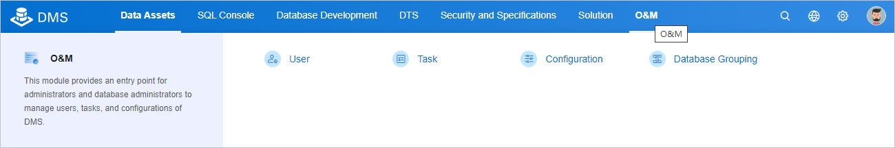<br>Note If you turn off Drop-down Menus in Top Navigation Bar, no drop-down lists appear when you move the pointer over to a tab in the top navigation bar. You can access each feature only by clicking the name of the feature in the left-side navigation pane. |

   <table>
     <tr>
       <td>Shortcuts</td>
       <td>• By default, the Shortcuts switch is turned on.<br>• If you turn on Shortcuts, you can click Shortcuts below the top navigation bar to add the features that you regularly use to the section on the right side of Shortcuts. You can add features to or remove features from the section on the right side of Shortcuts by performing the following operations:<br>a. In the upper-left corner of the DMS console, move the pointer over <strong>Shortcuts</strong>.<br>b.<br>• In the shortcut menu that appears, click theicon to the right of a<br>feature to add the feature to the section on the right side of Shortcuts.<br>• Click theicon to the right of a feature to remove the feature from the<br>section on the right side of Shortcuts.<br>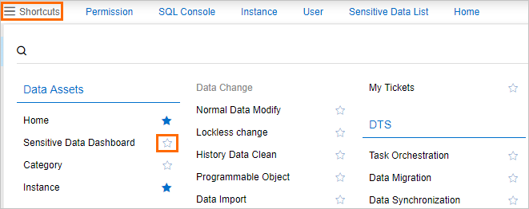</td>
     </tr>
     <tr>
       <td>Show Tabs</td>
       <td>• By default, the Show Tabs switch is turned on.<br>• If you turn on Show Tabs, you can view and use multiple features. Each feature is displayed on a tab. You can drag the tabs to adjust the order in which the tabs are displayed.<br>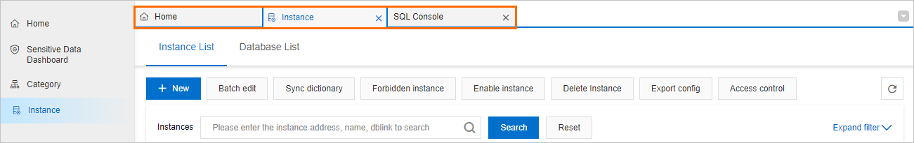<br>Note If you turn off Show Tabs, you can view and use only one feature at a time. The feature that you view and use is displayed on a tab.</td>
     </tr>
   </table>

4. Select a blue skin or a dark skin for the DMS console.

   - Blue, which is the default skin

     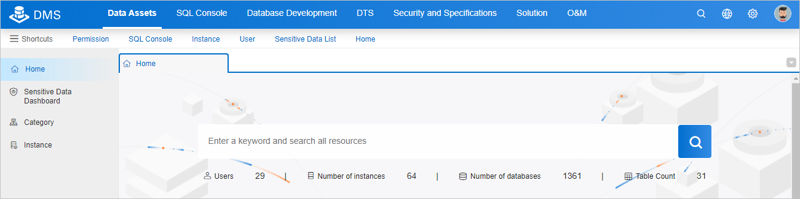

   - Dark

     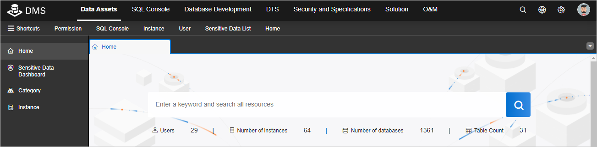

<a id="section-4-2"></a>

## 4.2. Global search

Data Management (DMS) provides the global search feature to allow you to quickly find the desired instances, databases, and tables managed by DMS or the features of DMS. You can also view tickets submitted by users within the current tenant account. This topic describes how to use the global search feature.

**Usage notes**

- When you search for a table in the global search box, make sure that the control mode of the database to which the table belongs is Secure Collaboration. Otherwise, the table cannot be found.

  > **Note**
  >
  > You can search for instances and databases in any control mode.

- If the global search feature fails to locate a data asset, such as an instance, database, or table, you need to manually perform data dictionary synchronization for the data asset.

**Procedure**

1. Log on to the DMS console.

2. In the top navigation bar, choose **Data Assets > Global Search**.

   > **Note**
   >
   > If you use the DMS console in simple mode, move the pointer over the
   >
   > icon in the
   >
   > 
   >
   > upper-left corner of the DMS console and choose **All Features > Data Assets > Global Search**.

3. Enter a keyword, such as a database or table name, into the search box and click  .

<a id="section-4-3"></a>

## 4.3. Use the category feature

As the business develops and the number of tables increases, Data Management DMS (DMS) provides the category feature to help you classify tables. This way, administrators, developers, and O&M engineers can manage or use the tables more conveniently.

**Prerequisites**

- A relational database or data warehouse is used. For more information, see What is DMS?.

- You are a DMS administrator or DBA. For information about user roles, see Supported database types and features.

**Manage categories**

1. Log on to the DMS console.

2. In the top navigation bar, move the pointer over the **More** icon and choose **Data Factory > Category**.

3. On the tab that appears, click **Create Category**.

4. In the **Category Name** field of the dialog box that appears, enter the name of a category and click **OK**. The created category is displayed in the left-side category tree.

   > **Note**
   >
   > By default, DMS creates the **Uncategorized** category. All the tables that
   >
   > are not added to categories belong to this category.

5. On the right side of a category, move the pointer over the  icon and perform an

   operation to manage the category. You can perform the following operations:

   - **Modify the name of a category**

     To modify the name of a category, move the pointer over the  icon and select

     **Change**.

   - **Create a subcategory**

     To create a subcategory, move the pointer over the  icon and select **Create**

     **Subcategory**.

     You can create up to four category levels. If a table is added to a category, you cannot create a subcategory for this category.

   - **Delete a category**

     To delete a category, move the pointer over the  icon and select **Delete**.

     > **Note**
     >
     > If a subcategory is created in this category or tables are added to this
     >
     > category, this category cannot be deleted.

**Add a table to a category**

Each table can be added to only one category. If you add a table to another category, the table is removed from the existing category.

1. Log on to the DMS console.

2. In the top navigation bar, move the pointer over the **More** icon and choose **Data Factory > Category**.

3. Click the category to which you want to add a table.

   > **Note**
   >
   > To view subcategories, you can click the
   >
   > icon on the left side of the
   >
   > 
   >
   > category.

4. On the page of the category, click **Quick Add** in the upper-right corner of the page.

   > **Note**
   >
   > You can also use the following method to add a table to a category.
   >
   > - On the page of the **Uncategorized** category, find the table that you want to manage and click **Associate Category** in the Actions column.

5. In the dialog box that appears, search for and select the table that you want to add, and then click **OK**.

   > **Note**
   >
   > You can add multiple tables to a category at a time.

**Remove a table from a category**

To remove a table from a category, find the table on the page of the category and click **Remove from Category** in the Actions column.

<a id="section-4-4"></a>

## 4.4. Manage instances

Data Management (DMS) allows you to manage database instances. For example, you can export and modify the information about instance configurations.

**Prerequisites**

You are a database administrator (DBA) or a DMS administrator.

> **Note**
>
> To view the role of your account, move the pointer over the  icon in the
>
> upper-right corner of the DMS console.

**Procedure**

1. Log on to the DMS console.

2. In the top navigation bar, choose **Data Assets > Instances**.

3. Perform the following operations based on your business requirements. To manage one or more registered database instances at a time, select the instances on the **Instance List** tab and click a button as required.

   > **Note**
   >
   > You can click **Expand filter** to show more filter conditions.

   - Register an instance

     Click **New** and register a database instance with DMS. For more information, see Register a database instance.

   - Modify the information about multiple instances at a time

     Click **Batch edit**. In the dialog box that appears, modify the instance information and click **OK**.

     > **Note**
     >
     > The database instances that you select must be of the same database
     >
     > type, such as MySQL.

   - Synchronize the data dictionary

     Click **Sync dictionary**. In the message that appears, click **OK**.

     > **Note**
     >
     > - If you change schemas for a database instance by using DMS, DMS automatically synchronizes the data dictionary of the instance.
     >
     > - If you change schemas for a database instance by using a service other than DMS, you must manually synchronize the data dictionary of the instance.

   - Disable or enable one or more instances

     Choose More > **Forbidden instance** or More > **Enable instance**. In the message that appears, click **OK**.

     > **Note**
     >
     > - After you disable a database instance, the instance is removed from the instance list in the left-side navigation pane on the Home page of the DMS console. DMS users can no longer find databases or tables in this instance in the DMS console.
     >
     > - After you enable a database instance, the instance appears in the instance list. Databases in this instance become available. Relevant permissions that have been granted to DMS users on this instance also become valid.

   - Remove one or more instances Choose More > **Delete Instance**. In the message that appears, click **OK**. After you remove a database instance, the instance is removed from the instance list. DMS users can no longer use databases in this instance in the DMS console. Relevant permissions that have been granted to DMS users on this instance also become invalid and are revoked.

     > **Note**
     >
     > On the **Instance List** tab, you can find database instances in the Delete
     >
     > state and enable these instances to recover them.

   - Export configuration information

     Choose More > **Export config**. The browser automatically downloads a CSV file named instances. You can use Excel or a text editor to view this file.

   - Enable access control Choose More > **Access control**. In the Metadata access control dialog box, turn on **Metadata access control** and click **OK**. After you enable access control for an instance, only users that have the required permissions can view this instance and the databases in this instance.

     > **Note**
     >
     > Only the database instances that are managed in Security Collaboration
     >
     > mode support this operation.

   - Other operations

     Find a database instance and click **Database list** in the **Actions** column to view the details of the databases and tables in this instance. You can also move the pointer over **More** and select an option to perform the corresponding operation on the instance. For example, you can log on to the instance or modify the instance information.

<a id="section-4-5"></a>

## 4.5. Manage databases

On the Database List tab, you can manage databases. For example, you can specify database owners, transfer the ownership, revoke owner permissions, grant and revoke user permissions, and export the information about database configurations or permissions.

**Procedure**

1. Log on to the DMS console.

2. In the top navigation bar, choose **Data Assets > Instances**.

3. On the Instances page, click the **Database List** tab.

4. Set filter conditions and select one or more databases that you want to manage. Then, you can perform the following operations based on your business requirements:

   > **Note**
   >
   > You can click **Expand filter** to show more filter conditions.

   - Specify database owners

     Specify one or more owners for the selected databases.

   - Transfer the ownership

     Transfer the ownership of the selected databases to a user. If you transfer the ownership of multiple databases at a time, you can select only users who own all of the databases from the Original Owner drop-down list.

   - Revoke owner permissions

     Revoke owner permissions from one or more owners of the selected databases.

   - Grant permissions to users Grant the query, export, or change permissions on the selected databases to one or more users. You can also specify a validity period for the granted permissions.

     > **Note**
     >
     > The database instances that are managed in Flexible Management mode
     >
     > do not support this operation.

   - Revoke permissions from users

     Revoke the query, export, or change permissions on the selected databases from one or more users. If a user does not have the preceding permissions, the following message appears:  `No corresponding permissions. You do not need to recycle or release permissions` .

   - Export configuration information

     Export the configurations of the selected databases to an Excel file. The configurations include the instance status, environment, database administrator (DBA), and owner.

   - Export permission information

     Export the permission information of the selected databases to an Excel file. The permission information includes the database information, users, permissions, and users who grant the permissions.

   - Enable access control Choose More > **Access control**. In the Metadata access control dialog box, turn on **Metadata access control** and click **OK**. After the access control feature is enabled for a database, only users who have permissions on the database can find the database.

     > **Note**
     >
     > Only the database instances that are managed in Security Collaboration
     >
     > mode support this operation.

   - Perform other operations You can find a database and click Tables in the Actions column to view the details about tables in the database. You can also move the pointer over **More** and select the operation that you want to perform. For example, you can query data in a single database, manage permissions, view the details of the instance to which the database belongs, and find the instance on the Instance List tab.

<a id="section-4-6"></a>

## 4.6. Enable metadata access control

DMS provides the metadata access control feature. You can use this feature to allow users to view the information about and access a database or database instance on which they have permissions. Before this feature is enabled, regular users can query all databases and database instances within the current tenant account. After you enable this feature as an administrator, you can allow specific users to view the information about and access the databases or database instances on which they have permissions. This further enhances the data security of your enterprise.

**Background information**

As a centralized data management service, DMS provides different roles that are assigned different permissions. This helps you manage data in your enterprise in a secure manner. After you enable metadata access control for a database instance or database, only users who have permissions on the database instance or database can view and access the instance or database. This way, users can view and access only databases on which they have permissions. This further enhances data security.

> **Note**
>
> In DMS, permissions on a database include the query, export, and change
>
> permissions. If you have one of these permissions on a database, you can view the following information about the database:
>
> - Information about the database. You can search for the database by entering a keyword in the search box that appears on the Home page of Data Assets or in the top navigation bar of the DMS console. Alternatively, you can search for the database in the Select the databases, tables, or columns on which you want to apply for permissions field on the Permission Application Ticket page. You can query the data in the database only if you have the query permission on the database.
>
> - Information about the database instance to which the database belongs. To view the information about other databases in this database instance, you must have permissions on the other databases.

You can enable metadata control access for the following objects:

- A user: The user can view and access only databases on which the user has permissions.

- A database: Only users who have permissions on the database can view and access the database.

- An instance: Only users who have permissions on the instance can view and access the instance and the databases in this instance.

**Enable metadata access control for a user**

1. Log on to the DMS console.

2. In the top navigation bar, click **O&M**. In the left-side navigation pane, click **Users**.

   > **Note**
   >
   > To enable metadata access control for a user, you must be a DMS
   >
   > administrator.

3. Find the user for whom you want to enable metadata access control, move the pointer over **More** in the **Actions** column, and then select **Access control**.

4. In the User access control dialog box, turn on **Metadata access control** and click **OK**.

**Enable metadata access control for an instance**

1. Log on to the DMS console.

2. In the top navigation bar, click **Data Assets**. In the left-side navigation pane, click **Instances**.

   > **Note**
   >
   > To enable metadata access control for an instance, you must be a DBA or a
   >
   > DMS administrator.

3. On the **Instance List** tab of the Instances page, find the instance for which you want to enable metadata access control, move the pointer over **More** in the **Actions** column, and then select **Access control**.

   > **Note**
   >
   > To enable metadata access control for multiple instances at a time, select
   >
   > multiple instances and click **Access control** in the upper part of this tab.

4. In the Metadata access control dialog box, turn on **Metadata access control** and click **OK**.

**Enable metadata access control for a database**

1. Log on to the DMS console.

2. In the top navigation bar, click **Data Assets**. In the left-side navigation pane, click **Instances**.

   > **Note**
   >
   > To enable metadata access control for a database, you must be a DBA or a
   >
   > DMS administrator.

3. On the **Database List** tab, find the database for which you want to enable metadata access control. Move the pointer over **More** in the **Actions** column and select **Access control**.

   > **Note**
   >
   > To enable metadata access control for multiple databases at a time, select
   >
   > multiple databases and click **Access control** in the upper part of this tab.

4. In the Metadata access control dialog box, turn on **Metadata access control** and click **OK**.

<a id="section-5"></a>

# 5.SQLConsole

<a id="section-5-1"></a>

## 5.1. Manage data in a single database

The single database query feature allows you to execute various SQL statements in the SQL Console module of the Data Management DMS (DMS) console with ease. You can use this feature to insert, delete, modify, and query data in a database in a visualized way. You can use this feature in scenarios such as data query and data development.

**Prerequisites**

You are granted the query permissions on the database or tables that you want to manage.

**Usage notes**

- A table may contain sensitive fields. If you do not have permissions to access these fields and you query these fields, the values of these fields are masked in the returned results. For more information, see Overview.

- By default, a maximum of 200 data rows can be returned for each query. If you are a DMS administrator, you can modify this security rule as needed. To modify a security rule, perform the following operations: Log on to the DMS console, and choose **Security and Specifications > Security Rules** in the top navigation bar. Go to the details page of the security rule set that you want to manage, find the security rule that you want to modify, and then modify the security rule.

- By default, a full scan can be performed on a table that does not exceed 10 GB in size. If you are a DMS administrator, you can modify this security rule as needed. To modify a security rule, perform the following operations: Log on to the DMS console, and choose **Security and Specifications > Security Rules** in the top navigation bar. Go to the details page of the security rule set that you want to manage, find the security rule that you want to modify, and then modify the security rule.

- By default, the timeout period for the execution of a single SQL statement is 60 seconds. If you are a DMS administrator, you can modify this timeout period on the Advanced Information tab of the Edit dialog box. To open the Edit dialog box for a database instance, perform the following operations: Log on to the DMS console, and choose **Data Assets > Instances** in the top navigation bar. On the Instance List tab, find the database instance that you want to manage and choose More > Edit in the Actions column.

**Procedure**

1. Log on to the DMS console.

2. In the top navigation bar, choose **SQL Console > SQL Console**.

3. In the Please select the database first dialog box, search for and select a database from the drop-down list and click **Confirm**.

4. On the SQLConsole tab, enter the SQL statements to be executed and click **Execute**.

**GUI of the SQL Console page**

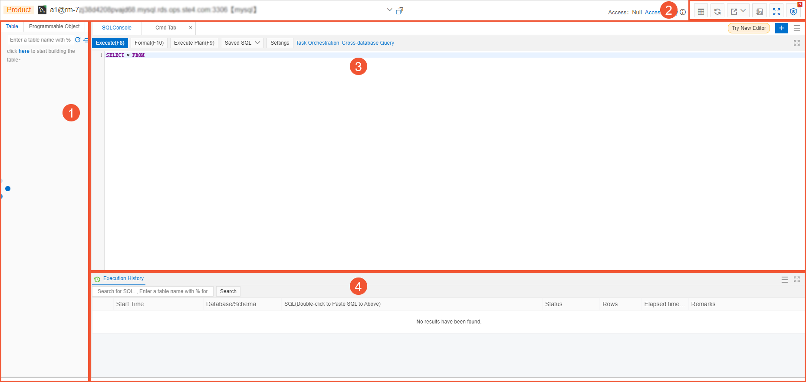

| No. | Section | Description |
| --- | --- | --- |
| 1 | Visual operation section | In the visual operation section, you can view all tables, fields, and indexes of the current database. You can also right-click a table to modify the table schema, import data, or export data. You can create, view, execute, and manage programmable objects, such as views, stored procedures, functions, triggers, and events. |
| 2 | SQL execution section | In the SQL execution section, you can write, format, and execute SQL statements. You can also modify or update result sets. This section provides the intelligent SQL completion prompt feature and allows you to add and manage commonly used SQL statements. |
| 3 | Execution result section | In the execution result section, you can view the execution results and execution history. The execution results are displayed as a table. You can export the result set to an EXCEL or a TEXT file and generate INSERT scripts for the result set. You can also copy and download a single row or multiple rows of the result set. |

<table>
  <tr>
    <td>4</td>
    <td>Extended feature section</td>
    <td>• Table list: You can view table schemas and indexes, manage tables at the row level, and perform table-related operations. For example, you can apply for permissions on tables, apply to be data owners, adjust data owners, export table creation statements, export table schemas, and adjust the sensitivity levels of fields.<br>• Metadata synchronization: You can collect the latest metadata of the current database, such as tables, fields, indexes, and programmable objects. This helps you manage permissions on tables, fields, and programmable objects based on different security levels.<br>• Export: You can export the data, schemas, or table creation statements of the current database.<br>• Schema version management: DMS automatically records table creation statements for each schema version. You can obtain the differences between two versions and generate scripts to fix the inconsistencies. This helps you effectively manage different schema versions.<br>• Operation audit: You can audit operations such as SQL queries, tickets, and logon records for the current database. This helps you troubleshoot database issues.<br>• Risk audit: You can identify the risks about metadata, sensitive data, and SQL statements to effectively improve the security and stability of the current database.<br>• Super SQL mode: DMS administrators or database administrators (DBAs) can enable this mode. In this mode, all SQL statements that you submit in the SQL Console are directly executed without the limits of security rules. This mode applies to O&amp;M and emergency handling.</td>
  </tr>
</table>

<a id="section-5-2"></a>

## 5.2. Query data across multiple database instances

You can use the cross-database query feature of Data Management (DMS) to efficiently query data in databases and tables across multiple database instances. This topic describes how to query data across multiple database instances.

**Prerequisites**

- The type of each involved database instance is MySQL, SQL Server, PostgreSQL, PolarDB-X, or Redis.

- Physical databases are created in each involved database instance.

  > **Note**
  >
  > - A physical database is a specific database.
  >
  > - A logical database consists of one or more physical databases and supports sharding.

- The cross-database query feature is enabled for each involved database instance.

  > **Note**
  >
  > If this feature is not enabled for a database instance, you can choose **Data**
  >
  > **Assets > Instances** in the top navigation bar of the DMS console as a DMS administrator or a database administrator (DBA) to modify the advanced information of the instance. You must enable cross-database query and customize a database link name.

**Procedure**

1. Log on to the DMS console.

2. In the top navigation bar, choose **SQL Console > Cross-database Query**.

3. Check whether you are authorized to access the involved database instances.

   > **Note**
   >
   > Parameters in the left-side navigation pane:
   >
   > - Permission:
   >
   >   - Authorized: the database instances for which the cross-database query feature is enabled and that you are authorized to access, and the databases in the database instances. If you are a DMS administrator or a DBA, you are authorized to access all database instances.
   >
   >   - All: all database instances for which the cross-database query feature is enabled and the databases in the database instances within the current tenant.
   >
   > - Object:
   >
   >   - DBLink: the database links that are filtered based on the value of the Permission parameter. A database link is established for each database instance.
   >
   >   - Database: the databases that are filtered based on the value of the Permission parameter.

   In the left-side navigation pane, right-click the database instance whose data you want to query and select **View Database Permissions**. In the **Information** message, check whether you are authorized to access the database instance.

   - If the "You have access to the database" message appears, you are authorized to access the database instance and you can perform the next step.

   - If the "You do not have permission for this database. Do you want to apply for permission now?" message appears, you are not authorized to access the database instance. Perform the following steps to apply for access permissions on the database instance:

     <ol type="a">

     <li>

     Click **Apply for Database Permission**.

     </li>

     <li>

     In the **Access apply** dialog box, select the permissions for which you want to apply.

     </li>

     </ol>

     <ol type="i" start="100">

     <li>

     Select a period of time from the **Duration** drop-down list based on your business requirements.

     </li>

     <li value="500">

     In the **Permission** field, enter the reason and background for your application to reduce unnecessary communication and simplify the approval process.

     > **Note**
     >
     > By default, **You are not authorized to use SQL Console to query**
     >
     > **data. Click to submit a ticket.** is used.

     </li>

     </ol>

     <ol type="a" start="5">

     <li>

     Click **OK**.

     </li>

     </ol>

     After your application is approved, you are authorized to access the database instance and you can perform the next step.

4. In the SQLConsole section, enter the SQL statement that is used to query data across database instances and click **Execute**. Sample SQL statement:

   ```text
   SELECT *    
   FROM dblink1.db1.table1 t1,         
        dblink2.db2.table2 t2    
   where t1.id= t2.id
   ```

   In the Execution History section, view the results of the SQL statement.

   > **Note**
   >
   > - You can also choose **Security and Specifications (DBS) > Operation Audit** in the top navigation bar and click the tab to view the operation logs of cross-database queries.**Operation Logs**
   >
   > - By default, up to 100 rows can be returned for a cross-database query. To view more rows of data, choose **O&M > Configuration Management** in the top navigation bar. Find the **Maximum number of returned rows for cross-database queries** parameter and click **Change** in the **Actions** column. In the dialog box that appears, specify the maximum number of rows that can be returned for a cross-database query. The maximum number cannot exceed 3,000.
   >
   > - If you want to view more than 3,000 rows for a cross-database query, you can use the task orchestration feature to configure a cross-database Spark SQL node, write the result set of the SQL statement to a temporary table, and then perform a single-database query on the temporary table.

<a id="section-5-3"></a>

## 5.3. Manage schema versions

After you change the schema of a table in a database in Data Management DMS (DMS), DMS adds the latest schema to the schema version list of the database. You can download and compare schema versions and restore an earlier schema version in the schema version list.

**Prerequisites**

Permissions are granted to your account to query the data of the table or the database to which the table belongs. For more information, see Manage permissions.

**Overview**

Schema versions are defined based on a database and store the schema information of all the tables in the database. If the schema of a table in the database is changed, a new schema version is saved. For more information, see Save new schema versions.

If a database instance that has five databases is managed in Security Collaboration mode, each database can contain 50 schema versions. In other words, for a database instance that is managed in Security Collaboration mode, a maximum of 50 schema versions can be retained for each database in the instance.

**Usage notes**

- The following database engines are supported:

  - MySQL: ApsaraDB RDS for MySQL databases, PolarDB-X databases, AnalyticDB for MySQL databases, and MySQL databases from other sources.

  - SQL Server: ApsaraDB RDS for SQL Server databases and SQL Server databases from other sources.

  - PostgreSQL: ApsaraDB RDS for PostgreSQL databases, AnalyticDB for PostgreSQL databases, and PostgreSQL databases from other sources.

  - OceanBase

  - DamengDB

- The following section shows the maximum number of schema versions that can be retained for each database in instances that are managed in different control modes:

  - Flexible Management: 3

  - Stable Change: 20

  - Security Collaboration: 50

- You cannot manage schema versions for the following databases:

  - Databases that contain more than 1,024 tables

  - System databases such as the information_schema and sys databases in a MySQL database instance

**Procedure**

1. Log on to the DMS console.

2. In the top navigation bar, choose **SQL Console > SQL Console**.

3. In the dialog box that appears, search for and select a database, and then click **Confirm**.

4. On the SQLConsole tab of the database that you want to manage, move the pointer over the

   icon and select **Version management**.

5. On the **Database version list** page, find the version number of the schema that you want to manage. The following table describes the operations that you can perform.

   | Operation | Description |
   | --- | --- |
   | View | View the details about the schema version. |
   | Preview script | Preview the SQL script that is used to generate the schema version. |
   | Table structure comparison | Synchronize the schema version to another database, or compare the schema version with a schema version in another database. For more information, see Schema synchronization. |
   | Structural recovery | Synchronize the schema version that you want to restore to an empty database. For more information, see Initialize empty databases. |

**Save new schema versions**

New schema versions are saved when the following operations are performed in DMS:

- SQL statements are executed on the SQLConsole tab to change schemas.

- SQL statements are executed to change schemas when you submit tickets for normal data change, lock-free data change, schema design, or schema synchronization.

- SQL statements are executed to change schemas by a DMS administrator.

> **Note**
>
> If the schema of a table in a database is changed in environments other than DMS, you can synchronize and save the latest schema of the database in DMS.

<a id="section-5-4"></a>

## 5.4. Generate a risk audit report

Data Management DMS (DMS) allows you to generate risk audit reports for database instances. Risk audit reports collect and assess various risks that are involved in the O&M of database instances. Risk audit reports also provide optimization suggestions for you to improve the security and stability of your instances.

**Overview**

A risk audit report is generated based on a database instance in DMS. The report diagnoses and analyzes the risks that are involved in the O&M of the instance or a specific database in the instance.

The following table describes the risk audit items that are contained in risk audit reports.

| Risk audit item | Description | Supported database engines |
| --- | --- | --- |
| SQL audit | For this item, DMS checks whether the SQL statements that are executed in the DMS console to manage the current database instance conform to the R&amp;D specifications. By default, DMS checks the SQL statements that are executed in the previous week. The statements include those that are executed on the SQL Console tab and those that are executed after tickets are submitted, such as Normal Data Modify and Lockless change tickets.<br>For example, DMS may find the following accidental operation: A whole table was accidentally updated because the <code> WHERE </code> clause was missing in an <code> UPDATE </code> statement.<br>Note This audit item is checked based on optimization suggestions for SQL review. | MySQL<br>Self-managed MySQL databases, ApsaraDB RDS for MySQL databases, PolarDB for MySQL databases, PolarDB-X databases, and AnalyticDB for MySQL databases |
| Metada ta | For this item, DMS assesses the risks of all the schemas in the current database instance.<br>For example, DMS may identify the following risk: An auto-increment primary key of the INT type runs out of valid values.<br>Note This audit item is checked based on optimization suggestions for SQL review. | MySQL<br>Self-managed MySQL databases, ApsaraDB RDS for MySQL databases, PolarDB for MySQL databases, PolarDB-X databases, and AnalyticDB for MySQL databases |

<table>
  <tr>
    <td>Sensitiv e Data</td>
    <td>For this item, DMS checks whether the current database instance contains sensitive fields.<br>For example, if the instance contains sensitive fields, such as mobile numbers, ID card numbers, or passwords, DMS checks whether these fields are prone to sensitive data breaches.</td>
    <td>• MySQL<br>Self-managed MySQL databases, ApsaraDB RDS for MySQL databases, PolarDB for MySQL databases, PolarDB-X databases, and AnalyticDB for MySQL databases<br>• SQL Server<br>Self-managed SQL Server databases and ApsaraDB RDS for SQL Server databases<br>• PostgreSQL<br>Self-managed PostgreSQL databases and PolarDB for PostgreSQL databases<br>• MaxCompute</td>
  </tr>
</table>

**Limits**

- Only DMS administrators, security administrators, database administrators (DBAs), instance owners, and database owners can generate risk audit reports.

- You can keep only a limited number of risk audit reports for an instance. The number varies based on the control mode of the instance.

  - For an instance that is managed in Flexible Management mode, you can keep up to three reports. You cannot view the details of the reports.

  - For an instance that is managed in Stable Change mode, you can keep up to 20 reports.

  - For an instance that is managed in Security Collaboration mode, you can keep up to 50 reports.

**Procedure**

1. Log on to the DMS console.

2. In the left-side database instance list , right-click the instance for which you want to generate a risk audit report and choose **Audit > Risk Audit**.

   > **Note**
   >
   > On the SQL Console tab of the database, move the pointer over the
   >
   > icon
   >
   > 
   >
   > and select **Risk Audit**.

3. Click **Real-time Diagnostics**.

   > **Note**
   >
   > By default, DMS does not automatically diagnose an instance. If this is the
   >
   > first time for the instance to be diagnosed, you can click **Diagnose**.

4. In the dialog box that appears, select the risk audit items and click **Diagnose**. Wait until the status of the report that is being generated changes to **Completed**.

5. After the report is generated, you can view the diagnosis details of each database in the instance.

<a id="section-5-5"></a>

## 5.5. Use the super SQL mode

Data Management (DMS) provides the super SQL mode feature. After you enable this feature as a DMS administrator or a database administrator (DBA), all SQL statements that you enter on the SQLConsole tab are executed without being affected by security rules.

**Prerequisites**

- You are a DMS administrator or a DBA.

- An instance is managed in Security Collaboration mode.

**Background information**

To improve the security and stability of database instances, DMS administrators and DBAs may configure security rules for databases. For example, a security rule is configured to prevent unauthorized users from executing DML statements in a production database on the SQLConsole tab. Unauthorized users can execute those statements only by submitting tickets. However, these security rules may cause inconvenience to privileged users, such as DMS administrators and DBAs.

In view of this, DMS provides the **super SQL mode** feature. If you enable this feature as a DMS administrator or a DBA, all SQL statements that you enter on the SQLConsole tab are executed without being affected by security rules.

**Procedure**

1. Log on to the DMS console.

2. In the top navigation bar, choose **SQL Console > SQL Console**.

3. Search for and select a database, and then click **Confirm**.

4. In the upper-right corner of the SQL Console tab, click the

   icon. In the dialog box that

   

   appears, click **OK**.

   Then, the outside borders of the SQL Console page for the database instance turn orange. This indicates that the **super SQL mode** feature is enabled. Then, the SQL statements that you enter on the SQLConsole tab are executed.

   > **Important**
   >
   > - After you enable this feature as a DMS administrator or a DBA, all SQL statements that you enter on the SQLConsole tab are executed without being affected by security rules.
   >
   > - If you want to disable the **super SQL mode** feature, click the
   >
   >   icon. The
   >
   >   orange borders of the SQL Console page disappear, and the super SQL mode is disabled.

<a id="section-6"></a>

# 6.Data plans

<a id="section-6-1"></a>

## 6.1. Schemas

<a id="section-6-1-1"></a>

### 6.1.1. Use the schema design feature to change schemas

Data Management (DMS) provides the schema design feature. This feature allows you to change schemas with ease. This topic describes how to change schemas.

**Prerequisites**

The destination database is a MySQL, a PolarDB-X, or an OceanBase database.

**Background information**

When you develop projects, process new business requirements, or optimize business operations, you may need to create or modify tables to change schemas. For example, you may need to create or delete fields, create or delete indexes, modify field attributes, or modify the index composition. In these scenarios, you can use the schema design feature of DMS.

- This feature allows multiple users to collaboratively change a schema in the DMS console.

- This feature allows you to send verified scripts to other environments. This ensures consistency between schemas in different environments.

**Usage notes**

When you submit a schema design ticket to delete a table, make sure that the table is created by using a schema design ticket.

**Procedure**

1. Log on to the DMS console.

2. In the top navigation bar, choose **Database Development > Schema Design**.

3. On the page that appears, click **Schema Design** in the upper-right corner.

4. In the Create Ticket step, configure the parameters that are described in the following table and click **Submit**.

   | Parameter | Description |
   | --- | --- |
   | Project Name | The name of the project. Enter a name that can help you identify the project. |
   | Project description | The business background of the project, such as the purpose or objective of the project. Enter a detailed description to reduce unnecessary communication. |
   | Change Base Database | The database on which you want to perform schema design operations.You can enter a keyword to search for the database. Prefix match is supported. Only databases on which you have permissions in the test or development environment are displayed.<br>Note<br>• Only database instances that are managed in Security Collaboration mode are supported.<br>• You must have at least the query, export, or change permissions on the database that you select. |
   | Security Rules | The security rules that you want to apply. DMS automatically selects security rules after you specify a database. |
   | Associated Iterations | The iteration to be associated with the project. To select an iteration, click <strong>Select/Change Iteration</strong>. In the dialog box that appears, find the iteration and click <strong>Associate</strong> in the <strong>Actions</strong> column. |
   | Change Stakeholder | The stakeholders involved in the schema design. All the specified stakeholders can view the ticket details and take part in the approval process. Other users aside from DMS administrators and database administrators (DBAs) are not allowed to view the ticket details. |

5. Change a schema based on your business requirements.

   <ol type="i">

   <li>

   Click **Create Physical Table**.

   </li>

   <li>

   Configure the parameters on the Basic Info, Column Info, and Index Info tabs based on

   </li>

   </ol>

   your business requirements.

   <ol type="i" start="3">

   <li>

   Click **Save**.

   </li>

   </ol>

   > **Note**
   >
   > After you click Save, DMS verifies the specified information based on
   >
   > design specifications. If the information does not comply with the design specifications, a message appears.

   <ol type="i" start="4">

   <li>

   After the information passes the precheck, click **Confirm Changes and Submit to Save**.

   </li>

   </ol>

6. Apply the schema to the base database.

   <ol type="i">

   <li>

   Click **Perform Changes to Base Database**.

   </li>

   <li>

   In the Perform Changes to Base Database dialog box, set the Execution Strategy

   </li>

   </ol>

   parameter to **Execute Now** or **Schedule**.

   <ol type="i" start="3">

   <li>

   Click **OK**.

   </li>

   <li>

   After the ticket is approved, click **Go to Next Node**.

   > **Note**
   >
   > - After the ticket is approved, DMS performs the changes at the scheduled time. If you do not specify the execution time, the changes are automatically performed after the ticket is approved on the last approval node. You can view the execution status and operation logs. After all changes are performed, you can repeat the preceding procedure to change the schema again. If no additional changes are required for the schema, click Go to Next Node.
   >
   > - After the ticket is submitted to the next node, whether you can go back to the previous node is subject to the predefined design specifications.

   </li>

   <li>

   In the Go to Next Node message, click **Go to Next Node**.

   </li>

   </ol>

7. Apply the schema changes to the destination database.

   <ol type="i">

   <li>

   Click **Perform Changes to Target Database**.

   </li>

   <li>

   In the Perform Changes to Target Database dialog box, configure the Target Database

   </li>

   </ol>

   and Execution Strategy parameters and click **OK**.

   > **Note**
   >
   > The destination database must be in an online environment.

   <ol type="i" start="3">

   <li>

   After the ticket is approved, click **Go to Next Node**.

   </li>

   </ol>

   The schema design process ends, and the ticket is closed.

<a id="section-6-1-2"></a>

### 6.1.2. Schema synchronization

Data Management (DMS) provides the schema synchronization feature. You can use this feature to compare the schemas of two databases, generate a script to synchronize schemas, and then run the script on the destination database. This topic describes the schema synchronization feature and how to synchronize schemas.

**Prerequisites**

The source databases and destination databases are ApsaraDB for OceanBase or MySQL databases.

**Precautions**

- You cannot synchronize schemas to a destination database that resides in a production environment.

- The empty database initialization feature allows you to synchronize some or all tables from a physical or logical database.

**Scenarios**

You can use the schema synchronization feature to synchronize schemas and ensure schema consistency in the following scenarios:

- Synchronize data between a database in a production environment and a database in a test environment.

- Synchronize data between different databases that are deployed in a test environment.

- Synchronize data between different databases that are deployed in a production environment.

**Procedure**

1. Log on to the DMS console.

2. In the top navigation bar, choose **More > Schemas > Schema Synchronization**.

3. Specify the required parameters for a schema synchronization ticket.

   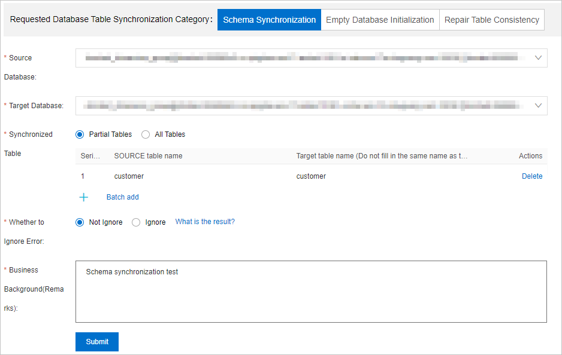

   | Parameter | Description |
   | --- | --- |
   | Source Database | The name of the source database from which you want to synchronize schemas. You must have the read permissions on the source database. |
   | Target Database | The name of the destination database to which you want to synchronize schemas. You must have the change permissions on the destination database. |
   | Synchronized Table | The tables that you want to synchronize. Valid values:<br>• <strong>Partial Tables</strong>: Synchronize one or more tables in the source database.You can click <strong>Batch Add</strong> to add multiple tables.<br>Note If you do not set this parameter, the names of the destination tables are the same as the names of the source tables.<br>• <strong>All Tables</strong>: Synchronize all tables in the source database. |
   | Whether to Ignore Error | • <strong>Not Ignore</strong>: If an error occurs when SQL scripts are executed in serial mode, the system immediately stops executing the current and remaining SQL scripts.<br>• <strong>Ignore</strong>: If an error occurs when SQL scripts are executed, DMS stops executing the current SQL script and continues to execute the next statement until all remaining SQL scripts are executed. |

4. Click **Submit**. DMS starts to analyze the schemas.

5. Check the comparison results.

   > **Note**
   >
   > If the schemas are changed when the system analyzes the schemas, click
   >
   > Re-analyze in the Schema Analysis step.

6. Verify the script that is used to synchronize schemas and click **Submit and Synchronize to Target Database**.

   > **Note**
   >
   > If the schemas of the source database and destination database are the
   >
   > same, you do not need to submit the script, and the schema synchronization ticket is closed.

<a id="section-6-1-3"></a>

### 6.1.3. Create shadow tables for synchronization

Data Management (DMS) uses the shadow table synchronization feature to automatically create a shadow table based on the schema of a source table. DMS generates the name of the shadow table by attaching a prefix or suffix to the name of the source table. You can use this feature for scenarios such as end-to-end stress testing.

**Procedure**

1. Log on to the DMS console.

2. In the top navigation bar, choose **Database Development > Schema Change > Shadow Table Synchronization**.

3. On the **Table Sync Tickets** page, configure the parameters that are described in the following table.

   | Parameter | Description |
   | --- | --- |
   | Source Database | The source database in which you want to create shadow tables. |
   | Prefix / Suffix | The prefix or suffix that is used to generate a shadow table name. The name can be in the <strong>Prefix</strong> + Source table name or Source table name + <strong>Suffix</strong> format. You can use a custom prefix or suffix as needed. By default, the Prefix + Source table name format is used.<br>Default shadow table name: <code> __test_Source table name </code>. |
   | Synchronized Table | The tables that you want to synchronize. Valid values:<br>• Partial Tables<br>• All Tables |
   | Synchronizatio n Policy | The policy that is used for shadow table synchronization. Valid values:<br>• <strong>Synchronize Now</strong>: DMS immediately performs synchronization after you submit the ticket. In this case, synchronization is performed only once.<br>• <strong>Scheduled Synchronization</strong>: DMS performs synchronization at the specified time on a regular basis. You can use a crontab expression to schedule synchronization based on your requirements. For more information, see the Crontab expressions section of this topic. The minimum interval for synchronization is 1 hour. By default, shadow table synchronization starts at 02:00 every day. |
   | Whether to Ignore Error | Specifies whether to skip errors that occur when SQL statements are being executed. Valid values:<br>• <strong>Not Ignore</strong>: If an error occurs when SQL statements are being executed, DMS stops executing the current and subsequent SQL statements.<br>• <strong>Ignore</strong>: If an error occurs when SQL statements are being executed, DMS skips the current SQL statement and continues to execute subsequent SQL statements until all remaining statements are executed. |

4. Click **Submit**. DMS starts to analyze the schemas.

5. Check the analysis results.

   > **Note**
   >
   > If the schemas are changed during schema analysis, click Re-analyze in the
   >
   > Schema Analysis step.

6. Verify the script that is used to synchronize schemas and click **Submit and Synchronize to Target Database**.

   > **Note**
   >
   > If the schemas of the source database and destination database are the
   >
   > same, you do not need to submit the script. The schema synchronization ticket is closed.

**Crontab expressions**

If you need to schedule the synchronization task to be run in a finer-grained manner, you can use a crontab expression. The interval for running the task can be specified by using a combination of minutes, hours, days, weeks, or months.

A crontab expression consists of five fields of the NUMERIC type. Valid values of each field:

- **Minutes**:  `0 to 59` .

- **Hours**:  `0 to 23` . A value of 0 indicates the midnight.

- **Days**:  `1 to 31` . A value of this field indicates a specific day of a month.

- **Months**:  `1 to 12` . A value of 1 indicates January, and a value of 2 indicates February. Similarly, the specific month that is indicated by a specific value can be obtained.

- **Weeks**:  `1 to 7` . A value of 1 indicates Sunday, and a value of 2 indicates Monday. In other words, the seven week days from Sunday to Saturday are indicated by values 1 to 7.

Usage notes

- Specify the time for running a stress testing task either by the day or by the week. You cannot specify the day and week at the same time. After you specify one of the preceding two values, you must set the other value to  `?` . A value of ? indicates an unspecified value. For example, if you schedule the task to be run on the first and second days of each month, the **Weeks** field must be set to  `?` .

- Limit the characters in a crontab expression to English special characters. The special characters can be wildcards such as asterisks (\*) and question marks (?).

- Separate multiple values with commas (,).

- Use a hyphen (-) to indicate a value range. For example, if you set the **Days** field to  `1-5` , the task is scheduled to be run on the first to fifth days of a month.

- Use a forward slash (/) to indicate an interval for running the task. For example, if you set the Days field to  `*/2` , the task is scheduled to be run every two days.

Sample crontab expressions

- To schedule the task to be run at 23:00 every Saturday and Sunday, use the following crontab expression: 0 23 ? \* 7,1.

- To schedule the task to be run at 09:30 on the fifth, fifteenth, and twenty-fifth days of each month, use the following crontab expression: 30 9 5,15,25 \* ?.

- To schedule the task to be run at 00:00 every two days, use the following crontab expression: 0 0 \*/2 \* ?.

<a id="section-6-1-4"></a>

### 6.1.4. Initialize empty databases

DMS provides the empty database initialization feature. You can use this feature to compare the schemas of two databases, generate a script for schema synchronization, and then run the script to synchronize the schema from the source database to the destination database. To use this feature, make sure that the destination database is empty. This topic describes how to initialize an empty database.

**Prerequisites**

- The source and destination databases are MySQL or ApsaraDB for OceanBase databases.

- The destination database is an empty database that does not contain tables.

**Usage notes**

The empty database initialization feature allows you to synchronize some or all tables from a physical or logical database.

**Scenarios**

You can use this feature to synchronize the schemas of databases that are deployed across multiple regions and units. For example, you can use this feature in the following scenarios:

- Synchronize schema between a database in an online environment and a database in an offline environment.

- Synchronize schema between different databases that are deployed in offline environments.

- Synchronize schema between different databases that are deployed in online environments.

**Procedure**

1. Log on to the DMS console.

2. In the top navigation bar, click **Database Development**. In the left-side navigation pane, choose **Schema Change > Empty Database Initialization**.

3. On the Ticket Application page, set the parameters for the empty database initialization ticket. The following table describes the parameters.

   | Parameter | Description |
   | --- | --- |
   | Source Database | The name of the source database from which you want to synchronize schemas. You must have the query permissions on the source database. |
   | Target Database | The name of the destination database to which you want to synchronize schemas. You must have the change permissions on the destination database.<br>Note The type of the destination database must be the same as the type of the source database. |
   | Initialized Table | The one or more tables whose schemas you want to synchronize. Valid values:<br>• <strong>Partial Tables</strong>: synchronizes the schemas of some of the tables in the<br>source database. You can also click theicon to add more tables.<br>• <strong>All Tables</strong>: synchronizes the schemas of all tables in the source database. |
   | Whether to Ignore Error | • <strong>Not Ignore</strong>: If an error occurs when SQL statements are being executed in serial mode, DMS stops executing the current and remaining SQL statements.<br>• <strong>Ignore</strong>: If an error occurs when SQL statements are being executed, DMS stops executing the current SQL statement and continues to execute the next statement until all remaining SQL statements are executed. |
   | Business Background(Remarks) | The purpose or objective of the initialization operation. |

4. Click **Submit**. DMS starts to analyze the schemas.

5. Check the analysis results.

   > **Note**
   >
   > If the schemas are changed during schema analysis, click Re-analyze in the
   >
   > Schema Analysis step.

6. Verify the script that is used to synchronize schemas and click **Submit and Synchronize to Target Database**.

   > **Note**
   >
   > If the schemas of the source database and destination database are the
   >
   > same, you do not need to submit the script. The schema synchronization ticket is closed.

<a id="section-6-1-5"></a>

### 6.1.5. Repair table inconsistency

The table inconsistency repair feature of Data Management (DMS) allows you to compare the schemas of tables between different environments, identify schema differences, and then generate SQL statements to be executed for the tables in the destination environment. This ensures schema consistency between different environments.

**Prerequisites**

- The source and destination databases are MySQL or OceanBase databases.

- You have logged on to the destination database in the DMS console if the database instance to which the destination database belongs is managed in Flexible Management or Stable Change mode.

  > **Note**
  >
  > If the database instance to which the destination database belongs is not
  >
  > managed in Security Collaboration mode, you must log on to the destination database.

**Scenarios**

- Ensure the schema consistency between physical tables in the test environment and physical tables in the production environment.

- Ensure the schema consistency between physical tables and logical tables in a physical database or a logical database.

**Procedure**

1. Log on to the DMS console.

2. In the top navigation bar, choose **Database Development > Schema Change > Table Consistency Repairing**.

3. On the Table Sync Tickets page, configure the parameters that are described in the following table for the Table Consistency Repairing ticket.

   | Parameter | Description |
   | --- | --- |
   | Base Database(Physical Database) | The source database for table inconsistency repair. You must have the query permissions on the source database. |
   | Target Database | The destination database for table inconsistency repair. You must have the change permissions on the destination database. |
   | Repaired Table | The name of the table that you want to repair. You can click theicon to<br>add more tables.<br>Note If you do not specify the destination table name, DMS names the destination table after the name of the specified source table. |
   | Whether to Ignore Error | • <strong>Not Ignore</strong>: If an error occurs when SQL statements are being executed in serial mode, DMS stops executing the current and remaining SQL statements.<br>• <strong>Ignore</strong>: If an error occurs when SQL statements are being executed, DMS skips the current SQL statement and continues to execute the subsequent SQL statement until all remaining SQL statements are executed. |
   | Business Background(Remar ks) | The purpose or objective of the table inconsistency repair. Enter a detailed description to reduce unnecessary communication. |

4. Click **Submit**. DMS starts to analyze the schemas.

5. Check the analysis results.

   > **Note**
   >
   > If the schemas are changed during schema analysis, click Re-analyze in the
   >
   > Schema Analysis step.

6. Verify the script that is used to synchronize schemas and click **Submit and Synchronize to Target Database**.

   > **Note**
   >
   > If the schemas of the source database and destination database are the
   >
   > same, you do not need to submit the script. The schema synchronization ticket is closed.

<a id="section-6-2"></a>

## 6.2. Change data

Data Management (DMS) provides some data change features that allow you to change data. This topic describes how to use the data change features to change data.

**Background information**

Before you publish a project, DMS allows you to submit data change tickets to initialize data, clear historical data, fix bugs, or run a test. The operations that you can perform to change data include INSERT, UPDATE, DELETE, and TRUNCATE operations.

**Data change features**

| Feature | Description |
| --- | --- |
| Normal Data Modify | This feature allows you to perform the following types of data changes:<br>• Regular data changes.<br>• Lock-free schema changes. You can perform this type of data change to change character sets and collations for tables, adjust time zones, and change column data types. Compared with regular data changes, lock-free schema changes can be performed to achieve the following benefits:<br>• Prevents table locking caused by database schema changes to ensure business continuity.<br>• Prevents latency caused by native online DDL operations that are performed on databases to ensure consistency between the primary and secondary databases.<br>• Reclaims tablespaces and reduces the fragmentation rate by performing lock-free schema changes instead of executing the OPTIMIZE TABLE statement that results in table locking.<br>Note<br>• You can use this feature only for MySQL databases. Before you use this feature, you must set the Lock-free Schema Change parameter to Open (DMS OnlineDDL first) on the <strong>Advanced</strong> <strong>Information</strong> tab when you register or modify a database instance. For more information, see Register a database instance.<br>• Separate multiple SQL statements with commas (<code> , </code>).<br>• You can use this feature only for database instances that are managed in Stable Change or Security Collaboration mode. |
| Lockless change | This feature allows you to change a large amount of data. For example, you can use this feature to clear historical data and update all fields in a table.SQL statements for data changes are executed in batches based on the primary key or unique key. This mitigates the impact on database performance and reduces the consumption of database space.<br>Note You can use this feature only for MySQL databases. |
| History Data Clean | This feature allows you to regularly clear historical data. This prevents the stability of the online environment from being affected by accumulated historical data.<br>Note You can use this feature only for MySQL databases. |
| Large Data Import | This feature allows you to quickly import a large amount of data to databases.This reduces the costs of labor and material resources.<br>Note You can use this feature for the following types of databases:<br>• Self-managed MySQL databases and ApsaraDB RDS for MySQL databases<br>• PolarDB-X databases |
| Programmable Object | Databases provide programmable objects such as stored functions and stored procedures. This feature allows you to use programmable objects to standardize management processes and provides audit records. |

**Procedure**

1. Log on to the DMS console.

2. In the top navigation bar, choose **Database Development > Data Change** and select the data change feature that you want to use.

3. Configure the parameters for the data change ticket. The following table describes the parameters for a **Normal Data Modify** ticket.

   | Parameter | Description |
   | --- | --- |
   | Database | The database on which you want to perform the change operation. You must select one or more databases on which you have the change permissions. If you have only the query permissions on a database or the change permissions on the tables in the database, you cannot submit a data change ticket for the database. |
   | Associated Iterations | The iteration to be associated with the project. To select an iteration, click <strong>Select/Change Iteration</strong>. In the dialog box that appears, find the iteration and click <strong>Associate</strong> in the <strong>Actions</strong> column. |
   | Reason Category | The reason for the change operation. This helps you find the ticket in subsequent operations. |
   | Business Background | The purposes or objectives of the change operation. Enter a detailed description to reduce unnecessary communication. |
   | Execution Method | The way in which you want the ticket to be run. Configure this parameter based on your business requirements. |
   | Affected Rows | The estimated number of data rows that are affected by the change operation. To obtain the actual number of affected rows, you can write an SQL statement that includes the COUNT function in the SQL Console. |
   | SQL Statements for Change | The executable SQL statements that are used to perform the change operation. You can write the SQL statements in the SQL Text field or upload a file to provide the SQL statements. DMS verifies the syntax of the SQL statements when you submit the ticket. If the syntax is invalid, you cannot submit the ticket. |
   | SQL Statements for Rollback | The executable SQL statements that are used to roll back the change operation. You can write the SQL statements in the SQL Text field or upload a file to provide the SQL statements. |
   | Change Stakeholder | The stakeholders involved in the change operation. All the specified stakeholders can view the ticket details and take part in the approval process. Other users aside from DMS administrators and database administrators (DBAs) are not allowed to view the ticket details. |
   | Attachments | The images or files that provide more information about the change operation. |

4. After you configure the parameters, click **Submit**.

5. After the ticket passes the precheck, click **Submit for Approval**. In the message that appears, click **OK**.

6. After the ticket is approved, click **Execute Change**.

7. Configure the Execution Strategy parameter and click **Confirm Execution**.

   > **Note**
   >
   > By default, the Execution Strategy parameter is set to Running
   >
   > immediately. You can also set the **Execution Strategy** parameter to Schedule and specify a point in time to run the ticket. DMS automatically runs the ticket at the specified point in time.

   Wait until the ticket is run.

<a id="section-6-3"></a>

## 6.3. Import data

The data import feature of Data Management (DMS) allows you to import large amounts of data to databases with ease. This helps you save labor costs and resources.

**Supported databases**

- Self-managed MySQL databases and ApsaraDB RDS for MySQL databases

- PolarDB-X databases

**Supported file formats for data import**

- TXT format.

- SQL script. By default, you can execute only the INSERT and REPLACE statements to import data to database instances that are managed in Security Collaboration mode. If you want to execute other SQL statements to import data, modify the security rules for data import as a database administrator (DBA) or DMS administrator. You can modify the security rules by performing the following operations: Go to the **Details** page of the security rule set that is applied to the database instance and click the **SQL Correct** tab. In the list below the **Batch Data import rules** checkpoint, modify the security rules based on your business requirements.

- CSV format. Values in a CSV file must be separated by commas (,). The first row must be field names.

> **Note**
>
> The file size cannot exceed 5 GB.

**Usage notes**

- If you need to change only a small amount of data, we recommend that you submit a Normal Data Modify or Lockless change ticket to ensure stable data change. For more information, see Change data.

- If you submit a Large Data Import ticket to import a large amount of data to a table, the table is locked even if the lock-free schema change feature is enabled for the database instance.

- We recommend that you execute SQL statements with better performance to import a large amount of data, such as the INSERT, UPDATE, and DELETE statements. Indexes of primary keys are used in the UPDATE and DELETE statements.

**Procedure**

1. Log on to the DMS console.

2. In the top navigation bar, choose **Database Development > Data Change > Data Import**.

3. On the Data Change Tickets page, configure the parameters that are described in the following table for the Large Data Import ticket.

   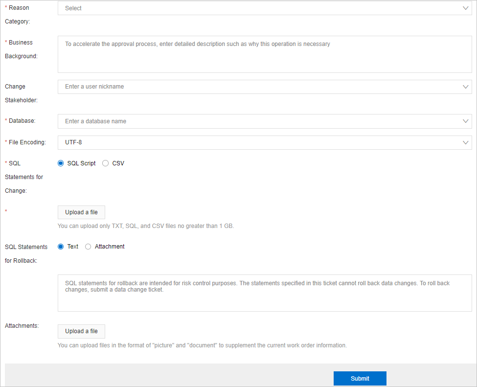

   | Parameter | Description |
   | --- | --- |
   | Reason Category | The reason for the data import. This helps you identify the ticket in the future. |
   | Business Background | The purpose or objective of the data import. Enter a detailed description to reduce unnecessary communication. |
   | Change Stakeholder | The stakeholders involved in the data import. All the specified stakeholders can view the ticket details and take part in the approval process. Other users aside from DMS administrators and DBAs are not allowed to view the ticket details. |
   | Database | The database on which you have the change permissions. You cannot submit a data import ticket if you have only the permissions to query data in the database or change data in tables. |
   | File Encoding | The encoding method to be used by the database. |
   | SQL Statements for Change | The format of the file for data import. You can select SQL Script or CSV based on your business requirements. Then, upload the file that contains the required SQL statements. DMS verifies the syntax of the SQL statements when you submit the ticket. If the syntax is invalid, you cannot submit the ticket. |
   | SQL Statements for Rollback | The executable SQL statements used to roll back the data import. You can write the SQL statements in the SQL Text field or upload an SQL script that contains the required SQL statements. |
   | Attachment | The images or files that are uploaded to provide more information about the data import. |

4. After you configure the parameters, click **Submit**.

5. After the ticket passes the precheck, click **Submit for Approval**. In the message that appears, click **OK**.

6. After the ticket is approved, click **Execute Change**.

7. Configure the Execution Strategy parameter and click **Confirm Execution**.

   > **Note**
   >
   > By default, the Execution Strategy parameter is set to Running
   >
   > immediately. You can also set the **Execution Strategy** parameter to Schedule and specify a point in time to run the ticket. DMS automatically runs the ticket at the specified point in time.

   Wait until the ticket is run.

<a id="section-6-4"></a>

## 6.4. Export data

DMS provides the data export feature. You can use this feature to export a database or SQL result sets. Then, you can extract the required data for data analysis.

**Procedure**

1. Log on to the DMS console.

2. In the top navigation bar, click **Database Development**. In the left-side navigation pane, click **Data Export** and click **SQL Result Set Export** or **Database Export**.

3. On the Ticket Application page, set the parameters for the SQL Result Set Export ticket or Database Export ticket.

   - The following table describes the parameters for a SQL Result Set Export ticket.

     | Parameter | Description |
     | --- | --- |
     | Database Name | The database from which you want to export an SQL result set. You must select a database on which you have the export permissions. |
     | Reason Category | The reason for this export operation. This helps you find the ticket in subsequent operations. |
     | Business Background | The purpose or objective of this export operation. This reduces unnecessary communication. |
     | Affected Rows | The estimated number of data rows that are affected by this export operation. To obtain the actual number of affected rows, use the <code> COUNT </code> function in SQL statements on the SQLConsole tab. |
     | Skip Validation | Specifies whether to skip validation. If you select <strong>Skip Validation</strong>, you must enter a reason in the field next to the check box.<br>Warning After you select <strong>Skip Validation</strong>, DMS does not check the number of rows that may be affected by this export operation. If the amount of data to be exported is large, your business may be affected. Proceed with caution. |
     | Stakeholder | The stakeholders involved in this export operation. All specified stakeholders can view the ticket details and take part in the approval process. Irrelevant users other than DMS administrators and DBAs are not allowed to view the ticket details. |
     | Export Statement | The executable SQL statement that is used to export data. Example: <code> select * from testtable </code>. DMS verifies the syntax of the SQL statement when you submit the ticket. If the syntax is invalid, you cannot submit the ticket. |
     | Attachments | The images or files that provide more information about this export operation. |

   - The following table describes the parameters for a Database Export ticket.

     | Parameter | Description |
     | --- | --- |
     | Database Name | The database that you want to export. You must select a database on which you have the export permissions. After you select the database, you can select the tables from which you want to export data and configure filter conditions in the Tables &amp; Filters section. |
     | Exported table | • Specifies whether to export specific tables or all tables in the database. If you select Partial Tables, you must select one or more tables in the Tables &amp; Filters section.<br>• If you select All Tables, you export all tables in the database. |
     | Reason Category | The reason for this export operation. This helps you find the ticket in subsequent operations. |
     | Business Background | The purpose or objective of this export operation. This reduces unnecessary communication. |
     | Stakeholder | The stakeholders involved in this export operation. All specified stakeholders can view the ticket details and take part in the approval process. Irrelevant users other than DMS administrators and DBAs are not allowed to view the ticket details. |
     | Export content | The type of data that you want to export. Valid values: <strong>Data</strong>, <strong>Structure</strong>, and <strong>Data &amp; Structure</strong>. |
     | File Format | The format of the exported file. Valid values: SQL, CSV, and EXCEL. |
     | Exported Structure Type | The type of schema that you want to export. |
     | More Options | The other objects that you want to export. Click <strong>Big data type export</strong> <strong>options</strong> or <strong>SQL script other options</strong> and select the options as required. |
     | Attachments | The images or files that provide more information about this export operation. |

4. After you set the parameters, click **Submit**.

   > **Note**
   >
   > If you export an SQL result set, DMS prechecks the SQL statements. After
   >
   > the SQL statements pass the precheck, click **Submit for Approval**. In the message that appears, click **OK**.

5. After your ticket is approved, go to the **Home** page and click **Submitted Tickets**.

6. Find the data export ticket that is submitted and click the ticket number.

7. In the **Download** section, click **Download Exported File**.

<a id="section-6-5"></a>

## 6.5. Perform SQL reviews

DMS provides the SQL review feature that allows you to remove SQL statements that do not use indexes or do not conform to database development standards. This way, the risk of SQL injection attacks is reduced.

**Prerequisites**

SQL reviews are performed before the related code is published to an online environment. Therefore, you must set the environment type of the relevant database instance to **Test** in the DMS console.

**Background information**

When you develop a project, you must execute SQL statements on databases to add, delete, modify, and query data so that you can implement business logic and visualize data. Before the project is published, you must review all SQL statements that you want to execute. You must ensure that all SQL statements conform to database development standards to ensure business continuity.

If all SQL statements require to be manually reviewed by DBAs in sequence, substantial human resources are consumed, and the efficiency of R&D is reduced. The SQL review feature of DMS can quickly review SQL statements and provide optimization suggestions.

**Usage notes**

- Only XML or TXT files can be uploaded.

- Tables that are specified in SQL statements must exist in the specified database.

  Otherwise, DMS cannot review these SQL statements.

**Procedure**

1. Log on to the DMS console.

2. In the top navigation bar, click **Database Development**. In the left-side navigation pane, choose **SQL Review > SQL Audit Ticket**.

3. In the Application step, set the parameters for the SQL review ticket. The following table describes the parameters.

   | Parameter | Description |
   | --- | --- |
   | Project Name | Enter a project name based on your business requirements so that the ticket can be distinguished from other tickets in subsequent operations. |
   | Database | Select a database in the test environment for the project as the destination database. You must have the change permissions on the database. |
   | Business Background | Enter the business background of the project to help relevant users obtain the details of the project. |
   | Change Stakeholder | Select one or more stakeholders involved in the ticket. |
   | Upload a file | • If you want to upload a file, click <strong>Upload</strong> to upload the file.<br>Note<br>• iBATIS and MyBatis files in the XML format can be uploaded.<br>• SQL statements must be saved as TXT files. Separate multiple SQL statements in a file with semicolons (;).<br>• To remove an added file, move the pointer over Delete in the Operation column and click <strong>Confirm</strong>.<br>• If you want to enter text, click <strong>Enter text</strong>, write SQL statements or enter texts in the XML format, and then click <strong>Save</strong>. |

4. Click **Submit**.

5. View the result of the SQL review.

   > **Note**
   >
   > - If the SQL statements conform to database development standards and use indexes, the result indicates that the SQL review succeeds and no recommended indexes are provided.
   >
   > - If the SQL statements conform to database development standards but do not use indexes, the result indicates that the SQL review succeeds and recommended indexes are provided.
   >
   > - If the SQL statements do not conform to database development standards, the result indicates that the SQL review fails.

6. If an SQL statement fails the SQL review, click **View reason** to check the reason. You can also find the review record in the Check Result step and click **Details**, **Adjust SQL**, or **More** in the **Operation** column to perform the required operations.

   > **Note**
   >
   > After you modify the SQL statements, click **Confirm** to allow the system to
   >
   > review the SQL statements again. For dynamic SQL statements in XML files, you must enumerate each combination of SQL statements.

7. After all SQL statements pass the SQL review, click **Submit for Approval** in the **Approval** step.

   > **Note**
   >
   > The approval process of the ticket varies based on the security rules that
   >
   > are configured for the current database instance.

<a id="section-6-6"></a>

## 6.6. Clone databases

The database cloning feature allows you to replicate data at the database level. This topic describes how to use the database cloning feature.

**Prerequisites**

- The source and destination databases are MySQL databases.

- The database instances to which the source and destination databases belong are managed in Flexible Management or Stable Change mode. You have logged on to the database instances in the Data Management (DMS) console.

**Scenarios**

- Create a full database backup.

- Initialize databases that are deployed in different environments, such as development and test environments.

- Copy data from a database in an online environment to a database in an offline environment for data processing and analysis.

**Procedure**

1. Log on to the DMS console.

2. In the top navigation bar, choose **Database Development > Environment Construction > Database Clone**.

3. On the Database Clone page, click **Database Clone** in the upper-right corner.

4. On the Database Clone Tickets page, configure the parameters that are described in the following table.

   | Parameter | Description |
   | --- | --- |
   | Task Name | The name of the task. Enter a name that can help you identify and manage the task in subsequent operations. |
   | Source database (Only support MySQL) | The source database whose data you want to clone. You can enter a keyword to search for a database and select the database from the matched results. |
   | Target database (Only support MySQL) | The destination database to which you want to write the cloned data. You can enter a keyword to search for a database and select the database from the matched results.<br>Note The destination database must be different from the source database. |

   <table>
     <tr>
       <td>Select source table</td>
       <td>The table that you want to clone from the source database. You can specify one or more tables. You can enter a keyword to search for a table and select the table from the matched results.<br>Note To clone all tables, set this parameter to <strong>All Tables</strong>.</td>
     </tr>
     <tr>
       <td>Duplicate objects</td>
       <td>The method that is used to handle object name conflicts. Configure this parameter based on your business requirements. Valid values:<br>• <strong>Skip duplicate name object</strong>: If an object has the same name as an existing object in the destination database, DMS does not clone the object from the source database.<br>• <strong>Overwrite duplicate name object</strong>: If an object has the same name as an existing object in the destination database, the schema and data of the object in the destination database are overwritten by the schema and data of the object in the source database.</td>
     </tr>
     <tr>
       <td>Migration Objects</td>
       <td>The objects that you want to clone. In addition to tables, you can simultaneously clone other objects from the source database to the destination database. These objects include views, stored procedures, functions, triggers, and events.</td>
     </tr>
     <tr>
       <td>Time options</td>
       <td>The time when you want to run the database cloning task. Valid values: <strong>Running immediately</strong> and <strong>Specified time</strong>. If you set this parameter to <strong>Specified time</strong>, you must specify a date and a point in time to run the task.<br>• <strong>Running immediately</strong>: The task is run immediately after the ticket is approved.<br>• <strong>Specified time</strong>: DMS automatically runs the task to clone data at the specified point in time.</td>
     </tr>
   </table>

5. After you configure the parameters, click **Submit**.

6. After the ticket is approved, the task is automatically run based on the value of the **Time options** parameter.

<a id="section-6-7"></a>

## 6.7. Generate test data

DMS provides the test data generation feature that allows you to quickly generate data. You can generate test data for functional or performance tests.

**Prerequisites**

- A relational database, such as a self-managed MySQL database, an ApsaraDB RDS for MySQL database, an AnalyticDB for MySQL database, or a PolarDB-X database is used.

- A table is created. You can use the schema design feature to create a table. For more information, see Use the schema design feature to change schemas.

**Background information**

Functional tests or performance tests often require test data. You can use one of the following methods to generate test data:

- Write test data: This method is low in efficiency and is not applicable to scenarios in which a large amount of test data is required.

- Use scripts: This method requires high costs and the data that is generated by using this method cannot meet discreteness requirements.

- Export data from a production environment as test data: This method is not secure and may cause data leaks.

DMS provides the test data generation feature that allows you to generate test data in a quick, efficient, and secure manner. You can use this feature to control the discreteness of the data that is generated.

**Usage notes**

- You can use this feature to generate test data in only one table at a time. To generate test data in multiple tables, submit a ticket for each table.

- To prevent database overload due to the instantaneous generation of excessive data, DMS allows you to perform traffic throttling. Check the following examples for your reference.

  - About 1 minute is required to generate one million rows of data in a table that has four fields.

  - About 2 to 3 minutes are required to generate one million rows of data in a table that has 40 fields.

**Procedure**

1. Log on to the DMS console.

2. In the top navigation bar, click **Database Development**. In the left-side navigation pane, choose **Environment Construction > Test Data Generation**.

3. In the upper-right corner, click **Test Data Generation**.

4. In the Application step, set the parameters for the test data generation ticket. The following table describes the parameters.

   | Parameter | Description |
   | --- | --- |
   | Task Name | The name of the task. Enter a name that can help you identify and manage the task in subsequent operations. |
   | Database Name | The database to which the table in which you want to generate test data belongs. |
   | Table Name | The name of the table in which you want to generate test data. You can enter a keyword to search for a table and select the table from the matched results. After you select a table, the <strong>Configure the algorithm</strong> parameter appears and displays the field information of the table.<br>Note You can use this feature to generate test data in only one table at a time. To generate test data in multiple tables, submit a ticket for each table. |
   | Configure the algorithm | The algorithms that are used to generate test data. To configure the algorithm for a field, you can click the value in the Generation mode column that corresponds to the field. Then, set the parameters in the Generation mode dialog box based on your business requirements.<br>Note For example, you can use the random, customize, or enumeration algorithm to generate test data of the STRING type. The customize algorithm can be used to generate multiple industry-standard types of data. |
   | Number of rows generated | The number of data rows that you want to generate. |
   | Conflict Handling | The method that is used to handle data conflicts. Set this parameter based on your business requirements. |
   | Change Stakeholder | The stakeholders involved in the ticket. All specified stakeholders can view the ticket details and assist in the approval process. Irrelevant users other than DMS administrators and DBAs are not allowed to view the ticket details. |

5. After you configure the parameters, click **Submit**.

6. After the ticket is approved, DMS automatically generates test data as specified.

<a id="section-6-8"></a>

## 6.8. DevOps

<a id="section-6-8-1"></a>

### 6.8.1. Manage iterations

Data Management (DMS) provides the DevOps iteration feature that allows you to advance an R&D process stage by stage. You can create specific types of tickets in each iterative stage. This facilitates collaborative development and improves the efficiency of R&D processes.

**Create an iteration**

1. Log on to the DMS console.

2. In the top navigation bar, choose **Database Development > R&D Space > DevOps**.

3. Click the **Iteration** tab.

4. Click **Create Iteration**.

5. In the **Create Iteration** dialog box, configure the following parameters and click **OK**.

   | Parameter | Description |
   | --- | --- |
   | Iteration Name | The name of the iteration. |
   | Project | The project to which the iteration belongs. For more information, see Manage projects. |
   | Iteration Template | The iteration template that you want to use.<br>• The iteration template contains all the stages of an R&amp;D process.<br>• The iteration template specifies the requirements that must be met in each iterative stage before the iteration is advanced to the next stage.<br>• The iteration template specifies various types of tickets that can be created in each iterative stage.<br>Note<br>• Each iteration can be associated with only one iteration template.<br>• You cannot change the associated iteration template after an iteration is created. If you need to use another iteration template, create another iteration.<br>• The iteration template must be a template that the project can use. Otherwise, the iteration creation may fail.<br>For more information, see Create an iteration template. |
   | Participants | The one or more participants of the iteration. An iteration participant can perform the following operations:<br>• Create a ticket in each iterative stage.<br>• Advance the iteration to the next stage.<br>Note Only the creator of an iteration, project administrators, database administrators (DBAs), and DMS administrators can add or remove an iteration participant. |
   | Available Databases | The one or more databases that you want to use during the iteration.<br>Note Only the databases that are available in the selected project can be selected. If no database is included in the database list of the project, all databases under the current tenant can be selected. |
   | Description | The description of the iteration. Enter an informative description that can help you manage the iteration. |

6. Click the name of the iteration that you create. The **Iteration Details** page appears.

7. Advance the iteration.

   <ol type="i">

   <li>

   Move the pointer over **Create Ticket** and select a ticket type. The available types of tickets in each iterative stage are specified by the iteration template.

   > **Note**
   >
   > When you create a ticket, the Database drop-down list displays only the
   >
   > databases that meet the following conditions:
   >
   > - The database is available for the iteration.
   >
   > - The type of the environment to which the database belongs meets the requirements of the iteration template.

   </li>

   <li>

   After all required tickets of an iterative stage are executed, click **Enter Next Stage**. In

   </li>

   </ol>

   the dialog box that appears, click **OK** to advance the iteration to the next stage.

   > **Note**
   >
   > - If a ticket fails the status check, the iteration cannot be advanced to the next stage. The conditions that must be met before an iteration can be advanced to the next stage are specified by the iteration template.
   >
   > - After the iteration is advanced to the next stage, you cannot create tickets in the previous stage.

8. Repeat Step 7 until the iteration is complete or closed.

<a id="section-6-8-2"></a>

### 6.8.2. Manage projects

DMS provides the DevOps feature. This feature allows you to specify participants, databases, and iteration templates for a project. This can efficiently ensure a smooth R&D process, reduce accidental operations, and ensure data security.

**Procedure**

1. Log on to the DMS console.

2. In the top navigation bar, click **Database Development**. In the left-side navigation pane, choose**R&D Space > DevOps**.

3. Click the **Project** tab.

4. Click **Create Project**.

5. In the **Create Project** dialog box, set the parameters and click **OK**. The following table describes the parameters.

   | Parameter | Description |
   | --- | --- |
   | Project Name | The name of the project. |
   | Project administrator | The administrator of the project. You can select one or more administrators. By default, the project creator is selected. A project administrator can perform the following operations:<br>• View and modify the basic information about the project.<br>• Be assigned to an approval node of an approval process in an iterative stage. |
   | Testers | The tester of the project. You can select one or more testers. A tester can be assigned to an approval node of an approval process in an iterative stage. |
   | Participants | The participant of the project. You can select one or more participants. A project participant can perform the following operations:<br>• View the basic information about the project.<br>• Create an iteration in the project.<br>Note Only project administrators, DBAs, and DMS administrators can add or remove a project participant. |
   | Available Iteration Templates | The iteration template that is available in the project. You can select one or more iteration templates.<br>• If one or more iteration templates are selected, only the selected iteration templates are available when you create an iteration in the project.<br>• If no iteration template is selected, all the iteration templates in the Available Iteration Templates drop-down list are available when you create an iteration in the project.<br>Note After an iteration template is associated with a project, the configurations of existing iterative stages can be modified.However, you cannot create or delete an iterative stage.<br>For more information, see Create an iteration template. |
   | Available Databases | The database that is available in the project. You can select one or more databases.<br>• If one or more databases are selected, only the selected databases are available when you create an iteration in the project.<br>• If no database is selected, all the databases of the current tenant are available by default when you create an iteration in the project. |
   | Project Description | The description of the project. Enter an informative description that can help you manage the project. |

6. **Optional:** Create an iteration Click the name of the project that you create. On the project details page, click **Create Iteration** to create an iteration. For more information, see Manage iterations.

7. **Optional:** Manage the project

   - Modify the basic information about the project.

     - To modify the name of the project, click the  icon next to the project name.

     - To modify the description of the project, click the  icon next to **Project Description**.

     - To add or remove databases that are available in the project, click **View** next to **Available Databases**.

       - To add available databases to the project, select the databases that you want to add

         in the **All Databases** section and click the 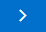 icon. Then, the databases are

         displayed in the **Available Databases** section.

       - To remove available databases from the project, select the databases that you want

         to remove in the **Available Databases** section and click the  icon. The

         databases are removed from the **Available Databases** section.

     - To add or remove iteration templates that are available in the project, click **View** next to **Available Iteration Templates**.

       - To add available iteration templates to the project, select the iteration templates

         that you want to add in the **All Iteration Templates** section and click the 

         icon. Then, the iteration templates are displayed in the **Available Iteration Templates** section.

       - To remove available iteration templates from the project, select the iteration templates that you want to remove in the **Available Iteration Templates** section

         and click the  icon. The iteration templates are removed from the **Available**

         **Iteration Templates** section.

   - Manage the members of the project.

     - To add an administrator to the project or remove an administrator from the project, click **Change** next to **Administrator** in the **Project Member Management** section.

     - To add a tester to the project or remove a tester from the project, click **Change** next to **Testers** in the **Project Member Management** section.

     - To add a participant to the project or remove a participant from the project, click **Change** next to **Participants** in the **Project Member Management** section.

   - Manage the project.

     - To create a similar project, click **Create As** in the upper-right corner. In the **Replicate Project** dialog box, set the **Name** and **Description** parameters. Then, click **OK**.

     - To view the operation records of the project, click **Operation History** in the upper-right corner. You can view the operation time, operator, and logs of each operation performed on the project.

     - To close the project, click **Close Project** in the upper-right corner. In the message that appears, click **OK**.

       > **Important**
       >
       > After the project is closed, you cannot open the project again.
       >
       > Proceed with caution.

<a id="section-6-8-3"></a>

### 6.8.3. Create an iteration template

The iteration template feature of Data Management (DMS) allows you to customize R&D processes and manage the quality of R&D processes. This feature can be used in combination with various types of tickets such as data change, schema design, and SQL review. This topic describes how to create and configure an iteration template.

**Procedure**

1. Log on to the DMS console.

2. In the top navigation bar, choose **Database Development > R&D Space > DevOps**.

3. Click the **Iteration Template** tab.

4. Click **Create Iteration Template**.

5. In the **Create Iteration Template** dialog box, set the following parameters and click **OK**.

   | Parameter | Description |
   | --- | --- |
   | Template Name | The name of the iteration template. |
   | Usage Scope | The scope within which the iteration template is available. Valid values:<br>• <strong>Available for All Users</strong>: This iteration template can be used by all the users of the current tenant.<br>• <strong>Specific Users</strong>: This iteration template can be used by only specific users. |
   | Description | The description of the iteration template. Enter an informative description that can help you manage the iteration template. |

6. Click the name of the iteration template that you created. The **Template Details** page appears.

7. Manage iterative stages based on your development requirements.

   - To create an iterative stage, click **Add** in the left-side pane and enter a name in the field.

     > **Note**
     >
     > If the current template has been associated with an iteration, you are not
     >
     > allowed to create an iteration stage.

   - To modify the name of an iterative stage, click the  icon next to it.

     > **Note**
     >
     > By default, a new iteration template contains two iterative stages: **Dev**
     >
     > and **Product**. These two stages can be modified and deleted.

   - To delete an iterative stage, click the  icon next to its name. In the dialog box that

     appears, click **OK**.

     > **Note**
     >
     > At least one iterative stage must be retained. If there is only one iterative
     >
     > stage left, you cannot delete it.

8. Configure stage rules. Click an iterative stage and configure rules for the stage. Repeat this step for each stage.

   <ol type="i">

   <li>

   Click the **Basic Rule Configuration** tab and configure the following rules.

   | Parameter | Description | Operation |
   | --- | --- | --- |
   | Database environment type | Specifies one or more types of environments to which databases belong. You can select the databases in the selected environments when you create tickets in the iterative stage. | Click the value in the Parameter column of the <strong>Database environment type</strong> rule. From the drop-down list, select one or more environment types. You can also remove the selected environment types. |
   | Stage promotion personnel authority | Specifies one or more types of users who have the permissions to advance the iteration to the next stage. | Click the value in the Parameter column of the <strong>Stage promotion personnel authority</strong> rule.From the drop-down list, select one or more user types. You can also remove the selected user types.<br>Note Only the creator and participants of an iteration can advance the iteration to the next stage. |
   | Fallback management | Specifies whether the iteration can be rolled back after it is advanced to the next stage. | Click the value in the Parameter column of the <strong>Fallback management</strong> rule. From the drop-down list, select <strong>Allow Rollback</strong> or <strong>Rollback</strong> <strong>not allowed</strong>.<br>Note The Fallback management rule is not displayed for the first iterative stage of the iteration template. |

   </li>

   <li>

   Click the **Tickets and Checkpoints** tab and configure rules for tickets.

   - To create a ticket rule, click **Create Ticket Rule**.

     - Select a ticket type from the **Ticket Type** drop-down list. Valid values:

       - **Data change**: data change tickets, including the Normal Data Modify, Lockless change, Data Import, and Programmable Object tickets.

       - **Schema Design**: schema design tickets.

       - **SQL Review**: SQL review tickets.

       - **Library table synchronization**: database and table synchronization tickets, including the Schema Synchronization and Empty Database Initialization tickets.

       > **Note**
       >
       > You can specify the types of tickets that can be created in the
       >
       > iterative stage.

     - Click a value in the **Required (Click Value to Modify)** column to select **Yes** or **No** from the drop-down list.

       - **Yes**: You must create a ticket of the specific type in the iterative stage. Otherwise, the iteration cannot advance to the next stage.

       - **No**: The iteration can advance to the next stage regardless of whether you create a ticket of the specific type in the iterative stage.

     - Click a value in the **Stage Status (Click Value to Modify)** column to select a ticket status from the drop-down list.

       | Parameter | Operation |
       | --- | --- |
       | Data change | • <strong>Do not check</strong>: You do not need to check the status of the ticket, and the iteration can advance to the next stage.<br>• <strong>Successful execution</strong>: The data change is performed, and the iteration can advance to the next stage.<br>• <strong>Closed</strong>: The ticket is closed, and the iteration can advance to the next stage. |
       | Schema Design | • <strong>Do not check</strong>: You do not need to check the status of the ticket, and the iteration can advance to the next stage.<br>• <strong>Design node completed</strong>: The iteration can advance to the next stage after the design node of the schema design ticket is complete.<br>• The nth node has been completed: The iteration can advance to the next stage after the nth node of the schema design ticket is complete.<br>Note<br>• Valid values of n: 1 to 7.<br>• To view the configuration of each node in a schema design ticket, go to the Details page of security rule set for the database that you want to manage and click the <strong>Schema Design</strong> tab. On this tab, find the <strong>R</strong> <strong>&amp; D process</strong> rule under the <strong>Basic Configuration</strong> <strong>Item</strong> checkpoint and click Edit in the Actions column.<br>• <strong>Published</strong>: The ticket is published, and the iteration can advance to the next stage.<br>• <strong>Work order closed</strong>: The schema design is complete, and the iteration can advance to the next stage.<br>• <strong>Closed</strong>: The ticket is closed, and the iteration can advance to the next stage. |
       | SQL Review | • <strong>Do not check</strong>: You do not need to check the status of the ticket, and the iteration can advance to the next stage.<br>• <strong>Audit successful</strong>: The SQL review is complete, and the iteration can advance to the next stage. |
       | Library table synchronization | • <strong>Do not check</strong>: You do not need to check the status of the ticket, and the iteration can advance to the next stage.<br>• <strong>Successful execution</strong>: The synchronization is performed, and the iteration can advance to the next stage.<br>• <strong>Closed</strong>: The ticket is closed, and the iteration can advance to the next stage. |

       > **Note**
       >
       > You can select multiple ticket states that allow the iteration to
       >
       > advance to the next stage based on your requirements.

   - To delete a ticket rule, click **Delete** in the Actions column.

   </li>

   <li>

   Click the **Procedure and Approval** tab and configure rules for approval processes.

   </li>

   </ol>

   | Rule Name | Description | Operation |
   | --- | --- | --- |
   | Non-compliance status check | The action to take if the status of the ticket does not meet the requirements of the iteration template. | Click the value in the Parameter column of the <strong>Non-</strong><strong>compliance status check</strong> rule. Select an action to take from the drop-down list. Valid values:<br>• <strong>No propulsion allowed</strong>: does not allow the iteration to advance to the next stage.<br>• <strong>Can be promoted and requires approval</strong>: allows the iteration to advance to the next stage after approval. |
   | Compliance check | The action to take if the status of the ticket meets the requirements of the iteration template. | Click the value in the Parameter column of the <strong>Compliance check</strong> rule. Select an action to take from the drop-down list. Valid values:<br>• <strong>Can be promoted without approval</strong>: allows the iteration to advance to the next stage without approval.<br>• <strong>Can be promoted and requires approval</strong>: allows the iteration to advance to the next stage after approval. |

<a id="section-7"></a>

# 7.Data factory

<a id="section-7-1"></a>

## 7.1. Task orchestration (new)

<a id="section-7-1-1"></a>

### 7.1.1. Orchestrate tasks

Data Management (DMS) provides the task orchestration feature. You can use this feature to orchestrate different types of tasks, and then schedule and run the tasks. You can create a task flow that contains one or more task nodes to implement complex scheduling and improve data development efficiency.

**Prerequisites**

- One of the following types of databases is used:

  - MySQL: ApsaraDB RDS for MySQL, PolarDB for Xscale, AnalyticDB for MySQL V3.0, and MySQL databases from other sources

  - SQL Server: ApsaraDB RDS for SQL Server and SQL Server databases from other sources

  - PostgreSQL: ApsaraDB RDS for PostgreSQL, AnalyticDB for PostgreSQL, and PostgreSQL databases from other sources

  - Oracle

  - PolarDB for Oracle

  - Dameng (DM)

  - OceanBase

  - Impala

- The database instance is registered with DMS. For more information, see Register a database instance.

- You are a DMS administrator, a database administrator (DBA), or a security administrator.

**Procedure**

1. Log on to the DMS console.

2. In the top navigation bar, choose **DTS > Task Orchestration**.

3. Create a task flow.

   <ol type="i">

   <li>

   Click **Create Task Flow**.

   </li>

   <li>

   In the **New Task Flow** dialog box, configure the **Task Flow Name** and **Description**

   </li>

   </ol>

   parameters.

   <ol type="i" start="3">

   <li>

   Click **OK**.

   </li>

   </ol>

4. In the **Task Type** list on the left side of the canvas, drag a task node to the blank area on the canvas.

5. Double-click the task node. On the tab that appears, configure the parameters.

   > **Note**
   >
   > In this example, an SQL Assignment for Single Instance node is used.

   | Parame ter or setting | Description |
   | --- | --- |
   | Databas e | Select your database from the Database drop-down list. You can also enter a keyword to search for the database.<br>Note<br>• You must have the read and write permissions on the selected database.<br>• You can click the <strong>Metadata</strong> tab in the right-side navigation pane to view the schemas of tables in the database.<br>• If you select a database instance that is not managed in Security Collaboration mode, the task may fail to be run when the password or permissions of the account that is used to log on to the database are changed. In this case, you must save the node configurations and log on to the database again. |
   | SQL editor | Write SQL statements by using the syntax of the selected database. You can preview the SQL code at any time while you are writing the SQL code. |
   | Variable Setting tab | • Click the <strong>Variable Setting</strong> tab, click <strong>Node Variable</strong>, and then configure node variables. For more information, see Configure time variables.<br>• Click <strong>Task Flow Variable</strong> and configure task flow variables. For more information, see Configure time variables.<br>• Click <strong>Input Variables</strong> and view the variables automatically obtained by the system, which include upstream variables, task states, and system variables.<br>• Click <strong>Task Flow Constants</strong> and configure task flow constraints. A task flow constant is a static field, which can be used on all nodes. In SQL statements, the format of a task flow constant is <code> ${name} </code>. |
   | Metadat a tab | You can view the tables and fields in the selected database. |
   | Advance d Settings tab | You can configure the priority and rerun settings for the task node. Configure the parameters such as Task Priority and Longest Lock Wait Duration. |
   | Data Lineage tab | You can view the source database of the input table and the source database of the output table. |

6. Connect the task node to its upstream and downstream nodes. Move the pointer over an upstream node, click and hold the circle on the right side of the upstream node, and then draw a line from the circle to a downstream node. In the following example, a **Check Whether Data Exists in Table After Specified Time** node is connected to a **Single Instance SQL** node. Move the pointer over the **Check Whether Data Exists in Table After Specified Time** node, click and hold the circle on the right side of the **Check Whether Data Exists in Table After Specified Time** node, and then draw a line from the circle to the **Single Instance SQL** node.

   > **Note**
   >
   > In the task flow shown in the preceding figure, the Check Whether Data
   >
   > Exists in Table After Specified Time node is run before the Single Instance SQL node.

7. **Optional:** Click the blank area of the canvas to configure the task flow.

   <ol type="i">

   <li>

   Configure basic properties. Click the **Task Flow Information** tab. In the **Properties** section, modify the parameters such as **Task Flow Name**, **Owner**, and **Stakeholders**.

   </li>

   <li>

   In the **Scheduling Settings** section, turn on **Enable Scheduling** to configure the

   </li>

   </ol>

   scheduling properties for the task flow. For more information, see the Scheduling settings section of this topic.

8. Click **Try Run**.

   - If  `status SUCCEEDED`  appears in the last line of run logs, the test run is successful.

   - If  `status FAILED`  appears in the last line of run logs, the test run fails.

     > **Note**
     >
     > If the test run fails, view the node on which the failure occurs and the
     >
     > reason for the failure in the logs. Then, modify the configurations of the node and try again.

9. **Optional:** Publish the task flow. For more information, see Publish a task flow.

**Task node types**

<table>
  <tr>
    <th>Section</th>
    <th>Task node type</th>
    <th>Description</th>
  </tr>
  <tr>
    <td rowspan="3">Data Processing Nodes</td>
    <td>Single Instance SQL</td>
    <td>Executes SQL statements in a specific relational database.</td>
  </tr>
  <tr>
    <td>Impala SQL</td>
    <td>Submits Impala SQL statements by using Single Instance SQL or Impala SQL nodes.</td>
  </tr>
  <tr>
    <td>Lock-free Data Change</td>
    <td>Uses the lock-free data change feature of DMS to perform related operations such as UPDATE and DELETE operations.</td>
  </tr>
  <tr>
    <td rowspan="3">General Nodes</td>
    <td>SQL Assignment for Single Instance</td>
    <td>Assigns the data that is obtained by using the SELECT statement to the output variables of the current node.The output variables can be used as the input variables of the downstream node.</td>
  </tr>
  <tr>
    <td>Conditional Branch</td>
    <td>Makes conditional judgement in task flows. When a task flow is run, if the conditional expression of a Conditional Branch node evaluates to true, the subsequent tasks are run. Otherwise, the subsequent tasks are not run.</td>
  </tr>
  <tr>
    <td>SSH Command</td>
    <td>Uses SSH commands to run a script after you configure a machine or machine cluster.</td>
  </tr>
  <tr>
    <td rowspan="3">Status Checking Nodes</td>
    <td>Check Whether Data Exists in Table After Specified Time</td>
    <td>Checks whether incremental data exists in a table after a specific point in time.</td>
  </tr>
  <tr>
    <td>SQL Status Check</td>
    <td>Checks the status of data by using SQL statements. For example, you can check whether more than 10 boys are in the class.</td>
  </tr>
  <tr>
    <td>Check for Task Flow Dependency</td>
    <td>Configures self-dependency for a task flow and dependencies across task flows. You can configure the task flow to depend on another task flow or a task node.</td>
  </tr>
</table>

**Scheduling settings**

| Parameter or setting | Description |
| --- | --- |
| Scheduling Type | The scheduling type of the task flow. Valid values:<br>• <strong>Timed Scheduling / Cyclic scheduling</strong>: The task flow is periodically scheduled. For example, the task flow is run once a week.<br>• <strong>Timed Scheduling / Schedule once</strong>: The task flow is run once at a specific point in time. You need to specify only the point in time when the task flow is run.<br>• <strong>Event Scheduling</strong>: Task Flow A and Task Flow B are configured. Task Flow A depends on Task Flow B. After Task Flow B is run, Task Flow A is scheduled and run. |
| Transaction Calendar | The transaction calendar used to specify the dates on which the task flow is scheduled and run. For information about how to upload a transaction calendar, see the Upload a transaction calendar section of this topic. |
| Timeout Period | The period after which the scheduling times out. This parameter is displayed only if you set the Scheduling Type parameter to Event Scheduling. |
| Add an event for a task flow or task node | This parameter is displayed only if you set the Scheduling Type parameter to Event Scheduling. |
| Effective Time | The period during which the scheduling properties take effect. The default time period is from January 1, 1970 to January 1, 9999, which indicates that the scheduling properties permanently take effect. |
| Scheduling Cycle | The scheduling cycle of the task flow. Valid values:<br>• <strong>Day</strong>: The task flow is run at the specified point in time every day. If you select this value, you must configure the Specific Point in Time parameter.<br>• <strong>Week</strong>: The task flow is run at the specified point in time on the days that you select every week. If you select this value, you must configure the Specified Time and Specific Point in Time parameters.<br>• <strong>Month</strong>: The task flow is run at the specified point in time on the days that you select every month. If you select this value, you must configure the Specified Time and Specific Point in Time parameters. |
| Specified Time | • If you set the Scheduling Cycle parameter to Week, you can select one or more days of a week from the drop-down list.<br>• If you set the Scheduling Cycle parameter to Month, you can select one or more days of a month from the drop-down list. |
| Specific Point in Time | The point in time of the specified days at which the task flow is run.<br>For example, if you set this parameter to 02:55, DMS runs the task flow at 02:55 on the specified days. |
| Cron Expression | The CRON expression that is automatically generated based on the specified scheduling cycle and time settings. |

**Upload a transaction calendar**

1. Log on to the DMS console.

2. In the top navigation bar, choose **O&M > Task Orchestration**.

3. Click the **Transaction Calendars** tab.

4. Click **New**. In the **Add Transaction Market** dialog box, configure the **Transaction Market Name** and **Description** parameters.

5. Click **OK**. After you create a transaction market, you can modify the transaction market name, delete the transaction market, and view transaction calendar details.

6. Click **Upload Transaction Calendar**. In the dialog box that appears, configure the following parameters: **Year**, **Time Column**, **Effective Column**, and **File**. For the Time Column parameter, enter a name for the time column, in the YYYY-MM-DD or YYYY/MM/DD format.

   > **Note**
   >
   > If you upload a transaction calendar of the same year as an existing
   >
   > calendar, the existing calendar is overwritten.

7. Click **OK**.

<a id="section-7-1-2"></a>

### 7.1.2. Run a script by using SSH after you configure a machine or machine cluster

After you configure a machine or machine cluster, Data Management (DMS) allows you to run a script by using SSH commands when you use the task orchestration feature.

**Prerequisites**

You are a DMS administrator or a database administrator (DBA).

**Step 1: Obtain the machine IP address**

You must obtain the IP address of a machine that is in the same network environment as DMS.

- If your machine runs Linux, run the  `ifconfig`  command to obtain the machine IP address.

- If your machine runs Windows, run the  `ipconfig`  command to obtain the machine IP address.

**Step 2: Add a machine or machine cluster in the DMS console**

1. Log on to the DMS console.

2. In the top navigation bar, choose **Data Assets > Machines**.

3. Add a machine.

   <ol type="i">

   <li>

   Click the **Machines** tab.

   </li>

   <li>

   Click **Add**. In the **Add Machine** dialog box, configure the following parameters: **Name**,

   </li>

   </ol>

   **Machine IP Address**, **SSH Port**, **User name**, and Password.

   <ol type="i" start="3">

   <li>

   Click **Test connection**.

   </li>

   </ol>

   If the test fails, check the parameter values that you specify based on the error message.

   <ol type="i" start="4">

   <li>

   Click **OK**.

   </li>

   </ol>

4. Add a machine cluster.

   <ol type="i">

   <li>

   Click the **Machines** tab.

   </li>

   </ol>

5. Click the **Machine Clusters** tab.

6. Click **Add**. In the **Add Machine Cluster** dialog box, configure the **Cluster Name**, **Primary Machine**, and Secondary Machine parameters.

7. Click **OK**.

**Step 3: Run a script by using SSH**

1. Log on to the DMS console.

2. In the top navigation bar, choose **DTS > Task Orchestration**.

3. Create a task flow.

   <ol type="i">

   <li>

   Click **Create Task Flow**.

   </li>

   <li>

   In the **New Task Flow** dialog box, configure the **Task Flow Name** and **Description**

   </li>

   </ol>

   parameters.

   <ol type="i" start="3">

   <li>

   Click **OK**.

   </li>

   </ol>

4. In the **Task Type** list on the left side of the canvas, drag the **SSH Command** node to the blank area of the canvas.

5. Double-click the **SSH Command** node. On the tab that appears, configure the following parameters: **Machine Clusters**, **Character Set**, and **Command Settings**. For example, enter  `echo 123`  in the Command Settings section.

6. Click **Try Run**.

   - If the expected result is returned and  `status SUCCEEDED`  appears in the last line of run logs, the test run is successful.

   - If  `status FAILED`  appears in the last line of run logs, the test run fails.

     > **Note**
     >
     > If the test run fails, view the node on which the failure occurs and the
     >
     > reason for the failure in the logs. Then, modify the configurations of the node and try again.

7. **Optional:** Publish the task flow. For more information, see Publish a task flow.

<a id="section-7-1-3"></a>

### 7.1.3. Configure concurrency control for a task flow

Data Management (DMS) provides the concurrency control and priority control features for database instances. When you use the task orchestration feature, you can configure concurrency control and task priorities for task flows.

**Prerequisites**

You are a DMS administrator or a database administrator (DBA).

**Procedure**

**Step 1: Create a concurrency configuration task**

1. Log on to the DMS console.

2. In the top navigation bar, choose **O&M > Monitoring and Assurance**.

3. Click **New**. In the **Add ID Mapping** dialog box, configure the **Resource Type**, **Resources**, **Resource Quota**, and **Description** parameters.

4. Click **OK**.

**Step 2: Create a task flow and configure task priorities**

1. Log on to the DMS console.

2. In the top navigation bar, choose **DTS > Task Orchestration**.

3. Create and configure a task flow.

   <ol type="i">

   <li>

   Click **Create Task Flow**.

   </li>

   <li>

   In the **New Task Flow** dialog box, configure the **Task Flow Name** and **Description**

   </li>

   </ol>

   parameters.

   <ol type="i" start="3">

   <li>

   Click **OK**.

   </li>

   <li>

   In the Task Type list, drag the **Single Instance SQL** node to the blank area of the canvas. For example, drag three Single Instance SQL nodes to the canvas. The nodes are named Single Instance SQL-1, Single Instance SQL-2, and Single Instance SQL-3 in sequence.

   </li>

   <li>

   Double-click a node that you want to configure. On the tab that appears, select the resources that you configure in Step 1 and write the  `SET @a=1;`  statement in the SQL editor.

   </li>

   <li>

   In the right-side navigation pane, click the **Advanced Settings** tab. Turn on **Enable Priority** and configure the **Task Priority** parameter. In this example, the Task Priority parameter is set to 7, 8, and 9 in sequence for the three nodes. You can use the default value or specify a value for the **Longest Lock Wait Duration** parameter.

   </li>

   <li>

   Turn on or off **Enable re-run of failed task** based on your business requirements.

   </li>

   </ol>

4. Click **Try Run**. If  `The resource quota has been reached, and the task will be in queue..Current Running Count:N`  appears in run logs, the nodes in the task flow are run in sequence based on the priority.

   - If  `status SUCCEEDED`  appears in the last line of run logs, the test run is successful.

   - If  `status FAILED`  appears in the last line of run logs, the test run fails.

     > **Note**
     >
     > If the test run fails, view the node on which the failure occurs and the
     >
     > reason for the failure in the logs. Then, modify the configurations of the node and try again.

5. <strong>Optional:</strong>Publish the task flow. For more information, see Publish a task flow.

<a id="section-7-1-4"></a>

### 7.1.4. Configure an Impala SQL node

You can submit Impala SQL statements by using Single Instance SQL or Impala SQL nodes.

**Prerequisites**

- An Impala database is created.

- The Impala database is registered with Data Management (DMS). For more information, see Register a database instance.

  > **Note**
  >
  > If you want to register an Impala database with DMS and select Kerberos as
  >
  > the authentication method, you must prepare the krb5.conf and keytab files to be uploaded to DMS before you register the database.

**Procedure**

1. Log on to the DMS console.

2. In the top navigation bar, choose **DTS > Task Orchestration**.

3. Create a task flow.

   <ol type="i">

   <li>

   Click **Create Task Flow**.

   </li>

   <li>

   In the **New Task Flow** dialog box, configure the **Task Flow Name** and **Description**

   </li>

   </ol>

   parameters.

   <ol type="i" start="3">

   <li>

   Click **OK**.

   </li>

   </ol>

4. In the **Task Type** list on the left side of the canvas, drag the **Impala SQL** node to the blank area of the canvas.

5. Double-click the **Impala SQL** node. On the tab that appears, select the Impala database that you created and write SQL statements.

   The following SQL statement provides an example on how to create a table:

   ```sql
   create table if not exists abcd(id int);
   ```

6. Click **Try Run**.

   - If  `status SUCCEEDED`  appears in the last line of run logs, the test run is successful.

   - If  `status FAILED`  appears in the last line of run logs, the test run fails.

     > **Note**
     >
     > If the test run fails, view the node on which the failure occurs and the
     >
     > reason for the failure in the logs. Then, modify the configurations of the node and try again.

7. **Optional:** Publish the task flow. For more information, see Publish a task flow.

<a id="section-7-1-5"></a>

### 7.1.5. Configure a data flow

Data Management (DMS) provides the batch integration feature that allows you to combine various task nodes to form a data flow and configure periodic scheduling to process or synchronize data. This topic describes how to configure a data flow.

**Limits**

The databases to be used in a data flow must be of the following types:

- MySQL: ApsaraDB RDS for MySQL, PolarDB for MySQL, MyBase for MySQL, , AnalyticDB for MySQL V3.0, and MySQL databases that are not on Alibaba Cloud

- SQL Server: ApsaraDB RDS for SQL Server, MyBase for SQL Server, and SQL Server databases that are not on Alibaba Cloud

- PostgreSQL: ApsaraDB RDS for PostgreSQL, PolarDB for PostgreSQL, MyBase for PostgreSQL, AnalyticDB for PostgreSQL, and PostgreSQL databases that are not on Alibaba Cloud

- Oracle

- Db2

- MaxCompute

- Hologres

  > **Note**
  >
  > Hologres databases can be used only to configure Data Import nodes.

- OSS

  > **Note**
  >
  > OSS buckets can be used only to configure Data Output nodes.

**Procedure**

1. Log on to the DMS console.

2. In the top navigation bar, choose **Data+AI > Data Integration > Batch Integration**.

   > **Note**
   >
   > If you use the DMS console in simple mode, move the pointer over the
   >
   > icon in the
   >
   > 
   >
   > upper-left corner and choose **All Features > Data+AI > Data Integration > Batch Integration**.

3. Click the name of the data flow that you want to configure to go to the details page of the data flow.

4. Configure a Data Import node.

   > **Note**
   >
   > The first node of the data flow must be a **Data Import** node, which specifies the source table from which the data flow reads data.

   <ol type="i">

   <li>

   In the **Task Type** list on the left side of the canvas, drag the **Data Import** node to the blank area on the canvas.

   </li>

   <li>

   Click the **Data Import** node on the canvas. On the **Source of data** tab in the lower part,

   </li>

   </ol>

   configure the parameters that are described in the following table.

   | Parameter | Description |
   | --- | --- |
   | Database Type | The type of the database from which the data flow reads data. |
   | Database | a. The name of the database from which the data flow reads data. Enter a keyword to search for databases and select the source database from the drop-down list.<br>b. If you have not logged on to the database, configure the <strong>Database</strong> <strong>Account</strong> and <strong>Database password</strong> parameters in the <strong>Login Instance</strong> dialog box. |
   | Table | The name of the table from which the data flow reads data. |

5. Configure a data processing node. In this example, a Data Filtering node is configured to filter data in the data source.

   > **Note**
   >
   > All nodes except **Data Import** and **Data Output** nodes can be configured as data processing nodes.

   <ol type="i">

   <li>

   In the **Task Type** list on the left side of the canvas, drag the **Data Filtering** node to the blank area on the canvas.

   </li>

   <li>

   Move the pointer over the **Data Import** node, click the hollow circle on the right side of

   </li>

   </ol>

   the Data Import node, and then drag the connection line to the **Data Filtering** node.

   <ol type="i" start="3">

   <li>

   Click the **Data Filtering** node on the canvas. On the **Data Filtering** tab in the lower

   </li>

   </ol>

   part, configure the **Filter Expressions** parameter.

   For example, you can enter  `name='Jack'`  in the field as a filter condition.

   > **Note**
   >
   > You can also double-click a function on the right side of the Data Filtering tab to specify filter conditions.

6. Configure a Data Output node.

   > **Note**
   >
   > The last node of the data flow must be a **Data Output** node, which specifies the destination table to which the processed data is written.

   <ol type="i">

   <li>

   In the **Task Type** list on the left side of the canvas, drag the **Data Output** node to the blank area on the canvas.

   </li>

   <li>

   Click the **Data Output** node on the canvas. On the **Data Output** tab in the lower part,

   </li>

   </ol>

   configure the parameters based on your business requirements.

   - The following table describes the parameters that you can configure if the data output is a database.

     | Parameter | Description |
     | --- | --- |
     | Database Type | The type of the database in which the destination table resides. |
     | Database | The name of the database in which the destination table resides. Enter a keyword to search for databases and select the destination database from the drop-down list.<br>Note<br>If you have not logged on to the database, configure the Database Account and Database password parameters in the <strong>Login Instance</strong> dialog box. |
     | Table name | The destination table to which the data flow writes the processed data.Enter the name of an existing table or a new table. |
     | SQL Statements Executed Before Writing | The SQL statements to be executed before the data is written. |
     | SQL Statements Executed After Writing | The SQL statements to be executed after the data is written. |
     | Automatic Table Creation | Specifies whether to automatically create a table as the destination table if the specified destination table does not exist. You can turn on or off <strong>Automatic Table Creation</strong>.<br>• Turn off: does not automatically create a table as the destination table.In this case, the data flow fails to run.<br>• Turn on: automatically creates a table as the destination table. In this case, the data flow continues to run. |

   - The following table describes the parameters that you can configure if the data output is an OSS bucket.

     | Parameter | Description |
     | --- | --- |
     | Database Type | The type of the database in which the destination table resides. In this example, OSS is selected. |
     | OSS Bucket | The OSS bucket in which the destination table resides. Enter a keyword to search for OSS buckets and select the destination bucket from the drop-down list. |
     | OSS Directory | The path in which data is stored in the OSS bucket. |
     | Table name | The destination table to which the data flow writes the processed data. Enter the name of an existing table or a new table. |
     | Overwrite Destination Table | Specifies whether to overwrite the existing data in the specified destination table. You can turn on or off <strong>Overwrite Destination Table</strong>.<br>• Turn off: writes data to the destination table.<br>• Turn on: clears the existing data in the destination table or a partition, and then writes data. |
     | File Format | The storage format of the destination table.<br>Valid values: parquet, orc, avro, and csv. |
     | Compress | The compression format of the destination table. |
     | Partition | The partition key of the destination table. You can use the value of the partition key to query the data that you need.<br>Note<br>You can configure this parameter only after you configure the Data Import node and connect the nodes on the canvas. |

   <ol type="i" start="3">

   <li>

   Move the pointer over the **Data Filtering** node, click the hollow circle on the right side of

   </li>

   </ol>

   the Data Filtering node, and then drag the connection line to the **Data Output** node.

   Then, the  icon on the right side of the nodes disappears. This indicates that the

   dependencies of the nodes in the data flow are configured.

<a id="section-7-1-6"></a>

### 7.1.6. Configure variables

This topic describes the variables that are used in the task orchestration feature and how to configure time variables.

**Overview**

When you configure a task node in a task flow, you can configure some or all of the following types of variables on the **Variable Setting** tab:

- Node variables are time variables that can be used only on the current node.

- Task flow variables are time variables that can be used on all nodes of the current task flow.

  > **Note**
  >
  > You can configure task flow variables on one of the task nodes in a task
  >
  > flow. Then, the configuration of task flow variables is synchronized to other task nodes in the task flow.

- Input variables are automatically obtained by Data Management (DMS). You can use ${var_name} to reference an input variable in SQL statements for the current node. You can also use an input variable as a filter condition for a conditional branch node. The following variables are considered as input variables:

  - Upstream variables: the output variables from upstream nodes.

  - Status variables: For more information, see the Status variables section of this topic.

  - System variables: For more information, see the System variables section of this topic.

- Output variables: the variables that are defined and have their values assigned on the current node. Output variables can be accessed and referenced by the downstream nodes of the current node.

  For example, if you configure an output variable on a Script node, the output variable can be referenced in the SQL statements of a downstream node.

- Script output variables: If the last line of the script file is a JSON string in the format of  `{ key1: value1, key2: value2, … }`  for a Script node, the script task parses the key-value pairs in the JSON string to obtain output variables. For each variable, the name is *key* and value is the value of the key parameter. You can reference a script output variable in the format of  `${key}`  in the SQL statements of a downstream node.

  For example, if the last line of the script file is  `echo {"hello": "world"}` , the script task parses the key-value pair to obtain an output variable whose name is *hello* and value is world.

**Configure time variables**

| Parameter | Description |
| --- | --- |
| Variable Name | The name of the custom time variable.<br>Note To delete a configured variable, click theicon. |

<table>
  <tr>
    <td>Variable Rule</td>
    <td>The time format and time offset configurations of the custom time variable.<br>• <strong>Time Format</strong>: the required time format of the time variable. For more information about time formats, see the Time formats section of this topic.<br>• Time offset: A time variable is defined based on the value of the bizdate variable that indicates one day before the current date.<br>For example, you have created a variable named <code> 6_month_ago </code> in the yyyy-MM-dd format and set the offset to "- 6 Month". In this case, if the current date is August 12, 2021, the value of the <code> ${6_month_ago} </code> variable is 2021-02-11, which indicates February 11, 2021.<br>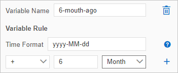<br>Note After you configure a time variable, you can reference the variable in the <code> ${Variable name} </code> format in the SQL statement that you enter in the SQL editor to the right of the Variable Setting tab. You can also click <strong>SQLPreview</strong> to view the value of the time variable.</td>
  </tr>
</table>

**Time formats**

The following table describes the time formats that variables support.

| Time variable | Description | Sample format | Sample value |
| --- | --- | --- | --- |
| Anno Domini (AD) | G indicates AD. | Gyyyy | AD 2021 |
| Year | • y or yyyy: the year of the current day.<br>• yy: the last two digits of the year.<br>• Y: the year of the last day in the current week. The last day of the week is Sunday. | yyyy | 2021 |
| Month | M: the month of the current year. Valid values of M: \[1,12\]. Valid values of MM: \[01,12\].，MMM将返回一月至十二月 | MM | 08 |
| Week | • w: the week of the current year. Valid values of w: \[1,52\]. Valid values of ww: \[01,52\].<br>• W: the week of the current month. Valid values: \[1,5\]. | ww | 13 |
| Day | • D: the day of the current year. Valid values of D: \[1,365\]. Valid values of DD: \[01,365\]. Valid values of DDD: \[001,365\].<br>• d: the day of the current month. Valid values of d: \[1,31\]. Valid values of dd: \[01,31\]. | D | 360 |
| Day of the week | • E: the day of the week. Valid values: Monday to Sunday.<br>• e: the number that indicates the day of the week. Valid values: \[1,7\]. A value of 1 indicates Monday.<br>Note To count Sunday as the first day of the week, you can set the offset to "+ 1 Day". | e | 1 |
| Ante meridiem (AM) or post meridiem (PM) | a: indicates whether the point in time is before or after the midday. If the point in time is in the range of 00:00 to 11:59, the return value is AM. If the point in time is in the range of 12:00 to 23:59, the return value is PM. | a | AM |
| Hours | • H: the hour of the current day. A value of 0 indicates the first hour of the day. Valid values of H: \[0,23\]. Valid values of HH: \[00,23\].<br>• h: the hour of the half day. A value of 1 indicates the first hour of the half day. Valid values of h: \[1,12\].Valid values of hh: \[01,12\].<br>• K: the hour of the half day. A value of 0 indicates the first hour of the half day. Valid values of K: \[0,11\].Valid values of KK: \[00,11\].<br>• k: the hour of the current day. A value of 1 indicates the first hour of the day. Valid values of k: \[1,24\]. Valid values of kk: \[01,24\]. | HH | 10 |
| Minute | m: the minute of the hour. Valid values of m: \[0,59\]. Valid values of mm: \[00,59\]. | m | 27 |
| Seconds | • s: the second of the minute.<br>• S: the millisecond of the minute. | ss | 08 |
| Time zone | z: the time zone. | z | UTC+08:00 |

The following table describes the sample time formats that use multiple time variables.

| Sample format | Sample value |
| --- | --- |
| <code>yyyy-MM-dd</code> | 2021-08-12 |
| <code>yyyyMM01</code> | 20210801 |
| <code>HH:mm:ss</code> | 11:05:21 |
| <code>yyyyMMdd HH:mm:ss</code> | 20210812 11:05:21 |

**Status variables**

| Status variable | Description |
| --- | --- |
| all_success | All of the tasks are run. |
| all_failed | All of the tasks fail to be run. |
| one_success | A task of the current task flow is run. |
| one_failed | A task of the current task flow fails to be run. |

> **Note**
>
> You can use status variables on a conditional branch node to make a
>
> conditional evaluation in a task flow. The subsequent tasks in the task flow can be run only if the conditional branch node meets the specified conditions.

**System variables**

| System variable | Description | Sample value |
| --- | --- | --- |
| sys.flow.start.tim estamp | The timestamp generated when the task is run. | 2021-05-24T11:20:07.562+08:00 |
| sys.flow.start.yea r | The year when the task is run. | 2021 |
| sys.flow.start.mo nth | The month of the year when the task is run. | 5 |
| sys.flow.start.day | The day of the month when the task is run. | 24 |
| sys.flow.start.hou r | The hour of the day when the task is run. | 11 |
| sys.flow.start.min ute | The minute of the hour when the task is run. | 20 |
| sys.flow.start.sec ond | The second of the minute when the task is run. | 7 |
| sys.flow.start.milli seconds | The millisecond of the second when the task is run. | 562 |
| sys.flow.start.tim ezone | The time zone. | Asia/Shanghai |
| sys.flow.biztime | The data timestamp. By default, the data timestamp is one day before the day when the task is run. | 1621740007562 |
| sys.flow.name | The name of the task flow. | dwd_activityDailyPV |
| sys.node.name | The name of the node in a task flow. | Single Instance SQL-1 |

<a id="section-7-1-7"></a>

### 7.1.7. Publish a task flow

After you configure or modify a task flow, you must publish the latest task flow. This prevents the modified task flow from being published before the modifications to the task flow are confirmed.

1. Log on to the DMS console.

2. In the top navigation bar, choose **DTS > Task Orchestration**.

3. Click the name of the task flow that you want to manage to go to the details page of the task flow.

4. <strong>Optional:</strong>Test the running of the task flow.

   <ol type="i">

   <li>

   In the upper-left corner of the canvas, click **Try Run**.

   </li>

   <li>

   In the **Alert** message, click **OK**.

   </li>

   <li>

   In the lower part of the canvas, click the **Execution Logs** tab and check whether the task

   </li>

   </ol>

   flow is successfully run.

   - If  `status SUCCEEDED`  appears in the last line of run logs, the task flow is successfully run.

   - If  `status FAILED`  appears in the last line of run logs, the task flow fails to be run.

     > **Note**
     >
     > If the task flow fails to be run, view the node on which the failure
     >
     > occurs and the reason for the failure in the logs. Then, modify the configurations of the node and try again.

5. Publish the task flow.

   > **Note**
   >
   > Before you publish a task flow, move the pointer over **Publish** in the
   >
   > upper-left corner of the canvas to check whether the task flow is modified. If the task flow is modified, the **The task flow is modified. You must republish the task flow to make the modification take effect** message appears.

   <ol type="i">

   <li>

   In the upper-left corner of the canvas, click **Publish**.

   </li>

   <li>

   In the **Publish** dialog box, perform the following operations based on your business

   </li>

   </ol>

   requirements:

   - Enter the description of the task flow in the **Remarks** field and click **Publish** to publish the task flow.

   - Click **Display differences** to view the differences between the unpublished version and published version of the task flow, including properties, node configurations, and SQL statements.

6. <strong>Optional:</strong>Unpublish the task flow. If you do not need to schedule a task flow on a scheduled or periodic basis, you can unpublish the task flow.

   <ol type="i">

   <li>

   In the upper-left corner of the canvas, click **Unpublish**.

   </li>

   <li>

   In the **Unpublish** message, click **Unpublish**.

   </li>

   </ol>

7. <strong>Optional:</strong>View the status of the task flow.

   <ol type="i">

   <li>

   In the upper-right corner of the canvas, click **Go to O&M**.

   </li>

   <li>

   On the right side of the page, check whether the task flow is published based on the

   </li>

   </ol>

   value of the **Released** parameter. Valid values:

   - **Published**: The task flow is published.

   - **Not published**: The task flow is not published.

   On this page, you can also export information about the current version of the task flow, add data to the current version of the task flow, and view the details of the current version of the task flow.

<a id="section-7-2"></a>

## 7.2. Data migration, data synchronization, and change tracking

This topic describes the data migration, data synchronization, and change tracking features of Data Transmission Service (DTS) integrated into Data Management (DMS).

**Features**

DMS integrates the data migration, data synchronization, and change tracking features of DTS.

- Data migration

  You can use DTS to migrate data between homogeneous and heterogeneous data sources. This feature is suitable for the following scenarios: data migration to Alibaba Cloud, data migration between instances on Alibaba Cloud, and database splitting and scale-out.

- Data synchronization

  You can use DTS to synchronize data between data sources in real time. This feature is suitable for the following scenarios: active geo-redundancy, geo-disaster recovery, zone-disaster recovery, cross-border data synchronization, query load balancing, cloud-based business intelligence (BI) systems, and real-time data warehousing.

- Change tracking

  You can use DTS to track incremental data from ApsaraDB RDS for MySQL instances, PolarDB for MySQL instances, PolarDB-X instances, self-managed MySQL databases, and self-managed Oracle databases in real time. Then, you can consume the tracked data as needed. This feature is suitable for the following scenarios: cache updates, business decoupling and asynchronous data processing, real-time data synchronization between heterogeneous databases, and real-time data synchronization that involves extract, transform, and load (ETL) operations.

**Procedure**

1. Log on to the DMS console.

2. In the top navigation bar, click **DTS**.

3. Create a data migration, data synchronization, or change tracking task.

   - Data migration

     <ol type="a">

     <li>

     In the left-side navigation pane, click **Data Migration**.

     </li>

     <li>

     On the Data Migration page of the DTS console, create a data migration task. For more information, see *Data migration* in the *DTS documentation*.

     </li>

     </ol>

   - Data synchronization

     <ol type="a">

     <li>

     In the left-side navigation pane, click **Data Synchronization**.

     </li>

     <li>

     On the Data Synchronization page of the DTS console, create a data synchronization task. For more information, see *Data synchronization* in the *DTS documentation*.

     </li>

     </ol>

   - Change tracking

     <ol type="a">

     <li>

     In the left-side navigation pane, click **Change Tracking**.

     </li>

     <li>

     On the Change Tracking page of the DTS console, create a change tracking task. For more information, see *Change tracking* in the *DTS documentation*.

     </li>

     </ol>

<a id="section-7-3"></a>

## 7.3. Data service

<a id="section-7-3-1"></a>

### 7.3.1. Overview

Data Management (DMS) provides the data service feature, which allows you to export the data that is managed by DMS. This feature is applicable to scenarios where you need to export data at the column or row level, display data in a visualized manner, or perform complex analysis.

**Features**

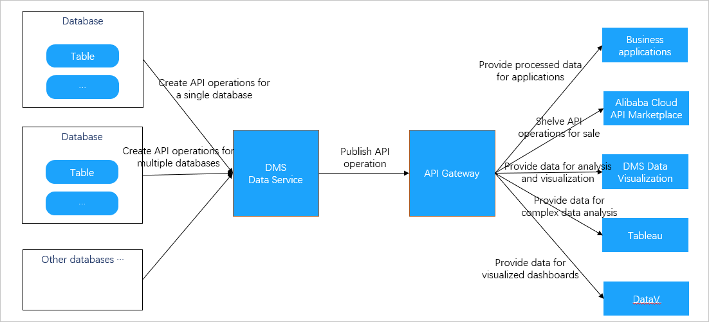

- You can use the data service feature to create APIs that can be called to access the data that is managed by DMS. When you create the APIs, you can apply the security control features that are used for SQL execution in the SQLConsole, such as permission control and data de-identification.

- The data service feature works based on a serverless architecture. This feature frees you from the concern about the infrastructure of the runtime environment, such as servers and networks. You need to focus only on how to create APIs and design data query logic. This avoids operations and maintenance (O&M) overheads that are generated by using traditional architectures.

- The data service feature is fully integrated with API Gateway. You can use this feature to publish APIs to API Gateway. This way, you can use all the features that are provided by API Gateway, such as API permission control, IP address-based access control, throttling, metering and billing, and SDKs.

**Scenarios**

| Scenario | Description |
| --- | --- |
| Minimize data exposure | Assume that you need to export the data that is managed by DMS to an external environment. In this case, APIs can be called to export the data of specific rows or columns to the external environment. To export the data of specific rows, specify a filter condition in the SQL statement. To export the data of specific columns, specify the columns in the SQL statement.Compared with data export of a whole table, this minimizes data exposure and ensures data security. |
| Connect visualization tools to databases | Most visualization tools can connect to databases by calling APIs. You can connect a visualization tool to your database by calling an API, instead of by using a username and a password. This method is easy to implement and avoids account exposure. |
| Sell APIs in the Alibaba Cloud Marketplace | If you want to provide paid or free data for other users, publish an API to the Alibaba Cloud Marketplace. |
| Provide processed data for applications | After data is processed and summarized by using the data warehouse development feature of DMS, APIs can be created and provided for applications to read the processed data from DMS to meet business needs.To modify the logic of data reading, you need only to modify the query logic of the required API without the need to republish the application. |

<a id="section-7-3-2"></a>

### 7.3.2. Develop an API

The data service feature of Data Management (DMS) allows you to develop APIs with ease. This topic describes how to create and manage APIs.

**Background information**

The data service feature allows you to export the data that is managed by DMS. This feature is applicable to various scenarios, such as data export at the column or row level, data visualization, or complex data analysis. For more information, see Overview.

**Procedure**

1. Log on to the DMS console.

2. In the top navigation bar, choose **DTS > Data Service**.

3. In the left-side pane, click the **API Development** tab.

4. On the API Development tab, click **New API** in the upper-right corner.

5. Configure the parameters for the new API.

   <ol type="i">

   <li>

   Configure the parameters on the AttributeConfiguration tab.

   | Parameter | Description |
   | --- | --- |
   | APIName | The name of the API.<br>• The name can contain letters, digits, and underscores (_).<br>• The name must start with a letter.<br>• The name must be 4 to 100 characters in length. |
   | Description | Optional. The description of the API. Enter an informative description, such as a description of the data that you want the API to return or the scenarios in which the API can be called. |
   | Path | The path of the API. The path must start with a forward slash (/) and can contain letters, digits, underscores (_), and hyphens (-).<br>The specified path forms a part of the URL that is used to call the API. A URL that is used to call an API must be in the <code> https://{Domain name}</code> <code>{Path} </code> format. For example, if the domain name is <code> xxxx-cn-</code><code>hangzhou.alicloudapi.com </code> and the path is <code> /item/monthly_data </code>, the URL that is used to call the API is <code> https://xxxx-cn-</code><code>hangzhou.alicloudapi.com/item/monthly_data </code>. |
   | ReturnFormat | The format in which you want the API to return data. Set the value to <strong>JSON</strong>. |
   | RequestMode | The request method. Valid values: <strong>POST</strong> and <strong>GET</strong>. |
   | TimeOut (MS) | The maximum period of time that the system can wait until an API request expires. Unit: milliseconds. If the duration of an API call exceeds the specified timeout period, the system returns a timeout error. The maximum value is 30000, which indicates 30 seconds. |
   | Returns the maximum number of records | The maximum number of entries that can be returned for an API request. This parameter limits the number of entries that can be returned for each API request.<br>Note If the database instance is managed in Security Collaboration mode, the value of this parameter must be smaller than the maximum number of entries that is specified in the security rules. |
   | Return Field Metadata | Specifies whether to return the field metadata. |
   | Return Execution Details | Specifies whether to return the details of the API call. |

   </li>

   <li>

   Click the **ExecuteConfiguration** tab and configure the parameters.

   </li>

   </ol>

   | Parameter | Description |
   | --- | --- |
   | Instance query type | • <strong>Single InstanceQuery</strong>: You can call the API to read data from only one database instance.<br>• <strong>Cross-instanceQuery</strong>: You can write dynamic SQL statements for the API to query data across multiple database instances.<br>Note If you select <strong>Cross-instanceQuery</strong>, you need to only enter dynamic SQL statements in the <strong>QuerySQL</strong> field. |
   | Data source | The database that is queried by the API. You can search for databases on which you have query permissions by keyword and then select a database.<br>Note If you select a database instance that is not managed in Security Collaboration mode, do not modify the database account, password, or account permissions during an API call.Otherwise, the API call may fail. If the API call fails due to the modification of the database account, password, or account permissions, you must log on to the database again and save the node configurations. |
   | ConfigurationMode | • <strong>Table boot mode</strong>: Define data query logic by selecting a table and fields.<br>• <strong>Script mode</strong>: Define data query logic by specifying variables and writing SQL statements.<br>Note If you select <strong>Script mode</strong>, you need to only enter SQL statements in the <strong>QuerySQL</strong> field. |
   | SelectTable | The table to be queried. You can search for tables by keyword. |
   | FieldList | The fields in the selected table. You can specify the required fields as request parameters or response parameters. |
   | Script mode | The mode in which an SQL script is written to define the data query logic. |
   | QuerySQL | The SQL statements that are used to query the data in the database.After you enter SQL statements, click <strong>ParsingScript</strong> to verify the syntax and to parse the request parameters and response parameters.<br>Note<br>• Custom variables are supported. Custom variables can be mapped as request parameters in API requests. The variables in the SQL statements must be defined in the <code> ${Variable name} </code> format. For example, you can define the <code> ${category} </code> variable and use it in the following SQL statement: <code> select item_id, item_name from ex_item </code> <code>where category=${category} </code>.<br>• If you select <strong>Cross-instanceQuery</strong> as <strong>Instance query</strong> <strong>type</strong>, you must use the syntax of SQL statements for cross-database query. For more information, see Query data across multiple database instances. |

   <ol type="i" start="3">

   <li>

   Click the **RequestParameters** tab and configure the parameters.

   </li>

   </ol>

   | Parameter | Description |
   | --- | --- |
   | ParametersName | The name of the request parameter.<br>• The name can contain letters, digits, hyphens (-), and underscores (_).<br>• The name must start with a letter or an underscore (_).<br>• The name must be 1 to 50 characters in length. |
   | <strong>VariableName</strong> or FieldName | The name of the variable or field that is specified as the request parameter. The name is specified on the <strong>ExecuteConfiguration</strong> tab and cannot be changed. |
   | Cannot be empty | Specifies whether the request parameter is required. |
   | Description | The description of the request parameter. |
   | Data type | The data type of the request parameter. The data type is used to check whether the value of the request parameter in an API request is valid.Valid values: String, Integer, and Floating point. Default value: String.<br>Note This parameter affects the SQL statements that are executed when the API is called. |
   | Example value | The sample value of the request parameter. The sample values that you enter for request parameters are provided in SDKs and documentation as references for API callers. |
   | Default value | The default value of the request parameter. If the request parameter is optional and not specified in an API request, the default value is used. |

   <ol type="i" start="4">

   <li>

   Click the **Return parameter** tab and configure the parameters.

   | Parameter | Description |
   | --- | --- |
   | ParametersName | The name of the response parameter.<br>• The name can contain letters, digits, hyphens (-), and underscores (_).<br>• The name must start with a letter or an underscore (_).<br>• The name must be 1 to 50 characters in length. |
   | <strong>VariableName</strong> or FieldName | The name of the variable or field that is specified as the response parameter. The name cannot be changed. |
   | Description | The description of the response parameter. |
   | Data type | The data type of the response parameter. Valid values: String, Integer, and Floating point. Default value: String. This parameter is used by DMS to convert the type of the data in API responses. This parameter affects the JSON data that is returned. |
   | Example value | The sample value of the response parameter. The sample values that you enter for response parameters are provided in SDKs and documentation as references to help API callers understand API responses. |

   </li>

   </ol>

6. In the upper-left corner, click **Save**.

7. In the left-side pane, click the **API Development** tab.

8. Perform the following operations to manage the API based on your business requirements:

   - Publish the API

     On the API Development tab, find the API that you want to publish and click **Publish** in the **Operation** column. In the message that appears, click **OK**.

   - Modify the API

     On the API Development tab, find the API that you want to modify and click **Modify** in the **Operation** column. Modify the configurations of the API based on the descriptions in Step 5 and click **Save**.

   - Delete the API

     On the API Development tab, find the API that you want to delete and click **Delete** in the **Operation** column. In the message that appears, click **OK**.

<a id="section-7-3-3"></a>

### 7.3.3. Unpublish or test an API

This topic describes how to unpublish or test an API that has been published.

**Prerequisites**

An API is created. For more information, see Develop an API.

**Procedure**

1. Log on to the DMS console.

2. In the top navigation bar, choose **DTS > Data Service**.

3. Click the **API Publish** tab on the left side. The APIPublishList tab displays all the published APIs.

4. Find the API that you want to manage and perform the following operations based on your business requirements:

   - Unpublish the API:

     Click **Offline** in the **Operation** column. In the message that appears, click **OK**.

   - Test the API:

     Click **Test** in the **Operation** column. For more information, see Test an API.

<a id="section-7-3-4"></a>

### 7.3.4. Test an API

After you create an API, you can test the API to verify whether the API meets your business requirements.

**Procedure**

1. Log on to the DMS console.

2. In the top navigation bar, choose **DTS > Data Service**.

3. Click the **API Test** tab on the left side.

4. On the APITest tab, test an API.

   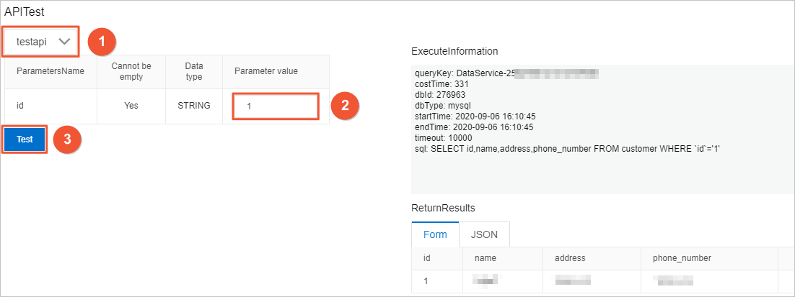

   <ol type="i">

   <li>

   Select the API that you want to test from the drop-down list.

   </li>

   <li>

   Enter values in the Parameter value column.

   </li>

   <li>

   Click **Test**.

   </li>

   </ol>

   After the test is complete, the execution information and return results appear on the right side. You can evaluate whether the API meets your business requirements based on the information.

   > **Note**
   >
   > You can click the **JSON** tab in the **ReturnResults** section so that the
   >
   > return results are displayed in the JSON format.

<a id="section-7-3-5"></a>

### 7.3.5. Call an API

After you create, publish, and test an API, you can call the API in an application by using an SDK.

**Prerequisites**

- An API is created and published. For more information, see Develop an API.

- API Gateway is activated. For more information, see the documentation of **API Gateway**.

**Procedure**

1. Log on to the DMS console.

2. In the top navigation bar, choose **DTS > Data Service**.

3. Click the **API Call** tab on the left side.

4. View the API call address and the authentication information.

   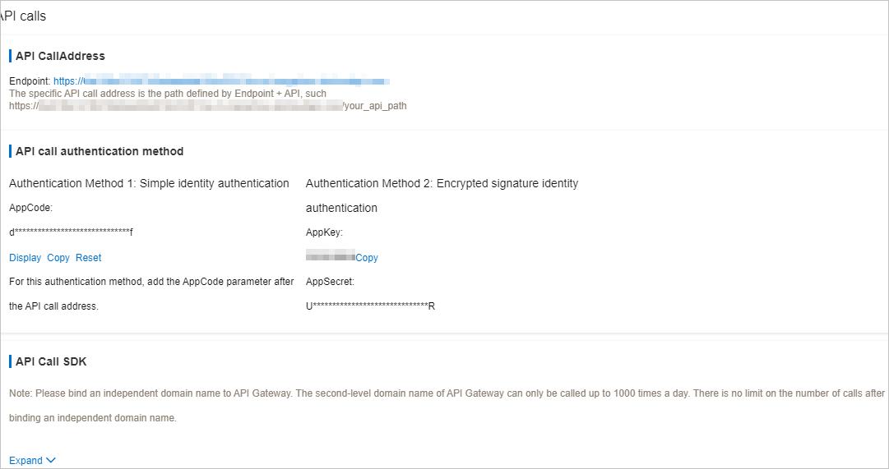

   - **Simple identity authentication**: requires only an AppCode. This authentication method is suitable for calling APIs by using URLs. This authentication method has a low security level and is generally used in scenarios in which data visualization is involved, such as calling APIs in DataV.

   - **Encrypted signature identity authentication**: requires an AppKey and an AppSecret, which are used to dynamically generate an encrypted signature for calling an API. This authentication method has a high security level.

5. Call the API in an application by using an SDK.

   > **Note**
   >
   > For more information about how to call an API in an application by using an
   >
   > SDK, see the documentation of **API Gateway**.

<a id="section-7-4"></a>

## 7.4. Data visualization

<a id="section-7-4-1"></a>

### 7.4.1. Overview

This topic introduces the basic concepts, design philosophy, and scenarios of the data visualization feature of Data Management (DMS).

**Background information**

DMS allows you to manage databases and query data in the SQLConsole where results are returned in the form of a table. However, if you want to analyze business characteristics in scenarios such as trend analysis and growth comparison, tables cannot meet the requirements, and data visualization is required. To resolve this issue, DMS provides the data visualization feature. You can use this feature to gain insights into your business and make better business decisions.

**Basic concepts**

The data visualization feature provides a three-layer model for you to visualize data in various forms, including datasets, charts, and dashboards or big screens. You can execute SQL statements in the SQLConsole to obtain datasets and convert the datasets to common charts such as line charts, pie charts, column charts, circular charts, table charts, dual Y-axis charts, and funnel charts. Then, on a dashboard or big screen, you can freely combine and lay out these charts based on your analysis logic or methodology to visually present your business data.

> **Note**
>
> For example, you can use indicator cards to display the overall metrics of
>
> your business, such as a transaction volume and unique visitors (UVs). Then, you can use a line chart to present the growth trend of the transaction volume and a column chart to compare transactions in all regions. Finally, you can use a table chart with a filter to query region-specific data.

**Design philosophy**

Two core concepts of data visualization are datasets and charts. Datasets are also called data views, and charts are also called visualization components.

- Datasets represent the structured form of data. Data logic, permissions, and services are all based on this form.

- Charts represent the visual form of data. Data presentation, interaction, and guidance are all based on this form.

  > **Note**
  >
  > Datasets and charts complement each other to provide the same data in
  >
  > two different forms and help you better understand data.

- Dashboards or big screens are used for quick data analysis and custom data visualization. You can combine charts on dashboards or big screens as needed. This can satisfy the data visualization needs of most users.

**Scenarios**

- Analyze data in a secure and custom manner

  The data visualization feature is based on the security control feature in DMS. This ensures that data is authorized before it is visualized.

  - You can set the configurations only once to implement the advanced filtering, advanced control, interaction, drilling, download, and sharing of visual components. This facilitates data analysis and decision-making. For example, you can use this feature to compare data and analyze the geographic information of data, data distribution, data trends, and data clusters with ease.

  - Dashboards use automatic layouts. They can be used for most visual reports that require simple configuration and need to be viewed and shared with ease.

  - Big screens use custom layouts. They can be used for specific visual reports that require additional modifier elements and need to be retained for a long period of time. Time and efforts are required to configure a big screen in these scenarios, such as a big screen for massive online promotions.

- Monitor operations in real time

  In the data factory of DMS, you can synchronize your business data in real time to AnalyticDB or ApsaraDB RDS where data can be analyzed. Then, you can visualize data that is analyzed in AnalyticDB or ApsaraDB RDS. This way, you can monitor database performance in real time and make sure that data flows are seamlessly connected. In addition, you can compare data to detect anomalies and handle key-link issues. Pivot-driven mode and chart-driven mode are provided for chart configuration. You can apply these modes to different scenarios based on your business requirements.

<a id="section-7-4-2"></a>

### 7.4.2. Terms

This topic describes the terms related to the data visualization feature of DMS.

| Term | Description |
| --- | --- |
| dimension | A dimension represents an attribute of business data, such as time, region, gender, and category. A dimension contains a collection of discrete values, based on which a measure is obtained. |
| measure | A measure is a statistical value that is obtained from an aggregation operation. For example, unique visitor (UV) and transaction volume are both measures. |
| dataset | A dataset is a collection of data in the form of a two-dimensional table. The data is generated after an SQL statement is executed to query a database.Therefore, you must prepare a database and an SQL statement to obtain a dataset. |
| chart | A chart is a graph that visualizes data to present a data feature. For example, a line chart shows a data trend, a table chart displays detailed data, a bar chart compares data, and a pie chart highlights percentages.Different charts may need different numbers of dimensions and measures.For example, a line chart requires one dimension and one or more measures. |
| dashboard | A dashboard is a visualization tool where multiple charts are combined to present business data in a comprehensive way. Charts can be laid out more flexibly on dashboards than in traditional visual reports. You can divide a dashboard into sections and adjust the size and position of the chart in each section. This can optimize the dashboard layout and provide user-friendly interactions. You can also configure a global filter that allows you to filter data across charts on a dashboard and display data that is queried. |
| dashboard collection | A dashboard collection is used to manage a group of dashboards that are related to each other. For example, you can create a dashboard collection that is specific to products and put the Products Sold dashboard, the Products Added to Shopping Cart dashboard, and the Products Returned dashboard to this dashboard collection. This provides convenient and unified management. In a dashboard collection, you can create recursive directories to classify the dashboards. |
| big screen | On a big screen, you can combine multiple charts as you can on a dashboard. You can also use auxiliary graphics, such as images and rectangles, on a big screen. This allows you to create layouts in a more flexible way. Different from dashboards that you can divide into sections, big screens adopt an absolute positioning layout. You can freely drag charts and auxiliary graphics on a big screen. This meets the requirement for more flexible data visualization. |

<a id="section-7-4-3"></a>

### 7.4.3. Go to the Data Visualization tab

This topic describes the methods that you can use to go to the Data Visualization tab.

**Go to the Data Visualization tab in the Data Management (DMS) console of the new version**

1. Log on to the DMS console.

2. In the top navigation bar, click **DTS**.

3. In the left-side navigation pane, click **Data Visualization**.

**Go to the Data Visualization tab from the SQLConsole tab**

1. Go to the **SQLConsole** tab. For more information, see SQLConsole.

2. In the upper part of the **SQLConsole** tab, click **Data Visualization**.

<a id="section-7-4-4"></a>

### 7.4.4. Manage datasets

A dataset is a collection of data in the form of a two-dimensional table. The data is generated after an SQL statement is executed to query a database. This topic describes how to manage datasets.

**Create a dataset**

1. Log on to the DMS console.

2. Go to the Data Visualization tab.

3. On the **Dataset management** tab, click the

   icon.

   

4. In the **Writing SQL** step, set the parameters and click **Execute**.

   | Parameter | Description |
   | --- | --- |
   | Name | The name of the dataset. The dataset name must be unique for each Data Management (DMS) user. |
   | Description | The description of the dataset. |
   | Select an existing database | The database to be queried. You must have permissions to query the database. |
   | Search table/field name | The name of the table or field that you want to search for and select. |

5. After the SQL statement is executed, click **Next Step**.

6. In the **Edit dataset model** step, set the **Data type** and **Visualization type** parameters for each field based on your requirements. In this step, you must specify each queried field as a dimension or measure and specify a visualization type for each field.

   | Parameter | Description |
   | --- | --- |
   | Data type | Valid values:<br>• <strong>Dimension</strong>: the scope, aspect, or angle of measures.<br>• <strong>Measure</strong>: the statistical value that is obtained after an aggregation operation.<br>To show how transaction volume changes over time, you can set the Data type parameter for the time field to <strong>Dimension</strong> and that for the transaction volume field to <strong>Measure</strong>. For more information, see Terms. |

   <table>
     <tr>
       <td>Visualization type</td>
       <td>Valid values:<br>• Digital<br>• String<br>• Date<br>• Geography: Country<br>• Geography: Provinces<br>• Geography: City<br>To show how transaction volume changes over time, you can set the Visualization type parameter for the time field to <strong>Date</strong> and that for the transaction volume field to <strong>Digital</strong>.</td>
     </tr>
   </table>

7. Click **Save**. The dataset is created, and you are navigated to the Dataset management tab.

**Modify a dataset**

1. Log on to the DMS console.

2. Go to the Data Visualization tab.

3. On the **Dataset management** tab, find the dataset that you want to modify and click the

   icon in the **Operation** column.

   

4. In the **Writing SQL** step, configure the SQL query statement and click **Execute**. For more information about how to set the other parameters in the **Writing SQL** step, see Create a dataset.

5. After the SQL statement is executed, click **Next Step**.

6. In the **Edit dataset model** step, set the **Data type** and **Visualization type** parameters for each field based on your requirements. For more information about the **Data type** and **Visualization type** parameters, see Create a dataset.

7. Click **Save**. The dataset is modified, and you are navigated to the Dataset management tab.

**Delete a dataset**

1. Log on to the DMS console.

2. Go to the Data Visualization tab.

3. On the **Dataset management** tab, find the dataset that you want to delete and click the

   icon in the **Operation** column.

   

4. In the message that appears, click **OK**.

   > **Note**
   >
   > Before a dataset is deleted, DMS checks whether the dataset is referenced
   >
   > by a chart. If the dataset is referenced, you cannot delete the dataset. To delete the dataset, you must go to the chart editing page to cancel the reference or delete the chart that references the dataset.

**Grant permissions on a dataset**

1. Log on to the DMS console.

2. Go to the Data Visualization tab.

3. On the **Dataset management** tab, find the dataset on which you want to grant permissions and click the

   icon in the **Operation** column.

   

4. In the **Share** dialog box, specify the permissions to be granted on the dataset and the users to whom you want to grant the permissions. Then, click **Authorize**.

<a id="section-7-4-5"></a>

### 7.4.5. Manage charts

A chart is the smallest unit for data visualization. A chart is generated by aggregating and grouping SQL query results based on the dataset model provided by a dataset, and then visualizing the processed data by using code.

Each chart must be associated with a dataset. In the chart editor, the original SQL statement and the dataset model in a dataset are used to generate a new SQL statement. Then, the new SQL statement is executed to query data that is to be visually presented in a chart. This topic describes features of charts and how to use charts.

**Chart editor**

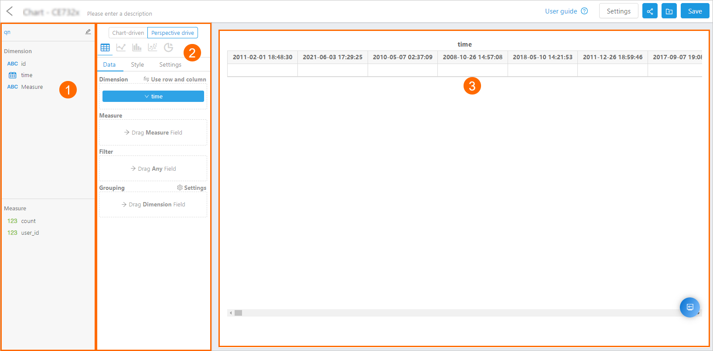

The following table describes the three sections of the chart editor.

| No. | Section | Description |
| --- | --- | --- |
| ① | Dataset model display section | After you select a dataset in the upper-left corner of this section, its dataset model will be automatically displayed below, including dimensions and measures.<br>You can drag fields in this section to corresponding areas on the <strong>Data</strong> tab in the chart configuration section. |
| ② | Chart configuration section | At the top of this section, you can select a configuration mode and a chart type. Move the pointer over a chart type icon to view the numbers of dimensions and measures required for this chart type.Below the chart type icons are three tabs.<br>• On the Data tab, you can specify which fields in the dataset model are needed for the chart. You can drag fields from the dataset model display section to corresponding areas on this tab.<br>• On the Style tab, you can set the display style of the chart.<br>• On the Settings tab, you can configure functional modules for the chart, such as filters and cache. |
| ③ | Chart display section | This section displays the chart based on the dataset model and your configurations in the chart configuration section. |

**Configuration modes**

The chart configuration section provides you with the following two configuration modes that are based on different visual presentation logic: including the **pivot-driven mode** and **chart-driven mode**. This meets different requirements in various scenarios.

| Configuration mode | Description | Scenario |
| --- | --- | --- |
| Chart-driven mode | The chart-driven mode represents the general visual presentation logic that is based on chart classification. Various charts can be configured by using the chart-driven mode. In this mode, dimensions and measures can be regarded as fixed configuration items, along with style settings, for configuring a chart. | The chart-driven mode is applicable to most data visualization scenarios. |
| Pivot-driven mode | The pivot-driven mode represents the visual presentation logic that is based on pivot tables. A chart configured by using the pivot-driven mode can be regarded as the visualization of a pivot table through coding. Dimensions and measures in the pivot table are converted to axes in the chart for graphic display. In this mode, you can configure different graphic coding for each measure. The lowest-level dimension can be used as a common dimension axis. | The pivot-driven mode is applicable to scenarios in which a small amount of data needs to be freely analyzed on clients. |

**Data configuration**

To complete data configuration, you must drag fields from the dataset model display section to corresponding areas on the **Data** tab in the chart configuration section. When you are dragging a field, the areas where the field can be placed are highlighted on the Data tab.

- ***Dimension***

  - Only categorical fields can be placed in the Dimension area. Values of each field in this area will be grouped in the new SQL statement to be generated.

- ***Measure***

  - Only fields of the NUMERIC type can be placed in the Measure area. Values of each field in this area will be aggregated in the new SQL statement to be generated. To specify how a field will be aggregated, you can click the field name and select an aggregate function. The following six aggregate functions are supported:

    - sum

    - avg

    - count

    - count_distinct

    - max

    - min

  - You can specify the following data formats for fields in the Measure area:

    - Default: the default format.

    - Numeric value: You can specify a unit, the number of decimal places to which numbers are rounded, and whether to use the thousands separator.

    - Currency: You can specify a unit, the number of decimal places to which numbers are rounded, whether to use the thousands separator. You can also prefix and suffix texts.

    - Percentage: You can specify the number of decimal places to which numbers are rounded.

    - Scientific type: You can specify the number of decimal places to which numbers are rounded.

- ***Filter***

  - Both dimension and measure fields can be placed in the Filter area. Values of fields in this area will be used to specify filter conditions in the SQL statement to be generated. Data can be filtered by values, conditions, and dates.

    > **Note**
    >
    > Filter methods applicable to each field in this area correspond to the
    >
    > visualization type that you specified for the field when you configure the dataset model.

    | Filter method | Description | Visualization type |
    | --- | --- | --- |
    | By conditions | Filtering by conditions is the most flexible filter method. In the Filter configuration dialog box, you can specify filter conditions for the selected field as needed. You can also use the logical AND and logical OR operators to specify multiple conditions. | • Numeric value<br>• String<br>• Geographical value |
    | By values | In the Filter configuration dialog box, a set of distinct values of the selected field are listed in the left-side section. You can select values from this section and add them to the right-side section to filter data. | • String<br>• Geographical value |
    | By dates | You can query the selected field in a specified period of time. The period of time can be fixed or dynamic. | Date |

- ***Grouping***

  - You can place only one dimension field in the Grouping area. Values of the field in this area will be grouped in the new SQL statement to be generated. In the chart to be generated, values of the field will be grouped. Each group has a distinct color. The legend of the chart will help you differentiate groups with different colors. If you want measures of a dimension to be displayed as several groups in a chart, you can use color settings to differentiate the groups.

    For example, a dataset model contains the trade_date, zone, and price fields, respectively representing the transaction date, transaction region, and transaction volume. You want a bar chart to show aggregated transaction volumes of each region by day. In this case, you can place the trade_date field in the Dimension area, the zone field in the Grouping area, and the price field in the Measure area.

    > **Note**
    >
    > When you generate a pie chart, you require a dimension field whose
    >
    > values are to be grouped. In this case, you must place the dimension field in the Grouping area instead of the Dimension area.

- ***General settings for fields***

  - Field alias

    Click a field name and select **Field settings**. In the **Field settings** dialog box, specify a field alias. You can specify the following two types of field aliases:

    - Permanent alias.

    - Dynamic alias: Dynamic aliases are generated by writing code in JavaScript and can be used with variables. DMS provides the Moment.js library that can be used with variables to dynamically generate aliases for fields of the DATE type. Dynamic aliases can only be generated for fields in table charts.

  - Field description

    Click a field name and select **Field settings**. In the **Field settings** dialog box, enter a description. You can add field descriptions only for charts that are configured by using the **chart-driven mode**.

  - Field sorting

    Click a field name, select **Sort Type** or Sort, and then select a sorting method. The following table describes the available sorting methods.

    | Sorting method | Description |
    | --- | --- |
    | Default | Do not sort the field values. |
    | Ascending order | Sort the field values in ascending order in the SQL statement to be generated. |
    | Descending order | Sort the field values in descending order in the SQL statement to be generated. |
    | Customize | You can drag field values to sort them. In the chart to be generated, the field values will be displayed in the specified order. Only categorical fields support this method. |

- ***Other configurations***

  - Size: If you are configuring a scatter chart, you must place a field of the NUMERIC type in the Size area. The field is used to code points in terms of size. Values of the field will be aggregated in the SQL statement to be generated.

  - Prompt information: You can set prompts only for certain Cartesian charts. Only fields of the NUMERIC type can be placed in the Prompt information area. Values of each field in this area will be aggregated in the SQL statement to be generated.

  - When you configure a chart by using the pivot-driven mode, you can place fields of any type in the Label area. Values of each categorical field in this area will be grouped and values of each field of the NUMERIC type will be aggregated in the SQL statement to be generated.

  - When you configure a scatter chart by using the pivot-driven mode, you must place a field of the NUMERIC type in the x data axis area. The field is specified as the measure of the X-axis. Values of the field will be aggregated in the SQL statement to be generated.

  - When you configure a dual Y-axis chart by using the chart-driven mode, you can specify a measure for the left Y-axis and a measure for the right Y-axis.

**Chart configuration**

After you configure fields, you can select a chart type by clicking the corresponding icon at the top of the chart configuration section.

> **Note**
>
> You can move the pointer over an icon to check the prerequisites of the chart
>
> type. If your data configuration does not meet all the prerequisites, the icon is dimmed. Only after all the prerequisites are met does the icon become highlighted. Click the icon and a chart appears in the chart display section.

On the **Style** tab of the chart configuration section, you can customize the chart display style.

**Functionality settings**

On the **Settings** tab of the chart configuration section, you can configure a filter and cache and specify whether to automatically load data.

- Filter

  You can create a filter or edit an existing filter by clicking **Settings** next to Filter.

  > **Note**
  >
  > To configure a filter, you must have defined **variables** when you configure
  >
  > the dataset.

  After you add a chart with a filter to a dashboard, you can click the button in the upper-left corner of the dashboard card. In the filter panel that appears, specify filter conditions and then click **Query** in the lower-right corner of the panel. Conditions that you specified in the chart filter and conditions that you specified in the global filter of the dashboard take effect at the same time.

- Cache

  You can enable or disable caching for a chart. You can also specify a validity period for the cached data.

  > **Note**
  >
  > If you enable caching for a chart, the result of the first query for the chart
  >
  > on a dashboard or big screen will be stored in the cache. The SQL query statement will be used as a key. Within the validity period, DMS returns the cached result for the same SQL query statement with no need to access the data source.

- Automatically load data In scenarios where data query is frequent, you may not want data to be loaded immediately when you open a dashboard. In this case, you can set **Automatically load data** to **No**. This parameter is set to **Yes** by default.

**Create a chart**

1. Log on to the DMS console.

2. Go to the Data Visualization tab.

3. In the left-side navigation pane, click **Chart**.

4. On the Chart management page, click the

   icon.

   

5. Configure the dataset and the chart.

6. In the upper-right corner, click **Save**.

**Modify a chart**

1. Log on to the DMS console.

2. Go to the Data Visualization tab.

3. In the left-side navigation pane, click **Chart**.

4. On the **Chart management** page, find the chart that you want to modify and click the

   

   icon in the **Operation** column.

5. After the configurations of the dataset and the chart are modified, click **Save**.

**Delete a chart**

1. Log on to the DMS console.

2. Go to the Data Visualization tab.

3. In the left-side navigation pane, click **Chart**.

4. On the **Chart management** page, find the chart that you want to delete and click the

   

   icon in the **Operation** column.

5. In the message that appears, click **OK**.

**Duplicate a chart**

1. Log on to the DMS console.

2. Go to the Data Visualization tab.

3. In the left-side navigation pane, click **Chart**.

4. On the **Chart management** page, find the chart that you want to duplicate and click the

   icon in the **Operation** column.

5. In the **Copy chart** dialog box, set the **Chart name** and **Description** parameters.

6. Click **OK**.

**Grant permissions on a chart**

1. Log on to the DMS console.

2. Go to the Data Visualization tab.

3. In the left-side navigation pane, click **Chart**.

4. On the **Chart management** page, find the chart on which the permissions you want to grant and click the

   icon in the **Operations** column.

   

5. In the dialog box that appears, select the user to which you want to grant permissions and the permissions to be granted.

6. Click the button in the dialog box.

<a id="section-7-4-6"></a>

### 7.4.6. Manage dashboards

Dashboards are the other type of visualization applications that are provided by DMS. Dashboards support automatic layout and provide interactive capabilities to help you create visual reports. This topic describes features of dashboards and how to use dashboards.

**Create a dashboard collection**

1. Log on to the DMS console.

2. Go to the Data Visualization tab.

3. In the left-side navigation pane, click **Data Display**.

4. In the **Dashboard** section of the **Resource management** page, click **New Dashboard collection**.

5. In the **New Dashboard collection** dialog box, set the **Name** and **Description** parameters.

6. Click **Save**.

**Add a chart to a dashboard**

1. In a dashboard, click the  icon in the upper-right corner. The New Chart dialog box

   appears, which contains the list of available charts.

2. Select the chart that you want to add to the dashboard and click **Next Step**.

3. Select an option from the **Data Refresh mode** drop-down list. The following modes are supported:

   - Manual refresh: You must click the **Synchronize data** icon in the upper-right corner of the chart to refresh data.

   - Scheduled refresh: The system automatically refreshes data in the chart at the specified interval in the unit of seconds.

4. Click **Save**. The chart is added to the dashboard.

**Configure a chart**

- To refresh data in a chart, click the  icon in the upper-right corner of the chart to trigger

  a query and synchronize data.

  > **Note**
  >
  > If cache is enabled for the chart, the cached content is also refreshed when
  >
  > you click this icon.

- To edit a chart, click the  icon in the upper-right corner of the chart.

- To view a chart in full screen, click the  icon in the upper-right corner of the chart.

- To change the data refresh mode of a chart or delete a chart, click the  icon in the upper-

  right corner of the chart and select Basic information or Delete as required.

**Use the auto layout feature**

- You can drag the lower-right corner of a chart to adjust its size.

- You can drag the top of a chart to adjust its position.

- Dashboards adopt a fluid layout. If the width of the display window is equal to or greater than 768 pixels, charts on a dashboard are displayed based on specified percentages. If the width of the display window is less than 768 pixels, charts are displayed in the mode for mobile devices.

- When you adjust the size or position of a chart, other charts in the same dashboard automatically adapt to the change, as designed in a fluid layout.

**Configure filter interactions**

You can configure filter interactions between charts in the same dashboard. Click the  icon

in the upper-right corner of a dashboard. The Linkage relationship settings dialog box appears.

- You can configure multiple filter interactions for a dashboard. For each filter interaction, you need to specify a trigger, an associated field, and a mapping relationship between the trigger and the associated field.

  - A trigger is a field that triggers a filter interaction. This field can be a dimension or an aggregated measure. Only fields that are used in the selected chart, instead of all fields in the dataset model that corresponds to the selected chart, can be specified as triggers.

  - An associated field can be any field or variable in the dataset model that corresponds to the selected chart. The data type of a trigger must be the same as the data type of its associated field.

- You can configure multiple filter interactions that have the same trigger. This way, one trigger is associated with multiple charts. A relationship diagram is displayed on the right of the Linkage relationship settings dialog box, showing the filter interactions between charts.

  > **Note**
  >
  > You can also configure multiple filter interactions whose associated fields
  >
  > belong to the same chart. All filter conditions, which are the mapping relationships defined in these filter interactions, take effect at the same time.

- After you configure filter interactions, each chart to which a trigger belongs has an icon in the upper-left corner. Move the pointer over the icon and an action prompt appears.

**Configure global filters**

You can configure global filters for a dashboard. Global filters allow you to filter data, within

one or across multiple charts, by defining filter conditions or replacing variables. Click the 

icon in the upper-right corner of a dashboard. The Global filter settings dialog box appears.

- **Basic settings**

  The Global filter settings dialog box is divided into three sections: **Filter list**, **Associated chart** and **Category**, and **Filter configuration**.

- **Filter list**

  In the **Global filter settings** dialog box, click the plus sign (  ) to the right of Filter list. A

  global filter is created with the default name: New Filter. To rename or delete the filter, move the pointer over the filter name and click the corresponding icon that appears to the right of the filter name.

- **Associated chart** and **Category** In the **Associated chart** section, select the charts that you want to associate with the global filter. Then, in the **Category** section, select at least one associated **field** or **variable** that you want to associate with the global filter. The input of the global filter is used as the value of the corresponding field to form a filter condition or used to replace the corresponding variable in the SQL query statement.

- **Filter configuration**

  You can configure the following types of filters:

  - **Drop-down list**

    Drop-down lists can be set only for global filters whose associated fields are dimensions. The options of a drop-down list are a set of distinct values of the associated field.

    - If the associated charts of a global filter are based on different datasets, the options of the drop-down list include values of all the associated fields in all the datasets.

    - If you set the Type parameter to Drop-down menu, the system automatically executes an SQL statement to query associated fields in the datasets and sets the values of these fields as options of the drop-down list. Therefore, you can enable cache and set a validity period.

    - If you do not want to use the values of associated fields as options of the drop-down list, select Custom options and click the plus sign (+) that appears. In the Edit custom options dialog box, enter one pair of option text and option value per line. Separate each option text and option value with a space. If the option text and option value are the same, you need only to enter one of them.

    If you select associated variables in the Category section, you still can use field values as options of the drop-down list.

    In the Filter configuration section, you can also enable the Multiple choice feature.

    > **Note**
    >
    > Assume that you select associated variables in the Category section and
    >
    > select Multiple choice for the drop-down list. If you select multiple options from the drop-down list, the selected options are converted to  `'Option 1','Option 2','Option 3'`  to replace the corresponding variable. Therefore, you need to include  `in ()`  in the SQL statement to ensure correct execution.

  - **Date selection**

    Date selection can be set only for global filters whose associated fields are dimensions. The selected date can be converted to one of the following formats:

    - Date. Example: 2019-01-01.

    - Date and time, accurate to seconds. Example: 2019-01-01 12:00:00.

    - Date and time, accurate to minutes. Example: 2019-01-01 12:00.

    - Month. Example: 2019-01.

    - Week. Example: 2019-5th week.

    - Year. Example: 2019.

    You can set a default value for a date filter. The default value can be a specified date, whether the date is fixed on the timeline or moves on the timeline.

    > **Note**
    >
    > You can set default values only for date filters.

    If you select Multiple choice for a date filter, you can set the Date format parameter only to Date, Month, or Year. To specify multiple months or years as default values, you must select dates in the corresponding months or years.

    > **Note**
    >
    > Similar to drop-down list filters, if you select associated variables in the
    >
    > Category section and select Multiple choice for a date filter, you also need to modify the SQL statement to ensure correct execution.

  - **Date range**

    Date ranges can be set only for global filters whose associated fields are dimensions. The formats to which a selected date range can be converted are the same as those for date filters. When you associate a date range filter with variables, you must select two variables, one as the start time and the other as the end time.

  - **Text input box**

    Text input boxes can be set only for global filters whose associated fields are dimensions. If you set the query mode of a text input box filter to Auto query, after you enter a value in the input box, you still need to press the Enter key to trigger a query.

  - **Number range input box**

    Number range input boxes can be set only for global filters whose associated fields are metrics. If you set the query mode of a number range input box filter to Auto query, after you enter a value in the input box, you still need to press the Enter key to trigger a query. When you associate a number range input box filter with variables, you must select two variables, one as the start value and the other as the end value.

- **Filter hierarchy**

  In the tree menu section, you can drag and drop filters to set a filter hierarchy. A parent filter is used as a drop-down list to filter options of its child filter.

- **Query mode**

  In the lower-right corner of the Global filter settings dialog box, you can set the query mode to Auto query or Manual query.

  - **Auto query**: Changes to the value of the filter immediately trigger a query. For text input box filters and number range input box filters, even if you set the query mode to **Auto query**, you still need to press the Enter key to trigger a query after you enter a value.

  - **Manual query**: If you set the query mode to Manual query, a **Query** button and a **Reset** button appear on the right of the global filter bar. To trigger a query, select or enter a value on the left of the global filter bar and click **Query**.

**Perform drilling in a chart**

To perform drilling in a chart, select the chart elements that you want to drill on, right-click, and then select the dimension that you want to drill to.

> **Note**
>
> If a chart contains a trigger configured for filter interactions, you cannot
>
> perform drilling in the chart.

- Each chart that allows drilling has an icon in the upper-left corner. If you move the pointer over the icon, an action prompt appears.

- If a chart allows drilling, its drilling path is displayed in the lower-left corner. You can drill to a level by clicking the level name in the drilling path.

  > **Note**
  >
  > For example, you can select the Shanghai, Shenzhen and Guangzhou chart
  >
  > elements to drill to the  `education`  field. This way, the chart displays the education level and salary distribution in Shanghai, Shenzhen, and Guangzhou.

- The drilling feature is implemented differently in charts configured by using the pivot-driven mode and in charts configured by using the chart-driven mode.

  - Pivot-driven mode

    In charts configured by using the pivot-driven mode, drilling is implemented by adding dimensions to or removing dimensions from filter conditions.

    > **Note**
    >
    > Pivot tables support roll-up or drill-down operations. A roll-up operation is
    >
    > to remove a dimension from a filter condition. A drill-down operation is to add a dimension to a filter condition. Pivot tables also allow you to drill down to a row or a column.

  - Chart-driven mode

    - In table charts configured by using the chart-driven mode, drilling is implemented in a similar way it is implemented in pivot tables.

    - In other charts configured by using the chart-driven mode, a drilling operation replaces an existing dimension in a filter condition with the dimension you want to drill to. This way, data changes are presented from another perspective.

    You can perform drilling in the following types of charts configured by using the chart-driven mode:

    - Table chart

    - Column chart

    - Line chart

    - Scatter chart

    - Pie chart

    - Funnel chart

    - Secondary Y-axis chart

**Edit a dashboard collection**

1. Log on to the DMS console.

2. Go to the Data Visualization tab.

3. In the left-side navigation pane, click **Data Display**.

4. In the **Dashboard** section of the **Resource management** page, click the Edit icon in the upper-right corner of the dashboard collection that you want to edit.

**Delete a dashboard collection**

1. Log on to the DMS console.

2. Go to the Data Visualization tab.

3. In the left-side navigation pane, click **Data Display**.

4. In the **Dashboard** section of the **Resource management** page, find the dashboard collection that you want to delete.

5. Click the  icon.

6. In the message that appears, click **OK**.

<a id="section-7-4-7"></a>

### 7.4.7. Manage big screens

In addition to dashboards, Data Management (DMS) provides another type of visualization applications: big screens. Big screens provide customizable layouts and styles. You can combine visualization components with bountiful built-in auxiliary graphics to create visualized big screens of various visual styles.

Dashboards and big screens are designed for different purposes. Dashboards are used to generate visual reports. Big screens are widely used for data viewing and presentation in a static or scrolling way. Therefore, it usually takes more time to create a big screen than to create a dashboard. This topic describes how to stylize a big screen.

**Big screen editor**

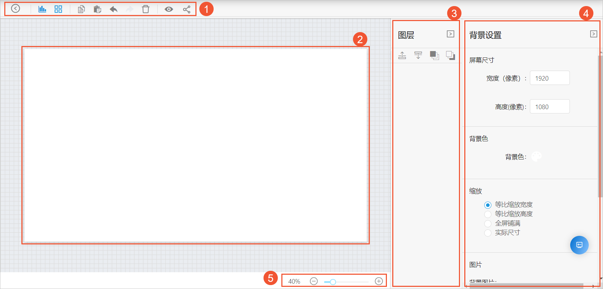

| No. | GUI element |
| --- | --- |
| ① | Toolbar |
| ② | Canvas |
| ③ | Layer panel |
| ④ | Parameter settings panel |
| ⑤ | Zoom tool |

**Toolbar**


| No. | GUI element | Description |
| --- | --- | --- |
| ① | Chart | You can click this icon to add charts to a big screen. |
| ② | Auxiliary graphics | You can click this icon to add the following four types of auxiliary graphics: rectangle, label, video, and timer. |
| ③ | Operation icons | You can click the operation icons to manage layers on the canvas. The following operation icons are provided: <strong>Copy</strong>, <strong>Paste</strong>, <strong>Undo</strong>, <strong>Redo</strong>, and <strong>Delete</strong>. |
| ④ | Preview | You can click this icon to open a new web page to view the display effect of the big screen that you are editing. |
| ⑤ | Share | You can click this icon to share visualized data. |

- **Chart**

  You can click the Chart icon to add charts. To add a chart, perform the following steps:

  <ol type="i">

  <li>

  Click the **Chart** icon.

  </li>

  <li>

  In the **Add Chart** dialog box, select a chart and click **Next Step**.

  </li>

  <li>

  Select a mode from the **Data Refresh mode** drop-down list and click **Save**.

  </li>

  </ol>

  DMS provides the following two methods to update data:

  - **Manual refresh**: If you select this mode, you must click **Synchronize Data** in the upper-right corner of the chart on the big screen each time you want to update data.

  - **Scheduled refresh**: The system automatically updates data in the chart at the specified interval in the unit of seconds.

  <ol type="i" start="4">

  <li>

  Click **Save**. The chart is added to the canvas.

  You can drag a chart to adjust its position. You can also drag the chart in the lower-right corner to resize the chart.

  </li>

  </ol>

- **Auxiliary graphics**

  DMS provides four types of auxiliary graphics. You can click the **Auxiliary graphics** icon and select an auxiliary graphic from the list.

  | Auxiliary graphic | Description |
  | --- | --- |
  | Rectangle | This auxiliary graphic is generally used to decorate the background of charts.You can set the background color, background picture, and borders for a rectangle. |
  | Label | This auxiliary graphic is generally used to display texts. You can set the text font, margin, background color, and borders for a label. |
  | Video | This auxiliary graphic is used to play online videos. |
  | Time | This auxiliary graphic is used as a ticking clock. |

- **Operation icons**

  <table>
    <tr>
      <th>Operation icon</th>
      <th>Description</th>
      <th>Shortcut key in Mac OS</th>
      <th>Shortcut key in Windows</th>
    </tr>
    <tr>
      <td>Copy</td>
      <td>You can click this icon to copy a chart or an auxiliary graphic.</td>
      <td>Cmd+C</td>
      <td>Ctrl+C</td>
    </tr>
    <tr>
      <td>Paste</td>
      <td>You can click this icon to paste a chart or an auxiliary graphic.</td>
      <td>Cmd+V</td>
      <td>Ctrl+V</td>
    </tr>
    <tr>
      <td>Undo</td>
      <td rowspan="2">When you edit the canvas, you can click the Undo icon to roll back an operation or click the Redo icon to restore an operation.</td>
      <td rowspan="2">N/A</td>
      <td rowspan="2">N/A</td>
    </tr>
    <tr>
      <td>Redo</td>
    </tr>
    <tr>
      <td>Delete</td>
      <td>You can click this icon to delete a chart or an auxiliary graphic.</td>
      <td>Delete</td>
      <td>Backspace or Delete</td>
    </tr>
  </table>

  > **Note**
  >
  > - You can click the **Copy**, **Paste**, or **Delete** icon to copy, paste, or delete multiple layers at a time.
  >
  > - To select multiple layers, press and hold the Cmd or Alt key on the keyboard and click the layers.

- **Preview**

  After you create a big screen, you can click the **Preview** icon in the toolbar to preview the big screen on a new web page.

**Canvas**

Each chart or auxiliary graphic that is added to the canvas can be viewed as a **layer**. On the canvas, you can perform the following operations:

- You can drag a layer to adjust its position. You can also select a layer and use the arrow keys on the keyboard to fine-tune the position of the layer.

  > **Note**
  >
  > When you are dragging a layer, a prompt appears to the right of the layer
  >
  > to show the current position of the layer in the form of coordinates. Guides are also displayed on the canvas to help you align the layer.

- When you edit a part of the canvas, you can adjust the slider of the zoom tool to zoom in or zoom out on the canvas.

- You can press and hold the Cmd or Alt key on the keyboard, click multiple layers to select them, and then copy, delete, or align the layers at a time.

- To deselect one or more selected layers, click the blank area on the canvas.

- To edit a chart, click the **Edit** icon in the upper-right corner of the chart.

**Layer panel**

In the Layer panel, you can perform the following operations:

- Select a layer: You can select a layer on the canvas by selecting the corresponding item in the layer list.

- Select multiple layers: You can select multiple layers on the canvas by pressing and holding the Cmd or Alt key on the keyboard and selecting the corresponding items in the layer list.

- Adjust the position of a layer on the Z axis: After you select a layer, you can click the icons above the layer list to adjust the position of the layer on the Z axis. The following icons are provided: **Move up**, **Move down**, **Top**, and **Bottom**.

**Parameter settings panel**

The content that is displayed in the parameter settings panel varies with the layer that you select.

- By default, the **Background settings** panel is displayed as the parameter settings panel. The following table describes the parameters in the Background settings panel.

  | Parameter | Description |
  | --- | --- |
  | Screen size | You can adjust the size of the canvas based on the display terminal of the big screen. |
  | Background color | You can specify a background color for the big screen. |
  | Zoom | • <strong>Proportional scaling width</strong>: The width of the canvas is the same as the width of the display terminal. The height of the canvas is proportionally scaled.<br>• <strong>Proportional scaling height</strong>: The height of the canvas is the same as the height of the display terminal. The width of the canvas is proportionally scaled.<br>• <strong>Full screen</strong>: Both the height and width of the canvas are the same as the height and width of the display terminal. In this mode, the canvas may be deformed on the display terminal.<br>• Actual Size |
  | Picture | You can upload a background picture for the big screen. |

- If a single layer is selected, the **Chart** panel is displayed as the parameter settings panel. You can set the following parameters in the Chart panel:

  - **Chart size**

  - **Chart location**

  - **Background**

  - **Border**

  - **Data Refresh mode**

- If multiple layers are selected, the **Layer alignment** panel is displayed as the parameter settings panel. You can click the following icons to operate the layers: **Top alignment**, **Left alignment**, **Center horizontally**, **Vertically centered**, **Right alignment**, and **Bottom alignment**.

**Create a big screen**

1. Log on to the DMS console.

2. Go to the Data Visualization tab.

3. In the left-side navigation pane, click **Data Display**.

4. In the **Big Screen** section of the **Resource management** page, click **New big screen**.

5. In the **New Big Screen** dialog box, set the **Name** and **Description** parameters.

6. Click **Save**. You can view the new big screen in the **Big Screen** section.

**Edit a big screen**

1. Log on to the DMS console.

2. Go to the Data Visualization tab.

3. In the left-side navigation pane, click **Data Display**.

4. In the **Big Screen** section of the **Resource management** page, find the big screen that you want to edit.

5. On the page that appears, edit the big screen based on your requirements. For more information about how to edit a big screen, see Big screen editor.

**Delete a big screen**

1. Log on to the DMS console.

2. Go to the Data Visualization tab.

3. In the left-side navigation pane, click **Data Display**.

4. In the **Big Screen** section of the **Resource management** page, find the big screen that you want to delete.

5. Click the  icon.

6. In the message that appears, click **OK**.

<a id="section-7-5"></a>

## 7.5. Heterogeneous database migration

<a id="section-7-5-1"></a>

### 7.5.1. Overview

Advanced Database & Application Migration (ADAM) can help you migrate IT systems in your enterprise to the cloud in an easy and reliable manner.

**Background information**

ADAM is a digital migration solution that can help you rearchitect your traditional databases and applications in the cloud. ADAM is developed based on years of experience of Oracle database and application architecture analysis, architecture selection, and business transformation in Alibaba Group. ADAM provides professional data and application transformation services for enterprises, backed by the comprehensive partner ecosystem. ADAM also provides a whole set of product-based services, such as database and application architecture analysis, architecture selection, business transformation, data migration, and O&M optimization.

**Features**

- Database evaluation

  This feature provides intelligent evaluation and analysis based on the collected source database data. Then, the feature generates a report that contains multiple factors, such as the database migration solution, compatibility of the destination database, migration risks, application transformation suggestions, and migration costs. To use the feature, log on to the Data Management (DMS) console. In the top navigation bar, click **DTS**. In the left-side navigation pane, click **Database Evaluation**.

- Database transformation and migration

  This feature provides intelligent tools for database transformation and migration. This facilitates source database comparison, schema migration, and schema revision based on database evaluation results. To use the feature, log on to the DMS console. In the top navigation bar, click **DTS**. In the left-side navigation pane, click **Database Transformation and Migration**.

- Application evaluation and transformation This feature provides application transformation items such as call stacks and SQL statements, and provides the architecture migration guide to sort the architecture of large-scale cluster migration. To use the feature, log on to the DMS console. In the top navigation bar, click **DTS**. In the left-side navigation pane, click **Application Evaluation and Transformation**.

- Migration lab

  This feature provides an SQL statement comparison test platform, an SQL statement automatic transformation platform, and tools for periodic data collection. To use the feature, log on to the DMS console. In the top navigation bar, click **DTS**. In the left-side navigation pane, click **Migration Lab**.

- SQL conversion

  This feature provides tools to transform statements in Oracle, Teradata, or Db2 databases to statements that can be executed in MySQL databases, PolarDB for Oracle clusters, or AnalyticDB for PostgreSQL databases. To use the feature, log on to the DMS console. In the top navigation bar, click **DTS**. In the left-side navigation pane, click **SQL Conversion**.

<a id="section-7-5-2"></a>

### 7.5.2. Database evaluation

<a id="section-7-5-2-1"></a>

#### 7.5.2.1. Collect database information

Advanced Database & Application Migration (ADAM) provides two database information collection methods: collect database information online and collect database information by using Database Collector.

**Background information**

- Collect database information online: If you want to collect the information about a source database online, you must make sure that the source database can be accessed over the Internet. In addition, you must add the IP addresses of ADAM servers to the whitelist of the source database.

- Collect database information by using Database Collector: If the source database is inaccessible over the Internet, you can download the Database Collector client to collect the information about the database.

**Collect the information about a database online**

1. Log on to the Data Management (DMS) console. In the top navigation bar, choose **DTS > Database Evaluation**.

2. In the **Collect DB Information** step, click **Online Database Collection**.

3. Click **Create Collection Task** to create a collection task.

4. Log on to the source database. Create an account and authorize the account to collect the information about the source database.

   - If the source database is an Oracle 10g database, Oracle 11g database, or Oracle 12c non-container database (CDB), create a local user.

     <ol type="a">

     <li>

     Create a user named eoa_user and set the password to eoaPASSW0RD\*\*\*\*.

     ```text
     create user eoa_user identified by eoaPASSW0RD**** default tablespace users;
     ```

     </li>

     <li>

     Grant the permissions to query data from the source database to the eoa_user user.

     ```text
     grant connect,resource,select_catalog_role,select any dictionary to eoa_user;
     ```

     </li>

     </ol>

     <ol type="i" start="100">

     <li>

     Grant the permissions on the DBMS_LOGMNR package to the eoa_user user.

     > **Note**
     >
     > If the source database is an Oracle 10g database, run the following command before you grant the permissions on the DBMS_LOGMNR package to the eoa_user user:
     >
     > ```text
     > create or replace public synonym DBMS_LOGMNR for sys.dbms_logmnr;
     > ```

     ```sql
     grant execute on DBMS_LOGMNR to eoa_user;
     ```

     </li>

     <li value="500">

     Grant the permissions on the DBMS_METADATA package to the eoa_user user to query DDL statements for objects.

     ```sql
     grant execute on DBMS_METADATA to eoa_user;
     ```

     </li>

     </ol>

     <ol type="a" start="5">

     <li>

     Grant the permissions to query transactions to the eoa_user user.

     ```text
     grant select any transaction to eoa_user;
     ```

     </li>

     <li>

     Grant the permissions to query tables to the eoa_user user.

     ```text
     grant select any table to eoa_user;
     ```

     </li>

     <li>

     Grant the permissions to analyze tables to the eoa_user user.

     ```text
     grant analyze any to eoa_user;
     ```

     </li>

     <li>

     Grant the permissions to generate random numbers to the eoa_user user.

     ```sql
     grant execute on dbms_random to eoa_user;
     ```

     </li>

     </ol>

   - If the source database is an Oracle 12c CDB, connect to the CDB to create a common user.

     ```sql
     create user c##eoa_user identified by "eoaPASSW0RD****" default tablespace users;
     grant connect,resource,select_catalog_role,select any dictionary to c##eoa_user container=all;
     grant execute on DBMS_LOGMNR to c##eoa_user container=all;
     grant execute on dbms_metadata to c##eoa_user container=all;
     grant select any table to c##eoa_user container=all;
     grant select any transaction to c##eoa_user container=all;
     grant analyze any to c##eoa_user container=all;
     grant execute on dbms_random to c##eoa_user container=all;
     alter user c##eoa_user set container_data=all container=current;
     ```

   - The source database runs Teradata 13, 14, or 15.

     Grant the permissions on the DBC database to the user that you want to authorize to collect the information about the source database.

     ```sql
     grant select,show on dbc to (username);
     ```

   - The source database is a Db2 for LUW database.

     Grant the permissions to run the db2look command and assign the database administrator (DBA) role to the user that you want to authorize to collect the information about the source database.

5. After you configure the source database account, click **Next** in the Create Collection Task panel to go to the **Test Connectivity and Start Collection** step. In this step, configure the following parameters:

   <ol type="i">

   <li>

   **Collection Task Name**: the name of the collection task.

   </li>

   <li>

   **Source Database Type**:

   - Select **ORACLE** as the source database type.

     **Database Name /Service Name /SID**: the database name, service name, or system ID (SID) of the source Oracle database.

   - Select **TERADATA** or **Db2_LUW** as the source database type.

     **Database Name**: the name of the source database.

   </li>

   <li>

   **Source Database Network Type**: Select **Database with Public IP Address**.

   </li>

   <li>

   Enter other information about the source database.

   - **Host IP**: the IP address of the source database.

     > **Note**
     >
     > Add the IP addresses of ADAM servers to the whitelist of the source database to ensure that ADAM can collect data from the source database online.

   - **Port Number**: the port that is used to connect to the source database.

   - **Username**: the username of the account that you created to collect database information.

   - **Password**: the password of the preceding account.

   - **Optional:Advanced Settings**: Specify the encoding method of the source database in the Encoding field.

   </li>

   </ol>

6. Click **Test Connectivity** to perform a connectivity test. After the test succeeds, click **Start Collection**.

7. After the collection task is complete, select the collection task and click **Next: Create Profile** to create a database profile.

**Collect the information about a database by using Database Collector**

If you cannot access the source database over the Internet or from Alibaba Cloud, you can use Database Collector to collect the information about the source database offline.

1. You can also log on to the Data Management (DMS) console. and go to the **Migration Lab** page.

2. In the **SQL Periodic Collection** section, click **Download** to download the Database Collector client.

3. In the Download Database Collector panel, download the Database Collector client based on the operating system of your on-premises machine. Then, decompress the package and install the Database Collector client.

   > **Note**
   >
   > We recommend that you do not install the Database Collector client on the server of the source database. The on-premises machine on which you want to install the Database Collector client must meet the following requirements:
   >
   > - Network: The source database is accessible from the on-premises machine.
   >
   > - CPU: 2 cores.
   >
   > - Memory: 8 GB.
   >
   > - Hard disk: 100 GB free space.

4. Create an account and authorize the account to collect database information.

   <ol type="i">

   <li>

   Log on to the source database.

   </li>

   <li>

   Create a temporary user by using the credentials of a user that is granted the SYSDBA

   </li>

   </ol>

   permission, and then grant the required permissions to the temporary user. If an existing user of the source database is granted the required permissions, you can use the credentials of the existing user to collect the information about the source database.

   - If the source database is an Oracle 10g database, Oracle 11g database, or Oracle 12c non-CDB, create a local user.

     <ol type="a">

     <li>

     Create a user named eoa_user and set the password to eoaPASSW0RD\*\*\*\*.

     ```text
     create user eoa_user identified by eoaPASSW0RD**** default tablespace users;
     ```

     </li>

     <li>

     Grant the permissions to query data from the source database to the eoa_user user.

     ```text
     grant connect,resource,select_catalog_role,select any dictionary to eoa_user;
     ```

     </li>

     </ol>

     <ol type="i" start="100">

     <li>

     Grant the permissions on the DBMS_LOGMNR package to the eoa_user user.

     > **Note**
     >
     > If the source database is an Oracle 10g database, run the following command before you grant the permissions on the DBMS_LOGMNR package to the eoa_user user:
     >
     > ```text
     > create or replace public synonym DBMS_LOGMNR for sys.dbms_logmnr;
     > ```

     ```sql
     grant execute on DBMS_LOGMNR to eoa_user;
     ```

     </li>

     <li value="500">

     Grant the permissions on the DBMS_METADATA package to the eoa_user user to query DDL statements for objects.

     ```sql
     grant execute on dbms_metadata to eoa_user;
     ```

     </li>

     </ol>

     <ol type="a" start="5">

     <li>

     Grant the permissions to query transactions to the eoa_user user.

     ```text
     grant select any transaction to eoa_user;
     ```

     </li>

     <li>

     Grant the permissions to query tables to the eoa_user user.

     ```text
     grant select any table to eoa_user;
     ```

     </li>

     <li>

     Grant the permissions to analyze tables to the eoa_user user.

     ```text
     grant analyze any to eoa_user;
     ```

     </li>

     <li>

     Grant the permissions to generate random numbers to the eoa_user user.

     ```sql
     grant execute on dbms_random to eoa_user;
     ```

     </li>

     </ol>

   - If the source database is an Oracle 12c CDB, connect to the CDB to create a common user.

     ```sql
     create user c##eoa_user identified by "eoaPASSW0RD****" default tablespace users;
     grant connect,resource,select_catalog_role,select any dictionary to c##eoa_user container=all;
     grant execute on DBMS_LOGMNR to c##eoa_user container=all;
     grant execute on dbms_metadata to c##eoa_user container=all;
     grant select any table to c##eoa_user container=all;
     grant select any transaction to c##eoa_user container=all;
     grant analyze any to c##eoa_user container=all;
     grant execute on dbms_random to c##eoa_user container=all;
     alter user c##eoa_user set container_data=all container=current;
     ```

   - The source database runs Teradata 13, 14, or 15.

     Grant the permissions on the DBC database to the user that you want to authorize to collect the information about the source database.

     ```sql
     grant select,show on dbc to (username);
     ```

   - The source database is a Db2 for LUW database.

     Grant the permissions to run the db2look command and assign the DBA role to the user that you want to authorize to collect the information about the source database.

   <ol type="i" start="3">

   <li>

   Collect structured data to generate feasibility reports and compatibility reports.

   </li>

   </ol>

   Database Collector can collect the information about Oracle 10g, 11g, and 12c databases, Teradata 13, 14, and 15 databases, and Db2 for LUW databases. If issues occur when you collect database information, submit a ticket and attach the log files that are stored in the logs directory.

   <ol type="a">

   <li>

   Run the collect command to collect the information about the source database. If the Database Collector client runs on Windows, run the .bat command. If the Database Collector client runs on Linux, run the .sh command.

   <ol type="a">

   <li>

   Oracle 10g

   ```text
   collect_10g[.sh|.bat] -h -u -p -d <service_name>;
   ```

   </li>

   <li>

   Oracle 11g

   - Oracle 11g R1

     ```text
     collect_11gR1[.sh|.bat] -h -u -p -d <service_name>;
     ```

   - Oracle 11g R2

     ```text
     collect_11gR2[.sh|.bat] -h -u -p -d <service_name>;
     ```

   </li>

   </ol>

   <ol type="i" start="100">

   <li>

   Oracle 12c

   > **Note**
   >
   > You can use the  `collect_11gR2`  script to collect the information about a pluggable database (PDB) in Oracle 12c. collect_12c[.sh|.bat] -h &lt;host> -u &lt;username> -p &lt;password> -P &lt;port> -d &lt;service_name> -s &lt;sid>

   </li>

   <li value="500">

   Teradata 13, 14, or 15

   ```text
   collect_td[.sh] -h ip -p password -u username;
   ```

   </li>

   </ol>

   <ol type="a" start="5">

   <li>

   Db2 for LUW

   ```text
   collect_db2_luw[.sh] -h ip -u username -p password -d databasename  -P port;
   ```

   -h: the IP address of the source database. -u: the username of the eoa_user user. In this example, the username is eoa_user. -p: the password of the eoa_user user. In this example, the password is eoaPASSW0RD. -P: the port that you want to use to collect the information about the source database. Example: 1521. -d: the service name of the source database. If the source database is an Oracle 12c database, specify the service name of the specified PDB. -s: the name of the Oracle database instance. This option is required only for Oracle 12c.

   </li>

   </ol>

   </li>

   <li>

   Export the collection results.

   After the collection task is complete, Database Collector generates a packet and returns the path of the packet. If the collection task is successful, the following log entries are displayed:

   ```text
   [***] ******************************************************************
   [***] *     Collect Successfully!
   [***] *
   [***] * Complete the file packaging, the package result path is: 
   [***] *        ~rainmeter/out/data.zip 
   ******************************************************************
   ```

   </li>

   </ol>

   <ol type="i" start="100">

   <li>

   After the collection task is complete, you can delete the temporary user.

   Use the credentials of a user that is granted the SYSDBA permission to connect Database Collector to the source database and run the drop command to delete the temporary user.

   <ol type="a">

   <li>

   Oracle 10g, 11g, or 12c (non-CDB)

   ```text
   drop user eoa_user cascade;
   ```

   </li>

   <li>

   Oracle 12c (CDB)

   ```text
   drop user c##eoa_user cascade;
   ```

   </li>

   </ol>

   </li>

   </ol>

**What to do next**

Create a database profile. For more information, see Manage a database profile.

<a id="section-7-5-2-2"></a>

#### 7.5.2.2. Manage a database profile

A database profile is used to evaluate a source database in Advanced Database & Application Migration (ADAM). This helps you monitor the status of your source database. When you migrate or transform a source database, you can search for the database based on the database profile.

**Create a database profile**

1. Log on to the Data Management (DMS) console, In the top navigation bar, choose **DTS > Database Evaluation**.

2. In the DB Evaluation Process wizard, click the **Source DB Profile** step.

3. On the tab that appears, click **Create Profile**.

4. In the **Create Profile** panel, configure the **Profile Name**, Type, and Report Language Type parameters, and then click **Upload** to upload a file of data collected from the source database. After the file is uploaded, click **Create**.

   > **Note**
   >
   > The database profile can be created in 1 to 30 minutes. The duration depends on the size of the data collected from the source database.

**View the database profile**

After the state of the database profile changes to **Complete**, click **Details** in the **Actions** column to view the profile.

- Basic information statistics

  > **Note**
  >
  > The basic information statistics feature is available only for the profile of an Oracle database.

  On the **Overview** tab, view the basic information of the source database.

  - Session: the connection status of the database. A higher value indicates that more sessions are established to the database.

  - Complexity: the complexity of the database evaluated based on the collected information about the source database, such as scenarios and features.

  - Risk: the risk level of the database. A higher value indicates that the database is more likely to be exposed to performance risks related to SQL statements or objects.

  - Hotspot: indicates whether the database contains objects that are frequently accessed. A higher value indicates that more objects are frequently accessed.

  - Scale: the scale of database resources. A higher value indicates a larger database scale.

  - Load: the performance of the database. A higher value indicates a larger load of the database.

- Distribution of main objects

  On the **Overview** tab, view the distribution of object types in the source database.

- Details of profile analysis results

  On the **Details** tab, view the multi-dimensional analysis results of the source database.

  - Performance

    This metric shows the transactions per second (TPS), queries per second (QPS), CPU utilization, and load of the database.

  - Capacity

    This metric shows the capacity rankings of database schemas and the capacity proportions of different object types such as table, index, and large object (LOB).

  - External Dependency

    This metric shows database links and link details. You must revise schemas when you transform databases that contain external dependencies.

  - Other Dimensions

    This metric shows special tables and SQL statements, such as tables without primary keys, high growth tables, and SQL statements with aggregate functions. You can click **View** in the Actions column to view details.

  - Object Details

    This metric shows object information from different dimensions, such as object feature tags, relationships such as association and dependency, and features contained in objects. This metric allows you to view the object information without the need to query the source database. You can click **View Object Details** in the **Actions** column to view the details of an object.

    In the Basic Information section of the View Object Details dialog box, you can view the basic information and DDL statements of the object. In the Details section, you can view the analysis data provided by ADAM, such as the referenced objects, dependent objects, and features of the object.

**Supported operations**

| Operation | Description | Procedure |
| --- | --- | --- |
| Update the database profile | You can manage multiple versions for the profile of the source database. If the data in the source database changes after the profile is created, you can append a new data file to the original profile. | In the <strong>Source DB Profile</strong> step, find the database profile that you want to manage and click <strong>Append</strong> in the <strong>Actions</strong> column. In the Append Profile panel, click <strong>Upload</strong> to upload a data file and click <strong>Create</strong>. ADAM then generates a new version of the profile based on all the data files. |
| Grant permissions on the database profile | You can authorize other users to access the profile.<br>You can also revoke permissions on the profile from other users.<br>Important<br>Use the authorization feature with caution. You are liable for data disclosures caused by improper authorization if you authorize other users to access a profile. | In the <strong>Source DB Profile</strong> step, find the database profile that you want to manage and click <strong>Authorize</strong> in the <strong>Actions</strong> column. In the Authorize panel, select <strong>Confirm</strong>, enter an Apsara Stack tenant account ID, and then click OK.<br>The validity period of the authorization is one month. Authorized users can view the profile, download profile analysis results, and create analysis projects based on the profile. |
| Delete the database profile | If you delete a database profile, all analysis data of the profile is deleted. | In the <strong>Source DB Profile</strong> step, find the database profile that you want to delete and choose <strong>More</strong> <strong>&gt; Delete</strong> in the Actions column. |

**What to do next**

Select a database profile and click **Next: Select Destination Database** to go to the **Select Destination DB** step.

<a id="section-7-5-2-3"></a>

#### 7.5.2.3. Select a destination database

Various types of databases are available on Alibaba Cloud. Advanced Database & Application Migration (ADAM) analyzes the profile of a source database and the compatibility between the source database and various destination databases. ADAM provides you with the basis for selecting a destination database based on destination database compatibility, which regular users are most concerned about.

**Procedure**

1. Log on to the DMS console.

2. In the left-side navigation pane, click **Evaluate DB**.

   > **Note**
   >
   > You can also log on to the Data Management (DMS) console. In the top
   >
   > navigation bar, choose **DTS > Database Evaluation**.

3. In the DB Evaluation Process wizard, click the **Select Destination DB** step. In the profile list, select the database profile that you want to evaluate.

4. Click **Next: Select Destination Database**.

5. Click the **Compatibility** tab.

   - The **DB Object Compatibility** table describes the compatibility, the number of compatible objects, and the number of incompatible objects.

     - **Compatibility (%)**: The compatibility is equal to the total number of directly compatible objects and objects that are compatible after transformation divided by the total number of objects.

     - **Compatible with ADAM**: the number of objects that are directly compatible with the destination database, and the number of objects that are compatible after transformation. ADAM automatically transforms incompatible objects to compatible objects.

     - **Incompatible**: the number of objects that are incompatible and must be manually transformed. ADAM provides comprehensive suggestions on how to transform these objects.

   - The **SQL Compatibility** table describes the compatibility, the number of compatible SQL statements, the number of incompatible SQL statements that can be transformed, and the number of incompatible SQL statements.

     - **Compatibility (%)**: The compatibility is equal to the total number of directly compatible SQL statements and SQL statements that are compatible after transformation divided by the total number of SQL statements.

     - **Compatible**: the number of SQL statements that are directly compatible with the destination database, and the number of SQL statements that are compatible after transformation.

     - **Compatible After Conversion**: the number of SQL statements that are compatible after transformation.

     - **Incompatible**: the number of incompatible SQL statements.

6. **Optional:** If you want to migrate only specific schemas, you can select the schemas from the **Select Schema** drop-down list to obtain suggestions on the schemas that you want to migrate.

**What to do next**

Click **Next: Create Destination DB Evaluation Project** to evaluate the destination database.

<a id="section-7-5-2-4"></a>

#### 7.5.2.4. Evaluate a database

Advanced Database & Application Migration (ADAM) allows you to evaluate the compatibility of a destination database, obtain the recommended specifications of a destination database, and identify potential migration risks. This helps you understand the feasibility and transformation costs of database migration.

**Create a database evaluation project**

1. Log on to the Data Management (DMS) console. In the top navigation bar, choose **DTS > Database Evaluation**.

2. In the DB Evaluation Process wizard, click the **Source DB Profile** step. Select a database profile and click **Next: Select Destination Database**.

3. In the **Select Destination DB** step, click **Next: Create Destination DB Evaluation Project** and then click **Create Project**.

   > **Note**
   >
   > You can also click **Create Project** in the **Evaluate Dest. DB** step to create a database evaluation project.

4. To create a database evaluation project, configure the following parameters:

   - Project Name: required. The name of the project.

   - Source Database Profile: the database profile.

   - Project Type: the type of the destination database.

   - Destination Database Version: required. The version of the destination database.

   - Are you sure that you want to evaluate invalid objects?

     - Yes: evaluates invalid objects in the source database profile.

     - No: does not evaluate invalid objects in the source database profile.

   - Kernel Version: This parameter is required if you set the Project Type parameter to POLARDB-O.

     > **Note**
     >
     > This parameter is displayed only if you set the Project Type parameter to **POLARDB-O**.

   - Evaluate invalid objects: specifies whether to evaluate invalid objects in the source database profile. Select Yes or No based on your business requirements.

     Invalid objects refer to the objects such as packages, procedures, functions, and views that may become invalid during the O&M or data migration of the source database.

   - Report Language: the language of the evaluation report.

5. Click **Create**. The project is created and automatically started.

**Evaluate a database**

1. Log on to the ADAM console.

2. In the left-side navigation pane, click **Evaluate DB**.

   > **Note**
   >
   > You can also log on to the Data Management (DMS) console. In the top
   >
   > navigation bar, choose **DTS > Database Evaluation**.

3. Click the **Evaluate Dest. DB** step.

4. In the project list, find a project and click **Details** in the **Actions** column to go to the evaluation details page of the destination database.

   > **Note**
   >
   > You can view the evaluation status and progress of projects in the project list. You can go to the evaluation details page only if the evaluation state of the project is **Complete**.

5. View the evaluation overview.

   > **Note**
   >
   > The Specifications and Risks evaluation items are displayed only if the source database type is Oracle.

   - **Compatibility**: the compatibility between the source and destination databases. Higher compatibility indicates that fewer SQL statements and objects need to be transformed.

   - **Transformation**: the focus areas of database transformation.

     - **Object Transformation**: the database objects to be automatically transformed by ADAM.

     - **Application Transformation**: the SQL statements to be transformed based on the preliminary evaluation results of database migration.

   - **Specifications**: the required specifications of the destination database and migration costs calculated by ADAM based on the data collected from the source database. The evaluation of the specifications is subject to the data collection environment. Purchase databases based on your business requirements.

     - **Destination DB Specifications**: the recommended specifications of the destination database.

     - **Estimated Cost**: the estimated costs of the recommended destination database.

   - **Risks**: the risks of database migration and transformation.

     - **Source DB Risk**: the existing risks of the source database.

     - **Migration Risk**: the risks that may arise during database migration.

   - **Overall Compatibility**: the overall compatibility between the source and destination databases.

6. View the evaluation details.

   > **Note**
   >
   > The Destination Database Solution, Migration Risk, and Project Dependency (Schema) evaluation items are displayed only if the source database type is Oracle.

   - **Object Compatibility**

     The compatibility of all objects in the source database.

   - **SQL Compatibility**

     The compatibility of SQL statements collected from the source database.

   - **Object Transformation**

     The focus areas of database transformation. You can transform your database objects based on these focus areas. You can also apply to use the ADAM database transformation feature to automatically transform database objects. Some objects may need to be manually modified.

   - **Destination Database Solution**

     The recommended specifications of the destination database and migration plan guidelines provided to help you migrate the source database to Alibaba Cloud. The recommended specifications of the destination database are generated based on the configurations, performance, SQL statements, and external dependencies of the source database, and the comprehensive analysis of the source and destination databases.

   - **Migration Risk** The migration risks from the source and destination databases.

   - **Project Dependency (Schema)**

     The dependent and referenced objects, and suggestions on these objects.

7. Download the database evaluation report.

   In the lower part of the **Evaluate Dest. DB** tab, click **Download Simple Report** or **Download All Reports** to download the database evaluation reports generated by ADAM.

<a id="section-7-5-3"></a>

### 7.5.3. Database transformation and migration

<a id="section-7-5-3-1"></a>

#### 7.5.3.1. Overview

Advanced Database & Application Migration (ADAM) provides the intelligent database transformation and migration feature to facilitate source database comparison, schema migration, schema revision, and data migration based on database evaluation results.

**Supported database types**

ADAM allows you to migrate data from on-premises databases to ApsaraDB. The destination databases must be of the following types:

- PolarDB for Oracle

- ApsaraDB RDS for MySQL

- ApsaraDB RDS for PostgreSQL

- PolarDB-X

- AnalyticDB for PostgreSQL

> **Note**
>
> You must configure an IP address whitelist when you create a destination
>
> database. For more information, see Configure an IP address whitelist.

**Procedure**

1. Create a migration project: Create a migration project based on database evaluation results.

2. Run a precheck: Check the account permissions, plug-ins, version, character sets, clocks, and resources of the destination database to ensure a smooth migration.

3. Optional. Verify the source database: Analyze the source database, track database changes, and update the migration project based on the database changes. To verify a migration project, make sure that the ADAM server can access the source database. If you skip this step, the data to be migrated to ApsaraDB may not be the latest data. In this case, you must collect and evaluate the database data again.

4. Migrate and revise schemas: Migrate objects to the destination database as possible as you can. ADAM evaluates and verifies the objects and provides solutions for incompatible objects. You can troubleshoot issues based on the error messages and try again.

5. Optional. Track incremental data by performing data comparison: Track the major changes to the data and schemas of your source database. This improves the migration efficiency of changed DDL statements.

6. Migrate data: Use Data Transmission Service (DTS) to migrate data.

<a id="section-7-5-3-2"></a>

#### 7.5.3.2. Configure an IP address whitelist

To make sure that Advanced Database & Application Migration (ADAM) can connect to and use the destination database, you must configure an IP address whitelist when you create the destination database.

**Configure an IP address whitelist based on the database type**

- For more information about how to configure an IP address whitelist for a PolarDB instance, see **Configure an IP address whitelist** in **User Guide** of **PolarDB**.

- For more information about how to configure an IP address whitelist for an ApsaraDB RDS for MySQL instance, see **Configure an IP address whitelist for an ApsaraDB RDS for MySQL instance** in **User Guide** of **ApsaraDB RDS for MySQL**.

- For more information about how to configure an IP address whitelist for an ApsaraDB RDS for PostgreSQL instance, see **Configure an IP address whitelist for an ApsaraDB RDS for PostgreSQL instance** in **User Guide** of **ApsaraDB RDS for PostgreSQL**.

- For more information about how to configure an IP address whitelist for a PolarDB-X instance, see **Set an IP address whitelist** in **User Guide** of **PolarDB-X**.

- For more information about how to configure an IP address whitelist for an AnalyticDB for PostgreSQL instance, see **Configure an IP address whitelist** in **User Guide** of **AnalyticDB for PostgreSQL**.

**Usage notes**

If ADAM and the destination database are not in the same region, add the IP address of the machine on which ADAM is deployed to the IP address whitelist of the destination database.

<a id="section-7-5-3-3"></a>

#### 7.5.3.3. Create a migration project

You can create a migration project in the Advanced Database & Application Migration (ADAM) console. Then, you can migrate data from a source database to a destination database based on database evaluation results. The migration project maximizes the compatibility between the source and destination databases by using the intelligent transformation feature of ADAM. ADAM also provides a schema migration tool that helps you migrate schemas.

**Prerequisites**

- Database evaluation is complete.

- A database instance is created as the destination instance.

- A PolarDB-X database is created if you migrate data to a PolarDB-X instance, and the database is bound to an ApsaraDB RDS instance. The database must have the same name as a schema in the PolarDB-X instance.

**Procedure**

1. Log on to the Data Management (DMS) console.

2. In the top navigation bar, choose **DTS > Database Transformation and Migration**.

3. On the **Transform and Migrate DB** page, click **Create Migration Project**.

4. In the **Create Migration Project** panel, configure the parameters that are described in the following table.

   | Parameter | Description |
   | --- | --- |
   | Project Name | The name of the project. We recommend that you specify a descriptive name for easy identification. |
   | Evaluate DB | • <strong>Select Database Evaluation</strong>: From the drop-down list, select a source database that is evaluated.<br>• <strong>Upload Database Evaluation</strong>: Select a migration project type from the Project Type drop-down list and click <strong>Upload File</strong> to upload a file. |
   | IP Address | The IP address of the destination database. |
   | Database Name | The name of the destination database. |
   | Encoding Method | The encoding method of the destination database. |
   | Port Number | The public port number of the destination database. |
   | Username | The username used to log on to the destination database. |
   | Database Password | The password used to log on to the destination database. |

5. Click **Test Connectivity** to perform a connectivity test. After the test succeeds, click **Create**.

   After the state of the migration project changes to  `ACTIVE` , the project is created.

**What to do next**

After the migration project is created, ADAM automatically runs a precheck. For more information, see Run a precheck.

<a id="section-7-5-3-4"></a>

#### 7.5.3.4. Run a precheck

Advanced Database & Application Migration (ADAM) runs a precheck to check the permissions, plug-ins, and version of the destination database. This ensures smooth migration.

**Background information**

After you create a migration project, ADAM automatically runs a precheck. A precheck involves the following items:

- Permissions granted to the destination database account:

  - Check whether the account of the destination database has the permissions to create users.

  - Check whether the account of the destination database has the permissions to grant permissions to users.

  - Check whether the account of the destination database has the permissions to create and delete schemas.

  - Check whether the account of the destination database has the permissions to create and delete DDL statements.

- Plug-ins installed on the destination database:

  Check whether the required plug-ins are installed on the destination database.

- Version of the destination database:

  Check whether the version of the evaluated destination database is the same as the version of the destination database that is used to migrate schemas.

**Procedure**

1. Log on to the DMS console.

2. In the top navigation bar, choose **DTS > Database Transformation and Migration**.

3. On the Transform and Migrate DB page, find your migration project. After the state of the project changes to  `ACTIVE` , click **Details** in the Actions column.

   > **Note**
   >
   > If the state of the project is ACTIVE and the font color of ACTIVE is yellow, you can click Details and fix issues based on the precheck results. If the font color of ACTIVE remains yellow after you fix the issues, ignore these issues.

4. Click the **Precheck** step to view the precheck results.

**What to do next**

On the **Precheck** tab, click **Next: Verify Source Database**. For more information, see Verify the source database.

<a id="section-7-5-3-5"></a>

#### 7.5.3.5. Verify the source database

You can verify whether major changes have been performed on the data and schemas of a source database since the last data collection. This helps you migrate your source database in Advanced Database & Application Migration (ADAM).

**Procedure**

1. Log on to the DMS console.

2. In the top navigation bar, choose **DTS > Database Transformation and Migration**.

3. On the Transform and Migrate DB page, find your migration project and click **Details** in the **Actions** column.

4. Click the **Verify Source DB** step to view the changes in the source database.

   - Init: the initial number of objects in the project.

   - Unchanged: the number of objects that remain unchanged in the project.

   - Changed: the number of objects that are changed in the project.

   - Deleted: the number of objects that are deleted from the project.

   - New: the number of new objects in the project.

   > **Note**
   >
   > If the source database is disconnected, ADAM can only process the data collected from the source database during database transformation and cannot obtain the DDL operations that are performed on the source database.

**What to do next**

Click **Next: Schema Migration** to migrate the schemas of the source database. For more information, see Migrate and revise schemas.

<a id="section-7-5-3-6"></a>

#### 7.5.3.6. Migrate and revise schemas

Advanced Database & Application Migration (ADAM) allows you to manage the permissions of users to migrate schemas by configuring migration rules. ADAM revises the DDL statements of an object that fails to be migrated based on the information provided by the schema revision feature and executes the revised DDL statements in the destination database.

**Procedure**

1. Log on to the DMS console.

2. In the top navigation bar, choose **DTS > Database Transformation and Migration**.

3. On the Transform and Migrate DB page, find your migration project and click **Details** in the **Actions** column.

4. Click the **Revise & Migrate Schemas** step.

5. Configure users to migrate schemas. On the **Rule Configuration** tab, configure the **User-specific Schema Migration** parameter based on your business requirements.

   - Unified User (default): All schemas belong to a user.

   - Separate Users: Each schema belongs to a user. To configure a user, perform the following steps:

     <ol type="a">

     <li>

     Enter a password for the user.

     - If you have created a user, enter the password specified for the user.

     - If you have not created a user, ADAM automatically creates a user in the destination database. Then, you must specify a password. Otherwise, the password used to log on to the destination database is specified for the user by default.

     </li>

     <li>

     Add or remove schemas for the user as needed.

     </li>

     </ol>

     <ol type="i" start="100">

     <li>

     Click **Save**.

     </li>

     <li value="500">

     In the message that appears, click **OK**.

     </li>

     </ol>

   > **Note**
   >
   > If you configure separate users, you must make sure that these users are consistent with the users of the source database and specify corresponding schemas for the users.

6. **Optional:** Configure conversion rules. On the **Rule Configuration** tab, click **Configure Conversion Rules** and select whether to enable the **Convert DECFLOAT to DOUBLE** feature based on your business requirements.

7. Click the **Schema Migration** tab to migrate schemas.

   <ol type="i">

   <li>

   Click **Migrate All Schemas** to migrate all DDL statements again. In the message that appears, click **OK**.

   > **Important**
   >
   > - If you start schema migration, all schemas in the destination database are deleted. Make sure that no important schemas exist in the destination database in advance.
   >
   > - If you migrate schemas to a PolarDB-X database, the migration of FOREIGN KEY constraints may require an extended period of time.
   >
   > - If the schema migration fails, you can download the details to view the information about the schema migration failure.

   </li>

   <li>

   **Optional:** Perform other operations as required.

   - Click **Re-migrate upon Failures** to migrate the DDL statements that fail to be migrated.

   - Click **Start** to migrate the paused DDL statements.

   - Click **Pause** to stop migrating the current DDL statements.

   - Click **Export Objects to Be Revised** to export a list of data to be revised after migration.

   - Click **Customize Schema Migration** to customize schema migration operations. To meet different schema migration requirements, ADAM allows you to customize schema migration operations. You can migrate schemas by configuring the Object Type, Schema, or Status parameter.

   </li>

   </ol>

8. Click the **Schema Revision** tab. On the tab that appears, find a schema and click **Revise** in the **Actions** column.

   - **Transformation**: View the current DDL statements that ADAM transforms. You must manually transform unsupported DDL statements.

   - **Dependent Objects**: View the dependent objects of the current object.

   - **Referenced Objects**: View the referenced objects of the current object.

   - **Object Features**: View the features of the current object.

**What to do next**

- If a large number of data changes are performed in the source database, you can click the **Compare Increments (Optional)** step to check the incremental data. For more information, see Track incremental data by performing data comparison.

- If the data in the source database slightly changes, you can click the **Migrate Data** step to directly migrate data. For more information, see Migrate data.

<a id="section-7-5-3-7"></a>

#### 7.5.3.7. Track incremental data by performing data comparison

If the data or schemas of your source database have undergone major changes, you can perform data comparison to track the changes. This feature facilitates the migration of changed DDL statements.

**Procedure**

1. Log on to the DMS console.

2. In the top navigation bar, choose **DTS > Database Transformation and Migration**.

3. On the Transform and Migrate DB page, find your migration project and click **Details** in the **Actions** column.

4. Click the **Compare Increments (Optional)** step.

5. Click **Start** to perform data comparison and track the incremental data.

6. After data comparison is complete, click **Incremental Data Comparison History** to view the records.

   If you find that schema changes exist after data comparison, you can return to the previous step and click **Start** to synchronize the schemas. For more information, see Migrate and revise schemas.

<a id="section-7-5-3-8"></a>

#### 7.5.3.8. Migrate data

This topic describes how to migrate data.

**Prerequisites**

Schema migration and revision are complete. For more information, see Migrate and revise schemas.

**Procedure**

1. Log on to the DMS console.

2. In the top navigation bar, choose **DTS > Database Transformation and Migration**.

3. On the Transform and Migrate DB page, find your migration project and click **Details** in the **Actions** column.

4. Click the **Migrate Data** step.

5. Exclude schemas.

   > **Note**
   >
   > Before you migrate data, you must exclude schemas, such as triggers, constraints, and indexes. After data is migrated, you can include the schemas. In the Excluded Schemas section, you can select the schemas that you want to temporarily exclude.

   <ol type="i">

   <li>

   Click the **Excluded Schemas** tab and click **Start**.

   </li>

   <li>

   In the message that appears, click **OK**.

   </li>

   </ol>

   > **Warning**
   >
   > After you enable the schema exclusion feature, the schemas in the destination database are deleted. Proceed with caution.

   <ol type="i" start="3">

   <li>

   Click the **Schema Details** tab to view the details of the schemas that are excluded.

   </li>

   </ol>

6. Include schemas.

   > **Note**
   >
   > After data is migrated, you can include the schemas that are excluded, such as triggers, constraints, and indexes.

   <ol type="i">

   <li>

   Click the **Included Schemas** tab and click **Start**.

   </li>

   <li>

   In the message that appears, click **OK**.

   </li>

   <li>

   Click the **Schema Details** tab to view the details of the schemas that are included.

   </li>

   </ol>

<a id="section-7-5-4"></a>

### 7.5.4. Application evaluation and transformation

<a id="section-7-5-4-1"></a>

#### 7.5.4.1. Overview

After your source database is transformed and migrated, you can transform your applications. However, applications are much more complex than databases, and the code involved may be developed by different developers. Application transformation has become a pain point for data migration to the cloud. Advanced Database & Application Migration (ADAM) provides the application evaluation and transformation feature to help you transform your applications.

**Core features**

- Provides application transformation items such as call stacks and SQL statements.

- Analyzes application usage information, such as framework and performance.

- Sorts out architectures to migrate large-scale clusters.

**Procedure**

1. Collect application information

2. Deploy a data collection environment

3. Create an application profile

4. Evaluate applications

5. Perform static application transformation

> **Note**
>
> If you perform dynamic application evaluation and transformation, complete
>
> Steps 1, 2, 3, and 4. If you perform static application evaluation and transformation, skip to Step 5.

<a id="section-7-5-4-2"></a>

#### 7.5.4.2. Collect application information

Advanced Database & Application Migration (ADAM) allows you to collect data from Java applications that use Java Development Kit (JDK 1.6) or later and helps you evaluate and analyze the features that need to be transformed. The data collection feature does not apply to non-Java applications.

**Background information**

The Application Collector client consists of the following modules:

- Agent for dynamic data collection: collects the basic information of the database that is requested by an application when the application is running. The basic information includes the SQL statements, schemas, and call stacks of requests. System information, performance information, and statistics on SQL statements are also collected.

- Collector for centralized data collection: collects, masks, and processes the data collected by the Agent from each application.

**Background information**

- Collected SQL statements are masked. The request parameters and returned values of SQL statements are not collected.

- Data collection is read-only to prevent intrusions to applications.

- Data collection is automatically suspended during peak hours to restrict the memory usage within a specific range.

- Dynamic data collection of Java applications in Tomcat, JBoss, and Oracle WebLogic containers that use JDK 1.6 or later is supported.

**Download Application Collector**

1. Log on to the DMS console.

2. In the top navigation bar,choose **DTS > Application Evaluation and Transformation**.

3. In the **Collect Application Data** step, click **Download Database Collector** in the lower-left corner.

4. In the **Download Application Collector** panel, click **Download Application Collector**.

**Usage notes**

- Basic technical knowledge is required before you deploy Application Collector. Make sure that Application Collector is deployed by Java developers.

- SUN JDK, Oracle JDK, and OpenJDK 1.6 or later are supported. IBM JDK is not supported.

- The decompressed client package contains the collector and javaagent folders. The Collector is deployed independently on a server that does not have online applications to prevent online applications from being affected during data processing. The javaagent folder is copied to the application server to be monitored to collect data from applications.

- Make sure that the Collector and Agent have system operation permissions.

  > **Note**
  >
  > If you are using the Unix or Linux operating system, you must run the  `chmod -R 775 collector/`  command to grant recursive operation permissions on the collector folder to the Collector and Agent.

- The Collector acts as a server and can be deployed to serve 1 to 20 Agents. An Agent is deployed on a single application server.

  > **Note**
  >
  > You can deploy Agents on a few machines of a distributed application based on load balancing.

- Deploy the Collector, and then deploy the Agent. The applications whose data is to be collected must be accessible to the Collector for centralized processing such as data masking. The machine on which the Collector is deployed must use JDK 1.6 or later and have a Java Virtual Machine (JVM) memory size of more than 4 GB. The disk volume is determined by the number of monitored applications, the monitoring duration, business activities, and the number and size of SQL statements. If data does not explode, you can estimate the data volume based on the data collected within half a day. In most cases, the data volume of a monitored application is less than 1 GB within seven days.

- Each application must be deployed on a server that uses JDK 1.6 or later. The JVM heap size of the application must be at least 300 MB. Supported containers include Tomcat, JBoss, WebLogic, and WebSphere. Docker images can be deployed to a Container Service for Kubernetes (ACK) cluster.

- The Agent monitors the SQL statements and call stacks that are used to access Oracle databases. Make sure that all the operations are monitored during the monitoring period of the Agent. An application must be monitored when recurring tasks are running. Otherwise, the collected data is incomplete.

**What to do next**

Deploy a data collection environment.

<a id="section-7-5-4-3"></a>

#### 7.5.4.3. Deploy a data collection environment

This topic describes how to deploy a data collection environment to collect data.

**Run a precheck**

- Make sure that the collector is deployed on a standalone server that has no online applications.

- Make sure that JAVA_HOME and JDK 1.6 or later have been configured.

**Start the collector**

- If you use a UNIX-based server, run the following command in the directory in which the collector is installed:

  ```text
   ./run.sh
  ```

- If you use a Windows-based server, run the following command in the directory in which the collector is installed:

  ```text
   start /b java -jar javaagent-collector.jar
  ```

View the log file in the  `collector/logs/collector.log`  directory. If the log file contains a startup or success message, the collector is deployed.

**Configure and start the Java agent**

**Configurations before the startup**

- Make sure that the JAVA_HOME environment variable has been configured. Otherwise, set the value of JAVA_HOME in the attach.sh file to the absolute path of the Java runtime environment (JRE). If you use JRE instead of Java Development Kit (JDK), you must manually copy the tools.jar file to the ${JAVA_HOME}/lib/ directory.

- Configure the javaagent.config file: profiler.collector.ip = 11.23.45.67 # Specify the IP address of the collector. profiler.collector.port = 9996 # Specify the port of the collector. profiler.app.name = adamApp # Specify the name of the application. The name must be 1 to 20 characters in length and must contain letters and digits. profiler.app.port = 8080 # Specify the startup port of the application. Multiple ports are available for an application, and you need to specify only the startup port. Specify only one startup port regardless of the number of applications on a Java virtual machine (JVM). profiler.applicationservertype = TOMCAT # Specify the container type of the application middleware. Valid values: TOMCAT, JBOSS, and WEBLOGIC.

Optional configurations

Configure prefixes for the directories in which the Java code to be tested resides. Replace the directories in the following example. Separate multiple directories with commas (,). Each directory must have at least two levels of subdirectories. We recommend that you specify no more than five directories. If databases are changed, the collector can provide specific suggestions to modify application configurations based on the precise call stack information.

- If some directories cannot be provided, you can leave this parameter unspecified. You can configure filters on the analysis page of the Alibaba Cloud Advanced Database & Application Migration (ADAM) console.

  ```text
  profiler.classpath.whitelist = com.alibaba.javaagent,com.alibaba.adam
  ```

- If the preceding whitelist is specified, you can leave this parameter unspecified. You can also specify a blacklist to filter out unnecessary call stack information.

  ```text
  profiler.classpath.blacklist =org.apache,net.sf
  ```

- Specify the limit of the CPU utilization. If the limit is reached, data collection is paused.

  ```text
  profiler.cpu.threshold = 85
  ```

- Specify the interval at which system information is collected. Unit: minutes. Default value: 15.

  ```text
  profiler.sys.send.interval = 15
  ```

- Specify the interval at which dynamic SQL information is collected. Unit: minutes. Default value: 15.

  ```text
  profiler.sql.dynamic.send.interval = 15
  ```

**Startup methods**

- Method 1: Monitor an application only once without restarting the application Add system operation permissions to the javaagent directory. Make sure that the account used to start the agent is the same as the account used to start the application. Run the following commands by replacing ${pid} with the process ID of the application:

  - If you use a UNIX-based server, run the following command:

    ```text
    ./attach.sh -p ${pid}
    ```

  - If you use a Windows-based server, run the following command:

    ```text
    java -cp "%JAVA_HOME%\lib\tools.jar;%cd%\javaagent-bootstrap.jar" 
    com.alibaba.adam.javaagent.bootstrap.AgentAttacher -p ${pid}
    ```

  If the log file in the javaagent directory contains a success message, the agent has been started. If inbound traffic is received by the application and the collector directory contains a subdirectory that contains data, the agent has been started and has sent data to the collector.

  - Make sure that the obtained process ID of the application is correct.

  - Make sure that the account used to start the agent is the same as the account used to start the application. Make sure that the agent and the application have identical system operation permissions. Otherwise, the agent cannot monitor the application.

    > **Note**
    >
    > If the application is started by viewing Windows Registry as a system
    >
    > user, the agent cannot be started by using Method 1 due to inconsistent account permissions.

- Method 2: (Recommended) Start monitoring when an application starts Replace ${javaagent_path} with the javaagent directory in the configuration file, and then restart the application.

  - UNIX-based server

    - Tomcat: Add the following code to the last CATALINA_OPTS configuration item in the catalina.sh startup file:

      ```text
      CATALINA_OPTS="$CATALINA_OPTS -javaagent:${javaagent_path}/javaagent-bootstrap.jar"
      ```

    - JBoss: Add the following code to the last JAVA_OPTS configuration item in the run.conf startup file:

      ```text
      JAVA_OPTS="$JAVA_OPTS -javaagent:${javaagent_path}/javaagent-bootstrap.jar"
      ```

    - WebLogic: Add the following code to the last JAVA_OPTIONS configuration item in the startWebLogic.sh startup file:

      ```text
      JAVA_OPTIONS="$JAVA_OPTIONS -javaagent:${javaagent_path}/javaagent-bootstrap.jar"
      ```

    - WebSphere:

      - Method 1: Create a configuration file and add the following code to the configuration file:

        ```text
        JAVA_OPTS="$JAVA_OPTS -javaagent:/home/admin/javaagent/javaagent-bootstrap.jar"
        ```

      - Method 2: Add the following code to the common JVM parameters:

        ```text
        name:javaagent  value:/home/admin/javaagent/javaagent-bootstrap.jar
        ```

    - Docker container deployed in a Kubernetes cluster: Place the javaagent directory into a Docker image, add the corresponding javaagent configuration file, and then deploy the image.

  - Windows-based server

    - Tomcat: Add the following code to the last CATALINA_OPTS configuration item in the catalina.bat startup file:

      ```text
      CATALINA_OPTS="$CATALINA_OPTS -javaagent:${javaagent_path}/javaagent-bootstrap.jar"
      ```

    - JBoss: Add the following code to the last JAVA_OPTS configuration item in the run.conf startup file:

      ```text
      JAVA_OPTS="$JAVA_OPTS -javaagent:${javaagent_path}/javaagent-bootstrap.jar"
      ```

    - WebLogic: Add the following code to the last JAVA_OPTIONS configuration item in the startWebLogic.cmd startup file:

      ```text
      JAVA_OPTIONS="$JAVA_OPTIONS -javaagent:${javaagent_path}/javaagent-bootstrap.jar"
      ```

    - WebSphere:

      - Method 1: Create a configuration file and add the following code to the configuration file:

        ```text
        JAVA_OPTS="$JAVA_OPTS -javaagent:/home/admin/javaagent/javaagent-bootstrap.jar"
        ```

      - Method 2: Add the following code to the common JVM parameters:

        ```text
        name:javaagent  value:/home/admin/javaagent/javaagent-bootstrap.jar
        ```

After the application is started, view the application logs. If the  `Java Agent load successfully!`   message is displayed, the agent is started. If an error occurs, modify the script based on the error message. If no agent information is displayed, the agent was not loaded because the configuration path is invalid.

**Method comparison**

| Startup method | Benefit | Drawback | Scenario |
| --- | --- | --- | --- |
| Method 1 | You can configure the agent without restarting the application even if the application has never been monitored by the agent. | You must manually start the agent each time you restart the application. The account used to start the agent must be the same as the account used to start the application. | This method applies to scenarios in which you will not restart your applications for a long time and an application restart affects your business. |
| Method 2 | When you restart the application, the agent automatically starts and continuously collects application data. You do not need to consider account permissions. | When you collect application data for the first time, you must restart the application to start the agent. | This method applies to scenarios in which you can restart your applications to continuously collect data without affecting your business. |

**Usage notes**

- When the application stops, the agent also stops regardless of which method was used to start the agent.

- You can stop the agent in one of the following ways:

  - If the agent is started by using Method 1, restart the application or run the ./attach.sh -p ${pid} -s command.

  - If the agent is started by using Method 2, remove the configurations of the Java agent and restart the application.

- If you want to monitor the application after the agent has been stopped, you must restart the application.

  - If the agent is started by using Method 1, start the agent manually after the application restarts.

  - If the agent is started by using Method 2, wait for the agent to automatically start after the application restarts.

- JBoss clusters are divided into Community Edition clusters and Enterprise Edition clusters. If the jboss.modules.system.pkgs configuration item exists, you must add the com.alibaba.adam.javaagent directory and restart the application to validate the monitoring settings regardless whether you use Method 1 or 2.

**Collect data**

Go to the directory in which the collector is installed, compress the files in the data/ directory in the ZIP format by application name, and then separately upload each application profile. Each application corresponds to one profile. You can compress the data collected for an application from different IP addresses into one ZIP file. However, you cannot compress data collected for different applications into one ZIP file. Otherwise, an upload error occurs.

> **Note**
>
> In most cases, data of one to seven days is collected.

**What to do next**

Upload an application profile.

<a id="section-7-5-4-4"></a>

#### 7.5.4.4. Create an application profile

Advanced Database & Application Migration (ADAM) allows you to use application profiling to analyze the data collected from a single application by using intelligent analysis algorithms.

**Procedure**

1. Log on to the DMS console.

2. In the top navigation bar,choose **DTS > Application Evaluation and Transformation**.

3. In the Application Evaluation Process wizard, click the **Create Application Profile** step.

4. On the Create Application Profile tab, click **Create Profile**.

5. On the Basic Settings tab of the **Create Application Profile** panel, configure the **Profile Name**, **Type**, and **Report Language Type** parameters and click **Upload** to upload dynamic data files.

6. Click the **Database Profile** tab and click **Select**.

7. In the **Select Associated Database Profile** panel, select a database profile, click **Add**, and then click the

   icon in the upper-right corner of the panel.

   

8. Select the added database profile and click **Create**. The application profile is created based on the intelligent analysis results of data files. This process takes 1 to 10 minutes.

**View the application profile**

An application profile consists of the following four parts:

- Summary

  - Complexity is calculated based on conditions such as application scenarios and database features. This dimension indicates the application usage. A higher score indicates a more complex application that requires more transformations.

  - Session indicates the connection status of the application. A higher score indicates a larger number of connections to the application. This dimension is significant for configuring the connection pool when you transform the application.

  - Risk indicates the potential performance bottlenecks and stability risks of the application, especially the performance risks of SQL operations.

  - Hotspot indicates whether the database accessed by the application contains frequently accessed objects. A higher score indicates that the database to access contains objects that are frequently accessed.

  - Scale indicates the number of deployment units or instances of the application.

  - Load indicates the running performance of the application.

- System Information

  The System Information tab displays the system parameters that are collected by ADAM Application Collector to help you evaluate the status of the application.

- Object Overview The Object Overview tab displays information about the SQL statements and database objects that are collected and analyzed in the application profile.

- Object Details

  The Object Details tab displays the relationships among database objects, SQL statements, and application code that are analyzed by ADAM. The section on the left side of the tab lists the database objects accessed by the application in the form of a tree diagram that uses schema and object type as dimensions. The section on the right side of the tab lists database objects and the corresponding SQL statements used to access the objects.

  You can also click the **Call Stack Settings** tab to configure a blacklist of call stacks. This way, you can filter out the information about call stacks that you do not need.

**Perform other operations on the application profile**

- **Append**: To add a static or dynamic data file to the profile, find the profile that you want to manage and click **Append** in the Actions column.

- **Authorize**: To authorize other ADAM users to access the profile, find the profile that you want to manage and click **Authorize** in the Actions column.

  > **Note**
  >
  > - When other ADAM users are authorized to access a profile, these ADAM users are also authorized to access the project associated with the profile.
  >
  > - Authorized users have the permissions to authorize other users to access the profile, view the profile, and view the associated project.
  >
  > - The authorization is valid for one month. You can revoke the authorization during the validity period.
  >
  > - Use the authorization feature properly. You are responsible for profile disclosures caused by improper authorization if you authorize other users to access a profile.

- **Delete**: To delete the profile, find the profile that you want to delete, click the  icon in

  the Actions column, and then select **Delete**.

**What to do next**

Evaluate applications

<a id="section-7-5-4-5"></a>

#### 7.5.4.5. Evaluate applications

After you create application profiles by using all the data packages collected from applications, you can create an application evaluation project in Advanced Database & Application Migration (ADAM).

**Create an application evaluation project**

1. Log on to the DMS console.

2. In the top navigation bar,choose **DTS > Application Evaluation and Transformation**.

3. In the Application Evaluation Process wizard, click the **Evaluate Application** step.

4. On the Evaluate Application tab, click **Create Application Evaluation Project**.

5. In the **Create Application Evaluation Project** panel, configure the **Project Name**, **Project Type**, **Destination Database Version**, and **Report Language** parameters in the **Basic Information** step, and then click **Next: Select Application**.

6. In the Select App step, select one or more application profiles that you want to evaluate. Then, click **Next: Select Database Evaluation Project**.

7. In the Select DB Evaluation Project step, select a database evaluation project that is complete and click **Create and Start Evaluation Project**.

**Application evaluation details**

Application evaluation details contain the evaluation results, project overview, and joint profiles.

- **Evaluation Result**: This metric shows the evaluation results of applications.

  - **Migration Overview**: This metric shows the overall migration and transformation of applications and databases.

    - **Migration Score**: ADAM scores the difficulty of migration and transformation tasks. A higher score indicates lower transformation costs for applications.

      > **Note**
      >
      > The migration score is subject to the integrity of collected data. We recommend that you estimate the migration costs based on your business needs.

    - **Overall Compatibility**: This metric shows the compatibility of SQL statements collected from applications and database objects. SQL statements collected from databases are subject to the database system. Therefore, the compatibility of SQL statements collected from databases is not used for reference.

    - **Application Transformation**: This metric shows the number of application transformation items.

    - **DB Transformation**: This metric shows the number of database transformation items.

  - **Overall Compatibility**: This metric indicates the compatibility of database objects, SQL statements collected from databases, and SQL statements collected from applications.

  - **Architecture Blueprint**: The architecture blueprint shows the status of migration groups in a topology.

- **Project Summary**: This metric shows the basic project information.

- **Joint Profiling**: This metric shows the relationships between applications and databases.

<a id="section-7-5-4-6"></a>

#### 7.5.4.6. Perform static application transformation

Advanced Database & Application Migration (ADAM) allows you to scan static code to identify the SQL statements that need to be transformed. ADAM transforms the SQL statements that can be automatically replaced, or sends notifications to you if some SQL statements cannot be automatically replaced.

**Prerequisites**

The type of the source database is Oracle or Db2 for LUW.

**Create a transformation project**

1. Log on to the DMS console.

2. In the top navigation bar,choose **DTS > Application Evaluation and Transformation**.

3. In the Application Evaluation Process wizard, click the **Transform Applications** step.

4. On the Transform Applications tab, click **Create Transformation Project**.

5. In the **Create Transformation Project** panel, configure the **Source Database Type**, **Destination Database Type**, **Kernel Version**, **Destination Database Version**, and **Architecture** parameters and click **Upload** to upload data files. Then, click **Create**. The Kernel Version parameter is displayed only when you set the Destination Database Type parameter to PolarDB_O. The Destination Database Version parameter is displayed when you set the Destination Database Type parameter to other values.

   > **Note**
   >
   > - When you create a transformation project, the built-in analysis program of ADAM is automatically run. This process takes 1 to 10 minutes.
   >
   > - The files in the ZIP, WAR, or XML format are supported. You do not need to upload all source code. You need to upload only the files that contain SQL statements.

**Details of static application transformation**

The details of a static application transformation project are displayed in the following sections: **Project Summary**, **Transformation Overview**, and **Transform Applications**.

- Project Summary: displays the basic information of the transformation project.

  - **File Name**

  - **Source Database Type**

  - **Destination Database Type**

  - **Destination Database Version**

  - **Architecture**

  - **Code Blocks**

- Transformation Overview: displays SQL statements and script control statements in charts and tables.

  - **Not Required**: The code blocks can be run in the destination database without transformation.

  - **Automatic**: ADAM automatically transforms the code blocks.

  - **Manual**: You must manually transform the code blocks.

  - **SQL Unrecognized**: The SQL statements in the code blocks cannot be identified because the SQL statements are invalid or the code blocks are run in a special way.

- Transform Applications: Click **Details** in the **Actions** column to view the details of code block transformation.

<a id="section-7-5-5"></a>

### 7.5.5. Migration lab

<a id="section-7-5-5-1"></a>

#### 7.5.5.1. Periodically collect information about SQL statements

This topic describes how to periodically and continuously collect information about SQL statements from Oracle databases in Advanced Database & Application Migration (ADAM).

**Background information**

The periodic SQL collection feature allows you to continuously collect information about SQL statements from Oracle databases based on a custom collection interval and automatically merges the information about SQL statements.

> **Note**
>
> You can periodically collect information about SQL statements only by using an offline collector.

**Procedure**

1. Log on to the DMS console.

2. In the top navigation bar, choose **DTS > Migration Lab** to go to the **Migration Lab** page.

3. In the **Periodic SQL Collection** section, click **Download** to download Database Collector, and then configure an account.

4. Start collection.

   - If the version of the source Oracle database is 11g or earlier, run the following command:

     ```text
     sh collect_11g_cycle.sh -h <ip> -u <username> -p <password> -d <service_name> -c <cron>
     ```

     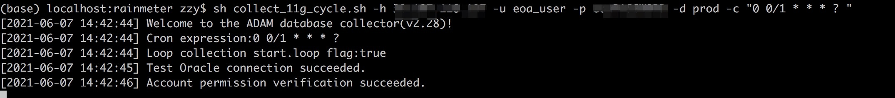

   - If the source Oracle database is a container database (CDB) and its version is 12c or later, run the following command:

     ```text
     sh collect_12c_cycle.sh -h <ip> -u <username> -p <password> -d <service_name> -s <sid> -c <cron>
     ```

     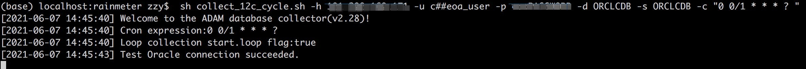

   > **Note**
   >
   > Parameter description:
   >
   > - -h: the IP address of the source database.
   >
   > - -u: the name of the account that is used for collection. In this example, the account name is eoa_user.
   >
   > - -p: the password of the account. In this example, the password is eoaPASSW0RD.
   >
   > - -P: the port that you want to use to collect the information about the source database. Example: 1521.
   >
   > - -d: the service name of the source database. If the source database is an Oracle 12c database, specify the service name of the specified pluggable database (PDB).
   >
   > - -s: the name of the Oracle database instance. This option is required only for Oracle 12c.
   >
   > - -c: the CRON expression that is used to specify the collection interval.

5. Return to the Migration Lab page. In the **Periodic SQL Collection** section, click **Details**.

6. Click **Create Project**.

7. In the **Create Periodic Collection Project** panel, enter the project name, select the database type from the drop-down list, and then click **Upload** to upload the out/data.zip file. After the file is uploaded, click Create.

8. Find the project that you create in the previous step, and click **Details** in the **Actions** column to view the collection results.

<a id="section-7-5-5-2"></a>

#### 7.5.5.2. Perform an SQL comparison test

This topic describes how to use the SQL comparison test platform provided by Advanced Database & Application Migration (ADAM).

**Background information**

The SQL comparison test platform is a database test platform built based on the JMeter test engine. All SQL statements retained during the use of the ADAM service can be tested on the comparison test platform. You can build SQL test sets, create and run test tasks, and view test results.

**Procedure**

1. Log on to the DMS console.

2. In the top navigation bar, choose **DTS > Migration Lab** to go to the **Migration Lab** page.

3. In the **SQL Comparison Test** section, click **Test**.

4. Click **Create SQL Test Set**.

5. In the **Create SQL Test Set** panel, enter a name for the test set and configure the parameters that are described in the following tables.

   <ol type="i">

   <li>

   After you configure the source database information, click **Test Connectivity** to test the connectivity of the source database.

   | Parameter | Description |
   | --- | --- |
   | Database Type | The type of the source database. |
   | Instance Region | The region that is closest to the geographic area in which the source database resides. |
   | Instance Type | The access method of the source database. By default, <strong>Database with</strong> <strong>Public IP Address</strong> is selected. |
   | Hostname or IP Address | The IP address of the server that hosts the source database. |
   | Source Database Identifier | The identifier of the source database. You can specify the identifier in one of the following formats:<br>• Service name<br>• SID |
   | Database Name | The name of the source database. |
   | Port | The port number of the source database. |
   | Database Account | The username that is used to log on to the source database. |
   | Database Password | The password that is used to log on to the source database. |

   </li>

   <li>

   After you configure the destination database information, click **Test Connectivity** to test

   </li>

   </ol>

   the connectivity of the destination database.

   | Parameter | Description |
   | --- | --- |
   | Database Type | The type of the destination database. |
   | Instance Region | The region that is closest to the geographic area in which the destination database resides. |
   | Instance Type | The access method of the destination database. By default, <strong>Database</strong> <strong>with Public IP Address</strong> is selected. |
   | Hostname or IP Address | The IP address of the server that hosts the destination database. |
   | Database Name | The name of the destination database. |
   | Port | The port number of the destination database. |
   | Database Account | The username that is used to log on to the destination database. |
   | Database Password | The password that is used to log on to the destination database. |

   - Database Name: Enter the name of the destination database.

   - Port: Enter the port number of the destination database.

   - Database Account: Enter the username that is used to log on to the destination database.

   - Database Password: Enter the password that is used to log on to the destination database.

   <ol type="i" start="3">

   <li>

   Select a database evaluation project. The database evaluation project is created in the

   </li>

   </ol>

   Evaluate Dest. DB step on the Database Evaluation page.

   <ol type="i" start="4">

   <li>

   Specify the mode of SQL statement collection. Select Periodic Collection and Adapter.

   </li>

   <li>

   Click **Create**.

   </li>

   </ol>

6. Create an SQL test task.

   <ol type="i">

   <li>

   On the **SQL Test Sets** page, find the test set and click **Details** in the **Actions** column to view the SQL statements in the test set.

   </li>

   <li>

   On the **SQL Test Set Details** page, select the SQL statements on which you want to

   </li>

   </ol>

   perform a comparison test. Check whether the SQL statements are compatible based on the information in the **Compatible** column. Do not select incompatible SQL statements.

   <ol type="i" start="3">

   <li>

   Click **Create SQL Test Task**. In the dialog box that appears, enter the task name,

   </li>

   </ol>

   number of threads, and number of times that a loop needs to be repeated, and set the Test Type parameter to **Comparison Test**. Click **Create**.

   > **Note**
   >
   > The maximum number of threads allowed is 10,000, and the maximum number of times that a loop can be repeated is 10,000. If a number that you specify exceeds the corresponding limit, the task fails to be created.

7. Run the SQL test task. Find the created SQL test task and click **Start** in the **Actions** column. The task enters the **Running** state.

   After the task is complete, the state of the task changes to **Successful** or **Failed**.

8. View the results.

   Click **Details** to view the results of the task.

<a id="section-7-5-5-3"></a>

#### 7.5.5.3. Use ADAM SQL Adapter to transform SQL statements

Advanced Database & Application Migration (ADAM) SQL Adapter can automatically transform SQL statements that are incompatible between PolarDB databases and Oracle databases. This reduces the cost of SQL statement transformation after applications are migrated to PolarDB databases. This topic describes how to use SQL Adapter.

**Features**

- SQL Adapter can quickly verify PolarDB features without modifying the business code.

- SQL Adapter can automatically detect all the SQL statements of an application and provide transformation suggestions.

- For SQL statements that cannot be automatically transformed, SQL Adapter can verify the correctness of these SQL statements.

**Deploy the environment**

Before SQL Adapter is deployed, make sure that ADAM V5.0 is installed.

1. Log on to the DMS console.

2. In the top navigation bar, choose **DTS > Migration Lab** to go to the **Migration Lab** page.

3. In the **ADAM SQL Adapter** section, click **Apply**.

   After the package is downloaded, run the following command to decompress the package:

   ```bash
   tar -xvf adam-adapter.tar.gz
   ```

4. Configure the source database and destination PolarDB database.

   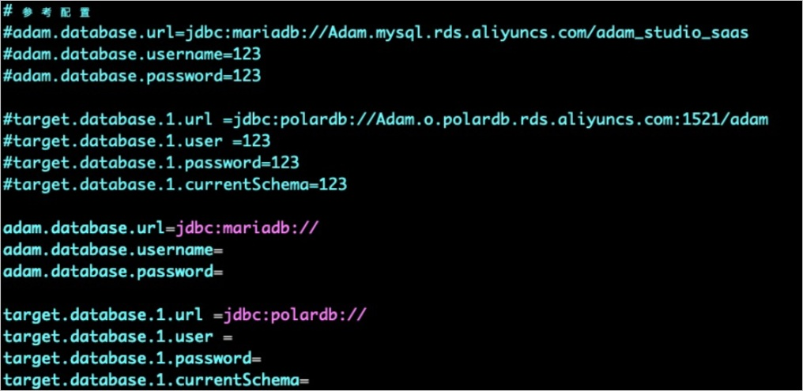

   > **Note**
   >
   > If multiple accounts are used to log on to the application that you want to migrate, you can use target.databases.2 to add configuration items.

5. Start SQL Adapter by running the following command:

   ```text
   sh run.sh start
   ```

6. Restart SQL Adapter by running the following command:

   ```text
   sh run.sh restart
   ```

7. Stop SQL Adapter by running the following command:

   ```text
   sh run.sh stop
   ```

8. Customize the startup script.

   - The default port number of the startup script is 8888. You can modify the port number.

   - The type parameter specifies the mode in which custom rules take effect. The default value is CACHE, which indicates that all rules are loaded after SQL Adapter starts. However, SQL Adapter must be restarted if new rules are customized.

   - In RUNTIME mode, rules are loaded in real time when SQL Adapter performs the transformation. This may affect the efficiency of executing SQL statements.

   ```text
   curr_dir=$(pwd)
   port=8888

   # type is CACHE/Runtime
   type=CACHE
   ```

**Procedure**

1. Transform the code of your application.

   Modify the Java Database Connectivity (JDBC) driver used by the application and change the connection URL of JDBC to the URL of SQL Adapter. SQL Adapter does not process the password, so the username and password do not need to be modified.

2. Log on to the DMS console.

3. In the top navigation bar, choose **DTS > Migration Lab** to go to the **Migration Lab** page.

4. In the ADAM SQL Adapter section, click **Details** to view the SQL statements that need to be transformed.

   Compatibility types include incompatible, compatible, and compatible after modification. SQL statements that are incompatible or compatible after modification must be transformed.

5. Click **Custom Rules**. In the Custom Rules panel, configure the parameters to customize a rule.

   The following table describes the parameters.

   | Parameter | Description |
   | --- | --- |
   | Rule Type | • Text Replacement: specifies the text to be matched and replaced.<br>• Regular Expression Replacement: matches the text to be replaced by using a regular expression. |
   | Text to Match | The text to be matched and replaced, or the regular expression used to match the text to be replaced. |
   | Text After Replacement | The text to replace after matching. |
   | Effective Scope | • Global: The rule applies to all SQL statements.<br>• Specified SQL: The rule applies only to the specified SQL statements. |

6. Click **Custom Rule List** to view the customized rules.

**Usage notes**

- The port number of SQL Adapter must be available so that applications can access SQL Adapter.

- By default, the type parameter is set to CACHE. If you need to modify your application while SQL Adapter is running, we recommend that you set the parameter to RUNTIME.

- SQL Adapter records all SQL statements that have been transformed and migrated. However, the same SQL statements are recorded only once during transformation.

- Custom rules do not take effect on CALL statements.

<a id="section-7-5-6"></a>

### 7.5.6. SQL conversion

The SQL converter provided by the Advanced Database & Application Migration (ADAM) module allows you to convert SQL scripts used for Oracle, Teradata, or Db2 databases to SQL scripts supported by MySQL, PolarDB for Oracle, or AnalyticDB for PostgreSQL databases.

**Procedure**

1. Log on to the DMS console.

2. In the top navigation bar, click DTS. In the left-side navigation pane, click SQL Conversion.

3. Select the type of the source SQL script. Supported types of source SQL scripts are Oracle, Teradata, and Db2.

4. Select the type of the converted SQL script. Supported types of converted SQL scripts are MySQL, PolarDB for Oracle, and AnalyticDB for PostgreSQL.

5. Enter scripts that conform to the specifications of the source SQL script type in the field on the left side of the page.

6. Click **Convert**. On the right side of the page, view the converted SQL scripts.

<a id="section-8"></a>

# 8.Security management

<a id="section-8-1"></a>

## 8.1. Permissions

<a id="section-8-1-1"></a>

### 8.1.1. Manage permissions

You can apply for the query, change, and export permissions on a database, table, or column. After the object owner approves your application, you can query, change, and export data.

**Permissions**

- Query permissions: the permissions to execute SQL statements in the SQL Console to query the data of the object on which you want to apply for the permissions.

- Change permissions: the permissions to submit tickets to change data or synchronize data in a database or table. You cannot change data without approval.

- Export permissions: the permissions to submit tickets to export data from the object on which you want to apply for the permissions. You cannot export data without approval.

**Permission categories that are supported by different control modes**

<table>
  <tr>
    <th rowspan="2">Permission category</th>
    <th rowspan="2">Description</th>
    <th colspan="3">Control mode</th>
  </tr>
  <tr>
    <td>Flexible Manage ment</td>
    <td>Stable Change</td>
    <td>Security Collabor ation</td>
  </tr>
  <tr>
    <td>Instance logon</td>
    <td>After you obtain the instance logon permissions on a database instance, you can use the specified database account and password to log on to the instance.</td>
    <td>√</td>
    <td>√</td>
    <td>×</td>
  </tr>
  <tr>
    <td>Database</td>
    <td>Database permissions are classified into query, export, and change permissions.After you obtain the database permissions on a database, you can access the following resources of the database: all the insensitive fields, all the tables to which row-level control settings are not applied, and all new tables.<br>• Query permissions: You can execute SQL statements in the SQL Console to query data.<br>• Change permissions: You can submit data change and data import tickets.<br>• Export permissions: You can submit data export tickets.</td>
    <td>×</td>
    <td>×</td>
    <td>√</td>
  </tr>
  <tr>
    <td>Table</td>
    <td>Table permissions are classified into query, export, and change permissions. After you obtain the table permissions on a table, you can access all data in the table except sensitive fields.<br>• Query permissions: You can execute SQL statements in the SQL Console to query data.<br>• Change permissions: You can submit data change and data import tickets.<br>• Export permissions: You can submit data export tickets.</td>
    <td>×</td>
    <td>×</td>
    <td>√</td>
  </tr>
  <tr>
    <td>Sensitive field</td>
    <td>Sensitive field permissions are classified into query, export, and change permissions.After you obtain the sensitive field permissions on sensitive fields in a table, you can access all sensitive fields in the table. Before you apply for the sensitive field permissions, you must obtain the database and table permissions to which the sensitive fields belong.<br>• Query permissions: You can execute SQL statements in the SQL Console to query data.<br>• Change permissions: You can submit data change and data import tickets.<br>• Export permissions: You can submit data export tickets.</td>
    <td>×</td>
    <td>×</td>
    <td>√</td>
  </tr>
  <tr>
    <td>Database owner</td>
    <td>• The owner of a database can manage the permissions on the database. For example, the owner of a database can grant or revoke permissions on the database and tables in the database.<br>• The owner of a database can query all data in the database except sensitive or confidential fields. The owner can also submit tickets to perform operations on the data and schemas in the database without the need to apply for permissions.<br>• Data Management (DMS) automatically identifies and assigns database owners to owner nodes in approval processes.</td>
    <td>×</td>
    <td>×</td>
    <td>√</td>
  </tr>
  <tr>
    <td>Table owner</td>
    <td>• The owner of a table can manage the permissions on the table. For example, the owner of a table can grant or revoke permissions on the table.<br>• The owner of a table can query all data in the table except sensitive or confidential fields.</td>
    <td>×</td>
    <td>×</td>
    <td>√</td>
  </tr>
  <tr>
    <td>Programmabl e object</td>
    <td>Programmable object permissions are classified into query, export, and change permissions.<br>• Query permissions: You can execute SQL statements in the SQL Console to query data.<br>• Change permissions: You can submit data change and data import tickets.<br>• Export permissions: You can submit data export tickets.</td>
    <td>×</td>
    <td>×</td>
    <td>√</td>
  </tr>
  <tr>
    <td>Instance performance</td>
    <td>You can apply for permissions to view the performance of database instances that are managed in Security Collaboration mode.</td>
    <td>×</td>
    <td>×</td>
    <td>√</td>
  </tr>
  <tr>
    <td>Instance owner</td>
    <td>• The owner of a database instance can manage the permissions on the instance.For example, the owner of a database instance can grant or revoke permissions on the instance.<br>• The owner of a database instance can query all data in the databases of the instance except sensitive or confidential fields. The owner can also submit tickets to perform operations on the data and schemas of the instance without the need to apply for permissions.</td>
    <td>×</td>
    <td>×</td>
    <td>√</td>
  </tr>
  <tr>
    <td>Row</td>
    <td>Row permissions are classified into query, export, and change permissions. You can apply for permissions on specific values of a managed field in a table. You can also apply for permissions on all values of a managed field in a table.<br>• Query permissions: You can execute SQL statements in the SQL Console to query data.<br>• Change permissions: You can submit data change and data import tickets.<br>• Export permissions: You can submit data export tickets.</td>
    <td>×</td>
    <td>×</td>
    <td>√</td>
  </tr>
</table>

**Apply for permissions**

1. Log on to the DMS console.

2. In the top navigation bar, choose **Security and Specifications > Permission Tickets**.

   > **Note**
   >
   > You can also enter a database name or a table name in the top search box
   >
   > to search for a database or table. On the Global Search page, find the database or table and click **Access apply** in the **Actions** column.

3. Click **Access apply** and select a permission category. For more information about different permission categories, see the Permission categories that are supported by different control modes section of this topic.

4. Configure the parameters of the ticket to apply for permissions.

   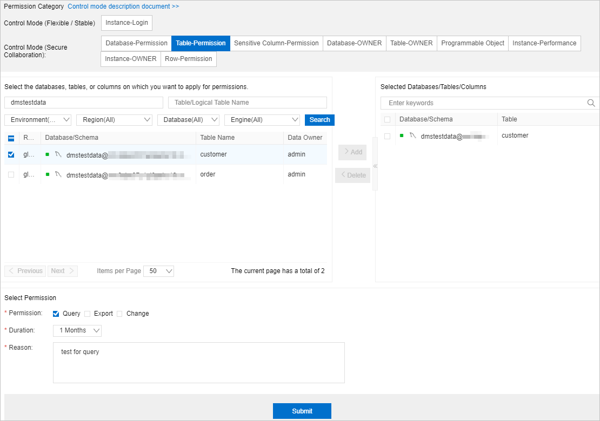

   <ol type="i">

   <li>

   Add objects on which you want to apply for permissions, such as databases, tables, or columns. You can enter a keyword to search for objects by name, select the objects on which you want to apply for permissions, and then click **Add** to add the objects to the **Selected Databases/Tables/Columns** section.

   > **Note**
   >
   > The keywords that you enter can contain percent signs (%) as wildcards.

   </li>

   <li>

   Select the permissions for which you want to apply and specify the duration for which you

   </li>

   </ol>

   want to have the permissions. Then, enter the reason for your application.

5. Click **Submit** and wait for approval. You can view the status of the ticket in the My Tickets section on the Home page of the **DMS console**.

**Manage permissions**

| Management type | Operation | Description |
| --- | --- | --- |
| Active management | Release permissions | On the Home page of the DMS console, click <strong>Accessible</strong> <strong>Assets</strong>. Select the object on which you want to release permissions and click <strong>Release Permission</strong>. |
| Passive management | N/A | The owner of an object can view and assess the rationality of permission assignments at any time and manage the permissions that are granted to users. |

> **Note**
>
> All the operations that you perform to apply for, release, revoke, and grant
>
> permissions are recorded in operation logs. To view the operation logs, choose **Security and Specifications > Operation Audit** in the top navigation bar. Then, click the Operation Logs tab.

<a id="section-8-1-2"></a>

### 8.1.2. Create a permission template

Data Management (DMS) allows you to add resources such as database instances, databases, and tables that have the same business attributes to a permission template and authorize one or more users to manage the resources in the permission template. The permission template feature implements centralized management. If you use a permission template, you no longer need to find users and resources one by one from a large number of users and resources and perform repeated operations to authorize the users to manage the resources.

**Prerequisites**

You are a database administrator (DBA), a DMS administrator, or a security administrator.

**Procedure**

1. Log on to the DMS console.

2. In the top navigation bar, choose **Security and Specifications > Permission Center > Permission template**.

3. On the Permission template page, click **Create Permission Template**.

4. In the **Create Permission Template** dialog box, configure the **Template Name** and **Description** parameters and click **Confirm**.

5. Add resources to the created permission template.

   You can use one of the following methods to add resources to the permission template:

   - On the **Permission template** page, find the permission template that you want to manage and click the template name or **Manage** in the **Operation** column. On the details page of the permission template, click the **Resource management** tab. On the right side of the tab, click **Add Resource**. In the dialog box that appears, search for and select one or more database instances, databases, and tables, specify permissions on the selected resources, and then click Confirm.

     > **Note**
     >
     > - You must select a database before you can select tables.
     >
     > - You can select databases and tables only in database instances that are managed in Security Collaboration mode.

   - To add resources to the permission template on the Instances page, perform the following steps:

     <ol type="a">

     <li>

     In the top navigation bar, choose **Data Assets > Instances**.

     </li>

     <li>

     Search for and select one or more database instances or databases, and then click **Add to Permission Template**.

     </li>

     </ol>

     <ol type="i" start="100">

     <li>

     In the dialog box that appears, select the permission template to which you want to add the database instances or databases and click **Save**. You can also click Add Permission Template to create a permission template and then add the database instances or databases to the permission template.

     </li>

     </ol>

   > **Note**
   >
   > To remove a resource from the permission template, perform the following operations: On the details page of the permission template, click the **Resource management** tab, find the resource that you want to manage, and then click **Remove** in the Operation column. In the message that appears, click OK.

6. Authorize one or more users to manage the resources in the permission template.

   You can use one of the following methods:

   - On the details page of the permission template, click **Authorize**. In the dialog box that appears, select one or more users who you want to authorize to manage the resources, specify the validity period of the authorization, and then click Confirm.

     > **Note**
     >
     > On the **Authorization Records** tab, you can view the authorization information such as the authorized users and the validity period of the authorization.

   - To authorize users to manage the resources on the Users page, perform the following steps:

     <ol type="a">

     <li>

     In the top navigation bar, choose **O&M > Users**.

     </li>

     <li>

     Select one or more users who you want to authorize to manage the resources and click **Authorize User**.

     </li>

     </ol>

     <ol type="i" start="100">

     <li>

     Select **Authorize Permission Template** from the drop-down list. In the dialog box that appears, select the permission template that you want to manage, specify the validity period of the authorization, and then click **OK**.

     </li>

     </ol>

   > **Note**
   >
   > After you authorize a user to manage the resources in a permission template, you can continue to authorize the user to manage the resources in the same permission template. In this case, the validity period of the new authorization prevails.

**Related operations**

**Modify the basic information of a permission template**

On the details page of a permission template, click Edit in the Basic information section. In the dialog box that appears, modify the name and description of the permission template.

> **Note**
>
> If you modify the basic information of a permission template, the authorized users of the permission template can still manage the resources in the permission template.

**Create a similar permission template**

> **Note**
>
> DMS allows you to create a similar permission template based on an existing permission template. The number of resources in the new permission template is the same as that in the existing permission template.

1. On the **Permission template** page, find the permission template that you want to manage and click **Create As** in the **Operation** column.

2. In the Create As dialog box, configure the **Template Name** and **Description** parameters.

3. Click **Confirm**.

**Delete a permission template**

On the Permission template page, find the permission template that you want to delete and click **Delete** in the **Operation** column. In the message that appears, click OK.

<a id="section-8-2"></a>

## 8.2. Security rules

<a id="section-8-2-1"></a>

### 8.2.1. Manage security rules

Security rules are implemented by using a collection of domain-specific language (DSL) statements to control user access to databases based on several factors. These factors include the type of database, the syntax of database operations, and the number of affected rows. You can use security rules to standardize database operations, development processes, and approval processes as required. This topic describes how to manage security rules.

**Prerequisites**

You are a database administrator (DBA) or a Data Management (DMS) administrator.

**Procedure**

1. Log on to the DMS console.

2. In the top navigation bar, choose **Security and Specifications > Security Rules**.

3. Perform one of the following operations based on your business requirements:

   - Create a rule set

     Click **Create Rule Set**. In the Create Rule Set dialog box, configure the Engine Type, Rule Set Name, and Remarks parameters, and click **Submit**.

   - Modify a rule set

     <ol type="a">

     <li>

     Find the rule set that you want to manage and click **Edit** in the **Actions** column.

     </li>

     <li>

     In the left-side pane, click the rule subset that you want to manage, such as **SQL Console**. On the right side of the page, select a checkpoint.

     </li>

     </ol>

     <ol type="i" start="100">

     <li>

     Find the rule that you want to manage and click **Edit** in the Actions column. For more information about the related syntax, see DSL syntax for security rules.

     > **Note**
     >
     > You can also delete, enable, or disable a rule.

     </li>

     </ol>

   - Create a similar rule set

     <ol type="a">

     <li>

     Find the rule set that you want to manage and click **Create As** in the **Actions** column.

     </li>

     <li>

     In the Clone Rule Set dialog box, configure the Rule Set Name and Remarks parameters.

     </li>

     </ol>

     <ol type="i" start="100">

     <li>

     Click **Submit**. The system copies the configurations of the original rule set to the new rule set.

     </li>

     </ol>

   - Delete a rule set

     Find the rule set that you want to manage and click **Delete** in the **Actions** column. In the message that appears, click **OK**.

     > **Note**
     >
     > - A deleted rule set cannot be recovered. Proceed with caution.
     >
     > - You can delete only custom rule sets. You cannot delete built-in rule sets.

   - Set a rule set as the default rule set Find the rule set that you want to manage and click **Set as Default** in the Default Engine column. In the message that appears, click **OK**. Then, the rule set is used as the default rule set for the related database engine.

     > **Important**
     >
     > This operation is risky. Proceed with caution.

<a id="section-8-2-2"></a>

### 8.2.2. DSL syntax for security rules

DMS provides a domain-specific language (DSL) to describe security rules. You can use the DSL syntax to define security rules. This allows you to define database development standards based on your business requirements.

**Overview**

The DSL syntax can include one or more conditions and related actions that are specified by an IF-ELSE statement.

> **Note**
>
> The if clause is required. Zero or more elseif clauses can be specified. Zero or
>
> one else clause can be specified.

Example 1: If Condition 1 is met, DMS performs Action 1.

```text
if
    Condition 1
then
    Action 1
end
```

Example 2: If Condition 1 is met, DMS performs Action 1. If Condition 2 is met, DMS performs Action 2. If Condition 1 and Condition 2 are not met, DMS performs Action 3.

> **Note**
>
> If the  `else Action 3`  clause is removed and Condition 1 and Condition 2 are
>
> not met, DMS performs no action.

```text
if
    Condition 1
then
    Action 1
elseif
    Condition 2
then
    Action 2
[else Action 3]
end
```

**DSL syntax**

- Conditional clauses

  DMS uses conditional clauses to evaluate whether to perform actions. The result of a conditional clause is true or false. A conditional clause consists of one or more connectors, operators, and factors. Connectors include AND and OR. Factors are predefined system variables. The following examples are valid conditional clauses:

  ```text
  1. true                    // This is the simplest conditional clause. The result is t
  rue. 
  2. 1 > 0
  3. 1 > 0 and 2 > 1
  4. 1 <= 0 or 1 == 1
  ```

- Connectors

  Connectors include AND and OR. The AND connector has higher priority than the OR connector. The two connectors have lower priority than operators. For example, a conditional clause is  `1 <= 0 or 1 == 1` . DMS evaluates the result of the  `1 <= 0` expression and the result of the  `1 == 1`  expression. Then, DMS evaluates the result of the OR expression based on the preceding results.

- Operators

  Operators are used to connect factors and constants to perform logical operations. The following table describes the operators that are supported by DMS.

  | Operator | Description | Examples |
  | --- | --- | --- |
  | == | Evaluates whether a value is equal to another value. | 1 == 1 |
  | != | Evaluates whether a value is not equal to another value. | 1 != 2 |
  | &gt; | Evaluates whether a value is greater than another value. | 1 &gt; 2 |
  | &gt;= | Evaluates whether a value is greater than or equal to another value. | 1 &gt;= 2 |
  | &lt; | Evaluates whether a value is less than another value. | 1 &lt; 2 |
  | &lt;= | Evaluates whether a value is less than or equal to another value. | 1 &lt;= 2 |
  | in | Evaluates whether a value belongs to an array of values. | 'a' in \['a', 'b', 'c'\] |
  | not in | Evaluates whether a value does not belong to an array of values. | 'a' not in \['a', 'b', 'c'\] |
  | matchs | Evaluates whether a string matches a regular expression. | 'idxaa' matchs 'idx\\w+' |
  | not matchs | Evaluates whether a string does not match a regular expression. | 'idxaa' not matchs 'idx\\w+' |
  | isBlank | Evaluates whether a value is empty. | '' isBlank |
  | isNotBlank | Evaluates whether a value is not empty. | '' isNotBlank |

  > **Note**
  >
  > - If you need to use a backslash (\\) in a regular expression, you must add another backslash (\\) as an escape character before the backslash that you want to use. For example, if you want to write the  `idx_\w+`  expression, you must enter  `idx_\\w+` .
  >
  > - If a conditional clause includes nested expressions, we recommend that you enclose the required expressions in parentheses (). For example, a conditional clause is  `1 <= 2 == true` . To specify the priority, you can change the clause to  `(1 <= 2) == true` . DMS first evaluates the result of the  `1 <= 2`  expression in the parentheses.

- Factors

  A factor is a predefined variable in DMS. You can use factors to obtain the context to be validated by security rules. The context includes command categories and the number of affected rows. A factor name is prefixed by  `@fac.` .Each tab of the Security Rules tab includes different factors for different checkpoints. The following table describes the factors that are supported by DMS.

  | Factor | Description |
  | --- | --- |
  | @fac.env_type | The type of the environment. The value is the display name of the environment type, such as DEV or PRODUCT. |
  | @fac.sql_type | The type of the SQL statement, for example, UPDATE or INSERT. For more information, see the SQL subcategories that are described in the "SQLConsole for relational databases" topic. |
  | @fac.detail_type | The type of the data change. Valid values:<br>• COMMON: a normal data modify ticket<br>• CHUNK_DML: a lock-free data modify ticket<br>• PROCEDURE: a programmable object ticket<br>• CRON_CLEAR_DATA: a history data clean ticket<br>• BIG_FILE: a large data import ticket |
  | @fac.is_logic | A Boolean value that indicates whether the affected database is a logical database. |
  | @fac.extra_info | Other information about the ticket. This factor is not in use. |
  | @fac.is_ignore_affect_rows | A Boolean value that indicates whether to skip the validation. |
  | @fac.insert_rows | The number of data rows to be inserted. |
  | @fac.update_delete_rows | The number of data rows to be updated. |
  | @fac.max_alter_table_size | The size of the largest tablespace in which the table to be modified is stored. |
  | @fac.is_has_security_column | A Boolean value that indicates whether sensitive fields are specified in the SQL statement to be executed. |
  | @fac.security_column_list | The sensitive fields that are specified in the SQL statement to be executed. |
  | @fac.risk_level | The risk level that is identified. |
  | @fac.risk_reason | The reason based on which the operation is identified as this risk level. |

  > **Note**
  >
  > You can use factors in conditional clauses. For example, you can write
  >
  > `@fac.sql_type == 'DML'`  to evaluate whether an SQL statement is a DML statement.

- Action clauses

  An action indicates an operation that is performed when the if clause evaluates to true. For example, DMS can disable the submission of a ticket, select an approval process, approve a ticket, or reject a ticket. An action indicates the usage of a security rule. An action name is prefixed by  `@act.` .Each tab of the Security Rules tab includes different actions for different checkpoints. The following table describes the actions that are supported by DMS.

  <table>
    <tr>
      <th>Action</th>
      <th>Description</th>
    </tr>
    <tr>
      <td>@act.allow_submit</td>
      <td>Requires the submission of SQL statements to be executed in a ticket.</td>
    </tr>
    <tr>
      <td>@act.allow_execute_direct</td>
      <td>Allows the execution of SQL statements in the SQLConsole.</td>
    </tr>
    <tr>
      <td>@act.forbid_execute</td>
      <td>Disables the execution of SQL statements.</td>
    </tr>
    <tr>
      <td>@act.mark_risk</td>
      <td>Marks the risk level of a data change. Example: <code>@act.mark_risk 'medium-level risk:</code> <code>online environment' </code>.</td>
    </tr>
    <tr>
      <td>@act.do_not_approve</td>
      <td rowspan="3">Specifies the ID of an approval template.</td>
    </tr>
    <tr>
      <td>@act.choose_approve_template</td>
    </tr>
    <tr>
      <td>@act.choose_approve_template_with_reason</td>
    </tr>
  </table>

- Predefined functions

  DMS provides predefined functions that can be used in conditional clauses and action clauses. A function name is prefixed by  `@fun.` .

  | Function | Description | Format |
  | --- | --- | --- |
  | @fun.concat | Connects strings to form a single string. Output: a string.Input: multiple strings. | @fun.concat('d', 'm', 's') // The output is the string 'dms'. @fun.concat('\[Development standards\] The \[', @fac.column_name, '\] You must enter remarks.') // The output is a prompt that reminds the user who submits the ticket to enter a value in the field. |
  | @fun.char_le ngth | Calculates the length of a string. Output: an integer.Input: a string. | @fun.char_length('dms') // The output is 3.@fun.char_length(@fac.table_name) // The output is the length of the table name. |
  | @fun.is_char_lower | Evaluates whether all the letters in a string are lowercase letters. Output: true or false. Input: a string. | @fun.is_char_lower('dms') // The output is true.@fun.is_char_lower(@fac.table_name) // If the output is true, it indicates that all the letters in the table name are lowercase. |
  | @fun.is_char_upper | Evaluates whether all the letters in a string are uppercase letters. Output: true or false. Input: a string. | @fun.is_char_upper('dms') // The output is false.@fun.is_char_upper(@fac.table_name) // If all the letters in the table name are uppercase letters, the output is true. |
  | @fun.array_si ze | Counts the number of values in an array. Output: an integer. Input: an array of values. | @fun.array_size(\[1, 2, 3\]) // The output is 3.@fun.array_size(@fac.table_index_array) // The output is the number of indexes of the table. |
  | @fun.add | Adds multiple numeric values.Output: a numeric value.Input: multiple numeric values. | @fun.add(1, 2, 3) // 6 |
  | @fun.sub | Deducts a numeric value from another numeric value.Output: a numeric value.Input: two numeric values. | @fun.sub(6, 1) // 5 |
  | @fun.betwee n | Evaluates whether a value belongs to a specific closed range. The supported data types are NUMERIC, DATE, and TIME. Output: true or false.Input: three values. The first value is the value to be evaluated. The second value indicates the lower limit. The third value indicates the upper limit. | @fun.between(1, 1, 3) // The output is true because the value 1 belongs to \[1, 3\].@fun.between(2, 1, 3) // The output is true because the value 2 belongs to \[1, 3\].@fun.between(7, 1, 3) // The output is false because the value 7 does not belong to \[1, 3\].@fun.between(@fac.export_rows, 2001,<br>100000) // If the number of exported rows belongs to \[2001, 100000\], the output is true.@fun.between(@fun.current_datetime(), '2019-10-31 00:00:00', '2019-11-04 00:00:00') // If the current date and time belong to \[2019-10-31 00:00:00, 2019-11-04 00:00:00\], the output is true. @fun.between(@fun.current_date(), '2019-10-31', '2019-11-04') // If the current date belongs to \[2019-10-31, 2019-11-04\], the output is true.@fun.between(@fun.current_time(), '13:30:00', '23:59:59') // If the current time belongs to \[13:30:00, 23:59:59\], the output is true. |
  | @fun.current _datetime | Returns the current date and time, in the format of yyyy-MM-dd HH:mm:ss. Output: a string. Input: none. | @fun.current_datetime() // For example, the output is 2019-10-31 00:00:00. |
  | @fun.current _date | Returns the current date, in the format of yyyy-MM-dd.Output: a string. Input: none. | @fun.current_date() // For example, the output is 2020-01-13. |
  | @fun.current _time | Returns the current time, in the format of HH:mm:ss.Output: a string. Input: none. | @fun.current_time() // For example, the output is 19:43:20. |

**DSL configuration examples**

Limit the number of SQL statements in a ticket: If the number of SQL statements in a ticket exceeds 1,000, DMS rejects the ticket and returns the related message.

```text
if
    @fac.sql_count > 1000
then
    @act.reject_execute 'The number of SQL statements in a ticket cannot exceed 1,000.'
else
    @act.allow_execute
end
```

Allows the submission of only data manipulation language (DML) statements: If the SQL statements in a ticket are DML statements such as the UPDATE, DELETE, and INSERT statements, DMS allows the execution of the statements.

```text
if
    @fac.sql_type in [ 'UPDATE','DELETE','INSERT','INSERT_SELECT']
then
    @act.allow_submit
end
```

<a id="section-8-2-3"></a>

### 8.2.3. Security rules

<a id="section-8-2-3-1"></a>

#### 8.2.3.1. Overview of security rule sets

Security rule sets are implemented by using a collection of domain-specific languages (DSLs) to control user access to databases based on several factors. These factors include the type of databases, the syntax of database operations, and the number of affected rows. You can use security rule sets to standardize database operations, development processes, and approval processes as required.

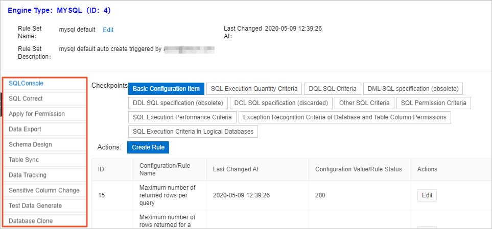

This topic describes the features that are supported by security rule sets. You can click the link of a feature to view the information about the feature. The information includes the basic configuration items, checkpoints, factors, actions, and supported statements or commands.

- SQL Console for relational databases

- SQL Console for MongoDB

- SQLConsole for Redis

- Data change

- Permission application

- Data export

- Schema design

- Database and table synchronization

- Sensitive field change

- Test data generation

- Database cloning

<a id="section-8-2-3-2"></a>

#### 8.2.3.2. Manage security rules under checkpoints

This topic describes how to configure a security rule under a checkpoint.

**Procedure**

In this example, a security rule set that is configured for MySQL databases is used.

1. Log on to the DMS console.

2. In the top navigation bar, choose **Security and Specifications > Security Rules**.

3. On the page that appears, find the security rule set that you want to manage and click **Edit** in the **Actions** column.

4. Click a tab on the left side of the page, and then click a checkpoint based on your business requirements. For example, click **SQL Console** on the left side of the page, and then click **SQL Execution Quantity Criteria**.

   > **Note**
   >
   > - For more information about the tabs and checkpoints, see Overview of security rule sets.
   >
   > - You can click **Create Rule** to create a security rule. For more information about the syntax, see DSL syntax for security rules.

5. Find the security rule that you want to manage and click **Edit** in the **Actions** column.

   You can also click **Disable** to disable a security rule, click **Enable** to enable a security rule, or click **Delete** to delete a security rule.

   > **Note**
   >
   > After a security rule is deleted, it cannot be recovered. Proceed with
   >
   > caution.

6. In the Change Rule - SQL Console dialog box, modify the domain-specific language (DSL) statements of the security rule based on your business requirements. For more information about the syntax, see DSL syntax for security rules. For example, change the maximum number of SQL statements that can be executed at a time from 1,000 to 500.

   > **Note**
   >
   > - A large number of security rule templates are provided for each checkpoint. You can click **Load from Template Database** to use a template.
   >
   > - For more information about factors and actions, see Overview of security rule sets.

7. Click **Submit**.

<a id="section-8-2-3-3"></a>

#### 8.2.3.3. SQL Console for relational databases

Data Management (DMS) allows you to manage security rules for relational and non-relational databases on the SQL Console tab. The definition and classification of security rules are different between relational and non-relational databases. This topic describes the security rules for relational databases on the SQL Console tab, such as MySQL databases.

**Default security rules**

- Constraints on SQL statement categories: No constraints are imposed on data query language (DQL) statements. By default, DML statements, DDL statements, data control language (DCL) statements, and SQL statements that cannot be identified by DMS are all blocked. To execute DML, DDL, or DCL statements in the SQL Console of a database, you must configure and enable corresponding security rules.

- Constraints on permissions on databases, tables, and fields: By default, users can perform operations on databases, tables, and fields without permission validation. To enable permission validation, you must configure and enable security rules under the **SQL Permission Criteria** checkpoint. For more information, see the Supported checkpoints section of this topic.

**Basic configuration items**

| Configuration item | Description |
| --- | --- |
| Maximum number of returned rows per query | The maximum number of rows that can be returned for a query. |
| Maximum number of rows returned for a single query with sensitive column conditions | The maximum number of rows that can be returned for a query that contains query conditions for sensitive fields. |
| Limit the maximum allowed SQL full table scan (MB) | The maximum size of data that can be scanned. Before an SQL statement is executed, DMS checks the execution plan. If the size of the data to be scanned exceeds the specified threshold, the SQL statement is not executed.<br>Note This item can be configured only for MySQL and Oracle databases. |
| Turn off the execution of change SQL validation affects the number of rows and prompts | Specifies whether to check the number of rows to be affected and display a prompt before DMS executes an SQL statement to change data. By default, this item is disabled. |
| How many rows does result set page support | The maximum number of rows that can be returned in the query result set in the SQL Console. |
| Does the result set support paging? | Specifies whether the query result set can be displayed on multiple pages in the SQL Console. |
| Does the result set support editing? | Specifies whether the query result set can be edited in the SQL Console. |
| Whether the result set supports export | Specifies whether the query result set can be exported from the SQL Console. |

**Supported checkpoints**

> **Note**
>
> A large number of security rule templates are provided for each checkpoint.
>
> You can configure security rules based on these templates or create custom security rules based on your business requirements.

| Checkpoint | Description |
| --- | --- |
| SQL Execution Quantity Criteria | Allows you to limit the number of SQL statements that can be submitted at a time. |
| DQL SQL Criteria | Allows you to set constraints on DQL statements. |
| Other SQL Criteria | Allows you to set constraints on multiple categories of SQL statements.Different enterprises may define different high-risk SQL statements, which may include specific subcategories of DML, DCL, and DDL statements.<br>Note You can also set constraints on SQL statements that cannot be identified by DMS. |
| SQL Permission Criteria | Allows you to set constraints on the execution of SQL statements from the aspect of permissions. For example, DMS checks whether a user has the required permissions on the corresponding databases, tables, and fields. |
| SQL Execution Performance Criteria | Allows you to set constraints on the execution of SQL statements from the aspect of performance. For example, you can specify that a DML statement is not executed if the number of rows to be affected by the statement exceeds the specified threshold, or that a DDL statement is not executed if the size of the table involved exceeds the specified threshold. |
| Exception Recognition Criteria of Database and Table Column Permissions | After a user submits SQL statements in the SQL Console, DMS parses the SQL statements and checks whether the user has the required permissions on the corresponding databases, tables, and fields. You can configure security rules under this checkpoint to ensure that if exceptions occur when DMS parses complex SQL statements, these statements can be executed.<br>Note If you configure and enable security rules under the Exception Recognition Criteria of Database and Table Column <strong>Permissions</strong> checkpoint, security rules under the SQL Permission Criteria, DQL SQL Criteria, Other SQL Criteria, and SQL Execution Performance Criteria checkpoints are automatically disabled. |
| SQL Execution Criteria in Logical Databases | This checkpoint is reserved for logical databases and is not suitable for physical databases. |

**Supported factors**

A factor is a built-in variable in DMS. You can use factors to obtain the context to be validated by security rules, such as SQL statement categories and the number of rows to be affected. A factor name starts with the prefix  `@fac.` . The following table describes the supported factors for relational databases on the SQL Console tab.

<table>
  <tr>
    <th>Factor</th>
    <th>Description</th>
  </tr>
  <tr>
    <td>@fac.sql_count</td>
    <td>The number of SQL statements that are submitted at a time.</td>
  </tr>
  <tr>
    <td>@fac.select_sql_count</td>
    <td>The number of DQL statements among the SQL statements that are submitted at a time.</td>
  </tr>
  <tr>
    <td>@fac.dml_sql_count</td>
    <td>The number of DML statements among the SQL statements that are submitted at a time.</td>
  </tr>
  <tr>
    <td>@fac.sql_type</td>
    <td rowspan="2">The category and subcategory of the SQL statement. For more information, see the Supported SQL statements section of this topic.</td>
  </tr>
  <tr>
    <td>@fac.sql_sub_type</td>
  </tr>
  <tr>
    <td>@fac.env_type</td>
    <td>The type of the environment. The value is the display name of the environment type, such as DEV or PRODUCT.</td>
  </tr>
  <tr>
    <td>@fac.fulltable_delete</td>
    <td>A Boolean value that indicates whether the current SQL statement deletes a full table. Valid values: true and false.</td>
  </tr>
  <tr>
    <td>@fac.fulltable_update</td>
    <td>A Boolean value that indicates whether the current SQL statement updates a full table. Valid values: true and false.</td>
  </tr>
  <tr>
    <td>@fac.current_sql</td>
    <td>The current SQL statement.</td>
  </tr>
  <tr>
    <td>@fac.user_is_admin</td>
    <td>A Boolean value that indicates whether the current user is a DMS administrator. Valid values: true and false.</td>
  </tr>
  <tr>
    <td>@fac.user_is_dba</td>
    <td>A Boolean value that indicates whether the current user is a database administrator (DBA). Valid values: true and false.</td>
  </tr>
  <tr>
    <td>@fac.user_is_inst_dba</td>
    <td>A Boolean value that indicates whether the current user is the DBA of the current database instance. Valid values: true and false.</td>
  </tr>
  <tr>
    <td>@fac.user_is_sec_admin</td>
    <td>A Boolean value that indicates whether the current user is a security administrator. Valid values: true and false.</td>
  </tr>
  <tr>
    <td>@fac.sql_affected_rows</td>
    <td>The number of rows to be affected by the current SQL statement.<br>Warning This factor triggers COUNT operations, which may affect the database performance. Use this factor with caution.</td>
  </tr>
  <tr>
    <td>@fac.sql_relate_table_store_siz e</td>
    <td>The estimated total size of the table to be accessed by the current SQL statement. Unit: MB.<br>Note This value is estimated based on the metadata that is obtained by DMS. It is not an actual value.</td>
  </tr>
</table>

**Supported actions**

An action in a security rule is an operation that DMS performs when the if condition in the rule is met. For example, DMS can forbid the submission of a ticket, approve a ticket, or reject a ticket. An action in a security rule denotes the purpose of the security rule. An action name starts with the prefix  `@act.` . The following table describes the supported actions for relational databases on the SQL Console tab.

| Action | Description |
| --- | --- |
| @act.reject_execute | Rejects the request to execute the current SQL statement. |
| @act.allow_execute | Allows the current SQL statement to be executed. |
| @act.reject_sql_type_execute | Rejects the request to execute a specific subcategory of SQL statements. You must specify an SQL statement subcategory after the action name. Example: <code> @act.reject_sql_type_execute </code> <code>'UPDATE' </code>. |
| @act.allow_sql_type_execute | Allows a specific subcategory of SQL statements to be executed.You must specify an SQL statement subcategory after the action name. Example: <code> @act.allow_sql_type_execute 'UPDATE' </code>. |
| @act.check_dml_sec_column_p ermission | Checks whether a user has the required permissions on sensitive fields. If the user does not have the permissions, the DML statement for data change is not executed. |
| @act.uncheck_dml_sec_column _permission | Does not check whether a user has the required permissions on sensitive fields. |
| @act.check_sql_access_permiss ion | Checks whether a user has the required permissions, such as query and change permissions, on the databases, tables, and fields that are involved in the SQL statements to be executed. |
| @act.uncheck_sql_access_perm ission | Does not check whether a user has the required permissions on the objects that are involved in the SQL statements to be executed. |
| @act.enable_sec_column_mask | Masks sensitive fields in query result sets that are returned for SQL statements that are submitted by users who do not have permissions on the sensitive fields. |
| @act.disable_sec_column_mask | Does not mask sensitive fields in query result sets that are returned for SQL statements that are submitted by users who do not have permissions on the sensitive fields. |

**Supported SQL statements**

| Category | Subcategory |
| --- | --- |
| DQL | • SELECT<br>• DESC<br>• EXPLAIN<br>• SHOW |
| DML | • INSERT<br>• INSERT_SELECT<br>• REPLACE<br>• REPLACE_INTO<br>• UPDATE<br>• DELETE<br>• MERGE |
| DDL | • DATABASE_OP<br>• CREATE<br>• CREATE_INDEX<br>• CREATE_VIEW<br>• CREATE_SEQUENCE<br>• CREATE_TABLE<br>• CREATE_SELECT<br>• TRUNCATE<br>• DROP_INDEX<br>• DROP_VIEW<br>• DROP_TABLE<br>• RENAME<br>• ALTER<br>• ALTER_INDEX<br>• ALTER_VIEW<br>• ALTER_TABLE<br>• ALTER_SEQUENCE<br>• CREATE_FUNCTION<br>• CREATE_PROCEDURE<br>• ALTER_FUNCTION<br>• ALTER_PROCEDURE<br>• DROP_FUNCTION<br>• DROP_PROCEDURE |
| DCL | • GRANT<br>• DECLARE<br>• SET<br>• ANALYZE<br>• FLUSH<br>• OPTIMIZE<br>• KILL |

<a id="section-8-2-3-4"></a>

#### 8.2.3.4. SQL Console for MongoDB

Data Management (DMS) allows you to manage security rules for relational and non-relational databases on the SQL Console tab. The definition and classification of security rules are different between relational and non-relational databases. This topic describes the security rules for MongoDB databases on the SQL Console tab.

**Basic configuration items**

- **Maximum number of returned rows per query**: the maximum number of rows that can be returned for a query. The maximum value is 3000.

- **Whether the result set supports export**: specifies whether the result sets of SQL statements that are executed for queries can be exported from the SQL Console.

**Supported checkpoints**

> **Note**
>
> A large number of security rule templates are provided for each checkpoint.
>
> You can configure security rules based on these templates or create custom security rules based on your business requirements.

<table>
  <tr>
    <th>Checkpoint</th>
    <th>Description</th>
  </tr>
  <tr>
    <td>User Permission Validation</td>
    <td>Allows you to specify whether to check the permissions of specific users when they submit commands.</td>
  </tr>
  <tr>
    <td>Collection Statement Criteria</td>
    <td rowspan="7">Allows you to specify whether to allow DMS to run a specific category of commands.</td>
  </tr>
  <tr>
    <td>DB Statement Criteria</td>
  </tr>
  <tr>
    <td>Cache Query Statement Criteria</td>
  </tr>
  <tr>
    <td>User Management Statement Criteria</td>
  </tr>
  <tr>
    <td>Role Management Statement Criteria</td>
  </tr>
  <tr>
    <td>Replication Set Statement Criteria</td>
  </tr>
  <tr>
    <td>Sharding Statement Criteria</td>
  </tr>
</table>

**Supported factors**

A factor is a built-in variable in DMS. You can use factors to obtain the context to be validated by security rules, such as command categories and the number of rows to be affected. A factor name starts with the prefix  `@fac.` . The following table describes the supported factors for MongoDB databases on the SQL Console tab.

| Factor | Description |
| --- | --- |
| @fac.sql_sub_type | The subcategory of the current command. For more information about the supported commands, see the Supported MongoDB commands section of this topic. |
| @fac.env_type | The type of the environment. The value is the display name of the environment type, such as <code> DEV </code> or <code> PRODUCT </code>. |
| @fac.current_sql | The current command. |
| @fac.user_is_admin | A Boolean value that indicates whether the current user is a DMS administrator. Valid values: true and false. |
| @fac.user_is_dba | A Boolean value that indicates whether the current user is a database administrator (DBA). Valid values: true and false. |
| @fac.user_is_inst_dba | A Boolean value that indicates whether the current user is the DBA of the current database instance. Valid values: true and false. |
| @fac.user_is_sec_admin | A Boolean value that indicates whether the current user is a security administrator. Valid values: true and false. |

**Supported actions**

An action in a security rule is an operation that DMS performs when the if condition in the rule is met. For example, DMS can forbid the submission of a ticket, approve a ticket, or reject a ticket. An action in a security rule denotes the purpose of the security rule. An action name starts with the prefix  `@act.` . The following table describes the supported actions for MongoDB databases on the SQL Console tab.

| Action | Description |
| --- | --- |
| @act.reject_execute | Rejects the request to run the current command. |
| @act.allow_execute | Allows the current command to be run. |
| @act.reject_sql_type_execute | Rejects the request to run a specific subcategory of commands. You must specify a subcategory after the action name. Example: <code> @act.reject_sql_type_execute 'UPDATE' </code>. |
| @act.allow_sql_type_execute | Allows a specific subcategory of commands to be run. You must specify a subcategory after the action name. |

**Supported MongoDB commands**

| Category | Subcategory | Command |
| --- | --- | --- |

- aggregate

- find

- findOne

- count

- distinct

- getIndexes

Query commands

- getShardDistribution

- isCapped

- stats

- dataSize

- storageSize

- totalIndexSize

- totalSize

- insert

- save

Data update commands

- findAndModify

- remove

- update

- drop

Collection modification commands

- renameCollection

- createIndex

Collection commands

- createIndexes

Index modification commands

- dropIndexes

- reIndex

Other commands

validate

- commandHelp

- currentOp

- getCollectionInfos

- getCollectionNames

- getLastError

- getLastErrorObj

- getLogComponents

- getPrevError

- getProfilingStatus

Database query commands

- getReplicationInfo

- getSiblingDB

- help

- isMaster

- listCommands

Database commands

- printCollectionStats

- printReplicationInfo

- version

- serverBuildInfo

- serverStatus,stats

Collection creation commands

createCollection

- dropDatabase

- fsyncLock

- fsyncUnlock

High-risk commands

- killOp

- repairDatabase

- resetError

- runCommand

- getPlanCache

Read commands

- getPlansByQuery

Commands related to the query

- listQueryShapes

plan cache

Write commands

clearPlansByQuery

- getUser

User query commands

- getUsers

- createUser

- changeUserPassword

- dropUser

User management commands

User modification commands

- dropAllUsers

- grantRolesToUser

- revokeRolesFromUser

- updateUser

<table>
  <tr>
    <td rowspan="2">Role management commands</td>
    <td>Role query commands</td>
    <td>• getRole<br>• getRoles</td>
  </tr>
  <tr>
    <td>Role modification commands</td>
    <td>• createRole<br>• dropRole<br>• dropAllRoles<br>• grantPrivilegesToRole<br>• revokePrivilegesFromRole<br>• revokeRolesFromRole<br>• updateRole</td>
  </tr>
  <tr>
    <td>Replica set commands</td>
    <td>N/A</td>
    <td>• help<br>• printReplicationInfo<br>• status<br>• conf</td>
  </tr>
  <tr>
    <td>Sharding commands</td>
    <td>N/A</td>
    <td>• getBalancerState<br>• isBalancerRunning</td>
  </tr>
</table>

<a id="section-8-2-3-5"></a>

#### 8.2.3.5. SQLConsole for Redis

DMS allows you to manage relational and non-relational databases on the SQLConsole tab. The definition and classification of security rules are different for relational and non-relational databases. This topic describes the security rules for Redis databases on the SQLConsole tab.

**Supported checkpoints**

> **Note**
>
> A large number of security rule templates are provided for each checkpoint.
>
> You can configure security rules based on these templates or create custom security rules based on your business requirements.

**Checkpoint**

**Description**

**Permission Execution**

Allows you to set constraints on the permissions for command execution.

**Statement Criteria**

**Statement Criteria:**

Allows you to specify whether to check the permissions of specific users

**Keys**

when they submit commands.

**Statement Criteria: String**

**Statement Criteria: List**

**Statement Criteria: SET**

Allows you to specify whether to allow the execution of various Redis commands.

**Statement Criteria: SortedSet Statement Criteria: Hash**

**Statement Criteria: Other**

**Supported factors**

A factor is a built-in variable in DMS. You can use factors to obtain the context to be validated by security rules, such as SQL statement categories and the number of rows to be affected. A factor name starts with the prefix  `@fac.` .The following table describes the supported factors for Redis databases on the SQLConsole tab.

| Factor | Description |
| --- | --- |
| @fac.cmd_type | The type of the Redis command. For more information about valid values, see Supported Redis commands. |
| @fac.env_type | The type of the environment. The value is the display name of the environment type, such as <code> DEV </code> or <code> PRODUCT </code>. |
| @fac.is_read | A Boolean value that indicates whether the current command is a read command. Valid values: true and false. |
| @fac.is_write | A Boolean value that indicates whether the current command is a write command. Valid values: true and false. |
| @fac.current_sql | The current command. |
| @fac.user_is_admin | A Boolean value that indicates whether the current user is a DMS administrator. Valid values: true and false. |
| @fac.user_is_dba | A Boolean value that indicates whether the current user is a DBA. Valid values: true and false. |
| @fac.user_is_inst_dba | A Boolean value that indicates whether the current user is the DBA of the current instance.Valid values: true and false. |

**Supported actions**

An action in a security rule is an operation that DMS performs when the if condition in the rule is met. For example, DMS can forbid the submission of a ticket, approve a ticket, or reject a ticket. An action in a security rule denotes the purpose of the security rule. An action name starts with the prefix  `@act.` .The following table describes the supported actions for Redis databases on the SQLConsole tab.

| Action | Description |
| --- | --- |
| @act.reject_execute | Rejects the request to run the current command. |
| @act.allow_execute | Allows the current command to be run. |

**Supported Redis commands**

**Category**

**Subcategory**

**Command**

- EXISTS

- TTL

- PTTL

Key-related read commands

- RANDOMKEY

- TYPE

- SCAN

- OBJECTS

- DEL

- DUMP

- EXPIRE

- EXPIREART

Key-related commands

- MOVE

- PERSIST

- PEXPIRE

- PEXPIREAT

Key-related write commands

- RENAME

- RENAMENX

- RESTORE

- SORT

- TOUCH

- UNLIMK

- WAIT

- MIGRATE

- GET

- GETRANGE

- BITCOUNT

String-related read commands

- GETBIT

- MGET

- STRLEN

- BITOPS

String-related commands

- APPEND

- BITFIELD

- BITOP

- DECR

- DECRBY

- GETSET

- INCR

String-related write commands

- INCRBY

- INCRBYFLOAT

- MSET

- MSETNX

- PSETEX

- SET

- SETNX

- LINDEX

List-related read commands

- LLEN

- LRANGE

- BLPOP

- BRPOP

- BRPOPLPUSH

- LINSERT

- LPOP

List-related commands

- LPUSH

- LPUSHX

List-related write commands

- LREM

- LSET

- LTRIM

- RTOP

- RPOPLPUSH

- RPUSH

- RPUSHX

- SCARD

- SISMEMBER

Set-related read commands

- SRANDMEMBER

- SSCAN

- SADD

- SMOVE

Set-related commands

Set-related write commands

- SPOP

- SREM

<table>
  <tr>
    <td rowspan="2">Sorted set-related commands</td>
    <td>Sorted set-related read commands</td>
    <td>• ZCARD<br>• ZCOUNT<br>• ZLEXCOUNT<br>• ZRANGE<br>• ZRANGEBYLEX<br>• ZRANGEBYSCORE<br>• ZRANK<br>• ZREVRNGE<br>• ZREVRANGEBYLEX<br>• ZREVRANGEBYSCORE<br>• ZREVRANK<br>• ZSCAN<br>• ZSCORE</td>
  </tr>
  <tr>
    <td>Sorted set-related write commands</td>
    <td>• ZADD<br>• ZINCRBY<br>• ZINTERSTORE<br>• ZPOPMAX<br>• ZPOPMIN<br>• ZREM<br>• ZUNIONSTORE<br>• BZPOPMIN<br>• BZPOPMAX</td>
  </tr>
  <tr>
    <td rowspan="2">Hash-related commands</td>
    <td>Hash-related read commands</td>
    <td>• HEXISTS<br>• HGET<br>• HLEN<br>• HMGET<br>• HSCAN<br>• HSTRLEN</td>
  </tr>
  <tr>
    <td>Hash-related write commands</td>
    <td>• HDEL<br>• HINCRBY<br>• HINCRBYFLOAT<br>• HMESET<br>• HSET<br>• HSETNX</td>
  </tr>
</table>

<a id="section-8-2-3-6"></a>

#### 8.2.3.6. Data change

In Data Management (DMS), you can execute SQL statements for data changes. However, the execution of such SQL statements requires a high level of security. DMS allows you to configure security rules on the SQL Correct tab to validate the submission and approval of tickets for data changes. Only the SQL statements that are validated by the security rules can be executed.

**Background information**

DMS provides a domain-specific language (DSL) to describe security rules. You can specify risk levels in security rules based on your business requirements and apply the rules to approval processes. Then, you can configure approval processes for data changes at different risk levels. For more information, see DSL syntax for security rules.

**Basic configuration items**

| Configuration item | Description |
| --- | --- |
| Data change default approval Template | By default, this approval template takes effect if you do not configure different approval rules for data changes at different risk levels under the Risk Approval Rules checkpoint. You can change the approval process of the default approval template by clicking Switch Approval Template. For more information, see Customize approval processes. |
| Data Change risk level list | This risk level list defines risk levels that are used in the <strong>Risk Identification</strong> <strong>Rules</strong> and <strong>Risk Approval Rules</strong> checkpoints to identify and classify risks in data changes. You can set risk levels based on the type and scenario of data changes. Data changes at different risk levels are submitted to different approval processes. DMS allows you to set the following four risk levels:<br>• low: a low risk level.<br>• middle: a medium risk level.<br>• high: a high risk level.<br>• highest: a critical risk level. |
| Whether data import supports selecting speed mode | You can specify whether to allow the use of the speed mode. In the Execute step, the SQL statements in the uploaded file are read and directly executed to import data to the specified destination database. The speed mode is less secure but faster than the security mode. |

**Supported checkpoints**

> **Note**
>
> A large number of security rule templates are provided for each checkpoint.
>
> You can configure security rules based on these templates or create custom security rules based on your business requirements.

| Checkpoint | Description |
| --- | --- |

<table>
  <tr>
    <td>SQL execution rules</td>
    <td>SQL execution rules are used to limit the SQL statements that can be submitted for execution. If you do not enable SQL execution rules, all SQL statements that are used for data changes cannot be executed. For example, you want to use DML statements to change the data of a database in an online environment. You can create the following SQL execution rule:<br><code>if</code><br><code>@fac.env_type not in ['product']</code><br><code>and</code><br><code>@fac.sql_type in [ 'UPDATE','DELETE','INSERT']</code><br><code>then</code><br><code>@act.allow_submit</code><br><code>end</code><br>Note:<br>The preceding rule specifies that you can submit data change tickets to execute only UPDATE, DELETE, and INSERT statements on a database that is deployed in an online environment.</td>
  </tr>
  <tr>
    <td>Risk Identification Rules</td>
    <td>If a ticket conforms to the preset SQL execution rules, DMS continues to validate the ticket based on risk identification rules. Risk identification rules are used to identify and classify risks in data changes. You can create risk identification rules based on your database environment, the number of rows in which data is affected, and the categories and subcategories of SQL statements.<br>Note Different risk identification rules apply to different check items. DMS automatically identifies the highest risk level for a data change. For example, if the risk level of a data change is identified as high, medium, and low by one, three, and five risk identification rules, DMS assumes that the data change is at high risk.<br>Example:<br><code>if</code><br><code>@fac.env_type not in ['product','pre']</code><br><code>then</code><br><code>@act.mark_risk 'low 'Low risk level: offline environment'</code><br><code>end</code><br>Note: The preceding rule specifies that if the destination database is deployed in an offline environment, data changes are at low risk.</td>
  </tr>
  <tr>
    <td>Risk Approval Rules</td>
    <td>After the risk level of a data change is identified by the risk identification rules, DMS processes the ticket based on risk approval rules. You can customize risk approval rules under the <strong>Risk Approval Rules</strong> checkpoint.<br>Note<br>• If a data change does not hit risk approval rules, DMS uses the default approval template that is specified under the Basic Configuration Item checkpoint to process the ticket.<br>• By default, an offline environment is identified as a factor at low risk and requires no approval.</td>
  </tr>
  <tr>
    <td>Batch Data import rules</td>
    <td>These rules apply only to the validation of data import tickets. You can use the default rules that are provided in the templates of security rules, or create a custom rule.</td>
  </tr>
</table>

**Supported factors**

A factor is a built-in variable in DMS. You can use factors to obtain the context to be validated by security rules, such as SQL statement categories and the number of rows to be affected. A factor name starts with the prefix  `@fac.` . The following table describes the supported factors on the SQL Correct tab.

| Factor | Description |
| --- | --- |
| @fac.env_type | The type of the environment. The value is the display name of the environment type, such as DEV or PRODUCT. |
| @fac.sql_type | The type of the SQL statement. The value is the subcategory of the SQL statement, such as UPDATE or INSERT. For more information, see the Supported SQL statements section of the "SQL Console for relational databases" topic. |
| @fac.detail_type | The type of the data change. Valid values:<br>• COMMON: a Normal Data Modify ticket.<br>• CHUNK_DML: a Lockless change ticket.<br>• PROCEDURE: a Programmable Object ticket.<br>• CRON_CLEAR_DATA: a History Data Clean ticket.<br>• BIG_FILE: a Large Data Import ticket. |
| @fac.is_logic | A Boolean value that indicates whether the database to be affected is a logical database. |
| @fac.extra_info | The additional information about the data change. This factor is not in use. |
| @fac.is_ignore_affec t_rows | A Boolean value that indicates whether to skip the validation. |
| @fac.insert_rows | The number of rows of data to be inserted. |
| @fac.update_delete_rows | The number of rows of data to be updated. |
| @fac.max_alter_tabl e_size | The size of the largest tablespace in which the table to be modified is stored. |
| @fac.is_has_security _column | A Boolean value that indicates whether the SQL statement to be executed involves sensitive fields. |
| @fac.security_colum n_list | A list of sensitive fields that the SQL statement to be executed involves. |
| @fac.risk_level | The risk level of the data change to be performed by the SQL statement. |
| @fac.risk_reason | The reason based on which the data change is marked with this risk level. |

**Supported actions**

An action in a security rule is an operation that DMS performs when the if condition in the rule is met. For example, DMS can forbid the submission of a ticket, approve a ticket, or reject a ticket. An action in a security rule denotes the purpose of the security rule. An action name starts with the prefix  `@act.` . The following table describes the supported actions on the SQL Correct tab.

<table>
  <tr>
    <th>Action</th>
    <th>Description</th>
  </tr>
  <tr>
    <td>@act.allow_submit</td>
    <td>Allows the submission of SQL statements to be executed in a ticket.</td>
  </tr>
  <tr>
    <td>@act.allow_execute_direct</td>
    <td>Allows the execution of SQL statements in the SQL Console.</td>
  </tr>
  <tr>
    <td>@act.forbid_execute</td>
    <td>Forbids the execution of SQL statements.</td>
  </tr>
  <tr>
    <td>@act.mark_risk</td>
    <td>Marks the risk level of a data change. Example: <code>@act.mark_risk 'Medium risk level:</code> <code>online environment' </code>.</td>
  </tr>
  <tr>
    <td>@act.do_not_approve</td>
    <td rowspan="3">Specifies the ID of an approval template.</td>
  </tr>
  <tr>
    <td>@act.choose_approve_template</td>
  </tr>
  <tr>
    <td>@act.choose_approve_template_with_reason</td>
  </tr>
</table>

<a id="section-8-2-3-7"></a>

#### 8.2.3.7. Permission application

Data Management (DMS) allows you to configure security rules on the Access apply tab to validate applications for permissions, including permissions on database instances, databases, and tables.

**Background information**

You can specify risk levels in security rules based on your business requirements and apply the rules to approval processes. Then, you can configure approval processes for applications for permissions on objects at different risk levels. For more information, see DSL syntax for security rules.

**Basic configuration items**

The following table describes the basic configuration items that are supported on the Access apply tab.

| Configuration item | Description |
| --- | --- |
| \[Instance-permission application\] default approval Template | By default, this approval template takes effect if you do not configure different approval processes for instance permission applications at different risk levels under the <strong>Validation for</strong> <strong>Instance Permission Application</strong> checkpoint.<br>Note You can change the approval process of the default approval template by clicking Switch Approval Template. |
| \[DB-permission application\] default approval Template | By default, this approval template takes effect if you do not configure different approval processes for database permission applications at different risk levels under the <strong>Database</strong> <strong>Permission Application Validation</strong> checkpoint. |
| Table-permission request default approval Template | By default, this approval template takes effect if you do not configure different approval processes for table permission applications at different risk levels under the <strong>Table Permission</strong> <strong>Application Validation</strong> checkpoint. |
| \[Programmable object-permission application\] default approval Template | By default, this approval template takes effect if you do not configure different approval processes for programmable object permission applications at different risk levels under the <strong>Programmable object verification</strong> checkpoint. |
| \[Field-permission application\] default approval Template | By default, this approval template takes effect if you do not configure different approval processes for sensitive field permission applications at different risk levels under the <strong>Sensitive Field</strong> <strong>Application Validation</strong> checkpoint. |
| Line-permission application default approval Template | By default, this approval template takes effect if you do not configure different approval processes for row permission applications at different risk levels under the <strong>Line permission</strong> <strong>application verification</strong> checkpoint. |
| \[Owner-application\] default approval template (when the resource has no Owner) | By default, this approval template takes effect if you do not configure different approval processes for data ownership applications at different risk levels under the <strong>Owner Application</strong> <strong>Validation</strong> checkpoint and the data that is involved in the application has no owner. |
| \[Owner-application\] default approval template (when the resource has an Owner) | By default, this approval template takes effect if you do not configure different approval processes for data ownership applications at different risk levels under the <strong>Owner Application</strong> <strong>Validation</strong> checkpoint and the data that is involved in the application has one or more owners. |

**Supported checkpoints**

When a user submits a ticket to apply for permissions, DMS checks whether the ticket conforms to the rules that are specified under checkpoints. The ticket can be submitted only after DMS determines that the ticket conforms to all rules that are specified under checkpoints.

> **Note**
>
> A large number of security rule templates are provided for each checkpoint.
>
> You can configure security rules based on these templates or create custom security rules based on your business requirements.

| Checkpoint | Description |
| --- | --- |
| Owner Application Validation | Allows you to configure approval processes or constraints for <strong>Instances-OWNER</strong>, <strong>Table-OWNER</strong>, and <strong>Database-OWNER</strong> tickets. |
| Validation for Instance Permission Application | Allows you to configure approval processes or constraints for <strong>Instances-Performance</strong> and <strong>Instances-Login</strong> tickets. |
| Database Permission Application Validation | Allows you to configure approval processes or constraints for <strong>Database-Permission</strong> tickets. |
| Table Permission Application Validation | Allows you to configure approval processes or constraints for <strong>Table-Permission</strong> tickets. |
| Programmable object verification | Allows you to configure approval processes or constraints for <strong>Programmable Object</strong> tickets. |
| Sensitive Field Application Validation | Allows you to configure approval processes or constraints for <strong>Sensitive Column-Permission</strong> tickets. |
| Line permission application verification | Allows you to configure approval processes or constraints for <strong>Row-</strong><strong>Permission</strong> tickets. |

**Supported factors**

A factor is a built-in variable in DMS. You can use factors to obtain the context to be validated by security rules, such as SQL statement categories and database names. A factor name starts with the prefix  `@fac.` . The following table describes the supported factors on the Access apply tab.

| Factor | Description |
| --- | --- |
| @fac.env_type | The type of the environment. The value is the display name of the environment type, such as DEV or PRODUCT. |
| @fac.schema_name | The name of the database. |
| @fac.perm_apply_duration | The validity period of the requested permissions.Unit: hour. |
| @fac.column_security_level | The sensitivity level of the field. Valid values:<br>• sensitive<br>• confidential<br>• inner |

**Supported actions**

An action in a security rule is an operation that DMS performs when the if condition in the rule is met. For example, DMS can forbid the submission of a ticket, approve a ticket, or reject a ticket. An action in a security rule denotes the purpose of the security rule. An action name starts with the prefix  `@act.` . The following table describes the supported actions on the Access apply tab.

**Action**

**Description**

@act.forbid_submit_order

Forbids a ticket from being submitted.

@act.do_not_approve

Specifies the ID of an approval template.

@act.choose_approve_template

@act.choose_approve_template_with_reason

<a id="section-8-2-3-8"></a>

#### 8.2.3.8. Data export

DMS allows you to manage security rules on the Data Export tab to validate the permissions of applicants on involved databases, tables, sensitive fields, and rows during the submission and approval of data export tickets. This helps ensure data security.

**Basic configuration items**

**Data export default approval Template**: the default approval template that takes effect if you do not set different approval processes for data export tickets at different risk levels under the Approval Rule Validation checkpoint. In the Switch Approval Template dialog box, you can change the approval process of the default approval template. For more information, see Customize approval processes.

**Supported checkpoints**

> **Note**
>
> A large number of security rule templates are provided for each checkpoint.
>
> You can configure security rules based on these templates or create custom security rules based on your business requirements.

| Checkpoint | Description |
| --- | --- |
| Pre-check Validation | Allows you to specify whether to validate the permissions of applicants on involved databases, tables, sensitive fields, and rows by configuring security rules. |
| Approval Rule Validation | Allows you to submit data export tickets to different approval processes by configuring security rules. For example, you can submit tickets for exporting more than a specific number of rows to an approval process and other tickets to another approval process. |

**Supported factors**

A factor is a built-in variable in DMS. You can use factors to obtain the context to be validated by security rules, such as SQL statement categories and the number of rows to be affected. A factor name starts with the prefix  `@fac.` .The following table describes the supported factors on the Data Export tab.

| Factor | Description |
| --- | --- |
| @fac.env_type | The type of the environment. The value is the display name of the environment type, such as DEV or PRODUCT. |
| @fac.is_ignore_export_rows_check | A Boolean value that indicates whether to skip the check on the number of rows to be affected. |
| @fac.export_rows | The number of rows to be exported. |
| @fac.include_sec_columns | A Boolean value that indicates whether the data to be exported contains sensitive fields. |
| @fac.sec_columns_list | The sensitive fields that require or do not require approval before data is exported. The sensitive fields are displayed in the format of <code> Table </code> <code>name.Field name,[Table name.Field name,</code><code>...] </code>. |
| @fac.user_is_admin | A Boolean value that indicates whether the applicant is a DMS administrator. |
| @fac.user_is_dba | A Boolean value that indicates whether the applicant is a DBA. |
| @fac.user_is_inst_dba | A Boolean value that indicates whether the applicant is the DBA of the current instance. |
| @fac.user_is_sec_admin | A Boolean value that indicates whether the applicant is a security administrator. |

**Supported actions**

An action in a security rule is an operation that DMS performs when the if condition in the rule is met. For example, DMS can forbid the submission of a ticket, approve a ticket, or reject a ticket. An action in a security rule denotes the purpose of the security rule. An action name starts with the prefix  `@act.` .The following table describes the supported actions on the Data Export tab.

| Action | Description |
| --- | --- |
| @act.do_not_approve | Allows a ticket to be processed without approval. |
| @act.choose_approve_template | Specifies an approval template. |
| @act.choose_approve_template_with_reason | Specifies an approval template with a reason provided. |
| @act.forbid_submit_order | Forbids a ticket from being submitted. |
| @act.enable_check_permission | Validates the permissions of an applicant on involved databases and tables. |
| @act.disable_check_permission | Does not validate the permissions of an applicant on involved databases and tables. |
| @act.enable_check_sec_column | Validates the permissions of an applicant on involved sensitive fields. |
| @act.disable_check_sec_column | Does not validate the permissions of an applicant on involved sensitive fields. |

<a id="section-8-2-3-9"></a>

#### 8.2.3.9. Schema design

Data Management (DMS) allows you to configure security rules on the Schema Design tab to check the design rules and risk identification rules that apply to schema design tickets. This helps ensure data security.

**Basic configuration items**

| Configuration item | Description |
| --- | --- |
| Enable non-peer Publishing | Specifies whether to enable non-peer publishing. By default, data changes to a table can be published only to a table with the same name in another database. After you enable non-peer publishing, you can perform data changes on all tables.<br>Warning This feature may bring high risks. We recommend that you proceed with caution and enable this feature only for special requirements. |
| R &amp; D process | The whole process of a schema design ticket. It is the most important configuration item on the Schema Design tab. For more information about the parameters of the configuration item, see the Parameters involved in the R&amp;D process section of this topic. |
| Field type configuration | The supported data types of fields to be created. |
| Index type configuration | The supported data types of indexes to be created. |
| Create a table template | The template used to create a table. The fields and indexes in the template are loaded first when you create a table. |
| It is forbidden to modify the original field data type | Specifies whether to prohibit the data types of the original fields from being modified when the original table is to be modified. |
| Prohibit deleting original fields | Specifies whether to prohibit the existing fields from being deleted when the original table is to be modified.<br>Note We recommend that you enable this feature because deleting existing fields may bring high risks. |
| Prohibit renaming original fields | Specifies whether to prohibit the existing fields from being renamed when the original table is to be modified.<br>Note We recommend that you enable this feature because renaming existing fields may bring high risks. |
| Table character set license configuration | The range of character sets that are allowed to be used when you create a table. For example, you can specify utf8 and utf8mb4. |
| Default approval template for Structural design | The default approval template that is used for a schema design ticket if you do not configure the Approval Rule Validation checkpoint. You can change the approval process of the default approval template by clicking Switch Approval Template. |
| When published, the ticket will automatically advance to the end state | The point that is used to stop the schema change process. If you enable this feature, after the node that is set as the anchor in the R&amp;D process is run, DMS automatically turns the ticket to the Finished state.<br>Note To use this feature, you must set the last node in the R&amp;D process as the anchor. |

**Supported checkpoints**

> **Note**
>
> A large number of security rule templates are provided for each checkpoint.
>
> You can configure security rules based on these templates or create custom security rules based on your business requirements.

The Schema Design tab contains the following two processes:

- Process of saving changes: DMS provides the following three checkpoints for this process. The checkpoints validate the table headings, fields, and indexes.

  - **Save Changes and Validate Header**

  - **Save Changes and Validate Field**

  - **Save Changes and Validate Index**

- Process of applying changes: DMS provides the following five checkpoints for this process. The first four checkpoints identify the risks that arise from changing schemas without locking tables, and the last checkpoint assigns an approval process to each type of risk.

  - **Table Creation Risk Control**

  - **Field Change Risk Control**

  - **Index Change Risk Control**

  - **SQL Execution Risk Control**

  - **Approval Rule Validation**

**Supported factors**

A factor is a built-in variable in DMS. You can use factors to obtain the context to be validated by security rules, such as SQL statement categories and the number of rows to be affected. A factor name starts with the prefix  `@fac.` . The following table describes the supported factors on the Schema Design tab.

| Factor | Description |
| --- | --- |
| @fac.table_kind | The type of the table whose schema is to be changed. Valid values:<br>• new: a newly created table.<br>• old: an existing table. |
| @fac.column_kind | The type of the field to be changed. Valid values:<br>• new: a newly created field.<br>• old: an existing field. |
| @fac.xxxx_old | The value of an existing field or index that is used for comparison. |
| @fac.column_is_primary | A Boolean value that indicates whether the current field serves as a primary key field. Valid values: true and false. |
| @fac.column_type_support_def ault | A Boolean value that indicates whether the data type of the current field supports a default value. Valid values: true and false.<br>Note For example, a field of the CHAR type supports a default value and a field of the TEXT type does not support a default value. |
| @fac.index_kind | The type of the index to be changed. Valid values:<br>• new: a newly created index.<br>• old: an existing index. |
| @fac.index_column_count | The number of fields in the index. |
| @fac.change_type | The type of the schema change to be performed by DDL statements. Valid values:<br>• add: creates one or more fields or indexes.<br>• modify: modifies one or more fields or indexes.<br>• delete: deletes one or more fields or indexes. |
| @fac.altered_table_size | The size of the table whose schema is to be changed. Unit: MB. |
| @fac.online_execute | A Boolean value that indicates whether the schema change can be performed in an online environment. Valid values: true and false. |
| @fac.change_risk_level | The risk level of the schema change. Valid values:<br>• high: a high risk level.<br>• middle: a medium risk level.<br>• low: a low risk level. |
| @fac.env_type | The type of the environment. The value is the display name of the environment type, such as DEV or PRODUCT. |

**Supported actions**

An action in a security rule is an operation that DMS performs when the if condition in the rule is met. For example, DMS can forbid the submission of a ticket, approve a ticket, or reject a ticket. An action in a security rule denotes the purpose of the security rule. An action name starts with the prefix  `@act.` . The following table describes the supported actions on the Schema Design tab.

<table>
  <tr>
    <th>Action</th>
    <th>Description</th>
    <th>Example</th>
  </tr>
  <tr>
    <td>@act.block_submit</td>
    <td>Blocks the submission of the schema change and displays the error message. This action can be used in the process of saving changes.</td>
    <td>@act.block_submit 'Reason for blocking the submission'</td>
  </tr>
  <tr>
    <td>@act.show_warning</td>
    <td>Displays the error message without blocking the submission of the schema change. This action can be used in the process of saving changes.</td>
    <td>@act.show_warning 'Error message'</td>
  </tr>
  <tr>
    <td>@act.mark_middle_risk</td>
    <td>Specifies that the schema change is at medium risk. This action can be used in the process of identifying the risk level.</td>
    <td>@act.mark_middle_risk 'Reason for the identification'</td>
  </tr>
  <tr>
    <td>@act.mark_high_risk</td>
    <td>Specifies that the schema change is at high risk. This action can be used in the process of identifying the risk level.</td>
    <td>@act.mark_high_risk 'Reason for the identification'</td>
  </tr>
  <tr>
    <td>@act.forbid_submit_publish</td>
    <td>Rejects the ticket. This action can be used in the process of configuring the approval process.</td>
    <td>@act.forbid_submit_publish 'Reason for the rejection'</td>
  </tr>
  <tr>
    <td>@act.do_not_approve</td>
    <td rowspan="3">Specifies the ID of an approval template.</td>
    <td rowspan="3">N/A</td>
  </tr>
  <tr>
    <td>@act.choose_approve_template</td>
  </tr>
  <tr>
    <td>@act.choose_approve_template _with_reason</td>
  </tr>
</table>

**Parameters involved in the R&D process**

| Parameter | Description |
| --- | --- |
| Step | • The type of the node. Valid values: <strong>Design</strong>: The design node in the R&amp;D process is generated by default and cannot be removed. It determines the environment in which the schema change is designed.<br>• <strong>Publish</strong>: A publish node in the R&amp;D process is used to publish the schema change after the change is designed. You can set multiple publish nodes. |
| Node Name | The name of the node. The name can be up to 10 characters in length. |
| Database Environment | The environment in which the node is run. |
| Execution Strategy | • The way in which the node is run. Valid values: <strong>Immediately</strong>: The node is run immediately after it is approved.<br>• <strong>Periodically</strong>: The node is run at the time that you specify.<br>Note If a node is approved before the specified point in time, it is run as scheduled. Otherwise, the node is interrupted and not run. |
| Can Go Back | Specifies whether a publish node can be rolled back to the design node. |
| Can Skip | Specifies whether the current node can be skipped. |
| Anchor | The point that is used to stop the schema change process. If you set a node as the anchor, after the node is published, the nodes that follow the anchor cannot be run and the schema change process ends. At this time, the ticket enters the Published state. |
| Actions | The operation that you can perform on a publish node. You can remove a publish node based on your business requirements. |

<a id="section-8-2-3-10"></a>

#### 8.2.3.10. SQL review and optimization

Data Management (DMS) integrates the SQL review and optimization feature into security rules. After you submit SQL statements for data change or in the SQL Console, DMS reviews the submitted SQL statements based on the specifications in security rules and offers optimization suggestions. This can help you review SQL statements and prevent invalid SQL statements before you perform a data change. This can also prevent the business from being affected.

**Check items**

- The following tables describe the check items that are supported by the SQL review feature.

  **Schema design**

  | Check item | Applicable SQL statement | Checkpoint |
  | --- | --- | --- |
  | Databas e properti es | <code>CREATE</code><br><code>DATABASE</code> | Rule name: The character set used to create the database must be restricted. Rule identifier: CREATE_DATABASE_LIMIT_CHARSET. |

  <table>
    <tr>
      <td>Table properti es</td>
      <td><code>• CREATE</code><br><code>TABLE</code><br><code>• ALTER</code><br><code>TABLE</code></td>
      <td>• Rule name: The table must have a primary key. Rule identifier: TABLE_MUST_HAVE_PRIMARY_KEY.<br>• Rule name: The table must contain remarks. Rule identifier: TABLE_MUST_HAVE_COMMENTS.<br>• Rule name: The table cannot contain foreign keys. Rule identifier: TABLE_FORBID_USE_FOREIGN_KEY.<br>• Rule name: The case sensitivity of the table name must be restricted. Rule identifier: TABLE_NAME_LIMIT_CHAR_CASE.<br>• Rule name: The table storage engine must be restricted. Rule identifier: TABLE_LIMIT_STORE_ENGINE.<br>• Rule name: The table cannot be partitioned. Rule identifier: TABLE_FORBID_USE_PARTITION.<br>• Rule name: The table must contain specific columns. Rule identifier: TABLE_MUST_HAVE_SOME_COLUMN.<br>• Rule name: The character set of the table must be restricted. Rule identifier: TABLE_MUST_USE_SOME_CHARSET.<br>• Rule name: The validation rules of the table must be restricted. Rule identifier: TABLE_MUST_USE_SOME_COLLATION.<br>• Rule name: The table name cannot be a keyword. Rule identifier: TABLE_NAME_FORBID_KEYWORD.<br>• Rule name: The number of indexes in the table must be restricted.Rule identifier: TABLE_LIMIT_INDEX_COUNT.<br>• Rule name: The number of fields in the table must be restricted.Rule identifier: TABLE_LIMIT_COLUMN_COUNT.<br>• Rule name: The initial value of an auto-increment column in the table must be restricted. Rule identifier: TABLE_LIMIT_INIT_AUTO_INCREMENT.<br>• Rule name: The table must contain an auto-increment primary key column. Rule identifier: LIMIT_PRIMARY_COLUMN_AUTO_INCREMENT.<br>• Rule name: The use of views must be restricted for the table. Rule identifier: TABLE_FORBID_USE_VIEW.<br>• Rule name: The use of triggers must be restricted for the table. Rule identifier: TABLE_FORBID_USE_TRIGGER.<br>• Rule name: The use of events must be restricted for the table. Rule identifier: TABLE_FORBID_USE_EVENT.<br>• Rule name: The use of stored procedures must be restricted for the table. Rule identifier: TABLE_FORBID_USE_STORED_PROCEDURE.<br>• Rule name: The use of user-defined functions (UDFs) must be restricted for the table. Rule identifier: TABLE_FORBID_USE_CUSTOM_FUNCTION.<br>• Rule name: We recommend that you use the <code> ALTER TABLE </code> <code>CONVERT </code> syntax to change the character set of the table. Rule identifier: MODIFY_CHARSET_USE_ALTER_TABLE_CONVERT.</td>
    </tr>
    <tr>
      <td>Column properti es</td>
      <td><code>• CREATE</code><br><code>TABLE</code><br><code>• ALTER</code><br><code>TABLE</code></td>
      <td>• Rule name: The field name cannot be a keyword. Rule identifier: COLUMN_NAME_FORBID_KEYWORD.<br>• Rule name: The case sensitivity of the field name must be restricted. Rule identifier: COLUMN_NAME_LIMIT_CHAR_CASE.<br>• Rule name: The character set of a column cannot be specified. Rule identifier: COLUMN_FORBID_SET_CHARSET.<br>• Rule name: Specific data types cannot be used in a column. Rule identifier: COLUMN_FORBID_DATA_TYPES.<br>• Rule name: A column must contain comments. Rule identifier: COLUMN_MUST_HAVE_COMMENTS.<br>• Rule name: The length of a field whose data type is <code> CHAR </code> must be restricted. Rule identifier: COLUMN_LIMIT_CHAR_LENGTH.<br>• Rule name: The length of a field whose data type is <code> VARCHAR </code> must be restricted. Rule identifier: COLUMN_LIMIT_VARCHAR_LENGTH.<br>• Rule name: Each column must use the <code> NOT NULL </code> clause. Rule identifier: COLUMN_MUST_SET_NOT_NULL.<br>• Rule name: The recommended name for an auto-increment column is <code> ID </code>. Rule identifier: COLUMN_AUTO_INCREMENT_NAME_ID.<br>• Rule name: An auto-increment column must contain the UNSIGNED attribute. Rule identifier: COLUMN_AUTO_INCREMENT_UNSIGNED.<br>• Rule name: The <code> FLOAT </code> and <code> DOUBLE </code> data types cannot be used. We recommend that you replace them with the <code> DECIMAL </code> data type. Rule identifier: COLUMN_FORBID_FLOAT_DOUBLE_TYPE.<br>• Rule name: Each column must have a default value. Rule identifier: EACH_COLUMN_NEED_DEFAULT_VALUE.<br>• Rule name: The validation set of a column cannot be specified. Rule identifier: COLUMN_FORBID_SET_COLLATE.<br>• Rule name: The columns cannot be renamed when you modify a table. Rule identifier: ALTER_TABLE_FORBID_RENAME_COLUMN.<br>• Rule name: The columns cannot be deleted when you modify a table. Rule identifier: ALTER_TABLE_FORBID_DROP_COLUMN.<br>• Rule name: The data type cannot be changed when you modify a table. Rule identifier: ALTER_TABLE_FORBID_MODIFY_DATA_TYPE.<br>• Rule name: All fields that are created when you modify a table can be empty. Rule identifier: ALTER_TABLE_ADD_COLUMN_NULLABLE.<br>• Rule name: The default value must be specified for a non-empty field that is created when you modify a table. Rule identifier: ALTER_ADD_NOT_NULL_COLUMN_NEED_DEFAULT.<br>• Rule name: The default value must be specified when a field that can be left empty is modified as a non-empty field. Rule identifier: COLUMN_NULLABLE_TO_NOT_NEED_DEFAULT.<br>• Rule name: The <code> ENUM </code> data type cannot be used. We recommend that you replace it with the <code> TINYINT </code> or <code> CHAR </code> data type. Rule identifier: COLUMN_FORBID_USE_ENUM_TYPE.<br>• Rule name: A field cannot contain the <code> ZEROFILL </code> attribute. Rule identifier: COLUMN_DATA_TYPE_FORBID_ZEROFILL.</td>
    </tr>
    <tr>
      <td>Index properti es</td>
      <td><code>• CREATE</code><br><code>TABLE</code><br><code>• ALTER</code><br><code>TABLE</code></td>
      <td>• Rule name: An index must have a name. Rule identifier: INDEX_MUST_HAVE_CLEARLY_NAME.<br>• Rule name: The naming format of a unique index must be restricted.Rule identifier: UNIQUE_INDEX_NAME_PATTERN.<br>• Rule name: The naming format of a regular index must be restricted. Rule identifier: COMMON_INDEX_NAME_PATTERN.<br>• Rule name: The number of index columns must be restricted. Rule identifier: INDEX_LIMIT_CONTAINS_COLUMNS.<br>• Rule name: The number of primary key columns must be restricted.Rule identifier: PRIMARY_LIMIT_CONTAINS_COLUMNS.<br>• Rule name: The data type of a primary key column must be restricted. Rule identifier: PRIMARY_LIMIT_COLUMN_DATA_TYPE.<br>• Rule name: The primary key cannot be deleted when you modify a table. Rule identifier: ALTER_TABLE_FORBID_DROP_PRIMARY.<br>• Rule name: The indexes cannot be deleted when you modify a table.Rule identifier: ALTER_TABLE_FORBID_DROP_INDEX.</td>
    </tr>
  </table>

  **Data query**

  | Check item | Applicable SQL statement | Checkpoint |
  | --- | --- | --- |

  <table>
    <tr>
      <td><code>SELECT</code></td>
      <td><code>• SELECT</code><br><code>• INSERT</code><br><code>SELECT</code><br>• Subquery clauses that are nested in the <code>UPDATE</code> or <code>DELETE</code> statement</td>
      <td>• Rule name: In the <code> SELECT </code> statement, we recommend that you use the <code> WHERE </code> clause. Rule identifier: SELECT_SUGGEST_ASSIGN_WHERE.<br>• Rule name: In the <code> SELECT </code> statement, we recommend that you do not use the <code> ORDER BY RAND() </code> function. Rule identifier: SELECT_FORBID_USE_ORDER_BY_RAND.<br>• Rule name: In the <code> SELECT </code> statement, we recommend that you do not perform the <code> GROUP BY </code> operation on constants. Rule identifier: SELECT_FORBID_GROUP_BY_CONST.<br>• Rule name: In the <code> SELECT </code> statement, we recommend that you do not perform the <code> ORDER BY </code> operation on constants. Rule identifier: SELECT_FORBID_ORDER_BY_CONST.<br>• Rule name: In the <code> SELECT </code> statement, we recommend that you do not perform the <code> GROUP BY </code> or <code> ORDER BY </code> operation on different tables. Rule identifier: SELECT_FORBID_GROUP_ORDER_BY_DISTINCT_TABLE.<br>• Rule name: In the <code> SELECT </code> statement, we recommend that you do not perform the <code> ORDER BY </code> operation to sort multiple fields in different ordering directions. Rule identifier: SELECT_FORBID_ORDER_BY_MULTI_COLUMN_RANK.<br>• Rule name: In the <code> SELECT </code> statement, we recommend that you do not use the <code> GROUP BY </code> or <code> ORDER BY </code> clause in an expression or a function. Rule identifier: SELECT_FORBID_GROUP_ORDER_BY_EXPR_OR_FUNCTION.<br>• Rule name: In the <code> SELECT </code> statement, we recommend that you do not use the <code> UNION </code> operator. Rule identifier: SELECT_FORBID_USE_UNION.<br>• Rule name: In the <code> SELECT </code> statement, the number of tables to be joined is restricted. Rule identifier: SELECT_LIMIT_TABLE_JOIN_COUNT.<br>• Rule name: In the <code> SELECT </code> statement, the offset value of the <code> LIMIT </code> clause is restricted. Rule identifier: SELECT_CONFINE_LIMIT_MAX_OFFSET.<br>• Rule name: In the <code> SELECT </code> statement, we recommend that you do not use the <code> HAVING </code> clause. Rule identifier: SELECT_FORBID_USE_HAVING.</td>
    </tr>
  </table>

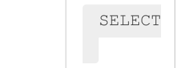

<table>
  <tr>
    <td><code>WHERE</code><br>clause</td>
    <td>The <code> SELECT </code>, <code> UPDATE </code>, <code> DELETE </code>, or <code> INSERT </code> <code>SELECT</code> statement that contains the <code> WHERE </code> clause</td>
    <td>• Rule name: In the <code> WHERE </code> clause, fields to be indexed cannot contain mathematical operators or functions. Rule identifier: WHERE_FORBID_INDEX_COLUMN_HAS_MATH.<br>• Rule name: In the <code> WHERE </code> clause, we recommend that you do not use wildcards to search for fields. Rule identifier: WHERE_FORBID_BEFORE_WILDCARD_SEARCH.<br>• Rule name: In the <code> WHERE </code> clause, DMS checks whether the <code> LIKE </code> clause contains wildcards. Rule identifier: WHERE_CHECK_LIKE_HAS_NOT_WILDCARD.<br>• Rule name: In the <code> WHERE </code> clause, we recommend that you do not use reverse queries such as <code> NOT IN </code> and <code> NOT LIKE </code>. Rule identifier: WHERE_FORBID_USE_REVERSE_SEARCH.<br>• Rule name: In the <code> WHERE </code> clause, the number of elements in the <code> IN </code> clause is restricted. Rule identifier: WHERE_LIMIT_IN_ITEM_MAX_COUNT.<br>• Rule name: In the <code> WHERE </code> clause, DMS checks whether the data types of fields are implicitly converted. Rule identifier: WHERE_CHECK_COLUMN_IMPLICIT_TYPE_CONVERSION.<br>• Rule name: In the <code> WHERE </code> clause, DMS checks whether filter conditions are connected by using the <code> OR </code> operator. Rule identifier: WHERE_CHECK_OR_LINK_CONDITION.</td>
  </tr>
</table>

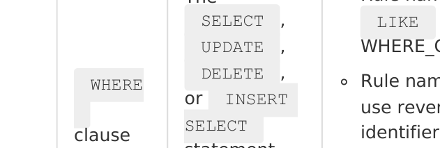

**Data change**

| Check item | Applicable SQL statement | Checkpoint |
| --- | --- | --- |

<table>
  <tr>
    <td>Data insertion</td>
    <td><code>• INSERT</code><br><code>SELECT</code><br><code>• INSERT</code><br><code>[IGNORE]</code><br><code>• REPLACE</code></td>
    <td>• Rule name: In the <code> INSERT </code> statement, we recommend that you specify the list of fields into which you want to insert data. Rule identifier: ASSIGN_INSERT_COLUMN_NAME_LIST.<br>• Rule name: In the <code> INSERT </code> statement, the names of fields into which you want to insert data cannot be duplicated. Rule identifier: INSERT_COLUMN_NAME_FORBID_DUPLICATE.<br>• Rule name: In the INSERT statement, a <code> NULL </code> value cannot be inserted into a <code> NOT NULL </code> column. Rule identifier: NOT_NULL_COLUMN_FORBID_INSERT_NULL.<br>• Rule name: In the <code> INSERT </code> statement, the list of fields into which you want to insert data must match the list of values that you want to insert. Rule identifier: INSERT_COLUMN_MUST_MATCH_VALUES.<br>• Rule name: In the INSERT statement, the total number of rows in an <code> INSERT VALUES </code> clause is restricted. Rule identifier: LIMIT_INSERT_VALUES_TOTAL_ROWS.<br>• Rule name: In the <code> INSERT </code> statement, DMS checks whether the table or field into which you want to insert data exists. Rule identifier: INSERT_CHECK_TABLE_COLUMN_EXISTS.<br>• Rule name: In the INSERT statement, we recommend that you do not use the <code> SYSDATA() </code> function. Rule identifier: INSERT_FORBID_USE_SYSDATE_FUNCTION.</td>
  </tr>
</table>

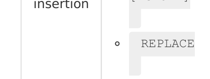

<table>
  <tr>
    <td>Data update and deletion</td>
    <td><code>• UPDATE</code><br><code>• DELETE</code></td>
    <td>• Rule name: In the <code> UPDATE </code> or <code> DELETE </code> statement, the number of tables to be joined is restricted. Rule identifier: UPDELETE_LIMIT_TABLE_JOIN_COUNT.<br>• Rule name: In the <code> UPDATE </code> or <code> DELETE </code> statement, we recommend that you use the <code> WHERE </code> clause. Rule identifier: UPDELETE_ASSIGN_WHERE_CONDITION.<br>• Rule name: In the <code> UPDATE </code> or <code> DELETE </code> statement, DMS checks whether the <code> WHERE </code> clause contains subqueries. Rule identifier: UPDELETE_CHECK_WHERE_EXIST_SUB_QUERY.<br>• Rule name: In the <code> UPDATE </code> or <code> DELETE </code> statement, the data size that is specified by the <code> LIMIT </code> clause is restricted. Rule identifier: UPDELETE_CHECK_LIMIT_AFFECTED_ROWS.<br>• Rule name: In the <code> UPDATE </code> or <code> DELETE </code> statement, DMS checks whether the syntax that is used to join multiple tables is complete.For example, DMS checks whether the <code> ON </code> clause is omitted for the <code> JOIN </code> clause. Rule identifier: UPDELETE_CHECK_TABLE_JOIN_LOSS_ON.<br>• Rule name: The <code> UPDATE </code> or <code> DELETE </code> statement cannot contain the <code> ORDER BY </code> clause. Rule identifier: UPDELETE_FORBID_ORDER_BY.<br>• Rule name: In the <code> UPDATE </code> statement, DMS checks whether the delimiters such as <code> AND </code> among multiple columns in the <code> SET </code> clause are valid. Rule identifier: UPDATE_CHECK_SET_ITEM_DELIMITER.<br>• Rule name: In the <code> UPDATE </code> statement, DMS checks whether the table prefix is specified for the columns of multiple tables in the <code> SET </code> clause. Rule identifier: UPDATE_MULTI_TABLE_CHECK_SET_COLUMN_PREFIX.<br>• Rule name: In the <code> UPDATE </code> statement, DMS checks whether the tables or fields that you want to update exist. Rule identifier: UPDATE_CHECK_TABLE_COLUMN_EXIST.<br>• Rule name: In the <code> UPDATE </code> statement, DMS checks whether the primary key is updated. Rule identifier: UPDATE_CHECK_PRIMARY_KEY_CHANGE.<br>• Rule name: In the <code> UPDATE </code> statement, DMS checks whether the unique key is updated. Rule identifier: UPDATE_CHECK_UNIQUE_KEY_CHANGE.<br>• Rule name: In the <code> UPDATE </code> statement, we recommend that you also update the Modify Time column in tables. Rule identifier: UPDATE_ALSO_TO_UPDATE_MODIFY_TIME_COLUMN.<br>• Rule name: In the <code> UPDATE </code> statement, we recommend that you do not update the Creation Time column in tables. Rule identifier: UPDATE_FORBID_MODIFY_CREATE_TIME_COLUMN.</td>
  </tr>
</table>

- The following table describes the check items that are supported by the SQL review and optimization feature.

  | Scenario | Checkpoint |
  | --- | --- |
  | N/A | • Rule name: The table whose primary key uses the <code> INT </code> data type needs to be optimized. Rule identifier: OPTIMIZE_PRIMARY_IS_INT_TABLE.<br>• Rule name: The auto-increment primary key column needs sufficient space.Rule identifier: SNIFFING_AUTO_PRIMARY_REMAIN_SPACE.<br>• Rule name: The value of the unique index cannot be empty. Rule identifier: SNIFFING_UNIQUE_EXIST_NULL_RISK.<br>• Rule name: The DDL statement needs to be optimized due to the risk of a data change failure or a table lock. Rule identifier: ALTER_LOCK_FAIL_SNIFFING_OPTIMIZE.<br>• Rule name: SQL injection risks need to be detected. Rule identifier: CHECK_SQL_INJECTION_RISK.<br>• Rule name: <code> Force index </code> risks need to be detected. Rule identifier: CHECK_SQL_ASSIGN_FORCE_INDEX.<br>• Rule name: Indexes need to be checked in SQL execution plans. Rule identifier: SQL_EXPLAIN_INDEX_CHECK.<br>• Rule name: DMS needs to analyze indexes and provide suggestions. Rule identifier: DMS_INDEX_ANALYZE_AND_SUGGEST. |

<a id="section-8-2-3-11"></a>

#### 8.2.3.11. SQL execution control

The SQL execution control feature of Data Management (DMS) allows you to control the number of SQL statements to be executed and prevent business interruption caused by excessive SQL statements being executed.

**Checkpoints**

**Applic**

**Configuration**

**able**

**Description**

**item**

**scope**

Database lock timeout mechanism

By default, Enable Protection Mechanism If Lock Wait Times Out is

before SQL

turned on. This prevents SQL execution from being blocked.

execution

Target resource concurrency control

By default, Autonomous System Adaptation is turned on. This limits

before SQL

the number of SQL statements to be executed in DMS at a time.

execution

SQL

By default, Enable Thread Protection Mechanism is turned on.

Database load

executi

Then, if the load on a database is too high, DMS suspends SQL

check before SQL

on

execution. You can configure the Maximum Running Threads, Retry

execution

Interval (Seconds), and Maximum Retries parameters.

By default, Autonomous System Adaptation is turned on. This

sleep policy after

prevents latency in synchronization between primary and

SQL execution

secondary databases and in Data Transmission Service (DTS) tasks. The latency can be caused by frequent SQL execution.

<table>
  <tr>
    <td>Lock-free schema change s</td>
    <td>Parameters to Control Lock-free Schema Change</td>
    <td>You can turn on the switch of a runtime parameter and change the value to control lock-free schema change.<br>You can modify the following runtime parameters:<br>• Table Lock Timeout Period During Table Switchover (Seconds)<br>• Retries<br>• Full Copy Policy and Size<br>• Time Window for Table Switchover<br>• Cleanup Policy After Table Switchover<br>Note<br>• In most cases, you do not need to manually modify the runtime parameters. DMS automatically performs lock-free schema changes in the optimal and most secure way. Before you modify the runtime parameters, make sure that you understand the descriptions of the parameters.<br>• Move the pointer over theicons next to the<br>parameters to view the descriptions.</td>
  </tr>
</table>

<a id="section-8-2-3-12"></a>

#### 8.2.3.12. Database and table synchronization

Data Management (DMS) allows you to configure security rules on the Table Sync tab to validate operations that are related to schema synchronization, empty database initialization, table consistency repair, and shadow table synchronization.

**Basic configuration items**

| Configuration item | Description |
| --- | --- |
| Enable execution capability | Specifies whether to enable SQL-based synchronization. If this configuration item is set to OFF, you can compare table schemas but cannot execute SQL statements to synchronize databases and tables. Other configuration items and security rules under checkpoints on the Table Sync tab also become invalid. |
| Default approval template for table synchronization | The default approval template for database and table synchronization tickets. You can change the approval process of the default approval template by clicking Switch Approval Template. For more information, see Customize approval processes. |
| Validity period of analysis phase script (unit: hours) | The timeout period of the analysis phase. You can specify an appropriate timeout period in which synchronization can be canceled if schemas are changed in the destination database. |

**Supported checkpoints**

The Table Sync tab contains checkpoints that correspond to database and table synchronization features. The checkpoints are independent of each other. For example, when you submit a Schema Synchronization ticket, only the basic configuration items and the security rules that are specified under the Schema Synchronization Validation checkpoint are used to validate the ticket.

> **Note**
>
> A large number of security rule templates are provided for each checkpoint.
>
> You can configure security rules based on these templates or create custom security rules based on your business requirements.

| Checkpoint | Description |
| --- | --- |
| Schema Synchronization Validation | Allows you to configure approval processes or constraints for Schema Synchronization tickets. |
| Empty Database Initialization Validation | Allows you to configure approval processes or constraints for Empty Database Initialization tickets. |
| Table Consistency Repair Validation | Allows you to configure approval processes or constraints for Table Consistency Repairing tickets. |
| Shadow Table Synchronization Validation | Allows you to configure approval processes or constraints for Shadow Table Synchronization tickets. |

**Supported factors**

A factor is a built-in variable in DMS. You can use factors to obtain the context to be validated by security rules, such as SQL statement categories and the number of rows to be affected. A factor name starts with the prefix  `@fac.` . The following table describes the supported factors on the Table Sync tab.

| Factor | Description |
| --- | --- |
| @fac.env_type | The type of the environment. The value is the display name of the environment type, such as DEV or PRODUCT. |
| @fac.schema_name | The name of the schema. |

**Supported actions**

An action in a security rule is an operation that DMS performs when the if condition in the rule is met. For example, DMS can forbid the submission of a ticket, approve a ticket, or reject a ticket. An action in a security rule denotes the purpose of the security rule. An action name starts with the prefix  `@act.` . The following table describes the supported actions on the Table Sync tab.

<table>
  <tr>
    <th>Action</th>
    <th>Description</th>
  </tr>
  <tr>
    <td>@act.forbid_submit_order</td>
    <td>Forbids a ticket from being submitted. Example: <code>@act.forbid_submit_order 'Reason for</code><br><code>forbidding the submission of the</code> <code>ticket' </code>.</td>
  </tr>
  <tr>
    <td>@act.do_not_approve</td>
    <td rowspan="3">Specifies the ID of an approval template.</td>
  </tr>
  <tr>
    <td>@act.choose_approve_template</td>
  </tr>
  <tr>
    <td>@act.choose_approve_template_with_reason</td>
  </tr>
</table>

<a id="section-8-2-3-13"></a>

#### 8.2.3.13. Sensitive field change

The topic describes the security rules on the Sensitive Column Change tab.

**Basic configuration items**

**Sensitive column default approval Template**: the default approval template that takes effect if you do not set approval processes for tickets that apply to change the security levels of sensitive fields under the Approval Rule Validation checkpoint. In the Switch Approval Template dialog box, you can change the approval process of the default approval template.

**Supported checkpoints**

**Approval Rule Validation**: When a user submits a ticket to change the security level of a sensitive field, DMS checks whether the ticket conforms to the rules that are specified under the Approval Rule Validation checkpoint.

> **Note**
>
> A large number of security rule templates are provided for each checkpoint.
>
> You can configure security rules based on these templates or create custom security rules based on your business requirements.

**Supported factors**

A factor is a built-in variable in DMS. You can use factors to obtain the context to be validated by security rules, such as SQL statement categories and the number of rows to be affected. A factor name starts with the prefix  `@fac.` .The following table describes the supported factors on the Sensitive Column Change tab.

| Factor | Description |
| --- | --- |
| @fac.column_level_change_typ e | The type of security level change that the applicant wants to perform on a sensitive field. Valid values:<br>• upper: raises the current security level, including the following three cases:<br>• From inner to sensitive<br>• From inner to confidential<br>• From sensitive to confidential<br>• sensitive_to_inner: lowers the security level from sensitive to inner.<br>• confidential_to_sensitive: lowers the security level from confidential to sensitive.<br>• confidential_to_inner: lowers the security level from confidential to inner. |

**Supported actions**

An action in a security rule is an operation that DMS performs when the if condition in the rule is met. For example, DMS can forbid the submission of a ticket, approve a ticket, or reject a ticket. An action in a security rule denotes the purpose of the security rule. An action name starts with the prefix  `@act.` .The following table describes the supported actions on the Sensitive Column Change tab.

<table>
  <tr>
    <th>Action</th>
    <th>Description</th>
  </tr>
  <tr>
    <td>@act.forbid_submit_order</td>
    <td>Forbids a ticket from being submitted. The statement is in the following format: <code>@act.forbid_submit_order 'Reason for</code><br><code>forbidding the submission of the</code> <code>ticket' </code>.</td>
  </tr>
  <tr>
    <td>@act.do_not_approve</td>
    <td rowspan="3">Specifies the ID of an approval template.</td>
  </tr>
  <tr>
    <td>@act.choose_approve_template</td>
  </tr>
  <tr>
    <td>@act.choose_approve_template_with_reason</td>
  </tr>
</table>

<a id="section-8-2-3-14"></a>

#### 8.2.3.14. Test data generation

This topic describes the security rules on the Test Data Generation tab.

**Basic configuration items**

**Test data build default approval Template**: the default approval template that takes effect if you do not configure different approval processes for test data generation tickets at different risk levels under the Approval rule validation checkpoint.

**Supported checkpoints**

**Approval rule validation**: When a user submits a ticket to generate test data, Data Management (DMS) checks whether the ticket conforms to the rules that are specified under the Approval rule validation checkpoint.

> **Note**
>
> A large number of security rule templates are provided for each checkpoint.
>
> You can configure security rules based on these templates or create custom security rules based on your business requirements.

**Supported factors**

A factor is a built-in variable in DMS. You can use factors to obtain the context to be validated by security rules, such as SQL statement categories and the number of rows to be affected. A factor name starts with the prefix  `@fac.` . The following table describes the supported factors on the Test Data Generation tab.

| Factor | Description |
| --- | --- |
| @fac.env_type | The type of the environment. The value is the display name of the environment type, such as DEV or PRODUCT. |
| @fac.schema_name | The name of the schema. |

**Supported actions**

An action in a security rule is an operation that DMS performs when the if condition in the rule is met. For example, DMS can forbid the submission of a ticket, approve a ticket, or reject a ticket. An action in a security rule denotes the purpose of the security rule. An action name starts with the prefix  `@act.` . The following table describes the supported actions on the Test Data Generation tab.

<table>
  <tr>
    <th>Action</th>
    <th>Description</th>
  </tr>
  <tr>
    <td>@act.forbid_submit_order</td>
    <td>Forbids a ticket from being submitted. Example: <code>@act.forbid_submit_order 'Reason for</code><br><code>forbidding the submission of the</code> <code>ticket' </code>.</td>
  </tr>
  <tr>
    <td>@act.do_not_approve</td>
    <td rowspan="3">Specifies the ID of an approval template.</td>
  </tr>
  <tr>
    <td>@act.choose_approve_template</td>
  </tr>
  <tr>
    <td>@act.choose_approve_template_with_reason</td>
  </tr>
</table>

<a id="section-8-2-3-15"></a>

#### 8.2.3.15. Database cloning

This topic describes the security rules on the Database Clone tab.

**Basic configuration items**

**Database clone default approval Template**: the default approval template that takes effect if you do not set approval processes for database clone tickets under the Approval rule validation checkpoint. In the Switch Approval Template dialog box, you can change the approval process of the default approval template.

**Supported checkpoints**

**Approval rule validation**: When a user submits a database clone ticket, DMS checks whether the ticket conforms to the rules that are specified under the Approval rule validation checkpoint.

> **Note**
>
> A large number of security rule templates are provided for each checkpoint.
>
> You can configure security rules based on these templates or create custom security rules based on your business requirements.

**Supported actions**

An action in a security rule is an operation that DMS performs when the if condition in the rule is met. For example, DMS can forbid the submission of a ticket, approve a ticket, or reject a ticket. An action in a security rule denotes the purpose of the security rule. An action name starts with the prefix  `@act.` .The following table describes the supported actions on the Database Clone tab.

<table>
  <tr>
    <th>Action</th>
    <th>Description</th>
  </tr>
  <tr>
    <td>@act.forbid_submit_order</td>
    <td>Forbids a ticket from being submitted. The statement is in the following format: <code>@act.forbid_submit_order 'Reason for</code><br><code>forbidding the submission of the</code> <code>ticket' </code>.</td>
  </tr>
  <tr>
    <td>@act.do_not_approve</td>
    <td rowspan="3">Specifies the ID of an approval template.</td>
  </tr>
  <tr>
    <td>@act.choose_approve_template</td>
  </tr>
  <tr>
    <td>@act.choose_approve_template_with_reason</td>
  </tr>
</table>

<a id="section-8-2-4"></a>

### 8.2.4. Configure security rules for a database instance

This topic describes how to configure security rules for a database instance.

**Prerequisites**

- You are a database administrator (DBA) or a Data Management (DMS) administrator.

- The control mode of the database instance is **Security Collaboration**.

**Procedure**

1. Log on to the DMS console.

2. In the top navigation bar, click **Data Assets**. In the left-side navigation pane, click **Instances**.

3. Find the database instance for which you want to configure security rules and choose **More > Edit** in the Actions column.

4. <strong>Optional:</strong>In the **Edit** dialog box, set the Control Mode parameter to **Security Collaboration** in the Basic Information section.

5. Select a security rule from the **Security Rules** drop-down list.

6. Click **Submit**.

<a id="section-8-3"></a>

## 8.3. Customize approval processes

Data Management (DMS) allows you to configure instance-level security rules so that you can customize different approval processes for different database instances or database operations. However, instance-level security rules have some limits in the production environment. This topic describes how to customize an approval process.

**Prerequisites**

You are a database administrator (DBA) or a DMS administrator.

**Background information**

You can customize approval processes to resolve issues encountered in the following scenarios:

- Each database instance has only one DBA, who acts as an approver in approval processes. The entire approval process may get stuck if the DBA cannot respond as expected. To prevent this issue, you may need to allow multiple DBAs to participate in an approval process.

- If multiple business units share the same database instance, each business unit must approve the tickets for their respective business operations in an approval process.

**Procedure**

This topic describes how to customize an approval process and specify multiple DBAs in the approval process. You can perform similar steps to customize an approval process in other scenarios.

1. Log on to the DMS console.

2. In the top navigation bar, choose **Security and Specifications > Approval Processes**.

3. Create an approval node.

   <ol type="i">

   <li>

   In the left-side pane, click the **Approval Node** tab. Then, click **Create Approval Node**.

   </li>

   <li>

   In the Create Approval Node dialog box, configure the parameters that are described in

   </li>

   </ol>

   the following table.

   | Parameter | Description |
   | --- | --- |
   | Node Name | The name of the approval node. The name must be globally unique. |
   | Remarks | The description of the approval node. This parameter distinguishes the approval node from other approval nodes. |
   | Approver | The approvers for the approval node. The Approver drop-down list displays the display name and UID of each Apsara Stack tenant account or Resource Access Management (RAM) user that is added to DMS. You can search for approvers by keyword. Prefix match is used.<br>Note Do not assign only one approver to an approval node. In most cases, we recommend that you assign at least two approvers to each approval node. |

   <ol type="i" start="3">

   <li>

   Click **Submit**.

   </li>

   </ol>

4. Create an approval template.

   <ol type="i">

   <li>

   In the left-side pane, click the **Approval Template** tab. Then, click **Create Approval Template**.

   </li>

   <li>

   In the Create Approval Template dialog box, configure the parameters that are described

   </li>

   </ol>

   in the following table.

   | Parameter | Description |
   | --- | --- |
   | Template Name | The name of the approval template. The name must be globally unique. |
   | Remarks | The description of the approval template. This parameter distinguishes the approval template from other approval templates. |
   | Approval Node | Click Add Node. In the Add Approval Node dialog box, find the approval nodes that you want to use and click Select in the Actions column. In this example, the system node Owner and the approval node that is created in Step 3 are selected to allow multiple DBAs to participate in the approval process.<br>Note The approval process is implemented based on the values of the Approval Order parameter in ascending order. |

   <ol type="i" start="3">

   <li>

   Click **Submit**.

   </li>

   </ol>

   After the approval template is created, you can view the template ID. In this example, the template ID is 9.

   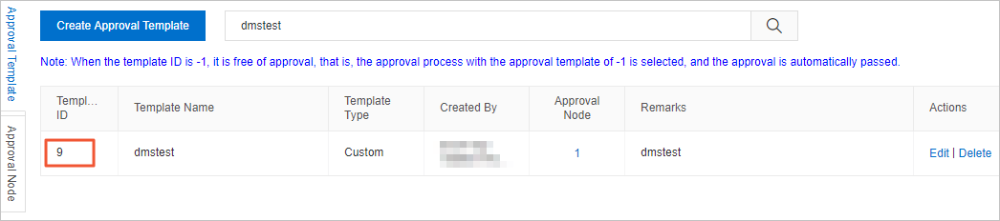

5. Apply the approval process to a security rule.

   This example shows how to apply the approval process to the security rule for medium-level risk approval processes under the **Risk Approval Rules** checkpoint. You can perform similar steps to apply an approval process in other scenarios.

   <ol type="i">

   <li>

   In the top navigation bar of the DMS console, choose **Security and Specifications > Security Rules**.

   </li>

   <li>

   Find the security rule set that you want to manage and click **Edit** in the **Actions** column.

   </li>

   <li>

   In the left-side pane, click the **SQL Correct** tab.

   </li>

   <li>

   Select **Risk Approval Rules** as the checkpoint.

   </li>

   <li>

   Find the security rule for medium-level risk approval processes and click **Edit** in the **Actions** column.

   </li>

   <li>

   In the **Rule DSL** field, change the template ID.

   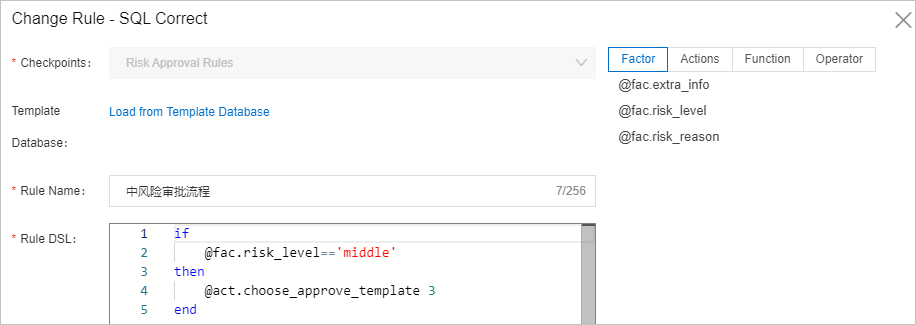

   > **Note**
   >
   > In this example, the template ID is changed from  `3`  to  `9` , as shown
   >
   > in the preceding figure. The template ID 9 is the ID of the approval template that is created in Step 4.

   </li>

   <li>

   Click **Submit**.

   </li>

   </ol>

**Result**

If a data change ticket that you submit matches the security rule, all specified DBAs receive ticket approval notifications and can participate in the approval process.

<a id="section-8-4"></a>

## 8.4. Configure access IP address whitelists

Data Management (DMS) allows you to configure access IP address whitelists. You can allow users to access DMS only from a specific trusted network environment. This way, the service scope of DMS is controlled.

**Prerequisites**

You are a DMS administrator.

**Procedure**

1. Log on to the DMS console.

2. In the top navigation bar, click **Security and Specifications**. In the left-side navigation pane, click **Access IP Whitelists**.

3. Perform one or more of the following operations based on your business requirements:

   - Enableordisablethewhitelistcontrolfeature

   - Enable or disable the whitelist control feature

     Click **Click to Open** or **Click to Close** to enable or disable the whitelist control feature.

   - Create a whitelist

     <ol type="a">

     <li>

     Click **Create Whitelist**.

     </li>

     <li>

     In the dialog box that appears, enter the IP addresses and description.

     > **Note**
     >
     > - Separate IP addresses with semicolons (;). Make sure that each IP address in a whitelist is unique.
     >
     > - You can specify IP addresses such as 10.23.12.24 or CIDR blocks such as 10.23.12.24/24, where /24 indicates the length of the IP address prefix in the CIDR block. The IP address prefix can be 1 to 32 bits in length.
     >
     > - A value of 0.0.0.0/0 indicates that all IP addresses are allowed.

     </li>

     </ol>

     <ol type="i" start="100">

     <li>

     Click **Submit**.

     </li>

     </ol>

   - Modify a whitelist

     <ol type="a">

     <li>

     Find the IP address whitelist that you want to modify and click **Edit** in the **Actions** column.

     </li>

     <li>

     In the dialog box that appears, modify the IP address information.

     </li>

     </ol>

     <ol type="i" start="100">

     <li>

     Click **Submit**.

     </li>

     </ol>

   - Delete a whitelist

     <ol type="a">

     <li>

     Find the IP address whitelist that you want to delete and click **Delete** in the **Actions** column.

     </li>

     <li>

     In the message that appears, click **OK**.

     > **Note**
     >
     > You cannot delete all IP address whitelists. At least one IP address
     >
     > whitelist must be retained.

     </li>

     </ol>

<a id="section-8-5"></a>

## 8.5. Use the operation audit feature

The operation audit feature provided by Data Management (DMS) allows you to query the information about operations that are performed in DMS, including SQL statements that are used in the SQLConsole, tickets, logon information, and operation logs. This helps you troubleshoot database issues and provides data for operation audit.

**Feature modules**

The following table describes the two modules of the operation audit feature in DMS: Operation Logs and Operation Audit.

| Module | Description | Item |
| --- | --- | --- |
| Operation Logs | Displays the logs of all the operations that are performed in DMS. | Includes the logs of management and configuration operations, SQL statements that are used in the SQLConsole, tickets, and logon information. |
| Operation Audit | Displays all the operations that are performed on the databases in DMS.<br>Note This module provides a user interface (UI) for you to audit operations in a centralized manner.This also helps you troubleshoot database issues with ease. | Includes SQL statements that are used in the SQLConsole, tickets, and logon information.<br>Note Only DMS administrators, database administrators (DBAs), ticket submitters, and stakeholders involved in the ticket approval process are allowed to view the ticket details. |

> **Note**
>
> - If the control mode of an instance is **Stable Change** or **Security Collaboration**, the log data of the instance is permanently retained in DMS. You can access and view the log data at any time.
>
> - If the control mode of an instance is **Flexible Management**, you can view the log data only within seven days.

**Procedure and supported roles**

The following table describes the roles that you can assume to use the operation audit feature. It also shows you how to go to the Operation Audit tab in the DMS console.

| Auditing dimension | Limits | Link to operation audit | Supported role |
| --- | --- | --- | --- |
| Database | You can view and audit only the operations that are performed on the current database. | • On the SQLConsole tab of the database that you want<br>to audit, click theicon<br>in the upper-right corner.<br>• In the left-side navigation pane of the DMS console, click the instance to which the database you want to audit belongs, right-click the database, and then choose Audit &gt; <strong>Operation</strong> <strong>Audit</strong>. | You can be a DMS administrator, a security administrator, a DBA, an instance owner, or a regular user.<br>Note If you are a regular user, you can view and audit only the operations that you performed on the current database. |
| Instance | You can view and audit only the operations that are performed on the current instance. | In the left-side navigation pane of the DMS console, right-click the instance that you want to audit and choose Audit &gt; <strong>Operation Audit</strong>. | You can be a DMS administrator, a security administrator, a DBA, an instance owner, or a regular user.<br>Note If you are a regular user, you can view and audit only the operations that you performed on the current instance. |
| Global | You can view and audit all the operations that are performed in DMS. | In the top navigation bar, click <strong>Security and</strong> <strong>Specifications</strong>. In the left-side navigation pane, click <strong>Operation Audit</strong>. | You can be a DMS administrator, a security administrator, or a DBA. |

**Download operation records**

This example shows you how to view and download all the SQL statements that are used in the SQLConsole in the last month.

1. Log on to the DMS console.

2. In the top navigation bar, click **Security and Specifications**. In the left-side navigation pane, click **Operation Audit**.

3. On the **Operation Audit** tab, click **SQL window list**.

4. Set the **Time** parameter to **Last One Month** and click **Search**. Then, DMS returns the search results.

5. Click the

   icon to download the results.

   

   Then, DMS exports an XLSX file that contains the search results displayed on the current page.

   > **Note**
   >
   > To preview and export more results, you can set the **Items per page**
   >
   > parameter to **100**.

<a id="section-8-6"></a>

## 8.6. Manage sensitive data

Data Management (DMS) allows you to manage all classified sensitive and confidential fields in a unified manner. You can configure encryption algorithms for sensitive and confidential fields. This improves the control over the data masking feature.

**Prerequisites**

You are a security administrator, a database administrator (DBA), or an administrator.

**Background information**

When you query a table that contains sensitive or confidential fields on which and you do not have permissions on the fields, the values of the fields are displayed as  `******`  in the query results. In this case, sensitive data is fully masked. In some scenarios, developers or test engineers may need to view a part of sensitive data for troubleshooting. To meet this requirement, you can configure masking algorithms to show some sensitive data.

**Limits**

- The sensitive data management feature applies only to relational databases such as MySQL. However, this feature is unavailable for NoSQL databases.

- To use this feature, the required database instance must be managed in security collaboration mode.

**Procedure**

1. Log on to the DMS console.

2. Specify security levels for fields in the required table.

   > **Note**
   >
   > If security levels are specified for the fields, skip this step.

   <ol type="i">

   <li>

   In the left-side database instance list, click the  icon next to the required database

   instance to show the databases in the instance.

   </li>

   <li>

   Find the required database, right-click the database, and then select **Tables**.

   </li>

   <li>

   Click the

   icon next to the table name to show the table details.

   

   </li>

   <li>

   Click **Adjust**.

   </li>

   <li>

   In the Adjust Security Level dialog box, change the security levels of fields.

   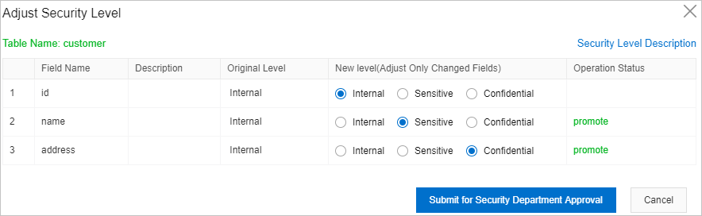

   </li>

   <li>

   Click **Submit for Security Department Approval**.

   > **Note**
   >
   > The application to increase the security level of a field is automatically
   >
   > approved. The application to decrease the security level of a field is approved based on the approval process specified by an administrator or DBA.

   </li>

   <li>

   In the message that appears, click **OK**.

   </li>

   </ol>

3. In the top navigation bar, choose **More > System > Sensitive Data**.

4. Find the required field and click **Add Algorithm** in the **Actions** column of the field.

5. In the dialog box that appears, configure a masking algorithm.

   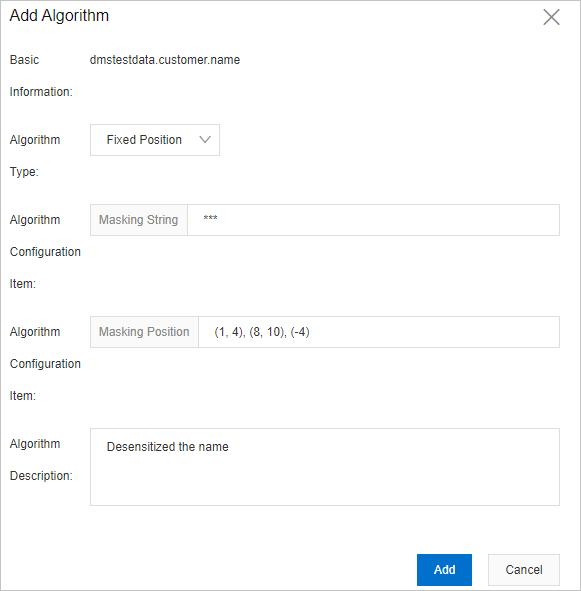

   | Parameter | Description |
   | --- | --- |
   | Algorithm Type | The type of the algorithm. You can select an algorithm type based on your business requirements. |

   <table>
     <tr>
       <td>Algorithm Configuration Item</td>
       <td>The algorithm configuration items vary based on the specified algorithm type.<br>• <strong>Fixed Position</strong> algorithm type<br>You must set the Masking String and Masking Position parameters. For example, you can set the Masking String parameter to ***.<br>The Masking Position parameter specifies the positions of the characters to be masked in the field values. The positions are in the format of coordinates. Examples:<br>• (1, 4): masks the first four characters. You can also enter (4) to simplify the format.<br>• (-4): masks the last four characters.<br>Note You can specify a maximum of three positions. For example, <code> (1, 4), (8, 10), (-4) </code> indicates to mask the first four characters, the eighth to tenth characters, and the last four characters.<br>• <strong>Fixed Character</strong> algorithm type You must set the Masking String and Character to Be Replaced parameters.<br>Note The Character to Be Replaced parameter specifies the characters that you want to mask in the format of a string. You can specify a maximum of three strings.<br>• <strong>Full Masking</strong> algorithm type<br>You need to set only the Masking String parameter.</td>
     </tr>
     <tr>
       <td>Algorithm Description</td>
       <td>Enter a description that can help you identify the algorithm.</td>
     </tr>
   </table>

6. Click **Add**.

<a id="section-8-6-1"></a>

### 8.6.1. Overview

Data Management (DMS) provides the sensitive data protection feature. You can use the feature to scan the metadata of a database for sensitive data. Then, you can mask and manage the sensitive data.

**Supported databases**

- Relational databases:

  - MySQL: ApsaraDB RDS for MySQL, PolarDB-X, and MySQL databases from other sources

  - SQL Server: ApsaraDB RDS for SQL Server and SQL Server databases from other sources

  - PostgreSQL: ApsaraDB RDS for PostgreSQL and PostgreSQL databases from other sources

  - ApsaraDB for OceanBase

  - Oracle

  - Dameng (DM)

- Data warehouses:

  - AnalyticDB for MySQL

  - AnalyticDB for PostgreSQL

**Feature architecture**

The sensitive data protection feature helps you effectively detect and protect sensitive data assets in your enterprise. This prevents sensitive data from being abused or leaked. The following figure shows the architecture of the sensitive data protection feature.

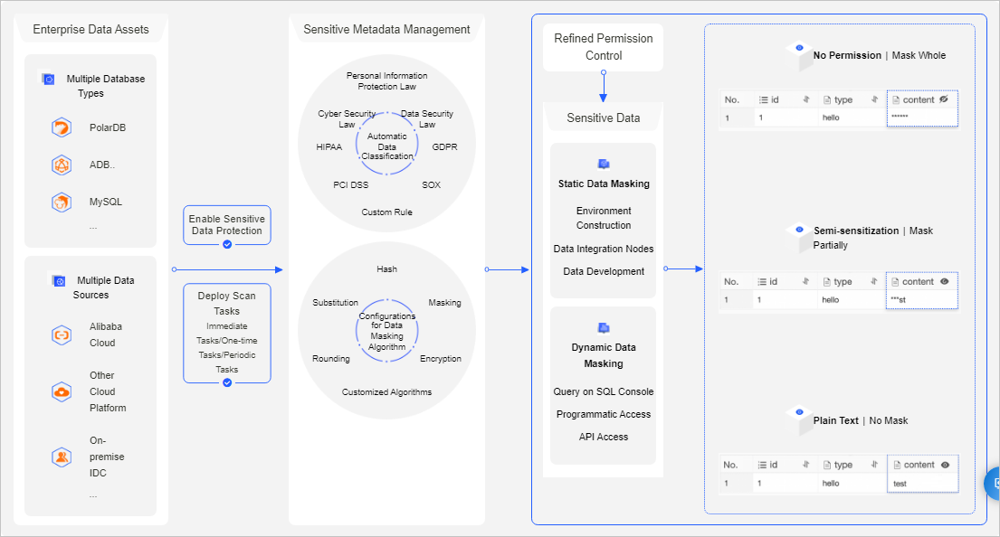

**Features**

- Sensitive data dashboard: DMS provides a sensitive data dashboard that helps an enterprise manage sensitive data in a centralized manner.

- Automated metadata scan

  - DMS allows you to customize a schedule for scanning data.

  - DMS automatically identifies and classifies enterprise sensitive data. This allows you to detect sensitive data in enterprise assets at the earliest opportunity and effectively manage the sensitive data.

  - DMS supports built-in and custom data classification templates to implement fine-grained classification and management of sensitive data. You can manage sensitive data based on the principle of least privilege.

- Sensitive data masking

  - DMS supports built-in and custom sensitive data masking rules. This helps you flexibly manage sensitive data masking algorithms. You can mask different fields based on your business scenarios, implement fine-grained permission control, and ensure least sensitive data exposure.

  - DMS provides a test environment that allows you to experiment with your sensitive data detection and masking rules.

  - DMS allows you to manage the access of users and applications to sensitive data.

- Sensitive data monitoring: DMS monitors the use of sensitive data, audits anomalous activities, and generates alerts. This helps you trace anomalous activities and the source of data leaks.

**Terms**

- Sensitivity level: Certain business data, such as mobile numbers and ID card numbers, is sensitive. The fields that store sensitive data must be encrypted before they are displayed during regular queries. DMS supports the following three sensitivity levels based on the sensitivity of the data:

  - Low Sensitivity

    > **Note**
    >
    > For a database instance that is managed in Secure Collaboration mode,
    >
    > the security level of the data stored in the database instance is Low Sensitivity by default.

  - Moderate Sensitivity

  - High Sensitivity

  > **Note**
  >
  > After you set the sensitivity levels for data, take note of the following rules:
  >
  > - When you query data in the SQLConsole, the Moderate Sensitivity and High Sensitivity fields on which you have no permissions are displayed as strings of asterisks (\*) or in a custom manner.
  >
  > - To query, export, or change Moderate Sensitivity or High Sensitivity fields, you must apply for the permissions on these fields.
  >
  > - A database administrator (DBA) or DMS administrator can configure special approval processes for exporting or changing data that contains Moderate Sensitivity or High Sensitivity fields.

- Detection rule: DMS provides built-in sensitive data detection rules that are designed for different industries based on the relevant laws and regulations. You can also customize detection rules that detect sensitive data based on the metadata of a database or the data that is stored in the database.

- Data types: DMS provides data types that are defined based on various laws and regulations. You can also create custom data types.

  - Level 1 data types: include types such as personal information, enterprise information, and location information.

  - Level 2 data types: include types such as mobile phone numbers, email addresses, and bank card numbers.

- Masking algorithm: DMS supports hash, redaction, substitution, transformation, and encryption algorithms to mask data. You can configure custom masking rules based on the built-in masking algorithms.

- Masking policy: DMS generates a masking policy after you configure a masking rule for the selected sensitive fields.

<a id="section-8-6-2"></a>

### 8.6.2. Enable the sensitive data protection feature

If a database contains sensitive data, you can enable the sensitive data protection feature for the database. This way, Data Management (DMS) can scan the metadata in the database, and detect, mask, and manage the sensitive data. This topic describes how to enable the sensitive data protection feature. This topic also describes how to create a scan task to scan metadata.

**Prerequisites**

- You are a DMS administrator, a database administrator (DBA), or a security administrator.

  > **Note**
  >
  > To view the role of your account, move the pointer over the  icon in the
  >
  > upper-right corner of the DMS console.

- The database is supported by the sensitive data protection feature. The following types of databases are supported:

  - Relational databases: MySQL, SQL Server, PostgreSQL, Oracle, Dameng (DM), PolarDB-X, and OceanBase

  - Data warehouses: AnalyticDB for MySQL and AnalyticDB for PostgreSQL

**Procedure**

1. Log on to the DMS console.

2. In the top navigation bar, choose **Security and Specifications > Sensitive Data Dashboard**.

3. On the Sensitive Data Dashboard page, click the **Not opened** tab in the **Instance List** section.

4. Find the database instance for which you want to enable the sensitive data protection feature and click **Enable Now** in the **Operation** column.

   > **Note**
   >
   > This tab displays only database instances for which the sensitive data
   >
   > protection feature is disabled.

5. In the **Enable Sensitive Data Protection** dialog box, turn on **Configure Scan Task**, configure the Scan Method parameter, and then click **OK**. Table 1. Configure a scan task

   | Option | Description |
   | --- | --- |
   | Immediate Task (Task Immediately Run Only Once) | After you configure an immediate task, DMS immediately scans the metadata in the specified database and marks sensitive data. |
   | Scheduled Task (Task Run at Specified Time Only Once) | Specify a date and a point in time. DMS automatically scans the metadata in the specified database and marks sensitive data as scheduled. |
   | Periodic Task | Specify the time and interval to run the scan task. DMS automatically scans the metadata in the specified database and marks sensitive data on a regular basis. |

6. In the **Scan Task Configuration Results** dialog box, click **Account Authorization**.

   > **Note**
   >
   > If the database instance is managed in Flexible Management or Stable
   >
   > Change mode, you must authorize DMS to access the database instance.

7. In the dialog box that appears, enter the username and password of the database account that is used to log on to the database instance and click **OK**.

8. <strong>Optional:</strong>To view the information about the scan task, click **Task details** in the **Operation** column. On the **Identification Tasks** tab, you can view the owner, status, and scan results of the scan task, and the time when the scan task was created, started, and complete.

9. <strong>Optional:</strong>To view sensitive data and the sensitivity levels of the sensitive data in the database instance, click **Sensitive Data List** in the **Operation** column. On the page that appears, click the **Field Control** tab. You can also manage sensitive fields on the Field Control tab. For example, you can adjust the sensitivity levels of fields, change the masking rules for fields, and grant permissions on fields. For more information, see Manage sensitive data.

<a id="section-8-6-3"></a>

### 8.6.3. Manage sensitive data

This topic describes how to adjust the sensitivity levels of fields and change the masking rules for fields. This topic also describes how to grant and revoke permissions on fields.

**Prerequisites**

You are a Data Management (DMS) administrator, a database administrator (DBA), or a security administrator.

> **Note**
>
> To view the role of your account, move the pointer over the  icon in the
>
> upper-right corner of the DMS console.

**Procedure**

1. Log on to the DMS console.

2. In the top navigation bar, choose **Security and Specifications > Sensitive Data > Sensitive Data List**.

3. On the Sensitive Data List page, click the **Field Control** tab.

   - Adjust the sensitivity level of one or more fields.

     <ol type="a">

     <li>

     Click the  icon to the left of a database. All fields of the database are displayed.

     </li>

     <li>

     Find the field for which you want to adjust the sensitivity level and click **Adjust Sensitivity Level** in the **Operation** column.

     > **Note**
     >
     > To adjust the sensitivity level of multiple fields to the same level,
     >
     > select the fields and click **Change security level** in the upper-left corner of this tab.

     </li>

     </ol>

     <ol type="i" start="100">

     <li>

     In the **Sensitivity level adjustment** dialog box, select the sensitivity level that you want to set and click **Confirm**.

     </li>

     </ol>

   - Change the masking rule for one or more fields.

     <ol type="a">

     <li>

     On the Field Control tab, select one or more fields for which you want to change the masking rule.

     </li>

     <li>

     Click **Change Masking Rule** in the upper-left corner of this tab.

     </li>

     </ol>

     <ol type="i" start="100">

     <li>

     In the **Data Masking Rule must be selected.** dialog box, select a custom masking rule and click **Save**. For more information about custom masking rules, see Create a data masking rule.

     > **Note**
     >
     > The default data masking rule is DEFAULT. To reset the masking rule to
     >
     > DEFAULT for a field, click **Reset Masking Rule** in the **Operation** column.

     </li>

     </ol>

   - Grant permissions on fields.

     > **Note**
     >
     > You can grant permissions on fields only for a database instance that is
     >
     > managed in Security Collaboration mode. You cannot grant permissions on fields for a database instance that is managed in Flexible Management or Stable Change mode.

     <ol type="a">

     <li>

     On the Field Control tab, select one or more fields on which you want to grant permissions.

     </li>

     <li>

     Click **Authorize User** in the upper-left corner of this tab.

     </li>

     </ol>

     <ol type="i" start="100">

     <li>

     In the **Authorize User** dialog box, select one or more users to which you want to grant permissions from the **Add User** drop-down list.

     </li>

     <li value="500">

     Configure the parameters as required in the **Permission Configuration** section. The following table describes the parameters that you must specify. If you do not grant a user the permissions on fields, the values of the fields are encrypted to the user.

     | Parameter | Description |
     | --- | --- |
     | Permission | The type of the permissions that you want to grant.<br>• Query: allows the selected users to query data by executing SQL statements in the SQL Console.<br>• Export: allows the selected users to submit tickets to export data.<br>• Change: allows the selected users to submit tickets to change or import data. |
     | Expire Date | The validity period of the permissions.<br>Note If you want to grant permissions on the fields by the day or hour, select <strong>Others</strong> from the drop-down list and specify the validity period. |

     </li>

     </ol>

     <ol type="a" start="5">

     <li>

     Click **OK**.

     </li>

     </ol>

   - Revoke permissions on sensitive fields.

     - Find the sensitive field on which you want to revoke permissions and click **Management authority** in the **Operation** column.

     - On the Management authority page, select **Sensitive Column Permission** for the **Classification** parameter.

     - Click **Recycle Permission** in the **Actions** column.

     > **Note**
     >
     > - To view the authorization details of the sensitive field, click **View Details** in the **Actions** column.
     >
     > - You can also grant or revoke other permissions on the database on the Management authority page.

<a id="section-8-6-4"></a>

### 8.6.4. Manage sensitive data detection rules

The sensitive data protection feature of Data Management (DMS) provides dozens of built-in sensitive data detection rules. These rules are designed based on the Cybersecurity Law of the People's Republic of China, the General Data Protection Regulation (GDPR), the Sarbanes-Oxley (SOX) Act, the Payment Card Industry (PCI) Data Security Standard (DSS), and the Health Insurance Portability and Accountability Act (HIPAA). These rules focus on protecting personal information. If the built-in sensitive data detection rules cannot meet your business requirements, you can create custom sensitive data detection rules.

**Prerequisites**

You are a DMS administrator, a database administrator (DBA), or a security administrator.

> **Note**
>
> To view the role of your account, move the pointer over the  icon in the
>
> upper-right corner of the DMS console.

**Procedure**

1. Log on to the DMS console.

2. In the top navigation bar, choose **Security and Specifications > Sensitive Data > Sensitive Data Identification**.

3. Click the **Identification Rules** tab.

4. Click **Create Rule**.

5. In the **Create Identification Rule** panel, configure the parameters that are described in the following table. Then, click **Submit**.

   | Parameter | Description |
   | --- | --- |
   | Rule Name | The name of the sensitive data detection rule to be created.<br>Note You cannot change the rule name after the rule is submitted. |
   | Description | The description of the sensitive data detection rule. The description facilitates subsequent management. |
   | Data type | The type of data to be detected by the rule.<br>Note You can also manually add data types. |
   | Sensitivity Level | The sensitivity level of a detected field. For more information, see Overview.<br>• Low Sensitivity: The Low Sensitivity level is derived from the Internal level of DMS. For a database instance that is managed in Security Collaboration mode, the sensitivity level of the data stored in the database instance is Low Sensitivity by default.<br>• Moderate Sensitivity: The Moderate Sensitivity level is derived from the Sensitive level of DMS.<br>• High Sensitivity: The High Sensitivity level is derived from the Confidential level of DMS. |

   <table>
     <tr>
       <td>Rule Configurations</td>
       <td>• Metadata Scan:<br>• Contain: If the name of a field contains the characters that you enter, the field is marked with the specified sensitivity level.<br>• Exclude: If the name of a field contains the characters that you enter, the field is not marked with the specified sensitivity level.<br>Note To use multiple keywords as filter conditions, separate them with commas (,).<br>• Data Content Scan: Enter a regular expression that is used to match field values.<br>Note To check whether the regular expression that you enter works as expected, enter test data and click <strong>Test</strong>.<br>• If the message "The field matches the regular expression" is displayed, the regular expression works as expected.<br>• If the message "The field does not match the regular expression" is displayed, the regular expression fails to match the test data and you need to modify the regular expression.</td>
     </tr>
   </table>

6. Enable the sensitive data detection rule that you create.

   > **Note**
   >
   > - By default, a sensitive data detection rule is disabled after it is created. A sensitive data detection rule takes effect only after you enable the rule.
   >
   > - You cannot modify built-in sensitive data detection rules. However, you can disable built-in sensitive data detection rules.
   >
   > - After you enable or disable a sensitive data detection rule, the setting takes effect in the next scan task.

<a id="section-8-6-5"></a>

### 8.6.5. Create a data masking rule

The sensitive data protection feature of Data Management (DMS) provides a built-in data masking rule that masks the entire value of a field. You can also create custom data masking rules based on the built-in data masking algorithms. This topic describes how to create a data masking rule.

**Prerequisites**

You are a DMS administrator, a database administrator (DBA), or a security administrator.

> **Note**
>
> To view the role of your account, move the pointer over the  icon in the
>
> upper-right corner of the DMS console.

**Procedure**

1. Log on to the DMS console.

2. In the top navigation bar, click **Security and Specifications**. In the left-side navigation pane, choose **Sensitive Data > Data Masking Management**.

3. On the **Data Masking Rule** tab of the Data Masking Management page, click **Create Data Masking Rule**.

4. In the **Create Rule** panel, set the parameters as required. DMS provides five types of built-in data masking algorithms: hash (Hash), redaction (Cover up), substitution (Replacement), transformation (Transformation), and encryption (Encryption).

   - Hash

     - MD5: a widely used cryptographic hash function that can generate a 128-bit (16-byte) hash value.

     - SHA1: a cryptographic hash function that can generate a 160-bit (20-byte) hash value called a message digest.

     - SHA256: generates a 256-bit hash value.

     - HMAC: a cryptographic technique that uses keys and a hash function to perform authentication.

   - Cover up

     - Full cover: masks the entire value of a field.

       For example, if you want to fully mask the phone number 1381111\*\*\*\*, set the Cover string parameter to \*\*\*\*\*\*\*\*\*\*\*. In this case, the phone number is masked to \*\*\*\*\*\*\*\*\*\*\*.

     - Fixed position cover: masks the specified part of a field.

       For example, if you want to mask the second part of the IP address 192.168.255.254, set the Cover string parameter to \*\*\* and the Mask position configuration parameter to (5,7). In this case, the IP address is masked to 192.\*\*\*.255.254.

     - Fixed character mask: masks the specified characters of a field.

       For example, if you want to mask example in the email address username@example.com, set the Cover string parameter to \*\*\*\*\*\*\* and the String to be obscured parameter to example. In this case, the email address is masked to username@\*\*\*\*\*\*\*.com.

   - Replacement

     - Map replacement: replaces a specified string with another specified string.

       For example, if you want to replace ab in the string abcd with mn, set the Match String parameter to ab and the Replace By parameter to mn. In this case, the string is masked to mncd.

     - Random replacement: replaces the specified part of a field with the random characters that you specify.

       For example, if you want to replace username in the email address username@example.com with random characters, set the Replacement position parameter to (1,8) and the Random character parameter to abc. In this case, the email address may be masked to acbbbbac@example.com.

       > **Note**
       >
       > If you specify two or more random characters, the masking result is
       >
       > random.

   - Transformation

     - Number rounding: rounds down a number to the Nth digit before the decimal point.

       For example, if you set the Keep the first decimal place parameter to 2, the number 1234.12 is masked to 1230.

     - Date rounded: rounds a date and time.

       For example, if you set the Date rounding level parameter to hour, 2021-10-14 15:15:30 is masked to 2021-10-14 15:00:00.

     - Character displacement: moves characters of a field leftward in a loop manner.

       For example, if you set the String left shift number parameter to 2, the number 345678 is masked to 567834.

   - Encryption

     - DES: uses the Data Encryption Standard (DES) algorithm to encrypt data. The key is 8 characters in length, and the masking result is 16 characters in length.

     - AES: a more advanced encryption algorithm compared with the DES algorithm. The key is 16 characters in length, and the masking result is 32 characters in length.

5. <strong>Optional:</strong>Test the masking rule.

   <ol type="i">

   <li>

   Enter the data to be masked.

   </li>

   <li>

   Click **Test**.

   </li>

   <li>

   Check whether the masking rule works as expected.

   </li>

   </ol>

6. Click **Submit**.

   > **Note**
   >
   > By default, the DEFAULT built-in rule is applied on sensitive data. For more
   >
   > information about how to apply a custom data masking rule on sensitive data, see Manage sensitive data.

<a id="section-8-6-6"></a>

### 8.6.6. Configure row-level access control

In some cases, different users may access different rows in the same table, which can be achieved by using views. Data Management (DMS) provides an alternative solution that is called the row-level access control feature to control access at the row level.

**Prerequisites**

You are a DMS administrator, a database administrator (DBA), or a security administrator.

> **Note**
>
> To view the role of your account, move the pointer over the  icon in the
>
> upper-right corner of the DMS console.

**Background information**

Row-level access control is used to provide horizontal data protection for tables. All the rows in a table are distinguished by one or more specified values. These values are called control values. To access a row that corresponds to a control value in the DMS console, you must have permissions on the row.

> **Note**
>
> A control value may correspond to multiple rows. If a user has permissions on
>
> a control value that corresponds to multiple rows, the user has permissions on all the rows that correspond to the control value.

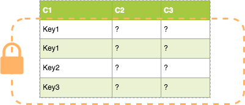

**Usage notes**

- The sensitive data management feature applies only to relational databases such as MySQL. However, this feature is unavailable for NoSQL databases.

- To use the row-level access control feature, your database instance must be managed in Security Collaboration mode.

- The row-level access control feature applies only to physical databases. However, this feature is unavailable for logical databases.

- When you execute SQL statements to query, modify, or delete the data of a row-level control table, the following limits are set on filter conditions:

  <ol type="i">

  <li>

  The control field must be specified in SQL statements to filter data.

  </li>

  <li>

  The system controls access to all the rows of a row-level control table. Users who do not

  </li>

  </ol>

  have permissions on all rows can use only the  `=`  and  `IN`  operators to specify a control field. The control value that is specified in an SQL statement must be one of the control values for the table.

  <ol type="i" start="3">

  <li>

  Users who do not have permissions on all rows cannot use some operators, such as OR,

  </li>

  </ol>

  XOR, and logical NOT.

**Terms**

| Term | Description |
| --- | --- |
| row permission | You can apply for permissions on a control value to access rows that correspond to the control value. Permissions on the rows of a table are defined as row permissions and are incorporated into the existing permissions of DMS.Permissions that can be controlled in Security Collaboration mode include permissions on databases, tables, fields, and rows. |
| single control value | When a user applies for permissions on the rows of a row-level control table, the user can select <strong>Single</strong> to apply for permissions on a single control value.<br>Note A control value may correspond to multiple rows. If a user has permissions on a control value that corresponds to multiple rows, the user has permissions on all the rows that correspond to this control value. |
| all control values | When a user applies for permissions on the rows of a row-level control table, the user can select <strong>ALL</strong> to apply for permissions on all control values. After the application is approved, the user has permissions on all the rows of the table. In this case, the user can access the entire row-level control table without limits.Even if the control values are changed or more control values are added, the user still has permissions on all the rows of the table. |
| row-level control table | A table that requires row-level access control is called a row-level control table. |
| control field | A control field is a field to which the control values of a row-level control table are added. |
| control group | A control group is a group of row-level control tables that have the same control values. For example, if Table A and Table B have the same control values, you can add the two tables to a control group. This way, you can manage the two tables at the same time by using one set of control values. |

**Procedure**

1. Log on to the DMS console.

2. In the top navigation bar, click **Security and Specifications**. In the left-side navigation pane, choose **Sensitive Data > Sensitive Data List**.

3. On the Sensitive Data List page, click the **Row Control** tab.

4. Create a control group.

   <ol type="i">

   <li>

   Click **Create Control Group**.

   </li>

   <li>

   In the Create Control Group dialog box, set the parameters that are described in the

   </li>

   </ol>

   following table.

   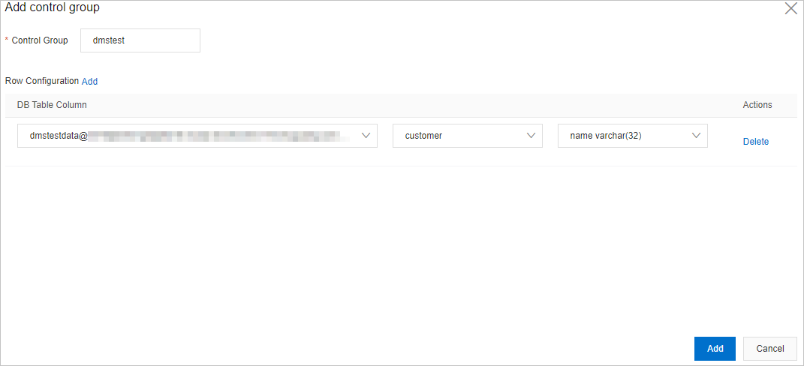

   | Parameter | Description |
   | --- | --- |
   | Control Group | Enter a name for the control group. |
   | Row Configuration | Click <strong>Add</strong> to add a row configuration in which you can specify a database, a table, and a field.<br>Note You can repeat this step to add multiple row configurations. |
   | DB Table Column | Search for databases by keyword and select a database. Then, select a table and a field from the drop-down lists.<br>Note The selected field is the control field. |

   <ol type="i" start="3">

   <li>

   Click **Add**.

   </li>

   </ol>

5. Add control values.

   <ol type="i">

   <li>

   Find the created control group and click **Details** in the **Actions** column.

   </li>

   <li>

   Click **Add Row Value**.

   </li>

   <li>

   In the Import Row Value dialog box, specify whether to append row values and enter the

   </li>

   </ol>

   required row values.

   > **Note**
   >
   > Separate multiple row values with commas (,).

   <ol type="i" start="4">

   <li>

   Click **Import**.

   </li>

   </ol>

**What to do next**

After you configure row-level access control settings for a table, a user may still have no permissions on a control value that corresponds to one or more rows in the table. In this case, an error appears when the user queries row data. The error indicates that the user does not have permissions to access the row. The user can apply for permissions on the control value to access the rows. For more information, see Apply for permissions.

<a id="section-8-7"></a>

## 8.7. Use data watermarks

This topic describes how to embed and extract data watermarks in Data Management (DMS).

**Prerequisites**

The sensitive data protection feature is enabled for the database instance for which you want to use data watermarks. For more information, see Enable the sensitive data protection feature.

**Scenarios**

Data watermarks are used to identify and trace the origin of data during the distribution of data.

**Usage notes**

- We recommend that you use data watermarks when you export more than 200 data entries.

- When you use the watermark extraction feature, make sure that your file contains more than 200 data entries. Otherwise, the watermarks may fail to be extracted.

**Embed watermarks**

Identification information is embedded into data or a file as a watermark to identify the data or file.

> **Note**
>
> In the following example, an ApsaraDB RDS for MySQL instance that is managed in Security Collaboration mode is used.

1. Log on to the DMS console.

2. In the top navigation bar, choose **Database Development > Data Export > SQL Result Set Export**.

   > **Note**
   >
   > If you use the simple mode of the DMS console, move the pointer over the
   >
   > icon in
   >
   > 
   >
   > the upper-left corner and choose **All functions > Database Development > Data Export > SQL Result Set Export**.

3. On the Data Export Tickets page, configure the parameters that are described in the following table.

   | Parameter | Description |
   | --- | --- |
   | Database Name | Required. The database from which you want to export an SQL result set.<br>Note<br>You must have the export permissions on this database. |
   | Reason Category | Required. The reason for exporting the data. This parameter helps find the ticket in subsequent operations.<br>Note<br>This parameter is displayed only when the database instance is managed in Security Collaboration mode. |
   | Business Background | Required. The purpose or objective of this export. Enter a detailed description to reduce unnecessary communication.<br>Note<br>This parameter is displayed only when the database instance is managed in Security Collaboration mode. |
   | Affected Rows | Required. The estimated number of data rows to be affected by this export. To obtain the estimated number of affected rows, you can use the <code> COUNT </code> function in SQL statements in the SQL Console.<br>Note<br>In the Precheck step, DMS displays the actual number of affected rows. You can check whether the number of affected rows is as expected. This ensures data security. |
   | Skip Validation | Optional. Specifies whether to skip validation. If you select <strong>Skip</strong> <strong>Validation</strong>, you must enter a reason in the field below the check box.<br>Warning<br>After you select <strong>Skip Validation</strong>, DMS does not check the number of rows that may be affected by this export. If a large amount of data is to be exported, your business may be affected. Proceed with caution. |
   |  |  |
   | Stakeholder | Optional. The stakeholders involved in this export. All the specified stakeholders can view the ticket details and take part in the approval process. Other users aside from DMS administrators and database administrators (DBAs) are not allowed to view the ticket details.<br>Note<br>This parameter is displayed only when the database instance is managed in Security Collaboration mode. |
   | Export Statement | Required. The SQL statements that can be executed to export data.Example: <code> SELECT * FROM testtable </code>. DMS verifies the syntax of the SQL statements when you submit the ticket. If the syntax is invalid, you cannot submit the ticket.<br>Note<br>• Only <code> SELECT </code> statements are supported.<br>• You can submit multiple SQL statements at a time. Separate multiple SQL statements with semicolons (;).<br>• Submit the SQL statements based on your business requirements.<br>• Do not write SQL statements that are not friendly to databases. Otherwise, online business may be affected. |
   | Embed Watermark | Required. Specifies whether to embed a watermark into the exported file.Select <strong>Yes</strong>. |
   | Embedding Method | Required. The method that you want to use to embed the watermark. You can select one or more methods. Valid values:<br>• Data Watermark: embeds identification information into data. A watermark embedded by using this method is almost invisible to data users.<br>• File Watermark: embeds identification information into files. A watermark embedded by using this method is visible to data users. |
   | Data Watermark <strong>Message</strong> or <strong>File</strong> Watermark Message | Required. The identification information to be embedded as a watermark. |
   | Embedded Field | Optional. The field into which the watermark is to be embedded.<br>Note<br>If you do not specify a field, DMS selects a field by default. |
   | Primary key /Unique Key | Optional. One or more primary keys or unique keys. Separate multiple keys with commas (,).<br>Note<br>To improve the robustness of the watermark, we recommend that you specify this parameter. |
   | Attachments | Optional. The images or files that are uploaded to provide more information about this export.<br>Note<br>This parameter is displayed only when the database instance is managed in Security Collaboration mode. |

4. After you complete the configurations, click **Submit** and wait for approval.

   DMS prechecks the SQL statements.

5. Click **Submit for Approval** and wait for approval.

   > **Note**
   >
   > On the Ticket Details page, you can view the approval progress in the **Approval** step.

6. In the **Execute/Automatic Execution** step, click **Export**.

7. In the **Export Settings** dialog box, configure the parameters that are described in the following table.

   | Parameter | Description |
   | --- | --- |
   | Format | Required. The format of the file to be exported. Valid values: <strong>CSV</strong>, <strong>EXCEL</strong>, <strong>SQL</strong>, and <strong>JSON</strong>. The JSON format is available only for NoSQL databases.<br>Note<br>If you set the Embed Watermark parameter to Yes, set this parameter to EXCEL. |
   | Character set | Required. The character set of the file to be exported. Valid values: <strong>Default Character Set</strong>, <strong>GBK</strong>, <strong>UTF-8</strong>, and <strong>ISO-8859-1</strong>. |
   | Execution Strategy | Required. The strategy used to export the file. Valid values:<br>• <strong>Running immediately</strong>: DMS immediately exports the file after you click Confirm Execution.<br>• <strong>Schedule</strong>: DMS exports the file at the point in time that you specify.You can specify a point in time during off-peak hours.<br>Note<br>The configurations cannot be modified after you set this parameter to Schedule and confirm the configurations. |
   | Export Mode | Required. The export mode of the file. Valid values:<br>• <strong>Speed Mode</strong>: If you select this mode, the export task cannot be terminated before it is complete.<br>• <strong>Ordinary Mode</strong>: If you select this mode, the export task can be terminated. |

   > **Note**
   >
   > DMS exports the file based on your configurations. You can view the export progress in the Execute/Automatic Execution step.

8. After the file is exported, click **Download Exported File** to download the file.

**Extract watermarks**

DMS provides the watermark extraction feature that allows you to check whether files are embedded with unperceivable watermarks.

1. Log on to the DMS console.

2. In the top navigation bar, choose **Security and Specifications > Data Watermark**.

   > **Note**
   >
   > If you use the simple mode of the DMS console, move the pointer over the
   >
   > icon in
   >
   > 
   >
   > the upper-left corner and choose **All functions > Security and Specifications > Data Watermark**.

3. On the Data Watermark page, click **Data Watermark** in the upper-right corner.

4. On the **Data Watermark Tickets** page, configure the parameters that are described in the following table.

   | Parameter | Description |
   | --- | --- |
   | File type | Required. The type of the file from which you want to extract a watermark.Valid values:<br>• CSV<br>• EXCEL |
   | Upload a file | Required. Click Upload a file to upload the file from which you want to extract the watermark.<br>Note<br>Only .xlsx files and .csv files are supported. |
   | Business Background | Required. The purpose of this extraction. Enter a detailed description to reduce unnecessary communication. |
   | Database Name | Optional. The database from which you want to export a file. |
   | Primary key /Unique Key | Optional. One or more primary keys or unique keys. Separate multiple keys with commas (,).<br>Note<br>You must specify the same primary keys or unique keys that you specified when you embedded the watermark to ensure that the watermark is extracted accurately. |
   | Embedded Field | Optional. The field into which the watermark is embedded. |

5. Click **Submit**.

6. After the ticket is approved, click **Execute** in the **Execute/Automatic Execution** step.

   After the execution is complete, you can view the extraction status and the details of the extracted watermark.

<a id="section-9"></a>

# 9.Solutions

<a id="section-9-1"></a>

## 9.1. Data archiving

The data archiving feature in Data Management (DMS) lets you periodically migrate historical data from large tables to a destination database. This practice can resolve performance degradation and operational bottlenecks caused by rapid data growth. This feature helps you clean up data from the source table and reclaim tablespace, improving query efficiency and reducing online storage costs. This topic provides an example of archiving data from ApsaraDB RDS for MySQL to AnalyticDB for PostgreSQL.

**Supported source and destination databases**

<table>
  <tr>
    <th>Source database</th>
    <th>Destination database</th>
  </tr>
  <tr>
    <td rowspan="4">• ApsaraDB RDS for MySQL<br>• ApsaraDB RDS for PostgreSQL<br>• PolarDB for MySQL<br>• PolarDB for PostgreSQL<br>• PolarDB-X<br>• AnalyticDB for MySQL 3.0</td>
    <td>AnalyticDB for MySQL 3.0</td>
  </tr>
  <tr>
    <td>AnalyticDB for PostgreSQL</td>
  </tr>
  <tr>
    <td>OSS</td>
  </tr>
  <tr>
    <td>DBS built-in OSS</td>
  </tr>
</table>

**Prerequisites**

- The source and destination databases must be registered in DMS.

- The source table to be archived must have a primary key or a unique key.

  *We recommend that the source table contain a modification time field to use as a filter for data archiving.*

**Procedure**

1. Log on to the DMS console.

2. In the top navigation bar, choose **Solutions > Data Archiving**.

3. In the upper-right corner of the page, click **Data Archiving**.

4. On the page that appears, configure the ticket information.

   | Parameter | Description |
   | --- | --- |
   | Task name | Enter a descriptive name for the task. |
   | Archive destination | Select the type of destination database. In this example, select AnalyticDB for PostgreSQL. |
   | ADB instance | Search for and select the destination AnalyticDB for PostgreSQL instance. |
   | Source database | Search for and select the source database. |
   | Archiving configuration | Select the tables to archive.<br>• Enter the filter conditions for the data to be archived. For example, <code> gmt_modified&lt;='${6_month_ago}' </code>.<br><em>To use time variables, such as archiving data older than six</em> <em>months, you must first configure variables in the </em><strong><em>Variable</em></strong> <strong><em>configuration</em></strong><em> section.</em><br>• Click <strong>Add</strong> to add multiple source tables. |
   | Archive table mapping | This section shows how the source table maps to the destination table, including the destination table name, columns, and distribution key. |
   | Variable configuration | Configure variables for use in your archive filter conditions.<br>For example, a time variable is named 6_month_ago, with a time format of yyyy-MM-dd and an offset of -6 months. If the current date is 2025-08-12, the value of the variable ${6_month_ago} is 2025-02-12. |
   | Post-archive action | • Select <strong>Clean up archived data from source table (lock-free</strong> <strong>delete)</strong>: After the archiving is complete, the system automatically uses a lock-free DELETE statement to remove the archived data from the source table. A backup temporary table is created in the source database to store the archived data. Ensure that your source database has sufficient storage space to prevent the instance from becoming unavailable.<br>To clean up the backup temporary table: After you confirm the data is archived correctly, you can create a data change ticket to clean up the backup temporary table.<br>• If you do not select <strong>Clean up archived data from source table</strong> <strong>(lock-free delete)</strong>: After the data is successfully archived, you must manually delete the data from the source table and optimize the tablespace:<br>a. Clean up data from the source table: Create a new standard data change ticket to clean up the archived data.<br>b. Optimize the source tablespace: Create a new lock-free data change ticket to optimize the source tablespace. |
   | Execution mode | • <strong>One-Time Execution</strong>: The archive task runs only once after the ticket is approved.<br>• <strong>Periodic Scheduling</strong>: After the ticket is approved, the archive task runs based on the configured periodic scheduling. |

5. Click **Submit Application**.

6. After the ticket is approved, the system automatically runs the data archiving task. Wait for the task to complete.

   If the task fails, in the execution area of the ticket, click **Details** in the Actions column to view the task logs and identify the cause. If the failure is due to an intermittent issue, such as a network or database connection failure, you can click **Resume from breakpoint** to retry the task.

7. The task is complete.

8. **Optional:** After the data is successfully archived and verified, you can delete the archived data from the source table and optimize the tablespace.

   <ol type="i">

   <li>

   Clean up the archived data from the source table.

   - If you enabled the post-archive action, the system cleans up the archived data from the source table and creates a backup temporary table in the source database.

     To clean up the backup temporary table, create a new standard data change ticket.

     *At the bottom of the data archiving ticket details page, click* <em><strong>Click to view the DROP SQL of the temporary table</strong></em><em>, and copy the SQL statement to clean up the backup temporary table.</em>

   - If you did not enable the post-archive action, you must manually clean up the archived data.

     To clean up the archived data from the source table, create a new standard data change ticket.

   </li>

   <li>

   Optimize the source tablespace: Create a new lock-free data change ticket to optimize

   </li>

   </ol>

   the source tablespace.

   *At the bottom of the data archiving ticket details page, click* <em><strong>Click to view the SQL for source tablespace optimization</strong></em><em>, and copy the SQL statement to optimize the source tablespace.</em>

**Periodic scheduling**

Table 1. Scheduling cycle parameters

| Parameter | Description |
| --- | --- |
| Scheduling cycle | Select the task's scheduling frequency:<br>• <strong>Hour</strong>: Runs the task at a specified hourly interval. You must configure the timed scheduling.<br>• <strong>Day</strong>: Runs the task once a day at a specified time.<br>• <strong>Week</strong>: Runs the task at a specified time on selected days of the week.<br>• <strong>Month</strong>: Runs the task at a specified time on selected dates of the month. |

<table>
  <tr>
    <td>Timed scheduling</td>
    <td>Two scheduling methods are available:<br>• Fixed interval scheduling:<br>• <strong>Start Time</strong>: The time when the task starts.<br>• <strong>Interval</strong>: The interval, in hours, at which the task runs.<br>• <strong>End Time</strong>: The time when the task ends.<br>For example, if you set <strong>Start Time</strong> to 00:00, <strong>Interval</strong> to 6 hours, and <strong>End Time</strong> to 20:59, the system runs the task at 00:00, 06:00, 12:00, and 18:00.<br>• <strong>Specified Time</strong> scheduling: Select specific hours for the task to run.<br>For example, if you select 0 and 5, the system runs the task at 00:00 and 05:00.</td>
  </tr>
  <tr>
    <td>Specified time</td>
    <td>• If you select <strong>Week</strong> for the <strong>Scheduling cycle</strong>, choose the days of the week on which to run the task. You can select multiple days.<br>• If you select <strong>Month</strong> for the <strong>Scheduling cycle</strong>, choose the dates of the month on which to run the task. You can select multiple dates.</td>
  </tr>
  <tr>
    <td>Execution time</td>
    <td>Set the specific time of day to run the task.<br>For example, if you enter 02:55, the system runs the task at 02:55 on the specified day(s).</td>
  </tr>
  <tr>
    <td>Cron expression</td>
    <td>No manual configuration is required. The system automatically generates the cron expression based on the cycle and time that you configure.</td>
  </tr>
</table>

<a id="section-10"></a>

# 10.System management

<a id="section-10-1"></a>

## 10.1. Manage users

Data Management (DMS) allows you to manage users. This topic describes how to add users and perform operations on users, such as modifying the permissions and roles of users.

**Prerequisites**

You are a DMS administrator.

**Add a user**

Add a user to the DMS tenant of your Alibaba Cloud account.

1. Log on to the DMS console.

2. In the top navigation bar, click **O&M**. In the left-side navigation pane, click **Users**.

3. In the upper-left corner of the page, click **New**.

4. In the **Add User** dialog box, enter the unique ID (UID) of your Alibaba Cloud account in the **Alibaba Cloud Account** field.

   > **Note**
   >
   > To view the UID, move the pointer over the
   >
   > icon in the upper-right
   >
   > 
   >
   > corner of the DMS console.

5. Select one or more system roles for the user to add.

   | Role | Description | Permission |
   | --- | --- | --- |
   | Regul ar user | • Regular users can perform operations on databases. For example, they can query and change data, or view and change schemas.<br>• Regular users can be the R&amp;D staff, testers, product staff, operations staff, or data analysts of enterprises. | • Regular users cannot use the Instances, Users, Task, Configuration Management, Notification, Database Grouping, or Intelligent Operation feature in the DMS console.<br>• To execute SQL statements on the SQLConsole tab or use the features of the Data Plans module, regular users must apply for the required permissions first. |
   | Secur ity admi nistra tor | • Security administrators can perform operations such as determining the sensitivity levels of fields and auditing user operations.<br>• Security administrators can be the internal auditors or security administrators of enterprises. | In addition to all the features that are available for regular users, security administrators can also use the <strong>Operation Logs</strong>, <strong>Sensitive Data</strong>, and <strong>Data</strong> <strong>Protection</strong> features. |
   | DBA | • Database administrators (DBAs) are responsible for database management, including managing database instances, database development standards and processes, and task execution.<br>• DBAs in DMS can be the DBAs or O&amp;M staff of enterprises. | In addition to all the features that are available for regular users, DBAs can also use all features except for the <strong>Users</strong> feature. |
   | DMS admi nistra tor | • No limit is set on the number of DMS administrators within a DMS tenant.<br>• DMS administrators are approvers for the Admin approval step of an approval process. | • Only DMS administrators can use the <strong>Users</strong> feature.<br>• DMS can use all features in DMS. |
   | Tech nical supp ort perso nnel | Technical support personnel can be staff such as data analysts. | Technical support personnel have permissions on the metadata of database instances, databases, and tables. The permissions include viewing table details and exporting database schemas. |

6. Click **OK**.

**Perform operations on a user**

| Oper ation | Description | Procedure |
| --- | --- | --- |
| Edit a user | Edit a user, such as editing the name and role of a user. | Find the user that you want to edit and click <strong>Change</strong> in the <strong>Actions</strong> column. In the Edit User dialog box, you can edit the display name, role, and mobile phone number of the user. |
| Grant permi ssion s | Grant permissions on database instances, databases, tables, columns, and sensitive columns. | Find the user to which you want to grant permissions and move the pointer over <strong>Authorize</strong> in the <strong>Actions</strong> column. You can select an option based on your business requirements. |
| Enabl e acces s contr ol | If you enable the access control feature for a user, the user can view and access only databases on which permissions are granted. | Find the user for which you want to enable the access control feature and choose <strong>More &gt; Access control</strong> in the <strong>Actions</strong> column. |
| View permi ssion detail s | View the permissions that are granted to a user, such as permissions on database instances, databases, tables, rows, sensitive columns, and the secure access proxy feature. | Find the user whose permissions you want to view and choose <strong>More &gt; Permission Details</strong> in the <strong>Actions</strong> column. |
| Disab le a user | If you disable a user, the user cannot perform operations as the user of the current tenant. | Find the user that you want to disable and choose <strong>More &gt; Disable</strong> in the <strong>Actions</strong> column. |
| Remo ve a user | Remove a user from the current tenant. | Find the user that you want to remove and choose <strong>More &gt; Delete</strong> in the <strong>Actions</strong> column. |

<a id="section-10-2"></a>

## 10.2. Manage tasks

The task management feature of Data Management (DMS) allows you to manage a variety of tasks that are created by using tickets. You can also use this feature to directly create SQL tasks.

**Prerequisites**

You are a database administrator (DBA) or a DMS administrator.

**Procedure**

1. Log on to the DMS console.

2. In the top navigation bar, choose **O&M > Task**.

3. On the **Task** page, view and manage tasks that are created by using tickets.

4. Find a task and perform one of the following operations based on your business requirements:

   - Pause a task

     On the Task page, find the task that you want to pause and click **Pause** in the Operation bar column.

   - Retry a task

     On the Task page, find the task that is in the **Failure** state and click **Retry** in the Operation bar column.

   - Delete a task

     On the Task page, find the task that you want to delete and click **Delete** in the Operation bar column. The task enters the **Delete** state and can no longer be run.

   - View logs

     On the Task page, find the task whose scheduling logs you want to view and click **Log** in the Operation bar column.

   - Disable the ignore error feature

     On the Task page, find the task that you want to manage and click **Close ignore error** in the Operation bar column. If an error occurs when the task is in progress, DMS does not ignore the error.

5. <strong>Optional:</strong>Click **Add SQL task**. In the dialog box that appears, configure the parameters as required and click **Submit Task**.

<a id="section-10-3"></a>

## 10.3. Configuration management

Data Management (DMS) allows DMS administrators to manage system configurations. If you are a DMS administrator, you can modify the system configurations to meet different business requirements.

**Prerequisites**

You are a DMS administrator.

**Supported configuration items**

| Configuration item | Description |
| --- | --- |
| Source IP address whitelist | • Y: enables the source IP address whitelist feature. A DMS administrator can choose <strong>Security and Specifications &gt; Access IP Whitelists</strong> in the top navigation bar of the DMS console to configure source IP address whitelists. Only the access from the IP addresses or CIDR blocks in a whitelist is allowed.<br>• N: disables the source IP address whitelist feature. After this feature is disabled, users within the current tenant account can access DMS from any IP address. |
| Automatic synchronization of cloud instances | • Y: enables automatic synchronization of cloud instances. DMS automatically synchronizes all ApsaraDB RDS instances.<br>• N: disables automatic synchronization of cloud instances. DMS does not synchronize ApsaraDB RDS instances. |
| Large table archiving notifications in SQLConsole | Notifies users when large tables are archived. Valid values:<br>• Y: enables large table archiving notifications.<br>• N: disables large table archiving notifications. |
| Whitelist of users who are allowed to create task flows | The whitelist specifies the users that are allowed to create task flows. |
| List of disabled features | Specifies the features that you want to disable. After a feature is disabled, the entry point of the corresponding feature is hidden. |
| New user access control default setting | Controls the permissions of new users. Valid values:<br>• Y: enables access control for new users by default.<br>• N: disables access control for new users by default. |
| Sensitivity level propagation for SQL statement fields | If an instance has sensitive data discovery and protection and sensitivity level propagation enabled, when a user executes statements such as <code> INSERT SELECT </code> or <code> CREATE SELECT </code>, DMS will automatically propagate sensitive fields from the source table to the destination table to maximize sensitive data protection. Valid values:<br>• Y: enables sensitivity level propagation for SQL statement fields.<br>• N: disables sensitivity level propagation for SQL statement fields. |
| Resource Access Management (RAM) permission verification | • Y: enables Resource Access Management (RAM) permission verification.<br>• N: disables RAM permission verification. |
| Automatically adding RAM users to the current tenant account | This feature is suitable for account management in a multi-tenant environment. Valid values:<br>• Y: automatically adds RAM users to the current tenant account.<br>• N: does not automatically add RAM users to the current tenant account. |
| Forcing users to enter SQL statements for rolling back data changes | This feature ensures that data changes are traceable and recoverable. Valid values:<br>• Y: forces users to enter SQL statements for rolling back data changes.<br>• N: does not force users to enter SQL statements for rolling back data changes. |
| Super SQL mode | • Y: enables the super SQL mode.<br>• N: disables the super SQL mode. |
| Data export from logical data warehouses | Reduces the risks of sensitive data leaks. Valid values:<br>• Y: allows users to export data from logical data warehouses.<br>• N: does not allow users to export data from logical data warehouses. |
| Data change verification timeout period | The value must be an integer. Before a data change is performed, DMS verifies the number of rows that may be affected, which requires a long period of time if the data volume is large. You can specify a timeout period in seconds for the verification to ensure that the data change can be performed as required. DMS automatically terminates the verification when the timeout period ends. |
| Data Change reason classification | The reason for a data change. The value must be a JSON string. For more information, see the Types of data changes section of this topic. |
| Data change method | • COMMITOR: The data change is performed by the user who submits the ticket.<br>• AUTO: The data change is automatically performed after the ticket is approved.<br>• LAST_AUDITOR: The data change is performed by the last user who approves the ticket. |
| Allowing hints in SELECT statements of OceanBase | The following hints can be used in SELECT statements: <code> USE_HASH </code>, <code> USE_NL </code>, <code> INDEX </code>, <code> USE_MERGE </code>, <code> LEADING </code>, and <code> PARALLEL </code>.Separate hints with commas (,). |
| Default validity period for quick permission application | The default validity period for quick permission application in days. By default, permissions are reclaimed after 30 days. |
| Exclusion of the ticket submitter from the review workflow. | • Y: excludes the user who submits the ticket from the review workflow.<br>• N: does not exclude the user who submits the ticket from the review workflow. |
| Unauthorized ticket review | Specifies whether to allow users who have no permissions to review tickets of the specified types or all types to participate in ticket review.<br>• After this feature is enabled, you can specify the roles (required) or users that are allowed to review tickets without the required permissions, the types of tickets that they can review, and an unauthorized ticket review template.<br>For example, if you add the database administrator (DBA) role, specify data export tickets, and configure an authorized ticket review template named <code> Owner-&gt;DBA </code>, users who assume the DBA role can review data export tickets that use the ticket review template <code> Owner-&gt;DBA </code>.<br>Note<br>By default, no ticket types or unauthorized ticket review template is configured. This means that the specified roles or users can review tickets of all types and tickets that use any templates without the required permissions.<br>• After you disable this feature, no role or user is allowed to review tickets without the required permissions. In this case, only the reviewers that are specified in the review workflow are allowed to review tickets. |
| Authorization by owners | • Y: allows an owner to grant permissions to other users on data assets such as instances, databases, and tables.<br>• N: does not allow an owner to grant permissions to other users on data assets such as instances, databases, and tables. |
| Maximum number of queries per day | The maximum number of queries that each user is allowed to perform per day. The value must be an integer. After the number of queries that a user performs in a day reaches the upper limit, the user can no longer perform more queries on that day. This configuration item takes effect on all users within the current tenant account. |
| Maximum number of rows queried per day | The maximum number of rows that can be returned to a user per day. The value must be an integer. After the number of rows that are returned to a user in a day reaches the upper limit, the user can no longer perform more queries on that day. This configuration item takes effect on all users within the current tenant account. |
| Maximum number of rows returned for cross-database queries | The maximum number of rows returned for cross-database queries. The value must be an integer. Default value: 100. Maximum value: 3000. |
| Language used by DMS | The language used by DMS. Valid values: <code> ZH </code> (Simplified Chinese), <code> EN </code> (English), <code> JA </code> (Japanese), and <code> ZT </code> (Traditional Chinese). |
| Available languages | The languages that a user can choose. This configuration item takes effect only when the specified languages are in the list. For example, <code> ZH,EN </code> indicates that users can choose only Chinese or English. |

**Procedure**

1. Log on to the DMS console.

2. In the top navigation bar, choose **O&M > Configuration Management**.

3. Find the desired parameter and click **Change** in the **Actions** column of the parameter.

   > **Note**
   >
   > You can click **Change History** to view the historical changes of the parameter.

4. In the Change Parameter Configuration dialog box, enter a value.

5. Click **Confirm Change**.

**Types of data changes**

| key | value | Description |
| --- | --- | --- |
| config_correct | Modify Config | Modifies configuration items. |
| project_init_data | Init Project Data | Initializes the data of a project. |
| program_bug | Program Bug | Fixes a bug. |
| require_deal_without_backend_f unction | Requirements Without Backend Function | Manages the data of an application that does not support backend management. |
| history_data_clear | History Data Clean | Deletes historical data. |
| test | Test | Runs a test. |
| mis_operation | Mis Operation | Restores data after an accidental operation. |
| others | Others | Changes data for other reasons. |

<a id="section-10-4"></a>

## 10.4. Database grouping

This topic describes how to create a database group in Data Management (DMS). You can use this feature to apply a data change or a schema change to all of the databases in a database group with ease.

**Prerequisites**

The databases that you want to add to a database group must meet the following conditions:

- The control mode of the database instance is Security Collaboration.

- All of the databases are physical databases or logical databases.

- All of the databases are deployed in the same environment, such as the development environment.

- The engines of the databases are of the same type. For example, all of the databases are MySQL databases.

**Create a database group**

1. Log on to the DMS console.

2. In the top navigation bar, choose **O&M > Database Grouping**.

3. Click **New Group**.

4. In the **NewGrouping** dialog box, enter a group name in the **Group name** field.

5. Set the Grouping type parameter to **General grouping** or **Remote live**.

6. Click **Add Database**.

7. In the **Search for Database** dialog box, add multiple databases.

   <ol type="i">

   <li>

   Enter a keyword to search a database.

   </li>

   <li>

   Click **Add** next to the database that you want to add.

   </li>

   <li>

   Add another database.

   </li>

   <li>

   After the databases are added, close the **Search for Database** dialog box.

   </li>

   </ol>

8. Click **Save**.

**Scenarios**

- Data change

  For example, you create a ticket to perform a data change on a database that belongs to a database group. After you select the database, DMS displays a message asking whether you want to perform the operation on all of the databases in the group. If you click **OK**, DMS adds all the other databases in the group as the databases on which the data change will be performed. This frees you from selecting databases one by one. If you click **Cancel**, the other databases in the group will not be selected.

  Data change operations supported by this feature include Data Change and Data Import.

- Schema design

  For example, you want to create a schema design ticket and select a database that belongs to a database group as a base database. After you click **Perform Changes to Base Database**, DMS displays a message. This message is used to remind you that the base database belongs to a database group and the current operation will apply to all the other databases in the group.

  For more information about how to use the schema design feature, see Design schemas.
