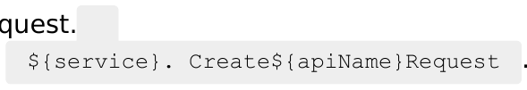

Alibaba Cloud  
Apsara Stack  
Data Transmission Service  
Developer Guide  
Product Version: v3.18.6-2607  
Document Version: 20260901

**Table of Contents**

- [1.Preparations](#section-1)
    - [1.1. Log on to OpenAPI Explorer](#section-1-1)
    - [1.2. Obtain the information and the endpoint of an API operation](#section-1-2)
    - [1.3. Obtain an AccessKey pair](#section-1-3)
    - [1.4. Obtain access credentials assigned by STS](#section-1-4)
    - [1.5. Obtain common header parameters](#section-1-5)
    - [1.6. Obtain the endpoint of DTS](#section-1-6)
- [2.Use the SDK for Java](#section-2)
    - [2.1. Quick start](#section-2-1)
    - [2.2. Use the SDK](#section-2-2)
        - [2.2.1. Install Apsara Stack SDK for Java](#section-2-2-1)
        - [2.2.2. Configure authentication credentials](#section-2-2-2)
        - [2.2.3. Configure connection requests](#section-2-2-3)
        - [2.2.4. Initiate a request](#section-2-2-4)
        - [2.2.5. Handle errors](#section-2-2-5)
        - [2.2.6. Use CommonRequest to call API operations](#section-2-2-6)
- [3.Use the SDK for Python](#section-3)
    - [3.1. Getting started](#section-3-1)
    - [3.2. Use the SDK](#section-3-2)
        - [3.2.1. Install Apsara Stack SDK for Python](#section-3-2-1)
        - [3.2.2. Configure authentication credentials](#section-3-2-2)
        - [3.2.3. Configure HTTPS requests](#section-3-2-3)
        - [3.2.4. Initiate a request](#section-3-2-4)
        - [3.2.5. Handle errors](#section-3-2-5)
        - [3.2.6. Use CommonRequest to call API operations](#section-3-2-6)
- [4.Use the SDK for Go](#section-4)
    - [4.1. Quick start](#section-4-1)
    - [4.2. Use the SDK](#section-4-2)
        - [4.2.1. Install the core package of Apsara Stack SDK for Go](#section-4-2-1)
        - [4.2.2. Configure authentication credentials](#section-4-2-2)
        - [4.2.3. Initiate a request](#section-4-2-3)
        - [4.2.4. Handle errors](#section-4-2-4)
        - [4.2.5. Use CommonRequest to call API operations](#section-4-2-5)
- [5.API Reference](#section-5)
    - [5.1. Common parameters](#section-5-1)
    - [5.2. Request structure](#section-5-2)
    - [5.3. List of supported regions](#section-5-3)
    - [5.4. DTS API (new)](#section-5-4)
        - [5.4.1. CreateDtsInstance](#section-5-4-1)
        - [5.4.2. Configure a DTS migration or sync task](#section-5-4-2)
        - [5.4.3. ConfigureSubscription](#section-5-4-3)
        - [5.4.4. StartDtsJob](#section-5-4-4)
        - [5.4.5. StartDtsJobs](#section-5-4-5)
        - [5.4.6. Manage consumer groups for change tracking tasks](#section-5-4-6)
            - [5.4.6.1. CreateConsumerChannel](#section-5-4-6-1)
            - [5.4.6.2. DescribeConsumerChannel](#section-5-4-6-2)
            - [5.4.6.3. ModifyConsumerChannel](#section-5-4-6-3)
            - [5.4.6.4. DeleteConsumerChannel](#section-5-4-6-4)
        - [5.4.7. SkipPreCheck](#section-5-4-7)
        - [5.4.8. Query DTS tasks](#section-5-4-8)
            - [5.4.8.1. Query the details of a DTS task](#section-5-4-8-1)
            - [5.4.8.2. DescribeDtsJobs](#section-5-4-8-2)
            - [5.4.8.3. CountJobByCondition](#section-5-4-8-3)
            - [5.4.8.4. DescribePreCheckStatus](#section-5-4-8-4)
            - [5.4.8.5. WhiteIpList](#section-5-4-8-5)
            - [5.4.8.6. DescribeSubscriptionMeta](#section-5-4-8-6)
            - [5.4.8.7. Query the details of a full or incremental data check task](#section-5-4-8-7)
            - [5.4.8.8. Query data inconsistency details](#section-5-4-8-8)
            - [5.4.8.9. DescribeInstanceClassLimit](#section-5-4-8-9)
            - [5.4.8.10. DescribeRecentAnalysisDetail](#section-5-4-8-10)
            - [5.4.8.11. DescribeUpgradeTrials](#section-5-4-8-11)
        - [5.4.9. Modify DTS tasks](#section-5-4-9)
            - [5.4.9.1. ModifyDtsJob](#section-5-4-9-1)
            - [5.4.9.2. ModifySubscription](#section-5-4-9-2)
            - [5.4.9.3. ModifyDtsJobPassword](#section-5-4-9-3)
            - [5.4.9.4. ModifyDtsJobName](#section-5-4-9-4)
            - [5.4.9.5. UpgradeTwoWay](#section-5-4-9-5)
            - [5.4.9.6. TransferPayType](#section-5-4-9-6)
            - [5.4.9.7. TransferInstanceClass](#section-5-4-9-7)
            - [5.4.9.8. RenewInstance](#section-5-4-9-8)
        - [5.4.10. ResetDtsJob](#section-5-4-10)
        - [5.4.11. SuspendDtsJob](#section-5-4-11)
        - [5.4.12. SuspendDtsJobs](#section-5-4-12)
        - [5.4.13. StopDtsJob](#section-5-4-13)
        - [5.4.14. StopDtsJobs](#section-5-4-14)
        - [5.4.15. DeleteDtsJob](#section-5-4-15)
        - [5.4.16. DeleteDtsJobs](#section-5-4-16)
        - [5.4.17. SummaryJobDetail](#section-5-4-17)
        - [5.4.18. InitDtsRdsInstance](#section-5-4-18)
        - [5.4.19. ReverseTwoWayDirection](#section-5-4-19)
        - [5.4.20. SkipFullJobTable](#section-5-4-20)
        - [5.4.21. Manage alert rules](#section-5-4-21)
            - [5.4.21.1. CreateJobMonitorRule](#section-5-4-21-1)
            - [5.4.21.2. DescribeJobMonitorRule](#section-5-4-21-2)
        - [5.4.22. Query ETL tasks](#section-5-4-22)
            - [5.4.22.1. DescribeDtsEtlJobVersionInfo](#section-5-4-22-1)
            - [5.4.22.2. DescribeEtlJobLogs](#section-5-4-22-2)
        - [5.4.23. Additional parameters](#section-5-4-23)
            - [5.4.23.1. Objects of DTS tasks](#section-5-4-23-1)
            - [5.4.23.2. Reserve parameter description](#section-5-4-23-2)
            - [5.4.23.3. DataCheckConfigure parameters](#section-5-4-23-3)
    - [5.5. DTS API (soon-to-be-obsolete)](#section-5-5)
        - [5.5.1. Data migration](#section-5-5-1)
            - [5.5.1.1. CreateMigrationJob](#section-5-5-1-1)
            - [5.5.1.2. ConfigureMigrationJob](#section-5-5-1-2)
            - [5.5.1.3. StartMigrationJob](#section-5-5-1-3)
            - [5.5.1.4. ModifyMigrationObject](#section-5-5-1-4)
            - [5.5.1.5. SuspendMigrationJob](#section-5-5-1-5)
            - [5.5.1.6. DescribeMigrationJobs](#section-5-5-1-6)
            - [5.5.1.7. DescribeMigrationJobDetail](#section-5-5-1-7)
            - [5.5.1.8. DescribeMigrationJobStatus](#section-5-5-1-8)
            - [5.5.1.9. StopMigrationJob](#section-5-5-1-9)
            - [5.5.1.10. DeleteMigrationJob](#section-5-5-1-10)
        - [5.5.2. Data synchronization](#section-5-5-2)
            - [5.5.2.1. CreateSynchronizationJob](#section-5-5-2-1)
            - [5.5.2.2. ConfigureSynchronizationJob](#section-5-5-2-2)
            - [5.5.2.3. StartSynchronizationJob](#section-5-5-2-3)
            - [5.5.2.4. SuspendSynchronizationJob](#section-5-5-2-4)
            - [5.5.2.5. ResetSynchronizationJob](#section-5-5-2-5)
            - [5.5.2.6. ModifySynchronizationObject](#section-5-5-2-6)
            - [5.5.2.7. DescribeSynchronizationObjectModifyStatus](#section-5-5-2-7)
            - [5.5.2.8. SwitchSynchronizationEndpoint](#section-5-5-2-8)
            - [5.5.2.9. DescribeEndpointSwitchStatus](#section-5-5-2-9)
            - [5.5.2.10. ConfigureSynchronizationJobReplicatorCompare](#section-5-5-2-10)
            - [5.5.2.11. DescribeSynchronizationJobReplicatorCompare](#section-5-5-2-11)
            - [5.5.2.12. DescribeSynchronizationJobs](#section-5-5-2-12)
            - [5.5.2.13. DescribeInitializationStatus](#section-5-5-2-13)
            - [5.5.2.14. DescribeSynchronizationJobStatusList](#section-5-5-2-14)
            - [5.5.2.15. DescribeSynchronizationJobStatus](#section-5-5-2-15)
            - [5.5.2.16. DeleteSynchronizationJob](#section-5-5-2-16)
        - [5.5.3. Change tracking](#section-5-5-3)
            - [5.5.3.1. CreateSubscriptionInstance](#section-5-5-3-1)
            - [5.5.3.2. ConfigureSubscriptionInstance](#section-5-5-3-2)
            - [5.5.3.3. StartSubscriptionInstance](#section-5-5-3-3)
            - [5.5.3.4. ModifySubscriptionObject](#section-5-5-3-4)
            - [5.5.3.5. Manage consumer groups](#section-5-5-3-5)
                - [5.5.3.5.1. CreateConsumerGroup](#section-5-5-3-5-1)
                - [5.5.3.5.2. DescribeConsumerGroup](#section-5-5-3-5-2)
                - [5.5.3.5.3. ModifyConsumerGroupPassword](#section-5-5-3-5-3)
                - [5.5.3.5.4. DeleteConsumerGroup](#section-5-5-3-5-4)
                - [5.5.3.5.5. ModifyConsumptionTimestamp](#section-5-5-3-5-5)
            - [5.5.3.6. DescribeSubscriptionInstances](#section-5-5-3-6)
            - [5.5.3.7. DescribeSubscriptionInstanceStatus](#section-5-5-3-7)
            - [5.5.3.8. DeleteSubscriptionInstance](#section-5-5-3-8)
        - [5.5.4. Network settings](#section-5-5-4)
            - [5.5.4.1. DescribeDTSIP](#section-5-5-4-1)
            - [5.5.4.2. DescribeConnectionStatus](#section-5-5-4-2)
        - [5.5.5. Monitoring and alerting](#section-5-5-5)
            - [5.5.5.1. ConfigureMigrationJobAlert](#section-5-5-5-1)
            - [5.5.5.2. DescribeMigrationJobAlert](#section-5-5-5-2)
            - [5.5.5.3. ConfigureSubscriptionInstanceAlert](#section-5-5-5-3)
            - [5.5.5.4. DescribeSubscriptionInstanceAlert](#section-5-5-5-4)
            - [5.5.5.5. ConfigureSynchronizationJobAlert](#section-5-5-5-5)
            - [5.5.5.6. DescribeSynchronizationJobAlert](#section-5-5-5-6)
        - [5.5.6. Instance management](#section-5-5-6)
            - [5.5.6.1. ShieldPrecheck](#section-5-5-6-1)
        - [5.5.7. Tag management](#section-5-5-7)
            - [5.5.7.1. TagResources](#section-5-5-7-1)
            - [5.5.7.2. ListTagResources](#section-5-5-7-2)
            - [5.5.7.3. UntagResources](#section-5-5-7-3)
        - [5.5.8. Additional description of parameters](#section-5-5-8)
            - [5.5.8.1. MigrationObject](#section-5-5-8-1)
            - [5.5.8.2. SubscriptionObjects](#section-5-5-8-2)
            - [5.5.8.3. SynchronizationObjects](#section-5-5-8-3)
            - [5.5.8.4. MigrationReserved](#section-5-5-8-4)
- [6.Appendixes](#section-6)
    - [6.1. STS overview](#section-6-1)
        - [6.1.1. What is STS?](#section-6-1-1)
        - [6.1.2. AssumeRole](#section-6-1-2)

<a id="section-1"></a>

# 1.Preparations

<a id="section-1-1"></a>

## 1.1. Log on to OpenAPI Explorer

You can log on to OpenAPI Explorer from the Apsara Uni-manager Management Console.

**Prerequisites**

- The URL of the Apsara Uni-manager Management Console is obtained from the deployment engineer.

- A web browser is available. We recommend that you use Google Chrome.

**Procedure**

1. Enter the URL of the Apsara Uni-manager Management Console in the address bar of your browser and press the Enter key.

2. Enter your username and password.

   You can obtain the username and password that are used to log on to the Apsara Uni-manager Management Console from the operations administrator.

   > **Note**
   >
   > The first time you log on to the Apsara Uni-manager Management Console, you must follow instructions to change the password of your account. For security purposes, your password must be 10 to 32 characters in length and must contain at least two of the following character types:
   >
   > - Letters
   >
   > - Digits
   >
   > - Special characters, including ! @ # $ %

3. Click **Log On**.

4. If multi-factor authentication (MFA) is enabled for your account, perform operations based on your logon scenario:

   - Scenario 1: The first time you log on to the Apsara Uni-manager Management Console after MFA is enabled by the administrator.

     <ol type="a">

     <li>

     On the Bind Virtual MFA Device page, follow the instructions to bind an MFA device.

     </li>

     <li>

     Enter the username and password again as in Step 2 and click **Log On**.

     </li>

     </ol>

     <ol type="i" start="100">

     <li>

     Enter the six-digit MFA verification code and click **Authenticate**.

     </li>

     </ol>

   - Scenario 2: You have enabled MFA and bound an MFA device.

     Enter the six-digit MFA verification code and click **Authenticate**.

5. In the top navigation bar, choose **Products > Development Tools > API & SDK > OpenAPI Explorer**.

<a id="section-1-2"></a>

## 1.2. Obtain the information and the endpoint of an API operation

When you use a service SDK to call an API operation of the service, you must obtain the service name, operation name, and API version. This topic describes how to view the information about an API operation.

**Procedure**

1. Log on to the Apsara Uni-manager Management Console.

2. In the top navigation bar, choose **Products > Development Tools > API & SDK > OpenAPI Explorer**.

3. On the **OpenAPI Explorer** page, choose **API Integration** > **API Debugging** in the top navigation bar.

   

4. Click the  icon in the upper-left corner of the page and choose **Database > Data**

   **Transmission Service**.

5. Select an API version from the **Version** drop-down list.

   In the API operation list, you can view all API operations of the current version.

6. Click the API operation that you want to manage. On the **Parameter** tab, you can obtain the **endpoint** of the operation.

<a id="section-1-3"></a>

## 1.3. Obtain an AccessKey pair

Access credentials are assigned by Resource Access Management (RAM) or Security Token Service (STS). You can use one type of access credential for authentication when you make an API request. This topic describes how to obtain an AccessKey pair that is assigned by RAM.

**Background information**

An AccessKey pair is used to verify the identity of a request sender. An AccessKey pair consists of an AccessKey ID and an AccessKey secret that are used to implement symmetric encryption. The AccessKey ID is used to identify a user. The AccessKey secret is used to encrypt a signature string.

You can use RAM or STS to assign access credentials:

- Use RAM to assign an AccessKey ID and an AccessKey secret to a third party.

- Use STS to assign an AccessKey ID, an AccessKey secret, and a security token to a third party. For more information, see Obtain an AccessKey pair assigned by STS.

The Apsara Uni-manager Management Console provides AccessKey pairs to personal accounts and organizations. Only the administrators of level-1 organizations and operations administrators can obtain the AccessKey pairs of organizations. We recommend that you use the AccessKey pairs of personal accounts to call API operations in Apsara Stack services and perform operations in the Apsara Uni-manager Management Console. If you use the AccessKey pair of a personal account, configure the header parameters that are described in the following table for access control. Otherwise, an error that indicates insufficient permissions may occur.

> **Warning**
>
> The AccessKey pair of a personal account is managed and limited by the
>
> permission system of the Apsara Uni-manager Management Console. If you want to obtain the AccessKey pair of an organization, make sure that your operation is allowed by an administrator. This ensures security.

| Parameter | Description |
| --- | --- |
| x-acs-regionid | The ID of the region. Example: cn-hangzhou-\*. |
| x-acs-organizationid | The ID of the organization in the Apsara Uni-manager Management Console. For information about how to obtain an organization ID, see the "<strong>GetOrganizationList</strong>" section in <strong>Apsara Uni-</strong>manager Management Console Developer <strong>Guide</strong>. |
| x-acs-resourcegroupid | The ID of the resource set in the Apsara Uni-manager Management Console. For information about how to obtain a resource set ID, see the "<strong>ListResourceGroup</strong>" section in <strong>Apsara Uni-</strong>manager Management Console Developer <strong>Guide</strong>. |
| x-acs-instanceid | The ID of the instance on which you want to perform the operation. For example, you can use the ID of an Elastic Compute Service (ECS) instance obtained from the ECS instance list. |

**Obtain the AccessKey pair of a personal account**

To obtain the AccessKey pair of a personal account, perform the following steps:

1. Log on to the Apsara Uni-manager Management Console.

2. Click the avatar in the upper-right corner of the page and click **User Information**.

3. In the **AccessKey Pair** section, view the AccessKey pair of the personal account.

   

   > **Note**
   >
   > The AccessKey pair provides full permissions on cloud resources within
   >
   > your Alibaba Cloud account. You must keep the AccessKey pair strictly confidential.

**Obtain the AccessKey pair of an organization**

To obtain the AccessKey pair of an organization, perform the following steps:

1. Log on to the Apsara Uni-manager Management Console as an administrator.

2. In the top navigation bar, click **Enterprise**.

3. In the left-side navigation pane, choose **Resources > Organizations**.

4. In the organization list, click the name of the level-1 organization whose AccessKey pair you want to obtain.

5. On the right side of the page that appears, click **Management AccessKey**.

6. In the dialog box that appears, view the AccessKey pair of the organization.

<a id="section-1-4"></a>

## 1.4. Obtain access credentials assigned by STS

This topic describes how to use Security Token Service (STS) to call API operations in Apsara Stack.

**Background information**

STS allows you to manage temporary access credentials for your Apsara Stack resources. You can use STS to call API operations in Apsara Stack.

To call Apsara Stack APIs, you must obtain an AccessKey ID, an AccessKey secret, and a security token assigned by STS. For more information, see What is STS?

**Procedure**

1. Obtain the Apsara Stack Resource Name (ARN) of your  `RAM role` .

   <ol type="i">

   <li>

   Log on to the Apsara Uni-manager Management Console.

   </li>

   <li>

   Click the avatar in the upper-right corner of the page that appears and click **User**

   </li>

   </ol>

   **Information**.

   <ol type="i" start="3">

   <li>

   Click **View Current Role Policy**.

   </li>

   </ol>

   In the **View Policies of Current Role** dialog box, view the ARN of your  `RAM role` .

2. Obtain the access credential assigned by STS.

   > **Note**
   >
   > Replace the variables in the following sample code with actual values. Do not retain the angle brackets (<>) in the final code.
   >
   > The following section describes the variables:
   >
   > - &lt;yourRegionID>: Replace this variable with the actual region ID.
   >
   > - &lt;yourAccessKeyID>: Replace this variable with your AccessKey ID.
   >
   > - &lt;yourAccessKeySecret>: Replace this variable with your AccessKey secret.
   >
   > - &lt;yourRoleSessionName>: Replace this variable with the name of the current session.
   >
   > - &lt;yourRoleArn>: Replace this variable with your RAM role.
   >
   > - &lt;sts.aliyuns.com>: Replace this variable with the STS endpoint.

   ```xml
   public static void main(String[] args) {
       // Create a DefaultAcsClient instance and initialize the instance. 
       // Replace <yourRegionID>, <yourAccessKeyID>, and <yourAccessKeySecret> with the actual region ID, your AccessKey ID, and your AccessKey secret.
       DefaultProfile profile = DefaultProfile.getProfile("<yourRegionID>", "
   <yourAccessKeyID>", "<yourAccessKeySecret>");
       HttpClientConfig clientConfig = HttpClientConfig.getDefault();
       clientConfig.setIgnoreSSLCerts(true);
       clientConfig.setProtocolType(ProtocolType.HTTPS);
       profile.setHttpClientConfig(clientConfig);
       IAcsClient client = new DefaultAcsClient(profile);
       String assumeRole = callAssumeRole(client);
       if (StringUtils.isEmpty(assumeRole)) return;
       JSONObject assumeRoleJson = JSONObject.parseObject(assumeRole);
       JSONObject credentials = assumeRoleJson.getJSONObject("Credentials");
       // Obtain the access credentials assigned by STS.
       String stsAK = credentials.getString("AccessKeyId");
       String stsSK = credentials.getString("AccessKeySecret");
       String stsToken = credentials.getString("SecurityToken");
   }

   private static String callAssumeRole(IAcsClient client) {
       CommonRequest request = new CommonRequest();
       // Replace "sts.aliyuns.com" with the endpoint of STS. Format: sts-
   vpc.${global:region}.${global:internet-domain}.
       request.setSysDomain("sts.aliyuns.com");
       request.setSysProduct("Sts");
       request.setSysAction("AssumeRole");
       request.setSysVersion("2015-04-01");
       request.setSysMethod(MethodType.POST);
       request.setHttpContentType(FormatType.FORM);
       // Replace <yourRoleSessionName> with the name of the current session.
       request.putQueryParameter("RoleSessionName", "<yourRoleSessionName>");
       // Replace <yourRoleArn> with the actual ARN that you obtained in the preceding step for the RAM role.
       request.putQueryParameter("RoleArn", "<yourRoleArn>");
       try {
           CommonResponse response = client.getCommonResponse(request);
           return response.getData();
       } catch (ServerException e) {
           System.out.println(e.getErrCode());
           System.out.println(e.getErrMsg());
       } catch (ClientException e) {
           System.out.println(e.getErrCode());
           System.out.println(e.getErrMsg());
       }
       return null;
   }
   ```

3. Use the access credentials assigned by STS to call an operation of a service. The following sample code provides an example on how to use the access credentials assigned by STS to call the  `DescribeZones`  operation in Elastic Compute Service (ECS):

   > **Note**
   >
   > Replace the variables in the following sample code with actual values. Do not retain the angle brackets (<>) in the final code.
   >
   > The following section describes the variables:
   >
   > - &lt;yourRegionID>: Replace this variable with the actual region ID.
   >
   > - &lt;yourStsAccesskeyID>: Replace this variable with your AccessKey ID.
   >
   > - &lt;yourStsAccessKeySecret>: Replace this variable with your AccessKey secret.
   >
   > - &lt;yourStsToken>. Replace this variable with your security token.
   >
   > - &lt;yourResourceGroupID>: Replace this variable with your resource set ID.
   >
   > - &lt;yourOrganizationID>: Replace this variable with your organization ID.

   ```xml
   public static void main(String[] args) {
       // Replace <yourRegionID> with the actual region ID.
       // Replace <yourStsAccessKeyID> and <yourStsAccessKeySecret> with the AccessKey I
   D and AccessKey secret assigned by STS.
       DefaultProfile profile = DefaultProfile.getProfile("<yourRegionID>", "
   <yourStsAccesskey>", "<yourStsAccessSecret>");
       HttpClientConfig clientConfig = HttpClientConfig.getDefault();
       clientConfig.setIgnoreSSLCerts(true);
       clientConfig.setProtocolType(ProtocolType.HTTPS);
       profile.setHttpClientConfig(clientConfig);
       IAcsClient client = new DefaultAcsClient(profile);
       CommonRequest request = new CommonRequest();
       request.setSysDomain("ecs.aliyuns.com");
       request.setSysProduct("Ecs");
       request.setSysAction("DescribeZones");
       request.setSysVersion("2014-05-26");
       request.setSysMethod(MethodType.POST);
       request.setHttpContentType(FormatType.FORM);
       // Replace <yourRegionID> with the actual region ID.
       request.putHeadParameter("x-acs-regionid", "<yourRegionID>");
       // Replace <yourStsToken> with the security token assigned by STS.
       request.putQueryParameter("SecurityToken", "<yourStsToken>");
       // Optional. Replace <yourResourceGroupID> with your resource set ID.
       // request.putHeadParameter("x-acs-resourcegroupid", "<yourResourceGroupID>");
       // Required. Replace <yourOrganizationID> with your organization ID.
       request.putHeadParameter("x-acs-organizationid", "<yourOrganizationID>");
       try {
           CommonResponse response = client.getCommonResponse(request);
           System.out.println(response.getData());
       } catch (ServerException e) {
           System.out.println(e.getErrCode());
           System.out.println(e.getErrMsg());
       } catch (ClientException e) {
           System.out.println(e.getErrCode());
           System.out.println(e.getErrMsg());
       }
   }
   ```

<a id="section-1-5"></a>

## 1.5. Obtain common header parameters

You must specify multiple request headers when you call Apsara Stack API operations. This topic describes the common request headers and how to obtain the values of the request headers. This topic also describes the return values of specific parameters after you call API operations.

**Common request headers**

| Parameter | Description |
| --- | --- |
| x-acs-regionid | The ID of the region. For information about how to obtain region IDs, see Obtain a region ID. |
| x-acs-organizationid | The ID of the organization in the Apsara Uni-manager Management Console. For information about how to obtain organization IDs, see Obtain an organization ID. |
| x-acs-resourcegroupid | The ID of the resource set in the Apsara Uni-manager Management Console. For information about how to obtain resource set IDs, see Obtain a resource set ID. |
| x-acs-instanceid | The ID of the instance that you want to manage.For more information about how to obtain instance IDs, see Obtain an instance ID. |

**Obtain a region ID**

1. Log on to the Apsara Uni-manager Management Console as an administrator.

2. In the top navigation bar, click **Enterprise**.

3. In the left-side navigation pane, choose **Resources** > **Regions**.

4. Click the name of the desired organization.

5. View the region ID in the **Regions** section.

**Obtain an organization ID**

Call an operation to obtain an organization ID. For information about how to obtain organization IDs, see the "*GetOrganizationList*" section in *Apsara Uni-manager Management Console Developer Guide*.

**Obtain a resource set ID**

Call an operation to obtain a resource set ID. For more information about how to obtain resource set IDs, see *ListResourceGroup* in *Apsara Uni-manager Management Console Developer Guide*.

**Obtain an instance ID**

You can view the instance ID in the instance list in the Apsara Uni-manager Management Console. The following example shows how to obtain the ID of a Data Transmission Service (DTS) instance.

1. Log on to the Apsara Uni-manager Management Console.

2. In the top navigation bar, choose **Products** > **Database Services** > **Data Transmission Service**.

3. On the page that appears, select an **organization** and a **region** and click **Access as Administrator**.

4. In the left-side navigation pane, click the service that you want to manage. On the page that appears, view the **instance ID**.

**Response parameters**

The following table describes the additional response parameters that are returned by default when you call API operations to query the instances of Apsara Stack services.

| Parameter | Description |
| --- | --- |
| ResourceGroupName | The name of the resource set. |
| ResourceGroup | The ID of the resource set. |
| DepartmentName | The name of the organization. |
| Department | The ID of the organization. |

<a id="section-1-6"></a>

## 1.6. Obtain the endpoint of DTS

This topic describes how to obtain the endpoints of DTS.

**Background information**

To use the POP gateway to call API operations in Apsara Stack, you must specify the endpoint of a cloud service. You can obtain service endpoints from Apsara Stack onsite O&M engineers or by performing the following steps.

**Procedure**

1. Log on to the Apsara Uni-manager Operations Console.

2. In the top menu bar, choose **Platform O&M > Apsara Infrastructure Management > O&M Tools**.

3. In the left-side navigation pane, choose **O&M Tools > Service Registration Variable Dashboard**.

4. On the **Service Registration Variable Dashboard** page, select **Service** from the drop-down list and enter  `dts-dts`  in the search box.

5. In the **Service Registration** column of the  `dts-dts`  service, click the  icon to show

   the hidden content and then click the content.

   In the **Registration Variables** dialog box, view the value of **dts.openapi.endpoint**, which is the  `Endpoint`  of DTS.

<a id="section-2"></a>

# 2.Use the SDK for Java

<a id="section-2-1"></a>

## 2.1. Quick start

This topic describes how to obtain and call the Data Transmission Service (DTS) SDK for Java.

- An authorized Apsara Stack tenant account and an AccessKey pair that consists of an AccessKey ID and an AccessKey secret are obtained before you can use Apsara Stack SDK for Java. You can obtain your AccessKey pair in the Apsara Uni-manager Management Console. For more information, see Obtain an AccessKey pair.

- The endpoint of DTS is obtained. For more information, see Obtain the endpoint of DTS.

- Java Development Kit (JDK) 1.8 or later is installed.

**Install Apsara Stack SDK for Java**

If you use Apache Maven to manage Java projects, import JAR files to the pom.xml file of the projects.

To use the DTS development kit, install the SDK core library and the SDK of DTS. We recommend that you use SDK core library version 4.5.17 or later and SDK version 5.1.25.

**Use Apsara Stack SDK for Java**

To use Apsara Stack SDK for Java, perform the following steps:

1. Create a DefaultAcsClient instance and initialize the instance.

2. Create an API request and configure the required parameters.

3. Initiate the API request and process the response or exception.

   > **Note**
   >
   > Replace the variables in the following sample code with actual values. Do not retain the angle brackets (<>) in the final code.
   >
   > The following section describes the variables:
   >
   > - &lt;yourRegionID>: Replace this variable the actual region ID.
   >
   > - &lt;yourAccessKeyID>: Replace this variable with your AccessKey ID.
   >
   > - &lt;yourAccessKeySecret>: Replace this variable with your AccessKey secret.
   >
   > - &lt;Product>: Replace this variable with the name of the service.
   >
   > - &lt;Endpoint>: Replace this variable with the endpoint of the service.
   >
   > - &lt;readTimeout>: Replace this variable with a read timeout period based on your business requirements. Unit: milliseconds.
   >
   > - &lt;connectionTimeout>: Replace this variable with a connection timeout period based on your business requirements. Unit: milliseconds.
   >
   > - &lt;maxRequestsPerHost>: Replace this variable with the maximum number of requests that are supported by each host.
   >
   > - &lt;maxRequests>: Replace this variable with the maximum number of requests.
   >
   > - &lt;http://192.168.XX:33XX>: Replace this variable with the IP address and port of the proxy that you use.

   ```java
   import com.aliyuncs.DefaultAcsClient;
   import com.aliyuncs.IAcsClient;
   import com.aliyuncs.exceptions.ClientException;
   import com.aliyuncs.exceptions.ServerException;
   import com.aliyuncs.profile.DefaultProfile;
   import com.google.gson.Gson;
   import java.util.*;
   import com.aliyuncs.dts.model.v20180801.*;

   public class CreateMigrationJob {

       public static void main(String[] args) {
           DefaultProfile profile = DefaultProfile.getProfile("cn-hangzhou", "<>", "<>")
   ;
           IAcsClient client = new DefaultAcsClient(profile);

           CreateMigrationJobRequest request = new CreateMigrationJobRequest();
           request.setRegionId("cn-hangzhou");
           request.setRegion("cn-hangzhou");
           request.setMigrationJobClass("large");

           try {
               CreateMigrationJobResponse response = client.getAcsResponse(request);
               System.out.println(new Gson().toJson(response));
           } catch (ServerException e) {
               e.printStackTrace();
           } catch (ClientException e) {
               System.out.println("ErrCode:" + e.getErrCode());
               System.out.println("ErrMsg:" + e.getErrMsg());
               System.out.println("RequestId:" + e.getRequestId());
           }

       }
   }
   ```

<a id="section-2-2"></a>

## 2.2. Use the SDK

<a id="section-2-2-1"></a>

### 2.2.1. Install Apsara Stack SDK for Java

This topic describes how to install and use the Data Transmission Service (DTS) SDK for Java.

Apsara Stack SDK for Java supports Java Development Kit (JDK) 1.8 and later. You can install Apsara Stack SDK for Java by adding Maven dependencies or downloading the SDK. For more information, visit Alibaba Cloud SDKs.

To use the DTS development kit, install the core library of Apsara Stack SDK for Java and the DTS SDK for Java. We recommend that you use SDK core library version 4.5.17 or later and SDK version 5.1.25.

To use the DTS SDK for Java, install the core library of Apsara Stack SDK for Java and DTS SDK for Java, and add the following dependencies to the pom.xml file: For more information about the SDK versions, visit Alibaba Cloud SDK Center.

```xml
<!-- Alibaba Cloud SDK for Java -->
<dependency>
    <groupId>com.aliyun</groupId>
    <artifactId>aliyun-java-sdk-core</artifactId>
    <version>4.5.17</version>
</dependency>
<!-- dts java sdk -->
<dependency>
  <groupId>com.aliyun</groupId>
  <artifactId>aliyun-java-sdk-dts</artifactId>
  <version>5.1.25</version>
</dependency>
```

<a id="section-2-2-2"></a>

### 2.2.2. Configure authentication credentials

When you use an Apsara Stack SDK to access Apsara Stack services, you must provide an Apsara Stack tenant account for authentication. This topic describes how to configure authentication credentials.

Apsara Stack SDK for Java supports identity verification by providing an AccessKey pair. For more information about how to obtain an AccessKey pair, see Obtain an AccessKey pair.

If you want to use your AccessKey pair to access Apsara Stack, you must specify the AccessKey pair when you initialize the client.

> **Note**
>
> Do not disclose the code that contains your AccessKey pair. For example, do not commit the code to publicly-accessible GitHub projects. Otherwise, your Apsara Stack tenant account may be compromised.

```text
DefaultProfile profile = DefaultProfile.getProfile(
    "<yourRegionID>",          // Replace this variable with the actual region ID.
    "<yourAccessKeyID>",      // Replace this variable with your AccessKey ID.
    "<yourAccessKeySecret>"); // Replace this variable with your AccessKey secret.
```

> **Note**
>
> Replace the preceding variables with the actual values and remove the brackets (<>) in the final code.

<a id="section-2-2-3"></a>

### 2.2.3. Configure connection requests

This topic describes how to configure a connection request by using the HttpClientConfig object.

You can use the following code to configure the HttpClientConfig object. We recommend that you select and configure the following parameters based on your business requirements.

> **Note**
>
> Replace the variables in the following sample code with actual values. Do not retain the angle brackets (<>) in the final code.
>
> The following section describes the variables:
>
> - &lt;readTimeout>: Specify a read timeout period based on your business requirements. Unit: milliseconds.
>
> - &lt;connectionTimeout>: Specify a connection timeout period based on your business requirements. Unit: milliseconds.
>
> - &lt;maxRequestsPerHost>: Specify the maximum number of requests that are supported by each server based on your business requirements. The supported data type is INTEGER.
>
> - &lt;maxRequests>: Specify a maximum number of requests based on your business requirements. The supported data type is INTEGER.
>
> - &lt;http://192.168.XX.XX:33XX>: Replace this variable with the IP address and port of the proxy that you use.

```text
// Obtain the HttpClientConfig object.
HttpClientConfig clientConfig = HttpClientConfig.getDefault();
// Specify whether to ignore certificates.
clientConfig.setIgnoreSSLCerts(true);
// (Optional) Specify a read timeout period. Unit: milliseconds.
clientConfig.setReadTimeoutMillis(<readTimeout>);
// (Optional) Specify a connection timeout period. Unit: milliseconds.
clientConfig.setConnectionTimeoutMillis(<connectionTimeout>);
// (Optional) Specify the maximum number of requests that are supported by each server.
The supported data type is INTEGER.
clientConfig.setMaxRequestsPerHost(<maxRequestsPerHost>);
// (Optional) Specify a maximum number of requests. The supported data type is INTEGER.clientConfig.setMaxRequests(<maxRequests>);
// (Optional) Specify a protocol type.
clientConfig.setProtocolType(ProtocolType.HTTP);
/** (Optional) Specify whether to configure a proxy based on your business 
requirements. Sample code:
clientConfig.setHttpProxy("<http://192.168.XX.XX:33XX>");
or
clientConfig.setHttpsProxy("<https://192.168.XX.XX:33XX>");
Replace https://192.168.XX.XX:33XX with the actual IP address and port of the proxy that you use.
*/
profile.setHttpClientConfig(clientConfig);
```

<a id="section-2-2-4"></a>

### 2.2.4. Initiate a request

This topic describes how to use Data Transmission Service (DTS) SDK for Java to initiate a request.

**Procedure**

1. Create an AcsClient instance.

   ```text
   IAcsClient client = new DefaultAcsClient(profile);
   ```

2. Create a request.

   Name the request in the following format:  `${apiName}Request` . Replace **${apiName}** with the API operation name, such as CreateMigrationJob.

   When multiple service SDKs are used, different requests may have the same name. Differentiate the requests by using package names.

   ```text
   CreateMigrationJobRequest request = new CreateMigrationJobRequest();
   // Specify service-specific parameters
   request.setRegion("cn-hangzhou");
   request.setMigrationJobClass("large");
   // Specify the region and migration specifications 
   ```

3. Initiate the request and handle the response.

   ```java
   try {
       CreateMigrationJobResponse response = client.getAcsResponse(request);
       System.out.println(new Gson().toJson(response));
   } catch (ServerException e) {
       e.printStackTrace();
   } catch (ClientException e) {
       System.out.println("ErrCode:" + e.getErrCode());
       System.out.println("ErrMsg:" + e.getErrMsg());
       System.out.println("RequestId:" + e.getRequestId());
   }
   ```

   In most cases, all returned fields are deserialized into the response. You can call  `response.getXXX()`  to obtain the fields in the response.

   ```text
   instanceStatus := response.getStatus();
   ```

   If an exception occurs or you need the original HTTP response, you can use the  `doAction()`  method to obtain the original response.

   ```text
   HttpResponse response = client.doAction(request);
   ```

<a id="section-2-2-5"></a>

### 2.2.5. Handle errors

If an error occurs on the server or SDK when you use the SDK for Java, an error response is returned. The error response contains an error code and an error message.

In most cases, you do not need to handle the errors returned by the SDK for Java. You only need to handle the errors returned by the server based on the error messages.

- `ServerException`  indicates a server error.

- `ClientException`  indicates an SDK error.

The following error indicates that the AccessKey ID is invalid. You must specify a valid AccessKey ID.

```text
com.aliyuncs.exceptions.ClientException: InvalidAccessKeyId.NotFound : Specified accesskey is not found.
```

The following sample code shows how to handle SDK errors:

```java
try {
    FooResponse response = client.getAcsResponse(request);
    // Handle the response.
}catch (ServerException e){
    // Add a computing logic for handling errors.
    // For example, you can display the exception information.
    System.out.println("ErrorCode=" + e.getErrCode());
    System.out.println("ErrorMessage=" + e.getErrMsg());
    // If the error persists, submit a ticket that includes the request ID (RequestId) to request technical support.
    System.out.println("ResponseId=" + e.getRequestId());
}catch (ClientException e){
    // Add your logic for handling exceptions.
    // For example, you can display the exception information.
    System.out.println("ErrorCode=" + e.getErrCode());
    System.out.println("ErrorMessage=" + e.getErrMsg());
}
```

<a id="section-2-2-6"></a>

### 2.2.6. Use CommonRequest to call API operations

If you want to call an API operation without an SDK or if the request and response of an API operation that you call by using an SDK do not meet your business requirements, you can use CommonRequest to call the API operation. You can use CommonRequest to call all API operations.

**Benefits**

CommonRequest provides the following benefits:

- Lightweight: You only need to download the core package. You do not need to download and install SDKs of Apsara Stack services.

- Easy to use: You can call the newly released API operations of an Apsara Stack service without the need to update the SDK for the service.

- Fast iteration.

**Use CommonRequest**

If you want to send a CommonRequest request, you must obtain the values of the following parameters: You can obtain the values of these parameters from the API references.

- Domain: the endpoint of the service.

- Version: the version of the API in the YYYY-MM-DD format.

  You can obtain the API version from the common parameters in the API references.

- action_name: the name of the API operation that you want to call.

  You need to obtain the **Action** parameter and specify the API operation name in the format of  `request.setSysAction("<Action>")` .

  For example, if you want to call the CreateMigrationJob operation, specify  `request.setSysAction("CreateMigrationJob")`  to initiate a CommonRequest request.

**Example: Call an RPC API operation**

Data Transmission Service (DTS) uses the remote procedure call (RPC) framework. The following sample code shows how to call the CreateMigrationJob operation:

> **Note**
>
> Replace the variables in the following sample code with actual values. Do not
>
> retain the angle brackets (<>) in the final code.
>
> The following section describes the variables:
>
> - &lt;yourRegionID>: Replace this variable the actual region ID.
>
> - &lt;yourAccessKeyID>: Replace this variable with your AccessKey ID.
>
> - &lt;yourAccessKeySecret>: Replace this variable with your AccessKey secret.
>
> - &lt;yourSecurityToken>: Replace this variable with your security token.
>
> - &lt;yourResourceGroupID>: Replace this variable with your resource set ID.
>
> - &lt;yourOrganizationID>: Replace this variable with your organization ID.
>
> - &lt;yourInstanceID>: Replace this variable with your instance ID.
>
> - &lt;http://192.168.XX.XX:33XX>: Replace this variable with the IP address and port of the proxy that you use.

```java
import com.aliyuncs.CommonRequest;
import com.aliyuncs.CommonResponse;
import com.aliyuncs.DefaultAcsClient;
import com.aliyuncs.IAcsClient;
import com.aliyuncs.exceptions.ClientException;
import com.aliyuncs.exceptions.ServerException;
import com.aliyuncs.profile.DefaultProfile;
public class Sample {
    public static void main(String[] args) {
        // Create a DefaultAcsClient instance and initialize the instance.
        DefaultProfile profile = DefaultProfile.getProfile(
            "<yourRegionUD>",          // Replace this variable the actual region ID.
            "<yourAccessKeyID>",      // Replace this variable with your AccessKey ID.
            "<yourAccessKeySecret>"); // Replace this variable with your AccessKey 
secret.
        clientConfig.setProtocolType(ProtocolType.HTTP);
        /**
        You can configure the HTTP proxy based on your business requirements.
        To configure HTTP proxy, perform the following steps:
        clientConfig.setHttpProxy("<http://192.168.XX.XX:33XX>");
        Specify the IP address and port of the proxy.
        */
        profile.setHttpClientConfig(clientConfig);
        IAcsClient client = new DefaultAcsClient(profile);
        // Create an API request and configure the required parameters.
        CommonRequest request = new CommonRequest();
        // Specify the endpoint of your service.
        request.setDomain("dts.aliyuncs.com");
        request.setSysProduct("Dts");
        request.setVersion("2020-01-01");
        request.setAction("CreateMigrationJob");
        request.putQueryParameter("Region", "cn-hangzhou");
        request.putQueryParameter("MigrationJobClass", "large");
        request.putHeadParameter("x-acs-resourcegroupid", "<yourResourceGroupID>");// Optional. Specify the resource set ID.
        request.putHeadParameter("x-acs-organizationid", "<yourOrganizationID>");// Required. Specify the organization ID.
        request.putHeadParameter("x-acs-caller-sdk-source","ApiTestDemo");// Required. 
Specify the source of the API call.
        request.putHeadParameter("x-acs-regionid", "<yourRegionID>");// Optional. 
Specify the actual region ID. If you use Apsara Stack Enterprise V3.15.0 or earlier, this parameter is required.
        // request.putHeadParameter("x-acs-instanceid", "<yourInstanceID>");// 
Optional. Specify the instance ID. If you want to delete, modify, or query the details of an instance, this parameter is required.
        /** 
        When you use Security Token Service (STS) AccessKey credentials to call an API operation, you must add the SecurityToken field in the request parameters.
        Example:
        request.putQueryParameter("SecurityToken", "<yourSecurityToken>");
        Specify your security token.
        */
        try {
            CommonResponse response = client.getCommonResponse(request);
            System.out.println(response.getData());
        } catch (ServerException e) {
            // TODO Auto-generated catch block
            e.printStackTrace();
        } catch (ClientException e) {
            // TODO Auto-generated catch block
            e.printStackTrace();
        }
    }
}
```

<a id="section-3"></a>

# 3.Use the SDK for Python

<a id="section-3-1"></a>

## 3.1. Getting started

This topic describes how to obtain and use Data Transmission Service (DTS) SDK for Python.

**Preparations**

- An Apsara Stack tenant account that has the required permissions and an AccessKey pair that consists of an AccessKey ID and an AccessKey secret are obtained before you can use Apsara Stack SDK for Python. For more information, see Obtain an AccessKey pair.

- The endpoint of DTS is obtained. For more information, see Obtain the endpoint of DTS.

**Install Apsara Stack SDK for Python**

1. Install the core library of Apsara Stack SDK.

   - If you use Python 2.x, run the following command to install the core library of Alibaba Cloud SDK:

     ```bash
     pip install aliyun-python-sdk-core
     ```

     .

   - If you use Python 3.x, run the following command to install the core library of Alibaba Cloud SDK:

     ```bash
     pip3 install aliyun-python-sdk-core-v3
     ```

2. Install the Apsara Stack SDK. The following examples show how to install DTS SDK for Python:

   - If you use Python 2.x, run the following command to install DTS SDK for Python:

     ```bash
     pip install aliyun-python-sdk-dts
     ```

     .

   - If you use Python 3.x, run the following command to install DTS SDK for Python:

     ```bash
     pip3 install aliyun-python-sdk-dts
     ```

     .

**Usage**

To use DTS SDK for Python, perform the following steps:

1. Create a client instance. Before you create a client instance, you must obtain a region ID, an AccessKey ID, and an AccessKey secret.

2. Create an API request and configure the required parameters.

3. Initiate the request and handle the response or exceptions.

   > **Note**
   >
   > Replace the variables enclosed in angle brackets (<>) in the following
   >
   > sample code with the actual values. Delete the angle brackets (<>) from the final code.

   ```python
   #!/usr/bin/env python
   #coding=utf-8
   from aliyunsdkcore.client import AcsClient
   from aliyunsdkcore.acs_exception.exceptions import ClientException
   from aliyunsdkcore.acs_exception.exceptions import ServerException
   from aliyunsdkcore.auth.credentials import AccessKeyCredential
   from aliyunsdkcore.auth.credentials import StsTokenCredential
   from aliyunsdkdts.request.v20200101.CreateMigrationJobRequest import 
   CreateMigrationJobRequest

   credentials = AccessKeyCredential('<Your AccessKey ID>', '<Your AccessKey secret>')
   # If you use a Security Token Service (STS) token, execute the following statement:
   # credentials = StsTokenCredential('<Your AccessKey ID>', '<Your AccessKey secret>', 
   '<Your STS token>')
   client = AcsClient(region_id='<Your region ID>', credential=credentials) 

   request = CreateMigrationJobRequest()
   request.set_accept_format('json')
   request.set_Region("cn-hangzhou")
   request.set_MigrationJobClass("large")

   response = client.do_action_with_exception(request)
   # python2:  print(response) 
   print(str(response, encoding='utf-8'))
   ```

<a id="section-3-2"></a>

## 3.2. Use the SDK

<a id="section-3-2-1"></a>

### 3.2.1. Install Apsara Stack SDK for Python

This topic describes how to install and call the Data Transmission Service (DTS) SDK for Python.

Apsara Stack SDK for Python supports Python 2.6.x, Python 2.7.x, and Python 3.x and later. You can install Apsara Stack SDK for Python by using pip.

> **Note**
>
> To use the SDK for Python of an Apsara Stack service, you must install the
>
> core library of Apsara Stack SDK for Python. For example, if you want to use the DTS SDK for Python, you must install the core library of Apsara Stack SDK for Python and the DTS SDK for Python.

- If you use Python 2.x, run the following command to install the core library:

  ```bash
  pip install aliyun-python-sdk-core
  ```

  .

- If you use Python 3.x, run the following command to install the core library:

  ```bash
  pip3 install aliyun-python-sdk-core-v3
  ```

  .

Install the SDK of the Apsara Stack service. The following examples show how to install the DTS SDK for Python:

- If you use Python 2.x, run the following command to install the ECS SDK:

  ```bash
  pip install aliyun-python-sdk-dts
  ```

- If you use Python 3.x, run the following command to install the ECS SDK:

  ```bash
  pip3 install aliyun-python-sdk-dts
  ```

<a id="section-3-2-2"></a>

### 3.2.2. Configure authentication credentials

When you use Apsara Stack SDKs to access Apsara Stack services, you must provide an Apsara Stack tenant account for authentication.

Apsara SDK for Python supports authentication based on AccessKey pairs. For information about how to obtain an AccessKey pair, see Obtain an AccessKey pair.

If you want to use your AccessKey pair to access Apsara Stack, you must specify the AccessKey pair when you initialize the client.

> **Important**
>
> Do not disclose the code that contains your AccessKey pair. For
>
> example, do not commit the code to publicly-accessible GitHub projects. Otherwise, your Apsara Stack tenant account may be compromised.

```text
clt = client.AcsClient(secret_id, secret_key, region_id)
```

<a id="section-3-2-3"></a>

### 3.2.3. Configure HTTPS requests

Apsara Stack SDK for Python allows you to initiate API requests over HTTP and HTTPS.

You can specify the HTTP or HTTPS protocol for a specific request, or set a global default protocol.

> **Note**
>
> The default protocol (HTTP or HTTPS) of a service takes precedence over the global default protocol.

**Add OpenSSL support**

OpenSSL support in Python is required for sending HTTPS requests by using the SDK for Python. To use Apsara Stack SDK for Python to send HTTPS requests, you must add OpenSSL support in Python. OpenSSL supports TLS 1.2 and later.

Run the  `python -c "import ssl"`  command to check whether your Python environment supports OpenSSL. If the following error message is not displayed, OpenSSL is supported:


If OpenSSL is not installed in your Python environment, run the following command to install OpenSSL:

```bash
pip install pyopenssl
```

.

**Set the protocol to HTTP or HTTPS for a request**

The following sample code shows how to configure HTTPS as the protocol for a request:

```text
request = DescribeInstancesRequest()
request.set_protocol_type("https")
# Set the value to https or http.
```

**Set a global default protocol**

The following sample code shows how to specify a global default protocol:

```python
import aliyunsdkcore.request
aliyunsdkcore.request.set_default_protocol_type("https")
# Create a request and call client.do_action_with_exception() to send the request.
```

<a id="section-3-2-4"></a>

### 3.2.4. Initiate a request

This topic describes how to use the Data Transmission Service (DTS) SDK for Python to initiate requests.

**Procedure**

1. Import the SDK for Python of the Apsara Stack service.

   ```python
   from aliyunsdkcore.client import AcsClient
   from aliyunsdkcore.acs_exception.exceptions import ClientException
   from aliyunsdkcore.acs_exception.exceptions import ServerException
   from aliyunsdkcore.auth.credentials import AccessKeyCredential
   from aliyunsdkcore.auth.credentials import StsTokenCredential
   from aliyunsdkdts.request.v20200101.CreateMigrationJobRequest import 
   CreateMigrationJobRequest
   ```

2. Create an AcsClient instance.

   ```text
   credentials = AccessKeyCredential('<your-access-key-id>', '<your-access-key-secret>')client = AcsClient(region_id='cn-hangzhou', credential=credentials)
   ```

3. Create a request.

   ```text
   request = CreateMigrationJobRequest()
   request.set_accept_format('json')
   ```

4. Initiate the request and handle the response.

   ```text
   response = client.do_action_with_exception(request)
   print(str(response, encoding='utf-8'))
   ```

<a id="section-3-2-5"></a>

### 3.2.5. Handle errors

If the server or SDK encounters an error when you use the SDK for Python, the SDK returns an error response. The error response contains an error code and an error message.

Among the errors returned by the SDK for Python, you do not need to handle the SDK errors, but must solve the server errors.

- `ServerException`  indicates a server error.

- `ClientException`  indicates an SDK error.

For example, if the following error occurs, you can modify the AccessKey ID based on the error message:

```text
aliyunsdkcore.acs\_exception.exceptions.ServerException: HTTP Status: 404 
Error:InvalidAccessKeyId.NotFound Specified access key is not found.
```

If you want to handle the SDK errors returned by the SDK, refer to the following example to write your code:

```text
try:
    response = client.do_action_with_exception(request)
except ServerException as e:
    # You can add your error handling logic here.
    # For example, display the error message.
    print e.get_http_status()
    print e.get_error_code()
    print e.get_error_msg()
```

<a id="section-3-2-6"></a>

### 3.2.6. Use CommonRequest to call API operations

If you want to call an API operation without an SDK or if the request parameters and response values of an API operation that you call by using an SDK do not meet your business requirements, you can use CommonRequest to call the API operation. You can use CommonRequest to call all API operations.

**Characteristics of CommonRequest calling**

The CommonRequest calling method has the following characteristics:

- Light weight: You only need the core package to initiate the call, without downloading or installing the SDK of each product.

- Easy and convenient: You can call the latest API without updating the SDK.

- Fast iteration

**Use CommonRequest to call API operations**

To initiate a CommonRequest request, you must obtain the values of the following parameters. You can obtain the values of the parameters from the API references of cloud services.

- Domain: The endpoint of the service.

- Version: The version number of the API in the YYYY-MM-DD format.

  You can obtain the API version from the common parameters section in the API references.

- Operation information: The name of the API operation that you want to call.

  You must obtain the value of the **Action** parameter and specify the API operation in the  `request.set_action_name('Action')`  format.

  For example, to call the CreateMigrationJob operation by using CommonRequest, you must specify the API operation by using  `request.set_action_name('CreateMigrationJob')` .

**Example: Call an RPC-style API operation**

The following sample code provides an example on how to call the CreateMigrationJob operation of DTS to purchase a data migration instance:

> **Note**
>
> Replace the variables in the following sample code with actual values. Delete the angle brackets (<>) from the final code.
>
> Variables:
>
> - &lt;yourRegionID>: Replace this variable with your region ID.
>
> - &lt;yourAccessKeyID>: Replace this variable with your AccessKey ID.
>
> - &lt;yourAccessKeySecret>: Replace this variable with your AccessKey secret.
>
> - &lt;yourSecurityToken>: Replace this variable with your security token.
>
> - &lt;yourResourceGroupID>: Replace this variable with your resource set ID.
>
> - &lt;yourOrganizationID>: Replace this variable with your organization ID.
>
> - &lt;yourInstanceID>: Replace this variable with your instance ID.
>
> - &lt;dts.aliyuncs.com>: Replace this variable with the endpoint of the service.

```python
from aliyunsdkcore.client import AcsClient
from aliyunsdkcore.request import CommonRequest
# Replace the following values with your actual AccessKey ID, AccessKey Secret, and region ID.
client = AcsClient('{<yourAccessKeyID>}', '{<yourAccessKeySecret>}', 
'{<yourRegionID>}')
request = CommonRequest()
request.set_product('Dts')
request.set_action_name('CreateMigrationJob')
request.set_version('2020-01-01')
request.set_domain('<dts.aliyuncs.com>') # The service endpoint. The current value is an example. Replace it with your actual service endpoint.
# or:
# request = = CommonRequest(product='Dts', 
action_name='CreateMigrationJob',version='2020-01-01',domain='dts.aliyuncs.com')
######
# Set the request protocol type. The value can be https or http. The default value is http.
# To set the protocol to https, use the following method:
# request.set_protocol_type('https') 
######
request.set_accept_format('json')
request.set_method('POST')
request.add_query_param('Region', 'cn-hangzhou')
request.add_query_param('MigrationJobClass', 'large')
######
# When you use an STS AccessKey to call an API operation, you must add the SecurityToken field to the parameters.
# To add the SecurityToken field, use the following method:
# request.add_query_param("SecurityToken", "<yourSecurityToken>");
# Replace this with your actual security token.
######
# Optional. Replace this with your actual resource set ID.
request.add_header("x-acs-resourcegroupid", "<yourResourceGroupID>")
# Required. Replace this with your actual organization ID.
request.add_header("x-acs-organizationid", "<yourOrganizationID>")
# Required. The description of the call source.
request.add_header("x-acs-caller-sdk-source","ApiTestDemo")
# Optional (required for Enterprise Edition V3.15.0 and earlier). Replace this with your actual region ID.
request.add_header("x-acs-regionid", "<yourRegionID>")
# Optional (required for modifying, deleting, or querying single instance details). Replace this with your actual instance ID.
# request.add_header("x-acs-instanceid", "<yourInstanceID>")

response = client.do_action_with_exception(request)
print(str(response, encoding = 'utf-8'))
```

<a id="section-4"></a>

# 4.Use the SDK for Go

<a id="section-4-1"></a>

## 4.1. Quick start

Apsara Stack SDK for Go allows you to access services without complex coding. This topic describes how to obtain and call the Data Transmission Service SDK for Go.

**Environment preparations**

- An Apsara Stack tenant account that has the required permissions and an AccessKey pair that consists of an AccessKey ID and an AccessKey secret are obtained. You can obtain your AccessKey pair in the Apsara Uni-manager Management Console. For more information, see Obtain an AccessKey pair.

- The endpoint of DTS is obtained. For more information, see Obtain the endpoint of DTS.

**Install the core package of Apsara Stack SDK for Go**

Apsara Stack SDK for Go supports Go 1.10.x and later. You can run the following command to install the core library:

```text
go get -u github.com/aliyun/alibaba-cloud-sdk-go/sdk
```

**Use Apsara Stack SDK for Go**

To use Apsara Stack SDK for Go, perform the following steps:

1. Initialize a client instance.

2. Create an API request and specify the required parameters.

3. Initiate the API request and process the response or exception.

   > **Note**
   >
   > Replace the variables in the following sample code with actual values. Do
   >
   > not retain the angle brackets (<>) in the final code.
   >
   > The following section describes the variables:
   >
   > - &lt;yourRegionID>: Replace this variable the actual region ID.
   >
   > - &lt;yourAccessKeyID>: Replace this variable with your AccessKey ID.
   >
   > - &lt;yourAccessKeySecret>: Replace this variable with your AccessKey secret.
   >
   > - &lt;Endpoint>: Replace this variable with your endpoint.

   ```go
   package main
   import (
           "fmt"  
           dts "github.com/aliyun/alibaba-cloud-sdk-go/services/dts"  )

   func main() { 
       // Create a client instance.
       client, err := dts.NewClientWithAccessKey(
           "<yourRegionID>",             // Replace this variable the actual region ID.
           "<yourAccessKeyID>",         // Replace this variable with your AccessKey ID.
           "<yourAccessKeySecret>")        // Replace this variable with your AccessKey secret.
    
       // Create an API request and configure the request parameters.
       request := dts.CreateCreateMigrationJobRequest()
       // Pass request parameters. 
   request.Region = "cn-hangzhou"
       request.MigrationJobClass = "large"
       // Initiate the request and handle exceptions.
       response, err := client.CreateMigrationJob(request)
       if err != nil {
           fmt.Print(err.Error())
       }
       fmt.Printf("response is %#v\n", response)
   }
   ```

4. (Optional) Switch to HTTP or HTTPS.

   ```text
   request.Scheme = "HTTPS"
   ```

<a id="section-4-2"></a>

## 4.2. Use the SDK

<a id="section-4-2-1"></a>

### 4.2.1. Install the core package of Apsara Stack SDK for Go

This topic describes how to install the core package of Apsara Stack SDK for Go.

Apsara Stack SDK for Go supports Go 1.10.x and later. You can run the following command to install the core package:

```text
go get -u github.com/aliyun/alibaba-cloud-sdk-go/sdk
```

<a id="section-4-2-2"></a>

### 4.2.2. Configure authentication credentials

When you use Apsara Stack SDKs to access Apsara Stack services, you must provide an Apsara Stack tenant account for authentication.

Apsara SDK for Go supports authentication based on AccessKey pairs. For information about how to obtain an AccessKey pair, see Obtain an AccessKey pair.

If you want to use your AccessKey pair to access Apsara Stack, you must configure the AccessKey pair as the credentials when you initialize the client.

> **Important**
>
> Do not disclose the code that contains your AccessKey pair. For
>
> example, do not commit the code to public GitHub projects. Otherwise, your Apsara Stack tenant account may be compromised.

The following code uses Data Transmission Service (DTS) as an example to show how to initialize a client instance.

```text
// Initialize a client instance.
Client, err := ecs.NewClientWithAccessKey(
        "<yourRegionID>",          // Replace this variable with the actual region ID.
        "<yourAccessKeyID>",             // Replace this variable with your AccessKey ID
.
        "<yourAccessKeySecret>")        // Replace this variable with your AccessKey 
secret.
```

> **Note**
>
> Replace the preceding variables with the actual values and remove the
>
> brackets (<>) in the final code.

<a id="section-4-2-3"></a>

### 4.2.3. Initiate a request

This topic describes how to use the Data Transmission Service (DTS) SDK for Go to initiate a request.

The following example shows how to use the DTS SDK for Go to initiate a request.

1. Import the DTS SDK.

   ```text
   import github.com/aliyun/alibaba-cloud-sdk-go/services/dts
   ```

2. Create a client that contains all DTS APIs.

   > **Note**
   >
   > Replace the variables in the following sample code with actual values. Do
   >
   > not retain the angle brackets (<>) in the final code.

   ```text
   Client,err := <dts>. NewClientWithAccessKey( // Replace this variable with the actualservice name.
       "<yourRegionID>",  // Replace this variable with the actual region ID.         
       "<yourAccessKeyID>",  // Replace this variable with your AccessKey ID.            

       "<yourAccessKeySecret>")  // Replace this variable with your AccessKey secret.
   Client.Domain = "dts.aliyuns.com" // Specify the requested domain name. This value isfor reference only. Replace the value with the actual domain name.
   ```

   

3. Use xxx.CreateXXXRequest to create a request.  The naming convention for this method is  `${service}. Create${apiName}Request` . Take note of the following variables:

   - **${service}** specifies the name of the service in lowercase. Example: dts.

   - **${apiName}** specifies the API operation, such as CreateMigrationJob.

   ```text
   request := dts.CreateCreateMigrationJobRequest()
   request.Region = "cn-hangzhou"
   request.MigrationJobClass = "large"
   ```

4. Initiate the request.

   ```text
   response, err := Client.CreateMigrationJob(request)
   ```

<a id="section-4-2-4"></a>

### 4.2.4. Handle errors

When you use Apsara Stack SDK for Go, a  `ClientError`  response is returned if an error occurs on the client, or a  `ServerError`  response is returned if an error occurs on the server. Both error types are included in  `sdk.errors` . The errors conform to the standard Go error interface and can be handled in a similar manner as standard Go errors.

**Handle errors**

You can use the following code to handle errors:

```text
response,err  := Client.CreateMigrationJob(request)
if err != nil {
    // Obtain the error information.
   err.Error()
}
```

**ClientError**

When you send a request, if an error occurs in the SDK and cannot be automatically handled, the SDK returns a  `ClientError`  response.

The following sample code shows how to obtain the  `ClientError`  response returned by the Data Transmission Service (DTS) SDK:

> **Important**
>
> When you use a specific error struct, you need to add the error package
>
> `github.com/aliyun/alibaba-cloud-sdk-go/sdk/errors`  by using the following code:
>
> ```go
> package main
> import (
>     "github.com/aliyun/alibaba-cloud-sdk-go/services/dts" 
>     "github.com/aliyun/alibaba-cloud-sdk-go/sdk/requests"
>     // The error package that you want to add.
>     "github.com/aliyun/alibaba-cloud-sdk-go/sdk/errors"
>     "fmt"
> )
> ```

```text
response, err := Client.CreateMigrationJob(request)
if clientError, ok := err.(*errors.ClientError); ok{
    // Obtain the error code.
    clientError.ErrorCode()
    // Obtain the error message.
    clientError.Message()
    // Obtain the original error. The return value may be nil.
    clientError.OriginError()
}
```

**ServerError**

When the server returns an error message, the SDK wraps the message into the  `ServerError`  error response and returns it to the client. In this case, you can still obtain the original HTTP response from the response.

The following sample code shows how to obtain the ServerError response and error massage in the response returned by the DTS SDK:

> **Important**
>
> When you use a specific error struct, you need to add the error package
>
> `github.com/aliyun/alibaba-cloud-sdk-go/sdk/errors`  by using the following code:
>
> ```go
> package main
> import (
>     "github.com/aliyun/alibaba-cloud-sdk-go/services/dts" 
>     "github.com/aliyun/alibaba-cloud-sdk-go/sdk/requests"
>     // The error package that you want to add.
>     "github.com/aliyun/alibaba-cloud-sdk-go/sdk/errors"
>     "fmt"
> )
> ```

```text
response, err := Client.CreateMigrationJob(request)    
if serverError, ok := err.(*errors.ServerError); ok{
    // Obtain the error code.
    serverError.ErrorCode()
    // Obtain the error message.
    serverError.Message()
    // Obtain the original HTTP response.
    response.GetOriginHttpResponse()
}
```

<a id="section-4-2-5"></a>

### 4.2.5. Use CommonRequest to call API operations

If you want to call an API operation without an SDK or if the request and response of an API operation that you call by using an SDK do not meet your business requirements, you can use CommonRequest to call the API operation. You can use CommonRequest to call all API operations.

**Examples**

The following sample code shows how to call the CreateMigrationJob operation in Data Transmission Service (DTS):

> **Note**
>
> Replace the variables in the following sample code with actual values. Do not
>
> retain the angle brackets (<>) in the final code.
>
> The following section describes the variables:
>
> - &lt;yourRegionID>: Replace this variable with the actual region ID.
>
> - &lt;yourAccessKeyID>: Replace this variable with your AccessKey ID.
>
> - &lt;yourAccessKeySecret>: Replace this variable with your AccessKey secret.
>
> - &lt;ecs.aliyuncs.com>: Replace this variable with the endpoint of the service.
>
> - &lt;yourSecurityToken>: Replace this variable with your security token.
>
> - &lt;yourResourceGroupID>: Replace this variable with your resource set ID.
>
> - &lt;yourOrganizationID>: Replace this variable with your organization ID.
>
> - &lt;yourInstanceID>: Replace this variable with the instance ID.

```go
package main
import (
    "github.com/aliyun/alibaba-cloud-sdk-go/sdk/requests"
    "github.com/aliyun/alibaba-cloud-sdk-go/sdk"
    "fmt"
)
func main() {
    client, err := sdk.NewClientWithAccessKey(
        "<yourRegionID>",        //Replace this variable with the actual region ID.
        "<yourAccessKeyID>",     //Replace this variable with the AccessKey ID.
        "<yourAccessKeySecret>") //Replace this variable with your AccessKey secret.
    if err != nil {
        panic(err)
    }
    request := requests.NewCommonRequest()
    request.Method = "POST"
    request.Domain = "<dts.aliyuncs.com>" // The URL of the request. The value is for reference only. Replace the value with the actual URL.
    request.Product = "Dts"
    request.Version = "2020-01-01"
    // Specify the APIName(Action) parameter.
    request.ApiName = "CreateMigrationJob"
    // Specify service-specific parameters.
    request.QueryParams["Region"] = "cn-hangzhou"
    request.QueryParams["MigrationJobClass"] = "large"
    /* 
     When you use access credentials assigned by Security Token Service (STS) to call an API operation, you must add the SecurityToken field in the request parameters.
     Format:
     request.QueryParams["SecurityToken"]="<yourSecurityToken>"
     Replace this variable with your security token.
     */
    request.Headers["x-acs-caller-sdk-source"] = "ApiTestDemo" // Required. Specify thesource of the call.
    request.Headers["x-acs-regionid"] = "<yourRegionID>" // Optional. Specify the actual region ID. If you use Apsara Stack Enterprise V3.15.0 or earlier, you must configure this parameter.
    request.Headers["x-acs-resourcegroupid"] = "<yourResourceGroupID>" // Optional. Specify the resource set ID.
    request.Headers["x-acs-organizationid"] = "<yourOrganizationID>" // Required. Specify the organization ID.
    // request.Headers["x-acs-instanceid"] = "<yourInstanceID>" // Optional. Specify the instance ID. If you want to modify, delete, or query an instance, you must configure this parameter.
    response, err := client.ProcessCommonRequest(request)
    if err != nil {
        panic(err)
    }
    fmt.Print(response.GetHttpContentString())
}
```

<a id="section-5"></a>

# 5.API Reference

<a id="section-5-1"></a>

## 5.1. Common parameters

This topic describes common parameters, including common request parameters and common response parameters. Common parameters are required in all API requests.

**Common request parameters**

| Parameter | Type | Require d | Description |
| --- | --- | --- | --- |
| Format | String | No | The format in which to return the response. Valid values: JSON and XML. Default value: XML. |
| Version | String | Yes | The version number of the API, in the format of YYYY-MM-DD. The current version number is 2020-01-01. |
| AccessKeyID | String | Yes | The AccessKey ID provided to you by Alibaba Cloud. |
| Signature | String | Yes | The signature string of the current request. |
| SignatureMetho d | String | Yes | The encryption method of the signature string. Set the value to HMAC-SHA1. |
| Timestamp | String | Yes | The timestamp of the request. Specify the time in the ISO 8601 standard in the <em>yyyy-MM-dd</em>T<em>HH:mm:ss</em>Z format. The time must be in UTC. |
| SignatureVersio n | String | Yes | The version of the signature encryption algorithm. Set the value to 1.0. |
| SignatureNonce | String | Yes | A unique random number that is used to prevent replay attacks. You must use different numbers for different requests. |

**Common response parameters**

Every response returns a unique request ID regardless of whether the call is successful.

**Sample responses**

Data Transmission Service (DTS) API uses standard HTTP status codes to indicate whether the call is successful.

- A 2xx status code indicates a successful call.

- A 4xx or 5xx status code indicates a failed call.

Responses can be returned in the JSON or XML format. You can specify the response format in the request. The default response format is XML. For ease of reading, the sample responses are formatted. The actual responses do not include line breaks or indentations.

Sample success responses

- XML format

  ```xml
  <?xml version="1.0" encoding="utf-8"?> 
  <!—Root node of the response-->
  <API operation name + Response>
      <!—Returned request tag-->
      <RequestId>4C467B38-3910-447D-87BC-AC049166F216</RequestId>
      <!—Returned result data-->
  </API operation name + Response>
  ```

- JSON format

  ```json
  {
      "RequestId": "4C467B38-3910-447D-87BC-AC049166F216",
      /* Returned result data */
  }
  ```

Sample error responses

If an error occurs on your request, the system returns an HTTP status code 4xx or 5xx. The returned response body contains the specific error code and error message. The response body also contains the RequestId parameter that indicates the globally unique request ID and the HostId parameter that indicates the ID of the site that you requested to access.

> **Note**
>
> You can troubleshoot an error based on the error code. For more information,
>
> see Error codes. If you cannot identify the cause of the error, you can contact the Alibaba Cloud customer service team and provide the returned HostId and RequestId for technical support.

- XML format

  ```xml
  <?xml version="1.0" encoding="UTF-8"?>
  <Error>
     <RequestId>8906582E-6722-409A-A6C4-0E7863B733A5</RequestId>
     <HostId>dts.aliyuncs.com</HostId>
     <Code>UnsupportedOperation</Code>
     <Message>The specified action is not supported.</Message>
  </Error>
  ```

- JSON format

  ```json
  {
      "RequestId": "7463B73D-35CC-4D19-A010-6B8D65D242EF",
      "HostId": "dts.aliyuncs.com",
      "Code": "UnsupportedOperation",
      "Message": "The specified action is not supported."
  }
  ```

<a id="section-5-2"></a>

## 5.2. Request structure

Data Transmission Service (DTS) allows you to send URL-based requests by using the HTTP or HTTPS GET method. You must add the request parameters that correspond to the called API operation. After you call the API, the system returns a response.

**Endpoints**

| Region | Endpoint |
| --- | --- |
| China (Shanghai) | dts.cn-shanghai.aliyuncs.com |
| China (Qingdao) | dts.cn-qingdao.aliyuncs.com |
| China (Beijing) | dts.cn-beijing.aliyuncs.com |
| China (Zhangjiakou) | dts.cn-zhangjiakou.aliyuncs.com |
| China (Hohhot) | dts.cn-huhehaote.aliyuncs.com |
| China (Shenzhen) | dts.cn-shenzhen.aliyuncs.com |
| China (Hong Kong) | dts.cn-hongkong.aliyuncs.com |
| US (Virginia) | dts.us-east-1.aliyuncs.com |
| US (Silicon Valley) | dts.us-west-1.aliyuncs.com |

**Protocols**

You can send API requests over HTTP or HTTPS. To enhance security, we recommend that you send requests over HTTPS.

**Request methods**

You can use the HTTP GET method to send requests. If you use this method, you must include request parameters in the request URL.

**Request parameters**

In each request, you must specify the operation to be performed. For example, to create a data migration instance, you must set the Action parameter to CreateMigrationJob. Request parameters include both common parameters and operation-specific parameters.

**Encoding**

Requests and responses are encoded in UTF-8.

<a id="section-5-3"></a>

## 5.3. List of supported regions

This topic lists the regions that are supported by Data Transmission Service (DTS).

| Region | City | Region ID |
| --- | --- | --- |
| China (Hangzhou) | Hangzhou | cn-hangzhou |
| China (Shanghai) | Shanghai | cn-shanghai |
| China (Qingdao) | Qingdao | cn-qingdao |
| China (Beijing) | Beijing | cn-beijing |
| China (Zhangjiakou) | Zhangjiakou | cn-zhangbei |
| China (Hohhot) | Hohhot | cn-huhehaote |
| China (Shenzhen) | Shenzhen | cn-shenzhen |
| China (Chengdu) | Chengdu | cn-chengdu |
| China (Hong Kong) | Hong Kong (China) | cn-hongkong |
| Singapore (Singapore) | Singapore | ap-southeast-1 |
| Australia (Sydney) | Sydney | ap-southeast-2 |
| Malaysia (Kuala Lumpur) | Kuala Lumpur | ap-southeast-3 |
| Indonesia (Jakarta) | Jakarta | ap-southeast-5 |
| India (Mumbai) | Mumbai | ap-south-1 |
| Japan (Tokyo) | Tokyo | ap-northeast-1 |
| US (Silicon Valley) | Silicon Valley | us-west-1 |
| US (Virginia) | Virginia | us-east-1 |
| Germany (Frankfurt) | Frankfurt | eu-central-1 |
| UK | London | eu-west-1 |
| UAE (Dubai) | Dubai | me-east-1 |
| China East 1 Finance | Hangzhou | cn-hangzhou-finance |
| China East 2 Finance | Shanghai | cn-shanghai-finance |
| China North 1 Finance | Qingdao | cn-qingdao-finance |
| China South 1 Finance | Shenzhen | cn-shenzhen-finance |
| China North 2 Ali Gov 1 | Beijing | cn-north-2-gov-1 |

<a id="section-5-4"></a>

## 5.4. DTS API (new)

<a id="section-5-4-1"></a>

### 5.4.1. CreateDtsInstance

Purchases a Data Transmission Service (DTS) instance.

**Request parameters**

| Parameter | Type | Requir ed | Example | Description |
| --- | --- | --- | --- | --- |
| Action | String | Yes | CreateDtsInstan ce | The operation that you want to perform. Set the value to <strong>CreateDtsInstance</strong>. |
| JobId | String | No | bi6e22ay243\*\*\* \* | The ID of the task. |
| InstanceClass | String | No | xxlarge | The instance class.<br>• Valid values for a data migration instance: <strong>xxlarge</strong>, <strong>xlarge</strong>, <strong>large</strong>, <strong>medium</strong>, and <strong>small</strong><br>• Valid values for a data synchronization instance: <strong>large</strong>, <strong>medium</strong>, <strong>small</strong>, and <strong>micro</strong> |
| PayType | String | No | PrePaid | The billing method. Valid values:<br>• <strong>PrePaid</strong>: subscription<br>• <strong>PostPaid</strong>: pay-as-you-go<br>Note This parameter is required. |
| Period | String | No | Month | The unit of the subscription duration.Valid values: <strong>Year</strong> and <strong>Month</strong>.<br>Note This parameter is available and required only if the <strong>PayType</strong> parameter is set to <strong>PrePaid</strong>. |
| SyncArchitectur e | String | No | oneway | The synchronization topology.Default value: oneway. Valid values:<br>• <strong>oneway</strong>: one-way synchronization<br>• <strong>bidirectional</strong>: two-way synchronization |
| AutoStart | Boolean | No | false | Specifies whether to automatically start the task after the purchase is complete. Valid values:<br>• <strong>false</strong>: no<br>• <strong>true</strong>: yes |

<table>
  <tr>
    <td>UsedTime</td>
    <td>Integer</td>
    <td>No</td>
    <td>5</td>
    <td>The subscription duration.<br>Note<br>• This parameter is available and required only if the <strong>PayType</strong> parameter is set to <strong>PrePaid</strong>.<br>• You can set the <strong>Period</strong> parameter to specify the unit of the subscription duration.</td>
  </tr>
  <tr>
    <td>Quantity</td>
    <td>Integer</td>
    <td>No</td>
    <td>1</td>
    <td>The number of DTS instances that you want to purchase.<br>Note You can purchase only a single instance at a time.</td>
  </tr>
  <tr>
    <td>AutoPay</td>
    <td>Boolean</td>
    <td>No</td>
    <td>false</td>
    <td>Specifies whether to automatically renew the DTS instance when it expires. Valid values:<br>• <strong>false</strong>: no<br>• <strong>true</strong>: yes</td>
  </tr>
  <tr>
    <td>Type</td>
    <td>String</td>
    <td>No</td>
    <td>MIGRATION</td>
    <td>The type of the DTS instance. Valid values:<br>• <strong>MIGRATION</strong>: data migration instance<br>• <strong>SYNC</strong>: data synchronization instance<br>• <strong>SUBSCRIBE</strong>: change tracking instance</td>
  </tr>
  <tr>
    <td>DatabaseCount</td>
    <td>Integer</td>
    <td>No</td>
    <td>3</td>
    <td>The number of private custom ApsaraDB RDS instances in a PolarDB-X instance. Default value: <strong>1</strong>.<br>Note This parameter is required only if the SourceEndpointEngineName parameter is set to <strong>drds</strong>.</td>
  </tr>
  <tr>
    <td>SourceRegion</td>
    <td>String</td>
    <td>No</td>
    <td>cn-hangzhou</td>
    <td>The region where the source instance resides.</td>
  </tr>
  <tr>
    <td>DestinationRegi on</td>
    <td>String</td>
    <td>No</td>
    <td>cn-hangzhou</td>
    <td>The region where the destination instance resides.</td>
  </tr>
</table>

<table>
  <tr>
    <td>SourceEndpointE ngineName</td>
    <td>String</td>
    <td>No</td>
    <td>MYSQL</td>
    <td>The database engine of the source instance.<br>• <strong>MySQL</strong>: ApsaraDB RDS for MySQL instance or self-managed MySQL database<br>• <strong>PolarDB</strong>: PolarDB for MySQL cluster<br>• <strong>polardb_o</strong>: PolarDB for Oracle cluster<br>• <strong>polardb_pg</strong>: PolarDB for PostgreSQL cluster<br>• <strong>Redis</strong>: ApsaraDB for Redis instance or self-managed Redis database<br>• <strong>DRDS</strong>: PolarDB-X 1.0 or PolarDB-X 2.0 instance<br>• <strong>PostgreSQL</strong>: self-managed PostgreSQL database<br>• <strong>odps</strong>: MaxCompute project<br>• <strong>oracle</strong>: self-managed Oracle database<br>• <strong>mongodb</strong>: ApsaraDB for MongoDB instance or self-managed MongoDB database<br>• <strong>tidb</strong>: TiDB database<br>• <strong>ADS</strong>: AnalyticDB for MySQL V2.0 cluster<br>• <strong>ADB30</strong>: AnalyticDB for MySQL V3.0 cluster<br>• <strong>Greenplum</strong>: AnalyticDB for PostgreSQL instance<br>• <strong>MSSQL</strong>: ApsaraDB RDS for SQL Server instance or self-managed SQL Server database<br>• <strong>kafka</strong>: Message Queue for Apache Kafka instance or self-managed Kafka cluster<br>• <strong>DataHub</strong>: DataHub project<br>• <strong>clickhouse</strong>: ApsaraDB for ClickHouse cluster<br>• <strong>DB2</strong>: self-managed Db2 for LUW database<br>• <strong>as400</strong>: AS/400<br>• <strong>Tablestore</strong>: Tablestore instance<br>Note The default value is <strong>MySQL</strong>.</td>
  </tr>
  <tr>
    <td>DestinationEndp ointEngineName</td>
    <td>String</td>
    <td>No</td>
    <td>MySQL</td>
    <td>The database engine of the destination instance.<br>• <strong>MySQL</strong>: ApsaraDB RDS for MySQL instance or self-managed MySQL database<br>• <strong>PolarDB</strong>: PolarDB for MySQL cluster<br>• <strong>polardb_o</strong>: PolarDB for Oracle cluster<br>• <strong>polardb_pg</strong>: PolarDB for PostgreSQL cluster<br>• <strong>Redis</strong>: ApsaraDB for Redis instance or self-managed Redis database<br>• <strong>DRDS</strong>: PolarDB-X 1.0 or PolarDB-X 2.0 instance<br>• <strong>PostgreSQL</strong>: self-managed PostgreSQL database<br>• <strong>odps</strong>: MaxCompute project<br>• <strong>oracle</strong>: self-managed Oracle database<br>• <strong>mongodb</strong>: ApsaraDB for MongoDB instance or self-managed MongoDB database<br>• <strong>tidb</strong>: TiDB database<br>• <strong>ADS</strong>: AnalyticDB for MySQL V2.0 cluster<br>• <strong>ADB30</strong>: AnalyticDB for MySQL V3.0 cluster<br>• <strong>Greenplum</strong>: AnalyticDB for PostgreSQL instance<br>• <strong>MSSQL</strong>: ApsaraDB RDS for SQL Server instance or self-managed SQL Server database<br>• <strong>kafka</strong>: Message Queue for Apache Kafka instance or self-managed Kafka cluster<br>• <strong>DataHub</strong>: DataHub project<br>• <strong>clickhouse</strong>: ApsaraDB for ClickHouse cluster<br>• <strong>DB2</strong>: self-managed Db2 for LUW database<br>• <strong>as400</strong>: AS/400<br>• <strong>Tablestore</strong>: Tablestore instance<br>Note The default value is <strong>MySQL</strong>.</td>
  </tr>
  <tr>
    <td>ComputeUnit</td>
    <td>Integer</td>
    <td>No</td>
    <td>5</td>
    <td>The specifications of the extract, transform, and load (ETL) instance.The unit is compute unit (CU). One CU is equal to 1 vCPU and 4 GB of memory. The value of this parameter must be an integer greater than or equal to 2.</td>
  </tr>
  <tr>
    <td>RegionId</td>
    <td>String</td>
    <td>No</td>
    <td>cn-hangzhou</td>
    <td>The region ID of the DTS instance.</td>
  </tr>
</table>

**Response parameters**

| Parameter | Type | Example | Description |
| --- | --- | --- | --- |
| ErrCode | String | InternalError | The error code returned if the call failed. |
| ErrMessage | String | The request processing has failed due to some unknown error. | The error message returned if the call failed. |
| InstanceId | String | dtsbi6e22ay243\*\*\* \* | The ID of DTS instance. |
| JobId | String | bi6e22ay243\*\*\*\* | The ID of the task. |
| RequestId | String | C166D79D-436B-45F0-B5A5-25E1\*\*\*\* | The ID of the request. |
| Success | String | true | Indicates whether the call was successful. |

**Examples**

Sample requests

```text
http(s)://dts.aliyuncs.com/?Action=CreateDtsInstance
&<Common request parameters>
```

Sample success responses

`XML`  format

```xml
<CreateDtsInstanceResponse>
  <RequestId>C166D79D-436B-45F0-B5A5-25E1****</RequestId>
  <Success>true</Success>
</CreateDtsInstanceResponse>
```

`JSON`  format

```json
{
    "RequestId":"C166D79D-436B-45F0-B5A5-25E1****",
    "Success":"true"
}
```

<a id="section-5-4-2"></a>

### 5.4.2. Configure a DTS migration or sync task

The ConfigureDtsJob operation configures a migration or sync task.

Before you configure the task, you must call the CreateDtsInstance operation to purchase a DTS instance.

**Request parameters**

| Name | Type | Requir ed | Example | Description |
| --- | --- | --- | --- | --- |
| Action | String | Yes | ConfigureDtsJob | A required parameter. Set the value to <strong>ConfigureDtsJob</strong>. |
| DataInitialization | Boolean | Yes | true | Specifies whether to perform full data migration or initial full data synchronization. Valid values:<br>• <strong>true</strong>: Yes. This is the default value.<br>• <strong>false</strong>: No.<br>Note<br>If <strong>JobType</strong> is set to <strong>CHECK</strong>, set this parameter only to <strong>false</strong>. |
| DataSynchroniza tion | Boolean | Yes | true | Specifies whether to perform incremental data migration or synchronization. Valid values:<br>• <strong>false</strong>: No. This is the default value.<br>• <strong>true</strong>: Yes.<br>Note<br>If <strong>JobType</strong> is set to <strong>CHECK</strong>, set this parameter only to <strong>false</strong>. |
| DbList | String | Yes | {"dtstest": {"name":"dtstes t","all":true}} | The objects to be migrated or synchronized, in JSON string format. |
| DestinationEndp ointInstanceTyp e | String | Yes | EXPRESS | The destination instance type. Valid values: Alibaba Cloud databases<br>• <strong>RDS</strong>: ApsaraDB RDS for MySQL, ApsaraDB RDS for SQL Server, ApsaraDB RDS for PostgreSQL, or ApsaraDB RDS for MariaDB.<br>• <strong>PolarDB</strong>: PolarDB for MySQL.<br>• <strong>POLARDBX20</strong>: PolarDB-X 2.0.<br>• <strong>ADS</strong>: AnalyticDB for MySQL 2.0 or 3.0.<br>• <strong>MONGODB</strong>: ApsaraDB for MongoDB.<br>• <strong>GREENPLUM</strong>: AnalyticDB for PostgreSQL.<br>• <strong>DATAHUB</strong>: Alibaba Cloud DataHub.<br>• <strong>REDIS</strong>: ApsaraDB for Redis.<br>Self-managed databases<br>• <strong>OTHER</strong>: A self-managed database with a public IP address.<br>• <strong>ECS</strong>: A self-managed database hosted on an ECS instance.<br>• <strong>EXPRESS</strong>: A self-managed database connected over a leased line.<br>• <strong>CEN</strong>: A self-managed database connected over CEN.<br>• <strong>DG</strong>: A self-managed database connected over Database Gateway. |

<table>
  <tr>
    <td></td>
    <td></td>
    <td></td>
    <td></td>
    <td></td>
    <td>Note</td>
  </tr>
  <tr>
    <td>DtsJobName</td>
    <td>String</td>
    <td>Yes</td>
    <td>rdsmysql-to-self-managed-mysql-via-leased-line</td>
    <td></td>
    <td>• If the destination instance is a PolarDB for The name of the DTS task.Oracle cluster, set the destination instance type to <strong>OTHER</strong> or <strong>EXPRESS</strong>.</td>
  </tr>
  <tr>
    <td>JobType</td>
    <td>String</td>
    <td>Yes</td>
    <td>SYNC</td>
    <td></td>
    <td>The instance is treated as a self-managed The task type. Valid values: database that is<br>• <strong>MIGRATION</strong>: Migration.connected over the Internet or a leased line.<br>• <strong>SYNC</strong>: Synchronization.<br>• If the destination<br>• <strong>CHECK</strong>: Data validation.instance is a Message Queue for Apache Kafka Noteinstance, set the destination instance type If you set this parameter to to <strong>ECS</strong> or <strong>EXPRESS</strong>. The CHECK, you must also configure instance is treated as a the <strong>DataCheckConfigure</strong> self-managed database parameter.that is connected over an ECS instance or a leased</td>
  </tr>
  <tr>
    <td>DataCheckConfi gure</td>
    <td>String</td>
    <td>No</td>
    <td></td>
    <td colspan="2">line.<br>• If the destination instance is a self-managed database, perform the required preparations.<br>The parameters for the data validation task, in JSON string format.These can include parameter limits or alert configurations. For more information, see DataCheckConfigure parameters.</td>
  </tr>
</table>

<table>
  <tr>
    <td></td>
    <td></td>
    <td></td>
    <td>{"fullCheckMode l":1,"fullCheckRa tio":20,"checkM aximumHourEna ble":1,"checkMa ximumHour":1,"f ullCheckErrorNo tice":true,"fullCh eckValidFailNoti ce":true,"fullChe ckNoticeValue": 8,"incrementalC heckErrorNotice ":true,"incremen talCheckValidFai lNotice":true,"in crementalCheck ValidFailNoticeTi mes":2,"increme ntalCheckValidF ailNoticePeriod": 1,"incrementalC heckValidFailNot iceValue":1,"incr ementalCheckD elayNotice":true,</td>
    <td></td>
  </tr>
</table>

"incrementalChe ckDelayNoticeTi mes":2,"increme ntalCheckDelay NoticePeriod":1, "incrementalChe ckDelayNoticeV alue":60,"fullDat aCheck":true,"in crementalDataC heck":true,"data CheckNoticePho ne":"13126800\* \*\*\*","dataCheck DbList":"{"dts": {"name":"dts"," all":true}}"}

<table>
  <tr>
    <td>SourceEndpointI nstanceType</td>
    <td>String</td>
    <td>Yes</td>
    <td>RDS</td>
    <td>The source instance type. Valid values:<br>Alibaba Cloud databases<br>• <strong>RDS</strong>: ApsaraDB RDS for MySQL, ApsaraDB RDS for SQL Server, ApsaraDB RDS for PostgreSQL, or ApsaraDB RDS for MariaDB.<br>• <strong>PolarDB</strong>: PolarDB for MySQL.<br>• <strong>POLARDBX20</strong>: PolarDB-X 2.0.<br>• <strong>MONGODB</strong>: ApsaraDB for MongoDB.<br>• <strong>DISTRIBUTED_DMSLOGICDB</strong>: Data Management (DMS) logical database.<br>• <strong>REDIS</strong>: ApsaraDB for Redis.<br>Self-managed databases<br>• <strong>OTHER</strong>: A self-managed database with a public IP address.<br>• <strong>ECS</strong>: A self-managed database hosted on an ECS instance.<br>• <strong>EXPRESS</strong>: A self-managed database connected over a leased line.<br>• <strong>CEN</strong>: A self-managed database connected over CEN.<br>• <strong>DG</strong>: A self-managed database connected over Database Gateway.<br>Note<br>• If the source instance is a PolarDB for Oracle cluster, set the source instance type to <strong>OTHER</strong> or <strong>EXPRESS</strong>. The instance is treated as a self-managed database that is connected over the Internet or a leased line.<br>• If the source instance is a self-managed database, perform the required preparations.</td>
  </tr>
  <tr>
    <td>StructureInitializ ation</td>
    <td>Boolean</td>
    <td>Yes</td>
    <td>true</td>
    <td>Specifies whether to perform schema migration or initialization. Valid values:<br>• <strong>true</strong>: Yes. This is the default value.<br>• <strong>false</strong>: No.<br>Note<br>If <strong>JobType</strong> is set to <strong>CHECK</strong>, set this parameter only to <strong>false</strong>.</td>
  </tr>
  <tr>
    <td>SourceEndpointI nstanceID</td>
    <td>String</td>
    <td>No</td>
    <td>rm-bp1imrtn6fq7h* ***</td>
    <td>The ID of the source instance.<br>If the source instance is an Alibaba Cloud database, such as ApsaraDB RDS for MySQL, enter the ID of the database instance, such as the RDS instance ID.<br>If the source instance is a self-managed database, the value of this parameter varies based on the value of <strong>SourceEndpointInstanceType</strong>.For example, if <strong>SourceEndpointInstanceType</strong> is set to:<br>• If you set SourceEndpointInstanceType to <strong>ECS</strong>, enter the ID of the ECS instance.<br>• If you set SourceEndpointInstanceType to <strong>DG</strong>, enter the ID of the Database Gateway instance.<br>• If you set SourceEndpointInstanceType to <strong>EXPRESS</strong> or <strong>CEN</strong>, enter the ID of the VPC that is connected to the source database.<br>Note<br>If you set SourceEndpointInstanceType to <strong>CEN</strong>, you must also enter the ID of the CEN instance in the Reserve parameter.</td>
  </tr>
  <tr>
    <td>SourceEndpointE ngineName</td>
    <td>String</td>
    <td>No</td>
    <td>MYSQL</td>
    <td>The database type of the source instance.<br>• <strong>MYSQL</strong>: MySQL database, including ApsaraDB RDS for MySQL and self-managed MySQL.<br>• <strong>PolarDB</strong>: PolarDB for MySQL.<br>• <strong>POLARDB_O</strong>: PolarDB for Oracle.<br>• <strong>POLARDBX20</strong>: Cloud native distributed database PolarDB-X 2.0.<br>• <strong>ORACLE</strong>: Self-managed Oracle.<br>• <strong>POSTGRESQL</strong>: PostgreSQL database, including ApsaraDB RDS for PostgreSQL and self-managed PostgreSQL.<br>• <strong>MSSQL</strong>: SQL Server database, including ApsaraDB RDS for SQL Server and self-managed SQL Server.<br>• <strong>MONGODB</strong>: MongoDB database, including self-managed MongoDB and ApsaraDB for MongoDB.<br>• <strong>DB2</strong>: Self-managed DB2 for LUW.<br>• <strong>AS400</strong>: Self-managed Db2 for i.<br>• <strong>DMSPOLARDB</strong>: Data Management (DMS) logical database.<br>• <strong>HBASE</strong>: Self-managed HBase database.<br>• <strong>TERADATA</strong>: Teradata database.<br>• <strong>REDIS</strong>: Redis database engine.<br>Note<br>• The default value is <strong>MYSQL</strong>.<br>• If the database type of the source instance is <strong>MONGODB</strong>, you must also enter specific information in the Reserve parameter.</td>
  </tr>
  <tr>
    <td>SourceEndpoint Region</td>
    <td>String</td>
    <td>No</td>
    <td>cn-hangzhou</td>
    <td>The region of the source instance.<br>Note<br>If the source is an Alibaba Cloud database, this parameter is required.</td>
  </tr>
  <tr>
    <td>SourceEndpointI P</td>
    <td>String</td>
    <td>No</td>
    <td>172.16.**.***</td>
    <td>The IP address of the source instance.<br>Note<br>This parameter is available and required only when SourceEndpointInstanceType is set to <strong>OTHER</strong>, <strong>EXPRESS</strong>, <strong>DG</strong>, or <strong>CEN</strong>.</td>
  </tr>
  <tr>
    <td>SourceEndpointP ort</td>
    <td>String</td>
    <td>No</td>
    <td>3306</td>
    <td>The database service port of the source instance.<br>Note<br>This parameter is available and required only when the source instance is a self-managed database.</td>
  </tr>
  <tr>
    <td>SourceEndpoint OracleSID</td>
    <td>String</td>
    <td>No</td>
    <td>testsid</td>
    <td>The system ID (SID) of the Oracle database.<br>Note<br>This parameter is available and required only if SourceEndpointEngineName is set to <strong>Oracle</strong> and the <strong>Oracle</strong> database is a non-RAC instance.</td>
  </tr>
  <tr>
    <td>SourceEndpoint DatabaseName</td>
    <td>String</td>
    <td>No</td>
    <td>dtstestdatabase</td>
    <td>The name of the database to which the migration objects in the source instance belong.<br>Note<br>This parameter is available and required only when the source instance or the database type of the source instance is PolarDB for Oracle, PostgreSQL, or MongoDB.</td>
  </tr>
</table>

<table>
  <tr>
    <td>SourceEndpoint UserName</td>
    <td>String</td>
    <td>No</td>
    <td>dtstest</td>
    <td>The database account of the source database.<br>Note<br>• In most cases, enter the database account of the source database.<br>• The permissions required for migrating or synchronizing different databases vary.</td>
  </tr>
  <tr>
    <td>SourceEndpointP assword</td>
    <td>String</td>
    <td>No</td>
    <td>Test123456</td>
    <td>The password for the database account of the source database.</td>
  </tr>
  <tr>
    <td>SourceEndpoint OwnerID</td>
    <td>String</td>
    <td>No</td>
    <td>140692647406* ***</td>
    <td>The ID of the Alibaba Cloud account to which the source instance belongs.<br>Note<br>Enter this parameter to perform data migration or synchronization across Alibaba Cloud accounts. You must also enter the <strong>SourceEndpointRole</strong> parameter.</td>
  </tr>
  <tr>
    <td>SourceEndpoint Role</td>
    <td>String</td>
    <td>No</td>
    <td>ram-for-dts</td>
    <td>The name of the role configured for the Alibaba Cloud account to which the source instance belongs.<br>Note<br>This parameter is required when you perform data migration or synchronization across Alibaba Cloud accounts.</td>
  </tr>
</table>

<table>
  <tr>
    <td>DestinationEndp ointInstanceID</td>
    <td>String</td>
    <td>No</td>
    <td>vpc-bp1opxu1zkhn0 0gzv****</td>
    <td>The ID of the destination instance.<br>If the destination instance is an ApsaraDB database, such as ApsaraDB RDS for MySQL, enter the ID of the ApsaraDB database instance, such as the ApsaraDB RDS for MySQL instance ID.<br>If the destination instance is a self-managed database, the value of this parameter varies based on the value of DestinationEndpointInstanceTyp<br><strong>e</strong>. For example, if the value of DestinationEndpointInstanceTyp <strong>e</strong> is:<br>• If you set DestinationEndpointInstanceType to <strong>ECS</strong>, enter the ID of the ECS instance.<br>• If you set DestinationEndpointInstanceType to <strong>DG</strong>, enter the ID of the Database Gateway instance.<br>• If you set DestinationEndpointInstanceType to <strong>EXPRESS</strong> or <strong>CEN</strong>, enter the ID of the VPC that is connected to the source database.<br>Note<br>If you set DestinationEndpointInstanceTyp e to <strong>CEN</strong>, you must also enter the ID of the CEN instance in the Reserve parameter.</td>
  </tr>
</table>

<table>
  <tr>
    <td>DestinationEndp ointEngineName</td>
    <td>String</td>
    <td>No</td>
    <td>MySQL</td>
    <td>The database type of the destination instance.<br>• <strong>MySQL</strong>: MySQL database, including ApsaraDB RDS for MySQL and self-managed MySQL.<br>• <strong>PolarDB</strong>: PolarDB for MySQL.<br>• <strong>POLARDB_O</strong>: PolarDB for Oracle.<br>• <strong>POLARDBX20</strong>: Cloud native distributed database PolarDB-X 2.0.<br>• <strong>ORACLE</strong>: Self-managed Oracle.<br>• <strong>PostgreSQL</strong>: PostgreSQL database, including ApsaraDB RDS for PostgreSQL and self-managed PostgreSQL.<br>• <strong>MSSQL</strong>: SQL Server database, including ApsaraDB RDS for SQL Server and self-managed SQL Server.<br>• <strong>ADS</strong>: AnalyticDB for MySQL 2.0.<br>• <strong>ADB30</strong>: AnalyticDB for MySQL 3.0.<br>• <strong>MONGODB</strong>: MongoDB database, including self-managed MongoDB and ApsaraDB for MongoDB.<br>• <strong>GREENPLUM</strong>: AnalyticDB for PostgreSQL.<br>• <strong>KAFKA</strong>: Kafka database, including Message Queue for Apache Kafka and self-managed Kafka.<br>• <strong>DATAHUB</strong>: Alibaba Cloud DataHub.<br>• <strong>DB2</strong>: Self-managed DB2 for LUW.<br>• <strong>AS400</strong>: Db2 for i.<br>• <strong>REDIS</strong>: Redis database engine.<br>Note<br>• The default value is <strong>MYSQL</strong>.<br>• If the database type of the destination instance is <strong>KAFKA</strong> or <strong>MONGODB</strong>, you must also enter specific information in the Reserve parameter.</td>
  </tr>
  <tr>
    <td>DestinationEndp ointRegion</td>
    <td>String</td>
    <td>No</td>
    <td>cn-hangzhou</td>
    <td>The region of the destination instance.<br>Note<br>If the destination is an Alibaba Cloud database, this parameter is required.</td>
  </tr>
  <tr>
    <td>DestinationEndp ointIP</td>
    <td>String</td>
    <td>No</td>
    <td>172.16.**.***</td>
    <td>The IP address of the destination instance.<br>Note<br>This parameter is available and required only when DestinationEndpointInstance <strong>Type</strong> is set to <strong>OTHER</strong>, <strong>EXPRESS</strong>, <strong>DG</strong>, or <strong>CEN</strong>.</td>
  </tr>
  <tr>
    <td>DestinationEndp ointPort</td>
    <td>String</td>
    <td>No</td>
    <td>3306</td>
    <td>The database service port of the destination instance.<br>Note<br>This parameter is available and required only when the destination instance is a self-managed database.</td>
  </tr>
  <tr>
    <td>DestinationEndp ointDataBaseNa me</td>
    <td>String</td>
    <td>No</td>
    <td>dtstestdata</td>
    <td>The name of the database to which the migration objects in the destination instance belong.<br>Note<br>This parameter is available and required only when the destination instance or the destination database type is PolarDB for Oracle, AnalyticDB for PostgreSQL, PostgreSQL, or MongoDB.</td>
  </tr>
</table>

<table>
  <tr>
    <td>DestinationEndp ointUserName</td>
    <td>String</td>
    <td>No</td>
    <td>dtstest</td>
    <td>The database account of the destination database.<br>Note<br>• In most cases, enter the database account of the source database.<br>• The permissions required for migrating or synchronizing different databases vary.</td>
  </tr>
  <tr>
    <td>DestinationEndp ointPassword</td>
    <td>String</td>
    <td>No</td>
    <td>Test123456</td>
    <td>The password for the database account of the destination database.</td>
  </tr>
  <tr>
    <td>Reserve</td>
    <td>String</td>
    <td>No</td>
    <td>{"srcInstanceId": "cen-9kqshqum****** *" }</td>
    <td>A reserved DTS parameter in JSON string format. You can use this parameter to provide additional information about the source and destination databases, such as the data storage format for a destination Kafka database or the ID of a CEN instance.</td>
  </tr>
  <tr>
    <td>Checkpoint</td>
    <td>String</td>
    <td>No</td>
    <td>1610540493</td>
    <td>The start offset for incremental data migration or synchronization. The format is a UNIX timestamp in seconds.</td>
  </tr>
  <tr>
    <td>DestinationEndp ointOracleSID</td>
    <td>String</td>
    <td>No</td>
    <td>testsid</td>
    <td>The SID of the Oracle database.<br>Note<br>This parameter is available and required only when DestinationEndpointEngineN <strong>ame</strong> is set to <strong>Oracle</strong> and the <strong>Oracle</strong> database is a non-RAC instance.</td>
  </tr>
</table>

<table>
  <tr>
    <td>DtsJobId</td>
    <td>String</td>
    <td>No</td>
    <td>k2gm967v16f*** *</td>
    <td>The ID of the migration, sync, or tracking task.<br>Note<br>Enter either this parameter or <strong>DtsInstanceId</strong>. Call DescribeDtsJobs to obtain the task ID.</td>
  </tr>
  <tr>
    <td>DtsInstanceId</td>
    <td>String</td>
    <td>No</td>
    <td>dtsk2gm967v16 f****</td>
    <td>The ID of the migration, sync, or tracking instance.<br>Note<br>Enter either this parameter or <strong>DtsJobId</strong>. Call DescribeDtsJobs to obtain the instance ID.</td>
  </tr>
  <tr>
    <td>DelayPhone</td>
    <td>String</td>
    <td>No</td>
    <td>1361234****,13 71234****</td>
    <td>The mobile phone numbers of the contacts for latency alerts. Separate multiple numbers with commas (,).<br>Note<br>• This parameter is currently supported only on the China site (aliyun.com). It supports only mobile phone numbers in the Chinese mainland, and you can enter up to 10 numbers.<br>• The international site (alibabacloud.com) does not support mobile phone alerts. Set alert rules for DTS tasks in the CloudMonitor console.</td>
  </tr>
  <tr>
    <td>DelayRuleTime</td>
    <td>Long</td>
    <td>No</td>
    <td>10</td>
    <td>The threshold for triggering a latency alert, in seconds. The value must be an integer. Set the threshold as needed. A value of 10 or greater is recommended to avoid alert fluctuations caused by network or database load issues.<br>Note<br>This parameter is required when <strong>DelayNotice</strong> is set to <strong>true</strong>.</td>
  </tr>
  <tr>
    <td>DelayNotice</td>
    <td>Boolean</td>
    <td>No</td>
    <td>true</td>
    <td>Specifies whether to monitor the latency status. Valid values:<br>• <strong>true</strong>: Yes.<br>• <strong>false</strong>: No.</td>
  </tr>
  <tr>
    <td>ErrorPhone</td>
    <td>String</td>
    <td>No</td>
    <td>1361234****,13 71234****</td>
    <td>The mobile phone numbers of the contacts for abnormal status alerts.Separate multiple numbers with commas (,).<br>Note<br>• This parameter is currently supported only on the China site (aliyun.com). It supports only mobile phone numbers in the Chinese mainland, and you can enter up to 10 numbers.<br>• The international site (alibabacloud.com) does not support mobile phone alerts. Set alert rules for DTS tasks in the CloudMonitor console.</td>
  </tr>
  <tr>
    <td>ErrorNotice</td>
    <td>Boolean</td>
    <td>No</td>
    <td>true</td>
    <td>Specifies whether to monitor the abnormal status. Valid values:<br>• <strong>true</strong>: Yes.<br>• <strong>false</strong>: No.</td>
  </tr>
  <tr>
    <td>Synchronization Direction</td>
    <td>String</td>
    <td>No</td>
    <td>Forward</td>
    <td>The synchronization direction. Valid values:<br>• <strong>Forward</strong>: Forward.<br>• <strong>Reverse</strong>: Reverse.<br>Note<br>• The default value is <strong>Forward</strong>.<br>• This parameter can be set to <strong>Reverse</strong> and takes effect only if the synchronization topology of the sync task is bidirectional.</td>
  </tr>
  <tr>
    <td>RegionId</td>
    <td>String</td>
    <td>No</td>
    <td>cn-hangzhou</td>
    <td>The region where the DTS instance resides.</td>
  </tr>
</table>

**Response parameters**

| Name | Type | Example | Description |
| --- | --- | --- | --- |
| DtsInstanceId | String | dtsk2gm967v16f\*\* \*\* | The ID of the migration, sync, or tracking instance. |
| DtsJobId | String | k2gm967v16f\*\*\*\* | The ID of the migration, sync, or tracking task. |
| ErrCode | String | InternalError | The error code returned if the call fails. |
| ErrMessage | String | The request processing has failed due to some unknown error. | The error message returned if the call fails. |
| HttpStatusCod e | String | 200 | The status code. |
| RequestId | String | 224DB9F7-3100-4899-AB9C-C938BCCB\*\*\*\* | The request ID. |
| Success | String | true | Indicates whether the request was successful. |

**Examples**

Request example

```text
http(s)://dts.aliyuncs.com/?Action=ConfigureDtsJob
&RegionId=cn-hangzhou
&SourceEndpointInstanceType=RDS
&DestinationEndpointInstanceType=EXPRESS
&StructureInitialization=true
&DataInitialization=true
&DataSynchronization=true
&DbList={"dtstest":{"name":"dtstest","all":true}}
&JobType=SYNC
&SourceEndpointInstanceID=rm-bp1imrtn6fq7h****
&SourceEndpointEngineName=MYSQL
&SourceEndpointRegion=cn-hangzhou
&SourceEndpointUserName=dtstest
&SourceEndpointPassword=Test123456
&DestinationEndpointInstanceID=vpc-bp1opxu1zkhn00gzv****
&DestinationEndpointEngineName=MYSQL
&DestinationEndpointIP=172.16.**.***
&DestinationEndpointRegion=cn-hangzhou
&DestinationEndpointPort=3306
&DestinationEndpointUserName=dtstest
&DestinationEndpointPassword=Test123456
&DtsJobId=k2gm967v16f****
&DtsInstanceId=dtsk2gm967v16f****
&DtsJobName=rdsmysql-to-self-managed-mysql-via-leased-line
&<Common request parameters>
```

Response examples

`XML`  format

```xml
<ConfigureDtsJobResponse>
      <DtsJobId>k2gm967v16f****</DtsJobId>
      <RequestId>224DB9F7-3100-4899-AB9C-C938BCCB****</RequestId>
      <HttpStatusCode>200</HttpStatusCode>
      <DtsInstanceId>dtsk2gm967v16f****</DtsInstanceId>
      <Success>true</Success>
</ConfigureDtsJobResponse>
```

`JSON`  format

```json
{
    "DtsJobId":"k2gm967v16f****",
    "RequestId":"224DB9F7-3100-4899-AB9C-C938BCCB****",
    "HttpStatusCode":200,
    "DtsInstanceId":"dtsk2gm967v16f****",
    "Success":true
}
```

<a id="section-5-4-3"></a>

### 5.4.3. ConfigureSubscription

Configures a change tracking task.

**Request parameters**

| Parameter | Type | Requir ed | Example | Description |
| --- | --- | --- | --- | --- |
| Action | String | Yes | ConfigureSubscr iption | The operation that you want to perform. Set the value to <strong>ConfigureSubscription</strong>. |
| DbList | String | Yes | {"dtstest": {"name":"dtstes t","all":true}} | The objects of the change tracking task. The value is a JSON string. |
| DtsJobName | String | Yes | MySQL Change Tracking | The name of the tracking task.<br>Note We recommend that you specify a descriptive name that makes it easy to identify. You do not need to use a unique name. |
| RegionId | String | Yes | cn-hangzhou | The region where the Data Transmission Service (DTS) instance resides. |

<table>
  <tr>
    <td>SubscriptionInst anceNetworkTyp e</td>
    <td>String</td>
    <td>Yes</td>
    <td>classic</td>
    <td>The network type of the change tracking task. Valid values:<br>• <strong>classic</strong>: classic network<br>• <strong>vpc</strong>: virtual private cloud (VPC)<br>Note<br>• If you specify this parameter, the new version of the change tracking feature is used.Otherwise, the old version of this feature is used.<br>• The old version of the change tracking feature supports self-managed MySQL databases, ApsaraDB RDS for MySQL instances, and PolarDB-X 1.0 instances. The new version of the change tracking feature supports self-managed MySQL databases, ApsaraDB RDS for MySQL instances, PolarDB for MySQL clusters, and Oracle databases.<br>• If you set this parameter to <strong>vpc</strong>, you must also specify the SubscriptionInstanceV <strong>PCId</strong> and SubscriptionInstanceV <strong>SwitchID</strong> parameters.</td>
  </tr>
  <tr>
    <td>DtsInstanceId</td>
    <td>String</td>
    <td>No</td>
    <td>dtsy0zz3t13h7d* ***</td>
    <td>The ID of the change tracking instance.</td>
  </tr>
  <tr>
    <td>DtsJobId</td>
    <td>String</td>
    <td>No</td>
    <td>y0zz3t13h7d****</td>
    <td>The ID of the change tracking task.</td>
  </tr>
  <tr>
    <td>SourceEndpointE ngineName</td>
    <td>String</td>
    <td>No</td>
    <td>MySQL</td>
    <td>The engine of the source database.Valid values: <strong>MySQL</strong> and <strong>Oracle</strong>.<br>Note If the source database is a self-managed database, this parameter is required.</td>
  </tr>
  <tr>
    <td>SourceEndpointI nstanceType</td>
    <td>String</td>
    <td>No</td>
    <td>RDS</td>
    <td>The type of the source instance.Valid values:<br>• <strong>RDS</strong>: ApsaraDB RDS for MySQL instance.<br>• <strong>PolarDB</strong>: PolarDB for MySQL cluster.<br>• <strong>DRDS</strong>: PolarDB-X 1.0 instance.<br>• <strong>LocalInstance</strong>: self-managed database with a public IP address.<br>• <strong>ECS</strong>: self-managed database hosted on Elastic Compute Service (ECS).<br>• <strong>Express</strong>: self-managed database connected over Express Connect.<br>• <strong>CEN</strong>: self-managed database connected over Cloud Enterprise Network (CEN).<br>• <strong>dg</strong>: self-managed database connected over Database Gateway.</td>
  </tr>
  <tr>
    <td>SourceEndpoint Region</td>
    <td>String</td>
    <td>No</td>
    <td>cn-hangzhou</td>
    <td>The region where the source instance resides.<br>Note If the source instance is a self-managed database with a public IP address, you can set the parameter to <strong>cn-hangzhou</strong> or the ID of the closest region.</td>
  </tr>
  <tr>
    <td>SourceEndpointI nstanceID</td>
    <td>String</td>
    <td>No</td>
    <td>rm-bp1zc3iyqe3qw* ***</td>
    <td>The ID of the source instance.<br>Note This parameter is available and required only if the source instance is an ApsaraDB RDS for MySQL instance, a PolarDB-X 1.0 instance, or a PolarDB for MySQL cluster.</td>
  </tr>
  <tr>
    <td>SourceEndpointI P</td>
    <td>String</td>
    <td>No</td>
    <td>172.16.8*.***</td>
    <td>The endpoint of the source database.<br>Note This parameter is available and required only if the source database is a self-managed database.</td>
  </tr>
  <tr>
    <td>SourceEndpointP ort</td>
    <td>String</td>
    <td>No</td>
    <td>3306</td>
    <td>The service port number of the source database.<br>Note This parameter is available and required only if the source database is a self-managed database.</td>
  </tr>
  <tr>
    <td>SourceEndpoint OracleSID</td>
    <td>String</td>
    <td>No</td>
    <td>testsid</td>
    <td>The system ID (SID) of the Oracle database.<br>Note This parameter is available and required only if the source database is a self-managed Oracle database and the Oracle database is deployed in a non-RAC architecture.</td>
  </tr>
  <tr>
    <td>SourceEndpoint DatabaseName</td>
    <td>String</td>
    <td>No</td>
    <td>dtstestdata</td>
    <td>The name of the source database.</td>
  </tr>
  <tr>
    <td>SourceEndpoint UserName</td>
    <td>String</td>
    <td>No</td>
    <td>dtstest</td>
    <td>The database account of the source instance.<br>Note The permissions required for the database account to track data changes vary with the database engine.</td>
  </tr>
  <tr>
    <td>SourceEndpointP assword</td>
    <td>String</td>
    <td>No</td>
    <td>Test123456</td>
    <td>The password of the source database account.</td>
  </tr>
  <tr>
    <td>SourceEndpoint OwnerID</td>
    <td>String</td>
    <td>No</td>
    <td>140692647406* ***</td>
    <td>The ID of the Alibaba Cloud account to which the source instance belongs.<br>Note This parameter is available and required only if you track data changes across different Alibaba Cloud accounts.</td>
  </tr>
  <tr>
    <td>SourceEndpoint Role</td>
    <td>String</td>
    <td>No</td>
    <td>ram-for-dts</td>
    <td>The authorized RAM role of the source instance. If the source instance does not belong to the Alibaba Cloud account that you use to configure the change tracking task, this parameter is required. In this case, you must allow the Alibaba Cloud account that you use to configure the change tracking task to access the source instance.</td>
  </tr>
  <tr>
    <td>Reserve</td>
    <td>String</td>
    <td>No</td>
    <td>{"srcInstanceId": "cen-9kqshqum****** *" }</td>
    <td>The reserved parameter of DTS. The value is a JSON string. You can specify this parameter to add more configurations of the source or destination instance to the DTS task.For example, you can specify the data storage format of the destination Kafka database and the ID of the CEN instance.</td>
  </tr>
  <tr>
    <td>Checkpoint</td>
    <td>String</td>
    <td>No</td>
    <td>1616902385</td>
    <td>The UNIX timestamp that represents the start of change tracking.<br>Note You can use a search engine to obtain a UNIX timestamp converter.</td>
  </tr>
  <tr>
    <td>SubscriptionInst anceVPCId</td>
    <td>String</td>
    <td>No</td>
    <td>vpc-bp1vwnn14rqpyi czj****</td>
    <td>The ID of the VPC where the change tracking instance is deployed.<br>Note This parameter is available and required only if the SubscriptionInstanceNetwor <strong>kType</strong> parameter is set to <strong>vpc</strong>.</td>
  </tr>
  <tr>
    <td>SubscriptionInst anceVSwitchId</td>
    <td>String</td>
    <td>No</td>
    <td>vsw-bp10df3mxae6l pmku****</td>
    <td>The ID of the vSwitch in the specified VPC.<br>Note This parameter is available and required only if the SubscriptionInstanceNetwor <strong>kType</strong> parameter is set to <strong>vpc</strong>.</td>
  </tr>
  <tr>
    <td>SubscriptionDat aTypeDDL</td>
    <td>Boolean</td>
    <td>No</td>
    <td>true</td>
    <td>Specifies whether to track DDL statements. Default value: true.Valid values:<br>• <strong>true</strong>: yes.<br>• <strong>false</strong>: no</td>
  </tr>
  <tr>
    <td>SubscriptionDat aTypeDML</td>
    <td>Boolean</td>
    <td>No</td>
    <td>true</td>
    <td>Specifies whether to track DML statements. Default value: true.Valid values:<br>• <strong>true</strong>: yes.<br>• <strong>false</strong>: no</td>
  </tr>
  <tr>
    <td>DelayPhone</td>
    <td>String</td>
    <td>No</td>
    <td>1361234****,13 71234****</td>
    <td>The mobile numbers that receive latency-related alerts. Separate multiple mobile numbers with commas (,).<br>Note<br>• This parameter is available only for China site (aliyun.com) users.Only mobile numbers in the Chinese mainland are supported. Up to 10 mobile numbers can be specified.<br>• International site (alibabacloud.com) users cannot receive alerts by using mobile phones, but can set alert rules for DTS tasks in the CloudMonitor console.</td>
  </tr>
</table>

<table>
  <tr>
    <td>DelayRuleTime</td>
    <td>Long</td>
    <td>No</td>
    <td>10</td>
    <td>The threshold for triggering latency alerts. Unit: seconds. The value must be an integer. You can set the threshold based on your business needs. To prevent jitters caused by network and database overloads, we recommend that you set the threshold to more than 10 seconds.<br>Note If the <strong>DelayNotice</strong> parameter is set to <strong>true</strong>, this parameter is required.</td>
  </tr>
  <tr>
    <td>DelayNotice</td>
    <td>Boolean</td>
    <td>No</td>
    <td>true</td>
    <td>Specifies whether to monitor the task latency. Valid values:<br>• <strong>true</strong>: yes<br>• <strong>false</strong>: no</td>
  </tr>
  <tr>
    <td>ErrorPhone</td>
    <td>String</td>
    <td>No</td>
    <td>1361234****,13 71234****</td>
    <td>The mobile numbers that receive state-related alerts. Separate multiple mobile numbers with commas (,).<br>Note<br>• This parameter is available only for China site (aliyun.com) users.Only mobile numbers in the Chinese mainland are supported. Up to 10 mobile numbers can be specified.<br>• International site (alibabacloud.com) users cannot receive alerts by using mobile phones, but can set alert rules for DTS tasks in the CloudMonitor console.</td>
  </tr>
  <tr>
    <td>ErrorNotice</td>
    <td>Boolean</td>
    <td>No</td>
    <td>true</td>
    <td>Specifies whether to monitor the task state. Valid values:<br>• <strong>true</strong>: yes<br>• <strong>false</strong>: no</td>
  </tr>
</table>

**Response parameters**

| Parameter | Type | Example | Description |
| --- | --- | --- | --- |
| DtsInstanceId | String | dtsy0zz3t13h7d\*\*\* \* | The ID of the change tracking instance. |
| DtsJobId | String | y0zz3t13h7d\*\*\*\* | The ID of the change tracking task. |
| ErrCode | String | InternalError | The error code returned if the call failed. |
| ErrMessage | String | The request processing has failed due to some unknown error. | The error message returned if the call failed. |
| HttpStatusCod e | String | 200 | The HTTP status code. |
| RequestId | String | 1D6ECADF-C5E9-4C96-8811-77602B31\*\*\*\* | The ID of the request. |
| Success | String | true | Indicates whether the call was successful. |

**Examples**

Sample requests

```text
http(s)://dts.aliyuncs.com/?Action=ConfigureSubscription
&DbList={"dtstest":{"name":"dtstest","all":true}}
&DtsJobName=MySQL Change Tracking
&JobType=SUBSCRIBE
&SourceEndpointInstanceType=RDS
&SubscriptionInstanceNetworkType=classic
&SourceEndpointInstanceID=rm-bp1zc3iyqe3qw****
&SourceEndpointUserName=dtstest
&SourceEndpointPassword=Test123456
&<Common request parameters>
```

Sample success responses

`XML`  format

```xml
<ConfigureSubscriptionResponse>
      <DtsJobId>y0zz3t13h7d****</DtsJobId>
      <RequestId>1D6ECADF-C5E9-4C96-8811-77602B31****</RequestId>
      <HttpStatusCode>200</HttpStatusCode>
      <DtsInstanceId>dtsy0zz3t13h7d****</DtsInstanceId>
      <Success>true</Success>
</ConfigureSubscriptionResponse>
```

`JSON`  format

```json
{
    "DtsJobId":"y0zz3t13h7d****",
    "RequestId":"1D6ECADF-C5E9-4C96-8811-77602B31****",
    "HttpStatusCode":200,
    "DtsInstanceId":"dtsy0zz3t13h7d****",
    "Success":true
}
```

<a id="section-5-4-4"></a>

### 5.4.4. StartDtsJob

Starts a data migration, data synchronization, or change tracking task.

**Request parameters**

| Parameter | Type | Requir ed | Example | Description |
| --- | --- | --- | --- | --- |
| Action | String | Yes | StartDtsJob | The operation that you want to perform. Set the value to <strong>StartDtsJob</strong>. |
| DtsJobId | String | Yes | l3m1213ye7l\*\*\* \* | The ID of the data migration, data synchronization, or change tracking task. |
| DtsInstanceId | String | No | dtsl3m1213ye7l \*\*\*\* | The ID of the data migration, data synchronization, or change tracking instance.<br>Note You can call the DescribeMigrationJobs, DescribeSubscriptionInstances, or DescribeSynchronizationJobs operation to query the instance ID. |
| Synchronization Direction | String | No | Forward | The synchronization direction.Default value: Forward. Valid values:<br>• <strong>Forward</strong>: Data is synchronized from the source database to the destination database.<br>• <strong>Reverse</strong>: Data is synchronized from the destination database to the source database.<br>Note You can set this parameter to <strong>Reverse</strong> to start the reverse synchronization task only if the topology is two-way synchronization. |
| RegionId | String | No | cn-hangzhou | The region where the Data Transmission Service (DTS) instance resides. |

**Response parameters**

| Parameter | Type | Example | Description |
| --- | --- | --- | --- |
| DynamicCode | String | 403 | The dynamic error code. This parameter will be removed in the future. |
| DynamicMess age | String | DtsJobId | The dynamic part in the error message.The value of this parameter is used to replace the <strong>%s</strong> variable in the value of the <strong>ErrMessage</strong> parameter.<br>Note If the return value of the <strong>ErrMessage</strong> parameter is <strong>The Value</strong> of Input Parameter %s is not <strong>valid</strong> and the return value of the <strong>DynamicMessage</strong> parameter is <strong>DtsJobId</strong>, the specified <strong>DtsJobId</strong> parameter is invalid. |
| ErrCode | String | InternalError | The error code returned if the call failed. |
| ErrMessage | String | The Value of Input Parameter %s is not valid. | The error message returned if the call failed. |
| HttpStatusCod e | Integer | 200 | The HTTP status code. |
| RequestId | String | 601B6F25-21E7-4484-99D5-3EF2625C\*\*\*\* | The ID of the request. |
| Success | Boolean | true | Indicates whether the call was successful. |

**Examples**

Sample requests

```text
http(s)://dts.aliyuncs.com/?Action=StartDtsJob
&DtsJobId=l3m1213ye7l****
&<Common request parameters>
```

Sample success responses

`XML`  format

```xml
<StartDtsJobResponse>
      <RequestId>2D3B4615-923F-49AA-AF21-6D8E3967****</RequestId>
      <HttpStatusCode>200</HttpStatusCode>
      <Success>true</Success>
</StartDtsJobResponse>
```

`JSON`  format

```json
{
    "RequestId":"2D3B4615-923F-49AA-AF21-6D8E3967****",
    "HttpStatusCode":200,
    "Success":true
}
```

<a id="section-5-4-5"></a>

### 5.4.5. StartDtsJobs

Starts multiple data migration or data synchronization tasks.

**Request parameters**

| Parameter | Type | Requir ed | Example | Description |
| --- | --- | --- | --- | --- |
| Action | String | Yes | StartDtsJobs | The operation that you want to perform. Set the value to <strong>StartDtsJobs</strong>. |
| DtsJobIds | String | Yes | l5o11f9029c\*\*\*\* | The ID of the data migration or data synchronization task.<br>Note<br>• Separate multiple task IDs with commas (<strong>,</strong>).<br>• You can call the DescribeDtsJobs operation to query task IDs. |
| RegionId | String | No | cn-hangzhou | The region ID of the Data Transmission Service (DTS) instance. |

**Response parameters**

| Parameter | Type | Example | Description |
| --- | --- | --- | --- |
| DynamicCode | String | 403 | The dynamic error code. This parameter will be removed in the future. |
| DynamicMess age | String | DtsJobId | The dynamic part in the error message.The value of this parameter is used to replace the <strong>%s</strong> variable in the value of the <strong>ErrMessage</strong> parameter.<br>Note If the return value of the <strong>ErrMessage</strong> parameter is <strong>The Value</strong> of Input Parameter %s is not <strong>valid</strong> and the return value of the <strong>DynamicMessage</strong> parameter is <strong>DtsJobId</strong>, the specified <strong>DtsJobId</strong> parameter is invalid. |
| ErrCode | String | InternalError | The error code returned if the call failed. |
| ErrMessage | String | The Value of Input Parameter %s is not valid. | The error message returned if the call failed. |
| HttpStatusCod e | Integer | 200 | The HTTP status code. |
| RequestId | String | AD823BD3-1BA6-4117-A536-165CB280\*\*\*\* | The ID of the request. |
| Success | Boolean | true | Indicates whether the call was successful. |

**Examples**

Sample requests

```text
http(s)://dts.aliyuncs.com/?Action=StartDtsJobs
&DtsJobIds=l5o11f9029c****
&RegionId=cn-hangzhou
&<Common request parameters>
```

Sample success responses

`XML`  format

```xml
<StartDtsJobsResponse>
      <RequestId>AD823BD3-1BA6-4117-A536-165CB280****</RequestId>
      <HttpStatusCode>200</HttpStatusCode>
      <Success>true</Success>
</StartDtsJobsResponse>
```

`JSON`  format

```json
{
    "RequestId": "AD823BD3-1BA6-4117-A536-165CB280****",
    "HttpStatusCode": 200,
    "Success": true
}
```

<a id="section-5-4-6"></a>

### 5.4.6. Manage consumer groups for change tracking tasks

<a id="section-5-4-6-1"></a>

#### 5.4.6.1. CreateConsumerChannel

Creates a consumer group for a change tracking task. Downstream clients can use the consumer group to consume tracked data.

**Request parameters**

| Parameter | Type | Requir ed | Example | Description |
| --- | --- | --- | --- | --- |
| Action | String | Yes | CreateConsumer Channel | The operation that you want to perform. Set the value to <strong>CreateConsumerChannel</strong>. |
| ConsumerGroup Name | String | Yes | Consumer Group A | The name of the consumer group.The name can be up to 128 characters in length. We recommend that you use a descriptive name that makes it easy to identify. |
| ConsumerGroup Password | String | Yes | Test123456 | The password of the consumer group.<br>• The password must contain at least two of the following character types: uppercase letters, lowercase letters, digits, and special characters.<br>• The password must be 8 to 32 characters in length. |
| ConsumerGroup UserName | String | Yes | dtstest | The username of the consumer group.<br>• A username can contain uppercase letters, lowercase letters, digits, and underscores (_).<br>• A username can be up to 16 characters in length. |
| RegionId | String | Yes | cn-hangzhou | The region ID of the change tracking instance. |
| DtsInstanceId | String | No | dtsboss6pn1w\*\* \*\*\*\* | The ID of the change tracking instance. You can call the DescribeDtsJobs operation to query the instance ID.<br>Note You must specify at least one of the <strong>DtsInstanceId</strong> and <strong>DtsJobId</strong> parameters. |
| DtsJobId | String | No | boss6pn1w\*\*\*\*\* \* | The ID of the change tracking task.You can call the DescribeDtsJobs operation to query the task ID.<br>Note You must specify at least one of the <strong>DtsInstanceId</strong> and <strong>DtsJobId</strong> parameters. |

**Response parameters**

| Parameter | Type | Example | Description |
| --- | --- | --- | --- |
| ConsumerGrou pID | String | dtsor2y66j4219\*\*\* \* | The ID of the consumer group. You can specify this parameter on a downstream client when you consume tracked data. |
| ErrCode | String | InternalError | The error code returned if the call failed. |
| ErrMessage | String | The request processing has failed due to some unknown error. | The error message returned if the call failed. |
| HttpStatusCod e | String | 200 | The HTTP status code. |
| RequestId | String | 5F566C5B-E5B0-4020-A531-FC6F5005\*\*\*\* | The ID of the request. |
| Success | String | true | Indicates whether the call was successful. |

**Examples**

Sample requests

```text
http(s)://dts.aliyuncs.com/?Action=CreateConsumerChannel
&ConsumerGroupName=Consumer Group A
&ConsumerGroupPassword=Test123456
&ConsumerGroupUserName=dtstest
&RegionId=cn-hangzhou
&DtsInstanceId=dtsboss6pn1w******
```

Sample success responses

`XML`  format

```xml
<CreateConsumerChannelResponse>
      <ConsumerGroupID>dtsor2y66j4219****</ConsumerGroupID>
      <RequestId>5F566C5B-E5B0-4020-A531-FC6F5005****</RequestId>
      <HttpStatusCode>200</HttpStatusCode>
      <Success>true</Success>
</CreateConsumerChannelResponse>
```

`JSON`  format

```json
{
 "ConsumerGroupID": "dtsor2y66j4219****",
 "RequestId": "5F566C5B-E5B0-4020-A531-FC6F5005****",
 "HttpStatusCode": 200,
 "Success": true
}
```

<a id="section-5-4-6-2"></a>

#### 5.4.6.2. DescribeConsumerChannel

Queries the details of a consumer group, including the consumer group ID, consumer group name, username, and message latency.

**Request parameters**

| Parameter | Type | Requir ed | Example | Description |
| --- | --- | --- | --- | --- |
| Action | String | Yes | DescribeConsum erChannel | The operation that you want to perform. Set the value to <strong>DescribeConsumerChannel</strong>. |
| RegionId | String | Yes | cn-hangzhou | The region ID of the Data Transmission Service (DTS) change tracking instance. |
| DtsInstanceId | String | No | dtsboss6pn1w\*\* \*\*\*\* | The ID of the change tracking instance. You can call the DescribeDtsJobs operation to query the instance ID.<br>Note You must specify at least one of the <strong>DtsInstanceId</strong> and <strong>DtsJobId</strong> parameters. |
| DtsJobId | String | No | boss6pn1w\*\*\*\*\* \* | The ID of the change tracking task.You can call the DescribeDtsJobs operation to query the task ID.<br>Note You must specify at least one of the <strong>DtsInstanceId</strong> and <strong>DtsJobId</strong> parameters. |
| PageSize | Integer | No | 20 | The number of entries to return on each page. Valid values: <strong>1</strong> to <strong>100</strong>.Default value: <strong>20</strong>. |
| PageNumber | Integer | No | 1 | The number of the page to return.The value must be an integer that is greater than <strong>0</strong>. Default value: <strong>1</strong>. |
| ParentChannelId | String | No | dtsan5114c522q g08c | The parent task ID of the distributed task. |

**Response parameters**

| Parameter | Type | Example | Description |
| --- | --- | --- | --- |
| ConsumerCha nnels | Array of ConsumerCha nnel |  | Details of the consumer groups. |
| ConsumerGrou pId | String | dtsor2y66j4219\*\*\* \* | The ID of the consumer group. |
| ConsumerGrou pName | String | Consumer Group A | The name of the consumer group. |
| ConsumerGrou pUserName | String | dtstest | The account of the consumer group. |
| ConsumptionC heckpoint | String | 2021-06-20T12:00:00Z | The consumption checkpoint, which is the time when the latest data record was consumed by the change tracking client.The time is displayed in the yyyy-MM-ddTHH:mm:ssZ format in UTC. |

<table>
  <tr>
    <td>MessageDelay</td>
    <td>Long</td>
    <td>1500</td>
    <td>The message latency, which is the timestamp of the latest data consumed by the downstream client minus the timestamp of the latest data tracked by the change tracking task. The value is a UNIX timestamp. Unit: seconds.<br>For example, the latest data in the source database is generated at 10:00. The change tracking task reads the data generated at 09:55, and the downstream client consumes the data generated at 09:30. In this case, the message latency is the UNIX timestamp difference between 09:55 and 09:30.<br>Note If the return value of this parameter is <strong>-1</strong>, no client is connected to the consumer group.</td>
  </tr>
  <tr>
    <td>UnconsumedD ata</td>
    <td>Long</td>
    <td>186600</td>
    <td>The total number of unconsumed messages, which is the number of unconsumed data records plus the number of heartbeat messages.<br>Note If the return value of this parameter is -1, no client is connected to the consumer group.</td>
  </tr>
  <tr>
    <td>ErrCode</td>
    <td>String</td>
    <td>InternalError</td>
    <td>The error code returned if the call failed.</td>
  </tr>
  <tr>
    <td>ErrMessage</td>
    <td>String</td>
    <td>The request processing has failed due to some unknown error.</td>
    <td>The error message returned if the call failed.</td>
  </tr>
  <tr>
    <td>HttpStatusCod e</td>
    <td>String</td>
    <td>200</td>
    <td>The HTTP status code.</td>
  </tr>
  <tr>
    <td>PageNumber</td>
    <td>Integer</td>
    <td>1</td>
    <td>The page number of the returned page.</td>
  </tr>
  <tr>
    <td>PageRecordCo unt</td>
    <td>Integer</td>
    <td>20</td>
    <td>The maximum number of consumer groups that can be displayed on one page.</td>
  </tr>
  <tr>
    <td>RequestId</td>
    <td>String</td>
    <td>D66140B3-C747-42B6-8315-BAF6490E****</td>
    <td>The ID of the request.</td>
  </tr>
  <tr>
    <td>Success</td>
    <td>String</td>
    <td>true</td>
    <td>Indicates whether the call was successful.</td>
  </tr>
  <tr>
    <td>TotalRecordCo unt</td>
    <td>Long</td>
    <td>1</td>
    <td>The total number of consumer groups.</td>
  </tr>
</table>

**Examples**

Sample requests

```text
http(s)://dts.aliyuncs.com/?Action=DescribeConsumerChannel
&RegionId=cn-hangzhou
&DtsInstanceId=dtsboss6pn1w******
```

Sample success responses

`XML`  format

```xml
<DescribeConsumerChannelResponse>
      <TotalRecordCount>1</TotalRecordCount>
      <PageRecordCount>20</PageRecordCount>
      <RequestId>D66140B3-C747-42B6-8315-BAF6490E****</RequestId>
      <PageNumber>1</PageNumber>
      <HttpStatusCode>200</HttpStatusCode>
      <ConsumerChannels>
            <ConsumptionCheckpoint></ConsumptionCheckpoint>
            <ConsumerGroupId>dtsor2y66j4219****</ConsumerGroupId>
            <ConsumerGroupUserName>dtstest</ConsumerGroupUserName>
            <ConsumerGroupName>Consumer Group A</ConsumerGroupName>
            <MessageDelay>-1</MessageDelay>
            <UnconsumedData>-1</UnconsumedData>
      </ConsumerChannels>
      <Success>true</Success>
</DescribeConsumerChannelResponse>
```

`JSON`  format

```json
{
 "TotalRecordCount": 1,
 "PageRecordCount": 20,
 "RequestId": "D66140B3-C747-42B6-8315-BAF6490E****",
 "PageNumber": 1,
 "HttpStatusCode": 200,
 "ConsumerChannels": [
  {
   "ConsumptionCheckpoint": "",
   "ConsumerGroupId": "dtsor2y66j4219****",
   "ConsumerGroupUserName": "dtstest",
   &ConsumerGroupName=Consumer Group A
   "MessageDelay": -1,
   "UnconsumedData": -1
  }
 ],
 "Success": true
}
```

<a id="section-5-4-6-3"></a>

#### 5.4.6.3. ModifyConsumerChannel

Modifies the information of a consumer group, including the consumer group name, username, and password.

**Request parameters**

| Parameter | Type | Requir ed | Example | Description |
| --- | --- | --- | --- | --- |
| Action | String | Yes | ModifyConsumer Channel | The operation that you want to perform. Set the value to <strong>ModifyConsumerChannel</strong>. |
| ConsumerGroupI d | String | Yes | dtsor2y66j4219\* \*\*\* | The ID of the consumer group. You can call the DescribeConsumerChannel operation to query the consumer group ID. |
| RegionId | String | Yes | cn-hangzhou | The region ID of the Data Transmission Service (DTS) change tracking instance. |
| DtsInstanceId | String | No | dtsboss6pn1w73 \*\*\*\* | The ID of the change tracking instance. You can call the DescribeDtsJobs operation to query the instance ID.<br>Note You must specify at least one of the <strong>DtsInstanceId</strong> and <strong>DtsJobId</strong> parameters. |
| DtsJobId | String | No | boss6pn1w73\*\*\* \* | The ID of the change tracking task.You can call the DescribeDtsJobs operation to query the task ID.<br>Note You must specify at least one of the <strong>DtsInstanceId</strong> and <strong>DtsJobId</strong> parameters. |
| ConsumerGroup Password | String | No | Test123456 | The new password of the consumer group.<br>• The password must contain at least two of the following character types: uppercase letters, lowercase letters, digits, and special characters.<br>• The password must be 8 to 32 characters in length. |
| ConsumerGroup UserName | String | No | dtstest | The new username of the consumer group.<br>• The username can contain uppercase letters, lowercase letters, digits, and underscores (_).<br>• The username must be 1 to 16 characters in length. |
| ConsumerGroup Name | String | No | Consumer Group B | The name of the consumer group after modification. The name cannot exceed 128 characters in length. We recommend that you use a descriptive name that makes it easy to identify. |

**Response parameters**

| Parameter | Type | Example | Description |
| --- | --- | --- | --- |
| ErrCode | String | InternalError | The error code returned if the call failed. |
| ErrMessage | String | The request processing has failed due to some unknown error. | The error message returned if the call failed. |
| HttpStatusCod e | String | 200 | The HTTP status code. |
| RequestId | String | 055CAF9B-C15D-4799-BB9E-E62D417\*\*\*\* | The ID of the request. |
| Success | String | true | Indicates whether the call was successful. |

**Examples**

Sample requests

```text
http(s)://dts.aliyuncs.com/?Action=ModifyConsumerChannel
&ConsumerGroupId=dtsor2y66j4219****
&RegionId=cn-hangzhou
&DtsInstanceId=dtsboss6pn1w73****
&ConsumerGroupName=Consumer Group B
```

Sample success responses

`XML`  format

```xml
<ModifyConsumerChannelResponse>
      <RequestId>055CAF9B-C15D-4799-BB9E-E62D417****</RequestId>
      <HttpStatusCode>200</HttpStatusCode>
      <Success>true</Success>
</ModifyConsumerChannelResponse>
```

`JSON`  format

```json
{
 "RequestId": "055CAF9B-C15D-4799-BB9E-E62D417****",
 "HttpStatusCode": 200,
 "Success": true
}
```

<a id="section-5-4-6-4"></a>

#### 5.4.6.4. DeleteConsumerChannel

Deletes a consumer group from a change tracking task.

**Request parameters**

| Parameter | Type | Requir ed | Example | Description |
| --- | --- | --- | --- | --- |
| Action | String | Yes | DeleteConsumer Channel | The operation that you want to perform. Set the value to <strong>DeleteConsumerChannel</strong>. |
| ConsumerGroupI d | String | Yes | dtsktbb6jdn2\*\*\* \*\*\* | The ID of the consumer group. |
| RegionId | String | Yes | cn-hangzhou | The region ID of the Data Transmission Service (DTS) change tracking instance. |
| DtsInstanceId | String | No | dtsboss6pn1w73 \*\*\*\* | The ID of the change tracking instance.<br>Note You must specify at least one of the <strong>DtsInstanceId</strong> and <strong>DtsJobId</strong> parameters. |
| DtsJobId | String | No | boss6pn1w73\*\*\* \* | The ID of the change tracking task.<br>Note You must specify at least one of the <strong>DtsInstanceId</strong> and <strong>DtsJobId</strong> parameters. |

**Response parameters**

| Parameter | Type | Example | Description |
| --- | --- | --- | --- |
| ErrCode | String | InternalError | The error code returned if the call failed. |
| ErrMessage | String | The request processing has failed due to some unknown error. | The error message returned if the call failed. |
| HttpStatusCod e | String | 200 | The HTTP status code. |
| RequestId | String | F9E00ABE-2AD9-40A9-8C3C-D817E648\*\*\*\* | The ID of the request. |
| Success | String | true | Indicates whether the call was successful. |

**Examples**

Sample requests

```text
http(s)://dts.aliyuncs.com/?Action=DeleteConsumerChannel
&ConsumerGroupId=dtsktbb6jdn2******
&RegionId=cn-hangzhou
&DtsInstanceId=dtsboss6pn1w73****
```

Sample success responses

`XML`  format

```xml
<DeleteConsumerChannelResponse>
      <RequestId>F9E00ABE-2AD9-40A9-8C3C-D817E648****</RequestId>
      <HttpStatusCode>200</HttpStatusCode>
      <Success>true</Success>
</DeleteConsumerChannelResponse>
```

`JSON`  format

```json
{
 "RequestId": "F9E00ABE-2AD9-40A9-8C3C-D817E648****",
 "HttpStatusCode": 200,
 "Success": true
}
```

<a id="section-5-4-7"></a>

### 5.4.7. SkipPreCheck

Skips or stops skipping one or more precheck items.

**Request parameters**

| Parameter | Type | Requir ed | Example | Description |
| --- | --- | --- | --- | --- |
| Action | String | Yes | SkipPreCheck | The operation that you want to perform. Set the value to <strong>SkipPreCheck</strong>. |
| JobId | String | Yes | b4my3zg929a\*\* \*\* | The ID of the precheck task. You can call the <strong>DescribePreCheckStatus</strong> operation to query the task ID. |
| SkipPreCheckIte ms | String | Yes | CHECK_SAME_O BJ | The shortened name of the precheck item. Valid values:<br>• <strong>CHECK_SAME_OBJ</strong>: object name conflict<br>• <strong>CHECK_SAME_USER</strong>: username conflict<br>• <strong>CHECK_SRC</strong>: source database version<br>• <strong>CHECK_TOPOLOGY</strong>: topology type<br>• <strong>CHECK_SERVER_ID</strong>: server ID of the source database<br>Note Separate multiple shortened names with commas (,). |

<table>
  <tr>
    <td>SkipPreCheckNa mes</td>
    <td>String</td>
    <td>Yes</td>
    <td>CHECK_SAME_O BJ_DETAIL</td>
    <td>The name of the precheck item. This parameter corresponds to the <strong>SkipPreCheckItems</strong> parameter.Valid values:<br>• <strong>CHECK_SAME_OBJ_DETAIL</strong>: object name conflict<br>• <strong>CHECK_SAME_USER_DETAIL</strong>: username conflict<br>• <strong>CHECK_SRC_DETAIL</strong>: source database version<br>• <strong>CHECK_TOPOLOGY_DETAIL</strong>: topology type<br>• <strong>CHECK_SERVER_ID_DETAIL</strong>: the server ID of the source database<br>Note Separate multiple item names with commas (,).</td>
  </tr>
  <tr>
    <td>Skip</td>
    <td>Boolean</td>
    <td>No</td>
    <td>true</td>
    <td>Specifies whether to skip the precheck item. Valid values:<br>• <strong>true</strong>: skips the precheck item.<br>• <strong>false</strong>: does not skip the precheck item.<br>Note This parameter is required.</td>
  </tr>
  <tr>
    <td>DtsJobId</td>
    <td>String</td>
    <td>No</td>
    <td>c7412z57g8k*** *</td>
    <td>The ID of the data migration, data synchronization, or change tracking task.</td>
  </tr>
  <tr>
    <td>RegionId</td>
    <td>String</td>
    <td>No</td>
    <td>cn-hangzhou</td>
    <td>The region ID of the Data Transmission Service (DTS) instance.</td>
  </tr>
</table>

**Response parameters**

| Parameter | Type | Example | Description |
| --- | --- | --- | --- |
| Code | String | 200 | The error code. This parameter will be removed in the future. |
| DynamicMess age | String | JobId | The dynamic part in the error message.The value of this parameter is used to replace the <strong>%s</strong> variable in the value of the <strong>ErrMessage</strong> parameter.<br>Note If the specified <strong>JobId</strong> parameter is invalid, <strong>The Value of</strong> <strong>Input Parameter %s is not valid</strong> is returned for <strong>ErrMessage</strong> and <strong>JobId</strong> is returned for <strong>DynamicMessage</strong>. |
| ErrCode | String | InternalError | The error code returned if the call failed. |
| ErrMessage | String | The Value of Input Parameter %s is not valid. | The error message returned if the call failed. |
| HttpStatusCod e | Integer | 200 | The HTTP status code. |
| MigrationJobId | String | kyri3z9w29a\*\*\*\* | The ID of the DTS task on which the precheck is performed. |
| RequestId | String | 8C498360-7892-433C-847A-BA71A850\*\*\*\* | The ID of the request. |
| ScheduleJobId | String | b4my3zg929a\*\*\*\* | The ID of the precheck task. |
| SkipItems | String | CHECK_SAME_OBJ | The shortened name of the precheck item. |
| SkipNames | String | CHECK_SAME_OBJ_DETAIL | The name of the precheck item. |
| Success | Boolean | true | Indicates whether the call was successful. |

**Examples**

Sample requests

```text
http(s)://dts.aliyuncs.com/?Action=SkipPreCheck
&JobId= b4my3zg929a****
&SkipPreCheckItems=CHECK_SAME_OBJ
&SkipPreCheckNames=CHECK_SAME_OBJ_DETAIL
&<Common request parameters>
```

Sample success responses

`XML`  format

```xml
<SkipPreCheckResponse>
      <RequestId>8C498360-7892-433C-847A-BA71A850****</RequestId>
      <HttpStatusCode>200</HttpStatusCode>
      <Success>true</Success>
      <MigrationJobId>kyri3z9w29a****</MigrationJobId>
      <ScheduleJobId> b4my3zg929a****</ScheduleJobId>
      <SkipItems>CHECK_SAME_OBJ</SkipItems>
      <SkipNames>CHECK_SAME_OBJ_DETAIL</SkipNames>
</SkipPreCheckResponse>
```

`JSON`  format

```json
{
  "RequestId": "8C498360-7892-433C-847A-BA71A850****",
  "HttpStatusCode": 200,
  "Success": true,
  "MigrationJobId": "kyri3z9w29a****",
  "ScheduleJobId": " b4my3zg929a****",
  "SkipItems": "CHECK_SAME_OBJ",
  "SkipNames": "CHECK_SAME_OBJ_DETAIL"
}
```

<a id="section-5-4-8"></a>

### 5.4.8. Query DTS tasks

<a id="section-5-4-8-1"></a>

#### 5.4.8.1. Query the details of a DTS task

Call DescribeDtsJobDetail to query the complete configuration and running status of a specified DTS task (migration, synchronization, or subscription). Ensure that the caller has read permissions for the corresponding DTS resources.

**Request headers**

This API uses common request headers and does not require special request headers. For more information, see Common Request Parameters.

**Request parameters**

| Paramete r | Typ e | Posi tion | Required | Example | Description |
| --- | --- | --- | --- | --- | --- |
| DtsJobId | Strin g | Quer y | No | ta7w132u12h\*\*\*\* | The ID of the migration, synchronization, or subscription task. |
| DtsInstanc eID | Strin g | Quer y | No | dtsta7w132u12h\*\*\*\* | The ID of the migration, synchronization, or subscription instance. |
| Synchroniz ationDirect ion | Strin g | Quer y | No | Forward | The synchronization direction. Valid values:<br>• <strong>Forward</strong> (default): forward synchronization.<br>• <strong>Reverse</strong>: reverse synchronization.<br><em>The </em><strong><em>Reverse</em></strong><em> value</em> <em>takes effect only</em> <em>when the</em> <em>synchronization</em> <em>topology of the data</em> <em>synchronization</em> <em>instance is two-way</em> <em>synchronization.</em> |
| RegionId | Strin g | Quer y | No | cn-hangzhou | The ID of the region to which the task belongs. |
| SyncSubJo bHistory | Bool ean | Quer y | No | false | Specifies whether to return <strong>all</strong> synchronization subtasks. The default value is false, which indicates that the system returns only the most recent synchronization subtask. |

**Response parameters**

| Parameter | Type | Example | Description |
| --- | --- | --- | --- |
| SubDistributed Job | Array | A list of subtasks | Information about distributed subtasks. If the primary task is not a distributed task, the value of this parameter is null.<br><em>The system returns this field only</em> <em>when the primary t</em>a<em>sk is a</em> <em>synchronization task.</em> |
| -SubSyncJob | List | See the following structure. | Information about synchronization subtasks. |
| -TagList | Array | See the following structure. | A collection of tags. |
| --Id | Long | 2 | The primary key. |
| --GmtCreate | String | 2022-03-16T08:01:19Z | The creation time. |
| --GmtModified | String | 2022-03-16T08:01:19Z | The modification time. |
| --ResourceId | String | dtsnjuc14kp12u\*\*\* \* | The instance ID for data migration, data synchronization, and data subscription. |
| --ResourceType | String | ALIYUN::DTS::INST ANCE | The resource type. |
| --RegionId | String | No | cn-hangzhou |
| --AliUid | Long | 191448876515\*\*\*\* | The ID of the Alibaba Cloud account. |
| --TagKey | String | key1 | The tag key. |
| --TagValue | String | value1 | The tag value. |
| --TagCategory | String | System | The tag category. Valid values:<br>• <strong>System</strong>: tags created by the system.<br>• <strong>Custom</strong>: tags added by users.<br><em>If this parameter is left empty, the</em> <em>system returns public tags by default.</em> |
| --SrcRegion | String | cn-hangzhou | The region of the task. This usually refers to the destination region. |
| --Scope | String | 0 | The visibility of the tag. Valid values:<br>• <strong>0</strong>: public<br>• <strong>1</strong>: private |
| --Creator | Long | 191448876515\*\*\*\* | The operator of the tag. |
| -DtsInstanceID | String | No | dtsta7w132u12h\*\*\*\* |
| -DtsJobId | String | Yes | ta7w132u12h\*\*\*\* |
| -DtsJobName | String | api_test | The name of the migration, synchronization, or subscription task. |
| -GroupId | String | rg-acfmzawhxxc\*\*\*\* | The ID of the resource group. |
| -DatabaseCoun t | Integer | 2 | If the source instance is a PolarDB-X 1.0 instance, you must specify the number of attached RDS MySQL instances. |
| -DtsJobClass | String | xlarge | The link specification. |
| -DtsJobDirectio n | String | Forward | The synchronization direction. Valid values:<br>• <strong>Forward</strong>: forward synchronization.<br>• <strong>Reverse</strong>: reverse synchronization.<br><em>The system returns this parameter</em> <em>only when the topology of the data</em> <em>synchronization instance is two-way.</em> |
| -Synchronizatio nDirection | String | No | Forward |
| -PayType | String | PrePaid | The billing method of the instance. Valid values:<br>• <strong>PrePaid</strong>: subscription.<br>• <strong>PostPaid</strong>: pay-as-you-go. |
| -ExpireTime | String | 2023-06-16T08:01:19Z | The expiration time of the instance. The time follows the <em>yyyy-MM-dd</em>T<em>HH:mm:ss</em>Z format (UTC time).<br><em>The system returns this parameter</em> <em>only when the PayType parameter</em> <em>returns PrePaid.</em> |
| -CreateTime | String | 2022-03-16T08:01:19Z | The creation time of the task. The time follows the <em>yyyy-MM-dd</em>T<em>HH:mm:ss</em>Z format (UTC time). |
| -FinishTime | String | 2023-06-16T10:34:17Z | The end time of the task. The time follows the <em>yyyy-MM-dd</em>T<em>HH:mm:ss</em>Z format (UTC time). |
| -DbObject | String | {\\"dtstestdata\\": {\\"all\\":true,\\"name \\":\\"dtstestdata\\",\\" state\\":\\"normal\\"}} | The migration, synchronization, or subscription object. |
| -Status | String | Migrating | The status of the migration or synchronization task. Valid values:<br>• NotStarted: Not started.<br>• NotConfigured: Not configured.<br>• Prechecking: Prechecking.<br>• PrecheckFailed: Precheck failed.<br>• PreCheckPass: Precheck passed.<br>• Initializing: Initial synchronization in progress.<br>• InitializeFailed: Initial synchronization failed.<br>• synchronizing: Synchronization in progress.<br>• Migrating: Migration in progress.<br>• Failed: Synchronization failed.<br>• MigrationFailed: Migration failed.<br>• Suspending: Suspending.<br>• Modifying: Modifying synchronization objects.<br>• Retrying: Retrying.<br>• Upgrade: Upgrading.<br>• Downgrade: Downgrading.<br>• Locked: Locked.<br>• Finished: Finished. |
| -ErrorMessage | String | DTS-070211: Connect Source DB failed. cause by \\ \[com.mysql.jdbc.ex ceptions.jdbc4.MyS QLNonTransientCo nnectionException: Could not create connection to database server.Attempted reconnect 3 times.Giving up.\\\]\\ \[com.mysql.jdbc.ex ceptions.jdbc4.Co mmunicationsExce ption:Communicati ons link failure\\ \\ The last packet sent successfully to the server was 0 milliseconds ago.The driver has not received any packets from the server.\\\]\\ \[java.net.ConnectE xception:Connectio n timed out (Connection timed out)\\\] About more information in \\ \[https://yq.aliyun.c om/articles/499178 \\\]. | The error message for a failed task. |
| -Delay | Long | 0 | The latency of incremental data migration or synchronization, in milliseconds. |
| -Checkpoint | String | 1616405159 | The start offset for incremental data migration or the synchronization checkpoint. The value is a UNIX timestamp in seconds. |
| -Reserved | String | {\\"srcHostPorts\\":\\" \\",\\"whitelist.dms.o nline.ddl.enable\\":f alse,\\"filterDDL\\":fa lse,\\"sqlparser.dms.original.ddl\\":true,\\ "srcOracleType\\":\\" sid\\",\\"maxRetryTi me\\":43200,\\"destS SL\\":\\"0\\",\\"destOra cleType\\":\\"sid\\",\\"s rcSSL\\":\\"0\\",\\"dbLi stCaseChangeMod e\\":\\"default\\",\\"So urceEngineVersion\\ ":\\"8.0.18\\",\\"srcNet Type\\":\\"VPC\\",\\"de stNetType\\":\\"VPC\\",\\"srcVpcNetMappi ngInst\\":\\"172.16.1.:10803\\",\\"destVpc NetMappingInst\\":\\" 172.16.1.:11077\\",\\ "useJobTask\\":\\"1\\"} | The reserved parameter for DTS. The value is a JSON string. You can pass this parameter to meet special requirements, such as specifying whether to automatically start the precheck. |
| -SubscribeTopi c | String | cn_hangzhou_rm_b p1162kryivb8\*\*\*\*_dtstest_version2 | The subscription topic. The system returns this parameter only when the subscription instance is of the new version and you call the CreateConsumerGroup operation to create a consumer group. |
| -ConsumptionC heckpoint | String | 2022-03-23T07:30:31Z | The downstream consumption checkpoint of the subscription task. The time follows the <em>yyyy-MM-dd</em>T<em>HH:mm:ss</em>Z format (UTC time). |
| -BeginTimesta mp | String | 2022-03-15T08:25:34Z | The start time of the timestamp range saved in the subscription instance. The time follows the <em>yyyy-MM-dd</em>T<em>HH:mm:ss</em>Z format (UTC time). |
| -EndTimestamp | String | 2022-03-26T14:03:21Z | The end time of the timestamp range in the subscription instance. The time follows the <em>yyyy-MM-dd</em>T<em>HH:mm:ss</em>Z format (UTC time). |
| -ConsumptionC lient | String | 114.\*.\*.:dts\*\* | The downstream consumer client information. This information consists of the IP address and a random number that DTS generates. |
| -DestNetType | String | VPC | The network type of the consumer client.Valid values:<br>• CLASSIC: classic network.<br>• VPC: VPC. |
| -AppName | String | new | Specifies whether the subscription is of the new version. A value of new indicates a new-version subscription.<br><em>The system returns this parameter</em> <em>only for new-version subscription</em> <em>instances.</em> |

<table>
  <tr>
    <td>-EtlCalculator</td>
    <td>String</td>
    <td>{ "cells ": \ [{\"shape\":\"edge\ ",\"attrs\":{\"line\": {\"stroke\":\"#b1b 1b1\",\"strokeWidt h\":1,\"targetMarke r\": {\"name\":\"block\",\"args\": {\"size\":\"8\"}},\"s trokeDasharray\":\" \"}},\"id\":\"cd1ec4 73-f9b9-4e9b-a742-ac23f442**\",\"sour ce\": {\"cell\":\"8b26118 2-bfab-4803-ad8e-6bb08e3e\",\"port\":\"out1\"},\"target\": {\"cell\":\"b36770d f-f48c-4d6b-9644-54c5e924**\",\"por t\":\"in1\"},\"zIndex \":7 }\] }</td>
    <td>The operator information of the ETL task.<br><em>The system returns this parameter</em> <em>only when the task is an ETL task.</em></td>
  </tr>
  <tr>
    <td>-OriginType</td>
    <td>String</td>
    <td>DTS task</td>
    <td>The source of the task. Valid values:<br>• PTS task<br>• DMS task<br>• DTS task</td>
  </tr>
  <tr>
    <td>-JobType</td>
    <td>String</td>
    <td>SYNC</td>
    <td>The task type of the DTS instance. Valid values:<br>• online: migration.<br>• SYNC: synchronization.<br>• SUBSCRIBE: subscription.</td>
  </tr>
  <tr>
    <td>-IsDemoJob</td>
    <td>Boolean</td>
    <td>false</td>
    <td>Specifies whether the task is a subtask.Valid values:<br>• true: yes.<br>• false: no.</td>
  </tr>
  <tr>
    <td>-TaskType</td>
    <td>String</td>
    <td>rds</td>
    <td>The task type.</td>
  </tr>
  <tr>
    <td>-SourceEndpoin t</td>
    <td>Struct</td>
    <td>See the following structure.</td>
    <td>The connection information of the source instance.</td>
  </tr>
  <tr>
    <td>--InstanceID</td>
    <td>String</td>
    <td>rm-bp1162kryivb8****</td>
    <td>The ID of the source instance.</td>
  </tr>
  <tr>
    <td>--Region</td>
    <td>String</td>
    <td>cn-hangzhou</td>
    <td>The region where the source instance resides.</td>
  </tr>
  <tr>
    <td>--InstanceType</td>
    <td>String</td>
    <td>RDS</td>
    <td>The instance type of the source instance.</td>
  </tr>
  <tr>
    <td>--EngineName</td>
    <td>String</td>
    <td>MySQL</td>
    <td>The database engine of the source instance.</td>
  </tr>
  <tr>
    <td>--Ip</td>
    <td>String</td>
    <td>172.16.88.***</td>
    <td>The connection address of the source instance.</td>
  </tr>
  <tr>
    <td>--Port</td>
    <td>String</td>
    <td>3306</td>
    <td>The database service port of the source instance.</td>
  </tr>
  <tr>
    <td>--DatabaseNam e</td>
    <td>String</td>
    <td>dtstestdata</td>
    <td>The name of the database to which the migration objects in the source instance belong.</td>
  </tr>
  <tr>
    <td>--OracleSID</td>
    <td>String</td>
    <td>testsid</td>
    <td>The SID information of the Oracle database.<br><em>The system returns this parameter</em> <em>only when the EngineName</em> <em>parameter of the source instance is</em> <em>Oracle and the Oracle database is a</em> <em>non-RAC instance.</em></td>
  </tr>
  <tr>
    <td>--UserName</td>
    <td>String</td>
    <td>dtstest</td>
    <td>The database account of the source instance.</td>
  </tr>
  <tr>
    <td>--SslSolutionEnu m</td>
    <td>String</td>
    <td>DISABLE</td>
    <td>Specifies whether to use an SSL connection. Valid values:<br>• DISABLE: does not use an SSL connection.<br>• ENABLE_WITH_CERTIFICATE: uses an SSL connection and uploads a CA certificate.<br>• ENABLE_ONLY_4_MONGODB_ALTAS: uses an SSL connection for AWS MongoDB Atlas.<br>• ENABLE_ONLY_4_KAFKA_SCRAM_SHA_2 56: uses SCRAM-SHA-256 to connect to Kafka.</td>
  </tr>
  <tr>
    <td>--TlsVersion</td>
    <td>String</td>
    <td>TLSv1.2</td>
    <td>The TLS version.</td>
  </tr>
  <tr>
    <td>--RoleName</td>
    <td>String</td>
    <td>ram-for-dts</td>
    <td>The name of the role configured for the cloud account to which the source instance belongs.</td>
  </tr>
  <tr>
    <td>--AliyunUid</td>
    <td>String</td>
    <td>140692647406****</td>
    <td>The ID of the Alibaba Cloud account to which the source instance belongs.</td>
  </tr>
  <tr>
    <td>-DestinationEn dpoint</td>
    <td>Struct</td>
    <td>See the following structure.</td>
    <td>The connection information of the destination instance.</td>
  </tr>
  <tr>
    <td>--InstanceID</td>
    <td>String</td>
    <td>rm-bp1162kryivb8****</td>
    <td>The ID of the source instance.</td>
  </tr>
  <tr>
    <td>--Region</td>
    <td>String</td>
    <td>cn-hangzhou</td>
    <td>The region where the source instance resides.</td>
  </tr>
  <tr>
    <td>--InstanceType</td>
    <td>String</td>
    <td>RDS</td>
    <td>The instance type of the source instance.</td>
  </tr>
  <tr>
    <td>--EngineName</td>
    <td>String</td>
    <td>MySQL</td>
    <td>The database engine of the source instance.</td>
  </tr>
  <tr>
    <td>--Ip</td>
    <td>String</td>
    <td>172.16.88.***</td>
    <td>The connection address of the source instance.</td>
  </tr>
  <tr>
    <td>--Port</td>
    <td>String</td>
    <td>3306</td>
    <td>The database service port of the source instance.</td>
  </tr>
  <tr>
    <td>--DatabaseNam e</td>
    <td>String</td>
    <td>dtstestdata</td>
    <td>The name of the database to which the migration objects in the source instance belong.</td>
  </tr>
  <tr>
    <td>--OracleSID</td>
    <td>String</td>
    <td>testsid</td>
    <td>The SID information of the Oracle database.<br><em>The system returns this parameter</em> <em>only when the EngineName</em> <em>parameter of the source instance is</em> <em>Oracle and the Oracle database is a</em> <em>non-RAC instance.</em></td>
  </tr>
  <tr>
    <td>--UserName</td>
    <td>String</td>
    <td>dtstest</td>
    <td>The database account of the source instance.</td>
  </tr>
  <tr>
    <td>--SslSolutionEnu m</td>
    <td>String</td>
    <td>DISABLE</td>
    <td>Specifies whether to use an SSL connection. Valid values:<br>• DISABLE: does not use an SSL connection.<br>• ENABLE_WITH_CERTIFICATE: uses an SSL connection and uploads a CA certificate.<br>• ENABLE_ONLY_4_MONGODB_ALTAS: uses an SSL connection for AWS MongoDB Atlas.<br>• ENABLE_ONLY_4_KAFKA_SCRAM_SHA_2 56: uses SCRAM-SHA-256 to connect to Kafka.</td>
  </tr>
  <tr>
    <td>--TlsVersion</td>
    <td>String</td>
    <td>TLSv1.2</td>
    <td>The TLS version.</td>
  </tr>
  <tr>
    <td>--RoleName</td>
    <td>String</td>
    <td>ram-for-dts</td>
    <td>The name of the role configured for the cloud account to which the source instance belongs.</td>
  </tr>
  <tr>
    <td>--AliyunUid</td>
    <td>String</td>
    <td>140692647406****</td>
    <td>The ID of the Alibaba Cloud account to which the source instance belongs.</td>
  </tr>
  <tr>
    <td>-MigrationMode</td>
    <td>Struct</td>
    <td>See the following structure.</td>
    <td>The migration type or initial synchronization type.</td>
  </tr>
  <tr>
    <td>--StructureInitial ization</td>
    <td>Boolean</td>
    <td>true</td>
    <td>Specifies whether to perform schema migration or initialization. Valid values:<br>• true: yes.<br>• false: no.</td>
  </tr>
  <tr>
    <td>--DataInitializati on</td>
    <td>Boolean</td>
    <td>true</td>
    <td>Specifies whether to perform full data migration or full data initialization. Valid values:<br>• true: yes.<br>• false: no.</td>
  </tr>
  <tr>
    <td>--DataSynchroni zation</td>
    <td>Boolean</td>
    <td>true</td>
    <td>Specifies whether to perform incremental data migration or synchronization. Valid values:<br>• true: yes.<br>• false: no.</td>
  </tr>
  <tr>
    <td>--DataExtractTr ansformLoad</td>
    <td>Boolean</td>
    <td>false</td>
    <td>Specifies whether to perform data transformation. Valid values:<br>• true: yes.<br>• false: no.</td>
  </tr>
  <tr>
    <td>-PrecheckStatu s</td>
    <td>Struct</td>
    <td>See the following structure.</td>
    <td>The precheck status.</td>
  </tr>
  <tr>
    <td>--Detail</td>
    <td>Array</td>
    <td>See the following structure.</td>
    <td>The execution status of each precheck item.</td>
  </tr>
  <tr>
    <td>---CheckItem</td>
    <td>String</td>
    <td>CHECK_CONN_SRC</td>
    <td>The precheck item.</td>
  </tr>
  <tr>
    <td>---CheckItemDes cription</td>
    <td>String</td>
    <td>CHECK_CONN_SRC _DETAIL</td>
    <td>The description of the precheck item.</td>
  </tr>
  <tr>
    <td>---CheckResult</td>
    <td>String</td>
    <td>Success</td>
    <td>The precheck result. Valid values:<br>• Success: The item passes the check.<br>• Failed: The item fails the check.</td>
  </tr>
  <tr>
    <td>---FailedReason</td>
    <td>String</td>
    <td>Original error: Access denied for user 'dtstest'@'100.104.*.' (using password: YES)</td>
    <td>The error message that the system returns when the precheck fails.<br><em>The system returns this parameter</em> <em>only when the CheckResult</em> <em>parameter returns Failed.</em></td>
  </tr>
  <tr>
    <td>---RepairMethod</td>
    <td>String</td>
    <td>CHECK_ERROR_DE ST_CONN_REPAIR2</td>
    <td>The repair method for a failed precheck.<br><em>The system returns this parameter</em> <em>only when the CheckResult</em> <em>parameter returns Failed.</em></td>
  </tr>
  <tr>
    <td>--Status</td>
    <td>String</td>
    <td>Finished</td>
    <td>The precheck status. Valid values:<br>• NotStarted: not started.<br>• Prechecking: in progress.<br>• PrecheckFailed: failed.<br>• Finished: completed.</td>
  </tr>
  <tr>
    <td>--Percent</td>
    <td>String</td>
    <td>100</td>
    <td>The overall progress of the precheck, in percentage.</td>
  </tr>
</table>

<table>
  <tr>
    <td>--ErrorMessage</td>
    <td>String</td>
    <td>DTS-070211: Connect Source DB failed. cause by \ [com.mysql.jdbc.ex ceptions.jdbc4.MyS QLNonTransientCo nnectionException: Could not create connection to database server.Attempted reconnect 3 times.Giving up.\]\ [com.mysql.jdbc.ex ceptions.jdbc4.Co mmunicationsExce ption:Communicati ons link failure\ \ The last packet sent successfully to the server was 0 milliseconds ago.The driver has not received any packets from the server.\]\ [java.net.ConnectE xception:Connectio n timed out (Connection timed out)\] About more information in \ [https://yq.aliyun.c om/articles/499178 \].</td>
    <td>The error message that the system returns when the task fails.</td>
  </tr>
  <tr>
    <td>-StructureInitial izationStatus</td>
    <td>Struct</td>
    <td>See the following structure.</td>
    <td>The schema initialization status.</td>
  </tr>
  <tr>
    <td>--Status</td>
    <td>String</td>
    <td>Finished</td>
    <td>The schema initialization status. Valid values:<br>• NotStarted: not started.<br>• Migrating: initializing.<br>• Failed: failed.<br>• Finished: completed.</td>
  </tr>
</table>

<table>
  <tr>
    <td>--ErrorMessage</td>
    <td>String</td>
    <td>DTS-070211: Connect Source DB failed. cause by \ [com.mysql.jdbc.ex ceptions.jdbc4.MyS QLNonTransientCo nnectionException: Could not create connection to database server.Attempted reconnect 3 times.Giving up.\]\ [com.mysql.jdbc.ex ceptions.jdbc4.Co mmunicationsExce ption:Communicati ons link failure\ \ The last packet sent successfully to the server was 0 milliseconds ago.The driver has not received any packets from the server.\]\ [java.net.ConnectE xception:Connectio n timed out (Connection timed out)\] About more information in \ [https://yq.aliyun.c om/articles/499178 \].</td>
    <td>The error message that the system returns when the task fails.</td>
  </tr>
  <tr>
    <td>--Percent</td>
    <td>String</td>
    <td>100</td>
    <td>The overall progress of the precheck, in percentage.</td>
  </tr>
  <tr>
    <td>--Progress</td>
    <td>String</td>
    <td>1</td>
    <td>The number of tables that completed schema initialization.</td>
  </tr>
  <tr>
    <td>--NeedUpgrade</td>
    <td>Boolean</td>
    <td>true</td>
    <td>Specifies whether to display the upgrade specification prompt. Valid values:<br>• true: yes.<br>• false: no.</td>
  </tr>
  <tr>
    <td>-DataInitializati onStatus</td>
    <td>Struct</td>
    <td>See the following structure.</td>
    <td>The full data migration or initialization status.</td>
  </tr>
  <tr>
    <td>--Status</td>
    <td>String</td>
    <td>Finished</td>
    <td>The full data migration or initialization status. Valid values:<br>• NotStarted: not started.<br>• Migrating: migrating or initializing.<br>• Failed: failed.<br>• Finished: completed.</td>
  </tr>
  <tr>
    <td>--ErrorMessage</td>
    <td>String</td>
    <td>DTS-070211: Connect Source DB failed. cause by \ [com.mysql.jdbc.ex ceptions.jdbc4.MyS QLNonTransientCo nnectionException: Could not create connection to database server.Attempted reconnect 3 times.Giving up.\]\ [com.mysql.jdbc.ex ceptions.jdbc4.Co mmunicationsExce ption:Communicati ons link failure\ \ The last packet sent successfully to the server was 0 milliseconds ago.The driver has not received any packets from the server.\]\ [java.net.ConnectE xception:Connectio n timed out (Connection timed out)\] About more information in \ [https://yq.aliyun.c om/articles/499178 \].</td>
    <td>The error message that the system returns when the task fails.</td>
  </tr>
  <tr>
    <td>--Percent</td>
    <td>String</td>
    <td>100</td>
    <td>The overall progress of the precheck, in percentage.</td>
  </tr>
  <tr>
    <td>--Progress</td>
    <td>String</td>
    <td>1</td>
    <td>The number of tables that completed schema initialization.</td>
  </tr>
  <tr>
    <td>--NeedUpgrade</td>
    <td>Boolean</td>
    <td>true</td>
    <td>Specifies whether to display the upgrade specification prompt. Valid values:<br>• true: yes.<br>• false: no.</td>
  </tr>
  <tr>
    <td>--NetioCurrent</td>
    <td>String</td>
    <td>10MB/s</td>
    <td>The current network I/O.</td>
  </tr>
  <tr>
    <td>--TotalRow</td>
    <td>String</td>
    <td>10000</td>
    <td>The total number of rows.</td>
  </tr>
  <tr>
    <td>--FinishTime</td>
    <td>String</td>
    <td>2023-06-16T10:34:17Z</td>
    <td>The task end time. The format is <em>yyyy-MM-</em><em>dd</em>T<em>HH:mm:ss</em>Z (UTC).</td>
  </tr>
  <tr>
    <td>--BootTime</td>
    <td>String</td>
    <td>2022-03-30T03:36:11.000</td>
    <td>The start time of the specific item. The format is <em>yyyy-MM-dd</em>T<em>HH:mm:ss</em>Z (UTC).</td>
  </tr>
  <tr>
    <td>-DataSynchroni zationStatus</td>
    <td>Struct</td>
    <td>See the following structure.</td>
    <td>The incremental data migration or synchronization status.</td>
  </tr>
  <tr>
    <td>--Status</td>
    <td>String</td>
    <td>Catched</td>
    <td>The incremental data migration or synchronization status. Valid values:<br>• NotStarted: not started.<br>• Migrating: migrating or synchronizing.<br>• Suspending: suspending.<br>• Checking: checking.<br>• Failed: failed.<br>• Finished: completed.<br>• Catched: no delay.</td>
  </tr>
  <tr>
    <td>--ErrorMessage</td>
    <td>String</td>
    <td>DTS-070211: Connect Source DB failed. cause by \ [com.mysql.jdbc.ex ceptions.jdbc4.MyS QLNonTransientCo nnectionException: Could not create connection to database server.Attempted reconnect 3 times.Giving up.\]\ [com.mysql.jdbc.ex ceptions.jdbc4.Co mmunicationsExce ption:Communicati ons link failure\ \ The last packet sent successfully to the server was 0 milliseconds ago.The driver has not received any packets from the server.\]\ [java.net.ConnectE xception:Connectio n timed out (Connection timed out)\] About more information in \ [https://yq.aliyun.c om/articles/499178 \].</td>
    <td>The error message that the system returns when the task fails.</td>
  </tr>
  <tr>
    <td>--Percent</td>
    <td>String</td>
    <td>100</td>
    <td>The overall progress of the precheck, in percentage.</td>
  </tr>
  <tr>
    <td>--Progress</td>
    <td>String</td>
    <td>1</td>
    <td>The number of tables that completed schema initialization.</td>
  </tr>
  <tr>
    <td>--NeedUpgrade</td>
    <td>Boolean</td>
    <td>true</td>
    <td>Specifies whether to display the upgrade specification prompt. Valid values:<br>• true: yes.<br>• false: no.</td>
  </tr>
  <tr>
    <td>--NetioCurrent</td>
    <td>String</td>
    <td>10MB/s</td>
    <td>The current network I/O.</td>
  </tr>
  <tr>
    <td>--TotalRow</td>
    <td>String</td>
    <td>10000</td>
    <td>The total number of rows.</td>
  </tr>
  <tr>
    <td>--FinishTime</td>
    <td>String</td>
    <td>2023-06-16T10:34:17Z</td>
    <td>The task end time. The format is <em>yyyy-MM-</em><em>dd</em>T<em>HH:mm:ss</em>Z (UTC).</td>
  </tr>
  <tr>
    <td>--BootTime</td>
    <td>String</td>
    <td>2022-03-30T03:36:11.000</td>
    <td>The start time of the specific item. The format is <em>yyyy-MM-dd</em>T<em>HH:mm:ss</em>Z (UTC).</td>
  </tr>
  <tr>
    <td>-DataEtlStatus</td>
    <td>Struct</td>
    <td>See the following structure.</td>
    <td>The status of the ETL task.<br><em>The system returns this parameter</em> <em>set only after you configure the ETL</em> <em>task.</em></td>
  </tr>
  <tr>
    <td>--Status</td>
    <td>String</td>
    <td>Finished</td>
    <td>The status of the ETL task. Valid values:<br>• NotStarted: not started.<br>• Migrating: running.<br>• Failed: failed.<br>• Finished: completed.<br>• Catched: no delay.</td>
  </tr>
</table>

<table>
  <tr>
    <td>--ErrorMessage</td>
    <td>String</td>
    <td>DTS-070211: Connect Source DB failed. cause by \ [com.mysql.jdbc.ex ceptions.jdbc4.MyS QLNonTransientCo nnectionException: Could not create connection to database server.Attempted reconnect 3 times.Giving up.\]\ [com.mysql.jdbc.ex ceptions.jdbc4.Co mmunicationsExce ption:Communicati ons link failure\ \ The last packet sent successfully to the server was 0 milliseconds ago.The driver has not received any packets from the server.\]\ [java.net.ConnectE xception:Connectio n timed out (Connection timed out)\] About more information in \ [https://yq.aliyun.c om/articles/499178 \].</td>
    <td>The error message that the system returns when the task fails.</td>
  </tr>
  <tr>
    <td>--Percent</td>
    <td>String</td>
    <td>100</td>
    <td>The overall progress of the precheck, in percentage.</td>
  </tr>
  <tr>
    <td>--Progress</td>
    <td>String</td>
    <td>1</td>
    <td>The number of tables that completed schema initialization.</td>
  </tr>
  <tr>
    <td>--NeedUpgrade</td>
    <td>Boolean</td>
    <td>true</td>
    <td>Specifies whether to display the upgrade specification prompt. Valid values:<br>• true: yes.<br>• false: no.</td>
  </tr>
  <tr>
    <td>-Performance</td>
    <td>Struct</td>
    <td>See the following structure.</td>
    <td>The performance information of the migration or synchronization link.</td>
  </tr>
  <tr>
    <td>--Rps</td>
    <td>String</td>
    <td>100</td>
    <td>The number of SQL statements that the task migrates or synchronizes per second, including BEGIN, COMMIT, DML statements (INSERT, DELETE, and UPDATE), and DDL statements.</td>
  </tr>
  <tr>
    <td>--Flow</td>
    <td>String</td>
    <td>1</td>
    <td>The data transfer rate per second during migration or synchronization, in MB/s.</td>
  </tr>
  <tr>
    <td>-ReverseJob</td>
    <td>Struct</td>
    <td>See the following structure.</td>
    <td>The execution details of the reverse synchronization task.<br><em>The system returns this parameter</em> <em>set only when the task is a data</em> <em>synchronization task and the</em> <em>topology type is two-way.</em></td>
  </tr>
  <tr>
    <td>--TagList</td>
    <td>Array</td>
    <td>See the following structure.</td>
    <td>The tag list.</td>
  </tr>
  <tr>
    <td>---Id</td>
    <td>Long</td>
    <td>2</td>
    <td>The primary key.</td>
  </tr>
  <tr>
    <td>---GmtCreate</td>
    <td>String</td>
    <td>2022-03-16T08:01:19Z</td>
    <td>The creation time.</td>
  </tr>
  <tr>
    <td>---GmtModified</td>
    <td>String</td>
    <td>2022-03-16T08:01:19Z</td>
    <td>The modification time.</td>
  </tr>
  <tr>
    <td>---ResourceId</td>
    <td>String</td>
    <td>dtsnjuc14kp12u*** *</td>
    <td>The instance ID for data migration, synchronization, and subscription.</td>
  </tr>
  <tr>
    <td>---ResourceType</td>
    <td>String</td>
    <td>ALIYUN::DTS::INST ANCE</td>
    <td>The resource type.</td>
  </tr>
  <tr>
    <td>---RegionId</td>
    <td>String</td>
    <td>cn-hangzhou</td>
    <td>The region.</td>
  </tr>
  <tr>
    <td>---AliUid</td>
    <td>Long</td>
    <td>191448876515****</td>
    <td>The ID of the Alibaba Cloud account.</td>
  </tr>
  <tr>
    <td>---TagKey</td>
    <td>String</td>
    <td>key1</td>
    <td>The tag key.</td>
  </tr>
  <tr>
    <td>---TagValue</td>
    <td>String</td>
    <td>value1</td>
    <td>The tag value.</td>
  </tr>
  <tr>
    <td>---TagCategory</td>
    <td>String</td>
    <td>System</td>
    <td>The tag type. Valid values:<br>• System: tags that the system creates.<br>• Custom: tags that users add.<br><em>If the value is empty, the system</em> <em>returns public tags by default.</em></td>
  </tr>
  <tr>
    <td>---SrcRegion</td>
    <td>String</td>
    <td>cn-hangzhou</td>
    <td>The region of the task, which typically indicates the destination region.</td>
  </tr>
  <tr>
    <td>---Scope</td>
    <td>String</td>
    <td>0</td>
    <td>The visibility of the tag. Valid values:<br>• 0: public<br>• 1: private</td>
  </tr>
  <tr>
    <td>---Creator</td>
    <td>Long</td>
    <td>191448876515****</td>
    <td>The operator of the tag.</td>
  </tr>
  <tr>
    <td>--DtsInstanceID</td>
    <td>String</td>
    <td>dtsta7w132u12h** **</td>
    <td>The ID of the migration, synchronization, or subscription instance.</td>
  </tr>
  <tr>
    <td>--DtsJobId</td>
    <td>String</td>
    <td>ta7w132u12h****</td>
    <td>The ID of the migration, synchronization, or subscription task.</td>
  </tr>
  <tr>
    <td>--DtsJobName</td>
    <td>String</td>
    <td>api_test</td>
    <td>The name of the migration, synchronization, or subscription task.</td>
  </tr>
  <tr>
    <td>--GroupId</td>
    <td>String</td>
    <td>rg-acfmzawhxxc****</td>
    <td>The ID of the resource group.</td>
  </tr>
  <tr>
    <td>--DatabaseCoun t</td>
    <td>Integer</td>
    <td>2</td>
    <td>If the source instance is PolarDB-X 1.0, you must enter the number of associated RDS MySQL instances.</td>
  </tr>
  <tr>
    <td>--DtsJobClass</td>
    <td>String</td>
    <td>xlarge</td>
    <td>The link specification.</td>
  </tr>
  <tr>
    <td>--DtsJobDirectio n</td>
    <td>String</td>
    <td>Forward</td>
    <td>The synchronization direction. Valid values:<br>• Forward: forward.<br>• Reverse: reverse.<br><em>The system returns this parameter</em> <em>only when the topology of the data</em> <em>synchronization instance is two-way.</em></td>
  </tr>
  <tr>
    <td>--Synchronizatio nDirection</td>
    <td>String</td>
    <td>Forward</td>
    <td>The synchronization direction. Valid values:<br>• Forward: forward.<br>• Reverse: reverse.</td>
  </tr>
  <tr>
    <td>--PayType</td>
    <td>String</td>
    <td>PrePaid</td>
    <td>The billing method of the instance. Valid values:<br>• PrePaid: subscription.<br>• PostPaid: pay-as-you-go.</td>
  </tr>
  <tr>
    <td>--ExpireTime</td>
    <td>String</td>
    <td>2023-06-16T08:01:19Z</td>
    <td>The expiration time of the instance. The format is <em>yyyy-MM-dd</em>T<em>HH:mm:ss</em>Z (UTC).<br><em>The system returns this parameter</em> <em>only when the PayType parameter</em> <em>returns PrePaid.</em></td>
  </tr>
  <tr>
    <td>--CreateTime</td>
    <td>String</td>
    <td>2022-03-16T08:01:19Z</td>
    <td>The task creation time. The format is <em>yyyy-</em><em>MM-dd</em>T<em>HH:mm:ss</em>Z (UTC).</td>
  </tr>
  <tr>
    <td>--FinishTime</td>
    <td>String</td>
    <td>2023-06-16T10:34:17Z</td>
    <td>The task end time. The format is <em>yyyy-MM-</em><em>dd</em>T<em>HH:mm:ss</em>Z (UTC).</td>
  </tr>
  <tr>
    <td>--DbObject</td>
    <td>String</td>
    <td>{\"dtstestdata\": {\"all\":true,\"name \":\"dtstestdata\",\" state\":\"normal\"}}</td>
    <td>The migration, synchronization, or subscription object.</td>
  </tr>
</table>

<table>
  <tr>
    <td>--Status</td>
    <td>String</td>
    <td>Migrating</td>
    <td>The status of the migration or synchronization task. Valid values:<br>• NotStarted: The task has not started.<br>• NotConfigured: The task has no configuration.<br>• Prechecking: The system is performing a precheck.<br>• PrecheckFailed: The precheck failed.<br>• PreCheckPass: The precheck passed.<br>• Initializing: The system is performing initial synchronization.<br>• InitializeFailed: Initial synchronization failed.<br>• synchronizing: The system is synchronizing data.<br>• Migrating: The system is migrating data.<br>• Failed: Synchronization failed.<br>• MigrationFailed: Migration failed.<br>• Suspending: The system is suspending the task.<br>• Modifying: The system is modifying synchronization objects.<br>• Retrying: The system is retrying the task.<br>• Upgrade: The system is upgrading the task.<br>• Downgrade: The system is downgrading the task.<br>• Locked: The system locked the task.<br>• Finished: The task finished.</td>
  </tr>
</table>

<table>
  <tr>
    <td>--ErrorMessage</td>
    <td>String</td>
    <td>DTS-070211: Connect Source DB failed. cause by \ [com.mysql.jdbc.ex ceptions.jdbc4.MyS QLNonTransientCo nnectionException: Could not create connection to database server.Attempted reconnect 3 times.Giving up.\]\ [com.mysql.jdbc.ex ceptions.jdbc4.Co mmunicationsExce ption:Communicati ons link failure\ \ The last packet sent successfully to the server was 0 milliseconds ago.The driver has not received any packets from the server.\]\ [java.net.ConnectE xception:Connectio n timed out (Connection timed out)\] About more information in \ [https://yq.aliyun.c om/articles/499178 \].</td>
    <td>The error message for a failed task.</td>
  </tr>
  <tr>
    <td>--Delay</td>
    <td>Long</td>
    <td>0</td>
    <td>The delay time of incremental data migration or synchronization, in milliseconds.</td>
  </tr>
  <tr>
    <td>--Checkpoint</td>
    <td>String</td>
    <td>1616405159</td>
    <td>The start offset for incremental data migration or the synchronization checkpoint. The format is a UNIX timestamp, in seconds.</td>
  </tr>
  <tr>
    <td>--ReverseJob</td>
    <td>String</td>
    <td>****</td>
    <td>The execution details of the reverse synchronization task.<br><em>The system returns this parameter</em> <em>collection only when the task is a</em> <em>data synchronization task and the</em> <em>topology is two-way.</em></td>
  </tr>
  <tr>
    <td>--Reserved</td>
    <td>String</td>
    <td>{\\"srcHostPorts\\": \\"\\",\\"whitelist.dm s.online.ddl.enable\ \":false,\\"filterDDL\ \":false,\\"sqlparser.dms.original.ddl\\":true,\\"srcOracleTy pe\\":\\"sid\\",\\"ma xRetryTime\\":4320 0,\\"destSSL\\":\\"0\ \",\\"destOracleTyp e\\":\\"sid\\",\\"srcS SL\\":\\"0\\",\\"dbLis tCaseChangeMode\ \":\\"default\\",\\"So urceEngineVersion\ \":\\"8.0.18\\",\\"src NetType\\":\\"VPC\\ ",\\"destNetType\\": \\"VPC\\",\\"srcVpcN etMappingInst\\":\\" 172.16.1.:10803\\", \\"destVpcNetMapp ingInst\\":\\"172.16.1.:11077\\",\\"useJo bTask\\":\\"1\\"}</td>
    <td>The reserved DTS parameters. The format is a JSON string. You can pass this parameter to meet special requirements, such as specifying whether to automatically start a precheck.</td>
  </tr>
  <tr>
    <td>--SubscribeTopi c</td>
    <td>String</td>
    <td>cn_hangzhou_rm_b p1162kryivb8****_dtstest_version2</td>
    <td>The subscription topic.<br><em>The system returns this parameter</em> <em>only when the subscription instance</em> <em>is of the new version and you call the</em> <em>CreateConsumerGroup operation to</em> <em>create a consumer group.</em></td>
  </tr>
  <tr>
    <td>--ConsumptionC heckpoint</td>
    <td>String</td>
    <td>2022-03-23T07:30:31Z</td>
    <td>The downstream consumption checkpoint of the subscription task. The format is <em>yyyy-MM-dd</em>T<em>HH:mm:ss</em>Z (UTC).</td>
  </tr>
  <tr>
    <td>--BeginTimesta mp</td>
    <td>String</td>
    <td>2022-03-15T08:25:34Z</td>
    <td>The start time of the timestamp range in the subscription instance. The format is <em>yyyy-MM-dd</em>T<em>HH:mm:ss</em>Z (UTC).</td>
  </tr>
  <tr>
    <td>--EndTimestamp</td>
    <td>String</td>
    <td>2022-03-26T14:03:21Z</td>
    <td>The end time of the timestamp range in the subscription instance. The format is <em>yyyy-MM-dd</em>T<em>HH:mm:ss</em>Z (UTC).</td>
  </tr>
  <tr>
    <td>--ConsumptionC lient</td>
    <td>String</td>
    <td>114.*.*.:dts**</td>
    <td>The downstream consumption client information, which consists of an IP address and a random number that DTS generates.</td>
  </tr>
  <tr>
    <td>--DestNetType</td>
    <td>String</td>
    <td>VPC</td>
    <td>The network type of the consumption client. Valid values:<br>• CLASSIC: classic network.<br>• VPC: VPC.</td>
  </tr>
  <tr>
    <td>--AppName</td>
    <td>String</td>
    <td>new</td>
    <td>Specifies whether the subscription is of the new version. A value of new indicates a new-version subscription.<br><em>The system returns this parameter</em> <em>only for new-version subscription</em> <em>instances.</em></td>
  </tr>
  <tr>
    <td>--EtlCalculator</td>
    <td>String</td>
    <td>{ "cells ": \ [{\\"shape\\":\\"edg e\\",\\"attrs\\": {\\"line\\": {\\"stroke\\":\\"#b1 b1b1\\",\\"strokeWi dth\\":1,\\"targetMa rker\\": {\\"name\\":\\"bloc k\\",\\"args\\": {\\"size\\":\\"8\\"}}, \\"strokeDasharray\ \":\\"\\"}},\\"id\\":\\" cd1ec473-f9b9-4e9b-a742-ac23f442**\\",\\"so urce\\": {\\"cell\\":\\"8b261 182-bfab-4803-ad8e-6bb08e3e\\",\\"port \\":\\"out1\\"},\\"tar get\\": {\\"cell\\":\\"b3677 0df-f48c-4d6b-9644-54c5e924**\\",\\"po rt\\":\\"in1\\"},\\"zIn dex\\":7 }\] }</td>
    <td>The operator information of the ETL task.<br><em>The system returns this parameter</em> <em>only when the task is an ETL task.</em></td>
  </tr>
  <tr>
    <td>--OriginType</td>
    <td>String</td>
    <td>DTS Task</td>
    <td>The task source. Valid values:<br>• PTS task<br>• DMS task<br>• DTS task</td>
  </tr>
  <tr>
    <td>--JobType</td>
    <td>String</td>
    <td>SYNC</td>
    <td>The task type of the DTS instance. Valid values:<br>• online: migration.<br>• SYNC: synchronization.<br>• SUBSCRIBE: subscription.</td>
  </tr>
  <tr>
    <td>--IsDemoJob</td>
    <td>Boolean</td>
    <td>false</td>
    <td>Specifies whether the task is a subtask.Valid values:<br>• true: yes.<br>• false: no.</td>
  </tr>
  <tr>
    <td>--TaskType</td>
    <td>String</td>
    <td>rds</td>
    <td>The task type.</td>
  </tr>
  <tr>
    <td>--SourceEndpoin t</td>
    <td>Struct</td>
    <td>See the following structure.</td>
    <td>The connection information of the source instance.</td>
  </tr>
  <tr>
    <td>---InstanceID</td>
    <td>String</td>
    <td>rm-bp1162kryivb8****</td>
    <td>The ID of the source instance.</td>
  </tr>
  <tr>
    <td>---Region</td>
    <td>String</td>
    <td>cn-hangzhou</td>
    <td>The region where the source instance resides.</td>
  </tr>
  <tr>
    <td>---InstanceType</td>
    <td>String</td>
    <td>RDS</td>
    <td>The instance type of the source instance.</td>
  </tr>
  <tr>
    <td>---EngineName</td>
    <td>String</td>
    <td>MySQL</td>
    <td>The database engine of the source instance.</td>
  </tr>
  <tr>
    <td>---Ip</td>
    <td>String</td>
    <td>172.16.88.***</td>
    <td>The connection address of the source instance.</td>
  </tr>
  <tr>
    <td>---Port</td>
    <td>String</td>
    <td>3306</td>
    <td>The service port of the source database.</td>
  </tr>
  <tr>
    <td>---DatabaseNam e</td>
    <td>String</td>
    <td>dtstestdata</td>
    <td>The name of the database that contains the migration objects in the source instance.</td>
  </tr>
  <tr>
    <td>---OracleSID</td>
    <td>String</td>
    <td>testsid</td>
    <td>The SID information of the Oracle database.<br><em>The system returns this parameter</em> <em>only when the EngineName of the</em> <em>source instance is Oracle and the</em> <em>Oracle database is a non-RAC</em> <em>instance.</em></td>
  </tr>
  <tr>
    <td>---UserName</td>
    <td>String</td>
    <td>dtstest</td>
    <td>The database account of the source instance.</td>
  </tr>
  <tr>
    <td>---SslSolutionEnu m</td>
    <td>String</td>
    <td>DISABLE</td>
    <td>Specifies whether to use an SSL connection. Valid values:<br>• DISABLE: The system does not use an SSL connection.<br>• ENABLE_WITH_CERTIFICATE: The system uses an SSL connection and you upload a CA certificate.<br>• ENABLE_ONLY_4_MONGODB_ALTAS: The system uses an SSL connection for AWS MongoDB Altas.<br>• ENABLE_ONLY_4_KAFKA_SCRAM_SHA_2 56: The system uses SCRAM-SHA-256 to connect to Kafka.</td>
  </tr>
  <tr>
    <td>---RoleName</td>
    <td>String</td>
    <td>ram-for-dts</td>
    <td>The name of the role that the cloud account configures for the source instance.</td>
  </tr>
  <tr>
    <td>---AliyunUid</td>
    <td>String</td>
    <td>140692647406****</td>
    <td>The ID of the Alibaba Cloud account to which the source instance belongs.</td>
  </tr>
  <tr>
    <td>--DestinationEn dpoint</td>
    <td>Struct</td>
    <td>See the following structure.</td>
    <td>The connection information of the destination instance.</td>
  </tr>
  <tr>
    <td>---InstanceID</td>
    <td>String</td>
    <td>rm-bp1162kryivb8****</td>
    <td>The ID of the source instance.</td>
  </tr>
  <tr>
    <td>---Region</td>
    <td>String</td>
    <td>cn-hangzhou</td>
    <td>The region where the source instance resides.</td>
  </tr>
  <tr>
    <td>---InstanceType</td>
    <td>String</td>
    <td>RDS</td>
    <td>The instance type of the source instance.</td>
  </tr>
  <tr>
    <td>---EngineName</td>
    <td>String</td>
    <td>MySQL</td>
    <td>The database engine of the source instance.</td>
  </tr>
  <tr>
    <td>---Ip</td>
    <td>String</td>
    <td>172.16.88.***</td>
    <td>The connection address of the source instance.</td>
  </tr>
  <tr>
    <td>---Port</td>
    <td>String</td>
    <td>3306</td>
    <td>The service port of the source database.</td>
  </tr>
  <tr>
    <td>---DatabaseNam e</td>
    <td>String</td>
    <td>dtstestdata</td>
    <td>The name of the database that contains the migration objects in the source instance.</td>
  </tr>
  <tr>
    <td>---OracleSID</td>
    <td>String</td>
    <td>testsid</td>
    <td>The SID information of the Oracle database.<br><em>The system returns this parameter</em> <em>only when the EngineName of the</em> <em>source instance is Oracle and the</em> <em>Oracle database is a non-RAC</em> <em>instance.</em></td>
  </tr>
  <tr>
    <td>---UserName</td>
    <td>String</td>
    <td>dtstest</td>
    <td>The database account of the source instance.</td>
  </tr>
  <tr>
    <td>---SslSolutionEnu m</td>
    <td>String</td>
    <td>DISABLE</td>
    <td>Specifies whether to use an SSL connection. Valid values:<br>• DISABLE: The system does not use an SSL connection.<br>• ENABLE_WITH_CERTIFICATE: The system uses an SSL connection and you upload a CA certificate.<br>• ENABLE_ONLY_4_MONGODB_ALTAS: The system uses an SSL connection for AWS MongoDB Altas.<br>• ENABLE_ONLY_4_KAFKA_SCRAM_SHA_2 56: The system uses SCRAM-SHA-256 to connect to Kafka.</td>
  </tr>
  <tr>
    <td>---RoleName</td>
    <td>String</td>
    <td>ram-for-dts</td>
    <td>The name of the role that the cloud account configures for the source instance.</td>
  </tr>
  <tr>
    <td>---AliyunUid</td>
    <td>String</td>
    <td>140692647406****</td>
    <td>The ID of the Alibaba Cloud account to which the source instance belongs.</td>
  </tr>
  <tr>
    <td>--MigrationMode</td>
    <td>Struct</td>
    <td>See the following structure.</td>
    <td>The migration type or initial synchronization type.</td>
  </tr>
  <tr>
    <td>---StructureInitial ization</td>
    <td>Boolean</td>
    <td>true</td>
    <td>Specifies whether to perform schema migration or initial synchronization. Valid values:<br>• true: yes.<br>• false: no.</td>
  </tr>
  <tr>
    <td>---DataInitializati on</td>
    <td>Boolean</td>
    <td>true</td>
    <td>Specifies whether to perform full data migration or full data initial synchronization. Valid values:<br>• true: yes.<br>• false: no.</td>
  </tr>
  <tr>
    <td>---DataSynchroni zation</td>
    <td>Boolean</td>
    <td>true</td>
    <td>Specifies whether to perform incremental data migration or data synchronization.Valid values:<br>• true: yes.<br>• false: no.</td>
  </tr>
  <tr>
    <td>---DataExtractTr ansformLoad</td>
    <td>Boolean</td>
    <td>false</td>
    <td>Specifies whether to perform data transformation. Valid values:<br>• true: yes.<br>• false: no.</td>
  </tr>
  <tr>
    <td>--PrecheckStatu s</td>
    <td>Struct</td>
    <td>See the following structure.</td>
    <td>The precheck status.</td>
  </tr>
  <tr>
    <td>---Detail</td>
    <td>Array</td>
    <td>See the following structure.</td>
    <td>The execution status of each precheck item.</td>
  </tr>
  <tr>
    <td>----CheckItem</td>
    <td>String</td>
    <td>CHECK_CONN_SRC</td>
    <td>The precheck item.</td>
  </tr>
  <tr>
    <td>----CheckItemDes cription</td>
    <td>String</td>
    <td>CHECK_CONN_SRC _DETAIL</td>
    <td>The description of the precheck item.</td>
  </tr>
  <tr>
    <td>----CheckResult</td>
    <td>String</td>
    <td>Success</td>
    <td>The precheck result. Valid values:<br>• Success: The item passes the check.<br>• Failed: The item fails the check.</td>
  </tr>
  <tr>
    <td>----FailedReason</td>
    <td>String</td>
    <td>Original error: Access denied for user 'dtstest'@'100.104.*.' (using password: YES)</td>
    <td>The error message for a precheck failure.<br><em>The system returns this parameter</em> <em>only when the CheckResult</em> <em>parameter returns Failed.</em></td>
  </tr>
  <tr>
    <td>----RepairMethod</td>
    <td>String</td>
    <td>CHECK_ERROR_DE ST_CONN_REPAIR2</td>
    <td>The repair method for a precheck failure.<br><em>The system returns this parameter</em> <em>only when the CheckResult</em> <em>parameter returns Failed.</em></td>
  </tr>
  <tr>
    <td>---Status</td>
    <td>String</td>
    <td>Finished</td>
    <td>The precheck status. Valid values:<br>• NotStarted: The precheck is not started.<br>• Prechecking: The precheck is in progress.<br>• PrecheckFailed: The precheck fails.<br>• Finished: The precheck is complete.</td>
  </tr>
  <tr>
    <td>---Percent</td>
    <td>String</td>
    <td>100</td>
    <td>The overall precheck progress in percentage.</td>
  </tr>
  <tr>
    <td>---ErrorMessage</td>
    <td>String</td>
    <td>DTS-070211: Connect Source DB failed. cause by \ [com.mysql.jdbc.ex ceptions.jdbc4.MyS QLNonTransientCo nnectionException: Could not create connection to database server.Attempted reconnect 3 times.Giving up.\]\ [com.mysql.jdbc.ex ceptions.jdbc4.Co mmunicationsExce ption:Communicati ons link failure\ \ The last packet sent successfully to the server was 0 milliseconds ago.The driver has not received any packets from the server.\]\ [java.net.ConnectE xception:Connectio n timed out (Connection timed out)\] About more information in \ [https://yq.aliyun.c om/articles/499178 \].</td>
    <td>The error message for a task failure.</td>
  </tr>
  <tr>
    <td>--StructureInitial izationStatus</td>
    <td>Struct</td>
    <td>See the following structure.</td>
    <td>The schema initialization status.</td>
  </tr>
  <tr>
    <td>---Status</td>
    <td>String</td>
    <td>Finished</td>
    <td>The schema initialization status. Valid values:<br>• NotStarted: The initialization is not started.<br>• Migrating: The initialization is in progress.<br>• Failed: The initialization fails.<br>• Finished: The initialization is complete.</td>
  </tr>
  <tr>
    <td>---ErrorMessage</td>
    <td>String</td>
    <td>DTS-070211: Connect Source DB failed. cause by \ [com.mysql.jdbc.ex ceptions.jdbc4.MyS QLNonTransientCo nnectionException: Could not create connection to database server.Attempted reconnect 3 times.Giving up.\]\ [com.mysql.jdbc.ex ceptions.jdbc4.Co mmunicationsExce ption:Communicati ons link failure\ \ The last packet sent successfully to the server was 0 milliseconds ago.The driver has not received any packets from the server.\]\ [java.net.ConnectE xception:Connectio n timed out (Connection timed out)\] About more information in \ [https://yq.aliyun.c om/articles/499178 \].</td>
    <td>The error message for a task failure.</td>
  </tr>
  <tr>
    <td>---Percent</td>
    <td>String</td>
    <td>100</td>
    <td>The overall precheck progress in percentage.</td>
  </tr>
  <tr>
    <td>---Progress</td>
    <td>String</td>
    <td>1</td>
    <td>The number of tables for which schema initialization is complete.</td>
  </tr>
  <tr>
    <td>---NeedUpgrade</td>
    <td>Boolean</td>
    <td>true</td>
    <td>Specifies whether to display a specification upgrade prompt. Valid values:<br>• true: yes.<br>• false: no.</td>
  </tr>
  <tr>
    <td>--DataInitializati onStatus</td>
    <td>Struct</td>
    <td>See the following structure.</td>
    <td>The status of full data migration or initial synchronization.</td>
  </tr>
  <tr>
    <td>---Status</td>
    <td>String</td>
    <td>Finished</td>
    <td>The status of full data migration or initial synchronization. Valid values:<br>• NotStarted: The migration or initial synchronization is not started.<br>• Migrating: The migration or initial synchronization is in progress.<br>• Failed: The migration or initial synchronization fails.<br>• Finished: The migration or initial synchronization is complete.</td>
  </tr>
</table>

<table>
  <tr>
    <td>---ErrorMessage</td>
    <td>String</td>
    <td>DTS-070211: Connect Source DB failed. cause by \ [com.mysql.jdbc.ex ceptions.jdbc4.MyS QLNonTransientCo nnectionException: Could not create connection to database server.Attempted reconnect 3 times.Giving up.\]\ [com.mysql.jdbc.ex ceptions.jdbc4.Co mmunicationsExce ption:Communicati ons link failure\ \ The last packet sent successfully to the server was 0 milliseconds ago.The driver has not received any packets from the server.\]\ [java.net.ConnectE xception:Connectio n timed out (Connection timed out)\] About more information in \ [https://yq.aliyun.c om/articles/499178 \].</td>
    <td>The error message for a task failure.</td>
  </tr>
  <tr>
    <td>---Percent</td>
    <td>String</td>
    <td>100</td>
    <td>The overall precheck progress in percentage.</td>
  </tr>
  <tr>
    <td>---Progress</td>
    <td>String</td>
    <td>1</td>
    <td>The number of tables for which schema initialization is complete.</td>
  </tr>
  <tr>
    <td>---NeedUpgrade</td>
    <td>Boolean</td>
    <td>true</td>
    <td>Specifies whether to display a specification upgrade prompt. Valid values:<br>• true: yes.<br>• false: no.</td>
  </tr>
  <tr>
    <td>---NetioCurrent</td>
    <td>String</td>
    <td>10MB/s</td>
    <td>The current network I/O.</td>
  </tr>
  <tr>
    <td>---TotalRow</td>
    <td>String</td>
    <td>10000</td>
    <td>The total number of rows.</td>
  </tr>
  <tr>
    <td>---FinishTime</td>
    <td>String</td>
    <td>2023-06-16T10:34:17Z</td>
    <td>The task end time in the <em>yyyy-MM-</em><em>dd</em>T<em>HH:mm:ss</em>Z format (UTC).</td>
  </tr>
  <tr>
    <td>---BootTime</td>
    <td>String</td>
    <td>2022-03-30T03:36:11.000</td>
    <td>The project start time in the <em>yyyy-MM-</em><em>dd</em>T<em>HH:mm:ss</em>Z format (UTC).</td>
  </tr>
  <tr>
    <td>--DataSynchroni zationStatus</td>
    <td>Struct</td>
    <td>See the following structure.</td>
    <td>The status of incremental data migration or synchronization.</td>
  </tr>
  <tr>
    <td>---Status</td>
    <td>String</td>
    <td>Catched</td>
    <td>The status of incremental data migration or synchronization. Valid values:<br>• NotStarted: The migration or synchronization is not started.<br>• Migrating: The migration or synchronization is in progress.<br>• Suspending: The migration or synchronization is being suspended.<br>• Checking: The migration or synchronization is being checked.<br>• Failed: The migration or synchronization fails.<br>• Finished: The migration or synchronization is complete.<br>• Catched: No latency exists.</td>
  </tr>
</table>

<table>
  <tr>
    <td>---ErrorMessage</td>
    <td>String</td>
    <td>DTS-070211: Connect Source DB failed. cause by \ [com.mysql.jdbc.ex ceptions.jdbc4.MyS QLNonTransientCo nnectionException: Could not create connection to database server.Attempted reconnect 3 times.Giving up.\]\ [com.mysql.jdbc.ex ceptions.jdbc4.Co mmunicationsExce ption:Communicati ons link failure\ \ The last packet sent successfully to the server was 0 milliseconds ago.The driver has not received any packets from the server.\]\ [java.net.ConnectE xception:Connectio n timed out (Connection timed out)\] About more information in \ [https://yq.aliyun.c om/articles/499178 \].</td>
    <td>The error message for a task failure.</td>
  </tr>
  <tr>
    <td>---Percent</td>
    <td>String</td>
    <td>100</td>
    <td>The overall precheck progress in percentage.</td>
  </tr>
  <tr>
    <td>---Progress</td>
    <td>String</td>
    <td>1</td>
    <td>The number of tables for which schema initialization is complete.</td>
  </tr>
  <tr>
    <td>---NeedUpgrade</td>
    <td>Boolean</td>
    <td>true</td>
    <td>Specifies whether to display a specification upgrade prompt. Valid values:<br>• true: yes.<br>• false: no.</td>
  </tr>
  <tr>
    <td>---NetioCurrent</td>
    <td>String</td>
    <td>10MB/s</td>
    <td>The current network I/O.</td>
  </tr>
  <tr>
    <td>---TotalRow</td>
    <td>String</td>
    <td>10000</td>
    <td>The total number of rows.</td>
  </tr>
  <tr>
    <td>---FinishTime</td>
    <td>String</td>
    <td>2023-06-16T10:34:17Z</td>
    <td>The task end time in the <em>yyyy-MM-</em><em>dd</em>T<em>HH:mm:ss</em>Z format (UTC).</td>
  </tr>
  <tr>
    <td>---BootTime</td>
    <td>String</td>
    <td>2022-03-30T03:36:11.000</td>
    <td>The project start time in the <em>yyyy-MM-</em><em>dd</em>T<em>HH:mm:ss</em>Z format (UTC).</td>
  </tr>
  <tr>
    <td>--DataEtlStatus</td>
    <td>Struct</td>
    <td>See the following structure.</td>
    <td>The status of the ETL task.<br><em>The system returns this parameter</em> <em>set only after you configure an ETL</em> <em>task.</em></td>
  </tr>
  <tr>
    <td>---Status</td>
    <td>String</td>
    <td>Finished</td>
    <td>The ETL task status. Valid values:<br>• NotStarted: The task is not started.<br>• Migrating: The task is in progress.<br>• Failed: The task fails.<br>• Finished: The task is complete.<br>• Catched: No latency exists.</td>
  </tr>
</table>

<table>
  <tr>
    <td>---ErrorMessage</td>
    <td>String</td>
    <td>DTS-070211: Connect Source DB failed. cause by \ [com.mysql.jdbc.ex ceptions.jdbc4.MyS QLNonTransientCo nnectionException: Could not create connection to database server.Attempted reconnect 3 times.Giving up.\]\ [com.mysql.jdbc.ex ceptions.jdbc4.Co mmunicationsExce ption:Communicati ons link failure\ \ The last packet sent successfully to the server was 0 milliseconds ago.The driver has not received any packets from the server.\]\ [java.net.ConnectE xception:Connectio n timed out (Connection timed out)\] About more information in \ [https://yq.aliyun.c om/articles/499178 \].</td>
    <td>The error message for a task failure.</td>
  </tr>
  <tr>
    <td>---Percent</td>
    <td>String</td>
    <td>100</td>
    <td>The overall precheck progress in percentage.</td>
  </tr>
  <tr>
    <td>---Progress</td>
    <td>String</td>
    <td>1</td>
    <td>The number of tables for which schema initialization is complete.</td>
  </tr>
  <tr>
    <td>---NeedUpgrade</td>
    <td>Boolean</td>
    <td>true</td>
    <td>Specifies whether to display a specification upgrade prompt. Valid values:<br>• true: yes.<br>• false: no.</td>
  </tr>
  <tr>
    <td>--Performance</td>
    <td>Struct</td>
    <td>See the following structure.</td>
    <td>The performance information of the migration or synchronization link.</td>
  </tr>
  <tr>
    <td>---Rps</td>
    <td>String</td>
    <td>100</td>
    <td>The number of SQL statements that the system processes per second during migration or synchronization, including BEGIN, COMMIT, DML statements (INSERT, DELETE, and UPDATE), and DDL statements.</td>
  </tr>
  <tr>
    <td>---Flow</td>
    <td>String</td>
    <td>1</td>
    <td>The data transfer rate per second during migration or synchronization, measured in MB/s.</td>
  </tr>
  <tr>
    <td>--SubscriptionH ost</td>
    <td>Struct</td>
    <td>See the following structure.</td>
    <td>The connection address of the subscription task.</td>
  </tr>
  <tr>
    <td>---PublicHost</td>
    <td>String</td>
    <td>dts-cn-****.aliyuncs.com: 18001</td>
    <td>The public network connection information of the subscription task, in the <code> address:port </code> format.</td>
  </tr>
  <tr>
    <td>---PrivateHost</td>
    <td>String</td>
    <td>dts-cn-****-internal.aliyuncs.co m:18002</td>
    <td>The private network connection information of the subscription task, in the <code> address:port </code> format.</td>
  </tr>
  <tr>
    <td>---VpcHost</td>
    <td>String</td>
    <td>dts-cn-****-vpc.aliyuncs.com:1 8003</td>
    <td>The Virtual Private Cloud (VPC) connection information of the subscription task, in the <code> address:port </code> format.</td>
  </tr>
  <tr>
    <td>---VpcHostIpV6</td>
    <td>String</td>
    <td>dts-cn-****-vpc6.aliyuncs.com: 18003</td>
    <td>The VPC IPv6 connection information of the subscription task.</td>
  </tr>
  <tr>
    <td>--SubscriptionD ataType</td>
    <td>Struct</td>
    <td>See the following structure.</td>
    <td>The type of the subscription data.</td>
  </tr>
  <tr>
    <td>---Ddl</td>
    <td>Boolean</td>
    <td>true</td>
    <td>Specifies whether the subscription data contains DDL statements. Valid values:<br>• true: yes.<br>• false: no.</td>
  </tr>
  <tr>
    <td>---Dml</td>
    <td>Boolean</td>
    <td>true</td>
    <td>Specifies whether the subscription data contains DML statements. Valid values:<br>• true: yes.<br>• false: no.</td>
  </tr>
  <tr>
    <td>--RetryState</td>
    <td>Struct</td>
    <td>See the following structure.</td>
    <td>The retry state when DTS retries a task due to an exception.</td>
  </tr>
  <tr>
    <td>---JobId</td>
    <td>String</td>
    <td>ta7w132u12h****</td>
    <td>The task ID.</td>
  </tr>
  <tr>
    <td>---MaxRetryTime</td>
    <td>Integer</td>
    <td>7200</td>
    <td>The maximum retry time, in seconds.</td>
  </tr>
  <tr>
    <td>---RetryTime</td>
    <td>Integer</td>
    <td>3600</td>
    <td>The elapsed retry time, in seconds.</td>
  </tr>
  <tr>
    <td>---RetryCount</td>
    <td>Integer</td>
    <td>5</td>
    <td>The number of retries.</td>
  </tr>
  <tr>
    <td>---Retrying</td>
    <td>Boolean</td>
    <td>true</td>
    <td>Specifies whether DTS is retrying the task.Valid values:<br>• true: yes.<br>• false: no.</td>
  </tr>
  <tr>
    <td>---Module</td>
    <td>String</td>
    <td>03</td>
    <td>The instance progress.</td>
  </tr>
  <tr>
    <td>---RetryTarget</td>
    <td>String</td>
    <td>srcDB</td>
    <td>The retry target. Valid values:<br>• srcDB: the source database.<br>• destDB: the destination database.<br>• inner_module: a DTS internal module.</td>
  </tr>
  <tr>
    <td>---ErrMsg</td>
    <td>String</td>
    <td>CHECK__ERROR_SA ME_OBJ</td>
    <td>The error message.</td>
  </tr>
  <tr>
    <td>-SubscriptionH ost</td>
    <td>Struct</td>
    <td>See the following structure.</td>
    <td>The connection address of the subscription task.</td>
  </tr>
  <tr>
    <td>--PublicHost</td>
    <td>String</td>
    <td>dts-cn-****.aliyuncs.com: 18001</td>
    <td>The public network connection information of the subscription task, in the <code> address:port </code> format.</td>
  </tr>
  <tr>
    <td>--PrivateHost</td>
    <td>String</td>
    <td>dts-cn-****-internal.aliyuncs.co m:18002</td>
    <td>The private network connection information of the subscription task, in the <code> address:port </code> format.</td>
  </tr>
  <tr>
    <td>--VpcHost</td>
    <td>String</td>
    <td>dts-cn-****-vpc.aliyuncs.com:1 8003</td>
    <td>The Virtual Private Cloud (VPC) connection information of the subscription task, in the <code> address:port </code> format.</td>
  </tr>
  <tr>
    <td>--VpcHostIpV6</td>
    <td>String</td>
    <td>dts-cn-****-vpc6.aliyuncs.com: 18003</td>
    <td>The VPC IPv6 connection information of the subscription task.</td>
  </tr>
  <tr>
    <td>-SubscriptionD ataType</td>
    <td>Struct</td>
    <td>See the following structure.</td>
    <td>The type of the subscription data.</td>
  </tr>
  <tr>
    <td>--Ddl</td>
    <td>Boolean</td>
    <td>true</td>
    <td>Specifies whether the subscription data contains DDL statements. Valid values:<br>• true: yes.<br>• false: no.</td>
  </tr>
  <tr>
    <td>--Dml</td>
    <td>Boolean</td>
    <td>true</td>
    <td>Specifies whether the subscription data contains DML statements. Valid values:<br>• true: yes.<br>• false: no.</td>
  </tr>
  <tr>
    <td>-RetryState</td>
    <td>Struct</td>
    <td>See the following structure.</td>
    <td>The retry state when DTS retries the task due to an exception.</td>
  </tr>
  <tr>
    <td>--JobId</td>
    <td>String</td>
    <td>ta7w132u12h****</td>
    <td>The task ID.</td>
  </tr>
  <tr>
    <td>--MaxRetryTime</td>
    <td>Integer</td>
    <td>7200</td>
    <td>The maximum retry time, in seconds.</td>
  </tr>
  <tr>
    <td>--RetryTime</td>
    <td>Integer</td>
    <td>3600</td>
    <td>The elapsed retry time, in seconds.</td>
  </tr>
  <tr>
    <td>--RetryCount</td>
    <td>Integer</td>
    <td>5</td>
    <td>The number of retries.</td>
  </tr>
  <tr>
    <td>--Retrying</td>
    <td>Boolean</td>
    <td>true</td>
    <td>Specifies whether DTS is retrying the task.Valid values:<br>• true: yes.<br>• false: no.</td>
  </tr>
  <tr>
    <td>--Module</td>
    <td>String</td>
    <td>03</td>
    <td>The instance progress.</td>
  </tr>
  <tr>
    <td>--RetryTarget</td>
    <td>String</td>
    <td>srcDB</td>
    <td>The retry target. Valid values:<br>• srcDB: the source database.<br>• destDB: the destination database.<br>• inner_module: a DTS internal module.</td>
  </tr>
  <tr>
    <td>--ErrMsg</td>
    <td>String</td>
    <td>CHECK__ERROR_SA ME_OBJ</td>
    <td>The error message.</td>
  </tr>
  <tr>
    <td>SubSyncJob</td>
    <td>Array</td>
    <td>See the following structure.</td>
    <td>The information about the synchronization subtask.</td>
  </tr>
  <tr>
    <td>-SubSyncJob</td>
    <td>List</td>
    <td>See the following structure.</td>
    <td>The information about the synchronization subtask.</td>
  </tr>
  <tr>
    <td>-TagList</td>
    <td>Array</td>
    <td>See the following structure.</td>
    <td>The tag collection.</td>
  </tr>
  <tr>
    <td>--Id</td>
    <td>Long</td>
    <td>2</td>
    <td>The primary key.</td>
  </tr>
  <tr>
    <td>--GmtCreate</td>
    <td>String</td>
    <td>2022-03-16T08:01:19Z</td>
    <td>The creation time.</td>
  </tr>
  <tr>
    <td>--GmtModified</td>
    <td>String</td>
    <td>2022-03-16T08:01:19Z</td>
    <td>The modification time.</td>
  </tr>
  <tr>
    <td>--ResourceId</td>
    <td>String</td>
    <td>dtsnjuc14kp12u*** *</td>
    <td>The ID of the data migration, synchronization, or subscription instance.</td>
  </tr>
  <tr>
    <td>--ResourceType</td>
    <td>String</td>
    <td>ALIYUN::DTS::INST ANCE</td>
    <td>The resource type.</td>
  </tr>
  <tr>
    <td>--RegionId</td>
    <td>String</td>
    <td>cn-hangzhou</td>
    <td>The region ID.</td>
  </tr>
  <tr>
    <td>--AliUid</td>
    <td>Long</td>
    <td>191448876515****</td>
    <td>The ID of the Alibaba Cloud account.</td>
  </tr>
  <tr>
    <td>--TagKey</td>
    <td>String</td>
    <td>key1</td>
    <td>The tag key.</td>
  </tr>
  <tr>
    <td>--TagValue</td>
    <td>String</td>
    <td>value1</td>
    <td>The tag value.</td>
  </tr>
  <tr>
    <td>--TagCategory</td>
    <td>String</td>
    <td>System</td>
    <td>The tag category. Valid values:<br>• System: tags that the system creates.<br>• Custom: tags that users add.<br><em>If the value is empty, the system</em> <em>returns public tags by default.</em></td>
  </tr>
  <tr>
    <td>--SrcRegion</td>
    <td>String</td>
    <td>cn-hangzhou</td>
    <td>The region where the task resides, which usually refers to the destination region.</td>
  </tr>
  <tr>
    <td>--Scope</td>
    <td>String</td>
    <td>0</td>
    <td>The visibility of the tag. Valid values:<br>• 0: public<br>• 1: private</td>
  </tr>
  <tr>
    <td>--Creator</td>
    <td>Long</td>
    <td>191448876515****</td>
    <td>The tag operator.</td>
  </tr>
  <tr>
    <td>-DtsInstanceID</td>
    <td>String</td>
    <td>dtsta7w132u12h** **</td>
    <td>The instance ID.</td>
  </tr>
  <tr>
    <td>-DtsJobId</td>
    <td>String</td>
    <td>ta7w132u12h****</td>
    <td>The task ID.</td>
  </tr>
  <tr>
    <td>-DtsJobName</td>
    <td>String</td>
    <td>api_test</td>
    <td>The name of the migration, synchronization, or subscription task.</td>
  </tr>
  <tr>
    <td>-GroupId</td>
    <td>String</td>
    <td>rg-acfmzawhxxc****</td>
    <td>The resource group ID.</td>
  </tr>
  <tr>
    <td>-DatabaseCoun t</td>
    <td>Integer</td>
    <td>2</td>
    <td>If the source instance is PolarDB-X 1.0, you must specify the number of attached RDS MySQL instances.</td>
  </tr>
  <tr>
    <td>-DtsJobClass</td>
    <td>String</td>
    <td>xlarge</td>
    <td>The link specification.</td>
  </tr>
  <tr>
    <td>-DtsJobDirectio n</td>
    <td>String</td>
    <td>Forward</td>
    <td>The synchronization direction. Valid values:<br>• Forward: forward.<br>• Reverse: reverse.<br><em>The system returns this parameter</em> <em>only when the topology of the data</em> <em>synchronization instance is two-way.</em></td>
  </tr>
  <tr>
    <td>-Synchronizatio nDirection</td>
    <td>String</td>
    <td>Forward</td>
    <td>Forward</td>
  </tr>
  <tr>
    <td>-PayType</td>
    <td>String</td>
    <td>PrePaid</td>
    <td>The billing method of the instance. Valid values:<br>• PrePaid: Subscription.<br>• PostPaid: Pay-As-You-Go.</td>
  </tr>
  <tr>
    <td>-ExpireTime</td>
    <td>String</td>
    <td>2023-06-16T08:01:19Z</td>
    <td>The expiration time of the instance, in the <em>yyyy-MM-dd</em>T<em>HH:mm:ss</em>Z format (UTC time).<br><em>The system returns this parameter</em> <em>only when the PayType parameter is</em> <em>PrePaid.</em></td>
  </tr>
  <tr>
    <td>-CreateTime</td>
    <td>String</td>
    <td>2022-03-16T08:01:19Z</td>
    <td>The task creation time, in the <em>yyyy-MM-</em><em>dd</em>T<em>HH:mm:ss</em>Z format (UTC time).</td>
  </tr>
  <tr>
    <td>-FinishTime</td>
    <td>String</td>
    <td>2023-06-16T10:34:17Z</td>
    <td>The task completion time, in the <em>yyyy-MM-</em><em>dd</em>T<em>HH:mm:ss</em>Z format (UTC time).</td>
  </tr>
  <tr>
    <td>-DbObject</td>
    <td>String</td>
    <td>{\"dtstestdata\": {\"all\":true,\"name \":\"dtstestdata\",\" state\":\"normal\"}}</td>
    <td>The migration, synchronization, or subscription object.</td>
  </tr>
</table>

<table>
  <tr>
    <td>-Status</td>
    <td>String</td>
    <td>Migrating</td>
    <td>The status of the migration or synchronization task. Valid values:<br>• NotStarted: The task has not started.<br>• NotConfigured: The task is unconfigured.<br>• Prechecking: The system is running a precheck.<br>• PrecheckFailed: The precheck failed.<br>• PreCheckPass: The precheck passed.<br>• Initializing: The system is performing initial synchronization.<br>• InitializeFailed: Initial synchronization failed.<br>• synchronizing: The system is synchronizing data.<br>• Migrating: The system is migrating data.<br>• Failed: Synchronization failed.<br>• MigrationFailed: Migration failed.<br>• Suspending: The system is suspending the task.<br>• Modifying: The system is modifying the synchronization objects.<br>• Retrying: The system is retrying the task.<br>• Upgrade: The system is upgrading the task.<br>• Downgrade: The system is downgrading the task.<br>• Locked: The system locked the task.<br>• Finished: The task finished.</td>
  </tr>
  <tr>
    <td>-ErrorMessage</td>
    <td>String</td>
    <td>DTS-070211: Connect Source DB failed. cause by \ [com.mysql.jdbc.ex ceptions.jdbc4.MyS QLNonTransientCo nnectionException: Could not create connection to database server.Attempted reconnect 3 times.Giving up.\]\ [com.mysql.jdbc.ex ceptions.jdbc4.Co mmunicationsExce ption:Communicati ons link failure\ \ The last packet sent successfully to the server was 0 milliseconds ago.The driver has not received any packets from the server.\]\ [java.net.ConnectE xception:Connectio n timed out (Connection timed out)\] About more information in \ [https://yq.aliyun.c om/articles/499178 \].</td>
    <td>The error message for a failed task.</td>
  </tr>
  <tr>
    <td>-Delay</td>
    <td>Long</td>
    <td>0</td>
    <td>The latency of incremental data migration or synchronization, in milliseconds.</td>
  </tr>
  <tr>
    <td>-Checkpoint</td>
    <td>String</td>
    <td>1616405159</td>
    <td>The start offset of incremental data migration or the synchronization checkpoint, in the UNIX timestamp format.The unit is seconds.</td>
  </tr>
  <tr>
    <td>-Reserved</td>
    <td>String</td>
    <td>{\"srcHostPorts\":\" \",\"whitelist.dms.o nline.ddl.enable\":f alse,\"filterDDL\":fa lse,\"sqlparser.dms.original.ddl\":true,\ "srcOracleType\":\" sid\",\"maxRetryTi me\":43200,\"destS SL\":\"0\",\"destOra cleType\":\"sid\",\"s rcSSL\":\"0\",\"dbLi stCaseChangeMod e\":\"default\",\"So urceEngineVersion\ ":\"8.0.18\",\"srcNet Type\":\"VPC\",\"de stNetType\":\"VPC\",\"srcVpcNetMappi ngInst\":\"172.16.1.:10803\",\"destVpc NetMappingInst\":\" 172.16.1.:11077\",\ "useJobTask\":\"1\"}</td>
    <td>The reserved DTS parameter, in the JSON string format. You can pass this parameter to meet special requirements, such as specifying whether to automatically start a precheck.</td>
  </tr>
  <tr>
    <td>-SubscribeTopi c</td>
    <td>String</td>
    <td>cn_hangzhou_rm_b p1162kryivb8****_dtstest_version2</td>
    <td>The subscription topic.<br>The system returns this parameter only when the subscription instance is of the new version and you call the CreateConsumerGroup operation to create a consumer group.</td>
  </tr>
  <tr>
    <td>-ConsumptionC heckpoint</td>
    <td>String</td>
    <td>2022-03-23T07:30:31Z</td>
    <td>The downstream consumption checkpoint of the subscription task, in the <em>yyyy-MM-</em><em>dd</em>T<em>HH:mm:ss</em>Z format (UTC time).</td>
  </tr>
  <tr>
    <td>-BeginTimesta mp</td>
    <td>String</td>
    <td>2022-03-15T08:25:34Z</td>
    <td>The start time of the timestamp range that the subscription instance stores, in the <em>yyyy-MM-dd</em>T<em>HH:mm:ss</em>Z format (UTC time).</td>
  </tr>
  <tr>
    <td>-EndTimestamp</td>
    <td>String</td>
    <td>2022-03-26T14:03:21Z</td>
    <td>The end time of the timestamp range that the subscription instance stores, in the <em>yyyy-MM-dd</em>T<em>HH:mm:ss</em>Z format (UTC time).</td>
  </tr>
  <tr>
    <td>-ConsumptionC lient</td>
    <td>String</td>
    <td>114.*.*.:dts**</td>
    <td>The downstream consumption client information, which consists of the IP address and a random number that DTS generates.</td>
  </tr>
  <tr>
    <td>-DestNetType</td>
    <td>String</td>
    <td>VPC</td>
    <td>The network type of the consumption client. Valid values:<br>• CLASSIC: Classic Network.<br>• VPC: VPC.</td>
  </tr>
  <tr>
    <td>-AppName</td>
    <td>String</td>
    <td>new</td>
    <td>Indicates whether the subscription is of the new version. The value is new, which indicates a new-version subscription.<br><em>The system returns this parameter</em> <em>only for new-version subscription</em> <em>instances.</em></td>
  </tr>
  <tr>
    <td>-EtlCalculator</td>
    <td>String</td>
    <td>{ "cells ": \ [{\\"shape\\":\\"edg e\\",\\"attrs\\": {\\"line\\": {\\"stroke\\":\\"#b1 b1b1\\",\\"strokeWi dth\\":1,\\"targetMa rker\\": {\\"name\\":\\"bloc k\\",\\"args\\": {\\"size\\":\\"8\\"}}, \\"strokeDasharray\ \":\\"\\"}},\\"id\\":\\" cd1ec473-f9b9-4e9b-a742-ac23f442**\\",\\"so urce\\": {\\"cell\\":\\"8b261 182-bfab-4803-ad8e-6bb08e3e\\",\\"port \\":\\"out1\\"},\\"tar get\\": {\\"cell\\":\\"b3677 0df-f48c-4d6b-9644-54c5e924**\\",\\"po rt\\":\\"in1\\"},\\"zIn dex\\":7 }\] }</td>
    <td>The operator information of the ETL task.<br><em>The system returns this parameter</em> <em>only when the task is an ETL task.</em></td>
  </tr>
  <tr>
    <td>-OriginType</td>
    <td>String</td>
    <td>DTS Task</td>
    <td>The task source:<br>• PTS task<br>• DMS task<br>• DTS task</td>
  </tr>
  <tr>
    <td>-JobType</td>
    <td>String</td>
    <td>SYNC</td>
    <td>The task type of the DTS instance. Valid values:<br>• online: Migration.<br>• SYNC: Synchronization.<br>• SUBSCRIBE: Subscription.</td>
  </tr>
  <tr>
    <td>-IsDemoJob</td>
    <td>Boolean</td>
    <td>false</td>
    <td>Indicates whether the task is a subtask.Valid values:<br>• true: Yes.<br>• false: No.</td>
  </tr>
  <tr>
    <td>-TaskType</td>
    <td>String</td>
    <td>rds</td>
    <td>The task type.</td>
  </tr>
  <tr>
    <td>-SourceEndpoin t</td>
    <td>Struct</td>
    <td>See the following structure.</td>
    <td>The connection information of the source instance.</td>
  </tr>
  <tr>
    <td>--InstanceID</td>
    <td>String</td>
    <td>rm-bp1162kryivb8****</td>
    <td>The ID of the source instance.</td>
  </tr>
  <tr>
    <td>--Region</td>
    <td>String</td>
    <td>cn-hangzhou</td>
    <td>The region where the source instance resides.</td>
  </tr>
  <tr>
    <td>--InstanceType</td>
    <td>String</td>
    <td>RDS</td>
    <td>The type of the source instance.</td>
  </tr>
  <tr>
    <td>--EngineName</td>
    <td>String</td>
    <td>MySQL</td>
    <td>The database engine of the source instance.</td>
  </tr>
  <tr>
    <td>--Ip</td>
    <td>String</td>
    <td>172.16.88.***</td>
    <td>The connection address of the source instance.</td>
  </tr>
  <tr>
    <td>--Port</td>
    <td>String</td>
    <td>3306</td>
    <td>The database service port of the source instance.</td>
  </tr>
  <tr>
    <td>--DatabaseNam e</td>
    <td>String</td>
    <td>dtstestdata</td>
    <td>The name of the database to which the migration object belongs in the source instance.</td>
  </tr>
  <tr>
    <td>--OracleSID</td>
    <td>String</td>
    <td>testsid</td>
    <td>The SID information of the Oracle database. Note: The system returns this parameter only when the EngineName of the source instance is Oracle and the Oracle database is a non-RAC instance.</td>
  </tr>
  <tr>
    <td>--UserName</td>
    <td>String</td>
    <td>dtstest</td>
    <td>The database account of the source instance.</td>
  </tr>
  <tr>
    <td>--SslSolutionEnu m</td>
    <td>String</td>
    <td>DISABLE</td>
    <td>Indicates whether to use an SSL connection. Valid values:<br>• DISABLE: The system does not use an SSL connection.<br>• ENABLE_WITH_CERTIFICATE: The system uses an SSL connection and requires you to upload a CA certificate.<br>• ENABLE_ONLY_4_MONGODB_ALTAS: The system uses an SSL connection to connect to AWS MongoDB Altas.<br>• ENABLE_ONLY_4_KAFKA_SCRAM_SHA_2 56: The system uses SCRAM-SHA-256 to connect to Kafka.</td>
  </tr>
  <tr>
    <td>--RoleName</td>
    <td>String</td>
    <td>ram-for-dts</td>
    <td>The name of the role for the cloud account to which the source instance belongs.</td>
  </tr>
  <tr>
    <td>--AliyunUid</td>
    <td>String</td>
    <td>140692647406****</td>
    <td>The ID of the Alibaba Cloud account to which the source instance belongs.</td>
  </tr>
  <tr>
    <td>-DestinationEn dpoint</td>
    <td>Struct</td>
    <td>See the following structure.</td>
    <td>The connection information of the destination instance.</td>
  </tr>
  <tr>
    <td>--InstanceID</td>
    <td>String</td>
    <td>rm-bp1162kryivb8****</td>
    <td>The ID of the source instance.</td>
  </tr>
  <tr>
    <td>--Region</td>
    <td>String</td>
    <td>cn-hangzhou</td>
    <td>The region where the source instance resides.</td>
  </tr>
  <tr>
    <td>--InstanceType</td>
    <td>String</td>
    <td>RDS</td>
    <td>The type of the source instance.</td>
  </tr>
  <tr>
    <td>--EngineName</td>
    <td>String</td>
    <td>MySQL</td>
    <td>The database engine of the source instance.</td>
  </tr>
  <tr>
    <td>--Ip</td>
    <td>String</td>
    <td>172.16.88.***</td>
    <td>The connection address of the source instance.</td>
  </tr>
  <tr>
    <td>--Port</td>
    <td>String</td>
    <td>3306</td>
    <td>The database service port of the source instance.</td>
  </tr>
  <tr>
    <td>--DatabaseNam e</td>
    <td>String</td>
    <td>dtstestdata</td>
    <td>The name of the database to which the migration object belongs in the source instance.</td>
  </tr>
  <tr>
    <td>--OracleSID</td>
    <td>String</td>
    <td>testsid</td>
    <td>The SID information of the Oracle database.<br><em>Note: The system returns this</em> <em>parameter only when the</em> <em>EngineName of the source instance is</em> <em>Oracle and the Oracle database is a</em> <em>non-RAC instance.</em></td>
  </tr>
  <tr>
    <td>--UserName</td>
    <td>String</td>
    <td>dtstest</td>
    <td>The database account of the source instance.</td>
  </tr>
  <tr>
    <td>--SslSolutionEnu m</td>
    <td>String</td>
    <td>DISABLE</td>
    <td>Indicates whether to use an SSL connection. Valid values:<br>• DISABLE: The system does not use an SSL connection.<br>• ENABLE_WITH_CERTIFICATE: The system uses an SSL connection and requires you to upload a CA certificate.<br>• ENABLE_ONLY_4_MONGODB_ALTAS: The system uses an SSL connection to connect to AWS MongoDB Altas.<br>• ENABLE_ONLY_4_KAFKA_SCRAM_SHA_2 56: The system uses SCRAM-SHA-256 to connect to Kafka.</td>
  </tr>
  <tr>
    <td>--RoleName</td>
    <td>String</td>
    <td>ram-for-dts</td>
    <td>The name of the role for the cloud account to which the source instance belongs.</td>
  </tr>
  <tr>
    <td>--AliyunUid</td>
    <td>String</td>
    <td>140692647406****</td>
    <td>The ID of the Alibaba Cloud account to which the source instance belongs.</td>
  </tr>
  <tr>
    <td>-MigrationMode</td>
    <td>Struct</td>
    <td>See the following structure.</td>
    <td>The migration type or initial synchronization type.</td>
  </tr>
  <tr>
    <td>--StructureInitial ization</td>
    <td>Boolean</td>
    <td>true</td>
    <td>Indicates whether to perform schema migration or initialization. Valid values:<br>• true: Yes.<br>• false: No.</td>
  </tr>
  <tr>
    <td>--DataInitializati on</td>
    <td>Boolean</td>
    <td>true</td>
    <td>Indicates whether to perform full data migration or full data initialization. Valid values:<br>• true: Yes.<br>• false: No.</td>
  </tr>
  <tr>
    <td>--DataSynchroni zation</td>
    <td>Boolean</td>
    <td>true</td>
    <td>Indicates whether to perform incremental data migration or synchronization. Valid values:<br>• true: Yes.<br>• false: No.</td>
  </tr>
  <tr>
    <td>--DataExtractTr ansformLoad</td>
    <td>Boolean</td>
    <td>false</td>
    <td>Indicates whether to perform data transformation. Valid values:<br>• true: Yes.<br>• false: No.</td>
  </tr>
  <tr>
    <td>-PrecheckStatu s</td>
    <td>Struct</td>
    <td>See the following structure.</td>
    <td>The precheck status.</td>
  </tr>
  <tr>
    <td>--Detail</td>
    <td>Array</td>
    <td>See the following structure.</td>
    <td>The execution status of each precheck item.</td>
  </tr>
  <tr>
    <td>---CheckItem</td>
    <td>String</td>
    <td>CHECK_CONN_SRC</td>
    <td>The precheck item.</td>
  </tr>
  <tr>
    <td>---CheckItemDes cription</td>
    <td>String</td>
    <td>CHECK_CONN_SRC _DETAIL</td>
    <td>The description of the precheck item.</td>
  </tr>
  <tr>
    <td>---CheckResult</td>
    <td>String</td>
    <td>Success</td>
    <td>The precheck result. Valid values:<br>• Success: The item passed the check.<br>• Failed: The item failed the check.</td>
  </tr>
  <tr>
    <td>---FailedReason</td>
    <td>String</td>
    <td>Original error: Access denied for user 'dtstest'@'100.104.*.' (using password: YES)</td>
    <td>The error message that the system returns when the precheck fails.<br><em>The system returns this parameter</em> <em>only when the value of the</em> <em>CheckResult parameter is Failed.</em></td>
  </tr>
  <tr>
    <td>---RepairMethod</td>
    <td>String</td>
    <td>CHECK_ERROR_DE ST_CONN_REPAIR2</td>
    <td>The repair method for a failed precheck.<br><em>The system returns this parameter</em> <em>only when the value of the</em> <em>CheckResult parameter is Failed.</em></td>
  </tr>
  <tr>
    <td>--Status</td>
    <td>String</td>
    <td>Finished</td>
    <td>The precheck status. Valid values:<br>• NotStarted: The system did not start the precheck.<br>• Prechecking: The precheck is in progress.<br>• PrecheckFailed: The precheck failed.<br>• Finished: The precheck is complete.</td>
  </tr>
  <tr>
    <td>--Percent</td>
    <td>String</td>
    <td>100</td>
    <td>The overall progress of the precheck, in percentage.</td>
  </tr>
  <tr>
    <td>--ErrorMessage</td>
    <td>String</td>
    <td>DTS-070211: Connect Source DB failed. cause by \ [com.mysql.jdbc.ex ceptions.jdbc4.MyS QLNonTransientCo nnectionException: Could not create connection to database server.Attempted reconnect 3 times.Giving up.\]\ [com.mysql.jdbc.ex ceptions.jdbc4.Co mmunicationsExce ption:Communicati ons link failure\ \ The last packet sent successfully to the server was 0 milliseconds ago.The driver has not received any packets from the server.\]\ [java.net.ConnectE xception:Connectio n timed out (Connection timed out)\] About more information in \ [https://yq.aliyun.c om/articles/499178 \].</td>
    <td>The error message that the system returns when the task fails.</td>
  </tr>
  <tr>
    <td></td>
    <td></td>
    <td></td>
    <td></td>
  </tr>
  <tr>
    <td>-StructureInitial izationStatus</td>
    <td>Struct</td>
    <td>See the following structure.</td>
    <td>The schema initialization status.</td>
  </tr>
  <tr>
    <td>--Status</td>
    <td>String</td>
    <td>Finished</td>
    <td>The schema initialization status. Valid values:<br>• NotStarted: The system did not start the initialization.<br>• Migrating: The initialization is in progress.<br>• Failed: The initialization failed.<br>• Finished: The initialization is complete.</td>
  </tr>
</table>

<table>
  <tr>
    <td>--ErrorMessage</td>
    <td>String</td>
    <td>DTS-070211: Connect Source DB failed. cause by \ [com.mysql.jdbc.ex ceptions.jdbc4.MyS QLNonTransientCo nnectionException: Could not create connection to database server.Attempted reconnect 3 times.Giving up.\]\ [com.mysql.jdbc.ex ceptions.jdbc4.Co mmunicationsExce ption:Communicati ons link failure\ \ The last packet sent successfully to the server was 0 milliseconds ago.The driver has not received any packets from the server.\]\ [java.net.ConnectE xception:Connectio n timed out (Connection timed out)\] About more information in \ [https://yq.aliyun.c om/articles/499178 \].</td>
    <td>The error message that the system returns when the task fails.</td>
  </tr>
  <tr>
    <td>--Percent</td>
    <td>String</td>
    <td>100</td>
    <td>The overall progress of the precheck, in percentage.</td>
  </tr>
  <tr>
    <td>--Progress</td>
    <td>String</td>
    <td>1</td>
    <td>The number of tables that completed schema initialization.</td>
  </tr>
  <tr>
    <td>--NeedUpgrade</td>
    <td>Boolean</td>
    <td>true</td>
    <td>Indicates whether to display the prompt for upgrading instance specifications.Valid values:<br>• true: Yes.<br>• false: No.</td>
  </tr>
  <tr>
    <td>-DataInitializati onStatus</td>
    <td>Struct</td>
    <td>See the following structure.</td>
    <td>The status of full data migration or initialization.</td>
  </tr>
  <tr>
    <td>--Status</td>
    <td>String</td>
    <td>Finished</td>
    <td>The status of full data migration or initialization. Valid values:<br>• NotStarted: The system did not start the migration or initialization.<br>• Migrating: The migration or initialization is in progress.<br>• Failed: The migration or initialization failed.<br>• Finished: The migration or initialization is complete.</td>
  </tr>
</table>

<table>
  <tr>
    <td>--ErrorMessage</td>
    <td>String</td>
    <td>DTS-070211: Connect Source DB failed. cause by \ [com.mysql.jdbc.ex ceptions.jdbc4.MyS QLNonTransientCo nnectionException: Could not create connection to database server.Attempted reconnect 3 times.Giving up.\]\ [com.mysql.jdbc.ex ceptions.jdbc4.Co mmunicationsExce ption:Communicati ons link failure\ \ The last packet sent successfully to the server was 0 milliseconds ago.The driver has not received any packets from the server.\]\ [java.net.ConnectE xception:Connectio n timed out (Connection timed out)\] About more information in \ [https://yq.aliyun.c om/articles/499178 \].</td>
    <td>The error message that the system returns when the task fails.</td>
  </tr>
  <tr>
    <td>--Percent</td>
    <td>String</td>
    <td>100</td>
    <td>The overall progress of the precheck, in percentage.</td>
  </tr>
  <tr>
    <td>--Progress</td>
    <td>String</td>
    <td>1</td>
    <td>The number of tables that completed schema initialization.</td>
  </tr>
  <tr>
    <td>--NeedUpgrade</td>
    <td>Boolean</td>
    <td>true</td>
    <td>Indicates whether to display the prompt for upgrading instance specifications.Valid values:<br>• true: Yes.<br>• false: No.</td>
  </tr>
  <tr>
    <td>--NetioCurrent</td>
    <td>String</td>
    <td>10MB/s</td>
    <td>The current network I/O.</td>
  </tr>
  <tr>
    <td>--TotalRow</td>
    <td>String</td>
    <td>10000</td>
    <td>The total number of rows.</td>
  </tr>
  <tr>
    <td>--FinishTime</td>
    <td>String</td>
    <td>2023-06-16T10:34:17Z</td>
    <td>The end time of the task. The time follows the <em>yyyy-MM-dd</em>T<em>HH:mm:ss</em>Z format in UTC.</td>
  </tr>
  <tr>
    <td>--BootTime</td>
    <td>String</td>
    <td>2022-03-30T03:36:11.000</td>
    <td>The start time of the specific item. The time follows the <em>yyyy-MM-dd</em>T<em>HH:mm:ss</em>Z format in UTC.</td>
  </tr>
  <tr>
    <td>-DataSynchroni zationStatus</td>
    <td>Struct</td>
    <td>See the following structure.</td>
    <td>The status of incremental data migration or synchronization.</td>
  </tr>
  <tr>
    <td>--Status</td>
    <td>String</td>
    <td>Catched</td>
    <td>The status of incremental data migration or synchronization. Valid values:<br>• NotStarted: The system did not start the migration or synchronization.<br>• Migrating: The migration or synchronization is in progress.<br>• Suspending: The system is suspending the migration or synchronization.<br>• Checking: The system is performing a check.<br>• Failed: The migration or synchronization failed.<br>• Finished: The migration or synchronization is complete.<br>• Catched: No latency exists.</td>
  </tr>
</table>

<table>
  <tr>
    <td>--ErrorMessage</td>
    <td>String</td>
    <td>DTS-070211: Connect Source DB failed. cause by \ [com.mysql.jdbc.ex ceptions.jdbc4.MyS QLNonTransientCo nnectionException: Could not create connection to database server.Attempted reconnect 3 times.Giving up.\]\ [com.mysql.jdbc.ex ceptions.jdbc4.Co mmunicationsExce ption:Communicati ons link failure\ \ The last packet sent successfully to the server was 0 milliseconds ago.The driver has not received any packets from the server.\]\ [java.net.ConnectE xception:Connectio n timed out (Connection timed out)\] About more information in \ [https://yq.aliyun.c om/articles/499178 \].</td>
    <td>The error message that the system returns when the task fails.</td>
  </tr>
  <tr>
    <td>--Percent</td>
    <td>String</td>
    <td>100</td>
    <td>The overall progress of the precheck, in percentage.</td>
  </tr>
  <tr>
    <td>--Progress</td>
    <td>String</td>
    <td>1</td>
    <td>The number of tables that completed schema initialization.</td>
  </tr>
  <tr>
    <td>--NeedUpgrade</td>
    <td>Boolean</td>
    <td>true</td>
    <td>Indicates whether to display the prompt for upgrading instance specifications.Valid values:<br>• true: Yes.<br>• false: No.</td>
  </tr>
  <tr>
    <td>--NetioCurrent</td>
    <td>String</td>
    <td>10MB/s</td>
    <td>The current network I/O.</td>
  </tr>
  <tr>
    <td>--TotalRow</td>
    <td>String</td>
    <td>10000</td>
    <td>The total number of rows.</td>
  </tr>
  <tr>
    <td>--FinishTime</td>
    <td>String</td>
    <td>2023-06-16T10:34:17Z</td>
    <td>The end time of the task. The time follows the <em>yyyy-MM-dd</em>T<em>HH:mm:ss</em>Z format in UTC.</td>
  </tr>
  <tr>
    <td>--BootTime</td>
    <td>String</td>
    <td>2022-03-30T03:36:11.000</td>
    <td>The start time of the specific item. The time follows the <em>yyyy-MM-dd</em>T<em>HH:mm:ss</em>Z format in UTC.</td>
  </tr>
  <tr>
    <td>-DataEtlStatus</td>
    <td>Struct</td>
    <td>See the following structure.</td>
    <td>The status of the ETL task.<br><em>The system returns this parameter</em> <em>set only after you configure an ETL</em> <em>task.</em></td>
  </tr>
  <tr>
    <td>--Status</td>
    <td>String</td>
    <td>Finished</td>
    <td>The status of the ETL task. Valid values:<br>• NotStarted: The system did not start the task.<br>• Migrating: The task is in progress.<br>• Failed: The task failed.<br>• Finished: The task is complete.<br>• Catched: No latency exists.</td>
  </tr>
</table>

<table>
  <tr>
    <td>--ErrorMessage</td>
    <td>String</td>
    <td>DTS-070211: Connect Source DB failed. cause by \ [com.mysql.jdbc.ex ceptions.jdbc4.MyS QLNonTransientCo nnectionException: Could not create connection to database server.Attempted reconnect 3 times.Giving up.\]\ [com.mysql.jdbc.ex ceptions.jdbc4.Co mmunicationsExce ption:Communicati ons link failure\ \ The last packet sent successfully to the server was 0 milliseconds ago.The driver has not received any packets from the server.\]\ [java.net.ConnectE xception:Connectio n timed out (Connection timed out)\] About more information in \ [https://yq.aliyun.c om/articles/499178 \].</td>
    <td>The error message that the system returns when the task fails.</td>
  </tr>
  <tr>
    <td>--Percent</td>
    <td>String</td>
    <td>100</td>
    <td>The overall progress of the precheck, in percentage.</td>
  </tr>
  <tr>
    <td>--Progress</td>
    <td>String</td>
    <td>1</td>
    <td>The number of tables that completed schema initialization.</td>
  </tr>
  <tr>
    <td>--NeedUpgrade</td>
    <td>Boolean</td>
    <td>true</td>
    <td>Indicates whether to display the prompt for upgrading instance specifications.Valid values:<br>• true: Yes.<br>• false: No.</td>
  </tr>
  <tr>
    <td>-Performance</td>
    <td>Struct</td>
    <td>See the following structure.</td>
    <td>The performance information of the migration or synchronization link.</td>
  </tr>
  <tr>
    <td>--Rps</td>
    <td>String</td>
    <td>100</td>
    <td>The number of SQL statements that the system migrates or synchronizes per second, including BEGIN, COMMIT, DML statements (INSERT, DELETE, and UPDATE), and DDL statements.</td>
  </tr>
  <tr>
    <td>--Flow</td>
    <td>String</td>
    <td>1</td>
    <td>The volume of data that the system migrates or synchronizes per second, in MB/s.</td>
  </tr>
  <tr>
    <td>-ReverseJob</td>
    <td>Struct</td>
    <td>See the following structure.</td>
    <td>The execution details of the reverse synchronization task.<br><em>The system returns this parameter</em> <em>set only when the task is a data</em> <em>synchronization task and the</em> <em>topology type is two-way.</em></td>
  </tr>
  <tr>
    <td>--TagList</td>
    <td>Array</td>
    <td>See the following structure.</td>
    <td>The collection of tags.</td>
  </tr>
  <tr>
    <td>---Id</td>
    <td>Long</td>
    <td>2</td>
    <td>The primary key.</td>
  </tr>
  <tr>
    <td>---GmtCreate</td>
    <td>String</td>
    <td>2022-03-16T08:01:19Z</td>
    <td>The creation time.</td>
  </tr>
  <tr>
    <td>---GmtModified</td>
    <td>String</td>
    <td>2022-03-16T08:01:19Z</td>
    <td>The modification time.</td>
  </tr>
  <tr>
    <td>---ResourceId</td>
    <td>String</td>
    <td>dtsnjuc14kp12u*** *</td>
    <td>The instance ID for data migration, data synchronization, and data subscription.</td>
  </tr>
  <tr>
    <td>---ResourceType</td>
    <td>String</td>
    <td>ALIYUN::DTS::INST ANCE</td>
    <td>The resource type.</td>
  </tr>
  <tr>
    <td>---RegionId</td>
    <td>String</td>
    <td>cn-hangzhou</td>
    <td>The region ID.</td>
  </tr>
  <tr>
    <td>---AliUid</td>
    <td>Long</td>
    <td>191448876515****</td>
    <td>The Alibaba Cloud account ID.</td>
  </tr>
  <tr>
    <td>---TagKey</td>
    <td>String</td>
    <td>key1</td>
    <td>The tag key.</td>
  </tr>
  <tr>
    <td>---TagValue</td>
    <td>String</td>
    <td>value1</td>
    <td>The tag value.</td>
  </tr>
  <tr>
    <td>---TagCategory</td>
    <td>String</td>
    <td>System</td>
    <td>The tag type. Valid values:<br>• System: The system creates the tag.<br>• Custom: The user adds the tag.<br><em>When the value is empty, the system</em> <em>returns public tags by default.</em></td>
  </tr>
  <tr>
    <td>---SrcRegion</td>
    <td>String</td>
    <td>cn-hangzhou</td>
    <td>The region where the task resides.</td>
  </tr>
  <tr>
    <td>---Scope</td>
    <td>String</td>
    <td>0</td>
    <td>The visibility of the tag. Valid values:<br>• 0: public<br>• 1: private</td>
  </tr>
  <tr>
    <td>---Creator</td>
    <td>Long</td>
    <td>191448876515****</td>
    <td>The tag operator.</td>
  </tr>
  <tr>
    <td>--DtsInstanceID</td>
    <td>String</td>
    <td>No</td>
    <td>dtsta7w132u12h****</td>
  </tr>
  <tr>
    <td>--DtsJobId</td>
    <td>String</td>
    <td>Yes</td>
    <td>ta7w132u12h****</td>
  </tr>
  <tr>
    <td>--DtsJobName</td>
    <td>String</td>
    <td>api_test</td>
    <td>The name of the data migration, data synchronization, or data subscription task.</td>
  </tr>
  <tr>
    <td>--GroupId</td>
    <td>String</td>
    <td>rg-acfmzawhxxc****</td>
    <td>The resource group ID.</td>
  </tr>
  <tr>
    <td>--DatabaseCoun t</td>
    <td>Integer</td>
    <td>2</td>
    <td>If the source instance is PolarDB-X 1.0, you must specify the number of associated RDS MySQL instances.</td>
  </tr>
  <tr>
    <td>--DtsJobClass</td>
    <td>String</td>
    <td>xlarge</td>
    <td>The link specification.</td>
  </tr>
  <tr>
    <td>--DtsJobDirectio n</td>
    <td>String</td>
    <td>Forward</td>
    <td>The synchronization direction. Valid values:<br>• Forward: Forward.<br>• Reverse: Reverse.<br><em>The system returns this parameter</em> <em>only when the topology of the data</em> <em>synchronization instance is two-way.</em></td>
  </tr>
  <tr>
    <td>--Synchronizatio nDirection</td>
    <td>String</td>
    <td>No</td>
    <td>Forward</td>
  </tr>
  <tr>
    <td>--PayType</td>
    <td>String</td>
    <td>PrePaid</td>
    <td>The billing method of the instance. Valid values:<br>• PrePaid: Subscription.<br>• PostPaid: Pay-As-You-Go.</td>
  </tr>
  <tr>
    <td>--ExpireTime</td>
    <td>String</td>
    <td>2023-06-16T08:01:19Z</td>
    <td>The expiration time of the instance. The time is in the <em>yyyy-MM-dd</em>T<em>HH:mm:ss</em>Z format (UTC). Note: The system returns this parameter only when the system sets the PayType parameter to PrePaid.</td>
  </tr>
  <tr>
    <td>--CreateTime</td>
    <td>String</td>
    <td>2022-03-16T08:01:19Z</td>
    <td>The creation time of the task. The time is in the <em>yyyy-MM-dd</em>T<em>HH:mm:ss</em>Z format (UTC).</td>
  </tr>
  <tr>
    <td>--FinishTime</td>
    <td>String</td>
    <td>2023-06-16T10:34:17Z</td>
    <td>The end time of the task. The time is in the <em>yyyy-MM-dd</em>T<em>HH:mm:ss</em>Z format (UTC).</td>
  </tr>
  <tr>
    <td>--DbObject</td>
    <td>String</td>
    <td>{\"dtstestdata\": {\"all\":true,\"name \":\"dtstestdata\",\" state\":\"normal\"}}</td>
    <td>The migration, synchronization, or subscription objects.</td>
  </tr>
</table>

<table>
  <tr>
    <td>--Status</td>
    <td>String</td>
    <td>Migrating</td>
    <td>The status of the migration or synchronization task. Valid values:<br>• NotStarted: Not started.<br>• NotConfigured: Not configured.<br>• Prechecking: Prechecking.<br>• PrecheckFailed: Precheck failed.<br>• PreCheckPass: Precheck passed.<br>• Initializing: Performing initial synchronization.<br>• InitializeFailed: Initial synchronization failed.<br>• synchronizing: Synchronizing.<br>• Migrating: Migrating.<br>• Failed: Synchronization failed.<br>• MigrationFailed: Migration failed.<br>• Suspending: Suspending.<br>• Modifying: Modifying synchronization objects.<br>• Retrying: Retrying.<br>• Upgrade: Upgrading.<br>• Downgrade: Downgrading.<br>• Locked: Locked.<br>• Finished: Finished.</td>
  </tr>
</table>

<table>
  <tr>
    <td>--ErrorMessage</td>
    <td>String</td>
    <td>DTS-070211: Connect Source DB failed. cause by \ [com.mysql.jdbc.ex ceptions.jdbc4.MyS QLNonTransientCo nnectionException: Could not create connection to database server.Attempted reconnect 3 times.Giving up.\]\ [com.mysql.jdbc.ex ceptions.jdbc4.Co mmunicationsExce ption:Communicati ons link failure\ \ The last packet sent successfully to the server was 0 milliseconds ago.The driver has not received any packets from the server.\]\ [java.net.ConnectE xception:Connectio n timed out (Connection timed out)\] About more information in \ [https://yq.aliyun.c om/articles/499178 \].</td>
    <td>The error message that the system returns when the task fails.</td>
  </tr>
  <tr>
    <td>--Delay</td>
    <td>Long</td>
    <td>0</td>
    <td>The latency of incremental data migration or data synchronization, in milliseconds.</td>
  </tr>
  <tr>
    <td>--Checkpoint</td>
    <td>String</td>
    <td>1616405159</td>
    <td>The start offset or synchronization checkpoint for incremental data migration.The value is a UNIX timestamp in seconds.</td>
  </tr>
  <tr>
    <td>--ReverseJob</td>
    <td>String</td>
    <td>****</td>
    <td>The execution details of the reverse synchronization task.<br><em>The system returns this parameter</em> <em>collection only when the task is a</em> <em>data synchronization task and the</em> <em>topology type is two-way.</em></td>
  </tr>
  <tr>
    <td>--Reserved</td>
    <td>String</td>
    <td>{\"srcHostPorts\":\" \",\"whitelist.dms.o nline.ddl.enable\":f alse,\"filterDDL\":fa lse,\"sqlparser.dms.original.ddl\":true,\ "srcOracleType\":\" sid\",\"maxRetryTi me\":43200,\"destS SL\":\"0\",\"destOra cleType\":\"sid\",\"s rcSSL\":\"0\",\"dbLi stCaseChangeMod e\":\"default\",\"So urceEngineVersion\ ":\"8.0.18\",\"srcNet Type\":\"VPC\",\"de stNetType\":\"VPC\",\"srcVpcNetMappi ngInst\":\"172.16.1.:10803\",\"destVpc NetMappingInst\":\" 172.16.1.:11077\",\ "useJobTask\":\"1\"}</td>
    <td>The reserved parameter of DTS. The format is a JSON string. You can pass this parameter to meet special requirements, such as whether to automatically start a precheck.</td>
  </tr>
  <tr>
    <td>--SubscribeTopi c</td>
    <td>String</td>
    <td>cn_hangzhou_rm_b p1162kryivb8****_dtstest_version2</td>
    <td>The subscription topic.<br><em>The system returns this parameter</em> <em>only when the subscription instance</em> <em>is of the new version and you call the</em> <em>CreateConsumerGroup operation to</em> <em>create a consumer group.</em></td>
  </tr>
  <tr>
    <td>--ConsumptionC heckpoint</td>
    <td>String</td>
    <td>2022-03-23T07:30:31Z</td>
    <td>The downstream consumption checkpoint of the subscription task. The format is <em>yyyy-MM-dd</em>T<em>HH:mm:ss</em>Z (UTC).</td>
  </tr>
  <tr>
    <td>--BeginTimesta mp</td>
    <td>String</td>
    <td>2022-03-15T08:25:34Z</td>
    <td>The start time of the timestamp range in the subscription instance. The format is <em>yyyy-MM-dd</em>T<em>HH:mm:ss</em>Z (UTC).</td>
  </tr>
  <tr>
    <td>--EndTimestamp</td>
    <td>String</td>
    <td>2022-03-26T14:03:21Z</td>
    <td>The end time of the timestamp range in the subscription instance. The format is <em>yyyy-MM-dd</em>T<em>HH:mm:ss</em>Z (UTC).</td>
  </tr>
  <tr>
    <td>--ConsumptionC lient</td>
    <td>String</td>
    <td>114.*.*.:dts**</td>
    <td>The downstream consumer client information. The information consists of an IP address and a random number that DTS generates.</td>
  </tr>
  <tr>
    <td>--DestNetType</td>
    <td>String</td>
    <td>VPC</td>
    <td>The network type of the consumer client.Valid values:<br>• CLASSIC: Classic Network.<br>• VPC: VPC.</td>
  </tr>
  <tr>
    <td>--AppName</td>
    <td>String</td>
    <td>new</td>
    <td>Indicates whether the subscription is of the new version. A value of new indicates a new-version subscription. Note: The system returns this parameter only for new-version subscription instances.</td>
  </tr>
  <tr>
    <td>--EtlCalculator</td>
    <td>String</td>
    <td>{ "cells ": \ [{"shape":"edge"," attrs":{"line": {"stroke":"#b1b1b 1","strokeWidth":1, "targetMarker": {"name":"block","a rgs": {"size":"8"}},"strok eDasharray":""}}," id":"cd1ec473-f9b9-4e9b-a742-ac23f442**","sourc e": {"cell":"8b261182-bfab-4803-ad8e-6bb08e3e","port":" out1"},"target": {"cell":"b36770df-f48c-4d6b-9644-54c5e924**","port":"in1"},"zIndex":7}\] }</td>
    <td>The operator information of the ETL task.<br><em>The system returns this parameter</em> <em>only when the task is an ETL task.</em></td>
  </tr>
  <tr>
    <td>--OriginType</td>
    <td>String</td>
    <td>DTS Task</td>
    <td>The task source. Valid values:<br>• PTS Task<br>• DMS Task<br>• DTS Task</td>
  </tr>
  <tr>
    <td>--JobType</td>
    <td>String</td>
    <td>SYNC</td>
    <td>The task type of the DTS instance. Valid values:<br>• online: Migration.<br>• SYNC: Synchronization.<br>• SUBSCRIBE: Subscription.</td>
  </tr>
  <tr>
    <td>--IsDemoJob</td>
    <td>Boolean</td>
    <td>false</td>
    <td>Indicates whether the task is a subtask.Valid values:<br>• true: Yes.<br>• false: No.</td>
  </tr>
  <tr>
    <td>--TaskType</td>
    <td>String</td>
    <td>rds</td>
    <td>The task type.</td>
  </tr>
  <tr>
    <td>--SourceEndpoin t</td>
    <td>Struct</td>
    <td>See the following structure.</td>
    <td>The connection information of the source instance.</td>
  </tr>
  <tr>
    <td>---InstanceID</td>
    <td>String</td>
    <td>rm-bp1162kryivb8****</td>
    <td>The ID of the source instance.</td>
  </tr>
  <tr>
    <td>---Region</td>
    <td>String</td>
    <td>cn-hangzhou</td>
    <td>The region of the source instance.</td>
  </tr>
  <tr>
    <td>---InstanceType</td>
    <td>String</td>
    <td>RDS</td>
    <td>The type of the source instance.</td>
  </tr>
  <tr>
    <td>---EngineName</td>
    <td>String</td>
    <td>MySQL</td>
    <td>The database engine of the source instance.</td>
  </tr>
  <tr>
    <td>---Ip</td>
    <td>String</td>
    <td>172.16.88.***</td>
    <td>The connection address of the source instance.</td>
  </tr>
  <tr>
    <td>---Port</td>
    <td>String</td>
    <td>3306</td>
    <td>The service port of the database on the source instance.</td>
  </tr>
  <tr>
    <td>---DatabaseNam e</td>
    <td>String</td>
    <td>dtstestdata</td>
    <td>The name of the database to which the migration object belongs on the source instance.</td>
  </tr>
  <tr>
    <td>---OracleSID</td>
    <td>String</td>
    <td>testsid</td>
    <td>The SID information of the Oracle Database.<br><em>The system returns this parameter</em> <em>only when the EngineName of the</em> <em>source instance is Oracle and the</em> <em>Oracle Database is a non-RAC</em> <em>instance.</em></td>
  </tr>
  <tr>
    <td>---UserName</td>
    <td>String</td>
    <td>dtstest</td>
    <td>The database account of the source instance.</td>
  </tr>
  <tr>
    <td>---SslSolutionEnu m</td>
    <td>String</td>
    <td>DISABLE</td>
    <td>Indicates whether to use an SSL connection. Valid values:<br>• DISABLE: The system does not use an SSL connection.<br>• ENABLE_WITH_CERTIFICATE: The system uses an SSL connection and uploads a CA certificate.<br>• ENABLE_ONLY_4_MONGODB_ALTAS: The system uses an SSL connection to connect to AWS MongoDB Atlas.<br>• ENABLE_ONLY_4_KAFKA_SCRAM_SHA_2 56: The system uses SCRAM-SHA-256 to connect to Kafka.</td>
  </tr>
  <tr>
    <td>---TlsVersion</td>
    <td>String</td>
    <td>TLSv1.2</td>
    <td>The TLS version.</td>
  </tr>
  <tr>
    <td>---RoleName</td>
    <td>String</td>
    <td>ram-for-dts</td>
    <td>The name of the role configured for the cloud account to which the source instance belongs.</td>
  </tr>
  <tr>
    <td>---AliyunUid</td>
    <td>String</td>
    <td>140692647406****</td>
    <td>The ID of the Alibaba Cloud account to which the source instance belongs.</td>
  </tr>
  <tr>
    <td>--DestinationEn dpoint</td>
    <td>Struct</td>
    <td>See the following structure.</td>
    <td>The connection information of the destination instance.</td>
  </tr>
  <tr>
    <td>---InstanceID</td>
    <td>String</td>
    <td>rm-bp1162kryivb8****</td>
    <td>The ID of the source instance.</td>
  </tr>
  <tr>
    <td>---Region</td>
    <td>String</td>
    <td>cn-hangzhou</td>
    <td>The region of the source instance.</td>
  </tr>
  <tr>
    <td>---InstanceType</td>
    <td>String</td>
    <td>RDS</td>
    <td>The type of the source instance.</td>
  </tr>
  <tr>
    <td>---EngineName</td>
    <td>String</td>
    <td>MySQL</td>
    <td>The database engine of the source instance.</td>
  </tr>
  <tr>
    <td>---Ip</td>
    <td>String</td>
    <td>172.16.88.***</td>
    <td>The connection address of the source instance.</td>
  </tr>
  <tr>
    <td>---Port</td>
    <td>String</td>
    <td>3306</td>
    <td>The service port of the database on the source instance.</td>
  </tr>
  <tr>
    <td>---DatabaseNam e</td>
    <td>String</td>
    <td>dtstestdata</td>
    <td>The name of the database to which the migration object belongs on the source instance.</td>
  </tr>
  <tr>
    <td>---OracleSID</td>
    <td>String</td>
    <td>testsid</td>
    <td>The SID information of the Oracle Database.<br><em>The system returns this parameter</em> <em>only when the EngineName of the</em> <em>source instance is Oracle and the</em> <em>Oracle Database is a non-RAC</em> <em>instance.</em></td>
  </tr>
  <tr>
    <td>---UserName</td>
    <td>String</td>
    <td>dtstest</td>
    <td>The database account of the source instance.</td>
  </tr>
  <tr>
    <td>---SslSolutionEnu m</td>
    <td>String</td>
    <td>DISABLE</td>
    <td>Indicates whether to use an SSL connection. Valid values:<br>• DISABLE: The system does not use an SSL connection.<br>• ENABLE_WITH_CERTIFICATE: The system uses an SSL connection and uploads a CA certificate.<br>• ENABLE_ONLY_4_MONGODB_ALTAS: The system uses an SSL connection to connect to AWS MongoDB Atlas.<br>• ENABLE_ONLY_4_KAFKA_SCRAM_SHA_2 56: The system uses SCRAM-SHA-256 to connect to Kafka.</td>
  </tr>
  <tr>
    <td>---TlsVersion</td>
    <td>String</td>
    <td>TLSv1.2</td>
    <td>The TLS version.</td>
  </tr>
  <tr>
    <td>---RoleName</td>
    <td>String</td>
    <td>ram-for-dts</td>
    <td>The name of the role configured for the cloud account to which the source instance belongs.</td>
  </tr>
  <tr>
    <td>---AliyunUid</td>
    <td>String</td>
    <td>140692647406****</td>
    <td>The ID of the Alibaba Cloud account to which the source instance belongs.</td>
  </tr>
  <tr>
    <td>--MigrationMode</td>
    <td>Struct</td>
    <td>See the following structure.</td>
    <td>The migration type or initial synchronization type.</td>
  </tr>
  <tr>
    <td>---StructureInitial ization</td>
    <td>Boolean</td>
    <td>true</td>
    <td>Indicates whether to perform schema migration or initialization. Valid values:<br>• true: yes.<br>• false: no.</td>
  </tr>
  <tr>
    <td>---DataInitializati on</td>
    <td>Boolean</td>
    <td>true</td>
    <td>Indicates whether to perform full data migration or full data initialization. Valid values:<br>• true: yes.<br>• false: no.</td>
  </tr>
  <tr>
    <td>---DataSynchroni zation</td>
    <td>Boolean</td>
    <td>true</td>
    <td>Indicates whether to perform incremental data migration or synchronization. Valid values:<br>• true: yes.<br>• false: no.</td>
  </tr>
  <tr>
    <td>---DataExtractTr ansformLoad</td>
    <td>Boolean</td>
    <td>false</td>
    <td>Indicates whether to perform data transformation. Valid values:<br>• true: yes.<br>• false: no.</td>
  </tr>
  <tr>
    <td>--PrecheckStatu s</td>
    <td>Struct</td>
    <td>See the following structure.</td>
    <td>The precheck status.</td>
  </tr>
  <tr>
    <td>---Detail</td>
    <td>Array</td>
    <td>See the following structure.</td>
    <td>The execution status of each precheck item.</td>
  </tr>
  <tr>
    <td>----CheckItem</td>
    <td>String</td>
    <td>CHECK_CONN_SRC</td>
    <td>The precheck item.</td>
  </tr>
  <tr>
    <td>----CheckItemDes cription</td>
    <td>String</td>
    <td>CHECK_CONN_SRC _DETAIL</td>
    <td>The description of the precheck item.</td>
  </tr>
  <tr>
    <td>----CheckResult</td>
    <td>String</td>
    <td>Success</td>
    <td>The precheck result. Valid values:<br>• Success: The item passed the check.<br>• Failed: The item failed the check.</td>
  </tr>
  <tr>
    <td>----FailedReason</td>
    <td>String</td>
    <td>Original error: Access denied for user 'dtstest'@'100.104.*.' (using password: YES)</td>
    <td>The error message returned when the precheck fails.<br><em>The system returns this parameter</em> <em>only when the CheckResult</em> <em>parameter returns Failed.</em></td>
  </tr>
  <tr>
    <td>----RepairMethod</td>
    <td>String</td>
    <td>CHECK_ERROR_DE ST_CONN_REPAIR2</td>
    <td>The repair method for the failed precheck.<br><em>The system returns this parameter</em> <em>only when the CheckResult</em> <em>parameter returns Failed.</em></td>
  </tr>
  <tr>
    <td>---Status</td>
    <td>String</td>
    <td>Finished</td>
    <td>The precheck status. Valid values:<br>• NotStarted: The precheck has not started.<br>• Prechecking: The precheck is in progress.<br>• PrecheckFailed: The precheck failed.<br>• Finished: The precheck is complete.</td>
  </tr>
  <tr>
    <td>---Percent</td>
    <td>String</td>
    <td>100</td>
    <td>The overall progress of the precheck, in percentage.</td>
  </tr>
</table>

<table>
  <tr>
    <td>---ErrorMessage</td>
    <td>String</td>
    <td>DTS-070211: Connect Source DB failed. cause by \ [com.mysql.jdbc.ex ceptions.jdbc4.MyS QLNonTransientCo nnectionException: Could not create connection to database server.Attempted reconnect 3 times.Giving up.\]\ [com.mysql.jdbc.ex ceptions.jdbc4.Co mmunicationsExce ption:Communicati ons link failure\ \ The last packet sent successfully to the server was 0 milliseconds ago.The driver has not received any packets from the server.\]\ [java.net.ConnectE xception:Connectio n timed out (Connection timed out)\] About more information in \ [https://yq.aliyun.c om/articles/499178 \].</td>
    <td>The error message that the system returns when the task fails.</td>
  </tr>
  <tr>
    <td>--StructureInitial izationStatus</td>
    <td>Struct</td>
    <td>See the following structure.</td>
    <td>The schema initialization status.</td>
  </tr>
  <tr>
    <td>---Status</td>
    <td>String</td>
    <td>Finished</td>
    <td>The schema initialization status. Valid values:<br>• NotStarted: The initialization has not started.<br>• Migrating: The initialization is in progress.<br>• Failed: The initialization failed.<br>• Finished: The initialization is complete.</td>
  </tr>
  <tr>
    <td>---ErrorMessage</td>
    <td>String</td>
    <td>DTS-070211: Connect Source DB failed. cause by \ [com.mysql.jdbc.ex ceptions.jdbc4.MyS QLNonTransientCo nnectionException: Could not create connection to database server.Attempted reconnect 3 times.Giving up.\]\ [com.mysql.jdbc.ex ceptions.jdbc4.Co mmunicationsExce ption:Communicati ons link failure\ \ The last packet sent successfully to the server was 0 milliseconds ago.The driver has not received any packets from the server.\]\ [java.net.ConnectE xception:Connectio n timed out (Connection timed out)\] About more information in \ [https://yq.aliyun.c om/articles/499178 \].</td>
    <td>The error message that the system returns when the task fails.</td>
  </tr>
  <tr>
    <td>---Percent</td>
    <td>String</td>
    <td>100</td>
    <td>The overall progress of the precheck, in percentage.</td>
  </tr>
  <tr>
    <td>---Progress</td>
    <td>String</td>
    <td>1</td>
    <td>The number of tables that completed schema initialization.</td>
  </tr>
  <tr>
    <td>---NeedUpgrade</td>
    <td>Boolean</td>
    <td>true</td>
    <td>Indicates whether to display the prompt for upgrading specifications. Valid values:<br>• true: yes.<br>• false: no.</td>
  </tr>
  <tr>
    <td>--DataInitializati onStatus</td>
    <td>Struct</td>
    <td>See the following structure.</td>
    <td>The full data migration or initialization status.</td>
  </tr>
  <tr>
    <td>---Status</td>
    <td>String</td>
    <td>Finished</td>
    <td>The full data migration or initialization status. Valid values:<br>• NotStarted: The migration or initialization has not started.<br>• Migrating: The migration or initialization is in progress.<br>• Failed: The migration or initialization failed.<br>• Finished: The migration or initialization is complete.</td>
  </tr>
  <tr>
    <td>---ErrorMessage</td>
    <td>String</td>
    <td>DTS-070211: Connect Source DB failed. cause by \ [com.mysql.jdbc.ex ceptions.jdbc4.MyS QLNonTransientCo nnectionException: Could not create connection to database server.Attempted reconnect 3 times.Giving up.\]\ [com.mysql.jdbc.ex ceptions.jdbc4.Co mmunicationsExce ption:Communicati ons link failure\ \ The last packet sent successfully to the server was 0 milliseconds ago.The driver has not received any packets from the server.\]\ [java.net.ConnectE xception:Connectio n timed out (Connection timed out)\] About more information in \ [https://yq.aliyun.c om/articles/499178 \].</td>
    <td>The error message that the system returns when the task fails.</td>
  </tr>
  <tr>
    <td></td>
    <td></td>
    <td></td>
    <td></td>
  </tr>
  <tr>
    <td>---Percent</td>
    <td>String</td>
    <td>100</td>
    <td>The overall progress of the precheck, in percentage.</td>
  </tr>
  <tr>
    <td>---Progress</td>
    <td>String</td>
    <td>1</td>
    <td>The number of tables that completed schema initialization.</td>
  </tr>
  <tr>
    <td>---NeedUpgrade</td>
    <td>Boolean</td>
    <td>true</td>
    <td>Indicates whether to display the prompt for upgrading specifications. Valid values:<br>• true: yes.<br>• false: no.</td>
  </tr>
  <tr>
    <td>---NetioCurrent</td>
    <td>String</td>
    <td>10MB/s</td>
    <td>The current network I/O.</td>
  </tr>
  <tr>
    <td>---TotalRow</td>
    <td>String</td>
    <td>10000</td>
    <td>The total number of rows.</td>
  </tr>
  <tr>
    <td>---FinishTime</td>
    <td>String</td>
    <td>2023-06-16T10:34:17Z</td>
    <td>The end time of the task. The format is <em>yyyy-MM-dd</em>T<em>HH:mm:ss</em>Z (UTC time).</td>
  </tr>
  <tr>
    <td>---BootTime</td>
    <td>String</td>
    <td>2022-03-30T03:36:11.000</td>
    <td>The start time of the specific item. The format is <em>yyyy-MM-dd</em>T<em>HH:mm:ss</em>Z (UTC time).</td>
  </tr>
  <tr>
    <td>--DataSynchroni zationStatus</td>
    <td>Struct</td>
    <td>See the following structure.</td>
    <td>The incremental data migration or synchronization status.</td>
  </tr>
  <tr>
    <td>---Status</td>
    <td>String</td>
    <td>Catched</td>
    <td>The incremental data migration or synchronization status. Valid values:<br>• NotStarted: The migration or synchronization has not started.<br>• Migrating: The migration or synchronization is in progress.<br>• Suspending: The system is suspending the migration or synchronization.<br>• Checking: The system is checking the migration or synchronization.<br>• Failed: The migration or synchronization failed.<br>• Finished: The migration or synchronization is complete.<br>• Catched: No delay exists.</td>
  </tr>
  <tr>
    <td>---ErrorMessage</td>
    <td>String</td>
    <td>DTS-070211: Connect Source DB failed. cause by \ [com.mysql.jdbc.ex ceptions.jdbc4.MyS QLNonTransientCo nnectionException: Could not create connection to database server.Attempted reconnect 3 times.Giving up.\]\ [com.mysql.jdbc.ex ceptions.jdbc4.Co mmunicationsExce ption:Communicati ons link failure\ \ The last packet sent successfully to the server was 0 milliseconds ago.The driver has not received any packets from the server.\]\ [java.net.ConnectE xception:Connectio n timed out (Connection timed out)\] About more information in \ [https://yq.aliyun.c om/articles/499178 \].</td>
    <td>The error message that the system returns when the task fails.</td>
  </tr>
  <tr>
    <td>---Percent</td>
    <td>String</td>
    <td>100</td>
    <td>The overall progress of the precheck, in percentage.</td>
  </tr>
  <tr>
    <td>---Progress</td>
    <td>String</td>
    <td>1</td>
    <td>The number of tables that completed schema initialization.</td>
  </tr>
  <tr>
    <td>---NeedUpgrade</td>
    <td>Boolean</td>
    <td>true</td>
    <td>Indicates whether to display the prompt for upgrading specifications. Valid values:<br>• true: yes.<br>• false: no.</td>
  </tr>
  <tr>
    <td>---NetioCurrent</td>
    <td>String</td>
    <td>10MB/s</td>
    <td>The current network I/O.</td>
  </tr>
  <tr>
    <td>---TotalRow</td>
    <td>String</td>
    <td>10000</td>
    <td>The total number of rows.</td>
  </tr>
  <tr>
    <td>---FinishTime</td>
    <td>String</td>
    <td>2023-06-16T10:34:17Z</td>
    <td>The end time of the task. The format is <em>yyyy-MM-dd</em>T<em>HH:mm:ss</em>Z (UTC time).</td>
  </tr>
  <tr>
    <td>---BootTime</td>
    <td>String</td>
    <td>2022-03-30T03:36:11.000</td>
    <td>The start time of the specific item. The format is <em>yyyy-MM-dd</em>T<em>HH:mm:ss</em>Z (UTC time).</td>
  </tr>
  <tr>
    <td>--DataEtlStatus</td>
    <td>Struct</td>
    <td>See the following structure.</td>
    <td>The ETL task status.<br><em>The system returns this parameter</em> <em>set only after you configure an ETL</em> <em>task.</em></td>
  </tr>
  <tr>
    <td>---Status</td>
    <td>String</td>
    <td>Finished</td>
    <td>The ETL task status. Valid values:<br>• NotStarted: The task has not started.<br>• Migrating: The task is in progress.<br>• Failed: The task failed.<br>• Finished: The task is complete.<br>• Catched: No delay exists.</td>
  </tr>
</table>

<table>
  <tr>
    <td>---ErrorMessage</td>
    <td>String</td>
    <td>DTS-070211: Connect Source DB failed. cause by \ [com.mysql.jdbc.ex ceptions.jdbc4.MyS QLNonTransientCo nnectionException: Could not create connection to database server.Attempted reconnect 3 times.Giving up.\]\ [com.mysql.jdbc.ex ceptions.jdbc4.Co mmunicationsExce ption:Communicati ons link failure\ \ The last packet sent successfully to the server was 0 milliseconds ago.The driver has not received any packets from the server.\]\ [java.net.ConnectE xception:Connectio n timed out (Connection timed out)\] About more information in \ [https://yq.aliyun.c om/articles/499178 \].</td>
    <td>The error message that the system returns when the task fails.</td>
  </tr>
  <tr>
    <td>---Percent</td>
    <td>String</td>
    <td>100</td>
    <td>The overall progress of the precheck, in percentage.</td>
  </tr>
  <tr>
    <td>---Progress</td>
    <td>String</td>
    <td>1</td>
    <td>The number of tables that completed schema initialization.</td>
  </tr>
  <tr>
    <td>---NeedUpgrade</td>
    <td>Boolean</td>
    <td>true</td>
    <td>Indicates whether to display the prompt for upgrading specifications. Valid values:<br>• true: yes.<br>• false: no.</td>
  </tr>
  <tr>
    <td>--Performance</td>
    <td>Struct</td>
    <td>See the following structure.</td>
    <td>The performance information of the migration or synchronization link.</td>
  </tr>
  <tr>
    <td>---Rps</td>
    <td>String</td>
    <td>100</td>
    <td>The number of SQL statements that the system migrates or synchronizes per second, including BEGIN, COMMIT, DML statements (INSERT, DELETE, and UPDATE), and DDL statements.</td>
  </tr>
  <tr>
    <td>---Flow</td>
    <td>String</td>
    <td>1</td>
    <td>The data traffic that the system migrates or synchronizes per second, in MB/s.</td>
  </tr>
  <tr>
    <td>--SubscriptionH ost</td>
    <td>Struct</td>
    <td>See the following structure.</td>
    <td>The connection address of the subscription task.</td>
  </tr>
  <tr>
    <td>---PublicHost</td>
    <td>String</td>
    <td>dts-cn-****.aliyuncs.com: 18001</td>
    <td>The public endpoint connection information of the subscription task. The format is <code> Address:Port number </code>.</td>
  </tr>
  <tr>
    <td>---PrivateHost</td>
    <td>String</td>
    <td>dts-cn-****-internal.aliyuncs.co m:18002</td>
    <td>The private endpoint connection information of the subscription task. The format is <code> Address:Port number </code>.</td>
  </tr>
  <tr>
    <td>---VpcHost</td>
    <td>String</td>
    <td>dts-cn-****-vpc.aliyuncs.com:1 8003</td>
    <td>The Virtual Private Cloud (VPC) connection information of the subscription task. The format is <code> Address:Port number </code>.</td>
  </tr>
  <tr>
    <td>---VpcHostIpV6</td>
    <td>String</td>
    <td>dts-cn-****-vpc6.aliyuncs.com: 18003</td>
    <td>The VPC IPv6 connection information of the subscription task.</td>
  </tr>
  <tr>
    <td>--SubscriptionD ataType</td>
    <td>Struct</td>
    <td>See the following structure.</td>
    <td>The type of the subscription data.</td>
  </tr>
  <tr>
    <td>---Ddl</td>
    <td>Boolean</td>
    <td>true</td>
    <td>Indicates whether the subscription data contains DDL statements. Valid values:<br>• true: yes.<br>• false: no.</td>
  </tr>
  <tr>
    <td>---Dml</td>
    <td>Boolean</td>
    <td>true</td>
    <td>Indicates whether the subscription data contains DML statements. Valid values:<br>• true: yes.<br>• false: no.</td>
  </tr>
  <tr>
    <td>--RetryState</td>
    <td>Struct</td>
    <td>See the following structure.</td>
    <td>DTS is retrying the task because an exception occurred.</td>
  </tr>
  <tr>
    <td>---JobId</td>
    <td>String</td>
    <td>ta7w132u12h****</td>
    <td>The ID of the task.</td>
  </tr>
  <tr>
    <td>---MaxRetryTime</td>
    <td>Integer</td>
    <td>7200</td>
    <td>The maximum retry time, in seconds.</td>
  </tr>
  <tr>
    <td>---RetryTime</td>
    <td>Integer</td>
    <td>3600</td>
    <td>The elapsed retry time, in seconds.</td>
  </tr>
  <tr>
    <td>---RetryCount</td>
    <td>Integer</td>
    <td>5</td>
    <td>The number of retries that the system has performed.</td>
  </tr>
  <tr>
    <td>---Retrying</td>
    <td>Boolean</td>
    <td>true</td>
    <td>Indicates whether the system is retrying the task. Valid values:<br>• true: yes.<br>• false: no.</td>
  </tr>
  <tr>
    <td>---Module</td>
    <td>String</td>
    <td>03</td>
    <td>The progress of the instance.</td>
  </tr>
  <tr>
    <td>---RetryTarget</td>
    <td>String</td>
    <td>srcDB</td>
    <td>The retry target. Valid values:<br>• srcDB: the source database.<br>• destDB: the destination database.<br>• inner_module: a DTS internal module.</td>
  </tr>
  <tr>
    <td>---ErrMsg</td>
    <td>String</td>
    <td>CHECK__ERROR_SA ME_OBJ</td>
    <td>The error message.</td>
  </tr>
  <tr>
    <td>-SubscriptionH ost</td>
    <td>Struct</td>
    <td>See the following structure.</td>
    <td>The connection address of the subscription task.</td>
  </tr>
  <tr>
    <td>--PublicHost</td>
    <td>String</td>
    <td>dts-cn-****.aliyuncs.com: 18001</td>
    <td>The public endpoint connection information of the subscription task. The format is <code> Address:Port number </code>.</td>
  </tr>
  <tr>
    <td>--PrivateHost</td>
    <td>String</td>
    <td>dts-cn-****-internal.aliyuncs.co m:18002</td>
    <td>The private endpoint connection information of the subscription task. The format is <code> Address:Port number </code>.</td>
  </tr>
  <tr>
    <td>--VpcHost</td>
    <td>String</td>
    <td>dts-cn-****-vpc.aliyuncs.com:1 8003</td>
    <td>The Virtual Private Cloud (VPC) connection information of the subscription task. The format is <code> Address:Port number </code>.</td>
  </tr>
  <tr>
    <td>--VpcHostIpV6</td>
    <td>String</td>
    <td>dts-cn-****-vpc6.aliyuncs.com: 18003</td>
    <td>The VPC IPv6 connection information of the subscription task.</td>
  </tr>
  <tr>
    <td>-SubscriptionD ataType</td>
    <td>Struct</td>
    <td>See the following structure.</td>
    <td>The type of the subscription data.</td>
  </tr>
  <tr>
    <td>--Ddl</td>
    <td>Boolean</td>
    <td>true</td>
    <td>Indicates whether the subscription data contains DDL statements. Valid values:<br>• true: yes.<br>• false: no.</td>
  </tr>
  <tr>
    <td>--Dml</td>
    <td>Boolean</td>
    <td>true</td>
    <td>Indicates whether the subscription data contains DML statements. Valid values:<br>• true: yes.<br>• false: no.</td>
  </tr>
  <tr>
    <td>-RetryState</td>
    <td>Struct</td>
    <td>See the following structure.</td>
    <td>DTS is retrying the task because an exception occurred.</td>
  </tr>
  <tr>
    <td>--JobId</td>
    <td>String</td>
    <td>ta7w132u12h****</td>
    <td>The ID of the task.</td>
  </tr>
  <tr>
    <td>--MaxRetryTime</td>
    <td>Integer</td>
    <td>7200</td>
    <td>The maximum retry time, in seconds.</td>
  </tr>
  <tr>
    <td>--RetryTime</td>
    <td>Integer</td>
    <td>3600</td>
    <td>The elapsed retry time, in seconds.</td>
  </tr>
  <tr>
    <td>--RetryCount</td>
    <td>Integer</td>
    <td>5</td>
    <td>The number of retries.</td>
  </tr>
  <tr>
    <td>--Retrying</td>
    <td>Boolean</td>
    <td>true</td>
    <td>Indicates whether the system is retrying the task. Valid values:<br>• true: yes.<br>• false: no.</td>
  </tr>
  <tr>
    <td>--Module</td>
    <td>String</td>
    <td>03</td>
    <td>The progress of the instance.</td>
  </tr>
  <tr>
    <td>--RetryTarget</td>
    <td>String</td>
    <td>srcDB</td>
    <td>The retry target. Valid values:<br>• srcDB: the source database.<br>• destDB: the destination database.<br>• inner_module: a DTS internal module.</td>
  </tr>
  <tr>
    <td>--ErrMsg</td>
    <td>String</td>
    <td>CHECK__ERROR_SA ME_OBJ</td>
    <td>The error message.</td>
  </tr>
  <tr>
    <td>Status</td>
    <td>String</td>
    <td>Migrating</td>
    <td>The status of the migration or synchronization task. Valid values:<br>• NotStarted: The task did not start.<br>• NotConfigured: The task lacks configuration.<br>• Prechecking: The system is prechecking the task.<br>• PrecheckFailed: The precheck failed.<br>• PreCheckPass: The precheck passed.<br>• Initializing: The system is performing initial synchronization.<br>• InitializeFailed: The initial synchronization failed.<br>• synchronizing: The task is synchronizing data.<br>• Migrating: The task is migrating data.<br>• Failed: The synchronization failed.<br>• MigrationFailed: The migration failed.<br>• Suspending: The system is suspending the task.<br>• Modifying: The system is modifying the synchronization objects.<br>• Retrying: The system is retrying the task.<br>• Upgrade: The system is upgrading the task.<br>• Downgrade: The system is downgrading the task.<br>• Locked: The system locked the task.<br>• Finished: The task finished.</td>
  </tr>
  <tr>
    <td>DtsJobName</td>
    <td>String</td>
    <td>api_test</td>
    <td>The name of the migration, synchronization, or subscription task.</td>
  </tr>
  <tr>
    <td>FinishTime</td>
    <td>String</td>
    <td>2023-06-16T10:34:17Z</td>
    <td>The end time of the task. The format is <em>yyyy-MM-dd</em>T<em>HH:mm:ss</em>Z (UTC time).</td>
  </tr>
  <tr>
    <td>ErrorMessage</td>
    <td>String</td>
    <td>DTS-070211: Connect Source DB failed. cause by \ [com.mysql.jdbc.ex ceptions.jdbc4.MyS QLNonTransientCo nnectionException: Could not create connection to database server.Attempted reconnect 3 times.Giving up.\]\ [com.mysql.jdbc.ex ceptions.jdbc4.Co mmunicationsExce ption:Communicati ons link failure\ \ The last packet sent successfully to the server was 0 milliseconds ago.The driver has not received any packets from the server.\]\ [java.net.ConnectE xception:Connectio n timed out (Connection timed out)\] About more information in \ [https://yq.aliyun.c om/articles/499178 \].</td>
    <td>The error message for a failed task.</td>
  </tr>
  <tr>
    <td>DtsJobId</td>
    <td>String</td>
    <td>Yes</td>
    <td>ta7w132u12h****</td>
  </tr>
  <tr>
    <td>CreateTime</td>
    <td>String</td>
    <td>2022-03-16T08:01:19Z</td>
    <td>The creation time of the task. The format is <em>yyyy-MM-dd</em>T<em>HH:mm:ss</em>Z (UTC time).</td>
  </tr>
  <tr>
    <td>PayType</td>
    <td>String</td>
    <td>PrePaid</td>
    <td>The billing method of the instance. Valid values:<br>• PrePaid: Subscription.<br>• PostPaid: Pay-As-You-Go.</td>
  </tr>
  <tr>
    <td>Reserved</td>
    <td>String</td>
    <td>{\"srcHostPorts\":\" \",\"whitelist.dms.o nline.ddl.enable\":f alse,\"filterDDL\":fa lse,\"sqlparser.dms.original.ddl\":true,\ "srcOracleType\":\" sid\",\"maxRetryTi me\":43200,\"destS SL\":\"0\",\"destOra cleType\":\"sid\",\"s rcSSL\":\"0\",\"dbLi stCaseChangeMod e\":\"default\",\"So urceEngineVersion\ ":\"8.0.18\",\"srcNet Type\":\"VPC\",\"de stNetType\":\"VPC\",\"srcVpcNetMappi ngInst\":\"172.16.1.:10803\",\"destVpc NetMappingInst\":\" 172.16.1.:11077\",\ "useJobTask\":\"1\"}</td>
    <td>The reserved parameter of DTS. The format is a JSON string. You can pass this parameter to implement special requirements, such as whether to automatically start the precheck.</td>
  </tr>
  <tr>
    <td>DatabaseCoun t</td>
    <td>Integer</td>
    <td>2</td>
    <td>The number of underlying ApsaraDB RDS for MySQL instances for a source PolarDB-X 1.0 instance.</td>
  </tr>
  <tr>
    <td>DtsJobClass</td>
    <td>String</td>
    <td>xlarge</td>
    <td>The specification of the link.</td>
  </tr>
  <tr>
    <td>EndTimestamp</td>
    <td>String</td>
    <td>2022-03-26T14:03:21Z</td>
    <td>The end point in time of the data range that the subscription instance stores. The format is <em>yyyy-MM-dd</em>T<em>HH:mm:ss</em>Z (UTC time).</td>
  </tr>
  <tr>
    <td>AppName</td>
    <td>String</td>
    <td>new</td>
    <td>Indicates whether the subscription is of the new version. A value of new indicates a new-version subscription.<br><em>The system returns this parameter</em> <em>only for new-version subscription</em> <em>instances.</em></td>
  </tr>
  <tr>
    <td>DestNetType</td>
    <td>String</td>
    <td>VPC</td>
    <td>The network type of the consumer client.Valid values:<br>• CLASSIC: Classic Network.<br>• VPC: VPC.</td>
  </tr>
  <tr>
    <td>SubscribeTopi c</td>
    <td>String</td>
    <td>cn_hangzhou_rm_b p1162kryivb8****_dtstest_version2</td>
    <td>The subscription topic.<br><em>The system returns this parameter</em> <em>only when the subscription instance</em> <em>is of the new version and you call the</em> <em>CreateConsumerGroup operation to</em> <em>create a consumer group.</em></td>
  </tr>
  <tr>
    <td>DtsInstanceID</td>
    <td>String</td>
    <td>No</td>
    <td>dtsta7w132u12h****</td>
  </tr>
  <tr>
    <td>RequestId</td>
    <td>String</td>
    <td>29207299-7C41-493A-BA4F-2FAC5DE4****</td>
    <td>The ID of the request.</td>
  </tr>
  <tr>
    <td>Code</td>
    <td>Integer</td>
    <td>200</td>
    <td>The error code. The system will soon deprecate this parameter.</td>
  </tr>
  <tr>
    <td>Checkpoint</td>
    <td>Long</td>
    <td>1616405159</td>
    <td>The start offset of incremental data migration or the synchronization checkpoint. The format is a UNIX timestamp, in seconds.</td>
  </tr>
  <tr>
    <td>InitCheckpoint</td>
    <td>Long</td>
    <td>1616405159</td>
    <td>The initial offset of incremental data migration or synchronization. The format is a UNIX timestamp, in seconds.</td>
  </tr>
  <tr>
    <td>Delay</td>
    <td>Long</td>
    <td>0</td>
    <td>The latency of incremental data migration or synchronization, in milliseconds.</td>
  </tr>
  <tr>
    <td>ExpireTime</td>
    <td>String</td>
    <td>2023-06-16T08:01:19Z</td>
    <td>The expiration time of the instance. The format is <em>yyyy-MM-dd</em>T<em>HH:mm:ss</em>Z (UTC time).<br><em>The system returns this parameter</em> <em>only when the PayType parameter</em> <em>returns PrePaid.</em></td>
  </tr>
  <tr>
    <td>ErrCode</td>
    <td>String</td>
    <td>InternalError</td>
    <td>The error code that the system returns when an error occurs during the call.</td>
  </tr>
  <tr>
    <td>Success</td>
    <td>Boolean</td>
    <td>true</td>
    <td>Indicates whether the request succeeds.</td>
  </tr>
  <tr>
    <td>ErrMessage</td>
    <td>String</td>
    <td>The Value of Input Parameter %s is not valid.</td>
    <td>The error message that the system returns when an error occurs during the call.</td>
  </tr>
  <tr>
    <td>ConsumptionC lient</td>
    <td>String</td>
    <td>114.*.*.:dts**</td>
    <td>The information about the downstream consumer client. It consists of the IP address and a random number that DTS randomly generates.</td>
  </tr>
  <tr>
    <td>DbObject</td>
    <td>String</td>
    <td>{\"dtstestdata\": {\"all\":true,\"name \":\"dtstestdata\",\" state\":\"normal\"}}</td>
    <td>The migration, synchronization, or subscription object.</td>
  </tr>
  <tr>
    <td>DynamicMess age</td>
    <td>String</td>
    <td>DtsJobId</td>
    <td>The dynamic error message. The system uses this message to replace the %s placeholder in the ErrMessage response parameter.<br><em>If ErrMessage returns The Value of</em> <em>Input Parameter %s is not valid and</em> <em>DynamicMessage returns DtsJobId,</em> <em>the passed request parameter</em> <em>DtsJobId is invalid.</em></td>
  </tr>
  <tr>
    <td>ConsumptionC heckpoint</td>
    <td>String</td>
    <td>2022-03-23T07:30:31Z</td>
    <td>The downstream consumption checkpoint of the subscription task. The format is <em>yyyy-MM-dd</em>T<em>HH:mm:ss</em>Z (UTC time).</td>
  </tr>
</table>

<table>
  <tr>
    <td>EtlCalculator</td>
    <td>String</td>
    <td>{ "cells ": \ [{"shape":"edge"," attrs":{"line": {"stroke":"#b1b1b 1","strokeWidth":1, "targetMarker": {"name":"block","a rgs": {"size":"8"}},"strok eDasharray":""}}," id":"cd1ec473-f9b9-4e9b-a742-ac23f442**","sourc e": {"cell":"8b261182-bfab-4803-ad8e-6bb08e3e","port":" out1"},"target": {"cell":"b36770df-f48c-4d6b-9644-54c5e924**","port":"in1"},"zIndex":7}\] }</td>
    <td>The operator information of the ETL task.<br><em>The system returns this parameter</em> <em>only when the task is an ETL task.</em></td>
  </tr>
  <tr>
    <td>HttpStatusCod e</td>
    <td>Integer</td>
    <td>200</td>
    <td>The HTTP status code.</td>
  </tr>
  <tr>
    <td>BeginTimesta mp</td>
    <td>String</td>
    <td>2022-03-15T08:25:34Z</td>
    <td>The start point in time of the data range that the subscription instance stores. The format is <em>yyyy-MM-dd</em>T<em>HH:mm:ss</em>Z (UTC time).</td>
  </tr>
  <tr>
    <td>GroupId</td>
    <td>String</td>
    <td>rg-acfmzawhxxc****</td>
    <td>The ID of the resource group.</td>
  </tr>
  <tr>
    <td>Synchronizatio nDirection</td>
    <td>String</td>
    <td>No</td>
    <td>Forward</td>
  </tr>
  <tr>
    <td>DtsJobDirectio n</td>
    <td>String</td>
    <td>Forward</td>
    <td>The synchronization direction. Valid values:<br>• Forward: Forward.<br>• Reverse: Reverse.<br><em>The system returns this parameter</em> <em>only when the topology of the data</em> <em>synchronization instance is two-way.</em></td>
  </tr>
  <tr>
    <td>DemoJob</td>
    <td>Boolean</td>
    <td>false</td>
    <td>Indicates whether the task is a subtask.Valid values:<br>• true: Yes.<br>• false: No.</td>
  </tr>
  <tr>
    <td>JobType</td>
    <td>String</td>
    <td>SYNC</td>
    <td>The task type of the DTS instance. Valid values:<br>• online: Migration.<br>• SYNC: Synchronization.<br>• SUBSCRIBE: Subscription.</td>
  </tr>
  <tr>
    <td>TaskType</td>
    <td>String</td>
    <td>rds</td>
    <td>The task type.</td>
  </tr>
  <tr>
    <td>DedicatedClus terId</td>
    <td>String</td>
    <td>dtsxxxxx</td>
    <td>The ID of the dedicated cluster.</td>
  </tr>
  <tr>
    <td>BootTime</td>
    <td>String</td>
    <td>2022-03-30T03:36:11.000</td>
    <td>The start time of the project. The format is <em>yyyy-MM-dd</em>T<em>HH:mm:ss</em>Z (UTC time).</td>
  </tr>
  <tr>
    <td>Binlog</td>
    <td>String</td>
    <td>****</td>
    <td>The binlog information.</td>
  </tr>
  <tr>
    <td>BinlogSite</td>
    <td>String</td>
    <td>156629109****</td>
    <td>The current offset.</td>
  </tr>
  <tr>
    <td>BinlogTime</td>
    <td>String</td>
    <td>****</td>
    <td>The offset range.</td>
  </tr>
  <tr>
    <td>LastUpdateTi me</td>
    <td>String</td>
    <td>156629109****</td>
    <td>The timestamp of the last update.</td>
  </tr>
  <tr>
    <td>ResourceGrou pId</td>
    <td>String</td>
    <td>rg-acfmzawhxxc****</td>
    <td>The ID of the resource group.</td>
  </tr>
  <tr>
    <td>ResourceGrou pDisplayName</td>
    <td>String</td>
    <td>default resource group</td>
    <td>The name of the resource group.</td>
  </tr>
  <tr>
    <td>DtsBisLabel</td>
    <td>String</td>
    <td>normal</td>
    <td>The environment label of the DTS instance. Valid values:<br>• normal: Normal.<br>• online: Online.</td>
  </tr>
  <tr>
    <td>SourceEndpoin t</td>
    <td>Struct</td>
    <td>See the following structure.</td>
    <td>The connection information of the source instance.</td>
  </tr>
  <tr>
    <td>-OracleSID</td>
    <td>String</td>
    <td>testsid</td>
    <td>The SID information of the Oracle database.<br><em>The system returns this parameter</em> <em>only when the EngineName of the</em> <em>source instance is Oracle and the</em> <em>Oracle database is a non-RAC</em> <em>instance.</em></td>
  </tr>
  <tr>
    <td>-SslSolutionEnu m</td>
    <td>String</td>
    <td>DISABLE</td>
    <td>Indicates whether to use an SSL connection. Valid values:<br>• DISABLE: The system does not use an SSL connection.<br>• ENABLE_WITH_CERTIFICATE: The system uses an SSL connection and uploads a CA certificate.<br>• ENABLE_ONLY_4_MONGODB_ALTAS: The system uses an SSL connection to connect to AWS MongoDB Atlas.<br>• ENABLE_ONLY_4_KAFKA_SCRAM_SHA_2 56: The system uses SCRAM-SHA-256 to connect to Kafka.</td>
  </tr>
  <tr>
    <td>-Ip</td>
    <td>String</td>
    <td>172.16.88.***</td>
    <td>The connection address of the source instance.</td>
  </tr>
  <tr>
    <td>-InstanceID</td>
    <td>String</td>
    <td>rm-bp1162kryivb8****</td>
    <td>The ID of the source instance.</td>
  </tr>
  <tr>
    <td>-RoleName</td>
    <td>String</td>
    <td>ram-for-dts</td>
    <td>The name of the role that the cloud account of the source instance specifies.</td>
  </tr>
  <tr>
    <td>-InstanceType</td>
    <td>String</td>
    <td>RDS</td>
    <td>The type of the source instance.</td>
  </tr>
  <tr>
    <td>-Port</td>
    <td>String</td>
    <td>3306</td>
    <td>The database service port of the source instance.</td>
  </tr>
  <tr>
    <td>-EngineName</td>
    <td>String</td>
    <td>MySQL</td>
    <td>The database engine of the source instance.</td>
  </tr>
  <tr>
    <td>-Region</td>
    <td>String</td>
    <td>cn-hangzhou</td>
    <td>The region where the source instance resides.</td>
  </tr>
  <tr>
    <td>-DatabaseNam e</td>
    <td>String</td>
    <td>dtstestdata</td>
    <td>The name of the database to which the migration object in the source instance belongs.</td>
  </tr>
  <tr>
    <td>-AliyunUid</td>
    <td>String</td>
    <td>140692647406****</td>
    <td>The ID of the Alibaba Cloud account to which the source instance belongs.</td>
  </tr>
  <tr>
    <td>-UserName</td>
    <td>String</td>
    <td>dtstest</td>
    <td>The database account of the source instance.</td>
  </tr>
  <tr>
    <td>-CanModifyPass word</td>
    <td>Boolean</td>
    <td>false</td>
    <td>Indicates whether you can modify the password. Valid values:<br>• true: Yes.<br>• false: No.</td>
  </tr>
  <tr>
    <td>DestinationEn dpoint</td>
    <td>Struct</td>
    <td>See the following structure.</td>
    <td>The connection information of the destination instance.</td>
  </tr>
  <tr>
    <td>-SslSolutionEnu m</td>
    <td>String</td>
    <td>DISABLE</td>
    <td>Indicates whether to use an SSL connection. Valid values:<br>• DISABLE: The system does not use an SSL connection.<br>• ENABLE_WITH_CERTIFICATE: The system uses an SSL connection and uploads a CA certificate.<br>• ENABLE_ONLY_4_MONGODB_ALTAS: The system uses an SSL connection to connect to AWS MongoDB Atlas.<br>• ENABLE_ONLY_4_KAFKA_SCRAM_SHA_2 56: The system uses SCRAM-SHA-256 to connect to Kafka.</td>
  </tr>
  <tr>
    <td>-OracleSID</td>
    <td>String</td>
    <td>testsid</td>
    <td>The SID information of the Oracle database.<br><em>The system returns this parameter</em> <em>only when the EngineName of the</em> <em>source instance is Oracle and the</em> <em>Oracle database is a non-RAC</em> <em>instance.</em></td>
  </tr>
  <tr>
    <td>-DatabaseNam e</td>
    <td>String</td>
    <td>dtstestdata</td>
    <td>The name of the database to which the migration object in the source instance belongs.</td>
  </tr>
  <tr>
    <td>-Region</td>
    <td>String</td>
    <td>cn-hangzhou</td>
    <td>The region where the source instance resides.</td>
  </tr>
  <tr>
    <td>-Ip</td>
    <td>String</td>
    <td>172.16.88.***</td>
    <td>The connection address of the source instance.</td>
  </tr>
  <tr>
    <td>-InstanceID</td>
    <td>String</td>
    <td>rm-bp1162kryivb8****</td>
    <td>The ID of the source instance.</td>
  </tr>
  <tr>
    <td>-Port</td>
    <td>String</td>
    <td>3306</td>
    <td>The database service port of the source instance.</td>
  </tr>
  <tr>
    <td>-InstanceType</td>
    <td>String</td>
    <td>RDS</td>
    <td>The type of the source instance.</td>
  </tr>
  <tr>
    <td>-UserName</td>
    <td>String</td>
    <td>dtstest</td>
    <td>The database account of the source instance.</td>
  </tr>
  <tr>
    <td>-EngineName</td>
    <td>String</td>
    <td>MySQL</td>
    <td>The database engine of the source instance.</td>
  </tr>
  <tr>
    <td>-CanModifyPass word</td>
    <td>Boolean</td>
    <td>false</td>
    <td>Indicates whether you can modify the password. Valid values:<br>• true: Yes.<br>• false: No.</td>
  </tr>
  <tr>
    <td>MigrationMode</td>
    <td>Struct</td>
    <td>See the following structure.</td>
    <td>The migration type or initial synchronization type.</td>
  </tr>
  <tr>
    <td>-DataExtractTr ansformLoad</td>
    <td>Boolean</td>
    <td>false</td>
    <td>Indicates whether the system performs data processing. Valid values:<br>• true: Yes.<br>• false: No.</td>
  </tr>
  <tr>
    <td>-DataInitializati on</td>
    <td>Boolean</td>
    <td>true</td>
    <td>Indicates whether the system performs full data migration or full data initialization.Valid values:<br>• true: Yes.<br>• false: No.</td>
  </tr>
  <tr>
    <td>-DataSynchroni zation</td>
    <td>Boolean</td>
    <td>true</td>
    <td>Indicates whether the system performs incremental data migration or synchronization. Valid values:<br>• true: Yes.<br>• false: No.</td>
  </tr>
  <tr>
    <td>-StructureInitial ization</td>
    <td>Boolean</td>
    <td>true</td>
    <td>Indicates whether the system performs schema migration or schema initialization.Valid values:<br>• true: Yes.<br>• false: No.</td>
  </tr>
  <tr>
    <td>SubscriptionH ost</td>
    <td>Struct</td>
    <td>See the following structure.</td>
    <td>The connection address of the subscription task.</td>
  </tr>
  <tr>
    <td>-VpcHost</td>
    <td>String</td>
    <td>dts-cn-****-vpc.aliyuncs.com:1 8003</td>
    <td>The Virtual Private Cloud (VPC) connection information of the subscription task. The format is <code> address:port number </code>.</td>
  </tr>
  <tr>
    <td>-PublicHost</td>
    <td>String</td>
    <td>dts-cn-****.aliyuncs.com: 18001</td>
    <td>The public endpoint connection information of the subscription task. The format is <code> address:port number </code>.</td>
  </tr>
  <tr>
    <td>-PrivateHost</td>
    <td>String</td>
    <td>dts-cn-****-internal.aliyuncs.co m:18002</td>
    <td>The private endpoint connection information of the subscription task. The format is <code> address:port number </code>.</td>
  </tr>
  <tr>
    <td>-VpcHostIpV6</td>
    <td>String</td>
    <td>dts-cn-****-vpc6.aliyuncs.com: 18003</td>
    <td>The VPC IPv6 connection information of the subscription task.</td>
  </tr>
  <tr>
    <td>SubscriptionD ataType</td>
    <td>Struct</td>
    <td>See the following structure.</td>
    <td>The type of the subscription data.</td>
  </tr>
  <tr>
    <td>-Dml</td>
    <td>Boolean</td>
    <td>true</td>
    <td>Indicates whether the subscription data contains DML statements. Valid values:<br>• true: Yes.<br>• false: No.</td>
  </tr>
  <tr>
    <td>-Ddl</td>
    <td>Boolean</td>
    <td>true</td>
    <td>Indicates whether the subscription data contains DDL statements. Valid values:<br>• true: Yes.<br>• false: No.</td>
  </tr>
  <tr>
    <td>DataSynchroni zationStatus</td>
    <td>Struct</td>
    <td>See the following structure.</td>
    <td>The status of incremental data migration or synchronization.</td>
  </tr>
</table>

<table>
  <tr>
    <td>-Status</td>
    <td>String</td>
    <td>Catched</td>
    <td>The status of incremental data migration or synchronization. Valid values:<br>• NotStarted: The task did not start.<br>• Migrating: The task is migrating or synchronizing data.<br>• Suspending: The system is suspending the task.<br>• Checking: The system is checking the task.<br>• Failed: The migration or synchronization failed.<br>• Finished: The migration or synchronization is complete.<br>• Catched: No delay exists.</td>
  </tr>
  <tr>
    <td>-NeedUpgrade</td>
    <td>Boolean</td>
    <td>true</td>
    <td>Indicates whether the system displays a prompt to upgrade the instance specifications. Valid values:<br>• true: Yes.<br>• false: No.</td>
  </tr>
  <tr>
    <td>-Percent</td>
    <td>String</td>
    <td>100</td>
    <td>The overall progress of the precheck. Unit: percentage.</td>
  </tr>
  <tr>
    <td>-Progress</td>
    <td>String</td>
    <td>1</td>
    <td>The number of tables that completed schema initialization.</td>
  </tr>
</table>

<table>
  <tr>
    <td>-ErrorMessage</td>
    <td>String</td>
    <td>DTS-070211: Connect Source DB failed. cause by \ [com.mysql.jdbc.ex ceptions.jdbc4.MyS QLNonTransientCo nnectionException: Could not create connection to database server.Attempted reconnect 3 times.Giving up.\]\ [com.mysql.jdbc.ex ceptions.jdbc4.Co mmunicationsExce ption:Communicati ons link failure\ \ The last packet sent successfully to the server was 0 milliseconds ago.The driver has not received any packets from the server.\]\ [java.net.ConnectE xception:Connectio n timed out (Connection timed out)\] About more information in \ [https://yq.aliyun.c om/articles/499178 \].</td>
    <td>The error message for a failed task.</td>
  </tr>
  <tr>
    <td>-NetioCurrent</td>
    <td>String</td>
    <td>10MB/s</td>
    <td>The current network I/O.</td>
  </tr>
  <tr>
    <td>-TotalRow</td>
    <td>String</td>
    <td>10000</td>
    <td>The total number of rows.</td>
  </tr>
  <tr>
    <td>-FinishTime</td>
    <td>String</td>
    <td>2023-06-16T10:34:17Z</td>
    <td>The end time of the task. The time follows the <em>yyyy-MM-dd</em>T<em>HH:mm:ss</em>Z format (UTC time).</td>
  </tr>
  <tr>
    <td>-BootTime</td>
    <td>String</td>
    <td>2022-03-30T03:36:11.000</td>
    <td>The start time of the specific project. The time follows the <em>yyyy-MM-dd</em>T<em>HH:mm:ss</em>Z format (UTC time).</td>
  </tr>
  <tr>
    <td>-SrcTotalRow</td>
    <td>String</td>
    <td>10000</td>
    <td>The total number of rows in the source.</td>
  </tr>
  <tr>
    <td>DataInitializati onStatus</td>
    <td>Struct</td>
    <td>See the following structure.</td>
    <td>The status of full data migration or initialization.</td>
  </tr>
  <tr>
    <td>-Status</td>
    <td>String</td>
    <td>Finished</td>
    <td>The status of full data migration or initialization. Valid values:<br>• NotStarted: The task did not start.<br>• Migrating: The task is migrating or initializing data.<br>• Failed: The migration or initialization failed.<br>• Finished: The migration or initialization is complete.</td>
  </tr>
</table>

<table>
  <tr>
    <td>-ErrorMessage</td>
    <td>String</td>
    <td>DTS-070211: Connect Source DB failed. cause by \ [com.mysql.jdbc.ex ceptions.jdbc4.MyS QLNonTransientCo nnectionException: Could not create connection to database server.Attempted reconnect 3 times.Giving up.\]\ [com.mysql.jdbc.ex ceptions.jdbc4.Co mmunicationsExce ption:Communicati ons link failure\ \ The last packet sent successfully to the server was 0 milliseconds ago.The driver has not received any packets from the server.\]\ [java.net.ConnectE xception:Connectio n timed out (Connection timed out)\] About more information in \ [https://yq.aliyun.c om/articles/499178 \].</td>
    <td>The error message for a failed task.</td>
  </tr>
  <tr>
    <td>-Percent</td>
    <td>String</td>
    <td>100</td>
    <td>The overall progress of the precheck. Unit: percentage.</td>
  </tr>
  <tr>
    <td>-Progress</td>
    <td>String</td>
    <td>1</td>
    <td>The number of tables that completed schema initialization.</td>
  </tr>
  <tr>
    <td>-NeedUpgrade</td>
    <td>Boolean</td>
    <td>true</td>
    <td>Indicates whether the system displays a prompt to upgrade the instance specifications. Valid values:<br>• true: Yes.<br>• false: No.</td>
  </tr>
  <tr>
    <td>-NetioCurrent</td>
    <td>String</td>
    <td>10MB/s</td>
    <td>The current network I/O.</td>
  </tr>
  <tr>
    <td>-TotalRow</td>
    <td>String</td>
    <td>10000</td>
    <td>The total number of rows.</td>
  </tr>
  <tr>
    <td>-FinishTime</td>
    <td>String</td>
    <td>2023-06-16T10:34:17Z</td>
    <td>The end time of the task. The time follows the <em>yyyy-MM-dd</em>T<em>HH:mm:ss</em>Z format (UTC time).</td>
  </tr>
  <tr>
    <td>-BootTime</td>
    <td>String</td>
    <td>2022-03-30T03:36:11.000</td>
    <td>The start time of the specific project. The time follows the <em>yyyy-MM-dd</em>T<em>HH:mm:ss</em>Z format (UTC time).</td>
  </tr>
  <tr>
    <td>-SrcTotalRow</td>
    <td>String</td>
    <td>10000</td>
    <td>The total number of rows in the source.</td>
  </tr>
  <tr>
    <td>RetryState</td>
    <td>Struct</td>
    <td>See the following structure.</td>
    <td>DTS is retrying the task because an exception occurred.</td>
  </tr>
  <tr>
    <td>-RetryCount</td>
    <td>Integer</td>
    <td>5</td>
    <td>The number of retries.</td>
  </tr>
  <tr>
    <td>-MaxRetryTime</td>
    <td>Integer</td>
    <td>7200</td>
    <td>The maximum retry time. Unit: seconds.</td>
  </tr>
  <tr>
    <td>-ErrMessage</td>
    <td>String</td>
    <td>The Value of Input Parameter %s is not valid.</td>
    <td>The error message that the system returns when an error occurs.</td>
  </tr>
  <tr>
    <td>-RetryTarget</td>
    <td>String</td>
    <td>srcDB</td>
    <td>The retry target. Valid values:<br>• srcDB: The source database.<br>• destDB: The destination database.<br>• inner_module: The internal DTS module.</td>
  </tr>
  <tr>
    <td>-RetryTime</td>
    <td>Integer</td>
    <td>3600</td>
    <td>The retry duration. Unit: seconds.</td>
  </tr>
  <tr>
    <td>-Module</td>
    <td>String</td>
    <td>03</td>
    <td>The instance progress.</td>
  </tr>
  <tr>
    <td>-JobId</td>
    <td>String</td>
    <td>ta7w132u12h****</td>
    <td>The task ID.</td>
  </tr>
  <tr>
    <td>-Retrying</td>
    <td>Boolean</td>
    <td>true</td>
    <td>Indicates whether the system is retrying the task. Valid values:<br>• true: Yes.<br>• false: No.</td>
  </tr>
  <tr>
    <td>DataDeliveryC hannelInfo</td>
    <td>Struct</td>
    <td>See the following structure.</td>
    <td>The data delivery channel information.</td>
  </tr>
  <tr>
    <td>-PublicDproxyU rl</td>
    <td>String</td>
    <td>dts-**.aliyuncs.com:18 *</td>
    <td>The public endpoint of the delivery channel.</td>
  </tr>
  <tr>
    <td>-VpcDproxyUrl</td>
    <td>String</td>
    <td>dts-**.aliyuncs.com:18 *</td>
    <td>The VPC endpoint of the delivery channel.</td>
  </tr>
  <tr>
    <td>-Topic</td>
    <td>String</td>
    <td>cn_hangzhou_**_d ata_delivery_versio n2</td>
    <td>The destination topic for delivery.</td>
  </tr>
  <tr>
    <td>-Region</td>
    <td>String</td>
    <td>cn-hangzhou</td>
    <td>The region where the source instance resides.</td>
  </tr>
  <tr>
    <td>-PartitionNum</td>
    <td>Integer</td>
    <td>3</td>
    <td>The number of partitions in the delivery topic.</td>
  </tr>
</table>

**Examples**

Sample requests

```text
http(s)://[Endpoint]/?Action=DescribeDtsJobDetail
&Common request parameters
```

Sample success responses

`JSON`  format

```text
HTTP/1.1 200 OK
Content-Type:application/json

{
  "DtsJobName" : "API test",
  "DtsInstanceID" : "dtsi03e3zty16i****",
  "Success" : true,
  "Delay" : 0,
  "MigrationMode" : {
    "DataInitialization" : true,
    "DataSynchronization" : true,
    "StructureInitialization" : true
  },
  "DtsJobClass" : "xlarge",
  "DtsJobId" : "i03e3zty16i****",
  "HttpStatusCode" : 200,
  "Status" : "Migrating",
  "RequestId" : "29207299-7C41-493A-BA4F-2FAC5DE4****",
  "DbObject" : "{\"dtstestdata\":
{\"all\":true,\"name\":\"dtstestdata\",\"state\":\"normal\"}}",
  "CreateTime" : "2021-03-16T08:01:19Z",
  "PayType" : "PostPaid",
  "Checkpoint" : "1616405159",
  "DestinationEndpoint" : {
    "UserName" : "dtstest",
    "InstanceID" : "rm-bp1imrtn6fq7h****",
    "SslSolutionEnum" : "DISABLE",
    "Port" : "3306",
    "DatabaseName" : "dtstestdata",
    "Region" : "cn-hangzhou",
    "InstanceType" : "RDS",
    "EngineName" : "MySQL"
  },
  "SourceEndpoint" : {
    "RoleName" : "",
    "UserName" : "dtstest",
    "InstanceID" : "rm-bp1162kryivb8****",
    "SslSolutionEnum" : "DISABLE",
    "Port" : "3306",
    "AliyunUid" : "140692647406****",
    "Region" : "cn-hangzhou",
    "InstanceType" : "RDS",
    "EngineName" : "MySQL"
  },
  "Reserved" : "
{\"srcHostPorts\":\"\",\"whitelist.dms.online.ddl.enable\":false,\"filterDDL\":false,\"sq
arser.dms.original.ddl\":true,\"srcOracleType\":\"sid\",\"maxRetryTime\":43200,\"destSSL\
\"0\",\"destOracleType\":\"sid\",\"srcSSL\":\"0\",\"dbListCaseChangeMode\":\"default\",\"
urceEngineVersion\":\"8.0.18\",\"srcNetType\":\"VPC\",\"destNetType\":\"VPC\",\"srcVpcNet
ppingInst\":\"172.16.1**.**:1****\",\"destVpcNetMappingInst\":\"172.16.1**.**:1****\",\"u
JobTask\":\"1\"}"
}
```

`XML`  format

```xml
<DtsJobName>API test</DtsJobName>
<DtsInstanceID>dtsi03e3zty16i****</DtsInstanceID>
<Success>true</Success>
<Delay>0</Delay>
<MigrationMode>
  <DataInitialization>true</DataInitialization>
  <DataSynchronization>true</DataSynchronization>
  <StructureInitialization>true</StructureInitialization>
</MigrationMode>
<DtsJobClass>xlarge</DtsJobClass>
<DtsJobId>i03e3zty16i****</DtsJobId>
<HttpStatusCode>200</HttpStatusCode>
<Status>Migrating</Status>
<RequestId>29207299-7C41-493A-BA4F-2FAC5DE4****</RequestId>
<DbObject>{&quot;dtstestdata&quot;:
{&quot;all&quot;:true,&quot;name&quot;:&quot;dtstestdata&quot;,&quot;state&quot;:&quot;no
al&quot;}}</DbObject>
<CreateTime>2021-03-16T08:01:19Z</CreateTime>
<PayType>PostPaid</PayType>
<Checkpoint>1616405159</Checkpoint>
<DestinationEndpoint>
  <UserName>dtstest</UserName>
  <InstanceID>rm-bp1imrtn6fq7h****</InstanceID>
  <SslSolutionEnum>DISABLE</SslSolutionEnum>
  <Port>3306</Port>
  <DatabaseName>dtstestdata</DatabaseName>
  <Region>cn-hangzhou</Region>
  <InstanceType>RDS</InstanceType>
  <EngineName>MySQL</EngineName>
</DestinationEndpoint>
<SourceEndpoint>
  <RoleName  />
  <UserName>dtstest</UserName>
  <InstanceID>rm-bp1162kryivb8****</InstanceID>
  <SslSolutionEnum>DISABLE</SslSolutionEnum>
  <Port>3306</Port>
  <AliyunUid>140692647406****</AliyunUid>
  <Region>cn-hangzhou</Region>
  <InstanceType>RDS</InstanceType>
  <EngineName>MySQL</EngineName>
</SourceEndpoint>
<Reserved>
{&quot;srcHostPorts&quot;:&quot;&quot;,&quot;whitelist.dms.online.ddl.enable&quot;:false,
uot;filterDDL&quot;:false,&quot;sqlparser.dms.original.ddl&quot;:true,&quot;srcOracleType
uot;:&quot;sid&quot;,&quot;maxRetryTime&quot;:43200,&quot;destSSL&quot;:&quot;0&quot;,&qu
;destOracleType&quot;:&quot;sid&quot;,&quot;srcSSL&quot;:&quot;0&quot;,&quot;dbListCaseCh
geMode&quot;:&quot;default&quot;,&quot;SourceEngineVersion&quot;:&quot;8.0.18&quot;,&quot
rcNetType&quot;:&quot;VPC&quot;,&quot;destNetType&quot;:&quot;VPC&quot;,&quot;srcVpcNetMa
ingInst&quot;:&quot;172.16.1**.**:1****&quot;,&quot;destVpcNetMappingInst&quot;:&quot;172
6.1**.**:1****&quot;,&quot;useJobTask&quot;:&quot;1&quot;}</Reserved>
```

<a id="section-5-4-8-2"></a>

#### 5.4.8.2. DescribeDtsJobs

Queries the list of Data Transmission Service (DTS) tasks and the details of each task.

**Request parameters**

| Parameter | Type | Requir ed | Example | Description |
| --- | --- | --- | --- | --- |
| Action | String | Yes | DescribeDtsJobs | The operation that you want to perform. Set the value to <strong>DescribeDtsJobs</strong>. |
| Region | String | Yes | cn-hangzhou | The region where the DTS instance resides. |
| Type | String | No | instance | The query condition for the required tasks. Valid values:<br>• <strong>instance</strong>: queries by DTS instance ID.<br>• <strong>name</strong>: queries by DTS instance name. Fuzzy match is supported.<br>• <strong>srcRds</strong>: queries by ApsaraDB RDS instance ID. The ApsaraDB RDS instance is the source instance of a DTS task.<br>• <strong>rds</strong>: queries by ApsaraDB RDS instance ID. The ApsaraDB RDS instance is the destination instance of a DTS task.<br>Note You must set the <strong>Params</strong> parameter to specify the query condition. |
| Params | String | No | dtspk3f13r731m \*\*\*\* | The content of the query condition.<br>Note You must set the <strong>Type</strong> parameter to specify the query condition. |
| Status | String | No | Migrating | The state of the DTS task.<br>Valid values for a data migration task:<br>• <strong>NotStarted</strong>: The task is not started.<br>• <strong>Prechecking</strong>: The task is in precheck.<br>• <strong>PrecheckFailed</strong>: The task failed to pass the precheck.<br>• <strong>PreCheckPass</strong>: The task passed the precheck.<br>• <strong>NotConfigured</strong>: The task is not configured.<br>• <strong>Migrating</strong>: The task is in progress.<br>• <strong>Suspending</strong>: The task is paused.<br>• <strong>MigrationFailed</strong>: The task failed.<br>• <strong>Finished</strong>: The task is complete.<br>• <strong>Retrying</strong>: The task is being retried.<br>• <strong>Upgrade</strong>: The task is being upgraded.<br>• <strong>Locked</strong>: The task is locked.<br>• <strong>Downgrade</strong>: The task is being downgraded.<br>Valid values for a data synchronization task:<br>• <strong>NotStarted</strong>: The task is not started.<br>• <strong>Prechecking</strong>: The task is in precheck.<br>• <strong>PrecheckFailed</strong>: The task failed to pass the precheck.<br>• <strong>PreCheckPass</strong>: The task passed the precheck.<br>• <strong>NotConfigured</strong>: The task is not configured.<br>• <strong>Initializing</strong>: The task is being initialized.<br>• <strong>InitializeFailed</strong>: Initial synchronization failed.<br>• <strong>Synchronizing</strong>: The task is in progress.<br>• <strong>Failed</strong>: The task failed.<br>• <strong>Suspending</strong>: The task is paused.<br>• <strong>Modifying</strong>: The objects in the task are being modified.<br>• <strong>Finished</strong>: The task is complete.<br>• <strong>Retrying</strong>: The task is being retried.<br>• <strong>Upgrade</strong>: The task is being upgraded.<br>• <strong>Locked</strong>: The task is locked.<br>• <strong>Downgrade</strong>: The task is being downgraded.<br>Valid values for a change tracking task:<br>• <strong>NotConfigured</strong>: The task is not configured.<br>• <strong>NotStarted</strong>: The task is not started.<br>• <strong>Prechecking</strong>: The task is in precheck.<br>• <strong>PrecheckFailed</strong>: The task failed to pass the precheck.<br>• <strong>PreCheckPass</strong>: The task passed the precheck.<br>• <strong>Starting</strong>: The task is being started.<br>• <strong>Normal</strong>: The task is running as expected.<br>• <strong>Retrying</strong>: The task is being retried.<br>• <strong>Abnormal</strong>: An exception occurred on the task.<br>• <strong>Upgrade</strong>: The task is being upgraded.<br>• <strong>Locked</strong>: The task is locked.<br>• <strong>Downgrade</strong>: The task is being downgraded. |
| OrderDirection | String | No | ASC | The order in which the returned DTS tasks are sorted. Default value: ASC.Valid values:<br>• <strong>ASC</strong>: sorts the DTS tasks in ascending order.<br>• <strong>DESC</strong>: sorts the DTS tasks in descending order. |
| OrderColumn | String | No | CreateTime | The basis on which the returned DTS tasks are sorted. Valid values:<br>• <strong>CreateTime</strong>: sorts the DTS tasks based on the points in time when they are created.<br>• <strong>FinishTime</strong>: sorts the DTS tasks based on the points in time when they are complete.<br>Note You can also set the <strong>OrderDirection</strong> parameter to specify whether to sort the DTS tasks in ascending or descending order. |
| Tags | String | No | \[ { \\"key\\": \\"testK\\", \\"value\\": \\"testV\\" } \] | The tags of the DTS task to be queried. Specify tags in the JSON format.<br>Note You can call the <strong>ListTagResources</strong> operation to query the tag key and tag value. |
| PageSize | Integer | No | 30 | The number of entries to return on each page. Valid values: <strong>30</strong>, <strong>50</strong>, and<br><strong>100</strong>. Default value: <strong>30</strong>. |
| PageNumber | Integer | No | 1 | The number of the page to return.The value must be an integer that is greater than <strong>0</strong>. Default value: <strong>1</strong>. |
| JobType | String | No | MIGRATION | The type of the DTS task. Default value: MIGRATION. Valid values:<br>• <strong>MIGRATION</strong>: data migration<br>• <strong>SYNC</strong>: data synchronization<br>• <strong>SUBSCRIBE</strong>: change tracking |
| RegionId | String | No | cn-hangzhou | The region where the DTS instance resides. |
| GroupId | String | No | pk13r731m\*\*\*\* | The ID of the DTS task.<br>Note In most cases, you do not need to specify this parameter. |

**Response parameters**

| Parameter | Type | Example | Description |
| --- | --- | --- | --- |
| DtsJobList | Array of DtsJobStatus |  | The list of DTS tasks and the details of each task. |
| AppName | String | new | Indicates whether the <strong>new</strong> change tracking feature is used.<br>Note This parameter is returned only for change tracking instances of the new version. |
| BeginTimesta mp | String | 2021-03-15T08:25:34Z | The beginning of the time range for change tracking. The time is displayed in the <em>yyyy-MM-dd</em>T<em>HH:mm:ss</em>Z format in UTC. |
| Checkpoint | String | 1616899019 | The start offset of incremental data migration or data synchronization. The value is a UNIX timestamp. Unit: seconds. |
| ConsumptionC heckpoint | String | 2021-03-23T07:30:31Z | The consumption checkpoint of the change tracking instance. The time is displayed in the <em>yyyy-MM-dd</em>T<em>HH:mm:ss</em>Z format in UTC. |
| ConsumptionC lient | String | 114...:dts\*\*\*\*\*\* | The downstream client information, in the following format: &lt;IP address of the downstream client&gt;:&lt;Random ID generated by DTS&gt;. |
| CreateTime | String | 2021-03-16T08:01:19Z | The point in time when the task was created. The time is displayed in the <em>yyyy-</em><em>MM-dd</em>T<em>HH:mm:ss</em>Z format in UTC. |
| DataEtlStatus | Struct |  | The state of the extract, transform, and load (ETL) task. Valid values:<br>Note This parameter is returned only if an ETL task is configured. |
| ErrorMessage | String | The task has failed for a long time and cannot be recovered. | The error message returned if the task failed. |
| Percent | String | 95 | The progress of the ETL task. |
| Progress | String | 0/0 | The number of entries that have been processed by the ETL task. |
| Status | String | Finished | The state of the ETL task. Valid values:<br>• <strong>NotStarted</strong>: The task is not started.<br>• <strong>Migrating</strong>: The task is in progress.<br>• <strong>Failed</strong>: The task failed.<br>• <strong>Finished</strong>: The task is complete.<br>• <strong>Catched</strong>: No latency occurred on the task. |
| DataInitializati onStatus | Struct |  | The state of full data migration or synchronization. |
| ErrorMessage | String | java.lang.NumberF ormatException: For input string: "" | The error message returned if full data migration or synchronization failed. |
| Percent | String | 100 | The progress of full data migration or synchronization. Unit: %. |
| Progress | String | 44755 | The number of entries that have been migrated during full data migration or synchronization. |
| Status | String | Finished | The state of full data migration or synchronization. Valid values:<br>• <strong>NotStarted</strong>: The task is not started.<br>• <strong>Migrating</strong>: The task is in progress.<br>• <strong>Failed</strong>: The task failed.<br>• <strong>Finished</strong>: The task is complete. |
| DataSynchroni zationStatus | Struct |  | The state of incremental data migration or synchronization. |
| ErrorMessage | String | The task has failed for a long time and cannot be recovered. | The error message returned if incremental data migration or synchronization failed. |
| NeedUpgrade | Boolean | true | Indicates whether the instance needs to be upgraded. Valid values:<br>• <strong>true</strong>: yes<br>• <strong>false</strong>: no<br>Note To upgrade a DTS instance, call the TransferInstanceClass operation. |
| Percent | String | 95 | The progress of incremental data migration or synchronization. |
| Progress | String | 0/0 | The number of entries that have been migrated or synchronized during incremental data migration or synchronization. |
| Status | String | Catched | The state of incremental data migration or synchronization. Valid values:<br>• <strong>NotStarted</strong>: The task is not started.<br>• <strong>Migrating</strong>: The task is in progress.<br>• <strong>Failed</strong>: The task failed.<br>• <strong>Finished</strong>: The task is complete.<br>• <strong>Catched</strong>: No latency occurred on the task. |
| DbObject | String | {"dtstestdata": {"name": "dtstestdata", "all": true }} | The objects of the data migration, data synchronization, or change tracking task. |
| Delay | Long | 0 | The latency of incremental data migration or synchronization.<br>Note For data migration tasks, the unit of this parameter is milliseconds. For data synchronization tasks, the unit of this parameter is seconds. |
| DestinationEn dpoint | Struct |  | The connection settings of the destination instance. |
| DatabaseNam e | String | dtstestdata | The name of the database that contains the migrated objects in the destination instance. |
| EngineName | String | MySQL | The database engine of the destination instance. |
| InstanceID | String | rm-bp1imrtn6fq7h\*\*\*\* | The ID of the destination instance. |
| InstanceType | String | RDS | The type of the destination instance. |
| Ip | String | 172.16.88.\*\*\* | The endpoint of the destination instance. |
| OracleSID | String | testsid | The system ID (SID) of the Oracle database.<br>Note This parameter is returned only if the <strong>EngineName</strong> parameter of the destination instance is set to <strong>Oracle</strong> and the Oracle database is deployed in a non-RAC architecture. |
| Port | String | 3306 | The database service port of the destination instance. |
| Region | String | cn-hangzhou | The region where the destination instance resides. |
| SslSolutionEnu m | String | DISABLE | Indicates whether SSL encryption is enabled. Valid values:<br>• <strong>DISABLE</strong>: SSL encryption is disabled.<br>• <strong>ENABLE_WITH_CERTIFICATE</strong>: SSL encryption is enabled, and the CA certificate is uploaded.<br>• <strong>ENABLE_ONLY_4_MONGODB_ALTAS</strong>: SSL encryption is enabled for the connection to an AWS MongoDB Altas database.<br>• ENABLE_ONLY_4_KAFKA_SCRAM_SH <strong>A_256</strong>: SCRAM-SHA-256 is used to encrypt the connection to a Kafka cluster. |
| UserName | String | dtstest | The database account of the destination instance. |
| DtsInstanceID | String | dtsi03e3zty16i\*\*\*\* | The ID of the data migration, data synchronization, or change tracking instance. |
| DtsJobClass | String | large | The instance class. |
| DtsJobDirectio n | String | Forward | The synchronization direction. Valid values:<br>• <strong>Forward</strong>: Data is synchronized from the source database to the destination database.<br>• <strong>Reverse</strong>: Data is synchronized form the destination database to the source database.<br>Note This parameter is returned only if the topology of the data synchronization instance is two-way synchronization. |
| DtsJobId | String | i03e3zty16i\*\*\*\* | The ID of the data migration, data synchronization, or change tracking task. |
| DtsJobName | String | RDS_TO_RDS_MIGR ATION | The name of the data migration, data synchronization, or change tracking task. |
| EndTimestamp | String | 2021-03-26T14:03:21Z | The end of the time range for change tracking. The time is displayed in the <em>yyyy-MM-dd</em>T<em>HH:mm:ss</em>Z format in UTC. |
| ErrorMessage | String | DTS-070211: Connect Source DB failed. cause by \[com.mysql.jdbc.ex ceptions.jdbc4.MyS QLNonTransientCo nnectionException: Could not create connection to database server.Attempted reconnect 3 times.Giving up.\] \[com.mysql.jdbc.ex ceptions.jdbc4.Co mmunicationsExce ption:Communicati ons link failure\\n\\nThe last packet sent successfully to the server was 0 milliseconds ago.The driver has not received any packets from the server.\] \[java.net.ConnectE xception:Connectio n timed out (Connection timed out)\] About more information in \[https://yq.aliyun.c om/articles/499178\]. | The error message returned if the task failed. |
| ExpireTime | String | 2022-03-16T08:01:19Z | The point in time when the instance expires. The time is displayed in the <em>yyyy-</em><em>MM-dd</em>T<em>HH:mm:ss</em>Z format in UTC.<br>Note This parameter is returned only if the return value of the <strong>PayType</strong> parameter is <strong>PrePaid</strong>. |
| MigrationMode | Struct |  | The migration types or synchronization types. |
| DataInitializati on | Boolean | true | Indicates whether full data migration or synchronization is performed. Valid values:<br>• <strong>true</strong>: yes<br>• <strong>false</strong>: no |
| DataSynchroni zation | Boolean | true | Indicates whether incremental data migration or synchronization is performed.Valid values:<br>• <strong>true</strong>: yes<br>• <strong>false</strong>: no |
| StructureInitial ization | Boolean | true | Indicates whether schema migration or schema synchronization is performed.Valid values:<br>• <strong>true</strong>: yes<br>• <strong>false</strong>: no |
| OriginType | String | DTS | The source of the task. Valid values:<br>• PTS<br>• DMS<br>• DTS |
| PayType | String | PrePaid | The billing method of the DTS instance.Valid values:<br>• <strong>PrePaid</strong>: subscription<br>• <strong>PostPaid</strong>: pay-as-you-go |
| Performance | Struct |  | The performance information of the data migration or synchronization instance. |
| Flow | String | 1 | The size of data that is migrated or synchronized per second. Unit: MB/s. |
| Rps | String | 100 | The number of times SQL statements are migrated or synchronized per second, including BEGIN, COMMIT, DML, and DDL statements. DML statements include INSERT, DELETE, and UPDATE. |
| PrecheckStatu s | Struct |  | The precheck state. |
| Detail | Array of PrecheckDetail |  | The result of each precheck item. |
| CheckItem | String | CHECK_CONN_SRC | The name of the precheck item. |
| CheckItemDes cription | String | CHECK_CONN_SRC _DETAIL | The description of the precheck item. |
| CheckResult | String | Success | The precheck result. Valid values:<br>• <strong>Success</strong>: The task passed the precheck.<br>• <strong>Failed</strong>: The task failed to pass the precheck. |
| FailedReason | String | Original error: Access denied for user 'dtstest'@'100.104.\*\*\*.\*\*' (using password: YES) | The error message returned if the task failed to pass the precheck.<br>Note This parameter is returned only if the return value of the <strong>CheckResult</strong> parameter is <strong>Failed</strong>. |
| RepairMethod | String | CHECK_ERROR_DE ST_CONN_REPAIR2 | The method to fix the precheck failure.<br>Note This parameter is returned only if the return value of the <strong>CheckResult</strong> parameter is <strong>Failed</strong>. |
| ErrorMessage | String | CHECK__ERROR_SA ME_OBJ. | The cause of the precheck failure. |
| Percent | String | 100 | The precheck progress. Unit: %. |
| Status | String | Finished | The precheck result. Valid values:<br>• <strong>Success</strong>: The task passed the precheck.<br>• <strong>Failed</strong>: The task failed to pass the precheck. |

<table>
  <tr>
    <td>Reserved</td>
    <td>String</td>
    <td>{\"srcHostPorts\":\" \",\"whitelist.dms.o nline.ddl.enable\":f alse,\"filterDDL\":fa lse,\"sqlparser.dms.original.ddl\":true,\ "srcOracleType\":\" sid\",\"maxRetryTi me\":43200,\"destS SL\":\"0\",\"destOra cleType\":\"sid\",\"s rcSSL\":\"0\",\"dbLi stCaseChangeMod e\":\"default\",\"So urceEngineVersion\ ":\"8.0.18\",\"srcNet Type\":\"VPC\",\"de stNetType\":\"VPC\",\"srcVpcNetMappi ngInst\":\"172.16.1 **.**:10803\",\"des tVpcNetMappingIns t\":\"172.16.1**.**: 11077\",\"useJobTa sk\":\"1\"}</td>
    <td>The reserved parameter of DTS. The value is a JSON string. You can specify this parameter to meet specific requirements.For example, use this parameter to specify whether to automatically start a precheck.</td>
  </tr>
  <tr>
    <td>RetryState</td>
    <td>Struct</td>
    <td></td>
    <td>The information about retries performed by DTS due to an exception.</td>
  </tr>
  <tr>
    <td>ErrMessage</td>
    <td>String</td>
    <td>Unexpected error</td>
    <td>The error message returned if these retries failed.</td>
  </tr>
  <tr>
    <td>MaxRetryTime</td>
    <td>Integer</td>
    <td>7200</td>
    <td>The maximum duration of a retry. Unit: seconds.</td>
  </tr>
  <tr>
    <td>RetryCount</td>
    <td>Integer</td>
    <td>5</td>
    <td>The number of retries.</td>
  </tr>
  <tr>
    <td>RetryTarget</td>
    <td>String</td>
    <td>srcDB</td>
    <td>The object on which these retries are performed. Valid values:<br>• <strong>srcDB</strong>: the source database<br>• <strong>destDB</strong>: the destination database<br>• <strong>inner_module</strong>: an internal module of DTS</td>
  </tr>
  <tr>
    <td>RetryTime</td>
    <td>Integer</td>
    <td>3600</td>
    <td>The time that has elapsed from the point in time when the first retry starts. Unit: seconds.</td>
  </tr>
  <tr>
    <td>ReverseJob</td>
    <td>Struct</td>
    <td></td>
    <td>The details of the data synchronization task in the reverse direction.<br>Note This parameter is returned only for two-way data synchronization tasks.</td>
  </tr>
</table>

<table>
  <tr>
    <td>Checkpoint</td>
    <td>String</td>
    <td>1616980369</td>
    <td>The start offset of incremental data synchronization. The value is a UNIX timestamp. Unit: seconds.</td>
  </tr>
  <tr>
    <td>CreateTime</td>
    <td>String</td>
    <td>2021-03-16T08:01:19Z</td>
    <td>The point in time when the task was created. The time is displayed in the <em>yyyy-</em><em>MM-dd</em>T<em>HH:mm:ss</em>Z format in UTC.</td>
  </tr>
  <tr>
    <td>DataInitializati onStatus</td>
    <td>Struct</td>
    <td></td>
    <td>The state of full data synchronization.</td>
  </tr>
  <tr>
    <td>ErrorMessage</td>
    <td>String</td>
    <td>java.lang.NumberF ormatException: For input string: ""</td>
    <td>The error message returned if full data synchronization failed.</td>
  </tr>
  <tr>
    <td>Percent</td>
    <td>String</td>
    <td>100</td>
    <td>The progress of full data synchronization.Unit: %.</td>
  </tr>
  <tr>
    <td>Progress</td>
    <td>String</td>
    <td>43071</td>
    <td>The number of entries that have been synchronized during full data synchronization.</td>
  </tr>
  <tr>
    <td>Status</td>
    <td>String</td>
    <td>Finished</td>
    <td>The state of full data synchronization.Valid values:<br>• <strong>NotStarted</strong>: The task is not started.<br>• <strong>Migrating</strong>: The task is in progress.<br>• <strong>Failed</strong>: The task failed.<br>• <strong>Finished</strong>: The task is complete.</td>
  </tr>
  <tr>
    <td>DataSynchroni zationStatus</td>
    <td>Struct</td>
    <td></td>
    <td>The state of incremental data synchronization.</td>
  </tr>
  <tr>
    <td>ErrorMessage</td>
    <td>String</td>
    <td>The task has failed for a long time and cannot be recovered.</td>
    <td>The error message returned if incremental data synchronization failed.</td>
  </tr>
  <tr>
    <td>NeedUpgrade</td>
    <td>Boolean</td>
    <td>true</td>
    <td>Indicates whether the instance needs to be upgraded. Valid values:<br>• <strong>true</strong>: yes<br>• <strong>false</strong>: no<br>Note To upgrade a DTS instance, call the TransferInstanceClass operation.</td>
  </tr>
  <tr>
    <td>Percent</td>
    <td>String</td>
    <td>100</td>
    <td>The progress of incremental data synchronization. Unit: %.</td>
  </tr>
  <tr>
    <td>Progress</td>
    <td>String</td>
    <td>20001</td>
    <td>The number of entries that have been migrated or synchronized during incremental data migration or synchronization.</td>
  </tr>
  <tr>
    <td>Status</td>
    <td>String</td>
    <td>Migrating</td>
    <td>The state of incremental data synchronization.</td>
  </tr>
  <tr>
    <td>DbObject</td>
    <td>String</td>
    <td>{"dtstestdata": {"name": "dtstestdata", "all": true }}</td>
    <td>The objects that you want to synchronize.The value is a JSON string and can contain regular expressions. For more information, see the Objects of DTS tasks topic.</td>
  </tr>
  <tr>
    <td>Delay</td>
    <td>Long</td>
    <td>0</td>
    <td>The latency of incremental data synchronization. Unit: seconds.</td>
  </tr>
  <tr>
    <td>DestinationEn dpoint</td>
    <td>Struct</td>
    <td></td>
    <td>The connection settings of the destination instance.</td>
  </tr>
  <tr>
    <td>DatabaseNam e</td>
    <td>String</td>
    <td>dtstestdata</td>
    <td>The name of the database that contains the synchronized objects in the destination instance.</td>
  </tr>
  <tr>
    <td>EngineName</td>
    <td>String</td>
    <td>MySQL</td>
    <td>The database engine of the destination instance.</td>
  </tr>
  <tr>
    <td>InstanceID</td>
    <td>String</td>
    <td>rm-bp1162kryivb8****</td>
    <td>The ID of the destination instance.</td>
  </tr>
  <tr>
    <td>InstanceType</td>
    <td>String</td>
    <td>RDS</td>
    <td>The type of the destination instance.</td>
  </tr>
  <tr>
    <td>Ip</td>
    <td>String</td>
    <td>172.16.88.***</td>
    <td>The endpoint of the destination instance.</td>
  </tr>
  <tr>
    <td>OracleSID</td>
    <td>String</td>
    <td>testsid</td>
    <td>The SID of the Oracle database.<br>Note This parameter is returned only if the <strong>EngineName</strong> parameter of the destination instance is set to <strong>Oracle</strong> and the Oracle database is deployed in a non-RAC architecture.</td>
  </tr>
  <tr>
    <td>Port</td>
    <td>String</td>
    <td>3306</td>
    <td>The database service port of the destination instance.</td>
  </tr>
  <tr>
    <td>Region</td>
    <td>String</td>
    <td>cn-hangzhou</td>
    <td>The region where the destination instance resides.</td>
  </tr>
  <tr>
    <td>SslSolutionEnu m</td>
    <td>String</td>
    <td>DISABLE</td>
    <td>Indicates whether SSL encryption is enabled. Valid values:<br>• <strong>DISABLE</strong>: SSL encryption is disabled.<br>• <strong>ENABLE_WITH_CERTIFICATE</strong>: SSL encryption is enabled, and the CA certificate is uploaded.<br>• <strong>ENABLE_ONLY_4_MONGODB_ALTAS</strong>: SSL encryption is enabled for the connection to an AWS MongoDB Altas database.<br>• ENABLE_ONLY_4_KAFKA_SCRAM_SH <strong>A_256</strong>: SCRAM-SHA-256 is used to encrypt the connection to a Kafka cluster.</td>
  </tr>
  <tr>
    <td>UserName</td>
    <td>String</td>
    <td>dtstest</td>
    <td>The database account of the destination instance.</td>
  </tr>
  <tr>
    <td>DtsInstanceID</td>
    <td>String</td>
    <td>dtsi03e3zty16i****</td>
    <td>The ID of the data synchronization instance.</td>
  </tr>
  <tr>
    <td>DtsJobClass</td>
    <td>String</td>
    <td>large</td>
    <td>The instance class.</td>
  </tr>
  <tr>
    <td>DtsJobDirectio n</td>
    <td>String</td>
    <td>Reverse</td>
    <td>The synchronization direction. <strong>Reverse</strong> is returned.</td>
  </tr>
  <tr>
    <td>DtsJobId</td>
    <td>String</td>
    <td>i03e3zty16i****</td>
    <td>The ID of the data synchronization task.</td>
  </tr>
  <tr>
    <td>DtsJobName</td>
    <td>String</td>
    <td>RDS_TO_RDS_MIGR ATION</td>
    <td>The name of the data synchronization task.</td>
  </tr>
  <tr>
    <td>ErrorMessage</td>
    <td>String</td>
    <td>DTS-070211: Connect Source DB failed. cause by [com.mysql.jdbc.ex ceptions.jdbc4.MyS QLNonTransientCo nnectionException: Could not create connection to database server.Attempted reconnect 3 times.Giving up.] [com.mysql.jdbc.ex ceptions.jdbc4.Co mmunicationsExce ption:Communicati ons link failure\n\nThe last packet sent successfully to the server was 0 milliseconds ago.The driver has not received any packets from the server.] [java.net.ConnectE xception:Connectio n timed out (Connection timed out)] About more information in [https://yq.aliyun.c om/articles/499178].</td>
    <td>The error message returned if the task failed.</td>
  </tr>
  <tr>
    <td>ExpireTime</td>
    <td>String</td>
    <td>2022-03-16T08:01:19Z</td>
    <td>The point in time when the instance expires. The time is displayed in the <em>yyyy-</em><em>MM-dd</em>T<em>HH:mm:ss</em>Z format in UTC.<br>Note This parameter is returned only if the return value of the <strong>PayType</strong> parameter is <strong>PrePaid</strong>.</td>
  </tr>
  <tr>
    <td>MigrationMode</td>
    <td>Struct</td>
    <td></td>
    <td>The synchronization types.</td>
  </tr>
  <tr>
    <td>DataInitializati on</td>
    <td>Boolean</td>
    <td>true</td>
    <td>Indicates whether full data synchronization is performed. Valid values:<br>• <strong>true</strong>: yes<br>• <strong>false</strong>: no</td>
  </tr>
  <tr>
    <td>DataSynchroni zation</td>
    <td>Boolean</td>
    <td>true</td>
    <td>Indicates whether incremental data synchronization is performed. Valid values:<br>• <strong>true</strong>: yes<br>• <strong>false</strong>: no</td>
  </tr>
  <tr>
    <td>StructureInitial ization</td>
    <td>Boolean</td>
    <td>true</td>
    <td>Indicates whether schema synchronization is performed. Valid values:<br>• <strong>true</strong>: yes<br>• <strong>false</strong>: no</td>
  </tr>
  <tr>
    <td>PayType</td>
    <td>String</td>
    <td>PostPaid</td>
    <td>The billing method of the DTS instance.Valid values:<br>• <strong>PrePaid</strong>: subscription<br>• <strong>PostPaid</strong>: pay-as-you-go</td>
  </tr>
  <tr>
    <td>Performance</td>
    <td>Struct</td>
    <td></td>
    <td>The performance information of the data synchronization instance.</td>
  </tr>
  <tr>
    <td>Flow</td>
    <td>String</td>
    <td>1</td>
    <td>The size of data that is synchronized per second. Unit: MB/s.</td>
  </tr>
  <tr>
    <td>Rps</td>
    <td>String</td>
    <td>100</td>
    <td>The number of times SQL statements are synchronized per second, including BEGIN, COMMIT, DML, and DDL statements. DML statements include INSERT, DELETE, and UPDATE.</td>
  </tr>
  <tr>
    <td>PrecheckStatu s</td>
    <td>Struct</td>
    <td></td>
    <td>The precheck state.</td>
  </tr>
  <tr>
    <td>Detail</td>
    <td>Array of PrecheckDetail</td>
    <td></td>
    <td>The result of each precheck item.</td>
  </tr>
  <tr>
    <td>CheckItem</td>
    <td>String</td>
    <td>CHECK_CONN_SRC</td>
    <td>The name of the precheck item.</td>
  </tr>
  <tr>
    <td>CheckItemDes cription</td>
    <td>String</td>
    <td>CHECK_CONN_SRC _DETAIL</td>
    <td>The description of the precheck item.</td>
  </tr>
  <tr>
    <td>CheckResult</td>
    <td>String</td>
    <td>Success</td>
    <td>The precheck result. Valid values:<br>• <strong>Success</strong>: The task passed the precheck.<br>• <strong>Failed</strong>: The task failed to pass the precheck.</td>
  </tr>
  <tr>
    <td>FailedReason</td>
    <td>String</td>
    <td>Original error: Access denied for user 'dtstest'@'100.104.***.**' (using password: YES)</td>
    <td>The error message returned if the task failed to pass the precheck.</td>
  </tr>
  <tr>
    <td>RepairMethod</td>
    <td>String</td>
    <td>CHECK_ERROR_DE ST_CONN_REPAIR2</td>
    <td>The method to fix the precheck failure.</td>
  </tr>
  <tr>
    <td>ErrorMessage</td>
    <td>String</td>
    <td>CHECK__ERROR_SA ME_OBJ.</td>
    <td>The cause of the precheck failure.</td>
  </tr>
  <tr>
    <td>Percent</td>
    <td>String</td>
    <td>100</td>
    <td>The precheck progress. Unit: %.</td>
  </tr>
  <tr>
    <td>Status</td>
    <td>String</td>
    <td>Finished</td>
    <td>The precheck result. Valid values:<br>• <strong>Success</strong>: The task passed the precheck.<br>• <strong>Failed</strong>: The task failed to pass the precheck.</td>
  </tr>
  <tr>
    <td>Reserved</td>
    <td>String</td>
    <td>{\"srcHostPorts\":\" \",\"whitelist.dms.o nline.ddl.enable\":f alse,\"filterDDL\":fa lse,\"sqlparser.dms.original.ddl\":true,\ "srcOracleType\":\" sid\",\"maxRetryTi me\":43200,\"destS SL\":\"0\",\"destOra cleType\":\"sid\",\"s rcSSL\":\"0\",\"dbLi stCaseChangeMod e\":\"default\",\"So urceEngineVersion\ ":\"8.0.18\",\"srcNet Type\":\"VPC\",\"de stNetType\":\"VPC\",\"srcVpcNetMappi ngInst\":\"172.16.1 **.**:10803\",\"des tVpcNetMappingIns t\":\"172.16.1**.**: 11077\",\"useJobTa sk\":\"1\"}</td>
    <td>The reserved parameter of DTS. The value is a JSON string. You can specify this parameter to meet specific requirements.For example, use this parameter to specify whether to automatically start a precheck.</td>
  </tr>
  <tr>
    <td>SourceEndpoin t</td>
    <td>Struct</td>
    <td></td>
    <td>The connection settings of the source instance.</td>
  </tr>
  <tr>
    <td>DatabaseNam e</td>
    <td>String</td>
    <td>dtstestdata</td>
    <td>The name of the database that contains the objects to be migrated from the source instance.</td>
  </tr>
  <tr>
    <td>EngineName</td>
    <td>String</td>
    <td>MySQL</td>
    <td>The database engine of the source instance.</td>
  </tr>
  <tr>
    <td>InstanceID</td>
    <td>String</td>
    <td>rm-bp1imrtn6fq7h****</td>
    <td>The ID of the source instance.</td>
  </tr>
  <tr>
    <td>InstanceType</td>
    <td>String</td>
    <td>RDS</td>
    <td>The type of the source instance.</td>
  </tr>
  <tr>
    <td>Ip</td>
    <td>String</td>
    <td>172.16.88.***</td>
    <td>The endpoint of the source instance.</td>
  </tr>
  <tr>
    <td>OracleSID</td>
    <td>String</td>
    <td>testsid</td>
    <td>The SID of the Oracle database.<br>Note This parameter is returned only if the <strong>EngineName</strong> parameter of the source instance is set to <strong>Oracle</strong> and the Oracle database is deployed in a non-RAC architecture.</td>
  </tr>
  <tr>
    <td>Port</td>
    <td>String</td>
    <td>3306</td>
    <td>The database service port of the source instance.</td>
  </tr>
  <tr>
    <td>Region</td>
    <td>String</td>
    <td>cn-hangzhou</td>
    <td>The region where the source instance resides.</td>
  </tr>
  <tr>
    <td>SslSolutionEnu m</td>
    <td>String</td>
    <td>DISABLE</td>
    <td>Indicates whether SSL encryption is enabled. Valid values:<br>• <strong>DISABLE</strong>: SSL encryption is disabled.<br>• <strong>ENABLE_WITH_CERTIFICATE</strong>: SSL encryption is enabled, and the CA certificate is uploaded.<br>• <strong>ENABLE_ONLY_4_MONGODB_ALTAS</strong>: SSL encryption is enabled for the connection to an AWS MongoDB Altas database.<br>• ENABLE_ONLY_4_KAFKA_SCRAM_SH <strong>A_256</strong>: SCRAM-SHA-256 is used to encrypt the connection to a Kafka cluster.</td>
  </tr>
  <tr>
    <td>UserName</td>
    <td>String</td>
    <td>dtstest</td>
    <td>The database account of the source instance.</td>
  </tr>
  <tr>
    <td>Status</td>
    <td>String</td>
    <td>Synchronizing</td>
    <td>The state of the DTS instance. For more information about the valid values, see the description of the request parameter <strong>Status</strong>.</td>
  </tr>
  <tr>
    <td>StructureInitial izationStatus</td>
    <td>Struct</td>
    <td></td>
    <td>The state of schema synchronization.</td>
  </tr>
  <tr>
    <td>ErrorMessage</td>
    <td>String</td>
    <td>DTS-1020042 Execute sql error sql: ERROR: type "geometry" does not exist;</td>
    <td>The error message returned if schema synchronization failed.</td>
  </tr>
  <tr>
    <td>Percent</td>
    <td>String</td>
    <td>100</td>
    <td>The progress of schema synchronization.Unit: %.</td>
  </tr>
  <tr>
    <td>Progress</td>
    <td>String</td>
    <td>1</td>
    <td>The number of tables whose schemas have been synchronized to the destination instance.</td>
  </tr>
  <tr>
    <td>Status</td>
    <td>String</td>
    <td>Finished</td>
    <td>The state of schema synchronization.Valid values:<br>• <strong>NotStarted</strong>: The task is not started.<br>• <strong>Migrating</strong>: The task is in progress.<br>• <strong>Failed</strong>: The task failed.<br>• <strong>Finished</strong>: The task is complete.</td>
  </tr>
  <tr>
    <td>SourceEndpoin t</td>
    <td>Struct</td>
    <td></td>
    <td>The connection settings of the source instance.</td>
  </tr>
  <tr>
    <td>DatabaseNam e</td>
    <td>String</td>
    <td>dtstestdata</td>
    <td>The name of the database that contains the objects to be migrated from the source instance.</td>
  </tr>
  <tr>
    <td>EngineName</td>
    <td>String</td>
    <td>MySQL</td>
    <td>The database engine of the source instance.</td>
  </tr>
  <tr>
    <td>InstanceID</td>
    <td>String</td>
    <td>rm-bp1162kryivb8****</td>
    <td>The ID of the source instance.</td>
  </tr>
  <tr>
    <td>InstanceType</td>
    <td>String</td>
    <td>RDS</td>
    <td>The type of the source instance.</td>
  </tr>
  <tr>
    <td>Ip</td>
    <td>String</td>
    <td>172.16.88.***</td>
    <td>The endpoint of the source instance.</td>
  </tr>
  <tr>
    <td>OracleSID</td>
    <td>String</td>
    <td>testsid</td>
    <td>The SID of the Oracle database.<br>Note This parameter is returned only if the <strong>EngineName</strong> parameter of the source instance is set to <strong>Oracle</strong> and the Oracle database is deployed in a non-RAC architecture.</td>
  </tr>
  <tr>
    <td>Port</td>
    <td>String</td>
    <td>3306</td>
    <td>The database service port of the source instance.</td>
  </tr>
  <tr>
    <td>Region</td>
    <td>String</td>
    <td>cn-hangzhou</td>
    <td>The region where the source instance resides.</td>
  </tr>
  <tr>
    <td>SslSolutionEnu m</td>
    <td>String</td>
    <td>DISABLE</td>
    <td>Indicates whether SSL encryption is enabled. Valid values:<br>• <strong>DISABLE</strong>: SSL encryption is disabled.<br>• <strong>ENABLE_WITH_CERTIFICATE</strong>: SSL encryption is enabled, and the CA certificate is uploaded.<br>• <strong>ENABLE_ONLY_4_MONGODB_ALTAS</strong>: SSL encryption is enabled for the connection to an AWS MongoDB Altas database.<br>• ENABLE_ONLY_4_KAFKA_SCRAM_SH <strong>A_256</strong>: SCRAM-SHA-256 is used to encrypt the connection to a Kafka cluster.</td>
  </tr>
  <tr>
    <td>UserName</td>
    <td>String</td>
    <td>dtstest</td>
    <td>The database account of the source instance.</td>
  </tr>
  <tr>
    <td>Status</td>
    <td>String</td>
    <td>Migrating</td>
    <td>The state of the DTS instance. For more information about the valid values, see the description of the request parameter <strong>Status</strong>.</td>
  </tr>
  <tr>
    <td>StructureInitial izationStatus</td>
    <td>Struct</td>
    <td></td>
    <td>The state of schema migration or schema synchronization.</td>
  </tr>
  <tr>
    <td>ErrorMessage</td>
    <td>String</td>
    <td>DTS-1020042 Execute sql error sql: ERROR: type "geometry" does not exist;</td>
    <td>The error message returned if schema migration or schema synchronization failed.</td>
  </tr>
  <tr>
    <td>Percent</td>
    <td>String</td>
    <td>100</td>
    <td>The progress of schema migration or schema synchronization. Unit: %.</td>
  </tr>
  <tr>
    <td>Progress</td>
    <td>String</td>
    <td>1</td>
    <td>The number of tables whose schemas have been migrated or synchronized to the destination instance.</td>
  </tr>
  <tr>
    <td>Status</td>
    <td>String</td>
    <td>Finished</td>
    <td>The state of schema migration or schema synchronization. Valid values:<br>• <strong>NotStarted</strong>: The task is not started.<br>• <strong>Migrating</strong>: The task is in progress.<br>• <strong>Failed</strong>: The task failed.<br>• <strong>Finished</strong>: The task is complete.</td>
  </tr>
  <tr>
    <td>TagList</td>
    <td>Array of DtsTag</td>
    <td></td>
    <td>Details of the tags.</td>
  </tr>
  <tr>
    <td>TagKey</td>
    <td>String</td>
    <td>testkey</td>
    <td>The key of the value.</td>
  </tr>
  <tr>
    <td>TagValue</td>
    <td>String</td>
    <td>testvalue</td>
    <td>The value of the tag.</td>
  </tr>
  <tr>
    <td>DynamicCode</td>
    <td>String</td>
    <td>403</td>
    <td>The dynamic error code. This parameter will be removed in the future.</td>
  </tr>
  <tr>
    <td>DynamicMess age</td>
    <td>String</td>
    <td>Type</td>
    <td>The dynamic part in the error message.The value of this parameter is used to replace the <strong>%s</strong> variable in the value of the <strong>ErrMessage</strong> parameter.<br>Note If the return value of the <strong>ErrMessage</strong> parameter is <strong>The Value</strong> of Input Parameter %s is not <strong>valid</strong> and the return value of the <strong>DynamicMessage</strong> parameter is <strong>Type</strong>, the specified <strong>Type</strong> parameter is invalid.</td>
  </tr>
  <tr>
    <td>ErrCode</td>
    <td>String</td>
    <td>InternalError</td>
    <td>The error code returned if the call failed.</td>
  </tr>
  <tr>
    <td>ErrMessage</td>
    <td>String</td>
    <td>The Value of Input Parameter %s is not valid.</td>
    <td>The error message returned if the call failed.</td>
  </tr>
  <tr>
    <td>HttpStatusCod e</td>
    <td>Integer</td>
    <td>200</td>
    <td>The HTTP status code.</td>
  </tr>
  <tr>
    <td>JobType</td>
    <td>String</td>
    <td>MIGRATION</td>
    <td>The type of the DTS task. Valid values:<br>• <strong>MIGRATION</strong>: data migration<br>• <strong>SYNC</strong>: data synchronization<br>• <strong>SUBSCRIBE</strong>: change tracking</td>
  </tr>
  <tr>
    <td>PageNumber</td>
    <td>Integer</td>
    <td>2</td>
    <td>The page number of the returned page.</td>
  </tr>
  <tr>
    <td>PageRecordCo unt</td>
    <td>Integer</td>
    <td>20</td>
    <td>The maximum number of entries that can be displayed on the current page.</td>
  </tr>
  <tr>
    <td>RequestId</td>
    <td>String</td>
    <td>621BB4F8-3016-4FAA-8D5A-5D3163CC****</td>
    <td>The ID of the request.</td>
  </tr>
  <tr>
    <td>Success</td>
    <td>Boolean</td>
    <td>true</td>
    <td>Indicates whether the call was successful.</td>
  </tr>
  <tr>
    <td>TotalRecordCo unt</td>
    <td>Integer</td>
    <td>15</td>
    <td>The total number of DTS tasks that meet the query conditions.</td>
  </tr>
</table>

**Examples**

Sample requests

```text
http(s)://dts.aliyuncs.com/?Action=DescribeDtsJobs
&Region=cn-hangzhou
&<Common request parameters>
```

Sample success responses

`XML`  format

```xml
<DescribeDtsJobsResponse>
      <TotalRecordCount>15</TotalRecordCount>
      <PageRecordCount>1</PageRecordCount>
      <DtsJobList>
            <Status>Migrating</Status>
            <DataInitializationStatus>
                  <Status>Finished</Status>
                  <Progress>44755</Progress>
                  <Percent>100</Percent>
            </DataInitializationStatus>
            <DbObject>{"DTSTEST":
{"name":"dtstest","all":true,"state":"normal","edit":false}}</DbObject>
            <CreateTime>2021-03-16T08:01:19Z</CreateTime>
            <DtsJobName>RDS_TO_RDS_MIGRATION</DtsJobName>
            <ReverseJob>
                  <PrecheckStatus></PrecheckStatus>
                  <DataInitializationStatus></DataInitializationStatus>
                  <DestinationEndpoint></DestinationEndpoint>
                  <SourceEndpoint></SourceEndpoint>
                  <Performance></Performance>
                  <MigrationMode></MigrationMode>
                  <StructureInitializationStatus></StructureInitializationStatus>
                  <DataSynchronizationStatus></DataSynchronizationStatus>
            </ReverseJob>
            <PayType>PrePaid</PayType>
            <DtsInstanceID>dtsi03e3zty16i****</DtsInstanceID>
            <Delay>0</Delay>
            <MigrationMode>
                  <DataInitialization>true</DataInitialization>
                  <DataSynchronization>true</DataSynchronization>
                  <StructureInitialization>true</StructureInitialization>
            </MigrationMode>
            <PrecheckStatus>
                  <Status>Finished</Status>
                  <Percent>100</Percent>
                  <Detail>
                        <CheckItem>CHECK_CONN_SRC</CheckItem>
                        <CheckResult>Success</CheckResult>
                        
<CheckItemDescription>CHECK_CONN_SRC_DETAIL</CheckItemDescription>
                  </Detail>
                  <Detail>
                        <CheckItem>CHECK_CONN_DEST</CheckItem>
                        <CheckResult>Success</CheckResult>
                        
<CheckItemDescription>CHECK_CONN_DEST_DETAIL</CheckItemDescription>
                  </Detail>
                  <Detail>
                        <CheckItem>CHECK_AUTH_SRC</CheckItem>
                        <CheckResult>Success</CheckResult>
                        
<CheckItemDescription>CHECK_AUTH_SRC_DETAIL</CheckItemDescription>
                  </Detail>
                  <Detail>
                        <CheckItem>CHECK_AUTH_DEST</CheckItem>
                        <CheckResult>Success</CheckResult>
                        
<CheckItemDescription>CHECK_AUTH_DEST_DETAIL</CheckItemDescription>
                  </Detail>
                  <Detail>
                        <CheckItem>CHECK_BINLOG_ON</CheckItem>
                        <CheckResult>Success</CheckResult>
                        
<CheckItemDescription>CHECK_BINLOG_ON_DETAIL</CheckItemDescription>
                  </Detail>
                  <Detail>
                        <CheckItem>CHECK_BINLOG_MODE</CheckItem>
                        <CheckResult>Success</CheckResult>
                        
<CheckItemDescription>CHECK_BINLOG_MODE_DETAIL</CheckItemDescription>
                  </Detail>
                  <Detail>
                        <CheckItem>CHECK_BINLOG_ROW_IMAGE</CheckItem>
                        <CheckResult>Success</CheckResult>
                        
<CheckItemDescription>CHECK_BINLOG_ROW_IMAGE_DETAIL</CheckItemDescription>
                  </Detail>
                  <Detail>
                        <CheckItem>CHECK_SERVER_ID</CheckItem>
                        <CheckResult>Success</CheckResult>
                        
<CheckItemDescription>CHECK_SERVER_ID_DETAIL</CheckItemDescription>
                  </Detail>
                  <Detail>
                        <CheckItem>CHECK_BINLOG_EXIST</CheckItem>
                        <CheckResult>Success</CheckResult>
                        
<CheckItemDescription>CHECK_BINLOG_EXIST_DETAIL</CheckItemDescription>
                  </Detail>
                  <Detail>
                        <CheckItem>CHECK_ENGINE</CheckItem>
                        <CheckResult>Success</CheckResult>
                        <CheckItemDescription>CHECK_ENGINE_DETAIL</CheckItemDescription>
                  </Detail>
                  <Detail>
                        <CheckItem>CHECK_MYSQL_PASSOWRD_FORMAT</CheckItem>
                        <CheckResult>Success</CheckResult>
                        
<CheckItemDescription>CHECK_MYSQL_PASSOWRD_FORMAT_DETAIL</CheckItemDescription>
                  </Detail>
                  <Detail>
                        <CheckItem>CHECK_SRC</CheckItem>
                        <CheckResult>Success</CheckResult>
                        <CheckItemDescription>CHECK_SRC_DETAIL</CheckItemDescription>
                  </Detail>
                  <Detail>
                        <CheckItem>CHECK_SAME_OBJ</CheckItem>
                        <CheckResult>Success</CheckResult>
                        
<CheckItemDescription>CHECK_SAME_OBJ_DETAIL</CheckItemDescription>
                  </Detail>
                  <Detail>
                        <CheckItem>CHECK_SQL_MODE</CheckItem>
                        <CheckResult>Success</CheckResult>
                        
<CheckItemDescription>CHECK_SQL_MODE_DETAIL</CheckItemDescription>
                  </Detail>
                  <Detail>
                        <CheckItem>CHECK_SAME_USER</CheckItem>
                        <CheckResult>Success</CheckResult>
                        
<CheckItemDescription>CHECK_SAME_USER_DETAIL</CheckItemDescription>
                  </Detail>
                  <Detail>
                        <CheckItem>CHECK_TOPOLOGY</CheckItem>
                        <CheckResult>Success</CheckResult>
                        
<CheckItemDescription>CHECK_TOPOLOGY_DETAIL</CheckItemDescription>
                  </Detail>
            </PrecheckStatus>
            <DtsJobClass>large</DtsJobClass>
            <Checkpoint>1616902385</Checkpoint>
            <DtsJobId>i03e3zty16i****</DtsJobId>
            <DestinationEndpoint>
                  <UserName>dtstest</UserName>
                  <InstanceID>rm-bp1imrtn6fq7h****</InstanceID>
                  <SslSolutionEnum>DISABLE</SslSolutionEnum>
                  <Port>3306</Port>
                  <DatabaseName></DatabaseName>
                  <Region>cn-hangzhou</Region>
                  <InstanceType>RDS</InstanceType>
                  <EngineName>MySQL</EngineName>
            </DestinationEndpoint>
            <SourceEndpoint>
                  <UserName>dtstest</UserName>
                  <InstanceID>rm-bp1162kryivb8****</InstanceID>
                  <SslSolutionEnum>DISABLE</SslSolutionEnum>
                  <Port>3306</Port>
                  <Region>cn-hangzhou</Region>
                  <InstanceType>RDS</InstanceType>
                  <EngineName>MySQL</EngineName>
            </SourceEndpoint>
            <TagList>
                  <TagKey>testkey</TagKey>
                  <TagValue>testvalue</TagValue>
            </TagList>
            <Performance></Performance>
            <Reserved>
{"srcHostPorts":"","whitelist.dms.online.ddl.enable":false,"filterDDL":false,"sqlparser.d
.original.ddl":true,"srcOracleType":"sid","maxRetryTime":43200,"destSSL":"0","destOracleT
e":"sid","srcSSL":"0","dbListCaseChangeMode":"default","SourceEngineVersion":"8.0.18","sr
etType":"VPC","destNetType":"VPC","srcVpcNetMappingInst":"172.16.1**.**:10803","destVpcNe
appingInst":"172.16.1**.**:11077","useJobTask":"1"}</Reserved>
            <StructureInitializationStatus>
                  <Status>Finished</Status>
                  <Progress>1</Progress>
                  <Percent>100</Percent>
            </StructureInitializationStatus>
            <DataSynchronizationStatus>
                  <Status>Catched</Status>
                  <Progress>0/0</Progress>
                  <Percent>95</Percent>
            </DataSynchronizationStatus>
      </DtsJobList>
      <RequestId>621BB4F8-3016-4FAA-8D5A-5D3163CC****</RequestId>
      <PageNumber>2</PageNumber>
      <HttpStatusCode>200</HttpStatusCode>
      <Success>true</Success>
</DescribeDtsJobsResponse>
```

`JSON`  format

```json
{
 "TotalRecordCount": 15,
 "PageRecordCount": 1,
 "DtsJobList": [
  {
   "Status": "Migrating",
   "DataInitializationStatus": {
    "Status": "Finished",
    "Progress": "44755",
    "Percent": "100"
   },
   "DbObject": "{\"DTSTEST\":
{\"name\":\"dtstest\",\"all\":true,\"state\":\"normal\",\"edit\":false}}",
   "CreateTime": "2021-03-16T08:01:19Z",
   "DtsJobName": "RDS_TO_RDS_MIGRATION",
   "ReverseJob": {
    "PrecheckStatus": {},
    "DataInitializationStatus": {},
    DestinationEndpoint: {},
    "SourceEndpoint": {},
    "Performance": {},
    "MigrationMode": {},
    "StructureInitializationStatus": {},
    "DataSynchronizationStatus": {}
   },
   "PayType": "PrePaid",
   "DtsInstanceID": "dtsi03e3zty16i****",
   "Delay": 0,
   "MigrationMode": {
    "DataInitialization": true,
    "DataSynchronization": true,
    "StructureInitialization": true
   },
   "PrecheckStatus": {
    "Status": "Finished",
    "Percent": "100",
    "Detail": [
     {
      "CheckItem": "CHECK_CONN_SRC",
      "CheckResult": "Success",
      "CheckItemDescription": "CHECK_CONN_SRC_DETAIL"
     },
     {
      "CheckItem": "CHECK_CONN_DEST",
      "CheckResult": "Success",
      "CheckItemDescription": "CHECK_CONN_DEST_DETAIL"
     },
     {
      "CheckItem": "CHECK_AUTH_SRC",
      "CheckResult": "Success",
      "CheckItemDescription": "CHECK_AUTH_SRC_DETAIL"
     },
     {
      "CheckItem": "CHECK_AUTH_DEST",
      "CheckResult": "Success",
      "CheckItemDescription": "CHECK_AUTH_DEST_DETAIL"
     },
     {
      "CheckItem": "CHECK_BINLOG_ON",
      "CheckResult": "Success",
      "CheckItemDescription": "CHECK_BINLOG_ON_DETAIL"
     },
     {
      "CheckItem": "CHECK_BINLOG_MODE",
      "CheckResult": "Success",
      "CheckItemDescription": "CHECK_BINLOG_MODE_DETAIL"
     },
     {
      "CheckItem": "CHECK_BINLOG_ROW_IMAGE",
      "CheckResult": "Success",
      "CheckItemDescription": "CHECK_BINLOG_ROW_IMAGE_DETAIL"
     },
     {
      "CheckItem": "CHECK_SERVER_ID",
      "CheckResult": "Success",
      "CheckItemDescription": "CHECK_SERVER_ID_DETAIL"
     },
     {
      "CheckItem": "CHECK_BINLOG_EXIST",
      "CheckResult": "Success",
      "CheckItemDescription": "CHECK_BINLOG_EXIST_DETAIL"
     },
     {
      "CheckItem": "CHECK_ENGINE",
      "CheckResult": "Success",
      "CheckItemDescription": "CHECK_ENGINE_DETAIL"
     },
     {
      "CheckItem": "CHECK_MYSQL_PASSOWRD_FORMAT",
      "CheckResult": "Success",
      "CheckItemDescription": "CHECK_MYSQL_PASSOWRD_FORMAT_DETAIL"
     },
     {
      "CheckItem": "CHECK_SRC",
      "CheckResult": "Success",
      "CheckItemDescription": "CHECK_SRC_DETAIL"
     },
     {
      "CheckItem": "CHECK_SAME_OBJ",
      "CheckResult": "Success",
      "CheckItemDescription": "CHECK_SAME_OBJ_DETAIL"
     },
     {
      "CheckItem": "CHECK_SQL_MODE",
      "CheckResult": "Success",
      "CheckItemDescription": "CHECK_SQL_MODE_DETAIL"
     },
     {
      "CheckItem": "CHECK_SAME_USER",
      "CheckResult": "Success",
      "CheckItemDescription": "CHECK_SAME_USER_DETAIL"
     },
     {
      "CheckItem": "CHECK_TOPOLOGY",
      "CheckResult": "Success",
      "CheckItemDescription": "CHECK_TOPOLOGY_DETAIL"
     }
    ]
   },
   "DtsJobClass": "large",
   "Checkpoint": "1616902385",
   "DtsJobId": "i03e3zty16i****",
   "DestinationEndpoint": {
    "UserName": "dtstest",
    "InstanceID": "rm-bp1imrtn6fq7h****",
    "SslSolutionEnum": "DISABLE",
    "Port": "3306",
    "DatabaseName": "",
    "Region": "cn-hangzhou",
    "InstanceType": "RDS",
    "EngineName": "MySQL"
   },
   "SourceEndpoint": {
    "UserName": "dtstest",
    "InstanceID": "rm-bp1162kryivb8****",
    "SslSolutionEnum": "DISABLE",
    "Port": "3306",
    "Region": "cn-hangzhou",
    "InstanceType": "RDS",
    "EngineName": "MySQL"
   },
   "TagList": [
    {
     "TagKey": "testkey",
     "TagValue": "testvalue"
    }
   ],
   "Performance": {},
   "Reserved": 
"
{\"srcHostPorts\":\"\",\"whitelist.dms.online.ddl.enable\":false,\"filterDDL\":false,\"sq
arser.dms.original.ddl\":true,\"srcOracleType\":\"sid\",\"maxRetryTime\":43200,\"destSSL\
\"0\",\"destOracleType\":\"sid\",\"srcSSL\":\"0\",\"dbListCaseChangeMode\":\"default\",\"
urceEngineVersion\":\"8.0.18\",\"srcNetType\":\"VPC\",\"destNetType\":\"VPC\",\"srcVpcNet
ppingInst\":\"172.16.1**.**:10803\",\"destVpcNetMappingInst\":\"172.16.1**.**:11077\",\"u
JobTask\":\"1\"}",
   "StructureInitializationStatus": {
    "Status": "Finished",
    "Progress": "1",
    "Percent": "100"
   },
   "DataSynchronizationStatus": {
    "Status": "Catched",
    "Progress": "0/0",
    "Percent": "95"
   }
  }
 ],
 "RequestId": "621BB4F8-3016-4FAA-8D5A-5D3163CC****",
 "PageNumber": 2,
 "HttpStatusCode": 200,
 "Success": true
}
```

<a id="section-5-4-8-3"></a>

#### 5.4.8.3. CountJobByCondition

Counts the number of Data Transmission Service (DTS) tasks based on the specified conditions.

**Request parameters**

| Parameter | Type | Requir ed | Example | Description |
| --- | --- | --- | --- | --- |
| Action | String | Yes | CountJobByCond ition | The operation that you want to perform. Set the value to <strong>CountJobByCondition</strong>. |
| Region | String | Yes | cn-hangzhou | The region ID of the DTS instance. |
| RegionId | String | Yes | cn-hangzhou | The region ID of the DTS instance.The value of this parameter must be the same as that of <strong>Region</strong>. |
| Type | String | No | name | The type of the query condition.Valid values:<br>• <strong>name</strong>: queries DTS tasks based on the task name.<br>• <strong>rds</strong>: queries DTS tasks based on the destination instance ID.<br>• <strong>instance</strong>: queries DTS tasks based on the DTS instance ID.<br>• <strong>srcRds</strong>: queries DTS tasks based on the source instance ID.<br>Note You must specify <strong>Params</strong> to specify the content of the query condition. |
| JobType | String | No | SYNC | The type of the DTS task. Valid values:<br>• <strong>MIGRATION</strong>: data migration task.<br>• <strong>SYNC</strong>: data synchronization task.<br>• <strong>SUBSCRIBE</strong>: change tracking task. |
| Params | String | No | dtspk3f13r731m \*\*\*\* | The content of the query condition.<br>Note You must specify <strong>Type</strong> to specify the type of the query condition. |
| Status | String | No | Finished | The state of the DTS task.<br>Valid values for a data migration task:<br>• <strong>NotStarted</strong>: The task is not started.<br>• <strong>Prechecking</strong>: The task is in precheck.<br>• <strong>PrecheckFailed</strong>: The task failed to pass the precheck.<br>• <strong>PreCheckPass</strong>: The task passed the precheck.<br>• <strong>NotConfigured</strong>: The task is not configured.<br>• <strong>Migrating</strong>: The task is in progress.<br>• <strong>Suspending</strong>: The task is paused.<br>• <strong>MigrationFailed</strong>: The task failed.<br>• <strong>Finished</strong>: The task is complete.<br>• <strong>Retrying</strong>: The task is being retried.<br>• <strong>Upgrade</strong>: The task is being upgraded.<br>• <strong>Locked</strong>: The task is locked.<br>• <strong>Downgrade</strong>: The task is being downgraded.<br>Valid values for a data synchronization task:<br>• <strong>NotStarted</strong>: The task is not started.<br>• <strong>Prechecking</strong>: The task is in precheck.<br>• <strong>PrecheckFailed</strong>: The task failed to pass the precheck.<br>• <strong>PreCheckPass</strong>: The task passed the precheck.<br>• <strong>NotConfigured</strong>: The task is not configured.<br>• <strong>Initializing</strong>: Initial synchronization is in progress.<br>• <strong>InitializeFailed</strong>: Initial synchronization failed.<br>• <strong>Synchronizing</strong>: The task is in progress.<br>• <strong>Failed</strong>: The task failed.<br>• <strong>Suspending</strong>: The task is paused.<br>• <strong>Modifying</strong>: The objects in the task are being modified.<br>• <strong>Finished</strong>: The task is complete.<br>• <strong>Retrying</strong>: The task is being retried.<br>• <strong>Upgrade</strong>: The task is being upgraded.<br>• <strong>Locked</strong>: The task is locked.<br>• <strong>Downgrade</strong>: The task is being downgraded.<br>Valid values for a change tracking task:<br>• <strong>NotConfigured</strong>: The task is not configured.<br>• <strong>NotStarted</strong>: The task is not started.<br>• <strong>Prechecking</strong>: The task is in precheck.<br>• <strong>PrecheckFailed</strong>: The task failed to pass the precheck.<br>• <strong>PreCheckPass</strong>: The task passed the precheck.<br>• <strong>Starting</strong>: The task is being started.<br>• <strong>Normal</strong>: The task is running as expected.<br>• <strong>Retrying</strong>: The task is being retried.<br>• <strong>Abnormal</strong>: The task is not running as expected.<br>• <strong>Upgrade</strong>: The task is being upgraded.<br>• <strong>Locked</strong>: The task is locked.<br>• <strong>Downgrade</strong>: The task is being downgraded. |
| GroupId | String | No | pk13r731m\*\*\*\* | The parent task ID of the DTS task. |

<table>
  <tr>
    <td>SrcDbType</td>
    <td>String</td>
    <td>No</td>
    <td>mongodb</td>
    <td>The type of the source database.Valid values:<br>• <strong>MySQL</strong>: ApsaraDB RDS for MySQL instance or self-managed MySQL database.<br>• <strong>PolarDB</strong>: PolarDB for MySQL cluster.<br>• <strong>polardb_o</strong>: PolarDB for Oracle cluster.<br>• <strong>polardb_pg</strong>: PolarDB for PostgreSQL cluster.<br>• <strong>Redis</strong>: ApsaraDB for Redis instance or self-managed Redis database.<br>• <strong>DRDS</strong>: PolarDB-X 1.0 instance or PolarDB-X 2.0 instance.<br>• <strong>PostgreSQL</strong>: self-managed PostgreSQL database.<br>• <strong>odps</strong>: MaxCompute project.<br>• <strong>oracle</strong>: self-managed Oracle database.<br>• <strong>mongodb</strong>: ApsaraDB for MongoDB instance or self-managed MongoDB database.<br>• <strong>tidb</strong>: TiDB database.<br>• <strong>ADS</strong>: AnalyticDB for MySQL V2.0 cluster.<br>• <strong>ADB30</strong>: AnalyticDB for MySQL V3.0 cluster.<br>• <strong>Greenplum</strong>: AnalyticDB for PostgreSQL instance.<br>• <strong>MSSQL</strong>: ApsaraDB RDS for SQL Server instance or self-managed SQL Server database.<br>• <strong>kafka</strong>: Message Queue for Apache Kafka instance or self-managed Kafka cluster.<br>• <strong>DataHub</strong>: DataHub project.<br>• <strong>clickhouse</strong>: ApsaraDB for ClickHouse cluster.<br>• <strong>DB2</strong>: self-managed Db2 for LUW database.<br>• <strong>as400</strong>: AS/400.<br>• <strong>Tablestore</strong>: Tablestore instance.</td>
  </tr>
</table>

<table>
  <tr>
    <td>DestDbType</td>
    <td>String</td>
    <td>No</td>
    <td>mongodb</td>
    <td>The type of the destination database. Valid values:<br>• <strong>MySQL</strong>: ApsaraDB RDS for MySQL instance or self-managed MySQL database.<br>• <strong>PolarDB</strong>: PolarDB for MySQL cluster.<br>• <strong>polardb_o</strong>: PolarDB for Oracle cluster.<br>• <strong>polardb_pg</strong>: PolarDB for PostgreSQL cluster.<br>• <strong>Redis</strong>: ApsaraDB for Redis instance or self-managed Redis database.<br>• <strong>DRDS</strong>: PolarDB-X 1.0 instance or PolarDB-X 2.0 instance.<br>• <strong>PostgreSQL</strong>: self-managed PostgreSQL database.<br>• <strong>odps</strong>: MaxCompute project.<br>• <strong>oracle</strong>: self-managed Oracle database.<br>• <strong>mongodb</strong>: ApsaraDB for MongoDB instance or self-managed MongoDB database.<br>• <strong>tidb</strong>: TiDB database.<br>• <strong>ADS</strong>: AnalyticDB for MySQL V2.0 cluster.<br>• <strong>ADB30</strong>: AnalyticDB for MySQL V3.0 cluster.<br>• <strong>Greenplum</strong>: AnalyticDB for PostgreSQL instance.<br>• <strong>MSSQL</strong>: ApsaraDB RDS for SQL Server instance or self-managed SQL Server database.<br>• <strong>kafka</strong>: Message Queue for Apache Kafka instance or self-managed Kafka cluster.<br>• <strong>DataHub</strong>: DataHub project.<br>• <strong>clickhouse</strong>: ApsaraDB for ClickHouse cluster.<br>• <strong>DB2</strong>: self-managed Db2 for LUW database.<br>• <strong>as400</strong>: AS/400.<br>• <strong>Tablestore</strong>: Tablestore instance.</td>
  </tr>
</table>

**Response parameters**

| Parameter | Type | Example | Description |
| --- | --- | --- | --- |
| DynamicCode | String | 403 | The dynamic error code. This parameter will be removed in the future. |
| DynamicMess age | String | Type | The dynamic part in the error message.This parameter is used to replace the <strong>%s</strong> variable in the value of ErrMessage.<br>Note For example, if the return value of <strong>ErrMessage</strong> is <strong>The</strong> Value of Input Parameter %s is <strong>not valid</strong> and the return value of <strong>DynamicMessage</strong> is <strong>Type</strong>, the specified value of Type is invalid. |
| ErrCode | String | InternalError | The error code returned if the request failed. |
| ErrMessage | String | The Value of Input Parameter %s is not valid. | The error message returned if the request failed. |
| HttpStatusCod e | Integer | 200 | The HTTP status code. |
| RequestId | String | FC3BAAF2-74E3-4471-8EB5-96202D6A\*\*\*\* | The request ID. |
| Success | Boolean | true | Indicates whether the request was successful. |
| TotalRecordCo unt | Long | 100 | The total number of DTS tasks that meet the specified conditions within your Alibaba Cloud account. |

**Examples**

Sample requests

```text
http(s)://dts.aliyuncs.com/?Action=CountJobByCondition
&Region=cn-hangzhou
&RegionId=cn-hangzhou
&<Common request parameters>
```

Sample success responses

`XML`  format

```xml
<TotalRecordCount>6</TotalRecordCount>
<RequestId>4586B7A9-73E0-57DC-8C0D-61D****</RequestId>
<HttpStatusCode>200</HttpStatusCode>
<Success>true</Success>
```

`JSON`  format

```json
{
    "TotalRecordCount": 6,
    "RequestId": "4586B7A9-73E0-57DC-8C0D-61D****",
    "HttpStatusCode": 200,
    "Success": true
}
```

<a id="section-5-4-8-4"></a>

#### 5.4.8.4. DescribePreCheckStatus

Queries the state of a Data Transmission Service (DTS) subtask, including precheck, schema migration, initial schema synchronization, full data migration, initial full data synchronization, incremental data migration, or incremental data synchronization.

**Request parameters**

| Parameter | Type | Requir ed | Example | Description |
| --- | --- | --- | --- | --- |
| Action | String | Yes | DescribePreChe ckStatus | The operation that you want to perform. Set the value to DescribePreCheckStatus. |
| DtsJobId | String | Yes | i03e3zty16i\*\*\*\* | The ID of the data migration, data synchronization, or change tracking task. |
| JobCode | String | Yes | 01 | The task code that specifies the subtask type. Valid values:<br>• <strong>01</strong>: precheck<br>• <strong>02</strong>: schema migration or initial schema synchronization<br>• <strong>03</strong>: full data migration or initial full data synchronization<br>• <strong>04</strong>: incremental data migration or synchronization |
| StructType | String | Yes | before | The type of schema definition. Valid values:<br>• <strong>before</strong>: schema migration or initial schema synchronization<br>• <strong>after</strong>: DDL operations performed during incremental data migration or synchronization |
| PageNo | String | No | 1 | The number of the page to return.The value must be an integer that is greater than <strong>0</strong>. Default value: <strong>1</strong>. |
| PageSize | String | No | 30 | The number of entries to return on each page. Default value: <strong>20</strong>. |
| RegionId | String | No | cn-beijing | The region ID of the DTS instance. |
| StructPhase | String | No | View | The filter item used to filter tables, views, and functions during schema migration. |
| Name | String | No | dewuprop | The filter item used to filter tables in fuzzy match. |

**Response parameters**

| Parameter | Type | Example | Description |
| --- | --- | --- | --- |
| JobProgress | Array of ProgressInfo |  | The list of subtasks and the progress of each subtask. |
| BootTime | String | 2021-03-16T08:01:31.000+ 00:00 | The time when the subtask was started.The time is displayed in the yyyy-MM-ddTHH:mm:ssZ format in UTC. |
| CanSkip | Boolean | true | Indicates whether the subtask can be ignored if it fails. |

<table>
  <tr>
    <td>DdlSql</td>
    <td>String</td>
    <td>CREATE TABLE `dtstestdata`.`orde r` (\n`orderid` int(11) COMMENT '' NOT NULL , \n`username` char(32) CHARSET `utf8` COLLATE `utf8_general_ci` COMMENT '' NULL , \n`ordertime` datetime COMMENT '' NULL , \n`commodity` varchar(32) CHARSET `utf8` COLLATE `utf8_general_ci` COMMENT '' NULL , \n`phonenumber` int(11) COMMENT '' NULL , \n`address` text CHARSET `utf8mb4` COLLATE `utf8mb4_general_ci` COMMENT '' NULL \n, PRIMARY KEY (`orderid`)) engine=InnoDB DEFAULT CHARSET=`gbk` DEFAULT COLLATE `gbk_chinese_ci` ROW_FORMAT= Dynamic comment = '' ;\n</td>
    <td>The executed DDL statements.</td>
  </tr>
  <tr>
    <td>DelaySeconds</td>
    <td>Integer</td>
    <td>0</td>
    <td>The latency of incremental data migration or synchronization.<br>Note For data migration tasks, the unit of this parameter is milliseconds. For data synchronization tasks, the unit of this parameter is seconds.</td>
  </tr>
  <tr>
    <td>DestSchema</td>
    <td>String</td>
    <td>dtstestdata_new</td>
    <td>The name of the database that contains the migrated objects in the destination instance.</td>
  </tr>
  <tr>
    <td>DiffRow</td>
    <td>Long</td>
    <td>1</td>
    <td>This parameter will be removed in the future.</td>
  </tr>
  <tr>
    <td>ErrDetail</td>
    <td>String</td>
    <td>CHECK__ERROR_SA ME_OBJ_DETAIL</td>
    <td>The error details of the subtask failure.</td>
  </tr>
  <tr>
    <td>ErrMsg</td>
    <td>String</td>
    <td>CHECK__ERROR_SA ME_OBJ</td>
    <td>The error message of the subtask failure.</td>
  </tr>
  <tr>
    <td>FinishTime</td>
    <td>String</td>
    <td>2021-03-16T08:01:34.000+ 00:00</td>
    <td>The time when the subtask was completed. The time is displayed in the yyyy-MM-ddTHH:mm:ssZ format in UTC.</td>
  </tr>
  <tr>
    <td>Id</td>
    <td>String</td>
    <td>5632</td>
    <td>The ID of the entry in the metadatabase.</td>
  </tr>
  <tr>
    <td>IgnoreFlag</td>
    <td>String</td>
    <td>N</td>
    <td>Indicates whether DTS ignores the subtask and proceeds with the next subtask. Valid values:<br>• <strong>N</strong>: no<br>• <strong>Y</strong>: yes</td>
  </tr>
  <tr>
    <td>Item</td>
    <td>String</td>
    <td>CHECK_CONN_DES T</td>
    <td>The shortened name of the subtask.</td>
  </tr>
  <tr>
    <td>JobId</td>
    <td>String</td>
    <td>fj1c33ro168****</td>
    <td>The ID of the subtask.</td>
  </tr>
  <tr>
    <td>Logs</td>
    <td>Array of JobLog</td>
    <td></td>
    <td>The logs of subtask failures.</td>
  </tr>
  <tr>
    <td>ErrData</td>
    <td>String</td>
    <td>CREATE TABLE `dtstestdata`.`cust omer` (\n`runoob_id` int(10) unsigned auto_increment COMMENT '' NOT NULL , \n`runoob_title` varchar(100) CHARSET `utf8` COLLATE `utf8_general_ci` COMMENT '' NOT NULL , \n`runoob_author1 216` varchar(40) CHARSET `utf8` COLLATE `utf8_general_ci` COMMENT '' NOT NULL , \n`submission_date 1216` date COMMENT '' NULL \n, PRIMARY KEY (`runoob_id`)) engine=InnoDB AUTO_INCREMENT =200001 DEFAULT CHARSET=`utf8` DEFAULT COLLATE `utf8_general_ci` ROW_FORMAT= Dynamic comment = '' ;\n</td>
    <td>The record of errors.</td>
  </tr>
  <tr>
    <td>ErrMsg</td>
    <td>String</td>
    <td>DTS-1020042 Execute sql error sql: Table 'customer' already exists</td>
    <td>The error message returned when an error occurs on the subtask.</td>
  </tr>
  <tr>
    <td>ErrType</td>
    <td>String</td>
    <td>ForeignKey</td>
    <td>The error type.</td>
  </tr>
  <tr>
    <td>LogLevel</td>
    <td>String</td>
    <td>ERROR</td>
    <td>The log level.</td>
  </tr>
  <tr>
    <td>Names</td>
    <td>String</td>
    <td>CHECK_CONN_DES T_DETAIL</td>
    <td>The name of the subtask.</td>
  </tr>
  <tr>
    <td>OrderNum</td>
    <td>Integer</td>
    <td>10</td>
    <td>The serial number of the subtask.</td>
  </tr>
  <tr>
    <td>ParentObj</td>
    <td>String</td>
    <td>demo</td>
    <td>This parameter will be removed in the future.</td>
  </tr>
  <tr>
    <td>RepairMethod</td>
    <td>String</td>
    <td>CHECK__ERROR_SA ME_OBJ_REPAIR</td>
    <td>The method to fix the subtask failure.</td>
  </tr>
  <tr>
    <td>Skip</td>
    <td>Boolean</td>
    <td>false</td>
    <td>Indicates whether the subtask is ignored if it fails.</td>
  </tr>
  <tr>
    <td>SourceSchema</td>
    <td>String</td>
    <td>dtstestdata</td>
    <td>The name of the database that contains the objects to be migrated from the source instance.</td>
  </tr>
  <tr>
    <td>State</td>
    <td>String</td>
    <td>Success</td>
    <td>The state of the subtask. Valid values:<br>• <strong>NotStarted</strong>: The subtask is not started.<br>• <strong>Checking</strong>: The subtask is in progress.<br>• <strong>Migrating</strong>: The subtask is in progress.<br>• <strong>Failed</strong>: The subtask failed.<br>• <strong>Warning</strong>: An exception occurred on the subtask.<br>• <strong>Success</strong>: The subtask is complete.</td>
  </tr>
  <tr>
    <td>Sub</td>
    <td>String</td>
    <td>[]</td>
    <td>The sub-item progress of the subtask.<br>Note If <strong>[]</strong> is returned, the subtask has no sub-items.</td>
  </tr>
  <tr>
    <td>TargetNames</td>
    <td>String</td>
    <td>order</td>
    <td>The names of the objects to be migrated or synchronized.</td>
  </tr>
  <tr>
    <td>Total</td>
    <td>Integer</td>
    <td>1</td>
    <td>The total number of subtasks.</td>
  </tr>
  <tr>
    <td>ErrorItem</td>
    <td>Integer</td>
    <td>0</td>
    <td>The total number of subtask failures.</td>
  </tr>
  <tr>
    <td>HttpStatusCod e</td>
    <td>Integer</td>
    <td>200</td>
    <td>The HTTP status code.</td>
  </tr>
  <tr>
    <td>JobName</td>
    <td>String</td>
    <td>precheck</td>
    <td>The name of the subtask.</td>
  </tr>
  <tr>
    <td>Code</td>
    <td>String</td>
    <td>01</td>
    <td>The task code that indicates the subtask type. Valid values:<br>• <strong>01</strong>: precheck<br>• <strong>02</strong>: schema migration or initial schema synchronization<br>• <strong>03</strong>: full data migration or initial full data synchronization<br>• <strong>04</strong>: incremental data migration or synchronization</td>
  </tr>
  <tr>
    <td>RequestId</td>
    <td>String</td>
    <td>C096FA97-B6BA-4575-899D-61E12B59****</td>
    <td>The ID of the request.</td>
  </tr>
  <tr>
    <td>State</td>
    <td>String</td>
    <td>Finished</td>
    <td>The state of the subtask. Valid values:<br>• <strong>NotStarted</strong>: The subtask is not started.<br>• <strong>Suspending</strong>: The subtask is paused.<br>• <strong>Checking</strong>: The subtask is in progress.<br>• <strong>Migrating</strong>: The subtask is in progress.<br>• <strong>Failed</strong>: The subtask failed.<br>• <strong>Catched</strong>: The subtask is in progress.<br>• <strong>Finished</strong>: The subtask is complete.</td>
  </tr>
  <tr>
    <td>Success</td>
    <td>Boolean</td>
    <td>true</td>
    <td>Indicates whether the call was successful.</td>
  </tr>
  <tr>
    <td>Total</td>
    <td>Integer</td>
    <td>0</td>
    <td>The total number of subtasks.</td>
  </tr>
  <tr>
    <td>JobId</td>
    <td>String</td>
    <td>b4my3zg929a****</td>
    <td>The ID of the data migration or data synchronization task.</td>
  </tr>
  <tr>
    <td>PageNumber</td>
    <td>Long</td>
    <td>1</td>
    <td>The page number of the returned page.The value must be an integer that is greater than 0. Default value: 1.</td>
  </tr>
  <tr>
    <td>PageRecordCo unt</td>
    <td>Long</td>
    <td>20</td>
    <td>The number of entries returned per page.</td>
  </tr>
  <tr>
    <td>SubDistributed JobStatus</td>
    <td>Array of SubDistributed JobStatus</td>
    <td></td>
    <td>The state of the distributed subtask.</td>
  </tr>
  <tr>
    <td>Code</td>
    <td>String</td>
    <td>02</td>
    <td>The task code that indicates the subtask type. Valid values:<br>• 01: precheck<br>• 02: schema migration or initial schema synchronization<br>• 03: full data migration or initial full data synchronization<br>• 04: incremental data migration or synchronization</td>
  </tr>
  <tr>
    <td>ErrorItem</td>
    <td>Integer</td>
    <td>0</td>
    <td>The number of subtasks that failed.</td>
  </tr>
  <tr>
    <td>JobId</td>
    <td>String</td>
    <td>n0gm1682j6563np</td>
    <td>The ID of the subtask.</td>
  </tr>
  <tr>
    <td>JobName</td>
    <td>String</td>
    <td>dts.step.struct.load</td>
    <td>The name of distributed subtasks associated with the subtask.</td>
  </tr>
  <tr>
    <td>JobProgress</td>
    <td>Array of ProgressInfo</td>
    <td></td>
    <td>The list of subtasks and the progress of each subtask.</td>
  </tr>
  <tr>
    <td>BootTime</td>
    <td>String</td>
    <td>2022-03-30T03:36:11.000+ 00:00</td>
    <td>The time when the subtask was started.The time is displayed in the yyyy-MM-ddTHH:mm:ssZ format in UTC.</td>
  </tr>
  <tr>
    <td>CanSkip</td>
    <td>Boolean</td>
    <td>false</td>
    <td>Indicates whether the subtask can be ignored if it fails. Valid values:<br>• <strong>true</strong>: yes<br>• <strong>false</strong>: no</td>
  </tr>
  <tr>
    <td>DdlSql</td>
    <td>String</td>
    <td>None</td>
    <td>The executed DDL statements.</td>
  </tr>
  <tr>
    <td>DelaySeconds</td>
    <td>Integer</td>
    <td>0</td>
    <td>The latency of incremental data migration or synchronization.</td>
  </tr>
  <tr>
    <td>DestSchema</td>
    <td>String</td>
    <td>databasetest</td>
    <td>The name of the database that contains the migrated objects in the destination instance.</td>
  </tr>
  <tr>
    <td>DiffRow</td>
    <td>Long</td>
    <td>1</td>
    <td>This parameter will be removed in the future.</td>
  </tr>
  <tr>
    <td>ErrDetail</td>
    <td>String</td>
    <td>The latency of incremental data migration or synchronization.</td>
    <td>The error details of the subtask failure.</td>
  </tr>
  <tr>
    <td>ErrMsg</td>
    <td>String</td>
    <td>ODPS project does not exist odps.`huijin</td>
    <td>The error message of the subtask failure.</td>
  </tr>
  <tr>
    <td>FinishTime</td>
    <td>String</td>
    <td>2022-03-31T03:36:11.000+ 00:00</td>
    <td>The time when the subtask was completed. The time is displayed in the yyyy-MM-ddTHH:mm:ssZ format in UTC.</td>
  </tr>
  <tr>
    <td>Id</td>
    <td>String</td>
    <td>3890</td>
    <td>The ID of the entry in the metadatabase.</td>
  </tr>
  <tr>
    <td>IgnoreFlag</td>
    <td>String</td>
    <td>N</td>
    <td>Indicates whether DTS ignores the subtask and proceeds with the next subtask. Valid values:<br>• <strong>N</strong>: no<br>• <strong>Y</strong>: yes</td>
  </tr>
  <tr>
    <td>Item</td>
    <td>String</td>
    <td>login_common_tim e</td>
    <td>The name of the subtask.</td>
  </tr>
  <tr>
    <td>JobId</td>
    <td>String</td>
    <td>l3m1213ye7l****</td>
    <td>The ID of the subtask.</td>
  </tr>
  <tr>
    <td>Logs</td>
    <td>Array of JobLog</td>
    <td></td>
    <td>The logs of subtask failures.</td>
  </tr>
</table>

<table>
  <tr>
    <td>ErrData</td>
    <td>String</td>
    <td>CREATE TABLE `dtstestdata`.`cust omer` (\n`runoob_id` int(10) unsigned auto_increment COMMENT '' NOT NULL , \n`runoob_title` varchar(100) CHARSET `utf8` COLLATE `utf8_general_ci` COMMENT '' NOT NULL , \n`runoob_author1 216` varchar(40) CHARSET `utf8` COLLATE `utf8_general_ci` COMMENT '' NOT NULL , \n`submission_date 1216` date COMMENT '' NULL \n, PRIMARY KEY (`runoob_id`)) engine=InnoDB AUTO_INCREMENT =200001 DEFAULT CHARSET=`utf8` DEFAULT COLLATE `utf8_general_ci` ROW_FORMAT= Dynamic comment = '' ;\n</td>
    <td>The record of errors.</td>
  </tr>
  <tr>
    <td>ErrMsg</td>
    <td>String</td>
    <td>get metric list fail</td>
    <td>The error message.</td>
  </tr>
  <tr>
    <td>ErrType</td>
    <td>String</td>
    <td>ForeignKey</td>
    <td>The error type.</td>
  </tr>
  <tr>
    <td>LogLevel</td>
    <td>String</td>
    <td>INFO</td>
    <td>The log level.</td>
  </tr>
  <tr>
    <td>Names</td>
    <td>String</td>
    <td>metricRuleTargets-20180308houe</td>
    <td>The name of the subtask.</td>
  </tr>
  <tr>
    <td>OrderNum</td>
    <td>Integer</td>
    <td>1</td>
    <td>The serial number of the subtask.</td>
  </tr>
  <tr>
    <td>ParentObj</td>
    <td>String</td>
    <td>None</td>
    <td>This parameter will be removed in the future.</td>
  </tr>
  <tr>
    <td>RepairMethod</td>
    <td>String</td>
    <td>CHECK__ERROR_SA ME_OBJ_REPAIR</td>
    <td>The method used to fix a precheck failure.</td>
  </tr>
  <tr>
    <td>Skip</td>
    <td>Boolean</td>
    <td>true</td>
    <td>Indicates whether the subtask was skipped. Valid values:<br>• <strong>true</strong>: yes<br>• <strong>false</strong>: no</td>
  </tr>
  <tr>
    <td>SourceSchema</td>
    <td>String</td>
    <td>databasetest</td>
    <td>The name of the database that contains the objects to be migrated from the source instance.</td>
  </tr>
  <tr>
    <td>State</td>
    <td>String</td>
    <td>Finished</td>
    <td>The state of the subtask. Valid values:<br>• <strong>NotStarted</strong>: The subtask is not started.<br>• <strong>Suspending</strong>: The subtask is paused.<br>• <strong>Checking</strong>: The subtask is in progress.<br>• <strong>Migrating</strong>: The subtask is in progress.<br>• <strong>Failed</strong>: The subtask failed.<br>• <strong>Catched</strong>: The subtask is in progress.<br>• <strong>Finished</strong>: The subtask is complete.</td>
  </tr>
  <tr>
    <td>Sub</td>
    <td>String</td>
    <td>[]</td>
    <td>The sub-item progress of the subtask.<br>Note If <strong>[]</strong> is returned, the subtask has no sub-items.</td>
  </tr>
  <tr>
    <td>TargetNames</td>
    <td>String</td>
    <td>order</td>
    <td>The names of the objects that are migrated or synchronized.</td>
  </tr>
  <tr>
    <td>Total</td>
    <td>Integer</td>
    <td>11</td>
    <td>The total number of returned entries.</td>
  </tr>
  <tr>
    <td>State</td>
    <td>String</td>
    <td>Finished</td>
    <td>The state of the subtask. Valid values:<br>• <strong>NotStarted</strong>: The subtask is not started.<br>• <strong>Suspending</strong>: The subtask is paused.<br>• <strong>Checking</strong>: The subtask is in progress.<br>• <strong>Migrating</strong>: The subtask is in progress.<br>• <strong>Failed</strong>: The subtask failed.<br>• <strong>Catched</strong>: The subtask is in progress.<br>• <strong>Finished</strong>: The subtask is complete.</td>
  </tr>
  <tr>
    <td>Total</td>
    <td>Integer</td>
    <td>11</td>
    <td>The total number of returned entries.</td>
  </tr>
  <tr>
    <td>TotalRecordCo unt</td>
    <td>Long</td>
    <td>100</td>
    <td>The total number of returned records.</td>
  </tr>
</table>

**Examples**

Sample requests

```text
http(s)://dts.aliyuncs.com/?Action=DescribePreCheckStatus
&DtsJobId=i03e3zty16i****
&JobCode=01
&StructType=before
&<Common request parameters>
```

Sample success responses

`XML`  format

```xml
<DescribePreCheckStatusResponse>
      <RequestId>C096FA97-B6BA-4575-899D-61E12B59****</RequestId>
      <State>Finished</State>
      <Total>0</Total>
      <HttpStatusCode>200</HttpStatusCode>
      <JobName>Precheck</JobName>
      <ErrorItem>0</ErrorItem>
      <Code>01</Code>
      <Success>true</Success>
      <JobProgress>
            <BootTime>2021-03-16T08:01:31.000+00:00</BootTime>
            <Names>CHECK_CONN_SRC_DETAIL</Names>
            <Item>CHECK_CONN_SRC</Item>
            <CanSkip>false</CanSkip>
            <DelaySeconds>0</DelaySeconds>
            <FinishTime>2021-03-16T08:01:31.000+00:00</FinishTime>
            <OrderNum>10</OrderNum>
            <IgnoreFlag>N</IgnoreFlag>
            <State>Success</State>
            <Skip>false</Skip>
            <JobId>fj1c33ro168****</JobId>
      </JobProgress>
      <JobProgress>
            <BootTime>2021-03-16T08:01:31.000+00:00</BootTime>
            <Names>CHECK_CONN_DEST_DETAIL</Names>
            <Item>CHECK_CONN_DEST</Item>
            <CanSkip>false</CanSkip>
            <DelaySeconds>0</DelaySeconds>
            <FinishTime>2021-03-16T08:01:31.000+00:00</FinishTime>
            <OrderNum>20</OrderNum>
            <IgnoreFlag>N</IgnoreFlag>
            <State>Success</State>
            <Skip>false</Skip>
            <JobId>fj1c33ro168****</JobId>
      </JobProgress>
      <JobProgress>
            <BootTime>2021-03-16T08:01:32.000+00:00</BootTime>
            <Names>CHECK_AUTH_SRC_DETAIL</Names>
            <Item>CHECK_AUTH_SRC</Item>
            <CanSkip>false</CanSkip>
            <DelaySeconds>0</DelaySeconds>
            <FinishTime>2021-03-16T08:01:33.000+00:00</FinishTime>
            <OrderNum>15</OrderNum>
            <IgnoreFlag>N</IgnoreFlag>
            <State>Success</State>
            <Skip>false</Skip>
            <JobId>fj1c33ro168****</JobId>
      </JobProgress>
      <JobProgress>
            <BootTime>2021-03-16T08:01:33.000+00:00</BootTime>
            <Names>CHECK_AUTH_DEST_DETAIL</Names>
            <Item>CHECK_AUTH_DEST</Item>
            <CanSkip>false</CanSkip>
            <DelaySeconds>0</DelaySeconds>
            <FinishTime>2021-03-16T08:01:33.000+00:00</FinishTime>
            <OrderNum>25</OrderNum>
            <IgnoreFlag>N</IgnoreFlag>
            <State>Success</State>
            <Skip>false</Skip>
            <JobId>fj1c33ro168****</JobId>
      </JobProgress>
      <JobProgress>
            <BootTime>2021-03-16T08:01:33.000+00:00</BootTime>
            <Names>CHECK_BINLOG_ON_DETAIL</Names>
            <Item>CHECK_BINLOG_ON</Item>
            <CanSkip>false</CanSkip>
            <DelaySeconds>0</DelaySeconds>
            <FinishTime>2021-03-16T08:01:33.000+00:00</FinishTime>
            <OrderNum>30</OrderNum>
            <IgnoreFlag>N</IgnoreFlag>
            <State>Success</State>
            <Skip>false</Skip>
            <JobId>fj1c33ro168****</JobId>
      </JobProgress>
      <JobProgress>
            <BootTime>2021-03-16T08:01:33.000+00:00</BootTime>
            <Names>CHECK_BINLOG_MODE_DETAIL</Names>
            <Item>CHECK_BINLOG_MODE</Item>
            <CanSkip>false</CanSkip>
            <DelaySeconds>0</DelaySeconds>
            <FinishTime>2021-03-16T08:01:33.000+00:00</FinishTime>
            <OrderNum>40</OrderNum>
            <IgnoreFlag>N</IgnoreFlag>
            <State>Success</State>
            <Skip>false</Skip>
            <JobId>fj1c33ro168****</JobId>
      </JobProgress>
      <JobProgress>
            <BootTime>2021-03-16T08:01:33.000+00:00</BootTime>
            <Names>CHECK_BINLOG_ROW_IMAGE_DETAIL</Names>
            <Item>CHECK_BINLOG_ROW_IMAGE</Item>
            <CanSkip>false</CanSkip>
            <DelaySeconds>0</DelaySeconds>
            <FinishTime>2021-03-16T08:01:33.000+00:00</FinishTime>
            <OrderNum>50</OrderNum>
            <IgnoreFlag>N</IgnoreFlag>
            <State>Success</State>
            <Skip>false</Skip>
            <JobId>fj1c33ro168****</JobId>
      </JobProgress>
      <JobProgress>
            <BootTime>2021-03-16T08:01:33.000+00:00</BootTime>
            <Names>CHECK_SERVER_ID_DETAIL</Names>
            <Item>CHECK_SERVER_ID</Item>
            <CanSkip>true</CanSkip>
            <DelaySeconds>0</DelaySeconds>
            <FinishTime>2021-03-16T08:01:34.000+00:00</FinishTime>
            <OrderNum>60</OrderNum>
            <IgnoreFlag>N</IgnoreFlag>
            <State>Success</State>
            <Skip>false</Skip>
            <JobId>fj1c33ro168****</JobId>
      </JobProgress>
      <JobProgress>
            <BootTime>2021-03-16T08:01:34.000+00:00</BootTime>
            <Names>CHECK_BINLOG_EXIST_DETAIL</Names>
            <Item>CHECK_BINLOG_EXIST</Item>
            <CanSkip>false</CanSkip>
            <DelaySeconds>0</DelaySeconds>
            <FinishTime>2021-03-16T08:01:34.000+00:00</FinishTime>
            <OrderNum>70</OrderNum>
            <IgnoreFlag>N</IgnoreFlag>
            <State>Success</State>
            <Skip>false</Skip>
            <JobId>fj1c33ro168****</JobId>
      </JobProgress>
      <JobProgress>
            <BootTime>2021-03-16T08:01:34.000+00:00</BootTime>
            <Names>CHECK_ENGINE_DETAIL</Names>
            <Item>CHECK_ENGINE</Item>
            <CanSkip>false</CanSkip>
            <DelaySeconds>0</DelaySeconds>
            <FinishTime>2021-03-16T08:01:34.000+00:00</FinishTime>
            <OrderNum>80</OrderNum>
            <IgnoreFlag>N</IgnoreFlag>
            <State>Success</State>
            <Skip>false</Skip>
            <JobId>fj1c33ro168****</JobId>
      </JobProgress>
      <JobProgress>
            <BootTime>2021-03-16T08:01:34.000+00:00</BootTime>
            <Names>CHECK_MYSQL_PASSOWRD_FORMAT_DETAIL</Names>
            <Item>CHECK_MYSQL_PASSOWRD_FORMAT</Item>
            <CanSkip>false</CanSkip>
            <DelaySeconds>0</DelaySeconds>
            <FinishTime>2021-03-16T08:01:34.000+00:00</FinishTime>
            <OrderNum>90</OrderNum>
            <IgnoreFlag>N</IgnoreFlag>
            <State>Success</State>
            <Skip>false</Skip>
            <JobId>fj1c33ro168****</JobId>
      </JobProgress>
      <JobProgress>
            <BootTime>2021-03-16T08:01:34.000+00:00</BootTime>
            <Names>CHECK_SRC_DETAIL</Names>
            <Item>CHECK_SRC</Item>
            <CanSkip>true</CanSkip>
            <DelaySeconds>0</DelaySeconds>
            <FinishTime>2021-03-16T08:01:34.000+00:00</FinishTime>
            <OrderNum>100</OrderNum>
            <IgnoreFlag>N</IgnoreFlag>
            <State>Success</State>
            <Skip>false</Skip>
            <JobId>fj1c33ro168****</JobId>
      </JobProgress>
      <JobProgress>
            <BootTime>2021-03-16T08:01:34.000+00:00</BootTime>
            <Names>CHECK_SAME_OBJ_DETAIL</Names>
            <Item>CHECK_SAME_OBJ</Item>
            <CanSkip>true</CanSkip>
            <DelaySeconds>0</DelaySeconds>
            <FinishTime>2021-03-16T08:01:34.000+00:00</FinishTime>
            <OrderNum>110</OrderNum>
            <IgnoreFlag>N</IgnoreFlag>
            <State>Success</State>
            <Skip>false</Skip>
            <JobId>fj1c33ro168****</JobId>
      </JobProgress>
      <JobProgress>
            <BootTime>2021-03-16T08:01:34.000+00:00</BootTime>
            <Names>CHECK_SQL_MODE_DETAIL</Names>
            <Item>CHECK_SQL_MODE</Item>
            <CanSkip>false</CanSkip>
            <DelaySeconds>0</DelaySeconds>
            <FinishTime>2021-03-16T08:01:34.000+00:00</FinishTime>
            <OrderNum>140</OrderNum>
            <IgnoreFlag>N</IgnoreFlag>
            <State>Success</State>
            <Skip>false</Skip>
            <JobId>fj1c33ro168****</JobId>
      </JobProgress>
      <JobProgress>
            <BootTime>2021-03-16T08:01:34.000+00:00</BootTime>
            <Names>CHECK_SAME_USER_DETAIL</Names>
            <Item>CHECK_SAME_USER</Item>
            <CanSkip>true</CanSkip>
            <DelaySeconds>0</DelaySeconds>
            <FinishTime>2021-03-16T08:01:34.000+00:00</FinishTime>
            <OrderNum>200</OrderNum>
            <IgnoreFlag>N</IgnoreFlag>
            <State>Success</State>
            <Skip>false</Skip>
            <JobId>fj1c33ro168****</JobId>
      </JobProgress>
      <JobProgress>
            <BootTime>2021-03-16T08:01:34.000+00:00</BootTime>
            <Names>CHECK_TOPOLOGY_DETAIL</Names>
            <Item>CHECK_TOPOLOGY</Item>
            <CanSkip>true</CanSkip>
            <DelaySeconds>0</DelaySeconds>
            <FinishTime>2021-03-16T08:01:35.000+00:00</FinishTime>
            <OrderNum>220</OrderNum>
            <IgnoreFlag>N</IgnoreFlag>
            <State>Success</State>
            <Skip>false</Skip>
            <JobId>fj1c33ro168****</JobId>
      </JobProgress>
</DescribePreCheckStatusResponse>
```

`JSON`  format

```json
{
 "RequestId": "C096FA97-B6BA-4575-899D-61E12B59****",
 "State": "Finished",
 "Total": 0,
 "HttpStatusCode": 200,
 "JobName": "Precheck",
 "ErrorItem": 0,
 "Code": "01",
 "Success": true,
 "JobProgress": [
  {
   "Sub": [],
   "BootTime": "2021-03-16T08:01:31.000+00:00",
   "Logs": [],
   "Names": "CHECK_CONN_SRC_DETAIL",
   "Item": "CHECK_CONN_SRC",
   "CanSkip": false,
   "DelaySeconds": 0,
   "FinishTime": "2021-03-16T08:01:31.000+00:00",
   "OrderNum": 10,
   "IgnoreFlag": "N",
   "State": "Success",
   "Skip": false,
   "JobId": "fj1c33ro168****"
  },
  {
   "Sub": [],
   "BootTime": "2021-03-16T08:01:31.000+00:00",
   "Logs": [],
   "Names": "CHECK_CONN_DEST_DETAIL",
   "Item": "CHECK_CONN_DEST",
   "CanSkip": false,
   "DelaySeconds": 0,
   "FinishTime": "2021-03-16T08:01:31.000+00:00",
   "OrderNum": 20,
   "IgnoreFlag": "N",
   "State": "Success",
   "Skip": false,
   "JobId": "fj1c33ro168****"
  },
  {
   "Sub": [],
   "BootTime": "2021-03-16T08:01:32.000+00:00",
   "Logs": [],
   "Names": "CHECK_AUTH_SRC_DETAIL",
   "Item": "CHECK_AUTH_SRC",
   "CanSkip": false,
   "DelaySeconds": 0,
   "FinishTime": "2021-03-16T08:01:33.000+00:00",
   "OrderNum": 15,
   "IgnoreFlag": "N",
   "State": "Success",
   "Skip": false,
   "JobId": "fj1c33ro168****"
  },
  {
   "Sub": [],
   "BootTime": "2021-03-16T08:01:33.000+00:00",
   "Logs": [],
   "Names": "CHECK_AUTH_DEST_DETAIL",
   "Item": "CHECK_AUTH_DEST",
   "CanSkip": false,
   "DelaySeconds": 0,
   "FinishTime": "2021-03-16T08:01:33.000+00:00",
   "OrderNum": 25,
   "IgnoreFlag": "N",
   "State": "Success",
   "Skip": false,
   "JobId": "fj1c33ro168****"
  },
  {
   "Sub": [],
   "BootTime": "2021-03-16T08:01:33.000+00:00",
   "Logs": [],
   "Names": "CHECK_BINLOG_ON_DETAIL",
   "Item": "CHECK_BINLOG_ON",
   "CanSkip": false,
   "DelaySeconds": 0,
   "FinishTime": "2021-03-16T08:01:33.000+00:00",
   "OrderNum": 30,
   "IgnoreFlag": "N",
   "State": "Success",
   "Skip": false,
   "JobId": "fj1c33ro168****"
  },
  {
   "Sub": [],
   "BootTime": "2021-03-16T08:01:33.000+00:00",
   "Logs": [],
   "Names": "CHECK_BINLOG_MODE_DETAIL",
   "Item": "CHECK_BINLOG_MODE",
   "CanSkip": false,
   "DelaySeconds": 0,
   "FinishTime": "2021-03-16T08:01:33.000+00:00",
   "OrderNum": 40,
   "IgnoreFlag": "N",
   "State": "Success",
   "Skip": false,
   "JobId": "fj1c33ro168****"
  },
  {
   "Sub": [],
   "BootTime": "2021-03-16T08:01:33.000+00:00",
   "Logs": [],
   "Names": "CHECK_BINLOG_ROW_IMAGE_DETAIL",
   "Item": "CHECK_BINLOG_ROW_IMAGE",
   "CanSkip": false,
   "DelaySeconds": 0,
   "FinishTime": "2021-03-16T08:01:33.000+00:00",
   "OrderNum": 50,
   "IgnoreFlag": "N",
   "State": "Success",
   "Skip": false,
   "JobId": "fj1c33ro168****"
  },
  {
   "Sub": [],
   "BootTime": "2021-03-16T08:01:33.000+00:00",
   "Logs": [],
   "Names": "CHECK_SERVER_ID_DETAIL",
   "Item": "CHECK_SERVER_ID",
   "CanSkip": true,
   "DelaySeconds": 0,
   "FinishTime": "2021-03-16T08:01:34.000+00:00",
   "OrderNum": 60,
   "IgnoreFlag": "N",
   "State": "Success",
   "Skip": false,
   "JobId": "fj1c33ro168****"
  },
  {
   "Sub": [],
   "BootTime": "2021-03-16T08:01:34.000+00:00",
   "Logs": [],
   "Names": "CHECK_BINLOG_EXIST_DETAIL",
   "Item": "CHECK_BINLOG_EXIST",
   "CanSkip": false,
   "DelaySeconds": 0,
   "FinishTime": "2021-03-16T08:01:34.000+00:00",
   "OrderNum": 70,
   "IgnoreFlag": "N",
   "State": "Success",
   "Skip": false,
   "JobId": "fj1c33ro168****"
  },
  {
   "Sub": [],
   BootTime: 20210316T08:01:34.000+00:00,
   "Logs": [],
   "Names": "CHECK_ENGINE_DETAIL",
   "Item": "CHECK_ENGINE",
   "CanSkip": false,
   "DelaySeconds": 0,
   "FinishTime": "2021-03-16T08:01:34.000+00:00",
   "OrderNum": 80,
   "IgnoreFlag": "N",
   "State": "Success",
   "Skip": false,
   "JobId": "fj1c33ro168****"
  },
  {
   "Sub": [],
   "BootTime": "2021-03-16T08:01:34.000+00:00",
   "Logs": [],
   "Names": "CHECK_MYSQL_PASSOWRD_FORMAT_DETAIL",
   "Item": "CHECK_MYSQL_PASSOWRD_FORMAT",
   "CanSkip": false,
   "DelaySeconds": 0,
   "FinishTime": "2021-03-16T08:01:34.000+00:00",
   "OrderNum": 90,
   "IgnoreFlag": "N",
   "State": "Success",
   "Skip": false,
   "JobId": "fj1c33ro168****"
  },
  {
   "Sub": [],
   "BootTime": "2021-03-16T08:01:34.000+00:00",
   "Logs": [],
   "Names": "CHECK_SRC_DETAIL",
   "Item": "CHECK_SRC",
   "CanSkip": true,
   "DelaySeconds": 0,
   "FinishTime": "2021-03-16T08:01:34.000+00:00",
   "OrderNum": 100,
   "IgnoreFlag": "N",
   "State": "Success",
   "Skip": false,
   "JobId": "fj1c33ro168****"
  },
  {
   "Sub": [],
   "BootTime": "2021-03-16T08:01:34.000+00:00",
   "Logs": [],
   "Names": "CHECK_SAME_OBJ_DETAIL",
   "Item": "CHECK_SAME_OBJ",
   "CanSkip": true,
   "DelaySeconds": 0,
   "FinishTime": "2021-03-16T08:01:34.000+00:00",
   "OrderNum": 110,
   "IgnoreFlag": "N",
   "State": "Success",
   "Skip": false,
   "JobId": "fj1c33ro168****"
  },
  {
   "Sub": [],
   "BootTime": "2021-03-16T08:01:34.000+00:00",
   "Logs": [],
   "Names": "CHECK_SQL_MODE_DETAIL",
   "Item": "CHECK_SQL_MODE",
   "CanSkip": false,
   "DelaySeconds": 0,
   "FinishTime": "2021-03-16T08:01:34.000+00:00",
   "OrderNum": 140,
   "IgnoreFlag": "N",
   "State": "Success",
   "Skip": false,
   "JobId": "fj1c33ro168****"
  },
  {
   "Sub": [],
   "BootTime": "2021-03-16T08:01:34.000+00:00",
   "Logs": [],
   "Names": "CHECK_SAME_USER_DETAIL",
   "Item": "CHECK_SAME_USER",
   "CanSkip": true,
   "DelaySeconds": 0,
   "FinishTime": "2021-03-16T08:01:34.000+00:00",
   "OrderNum": 200,
   "IgnoreFlag": "N",
   "State": "Success",
   "Skip": false,
   "JobId": "fj1c33ro168****"
  },
  {
   "Sub": [],
   "BootTime": "2021-03-16T08:01:34.000+00:00",
   "Logs": [],
   "Names": "CHECK_TOPOLOGY_DETAIL",
   "Item": "CHECK_TOPOLOGY",
   "CanSkip": true,
   "DelaySeconds": 0,
   "FinishTime": "2021-03-16T08:01:35.000+00:00",
   "OrderNum": 220,
   "IgnoreFlag": "N",
   "State": "Success",
   "Skip": false,
   "JobId": "fj1c33ro168****"
  }
 ]
}
```

<a id="section-5-4-8-5"></a>

#### 5.4.8.5. WhiteIpList

Queries the CIDR blocks of Data Transmission Service (DTS) servers.

- If the **source or destination instance** is a **self-managed database** or a **third-party cloud database**, you must call this operation to query the CIDR blocks of DTS servers. Then, you need to add the CIDR blocks of DTS servers to the firewall security settings of the source or destination instance.

- If the **source or destination database** is an **ApsaraDB database instance** (such as RDS instance and ApsaraDB for MongoDB instance) or a **self-managed database hosted on Elastic Compute Service (ECS)**, you do not need to add the CIDR blocks. When you click **Set Whitelist and Next** in the DTS console, DTS automatically adds the CIDR blocks of DTS servers to the security settings of the source or destination instance.

**Request parameters**

| Parameter | Type | Requir ed | Example | Description |
| --- | --- | --- | --- | --- |
| Action | String | Yes | WhiteIpList | The operation that you want to perform. Set the value to <strong>WhiteIpList</strong>. |
| Region | String | Yes | cn-hangzhou | The region ID of the source instance.<br>Note If the source instance is a self-managed database with a public IP address or a third-party cloud database, you can set the parameter to <strong>cn-hangzhou</strong> or the ID of the closest region. |
| Type | String | Yes | vpc | Specifies how the self-managed database or third-party cloud database is connected to DTS. Valid values:<br>• <strong>internet</strong>: The database is connected to DTS over the Internet.<br>• <strong>vpc</strong>: The database is connected to DTS over Express Connect, VPN Gateway, or Smart Access Gateway. |

<table>
  <tr>
    <td>DestinationRegi on</td>
    <td>String</td>
    <td>No</td>
    <td>cn-hangzhou</td>
    <td>The region ID of the destination instance.<br>Note<br>• If the destination instance is a self-managed database with a public IP address or a third-party cloud database, you can set the parameter to <strong>cn-</strong><strong>hangzhou</strong> or the ID of the closest region.<br>• If the DTS task is a data migration or data synchronization task, this parameter is required.</td>
  </tr>
  <tr>
    <td>RegionId</td>
    <td>String</td>
    <td>No</td>
    <td>cn-hangzhou</td>
    <td>The region ID of the DTS instance.</td>
  </tr>
</table>

**Response parameters**

| Parameter | Type | Example | Description |
| --- | --- | --- | --- |
| DynamicCode | String | 403 | The dynamic error code. This parameter will be removed in the future. |
| DynamicMess age | String | Type | The dynamic part in the error message.The value of this parameter is used to replace the <strong>%s</strong> variable in the value of the <strong>ErrMessage</strong> parameter. |
| ErrCode | String | InternalError | The error code returned if the call failed. |
| ErrMessage | String | The Value of Input Parameter %s is not valid. | The error message returned if the call failed. |
| HttpStatusCod e | Integer | 200 | The HTTP status code. |
| IpList | String | 10.151.12.0/24,47.102.181.0/24,47.1 01.109.0/24,120.5 5.129.0/24,11.115.103.0/24,47.102.2 34.0/24 | The CIDR blocks of DTS servers. Multiple CIDR blocks are separated by commas (,). |
| RequestId | String | AD823BD3-1BA6-4117-A536-165CB280\*\*\*\* | The ID of the request. |
| Success | Boolean | true | Indicates whether the call was successful.Valid values:<br>• <strong>true</strong>: The call was successful.<br>• <strong>false</strong>: The call failed. |

**Examples**

Sample requests

```text
http(s)://dts.aliyuncs.com/?Action=WhiteIpList
&Region=cn-hangzhou
&Type=vpc
&DestinationRegion=cn-hangzhou
&<Common request parameters>
```

Sample success responses

`XML`  format

```xml
<WhiteIpListResponse>
      <RequestId>AD823BD3-1BA6-4117-A536-165CB280****</RequestId>
      <HttpStatusCode>200</HttpStatusCode>
      <Success>true</Success>
      
<IpList>10.151.12.0/24,47.102.181.0/24,47.101.109.0/24,120.55.129.0/24,11.115.103.0/24,47
02.234.0/24</IpList>
</WhiteIpListResponse>
```

`JSON`  format

```json
{
    "RequestId":"AD823BD3-1BA6-4117-A536-165CB280****",
    "HttpStatusCode":200,
    "Success":true,
    "IpList": 
"10.151.12.0/24,47.102.181.0/24,47.101.109.0/24,120.55.129.0/24,11.115.103.0/24,47.102.23
0/24"
}
```

<a id="section-5-4-8-6"></a>

#### 5.4.8.6. DescribeSubscriptionMeta

Queries the details of the subtasks in a distributed change tracking task for a PolarDB-X 1.0 instance.

- When Data Transmission Service (DTS) tracks data changes from a PolarDB-X 1.0 instance, data is distributed across the attached ApsaraDB RDS for MySQL instances. DTS runs a subtask for each ApsaraDB RDS for MySQL instance. You can call this operation to query the details of the subtasks in a distributed change tracking task.

- You can call the DescribeDtsJobs operation to query the ID of the change tracking instance and the ID of the consumer group.

**Request parameters**

| Parameter | Type | Requir ed | Example | Description |
| --- | --- | --- | --- | --- |
| Action | String | Yes | DescribeSubscri ptionMeta | The operation that you want to perform. Set the value to <strong>DescribeSubscriptionMeta</strong>. |
| Sid | String | Yes | z38m91gg2\*\*\*\*\* \* | The ID of the consumer group. |
| DtsInstanceId | String | No | dtsbr4m9luv2\*\* \*\*\*\* | The ID of the distributed change tracking instance. |
| SubMigrationJobI ds | Json | No | z38m91gg2\*\*\*\*\* \* | The IDs of all subtasks in the distributed change tracking task.Separate multiple subtask IDs with commas (,).<br>Note You must specify at least one of the SubMigrationJobIds and <strong>Topics</strong> parameters. We recommend that you specify the SubMigrationJobIds parameter. |
| Topics | Json | No | cn_hangzhou_r m_bp1n0x0x5tz \*\*\*\*\*\*_dtstestda ta_version2 | The topics of all subtasks in the distributed change tracking task.Separate multiple topics with commas (,).<br>Note You must specify at least one of the <strong>SubMigrationJobIds</strong> and Topics parameters. We recommend that you specify the SubMigrationJobIds parameter. |
| RegionId | String | No | cn-hangzhou | The region ID of the change tracking instance. |

**Response parameters**

| Parameter | Type | Example | Description |
| --- | --- | --- | --- |
| ErrCode | String | InternalError | The error code returned if the call failed. |
| ErrMessage | String | The Value of Input Parameter %s is not valid. | The error message returned if the call failed. |
| HttpStatusCod e | String | 200 | The HTTP status code. |
| RequestId | String | C12E7A51-09A4-5796-94BE-08B6DA\*\*\*\*\*\* | The ID of the request. |
| SubscriptionM etaList | Array of SubscriptionM etaList |  | The details of the subtasks. |
| Checkpoint | Long | 1610524452 | The consumer offset of the subtask. It is a UNIX timestamp that is generated when the client consumes the first data record.<br>Note You can use a search engine to obtain a UNIX timestamp converter. |
| DBList | String | {\\"dtstestdata\\": {\\"name\\":\\"dtstest data\\",\\"all\\":false,\\ "Table\\":{\\"order\\": {\\"name\\":\\"order\\",\\"all\\":true}}}} | The objects of the subtask. |
| DProxyUrl | String | dts-cn-hangzhou.aliyuncs.com:18001 | The endpoint and port number of the change tracking instance. |
| Sid | String | z38m91gg2\*\*\*\*\*\* | The consumer group ID of the subtask. |
| Topic | String | cn_hangzhou_rm_b p1n0x0x5tz\*\*\*\*\*\*_dtstestdata_versio n2 | The topic of the subtask. |
| Success | String | true | Indicates whether the call was successful. |

**Examples**

Sample requests

```text
http(s)://dts.aliyuncs.com/?Action=DescribeSubscriptionMeta
&Sid=z38m91gg2******
&DtsInstanceId=dtsbr4m9luv2******
&SubMigrationJobIds=z38m91gg2******
&RegionId=cn-hangzhou
&<Common request parameters>
```

Sample success responses

`XML`  format

```xml
<DescribeSubscriptionMetaResponse>
      <SubscriptionMetaList>
            <Checkpoint>1610524452</Checkpoint>
            <DBList>{\"dtstestdata\":{\"name\":\"dtstestdata\",\"all\":false,\"Table\":
{\"order\":{\"name\":\"order\",\"all\":true}}}}</DBList>
            <DProxyUrl>dts-cn-hangzhou.aliyuncs.com:18001</DProxyUrl>
            <Topic>cn_hangzhou_rm_bp1n0x0x5tz******_dtstestdata_version2</Topic>
            <Sid>z38m91gg2******</Sid>
      </SubscriptionMetaList>
      <RequestId>C12E7A51-09A4-5796-94BE-08B6DA******</RequestId>
      <HttpStatusCode>200</HttpStatusCode>
      <Success>true</Success>
</DescribeSubscriptionMetaResponse>
```

`JSON`  format

```json
{
    "SubscriptionMetaList": [
        {
            "Checkpoint": "1610524452",
            "DBList": "{\\\"dtstestdata\\\":
{\\\"name\\\":\\\"dtstestdata\\\",\\\"all\\\":false,\\\"Table\\\":{\\\"order\\\":{\\\"name\\\":\\\"order\\\",\\\"all\\\":true}}}}",
            "DProxyUrl": "dts-cn-hangzhou.aliyuncs.com:18001",
            "Topic": "cn_hangzhou_rm_bp1n0x0x5tz******_dtstestdata_version2",
            "Sid": "z38m91gg2******"
        }
    ],
    "RequestId": "C12E7A51-09A4-5796-94BE-08B6DA*******",
    "HttpStatusCode": "200",
    "Success": "true"
}
```

<a id="section-5-4-8-7"></a>

#### 5.4.8.7. Query the details of a full or incremental data check task

You can call the DescribeDataCheckTableDetails operation to query the details of a full or incremental data check task.

**Request headers**

This operation uses common request headers. For more information, see Common request parameters.

**Request parameters**

| Parame ter | Typ e | Locati on | Require d | Example | Description |
| --- | --- | --- | --- | --- | --- |
| Action | Strin g | System | Yes | DescribeDataCheckTabl eDetails | A required parameter.Set the value to DescribeDataCheckTabl eDetails. |
| Status | Strin g | Query | No | -1 | The status of the check result. Valid values:<br>• -1 (Default): all statuses.<br>• 6: tables with inconsistent data. |
| PageSize | Integ er | Query | No | 10 | The number of records on each page. |
| PageNum ber | Integ er | Query | No | 1 | The page number. The value must be greater than <strong>0</strong> and not exceed the maximum value of the Integer data type.The default value is <strong>1</strong>. |
| CheckTyp e | Integ er | Query | Yes | 1 | The data check method.Valid values:<br>• 1: full check.<br>• 2: incremental check. |
| TableNam e | Strin g | Query | No | student | The name of the table to check in the source database. |
| RegionId | Strin g | Host | No | cn-qingdao-env\*\*\*-d\*\* | The region where the DTS instance resides. |
| DtsJobId | Strin g | Query | Yes | k2gm967v16f\*\*\*\* | The ID of the data migration, synchronization, or tracking task. |
| SchemaN ame | Strin g | Query | No | dtstest | The schema name of the object to check in the source database. |
| Resource GroupId | Strin g | Query | No | rg-acfmzawhxxc\*\*\*\* | The ID of the resource group. |

**Response data**

| Parameter | Type | Example | Description |
| --- | --- | --- | --- |
| TableDetails | Array | See the fields of the TableDetails object below. | The details of the data table check results. |
| -Status | String | 0 | The status of the check result. Valid values:<br>• 0: completed.<br>• 2: initializing.<br>• 3: running.<br>• 5: failed. |
| -Id | Long | 167401241974\*\*\*\* | The auto-increment primary key that identifies a check result record. |
| -SourceDbNam e | String | testdb | The name of the source database. |
| -TargetDbNam e | String | testdb | The name of the target database. |
| -SourceTbNam e | String | student | The name of the source table. |
| -TargetTbName | String | person | The name of the target table. |
| -TotalCount | Long | 8 | The total number of rows checked. |
| -FinishCount | Long | 7 | The number of rows that have been checked in the table. |
| -DiffCount | Long | 1 | The number of inconsistent rows. |
| -BootTime | String | 2023-01-18 11:26:59 | The time when the check was performed. |
| -ErrorCode | Integer | 1 | The error code returned when an error occurs during the task.<br>• 1: The number of tables without a primary key exceeds the limit.<br>• 2: The number of inconsistent rows exceeds 300.<br>• 3: The table to be queried does not exist.<br>• 4: A syntax error exists in the SQL statement used for querying data. |
| HttpStatusCod e | Integer | 200 | The HTTP status code. |
| RequestId | String | 621BB4F8-3016-4FAA-8D5A-5D3163CC\*\*\*\* | The request ID. |
| ErrCode | String | InternalError | The error code returned if the call fails. |
| Success | Boolean | true | Indicates whether the request was successful. |
| ErrMessage | String | The Value of Input Parameter %s is not valid. | The error message returned if the call fails. |
| DynamicMess age | String | DtsJobId | The dynamic error message that is used to replace the %s placeholder in the ErrMessage parameter.<br><em>If </em><strong><em>ErrMessage</em></strong> <em> returns </em><strong><em>The Value</em></strong> <strong><em>of Input Parameter %s is not</em></strong> <strong><em>valid</em></strong> <em> and </em><strong><em>DynamicMessage</em></strong> <em>returns </em><strong><em>DtsJobId</em></strong><em>, the request</em> <em>parameter </em><strong><em>DtsJobId</em></strong> <em> is invalid.</em> |
| PageNumber | Integer | 1 | The page number. The value must be greater than 0 and not exceed the maximum value of the Integer data type.The default value is 1. |
| DynamicCode | String | 403 | The dynamic error code. This parameter is deprecated. |
| TotalCount | Long | 8 | The total number of rows checked. |
| FinishedCount | Long | 7 | The number of rows that have been checked in the table. |
| DiffTableCount | Long | 1 | The number of tables with inconsistent data. |

**Error codes**

| HTTP status code | Error code | Error message | Description |
| --- | --- | --- | --- |
| 400 | Throttling.User | Throttling.User | Request was denied due to user flow control. |
| 500 | ServiceUnavailable | ServiceUnavailable | The request has failed due to a temporary failure of the server. |
| 403 | InvalidSecurityToke n.Expired | InvalidSecurityToken.Expired | Specified SecurityToken is expired. |

<a id="section-5-4-8-8"></a>

#### 5.4.8.8. Query data inconsistency details

You can call the DescribeDataCheckTableDiffDetails operation to query the details of data inconsistencies in a verification task.

**Request headers**

This operation uses common request headers. No special request headers are required. For more information, see Common parameters.

**Request parameters**

| Parame ter name | Typ e | Positi on | Require d | Example | Description |
| --- | --- | --- | --- | --- | --- |
| Action | Strin g | System | Yes | DescribeDataCheckTabl eDiffDetails | A required parameter.Set the value to DescribeDataCheckTabl eDiffDetails. |
| CheckTyp e | Integ er | Query | Yes | 2 | The data verification method. Valid values:<br>1: Full verification. 2: Incremental verification. |
| DbName | Strin g | Query | Yes | db_dtstest | The name of the database that contains the table with inconsistent data. |
| TbName | Strin g | Query | Yes | test_person | The name of the table that contains inconsistent data. |
| PageSize | Long | Query | No | 10 | The number of entries to return on each page. |
| PageNum ber | Long | Query | No | 1 | The page number. The value must be an integer that is greater than 0 and does not exceed the maximum value of the Integer data type. The default value is 1. |
| RegionId | Strin g | Host | No | cn-hangzhou | Region |
| DtsJobId | Strin g | Query | Yes | xd4e4xb419q\*\*\*\* | The ID of the data migration or synchronization task.You can call the DescribeDtsJobs operation to query the task ID. |
| Resource GroupId | Strin g | Query | No | rg-acfmzawhxxc\*\*\*\* | Associated Resource Set |

**Response data**

| Parameter name | Type | Example | Description |
| --- | --- | --- | --- |
| DiffDetails | Array | / | The details of data inconsistencies. |
| -Id | Long | 13058\*\*\*\* | The auto-increment primary key that uniquely identifies a data verification result. |
| -GmtCreated | String | 2023-04-23T10:36:05.000+ 00:00 | The time when the verification was performed. |
| -Diff | String | \[ { "column": "id", "source": "9511", "dest": "9511", "isPrimary": true }, { "column": "state", "source": "3", "dest": "2", "isPrimary": false}, { "column": "create_time", "source": "2023-04-11 14:07:17.0", "dest": "NULL", "isPrimary": false}, { "column": "update_time", "source": "2023-04-11 06:07:17.0", "dest": "2023-04-11 06:02:29.0", "isPrimary": false }\] | The details of the data inconsistency, in a JSON string format.<br>column: The name of the field. source: The value in the source database. dest: The value in the destination database.isPrimary: Specifies whether the field is a primary key. |
| RequestId | String | 621BB4F8-3016-4FAA-8D5A-5D3163CC\*\*\*\* | The request ID. |
| HttpStatusCod e | Integer | 403 | The HTTP status code. |
| ErrCode | String | InternalError | The error code returned if the request fails. |
| Success | Boolean | true | Indicates whether the request was successful. |
| ErrMessage | String | The value of the parameter tbName is invalid. | The error message returned if the request fails. |
| DynamicMess age | String | Type | The dynamic error message, which is used to replace the %s placeholder in the ErrMessage parameter. |
| TbName | String | test_person | The name of the table that contains inconsistent data. |
| DbName | String | db_dtstest | The name of the database. |
| DiffCount | Long | 1 | The number of rows that have inconsistent data. |
| InstanceId | String | dtsog8q1z3tc9t\*\*\*\* | The instance ID. |

**Error codes**

| HTTP status code | Error code | Error message | Description |
| --- | --- | --- | --- |
| 400 | Throttling.User | Throttling.User | Request was denied due to user flow control. |
| 500 | ServiceUnavailable | ServiceUnavailable | The request has failed due to a temporary failure of the server. |
| 403 | InvalidSecurityToke n.Expired | InvalidSecurityToken.Expired | Specified SecurityToken is expired. |

<a id="section-5-4-8-9"></a>

#### 5.4.8.9. DescribeInstanceClassLimit

Queries the limits on instance types.

**Request headers**

This operation does not have operation-specific request headers and uses only common request headers. For more information, see the "Common request parameters" section of the Common parameters topic.

**Request parameters**

| Parame ter | Typ e | Positi on | Require d | Example | Description |
| --- | --- | --- | --- | --- | --- |
| DtsJobId | Strin g | Query | Yes | l3m1213ye7l\*\*\*\* | The ID of the data migration, data synchronization, or change tracking task. |
| RegionId | Strin g | Query | No | cn-hangzhou | The region ID of the instance. |
| OwnerId | Strin g | Query | No | 123456\*\*\*\* | The system parameter related to authentication. Leave this parameter empty. |
| ZeroEtlJob | Boole an | Query | No | rg-aek2xs5u3or\*\*\*\* | Specifies whether to query only zero-extract, transform, load (ETL) integration tasks. Valid values:<br>• true<br>• false |
| Resource GroupId | Strin g | Query | No | rg-acfmzawhxxc\*\*\*\* | The resource set ID. |

**Response parameters**

| Parameter | Type | Example | Description |
| --- | --- | --- | --- |
| ErrCode | String | InternalError | The error code returned if the request fails. |
| Success | Boolean | true | Indicates whether the request is successful. |
| ErrMessage | String | The request processing has failed due to some unknown error. | The error message returned if the request fails. |
| DynamicMess age | String | DtsJobId | The dynamic part in the error message.The value of this parameter is used to replace the \*\*%s\*\* variable in the value of ErrMessage.<br><em>For example, if the return value of</em> <strong><em>ErrMessage</em></strong> <em> is </em><strong><em>The Value of</em></strong> <strong><em>Input Parameter %s is not valid</em></strong> <em>and the return value of</em> <strong><em>DynamicMessage</em></strong> <em> is </em><strong><em>DtsJobId</em></strong><em>,</em> <em>the specified value of </em><strong><em>DtsJobId</em></strong> <em> is</em> <em>invalid.</em> |
| DynamicCode | String | 403 | The dynamic error code. This parameter will be deprecated. |
| HttpStatusCod e | Integer | 403 | The HTTP status code. |
| RequestId | String | 621BB4F8-3016-4FAA-8D5A-5D3163CC\*\*\*\* | The request ID. |
| ClassCheckRes ult | Struct | NotImplemented | The class check is not performed and may be skipped due to environment or configuration reasons. |
| -JobSteps | Array | End | The last step in task execution, which is often used to clean up resources or save the final result. |
| --JobStepId | String | 1001 | The unique identifier that represents the first step in the task process. |
| --JobStepCode | String | 008 | The unique code of the task step, which is used to identify a specific step in the job process. In this example, JSC is the prefix that is followed by the step number. |
| --AvgRps | String | 50 | The average number of requests processed per second is 50. In this case, the system responds to and processes 50 requests per second on average during the observation period. |
| --MaxRps | String | true | The maximum RPS that takes effect in RPS mode. |
| --MinRps | String | 5 | The minimum number of requests processed per second is five. |
| --Limit | String | 10 | The upper limit of vCPU usage. The calculation formula for this parameter: The number of vCPUs × 1000. |
| -DtsJobId | String | n99m9jx822k\*\*\*\* | The ID of the data migration, data synchronization, or change tracking task. |
| -DtsJobType | String | BatchDataExport | The batch data export task type, which is used to export a large amount of data at a time. |
| -InstanceClass | String | 14C70G | The instance type. |
| -MaxRps | Integer | 100 | The maximum RPS that takes effect in RPS mode. |
| -NoLimit | Boolean | true | Whether throttling is enabled. |
| -SbeJob | Boolean | true | Whether the task is a subscription task. |
| -NoInstance | Boolean | true | Whether the instance is empty. |
| -Limit | Boolean | true | Whether throttling is enabled. |

**Examples**

Sample requests

```text
http(s)://[Endpoint]/?Action=DescribeInstanceClassLimit
&DtsJobId=l3m1213ye7l****
&<Common request parameters>
```

Sample success responses

`JSON`  format

```json
{
 "RequestId":"621BB4F8-3016-4FAA-8D5A-5D3163CC****",
 "HttpStatusCode":403,
 "DynamicCode":"403",
 "DynamicMessage":"DtsJobId",
 "ErrMessage":"The request processing has failed due to some unknown error.",
 "Success":true,
 "ErrCode":"InternalError",
 "ClassCheckResult":{
  "SbeJob":true,
  "MaxRps":100,
  "JobSteps":[
   {
    "MaxRps":"true",
    "MinRps":"5",
    "JobStepId":"1001",
    "JobStepCode":"008",
    "AvgRps":"50",
    "Limit":"10"
   }
  ],
  "DtsJobId":"n99m9jx822k****",
  "InstanceClass":"14C70G",
  "NoLimit":true,
  "DtsJobType":"BatchDataExport",
  "NoInstance":true,
  "Limit":true
 }
}
```

`XML`  format

```xml
<RequestId>621BB4F8-3016-4FAA-8D5A-5D3163CC****</RequestId>
<HttpStatusCode>403</HttpStatusCode>
<DynamicCode>403</DynamicCode>
<DynamicMessage>DtsJobId</DynamicMessage>
<ErrMessage>The request processing has failed due to some unknown error.</ErrMessage>
<Success>true</Success>
<ErrCode>InternalError</ErrCode>
<ClassCheckResult>
 <SbeJob>true</SbeJob>
 <MaxRps>100</MaxRps>
 <JobSteps>
  <MaxRps>true</MaxRps>
  <MinRps>5</MinRps>
  <JobStepId>1001</JobStepId>
  <JobStepCode>008</JobStepCode>
  <AvgRps>50</AvgRps>
  <Limit>10</Limit>
 </JobSteps>
 <DtsJobId>n99m9jx822k****</DtsJobId>
 <InstanceClass>14C70G</InstanceClass>
 <NoLimit>true</NoLimit>
 <DtsJobType>BatchDataExport</DtsJobType>
 <NoInstance>true</NoInstance>
 <Limit>true</Limit>
</ClassCheckResult>
```

**Error codes**

| HttpCo de | Error code | Error message | Description |
| --- | --- | --- | --- |
| 400 | Throttling.User | Throttling.User | Request was denied due to user flow control. |
| 500 | ServiceUnavailable | ServiceUnavailable | The request has failed due to a temporary failure of the server. |
| 403 | InvalidSecurityToke n.Expired | InvalidSecurityToken.Expired | Specified SecurityToken is expired. |

<a id="section-5-4-8-10"></a>

#### 5.4.8.10. DescribeRecentAnalysisDetail

Queries the diagnostic details.

**Request headers**

This operation does not have operation-specific request headers and uses only common request headers. For more information, see the "Common request parameters" section of the Common parameters topic.

**Request parameters**

| Parame ter | Typ e | Positi on | Require d | Example | Description |
| --- | --- | --- | --- | --- | --- |
| JobId | Strin g | Query | Yes | b4my3zg929a\*\*\*\* | The precheck task ID.You can call the DescribePreCheckSta tus operation to query the task ID. |
| Source | Strin g | Query | No | agentless | The log source. |
| RegionId | Strin g | Query | No | cn-hangzhou | The region ID of the instance. |
| PageNum ber | Strin g | Query | No | 1 | The page number. Pages start from page <strong>1</strong>.Default value: <strong>1</strong>. |
| PageSize | Strin g | Query | No | 10 | The number of entries per page. Valid values: 30, <strong>50</strong>, and <strong>100</strong>.Default value: <strong>30</strong>. |

**Response parameters**

| Parameter | Type | Example | Description |
| --- | --- | --- | --- |
| DetailList | Array | \["Order details", "Expense list", "Operation record"\] | The detailed usage record. |
| -ReportList | Array | \["Report1", "Report2", "Report3"\] | The reports. |
| --Id | Long | 3890 | The auto-increment primary key that is used to identify the data in a verification result. |
| --RecordId | Long | 20201105144514 | The record ID. |
| --ItemName | String | CHECK_CONN_SRC | The trial run item. |
| --Result | String | SUCCESS | The response parameters. |
| --State | String | Success | The status of the subtask. Valid values:<br>• NotStarted: The subtask has not started.<br>• Suspending: The subtask is paused.<br>• Checking: The subtask is being checked.<br>• Migrating: Data migration is in progress.<br>• Failed: The subtask failed.<br>• Catched: Incremental data migration or data synchronization is in progress.<br>• Finished: The subtask is complete. |
| --CreatedAt | String | 2020-07-14T14:01:41.000+ 08:00 | The creation time. |
| --CompletedAt | String | 2024-04-02 10:10:23 | The end time. |
| --Feedback | Boolean | good | The feedback. Valid values:<br>• good<br>• bad |
| -Record | Struct | 192.168.0.1 | The returned DNS records. |
| --State | String | Success | The status of the subtask. Valid values:<br>• NotStarted: The subtask has not started.<br>• Suspending: The subtask is paused.<br>• Checking: The subtask is being checked.<br>• Migrating: Data migration is in progress.<br>• Failed: The subtask failed.<br>• Catched: Incremental data migration or data synchronization is in progress.<br>• Finished: The subtask is complete. |
| --CreatedAt | String | 2020-07-14T14:01:41.000+ 08:00 | The creation time. |
| --UpdatedAt | String | 2022-03-18 14:24:54 | The update time. |
| -StatContent | Struct | {"stats": \[{"name":"Memory usage","value":"75 %","unit":"%"}, {"name":"CPU usage","value":"55 %","unit":"%"}\]} | The statistics on the total number of orders. |
| --Score | Integer | 100 | The confidence level. |
| HttpStatusCod e | Integer | 403 | The HTTP status code. |
| RequestId | String | 621BB4F8-3016-4FAA-8D5A-5D3163CC\*\*\*\* | The request ID. |
| ErrCode | String | InternalError | The error code returned if the request fails. |
| Success | Boolean | true | Indicates whether the request is successful. |
| ErrMessage | String | The request processing has failed due to some unknown error. | The error message returned if the request fails. |
| DynamicMess age | String | DtsJobId | The dynamic part in the error message.This parameter is used to replace the %s variable in the value of the <strong>ErrMessage</strong> parameter.<br><em>For example, if the return value of</em> <strong><em>ErrMessage</em></strong> <em> is </em><strong><em>The Value of</em></strong> <strong><em>Input Parameter %s is not valid</em></strong> <em>and the return value of</em> <strong><em>DynamicMessage</em></strong> <em> is </em><strong><em>DtsJobId</em></strong><em>,</em> <em>the specified value of </em><strong><em>DtsJobId</em></strong> <em> is</em> <em>invalid.</em> |
| DynamicCode | String | 403 | The dynamic error code. This parameter will be deprecated. |

**Examples**

Sample requests

```text
http(s)://[Endpoint]/?Action=DescribeRecentAnalysisDetail
&JobId= b4my3zg929a****
&<Common request parameters>
```

Sample success responses

`JSON`  format

```json
{
 "RequestId":"621BB4F8-3016-4FAA-8D5A-5D3163CC****",
 "DetailList":[
  {
   "StatContent":[
    {
     "Score":100
    }
   ],
   "Record":[
    {
     "State":"Success",
     "CreatedAt":"2020-07-14T14:01:41.000+08:00",
     "UpdatedAt":"2022-03-18 14:24:54"
    }
   ],
   "ReportList":[
    {
     "Feedback":false,
     "State":"Success",
     "CreatedAt":"2020-07-14T14:01:41.000+08:00",
     "CompletedAt":"2024-04-02 10:10:23",
     "ItemName":"CHECK_CONN_SRC",
     "Id":3890,
     "RecordId":20201105144514,
     "Result":"SUCCESS"
    }
   ]
  }
 ],
 "HttpStatusCode":403,
 "DynamicCode":"403",
 "DynamicMessage":"DtsJobId",
 "ErrMessage":"The request processing has failed due to some unknown error.",
 "Success":true,
 "ErrCode":"InternalError"
}
```

`XML`  format

```xml
<RequestId>621BB4F8-3016-4FAA-8D5A-5D3163CC****</RequestId>
<DetailList>
 <StatContent>
  <Score>100</Score>
 </StatContent>
 <Record>
  <State>Success</State>
  <CreatedAt>2020-07-14T14:01:41.000+08:00</CreatedAt>
  <UpdatedAt>2022-03-18 14:24:54</UpdatedAt>
 </Record>
 <ReportList>
  <Feedback>false</Feedback>
  <State>Success</State>
  <CreatedAt>2020-07-14T14:01:41.000+08:00</CreatedAt>
  <CompletedAt>2024-04-02 10:10:23</CompletedAt>
  <ItemName>CHECK_CONN_SRC</ItemName>
  <Id>3890</Id>
  <RecordId>20201105144514</RecordId>
  <Result>SUCCESS</Result>
 </ReportList>
</DetailList>
<HttpStatusCode>403</HttpStatusCode>
<DynamicCode>403</DynamicCode>
<DynamicMessage>DtsJobId</DynamicMessage>
<ErrMessage>The request processing has failed due to some unknown error.</ErrMessage>
<Success>true</Success>
<ErrCode>InternalError</ErrCode>
```

**Error codes**

| HttpCo de | Error code | Error message | Description |
| --- | --- | --- | --- |
| 400 | Throttling.User | Throttling.User | Request was denied due to user flow control. |
| 500 | ServiceUnavailable | ServiceUnavailable | The request has failed due to a temporary failure of the server. |
| 403 | InvalidSecurityToke n.Expired | InvalidSecurityToken.Expired | Specified SecurityToken is expired. |

<a id="section-5-4-8-11"></a>

#### 5.4.8.11. DescribeUpgradeTrials

Queries the details of a Data Transmission Service (DTS) upgrade test.

**Request headers**

This operation does not have operation-specific request headers and uses only common request headers. For more information, see the "Common request parameters" section of the Common parameters topic.

**Request parameters**

| Parame ter | Typ e | Positi on | Require d | Example | Description |
| --- | --- | --- | --- | --- | --- |
| RegionId | Strin g | Query | No | cn-hangzhou | The region ID of the instance. |
| OwnerId | Strin g | Query | No | 123456\*\*\*\* | The system parameter related to authentication. Leave this parameter empty. |
| DtsInstanc eId | Strin g | Query | No | dtsl3m1213ye7l\*\*\*\* | The ID of the data migration, data synchronization, or change tracking instance. |

**Response parameters**

| Parameter | Type | Example | Description |
| --- | --- | --- | --- |
| Trials | Array | 3 | The number of attempts in an experiment or test. |
| -CreateTime | String | 2021-03-16T08:01:19Z | The time when the task was created. The time follows the ISO 8601 standard in the <em>yyyy-MM-dd</em>T<em>HH:mm:ss</em>Z format. The time is displayed in UTC. |
| -Creator | String | 10000000 | The operator of the tag. |
| -Owner | String | 1107550004\*\*\*\*\*\* | The ID of the Apsara Stack tenant account used by the node owner. |
| -DtsInstanceId | String | dtsi03e3zty16i\*\*\*\* | The ID of the data migration, data synchronization, or change tracking instance. |
| -OldCutoff | Integer | 1 | The previous end time of the task. |
| -NewCutoff | Integer | 1 | The new end time of the task. |
| -ExpireTime | String | 2022-03-16T08:01:19Z | The time when the instance expires. The time follows the ISO 8601 standard in the <em>yyyy-MM-dd</em>T<em>HH:mm:ss</em>Z format. The time is displayed in UTC.<br><em>This parameter is returned only if the</em> <em>return value of </em><strong><em>PayType</em></strong> <em> is</em> <strong><em>PrePaid</em></strong><em>.</em> |
| -Status | String | Migrating | • NotStarted: The task is not started.<br>• Suspending: The task is paused.<br>• Checking: The check is being checked.<br>• Migrating: Data migration is in progress.<br>• Failed: The task failed.<br>• Catched: Data synchronizing or incremental migration is in progress.<br>• Finished: The task is complete. |
| ErrCode | String | InternalError | The error code returned if the request failed. |
| Success | Boolean | true | Indicates whether the request is successful. |
| ErrMessage | String | The request processing has failed due to some unknown error. | The error message returned if the request fails. |
| DynamicMess age | String | DtsJobId | The dynamic part in the error message.This parameter is used to replace the %s variable in the value of the <strong>ErrMessage</strong> parameter.<br><em>For example, if the return value of</em> <strong><em>ErrMessage</em></strong> <em> is </em><strong><em>The Value of</em></strong> <strong><em>Input Parameter %s is not valid</em></strong> <em>and the return value of</em> <strong><em>DynamicMessage</em></strong> <em> is </em><strong><em>DtsJobId</em></strong><em>,</em> <em>the specified value of </em><strong><em>DtsJobId</em></strong> <em> is</em> <em>invalid.</em> |
| DynamicCode | String | 403 | The dynamic error code. This parameter will be deprecated. |
| HttpStatusCod e | Integer | 403 | The HTTP status code. |
| RequestId | String | 621BB4F8-3016-4FAA-8D5A-5D3163CC\*\*\*\* | The request ID. |
| Visible | Boolean | true | Indicates whether the automatic SQL throttling feature is enabled. Valid values:<br>• true<br>• false |
| Support | Boolean | true | Indicates whether checks are supported.Valid values:<br>• true<br>• false |
| CurrentTrial | Struct | 3 | The serial number of the experiment or test that is in progress. The serial number is used to track the number of iterations of the experiment. |
| -CreateTime | String | 2021-03-16T08:01:19Z | The time when the task was created. The time follows the ISO 8601 standard in the <em>yyyy-MM-dd</em>T<em>HH:mm:ss</em>Z format. The time is displayed in UTC. |
| -Creator | String | 10000000 | The operator of the tag. |
| -Owner | String | 1107550004\*\*\*\*\*\* | The ID of the Apsara Stack tenant account used by the node owner. |
| -DtsInstanceId | String | dtsi03e3zty16i\*\*\*\* | The ID of the data migration, data synchronization, or change tracking instance. |
| -OldCutoff | Integer | 1 | The previous end time of the task. |
| -NewCutoff | Integer | 1 | The new end time of the task. |
| -ExpireTime | String | 2022-03-16T08:01:19Z | The time when the instance expires. The time follows the ISO 8601 standard in the <em>yyyy-MM-dd</em>T<em>HH:mm:ss</em>Z format. The time is displayed in UTC.<br><em>This parameter is returned only if the</em> <em>returned value of </em><strong><em>PayType</em></strong> <em> is</em> <strong><em>PrePaid</em></strong><em>.</em> |
| -Status | String | Migrating | • NotStarted: The task is not started.<br>• Suspending: The task is paused.<br>• Checking: The task is being checked.<br>• Migrating: Data migration is in progress.<br>• Failed: The task failed.<br>• Catched: Data synchronizing or incremental migration is in progress.<br>• Finished: The task is complete. |

**Examples**

Sample requests

```text
http(s)://[Endpoint]/?Action=DescribeUpgradeTrials
&<Common request parameters>
```

Sample success responses

`JSON`  format

```json
{
 "CurrentTrial":{
  "Status":"Migrating",
  "Owner":"1107550004******",
  "CreateTime":"2021-03-16T08:01:19Z",
  "Creator":"10000000",
  "OldCutoff":1,
  "NewCutoff":1,
  "ExpireTime":"2022-03-16T08:01:19Z",
  "DtsInstanceId":"dtsi03e3zty16i****"
 },
 "Trials":[
  {
   "Status":"Migrating",
   "Owner":"1107550004******",
   "CreateTime":"2021-03-16T08:01:19Z",
   "Creator":"10000000",
   "OldCutoff":1,
   "NewCutoff":1,
   "ExpireTime":"2022-03-16T08:01:19Z",
   "DtsInstanceId":"dtsi03e3zty16i****"
  }
 ],
 "RequestId":"621BB4F8-3016-4FAA-8D5A-5D3163CC****",
 "Support":true,
 "HttpStatusCode":403,
 "Visible":true,
 "DynamicCode":"403",
 "DynamicMessage":"DtsJobId",
 "ErrMessage":"The request processing has failed due to some unknown error.",
 "Success":true,
 "ErrCode":"InternalError"
}
```

`XML`  format

```xml
<CurrentTrial>
 <Status>Migrating</Status>
 <Owner>1107550004******</Owner>
 <CreateTime>2021-03-16T08:01:19Z</CreateTime>
 <Creator>10000000</Creator>
 <OldCutoff>1</OldCutoff>
 <NewCutoff>1</NewCutoff>
 <ExpireTime>2022-03-16T08:01:19Z</ExpireTime>
 <DtsInstanceId>dtsi03e3zty16i****</DtsInstanceId>
</CurrentTrial>
<Trials>
 <Status>Migrating</Status>
 <Owner>1107550004******</Owner>
 <CreateTime>2021-03-16T08:01:19Z</CreateTime>
 <Creator>10000000</Creator>
 <OldCutoff>1</OldCutoff>
 <NewCutoff>1</NewCutoff>
 <ExpireTime>2022-03-16T08:01:19Z</ExpireTime>
 <DtsInstanceId>dtsi03e3zty16i****</DtsInstanceId>
</Trials>
<RequestId>621BB4F8-3016-4FAA-8D5A-5D3163CC****</RequestId>
<Support>true</Support>
<HttpStatusCode>403</HttpStatusCode>
<Visible>true</Visible>
<DynamicCode>403</DynamicCode>
<DynamicMessage>DtsJobId</DynamicMessage>
<ErrMessage>The request processing has failed due to some unknown error.</ErrMessage>
<Success>true</Success>
<ErrCode>InternalError</ErrCode>
```

**Error codes**

| HttpCo de | Error code | Error message | Description |
| --- | --- | --- | --- |
| 400 | Throttling.User | Throttling.User | Request was denied due to user flow control. |
| 500 | ServiceUnavailable | ServiceUnavailable | The request has failed due to a temporary failure of the server. |
| 403 | InvalidSecurityToke n.Expired | InvalidSecurityToken.Expired | Specified SecurityToken is expired. |

<a id="section-5-4-9"></a>

### 5.4.9. Modify DTS tasks

<a id="section-5-4-9-1"></a>

#### 5.4.9.1. ModifyDtsJob

Modifies the configurations of a data synchronization task.

**Request parameters**

| Parameter | Type | Posit ion | Required | Example | Description |
| --- | --- | --- | --- | --- | --- |
| RegionId | Strin g | Quer y | No | cn-hangzhou | The ID of the region in which the data synchronization instance resides. |
| DtsInstanc eId | Strin g | Quer y | Yes | dtsbi6e22ay243\*\*\*\* | The data synchronization instance ID. |
| Synchroniz ationDirect ion | Strin g | Quer y | No | Forward | The synchronization direction. Valid values:<br>• Forward<br>• Reverse<br>Note<br>Default value: <strong>Forward</strong>.<br>This parameter is required only if the topology of the data synchronization instance is two-way synchronization. |
| ClientToke n | Strin g | Quer y | No | 0c593ea1-3bea-11e9-b96b-88e9fe63\*\*\*\* | The client token that is used to ensure the idempotence of the request. You can use the client to generate a client token. Make sure that a unique client token is used for each request.The <strong>ClientToken</strong> parameter can contain only ASCII characters and cannot exceed 64 characters in length. |
| AccessKeyI d | Strin g | Quer y | No | LTAI5t7k7Zz8bFUu5z2s\*\* \*\* | The AccessKey ID that is used to access services. |
| DbList | Strin g | Body | No | {"dtstest": {"name":"dtstest","all":tr ue}} | The objects of the data synchronization task after modification.<br>Note<br>Before you call the ModifyDtsJob operation, we recommend that you call the DescribeDtsJobDet <strong>ail</strong> operation to query the current objects of the data synchronization task.Then, you can specify the new objects based on your business requirements. For example, if the current objects are Table A and Table B and you need to add Table C, you must specify Table A, Table B, and Table C for this parameter. |
| EtlOperato rColumnRe ference | Strin g | Body | No | {<br>"configKeyMap": \[<br>{<br>"moduleCode": "03",<br>"etlOperatorColumnRefer ence": "etlOperatorColumnRefer ence",<br>"etlOperatorSetting": "etlOperatorSetting"<br>},<br>{<br>"moduleCode": "07", "etlOperatorColumnRefer ence": "etlOperatorColumnRefer ence",<br>"etlOperatorSetting": "etlOperatorSetting"<br>}<br>\],<br>"amp.increment.replicato r.compare.all.columns.en able": false,<br>"srcNetType": "VPC",<br>"etlOperatorColumnRefer ence": {<br>"MODIFY_TIME": \[<br>{<br>"datasynchron.test_timin g_user_000": "user_create_date"<br>},<br>{<br>"datasynchron.test_timin g_user_001": "user_create_date"<br>},<br>{<br>"datasynchron.test_timin g_user_002": "user_create_date"<br>},<br>{<br>"datasynchron.test_timin g_user_003": "user_create_date"<br>}<br>\]<br>},<br>"destNetType": "VPC",<br>"originalSrcDbInst": "sg-sit-db2-primary.mysql.polardb.rd s.aliyuncs.com",<br>"etlOperatorSetting": "adb_time_travel",<br>"sjobUseJobTask": "1",<br>"srcVpcNetMappingInst": "172.19.XXX.XXX:4261",<br>"destVpcNetMappingInst": "172.19.XXX.XXX:4260",<br>"useJobTask": "1"} | The operator that is related to the extract, transform, and load (ETL) feature and dedicated to T+1 business. |

**Response parameters**

| Parameter | Type | Examples | Description |
| --- | --- | --- | --- |
| DtsJobId | String | bi6e22a\*\*\*\* | The DTS task ID. |
| ErrCode | String | InternalError | The error code returned if the request failed. |
| ErrMessage | Boolean | true | The error message returned if the request failed.<br>Note<br>The data type of this parameter is String. Example: <strong>The request</strong> processing has failed due to some unknown error. |
| RequestId | String | 1D6ECADF-C5E9-4C96-8811-77602B31\*\*\*\* | The request ID. |
| Status | String | 200 | The HTTP status code. |
| Success | Boolean | true | Indicates whether the request was successful. |

**Examples**

Sample requests

```text
http(s)://dts.aliyuncs.com/?Action=ModifyDtsJob
&DtsInstanceId=dtsbi6e22ay243****
&DbList={"dtstest":{"name":"dtstest","all":true}}
&<Common request parameters>
```

Sample success responses

`JSON`  format

```json
{
 "Status":"200",
 "DtsJobId":"bi6e22a****",
 "RequestId":"1D6ECADF-C5E9-4C96-8811-77602B31****",
 "Success":true
}
```

`XML`  format

```xml
<Status>200</Status>
<DtsJobId>bi6e22a****</DtsJobId>
<RequestId>1D6ECADF-C5E9-4C96-8811-77602B31****</RequestId>
<Success>true</Success>
```

<a id="section-5-4-9-2"></a>

#### 5.4.9.2. ModifySubscription

Modifies the objects of a change tracking task and the types of data changes to be tracked.

**Request parameters**

| Parameter | Type | Requir ed | Example | Description |
| --- | --- | --- | --- | --- |
| Action | String | Yes | ModifySubscripti on | The operation that you want to perform. Set the value to <strong>ModifySubscription</strong>. |
| DbList | String | Yes | {"dtstest": {"name":"dtstes t","all":true}} | The objects of the change tracking task after modification. The value is a JSON string.<br>Note You can call the DescribeDtsJobDetail operation to query the original objects of the task. |
| DtsInstanceId | String | Yes | dtsboss6pn1w\*\* \*\*\*\* | The ID of the change tracking instance. You can call the DescribeDtsJobs operation to query the instance ID. |
| DtsJobId | String | Yes | boss6pn1w\*\*\*\*\* \* | The ID of the change tracking task.You can call the DescribeDtsJobs operation to query the task ID. |
| SubscriptionDat aTypeDDL | Boolean | Yes | true | Specifies whether to track DDL statements. Valid values:<br>• <strong>true</strong>: yes<br>• <strong>false</strong>: no |
| SubscriptionDat aTypeDML | Boolean | Yes | true | Specifies whether to track DML statements. Valid values:<br>• <strong>true</strong>: yes<br>• <strong>false</strong>: no |
| RegionId | String | No | cn-hangzhou | The region ID of the Data Transmission Service (DTS) instance. |

**Response parameters**

| Parameter | Type | Example | Description |
| --- | --- | --- | --- |
| ErrCode | String | InternalError | The error code returned if the call failed. |
| ErrMessage | String | The request processing has failed due to some unknown error. | The error message returned if the call failed. |
| HttpStatusCod e | String | 200 | The HTTP status code. |
| RequestId | String | 068FA72F-4800-4A54-90BB-94806068\*\*\*\* | The ID of the request. |
| Success | String | true | Indicates whether the call was successful. |

**Examples**

Sample requests

```text
http(s)://dts.aliyuncs.com/?Action=ModifySubscription
&DbList={"dtstest":{"name":"dtstest","all":true}}
&DtsInstanceId=dtsboss6pn1w******
&DtsJobId=boss6pn1w******
&SubscriptionDataTypeDDL=true
&SubscriptionDataTypeDML=true
```

Sample success responses

`XML`  format

```xml
<ModifySubscriptionResponse>
      <RequestId>068FA72F-4800-4A54-90BB-94806068****</RequestId>
      <HttpStatusCode>200</HttpStatusCode>
      <Success>true</Success>
</ModifySubscriptionResponse>
```

`JSON`  format

```json
{
 "RequestId": "068FA72F-4800-4A54-90BB-94806068****",
 "HttpStatusCode": 200,
 "Success": true
}
```

<a id="section-5-4-9-3"></a>

#### 5.4.9.3. ModifyDtsJobPassword

Changes the password of the source or destination database account.

**Request parameters**

| Parameter | Type | Requir ed | Example | Description |
| --- | --- | --- | --- | --- |
| Action | String | Yes | ModifyDtsJobPas sword | The operation that you want to perform. Set the value to <strong>ModifyDtsJobPassword</strong>. |
| DtsJobId | String | Yes | l3m1213ye7l\*\*\* \* | The ID of the data migration, data synchronization, or change tracking task. |
| Endpoint | String | No | src | The database to which the password belongs. Valid values:<br>• <strong>src</strong>: source database<br>• <strong>dest</strong>: destination database<br>Note This parameter is required. |
| UserName | String | No | dtstest | The account of the source or destination database.<br>Note This parameter is required. |
| Password | String | No | Test123456 | The password of the account after change.<br>Note This parameter is required and cannot be the same as the current password. |
| RegionId | String | No | cn-hangzhou | The region where the Data Transmission Service (DTS) instance resides. |

**Response parameters**

| Parameter | Type | Example | Description |
| --- | --- | --- | --- |
| Code | String | 200 | The error code. This parameter will be removed in the future. |
| DynamicMess age | String | DtsJobId | The dynamic part in the error message.The value of this parameter is used to replace the <strong>%s</strong> variable in the value of the <strong>ErrMessage</strong> parameter.<br>Note If the return value of the <strong>ErrMessage</strong> parameter is <strong>The Value</strong> of Input Parameter %s is not <strong>valid</strong> and the return value of the <strong>DynamicMessage</strong> parameter is <strong>DtsJobId</strong>, the specified <strong>DtsJobId</strong> parameter is invalid. |
| ErrCode | String | InternalError | The error code returned if the call failed. |
| ErrMessage | String | The Value of Input Parameter %s is not valid. | The error message returned if the call failed. |
| HttpStatusCod e | Integer | 200 | The HTTP status code. |
| RequestId | String | 8C498360-7892-433C-847A-BA71A850\*\*\*\* | The ID of the request. |
| Success | Boolean | true | Indicates whether the call was successful. |

**Examples**

Sample requests

```text
http(s)://dts.aliyuncs.com/?Action=ModifyDtsJobPassword
&DtsJobId=l3m1213ye7l****
&Endpoint=src
&UserName=dtstest
&Password=Test123456
&<Common request parameters>
```

Sample success responses

`XML`  format

```xml
<ModifyDtsJobPasswordResponse>
      <RequestId>8C498360-7892-433C-847A-BA71A850****</RequestId>
      <HttpStatusCode>200</HttpStatusCode>
      <Success>true</Success>
</ModifyDtsJobPasswordResponse>
```

`JSON`  format

```json
{
  "RequestId": "8C498360-7892-433C-847A-BA71A850****",
  "HttpStatusCode": 200,
  "Success": true
}
```

<a id="section-5-4-9-4"></a>

#### 5.4.9.4. ModifyDtsJobName

Changes the name of a Data Transmission Service (DTS) task.

**Request parameters**

| Parameter | Type | Requir ed | Example | Description |
| --- | --- | --- | --- | --- |
| Action | String | Yes | ModifyDtsJobNa me | The operation that you want to perform. Set the value to <strong>ModifyDtsJobName</strong>. |
| DtsJobId | String | Yes | l3m1213ye7l\*\*\* \* | The ID of the data migration, data synchronization, or change tracking task. |
| DtsJobName | String | No | RDS_TO_RDS_MI GRATION | The DTS task name after modification.<br>Note This parameter is required. We recommend that you specify a descriptive name that makes it easy to identify.You do not need to use a unique task name. |
| RegionId | String | No | cn-beijing | The region ID of the DTS task. |

**Response parameters**

| Parameter | Type | Example | Description |
| --- | --- | --- | --- |
| Code | String | 200 | The error code. This parameter will be removed in the future. |
| DynamicMess age | String | DtsJobId | The dynamic part in the error message.The value of this parameter is used to replace the <strong>%s</strong> variable in the value of the <strong>ErrMessage</strong> parameter.<br>Note If the return value of the <strong>ErrMessage</strong> parameter is <strong>The Value</strong> of Input Parameter %s is not <strong>valid</strong> and the return value of the <strong>DynamicMessage</strong> parameter is <strong>DtsJobId</strong>, the specified <strong>DtsJobId</strong> parameter is invalid. |
| ErrCode | String | InternalError | The error code returned if the call failed. |
| ErrMessage | String | The Value of Input Parameter %s is not valid. | The error message returned if the call failed. |
| HttpStatusCod e | Integer | 200 | The HTTP status code. |
| RequestId | String | 8C498360-7892-433C-847A-BA71A850\*\*\*\* | The ID of the request. |
| Success | Boolean | true | Indicates whether the call was successful. |

**Examples**

Sample requests

```text
http(s)://dts.aliyuncs.com/?Action=ModifyDtsJobName
&DtsJobId=l3m1213ye7l****
&DtsJobName=RDS_TO_RDS_MIGRATION
&<Common request parameters>
```

Sample success responses

`XML`  format

```xml
<ModifyDtsJobNameResponse>
      <RequestId>8C498360-7892-433C-847A-BA71A850****</RequestId>
      <HttpStatusCode>200</HttpStatusCode>
      <Success>true</Success>
</ModifyDtsJobNameResponse>
```

`JSON`  format

```json
{
  "RequestId": "8C498360-7892-433C-847A-BA71A850****",
  "HttpStatusCode": 200,
  "Success": true
}
```

<a id="section-5-4-9-5"></a>

#### 5.4.9.5. UpgradeTwoWay

Upgrades the synchronization topology of a data synchronization instance from one-way synchronization to two-way synchronization. This operation is supported only for pay-as-you-go data synchronization instances.

When you call this operation, take note of the following items:

- The source and destination databases of the data synchronization task are both **MySQL** databases.

- The synchronization topology of the data synchronization task is **one-way synchronization**.

- The data synchronization task is in the **Synchronizing** state.

- The upgrade operation causes data synchronization latency of about 5 seconds. We recommend that you perform this operation during off-peak hours.

**Request parameters**

| Parameter | Type | Requir ed | Example | Description |
| --- | --- | --- | --- | --- |
| Action | String | Yes | UpgradeTwoWa y | The operation that you want to perform. Set the value to <strong>UpgradeTwoWay</strong>. |
| InstanceClass | String | Yes | large | The instance class of the two-way synchronization task. Valid values: <strong>large</strong>, <strong>medium</strong>, <strong>micro</strong>, and <strong>small</strong>. |
| InstanceId | String | Yes | dtsh77p49x4k28 \*\*\*\* | The ID of the data synchronization instance. You can call the DescribeDtsJobs operation to query the instance ID. |
| RegionId | String | No | cn-hangzhou | The region ID of the Data Transmission Service (DTS) instance.For more information, see List of supported regions. |

**Response parameters**

| Parameter | Type | Example | Description |
| --- | --- | --- | --- |
| DynamicCode | String | 403 | The dynamic error code. This parameter will be removed in the future. |
| DynamicMess age | String | InstanceId | The dynamic part in the error message.The value of this parameter is used to replace the <strong>%s</strong> variable in the value of the <strong>ErrMessage</strong> parameter.<br>Note If the return value of the <strong>ErrMessage</strong> parameter is <strong>The Value</strong> of Input Parameter %s is not <strong>valid</strong> and that of the <strong>DynamicMessage</strong> parameter is <strong>InstanceId</strong>, the specified <strong>InstanceId</strong> parameter is invalid. |
| ErrCode | String | InternalError | The error code returned if the call failed. |
| ErrMessage | String | The Value of Input Parameter %s is not valid. | The error message returned if the call failed. |
| HttpStatusCod e | Integer | 200 | The HTTP status code. |
| RequestId | String | 2D3B4615-923F-49AA-AF21-6D8E3967\*\*\*\* | The ID of the request. |
| Success | Boolean | true | Indicates whether the call was successful.Valid values:<br>• <strong>true</strong>: The call was successful.<br>• <strong>false</strong>: The call failed. |

**Examples**

Sample requests

```text
http(s)://dts.aliyuncs.com/?Action=UpgradeTwoWay
&InstanceClass=large
&InstanceId=dtsh77p49x4k28****
&<Common request parameters>
```

Sample success responses

`XML`  format

```xml
<StartDtsJobResponse>
        <RequestId>2D3B4615-923F-49AA-AF21-6D8E3967****</RequestId>
        <HttpStatusCode>200</HttpStatusCode>
        <Success>true</Success>
</StartDtsJobResponse>
```

`JSON`  format

```json
{
    "RequestId":"2D3B4615-923F-49AA-AF21-6D8E3967****",
    "HttpStatusCode":200,
    "Success":true
}
```

<a id="section-5-4-9-6"></a>

#### 5.4.9.6. TransferPayType

Changes the billing method or instance class of a Data Transmission Service (DTS) task.

- The billing method of subscription instances cannot be changed to pay-as-you-go. To prevent resource waste, determine whether you need to change the billing method of your resources.

- Data migration instances are all pay-as-you-go instances. You do not need to change the billing method of data migration instances.

- After you change the billing method from pay-as-you-go to subscription, the DTS instance is not affected.

**Request parameters**

| Parameter | Type | Requir ed | Example | Description |
| --- | --- | --- | --- | --- |
| Action | String | Yes | TransferPayType | The operation that you want to perform. Set the value to <strong>TransferPayType</strong>. |

<table>
  <tr>
    <td>ChargeType</td>
    <td>String</td>
    <td>Yes</td>
    <td>PostPaid</td>
    <td>The billing method after change.Valid values:<br>• <strong>PrePaid</strong>: subscription<br>• <strong>PostPaid</strong>: pay-as-you-go<br>Note<br>• The billing method of subscription instances cannot be changed to pay-as-you-go. To prevent resource waste, determine whether you need to change the billing method of your resources.<br>• If you do not need to change the billing method, specify the current billing method.</td>
  </tr>
  <tr>
    <td>DtsJobId</td>
    <td>String</td>
    <td>Yes</td>
    <td>o4nh3g7jg56*** *</td>
    <td>The ID of the data migration, data synchronization, or change tracking task. You can call the DescribeDtsJobs operation to query the task ID.</td>
  </tr>
  <tr>
    <td>Period</td>
    <td>String</td>
    <td>No</td>
    <td>Year</td>
    <td>The billing cycle of the subscription instance. Valid values:<br>• Year<br>• Month<br>Note This parameter is required only if you set the <strong>ChargeType</strong> parameter to <strong>PrePaid</strong>.</td>
  </tr>
  <tr>
    <td>BuyCount</td>
    <td>String</td>
    <td>No</td>
    <td>5</td>
    <td>The subscription duration.<br>• Valid values when the <strong>Period</strong> parameter is set to <strong>Year</strong>: <strong>1</strong> to <strong>5</strong>.<br>• Valid values when the <strong>Period</strong> parameter is set to <strong>Month</strong>: <strong>1</strong> to <strong>60</strong>.<br>Note This parameter is required only if you set the <strong>ChargeType</strong> parameter to <strong>PrePaid</strong>.</td>
  </tr>
  <tr>
    <td>RegionId</td>
    <td>String</td>
    <td>No</td>
    <td>cn-hangzhou</td>
    <td>The region ID of the DTS instance.</td>
  </tr>
</table>

**Response parameters**

| Parameter | Type | Example | Description |
| --- | --- | --- | --- |
| ChargeType | String | PostPaid | The billing method after change. Valid values:<br>• <strong>PrePaid</strong>: subscription<br>• <strong>PostPaid</strong>: pay-as-you-go |
| Code | String | 200 | The error code. This parameter will be removed in the future. |
| DtsJobId | String | o4nh3g7jg56\*\*\*\* | The ID of the task. |
| DynamicMess age | String | DtsJobId | The dynamic part in the error message.The value of this parameter is used to replace the <strong>%s</strong> variable in the value of the <strong>ErrMessage</strong> parameter.<br>Note If the return value of the <strong>ErrMessage</strong> parameter is <strong>The Value</strong> of Input Parameter %s is not <strong>valid</strong> and the return value of the <strong>DynamicMessage</strong> parameter is <strong>DtsJobId</strong>, the specified <strong>DtsJobId</strong> parameter is invalid. |
| EndTime | String | 1614916318 | The expiration time of the subscription instance. The value is a UNIX timestamp.<br>Note<br>• If the billing method of the DTS instance is changed to pay-as-you-go, the value of this parameter is empty.<br>• You can use a search engine to obtain a UNIX timestamp converter. |
| ErrCode | String | InternalError | The error code returned if the call failed. |
| ErrMessage | String | The Value of Input Parameter %s is not valid. | The error message returned if the call failed. |
| HttpStatusCod e | Integer | 200 | The HTTP status code. |
| InstanceId | String | dtso4nh3g7jg56\*\*\* \* | The ID of DTS instance. |
| RequestId | String | 601B6F25-21E7-4484-99D5-3EF2625C\*\*\*\* | The ID of the request. |
| Success | Boolean | true | Indicates whether the call was successful.Valid values:<br>• <strong>true</strong>: The call was successful.<br>• <strong>false</strong>: The call failed. |

**Examples**

Sample requests

```text
http(s)://dts.aliyuncs.com/?Action=TransferPayType
&ChargeType=PostPaid
&DtsJobId=o4nh3g7jg56****
&Period=Year
&BuyCount=5
&<Common request parameters>
```

Sample success responses

`XML`  format

```xml
<TransferPayTypeResponse>
      <DtsJobId>o4nh3g7jg56****</DtsJobId>
      <RequestId>601B6F25-21E7-4484-99D5-3EF2625C****</RequestId>
      <InstanceId>dtso4nh3g7jg56****</InstanceId>
      <ChargeType>PostPaid</ChargeType>
      <HttpStatusCode>200</HttpStatusCode>
      <Success>true</Success>
</TransferPayTypeResponse>
```

`JSON`  format

```json
{
  "DtsJobId": "o4nh3g7jg56****",
  "RequestId": "601B6F25-21E7-4484-99D5-3EF2625C****",
  "InstanceId": "dtso4nh3g7jg56****",
  "ChargeType": "PostPaid",
  "HttpStatusCode": 200,
  "Success": true
}
```

<a id="section-5-4-9-7"></a>

#### 5.4.9.7. TransferInstanceClass

Upgrades or downgrades a Data Transmission Service (DTS) instance.

**Request parameters**

| Parameter | Type | Requir ed | Example | Description |
| --- | --- | --- | --- | --- |
| Action | String | Yes | TransferInstance Class | The operation that you want to perform. Set the value to <strong>TransferInstanceClass</strong>. |
| DtsJobId | String | Yes | r4yr723m199\*\*\* \* | The ID of the data migration or data synchronization task. You can call the DescribeDtsJobs operation to query the task ID. |
| InstanceClass | String | Yes | large | The new instance class of the DTS instance. You can call the DescribeDtsJobDetail operation to query the original instance class of the DTS instance.<br>• DTS supports the following instance classes for a data migration instance: <strong>xxlarge</strong>, <strong>xlarge</strong>, <strong>large</strong>, <strong>medium</strong>, and <strong>small</strong>.<br>• DTS supports the following instance classes for a data synchronization instance: <strong>large</strong>, <strong>medium</strong>, <strong>small</strong>, and <strong>micro</strong>. |
| OrderType | String | Yes | UPGRADE | Specifies whether to upgrade or downgrade the DTS instance. Valid values:<br>• UPGRADE<br>• DOWNGRADE |
| RegionId | String | No | cn-hangzhou | The region ID of the DTS instance. |

**Response parameters**

| Parameter | Type | Example | Description |
| --- | --- | --- | --- |
| ChargeType | String | POSTPAY | The billing method of the DTS instance.Valid values:<br>• <strong>POSTPAY</strong>: pay-as-you-go<br>• <strong>PREPAY</strong>: subscription |
| Code | String | 200 | The error code returned if the task failed. |
| DtsJobId | String | r4yr723m199\*\*\*\* | The ID of the data migration or data synchronization task. |
| DynamicMess age | String | DtsJobId | The dynamic part in the error message.This parameter is used to replace the <strong>%s</strong> variable in the <strong>ErrMessage</strong> parameter.<br>Note If the return value of the <strong>ErrMessage</strong> parameter is <strong>The Value</strong> of Input Parameter %s is not <strong>valid</strong> and the return value of the <strong>DynamicMessage</strong> parameter is <strong>DtsJobId</strong>, the specified <strong>DtsJobId</strong> parameter is invalid. |
| EndTime | String | 2021-08-04T16:00:00.000+ 00:00 | The expiration time of the DTS instance.<br>Note This parameter is returned only if the ChargeType parameter is set to <strong>PREPAY</strong>. |
| ErrCode | String | InternalError | The error code returned if the call failed. |
| ErrMessage | String | The request processing has failed due to some unknown error. | The error message returned if the call failed. |
| HttpStatusCod e | Integer | 200 | The HTTP status code. |
| InstanceId | String | dtsr4yr723m199\*\* \*\* | The ID of DTS instance. |
| RequestId | String | 716DB03E-2D0B-4DC3-BC4C-F7A9EE21\*\*\*\* | The ID of the request. |
| Success | Boolean | true | Indicates whether the call was successful.Valid values:<br>• <strong>true</strong>: The call was successful.<br>• <strong>false</strong>: The call failed. |

**Examples**

Sample requests

```text
http(s)://dts.aliyuncs.com/?Action=TransferInstanceClass
&OrderType=UPGRADE
&InstanceClass=large
&DtsJobId=r4yr723m199****
&<Common request parameters>
```

Sample success responses

`XML`  format

```xml
<TransferInstanceClassResponse>
        <DtsJobId>r4yr723m199****</DtsJobId>
        <RequestId>716DB03E-2D0B-4DC3-BC4C-F7A9EE21****</RequestId>
        <InstanceId>dtsr4yr723m199****</InstanceId>
        <ChargeType>POSTPAY</ChargeType>
        <HttpStatusCode>200</HttpStatusCode>
        <Success>true</Success>  
</TransferInstanceClassResponse>
```

`JSON`  format

```json
{
        "DtsJobId": "r4yr723m199****",
        "RequestId": "716DB03E-2D0B-4DC3-BC4C-F7A9EE21****",
        "InstanceId": "dtsr4yr723m199****",
        "ChargeType": "POSTPAY",
        "HttpStatusCode": 200,
        "Success": true
}
```

<a id="section-5-4-9-8"></a>

#### 5.4.9.8. RenewInstance

Renews a Data Transmission Service (DTS) instance. This API operation is available only for subscription instances.

**Request parameters**

| Parameter | Type | Requir ed | Example | Description |
| --- | --- | --- | --- | --- |
| Action | String | Yes | RenewInstance | The operation that you want to perform. Set the value to <strong>RenewInstance</strong>. |
| ChargeType | String | Yes | PREPAY | The billing method of the DTS instance. Set the value to <strong>PREPAY</strong>, which indicates the subscription billing method. |
| DtsJobId | String | Yes | qi0r643lc31\*\*\*\* | The ID of the data synchronization or change tracking task. You can call the DescribeDtsJobs operation to query the task ID. |
| Period | String | No | Month | The billing cycle of the subscription instance. Default value: Month. Valid values:<br>• Year<br>• Month |
| BuyCount | String | No | 1 | The subscription duration.<br>• Valid values when the <strong>Period</strong> parameter is set to <strong>Year</strong>: <strong>1 to 5</strong>.<br>• Valid values when the <strong>Period</strong> parameter is set to <strong>Month</strong>: <strong>1 to</strong> <strong>60</strong>. |
| RegionId | String | No | cn-hangzhou | The region ID of the DTS instance. |

**Response parameters**

| Parameter | Type | Example | Description |
| --- | --- | --- | --- |
| ChargeType | String | PREPAY | The billing method of the DTS instance.<strong>PREPAY</strong> is returned, which indicates the subscription billing method. |
| Code | String | 200 | The error code returned if the task failed.<br>Note This parameter will be removed in the future. |
| DtsJobId | String | qi0r643lc31\*\*\*\* | The ID of the data synchronization or change tracking task. |
| DynamicMess age | String | DtsJobId | The dynamic part in the error message.This parameter is used to replace the <strong>%s</strong> variable in the <strong>ErrMessage</strong> parameter.<br>Note If the return value of the <strong>ErrMessage</strong> parameter is <strong>The Value</strong> of Input Parameter %s is not <strong>valid</strong> and the return value of the <strong>DynamicMessage</strong> parameter is <strong>DtsJobId</strong>, the specified <strong>DtsJobId</strong> parameter is invalid. |
| EndTime | String | 2021-08-04T16:00:00.000+ 00:00 | The expiration time of the renewed instance. |
| ErrCode | String | InternalError | The error code returned if the call failed. |
| ErrMessage | String | The request processing has failed due to some unknown error. | The error message returned if the call failed. |
| HttpStatusCod e | Integer | 200 | The HTTP status code. |
| InstanceId | String | dtsqi0r643lc31\*\*\*\* | The ID of DTS instance. |
| RequestId | String | 1112E255-0C38-4970-8159-1D54AD92\*\*\*\* | The ID of the request. |
| Success | Boolean | true | Indicates whether the call was successful.Valid values:<br>• <strong>true</strong>: The call was successful.<br>• <strong>false</strong>: The call failed. |

**Examples**

Sample requests

```text
http(s)://dts.aliyuncs.com/?Action=RenewInstance
&ChargeType=PREPAY
&DtsJobId=qi0r643lc31****
&Period=Month
&BuyCount=1
&<Common request parameters>
```

Sample success responses

`XML`  format

```xml
<RenewInstanceResponse>
  <DtsJobId>qi0r643lc31****</DtsJobId>
  <EndTime>2021-08-04T16:00:00.000+00:00</EndTime>
  <RequestId>1112E255-0C38-4970-8159-1D54AD92****</RequestId>
  <InstanceId>dtsqi0r643lc31****</InstanceId>
  <ChargeType>PREPAY</ChargeType>
  <HttpStatusCode>200</HttpStatusCode>
  <Success>true</Success>
</RenewInstanceResponse>
```

`JSON`  format

```json
{
   "DtsJobId": "qi0r643lc31****",
   "EndTime": "2021-08-04T16:00:00.000+00:00",
   "RequestId": "1112E255-0C38-4970-8159-1D54AD92****",
   "InstanceId": "dtsqi0r643lc31****",
   "ChargeType": "PREPAY",
   "HttpStatusCode": 200,
   "Success": true
}
```

<a id="section-5-4-10"></a>

### 5.4.10. ResetDtsJob

Reconfigures a data synchronization or change tracking task.

> **Note**
>
> If you clear the configurations of a data synchronization or change tracking
>
> task, Data Transmission Service (DTS) deletes the task. Then, DTS creates another task. You must call the ConfigureDtsJob operation to configure the new task.

**Request parameters**

| Parameter | Type | Requir ed | Example | Description |
| --- | --- | --- | --- | --- |
| Action | String | Yes | ResetDtsJob | The operation that you want to perform. Set the value to <strong>ResetDtsJob</strong>. |
| DtsJobId | String | Yes | l3m1213ye7l\*\*\* \* | The ID of the data synchronization or change tracking task. |
| DtsInstanceId | String | No | dtsl3m1213ye7l \*\*\*\* | The ID of the data synchronization or change tracking instance. |
| Synchronization Direction | String | No | Forward | The synchronization direction. Valid values:<br>• <strong>Forward</strong>: Data is synchronized from the source database to the destination database.<br>• <strong>Reverse</strong>: Data is synchronized from the destination database to the source database.<br>Note<br>• The default value is <strong>Forward</strong>.<br>• You can set this parameter to <strong>Reverse</strong> to reconfigure the reverse synchronization task only when the topology is two-way synchronization. |
| RegionId | String | No | cn-hangzhou | The region where the DTS instance resides. |

**Response parameters**

| Parameter | Type | Example | Description |
| --- | --- | --- | --- |
| DynamicCode | String | 403 | The dynamic error code. This parameter will be removed in the future. |
| DynamicMess age | String | DtsJobId | The dynamic part in the error message.The value of this parameter is used to replace the <strong>%s</strong> variable in the value of the <strong>ErrMessage</strong> parameter.<br>Note If the return value of the <strong>ErrMessage</strong> parameter is <strong>The Value</strong> of Input Parameter %s is not <strong>valid</strong> and the return value of the <strong>DynamicMessage</strong> parameter is <strong>DtsJobId</strong>, the specified <strong>DtsJobId</strong> parameter is invalid. |
| ErrCode | String | InternalError | The error code returned if the call failed. |
| ErrMessage | String | The Value of Input Parameter %s is not valid. | The error message returned if the call failed. |
| HttpStatusCod e | Integer | 200 | The HTTP status code. |
| RequestId | String | 01B6F25-21E7-4484-99D5-3EF2625C\*\*\*\* | The ID of the request. |
| Success | Boolean | true | Indicates whether the call was successful. |

**Examples**

Sample requests

```text
http(s)://dts.aliyuncs.com/?Action=ResetDtsJob
&DtsJobId=l3m1213ye7l****
&<Common request parameters>
```

Sample success responses

`XML`  format

```xml
<ResetDtsJobResponse>
      <RequestId>01B6F25-21E7-4484-99D5-3EF2625C****</RequestId>
      <HttpStatusCode>200</HttpStatusCode>
      <Success>true</Success>
</ResetDtsJobResponse>
```

`JSON`  format

```json
{
    "RequestId":"01B6F25-21E7-4484-99D5-3EF2625C****",
    "HttpStatusCode":200,
    "Success":true
}
```

<a id="section-5-4-11"></a>

### 5.4.11. SuspendDtsJob

Pauses a data migration, data synchronization, or change tracking task.

**Request parameters**

| Parameter | Type | Requir ed | Example | Description |
| --- | --- | --- | --- | --- |
| Action | String | Yes | SuspendDtsJob | The operation that you want to perform. Set the value to <strong>SuspendDtsJob</strong>. |
| DtsJobId | String | Yes | l3m1213ye7l\*\*\* \* | The ID of the data migration, data synchronization, or change tracking task. |
| DtsInstanceId | String | No | dtsl3m1213ye7l \*\*\*\* | The ID of the data migration, data synchronization, or change tracking instance. |
| Synchronization Direction | String | No | Forward | The synchronization direction. Valid values:<br>• <strong>Forward</strong>: Data is synchronized from the source database to the destination database.<br>• <strong>Reverse</strong>: Data is synchronized from the destination database to the source database.<br>Note<br>• The default value is <strong>Forward</strong>.<br>• You can set this parameter to <strong>Reverse</strong> to pause the reverse synchronization task only if the topology is two-way synchronization. |
| RegionId | String | No | cn-hangzhou | The region ID of the Data Transmission Service (DTS) instance. |

**Response parameters**

| Parameter | Type | Example | Description |
| --- | --- | --- | --- |
| DynamicCode | String | 403 | The dynamic error code. This parameter will be removed in the future. |
| DynamicMess age | String | DtsJobId | The dynamic part in the error message.The value of this parameter is used to replace the <strong>%s</strong> variable in the value of the <strong>ErrMessage</strong> parameter.<br>Note If the return value of the <strong>ErrMessage</strong> parameter is <strong>The Value</strong> of Input Parameter %s is not <strong>valid</strong> and the return value of the <strong>DynamicMessage</strong> parameter is <strong>DtsJobId</strong>, the specified <strong>DtsJobId</strong> parameter is invalid. |
| ErrCode | String | InternalError | The error code returned if the call failed. |
| ErrMessage | String | The Value of Input Parameter %s is not valid. | The error message returned if the call failed. |
| HttpStatusCod e | Integer | 200 | The HTTP status code. |
| RequestId | String | 01B6F25-21E7-4484-99D5-3EF2625C\*\*\*\* | The ID of the request. |
| Success | Boolean | true | Indicates whether the call was successful. |

**Examples**

Sample requests

```text
http(s)://dts.aliyuncs.com/?Action=SuspendDtsJob
&DtsJobId=l3m1213ye7l****
&<Common request parameters>
```

Sample success responses

`XML`  format

```xml
<SuspendDtsJobResponse>
      <RequestId>01B6F25-21E7-4484-99D5-3EF2625C****</RequestId>
      <HttpStatusCode>200</HttpStatusCode>
      <Success>true</Success>
</SuspendDtsJobResponse>
```

`JSON`  format

```json
{
    "RequestId":"01B6F25-21E7-4484-99D5-3EF2625C****",
    "HttpStatusCode":200,
    "Success":true
}
```

<a id="section-5-4-12"></a>

### 5.4.12. SuspendDtsJobs

Suspends multiple Data Transmission Service (DTS) tasks.

**Request parameters**

| Parameter | Type | Requir ed | Example | Description |
| --- | --- | --- | --- | --- |
| Action | String | Yes | SuspendDtsJobs | The operation that you want to perform. Set the value to <strong>SuspendDtsJobs</strong>. |
| DtsJobIds | String | Yes | hfi12iv4z7e\*\*\*\* | The ID of the data migration or data synchronization task.<br>Note<br>• Separate multiple task IDs with commas (,).<br>• You can call the DescribeDtsJobs operation to query task IDs. |
| RegionId | String | No | cn-hangzhou | The region ID of the DTS instance. |

**Response parameters**

| Parameter | Type | Example | Description |
| --- | --- | --- | --- |
| DynamicCode | String | 403 | The dynamic error code. This parameter will be removed in the future. |
| DynamicMess age | String | DtsJobId | The dynamic part in the error message.The value of this parameter is used to replace the <strong>%s</strong> variable in the value of the <strong>ErrMessage</strong> parameter.<br>Note If the return value of the <strong>ErrMessage</strong> parameter is <strong>The Value</strong> of Input Parameter %s is not <strong>valid</strong> and the return value of the <strong>DynamicMessage</strong> parameter is <strong>DtsJobId</strong>, the specified <strong>DtsJobId</strong> parameter is invalid. |
| ErrCode | String | InternalError | The error code returned if the call failed. |
| ErrMessage | String | The Value of Input Parameter %s is not valid. | The error message returned if the call failed. |
| HttpStatusCod e | Integer | 200 | The HTTP status code. |
| RequestId | String | AD823BD3-1BA6-4117-A536-165CB280\*\*\*\* | The ID of the request. |
| Success | Boolean | true | Indicates whether the call was successful. |

**Examples**

Sample requests

```text
http(s)://dts.aliyuncs.com/?Action=SuspendDtsJobs
&DtsJobIds=hfi12iv4z7e****
&RegionId=cn-hangzhou
&<Common request parameters>
```

Sample success responses

`XML`  format

```xml
<StartDtsJobResponse>
      <RequestId>AD823BD3-1BA6-4117-A536-165CB280****</RequestId>
      <HttpStatusCode>200</HttpStatusCode>
      <Success>true</Success>
</StartDtsJobResponse>
```

`JSON`  format

```json
{
    "RequestId": "AD823BD3-1BA6-4117-A536-165CB280****",
    "HttpStatusCode": 200,
    "Success": true
}
```

<a id="section-5-4-13"></a>

### 5.4.13. StopDtsJob

Stops a data migration, data synchronization, or change tracking task.

**Request parameters**

| Parameter | Type | Requir ed | Example | Description |
| --- | --- | --- | --- | --- |
| Action | String | Yes | StopDtsJob | The operation that you want to perform. Set the value to <strong>StopDtsJob</strong>. |
| DtsJobId | String | Yes | l3m1213ye7l\*\*\* \* | The ID of the data migration, data synchronization, or change tracking task. |
| DtsInstanceId | String | No | dtsl3m1213ye7l \*\*\*\* | The ID of the data migration, data synchronization, or change tracking instance. |
| Synchronization Direction | String | No | Forward | The synchronization direction. Valid values:<br>• <strong>Forward</strong>: Data is synchronized from the source database to the destination database.<br>• <strong>Reverse</strong>: Data is synchronized from the destination database to the source database.<br>Note<br>• The default value is <strong>Forward</strong>.<br>• You can set this parameter to <strong>Reverse</strong> to stop the reverse synchronization task only if the topology is two-way synchronization. |
| RegionId | String | No | cn-hangzhou | The region ID of the Data Transmission Service (DTS) instance. |

**Response parameters**

| Parameter | Type | Example | Description |
| --- | --- | --- | --- |
| DynamicCode | String | 403 | The dynamic error code. This parameter will be removed in the future. |
| DynamicMess age | String | DtsJobId | The dynamic part in the error message.The value of this parameter is used to replace the <strong>%s</strong> variable in the value of the <strong>ErrMessage</strong> parameter.<br>Note If the return value of the <strong>ErrMessage</strong> parameter is <strong>The Value</strong> of Input Parameter %s is not <strong>valid</strong> and the return value of the <strong>DynamicMessage</strong> parameter is <strong>DtsJobId</strong>, the specified <strong>DtsJobId</strong> parameter is invalid. |
| ErrCode | String | InternalError | The error code returned if the call failed. |
| ErrMessage | String | The Value of Input Parameter %s is not valid. | The error message returned if the call failed. |
| HttpStatusCod e | Integer | 200 | The HTTP status code. |
| RequestId | String | 01B6F25-21E7-4484-99D5-3EF2625C\*\*\*\* | The ID of the request. |
| Success | Boolean | true | Indicates whether the call was successful. |

**Examples**

Sample requests

```text
http(s)://dts.aliyuncs.com/?Action=StopDtsJob
&DtsJobId=l3m1213ye7l****
&<Common request parameters>
```

Sample success responses

`XML`  format

```xml
<StopDtsJobResponse>
      <RequestId>01B6F25-21E7-4484-99D5-3EF2625C****</RequestId>
      <HttpStatusCode>200</HttpStatusCode>
      <Success>true</Success>
</StopDtsJobResponse>
```

`JSON`  format

```json
{
    "RequestId":"01B6F25-21E7-4484-99D5-3EF2625C****",
    "HttpStatusCode":200,
    "Success":true
}
```

<a id="section-5-4-14"></a>

### 5.4.14. StopDtsJobs

Stops multiple data migration or data synchronization tasks.

**Request parameters**

| Parameter | Type | Requir ed | Example | Description |
| --- | --- | --- | --- | --- |
| Action | String | Yes | StopDtsJobs | The operation that you want to perform. Set the value to StopDtsJobs. |
| DtsJobIds | String | Yes | l5o11f9029c\*\*\*\* | The ID of the data migration or data synchronization task.<br>Note<br>• Separate multiple task IDs with commas (<strong>,</strong>).<br>• You can call the DescribeDtsJobs operation to query task IDs. |
| RegionId | String | No | cn-hangzhou | The region ID of the DTS instance. |

**Response parameters**

| Parameter | Type | Example | Description |
| --- | --- | --- | --- |
| DynamicCode | String | 403 | The dynamic error code. This parameter will be removed in the future. |
| DynamicMess age | String | DtsJobId | The dynamic part in the error message.The value of this parameter is used to replace the <strong>%s</strong> variable in the value of the <strong>ErrMessage</strong> parameter.<br>Note If the return value of the <strong>ErrMessage</strong> parameter is <strong>The Value</strong> of Input Parameter %s is not <strong>valid</strong> and the return value of the <strong>DynamicMessage</strong> parameter is <strong>DtsJobId</strong>, the specified <strong>DtsJobId</strong> parameter is invalid. |
| ErrCode | String | InternalError | The error code returned if the call failed. |
| ErrMessage | String | The Value of Input Parameter %s is not valid. | The error message returned if the call failed. |
| HttpStatusCod e | Integer | 200 | The HTTP status code. |
| RequestId | String | AD823BD3-1BA6-4117-A536-165CB280\*\*\*\* | The ID of the request. |
| Success | Boolean | true | Indicates whether the call was successful. |

**Examples**

Sample requests

```text
http(s)://dts.aliyuncs.com/?Action=StopDtsJobs
&DtsJobIds=l5o11f9029c****
&RegionId=cn-hangzhou
&<Common request parameters>
```

Sample success responses

`XML`  format

```xml
<StopDtsJobResponse>
      <RequestId>AD823BD3-1BA6-4117-A536-165CB280****</RequestId>
      <HttpStatusCode>200</HttpStatusCode>
      <Success>true</Success>
</StopDtsJobResponse>
```

`JSON`  format

```json
{
    "RequestId": "AD823BD3-1BA6-4117-A536-165CB280****",
    "HttpStatusCode": 200,
    "Success": true
}
```

<a id="section-5-4-15"></a>

### 5.4.15. DeleteDtsJob

Deletes a data migration, data synchronization, or change tracking task.

**Request parameters**

| Parameter | Type | Requir ed | Example | Description |
| --- | --- | --- | --- | --- |
| Action | String | Yes | DeleteDtsJob | The operation that you want to perform. Set the value to <strong>DeleteDtsJob</strong>. |
| DtsJobId | String | Yes | l3m1213ye7l\*\*\* \* | The ID of the data migration, data synchronization, or change tracking task. |
| DtsInstanceId | String | No | dtsl3m1213ye7l \*\*\*\* | The ID of the data migration, data synchronization, or change tracking instance. |
| Synchronization Direction | String | No | Forward | The synchronization direction. Valid values:<br>• <strong>Forward</strong>: Data is synchronized from the source database to the destination database.<br>• <strong>Reverse</strong>: Data is synchronized from the destination database to the source database.<br>Note<br>• Default value: <strong>Forward</strong>.<br>• You can set this parameter to <strong>Reverse</strong> to delete the reverse synchronization task only when the topology of the data synchronization task is two-way synchronization. |
| RegionId | String | No | cn-hangzhou | The region ID of the DTS instance. |

**Response parameters**

| Parameter | Type | Example | Description |
| --- | --- | --- | --- |
| DynamicCode | String | 403 | The dynamic error code. This parameter will be removed in the future. |
| DynamicMess age | String | DtsJobId | The dynamic part in the error message.The value of this parameter is used to replace the <strong>%s</strong> variable in the value of the <strong>ErrMessage</strong> parameter.<br>Note If the return value of the <strong>ErrMessage</strong> parameter is <strong>The Value</strong> of Input Parameter %s is not <strong>valid</strong> and the return value of the <strong>DynamicMessage</strong> parameter is <strong>DtsJobId</strong>, the specified <strong>DtsJobId</strong> parameter is invalid. |
| ErrCode | String | InternalError | The error code returned if the call failed. |
| ErrMessage | String | The Value of Input Parameter %s is not valid. | The error message returned if the call failed. |
| HttpStatusCod e | Integer | 200 | The HTTP status code. |
| RequestId | String | 01B6F25-21E7-4484-99D5-3EF2625C\*\*\*\* | The ID of the request. |
| Success | Boolean | true | Indicates whether the call was successful. |

**Examples**

Sample requests

```text
http(s)://dts.aliyuncs.com/?Action=DeleteDtsJob
&DtsJobId=l3m1213ye7l****
&<Common request parameters>
```

Sample success responses

`XML`  format

```xml
<DeleteDtsJobResponse>
      <RequestId>01B6F25-21E7-4484-99D5-3EF2625C****</RequestId>
      <HttpStatusCode>200</HttpStatusCode>
      <Success>true</Success>
</DeleteDtsJobResponse>
```

`JSON`  format

```json
{
    "RequestId":"01B6F25-21E7-4484-99D5-3EF2625C****",
    "HttpStatusCode":200,
    "Success":true
}
```

<a id="section-5-4-16"></a>

### 5.4.16. DeleteDtsJobs

Deletes multiple data migration, data synchronization, or change tracking tasks.

**Request parameters**

| Parameter | Type | Requir ed | Example | Description |
| --- | --- | --- | --- | --- |
| Action | String | Yes | DeleteDtsJobs | The operation that you want to perform. Set the value to <strong>DeleteDtsJobs</strong>. |
| DtsJobIds | String | Yes | l5o11f9029c\*\*\*\* | The ID of the data migration, data synchronization, or change tracking task.<br>Note<br>• Separate multiple task IDs with commas (<strong>,</strong>).<br>• You can call the DescribeDtsJobs operation to query task IDs. |
| RegionId | String | No | cn-hangzhou | The region ID of the Data Transmission Service (DTS) instance. |

**Response parameters**

| Parameter | Type | Example | Description |
| --- | --- | --- | --- |
| DynamicCode | String | 403 | The dynamic error code. This parameter will be removed in the future. |
| DynamicMess age | String | DtsJobId | The dynamic part in the error message.The value of this parameter is used to replace the <strong>%s</strong> variable in the value of the <strong>ErrMessage</strong> parameter.<br>Note If the return value of the <strong>ErrMessage</strong> parameter is <strong>The Value</strong> of Input Parameter %s is not <strong>valid</strong> and the return value of the <strong>DynamicMessage</strong> parameter is <strong>DtsJobId</strong>, the specified <strong>DtsJobId</strong> parameter is invalid. |
| ErrCode | String | InternalError | The error code returned if the call failed. |
| ErrMessage | String | The Value of Input Parameter %s is not valid. | The error message returned if the call failed. |
| HttpStatusCod e | Integer | 200 | The HTTP status code. |
| RequestId | String | AD823BD3-1BA6-4117-A536-165CB280\*\*\*\* | The ID of the request. |
| Success | Boolean | true | Indicates whether the call was successful. |

**Examples**

Sample requests

```text
http(s)://dts.aliyuncs.com/?Action=DeleteDtsJobs
&DtsJobIds=l5o11f9029c****
&RegionId=cn-hangzhou
&<Common request parameters>
```

Sample success responses

`XML`  format

```xml
<DeleteDtsJobsResponse>
      <RequestId>AD823BD3-1BA6-4117-A536-165CB280****</RequestId>
      <HttpStatusCode>200</HttpStatusCode>
      <Success>true</Success>
</DeleteDtsJobsResponse>
```

`JSON`  format

```json
{
    "RequestId": "AD823BD3-1BA6-4117-A536-165CB280****",
    "HttpStatusCode": 200,
    "Success": true
}
```

<a id="section-5-4-17"></a>

### 5.4.17. SummaryJobDetail

Queries the number of migrated or synchronized objects in a Data Transmission Service (DTS) task.

**Request parameters**

| Parameter | Type | Requir ed | Example | Description |
| --- | --- | --- | --- | --- |
| Action | String | Yes | SummaryJobDet ail | The operation that you want to perform. Set the value to SummaryJobDetail. |
| DtsJobId | String | Yes | l3m1213ye7l\*\*\* \* | The ID of the data migration or data synchronization task.<br>Note You must specify at least one of the DtsJobId and DtsInstanceId parameters. |
| JobCode | String | Yes | 02 | The phase of a data migration task.<br>• <strong>02</strong>: indicates that the task is in the schema migration phase.<br>• <strong>03</strong>: indicates that the task is in the incremental migration phase. |
| Synchronization Direction | String | Yes | Forward | The synchronization direction of a data synchronization task.<br>• <strong>Forward</strong>: Data is synchronized from the source database to the destination database.<br>• <strong>Reverse</strong>: Data is synchronized from the destination database to the source database.<br>Note<br>• The default value is <strong>Forward</strong>.<br>• You can set this parameter to <strong>Reverse</strong> to delete the reverse synchronization task only if the topology is two-way synchronization. |
| RegionId | String | No | cn-hangzhou | The region ID of the DTS instance. |
| DtsInstanceId | String | No | dtsl3m1213ye7l \*\*\*\* | The ID of the data migration or data synchronization instance.<br>Note You must specify at least one of the DtsJobId and DtsInstanceId parameters. |

**Response parameters**

| Parameter | Type | Example | Description |
| --- | --- | --- | --- |
| Code | String | 200 | The error code. This parameter will be removed in the future. |
| HttpStatusCod e | Integer | 200 | The HTTP status code. |
| JobId | String | l3m1213ye7l\*\*\*\* | The ID of the data migration or data synchronization task. |
| ProgressSum maryDetails | Array of ProgressSum maryDetail |  | The returned information about the migrated objects in arrays.<br>Note The arrays are in the following format: \[{"key":"Function","state":5,"totalCou nt":22}, {"key":"Procedure","state":5,"totalCo unt":26}, {"key":"Table","state":0,"totalCount": 68}, {"key":"View","state":5,"totalCount":1 00}\]. |
| Key | String | Table | The type of the migration object. Valid values: <strong>Table</strong>, <strong>Constraint</strong>, <strong>Index</strong>, <strong>View</strong>, <strong>Materialize View</strong>, <strong>Type</strong>, <strong>Synonym</strong>, <strong>Trigger</strong>, <strong>Function</strong>, <strong>Procedure</strong>, <strong>Package</strong>, <strong>Default</strong>, <strong>Rule</strong>, <strong>PlanGuide</strong>, and <strong>Sequence</strong>. |
| State | Integer | 0 | The state of the data migration task. Valid values:<br>• <strong>0</strong>: The task is complete.<br>• <strong>1</strong>: The task is waiting to start.<br>• <strong>2</strong>: The task is being initialized.<br>• <strong>3</strong>: The task is in progress.<br>• <strong>4</strong>: An error occurred.<br>• <strong>5</strong>: The task failed. |
| TotalCount | Long | 100 | The total number of migrated objects. |
| RequestId | String | 65EE90A6-9062-51B0-9997-75F7E574\*\*\*\* | The ID of the request. |
| Success | Boolean | true | Indicates whether the call was successful.Valid values:<br>• <strong>true</strong>: The call was successful.<br>• <strong>false</strong>: The call failed. |

**Examples**

Sample requests

```text
http(s)://dts.aliyuncs.com/?Action=SummaryJobDetail
&DtsJobId=l3m1213ye7l****
&JobCode=02
&SynchronizationDirection=Forward
&RegionId=cn-hangzhou
&<Common request parameters>
```

Sample success responses

`XML`  format

```xml
<SummaryJobDetailResponse>
      <requestId>65EE90A6-9062-51B0-9997-75F7E574****</requestId>
      <success>true</success>
      <progressSummaryDetails>
            <key>Function</key>
            <state>5</state>
            <totalCount>22</totalCount>
      </progressSummaryDetails>
      <progressSummaryDetails>
            <key>Procedure</key>
            <state>5</state>
            <totalCount>26</totalCount>
      </progressSummaryDetails>
      <progressSummaryDetails>
            <key>Table</key>
            <state>0</state>
            <totalCount>68</totalCount>
      </progressSummaryDetails>
      <progressSummaryDetails>
            <key>View</key>
            <state>5</state>
            <totalCount>100</totalCount>
      </progressSummaryDetails>
      <httpStatusCode>200</httpStatusCode>
</SummaryJobDetailResponse>
```

`JSON`  format

```json
{
    "requestId": "65EE90A6-9062-51B0-9997-75F7E574****",
    "success": true,
    "progressSummaryDetails": [
        {
            "key": "Function",
            "state": 5,
            "totalCount": 22
        },
        {
            "key": "Procedure",
            "state": 5,
            "totalCount": 26
        },
        {
            "key": "Table",
            "state": 0,
            "totalCount": 68
        },
        {
            "key": "View",
            "state": 5,
            "totalCount": 100
        }
    ],
    "httpStatusCode": 200
}
```

<a id="section-5-4-18"></a>

### 5.4.18. InitDtsRdsInstance

Initializes a built-in account on a node of an active geo-redundancy database cluster. Data Transmission Service (DTS) uses the built-in account to connect to the node and perform data synchronization tasks.

- The node must be an ApsaraDB RDS for MySQL instance or a self-managed MySQL database that is connected over Cloud Enterprise Network (CEN).

- This operation is used to initialize the built-in account named  `rdsdt_dtsacct`  on a node of an active geo-redundancy database cluster. DTS uses this account to connect to the node and perform data synchronization tasks.

**Request headers**

This operation does not have operation-specific request headers and uses only common request headers. For more information, see the "Common request parameters" section of the Common parameters topic.

**Request parameters**

| Parame ter | Typ e | Positi on | Require d | Example | Description |
| --- | --- | --- | --- | --- | --- |
| Action | Strin g | System | Yes | InitDtsRdsInstance | The operation that you want to perform. Set the value to InitDtsRdsInstance. |
| RegionId | Strin g | Query | No | cn-hangzhou | The ID of the region in which the active geo-redundancy database cluster resides. |
| EndpointI nstanceTy pe | Strin g | Query | No | RDS | The type of the node.Valid values:<br>• RDS: an ApsaraDB RDS for MySQL instance.<br>• CEN: a self-managed MySQL database that is connected over CEN. |
| EndpointR egion | Strin g | Query | No | cn-hangzhou | If the node is an ApsaraDB RDS for MySQL instance, you must specify the region in which the ApsaraDB RDS for MySQL instance resides.<br>• You must also specify the EndpointInstanceI d parameter.<br>• You must specify the EndpointRegion parameter or the EndpointCenId parameter based on the type of the node. |
| EndpointI nstanceId | Strin g | Query | No | rm-bp1162kryivb8\*\*\*\* | If the node is an ApsaraDB RDS for MySQL instance, you must specify the ID of the ApsaraDB RDS for MySQL instance.<br>• You must also specify the EndpointRegion parameter.<br>• You must specify the EndpointInstanceId parameter or the EndpointCenId parameter based on the type of the node. |
| EndpointC enId | Strin g | Query | No | cen-9kqshqum\*\*\*\*\*\*\* | If the node is a self-managed MySQL database that is connected over CEN, you must specify the ID of the CEN instance.<br><em>You must specify</em> <em>the</em> <strong><em>EndpointRegion</em></strong> <em>and</em> <strong><em>EndpointInstance</em></strong> <strong><em>Id</em></strong> <em> parameters or</em> <em>the EndpointCenId</em> <em>parameter based</em> <em>on the type of the</em> <em>node.</em> |
| AccessKey Id | Strin g | Query | No | LTAI4G28PhwnizaSC\*\*\*\* \*\*\*\* | The AccessKey ID. |
| DtsInstanc eId | Strin g | Query | No | dtsl3m1213ye7l\*\*\*\* | The ID of the data synchronization instance. |

**Response parameters**

| Parameter | Type | Example | Description |
| --- | --- | --- | --- |
| HttpStatusCod e | String | 200 | The HTTP status codes. |
| RequestId | String | 621BB4F8-3016-4FAA-8D5A-5D3163CC\*\*\*\* | The request ID. |
| ErrCode | String | InternalError | The error code returned if the request fails. |
| Success | String | true | Indicates whether the call was successful.Valid values:<br>• true: The request was successful.<br>• false: The request failed. |
| ErrMessage | String | The Value of Input Parameter %s is not valid. | The error message returned if the request fails. |
| AdminAccount | String | rdsdt_dtsacct | The built-in account that is used by DTS to connect to the node. |
| AdminPasswor d | String | 1jecpqrtc\*\*\*\* | The password of the built-in account. |

**Examples**

Sample requests

```text
http(s)://[Endpoint]/?Action=InitDtsRdsInstance
&Action=InitDtsRdsInstance
&<Common request parameters>
```

Sample success responses

`JSON`  format

```json
{
 "RequestId":"621BB4F8-3016-4FAA-8D5A-5D3163CC****",
 "HttpStatusCode":"200",
 "AdminAccount":"rdsdt_dtsacct",
 "ErrMessage":"The Value of Input Parameter %s is not valid.",
 "Success":"true",
 "AdminPassword":"1jecpqrtc****",
 "ErrCode":"InternalError "
}
```

`XML`  format

```xml
<RequestId>621BB4F8-3016-4FAA-8D5A-5D3163CC****</RequestId>
<HttpStatusCode>200</HttpStatusCode>
<AdminAccount>rdsdt_dtsacct</AdminAccount>
<ErrMessage>The Value of Input Parameter %s is not valid.</ErrMessage>
<Success>true</Success>
<AdminPassword>1jecpqrtc****</AdminPassword>
<ErrCode>InternalError </ErrCode>
```

<a id="section-5-4-19"></a>

### 5.4.19. ReverseTwoWayDirection

Reverses the direction of a two-way synchronization task.

A two-way synchronization task in the reverse direction in Data Transmission Service (DTS) automatically filters DDL statements. If you need to switch between primary and secondary databases or between two cloud platforms, you can switch the direction of two-way synchronization task. Before you call this operation, take note of the following items:

- Read the topics related to two-way synchronization.

- Do not reverse two-way synchronization task when you modify an object to be synchronized.

- You cannot change the direction of a distributed synchronization task.

**Request headers**

This operation does not have operation-specific request headers and uses only common request headers. For more information, see the "Common request parameters" section of the Common parameters topic.

**Request parameters**

| Parame ter | Typ e | Positi on | Require d | Example | Description |
| --- | --- | --- | --- | --- | --- |
| Action | Strin g | System | Yes | ReverseTwoWayDirectio n | The operation that you want to perform. Set the value to ReverseTwoWayDirectio n. |
| RegionId | Strin g | Query | Yes | cn-hangzhou | The region ID of the instance. |
| DtsInstanc eId | Strin g | Query | No | dtsl3m1213ye7l\*\*\*\* | The ID of the two-way synchronization task. |
| IgnoreErro rSubJob | Boole an | Query | No | false | Specifies whether to skip abnormal synchronization subtasks. By default, this task is executed.This parameter is temporarily unavailable. |

**Response parameters**

| Parameter | Type | Example | Description |
| --- | --- | --- | --- |
| HttpStatusCod e | Integer | 200 | The HTTP status codes. |
| RequestId | String | 621BB4F8-3016-4FAA-8D5A-5D3163CC\*\*\*\* | The request ID. |
| ErrCode | String | InternalError | The error code returned if the request fails. |
| Success | Boolean | true | Indicates whether the call was successful.Valid values:<br>• true<br>• false |
| ErrMessage | String | The request processing has failed due to some unknown error. | The error message returned if the request fails. |
| Code | String | 403 | The error code. This parameter will be deprecated. |
| DynamicMess age | String | DtsJobId | The dynamic part in the error message.This parameter is used to replace the %s variable in the value of the <strong>ErrMessage</strong> parameter.<br><em>For example, if the return value of the</em> <strong><em>ErrMessage</em></strong> <em> parameter is </em><strong><em>The</em></strong> <strong><em>Value of Input Parameter %s is</em></strong> <strong><em>not valid</em></strong> <em> and the return value of</em> <em>the </em><strong><em>DynamicMessage</em></strong> <em> parameter</em> <em>is </em><strong><em>DtsJobId</em></strong><em>, the specified</em> <strong><em>DtsJobId</em></strong> <em> parameter is invalid.</em> |

**Examples**

Sample requests

```text
http(s)://[Endpoint]/?Action=ReverseTwoWayDirection
&Action=ReverseTwoWayDirection
&RegionId=cn-hangzhou
&<Common request parameters>
```

Sample success responses

`JSON`  format

```json
{
 "RequestId":"621BB4F8-3016-4FAA-8D5A-5D3163CC****",
 "HttpStatusCode":200,
 "DynamicMessage":"DtsJobId",
 "ErrMessage":"The request processing has failed due to some unknown error.",
 "Code":"403",
 "Success":true,
 "ErrCode":"InternalError"
}
```

`XML`  format

```xml
<RequestId>621BB4F8-3016-4FAA-8D5A-5D3163CC****</RequestId>
<HttpStatusCode>200</HttpStatusCode>
<DynamicMessage>DtsJobId</DynamicMessage>
<ErrMessage>The request processing has failed due to some unknown error.</ErrMessage>
<Code>403</Code>
<Success>true</Success>
<ErrCode>InternalError</ErrCode>
```

**Error codes**

| HttpCo de | Error code | Error message | Description |
| --- | --- | --- | --- |
| 400 | Throttling.User | Throttling.User | Request was denied due to user flow control. |
| 500 | ServiceUnavailable | ServiceUnavailable | The request has failed due to a temporary failure of the server. |
| 403 | InvalidSecurityToke n.Expired | InvalidSecurityToken.Expired | Specified SecurityToken is expired. |

<a id="section-5-4-20"></a>

### 5.4.20. SkipFullJobTable

Skips the tables that do not need to be synchronized in a full data synchronization task.

**Request headers**

This operation does not have operation-specific request headers and uses only common request headers. For more information, see the "Common request parameters" section of the Common parameters topic.

**Request parameters**

| Parame ter | Typ e | Positi on | Require d | Example | Description |
| --- | --- | --- | --- | --- | --- |
| Action | Strin g | System | Yes | SkipFullJobTable | The operation that you want to perform. Set the value to SkipFullJobTable. |
| JobProgre ssId | Long | Query | Yes | 1001 | The primary key ID of the JobProgress job.Each object in the full data synchronization task corresponds to a JobProgress job. You can specify this parameter to determine the tables to be skipped in the full data synchronization task. |

**Response parameters**

| Parameter | Type | Example | Description |
| --- | --- | --- | --- |
| Code | String | 200 | The error code. |
| DynamicMess age | String | DtsJobId | The dynamic part in the error message.This parameter is used to replace the %s variable in the value of the <strong>ErrMessage</strong> parameter.<br><em>If the returned value of the</em> <strong><em>ErrMessage</em></strong> <em> parameter is </em><strong><em>The</em></strong> <strong><em>Value of Input Parameter %s is</em></strong> <strong><em>not valid</em></strong> <em> and the returned value</em> <em>of the </em><strong><em>DynamicMessage</em></strong> <em>parameter is </em><strong><em>DtsJobId</em></strong><em>, the</em> <em>specified </em><strong><em>DtsJobId</em></strong> <em> parameter is</em> <em>invalid.</em> |
| ErrCode | String | InternalError | The error code returned if the request fails. |
| ErrMessage | String | The request processing has failed due to some unknown error. | The error message returned if the request fails. |
| HttpStatusCod e | Integer | 403 | The HTTP status code. |
| RequestId | String | 621BB4F8-3016-4FAA-8D5A-5D3163CC\*\*\*\* | The request ID. |
| Success | Boolean | true | Indicates whether the call was successful.Valid values:<br>• true<br>• false |

**Examples**

Sample requests

```text
http(s)://[Endpoint]/?Action=SkipFullJobTable
&Action=SkipFullJobTable
&JobProgressId=1001
&<Common request parameters>
```

Sample success responses

`JSON`  format

```json
{
 "RequestId":"621BB4F8-3016-4FAA-8D5A-5D3163CC****",
 "HttpStatusCode":403,
 "DynamicMessage":"DtsJobId",
 "ErrMessage":"The request processing has failed due to some unknown error.",
 "Code":"200",
 "Success":true,
 "ErrCode":"InternalError"
}
```

`XML`  format

```xml
<RequestId>621BB4F8-3016-4FAA-8D5A-5D3163CC****</RequestId>
<HttpStatusCode>403</HttpStatusCode>
<DynamicMessage>DtsJobId</DynamicMessage>
<ErrMessage>The request processing has failed due to some unknown error.</ErrMessage>
<Code>200</Code>
<Success>true</Success>
<ErrCode>InternalError</ErrCode>
```

<a id="section-5-4-21"></a>

### 5.4.21. Manage alert rules

<a id="section-5-4-21-1"></a>

#### 5.4.21.1. CreateJobMonitorRule

Creates or modifies an alert rule for a Data Transmission Service (DTS) task.

DTS provides the following metrics for DTS tasks:

- **Latency**: DTS monitors the latency of a DTS task. If the latency of the task exceeds the specified threshold, an alert is triggered. The threshold is specified in units of seconds.

- **Status**: DTS monitors the status of a DTS task. If the state of the task changes to **Error** or **Restore**, an alert is triggered.

- **Full Timeout**: DTS monitors the duration of a DTS task. If the duration of the task exceeds the specified threshold, an alert is triggered. The threshold is specified in units of hours.

**Request parameters**

| Parameter | Type | Requir ed | Example | Description |
| --- | --- | --- | --- | --- |
| Action | String | Yes | CreateJobMonito rRule | The operation that you want to perform. Set the value to <strong>CreateJobMonitorRule</strong>. |
| DtsJobId | String | Yes | i03e3zty16i\*\*\*\* | The ID of the data migration, data synchronization, or change tracking task. |
| Type | String | No | delay | The metric that is used to monitor the task. Valid values:<br>• <strong>delay</strong>: the <strong>Latency</strong> metric.<br>• <strong>error</strong>: the <strong>Status</strong> metric.<br>• <strong>full_timeout</strong>: the <strong>Full Timeout</strong> metric.<br>Default value: <strong>error</strong>. You must manually set this value. |
| State | String | No | Y | Specifies whether to enable the alert rule. Valid values:<br>• <strong>Y</strong>: enables the alert rule.<br>• <strong>N</strong>: disables the alert rule.<br>Default value: <strong>Y</strong>. |

<table>
  <tr>
    <td>Phone</td>
    <td>String</td>
    <td>No</td>
    <td>1361234****,13 71234****</td>
    <td>The mobile numbers that receive alert notifications. Separate multiple mobile numbers with commas (,).<br>Note<br>• This parameter is available only for users of the China site (aliyun.com). Only mobile numbers in the Chinese mainland are supported. You can specify up to 10 mobile numbers.<br>• Users of the international site (alibabacloud.com) cannot receive alerts by using mobile phones, but can configure alert rules for DTS tasks in the CloudMonitor console.</td>
  </tr>
  <tr>
    <td>DelayRuleTime</td>
    <td>Long</td>
    <td>No</td>
    <td>11</td>
    <td>The threshold for triggering an alert.<br>• If <strong>Type</strong> is set to <strong>delay</strong>, the threshold must be an integer in units of seconds. You can specify the threshold based on your business requirements. To prevent jitters caused by network and database overloads, we recommend that you set the threshold to more than 10 seconds.<br>• If <strong>Type</strong> is set to <strong>full_timeout</strong>, the threshold must be an integer in units of hours.<br>Note You must specify this parameter if <strong>Type</strong> is set to <strong>delay</strong> or <strong>full_timeout</strong> and <strong>State</strong> is set to <strong>Y</strong>.</td>
  </tr>
  <tr>
    <td>RegionId</td>
    <td>String</td>
    <td>No</td>
    <td>cn-hangzhou</td>
    <td>The region ID of the DTS instance.</td>
  </tr>
</table>

**Response parameters**

| Parameter | Type | Example | Description |
| --- | --- | --- | --- |
| Code | String | 200 | The error code. This parameter will be removed in the future. |
| DtsJobId | String | i03e3zty16i\*\*\*\* | The ID of the data migration, data synchronization, or change tracking task. |
| DynamicMess age | String | DtsJobId | The dynamic part in the error message.This parameter is used to replace the <strong>%s</strong> variable in the value of <strong>ErrMessage</strong>.<br>Note For example, if the return value of <strong>ErrMessage</strong> is <strong>The</strong> Value of Input Parameter %s is <strong>not valid</strong> and the return value of <strong>DynamicMessage</strong> is <strong>DtsJobId</strong>, the specified value of <strong>DtsJobId</strong> is invalid. |
| ErrCode | String | 403 | The error code returned if the request failed. |
| ErrMessage | String | The Value of Input Parameter %s is not valid. | The error message returned if the request failed. |
| HttpStatusCod e | Integer | 200 | The HTTP status code. |
| RequestId | String | 8C498360-7892-433C-847A-BA71A850\*\*\*\* | The request ID. |
| Success | Boolean | true | Indicates whether the request was successful. Valid values:<br>• true<br>• false |

**Examples**

Sample requests

```text
http(s)://dts.aliyuncs.com/?Action=CreateJobMonitorRule
&DtsJobId=i03e3zty16i****
&Type=delay
&State=Y
&Phone=1361234****,1371234****
&DelayRuleTime=11
&<Common request parameters>
```

Sample success responses `XML`  format

```xml
<CreateJobMonitorRuleResponse>
      <RequestId>8C498360-7892-433C-847A-BA71A850****</RequestId>
      <HttpStatusCode>200</HttpStatusCode>
      <Success>true</Success>
      <DtsJobId>i03e3zty16i****</DtsJobId>
</CreateJobMonitorRuleResponse>
```

`JSON`  format

```json
{
    "RequestId":"8C498360-7892-433C-847A-BA71A850****",
    "HttpStatusCode":200,
    "Success":true,
    "DtsJobId":"i03e3zty16i****"
}
```

<a id="section-5-4-21-2"></a>

#### 5.4.21.2. DescribeJobMonitorRule

Queries the alert rules of a Data Transmission Service (DTS) task.

**Request parameters**

| Parameter | Type | Requir ed | Example | Description |
| --- | --- | --- | --- | --- |
| Action | String | Yes | DescribeJobMoni torRule | The operation that you want to perform. Set the value to <strong>DescribeJobMonitorRule</strong>. |
| DtsJobId | String | Yes | ta7w132u12h\*\*\* \* | The ID of the data migration, data synchronization, or change tracking task. You can call the DescribeDtsJobs operation to query the task ID. |
| RegionId | String | No | cn-hangzhou | The region ID of the DTS instance. |

**Response parameters**

| Parameter | Type | Example | Description |
| --- | --- | --- | --- |
| Code | String | 200 | The error code. This parameter will be removed in the future. |
| DtsJobId | String | ta7w132u12h\*\*\*\* | The ID of the data migration, data synchronization, or change tracking task. |
| DynamicMess age | String | DtsJobId | The dynamic part in the error message.This parameter is used to replace the <strong>%s</strong> variable in the value of <strong>ErrMessage</strong>.<br>Note For example, if the return value of <strong>ErrMessage</strong> is <strong>The</strong> Value of Input Parameter %s is <strong>not valid</strong> and the return value of <strong>DynamicMessage</strong> is <strong>DtsJobId</strong>, the specified value of <strong>DtsJobId</strong> is invalid. |
| ErrCode | String | 403 | The error code returned if the request failed. |
| ErrMessage | String | The Value of Input Parameter %s is not valid. | The error message returned if the request failed. |
| HttpStatusCod e | Integer | 200 | The HTTP status code. |
| MonitorRules | Array of MonitorRule |  | The alert rules of the DTS task. |
| DelayRuleTim e | Long | 11 | The threshold for triggering an alert.<br>• If the request parameter <strong>Type</strong> of the CreateJobMonitorRule operation is set to <strong>delay</strong>, the unit of DelayRuleTime is seconds.<br>• If the request parameter <strong>Type</strong> of the CreateJobMonitorRule operation is set to <strong>full_timeout</strong>, the unit of DelayRuleTime is hours. |
| Phone | String | 1361234\*\*\*\*,1371 234\*\*\*\* | The mobile numbers that receive alert notifications. Multiple mobile numbers are separated by commas (,). |
| State | String | Y | Indicates whether the alert rule is enabled. Valid values:<br>• <strong>Y</strong>: The alert rule is enabled.<br>• <strong>N</strong>: The alert rule is disabled. |
| Type | String | delay | The type of the alert rule. Valid values:<br>• <strong>delay</strong>: If the latency of the task exceeds the specified threshold, an alert is triggered.<br>• <strong>error</strong>: If an exception occurs, an alert is triggered. |
| RequestId | String | 0CA14388-DD89-4A7B-8CDD-884A10CE\*\*\*\* | The request ID. |
| Success | Boolean | true | Indicates whether the request was successful. Valid values:<br>• true<br>• false |

**Examples**

Sample requests

```text
http(s)://dts.aliyuncs.com/?Action=DescribeJobMonitorRule
&DtsJobId=ta7w132u12h****
&<Common request parameters>
```

Sample success responses

`XML`  format

```xml
<DtsJobId>ta7w132u12h****</DtsJobId>
<RequestId>0CA14388-DD89-4A7B-8CDD-884A10CE****</RequestId>
<HttpStatusCode>200</HttpStatusCode>
<MonitorRules>
    <Type>delay</Type>
    <Phone>1361234****,1371234****</Phone>
    <State>Y</State>
    <DelayRuleTime>11</DelayRuleTime>
</MonitorRules>
<DynamicMessage>DtsJobId</DynamicMessage>
<ErrMessage>The Value of Input Parameter %s is not valid.</ErrMessage>
<Code>200</Code>
<Success>true</Success>
<ErrCode>403</ErrCode>
```

`JSON`  format

```json
{
    "DtsJobId": "ta7w132u12h****",
    "RequestId": "0CA14388-DD89-4A7B-8CDD-884A10CE****",
    "HttpStatusCode": 200,
    "MonitorRules": {
        "Type": "delay",
        "Phone": "1361234****,1371234****",
        "State": "Y",
        "DelayRuleTime": 11
    },
    "DynamicMessage": "DtsJobId",
    "ErrMessage": "The Value of Input Parameter %s is not valid.",
    "Code": 200,
    "Success": true,
    "ErrCode": 403
}
```

<a id="section-5-4-22"></a>

### 5.4.22. Query ETL tasks

<a id="section-5-4-22-1"></a>

#### 5.4.22.1. DescribeDtsEtlJobVersionInfo

Queries the details of extract, transform, and load (ETL) tasks.

**Request parameters**

| Parameter | Type | Requir ed | Example | Description |
| --- | --- | --- | --- | --- |
| Action | String | Yes | DescribeDtsEtlJo bVersionInfo | The operation that you want to perform. Set the value to <strong>DescribeDtsEtlJobVersionInfo</strong>. |
| PageSize | Integer | No | 20 | The number of rows to return on each page. Default value: 20 |
| PageNumber | Integer | No | 1 | The number of the page to return.Default value: 1. |
| DtsInstanceId | String | No | dtsggk12iwya1a \*\*\*\* | The ID of the Data Transmission Service (DTS) instance. You can call the DescribeDtsJobs operation to query the instance ID. |
| DtsJobId | String | No | l5512es7w15\*\*\* \* | The ID of the ETL task. You can call the DescribeDtsJobs operation to query the task ID. |
| RegionId | String | No | cn-hangzhou | The region ID of the DTS instance.You can call the DescribeRegions operation to query the most recent region list. |

**Response parameters**

| Parameter | Type | Example | Description |
| --- | --- | --- | --- |
| DtsEtlJobVersi onInfos | Array of DtsEtlJobVersi onInfo |  | Details of the ETL tasks. |
| CreateTime | String | 1637229315000 | The timestamp when the ETL task is created. |
| Creator | String | 10000000 | The ID of the creator. |
| CreatorName | String | \*\*\*@\*\*\*\*.com | The username of the creator. |
| DtsInstanceId | String | dtsg\*\*\*\*\*\*gd | The ID of the DTS instance. |
| DtsJobId | String | l5512es7w15\*\*\*\* | The ID of the ETL task. |
| DtsJobName | String | test_sql | The name of the ETL task. |
| ModifyTime | String | 1637230117000 | The timestamp when ETL task was modified. |
| SafeCheckpoin t | String | 1637230117000 | The safe checkpoint of the ETL task. |
| Status | String | INFO | The log level. Valid values: ERROR, WARN, INFO, and DEBUG. |
| Version | Integer | 9 | The version number of the ETL task. |
| DynamicCode | String | 403 | The dynamic error code. |
| DynamicMess age | String | present environment is not support,so skip | The dynamic part in the error message. |
| ErrCode | String | InvalidJobId | The error code. This example indicates that the specified ETL task ID is invalid. |
| ErrMessage | String | The specified dts job id %s is not exists. | The error message. This example indicates that the specified ETL task ID is not found. In this case, the ETL task may be deleted. |
| HttpStatusCod e | String | 200 | The HTTP status code. |
| PageNumber | Integer | 1 | The number of the page to return. Default value: 1. |
| Success | Boolean | true | Indicates whether the call was successful.If the call fails, false is returned. |
| RequestId | String | 224DB9F7-3100-4899-AB9C-C938BCCB43E7 | The ID of the request. |
| PageRecordCo unt | Integer | 20 | The number of records returned on the current page. |
| TotalRecordCo unt | Integer | 200 | The total number of records. |

**Examples**

Sample requests

```text
http(s)://dts.aliyuncs.com/?Action=DescribeDtsEtlJobVersionInfo
&pageSize=20
&pageNumber=0
&dtsInstanceId=dtsggk12iwya1a****
&DtsJobId=l5512es7w15****
&RegionId=cn-hangzhou
&<Required parameters>
&<Common request parameters>
```

Sample success responses

`XML`  format

```xml
<DescribeDtsEtlJobVersionInfoResponse>
  <requestId>62E37CD4-586B-50A4-99AA-3E60D2485F6C</requestId>
  <success>true</success>
  <dtsEtlJobVersionInfos>
        <createTime>1637229315000</createTime>
        <creator>10000000</creator>
        <creatorName>***@****.com</creatorName>
        <dtsInstanceId>dtsggk12iwya1a****</dtsInstanceId>
        <dtsJobId>l5512es7w15****</dtsJobId>
        <dtsJobName>test_sql</dtsJobName>
        <modifyTime>1637230117000</modifyTime>
        <status>INFO</status>
        <version>9</version>
  </dtsEtlJobVersionInfos>
  <httpStatusCode>200</httpStatusCode>
</DescribeDtsEtlJobVersionInfoResponse>
```

`JSON`  format

```json
{
    "requestId": "62E37CD4-586B-50A4-99AA-3E60D2485F6C",
    "success": true,
    "dtsEtlJobVersionInfos": [
        {
            "createTime": 1637229315000,
            "creator": "10000000",
            "creatorName": "***@****.com",
            "dtsInstanceId": "dtsggk12iwya1a****",
            "dtsJobId": "l5512es7w15****",
            "dtsJobName": "test_sql",
            "modifyTime": 1637230117000,
            "status": "INFO",
            "version": 9
        }
    ],
    "httpStatusCode": 200
}
```

<a id="section-5-4-22-2"></a>

#### 5.4.22.2. DescribeEtlJobLogs

Queries the logs of an extract, transform, and load (ETL) task.

**Request parameters**

| Parameter | Type | Requir ed | Example | Description |
| --- | --- | --- | --- | --- |
| Action | String | Yes | DescribeEtlJobLo gs | The operation that you want to perform. Set the value to <strong>DescribeEtlJobLogs</strong>. |
| DtsJobId | String | Yes | l5512es7w15\*\*\* \* | The ID of the ETL task. You can call the DescribeDtsJobs operation to query the task ID. |
| RegionId | String | No | cn-hangzhou | The region ID of the Data Transmission Service (DTS) instance.You can call the DescribeRegions operation to query the most recent region list. |

**Response parameters**

| Parameter | Type | Example | Description |
| --- | --- | --- | --- |
| DynamicCode | String | 403 | The dynamic part in the error message. |
| DynamicMess age | String | present environment is not support,so skip. | The dynamic part in the error message. |
| ErrCode | String | InvalidJobId | The error code. This example indicates that the specified ETL task ID is invalid. |
| ErrMessage | String | The specified dts job id %s is not exists. | The error message. This example indicates that the specified ETL task ID is not found. In this case, the ETL task may be deleted. |
| EtlRunningLog s | Array of EtlRunningLog |  | The logs of the ETL task. |
| Content | String | Starting DTS-ETL... | The state of the ETL task. |
| ContentKey | String | DTS-ETL | The module for which the logs are generated, such as the conversion module of ETL tasks. |
| EtlId | String | u\*\*\*\*\*\*\*\*\*\*5 | The ID of the ETL task. |
| LogDatetime | String | 1637306503000 | The timestamp when the log is generated. |
| Status | String | INFO | The log level. Valid values: ERROR, WARN, INFO, and DEBUG. |
| UserId | String | 121323\*\*\*\*\*\*\*454 512 | The ID of the user. |
| HttpStatusCod e | Integer | 200 | The HTTP status code. |
| RequestId | String | 224DB9F7-3100-4899-AB9C-C938BCCB43E7 | The ID of the request. |
| Success | Boolean | true | Indicates whether the call was successful.If the call fails, false is returned. |

**Examples**

Sample requests

```text
http(s)://dts.aliyuncs.com/?Action=DescribeEtlJobLogs
&DtsJobId=l5512es7w15****
&RegionId=cn-hangzhou
&<Common request parameters>
```

Sample success responses

`XML`  format

```xml
<DescribeEtlJobLogsResponse>
  <requestId>62E37CD4-586B-50A4-99AA-3E60D2485F6C</requestId>
  <success>true</success>
  <etlRunningLogs>
        <content>Starting DTS-ETL...</content>
        <contentKey>DTS-ETL</contentKey>
        <etlId>u**********5</etlId>
        <gmtCreate>1637306505000</gmtCreate>
        <id>941</id>
        <logDatetime>1637306503000</logDatetime>
        <status>INFO</status>
  </etlRunningLogs>
  <httpStatusCode>200</httpStatusCode>
</DescribeEtlJobLogsResponse>
```

`JSON`  format

```json
{
    "requestId": "62E37CD4-586B-50A4-99AA-3E60D2485F6C",
    "success": true,
    "etlRunningLogs": [
        {
            "content": "Starting DTS-ETL...",
            "contentKey": "DTS-ETL",
            "etlId": "u**********5",
            "gmtCreate": 1637306505000,
            "id": 941,
            "logDatetime": 1637306503000,
            "status": "INFO"
        }
    ],
    "httpStatusCode": 200
}
```

<a id="section-5-4-23"></a>

### 5.4.23. Additional parameters

<a id="section-5-4-23-1"></a>

#### 5.4.23.1. Objects of DTS tasks

You can call the API operations of Data Transmission Service (DTS) to configure or query the objects of a data migration, data synchronization, or change tracking task. This topic describes the related API operations and provides object definitions and configuration examples.

**Related API operations and parameters**

| Operation | Description |
| --- | --- |
| • ConfigureDtsJob<br>• ConfigureSubscription | You can use the request parameter <code> DbList </code> to specify the objects of a data migration, data synchronization, or change tracking task. |
| • DescribeDtsJobDetail<br>• DescribeDtsJobs | You can query the objects of a data migration, data synchronization, or change tracking task and view the results in the value of the response parameter <code> DbObject </code>. |

**Object definitions**

The value of an object-related parameter is a JSON string. This section describes object-related parameters.

> **Note**
>
> You can configure the italic content in the following sample code based on
>
> your business requirements.

- If the objects consist of multiple databases, refer to the following parameter description to define these objects:

  ```json
  {
      "The name of Source Database 1.": {
          "name": "The database name that you want to use in the destination instance for Source Database 1.",
          "all": A value of true specifies that the entire database is used as the source object.
      },
      "The name of Source Database 2.": {
          "name": "The database name that you want to use in the destination instance for Source Database 2.",
          "all": A value of false specifies that the source object is not the entire database.,
          "Table": {
              "The name of Source Table A.": {
                  "name": "The table name that you want to use in the destination 
  instance for Source Table A.",
                  "all": A value of true specifies that the entire table is used as the 
  source object.,
                  "dml_op": "The DML operations that you want to migrate or synchronize 
  during incremental data migration or synchronization.",
                  "ddl_op": "The DDL operations that you want to migrate or synchronize 
  during incremental data migration or synchronization."
              }
          }
      },
      "The name of Source Database 3.": {
          "name": "The database name that you want to use in the destination instance for Source Database 3.",
          "all": A value of true specifies that the entire database is used as the source object.,
          "dml_op": "The DML operations that you want to migrate or synchronize during incremental data migration or synchronization.",
          "ddl_op": "The DDL operations that you want to migrate or synchronize during incremental data migration or synchronization."
      }
  }
  ```

- If the objects are specific columns or include filter conditions, refer to the following parameter description to define these objects:

  ```json
  {
      "The name of the source database for the data migration, data synchronization, orchange tracking task.": {
          "name": "The database name that you want to use in the destination instance for the source database.",
          "all": A value of false specifies that the source object is not the entire database.,
          "Table": {
              "The name of Source Table A.": {
                  "name": "The table name that you want to use in the destination 
  instance for Source Table A.",
                  "all": A value of false specifies that the source object is not the 
  entire table.,
                  "filter": "id>10"
                  "column": {
                      "id": {
                          "key": "PRI",
                          "name": "id",
                          "type": "int(11)",
                          "sharedKey": false,
                          "state": "checked"
                      }
                  },
                  "shard": 12
              }
          },
      }
  }
  ```

- If you migrate or synchronize objects to an AnalyticDB for MySQL or AnalyticDB for PostgreSQL instance, refer to the following parameter description to define these objects:

  ```json
  {
      "The name of the source database that you want to migrate or synchronize.": {
          "name": "The database name that you want to use in the destination instance for the source database.",
          "all": Set the value to false. If the destination instance is an AnalyticDB for MySQL or AnalyticDB for PostgreSQL instance, you must set the value to false regardless of whether the entire database or specific tables are used as the source objects. In this case, you must also specify the partition key that corresponds to each table.
          "Table": {
              "The name of Source Table A.": {
                  "all": A value of true specifies that the entire table is used as the 
  source object.,
                  "name": "The table name that you want to use in the destination 
  instance for Source Table A.",
                  "primary_key": "The primary key. Example: id.",
                  "type": "The type of the table. Example: dimension.",
              }
              "The name of Source Table B.": {
                  "all": A value of true specifies that the entire table is used as the 
  source object.,
                  "name": "The table name that you want to use in the destination 
  instance for Source Table B.",
                  "part_key": "The partition key. Example: id.",
                  "primary_key": "The primary key. Example: id.",
                  "type": "The type of the table. Example: partition.",
              }
          }
      }
  }
  ```

| Parameter | Description |
| --- | --- |
| <code>name</code> | The database name, table name, or column name that you want to use in the destination instance. For example, if you want to migrate data from a database named dtssource to a database named dtstarget, you must set the name parameter to dtstarget. |
| <code>all</code> | Specifies whether to select all tables or columns. Valid values:<br><code>• true</code><br>Note If you select all tables or columns, you do not need to configure the information about specific tables or columns.<br><code>• false</code> |
| <code>Table</code> | The information about the source table. |
| <code>filter</code> | The condition used to filter the source data. The filter condition takes effect only at the table level.For example, you can enter <code> id&gt;10 </code> to migrate or synchronize only entries whose value in the id column is greater than 10.<br>Note Filter conditions are unavailable for change tracking tasks. |
| <code>column</code> | The information about the source column. |
| <code>key</code> | Specifies whether to use the column as the primary key. Valid values:<br>• <code> PRI </code>: yes.<br>• Empty string: no. |
| <code>sharedKey</code> | Specifies whether to use the column as the shard key. Valid values:<br><code>• true</code><br><code>• false</code><br>Note This parameter is required only if the source database is a Kafka instance. |
| <code>type</code> | The data type of the column. |
| <code>state</code> | The state of the column. For example, the <code> checked </code> state indicates that the column is selected. |
| <code>shard</code> | The number of shards in the source table.<br>Note This parameter is required only if the source database is a Kafka instance. |
| <code>dml_op</code> | The DML operations that you want to migrate or synchronize during incremental data migration or synchronization. Valid values:<br>• <code> i </code>: INSERT.<br>• <code> u </code>: UPDATE.<br>• <code> d </code>: DELETE.<br>• If the value is empty, the task migrates or synchronizes all DML operations supported by DTS.<br>• <code> none </code>: The task does not migrate or synchronize DML operations during incremental data migration or synchronization. |

<table>
  <tr>
    <td><code>ddl_op</code></td>
    <td>The DDL operations that you want to migrate or synchronize during incremental data migration or synchronization. Valid values:<br>• <code> ct </code>: CREATE TABLE.<br>• <code> at </code>: ALTER TABLE.<br>• <code> dt </code>: DROP TABLE.<br>• <code> rt </code>: RENAME TABLE.<br>• <code> tt </code>: TRUNCATE TABLE.<br>• If the value is empty, the task migrates or synchronizes all DDL operations supported by DTS.<br>• <code> none </code>: The task does not migrate or synchronize DDL operations during incremental data migration or synchronization.</td>
  </tr>
  <tr>
    <td><code>primary_key</code></td>
    <td>The primary key. This parameter is available and required only if the destination instance is an AnalyticDB for MySQL or AnalyticDB for PostgreSQL instance.</td>
  </tr>
  <tr>
    <td><code>part_key</code></td>
    <td>The partition key. This parameter is available and required only if the destination instance is an AnalyticDB for MySQL or AnalyticDB for PostgreSQL instance.</td>
  </tr>
  <tr>
    <td><code>type</code><br>Important This <code> type </code> parameter is not the same as the <code> type </code> parameter that specifies the data type of a column.</td>
    <td>If the destination instance is an AnalyticDB for MySQL or AnalyticDB for PostgreSQL instance, you must specify the type of each source table.Valid values:<br>• dimension: dimension table.<br>• partition: partitioned table.</td>
  </tr>
</table>

**Configuration examples**

- Example 1: Replicate data from all tables in the dtstestdata database.

  ```json
  {"dtstestdata": {   "name": "dtstestdata",   "all": true }}
  ```

- Example 2: Replicate data from all tables in the dtstestdata database and change the database name to dtstestdata_new.

  ```json
  {"dtstestdata": {   "name": "dtstestdata_new",   "all": true }}
  ```

- Example 3: Replicate data from a table named customer in the dtstestdata database.

  ```json
  {"dtstestdata": {
     "name": "dtstestdata",
     "all": false,
     "Table": {
       "customer": {
         "name": "customer",
         "all": true, 
         "column": { 
           "id": {
             "key": "PRI",
             "name": "id",
             "type": "int(11)",
             "sharedKey": false,
             "state": "checked"  
           },
           "gmt_create": {
             "key": "",
             "name": "gmt_create",
             "type": "datetime",
             "sharedKey": false,
             "state": "checked"
           },
           "gmt_modify": {
             "key": "",
             "name": "gmt_modify",
             "type": "datetime",
             "sharedKey": false,
             "state": "checked"
           },
           "valid_time": {
             "key": "",
             "name": "valid_time",
             "type": "datetime",
             "sharedKey": false,
             "state": "checked"
           },
           "creator": {
             "key": "",
             "name": "creator",
             "type": "varchar(200)",
             "sharedKey": false,
             "state": "checked"
           }
         },
         "shard": 12
       }
     },
   }
  }
  ```

- Example 4: Replicate data from specific columns of the customer and order tables in the dtstestdata database.

  ```json
  {"dtstestdata": {
     "name": "dtstestdata",
     "all": false,
     "Table": {
       "customer": {
         "name": "customer",
         "all": false, 
         "column": { 
           "id": {
             "key": "PRI",
             "name": "id",
             "type": "int(11)",
             "sharedKey": false,
             "state": "checked"  
           },
           "level": {
             "key": "",
             "name": "level",
             "type": "varchar(5000)",
             "sharedKey": false,
             "state": "checked"
           },
           "name": {
             "key": "",
             "name": "name",
             "type": "varchar(500)",
             "sharedKey": false,
             "state": "checked"
           },
         },
         "shard": 12
       },
       "order": {
         "name": "order",
         "all": false,
        "column": {
           "id": {
             "key": "PRI",
             "name": "id",
             "type": "int(11)",
             "sharedKey": false,
             "state": "checked"
           }
         },
         "shard": 12
       }
     },
   }
  }
  ```

- Example 5: Replicate data from the customer, order, and commodity tables in the dtstestdata database to the destination AnalyticDB for MySQL or AnalyticDB for PostgreSQL instance.

  ```json
  {
      "dtstestdata": {
          "name": "dtstestdatanew",
          "all": false,
          "Table": {
              "order": {
                  "name": "ordernew",
                  "all": true,
                  "part_key": "id",
                  "primary_key": "id",
                  "type": "partition"
              },
              "customer": {
                  "name": "customernew",
                  "all": true,
                  "primary_key": "id",
                  "type": "dimension"
              },
              "commodity": {
                  "name": "commoditynew",
                  "all": false,
                  "filter": "id>10",
                  "column": {
                      "id": {
                          "key": "PRI",
                          "name": "id",
                          "type": "int(11)"
                      }
                  },
                  "part_key": "id",
                  "primary_key": "id",
                  "type": "partition"
              }
          }
      }
  }
  ```

**Supported regular expressions**

| Symbol | Rule description |
| --- | --- |
| Period (.) | Matches any single character except '\\r\\n'. |
| Asterisk (\*) | Matches zero or more repetitions of the preceding sub-expression. For example, <code> h.*llo </code> matches strings such as hllo and heeeello. |
| Question mark (?) | Matches zero or one repetition of the preceding sub-expression. For example, <code> h.?llo </code> matches hllo and hello, but not haello. |
| Character set \[characters\] | Matches any single character included in the brackets. For example, <code> h[ae]llo </code> matches hallo and hello. |
| Negative character set \[^characters\] | Matches any single character except the characters included in the brackets. For example, <code> h[ae]llo </code> matches hcllo or hdllo, but not hallo or hello. |
| Character range \[character1-character2\] | Matches any characters within the range from character1 to character2. Examples: \[0-9\] and \[a-z\]. |

<a id="section-5-4-23-2"></a>

#### 5.4.23.2. Reserve parameter description

When you call an API operation to configure or query a Data Transmission Service (DTS) task, you must specify or query the Reserve parameter. The Reserve parameter allows you to view the configurations of the source or destination instance or add more configurations to the DTS task. For example, you can specify the data storage format of the destination Kafka instance or the ID of a Cloud Enterprise Network (CEN) instance. This topic describes the settings of the Reserve parameter in different scenarios.

**Related API operations**

- ConfigureDtsJob

- ConfigureSubscription

- DescribeDtsJobDetail

- DescribeDtsJobs

**Settings of the Reserve parameter**

The value of the Reserve parameter is a JSON string. You can specify the Reserve parameter in the following scenarios:

> **Note**
>
> If you specify a numeric value, you must enclose the value in double
>
> quotation marks (" ").

- You can use the **Reserve** parameter to specify the processing mode of conflicting tables for a data migration or data synchronization task.

  | Parameter | Required | Description |
  | --- | --- | --- |
  | targetTableMode | Yes | The processing mode of conflicting tables. Valid values:<br>• <strong>0</strong>: performs a precheck and reports errors.<br>• <strong>2</strong>: ignores errors and proceeds. |

- If the database type of the destination instance is Kafka, you can use the Reserve parameter to configure the information about the Kafka instance and the storage format in which data is shipped to the Kafka instance.

  | Parameter | Required | Description |
  | --- | --- | --- |
  | destTopic | Yes | The topic to which the objects migrated or synchronized to the destination Kafka instance belong. |
  | destVersion | Yes | The engine version of the destination Kafka instance. Valid values: <strong>1.0</strong>, <strong>0.9</strong>, and <strong>0.10</strong>.<br>Note If the engine version of the destination Kafka instance is 1.0 or later, you must set the value to <strong>1.0</strong>. |
  | destSSL | Yes | Specifies whether to encrypt the connection to the destination Kafka instance. Valid values:<br>• <strong>0</strong>: does not encrypt the connection.<br>• <strong>3</strong>: encrypts the connection by using the SCRAM-SHA-256 algorithm. |
  | dest.kafka.schema.r egistry.url | No | If you useKafka Schema Registry, you must enter the URL or IP address that is registered in Kafka Schema Registry for your Avro schemas. |
  | sink.kafka.ddl.topic | No | The topic that is used to store the DDL information. If you do not specify this parameter, the DDL information is stored in the topic that is specified by <strong>destTopic</strong>. |
  | kafkaRecordFormat | Yes | The storage format in which data is shipped to the destination Kafka instance. Valid values:<br>• <strong>canal_json</strong>: Canal is used to parse the incremental logs of the source database and transfer the incremental data to the destination Kafka instance in the Canal JSON format.<br>• <strong>dts_avro</strong>: Avro is a data serialization format into which data structures or objects can be converted to facilitate storage and transmission.<br>• <strong>shareplex_json</strong>: The data replication software SharePlex is used to read the data in the source database and write the data to the destination Kafka instance in the SharePlex JSON format.<br>• <strong>debezium</strong>: Debezium is a tool used to capture data changes. Debezium supports real-time streaming of data updates from the source PolarDB for Oracle cluster to the destination Kafka instance. |

  <table>
    <tr>
      <td>destKafkaPartition Key</td>
      <td>Yes</td>
      <td>The policy that is used to synchronize data to Kafka partitions. Valid values:<br>• <strong>none</strong>: DTS synchronizes all data and DDL statements to Partition 0 of the destination topic.<br>• <strong>database_table</strong>: DTS uses the database and table names as the partition key to calculate the hash value. Then, DTS synchronizes the data and DDL statements of each table to the corresponding partition of the destination topic.<br>• <strong>columns</strong>: DTS uses a table column as the partition key to calculate the hash value. By default, the primary key is used as the partition key. If a table does not have a primary key, the unique key is used as the partition key. DTS synchronizes each row to the corresponding partition of the destination topic. You can specify one or more columns as partition keys to calculate the hash value.</td>
    </tr>
  </table>

  Example:

  ```json
  {
      "destTopic": "dtstestdata",
      "destVersion": "1.0",
      "destSSL": "0",
      "dest.kafka.schema.registry.url": "http://12.1.12.3/api",
      "sink.kafka.ddl.topic": "dtstestdata",
      "kafkaRecordFormat": "canal_json",
      "destKafkaPartitionKey": "none"
  }
  ```

- If the database type of the source or destination instance is MongoDB, you must use the Reserve parameter to specify the architecture type of the MongoDB database.

  | Parameter | Required | Description | Example |
  | --- | --- | --- | --- |
  | srcEngineAr chType | Yes | The architecture type of the source MongoDB database.Valid values:<br>• <strong>0</strong>: standalone architecture.<br>• <strong>1</strong>: replica set architecture.<br>• <strong>2</strong>: sharded cluster architecture. | <code>{</code><br><code>"srcEngineArchType":</code><br><code>"1"  }</code> |
  | destEngine ArchType | Yes | The architecture type of the destination MongoDB database. Valid values:<br>• <strong>0</strong>: standalone architecture.<br>• <strong>1</strong>: replica set architecture.<br>• <strong>2</strong>: sharded cluster architecture. | <code>{</code><br><code>"destEngineArchType":</code><br><code>"1"  }</code> |

- If the source or destination instance is a self-managed database connected over CEN, you must use the Reserve parameter to specify the ID of the CEN instance.

| Parameter | Required | Description | Example |
| --- | --- | --- | --- |
| srcInstanceI d | Yes | The ID of the CEN instance for the source instance. | <code>{</code><br><code>"srcInstanceId":</code><br><code>"cen-9kqshqum*******"  }</code> |
| destInstanc eId | Yes | The ID of the CEN instance for the destination instance. | <code>{</code><br><code>"destInstanceId":</code><br><code>"cen-9kqshqum*******"  }</code> |

<a id="section-5-4-23-3"></a>

#### 5.4.23.3. DataCheckConfigure parameters

When you call the ConfigureDtsJob operation to configure a migration or synchronization task, you can configure the DataCheckConfigure parameter as needed.

**Parameters**

| Parameter | Type | Description |
| --- | --- | --- |
| dataCheckDbList | String | The data check objects, in JSON format. |
| fullDataCheck | Boolean | Specifies whether to perform a full data check.Valid values are <strong>true</strong> and <strong>false</strong>. |
| fullCheckModel | Integer | The mode of the full data check task.<br>• <strong>1</strong>: Checks data based on a sampling ratio.<br>• <strong>2</strong>: Checks data row by row. |
| fullCheckFixData | Boolean | Specifies whether to correct inconsistent data.Valid values are <strong>true</strong> and <strong>false</strong>. The default value is <strong>false</strong>.<br>Note<br>When this parameter is set to <strong>true</strong>, if the destination database contains data that is inconsistent with the source database, the data in the destination database is replaced with the data from the source database. |
| fullCheckRatio | Integer | The sampling ratio for the full data check task. The value must be an integer from 10 to 100. The unit is percent (%).<br>Note<br>This parameter is required when <strong>fullCheckModel</strong> is set to <strong>1</strong>. |
| checkMaximumHourEnabl e | Integer | Specifies whether to configure a timeout period for the full data check task.<br>• <strong>0</strong>: Does not configure a timeout period.<br>• <strong>1</strong>: Configures a timeout period.<br>Note<br>This parameter is required when <strong>fullCheckModel</strong> is set to <strong>1</strong>. |
| checkMaximumHour | Integer | The timeout period for the full data check task. The value must be an integer from 1 to 72. The timer starts after the full data check task begins. If the check task does not complete within the specified time, it is forcibly stopped. |
| fullCheckReferEndpoint | String | The reference for the full data check. Valid values:<br>• <strong>all</strong>: Uses the union of the source and destination databases as the reference. Checks for data inconsistencies between the source and destination databases.<br>• <strong>src</strong>: Uses the source database as the reference.Checks for data consistency in the destination database against the source database. Data that exists only in the destination database is not checked.<br>• <strong>dest</strong>: Uses the destination database as the reference. Checks for data consistency in the source database against the destination database. Data that exists only in the source database is not checked. |
| fullCheckMaxReadRps | Integer | The maximum number of rows read per second.The value must be an integer from 0 to 9007199254740991.<br>Note<br>A value of 0 means no limit. |
| fullCheckMaxReadBps | Integer | The maximum amount of data read per second, in bytes. The value must be an integer from 0 to 9007199254740991.<br>Note<br>A value of 0 means no limit. |
| dataCheckNoticePhone | String | The mobile phone number of the alert contact for full or incremental data check tasks. When a check task triggers an alert, a text message is sent to the alert contact. |
| fullCheckErrorNotice | Boolean | Specifies whether to send an alert if a full data check task fails. Valid values are <strong>true</strong> and <strong>false</strong>.<br>Note<br>When this parameter is set to <strong>true</strong>, an alert is triggered if the full data check task fails. |
| fullCheckValidFailNotice | Boolean | Specifies whether to send an alert for data inconsistencies found during a full data check.Valid values are <strong>true</strong> and <strong>false</strong>.<br>Note<br>When this parameter is set to <strong>true</strong>, an alert is triggered if the number of inconsistent data records found by the full check task is greater than or equal to the specified threshold. |
| fullCheckNoticeValue | Integer | The alert threshold for inconsistent data records in a full data check.<br>Note<br>This parameter is required when <strong>fullCheckValidFailNotice</strong> is set to <strong>true</strong>. |
| incrementalDataCheck | Boolean | Specifies whether to perform an incremental data check. Valid values are <strong>true</strong> and <strong>false</strong>. |
| incrementalCheckErrorNo tice | Boolean | Specifies whether to send an alert if an incremental data check task fails. Valid values are <strong>true</strong> and <strong>false</strong>.<br>Note<br>When this parameter is set to <strong>true</strong>, an alert is triggered if the incremental data check task fails. |
| incrementalCheckValidFai lNotice | Boolean | Specifies whether to send an alert for data inconsistencies found during an incremental data check. Valid values are <strong>true</strong> and <strong>false</strong>.<br>Note<br>When this parameter is set to <strong>true</strong>, an alert is triggered if the number of inconsistent records is greater than or equal to the specified threshold for a set number of consecutive statistical periods. |
| incrementalCheckValidFai lNoticePeriod | Integer | The statistical period for inconsistent data alerts in an incremental data check task.<br>• <strong>1</strong>: 1 minute.<br>• <strong>2</strong>: 5 minutes.<br>• <strong>3</strong>: 10 minutes.<br>• <strong>4</strong>: 30 minutes.<br>Note<br>This parameter is required when <strong>incrementalCheckValidFailNotice</strong> is set to <strong>true</strong>. |
| incrementalCheckValidFai lNoticeTimes | Integer | The number of consecutive statistical periods for inconsistent data alerts in an incremental data check task.<br>Note<br>This parameter is required when <strong>incrementalCheckValidFailNotice</strong> is set to <strong>true</strong>. |
| incrementalCheckValidFai lNoticeValue | Integer | The alert threshold for inconsistent data records in an incremental data check task.<br>Note<br>This parameter is required when <strong>incrementalCheckValidFailNotice</strong> is set to <strong>true</strong>. |
| incrementalCheckDelayNo tice | Boolean | Specifies whether to send an alert for data latency in an incremental data check. Valid values are <strong>true</strong> and <strong>false</strong>.<br>Note<br>When this parameter is set to <strong>true</strong>, an alert is triggered if the data latency is greater than or equal to the specified threshold for a set number of consecutive statistical periods. |
| incrementalCheckDelayNo ticePeriod | Integer | The statistical period for data latency alerts in an incremental data check task.<br>• <strong>1</strong>: 1 minute.<br>• <strong>2</strong>: 5 minutes.<br>• <strong>3</strong>: 10 minutes.<br>• <strong>4</strong>: 30 minutes.<br>Note<br>This parameter is required when <strong>incrementalCheckDelayNotice</strong> is set to <strong>true</strong>. |
| incrementalCheckDelayNo ticeTimes | Integer | The number of consecutive statistical periods for data latency alerts in an incremental data check task.<br>Note<br>This parameter is required when <strong>incrementalCheckDelayNotice</strong> is set to <strong>true</strong>. |
| incrementalCheckDelayNo ticeValue | Long | The alert threshold for data latency in an incremental data check task. The unit is seconds.<br>Note<br>This parameter is required when <strong>incrementalCheckDelayNotice</strong> is set to <strong>true</strong>. |
| structureCheck | Boolean | Specifies whether to perform a structure check.Valid values are <strong>true</strong> and <strong>false</strong>. |

<a id="section-5-5"></a>

## 5.5. DTS API (soon-to-be-obsolete)

<a id="section-5-5-1"></a>

### 5.5.1. Data migration

<a id="section-5-5-1-1"></a>

#### 5.5.1.1. CreateMigrationJob

Purchases a data migration instance.

> **Note**
>
> This operation is of the old version. We recommend that you call the new API
>
> operation.

After you purchase a data migration instance, you must call the ConfigureMigrationJob operation to configure a data migration task.

**Request parameters**

| Parameter | Type | Requir ed | Example | Description |
| --- | --- | --- | --- | --- |
| Action | String | Yes | CreateMigrationJ ob | The operation that you want to perform. Set the value to <strong>CreateMigrationJob</strong>. |
| MigrationJobClas s | String | Yes | 2xlarge | The instance class of the data migration instance. Valid values: <strong>small</strong>, <strong>medium</strong>, <strong>large</strong>, <strong>xlarge</strong>, and <strong>2xlarge</strong>.<br>Note |
| Region | String | Yes | cn-hangzhou | The region where the data migration instance resides. |
| RegionId | String | No | cn-hangzhou | The region ID of the data migration instance. You do not need to specify this parameter because this parameter will be removed in the future. |
| ClientToken | String | No | 0c593ea1-3bea-11e9-b96b-88e9fe63\*\*\*\* | The client token that is used to ensure the idempotence of the request. You can use the client to generate the value, but you must make sure that the value is unique among different requests. The <strong>ClientToken</strong> parameter can contain only ASCII characters and cannot exceed 64 characters in length. |
| AccountId | String | No | 12323344\*\*\*\* | The ID of the Alibaba Cloud account.You do not need to specify this parameter because this parameter will be removed in the future. |

**Response parameters**

| Parameter | Type | Example | Description |
| --- | --- | --- | --- |
| ErrCode | String | InternalError | The error code returned if the call failed. |
| ErrMessage | String | The request processing has failed due to some unknown error. | The error message returned if the call failed. |
| MigrationJobId | String | dtsi8911td9233\*\*\* \* | The ID of the data migration instance. |
| RequestId | String | C166D79D-436B-45F0-B5A5-25E1959F\*\*\*\* | The ID of the request. |
| Success | String | true | Indicates whether the call was successful. |

**Examples**

Sample requests

```text
http(s)://dts.aliyuncs.com/?Action=CreateMigrationJob
&MigrationJobClass=2xlarge
&Region=cn-hangzhou
&<Common request parameters>
```

Sample success responses

`XML`  format

```xml
<CreateMigrationJobResponse>
      <RequestId>C166D79D-436B-45F0-B5A5-25E1959F****</RequestId>
      <Success>true</Success>
      <MigrationJobId>dtsi8911td9233****</MigrationJobId>
</CreateMigrationJobResponse>
```

`JSON`  format

```json
{
 "RequestId": "C166D79D-436B-45F0-B5A5-25E1959F****",
 "Success": true,
 "MigrationJobId": "dtsi8911td9233****"
}
```

<a id="section-5-5-1-2"></a>

#### 5.5.1.2. ConfigureMigrationJob

Configures a data migration task.

After you call this operation to configure a data migration task, the task will be automatically started. You do not need to call the StartMigrationJob operation to start the task.

A data migration task may fail to be started due to precheck failures. You can call the DescribeMigrationJobStatus operation to query the error messages about the precheck failures. Then, you can fix the issue based on the error messages. After you fix the issue, you must call the StartMigrationJob operation to restart the data migration task.

**Request parameters**

| Parameter | Type | Requir ed | Example | Description |
| --- | --- | --- | --- | --- |
| Action | String | Yes | ConfigureMigrati onJob | The operation that you want to perform. Set the value to <strong>ConfigureMigrationJob</strong>. |

<table>
  <tr>
    <td>DestinationEndp oint.InstanceTyp e</td>
    <td>String</td>
    <td>Yes</td>
    <td>RDS</td>
    <td>The type of the destination database. Valid values:<br>Note<br>• <strong>ECS</strong>: self-managed database hosted on Elastic Compute Service (ECS)<br>• <strong>LocalInstance</strong>: self-managed database with a public IP address<br>• <strong>RDS</strong>: ApsaraDB RDS instance<br>• <strong>DRDS</strong>: PolarDB-X instance<br>• <strong>MongoDB</strong>: ApsaraDB for MongoDB instance<br>• <strong>Redis</strong>: ApsaraDB for Redis instance<br>• <strong>PetaData</strong>: HybridDB for MySQL instance<br>• <strong>POLARDB</strong>: PolarDB for MySQL cluster or PolarDB for PostgreSQL cluster<br>• <strong>PolarDB_o</strong>: PolarDB for Oracle cluster<br>• <strong>AnalyticDB</strong>: AnalyticDB for MySQL V3.0 cluster or AnalyticDB for MySQL V2.0 cluster<br>• <strong>Greenplum</strong>: AnalyticDB for PostgreSQL instance</td>
  </tr>
  <tr>
    <td>MigrationJobId</td>
    <td>String</td>
    <td>Yes</td>
    <td>dtsl3m1213ye7l ****</td>
    <td>The ID of the data migration instance. You can call the <strong>DescribeMigrationJobs</strong> operation to query the instance ID.</td>
  </tr>
  <tr>
    <td>MigrationJobNa me</td>
    <td>String</td>
    <td>Yes</td>
    <td>MySQL_TO_RDS</td>
    <td>The name of the data migration task.The name can be up to 32 characters in length. We recommend that you specify a descriptive name that makes it easy to identify. You do not need to use a unique name.</td>
  </tr>
  <tr>
    <td>MigrationMode.D ataIntialization</td>
    <td>Boolean</td>
    <td>Yes</td>
    <td>true</td>
    <td>Specifies whether to perform full data migration. Valid values:<br>• <strong>true</strong>: yes<br>• <strong>false</strong>: no<br>Note Data Transmission Service (DTS) supports full data migration for specific database engines.</td>
  </tr>
  <tr>
    <td>MigrationMode.D ataSynchronizati on</td>
    <td>Boolean</td>
    <td>Yes</td>
    <td>true</td>
    <td>Specifies whether to perform incremental data migration. Valid values:<br>• <strong>true</strong>: yes<br>• <strong>false</strong>: no<br>Note DTS supports incremental data migration for specific database engines.</td>
  </tr>
  <tr>
    <td>MigrationMode.S tructureIntializat ion</td>
    <td>Boolean</td>
    <td>Yes</td>
    <td>true</td>
    <td>Specifies whether to perform schema migration. Valid values:<br>• <strong>true</strong>: yes<br>• <strong>false</strong>: no<br>Note DTS supports schema migration for specific database engines.</td>
  </tr>
  <tr>
    <td>MigrationObject</td>
    <td>String</td>
    <td>Yes</td>
    <td>[{"DBName":"dt stestdata","Tabl eIncludes": [{"TableName":" customer"}]}]</td>
    <td>The objects that you want to migrate. The value is a JSON string and can contain regular expressions.</td>
  </tr>
  <tr>
    <td>SourceEndpoint.I nstanceType</td>
    <td>String</td>
    <td>Yes</td>
    <td>RDS</td>
    <td>The engine type of the source database. Valid values:<br>• <strong>RDS</strong>: ApsaraDB RDS instance<br>• <strong>ECS</strong>: self-managed database hosted on ECS<br>• <strong>LocalInstance</strong>: self-managed database with a public IP address<br>• <strong>Express</strong>: self-managed database connected over Express Connect, VPN Gateway, or Smart Access Gateway<br>• <strong>dg</strong>: self-managed database connected over Database Gateway<br>• <strong>cen</strong>: self-managed database connected over Cloud Enterprise Network (CEN)<br>• <strong>MongoDB</strong>: ApsaraDB for MongoDB instance<br>• <strong>POLARDB</strong>: PolarDB for MySQL cluster or PolarDB for PostgreSQL cluster<br>• <strong>PolarDB_o</strong>: PolarDB for Oracle cluster</td>
  </tr>
  <tr>
    <td>RegionId</td>
    <td>String</td>
    <td>No</td>
    <td>cn-hangzhou</td>
    <td>The region ID of the data migration instance.<br>Note The region ID of the data migration instance is the same as that of the destination database.</td>
  </tr>
</table>

<table>
  <tr>
    <td>SourceEndpoint.I nstanceID</td>
    <td>String</td>
    <td>No</td>
    <td>rm-bp1i99e8l7913* ***</td>
    <td>The ID of the instance that hosts the source database.<br>Note<br>• This parameter is available and required only if the SourceEndpoint.Insta <strong>nceType</strong> parameter is set to <strong>RDS</strong>, <strong>ECS</strong>, <strong>Express</strong>, <strong>MongoDB</strong>, <strong>POLARDB</strong>, or <strong>PolarDB_o</strong>. For example, if the SourceEndpoint.Instance Type parameter is set to <strong>ECS</strong>, you must specify the ID of the ECS instance.<br>• If the SourceEndpoint.Insta <strong>nceType</strong> parameter is set to <strong>Express</strong>, you must specify the ID of the virtual private cloud (VPC).</td>
  </tr>
  <tr>
    <td>SourceEndpoint.EngineName</td>
    <td>String</td>
    <td>No</td>
    <td>MySQL</td>
    <td>The engine type of the source database. Valid values: <strong>MySQL</strong>, <strong>TiDB</strong>, <strong>SQLServer</strong>, <strong>PostgreSQL</strong>, <strong>Oracle</strong>, <strong>MongoDB</strong>, <strong>Redis</strong>, <strong>POLARDB</strong>, and <strong>polardb_pg</strong>.<br>Note This parameter is available and required only if the DestinationEndpoint.Instanc <strong>eType</strong> parameter is set to <strong>RDS</strong>, <strong>POLARDB</strong>, <strong>ECS</strong>, <strong>LocalInstance</strong>, or <strong>Express</strong>.</td>
  </tr>
  <tr>
    <td>SourceEndpoint.Region</td>
    <td>String</td>
    <td>No</td>
    <td>cn-hangzhou</td>
    <td>The region ID of the source database.<br>Note If the SourceEndpoint.InstanceTyp <strong>e</strong> parameter is set to <strong>LocalInstance</strong>, you can enter <strong>cn-hangzhou</strong> or the ID of the region closest to the self-managed database.</td>
  </tr>
  <tr>
    <td>SourceEndpoint.I P</td>
    <td>String</td>
    <td>No</td>
    <td>172.16.88.***</td>
    <td>The IP address of the source database.<br>Note This parameter is available and required only if the SourceEndpoint.InstanceTyp <strong>e</strong> parameter is set to <strong>LocalInstance</strong> or <strong>Express</strong>.</td>
  </tr>
  <tr>
    <td>SourceEndpoint.Port</td>
    <td>String</td>
    <td>No</td>
    <td>3306</td>
    <td>The service port number of the source database.<br>Note This parameter is available and required only if the SourceEndpoint.InstanceTyp <strong>e</strong> parameter is set to <strong>ECS</strong>, <strong>LocalInstance</strong>, or <strong>Express</strong>.</td>
  </tr>
  <tr>
    <td>SourceEndpoint.OracleSID</td>
    <td>String</td>
    <td>No</td>
    <td>testsid</td>
    <td>The system ID (SID) of the Oracle database.<br>Note This parameter is available and required only if the SourceEndpoint.EngineName parameter is set to <strong>Oracle</strong> and the <strong>Oracle</strong> database is deployed in a non-RAC architecture.</td>
  </tr>
</table>

<table>
  <tr>
    <td>SourceEndpoint.DatabaseName</td>
    <td>String</td>
    <td>No</td>
    <td>dtstestdatabase</td>
    <td>The name of the source database or the authentication database.<br>Note<br>• This parameter is available and required only if the SourceEndpoint.Engin <strong>eName</strong> parameter is set to <strong>PostgreSQL</strong> or <strong>MongoDB</strong>.<br>• If the SourceEndpoint.Engin <strong>eName</strong> parameter is set to <strong>PostgreSQL</strong>, specify the name of the source database. If the SourceEndpoint.EngineN ame parameter is set to <strong>MongoDB</strong>, specify the name of the authentication database.</td>
  </tr>
  <tr>
    <td>SourceEndpoint.UserName</td>
    <td>String</td>
    <td>No</td>
    <td>dtstestaccount</td>
    <td>The database account of the source database.<br>Note The permissions required for the database account to migrate data vary with the database engine.</td>
  </tr>
  <tr>
    <td>SourceEndpoint.Password</td>
    <td>String</td>
    <td>No</td>
    <td>Test123456</td>
    <td>The password of the source database account.</td>
  </tr>
  <tr>
    <td>SourceEndpoint.OwnerID</td>
    <td>String</td>
    <td>No</td>
    <td>140692647406* ***</td>
    <td>The ID of the Alibaba Cloud account to which the source instance belongs.<br>Note This parameter is available and required only if you configure data migration across different Alibaba Cloud accounts.</td>
  </tr>
  <tr>
    <td>SourceEndpoint.Role</td>
    <td>String</td>
    <td>No</td>
    <td>ram-for-dts</td>
    <td>The authorized Resource Access Management (RAM) role of the source instance. This parameter is required only if the source instance and the destination instance belong to different Alibaba Cloud accounts.You can use the RAM role to allow the Alibaba Cloud account that owns the destination instance to access the source instance.</td>
  </tr>
  <tr>
    <td>DestinationEndp oint.InstanceID</td>
    <td>String</td>
    <td>No</td>
    <td>rm-bp1r46452ai50* ***</td>
    <td>The ID of the destination instance.<br>Note This parameter is available and required only if the DestinationEndpoint.Instanc <strong>eType</strong> parameter is set to <strong>RDS</strong>, <strong>ECS</strong>, <strong>MongoDB</strong>, <strong>Redis</strong>, <strong>DRDS</strong>, <strong>PetaData</strong>, <strong>OceanBase</strong>, <strong>POLARDB</strong>, <strong>PolarDB_o</strong>, <strong>AnalyticDB</strong>, or <strong>Greenplum</strong>. For example, if the DestinationEndpoint.InstanceTy pe parameter is set to <strong>ECS</strong>, you must specify the ID of the ECS instance.</td>
  </tr>
  <tr>
    <td>DestinationEndp oint.EngineNam e</td>
    <td>String</td>
    <td>No</td>
    <td>MySQL</td>
    <td>The engine type of the destination database. Valid values: <strong>MySQL</strong>, <strong>DRDS</strong>, <strong>SQLServer</strong>, <strong>PostgreSQL</strong>, <strong>PPAS</strong>, <strong>MongoDB</strong>, <strong>Redis</strong>, <strong>POLARDB</strong>, and <strong>polardb_pg</strong>.<br>Note This parameter is available and required only if the DestinationEndpoint.Instanc <strong>eType</strong> parameter is set to <strong>RDS</strong>, <strong>POLARDB</strong>, <strong>ECS</strong>, <strong>LocalInstance</strong>, or <strong>Express</strong>.</td>
  </tr>
  <tr>
    <td>DestinationEndp oint.Region</td>
    <td>String</td>
    <td>No</td>
    <td>cn-hangzhou</td>
    <td>The region ID of the destination database.<br>Note If the DestinationEndpoint.Instanc <strong>eType</strong> parameter is set to <strong>LocalInstance</strong>, you can enter <strong>cn-hangzhou</strong> or the ID of the region closest to the self-managed database.</td>
  </tr>
  <tr>
    <td>DestinationEndp oint.IP</td>
    <td>String</td>
    <td>No</td>
    <td>172.16.88.***</td>
    <td>The IP address of the destination database.<br>Note This parameter is available and required only if the DestinationEndpoint.Instanc <strong>eType</strong> parameter is set to <strong>LocalInstance</strong> or <strong>Express</strong>.</td>
  </tr>
  <tr>
    <td>DestinationEndp oint.Port</td>
    <td>String</td>
    <td>No</td>
    <td>3306</td>
    <td>The service port number of the destination database.<br>Note This parameter is available and required only if the DestinationEndpoint.Instanc <strong>eType</strong> parameter is set to <strong>ECS</strong>, <strong>LocalInstance</strong>, or <strong>Express</strong>.</td>
  </tr>
  <tr>
    <td>DestinationEndp oint.DataBaseNa me</td>
    <td>String</td>
    <td>No</td>
    <td>dtstestdatabase</td>
    <td>The name of the destination database or the authentication database.<br>Note<br>• This parameter is available and required only if the DestinationEndpoint.E <strong>ngineName</strong> parameter is set to <strong>PostgreSQL</strong>, <strong>DRDS</strong>, or <strong>MongoDB</strong>.<br>• If the DestinationEndpoint.E <strong>ngineName</strong> parameter is set to <strong>PostgreSQL</strong> or <strong>DRDS</strong>, specify the name of the destination database. If the DestinationEndpoint.Engi neName parameter is set to <strong>MongoDB</strong>, specify the name of the authentication database.</td>
  </tr>
  <tr>
    <td>DestinationEndp oint.UserName</td>
    <td>String</td>
    <td>No</td>
    <td>dtstestaccount</td>
    <td>The database account of the destination database.<br>Note The permissions required for the database account to migrate data vary with the database engine.</td>
  </tr>
  <tr>
    <td>DestinationEndp oint.Password</td>
    <td>String</td>
    <td>No</td>
    <td>Test123456</td>
    <td>The password of the destination database account.</td>
  </tr>
  <tr>
    <td>MigrationReserv ed</td>
    <td>String</td>
    <td>No</td>
    <td>{"autoStartModul esAfterConfig": "none", "targetTableMod e": 2 }</td>
    <td>The reserved parameter of DTS. The value is a JSON string. You can specify this parameter to meet specific requirements, for example, whether to automatically start the precheck.</td>
  </tr>
  <tr>
    <td>Checkpoint</td>
    <td>String</td>
    <td>No</td>
    <td>111</td>
    <td>The start offset of incremental data migration. The value is a UNIX timestamp. Unit: seconds.</td>
  </tr>
  <tr>
    <td>AccountId</td>
    <td>String</td>
    <td>No</td>
    <td>12323344****</td>
    <td>The ID of the Alibaba Cloud account.You do not need to specify this parameter because this parameter will be removed in the future.</td>
  </tr>
  <tr>
    <td>DestinationEndp oint.OracleSID</td>
    <td>String</td>
    <td>No</td>
    <td>testsid</td>
    <td>The SID of the Oracle database.<br>Note This parameter is available and required only if the DestinationEndpoint.Engine <strong>Name</strong> parameter is set to <strong>Oracle</strong> and the <strong>Oracle</strong> database is deployed in a non-RAC architecture.</td>
  </tr>
</table>

**Response parameters**

| Parameter | Type | Example | Description |
| --- | --- | --- | --- |
| ErrCode | String | InternalError | The error code returned if the call failed. |
| ErrMessage | String | The request processing has failed due to some unknown error. | The error message returned if the call failed. |
| RequestId | String | 40E35BD9-002E-4D63-9BE5-FBA48833\*\*\*\* | The ID of the request. |
| Success | String | true | Indicates whether the call was successful. |

**Examples**

Sample requests

```text
http(s)://dts.aliyuncs.com/?Action=ConfigureMigrationJob
&DestinationEndpoint.InstanceType=RDS
&MigrationJobId=dtsl3m1213ye7l****
&MigrationJobName=MySQL_TO_RDS
&MigrationMode.DataIntialization=true
&MigrationMode.DataSynchronization=true
&MigrationMode.StructureIntialization=true
&MigrationObject=[{"DBName":"dtstestdata","TableIncludes":[{"TableName":"customer"}]}]
&SourceEndpoint.InstanceType=RDS
&<Common request parameters>
```

Sample success responses

`XML`  format

```xml
<ConfigureMigrationJobResponse>
      <RequestId>40E35BD9-002E-4D63-9BE5-FBA48833****</RequestId>
      <Success>true</Success>
</ConfigureMigrationJobResponse>
```

`JSON`  format

```json
{
 "RequestId": "40E35BD9-002E-4D63-9BE5-FBA48833****",
 "Success": true
}
```

<a id="section-5-5-1-3"></a>

#### 5.5.1.3. StartMigrationJob

Starts a data migration task.

> **Note**
>
> To call this operation, the data migration task must be in the Not Started,
>
> Paused, or Migration Failed state.

**Request parameters**

| Parameter | Type | Requir ed | Example | Description |
| --- | --- | --- | --- | --- |
| Action | String | Yes | StartMigrationJo b | The operation that you want to perform. Set the value to <strong>StartMigrationJob</strong>. |
| MigrationJobId | String | Yes | dtss0611o8vv90 \*\*\*\* | The ID of the data migration instance. You can call the <strong>DescribeMigrationJobs</strong> operation to query the instance ID. |
| RegionId | String | No | cn-hangzhou | The region ID of the data migration instance. |
| AccountId | String | No | 12323344\*\*\*\* | The ID of the Alibaba Cloud account.You do not need to specify this parameter because this parameter will be removed in the future. |

**Response parameters**

| Parameter | Type | Example | Description |
| --- | --- | --- | --- |
| ErrCode | String | InternalError | The error code returned if the call failed. |
| ErrMessage | String | The request processing has failed due to some unknown error. | The error message returned if the call failed. |
| RequestId | String | FDC111B1-ACBF-457D-9656-247FDEE9\*\*\*\* | The ID of the request. |
| Success | String | true | Indicates whether the call was successful. |

**Examples**

Sample requests

```text
http(s)://dts.aliyuncs.com/?Action=StartMigrationJob
&MigrationJobId=dtss0611o8vv90****
&<Common request parameters>
```

Sample success responses

`XML`  format

```xml
<StartMigrationJobResponse>
      <RequestId>FDC111B1-ACBF-457D-9656-247FDEE9****</RequestId>
      <Success>true</Success>
</StartMigrationJobResponse>
```

`JSON`  format

```json
{
 "RequestId": "FDC111B1-ACBF-457D-9656-247FDEE9****",
 "Success": true
}
```

<a id="section-5-5-1-4"></a>

#### 5.5.1.4. ModifyMigrationObject

Modifies the objects to be migrated for a data migration instance that is not started.

**Request parameters**

| Parameter | Type | Requir ed | Example | Description |
| --- | --- | --- | --- | --- |
| Action | String | Yes | ModifyMigration Object | The operation that you want to perform. Set the value to <strong>ModifyMigrationObject</strong>. |
| MigrationJobId | String | Yes | dtskfq1149w254 \*\*\*\* | The ID of the data migration instance. You can call the <strong>DescribeMigrationJobs</strong> operation to query the instance ID. |
| MigrationObject | String | Yes | \[{"DBName": "dtstestdata"}\] | The objects that you want to migrate after modification. The value is a JSON string and can contain regular expressions. |
| RegionId | String | No | cn-hangzhou | The region ID of the instance. |
| ClientToken | String | No | 0c593ea1-3bea-11e9-b96b-88e9fe63\*\*\*\* | The client token that is used to ensure the idempotence of the request. You can use the client to generate the token, but you must make sure that the token is unique among different requests. The token can contain only ASCII characters and cannot exceed 64 characters in length. |
| AccountId | String | No | 12323344\*\*\*\* | The ID of your Alibaba Cloud account. You do not need to specify this parameter because this parameter will be removed in the future. |

**Response parameters**

| Parameter | Type | Example | Description |
| --- | --- | --- | --- |
| ErrCode | String | InternalError | The error code returned if the request failed. |
| ErrMessage | String | The request processing has failed due to some unknown error. | The error message returned if the request failed. |
| RequestId | String | DFF8D631-18BF-5768-934F-55A6613\*\*\* | The request ID. |
| Success | String | true | Indicates whether the request was successful. |

**Examples**

Sample requests

```text
http(s)://dts.aliyuncs.com/?Action=ModifyMigrationObject
&MigrationJobId=dtskfq1149w254****
&MigrationObject=[{"DBName": "dtstestdata"}]
&<Common request parameters>
```

Sample success responses

`XML`  format

```xml
<RequestId>DFF8D631-18BF-5768-934F-55A6613***</RequestId>
<Success>true</Success>
```

`JSON`  format

```json
{
    "RequestId": "DFF8D631-18BF-5768-934F-55A6613***",
    "Success": true
}
```

<a id="section-5-5-1-5"></a>

#### 5.5.1.5. SuspendMigrationJob

Pauses a data migration task.

> **Note**
>
> - If a data migration task is performing incremental data migration, we recommend that you do not pause the task for more than 6 hours. Otherwise, you cannot call the StartMigrationJob operation to restart the task.
>
> - If you select incremental data migration as the migration type for a pay-as-you-go instance, you are charged even when the task is paused. This is because Data Transmission Service (DTS) stops writing data to the destination database and continues to pull the logs of the source database so that the task can resume quickly after it is restarted. Therefore, data migration consumes resources such as the bandwidth of the source database.

**Request parameters**

| Parameter | Type | Requir ed | Example | Description |
| --- | --- | --- | --- | --- |
| Action | String | Yes | SuspendMigratio nJob | The operation that you want to perform. Set the value to <strong>SuspendMigrationJob</strong>. |
| MigrationJobId | String | Yes | dtsj1x11y51g3b \*\*\*\* | The ID of the data migration instance. You can call the <strong>DescribeMigrationJobs</strong> operation to query the instance ID. |
| RegionId | String | No | cn-hangzhou | The region ID of the DTS instance. |
| ClientToken | String | No | 0c593ea1-3bea-11e9-b96b-88e9fe63\*\*\*\* | The client token that is used to ensure the idempotence of the request. You can use the client to generate the value, but you must make sure that the value is unique among different requests. The <strong>ClientToken</strong> value can contain only ASCII characters and cannot exceed 64 characters in length. |
| AccountId | String | No | 12323344\*\*\*\* | The ID of the Alibaba Cloud account.You do not need to specify this parameter because this parameter will be removed in the future. |

**Response parameters**

| Parameter | Type | Example | Description |
| --- | --- | --- | --- |
| ErrCode | String | InternalError | The error code returned if the call failed. |
| ErrMessage | String | The request processing has failed due to some unknown error. | The error message returned if the call failed. |
| RequestId | String | C306C198-7807-409D-930A-D6CE6C32\*\*\*\* | The ID of the request. |
| Success | String | true | Indicates whether the call was successful. |

**Examples**

Sample requests

```text
http(s)://dts.aliyuncs.com/?Action=SuspendMigrationJob
&SynchronizationJobId=dtsj1x11y51g3b****
&<Common request parameters>
```

Sample success responses

`XML`  format

```xml
<SuspendMigrationJobResponse>
      <RequestId>C306C198-7807-409D-930A-D6CE6C32****</RequestId>
      <Success>true</Success>
</SuspendMigrationJobResponse>
```

`JSON`  format

```json
{
 "RequestId": "C306C198-7807-409D-930A-D6CE6C32****",
 "Success": true
}
```

<a id="section-5-5-1-6"></a>

#### 5.5.1.6. DescribeMigrationJobs

Queries the list of data migration instances and the details of each instance.

**Request parameters**

| Parameter | Type | Requir ed | Example | Description |
| --- | --- | --- | --- | --- |
| Action | String | Yes | DescribeMigrati onJobs | The operation that you want to perform. Set the value to <strong>DescribeMigrationJobs</strong>. |
| RegionId | String | No | cn-hangzhou | The region ID of the data migration instance. |
| PageSize | Integer | No | 30 | The number of entries to return on each page. Valid values: <strong>30</strong>, <strong>50</strong>, and<br><strong>100</strong>. Default value: <strong>30</strong>. |
| PageNum | Integer | No | 1 | The number of the page to return.The value must be an integer that is greater than <strong>0</strong>. Default value: <strong>1</strong>. |
| MigrationJobNa me | String | No | MySQL Migration | The name of the data migration task.<br>Note Fuzzy match is supported. |
| AccountId | String | No | 12323344\*\*\*\* | The ID of the Alibaba Cloud account.You do not need to specify this parameter because this parameter will be removed in the future. |

**Response parameters**

| Parameter | Type | Example | Description |
| --- | --- | --- | --- |
| ErrCode | String | InternalError | The error code returned if the call failed. |
| ErrMessage | String | The request processing has failed due to some unknown error. | The error message returned if the call failed. |
| MigrationJobs | Array of MigrationJob |  | The list of data migration instances and the details of each instance. |
| MigrationJob |  |  |  |
| DataInitializati on | Struct |  | The details of full data migration. |
| ErrorMessage | String | java.lang.NumberF ormatException: For input string: "" | The error message returned if full data migration failed. |
| Percent | String | 100 | The progress of full data migration. Unit: %. |
| Progress | String | 200001 | The number of entries that have been migrated during full data migration. |
| status | String | Finished | The state of full data migration. Valid values:<br>• <strong>NotStarted</strong>: The migration is not started.<br>• <strong>Migrating</strong>: The migration is in progress.<br>• <strong>Failed</strong>: The migration failed.<br>• <strong>Finished</strong>: The migration is complete. |
| DataSynchroni zation | Struct |  | The details of incremental data migration. |
| Delay | String | 0 | The latency of incremental data migration.Unit: seconds. |
| ErrorMessage | String | The task has failed for a long time and cannot be recovered. | The error message returned if incremental data migration failed. |
| Percent | String | 95 | The progress of incremental data migration. Unit: %. |
| status | String | Catched | The state of incremental data migration.Valid values:<br>• <strong>NotStarted</strong>: The migration is not started.<br>• <strong>Migrating</strong>: The migration is in progress.<br>• <strong>Failed</strong>: The migration failed.<br>• <strong>Finished</strong>: The migration is complete.<br>• <strong>Catched</strong>: The migration has no latency. |
| DestinationEn dpoint | Struct |  | The connection settings of the destination instance. |
| DatabaseNam e | String | dtstestdata | The name of the database that contains the migrated objects in the destination instance. |
| EngineName | String | MySQL | The database type of the destination instance. |
| IP | String | 172.16.88.\*\*\* | The endpoint of the destination instance. |
| InstanceID | String | rm-bp1zc3iyqe3qw\*\*\*\* | The ID of the destination instance. |
| InstanceType | String | RDS | The type of the destination instance. |
| OracleSID | String | testsid | This parameter is returned only if the database type of the destination instance is <strong>Oracle</strong>. |
| Port | String | 3306 | The database service port of the destination instance. |
| UserName | String | dtstest | The database account of the destination instance. |
| MigrationJobCl ass | String | 2xlarge | The instance class of the data migration instance. Valid values: <strong>small</strong>, <strong>medium</strong>, <strong>large</strong>, <strong>xlarge</strong>, and <strong>2xlarge</strong>. |
| MigrationJobID | String | dtson2z28evm33\*\* \*\* | The ID of the data migration instance. |
| MigrationJobN ame | String | MySQL Migration | The name of the data migration task. |
| MigrationJobSt atus | String | Migrating | The state of the data migration task. Valid values:<br>• <strong>NotStarted</strong>: The migration is not started.<br>• <strong>Prechecking</strong>: The migration is in precheck.<br>• <strong>PrecheckFailed</strong>: The migration failed to pass the precheck.<br>• <strong>Migrating</strong>: The migration is in progress.<br>• <strong>Suspending</strong>: The migration is paused.<br>• <strong>MigrationFailed</strong>: The migration failed.<br>• <strong>Finished</strong>: The migration is complete. |
| MigrationMode | Struct |  | The migration type. |
| DataInitializati on | Boolean | true | Indicates whether full data migration is performed. Valid values:<br>• <strong>true</strong>: yes<br>• <strong>false</strong>: no |
| DataSynchroni zation | Boolean | true | Indicates whether incremental data migration is performed. Valid values:<br>• <strong>true</strong>: yes<br>• <strong>false</strong>: no |
| StructureInitial ization | Boolean | true | Indicates whether schema migration is performed. Valid values:<br>• <strong>true</strong>: yes<br>• <strong>false</strong>: no |
| MigrationObje ct | Array of SynchronousO bject |  | The objects that are migrated by the task. |
| SynchronousO bject |  |  |  |
| DatabaseNam e | String | dtstestdata | The name of the database that contains the objects to be migrated from the source instance. |
| TableList | List | customer | The names of the migrated tables. |
| WholeDatabas e | String | false | Indicates whether an entire database is migrated. Valid values:<br>• <strong>true</strong>: yes<br>• <strong>false</strong>: no |
| PayType | String | PostPaid | The billing method of the data migration instance. The value is <strong>PostPaid</strong> (pay-as-you-go). |
| Precheck | Struct |  | The precheck details. |
| Percent | String | 100 | The precheck progress. Unit: %. |
| Status | String | Success | The precheck result. Valid values:<br>• <strong>Success</strong>: The task passed the precheck.<br>• <strong>Failed</strong>: The task failed to pass the precheck. |
| SourceEndpoin t | Struct |  | The connection settings of the source instance. |
| DatabaseNam e | String | dtstestdata | The name of the database that contains the objects to be migrated from the source instance. |
| EngineName | String | MySQL | The database type of the source instance. |
| IP | String | 172.16.88.\*\*\* | The endpoint of the source instance. |
| InstanceID | String | rm-bp1i99e8l7913\*\*\*\* | The ID of the source instance. |
| InstanceType | String | RDS | The type of the source instance. |
| OracleSID | String | testsid | This parameter is returned only if the database type of the source instance is <strong>Oracle</strong>. |
| Port | String | 3306 | The database service port of the source instance. |
| UserName | String | dtstest | The database account of the source instance. |
| StructureInitial ization | Struct |  | The details of schema migration. |
| ErrorMessage | String | DTS-1020042 Execute sql error sql: ERROR: type "geometry" does not exist; | The error message returned if schema migration failed. |
| Percent | String | 100 | The progress of schema migration. Unit: %. |
| Progress | String | 1 | The number of tables whose schemas have been migrated. |
| status | String | Finished | The state of schema migration. Valid values:<br>• <strong>NotStarted</strong>: The migration is not started.<br>• <strong>Migrating</strong>: The migration is in progress.<br>• <strong>Failed</strong>: The migration failed.<br>• <strong>Finished</strong>: The migration is complete. |
| PageNumber | Integer | 1 | The page number of the returned page. |
| PageRecordCo unt | Integer | 30 | The maximum number of entries that can be displayed on the current page. |
| RequestId | String | 0ED4846D-ED60-435D-88C0-7EC0CE4D\*\*\*\* | The ID of the request. |
| Success | String | true | Indicates whether the call was successful. |
| TotalRecordCo unt | Long | 300 | The total number of data migration instances that belong to your Alibaba Cloud account. |

**Examples**

Sample requests

```text
http(s)://dts.aliyuncs.com/?Action=DescribeMigrationJobs
&<Common request parameters>
```

Sample success responses

`XML`  format

```xml
<DescribeMigrationJobsResponse>
      <TotalRecordCount>300</TotalRecordCount>
      <PageRecordCount>30</PageRecordCount>
      <RequestId>0ED4846D-ED60-435D-88C0-7EC0CE4D****</RequestId>
      <PageNumber>1</PageNumber>
      <MigrationJobs>
            <MigrationJob>
                  <DataSynchronization>
                        <Percent>95</Percent>
                        <Delay>0</Delay>
                        <status>Catched</status>
                  </DataSynchronization>
                  <Precheck></Precheck>
                  <InstanceCreateTime>2021-06-22T09:02:13Z</InstanceCreateTime>
                  <JobCreateTime>2021-06-22T08:53:55Z</JobCreateTime>
                  <MigrationJobName>MySQL Migration</MigrationJobName>
                  <PayType>PostPaid</PayType>
                  <MigrationJobStatus>Migrating</MigrationJobStatus>
                  <MigrationMode>
                        <DataInitialization>true</DataInitialization>
                        <DataSynchronization>true</DataSynchronization>
                        <StructureInitialization>true</StructureInitialization>
                  </MigrationMode>
                  <MigrationJobID>dtson2z28evm33****</MigrationJobID>
                  <MigrationObject>
                        <SynchronousObject>
                              <DatabaseName>dtstest</DatabaseName>
                              <WholeDatabase>false</WholeDatabase>
                              <TableList>
                                    <Table>customer</Table>
                              </TableList>
                        </SynchronousObject>
                  </MigrationObject>
                  <DataInitialization>
                        <Progress>200001</Progress>
                        <Percent>100</Percent>
                        <status>Finished</status>
                  </DataInitialization>
                  <DestinationEndpoint>
                        <UserName>dtstest</UserName>
                        <InstanceID>rm-bp1zc3iyqe3qw****</InstanceID>
                        <InstanceType>RDS</InstanceType>
                        <EngineName>MySQL</EngineName>
                  </DestinationEndpoint>
                  <MigrationJobClass>2xlarge</MigrationJobClass>
                  <SourceEndpoint>
                        <UserName>dtstest</UserName>
                        <InstanceID>rm-bp1i99e8l7913****</InstanceID>
                        <InstanceType>RDS</InstanceType>
                        <EngineName>MySQL</EngineName>
                  </SourceEndpoint>
                  <StructureInitialization>
                        <Progress>1</Progress>
                        <Percent>100</Percent>
                        <status>Finished</status>
                  </StructureInitialization>
            </MigrationJob>
      </MigrationJobs>
      <Success>true</Success>
</DescribeMigrationJobsResponse>
```

`JSON`  format

```json
{
    "TotalRecordCount": 300,
    "PageRecordCount": 30,
    "RequestId": "0ED4846D-ED60-435D-88C0-7EC0CE4D****",
    "PageNumber": 1,
    "MigrationJobs": {
        "MigrationJob": [
            {
                "DataSynchronization": {
                    "Percent": "95",
                    "Delay": "0",
                    "status": "Catched"
                },
                "Precheck": {},
                "InstanceCreateTime": "2021-06-22T09:02:13Z",
                "JobCreateTime": "2021-06-22T08:53:55Z",
                "MigrationJobName": "MySQL Migration",
                "PayType": "PostPaid",
                "MigrationJobStatus": "Migrating",
                "MigrationMode": {
                    "DataInitialization": true,
                    "DataSynchronization": true,
                    "StructureInitialization": true
                },
                "MigrationJobID": "dtson2z28evm33****",
                "MigrationObject": {
                    "SynchronousObject": [
                        {
                            "DatabaseName": "dtstest",
                            "WholeDatabase": false,
                            "TableList": {
                                "Table": [
                                    "customer"
                                ]
                            }
                        }
                    ]
                },
                "DataInitialization": {
                    "Progress": "200001",
                    "Percent": "100",
                    "status": "Finished"
                },
                "DestinationEndpoint": {
                    "UserName": "dtstest",
                    "InstanceID": "rm-bp1zc3iyqe3qw****",
                    "InstanceType": "RDS",
                    "EngineName": "MySQL"
                },
                "MigrationJobClass": "2xlarge",
                "SourceEndpoint": {
                    "UserName": "dtstest",
                    "InstanceID": "rm-bp1i99e8l7913****",
                    "InstanceType": "RDS",
                    "EngineName": "MySQL"
                },
                "StructureInitialization": {
                    "Progress": "1",
                    "Percent": "100",
                    "status": "Finished"
                }
            }
        ]
    },
    "Success": true
}
```

**Error codes**

| HTTP status code | Error code | Error message | Description |
| --- | --- | --- | --- |
| 500 | InternalError | The request processing has failed due to some unknown error. | The error message returned because an internal error has occurred. Try again later. |

<a id="section-5-5-1-7"></a>

#### 5.5.1.7. DescribeMigrationJobDetail

Queries the details of a data migration task.

When you call this operation, the data migration task must be in the Migrating, Failed, Paused, or Finished state.

**Request parameters**

| Parameter | Type | Requir ed | Example | Description |
| --- | --- | --- | --- | --- |
| Action | String | Yes | DescribeMigrati onJobDetail | The operation that you want to perform. Set the value to <strong>DescribeMigrationJobDetail</strong>. |
| MigrationJobId | String | Yes | dtsta7w132u12h \*\*\*\* | The ID of the data migration instance. You can call the <strong>DescribeMigrationJobs</strong> operation to query the instance ID. |
| RegionId | String | No | cn-hangzhou | The region ID of the data migration instance. |
| PageSize | Integer | No | 30 | The number of entries to return on each page. Valid values: <strong>30</strong>, <strong>50</strong>, and<br><strong>100</strong>. Default value: <strong>30</strong>. |
| PageNum | Integer | No | 1 | The number of the page to return.The value must be an integer that is greater than <strong>0</strong>. Default value: <strong>1</strong>. |
| MigrationMode.S tructureInitializa tion | Boolean | No | true | Specifies whether to query the details of schema migration. Valid values:<br>• <strong>true</strong>: yes<br>• <strong>false</strong>: no<br>Note The default value is <strong>false</strong>. |
| MigrationMode.D ataInitialization | Boolean | No | true | Specifies whether to query the details of full data migration. Valid values:<br>• <strong>true</strong>: yes<br>• <strong>false</strong>: no<br>Note The default value is <strong>false</strong>. |
| MigrationMode.D ataSynchronizati on | Boolean | No | true | Specifies whether to query the details of incremental data migration. Valid values:<br>• <strong>true</strong>: yes<br>• <strong>false</strong>: no<br>Note The default value is <strong>false</strong>. |

<table>
  <tr>
    <td>ClientToken</td>
    <td>String</td>
    <td>No</td>
    <td>0c593ea1-3bea-11e9-b96b-88e9fe63****</td>
    <td>The client token that is used to ensure the idempotence of the request. You can use the client to generate the value, but you must make sure that the value is unique among different requests. The <strong>ClientToken</strong> value can contain only ASCII characters and cannot exceed 64 characters in length.</td>
  </tr>
  <tr>
    <td>AccountId</td>
    <td>String</td>
    <td>No</td>
    <td>12323344****</td>
    <td>The ID of the Alibaba Cloud account.You do not need to specify this parameter because this parameter will be removed in the future.</td>
  </tr>
</table>

**Response parameters**

| Parameter | Type | Example | Description |
| --- | --- | --- | --- |
| DataSynchroni zationDetailLis t | Array of DataSynchroni zationDetail |  | The details of incremental data migration. |
| DataSynchroni zationDetail |  |  |  |
| DestinationOw nerDBName | String | dtstestdata | The name of the database that contains the migrated objects in the destination instance. |
| ErrorMessage | String | The task has failed for a long time and cannot be recovered. | The error message returned if incremental data migration failed. |
| SourceOwnerD BName | String | dtstestdata | The name of the database that contains the objects to be migrated from the source instance. |
| Status | String | Migrating | The state of incremental data migration.Valid values:<br>• <strong>NotStarted</strong>: The migration is not started.<br>• <strong>Migrating</strong>: The migration is in progress.<br>• <strong>Failed</strong>: The migration failed.<br>• <strong>Finished</strong>: The migration is complete. |
| TableName | String | customer | The names of tables to be migrated. |
| DataInitializati onDetailList | Array of DataInitializati onDetail |  | The details of full data migration. |
| DataInitializati onDetail |  |  |  |
| DestinationOw nerDBName | String | dtstestdata | The name of the database that contains the migrated objects in the destination instance. |
| ErrorMessage | String | java.lang.NumberF ormatException: For input string: "" | The error message returned if full data migration failed. |
| FinishRowNum | String | 200001 | The number of entries that have been migrated. |
| MigrationTime | String | 0.0 | The amount of time taken by full data migration. |
| SourceOwnerD BName | String | dtstestdata | The name of the database that contains the objects to be migrated from the source instance. |
| Status | String | Finished | The state of full data migration. Valid values:<br>• <strong>NotStarted</strong>: The migration is not started.<br>• <strong>Migrating</strong>: The migration is in progress.<br>• <strong>Failed</strong>: The migration failed.<br>• <strong>Finished</strong>: The migration is complete. |
| TableName | String | customer | The names of tables to be migrated. |
| TotalRowNum | String | 201477 | The total number of entries to be migrated by the task. |
| ErrCode | String | InternalError | The error code returned if the call failed. |
| ErrMessage | String | The request processing has failed due to some unknown error. | The error message returned if the call failed. |
| PageNumber | Integer | 1 | The page number of the returned page. |
| PageRecordCo unt | Integer | 30 | The number of entries returned per page. |
| RequestId | String | 0AE3CD0B-4148-426F-A90E-952467CC\*\*\*\* | The ID of the request. |
| StructureInitial izationDetailLi st | Array of StructureInitial izationDetail |  | The details of schema migration. |
| StructureInitial izationDetail |  |  |  |
| ConstraintList | Array of StructureInitial izationDetail |  | The constraints of objects to be migrated, such as indexes and foreign keys.<br>Note This parameter is returned only if the <strong>ObjectType</strong> parameter is set to <strong>Table</strong> and the migration object has constraints. |
| StructureInitial izationDetail |  |  |  |
| DestinationOw nerDBName | String | dtstestdata | The name of the database that contains the migrated objects in the destination instance. |
| ErrorMessage | String | DTS-1020042 Execute sql error sql: ERROR: type "geometry" does not exist; | The error message returned if constraints failed to be created. |
| ObjectDefinitio n | String | CREATE SEQUENCE "public"."collection s_id_seq" MINVALUE 1 MAXVALUE 922337203685477 5807 START 249 INCREMENT BY 1 ; | The syntax to create constraints. |
| ObjectName | String | customer | The name of migration object. |
| ObjectType | String | Table | The type of the object. <strong>Table</strong> is returned. |
| SourceOwnerD BName | String | dtstestdata | The name of the database that contains the objects to be migrated from the source instance. |
| Status | String | Finished | The state of constraint creation. Valid values:<br>• <strong>NotStarted</strong>: The migration is not started.<br>• <strong>Migrating</strong>: The creation is in progress.<br>• <strong>Failed</strong>: The creation failed.<br>• <strong>Finished</strong>: The creation is complete. |
| DestinationOw nerDBName | String | dtstestdata | The name of the database that contains the migrated objects in the destination instance. |
| ErrorMessage | String | DTS-1020042 Execute sql error sql: DTS-1020042 Execute sql error sql: ERROR: column \\"id\\" named in key does not exist | The error message returned if schema migration failed. |

<table>
  <tr>
    <td>ObjectDefinitio n</td>
    <td>String</td>
    <td>CREATE TABLE `dtstestdata`.`cust omer` (\n`runoob_id` int(10) unsigned auto_increment COMMENT '' NOT NULL , \n`runoob_title` varchar(100) CHARSET `utf8` COLLATE `utf8_general_ci` COMMENT '' NOT NULL , \n`runoob_author1 216` varchar(40) CHARSET `utf8` COLLATE `utf8_general_ci` COMMENT '' NOT NULL , \n`submission_date 1216` date COMMENT '' NULL \n, PRIMARY KEY (`runoob_id`)) engine=InnoDB AUTO_INCREMENT =200001 DEFAULT CHARSET=`utf8` DEFAULT COLLATE `utf8_general_ci` ROW_FORMAT= Dynamic comment = '' ;\n</td>
    <td>The schema of the migration object.</td>
  </tr>
  <tr>
    <td>ObjectName</td>
    <td>String</td>
    <td>customer</td>
    <td>The name of migration object.</td>
  </tr>
  <tr>
    <td>ObjectType</td>
    <td>String</td>
    <td>Table</td>
    <td>The type of the migration object. Valid values: <strong>Table</strong>, <strong>Constraint</strong>, <strong>Index</strong>, <strong>View</strong>, <strong>Materialize View</strong>, <strong>Type</strong>, <strong>Synonym</strong>, <strong>Trigger</strong>, <strong>Function</strong>, <strong>Procedure</strong>, <strong>Package</strong>, <strong>Default</strong>, <strong>Rule</strong>, <strong>PlanGuide</strong>, and <strong>Sequence</strong>.</td>
  </tr>
  <tr>
    <td>SourceOwnerD BName</td>
    <td>String</td>
    <td>dtstestdata</td>
    <td>The name of the database that contains the objects to be migrated from the source instance.</td>
  </tr>
  <tr>
    <td>Status</td>
    <td>String</td>
    <td>Finished</td>
    <td>The state of schema migration. Valid values:<br>• <strong>NotStarted</strong>: The migration is not started.<br>• <strong>Migrating</strong>: The migration is in progress.<br>• <strong>Failed</strong>: The migration failed.<br>• <strong>Finished</strong>: The migration is complete.</td>
  </tr>
  <tr>
    <td>Success</td>
    <td>String</td>
    <td>true</td>
    <td>Indicates whether the call was successful.</td>
  </tr>
  <tr>
    <td>TotalRecordCo unt</td>
    <td>Long</td>
    <td>1</td>
    <td>The total number of returned entries.</td>
  </tr>
</table>

**Examples**

Sample requests

```text
http(s)://dts.aliyuncs.com/?Action=DescribeMigrationJobDetail
&MigrationJobId=dtsta7w132u12h****
&<Common request parameters>
```

Sample success responses

`XML`  format

```xml
<DescribeMigrationJobDetailResponse>
      <DataSynchronizationDetailList>
            <DataSynchronizationDetail>
                  <Status>Migrating</Status>
                  <TableName>customer</TableName>
                  <SourceOwnerDBName>dtstestdata</SourceOwnerDBName>
                  <DestinationOwnerDBName>dtstestdata</DestinationOwnerDBName>
            </DataSynchronizationDetail>
      </DataSynchronizationDetailList>
      <RequestId>0AE3CD0B-4148-426F-A90E-952467CC****</RequestId>
      <DataInitializationDetailList>
            <DataInitializationDetail>
                  <Status>Finished</Status>
                  <TableName>customer</TableName>
                  <TotalRowNum>201477</TotalRowNum>
                  <MigrationTime>0.0</MigrationTime>
                  <SourceOwnerDBName>dtstestdata</SourceOwnerDBName>
                  <DestinationOwnerDBName>dtstestdata</DestinationOwnerDBName>
                  <FinishRowNum>200001</FinishRowNum>
            </DataInitializationDetail>
      </DataInitializationDetailList>
      <Success>true</Success>
      <StructureInitializationDetailList>
            <StructureInitializationDetail>
                  <Status>Finished</Status>
                  <ObjectType>Table</ObjectType>
                  <ObjectDefinition>CREATE TABLE `dtstestdata`.`customer` (
`runoob_id`  int(10) unsigned   auto_increment  COMMENT ''   NOT NULL   , 
`runoob_title`  varchar(100)  CHARSET `utf8` COLLATE `utf8_general_ci`    COMMENT ''   
NOT NULL   , 
`runoob_author1216`  varchar(40)  CHARSET `utf8` COLLATE `utf8_general_ci`    COMMENT '
'   NOT NULL   , 
`submission_date1216`  date     COMMENT ''   NULL   
, PRIMARY KEY (`runoob_id`)) engine=InnoDB AUTO_INCREMENT=200001 DEFAULT CHARSET=`utf8` 
DEFAULT COLLATE `utf8_general_ci` ROW_FORMAT= Dynamic comment = '' ;
</ObjectDefinition>
                  <SourceOwnerDBName>dtstestdata</SourceOwnerDBName>
                  <DestinationOwnerDBName>dtstestdata</DestinationOwnerDBName>
                  <ObjectName>customer</ObjectName>
            </StructureInitializationDetail>
      </StructureInitializationDetailList>
</DescribeMigrationJobDetailResponse>
```

`JSON`  format

```json
{
 "DataSynchronizationDetailList": {
  "DataSynchronizationDetail": [
   {
    "Status": "Migrating",
    "TableName": "customer",
    "SourceOwnerDBName": "dtstestdata",
    "DestinationOwnerDBName": "dtstestdata"
   }
  ]
 },
 "RequestId": "0AE3CD0B-4148-426F-A90E-952467CC****",
 "DataInitializationDetailList": {
  "DataInitializationDetail": [
   {
    "Status": "Finished",
    "TableName": "customer",
    "TotalRowNum": "201477",
    "MigrationTime": "0.0",
    "SourceOwnerDBName": "dtstestdata",
    "DestinationOwnerDBName": "dtstestdata",
    "FinishRowNum": "200001"
   }
  ]
 },
 "Success": true,
 "StructureInitializationDetailList": {
  "StructureInitializationDetail": [
   {
    "Status": "Finished",
    "ObjectType": "Table",
    "ObjectDefinition": "CREATE TABLE `dtstestdata`.`customer` (\n`runoob_id`  int(10) unsigned   auto_increment  COMMENT ''   NOT NULL   , \n`runoob_title`  varchar(100)  CH
ARSET `utf8` COLLATE `utf8_general_ci`    COMMENT ''   NOT NULL   , 
\n`runoob_author1216`  varchar(40)  CHARSET `utf8` COLLATE `utf8_general_ci`    COMMENT 
''   NOT NULL   , \n`submission_date1216`  date     COMMENT ''   NULL   \n, PRIMARY KEY 
(`runoob_id`)) engine=InnoDB AUTO_INCREMENT=200001 DEFAULT CHARSET=`utf8` DEFAULT COLLA
TE `utf8_general_ci` ROW_FORMAT= Dynamic comment = '' ;\n",
    "SourceOwnerDBName": "dtstestdata",
    "DestinationOwnerDBName": "dtstestdata",
    "ObjectName": "customer"
   }
  ]
 }
}
```

<a id="section-5-5-1-8"></a>

#### 5.5.1.8. DescribeMigrationJobStatus

Queries the state of a data migration task.

**Request parameters**

| Parameter | Type | Requir ed | Example | Description |
| --- | --- | --- | --- | --- |
| Action | String | Yes | DescribeMigrati onJobStatus | The operation that you want to perform. Set the value to <strong>DescribeMigrationJobStatus</strong>. |
| MigrationJobId | String | Yes | dtsz2v12jfo309\* \*\*\* | The ID of the data migration instance. You can call the <strong>DescribeMigrationJobs</strong> operation to query the instance ID. |
| RegionId | String | No | cn-hangzhou | The region ID of the data migration instance. |
| ClientToken | String | No | 0c593ea1-3bea-11e9-b96b-88e9fe63\*\*\*\* | The client token that is used to ensure the idempotence of the request. You can use the client to generate the value, but you must make sure that the value is unique among different requests. The <strong>ClientToken</strong> value can contain only ASCII characters and cannot exceed 64 characters in length. |
| AccountId | String | No | 12323344\*\*\*\* | The ID of the Alibaba Cloud account.You do not need to specify this parameter because this parameter will be removed in the future. |

**Response parameters**

| Parameter | Type | Example | Description |
| --- | --- | --- | --- |
| DataInitializati onStatus | Struct |  | The state of full data migration. |
| ErrorMessage | String | java.lang.NumberF ormatException: For input string: "" | The error message returned if full data migration failed. |
| Percent | String | 100 | The progress of full data migration. Unit: %. |
| Progress | String | 200001 | The number of entries that have been migrated during full data migration. |
| Status | String | Finished | The state of full data migration. Valid values:<br>• <strong>NotStarted</strong>: The migration is not started.<br>• <strong>Migrating</strong>: The migration is in progress.<br>• <strong>Failed</strong>: The migration failed.<br>• <strong>Finished</strong>: The migration is complete. |
| DataSynchroni zationStatus | Struct |  | The state of incremental data migration. |
| Checkpoint | String | 1612507847 | The UNIX timestamp generated when the latest incremental data is migrated. Unit: seconds. |
| Delay | String | 0 | The latency of incremental data migration.Unit: seconds. |
| ErrorMessage | String | The task has failed for a long time and cannot be recovered. | The error message returned if incremental data migration failed. |
| Percent | String | 95 | The progress of incremental data migration. Unit: %. |
| Status | String | Catched | The state of incremental data migration.Valid values:<br>• <strong>NotStarted</strong>: The migration is not started.<br>• <strong>Migrating</strong>: The migration is in progress.<br>• <strong>Failed</strong>: The migration failed.<br>• <strong>Finished</strong>: The migration is complete.<br>• <strong>Catched</strong>: The migration has no latency. |
| DestinationEn dpoint | Struct |  | The connection settings of the destination instance. |
| DatabaseNam e | String | dtstestdata | The name of the database that contains the migrated objects in the destination instance. |
| EngineName | String | MySQL | The database engine of the destination instance. |
| IP | String | 172.16.88.\*\*\* | The IP address of the destination instance. |
| InstanceId | String | rm-bp1zc3iyqe3qw\*\*\*\* | The ID of the destination instance. |
| InstanceType | String | RDS | The type of the destination instance. |
| Port | String | 3306 | The database service port of the destination instance. |
| UserName | String | dtstest | The database account of the destination instance. |
| oracleSID | String | testsid | The system ID (SID) of the Oracle database.<br>Note This parameter is returned only if the database engine of the destination instance is <strong>Oracle</strong>. |
| ErrCode | String | InternalError | The error code returned if the call failed. |
| ErrMessage | String | The request processing has failed due to some unknown error. | The error message returned if the call failed. |
| MigrationJobCl ass | String | 2xlarge | The instance class of the data migration instance. Valid values: <strong>small</strong>, <strong>medium</strong>, <strong>large</strong>, <strong>xlarge</strong>, and <strong>2xlarge</strong>. |
| MigrationJobId | String | dtsz2v12jfo309\*\*\*\* | The ID of the data migration instance. |
| MigrationJobN ame | String | MySQL Migration | The name of the data migration task. |
| MigrationJobSt atus | String | Migrating | The state of the data migration instance.Valid values:<br>• <strong>NotStarted</strong>: The task is not started.<br>• <strong>Prechecking</strong>: The task is in precheck.<br>• <strong>PrecheckFailed</strong>: The task failed to pass the precheck.<br>• <strong>Migrating</strong>: The task is in progress.<br>• <strong>Suspending</strong>: The task is paused.<br>• <strong>MigrationFailed</strong>: The task failed.<br>• <strong>Finished</strong>: The task is complete. |
| MigrationMode | Struct |  | The migration type. |
| dataInitializati on | Boolean | true | Indicates whether full data migration is performed. Valid values:<br>• <strong>true</strong>: yes<br>• <strong>false</strong>: no |
| dataSynchroni zation | Boolean | true | Indicates whether incremental data migration is performed. Valid values:<br>• <strong>true</strong>: yes<br>• <strong>false</strong>: no |
| structureInitial ization | Boolean | true | Indicates whether schema migration is performed. Valid values:<br>• <strong>true</strong>: yes<br>• <strong>false</strong>: no |
| MigrationObje ct | String | \[{\\"DBName\\":\\"dts testdata\\",\\"TableIn cludes\\": \[{\\"TableName\\":\\" customer\\"}\]}\] | The objects that are migrated by the task. |
| PayType | String | PostPaid | The billing method of the data migration instance. <strong>PostPaid</strong> (pay-as-you-go) is returned. |
| PrecheckStatu s | Struct |  | The precheck details. |
| Detail | Array of CheckItem |  | The result of each precheck item. |
| CheckItem |  |  |  |
| CheckStatus | String | Success | The precheck result. Valid values:<br>• <strong>Success</strong>: The task passed the precheck.<br>• <strong>Failed</strong>: The task failed to pass the precheck. |
| ErrorMessage | String | Original error: Access denied for user 'dtstest'@'100.104.\*\*\*.\*\*' (using password: YES) | The error message returned if the task failed to pass the precheck.<br>Note This parameter is returned only if the return value of the <strong>CheckStatus</strong> parameter is <strong>Failed</strong>. |
| ItemName | String | CHECK_CONN_SRC | The name of the precheck item. |
| RepairMethod | String | CHECK_ERROR_DE ST_CONN_REPAIR2 | The method used to fix the precheck failure.<br>Note This parameter is returned only if the return value of the <strong>CheckStatus</strong> parameter is <strong>Failed</strong>. |
| Percent | String | 100 | The precheck progress. Unit: %. |
| Status | String | Success | The precheck state. Valid values:<br>• <strong>NotStarted</strong>: The precheck is not started.<br>• <strong>Checking</strong>: The precheck is in progress.<br>• <strong>Failed</strong>: The precheck failed.<br>• <strong>Finished</strong>: The precheck is complete. |
| RequestId | String | A032E3B4-929B-48E9-97B9-37587CBF\*\*\*\* | The ID of the request. |
| SourceEndpoin t | Struct |  | The connection settings of the source instance. |
| DatabaseNam e | String | dtstestdatabase | The name of the database that contains the objects to be migrated from the source instance. |
| EngineName | String | MySQL | The database engine of the source instance. |
| IP | String | 172.16.88.\*\*\* | The IP address of the source instance. |
| InstanceId | String | rm-bp1i99e8l7913\*\*\*\* | The ID of the source instance. |

<table>
  <tr>
    <td>InstanceType</td>
    <td>String</td>
    <td>RDS</td>
    <td>The type of the source instance.<br>• <strong>RDS</strong>: ApsaraDB RDS instance<br>• <strong>ECS</strong>: self-managed database hosted on Elastic Compute Service (ECS)<br>• <strong>LocalInstance</strong>: self-managed database with a public IP address<br>• <strong>Express</strong>: self-managed database connected over Express Connect, VPN Gateway, or Smart Access Gateway<br>• <strong>MongoDB</strong>: ApsaraDB for MongoDB instance<br>• <strong>POLARDB</strong>: PolarDB for MySQL cluster (available only for the China site)</td>
  </tr>
  <tr>
    <td>Port</td>
    <td>String</td>
    <td>3306</td>
    <td>The database service port of the source instance.</td>
  </tr>
  <tr>
    <td>UserName</td>
    <td>String</td>
    <td>dtstest</td>
    <td>The database account of the source instance.</td>
  </tr>
  <tr>
    <td>oracleSID</td>
    <td>String</td>
    <td>dtstestdatabase</td>
    <td>The SID of the Oracle database.<br>Note This parameter is returned only if the database engine of the source instance is <strong>Oracle</strong>.</td>
  </tr>
  <tr>
    <td>StructureInitial izationStatus</td>
    <td>Struct</td>
    <td></td>
    <td>The state of schema migration.</td>
  </tr>
  <tr>
    <td>ErrorMessage</td>
    <td>String</td>
    <td>DTS-1020042 Execute sql error sql: ERROR: type "geometry" does not exist;</td>
    <td>The error message returned if schema migration failed.</td>
  </tr>
  <tr>
    <td>Percent</td>
    <td>String</td>
    <td>100</td>
    <td>The progress of schema migration. Unit: %.</td>
  </tr>
  <tr>
    <td>Progress</td>
    <td>String</td>
    <td>1</td>
    <td>The number of tables whose schemas have been migrated.</td>
  </tr>
  <tr>
    <td>Status</td>
    <td>String</td>
    <td>Finished</td>
    <td>The state of schema migration. Valid values:<br>• <strong>NotStarted</strong>: The migration is not started.<br>• <strong>Migrating</strong>: The migration is in progress.<br>• <strong>Failed</strong>: The migration failed.<br>• <strong>Finished</strong>: The migration is complete.</td>
  </tr>
  <tr>
    <td>Success</td>
    <td>String</td>
    <td>true</td>
    <td>Indicates whether the call was successful.</td>
  </tr>
</table>

**Examples**

Sample requests

```text
http(s)://dts.aliyuncs.com/?Action=DescribeMigrationJobStatus
&MigrationJobId=dtsta7w132u12h****
&<Common request parameters>
```

Sample success responses

`XML`  format

```xml
<DescribeMigrationJobStatusResponse>
      <TaskId>z2v12jfo309****</TaskId>
      <DataInitializationStatus>
            <Status>Finished</Status>
            <Progress>200001</Progress>
            <Percent>100</Percent>
      </DataInitializationStatus>
      <RequestId>A032E3B4-929B-48E9-97B9-37587CBF****</RequestId>
      <MigrationJobName>MySQL Migration</MigrationJobName>
      <PayType>PostPaid</PayType>
      <MigrationJobStatus>Migrating</MigrationJobStatus>
      <Success>true</Success>
      <MigrationMode>
            <structureInitialization>true</structureInitialization>
            <dataSynchronization>true</dataSynchronization>
            <dataInitialization>true</dataInitialization>
      </MigrationMode>
      <MigrationJobId>dtsz2v12jfo309****</MigrationJobId>
      <PrecheckStatus>
            <Status>Finished</Status>
            <Percent>100</Percent>
            <Detail>
                  <CheckItem>
                        <CheckStatus>Success</CheckStatus>
                        <ItemName>CHECK_CONN_SRC</ItemName>
                  </CheckItem>
                  <CheckItem>
                        <CheckStatus>Success</CheckStatus>
                        <ItemName>CHECK_AUTH_SRC</ItemName>
                  </CheckItem>
                  <CheckItem>
                        <CheckStatus>Success</CheckStatus>
                        <ItemName>CHECK_CONN_DEST</ItemName>
                  </CheckItem>
                  <CheckItem>
                        <CheckStatus>Success</CheckStatus>
                        <ItemName>CHECK_AUTH_DEST</ItemName>
                  </CheckItem>
                  <CheckItem>
                        <CheckStatus>Success</CheckStatus>
                        <ItemName>CHECK_BINLOG_ON</ItemName>
                  </CheckItem>
                  <CheckItem>
                        <CheckStatus>Success</CheckStatus>
                        <ItemName>CHECK_BINLOG_MODE</ItemName>
                  </CheckItem>
                  <CheckItem>
                        <CheckStatus>Success</CheckStatus>
                        <ItemName>CHECK_BINLOG_ROW_IMAGE</ItemName>
                  </CheckItem>
                  <CheckItem>
                        <CheckStatus>Success</CheckStatus>
                        <ItemName>CHECK_SERVER_ID</ItemName>
                  </CheckItem>
                  <CheckItem>
                        <CheckStatus>Success</CheckStatus>
                        <ItemName>CHECK_BINLOG_EXIST</ItemName>
                  </CheckItem>
                  <CheckItem>
                        <CheckStatus>Success</CheckStatus>
                        <ItemName>CHECK_ENGINE</ItemName>
                  </CheckItem>
                  <CheckItem>
                        <CheckStatus>Success</CheckStatus>
                        <ItemName>CHECK_MYSQL_PASSOWRD_FORMAT</ItemName>
                  </CheckItem>
                  <CheckItem>
                        <CheckStatus>Success</CheckStatus>
                        <ItemName>CHECK_SRC</ItemName>
                  </CheckItem>
                  <CheckItem>
                        <CheckStatus>Success</CheckStatus>
                        <ItemName>CHECK_SQL_MODE</ItemName>
                  </CheckItem>
                  <CheckItem>
                        <CheckStatus>Success</CheckStatus>
                        <ItemName>CHECK_SAME_USER</ItemName>
                  </CheckItem>
            </Detail>
      </PrecheckStatus>
      <DestinationEndpoint>
            <UserName>dtstest</UserName>
            <InstanceId>rm-bp1zc3iyqe3qw****</InstanceId>
            <InstanceType>RDS</InstanceType>
            <EngineName>MySQL</EngineName>
      </DestinationEndpoint>
      <MigrationJobClass>2xlarge</MigrationJobClass>
      <SourceEndpoint>
            <UserName>dtstest</UserName>
            <InstanceId>rm-bp1i99e8l7913****</InstanceId>
            <InstanceType>RDS</InstanceType>
            <EngineName>MySQL</EngineName>
      </SourceEndpoint>
      <DataSynchronizationStatus>
            <Status>Catched</Status>
            <Checkpoint>1612507847</Checkpoint>
            <Percent>95</Percent>
            <Delay>0</Delay>
      </DataSynchronizationStatus>
      <StructureInitializationStatus>
            <Status>Finished</Status>
            <Progress>1</Progress>
            <Percent>100</Percent>
      </StructureInitializationStatus>
</DescribeMigrationJobStatusResponse>
```

`JSON`  format

```json
{
 "TaskId": "z2v12jfo309****",
    "DataInitializationStatus": {
  "Status": "Finished",
  "Progress": "200001",
  "Percent": "100"
 },
 "RequestId": "A032E3B4-929B-48E9-97B9-37587CBF****",
 "MigrationJobName": "MySQL Migration",
 "PayType": "PostPaid",
 "MigrationJobStatus": "Migrating",
 "Success": true,
 "MigrationMode": {
  "structureInitialization": true,
  "dataSynchronization": true,
  "dataInitialization": true
 },
 "MigrationJobId": "dtsz2v12jfo309****",
 "PrecheckStatus": {
  "Status": "Finished",
  "Percent": "100",
  "Detail": {
   "CheckItem": [
    {
     "CheckStatus": "Success",
     "ItemName": "CHECK_CONN_SRC"
    },
    {
     "CheckStatus": "Success",
     "ItemName": "CHECK_AUTH_SRC"
    },
    {
     "CheckStatus": "Success",
     "ItemName": "CHECK_CONN_DEST"
    },
    {
     "CheckStatus": "Success",
     "ItemName": "CHECK_AUTH_DEST"
    },
    {
     "CheckStatus": "Success",
     "ItemName": "CHECK_BINLOG_ON"
    },
    {
     "CheckStatus": "Success",
     "ItemName": "CHECK_BINLOG_MODE"
    },
    {
     "CheckStatus": "Success",
     "ItemName": "CHECK_BINLOG_ROW_IMAGE"
    },
    {
     "CheckStatus": "Success",
     "ItemName": "CHECK_SERVER_ID"
    },
    {
     "CheckStatus": "Success",
     "ItemName": "CHECK_BINLOG_EXIST"
    },
    {
     "CheckStatus": "Success",
     "ItemName": "CHECK_ENGINE"
    },
    {
     "CheckStatus": "Success",
     "ItemName": "CHECK_MYSQL_PASSOWRD_FORMAT"
    },
    {
     "CheckStatus": "Success",
     "ItemName": "CHECK_SRC"
    },
    {
     "CheckStatus": "Success",
     "ItemName": "CHECK_SQL_MODE"
    },
    {
     "CheckStatus": "Success",
     "ItemName": "CHECK_SAME_USER"
    }
   ]
  }
 },
 "DestinationEndpoint": {
  "UserName": "dtstest",
  "InstanceId": "rm-bp1zc3iyqe3qw****",
  "InstanceType": "RDS",
  "EngineName": "MySQL"
 },
 "MigrationJobClass": "2xlarge",
 "SourceEndpoint": {
  "UserName": "dtstest",
  "InstanceId": "rm-bp1i99e8l7913****",
  "InstanceType": "RDS",
  "EngineName": "MySQL"
 },
 "DataSynchronizationStatus": {
  "Status": "Catched",
  "Checkpoint": "1612507847",
  "Percent": "95",
  "Delay": "0"
 },
 "StructureInitializationStatus": {
  "Status": "Finished",
  "Progress": "1",
  "Percent": "100"
 }
}
```

<a id="section-5-5-1-9"></a>

#### 5.5.1.9. StopMigrationJob

Stops a data migration task that is in the Migrating state.

> **Note**
>
> After you call this operation to stop a data migration task, the state of the
>
> task changes to Finished and you cannot restart the task by calling the StartMigrationJob operation.

**Request parameters**

| Parameter | Type | Requir ed | Example | Description |
| --- | --- | --- | --- | --- |
| Action | String | Yes | StopMigrationJo b | The operation that you want to perform. Set the value to <strong>StopMigrationJob</strong>. |
| MigrationJobId | String | Yes | dtsb2c11sxpi3j\* \*\*\* | The ID of the data migration instance. You can call the <strong>DescribeMigrationJobs</strong> operation to query the instance ID. |
| RegionId | String | No | cn-hangzhou | The region ID of the data migration instance. |
| ClientToken | String | No | 0c593ea1-3bea-11e9-b96b-88e9fe63\*\*\*\* | The client token that is used to ensure the idempotence of the request. You can use the client to generate the value, but you must make sure that the value is unique among different requests. The <strong>ClientToken</strong> value can contain only ASCII characters and cannot exceed 64 characters in length. |
| AccountId | String | No | 12323344\*\*\*\* | The ID of the Alibaba Cloud account.You do not need to specify this parameter because this parameter will be removed in the future. |

**Response parameters**

| Parameter | Type | Example | Description |
| --- | --- | --- | --- |
| ErrCode | String | InternalError | The error code returned if the call failed. |
| ErrMessage | String | The request processing has failed due to some unknown error. | The error message returned if the call failed. |
| RequestId | String | C306C198-7807-409D-930A-D6CE6C32\*\*\*\* | The ID of the request. |
| Success | String | true | Indicates whether the call was successful. |

**Examples**

Sample requests

```text
http(s)://dts.aliyuncs.com/?Action=StopMigrationJob
&MigrationJobId=dtsb2c11sxpi3j****
&<Common request parameters>
```

Sample success responses

`XML`  format

```xml
<StopMigrationJobResponse>
      <RequestId>C306C198-7807-409D-930A-D6CE6C32****</RequestId>
      <Success>true</Success>
</StopMigrationJobResponse>
```

`JSON`  format

```json
{
 "RequestId": "C306C198-7807-409D-930A-D6CE6C32****",
 "Success": true
}
```

<a id="section-5-5-1-10"></a>

#### 5.5.1.10. DeleteMigrationJob

Releases a data migration instance.

> **Note**
>
> After a data migration instance is released, it cannot be recovered.

**Request parameters**

| Parameter | Type | Requir ed | Example | Description |
| --- | --- | --- | --- | --- |
| Action | String | Yes | DeleteMigrationJ ob | The operation that you want to perform. Set the value to <strong>DeleteMigrationJob</strong>. |
| MigrationJobId | String | Yes | dtsyiwe9b0gp2p \*\*\*\* | The ID of the data migration instance. You can call the <strong>DescribeMigrationJobs</strong> operation to query the instance ID. |
| RegionId | String | No | cn-hangzhou | The region ID of the data migration instance. |
| AccountId | String | No | 12323344\*\*\*\* | The ID of the Alibaba Cloud account.You do not need to specify this parameter because this parameter will be removed in the future. |

**Response parameters**

| Parameter | Type | Example | Description |
| --- | --- | --- | --- |
| ErrCode | String | InternalError | The error code returned if the call failed. |
| ErrMessage | String | The request processing has failed due to some unknown error. | The error message returned if the call failed. |
| RequestId | String | F28A96B1-F897-4246-833B-310A3345\*\*\*\* | The ID of the request. |
| Success | String | true | Indicates whether the call was successful. |

**Examples**

Sample requests

```text
http(s)://dts.aliyuncs.com/?Action=DeleteMigrationJob
&MigrationJobId=dtsyiwe9b0gp2p****
&<Common request parameters>
```

Sample success responses `XML`  format

```xml
<DeleteMigrationJobResponse>
      <RequestId>F28A96B1-F897-4246-833B-310A3345****</RequestId>
      <Success>true</Success>
</DeleteMigrationJobResponse>
```

`JSON`  format

```json
{
 "RequestId": "F28A96B1-F897-4246-833B-310A3345****",
 "Success": true
}
```

<a id="section-5-5-2"></a>

### 5.5.2. Data synchronization

<a id="section-5-5-2-1"></a>

#### 5.5.2.1. CreateSynchronizationJob

Purchases a data synchronization instance.

After you purchase a data synchronization instance, you must call the ConfigureSynchronizationJob operation to configure a data synchronization task. Then, the task is automatically started.

**Request parameters**

| Parameter | Type | Requir ed | Example | Description |
| --- | --- | --- | --- | --- |
| Action | String | Yes | CreateSynchroni zationJob | The operation that you want to perform. Set the value to <strong>CreateSynchronizationJob</strong>. |
| DestRegion | String | Yes | cn-hangzhou | The region ID of the destination database.<br>Note If the <strong>SourceRegion</strong> parameter is set to the China (Hong Kong) region or a region outside the Chinese mainland, you must set the DestRegion parameter to the same region ID. |
| PayType | String | Yes | PostPaid | The billing method of the data synchronization instance. Default value: PostPaid.<br>• <strong>PrePaid</strong>: subscription<br>• <strong>PostPaid</strong>: pay-as-you-go |
| SourceRegion | String | Yes | cn-hangzhou | The region ID of the source database. |
| SynchronizationJ obClass | String | Yes | small | The instance class of the data synchronization instance. Valid values: <strong>micro</strong>, <strong>small</strong>, <strong>medium</strong>, and <strong>large</strong>. |
| RegionId | String | No | cn-hangzhou | The region ID of the data synchronization instance. The region ID is the same as the value of the <strong>DestRegion</strong> parameter. |
| Topology | String | No | oneway | The synchronization topology. Valid values:<br>• <strong>oneway</strong>: one-way synchronization<br>• <strong>bidirectional</strong>: two-way synchronization<br>Note<br>• The default value is <strong>oneway</strong>.<br>• This parameter can be set to <strong>bidirectional</strong> only when the SourceEndpoint.Insta <strong>nceType</strong> and DestinationEndpoint.I nstanceType parameters are set to <strong>MySQL</strong>, <strong>PolarDB</strong>, or <strong>Redis</strong>. |
| Period | String | No | Year | The billing cycle of the subscription instance. Valid values:<br>• Year<br>• Month<br>Note This parameter is required only if you set the PayType parameter to <strong>PrePaid</strong>. |
| UsedTime | Integer | No | 1 | The subscription duration.<br>• Valid values when the Period parameter is set to <strong>Year</strong>: <strong>1 to 5</strong>.<br>• Valid values when the Period parameter is set to <strong>Month</strong>: <strong>1 to</strong> <strong>60</strong>.<br>Note This parameter is required only if you set the PayType parameter to <strong>PrePaid</strong>. |
| ClientToken | String | No | 0c593ea1-3bea-11e9-b96b-88e9fe63\*\*\*\* | The client token that is used to ensure the idempotence of the request. You can use the client to generate the value, but you must make sure that the value is unique among different requests. The <strong>ClientToken</strong> value can contain only ASCII characters and cannot exceed 64 characters in length. |
| SourceEndpoint.I nstanceType | String | No | MySQL | The type of the source instance.Valid values:<br>• <strong>MySQL</strong>: ApsaraDB RDS for MySQL instance or self-managed MySQL database<br>• <strong>PolarDB</strong>: PolarDB for MySQL cluster or PolarDB for Oracle cluster<br>• <strong>Redis</strong>: ApsaraDB for Redis instance<br>• <strong>DRDS</strong>: PolarDB-X 1.0 instance or PolarDB-X 2.0 instance<br>Note<br>• The default value is <strong>MySQL</strong>. |

<table>
  <tr>
    <td>DestinationEndp oint.InstanceTyp e</td>
    <td>String</td>
    <td>No</td>
    <td>MySQL</td>
    <td>The type of the destination instance.Valid values:<br>• <strong>MySQL</strong>: ApsaraDB RDS for MySQL instance or self-managed MySQL database<br>• <strong>PolarDB</strong>: PolarDB for MySQL cluster or PolarDB for Oracle cluster<br>• <strong>Redis</strong>: ApsaraDB for Redis instance<br>• <strong>MaxCompute</strong>: MaxCompute project<br>Note<br>• The default value is <strong>MySQL</strong>.</td>
  </tr>
  <tr>
    <td>networkType</td>
    <td>String</td>
    <td>No</td>
    <td>Intranet</td>
    <td>The network type. Set the value to <strong>Intranet</strong>, which indicates a virtual private cloud (VPC).</td>
  </tr>
  <tr>
    <td>AccountId</td>
    <td>String</td>
    <td>No</td>
    <td>12323344****</td>
    <td>The ID of the Alibaba Cloud account.You do not need to specify this parameter because this parameter will be removed in the future.</td>
  </tr>
  <tr>
    <td>DBInstanceCoun t</td>
    <td>Integer</td>
    <td>No</td>
    <td>3</td>
    <td>If you set the SourceEndpoint.InstanceType parameter to <strong>DRDS</strong>, you must specify the DBInstanceCount parameter. This parameter specifies the number of internal ApsaraDB RDS instances attached to the source PolarDB-X instance. Default value: <strong>1</strong>.</td>
  </tr>
</table>

**Response parameters**

| Parameter | Type | Example | Description |
| --- | --- | --- | --- |
| ErrCode | String | InternalError | The error code returned if the call failed. |
| ErrMessage | String | The request processing has failed due to some unknown error. | The error message returned if the call failed. |
| RequestId | String | 9056C8B0-5799-493A-9655-70F607B8\*\*\*\* | The ID of the request. |
| Success | String | true | Indicates whether the call was successful. |
| Synchronizatio nJobId | String | dtshvj11k25255\*\*\* \* | The ID of the data synchronization instance. |

**Examples**

Sample requests

```text
http(s)://dts.aliyuncs.com/?Action=CreateSynchronizationJob
&SourceRegion=cn-hangzhou
&DestRegion=cn-hangzhou
&SynchronizationJobClass=small
&PayType=PostPaid 
&<Common request parameters>
```

Sample success responses

`XML`  format

```xml
<CreateSynchronizationJobResponse>
      <SynchronizationJobId>dtshvj11k25255****</SynchronizationJobId>
      <RequestId>9056C8B0-5799-493A-9655-70F607B8****</RequestId>
      <Success>true</Success>
</CreateSynchronizationJobResponse>
```

`JSON`  format

```json
{
 "SynchronizationJobId": "dtshvj11k25255****",
 "RequestId": "9056C8B0-5799-493A-9655-70F607B8****",
 "Success": true
}
```

<a id="section-5-5-2-2"></a>

#### 5.5.2.2. ConfigureSynchronizationJob

Configures a data synchronization task.

Before you call this operation, you must call the CreateSynchronizationJob operation to create a data synchronization instance.

> **Note**
>
> - After you call this operation to configure a data synchronization task, the task automatically starts and the precheck is performed. You do not need to call the StartSynchronizationJob operation to start the task.
>
> - A data synchronization task may fail to be started due to precheck failures. In this case, call the DescribeSynchronizationJobStatus operation to query the state of the task. Then, you can change parameter settings based on the error messages about the precheck failures. After you fix the issue, you must call the StartSynchronizationJob operation to restart the data synchronization task.

**Request parameters**

| Parameter | Type | Requir ed | Example | Description |
| --- | --- | --- | --- | --- |
| Action | String | Yes | ConfigureSynchr onizationJob | The operation that you want to perform. Set the value to <strong>ConfigureSynchronizationJob</strong>. |
| DataInitialization | Boolean | Yes | true | Specifies whether to perform full data synchronization. Valid values:<br>• <strong>true</strong>: yes<br>• <strong>false</strong>: no<br>Note The default value is <strong>true</strong>. |
| StructureInitializ ation | Boolean | Yes | true | Specifies whether to perform initial schema synchronization. Valid values:<br>• <strong>true</strong>: yes<br>• <strong>false</strong>: no<br>Note The default value is <strong>true</strong>. |
| SynchronizationJ obId | String | Yes | dtsz4ao1dor13d \*\*\*\* | The ID of the data synchronization instance. |
| Synchronization Objects | String | Yes | \[{"DBName":"dt stestdata","Tabl eIncludes": \[{"TableName":" customer"}\]}\] | The objects that you want to synchronize. The value is a JSON string and can contain regular expressions. |
| RegionId | String | No | cn-hangzhou | The region ID of the data synchronization instance. |
| SynchronizationJ obName | String | No | MySQL Synchronization | The name of the data synchronization task.<br>Note We recommend that you specify a descriptive name that makes it easy to identify. You do not need to use a unique name. |
| Synchronization Direction | String | No | Forward | The synchronization direction. Valid values:<br>• <strong>Forward</strong>: Data is synchronized from the source database to the destination database.<br>• <strong>Reverse</strong>: Data is synchronized from the destination database to the source database.<br>Note<br>• The default value is <strong>Forward</strong>.<br>• The value <strong>Reverse</strong> takes effect only if the topology of the data synchronization instance is two-way synchronization. |
| SourceEndpoint.I nstanceId | String | No | rm-bp1i99e8l7913\* \*\*\* | The ID of the source instance. |
| SourceEndpoint.I nstanceType | String | No | RDS | The type of the source instance.Valid values:<br>• <strong>RDS</strong>: ApsaraDB RDS instance<br>• <strong>Redis</strong>: ApsaraDB for Redis instance<br>• <strong>PolarDB</strong>: PolarDB for MySQL cluster or PolarDB for Oracle cluster<br>• <strong>ECS</strong>: self-managed database hosted on Elastic Compute Service (ECS)<br>• <strong>Express</strong>: self-managed database connected over Express Connect<br>• <strong>dg</strong>: self-managed database connected over Database Gateway<br>• <strong>cen</strong>: self-managed database connected over Cloud Enterprise Network (CEN)<br>Note The default value is <strong>RDS</strong>. |

<table>
  <tr>
    <td>SourceEndpoint.I P</td>
    <td>String</td>
    <td>No</td>
    <td>172.16.88.***</td>
    <td>The IP address of the source database.<br>Note This parameter is available and required only if the SourceEndpoint.InstanceTyp <strong>e</strong> parameter is set to <strong>ECS</strong>, <strong>Express</strong>, <strong>dg</strong>, or <strong>cen</strong>.</td>
  </tr>
  <tr>
    <td>SourceEndpoint.Port</td>
    <td>String</td>
    <td>No</td>
    <td>3306</td>
    <td>The service port number of the source database.<br>Note This parameter is available and required only if the SourceEndpoint.InstanceTyp <strong>e</strong> parameter is set to <strong>ECS</strong>, <strong>Express</strong>, <strong>dg</strong>, or <strong>cen</strong>.</td>
  </tr>
  <tr>
    <td>SourceEndpoint.UserName</td>
    <td>String</td>
    <td>No</td>
    <td>dtstestaccount</td>
    <td>The database account of the source database.<br>Note<br>• This parameter is available and required only if the SourceEndpoint.Insta <strong>nceType</strong> parameter is set to <strong>ECS</strong>, <strong>Express</strong>, <strong>dg</strong>, or <strong>cen</strong>.<br>• If the SourceEndpoint.Insta <strong>nceType</strong> parameter is set to <strong>Redis</strong>, you do not need to specify the database account.<br>• The permissions required for the database account to synchronize data vary with the database engine.</td>
  </tr>
  <tr>
    <td>SourceEndpoint.Password</td>
    <td>String</td>
    <td>No</td>
    <td>Test123456</td>
    <td>The password of the source database account.<br>Note This parameter is available and required only if the SourceEndpoint.InstanceTyp <strong>e</strong> parameter is set to <strong>ECS</strong>, <strong>Express</strong>, <strong>dg</strong>, or <strong>cen</strong>.</td>
  </tr>
  <tr>
    <td>DestinationEndp oint.InstanceId</td>
    <td>String</td>
    <td>No</td>
    <td>rm-bp1r46452ai50* ***</td>
    <td>The ID of the destination instance.<br>Note If the DestinationEndpoint.Instanc <strong>eType</strong> parameter is set to <strong>MaxCompute</strong> or <strong>DataHub</strong>, you must specify the name of the MaxCompute project or the DataHub project.<br>If the destination instance is an AnalyticDB for MySQL cluster, specify the ID of the AnalyticDB for MySQL cluster.</td>
  </tr>
</table>

<table>
  <tr>
    <td>DestinationEndp oint.InstanceTyp e</td>
    <td>String</td>
    <td>No</td>
    <td>RDS</td>
    <td>The type of the destination instance.Valid values:<br>• <strong>Redis</strong>: ApsaraDB for Redis instance<br>• <strong>RDS</strong>: ApsaraDB RDS instance<br>• <strong>PolarDB</strong>: PolarDB for MySQL cluster or PolarDB for Oracle cluster<br>• <strong>ECS</strong>: self-managed database hosted on ECS<br>• <strong>Express</strong>: self-managed database connected over Express Connect<br>• <strong>DataHub</strong>: DataHub project<br>• <strong>MaxCompute</strong>: MaxCompute project<br>• <strong>AnalyticDB</strong>: AnalyticDB for MySQL V3.0 cluster or AnalyticDB for MySQL V2.0 cluster<br>• <strong>Greenplum</strong>: AnalyticDB for PostgreSQL instance<br>Note The default value is <strong>RDS</strong>.</td>
  </tr>
  <tr>
    <td>DestinationEndp oint.IP</td>
    <td>String</td>
    <td>No</td>
    <td>172.16.88.***</td>
    <td>The IP address of the destination database.<br>Note This parameter is available and required only if the DestinationEndpoint.Instanc <strong>eType</strong> parameter is set to <strong>Express</strong>, <strong>dg</strong>, or <strong>cen</strong>.</td>
  </tr>
  <tr>
    <td>DestinationEndp oint.Port</td>
    <td>String</td>
    <td>No</td>
    <td>3306</td>
    <td>The service port number of the destination database.<br>Note This parameter is available and required only if the DestinationEndpoint.Instanc <strong>eType</strong> parameter is set to <strong>ECS</strong>, <strong>Express</strong>, <strong>dg</strong>, or <strong>cen</strong>.</td>
  </tr>
  <tr>
    <td>DestinationEndp oint.UserName</td>
    <td>String</td>
    <td>No</td>
    <td>dtstestaccount</td>
    <td>The database account of the destination database.<br>Note<br>• The permissions required for the database account to synchronize data vary with the database engine.<br>• This parameter is available and required only if the DestinationEndpoint.I <strong>nstanceType</strong> parameter is set to <strong>ECS</strong>, <strong>Express</strong>, <strong>dg</strong>, or <strong>cen</strong>.<br>• If the DestinationEndpoint.I <strong>nstanceType</strong> parameter is set to RDS and the database version is MySQL 5.5 or MySQL 5.6, you do not need to specify the DestinationEndpoint.User Name or DestinationEndpoint.P <strong>assword</strong> parameter.<br>• If the DestinationEndpoint.I <strong>nstanceType</strong> parameter is set to <strong>Redis</strong>, you do not need to specify the DestinationEndpoint.User Name parameter.</td>
  </tr>
  <tr>
    <td>DestinationEndp oint.Password</td>
    <td>String</td>
    <td>No</td>
    <td>Test654321</td>
    <td>The password of the destination database account.<br>Note<br>• This parameter is available and required only if the DestinationEndpoint.I <strong>nstanceType</strong> parameter is set to <strong>ECS</strong>, <strong>Express</strong>, <strong>dg</strong>, or <strong>cen</strong>.</td>
  </tr>
  <tr>
    <td>SourceEndpoint.OwnerID</td>
    <td>String</td>
    <td>No</td>
    <td>140692647406* ***</td>
    <td>The ID of the Alibaba Cloud account to which the source instance belongs.<br>Note You can specify this parameter to synchronize data across different Alibaba Cloud accounts. In this case, you must also specify the SourceEndpoint.Role parameter.</td>
  </tr>
  <tr>
    <td>SourceEndpoint.Role</td>
    <td>String</td>
    <td>No</td>
    <td>ram-for-dts</td>
    <td>The name of the Resource Access Management (RAM) role configured for the Alibaba Cloud account that owns the source instance.<br>Note This parameter is required if data is synchronized across Alibaba Cloud accounts.</td>
  </tr>
  <tr>
    <td>PartitionKey.Mod ifyTime_Year</td>
    <td>Boolean</td>
    <td>No</td>
    <td>true</td>
    <td>Specifies whether the incremental data table contains partitions defined by the modifytime_year field.Valid values: <strong>true</strong> and <strong>false</strong>.<br>Note This parameter is available only if the DestinationEndpoint.Instanc <strong>eType</strong> parameter is set to <strong>MaxCompute</strong>.</td>
  </tr>
  <tr>
    <td>PartitionKey.Mod ifyTime_Month</td>
    <td>Boolean</td>
    <td>No</td>
    <td>true</td>
    <td>Specifies whether the incremental data table contains partitions defined by the modifytime_month field. Valid values: <strong>true</strong> and <strong>false</strong>.<br>Note This parameter is available only if the DestinationEndpoint.Instanc <strong>eType</strong> parameter is set to <strong>MaxCompute</strong>.</td>
  </tr>
  <tr>
    <td>PartitionKey.Mod ifyTime_Day</td>
    <td>Boolean</td>
    <td>No</td>
    <td>true</td>
    <td>Specifies whether the incremental data table contains partitions defined by the modifytime_day field.Valid values: <strong>true</strong> and <strong>false</strong>.<br>Note This parameter is available only if the DestinationEndpoint.Instanc <strong>eType</strong> parameter is set to <strong>MaxCompute</strong>.</td>
  </tr>
  <tr>
    <td>PartitionKey.Mod ifyTime_Hour</td>
    <td>Boolean</td>
    <td>No</td>
    <td>true</td>
    <td>Specifies whether the incremental data table contains partitions defined by the modifytime_hour field. Valid values: <strong>true</strong> and <strong>false</strong>.<br>Note This parameter is available only if the DestinationEndpoint.Instanc <strong>eType</strong> parameter is set to <strong>MaxCompute</strong>.</td>
  </tr>
  <tr>
    <td>PartitionKey.Mod ifyTime_Minute</td>
    <td>Boolean</td>
    <td>No</td>
    <td>true</td>
    <td>Specifies whether the incremental data table contains partitions defined by the modifytime_minute field. Valid values: <strong>true</strong> and <strong>false</strong>.<br>Note This parameter is available only if the DestinationEndpoint.Instanc <strong>eType</strong> parameter is set to <strong>MaxCompute</strong>.</td>
  </tr>
  <tr>
    <td>MigrationReserv ed</td>
    <td>String</td>
    <td>No</td>
    <td>{"autoStartModul esAfterConfig": "none", "targetTableMod e": 2 }</td>
    <td>The reserved parameter of DTS. The value is a JSON string. You can specify this parameter to meet specific requirements, for example, whether to automatically start the precheck.<br>Note If data is synchronized between ApsaraDB for Redis Enhanced Edition (Tair) instances, this parameter is available.</td>
  </tr>
  <tr>
    <td>Checkpoint</td>
    <td>String</td>
    <td>No</td>
    <td>1610540493</td>
    <td>The synchronization checkpoint.</td>
  </tr>
  <tr>
    <td>AccountId</td>
    <td>String</td>
    <td>No</td>
    <td>12323344****</td>
    <td>The ID of the Alibaba Cloud account.You do not need to specify this parameter because this parameter will be removed in the future.</td>
  </tr>
  <tr>
    <td>SourceEndpoint.DatabaseName</td>
    <td>String</td>
    <td>No</td>
    <td>dtstestdata</td>
    <td>The name of the database that contains the objects to be synchronized from the source instance.</td>
  </tr>
  <tr>
    <td>DestinationEndp oint.DataBaseNa me</td>
    <td>String</td>
    <td>No</td>
    <td>dtstestdata</td>
    <td>The name of the database that contains the synchronized objects in the destination instance.</td>
  </tr>
</table>

**Response parameters**

| Parameter | Type | Example | Description |
| --- | --- | --- | --- |
| ErrCode | String | InternalError | The error code returned if the call failed. |
| ErrMessage | String | The request processing has failed due to some unknown error. | The error message returned if the call failed. |
| RequestId | String | 2690E467-7773-43BC-A009-370EE2E7\*\*\*\* | The ID of the request. |
| Success | String | true | Indicates whether the call was successful. |

**Examples**

Sample requests

```text
http(s)://dts.aliyuncs.com/?Action=ConfigureSynchronizationJob
&DataInitialization=true
&StructureInitialization=true
&SynchronizationJobId=dtsz4ao1dor13d****
&SynchronizationObjects=[{"DBName":"dtstestdata","TableIncludes":
[{"TableName":"customer"}]}]
&<Common request parameters>
```

Sample success responses

`XML`  format

```xml
<ConfigureSynchronizationJobResponse>
      <RequestId>2690E467-7773-43BC-A009-370EE2E7****</RequestId>
      <Success>true</Success>
</ConfigureSynchronizationJobResponse>
```

`JSON`  format

```json
{
 "RequestId": "2690E467-7773-43BC-A009-370EE2E7****",
 "Success": true
}
```

<a id="section-5-5-2-3"></a>

#### 5.5.2.3. StartSynchronizationJob

Starts a data synchronization task.

When you call this operation, the data synchronization task must be in the NotStarted, Failed, or Suspending state. If you call this operation to start a task that is in the NotStarted state, the precheck is perform on the task.

**Request parameters**

| Parameter | Type | Requir ed | Example | Description |
| --- | --- | --- | --- | --- |
| Action | String | Yes | StartSynchroniz ationJob | The operation that you want to perform. Set the value to <strong>StartSynchronizationJob</strong>. |
| SynchronizationJ obId | String | Yes | dtsf19100l2186\* \*\*\* | The ID of the data synchronization instance. You can call the DescribeSynchronizationJobs operation to query the instance ID. |
| RegionId | String | No | cn-hangzhou | The region ID of the Data Transmission Service (DTS) instance. |
| Synchronization Direction | String | No | Forward | The synchronization direction. Valid values:<br>• <strong>Forward</strong>: Data is synchronized from the source database to the destination database.<br>• <strong>Reverse</strong>: Data is synchronized from the destination database to the source database.<br>Note<br>• The default value is <strong>Forward</strong>.<br>• You can set this parameter to <strong>Reverse</strong> to start the reverse synchronization task only if the topology is two-way synchronization. |
| AccountId | String | No | 12323344\*\*\*\* | The ID of the Alibaba Cloud account.You do not need to specify this parameter because this parameter will be removed in the future. |

**Response parameters**

| Parameter | Type | Example | Description |
| --- | --- | --- | --- |
| ErrCode | String | InternalError | The error code returned if the call failed. |
| ErrMessage | String | The request processing has failed due to some unknown error. | The error message returned if the call failed. |
| RequestId | String | FDC111B1-ACBF-457D-9656-247FDEE9\*\*\*\* | The ID of the request. |
| Success | String | true | Indicates whether the call was successful. |

**Examples**

Sample requests

```text
http(s)://dts.aliyuncs.com/?Action=StartSynchronizationJob
&SynchronizationJobId=dtsf19100l2186****
&<Common request parameters>
```

Sample success responses

`XML`  format

```xml
<StartSynchronizationJobresponse>
      <RequestId>FDC111B1-ACBF-457D-9656-247FDEE9****</RequestId>
      <Success>true</Success>
</StartSynchronizationJobresponse>
```

`JSON`  format

```json
{
 "RequestId": "FDC111B1-ACBF-457D-9656-247FDEE9****",
 "Success": true
}
```

<a id="section-5-5-2-4"></a>

#### 5.5.2.4. SuspendSynchronizationJob

Pauses a data synchronization task.

> **Note**
>
> - When you call this operation, the data synchronization task must be in the Synchronizing state.
>
> - We recommend that you do not pause a data synchronization task for more than 6 hours. Otherwise, the task cannot be started again.
>
> - If the billing method is pay-as-you-go, you are charged even if the task is paused. This is because Data Transmission Service (DTS) stops writing data to the destination database but continues to pull the logs of the source database so that the task can resume quickly after it is restarted. Therefore, the paused data synchronization task still consumes resources such as the bandwidth of the source database.

**Request parameters**

| Parameter | Type | Requir ed | Example | Description |
| --- | --- | --- | --- | --- |
| Action | String | Yes | SuspendSynchro nizationJob | The operation that you want to perform. Set the value to <strong>SuspendSynchronizationJob</strong>. |
| SynchronizationJ obId | String | Yes | dtsmr1q4mc215 2\*\*\*\* | The ID of the data synchronization instance. You can call the DescribeSynchronizationJobs operation to query the instance ID. |
| RegionId | String | No | cn-hangzhou | The region ID of the data synchronization instance. |
| Synchronization Direction | String | No | Forward | The synchronization direction. Valid values:<br>• <strong>Forward</strong>: Data is synchronized from the source database to the destination database.<br>• <strong>Reverse</strong>: Data is synchronized from the destination database to the source database.<br>Note<br>• The default value is <strong>Forward</strong>.<br>• You can set this parameter to <strong>Reverse</strong> to pause the reverse synchronization task only if the topology is two-way synchronization. |
| AccountId | String | No | 12323344\*\*\*\* | The ID of the Alibaba Cloud account.You do not need to specify this parameter because this parameter will be removed in the future. |

**Response parameters**

| Parameter | Type | Example | Description |
| --- | --- | --- | --- |
| ErrCode | String | InternalError | The error code returned if the call failed. |
| ErrMessage | String | The request processing has failed due to some unknown error. | The error message returned if the call failed. |
| RequestId | String | C306C198-7807-409D-930A-D6CE6C32\*\*\*\* | The ID of the request. |
| Success | String | true | Indicates whether the call was successful. |

**Examples**

Sample requests

```text
http(s)://dts.aliyuncs.com/?Action=SuspendSynchronizationJob
&SynchronizationJobId=dtsmr1q4mc2152****
&<Common request parameters>
```

Sample success responses

`XML`  format

```xml
<SuspendSynchronizationJobResponse>
      <RequestId>C306C198-7807-409D-930A-D6CE6C32****</RequestId>
      <Success>true</Success>
</SuspendSynchronizationJobResponse>
```

`JSON`  format

```json
{
 "RequestId": "C306C198-7807-409D-930A-D6CE6C32****",
 "Success": true
}
```

<a id="section-5-5-2-5"></a>

#### 5.5.2.5. ResetSynchronizationJob

Clears the configurations of a data synchronization task.

> **Note**
>
> If you clear the configurations of a data synchronization task, the task will be
>
> released. To start the task again, you must call the **ConfigureSynchronizationJob** operation to reconfigure the task.

**Request parameters**

| Parameter | Type | Requir ed | Example | Description |
| --- | --- | --- | --- | --- |
| Action | String | Yes | ResetSynchroniz ationJob | The operation that you want to perform. Set the value to <strong>ResetSynchronizationJob</strong>. |
| SynchronizationJ obId | String | Yes | dtsm761239l27 m\*\*\*\* | The ID of the data synchronization instance. You can call the DescribeSynchronizationJobs operation to query the instance ID. |
| RegionId | String | No | cn-hangzhou | The region ID of the data synchronization instance. |
| Synchronization Direction | String | No | Forward | The synchronization direction. Valid values:<br>• <strong>Forward</strong>: Data is synchronized from the source database to the destination database.<br>• <strong>Reverse</strong>: Data is synchronized from the destination database to the source database.<br>Note<br>• The default value is <strong>Forward</strong>.<br>• You can set this parameter to <strong>Reverse</strong> to stop reverse synchronization only if the topology is two-way synchronization. |
| AccountId | String | No | 12323344\*\*\*\* | The ID of the Alibaba Cloud account.You do not need to specify this parameter because this parameter will be removed in the future. |

**Response parameters**

| Parameter | Type | Example | Description |
| --- | --- | --- | --- |
| ErrCode | String | InternalError | The error code returned if the call failed. |
| ErrMessage | String | The request processing has failed due to some unknown error. | The error message returned if the call failed. |
| RequestId | String | FDC111B1-ACBF-457D-9656-247FDEE9\*\*\*\* | The ID of the request. |
| Success | String | true | Indicates whether the call was successful. |

**Examples**

Sample requests

```text
http(s)://dts.aliyuncs.com/?Action=ResetSynchronizationJob
&SynchronizationJobId=dtsm761239l27m****
&<Common request parameters>
```

Sample success responses

`XML`  format

```xml
<ResetSynchronizationJobResponse>
      <RequestId>FDC111B1-ACBF-457D-9656-247FDEE9****</RequestId>
      <Success>true</Success>
</ResetSynchronizationJobResponse>
```

`JSON`  format

```json
{
 "RequestId": "FDC111B1-ACBF-457D-9656-247FDEE9****",
 "Success": true
}
```

<a id="section-5-5-2-6"></a>

#### 5.5.2.6. ModifySynchronizationObject

Modifies the objects to be synchronized.

> **Note**
>
> To call this operation, the data synchronization task must be in the
>
> NotStarted or Synchronizing state.

**Request parameters**

| Parameter | Type | Requir ed | Example | Description |
| --- | --- | --- | --- | --- |
| Action | String | Yes | ModifySynchroni zationObject | The operation that you want to perform. Set the value to <strong>ModifySynchronizationObject</strong>. |
| SynchronizationJ obId | String | Yes | dtskfq1149w254 \*\*\*\* | The ID of the data synchronization instance. You can call the DescribeSynchronizationJobs operation to query the instance ID. |
| Synchronization Objects | String | Yes | \[{"DBName": "dtstestdata"}\] | The objects that you want to synchronize. The value is a JSON string and can contain regular expressions. |
| RegionId | String | No | cn-hangzhou | The region ID of the data synchronization instance. |
| Synchronization Direction | String | No | Forward | The synchronization direction. Valid values:<br>• <strong>Forward</strong>: Data is synchronized from the source database to the destination database.<br>• <strong>Reverse</strong>: Data is synchronized from the destination database to the source database.<br>Note<br>• The default value is <strong>Forward</strong>.<br>• This parameter is required only if the topology of the data synchronization instance is two-way synchronization. |
| AccountId | String | No | 12323344\*\*\*\* | The ID of the Alibaba Cloud account.You do not need to specify this parameter because this parameter will be removed in the future. |

**Response parameters**

| Parameter | Type | Example | Description |
| --- | --- | --- | --- |
| ErrCode | String | InternalError | The error code returned if the call failed. |
| ErrMessage | String | The request processing has failed due to some unknown error. | The error message returned if the call failed. |
| RequestId | String | 902DDCDE-C755-4458-85DA-DF9A323C\*\*\*\* | The ID of the request. |
| Success | String | true | Indicates whether the call was successful. |
| TaskId | String | tl911uvi25z\*\*\*\* | The ID of the data synchronization task. If you want to call the DescribeSynchronizationObjectModifyStat us operation to query the state and progress of the task, this parameter is required. |

**Examples**

Sample requests

```text
http(s)://dts.aliyuncs.com/?Action=ModifySynchronizationObject
&SynchronizationJobId=dtskfq1149w254****
&SynchronizationObjects=[{"DBName": "dtstestdata"}]
&<Common request parameters>
```

Sample success responses

`XML`  format

```xml
<ModifySynchronizationObjectResponse>
      <TaskId>tl911uvi25z****</TaskId>
      <RequestId>902DDCDE-C755-4458-85DA-DF9A323C****</RequestId>
      <Success>true</Success>
</ModifySynchronizationObjectResponse>
```

`JSON`  format

```json
{
 "TaskId": "tl911uvi25z****",
 "RequestId": "902DDCDE-C755-4458-85DA-DF9A323C****",
 "Success": true
}
```

<a id="section-5-5-2-7"></a>

#### 5.5.2.7. DescribeSynchronizationObjectModifyStatus

Queries the state of the task that modifies the objects to be synchronized.

Before you call this operation, you must call the ModifySynchronizationObject operation to obtain the task ID.

**Request parameters**

| Parameter | Type | Requir ed | Example | Description |
| --- | --- | --- | --- | --- |
| Action | String | Yes | DescribeSynchro nizationObjectM odifyStatus | The operation that you want to perform. Set the value to DescribeSynchronizationObjectM <strong>odifyStatus</strong>. |
| TaskId | String | Yes | k71r16fj13g\*\*\*\* | The task ID, which is returned after you call the ModifySynchronizationObject operation to modify the objects to be synchronized. |
| RegionId | String | No | cn-hangzhou | The region ID of the data synchronization instance. |
| ClientToken | String | No | 0c593ea1-3bea-11e9-b96b-88e9fe63\*\*\*\* | The client token that is used to ensure the idempotence of the request. You can use the client to generate the value, but you must make sure that the value is unique among different requests. The <strong>ClientToken</strong> value can contain only ASCII characters and cannot exceed 64 characters in length. |
| AccountId | String | No | 12323344\*\*\*\* | The ID of the Alibaba Cloud account.You do not need to specify this parameter because this parameter will be removed in the future. |

**Response parameters**

| Parameter | Type | Example | Description |
| --- | --- | --- | --- |
| DataInitializati onStatus | Struct |  | The state of full data synchronization. |
| ErrorMessage | String | java.lang.NumberF ormatException: For input string: "" | The error message returned if full data synchronization failed. |
| Percent | String | 100 | The progress of full data synchronization.Unit: %. |
| Progress | String | 39754 | The number of entries that have been synchronized during full data synchronization. |
| Status | String | Finished | The state of full data synchronization.Valid values:<br>• <strong>NotStarted</strong>: The synchronization is not started.<br>• <strong>Migrating</strong>: The synchronization is in progress.<br>• <strong>Failed</strong>: The synchronization failed.<br>• <strong>Finished</strong>: The synchronization is complete. |
| DataSynchroni zationStatus | Struct |  | The state of incremental data synchronization.<br>Note This parameter and the parameters it contains will be removed in the future. |
| Delay | String | 0 | The latency of incremental data synchronization. Unit: seconds. |
| ErrorMessage | String | The task has failed for a long time and cannot be recovered. | The error message returned if incremental data synchronization failed. |
| Percent | String | 100 | The progress of incremental data synchronization. Unit: %. |
| Status | String | Migrating | The state of incremental data synchronization. Valid values:<br>• <strong>NotStarted</strong>: The synchronization is not started.<br>• <strong>Migrating</strong>: The synchronization is in progress.<br>• <strong>Failed</strong>: The synchronization failed.<br>• <strong>Finished</strong>: The synchronization is complete. |
| ErrCode | String | InternalError | The error code returned if the call failed. |
| ErrMessage | String | The request processing has failed due to some unknown error. | The error message returned if the call failed. |

<table>
  <tr>
    <td>ErrorMessage</td>
    <td>String</td>
    <td>DTS-070211: Connect Source DB failed. cause by [com.mysql.jdbc.ex ceptions.jdbc4.MyS QLNonTransientCo nnectionException: Could not create connection to database server.Attempted reconnect 3 times.Giving up.] [com.mysql.jdbc.ex ceptions.jdbc4.Co mmunicationsExce ption:Communicati ons link failure\n\nThe last packet sent successfully to the server was 0 milliseconds ago.The driver has not received any packets from the server.] [java.net.ConnectE xception:Connectio n timed out (Connection timed out)] About more information in [https://yq.aliyun.c om/articles/499178].</td>
    <td>The error message returned if the task failed to modify the objects to be synchronized.</td>
  </tr>
  <tr>
    <td>PrecheckStatu s</td>
    <td>Struct</td>
    <td></td>
    <td>The precheck state.</td>
  </tr>
  <tr>
    <td>Detail</td>
    <td>Array of CheckItem</td>
    <td></td>
    <td>The result of each precheck item.</td>
  </tr>
  <tr>
    <td>CheckStatus</td>
    <td>String</td>
    <td>Success</td>
    <td>The precheck result. Valid values:<br>• Success: The task passed the precheck.<br>• Failed: The task failed to pass the precheck.</td>
  </tr>
  <tr>
    <td>ErrorMessage</td>
    <td>String</td>
    <td>Original error: Access denied for user 'dtstest'@'100.104.xxx.xx' (using password: YES)</td>
    <td>The error message returned if the task failed to pass the precheck.<br>Note This parameter is returned only if the return value of the <strong>CheckStatus</strong> parameter is <strong>Failed</strong>.</td>
  </tr>
  <tr>
    <td>ItemName</td>
    <td>String</td>
    <td>CHECK_CONN_SRC</td>
    <td>The name of the precheck item.</td>
  </tr>
  <tr>
    <td>RepairMethod</td>
    <td>String</td>
    <td>CHECK_ERROR_DE ST_CONN_REPAIR2</td>
    <td>The method used to fix a precheck failure.<br>Note This parameter is returned only if the return value of the <strong>CheckStatus</strong> parameter is Failed.</td>
  </tr>
  <tr>
    <td>Percent</td>
    <td>String</td>
    <td>100</td>
    <td>The precheck progress. Unit: %.</td>
  </tr>
  <tr>
    <td>Status</td>
    <td>String</td>
    <td>Finished</td>
    <td>The precheck state.</td>
  </tr>
  <tr>
    <td>RequestId</td>
    <td>String</td>
    <td>B38C644B-4395-4F6F-86E3-592F26BE****</td>
    <td>The ID of the request.</td>
  </tr>
  <tr>
    <td>Status</td>
    <td>String</td>
    <td>Finished</td>
    <td>The state of the task that changes the objects to be synchronized. Valid values:<br>• <strong>NotStarted</strong>: The task is not started.<br>• <strong>Prechecking</strong>: The task is in precheck.<br>• <strong>PrecheckFailed</strong>: The task failed to pass the precheck.<br>• <strong>Migrating</strong>: The task is in progress.<br>• <strong>Failed</strong>: The task failed.<br>• <strong>Finished</strong>: The task is complete.</td>
  </tr>
  <tr>
    <td>StructureInitial izationStatus</td>
    <td>Struct</td>
    <td></td>
    <td>The state of initial schema synchronization.</td>
  </tr>
  <tr>
    <td>ErrorMessage</td>
    <td>String</td>
    <td>DTS-1020042 Execute sql error sql: Table 'customer' already exists</td>
    <td>The error message returned if initial schema synchronization failed.</td>
  </tr>
  <tr>
    <td>Percent</td>
    <td>String</td>
    <td>100</td>
    <td>The progress of initial schema synchronization. Unit: %.</td>
  </tr>
  <tr>
    <td>Progress</td>
    <td>String</td>
    <td>1</td>
    <td>The number of tables whose schemas have been synchronized.</td>
  </tr>
  <tr>
    <td>Status</td>
    <td>String</td>
    <td>Finished</td>
    <td>The state of initial schema synchronization. Valid values:<br>• <strong>NotStarted</strong>: The synchronization is not started.<br>• <strong>Migrating</strong>: The synchronization is in progress.<br>• <strong>Failed</strong>: The synchronization failed.<br>• <strong>Finished</strong>: The synchronization is complete.</td>
  </tr>
  <tr>
    <td>Success</td>
    <td>String</td>
    <td>true</td>
    <td>Indicates whether the call was successful.</td>
  </tr>
</table>

**Examples**

Sample requests

```text
http(s)://dts.aliyuncs.com/?Action=DescribeSynchronizationObjectModifyStatus
&TaskId=k71r16fj13g****
&<Common request parameters>
```

Sample success responses

`XML`  format

```xml
<Status>Migrating</Status>
<PrecheckStatus>
    <Status>Finished</Status>
    <Percent>100</Percent>
    <Detail>
        <CheckStatus>Success</CheckStatus>
        <ItemName>CHECK_CONN_SRC</ItemName>
    </Detail>
    <Detail>
        <CheckStatus>Success</CheckStatus>
        <ItemName>CHECK_CONN_DEST</ItemName>
    </Detail>
    <Detail>
        <CheckStatus>Success</CheckStatus>
        <ItemName>CHECK_AUTH_SRC</ItemName>
    </Detail>
    <Detail>
        <CheckStatus>Success</CheckStatus>
        <ItemName>CHECK_AUTH_DEST</ItemName>
    </Detail>
    <Detail>
        <CheckStatus>Success</CheckStatus>
        <ItemName>CHECK_BINLOG_ON</ItemName>
    </Detail>
    <Detail>
        <CheckStatus>Success</CheckStatus>
        <ItemName>CHECK_BINLOG_MODE</ItemName>
    </Detail>
    <Detail>
        <CheckStatus>Success</CheckStatus>
        <ItemName>CHECK_BINLOG_ROW_IMAGE</ItemName>
    </Detail>
    <Detail>
        <CheckStatus>Success</CheckStatus>
        <ItemName>CHECK_SERVER_ID</ItemName>
    </Detail>
    <Detail>
        <CheckStatus>Success</CheckStatus>
        <ItemName>CHECK_BINLOG_EXIST</ItemName>
    </Detail>
    <Detail>
        <CheckStatus>Success</CheckStatus>
        <ItemName>CHECK_ENGINE</ItemName>
    </Detail>
    <Detail>
        <CheckStatus>Success</CheckStatus>
        <ItemName>CHECK_MYSQL_PASSOWRD_FORMAT</ItemName>
    </Detail>
    <Detail>
        <CheckStatus>Success</CheckStatus>
        <ItemName>CHECK_SRC</ItemName>
    </Detail>
    <Detail>
        <CheckStatus>Success</CheckStatus>
        <ItemName>CHECK_SAME_OBJ</ItemName>
    </Detail>
    <Detail>
        <CheckStatus>Success</CheckStatus>
        <ItemName>CHECK_SQL_MODE</ItemName>
    </Detail>
    <Detail>
        <CheckStatus>Success</CheckStatus>
        <ItemName>CHECK_SAME_USER</ItemName>
    </Detail>
    <Detail>
        <CheckStatus>Success</CheckStatus>
        <ItemName>CHECK_TOPOLOGY</ItemName>
    </Detail>
</PrecheckStatus>
<DataInitializationStatus>
    <Status>Finished</Status>
    <Progress>0</Progress>
    <Percent>100</Percent>
</DataInitializationStatus>
<RequestId>0C3D6348-79D8-43F8-9788-60C30CCC****</RequestId>
<Success>true</Success>
<StructureInitializationStatus>
    <Status>Finished</Status>
    <Progress>0</Progress>
    <Percent>100</Percent>
</StructureInitializationStatus>
```

`JSON`  format

```json
{
 "Status": "Migrating",
 "PrecheckStatus": {
  "Status": "Finished",
  "Percent": "100",
  "Detail": [
   {
    "CheckStatus": "Success",
    "ItemName": "CHECK_CONN_SRC"
   },
   {
    "CheckStatus": "Success",
    "ItemName": "CHECK_CONN_DEST"
   },
   {
    "CheckStatus": "Success",
    "ItemName": "CHECK_AUTH_SRC"
   },
   {
    "CheckStatus": "Success",
    "ItemName": "CHECK_AUTH_DEST"
   },
   {
    "CheckStatus": "Success",
    "ItemName": "CHECK_BINLOG_ON"
   },
   {
    "CheckStatus": "Success",
    "ItemName": "CHECK_BINLOG_MODE"
   },
   {
    "CheckStatus": "Success",
    "ItemName": "CHECK_BINLOG_ROW_IMAGE"
   },
   {
    "CheckStatus": "Success",
    "ItemName": "CHECK_SERVER_ID"
   },
   {
    "CheckStatus": "Success",
    "ItemName": "CHECK_BINLOG_EXIST"
   },
   {
    "CheckStatus": "Success",
    "ItemName": "CHECK_ENGINE"
   },
   {
    "CheckStatus": "Success",
    "ItemName": "CHECK_MYSQL_PASSOWRD_FORMAT"
   },
   {
    "CheckStatus": "Success",
    "ItemName": "CHECK_SRC"
   },
   {
    "CheckStatus": "Success",
    "ItemName": "CHECK_SAME_OBJ"
   },
   {
    "CheckStatus": "Success",
    "ItemName": "CHECK_SQL_MODE"
   },
   {
    "CheckStatus": "Success",
    "ItemName": "CHECK_SAME_USER"
   },
   {
    "CheckStatus": "Success",
    "ItemName": "CHECK_TOPOLOGY"
   }
  ]
 },
 "DataInitializationStatus": {
  "Status": "Finished",
  "Progress": "0",
  "Percent": "100"
 },
 "RequestId": "0C3D6348-79D8-43F8-9788-60C30CCC****",
 "Success": true,
 "StructureInitializationStatus": {
  "Status": "Finished",
  "Progress": "0",
  "Percent": "100"
 }
}
```

<a id="section-5-5-2-8"></a>

#### 5.5.2.8. SwitchSynchronizationEndpoint

After a primary/secondary switchover is performed on the source or destination database, you can call the SwitchSynchronizationEndpoint operation to transfer the connection settings to Data Transmission Service (DTS). Then, DTS restarts the data synchronization task from the breakpoint.

- If the source or destination database is a self-managed MySQL database connected over the Internet, Elastic Compute Service (ECS) or Express Connect, you must call this operation to update the connection settings.

- If the source or destination database is hosted on an ApsaraDB instance (such as ApsaraDB RDS instance and ApsaraDB for MongoDB instance), DTS automatically updates the connection settings. You do not need to call this operation.

  > **Note**
  >
  > - For two-way synchronization tasks, if a primary/secondary switchover is performed on the source or destination database, you must call this operation twice to update the connection settings.
  >
  >   For example, if a primary/secondary switchover is performed on the destination database in the forward direction, you must call this operation twice. For the first call, set the **SynchronizationDirection** parameter to **Forward** and the **Endpoint.Type** parameter to **Destination** and configure the connection settings. For the second call, set the **SynchronizationDirection** parameter to **Reverse** and the **Endpoint.Type** parameter to **Source** and configure the connection settings.

**Request parameters**

| Parameter | Type | Requir ed | Example | Description |
| --- | --- | --- | --- | --- |
| Action | String | Yes | SwitchSynchroni zationEndpoint | The operation that you want to perform. Set the value to <strong>SwitchSynchronizationEndpoint</strong>. |
| Endpoint.Instanc eId | String | Yes | i-bp11haem1kpkh oup\*\*\*\* | The ID of the ECS instance or the virtual private cloud (VPC).<br>Note<br>• If the Endpoint.InstanceTyp <strong>e</strong> parameter is set to <strong>ECS</strong>, you must specify the ID of the ECS instance.<br>• If the Endpoint.InstanceTyp <strong>e</strong> parameter is set to <strong>Express</strong>, you must specify the ID of the VPC. |
| Endpoint.Instanc eType | String | Yes | ECS | The type of the instance after the switchover. Valid values:<br>• <strong>LocalInstance</strong>: self-managed database with a public IP address<br>• <strong>ECS</strong>: self-managed database hosted on ECS<br>• <strong>Express</strong>: self-managed database that is connected over Express Connect |
| Endpoint.Port | String | Yes | 3306 | The service port number of the database. |
| Endpoint.Type | String | Yes | Destination | Specifies whether to update the connection settings of the source instance or the destination instance.Valid values:<br>• <strong>Source</strong>: updates the connection settings of the source instance.<br>• <strong>Destination</strong>: updates the connection settings of the destination instance. |
| SynchronizationJ obId | String | Yes | dtsexjk1alb116\* \*\*\* | The ID of the data synchronization instance. You can call the DescribeSynchronizationJobs operation to query the instance ID. |
| RegionId | String | No | cn-hangzhou | The region ID of the data synchronization instance. |
| Synchronization Direction | String | No | Forward | The synchronization direction. Valid values:<br>• <strong>Forward</strong>: Data is synchronized from the source database to the destination database.<br>• <strong>Reverse</strong>: Data is synchronized from the destination database to the source database.<br>Note The default value is <strong>Forward</strong>.<br>The value <strong>Reverse</strong> takes effect only if the topology of the data synchronization instance is two-way synchronization. |
| Endpoint.IP | String | No | 172.15.185.\*\*\* | The IP address of the database after the switchover.<br>Note You must specify the IP address only if the Endpoint.InstanceType parameter is set to <strong>Express</strong>. |
| SourceEndpoint.OwnerID | String | No | 14069264\*\*\*\* | The ID of the Alibaba Cloud account to which the source instance belongs. If the source and the destination instances belong to different Alibaba Cloud accounts, this parameter is required. |
| SourceEndpoint.Role | String | No | ram-for-dts | The authorized Resource Access Management (RAM) role of the source instance. If the source and the destination instances belong to different Alibaba Cloud accounts, this parameter is required. You can use the RAM role to authorize the Alibaba Cloud account that owns the destination instance to access the source instance. |
| AccountId | String | No | 12323344\*\*\*\* | The ID of the Alibaba Cloud account.You do not need to specify this parameter because this parameter will be removed in the future. |

**Response parameters**

| Parameter | Type | Example | Description |
| --- | --- | --- | --- |
| ErrCode | String | InternalError | The error code returned if the call failed. |
| ErrMessage | String | The request processing has failed due to some unknown error. | The error message returned if the call failed. |
| RequestId | String | 3232F84C-C961-4811-B014-4EA7A27C\*\*\*\* | The ID of the request. |
| Success | String | true | Indicates whether the call was successful. |
| TaskId | String | 11\*\*\*\* | The task ID. When you call the DescribeEndpointSwitchStatus operation to query the state of the task, you must specify the task ID. |

**Examples**

Sample requests

```text
http(s)://dts.aliyuncs.com/?Action=SwitchSynchronizationEndpoint
&Endpoint.InstanceId=i-bp11haem1kpkhoup****
&Endpoint.InstanceType=ECS
&Endpoint.Port=3306
&Endpoint.Type=Destination
&SynchronizationJobId=dtsexjk1alb116****
&<Common request parameters>
```

Sample success responses

`XML`  format

```xml
<SwitchSynchronizationEndpointResponse>
      <RequestId>3232F84C-C961-4811-B014-4EA7A27C****</RequestId>
      <Success>true</Success>
      <TaskId>11****</TaskId>
</SwitchSynchronizationEndpointResponse>
```

`JSON`  format

```json
{
    "SwitchSynchronizationEndpointResponse": {
        "RequestId": "3232F84C-C961-4811-B014-4EA7A27C****",
        "Success": true,
        "TaskId": "11****"
    }
}
```

<a id="section-5-5-2-9"></a>

#### 5.5.2.9. DescribeEndpointSwitchStatus

Queries the state of the task that changes the database connection settings.

This operation is always called after you call the SwitchSynchronizationEndpoint operation to change the database connection settings.

**Request parameters**

| Parameter | Type | Requir ed | Example | Description |
| --- | --- | --- | --- | --- |
| Action | String | Yes | DescribeEndpoin tSwitchStatus | The operation that you want to perform. Set the value to <strong>DescribeEndpointSwitchStatus</strong>. |
| TaskId | String | Yes | 11\*\*\*\* | The task ID, which is returned after you call the SwitchSynchronizationEndpoint operation. |
| RegionId | String | No | cn-hangzhou | The region ID of the Data Transmission Service (DTS) instance. |
| ClientToken | String | No | 0c593ea1-3bea-11e9-b96b-88e9fe63\*\*\*\* | The client token that is used to ensure the idempotence of the request. You can use the client to generate the value, but you must make sure that the value is unique among different requests. The <strong>ClientToken</strong> value can contain only ASCII characters and cannot exceed 64 characters in length. |
| AccountId | String | No | 12323344\*\*\*\* | The ID of the Alibaba Cloud account.You do not need to specify this parameter because this parameter will be removed in the future. |

**Response parameters**

| Parameter | Type | Example | Description |
| --- | --- | --- | --- |
| ErrCode | String | InternalError | The error code returned if the call failed. |
| ErrMessage | String | The request processing has failed due to some unknown error. | The error message returned if the call failed. |
| ErrorMessage | String | 400 | This parameter is no longer available. |
| RequestId | String | 0DD6B201-604B-4CAB-B6A8-4B2953B5\*\*\*\* | The ID of the request. |
| Status | String | Finished | The state of the task. Valid values:<br>• <strong>NotStarted</strong>: The task is not started.<br>• <strong>Initializing</strong>: The task is being initialized.<br>• <strong>Switching</strong>: The task is in progress.<br>• <strong>Failed</strong>: The task failed.<br>• <strong>Finished</strong>: The task is complete. |
| Success | String | true | Indicates whether the call was successful. |

**Examples**

Sample requests

```text
http(s)://dts.aliyuncs.com/?Action=DescribeEndpointSwitchStatus
&TaskId=11****
&<Common request parameters>
```

Sample success responses

`XML`  format

```xml
<SwitchSynchronizationEndpointResponse>
      <RequestId>0DD6B201-604B-4CAB-B6A8-4B2953B5****</RequestId>
      <Status>Finished</Status>
      <Success>true</Success>
</SwitchSynchronizationEndpointResponse>
```

`JSON`  format

```json
{
    "SwitchSynchronizationEndpointResponse": {
        "RequestId": "0DD6B201-604B-4CAB-B6A8-4B2953B5****",
        "Status": "Finished",
        "Success": true
    }
}
```

<a id="section-5-5-2-10"></a>

#### 5.5.2.10. ConfigureSynchronizationJobReplicatorCompare

Enables or disables image matching for a data synchronization instance.

When you use Data Transmission Service (DTS) to synchronize data, other data sources may write data to the destination instance. In this case, data may become inconsistent between the source and destination instances. To ensure data consistency, you can enable image matching.

After you call this operation, you can call the DescribeSynchronizationJobReplicatorCompare operation to query whether image matching is enabled for the data synchronization instance.

**Request parameters**

| Parameter | Type | Requir ed | Example | Description |
| --- | --- | --- | --- | --- |
| Action | String | Yes | ConfigureSynchr onizationJobRepl icatorCompare | The operation that you want to perform. Set the value to ConfigureSynchronizationJobRep <strong>licatorCompare</strong>. |
| SynchronizationJ obId | String | Yes | dtsexjk1alb116\* \*\*\* | The ID of the data synchronization instance. |
| RegionId | String | No | cn-hangzhou | The region ID of the data synchronization instance. |
| Synchronization Direction | String | No | Forward | The synchronization direction. Valid values:<br>• <strong>Forward</strong>: Data is synchronized from the source database to the destination database.<br>• <strong>Reverse</strong>: Data is synchronized from the destination database to the source database.<br>Note<br>• The default value is <strong>Forward</strong>.<br>• This parameter is required only if the topology of the data synchronization instance is two-way synchronization. |
| Synchronization ReplicatorComp areEnable | Boolean | No | true | Specifies whether to enable image matching. Valid values:<br>• <strong>true</strong>: yes<br>• <strong>false</strong>: no |
| ClientToken | String | No | 0c593ea1-3bea-11e9-b96b-88e9fe63\*\*\*\* | The client token that is used to ensure the idempotence of the request. You can use the client to generate the value, but you must make sure that the value is unique among different requests. The <strong>ClientToken</strong> value can contain only ASCII characters and cannot exceed 64 characters in length. |
| AccountId | String | No | 12323344\*\*\*\* | The ID of the Alibaba Cloud account.You do not need to specify this parameter because this parameter will be removed in the future. |

**Response parameters**

| Parameter | Type | Example | Description |
| --- | --- | --- | --- |
| ErrCode | String | InternalError | The error code returned if the call failed. |
| ErrMessage | String | The request processing has failed due to some unknown error. | The error message returned if the call failed. |
| RequestId | String | 86A8FF0F-FA92-449D-B559-05CFF9F9\*\*\*\* | The ID of the request. |
| Success | String | true | Indicates whether the call was successful. |

**Examples**

Sample requests

```text
http(s)://dts.aliyuncs.com/?Action=ConfigureSynchronizationJobReplicatorCompare
&SynchronizationJobId=dtsexjk1alb116****
&<Common request parameters>
```

Sample success responses

`XML`  format

```xml
<ConfigureSynchronizationJobReplicatorCompareResponse>
      <RequestId>86A8FF0F-FA92-449D-B559-05CFF9F9****</RequestId>
      <Success>true</Success>
</ConfigureSynchronizationJobReplicatorCompareResponse>
```

`JSON`  format

```json
{
 "RequestId": "86A8FF0F-FA92-449D-B559-05CFF9F9****",
 "Success": true
}
```

<a id="section-5-5-2-11"></a>

#### 5.5.2.11. DescribeSynchronizationJobReplicatorCompare

Queries whether image matching is enabled for a data synchronization instance.

**Request parameters**

| Parameter | Type | Requir ed | Example | Description |
| --- | --- | --- | --- | --- |
| Action | String | Yes | DescribeSynchro nizationJobRepli catorCompare | The operation that you want to perform. Set the value to DescribeSynchronizationJobRepli <strong>catorCompare</strong>. |
| SynchronizationJ obId | String | Yes | dtsexjk1alb116\* \*\*\* | The ID of the data synchronization instance. You can call the DescribeSynchronizationJobs operation to query the instance ID. |
| RegionId | String | No | cn-hangzhou | The region ID of the data synchronization instance. |
| Synchronization Direction | String | No | Forward | The synchronization direction. Valid values:<br>• <strong>Forward</strong>: Data is synchronized from the source database to the destination database.<br>• <strong>Reverse</strong>: Data is synchronized from the destination database to the source database.<br>Note<br>• The default value is <strong>Forward</strong>.<br>• This parameter is required only if the topology of the data synchronization instance is two-way synchronization. |
| ClientToken | String | No | 0c593ea1-3bea-11e9-b96b-88e9fe63\*\*\*\* | The client token that is used to ensure the idempotence of the request. You can use the client to generate the value, but you must make sure that the value is unique among different requests. The <strong>ClientToken</strong> value can contain only ASCII characters and cannot exceed 64 characters in length. |
| AccountId | String | No | 12323344\*\*\*\* | The ID of the Alibaba Cloud account.You do not need to specify this parameter because this parameter will be removed in the future. |

**Response parameters**

| Parameter | Type | Example | Description |
| --- | --- | --- | --- |
| ErrCode | String | InternalError | The error code returned if the call failed. |
| ErrMessage | String | The request processing has failed due to some unknown error. | The error message returned if the call failed. |
| RequestId | String | E6EB407F-C59F-4682-A682-A00FA6A2\*\*\*\* | The ID of the request. |
| Success | String | true | Indicates whether the call was successful. |
| Synchronizatio nReplicatorCo mpareEnable | Boolean | true | Indicates whether image matching is enabled. Valid values:<br>• <strong>true</strong>: yes<br>• <strong>false</strong>: no |

**Examples**

Sample requests

```text
http(s)://dts.aliyuncs.com/?Action=DescribeSynchronizationJobReplicatorCompare
&SynchronizationJobId=dtsexjk1alb116****
&<Common request parameters>
```

Sample success responses

`XML`  format

```xml
<DescribeSynchronizationJobReplicatorCompareResponse>
      <RequestId>E6EB407F-C59F-4682-A682-A00FA6A2****</RequestId>
      
<SynchronizationReplicatorCompareEnable>true</SynchronizationReplicatorCompareEnable>
      <Success>true</Success>
</DescribeSynchronizationJobReplicatorCompareResponse>
```

`JSON`  format

```json
{
 "RequestId": "E6EB407F-C59F-4682-A682-A00FA6A2****",
 "SynchronizationReplicatorCompareEnable": true,
 "Success": true
}
```

<a id="section-5-5-2-12"></a>

#### 5.5.2.12. DescribeSynchronizationJobs

Queries the list of data synchronization instances and details of each instance.

**Request parameters**

| Parameter | Type | Requir ed | Example | Description |
| --- | --- | --- | --- | --- |
| Action | String | Yes | DescribeSynchro nizationJobs | The operation that you want to perform. Set the value to <strong>DescribeSynchronizationJobs</strong>. |
| RegionId | String | No | cn-hangzhou | The region ID of the data synchronization instance. |
| PageSize | Integer | No | 30 | The number of entries to return on each page. Valid values: <strong>30</strong>, <strong>50</strong>, and<br><strong>100</strong>. Default value: <strong>30</strong>. |
| PageNum | Integer | No | 1 | The number of the page to return.The value must be an integer that is greater than <strong>0</strong>. Default value: <strong>1</strong>. |
| SynchronizationJ obName | String | No | MySQL Synchronization | The name of the data synchronization instance.<br>Note Fuzzy match is supported. |
| ClientToken | String | No | 0c593ea1-3bea-11e9-b96b-88e9fe63\*\*\*\* | The client token that is used to ensure the idempotence of the request. You can use the client to generate the value, but you must make sure that the value is unique among different requests. The <strong>ClientToken</strong> value can contain only ASCII characters and cannot exceed 64 characters in length. |
| AccountId | String | No | 12323344\*\*\*\* | The ID of the Alibaba Cloud account.You do not need to specify this parameter because this parameter will be removed in the future. |

**Response parameters**

| Parameter | Type | Example | Description |
| --- | --- | --- | --- |
| PageNumber | Integer | 1 | The page number of the returned page. |
| PageRecordCo unt | Integer | 30 | The number of entries returned per page. |
| RequestId | String | 92E1E99D-5224-4AD3-8C94-23A3516B\*\*\*\* | The ID of the request. |
| Synchronizatio nInstances | Array of Synchronizatio nInstance |  | The list of data synchronization instances and details of each instance. |
| CreateTime | String | 2021-06-28 17:34:53.0 | The time when the data synchronization task was created. The time follows the ISO 8601 standard in the <em>yyyy-MM-dd</em> <em>HH:mm:ss</em>.0 format. The time is displayed in UTC. |
| DataInitializati on | String | true | Indicates whether initial full data synchronization is performed. Valid values:<br>• <strong>true</strong>: yes<br>• <strong>false</strong>: no |
| DataInitializati onStatus | Struct |  | The state of initial full data synchronization. |
| ErrorMessage | String | java.lang.NumberF ormatException: For input string: "" | The error message returned if initial full data synchronization failed. |
| Percent | String | 100 | The progress of initial full data synchronization. Unit: %. |
| Progress | String | 200001 | The number of entries that have been synchronized during initial full data synchronization. |
| Status | String | Finished | The state of initial full data synchronization. Valid values:<br>• <strong>NotStarted</strong>: The synchronization is not started.<br>• <strong>Migrating</strong>: The synchronization is in progress.<br>• <strong>Failed</strong>: The synchronization failed.<br>• <strong>Finished</strong>: The synchronization is complete. |
| DataSynchroni zationStatus | Struct |  | The state of incremental data synchronization.<br>Note This parameter is no longer available. |
| Delay | String | 0 | The latency of incremental data synchronization.<br>Note This parameter is no longer available. |
| ErrorMessage | String | The task has failed for a long time and cannot be recovered. | The error message returned if incremental data synchronization failed.<br>Note This parameter is no longer available. |
| Percent | String | 100 | The progress of incremental data synchronization. Unit: %.<br>Note This parameter is no longer available. |
| Status | String | Finished | The state of incremental data synchronization.<br>Note This parameter is no longer available. |
| Delay | String | 0 | The synchronization latency. Unit: seconds. |
| DestinationEn dpoint | Struct |  | The connection settings of the destination instance. |
| EngineName | String | MySQL | The database engine of the destination instance. |
| IP | String | 172.16.88.\*\*\* | The IP address of the destination instance. |
| InstanceId | String | rm-bp162d4tp0500\*\*\* \* | The ID of the destination instance. |
| InstanceType | String | RDS | The type of the destination instance. |
| Port | String | 3306 | The database service port of the destination instance. |
| UserName | String | dtstest | The database account of the destination instance. |
| ErrorMessage | String | DTS-070211: Connect Source DB failed. cause by \[com.mysql.jdbc.ex ceptions.jdbc4.MyS QLNonTransientCo nnectionException: Could not create connection to database server.Attempted reconnect 3 times.Giving up.\] \[com.mysql.jdbc.ex ceptions.jdbc4.Co mmunicationsExce ption:Communicati ons link failure\\n\\nThe last packet sent successfully to the server was 0 milliseconds ago.The driver has not received any packets from the server.\] \[java.net.ConnectE xception:Connectio n timed out (Connection timed out)\] About more information in \[https://yq.aliyun.c om/articles/499178\]. | The error message returned if data synchronization failed. |
| ExpireTime | String | 2021-07-07T16:00:00Z | The time when the data synchronization instance expires. The time follows the ISO 8601 standard in the <em>yyyy-MM-</em><em>dd</em>T<em>HH:mm:ss</em>Z format. The time is displayed in UTC.<br>Note This parameter is returned only if the value of the <strong>PayType</strong> parameter is <strong>PrePaid</strong>. |
| PayType | String | PrePaid | The billing method of the data synchronization instance. Valid values:<br>• <strong>PrePaid</strong>: subscription<br>• <strong>PostPaid</strong>: pay-as-you-go |
| Performance | Struct |  | The performance of the data synchronization instance. |
| FLOW | String | 1 | The size of data that is synchronized per second. Unit: MB/s. |
| RPS | String | 100 | The number of SQL statements that are synchronized per second, including BEGIN, COMMIT, DML, and DDL statements. DML statements include INSERT, DELETE, and UPDATE. |
| PrecheckStatu s | Struct |  | The precheck state. |
| Detail | Array of CheckItem |  | The result of each precheck item. |
| CheckStatus | String | Success | The precheck result. Valid values:<br>• <strong>Success</strong>: The task passed the precheck.<br>• <strong>Failed</strong>: The task failed to pass the precheck. |
| ErrorMessage | String | Original error: Access denied for user 'dtstest'@'100.104.\*\*\*.\*\*' (using password: YES) | The error message returned if the task failed to pass the precheck.<br>Note This parameter is returned only if the return value of the <strong>CheckStatus</strong> parameter is <strong>Failed</strong>. |
| ItemName | String | CHECK_CONN_SRC | The name of the precheck item. |
| RepairMethod | String | CHECK_ERROR_DE ST_CONN_REPAIR2 | The method used to fix the precheck failure.<br>Note This parameter is returned only if the return value of the <strong>CheckStatus</strong> parameter is <strong>Failed</strong>. |
| Percent | String | 100 | The precheck progress. Unit: %. |
| Status | String | Success | The precheck result. Valid values:<br>• <strong>Success</strong>: The task passed the precheck.<br>• <strong>Failed</strong>: The task failed to pass the precheck. |
| SourceEndpoin t | Struct |  | The connection settings of the source instance. |
| EngineName | String | MySQL | The database engine of the source instance. |
| IP | String | 172.16.88.\*\*\* | The IP address of the source instance. |
| InstanceId | String | rm-bp1i99e8l7913\*\*\*\* | The ID of the source instance. |
| InstanceType | String | RDS | The type of the source instance. |
| Port | String | 3306 | The database service port of the source instance. |
| UserName | String | dtstest | The database account of the source instance. |
| Status | String | synchronizing | The state of the data synchronization task.Valid values:<br>• <strong>NotStarted</strong>: The task is not started.<br>• <strong>Prechecking</strong>: The task is in precheck.<br>• <strong>PrecheckFailed</strong>: The task failed to pass the precheck.<br>• <strong>Initializing</strong>: The task is in initial synchronization.<br>• <strong>InitializeFailed</strong>: Initial synchronization failed.<br>• <strong>Synchronizing</strong>: The task is in progress.<br>• <strong>Failed</strong>: The task failed.<br>• <strong>Suspending</strong>: The task is paused.<br>• <strong>Modifying</strong>: The objects in the task are being modified.<br>• <strong>Finished</strong>: The task is complete. |
| StructureInitial ization | String | true | Indicates whether schema synchronization is performed. Valid values:<br>• <strong>true</strong>: yes<br>• <strong>false</strong>: no |
| StructureInitial izationStatus | Struct |  | The state of schema synchronization. |
| ErrorMessage | String | DTS-1020042 Execute sql error sql: ERROR: type "geometry" does not exist; | The error message returned if schema synchronization failed. |
| Percent | String | 100 | The progress of schema synchronization.Unit: %. |
| Progress | String | 1 | The number of tables whose schemas have been synchronized. |
| Status | String | Finished | The state of schema synchronization.Valid values:<br>• <strong>NotStarted</strong>: The synchronization is not started.<br>• <strong>Migrating</strong>: The synchronization is in progress.<br>• <strong>Failed</strong>: The synchronization failed.<br>• <strong>Finished</strong>: The synchronization is complete. |
| Synchronizatio nDirection | String | Forward | The synchronization direction. Valid values:<br>• <strong>Forward</strong>: Data is synchronized from the source database to the destination database.<br>• <strong>Reverse</strong>: Data is synchronized from the destination database to the source database. |
| Synchronizatio nJobClass | String | large | The class of the data synchronization instance. |
| Synchronizatio nJobId | String | dtsexjk1alb116\*\*\*\* | The ID of the data synchronization instance. |
| Synchronizatio nJobName | String | MySQL Synchronization | The name of the data synchronization instance. |
| Synchronizatio nObjects | Array of Synchronizatio nObject |  | The objects that are synchronized by the task. |
| NewSchemaN ame | String | newdtstestdatabas e | The database name that is used in the destination instance. |
| SchemaName | String | dtstestdatabase | The name of the synchronized database. |
| TableExcludes | Array of TableExclude |  | The source tables that are excluded from the data synchronization task. |
| TableName | String | order | The name of the excluded table. |
| TableIncludes | Array of TableInclude |  | The tables that are synchronized by the task. |
| TableName | String | customer | The name of the synchronized table. |
| TotalRecordCo unt | Long | 100 | The total number of data synchronization instances that meet the requirements and belong to your Alibaba Cloud account. |

**Examples**

Sample requests

```text
http(s)://dts.aliyuncs.com/?Action=DescribeSynchronizationJobs
&Tag.1.Key=testkey1
&<Common request parameters>
```

Sample success responses

`XML`  format

```xml
<DescribeSynchronizationJobsResponse>
      <TotalRecordCount>100</TotalRecordCount>
      <SynchronizationInstances>
            <Status>synchronizing</Status>
            <SynchronizationObjects>
                  <SchemaName>dtstestdatabase</SchemaName>
                  <NewSchemaName>newdtstestdatabase</NewSchemaName>
            </SynchronizationObjects>
            <DataInitializationStatus>
                  <Status>Finished</Status>
                  <Progress>200001</Progress>
                  <Percent>100</Percent>
            </DataInitializationStatus>
            <SynchronizationJobName>MySQL Synchronization</SynchronizationJobName>
            <InstanceCreateTime>2021-06-28T09:36:32Z</InstanceCreateTime>
            <CreateTime>2021-06-28 17:34:53.0</CreateTime>
            <JobCreateTime>2021-06-28T09:34:53Z</JobCreateTime>
            <PayType>PostPaid</PayType>
            <Delay>0</Delay>
            <PrecheckStatus>
                  <Status>Finished</Status>
                  <Percent>100</Percent>
                  <Detail>
                        <CheckStatus>Success</CheckStatus>
                        <ItemName>CHECK_CONN_SRC</ItemName>
                  </Detail>
                  <Detail>
                        <CheckStatus>Success</CheckStatus>
                        <ItemName>CHECK_AUTH_SRC</ItemName>
                  </Detail>
                  <Detail>
                        <CheckStatus>Success</CheckStatus>
                        <ItemName>CHECK_CONN_DEST</ItemName>
                  </Detail>
                  <Detail>
                        <CheckStatus>Success</CheckStatus>
                        <ItemName>CHECK_AUTH_DEST</ItemName>
                  </Detail>
                  <Detail>
                        <CheckStatus>Success</CheckStatus>
                        <ItemName>CHECK_BINLOG_ON</ItemName>
                  </Detail>
                  <Detail>
                        <CheckStatus>Success</CheckStatus>
                        <ItemName>CHECK_BINLOG_MODE</ItemName>
                  </Detail>
                  <Detail>
                        <CheckStatus>Success</CheckStatus>
                        <ItemName>CHECK_BINLOG_ROW_IMAGE</ItemName>
                  </Detail>
                  <Detail>
                        <CheckStatus>Success</CheckStatus>
                        <ItemName>CHECK_SERVER_ID</ItemName>
                  </Detail>
                  <Detail>
                        <CheckStatus>Success</CheckStatus>
                        <ItemName>CHECK_BINLOG_EXIST</ItemName>
                  </Detail>
                  <Detail>
                        <CheckStatus>Success</CheckStatus>
                        <ItemName>CHECK_ENGINE</ItemName>
                  </Detail>
                  <Detail>
                        <CheckStatus>Success</CheckStatus>
                        <ItemName>CHECK_MYSQL_PASSOWRD_FORMAT</ItemName>
                  </Detail>
                  <Detail>
                        <CheckStatus>Success</CheckStatus>
                        <ItemName>CHECK_SRC</ItemName>
                  </Detail>
                  <Detail>
                        <CheckStatus>Success</CheckStatus>
                        <ItemName>CHECK_SAME_OBJ</ItemName>
                  </Detail>
                  <Detail>
                        <CheckStatus>Success</CheckStatus>
                        <ItemName>CHECK_SQL_MODE</ItemName>
                  </Detail>
                  <Detail>
                        <CheckStatus>Success</CheckStatus>
                        <ItemName>CHECK_SAME_USER</ItemName>
                  </Detail>
                  <Detail>
                        <CheckStatus>Success</CheckStatus>
                        <ItemName>CHECK_TOPOLOGY</ItemName>
                  </Detail>
            </PrecheckStatus>
            <SynchronizationJobId>dtsexjk1alb116lbf1</SynchronizationJobId>
            <DataInitialization>true</DataInitialization>
            <DestinationEndpoint>
                  <InstanceId>rm-bp162d4tp0500****</InstanceId>
                  <InstanceType>RDS</InstanceType>
                  <EngineName>MySQL</EngineName>
            </DestinationEndpoint>
            <SourceEndpoint>
                  <InstanceId>rm-bp1i99e8l7913****</InstanceId>
                  <InstanceType>RDS</InstanceType>
                  <EngineName>MySQL</EngineName>
            </SourceEndpoint>
            <StructureInitialization>true</StructureInitialization>
            <ExpireTime>2021-07-07T16:00:00Z</ExpireTime>
            <Performance>
                  <RPS>0</RPS>
                  <FLOW>0.00MB/s</FLOW>
            </Performance>
            <SynchronizationJobClass>large</SynchronizationJobClass>
            <DataSynchronizationStatus></DataSynchronizationStatus>
            <StructureInitializationStatus>
                  <Status>Finished</Status>
                  <Progress>1</Progress>
                  <Percent>100</Percent>
            </StructureInitializationStatus>
      </SynchronizationInstances>
      <PageRecordCount>30</PageRecordCount>
      <RequestId>92E1E99D-5224-4AD3-8C94-23A3516B****</RequestId>
      <PageNumber>1</PageNumber>
</DescribeSynchronizationJobsResponse>
```

`JSON`  format

```json
{
 "TotalRecordCount": 100,
 "SynchronizationInstances": [
  {
   "Status": "synchronizing",
   "SynchronizationObjects": [
    {
     "TableIncludes": [],
     "TableExcludes": [],
     "SchemaName": "dtstestdatabase",
     "NewSchemaName": "newdtstestdatabase"
    }
   ],
   "DataInitializationStatus": {
    "Status": "Finished",
    "Progress": "200001",
    "Percent": "100"
   },
   "SynchronizationJobName": "MySQL Synchronization",
   "InstanceCreateTime": "2021-06-28T09:36:32Z",
            "CreateTime": "2021-06-28 17:34:53.0",
            "JobCreateTime": "2021-06-28T09:34:53Z",
   "PayType": "PostPaid",
   "Delay": "0",
   "PrecheckStatus": {
    "Status": "Finished",
    "Percent": "100",
    "Detail": [
     {
      "CheckStatus": "Success",
      "ItemName": "CHECK_CONN_SRC"
     },
     {
      "CheckStatus": "Success",
      "ItemName": "CHECK_AUTH_SRC"
     },
     {
      "CheckStatus": "Success",
      "ItemName": "CHECK_CONN_DEST"
     },
     {
      "CheckStatus": "Success",
      "ItemName": "CHECK_AUTH_DEST"
     },
     {
      "CheckStatus": "Success",
      "ItemName": "CHECK_BINLOG_ON"
     },
     {
      "CheckStatus": "Success",
      "ItemName": "CHECK_BINLOG_MODE"
     },
     {
      "CheckStatus": "Success",
      "ItemName": "CHECK_BINLOG_ROW_IMAGE"
     },
     {
      "CheckStatus": "Success",
      "ItemName": "CHECK_SERVER_ID"
     },
     {
      "CheckStatus": "Success",
      "ItemName": "CHECK_BINLOG_EXIST"
     },
     {
      "CheckStatus": "Success",
      "ItemName": "CHECK_ENGINE"
     },
     {
      "CheckStatus": "Success",
      "ItemName": "CHECK_MYSQL_PASSOWRD_FORMAT"
     },
     {
      "CheckStatus": "Success",
      "ItemName": "CHECK_SRC"
     },
     {
      "CheckStatus": "Success",
      "ItemName": "CHECK_SAME_OBJ"
     },
     {
      "CheckStatus": "Success",
      "ItemName": "CHECK_SQL_MODE"
     },
     {
      "CheckStatus": "Success",
      "ItemName": "CHECK_SAME_USER"
     },
     {
      "CheckStatus": "Success",
      "ItemName": "CHECK_TOPOLOGY"
     }
    ]
   },
   "SynchronizationJobId": "dtsexjk1alb116lbf1",
   "DataInitialization": true,
   "DestinationEndpoint": {
    "InstanceId": "rm-bp162d4tp0500****",
    "InstanceType": "RDS",
    "EngineName": "MySQL"
   },
   "SourceEndpoint": {
    "InstanceId": "rm-bp1i99e8l7913****",
    "InstanceType": "RDS",
    "EngineName": "MySQL"
   },
   "StructureInitialization": true,
   "ExpireTime": "2021-07-07T16:00:00Z",
            "Performance": {
    "RPS": "0",
    "FLOW": "0.00MB/s"
   },
   "SynchronizationJobClass": "large",
   "Tags": [],
   "DataSynchronizationStatus": {},
   "StructureInitializationStatus": {
    "Status": "Finished",
    "Progress": "1",
    "Percent": "100"
   }
  }
 ],
 "PageRecordCount": 30,
 "RequestId": "92E1E99D-5224-4AD3-8C94-23A3516B****",
 "PageNumber": 1
}
```

<a id="section-5-5-2-13"></a>

#### 5.5.2.13. DescribeInitializationStatus

Queries the details of initial data synchronization, including the synchronization progress of schemas and historical data.

**Request parameters**

| Parameter | Type | Requir ed | Example | Description |
| --- | --- | --- | --- | --- |
| Action | String | Yes | DescribeInitializ ationStatus | The operation that you want to perform. Set the value to <strong>DescribeInitializationStatus</strong>. |
| SynchronizationJ obId | String | Yes | dtsi76118o3w92 \*\*\*\* | The ID of the data synchronization instance. You can call the DescribeSynchronizationJobs operation to query the instance ID. |
| RegionId | String | No | cn-hangzhou | The region ID of the data synchronization instance. |
| PageSize | Integer | No | 30 | The number of entries to return on each page. Valid values: <strong>1</strong> to <strong>100</strong>.Default value: <strong>30</strong>. |
| PageNum | Integer | No | 1 | The number of the page to return.The value must be an integer that is greater than <strong>0</strong>. Default value: <strong>1</strong>. |
| AccountId | String | No | 12323344\*\*\*\* | The ID of the Alibaba Cloud account.You do not need to specify this parameter because this parameter will be removed in the future. |

**Response parameters**

| Parameter | Type | Example | Description |
| --- | --- | --- | --- |
| DataInitializati onDetails | Array of DataInitializati onDetail |  | Details of initial full data synchronization. |
| DestinationOw nerDBName | String | dtstestdata | The name of the database to which the objects synchronized to the destination instance belong. |
| ErrorMessage | String | java.lang.NumberF ormatException: For input string: "" | The error message returned if initial full data synchronization failed. |
| FinishRowNum | String | 9993 | The total number of rows that are actually synchronized.<br>Note This parameter indicates the total number of actually synchronized rows. In contrast, the value of the <strong>TotalRowNum</strong> parameter is calculated based on the system tables in the source database.The values of the two parameters may be different due to time difference. |
| SourceOwnerD BName | String | dtstestdata | The name of the database to which the objects to be synchronized in the source instance belong. |
| Status | String | Finished | The state of initial full data synchronization. Valid values:<br>• <strong>NotStarted</strong>: The synchronization is not started.<br>• <strong>Migrating</strong>: The synchronization is in progress.<br>• <strong>Failed</strong>: The synchronization failed.<br>• <strong>Finished</strong>: The synchronization is complete. |
| TableName | String | customer | The name of the table to which the objects to be synchronized belong. |
| TotalRowNum | String | 9981 | The total number of rows that are supposed to be synchronized.<br>Note The value of this parameter is calculated based on the system tables in the source database.In contrast, the <strong>FinishRowNum</strong> parameter indicates the total number of actually synchronized rows. The values of the two parameters may be different due to time difference. |
| UsedTime | String | 0.0 | The time spent on initial full data synchronization. |
| DataSynchroni zationDetails | Array of DataSynchroni zationDetail |  | Details of incremental data synchronization.<br>Note This parameter and the parameters it contains will be removed in the future. |
| DestinationOw nerDBName | String | dtstestdata | The name of the database to which the objects synchronized to the destination instance belong. |
| ErrorMessage | String | The task has failed for a long time and cannot be recovered. | The error message returned if incremental data synchronization failed. |
| SourceOwnerD BName | String | dtstestdata | The name of the database to which the objects to be synchronized in the source instance belong. |
| Status | String | Migrating | The state of incremental data synchronization. Valid values:<br>• <strong>NotStarted</strong>: The synchronization is not started.<br>• <strong>Migrating</strong>: The synchronization is in progress.<br>• <strong>Failed</strong>: The synchronization failed.<br>• <strong>Finished</strong>: The synchronization is complete. |
| TableName | String | customer | The name of the table to which the objects to be synchronized belong. |
| ErrCode | String | InternalError | The error code returned if the call failed. |
| ErrMessage | String | The request processing has failed due to some unknown error. | The error message returned if the call failed. |
| RequestId | String | 150DECD9-13FF-4929-A5DE-855BE9CC\*\*\*\* | The ID of the request. |
| StructureInitial izationDetails | Array of StructureInitial izationDetail |  | Details of initial schema synchronization. |
| Constraints | Array of StructureInitial izationDetail |  | The constraints of objects to be synchronized, such as indexes and foreign keys.<br>Note This parameter is returned only if the <strong>ObjectType</strong> parameter is set to <strong>Table</strong> and the synchronization object has constraints. |
| DestinationOw nerDBName | String | dtstestdata | The name of the database to which the objects synchronized to the destination instance belong. |
| ErrorMessage | String | DTS-1020042 Execute sql error sql: ERROR: type "geometry" does not exist | The error message returned if constraints failed to be created. |
| ObjectDefinitio n | String | CREATE SEQUENCE "public"."collection s_id_seq" MINVALUE 1 MAXVALUE 922337203685477 5807 START 249 INCREMENT BY 1 ; | The syntax to create constraints. |
| ObjectName | String | customer | The name of the object. |
| ObjectType | String | Table | The type of the object. <strong>Table</strong> is returned. |
| SourceOwnerD BName | String | dtstestdata | The name of the database to which the objects to be synchronized in the source instance belong. |
| Status | String | Finished | The state of constraint creation. Valid values:<br>• <strong>NotStarted</strong>: The creation is not started.<br>• <strong>Migrating</strong>: The creation is in progress.<br>• <strong>Failed</strong>: The creation failed.<br>• <strong>Finished</strong>: The creation is complete. |
| DestinationOw nerDBName | String | dtstestdata | The name of the database to which the objects synchronized to the destination instance belong. |
| ErrorMessage | String | DTS-1020042 Execute sql error sql: Table 'customer' already exists | The error message returned if initial schema synchronization failed. |
| ObjectDefinitio n | String | CREATE TABLE \`dtstestdata\`.\`cust omer\` (\\n\`customer_id\` int(10) unsigned auto_increment COMMENT '' NOT NULL , \\n\`customer_title\` varchar(100) CHARSET \`utf8\` COLLATE \`utf8_general_ci\` COMMENT '' NOT NULL , \\n\`customer_comp any1216\` varchar(40) CHARSET \`utf8\` COLLATE \`utf8_general_ci\` COMMENT '' NOT NULL , \\n\`submission_date 1216\` date COMMENT '' NULL \\n, PRIMARY KEY (\`customer_id\`)) engine=InnoDB AUTO_INCREMENT =200001 DEFAULT CHARSET=\`utf8\` DEFAULT COLLATE \`utf8_general_ci\` ROW_FORMAT= Dynamic comment = '' ;\\n | The schema of the object. |
| ObjectName | String | customer | The name of the object. |
| ObjectType | String | Table | The type of the object. Valid values:<br><strong>Table</strong>, <strong>Constraint</strong>, <strong>Index</strong>, <strong>View</strong>, <strong>Materialize View</strong>, <strong>Type</strong>, <strong>Synonym</strong>, <strong>Trigger</strong>, <strong>Function</strong>, <strong>Procedure</strong>, <strong>Package</strong>, <strong>Default</strong>, <strong>Rule</strong>, <strong>PlanGuide</strong>, and <strong>Sequence</strong>. |
| SourceOwnerD BName | String | dtstestdata | The name of the database to which the objects to be synchronized in the source instance belong. |
| Status | String | Finished | The state of initial schema synchronization. Valid values:<br>• <strong>NotStarted</strong>: The synchronization is not started.<br>• <strong>Migrating</strong>: The synchronization is in progress.<br>• <strong>Failed</strong>: The synchronization failed.<br>• <strong>Finished</strong>: The synchronization is complete. |
| Success | String | true | Indicates whether the call was successful. |

**Examples**

Sample requests

```text
http(s)://dts.aliyuncs.com/?Action=DescribeInitializationStatus
&SynchronizationJobId=dtsi76118o3w92****
&<Common request parameters>
```

Sample success responses

`XML`  format

```xml
<DescribeInitializationStatusResponse>
      <StructureInitializationDetails>
            <Status>Finished</Status>
            <ObjectType>Table</ObjectType>
            <ObjectDefinition>CREATE TABLE `dtstestdata`.`customer` (
`customer_id`  int(10) unsigned   auto_increment  COMMENT ''   NOT NULL   , 
`customer_title`  varchar(100)  CHARSET `utf8` COLLATE `utf8_general_ci`    COMMENT '' 
NOT NULL   , 
`customer_author1216`  varchar(40)  CHARSET `utf8` COLLATE `utf8_general_ci`    COMMENT 
''   NOT NULL   , 
`submission_date1216`  date     COMMENT ''   NULL   
, PRIMARY KEY (`customer_id`)) engine=InnoDB AUTO_INCREMENT=200001 DEFAULT 
CHARSET=`utf8` DEFAULT COLLATE `utf8_general_ci` ROW_FORMAT= Dynamic comment = '' ;
</ObjectDefinition>
            <SourceOwnerDBName>dtstestdata</SourceOwnerDBName>
            <DestinationOwnerDBName>dtstestdata</DestinationOwnerDBName>
            <ObjectName>customer</ObjectName>
      </StructureInitializationDetails>
      <RequestId>150DECD9-13FF-4929-A5DE-855BE9CC****</RequestId>
      <DataInitializationDetails>
            <Status>Finished</Status>
            <TableName>customer</TableName>
            <TotalRowNum>9981</TotalRowNum>
            <UsedTime>0.0</UsedTime>
            <SourceOwnerDBName>dtstestdata</SourceOwnerDBName>
            <DestinationOwnerDBName>dtstestdata</DestinationOwnerDBName>
            <FinishRowNum>9993</FinishRowNum>
      </DataInitializationDetails>
      <Success>true</Success>
</DescribeInitializationStatusResponse>
```

`JSON`  format

```json
{
 "StructureInitializationDetails": [
  {
   "Status": "Finished",
   "ObjectType": "Table",
   "ObjectDefinition": "CREATE TABLE `dtstestdata`.`customer` (\n`customer_id`  int(10)unsigned   auto_increment  COMMENT ''   NOT NULL   , \n`customer_title`  varchar(100)  
CHARSET `utf8` COLLATE `utf8_general_ci`    COMMENT ''   NOT NULL   , 
\n`customer_author1216`  varchar(40)  CHARSET `utf8` COLLATE `utf8_general_ci`    COMME
NT ''   NOT NULL   , \n`submission_date1216`  date     COMMENT ''   NULL   \n, PRIMARY 
KEY (`customer_id`)) engine=InnoDB AUTO_INCREMENT=200001 DEFAULT CHARSET=`utf8` DEFAULT
COLLATE `utf8_general_ci` ROW_FORMAT= Dynamic comment = '' ;\n",
   "SourceOwnerDBName": "dtstestdata",
   "DestinationOwnerDBName": "dtstestdata",
   "ObjectName": "customer"
  }
 ],
 "RequestId": "150DECD9-13FF-4929-A5DE-855BE9CC****",
 "DataInitializationDetails": [
  {
   "Status": "Finished",
   "TableName": "customer",
   "TotalRowNum": "9981",
   "UsedTime": "0.0",
   "SourceOwnerDBName": "dtstestdata",
   "DestinationOwnerDBName": "dtstestdata",
   "FinishRowNum": "9993"
  }
 ],
 "Success": true
}
```

<a id="section-5-5-2-14"></a>

#### 5.5.2.14. DescribeSynchronizationJobStatusList

Queries the state of one or more data synchronization instances.

**Request parameters**

| Parameter | Type | Requir ed | Example | Description |
| --- | --- | --- | --- | --- |
| Action | String | Yes | DescribeSynchro nizationJobStatu sList | The operation that you want to perform. Set the value to DescribeSynchronizationJobStat <strong>usList</strong>. |
| SynchronizationJ obIdListJsonStr | String | Yes | \["dtsexjk1alb11 6\*\*\*\*","dtskfq11 49w254\*\*\*\*"\] | The IDs of these data synchronization instances. The value is a JSON array. You can call the DescribeSynchronizationJobs operation to query the instance IDs. |
| RegionId | String | No | cn-hangzhou | The region IDs of these data synchronization instances. |
| ClientToken | String | No | 0c593ea1-3bea-11e9-b96b-88e9fe63\*\*\*\* | The client token that is used to ensure the idempotence of the request. You can use the client to generate the value, but you must make sure that the value is unique among different requests. The <strong>ClientToken</strong> value can contain only ASCII characters and cannot exceed 64 characters in length. |
| AccountId | String | No | 12323344\*\*\*\* | The ID of the Alibaba Cloud account.You do not need to specify this parameter because this parameter will be removed in the future. |

**Response parameters**

| Parameter | Type | Example | Description |
| --- | --- | --- | --- |
| ErrCode | String | InternalError | The error code returned if the call failed. |
| ErrMessage | String | The request processing has failed due to some unknown error. | The error message returned if the call failed. |
| PageNumber | Integer | 1 | The page number of the returned page. |
| PageRecordCo unt | Integer | 2 | The number of data synchronization instances returned per page. |
| RequestId | String | 1413460B-138A-48D1-836C-B24EDDC1\*\*\*\* | The ID of the request. |
| Success | String | true | Indicates whether the call was successful. |
| Synchronizatio nJobListStatus List | Array of Synchronizatio nJobStatusInfo |  | The states of the data synchronization tasks. |
| Synchronizatio nDirectionInfo List | Array of Synchronizatio nDirectionInfo |  | The synchronization direction details of these data synchronization tasks. |
| Checkpoint | String | 1610524452 | The UNIX timestamp generated when the latest entry was synchronized.<br>Note You can use a search engine to obtain a UNIX timestamp converter. |
| Status | String | synchronizing | The state of the data synchronization task in this direction. Valid values:<br>• <strong>NotStarted</strong>: The task is not started.<br>• <strong>Prechecking</strong>: The task is in precheck.<br>• <strong>PrecheckFailed</strong>: The task failed to pass the precheck.<br>• <strong>Initializing</strong>: The task is performing initial synchronization.<br>• <strong>InitializeFailed</strong>: Initial synchronization failed.<br>• <strong>Synchronizing</strong>: The task is in progress.<br>• <strong>Failed</strong>: The task failed.<br>• <strong>Suspending</strong>: The task is paused.<br>• <strong>Modifying</strong>: The objects of the task are being modified.<br>• <strong>Finished</strong>: The task is complete. |
| Synchronizatio nDirection | String | Forward | The synchronization direction. Valid values:<br>• <strong>Forward</strong>: Data is synchronized from the source database to the destination database.<br>• <strong>Reverse</strong>: Data is synchronized from the destination database to the source database. |
| Synchronizatio nJobId | String | dtsexjk1alb116\*\*\*\* | The ID of the data synchronization instance. |
| TotalRecordCo unt | Long | 2 | The total number of returned data synchronization instances. |

**Examples**

Sample requests

```text
http(s)://dts.aliyuncs.com/?Action=DescribeSynchronizationJobStatusList
&SynchronizationJobIdListJsonStr=["dtsexjk1alb116****","dtskfq1149w254****"]
&<Common request parameters>
```

Sample success responses

`XML`  format

```xml
<DescribeSynchronizationJobStatusListResponse>
      <TotalRecordCount>2</TotalRecordCount>
      <PageRecordCount>2</PageRecordCount>
      <RequestId>1413460B-138A-48D1-836C-B24EDDC1****</RequestId>
      <PageNumber>1</PageNumber>
      <SynchronizationJobListStatusList>
            <SynchronizationJobId>dtsexjk1alb116****</SynchronizationJobId>
            <SynchronizationDirectionInfoList>
                  <Status>synchronizing</Status>
                  <Checkpoint>1610524452</Checkpoint>
                  <SynchronizationDirection>Forward</SynchronizationDirection>
            </SynchronizationDirectionInfoList>
      </SynchronizationJobListStatusList>
      <SynchronizationJobListStatusList>
            <SynchronizationJobId>dtskfq1149w254****</SynchronizationJobId>
            <SynchronizationDirectionInfoList>
                  <Status>synchronizing</Status>
                  <Checkpoint>1610524457</Checkpoint>
                  <SynchronizationDirection>Forward</SynchronizationDirection>
            </SynchronizationDirectionInfoList>
      </SynchronizationJobListStatusList>
      <Success>true</Success>
</DescribeSynchronizationJobStatusListResponse>
```

`JSON`  format

```json
{
 "TotalRecordCount": 2,
 "PageRecordCount": 2,
 "RequestId": "1413460B-138A-48D1-836C-B24EDDC1****",
 "PageNumber": 1,
 "SynchronizationJobListStatusList": [
  {
   "SynchronizationJobId": "dtsexjk1alb116****",
   "SynchronizationDirectionInfoList": [
    {
     "Status": "synchronizing",
     "Checkpoint": "1610524452",
     "SynchronizationDirection": "Forward"
    }
   ]
  },
  {
   "SynchronizationJobId": "dtskfq1149w254****",
   "SynchronizationDirectionInfoList": [
    {
     "Status": "synchronizing",
     "Checkpoint": "1610524457",
     "SynchronizationDirection": "Forward"
    }
   ]
  }
 ],
 "Success": true
}
```

<a id="section-5-5-2-15"></a>

#### 5.5.2.15. DescribeSynchronizationJobStatus

Queries the state of a data synchronization instance.

**Request parameters**

| Parameter | Type | Requir ed | Example | Description |
| --- | --- | --- | --- | --- |
| Action | String | Yes | DescribeSynchro nizationJobStatu s | The operation that you want to perform. Set the value to DescribeSynchronizationJobStat <strong>us</strong>. |
| SynchronizationJ obId | String | Yes | dtsexjk1alb116\* \*\*\* | The ID of the data synchronization instance. You can call the DescribeSynchronizationJobs operation to query the instance ID. |
| RegionId | String | No | cn-hangzhou | The region ID of the data synchronization instance. |
| Synchronization Direction | String | No | Forward | The synchronization direction. Valid values:<br>• <strong>Forward</strong>: Data is synchronized from the source database to the destination database.<br>• <strong>Reverse</strong>: Data is synchronized from the destination database to the source database.<br>Note The default value is <strong>Forward</strong>.<br>The value <strong>Reverse</strong> takes effect only if the topology of the data synchronization instance is two-way synchronization. |
| ClientToken | String | No | 0c593ea1-3bea-11e9-b96b-88e9fe63\*\*\*\* | The client token that is used to ensure the idempotence of the request. You can use the client to generate the value, but you must make sure that the value is unique among different requests. The <strong>ClientToken</strong> value can contain only ASCII characters and cannot exceed 64 characters in length. |
| AccountId | String | No | 12323344\*\*\*\* | The ID of the Alibaba Cloud account.You do not need to specify this parameter because this parameter will be removed in the future. |

**Response parameters**

| Parameter | Type | Example | Description |
| --- | --- | --- | --- |
| Checkpoint | String | 1610616144 | The UNIX timestamp generated when the latest entry was synchronized.<br>Note You can use a search engine to obtain a UNIX timestamp converter. |
| DataInitializati on | String | true | Indicates whether full data synchronization is performed. Valid values:<br>• <strong>true</strong>: yes<br>• <strong>false</strong>: no |
| DataInitializati onStatus | Struct |  | The state of initial full data synchronization. |
| ErrorMessage | String | java.lang.NumberF ormatException: For input string: "" | The error message returned if initial full data synchronization failed. |
| Percent | String | 100 | The progress of full data synchronization.Unit: %. |
| Progress | String | 200001 | The number of entries that have been synchronized during initial full data synchronization. |
| Status | String | Finished | The state of initial full data synchronization. Valid values:<br>• <strong>NotStarted</strong>: The synchronization is not started.<br>• <strong>Migrating</strong>: The synchronization is in progress.<br>• <strong>Failed</strong>: The synchronization failed.<br>• <strong>Finished</strong>: The synchronization is complete. |
| DataSynchroni zationStatus | Struct |  | The state of incremental data synchronization. |
| Checkpoint | String | 1610709865 | The UNIX timestamp generated when the latest entry was synchronized. |
| Delay | String | 0 | The latency of incremental data synchronization. Unit: seconds. |
| DelayMillis | Long | 856 | The latency of incremental data synchronization. Unit: milliseconds. |
| ErrorMessage | String | The task has failed for a long time and cannot be recovered. | The error message returned if incremental data synchronization failed. |
| Percent | String | 100 | The progress of incremental data synchronization. Unit: %. |

<table>
  <tr>
    <td>Status</td>
    <td>String</td>
    <td>Finished</td>
    <td>The state of incremental data synchronization. Valid values:<br>• <strong>NotStarted</strong>: The synchronization is not started.<br>• <strong>Migrating</strong>: The synchronization is in progress.<br>• <strong>Failed</strong>: The synchronization failed.<br>• <strong>Finished</strong>: The synchronization is complete.</td>
  </tr>
  <tr>
    <td>Delay</td>
    <td>String</td>
    <td>0</td>
    <td>The synchronization latency. Unit: seconds.</td>
  </tr>
  <tr>
    <td>DelayMillis</td>
    <td>Long</td>
    <td>506</td>
    <td>The synchronization latency. Unit: milliseconds.</td>
  </tr>
  <tr>
    <td>DestinationEn dpoint</td>
    <td>Struct</td>
    <td></td>
    <td>The connection settings of the destination instance.</td>
  </tr>
  <tr>
    <td>EngineName</td>
    <td>String</td>
    <td>MySQL</td>
    <td>The database engine of the destination instance.</td>
  </tr>
  <tr>
    <td>IP</td>
    <td>String</td>
    <td>172.16.88.***</td>
    <td>The IP address of the destination instance.</td>
  </tr>
  <tr>
    <td>InstanceId</td>
    <td>String</td>
    <td>rm-bp162d4tp0500*** *</td>
    <td>The ID of the destination instance.</td>
  </tr>
  <tr>
    <td>InstanceType</td>
    <td>String</td>
    <td>RDS</td>
    <td>The type of the destination instance.</td>
  </tr>
  <tr>
    <td>Port</td>
    <td>String</td>
    <td>3306</td>
    <td>The port number of the destination instance.</td>
  </tr>
  <tr>
    <td>UserName</td>
    <td>String</td>
    <td>dtstest</td>
    <td>The database account of the destination instance.</td>
  </tr>
  <tr>
    <td>ErrCode</td>
    <td>String</td>
    <td>InternalError</td>
    <td>The error code returned if the call failed.</td>
  </tr>
  <tr>
    <td>ErrMessage</td>
    <td>String</td>
    <td>The request processing has failed due to some unknown error.</td>
    <td>The error message returned if the call failed.</td>
  </tr>
  <tr>
    <td>ErrorMessage</td>
    <td>String</td>
    <td>DTS-070211: Connect Source DB failed. cause by [com.mysql.jdbc.ex ceptions.jdbc4.MyS QLNonTransientCo nnectionException: Could not create connection to database server.Attempted reconnect 3 times.Giving up.] [com.mysql.jdbc.ex ceptions.jdbc4.Co mmunicationsExce ption:Communicati ons link failure\n\nThe last packet sent successfully to the server was 0 milliseconds ago.The driver has not received any packets from the server.] [java.net.ConnectE xception:Connectio n timed out (Connection timed out)] About more information in [https://yq.aliyun.c om/articles/499178].</td>
    <td>The error message returned if data synchronization failed.</td>
  </tr>
  <tr>
    <td>ExpireTime</td>
    <td>String</td>
    <td>2021-03-07T16:00:00Z</td>
    <td>The time when the data synchronization instance expires. The time follows the ISO 8601 standard in the <em>yyyy-MM-</em><em>dd</em>T<em>HH:mm:ss</em>Z format. The time is displayed in UTC.<br>Note This parameter is returned only if the value of the <strong>PayType</strong> parameter is <strong>PrePaid</strong>.</td>
  </tr>
  <tr>
    <td>PayType</td>
    <td>String</td>
    <td>PrePaid</td>
    <td>The billing method of the data synchronization instance. Valid values:<br>• <strong>PrePaid</strong>: subscription<br>• <strong>PostPaid</strong>: pay-as-you-go</td>
  </tr>
  <tr>
    <td>Performance</td>
    <td>Struct</td>
    <td></td>
    <td>The performance of the data synchronization instance.</td>
  </tr>
  <tr>
    <td>FLOW</td>
    <td>String</td>
    <td>1</td>
    <td>The size of data that is synchronized per second. Unit: MB/s.</td>
  </tr>
  <tr>
    <td>RPS</td>
    <td>String</td>
    <td>100</td>
    <td>The number of times SQL statements are synchronized per second, including BEGIN, COMMIT, DML, and DDL statements. DML statements include INSERT, DELETE, and UPDATE.</td>
  </tr>
  <tr>
    <td>PrecheckStatu s</td>
    <td>Struct</td>
    <td></td>
    <td>The precheck state.</td>
  </tr>
  <tr>
    <td>Detail</td>
    <td>Array of CheckItem</td>
    <td></td>
    <td>The result of each precheck item.</td>
  </tr>
  <tr>
    <td>CheckStatus</td>
    <td>String</td>
    <td>Success</td>
    <td>The precheck result. Valid values:<br>• <strong>Success</strong>: The task passed the precheck.<br>• <strong>Failed</strong>: The task failed to pass the precheck.</td>
  </tr>
  <tr>
    <td>ErrorMessage</td>
    <td>String</td>
    <td>Original error: Access denied for user 'dtstest'@'100.104.***.**' (using password: YES)</td>
    <td>The error message returned if the task failed to pass the precheck.<br>Note This parameter is returned only if the return value of the <strong>CheckStatus</strong> parameter is <strong>Failed</strong>.</td>
  </tr>
  <tr>
    <td>ItemName</td>
    <td>String</td>
    <td>CHECK_CONN_SRC</td>
    <td>The name of the precheck item.</td>
  </tr>
  <tr>
    <td>RepairMethod</td>
    <td>String</td>
    <td>CHECK_ERROR_DE ST_CONN_REPAIR2</td>
    <td>The method used to fix the precheck failure.<br>Note This parameter is returned only if the return value of the <strong>CheckStatus</strong> parameter is <strong>Failed</strong>.</td>
  </tr>
  <tr>
    <td>Percent</td>
    <td>String</td>
    <td>100</td>
    <td>The precheck progress. Unit: %.</td>
  </tr>
  <tr>
    <td>Status</td>
    <td>String</td>
    <td>Success</td>
    <td>The precheck result. Valid values:<br>• <strong>Success</strong>: The task passed the precheck.<br>• <strong>Failed</strong>: The task failed to pass the precheck.</td>
  </tr>
  <tr>
    <td>RequestId</td>
    <td>String</td>
    <td>DACDF659-AFC6-4DC8-ADB8-4569419A4****</td>
    <td>The ID of the request.</td>
  </tr>
  <tr>
    <td>SourceEndpoin t</td>
    <td>Struct</td>
    <td></td>
    <td>The connection settings of the source instance.</td>
  </tr>
  <tr>
    <td>EngineName</td>
    <td>String</td>
    <td>MySQL</td>
    <td>The database engine of the source instance.</td>
  </tr>
  <tr>
    <td>IP</td>
    <td>String</td>
    <td>172.16.88.***</td>
    <td>The IP address of the source instance.</td>
  </tr>
  <tr>
    <td>InstanceId</td>
    <td>String</td>
    <td>rm-bp1i99e8l7913****</td>
    <td>The ID of the source instance.</td>
  </tr>
  <tr>
    <td>InstanceType</td>
    <td>String</td>
    <td>RDS</td>
    <td>The type of the source instance.</td>
  </tr>
  <tr>
    <td>Port</td>
    <td>String</td>
    <td>3306</td>
    <td>The port number of the source instance.</td>
  </tr>
  <tr>
    <td>UserName</td>
    <td>String</td>
    <td>dtstest</td>
    <td>The database account of the source instance.</td>
  </tr>
  <tr>
    <td>Status</td>
    <td>String</td>
    <td>synchronizing</td>
    <td>The state of the data synchronization instance. Valid values:<br>• <strong>notStarted</strong>: The task is not started.<br>• <strong>prechecking</strong>: The task is in precheck.<br>• <strong>precheckFailed</strong>: The task failed to pass the precheck.<br>• <strong>initializing</strong>: The task is in initial data synchronization.<br>• <strong>initializeFailed</strong>: Initial data synchronization failed.<br>• <strong>synchronizing</strong>: The task is in progress.<br>• <strong>failed</strong>: The task failed.<br>• <strong>suspending</strong>: The task is paused.<br>• <strong>modifying</strong>: The objects of the task are being modified.<br>• <strong>finished</strong>: The task is complete.</td>
  </tr>
  <tr>
    <td>StructureInitial ization</td>
    <td>String</td>
    <td>true</td>
    <td>Indicates whether schema synchronization is performed. Valid values:<br>• <strong>true</strong>: yes<br>• <strong>false</strong>: no</td>
  </tr>
  <tr>
    <td>StructureInitial izationStatus</td>
    <td>Struct</td>
    <td></td>
    <td>The state of schema synchronization.</td>
  </tr>
  <tr>
    <td>ErrorMessage</td>
    <td>String</td>
    <td>DTS-1020042 Execute sql error sql: ERROR: type "geometry" does not exist;</td>
    <td>The error message returned if schema synchronization failed.</td>
  </tr>
  <tr>
    <td>Percent</td>
    <td>String</td>
    <td>100</td>
    <td>The progress of schema synchronization.Unit: %.</td>
  </tr>
  <tr>
    <td>Progress</td>
    <td>String</td>
    <td>1</td>
    <td>The number of tables whose schemas have been synchronized.</td>
  </tr>
  <tr>
    <td>Status</td>
    <td>String</td>
    <td>Finished</td>
    <td>The state of schema synchronization.Valid values:<br>• <strong>NotStarted</strong>: The synchronization is not started.<br>• <strong>Migrating</strong>: The synchronization is in progress.<br>• <strong>Failed</strong>: The synchronization failed.<br>• <strong>Finished</strong>: The synchronization is complete.</td>
  </tr>
  <tr>
    <td>Success</td>
    <td>String</td>
    <td>true</td>
    <td>Indicates whether the call was successful.</td>
  </tr>
  <tr>
    <td>Synchronizatio nDirection</td>
    <td>String</td>
    <td>Forward</td>
    <td>The synchronization direction. Valid values:<br>• <strong>Forward</strong>: Data is synchronized from the source database to the destination database.<br>• <strong>Reverse</strong>: Data is synchronized from the destination database to the source database.</td>
  </tr>
  <tr>
    <td>Synchronizatio nJobClass</td>
    <td>String</td>
    <td>large</td>
    <td>The instance class of the data synchronization instance.</td>
  </tr>
  <tr>
    <td>Synchronizatio nJobName</td>
    <td>String</td>
    <td>MySQL Synchronization</td>
    <td>The name of the data synchronization task.</td>
  </tr>
  <tr>
    <td>Synchronizatio nJobId</td>
    <td>String</td>
    <td>dtsexjk1alb116****</td>
    <td>The ID of the data synchronization instance.</td>
  </tr>
  <tr>
    <td>Synchronizatio nObjects</td>
    <td>Array of Synchronizatio nObject</td>
    <td></td>
    <td>The objects that are synchronized by the task.</td>
  </tr>
  <tr>
    <td>NewSchemaN ame</td>
    <td>String</td>
    <td>newdtstestdatabas e</td>
    <td>The database name that is used in the destination instance.</td>
  </tr>
  <tr>
    <td>SchemaName</td>
    <td>String</td>
    <td>dtstestdatabase</td>
    <td>The name of the synchronized database.</td>
  </tr>
  <tr>
    <td>TableExcludes</td>
    <td>Array of TableExclude</td>
    <td></td>
    <td>The source tables that are excluded from the data synchronization task.</td>
  </tr>
  <tr>
    <td>TableName</td>
    <td>String</td>
    <td>order</td>
    <td>The name of the excluded table.</td>
  </tr>
  <tr>
    <td>TableIncludes</td>
    <td>Array of TableInclude</td>
    <td></td>
    <td>The tables that are synchronized by the task.</td>
  </tr>
  <tr>
    <td>TableName</td>
    <td>String</td>
    <td>customer</td>
    <td>The name of the synchronized table.</td>
  </tr>
</table>

**Examples**

Sample requests

```text
http(s)://dts.aliyuncs.com/?Action=DescribeSynchronizationJobStatus
&SynchronizationJobId=dtsexjk1alb116****
&<Common request parameters>
```

Sample success responses

`XML`  format

```xml
<DescribeSynchronizationJobStatusResponse>
      <TaskId>exjk1alb116****</TaskId>
      <SynchronizationObjects>
            <SchemaName>newdtstestdatabase</SchemaName>
            <NewSchemaName>dtstestdatabase</NewSchemaName>
      </SynchronizationObjects>
      <DataInitializationStatus>
            <Status>Finished</Status>
            <Progress>200001</Progress>
            <Percent>100</Percent>
      </DataInitializationStatus>
      <Delay>0</Delay>
      <Success>true</Success>
      <DelayMillis>0</DelayMillis>
      <DataInitialization>true</DataInitialization>
      <SynchronizationJobClass>large</SynchronizationJobClass>
      <Status>synchronizing</Status>
      <RequestId>DACDF659-AFC6-4DC8-ADB8-4569419A****</RequestId>
      <SynchronizationJobName>MySQL Synchronization</SynchronizationJobName>
      <PayType>PostPaid</PayType>
      <ErrMessage></ErrMessage>
      <PrecheckStatus>
            <Status>Finished</Status>
            <Percent>100</Percent>
            <Detail>
                  <CheckStatus>Success</CheckStatus>
                  <ItemName>CHECK_CONN_SRC</ItemName>
            </Detail>
            <Detail>
                  <CheckStatus>Success</CheckStatus>
                  <ItemName>CHECK_AUTH_SRC</ItemName>
            </Detail>
            <Detail>
                  <CheckStatus>Success</CheckStatus>
                  <ItemName>CHECK_CONN_DEST</ItemName>
            </Detail>
            <Detail>
                  <CheckStatus>Success</CheckStatus>
                  <ItemName>CHECK_AUTH_DEST</ItemName>
            </Detail>
            <Detail>
                  <CheckStatus>Success</CheckStatus>
                  <ItemName>CHECK_BINLOG_ON</ItemName>
            </Detail>
            <Detail>
                  <CheckStatus>Success</CheckStatus>
                  <ItemName>CHECK_BINLOG_MODE</ItemName>
            </Detail>
            <Detail>
                  <CheckStatus>Success</CheckStatus>
                  <ItemName>CHECK_BINLOG_ROW_IMAGE</ItemName>
            </Detail>
            <Detail>
                  <CheckStatus>Success</CheckStatus>
                  <ItemName>CHECK_SERVER_ID</ItemName>
            </Detail>
            <Detail>
                  <CheckStatus>Success</CheckStatus>
                  <ItemName>CHECK_BINLOG_EXIST</ItemName>
            </Detail>
            <Detail>
                  <CheckStatus>Success</CheckStatus>
                  <ItemName>CHECK_ENGINE</ItemName>
            </Detail>
            <Detail>
                  <CheckStatus>Success</CheckStatus>
                  <ItemName>CHECK_MYSQL_PASSOWRD_FORMAT</ItemName>
            </Detail>
            <Detail>
                  <CheckStatus>Success</CheckStatus>
                  <ItemName>CHECK_SRC</ItemName>
            </Detail>
            <Detail>
                  <CheckStatus>Success</CheckStatus>
                  <ItemName>CHECK_SAME_OBJ</ItemName>
            </Detail>
            <Detail>
                  <CheckStatus>Success</CheckStatus>
                  <ItemName>CHECK_SQL_MODE</ItemName>
            </Detail>
            <Detail>
                  <CheckStatus>Success</CheckStatus>
                  <ItemName>CHECK_SAME_USER</ItemName>
            </Detail>
            <Detail>
                  <CheckStatus>Success</CheckStatus>
                  <ItemName>CHECK_TOPOLOGY</ItemName>
            </Detail>
      </PrecheckStatus>
      <Checkpoint>1610616144</Checkpoint>
      <SynchronizationJobId>dtsexjk1alb116****</SynchronizationJobId>
      <DestinationEndpoint>
            <InstanceId>rm-bp1u40w1ip917****</InstanceId>
            <InstanceType>RDS</InstanceType>
            <EngineName>MySQL</EngineName>
      </DestinationEndpoint>
      <SourceEndpoint>
            <InstanceId>rm-bp1i99e8l7913****</InstanceId>
            <InstanceType>RDS</InstanceType>
            <EngineName>MySQL</EngineName>
      </SourceEndpoint>
      <StructureInitialization>true</StructureInitialization>
      <Performance>
            <RPS>0</RPS>
            <FLOW>0.00MB/s</FLOW>
      </Performance>
      <StructureInitializationStatus>
            <Status>Finished</Status>
            <Progress>1</Progress>
            <Percent>100</Percent>
      </StructureInitializationStatus>
</DescribeSynchronizationJobStatusResponse>
```

`JSON`  format

```json
{
 "TaskId": "exjk1alb116****",
    "SynchronizationObjects": [
  {
   "TableIncludes": [],
   "TableExcludes": [],
   "SchemaName": "newdtstestdatabase",
   "NewSchemaName": "dtstestdatabase"
  }
 ],
 "DataInitializationStatus": {
  "Status": "Finished",
  "Progress": "200001",
  "Percent": "100"
 },
 "Delay": "0",
 "Success": true,
 "DelayMillis": 0,
 "DataInitialization": true,
 "SynchronizationJobClass": "large",
 "Status": "synchronizing",
 "RequestId": "DACDF659-AFC6-4DC8-ADB8-4569419A****",
 "SynchronizationJobName": "MySQL Synchronization",
 "PayType": "PostPaid",
 "ErrMessage": "",
 "PrecheckStatus": {
  "Status": "Finished",
  "Percent": "100",
  "Detail": [
   {
    "CheckStatus": "Success",
    "ItemName": "CHECK_CONN_SRC"
   },
   {
    "CheckStatus": "Success",
    "ItemName": "CHECK_AUTH_SRC"
   },
   {
    "CheckStatus": "Success",
    "ItemName": "CHECK_CONN_DEST"
   },
   {
    "CheckStatus": "Success",
    "ItemName": "CHECK_AUTH_DEST"
   },
   {
    "CheckStatus": "Success",
    "ItemName": "CHECK_BINLOG_ON"
   },
   {
    "CheckStatus": "Success",
    "ItemName": "CHECK_BINLOG_MODE"
   },
   {
    "CheckStatus": "Success",
    "ItemName": "CHECK_BINLOG_ROW_IMAGE"
   },
   {
    "CheckStatus": "Success",
    "ItemName": "CHECK_SERVER_ID"
   },
   {
    "CheckStatus": "Success",
    "ItemName": "CHECK_BINLOG_EXIST"
   },
   {
    "CheckStatus": "Success",
    "ItemName": "CHECK_ENGINE"
   },
   {
    "CheckStatus": "Success",
    "ItemName": "CHECK_MYSQL_PASSOWRD_FORMAT"
   },
   {
    "CheckStatus": "Success",
    "ItemName": "CHECK_SRC"
   },
   {
    "CheckStatus": "Success",
    "ItemName": "CHECK_SAME_OBJ"
   },
   {
    "CheckStatus": "Success",
    "ItemName": "CHECK_SQL_MODE"
   },
   {
    "CheckStatus": "Success",
    "ItemName": "CHECK_SAME_USER"
   },
   {
    "CheckStatus": "Success",
    "ItemName": "CHECK_TOPOLOGY"
   }
  ]
 },
 "Checkpoint": "1610616144",
 "SynchronizationJobId": "dtsexjk1alb116****",
 "DestinationEndpoint": {
  "InstanceId": "rm-bp1u40w1ip917****",
  "InstanceType": "RDS",
  "EngineName": "MySQL"
 },
 "SourceEndpoint": {
  "InstanceId": "rm-bp1i99e8l7913****",
  "InstanceType": "RDS",
  "EngineName": "MySQL"
 },
 "StructureInitialization": true,
 "Performance": {
  "RPS": "0",
  "FLOW": "0.00MB/s"
 },
 "StructureInitializationStatus": {
  "Status": "Finished",
  "Progress": "1",
  "Percent": "100"
 }
}
```

<a id="section-5-5-2-16"></a>

#### 5.5.2.16. DeleteSynchronizationJob

Releases a data synchronization instance.

> **Note**
>
> After a data synchronization instance is released, it cannot be recovered.

**Request parameters**

| Parameter | Type | Requir ed | Example | Description |
| --- | --- | --- | --- | --- |
| Action | String | Yes | DeleteSynchroni zationJob | The operation that you want to perform. Set the value to <strong>DeleteSynchronizationJob</strong>. |
| SynchronizationJ obId | String | Yes | dtshn6107ve26 4\*\*\*\* | The ID of the data synchronization instance. You can call the DescribeSynchronizationJobs operation to query the instance ID. |
| RegionId | String | No | cn-hangzhou | The region ID of the data synchronization instance. |
| AccountId | String | No | 12323344\*\*\*\* | The ID of the Alibaba Cloud account.You do not need to specify this parameter because this parameter will be removed in the future. |

**Response parameters**

| Parameter | Type | Example | Description |
| --- | --- | --- | --- |
| ErrCode | String | InternalError | The error code returned if the call failed. |
| ErrMessage | String | The request processing has failed due to some unknown error. | The error message returned if the call failed. |
| RequestId | String | C306C198-7807-409D-930A-D6CE6C32\*\*\*\* | The ID of the request. |
| Success | String | true | Indicates whether the call was successful. |

**Examples**

Sample requests

```text
http(s)://dts.aliyuncs.com/?Action=DeleteSynchronizationJob
&SynchronizationJobId=dtshn6107ve264****
&<Common request parameters>
```

Sample success responses

`XML`  format

```xml
<DeleteSynchronizationJobResponse>
      <RequestId>C306C198-7807-409D-930A-D6CE6C32****</RequestId>
      <Success>true</Success>
</DeleteSynchronizationJobResponse>
```

`JSON`  format

```json
{
 "RequestId": "C306C198-7807-409D-930A-D6CE6C32****",
 "Success": true
}
```

<a id="section-5-5-3"></a>

### 5.5.3. Change tracking

<a id="section-5-5-3-1"></a>

#### 5.5.3.1. CreateSubscriptionInstance

Purchases a change tracking instance.

**Request parameters**

| Parameter | Type | Requir ed | Example | Description |
| --- | --- | --- | --- | --- |
| Action | String | Yes | CreateSubscripti onInstance | The operation that you want to perform. Set the value to <strong>CreateSubscriptionInstance</strong>. |
| Region | String | Yes | cn-hangzhou | The region ID of the change tracking instance. The region must be the same as that of the objects for change tracking. |
| RegionId | String | No | cn-hangzhou | The region ID of the change tracking instance. You do not need to specify this parameter because this parameter will be removed in the future. |
| SourceEndpoint.I nstanceType | String | No | MySQL | The type of the source instance.Valid values: <strong>MySQL</strong>, <strong>PolarDB</strong>, <strong>DRDS</strong>, and <strong>Oracle</strong>.<br>Note The default value is <strong>MySQL</strong>. |
| PayType | String | No | Prepaid | The billing method of the change tracking instance. Default value: PostPaid.<br>• <strong>Postpaid</strong>: pay-as-you-go<br>• <strong>Prepaid</strong>: subscription |
| Period | String | No | Month | The billing cycle of the subscription instance. Valid values:<br>• Year<br>• Month<br>Note This parameter is available and required only if you set the PayType parameter to <strong>PrePaid</strong>. |
| UsedTime | Integer | No | 12 | The subscription duration.<br>• Valid values when the Period parameter is set to <strong>Year</strong>: <strong>1 to 5</strong>.<br>• Valid values when the Period parameter is set to <strong>Month</strong>: <strong>1 to</strong> <strong>60</strong>.<br>Note This parameter is available and required only if you set the PayType parameter to <strong>PrePaid</strong>. |
| ClientToken | String | No | 0c593ea1-3bea-11e9-b96b-88e9fe63\*\*\*\* | The client token that is used to ensure the idempotence of the request. You can use the client to generate the value, but you must make sure that the value is unique among different requests. The <strong>ClientToken</strong> value can contain only ASCII characters and cannot exceed 64 characters in length. |
| AccountId | String | No | 12323344\*\*\*\* | The ID of the Alibaba Cloud account.You do not need to specify this parameter because this parameter will be removed in the future. |

**Response parameters**

| Parameter | Type | Example | Description |
| --- | --- | --- | --- |
| ErrCode | String | InternalError | The error code returned if the call failed. |
| ErrMessage | String | The request processing has failed due to some unknown error. | The error message returned if the call failed. |
| RequestId | String | 4E9564C5-F99D-4176-A6BA-2D7F2DC8\*\*\*\* | The ID of the request. |
| SubscriptionIn stanceId | String | dtsfen11q2g23x\*\*\* \* | The ID of the change tracking instance. |
| Success | String | true | Indicates whether the call was successful. |

**Examples**

Sample requests

```text
http(s)://dts.aliyuncs.com/?Action=CreateSubscriptionInstance
&Region=cn-hangzhou
&<Common request parameters>
```

Sample success responses

`XML`  format

```xml
<CreateSubscriptionInstanceResponse>
      <RequestId>4E9564C5-F99D-4176-A6BA-2D7F2DC8****</RequestId>
      <SubscriptionInstanceId>dtsfen11q2g23x****</SubscriptionInstanceId>
      <Success>true</Success>
</CreateSubscriptionInstanceResponse>
```

`JSON`  format

```json
{
 "RequestId": "4E9564C5-F99D-4176-A6BA-2D7F2DC8****",
 "SubscriptionInstanceId": "dtsfen11q2g23x****",
 "Success": true
}
```

<a id="section-5-5-3-2"></a>

#### 5.5.3.2. ConfigureSubscriptionInstance

Configures a change tracking instance.

Before you call this operation, you must call the CreateSubscriptionInstance operation to create a change tracking instance.

**Request parameters**

| Parameter | Type | Requir ed | Example | Description |
| --- | --- | --- | --- | --- |
| Action | String | Yes | ConfigureSubscr iptionInstance | The operation that you want to perform. Set the value to <strong>ConfigureSubscriptionInstance</strong>. |
| SubscriptionDat aType.DDL | Boolean | Yes | true | Specifies whether to track DDL statements. Default value: true.Valid values:<br>• <strong>true</strong>: yes<br>• <strong>false</strong>: no |
| SubscriptionDat aType.DML | Boolean | Yes | true | Specifies whether to track DML statements. Default value: true.Valid values:<br>• <strong>true</strong>: yes<br>• <strong>false</strong>: no |
| SubscriptionObje ct | String | Yes | \[{ "DBName": "dtstestdata" }\] | The objects whose changes you want to track. The value is a JSON string and can contain regular expressions. |
| SubscriptionInst anceId | String | Yes | dtshp8n2ze4r5x \*\*\*\* | The ID of the change tracking instance. |
| RegionId | String | No | cn-hangzhou | The region ID of the change tracking instance. |
| SubscriptionInst anceName | String | No | MySQL Change Tracking | The name of the change tracking instance.<br>Note We recommend that you specify a descriptive name that makes it easy to identify. You do not need to use a unique name. |

<table>
  <tr>
    <td>SourceEndpoint.I nstanceType</td>
    <td>String</td>
    <td>No</td>
    <td>RDS</td>
    <td>The type of the source instance.Valid values:<br>• <strong>RDS</strong>: ApsaraDB RDS for MySQL instance<br>• <strong>PolarDB</strong>: PolarDB for MySQL cluster<br>• <strong>LocalInstance</strong>: self-managed database with a public IP address<br>• <strong>ECS</strong>: self-managed database hosted on Elastic Compute Service (ECS)<br>• <strong>Express</strong>: self-managed database connected over Express Connect<br>• <strong>CEN</strong>: self-managed database connected over Cloud Enterprise Network (CEN)<br>• <strong>dg</strong>: self-managed database that is connected over Database Gateway<br>Note The engine of a self-managed database can be MySQL or Oracle. You must call the CreateSubscriptionInstance operation to specify the engine type.</td>
  </tr>
  <tr>
    <td>SourceEndpoint.I nstanceID</td>
    <td>String</td>
    <td>No</td>
    <td>rm-bp1zc3iyqe3qw* ***</td>
    <td>The ID of the source instance.<br>Note This parameter is available and required only if the source instance is an ApsaraDB RDS for MySQL instance, a PolarDB-X 1.0 instance, or a PolarDB for MySQL cluster.</td>
  </tr>
  <tr>
    <td>SourceEndpoint.I P</td>
    <td>String</td>
    <td>No</td>
    <td>172.16.88.***</td>
    <td>The IP address of the source database.<br>Note This parameter is available and required only if the source database is a self-managed database.</td>
  </tr>
  <tr>
    <td>SourceEndpoint.Port</td>
    <td>String</td>
    <td>No</td>
    <td>3306</td>
    <td>The service port number of the source database.<br>Note This parameter is available and required only if the source database is a self-managed database.</td>
  </tr>
  <tr>
    <td>SourceEndpoint.UserName</td>
    <td>String</td>
    <td>No</td>
    <td>dtstestaccount</td>
    <td>The database account of the source instance.<br>Note The permissions required for the database account to track data changes vary with the database engine.</td>
  </tr>
  <tr>
    <td>SourceEndpoint.Password</td>
    <td>String</td>
    <td>No</td>
    <td>Test123456</td>
    <td>The password of the source database account.</td>
  </tr>
  <tr>
    <td>SourceEndpoint.OracleSID</td>
    <td>String</td>
    <td>No</td>
    <td>testsid</td>
    <td>The system ID (SID) of the Oracle database.<br>Note This parameter is available and required only if the source database is a self-managed Oracle database and the Oracle database is deployed in a non-RAC architecture.</td>
  </tr>
  <tr>
    <td>SourceEndpoint.DatabaseName</td>
    <td>String</td>
    <td>No</td>
    <td>dtstestdata</td>
    <td>The name of the source database.</td>
  </tr>
  <tr>
    <td>SourceEndpoint.OwnerID</td>
    <td>String</td>
    <td>No</td>
    <td>140692647406* ***</td>
    <td>The ID of the Alibaba Cloud account to which the source instance belongs.<br>Note This parameter is available and required only if you track data changes across different Alibaba Cloud accounts.</td>
  </tr>
  <tr>
    <td>SourceEndpoint.Role</td>
    <td>String</td>
    <td>No</td>
    <td>ram-for-dts</td>
    <td>The authorized Resource Access Management (RAM) role of the source instance. This parameter is required only if the source instance does not belong to the Alibaba Cloud account that you use to configure the change tracking task. In this case, you must allow the Alibaba Cloud account that you use to configure the change tracking task to access the source instance.</td>
  </tr>
  <tr>
    <td>SubscriptionInst anceNetworkTyp e</td>
    <td>String</td>
    <td>No</td>
    <td>vpc</td>
    <td>The network type of the change tracking instance. Valid values:<br>• <strong>classic</strong>: classic network<br>• <strong>vpc</strong>: virtual private cloud (VPC)<br>Note<br>• If you specify this parameter, the new version of the change tracking feature is used.Otherwise, the old version of this feature is used.<br>• The old version of the change tracking feature supports self-managed MySQL databases, ApsaraDB RDS for MySQL instances, and DRDS instances. The new version of the change tracking feature supports self-managed MySQL databases, ApsaraDB RDS for MySQL instances, PolarDB for MySQL clusters, and Oracle databases.<br>• If you set this parameter to <strong>vpc</strong>, you must also specify the SubscriptionInstanceV <strong>PCId</strong> and SubscriptionInstanceV <strong>SwitchID</strong> parameters.</td>
  </tr>
  <tr>
    <td>SubscriptionInst ance.VPCId</td>
    <td>String</td>
    <td>No</td>
    <td>vpc-bp1vwnn14rqpyi czj****</td>
    <td>The ID of the VPC where the change tracking instance is deployed.<br>Note This parameter is available and required only if the SubscriptionInstanceNetwor <strong>kType</strong> parameter is set to <strong>vpc</strong>.</td>
  </tr>
  <tr>
    <td>SubscriptionInst ance.VSwitchId</td>
    <td>String</td>
    <td>No</td>
    <td>vsw-bp10df3mxae6l pmku****</td>
    <td>The ID of the vSwitch in the specified VPC.<br>Note This parameter is available and required only if the SubscriptionInstanceNetwor <strong>kType</strong> parameter is set to <strong>vpc</strong>.</td>
  </tr>
  <tr>
    <td>AccountId</td>
    <td>String</td>
    <td>No</td>
    <td>12323344****</td>
    <td>The ID of the Alibaba Cloud account.You do not need to specify this parameter because this parameter will be removed in the future.</td>
  </tr>
</table>

**Response parameters**

| Parameter | Type | Example | Description |
| --- | --- | --- | --- |
| ErrCode | String | InternalError | The error code returned if the call failed. |
| ErrMessage | String | The request processing has failed due to some unknown error. | The error message returned if the call failed. |
| RequestId | String | 0CC15092-8957-4532-B559-B4FB80AC\*\*\*\* | The ID of the request. |
| Success | String | true | Indicates whether the call was successful. |

**Examples**

Sample requests

```text
http(s)://dts.aliyuncs.com/?Action=ConfigureSubscriptionInstance
&SubscriptionDataType.DDL=true
&SubscriptionDataType.DML=true
&SubscriptionInstanceId=dtshp8n2ze4r5x****
&SubscriptionObject=[{"DBName":"dtstestdata","TableIncludes":
[{"TableName":"customer"}]}]
&<Common request parameters>
```

Sample success responses

`XML`  format

```xml
<ConfigureSubscriptionInstanceResponse>
      <RequestId>0CC15092-8957-4532-B559-B4FB80AC****</RequestId>
      <Success>true</Success>
</ConfigureSubscriptionInstanceResponse>
```

`JSON`  format

```json
{
 "RequestId": "0CC15092-8957-4532-B559-B4FB80AC****",
 "Success": true
}
```

<a id="section-5-5-3-3"></a>

#### 5.5.3.3. StartSubscriptionInstance

Starts a change tracking instance.

To call this operation, the change tracking task must be in the NotStarted or Failed state.

**Request parameters**

| Parameter | Type | Requir ed | Example | Description |
| --- | --- | --- | --- | --- |
| Action | String | Yes | StartSubscriptio nInstance | The operation that you want to perform. Set the value to StartSubscriptionInstance. |
| SubscriptionInst anceId | String | Yes | dtso6m11cxt26 q\*\*\*\* | The ID of the change tracking instance. You can call the DescribeSubscriptionInstances operation to query the instance ID. |
| RegionId | String | No | cn-hangzhou | The region ID pf the change tracking instance. |
| AccountId | String | No | 12323344\*\*\*\* | The ID of the Alibaba Cloud account.You do not need to specify this parameter because this parameter will be removed in the future. |

**Response parameters**

| Parameter | Type | Example | Description |
| --- | --- | --- | --- |
| ErrCode | String | InternalError | The error code returned if the call failed. |
| ErrMessage | String | The request processing has failed due to some unknown error. | The error message returned if the call failed. |
| RequestId | String | B083F9AB-BE9B-4716-8AD3-CFA04391\*\*\*\* | The ID of the request. |
| Success | String | true | Indicates whether the call was successful. |
| TaskId | String | 11\*\*\*\* | The task ID. This parameter will be removed in the future. |

**Examples**

Sample requests

```text
http(s)://dts.aliyuncs.com/?Action=StartSubscriptionInstance
&SubscriptionInstanceId=dtso6m11cxt26q****
&<Common request parameters>
```

Sample success responses

`XML`  format

```xml
<StartSubscriptionInstanceResponse>
      <TaskId>11****</TaskId>
      <RequestId>B083F9AB-BE9B-4716-8AD3-CFA04391****</RequestId>
      <Success>true</Success>
</StartSubscriptionInstanceResponse>
```

`JSON`  format

```json
{
 "TaskId": "11****",
 "RequestId": "B083F9AB-BE9B-4716-8AD3-CFA04391****",
 "Success": true
}
```

<a id="section-5-5-3-4"></a>

#### 5.5.3.4. ModifySubscriptionObject

Modifies the objects for a change tracking task.

To call this operation, the change tracking task must be in the Normal, NotStarted, or Failed state.

> **Note**
>
> - If you call this operation to modify the objects of a change tracking task that is in the Normal state, Data Transmission Service (DTS) automatically calls StartSubscriptionInstance to restart the change tracking instance.
>
> - If you call this operation to modify the objects of a change tracking task that is in the NotStarted or Failed state, DTS does not automatically restart the change tracking instance. You must call the StartSubscriptionInstance operation.

**Request parameters**

| Parameter | Type | Requir ed | Example | Description |
| --- | --- | --- | --- | --- |
| Action | String | Yes | ModifySubscripti onObject | The operation that you want to perform. Set the value to <strong>ModifySubscriptionObject</strong>. |
| SubscriptionInst anceId | String | Yes | dtsl8zl9ek6292\* \*\*\* | The ID of the change tracking instance. You can call the DescribeSubscriptionInstances operation to query the instance ID. |
| SubscriptionObje ct | String | Yes | \[{"DBName":"dt stestdata"}\] | The objects whose changes you want to track. The value is a JSON string and can contain regular expressions. |
| RegionId | String | No | cn-hangzhou | The region ID of the change tracking instance. |
| AccountId | String | No | 12323344\*\*\*\* | The ID of the Alibaba Cloud account.You do not need to specify this parameter because this parameter will be removed in the future. |

**Response parameters**

| Parameter | Type | Example | Description |
| --- | --- | --- | --- |
| ErrCode | String | InternalError | The error code returned if the call failed. |
| ErrMessage | String | The request processing has failed due to some unknown error. | The error message returned if the call failed. |
| RequestId | String | ABBACEFC-CBA9-4F80-A337-42F202F5\*\*\*\* | The ID of the request. |
| Success | String | true | Indicates whether the call was successful. |

**Examples**

Sample requests

```text
http(s)://dts.aliyuncs.com/?Action=ModifySubscriptionObject
&SubscriptionInstanceId=dtsl8zl9ek6292****
&SubscriptionObject=[{"DBName":"dtstestdata"}]
&<Common request parameters>
```

Sample success responses

`XML`  format

```xml
<ModifySubscriptionObjectResponse>
      <RequestId>ABBACEFC-CBA9-4F80-A337-42F202F5****</RequestId>
      <Success>true</Success>
</ModifySubscriptionObjectResponse>
```

`JSON`  format

```json
{
 "RequestId": "ABBACEFC-CBA9-4F80-A337-42F202F5****",
 "Success": true
}
```

<a id="section-5-5-3-5"></a>

#### 5.5.3.5. Manage consumer groups

<a id="section-5-5-3-5-1"></a>

##### 5.5.3.5.1. CreateConsumerGroup

Creates a consumer group for a change tracking instance.

**Request parameters**

| Parameter | Type | Requir ed | Example | Description |
| --- | --- | --- | --- | --- |
| Action | String | Yes | CreateConsumer Group | The operation that you want to perform. Set the value to <strong>CreateConsumerGroup</strong>. |
| ConsumerGroup Name | String | Yes | Test Consumer Group | The name of the consumer group.The name can be up to 128 characters in length. We recommend that you use a descriptive name that makes it easy to identify. |
| ConsumerGroup Password | String | Yes | Test123456 | The password that corresponds to the username of the consumer group.<br>• The password must contain at least two of the following character types: uppercase letters, lowercase letters, digits, and special characters.<br>• The password must be 8 to 32 characters in length. |
| ConsumerGroup UserName | String | Yes | dtstest | The username of the consumer group.<br>• The username can contain uppercase letters, lowercase letters, digits, and underscores (_).<br>• The username cannot exceed 16 characters in length. |
| SubscriptionInst anceId | String | Yes | dtsg2m10r1x15 a\*\*\*\* | The ID of the change tracking instance. You can call the DescribeSubscriptionInstances operation to query the instance ID. |
| RegionId | String | No | cn-hangzhou | The region ID of the change tracking instance. |
| AccountId | String | No | 12323344\*\*\*\* | The ID of the Alibaba Cloud account.You do not need to specify this parameter because this parameter will be removed in the future. |

**Response parameters**

| Parameter | Type | Example | Description |
| --- | --- | --- | --- |
| ConsumerGrou pID | String | dtswc411cg617p\*\* \*\* | The ID of the consumer group. |
| ErrCode | String | InternalError | The error code returned if the call failed. |
| ErrMessage | String | The request processing has failed due to some unknown error. | The error message returned if the call failed. |
| RequestId | String | 6063641E-BAD1-4BA7-B70B-26FFFD18\*\*\*\* | The ID of the request. |
| Success | String | true | Indicates whether the call was successful. |

**Examples**

Sample requests

```text
http(s)://dts.aliyuncs.com/?Action=CreateConsumerGroup
&ConsumerGroupName=Test Consumer Group
&ConsumerGroupPassword=Test123456
&ConsumerGroupUserName=dtstest
&SubscriptionInstanceId=dtsg2m10r1x15a****
&<Common request parameters>
```

Sample success responses

`XML`  format

```xml
<CreateConsumerGroupResponse>
      <ConsumerGroupID>dtswc411cg617p****</ConsumerGroupID>
      <RequestId>6063641E-BAD1-4BA7-B70B-26FFFD18****</RequestId>
      <Success>true</Success>
</CreateConsumerGroupResponse>
```

`JSON`  format

```json
{
 "ConsumerGroupID": "dtswc411cg617p****",
 "RequestId": "6063641E-BAD1-4BA7-B70B-26FFFD18****",
 "Success": true
}
```

<a id="section-5-5-3-5-2"></a>

##### 5.5.3.5.2. DescribeConsumerGroup

Queries the details of consumer groups in a change tracking instance.

**Request parameters**

| Parameter | Type | Requir ed | Example | Description |
| --- | --- | --- | --- | --- |
| Action | String | Yes | DescribeConsum erGroup | The operation that you want to perform. Set this parameter to <strong>DescribeConsumerGroup</strong>. |
| SubscriptionInst anceId | String | Yes | dtso5xx5t9u19e \*\*\*\* | The ID of the change tracking instance. You can call the DescribeSubscriptionInstances operation to query the instance ID. |
| RegionId | String | No | cn-hangzhou | The region ID of the change tracking instance. |
| PageSize | Integer | No | 30 | The number of entries to return on each page. Valid values: <strong>30</strong>, <strong>50</strong>, and<br><strong>100</strong>. Default value: <strong>30</strong>. |
| PageNum | Integer | No | 1 | The number of the page to return.The value must be an integer that is greater than <strong>0</strong>. Default value: <strong>1</strong>. |
| AccountId | String | No | 12323344\*\*\*\* | The ID of the Alibaba Cloud account.You do not need to specify this parameter because this parameter will be removed in the future. |

**Response parameters**

| Parameter | Type | Example | Description |
| --- | --- | --- | --- |
| ConsumerCha nnels | Array of DescribeConsu merChannel |  | Details of the consumer groups. |
| DescribeConsu merChannel |  |  |  |
| ConsumerGrou pID | String | dtspis1110z232\*\*\* \* | The ID of the consumer group. |
| ConsumerGrou pName | String | consumergrouptest | The name of the consumer group. |
| ConsumerGrou pUserName | String | test | The username of the consumer group. |
| ConsumptionC heckpoint | String | 2019-10-02T12:00:00Z | The consumption checkpoint, which is the time when the latest data record was consumed by the change tracking client.The time is displayed in the <em>yyyy-MM-</em><em>dd</em>T<em>HH:mm:ss</em>Z format in UTC. |
| MessageDelay | Long | 172714 | The message latency, which is calculated by using the following formula: Message latency = Current time - Timestamp of the earliest unconsumed message in the change tracking instance. Unit: seconds.<br>Note If <strong>-1</strong> is returned for this parameter, no client is connected to the consumer group. |
| UnconsumedD ata | Long | 186600 | The total number of unconsumed messages, which is calculated by using the following formula: Total number of unconsumed messages = Number of unconsumed data records + Number of heartbeat messages.<br>Note If <strong>-1</strong> is returned for this parameter, no client is connected to the consumer group. |
| ErrCode | String | InternalError | The error code returned if the call failed. |
| ErrMessage | String | The request processing has failed due to some unknown error. | The error message returned if the call failed. |
| PageNumber | Integer | 1 | The page number of the returned page. |
| PageRecordCo unt | Integer | 30 | The maximum number of consumer groups that can be displayed on one page. |
| RequestId | String | 4204E899-8193-4D7D-A4FB-3A7F9063\*\*\*\* | The ID of the request. |
| Success | String | true | Indicates whether the call was successful. |
| TotalRecordCo unt | Integer | 1 | The total number of consumer groups. |

**Examples**

Sample requests

```text
http(s)://dts.aliyuncs.com/?Action=DescribeConsumerGroup
&SubscriptionInstanceId=dtso5xx5t9u19e****
&<Common request parameters>
```

Sample success responses

`XML`  format

```xml
<DescribeConsumerGroupResponse>
      <TotalRecordCount>1</TotalRecordCount>
      <PageRecordCount>30</PageRecordCount>
      <RequestId>4204E899-8193-4D7D-A4FB-3A7F9063****</RequestId>
      <PageNumber>1</PageNumber>
      <ConsumerChannels>
            <DescribeConsumerChannel>
                  <ConsumptionCheckpoint></ConsumptionCheckpoint>
                  <ConsumerGroupID>dtspis1110z232gbm4</ConsumerGroupID>
                  <ConsumerGroupUserName>test</ConsumerGroupUserName>
                  <ConsumerGroupName>consumergrouptest</ConsumerGroupName>
                  <MessageDelay>-1</MessageDelay>
                  <UnconsumedData>-1</UnconsumedData>
            </DescribeConsumerChannel>
      </ConsumerChannels>
      <Success>true</Success>
</DescribeConsumerGroupResponse>
```

`JSON`  format

```json
{
 "TotalRecordCount": 1,
 "PageRecordCount": 30,
 "RequestId": "4204E899-8193-4D7D-A4FB-3A7F9063****",
 "PageNumber": 1,
 "ConsumerChannels": {
  "DescribeConsumerChannel": [
   {
    "ConsumptionCheckpoint": "2019-10-02T12:00:00Z",
    "ConsumerGroupID": "dtspis1110z232gbm4",
    "ConsumerGroupUserName": "test",
    "ConsumerGroupName": "consumergrouptest",
    "MessageDelay": -1,
    "UnconsumedData": -1
   }
  ]
 },
 "Success": true
}
```

**Error codes**

| HTTP status code | Error code | Error message | Description |
| --- | --- | --- | --- |
| 500 | InternalError | The request processing has failed due to some unknown error. | The error message returned because an internal error has occurred. Try again later. |

<a id="section-5-5-3-5-3"></a>

##### 5.5.3.5.3. ModifyConsumerGroupPassword

Modifies the password of a consumer group.

> **Note**
>
> - This operation is applicable only to the new version of the change tracking feature. When you call ConfigureSubscriptionInstance to configure a change tracking task, the new version of the change tracking feature is used if you specify the **SubscriptionInstanceNetworkType** parameter. Otherwise, the old version of the change tracking feature is used.
>
> - When you call this operation, the change tracking task must be in the NotStarted, Failed, Normal, or Abnormal state.

**Request parameters**

| Parameter | Type | Requir ed | Example | Description |
| --- | --- | --- | --- | --- |
| Action | String | Yes | ModifyConsumer GroupPassword | The operation that you want to perform. Set the value to <strong>ModifyConsumerGroupPassword</strong>. |
| ConsumerGroupI D | String | Yes | dtswc411cg617 p\*\*\*\* | The ID of the consumer group.<br>You can call the DescribeConsumerGroup operation to query the consumer group ID. |
| consumerGroup NewPassword | String | Yes | Test654321 | The new password of the consumer group.<br>• The password must contain at least two of the following character types: uppercase letters, lowercase letters, digits, and special characters.<br>• The password must be 8 to 32 characters in length. |
| ConsumerGroup Password | String | Yes | Test123456 | The current password of the consumer group. |
| SubscriptionInst anceId | String | Yes | dtsg2m10r1x15 a\*\*\*\* | The ID of the change tracking instance. You can call the DescribeSubscriptionInstances operation to query the instance ID. |
| RegionId | String | No | cn-hangzhou | The region ID of the change tracking instance. |
| ConsumerGroup Name | String | No | Test Consumer Group | The name of the consumer group.You can call the DescribeConsumerGroup operation to query the consumer group name. |
| ConsumerGroup UserName | String | No | dtstest | The username of the consumer group. You can call the DescribeConsumerGroup operation to query the username. |
| AccountId | String | No | 12323344\*\*\*\* | The ID of the Alibaba Cloud account.You do not need to specify this parameter because this parameter will be removed in the future. |

**Response parameters**

| Parameter | Type | Example | Description |
| --- | --- | --- | --- |
| ErrCode | String | InternalError | The error code returned if the call failed. |
| ErrMessage | String | The request processing has failed due to some unknown error. | The error message returned if the call failed. |
| RequestId | String | A06B5CFF-9576-4BC1-BE62-A3D43E1F\*\*\*\* | The ID of the request. |
| Success | String | true | Indicates whether the call was successful. |

**Examples**

Sample requests

```text
http(s)://dts.aliyuncs.com/?Action=ModifyConsumerGroupPassword
&ConsumerGroupID=dtswc411cg617p****
&consumerGroupNewPassword=Test654321
&ConsumerGroupPassword=Test123456
&SubscriptionInstanceId=dtsg2m10r1x15a****
&<Common request parameters>
```

Sample success responses

`XML`  format

```xml
<ModifyConsumerGroupPasswordResponse>
      <RequestId>A06B5CFF-9576-4BC1-BE62-A3D43E1F****</RequestId>
      <Success>true</Success>
</ModifyConsumerGroupPasswordResponse>
```

`JSON`  format

```json
{
 "RequestId": "A06B5CFF-9576-4BC1-BE62-A3D43E1F****",
 "Success": true
}
```

<a id="section-5-5-3-5-4"></a>

##### 5.5.3.5.4. DeleteConsumerGroup

Deletes a consumer group.

**Request parameters**

| Parameter | Type | Requir ed | Example | Description |
| --- | --- | --- | --- | --- |
| Action | String | Yes | DeleteConsumer Group | The operation that you want to perform. Set the value to <strong>DeleteConsumerGroup</strong>. |
| ConsumerGroupI D | String | Yes | dtssb911ydd192 \*\*\*\* | The ID of the consumer group. |
| SubscriptionInst anceId | String | Yes | dtsg2m10r1x15 a\*\*\*\* | The ID of the change tracking instance. You can call the DescribeSubscriptionInstances operation to query the instance ID. |
| RegionId | String | No | cn-hangzhou | The region ID of the change tracking instance. |
| AccountId | String | No | 12323344\*\*\*\* | The ID of the Alibaba Cloud account.You do not need to specify this parameter because this parameter will be removed in the future. |

**Response parameters**

| Parameter | Type | Example | Description |
| --- | --- | --- | --- |
| ErrCode | String | InternalError | The error code returned if the call failed. |
| ErrMessage | String | The request processing has failed due to some unknown error. | The error message returned if the call failed. |
| RequestId | String | 4D0ADAD5-DD97-41B6-B78F-D1961AB1\*\*\*\* | The ID of the request. |
| Success | String | true | Indicates whether the call was successful. |

**Examples**

Sample requests

```text
http(s)://dts.aliyuncs.com/?Action=DeleteConsumerGroup
&ConsumerGroupID=dtssb911ydd192****
&SubscriptionInstanceId=dtsg2m10r1x15a****
&<Common request parameters>
```

Sample success responses

`XML`  format

```xml
<DeleteConsumerGroupResponse>
      <RequestId>4D0ADAD5-DD97-41B6-B78F-D1961AB1****</RequestId>
      <Success>true</Success>
</DeleteConsumerGroupResponse>
```

`JSON`  format

```json
{
 "RequestId": "4D0ADAD5-DD97-41B6-B78F-D1961AB1****",
 "Success": true
}
```

<a id="section-5-5-3-5-5"></a>

##### 5.5.3.5.5. ModifyConsumptionTimestamp

Modifies the consumption checkpoint of a change tracking instance.

> **Note**
>
> - This operation is applicable only to the old version of the change tracking feature. When you call ConfigureSubscriptionInstance to configure a change tracking task, the old version of the change tracking feature is used if you do not specify the **SubscriptionInstanceNetworkType** parameter. Otherwise, the new version of the change tracking feature is used.
>
> - If you use the new version, you must set the consumption checkpoint on the change tracking client.
>
> - When you call this operation, you must stop the change tracking client, and the change tracking task must be in the Normal state.

**Request parameters**

| Parameter | Type | Requir ed | Example | Description |
| --- | --- | --- | --- | --- |
| Action | String | Yes | ModifyConsumpt ionTimestamp | The operation that you want to perform. Set the value to <strong>ModifyConsumptionTimestamp</strong>. |
| ConsumptionTim estamp | String | Yes | 2019-10-15T17:20:03Z | The consumption checkpoint. Specify the time in the ISO 8601 standard in the <em>yyyy-MM-dd</em>T<em>HH:mm:ss</em>Z format.The time must be in UTC. |
| SubscriptionInst anceId | String | Yes | dtsg2m10r1x15 a\*\*\*\* | The ID of the change tracking instance. You can call the DescribeSubscriptionInstances operation to query the instance ID. |
| RegionId | String | No | cn-hangzhou | The region ID of the change tracking instance. |
| AccountId | String | No | 12323344\*\*\*\* | The ID of the Alibaba Cloud account.You do not need to specify this parameter because this parameter will be removed in the future. |

**Response parameters**

| Parameter | Type | Example | Description |
| --- | --- | --- | --- |
| ErrCode | String | InternalError | The error code returned if the call failed. |
| ErrMessage | String | The request processing has failed due to some unknown error. | The error message returned if the call failed. |
| RequestId | String | ABBACEFC-CBA9-4F80-A337-42F202F5\*\*\*\* | The ID of the request. |
| Success | String | true | Indicates whether the call was successful. |

**Examples**

Sample requests

```text
http(s)://dts.aliyuncs.com/?Action=ModifyConsumptionTimestamp
&ConsumptionTimestamp=2019-10-15T17:20:03Z
&SubscriptionInstanceId=dtsg2m10r1x15a****
&<Common request parameters>
```

Sample success responses

`XML`  format

```xml
<ModifyConsumptionTimestampResponse>
      <RequestId>ABBACEFC-CBA9-4F80-A337-42F202F5****</RequestId>
      <Success>true</Success>
</ModifyConsumptionTimestampResponse>
```

`JSON`  format

```json
{
 "RequestId": "ABBACEFC-CBA9-4F80-A337-42F202F5****",
 "Success": true
}
```

<a id="section-5-5-3-6"></a>

#### 5.5.3.6. DescribeSubscriptionInstances

Queries the list of change tracking instances and details of each instance.

**Request parameters**

| Parameter | Type | Requir ed | Example | Description |
| --- | --- | --- | --- | --- |
| Action | String | Yes | DescribeSubscri ptionInstances | The operation that you want to perform. Set the value to <strong>DescribeSubscriptionInstances</strong>. |
| RegionId | String | No | cn-hangzhou | The region ID of the change tracking instance. |
| PageSize | Integer | No | 30 | The number of entries to return on each page. Valid values: <strong>30</strong>, <strong>50</strong>, and<br><strong>100</strong>. Default value: <strong>30</strong>. |
| PageNum | Integer | No | 1 | The number of the page to return.The value must be an integer that is greater than <strong>0</strong>. Default value: <strong>1</strong>. |
| SubscriptionInst anceName | String | No | MySQL Change Tracking | The name of the change tracking instance.<br>Note If you specify this parameter, DTS returns all the change tracking instances that match the specified name. |
| ClientToken | String | No | 0c593ea1-3bea-11e9-b96b-88e9fe63\*\*\*\* | The client token that is used to ensure the idempotence of the request. You can use the client to generate the value, but you must make sure that the value is unique among different requests. The <strong>ClientToken</strong> value can contain only ASCII characters and cannot exceed 64 characters in length. |
| AccountId | String | No | 12323344\*\*\*\* | The ID of the Alibaba Cloud account.You do not need to specify this parameter because this parameter will be removed in the future. |

**Response parameters**

| Parameter | Type | Example | Description |
| --- | --- | --- | --- |
| ErrCode | String | InternalError | The error code returned if the call failed. |
| ErrMessage | String | The request processing has failed due to some unknown error. | The error message returned if the call failed. |
| PageNumber | Integer | 1 | The page number of the returned page. |
| PageRecordCo unt | Integer | 30 | The number of entries returned per page. |
| RequestId | String | FC3BAAF2-74E3-4471-8EB5-96202D6A\*\*\*\* | The ID of the request. |
| SubscriptionIn stances | Array of SubscriptionIn stance |  | The list of change tracking instances and details of each instance. |
| SubscriptionIn stance |  |  |  |
| BeginTimesta mp | String | 2021-06-21T08:25:43Z | The beginning of the time range for change tracking. The time follows the ISO 8601 standard in the <em>yyyy-MM-</em><em>dd</em>T<em>HH:mm:ss</em>Z format. The time is displayed in UTC. |
| ConsumptionC heckpoint | String | 2021-06-21T09:30:31Z | The consumption checkpoint of the change tracking instance. The time follows the ISO 8601 standard in the <em>yyyy-MM-</em><em>dd</em>T<em>HH:mm:ss</em>Z format. The time is displayed in UTC. |
| ConsumptionC lient | String | 114.\*\*\*.\*\*\*.\*\*:dts\*\* \*\*\*\*\*\* | The downstream client information in the following format: &lt;IP address of the downstream client&gt;:&lt;Random ID generated by DTS&gt;. |
| EndTimestamp | String | 2021-06-21T10:17:21Z | The end of the time range for change tracking. The time follows the ISO 8601 standard in the <em>yyyy-MM-dd</em>T<em>HH:mm:ss</em>Z format. The time is displayed in UTC. |
| ErrorMessage | String | xxxxxxxx | The error message returned if change tracking failed. |
| PayType | String | PrePaid | The billing method of the change tracking instance. Valid values:<br>• <strong>PrePaid</strong>: subscription<br>• <strong>PostPaid</strong>: pay-as-you-go |
| SourceEndpoin t | Struct |  | The connection settings of the source instance. |
| InstanceID | String | rm-bp1162kryivb8\*\*\*\* | The ID of the source instance. |
| InstanceType | String | RDS | The type of the source instance.<br>Note This parameter is returned only for change tracking instances of the new version. |
| Status | String | Normal | The state of the change tracking instance.Valid values:<br>• <strong>NotStarted</strong>: The task is not started.<br>• <strong>Prechecking</strong>: The task is in precheck.<br>• <strong>PrecheckFailed</strong>: The task failed to pass the precheck.<br>• <strong>Starting</strong>: The task is being started.<br>• <strong>Normal</strong>: The task is running as expected.<br>• <strong>Abnormal</strong>: An exception occurred on the task. |
| SubscribeTopi c | String | cn_hangzhou_rm_b p1162kryivb8\*\*\*\*_dtstest_version2 | The topic of the change tracking instance.<br>Note This parameter is returned only if your change tracking instances are of the new version and you have called the CreateConsumerGroup operation to create a consumer group. |
| SubscriptionD ataType | Struct |  | The types of operations that are tracked by the task. |
| DDL | Boolean | true | Indicates whether DDL statements are tracked. Valid values:<br>• <strong>true</strong>: yes<br>• <strong>false</strong>: no |
| DML | Boolean | true | Indicates whether DML statements are tracked. Valid values:<br>• <strong>true</strong>: yes<br>• <strong>false</strong>: no |
| SubscriptionH ost | Struct |  | The endpoint of the change tracking instance. |
| PrivateHost | String | dts-cn-\*\*\*\*-internal.aliyuncs.co m:18002 | The private endpoint of the change tracking instance. The format is <code> &lt;Address&gt;:&lt;Port number&gt; </code>. |
| PublicHost | String | dts-cn-\*\*\*\*.aliyuncs.com: 18001 | The public endpoint of the change tracking instance. The format is <code> &lt;Address&gt;:</code> <code>&lt;Port number&gt; </code>. |
| VPCHost | String | dts-cn-\*\*\*\*-vpc.aliyuncs.com:1 8003 | The virtual private cloud (VPC) endpoint of the change tracking instance. The format is <code> &lt;Address&gt;:&lt;Port number&gt; </code>. |
| SubscriptionIn stanceID | String | rm-bp1162kryivb8\*\*\*\* | The ID of the change tracking instance. |
| SubscriptionIn stanceName | String | MySQL Change Tracking | The name of the change tracking instance. |
| SubscriptionO bject | Array of SynchronousO bject |  | The objects for change tracking. |
| SynchronousO bject |  |  |  |
| DatabaseNam e | String | dtstestdata | The name of the database to which the objects belong. |
| TableList | List | test1 | The name of the table to which the objects belong. |
| WholeDatabas e | String | false | Indicates whether the data changes of the entire database are tracked. Valid values:<br>• <strong>true</strong>: yes<br>• <strong>false</strong>: no |
| Success | String | true | Indicates whether the call was successful. |
| TotalRecordCo unt | Long | 1 | The total number of change tracking instances that meet the requirements and belong to your Alibaba Cloud account. |

**Examples**

Sample requests

```text
http(s)://dts.aliyuncs.com/?Action=DescribeSubscriptionInstances
&Tag.1.Key=testkey1
&<Common request parameters>
```

Sample success responses

`XML`  format

```xml
<DescribeSubscriptionInstancesResponse>
      <TotalRecordCount>1</TotalRecordCount>
      <PageRecordCount>30</PageRecordCount>
      <RequestId>FC3BAAF2-74E3-4471-8EB5-96202D6A****</RequestId>
      <PageNumber>1</PageNumber>
      <Success>true</Success>
      <SubscriptionInstances>
            <SubscriptionInstance>
                  <Status>Normal</Status>
                  <SubscriptionObject>
                        <SynchronousObject>
                              <DatabaseName>dtstestdata</DatabaseName>
                              <WholeDatabase>false</WholeDatabase>
                              <TableList>
                                    <Table>test1</Table>
                              </TableList>
                        </SynchronousObject>
                  </SubscriptionObject>
                  <SubscriptionDataType>
                        <DML>true</DML>
                        <DDL>true</DDL>
                  </SubscriptionDataType>
                  <SubscriptionInstanceName>MySQL Change 
Tracking</SubscriptionInstanceName>
                  <SubscriptionHost>
                        <PublicHost>dts-cn-hangzhou.aliyuncs.com:18001</PublicHost>
                        <PrivateHost>dts-cn-hangzhou-
internal.aliyuncs.com:18002</PrivateHost>
                        <VPCHost>dts-cn-hangzhou-vpc.aliyuncs.com:18003</VPCHost>
                  </SubscriptionHost>
                  
<SubscribeTopic>cn_hangzhou_rm_bp1162kryiv******_dtstest_version2</SubscribeTopic>
                  <SourceEndpoint>
                        <InstanceID>rm-bp1162kryivb8****</InstanceID>
                        <InstanceType>RDS</InstanceType>
                  </SourceEndpoint>
                  <InstanceCreateTime>2021-06-21T10:17:21Z</InstanceCreateTime>
                  <JobCreateTime>2021-06-21T10:17:21Z</JobCreateTime>
                  <EndTimestamp>2021-06-21T10:17:21Z</EndTimestamp>
                  <PayType>PrePaid</PayType>
                  <SubscriptionInstanceID>dtsy0zz3t13h******</SubscriptionInstanceID>
                  <BeginTimestamp>2021-06-21T08:25:43Z</BeginTimestamp>
                  <Tags></Tags>
            </SubscriptionInstance>
      </SubscriptionInstances>
</DescribeSubscriptionInstancesResponse>
```

`JSON`  format

```json
{
 "TotalRecordCount": 1,
 "PageRecordCount": 30,
 "RequestId": "FC3BAAF2-74E3-4471-8EB5-96202D6A****",
 "PageNumber": 1,
 "Success": true,
 "SubscriptionInstances": {
  "SubscriptionInstance": [
   {
    "Status": "Normal",
    "SubscriptionObject": {
     "SynchronousObject": [
      {
       "DatabaseName": "dtstestdata",
       "WholeDatabase": false,
       "TableList": {
        "Table": [
         "test1"
        ]
       }
      }
     ]
    },
    "SubscriptionDataType": {
     "DML": true,
     "DDL": true
    },
    "SubscriptionInstanceName": "MySQL Change Tracking",
    "SubscriptionHost": {
     "PublicHost": "dts-cn-hangzhou.aliyuncs.com:18001",
     "PrivateHost": "dts-cn-hangzhou-internal.aliyuncs.com:18002",
     "VPCHost": "dts-cn-hangzhou-vpc.aliyuncs.com:18003"
    },
    "SubscribeTopic": "cn_hangzhou_rm_bp1162kryiv******_dtstest_version2",
    "SourceEndpoint": {
     "InstanceID": "rm-bp1162kryivb8****",
     "InstanceType": "RDS"
    },
    "InstanceCreateTime": "2021-06-21T10:17:21Z",
    "JobCreateTime": "2021-06-21T10:17:21Z",
                "EndTimestamp": "2021-06-21T10:17:21Z",
    "PayType": "PrePaid",
    "SubscriptionInstanceID": "dtsy0zz3t13h******",
    "BeginTimestamp": "2021-06-21T08:25:43Z",
    "Tags": {
     "Tag": []
    }
   }
  ]
 }
}
```

<a id="section-5-5-3-7"></a>

#### 5.5.3.7. DescribeSubscriptionInstanceStatus

Queries the state of a change tracking instance.

**Request parameters**

| Parameter | Type | Requir ed | Example | Description |
| --- | --- | --- | --- | --- |
| Action | String | Yes | DescribeSubscri ptionInstanceSta tus | The operation that you want to perform. Set the value to DescribeSubscriptionInstanceSta <strong>tus</strong>. |
| SubscriptionInst anceId | String | Yes | dtsy0zz3t13h7d\* \*\*\* | The ID of the change tracking instance. You can call the DescribeSubscriptionInstances operation to query the instance ID. |
| RegionId | String | No | cn-hangzhou | The region ID of the change tracking instance. |
| AccountId | String | No | 12323344\*\*\*\* | The ID of the Alibaba Cloud account.You do not need to specify this parameter because this parameter will be removed in the future. |

**Response parameters**

| Parameter | Type | Example | Description |
| --- | --- | --- | --- |
| BeginTimesta mp | String | 2021-03-15T08:25:34Z | The beginning of the time range for change tracking. The time follows the ISO 8601 standard in the <em>yyyy-MM-</em><em>dd</em>T<em>HH:mm:ss</em>Z format. The time is displayed in UTC. |
| ConsumptionC heckpoint | String | 2021-03-23T07:30:31Z | The consumption checkpoint of the change tracking instance. The time follows the ISO 8601 standard in the <em>yyyy-MM-</em><em>dd</em>T<em>HH:mm:ss</em>Z format. The time is displayed in UTC. |
| ConsumptionC lient | String | 114.\*\*\*.\*\*\*.\*\*:dts\*\* \*\*\*\*\*\* | The downstream client information in the following format: &lt;IP address of the downstream client&gt;:&lt;Random ID generated by DTS&gt;. |
| EndTimestamp | String | 2021-03-26T14:03:21Z | The end of the time range for change tracking. The time follows the ISO 8601 standard in the <em>yyyy-MM-dd</em>T<em>HH:mm:ss</em>Z format. The time is displayed in UTC. |
| ErrCode | String | InternalError | The error code returned if the call failed. |
| ErrMessage | String | The request processing has failed due to some unknown error. | The error message returned if the call failed. |
| ErrorMessage | String | \*\*\*\*\*\* | The error message returned if change tracking failed. |
| ErrorMessage | String | \*\*\*\*\*\* | The error message returned if change tracking failed. |
| PayType | String | PrePaid | The billing method of the change tracking instance. Valid values:<br>• <strong>PrePaid</strong>: subscription<br>• <strong>PostPaid</strong>: pay-as-you-go |
| RequestId | String | E0845D0A-6D36-4EEB-BE26-CF191E1A\*\*\*\* | The ID of the request. |
| SourceEndpoin t | Struct |  | The connection settings of the source instance. |
| InstanceID | String | rm-bp1162kryivb8\*\*\*\* | The ID of the instance that hosts the source database. |
| InstanceType | String | RDS | The type of the source instance.<br>Note This parameter is returned only for change tracking instances of the new version. |

<table>
  <tr>
    <td>Status</td>
    <td>String</td>
    <td>Normal</td>
    <td>The state of the change tracking instance.Valid values:<br>• <strong>NotStarted</strong>: The task is not started.<br>• <strong>Prechecking</strong>: The task is in precheck.<br>• <strong>PrecheckFailed</strong>: The task failed to pass the precheck.<br>• <strong>Starting</strong>: The task is being started.<br>• <strong>Normal</strong>: The task is running as expected.<br>• <strong>Abnormal</strong>: An exception occurred on the task.</td>
  </tr>
  <tr>
    <td>SubscribeTopi c</td>
    <td>String</td>
    <td>cn_hangzhou_rm_b p1162kryivb8****_dtstest_version2</td>
    <td>The topic of the change tracking instance.<br>Note This parameter is returned only if your change tracking instances are of the new version and you have called the CreateConsumerGroup operation to create a consumer group.</td>
  </tr>
  <tr>
    <td>SubscriptionD ataType</td>
    <td>Struct</td>
    <td></td>
    <td>The types of operations that are tracked by the task.</td>
  </tr>
  <tr>
    <td>DDL</td>
    <td>Boolean</td>
    <td>true</td>
    <td>Indicates whether DDL statements are tracked. Valid values:<br>• <strong>true</strong>: yes<br>• <strong>false</strong>: no</td>
  </tr>
  <tr>
    <td>DML</td>
    <td>Boolean</td>
    <td>true</td>
    <td>Indicates whether DML statements are tracked. Valid values:<br>• <strong>true</strong>: yes<br>• <strong>false</strong>: no</td>
  </tr>
  <tr>
    <td>SubscriptionH ost</td>
    <td>Struct</td>
    <td></td>
    <td>The endpoint of the change tracking instance.</td>
  </tr>
  <tr>
    <td>PrivateHost</td>
    <td>String</td>
    <td>dts-cn-****-internal.aliyuncs.co m:18002</td>
    <td>The private endpoint of the change tracking instance. The format is <code> &lt;Address&gt;:&lt;Port number&gt; </code>.</td>
  </tr>
  <tr>
    <td>PublicHost</td>
    <td>String</td>
    <td>dts-cn-****.aliyuncs.com: 18001</td>
    <td>The public endpoint of the change tracking instance. The format is <code> &lt;Address&gt;:</code> <code>&lt;Port number&gt; </code>.</td>
  </tr>
  <tr>
    <td>VPCHost</td>
    <td>String</td>
    <td>dts-cn-****-vpc.aliyuncs.com:1 8003</td>
    <td>The virtual private cloud (VPC) endpoint of the change tracking instance. The format is <code> &lt;Address&gt;:&lt;Port number&gt; </code>.</td>
  </tr>
  <tr>
    <td>SubscriptionIn stanceID</td>
    <td>String</td>
    <td>rm-bp1162kryivb8****</td>
    <td>The ID of the change tracking instance.</td>
  </tr>
  <tr>
    <td>SubscriptionIn stanceName</td>
    <td>String</td>
    <td>API test</td>
    <td>The name of the change tracking instance.</td>
  </tr>
  <tr>
    <td>SubscriptionO bject</td>
    <td>Array of SynchronousO bject</td>
    <td></td>
    <td>The objects for change tracking.</td>
  </tr>
  <tr>
    <td>SynchronousO bject</td>
    <td></td>
    <td></td>
    <td></td>
  </tr>
  <tr>
    <td>DatabaseNam e</td>
    <td>String</td>
    <td>dtstestdata</td>
    <td>The name of the database to which the objects belong.</td>
  </tr>
  <tr>
    <td>TableList</td>
    <td>List</td>
    <td>test1</td>
    <td>The name of the table to which the objects belong.</td>
  </tr>
  <tr>
    <td>WholeDatabas e</td>
    <td>String</td>
    <td>false</td>
    <td>Indicates whether the data changes of the entire database are tracked. Valid values:<br>• <strong>true</strong>: yes<br>• <strong>false</strong>: no</td>
  </tr>
  <tr>
    <td>Success</td>
    <td>String</td>
    <td>true</td>
    <td>Indicates whether the call was successful.</td>
  </tr>
</table>

**Examples**

Sample requests

```text
http(s)://dts.aliyuncs.com/?Action=DescribeSubscriptionInstanceStatus
&SubscriptionInstanceId=dtsy0zz3t13h7d****
&<Common request parameters>
```

Sample success responses

`XML`  format

```xml
<DescribeSubscriptionInstanceStatusResponse>
      <Status>Normal</Status>
      <TaskId>y0zz3t13h7d****</TaskId>
      <RequestId>E0845D0A-6D36-4EEB-BE26-CF191E1A****</RequestId>
      <SubscriptionHost>
            <PublicHost>dts-cn-****.aliyuncs.com:18001</PublicHost>
            <PrivateHost>dts-cn-****-internal.aliyuncs.com:18002</PrivateHost>
            <VPCHost>dts-cn-****-vpc.aliyuncs.com:18003</VPCHost>
      </SubscriptionHost>
      <EndTimestamp>2021-03-26T14:03:21Z</EndTimestamp>
      <PayType>PrePaid</PayType>
      <SubscriptionInstanceID>dtsy0zz3t13h7d****</SubscriptionInstanceID>
      <Success>true</Success>
      <SubscriptionObject>
            <SynchronousObject>
                  <DatabaseName>dtstestdata</DatabaseName>
                  <WholeDatabase>false</WholeDatabase>
                  <TableList>
                        <Table>test1</Table>
                  </TableList>
            </SynchronousObject>
      </SubscriptionObject>
      <SubscriptionDataType>
            <DML>true</DML>
            <DDL>true</DDL>
      </SubscriptionDataType>
      <SubscriptionInstanceName>API test</SubscriptionInstanceName>
      
<SubscribeTopic>cn_hangzhou_rm_bp1162kryivb8****_dtstest_version2</SubscribeTopic>
      <SourceEndpoint>
            <InstanceID>rm-bp1162kryivb8****</InstanceID>
            <InstanceType>RDS</InstanceType>
      </SourceEndpoint>
      <BeginTimestamp>2021-03-15T08:25:34Z</BeginTimestamp>
</DescribeSubscriptionInstanceStatusResponse>
```

`JSON`  format

```json
{
 "Status": "Normal",
 "TaskId": "y0zz3t13h7d****",
 "RequestId": "E0845D0A-6D36-4EEB-BE26-CF191E1A****",
 "SubscriptionHost": {
  "PublicHost": "dts-cn-****.aliyuncs.com:18001",
  "PrivateHost": "dts-cn-****-internal.aliyuncs.com:18002",
  "VPCHost": "dts-cn-****-vpc.aliyuncs.com:18003"
 },
 "EndTimestamp": "2021-03-26T14:03:21Z",
 "PayType": "PrePaid",
 "SubscriptionInstanceID": "dtsy0zz3t13h7d****",
 "Success": true,
 "SubscriptionObject": {
  "SynchronousObject": [
   {
    "DatabaseName": "dtstestdata",
    "WholeDatabase": false,
    "TableList": {
     "Table": [
      "test1"
     ]
    }
   }
  ]
 },
 "SubscriptionDataType": {
  "DML": true,
  "DDL": true
 },
 "SubscriptionInstanceName": "API Test",
 "SubscribeTopic": "cn_hangzhou_rm_bp1162kryivb8****_dtstest_version2",
 "SourceEndpoint": {
  "InstanceID": "rm-bp1162kryivb8****",
  "InstanceType": "RDS"
 },
 "BeginTimestamp": "2021-03-15T08:25:34Z"
}
```

<a id="section-5-5-3-8"></a>

#### 5.5.3.8. DeleteSubscriptionInstance

Releases a change tracking instance.

> **Note**
>
> After a change tracking instance is released, it cannot be recovered.

**Request parameters**

| Parameter | Type | Requir ed | Example | Description |
| --- | --- | --- | --- | --- |
| Action | String | Yes | DeleteSubscripti onInstance | The operation that you want to perform. Set the value to <strong>DeleteSubscriptionInstance</strong>. |
| SubscriptionInst anceId | String | Yes | dtsmxg11pfp23 1\*\*\*\* | The ID of the change tracking instance. You can call the DescribeSubscriptionInstances operation to query the instance ID. |
| RegionId | String | No | cn-hangzhou | The region ID of the change tracking instance. |
| AccountId | String | No | 12323344\*\*\*\* | The ID of the Alibaba Cloud account.You do not need to specify this parameter because this parameter will be removed in the future. |

**Response parameters**

| Parameter | Type | Example | Description |
| --- | --- | --- | --- |
| ErrCode | String | InternalError | The error code returned if the call failed. |
| ErrMessage | String | The request processing has failed due to some unknown error. | The error message returned if the call failed. |
| RequestId | String | C306C198-7807-409D-930A-D6CE6C32\*\*\*\* | The ID of the request. |
| Success | String | true | Indicates whether the call was successful. |

**Examples**

Sample requests

```text
http(s)://dts.aliyuncs.com/?Action=DeleteSubscriptionInstance
&SubscriptionInstanceId=dtsmxg11pfp231****
&<Common request parameters>
```

Sample success responses

`XML`  format

```xml
<DeleteSubscriptionInstanceResponse>
      <RequestId>C306C198-7807-409D-930A-D6CE6C32****</RequestId>
      <Success>true</Success>
</DeleteSubscriptionInstanceResponse>
```

`JSON`  format

```json
{
 "RequestId": "C306C198-7807-409D-930A-D6CE6C32****",
 "Success": true
}
```

<a id="section-5-5-4"></a>

### 5.5.4. Network settings

<a id="section-5-5-4-1"></a>

#### 5.5.4.1. DescribeDTSIP

Queries the CIDR blocks of Data Transmission Service (DTS) servers.

If the **source or destination instance** is an **on-premises self-managed database**, you must call this operation to query the CIDR blocks of DTS servers. Then, you need to add the CIDR blocks to the firewall security settings of the source or destination instance.

> **Note**
>
> If the **source or destination database** is an **ApsaraDB instance** (such as
>
> ApsaraDB RDS instance and ApsaraDB for MongoDB instance) or a **self-managed database hosted on ECS**, you do not need to add the CIDR blocks. When you click **Set Whitelist and Next** in the DTS console, DTS automatically adds the CIDR blocks of DTS servers to the security settings of the source or destination instance.

**Request parameters**

| Parameter | Type | Requir ed | Example | Description |
| --- | --- | --- | --- | --- |
| Action | String | Yes | DescribeDTSIP | The operation that you want to perform. Set the value to <strong>DescribeDTSIP</strong>. |
| SourceEndpoint Region | String | Yes | cn-hangzhou | The region ID of the source instance.<br>Note If the source instance is a self-managed database with a public IP address, you can set the parameter to <strong>cn-hangzhou</strong> or the ID of the closest region. |
| RegionId | String | No | cn-hangzhou | The region ID of the DTS instance. |
| DestinationEndp ointRegion | String | No | cn-hangzhou | The region ID of the destination instance.<br>Note If the destination instance is a self-managed database with a public IP address, you can set the parameter to <strong>cn-hangzhou</strong> or the ID of the closest region. |

**Response parameters**

| Parameter | Type | Example | Description |
| --- | --- | --- | --- |
| DynamicCode | String | 500 | The internal error code. This parameter will be removed in the future. |
| DynamicMess age | String | 10.151.12.0/24,47.102.181.0/24,47.1 01.109.0/24,120.5 5.129.0/24,11.115.103.0/24,47.102.2 34.0/24 | The CIDR blocks of DTS servers. |
| ErrCode | String | InternalError | The error code returned if the call failed. |
| ErrMessage | String | The request processing has failed due to some unknown error. | The error message returned if the call failed. |
| RequestId | String | 0C99C0BE-F312-40FA-ADFA-4DC1166B\*\*\*\* | The ID of the request. |
| Success | String | true | Indicates whether the call was successful. |

**Examples**

Sample requests

```text
http(s)://dts.aliyuncs.com/?Action=DescribeDTSIP
&SourceEndpointRegion=cn-hangzhou
&<Common request parameters>
```

Sample success responses

`XML`  format

```xml
<DescribeDTSIPResponse>
      <RequestId>0C99C0BE-F312-40FA-ADFA-4DC1166B****</RequestId>
      
<DynamicMessage>10.151.12.0/24,47.102.181.0/24,47.101.109.0/24,120.55.129.0/24,11.115.103
/24,47.102.234.0/24</DynamicMessage>
      <ErrMessage></ErrMessage>
      <Success>true</Success>
      <ErrCode></ErrCode>
</DescribeDTSIPResponse>
```

`JSON`  format

```json
{
 "RequestId": "0C99C0BE-F312-40FA-ADFA-4DC1166B****",
 "DynamicMessage": 
"10.151.12.0/24,47.102.181.0/24,47.101.109.0/24,120.55.129.0/24,11.115.103.0/24,47.102.23
0/24",
 "ErrMessage": "",
 "Success": true,
 "ErrCode": ""
}
```

<a id="section-5-5-4-2"></a>

#### 5.5.4.2. DescribeConnectionStatus

Queries the connectivity of Data Transmission Service (DTS) servers to the source and destination databases.

**Request parameters**

| Parameter | Type | Requir ed | Example | Description |
| --- | --- | --- | --- | --- |
| Action | String | Yes | DescribeConnec tionStatus | The operation that you want to perform. Set the value to <strong>DescribeConnectionStatus</strong>. |
| DestinationEndp ointArchitecture | String | Yes | testsid | This parameter is required only if the SourceEndpointEngineName parameter is set to <strong>Oracle</strong>. Valid values:<br>• <strong>SID</strong>: non-RAC architecture<br>• <strong>RAC</strong>: Real Application Cluster (RAC) architecture<br>Note This parameter is optional. The data type of this parameter is STRING. |
| DestinationEndp ointInstanceTyp e | String | Yes | PolarDB_o | The type of the destination instance.Valid values:<br>Note<br>• <strong>ECS</strong>: self-managed database hosted on Elastic Compute Service (ECS)<br>• <strong>LocalInstance</strong>: self-managed database with a public IP address<br>• <strong>RDS</strong>: ApsaraDB RDS instance<br>• <strong>DRDS</strong>: PolarDB-X instance<br>• <strong>MongoDB</strong>: ApsaraDB for MongoDB instance<br>• <strong>Redis</strong>: ApsaraDB for Redis instance<br>• <strong>PetaData</strong>: HybridDB for MySQL instance<br>• <strong>POLARDB</strong>: PolarDB for MySQL cluster<br>• <strong>PolarDB_o</strong>: PolarDB for Oracle cluster<br>• <strong>AnalyticDB</strong>: AnalyticDB for MySQL V3.0 cluster or AnalyticDB for MySQL V2.0 cluster<br>• <strong>Greenplum</strong>: AnalyticDB for PostgreSQL instance |
| DestinationEndp ointOracleSID | String | Yes | testsid | This parameter is required only if the DestinationEndpointEngineName parameter is set to <strong>Oracle</strong>. Valid values:<br>• <strong>SID</strong>: non-RAC architecture<br>• <strong>RAC</strong>: RAC architecture<br>Note This parameter is optional. The data type of this parameter is STRING. |
| SourceEndpoint Architecture | String | Yes | SID | This parameter is required only if the SourceEndpointEngineName parameter is set to <strong>Oracle</strong>. Valid values:<br>• <strong>SID</strong>: non-RAC architecture<br>• <strong>RAC</strong>: RAC architecture<br>Note This parameter is optional. |
| SourceEndpointI nstanceType | String | Yes | RDS | The type of the source instance.Valid values:<br>• <strong>RDS</strong>: ApsaraDB RDS instance<br>• <strong>LocalInstance</strong>: self-managed database with a public IP address<br>• <strong>ECS</strong>: self-managed database hosted on ECS<br>• <strong>Express</strong>: self-managed database connected over Express Connect<br>• <strong>dg</strong>: self-managed database connected over Database Gateway<br>• <strong>MongoDB</strong>: ApsaraDB for MongoDB instance<br>• <strong>POLARDB</strong>: PolarDB for MySQL cluster<br>• <strong>PolarDB_o</strong>: PolarDB for Oracle cluster |
| SourceEndpointI nstanceID | String | No | rm-bp1imrtn6fq7h\* \*\*\* | The ID of the source instance. |
| SourceEndpointE ngineName | String | No | MySQL | The engine type of the source database. Valid values: <strong>MySQL</strong>, <strong>TiDB</strong>, <strong>SQLServer</strong>, <strong>PostgreSQL</strong>, <strong>Oracle</strong>, <strong>MongoDB</strong>, and <strong>Redis</strong>.<br>Note The default value is <strong>MySQL</strong>. |
| SourceEndpoint Region | String | No | cn-hangzhou | The region ID of the source instance. |
| SourceEndpointI P | String | No | 172.16.88.\*\*\* | The IP address of the source database.<br>Note This parameter is available and required only if the SourceEndpointInstanceType parameter is set to <strong>LocalInstance</strong> or <strong>Express</strong>. |
| SourceEndpointP ort | String | No | 3306 | The service port number of the source database.<br>Note This parameter is available and required only if the SourceEndpointInstanceType parameter is set to <strong>ECS</strong>, <strong>LocalInstance</strong>, or <strong>Express</strong>. |
| SourceEndpoint OracleSID | String | No | testsid | The system ID (SID) of the Oracle database.<br>Note This parameter is available and required only if the SourceEndpointEngineName parameter is set to <strong>Oracle</strong> and the Oracle database is deployed in a non-RAC architecture. |
| SourceEndpoint DatabaseName | String | No | dtstestdata | The name of the source database or the authentication database.<br>Note<br>• This parameter is available and required only if the SourceEndpointEngine <strong>Name</strong> parameter is set to <strong>PostgreSQL</strong> or <strong>MongoDB</strong> or the SourceEndpointInstan <strong>ceType</strong> parameter is set to <strong>PolarDB_o</strong>.<br>• If the SourceEndpointEngine <strong>Name</strong> parameter is set to <strong>PostgreSQL</strong> or <strong>DRDS</strong>, specify the name of the source database. If the SourceEndpointEngineNa me parameter is set to <strong>MongoDB</strong>, specify the name of the authentication database.<br>• If the SourceEndpointInstan <strong>ceType</strong> parameter is set to <strong>PolarDB_o</strong>, specify the name of the source database. |
| SourceEndpoint UserName | String | No | dtstest | The database account of the source database.<br>Note The permissions required for the database account to migrate or synchronize data vary with database engines. |
| SourceEndpointP assword | String | No | Test123456 | The password of the source database account. |
| DestinationEndp ointInstanceID | String | No | testsid | The ID of the destination instance. |
| DestinationEndp ointEngineName | String | No | MySQL | The engine type of the destination database. Valid values: <strong>MySQL</strong>, <strong>DRDS</strong>, <strong>SQLServer</strong>, <strong>PostgreSQL</strong>, <strong>PPAS</strong>, <strong>MongoDB</strong>, and <strong>Redis</strong>.<br>Note This parameter is available and required only if the DestinationEndpointInstance <strong>Type</strong> parameter is set to <strong>RDS</strong>, <strong>DRDS</strong>, <strong>ECS</strong>, <strong>LocalInstance</strong>, or <strong>Express</strong>. |
| DestinationEndp ointRegion | String | No | cn-hangzhou | The region ID of the destination instance. |
| DestinationEndp ointIP | String | No | 172.16.88.\*\*\* | The IP address of the destination database.<br>Note This parameter is available and required only if the DestinationEndpointInstance <strong>Type</strong> parameter is set to <strong>LocalInstance</strong> or <strong>Express</strong>. |
| DestinationEndp ointPort | String | No | 3306 | The service port number of the source database.<br>Note This parameter is available and required only if the SourceEndpointInstanceType parameter is set to <strong>ECS</strong>, <strong>LocalInstance</strong>, or <strong>Express</strong>. |

<table>
  <tr>
    <td>DestinationEndp ointDatabaseNa me</td>
    <td>String</td>
    <td>No</td>
    <td>dtstestdata</td>
    <td>The name of the destination database or the authentication database.<br>Note<br>• This parameter is available and required only if the DestinationEndpointIn <strong>stanceType</strong> parameter is set to <strong>PolarDB_o</strong> or the DestinationEndpointE <strong>ngineName</strong> parameter is set to <strong>PostgreSQL</strong>, <strong>DRDS</strong>, or <strong>MongoDB</strong>.<br>• If the DestinationEndpointE <strong>ngineName</strong> parameter is set to <strong>PostgreSQL</strong> or <strong>DRDS</strong>, specify the name of the destination database. If the DestinationEndpointEngi neName parameter is set to <strong>MongoDB</strong>, specify the name of the authentication database.<br>• If the DestinationEndpointIn <strong>stanceType</strong> parameter is set to <strong>PolarDB_o</strong>, specify the name of the destination database.</td>
  </tr>
  <tr>
    <td>DestinationEndp ointUserName</td>
    <td>String</td>
    <td>No</td>
    <td>dtstest</td>
    <td>The database account of the destination database.<br>Note The permissions required for the database account to migrate or synchronize data vary with database engines.</td>
  </tr>
  <tr>
    <td>DestinationEndp ointPassword</td>
    <td>String</td>
    <td>No</td>
    <td>Test123456</td>
    <td>The password of the destination database account.</td>
  </tr>
  <tr>
    <td>RegionId</td>
    <td>String</td>
    <td>No</td>
    <td>cn-hangzhou</td>
    <td>The region ID of the DTS instance.</td>
  </tr>
</table>

**Response parameters**

| Parameter | Type | Example | Description |
| --- | --- | --- | --- |
| DestinationCo nnectionStatus | Map | { "connectDetail": \[ { "testName": "PolarDB_o JDBC Connect", "testSuccess": true}, { "testName": "Ping ", "testSuccess": true}, { "testName": "Telnet ", "testSuccess": true} \], "connectRes": true, "connectAdvice": ""} | The connectivity results of DTS servers to the destination database. |
| ErrCode | String | InternalError | The error code returned if the call failed. |
| ErrMessage | String | The request processing has failed due to some unknown error. | The error message returned if the call failed. |
| RequestId | String | 0A47C784-70EF-4111-8677-369CAA00\*\*\*\* | The ID of the request. |
| SourceConnec tionStatus | Map | { "connectDetail": \[ { "testName": "Oracle JDBC Connect", "testSuccess": true}, { "testName": "Ping ", "testSuccess": false }, {"testName": "Telnet ", "testSuccess": true} \], "connectRes": true, "connectAdvice": ""} | The connectivity results of DTS servers to the source database. |
| Success | String | true | Indicates whether the call was successful. |

**Examples**

Sample requests

```text
http(s)://dts.aliyuncs.com/?Action=DescribeConnectionStatus
&DestinationEndpointArchitecture=SID
&DestinationEndpointInstanceType=PolarDB_o
&DestinationEndpointOracleSID=testsid
&SourceEndpointArchitecture=SID
&SourceEndpointInstanceType=RDS
&<Common request parameters>
```

Sample success responses `XML`  format

```xml
<DescribeConnectionStatusResponse>
      <RequestId>0A47C784-70EF-4111-8677-369CAA00****</RequestId>
      <SourceConnectionStatus>
            <connectDetail>
                  <testName>Oracle JDBC Connect</testName>
                  <testSuccess>true</testSuccess>
            </connectDetail>
            <connectDetail>
                  <testName>Ping </testName>
                  <testSuccess>false</testSuccess>
            </connectDetail>
            <connectDetail>
                  <testName>Telnet </testName>
                  <testSuccess>true</testSuccess>
            </connectDetail>
            <connectRes>true</connectRes>
            <connectAdvice></connectAdvice>
      </SourceConnectionStatus>
      <DestinationConnectionStatus>
            <connectDetail>
                  <testName>PolarDB_o JDBC Connect</testName>
                  <testSuccess>true</testSuccess>
            </connectDetail>
            <connectDetail>
                  <testName>Ping </testName>
                  <testSuccess>true</testSuccess>
            </connectDetail>
            <connectDetail>
                  <testName>Telnet </testName>
                  <testSuccess>true</testSuccess>
            </connectDetail>
            <connectRes>true</connectRes>
            <connectAdvice></connectAdvice>
      </DestinationConnectionStatus>
      <Success>true</Success>
</DescribeConnectionStatusResponse>
```

`JSON`  format

```json
{
  "RequestId": "0A47C784-70EF-4111-8677-369CAA00****",
  "SourceConnectionStatus": {
    "connectDetail": [
      {
        "testName": "Oracle JDBC Connect",
        "testSuccess": true
      },
      {
        "testName": "Ping ",
        "testSuccess": false
      },
      {
        "testName": "Telnet ",
        "testSuccess": true
      }
    ],
    "connectRes": true,
    "connectAdvice": ""
  },
  "DestinationConnectionStatus": {
    "connectDetail": [
      {
        "testName": "PolarDB_o JDBC Connect",
        "testSuccess": true
      },
      {
        "testName": "Ping ",
        "testSuccess": true
      },
      {
        "testName": "Telnet ",
        "testSuccess": true
      }
    ],
    "connectRes": true,
    "connectAdvice": ""
  },
  "Success": true
}
```

<a id="section-5-5-5"></a>

### 5.5.5. Monitoring and alerting

<a id="section-5-5-5-1"></a>

#### 5.5.5.1. ConfigureMigrationJobAlert

Configures alert settings to monitor a data migration instance.

**Request parameters**

| Parameter | Type | Requir ed | Example | Description |
| --- | --- | --- | --- | --- |
| Action | String | Yes | ConfigureMigrati onJobAlert | The operation that you want to perform. Set the value to <strong>ConfigureMigrationJobAlert</strong>. |
| MigrationJobId | String | Yes | dtslb9113qq11n \*\*\*\* | The ID of the data migration instance. You can call the <strong>DescribeMigrationJobs</strong> operation to query the instance ID. |
| RegionId | String | No | cn-hangzhou | The ID of the region in which the data migration instance resides. |
| DelayAlertStatus | String | No | enable | Specifies whether to monitor the instance latency. Valid values:<br>• <strong>enable</strong>: monitors the instance latency.<br>• <strong>disable</strong>: does not monitor the instance latency<br>Note<br>• Default value: <strong>enable</strong>.<br>• You must set at least one of the DelayAlertStatus and <strong>ErrorAlertStatus</strong> parameters. |
| DelayAlertPhone | String | No | 1361234\*\*\*\*,13 71234\*\*\*\* | The mobile numbers that receive latency-related alerts. Separate multiple mobile numbers with commas (,).<br>Note<br>• This parameter is available for only users of the China site (aliyun.com). Only mobile numbers in the Chinese mainland are supported. You can specify up to 10 mobile numbers.<br>• International site (alibabacloud.com) users cannot receive alerts by using mobile numbers, but can set alert rules for Data Transmission Service (DTS) instances in the CloudMonitor console. |
| ErrorAlertStatus | String | No | enable | Specifies whether to monitor the instance status. Valid values:<br>• <strong>enable</strong>: monitors the instance status.<br>• <strong>disable</strong>: does not monitor the instance status.<br>Note<br>• Default value: <strong>enable</strong>.<br>• You must set at least one of the ErrorAlertStatus and <strong>DelayAlertStatus</strong> parameters.<br>• If the instance that you monitor enters an abnormal state, an alert is triggered. |
| ErrorAlertPhone | String | No | 1361234\*\*\*\*,13 71234\*\*\*\* | The mobile numbers that receive status-related alerts. Separate multiple mobile numbers with commas (,).<br>Note<br>• This parameter is available for only users of the China site (aliyun.com). Only mobile numbers in the Chinese mainland are supported. You can specify up to 10 mobile numbers.<br>• International site (alibabacloud.com) users cannot receive alerts by using mobile numbers, but can set alert rules for DTS instances in the CloudMonitor console. |
| DelayOverSecon ds | String | No | 10 | The threshold for triggering latency-related alerts. Unit: seconds. The value must be an integer. You can set the threshold based on your business needs. To prevent jitters caused by network and database overloads, we recommend that you set the threshold to more than 10 seconds.<br>Note If the <strong>DelayAlertStatus</strong> parameter is set to <strong>enable</strong>, this parameter must be set. |
| AccountId | String | No | 12323344\*\*\*\* | The ID of the Alibaba Cloud account.You do not need to set this parameter because this parameter will be removed in the future. |

**Response parameters**

| Parameter | Type | Example | Description |
| --- | --- | --- | --- |
| ErrCode | String | InternalError | The error code returned if the request failed. |
| ErrMessage | String | The request processing has failed due to some unknown error. | The error message returned if the request failed. |
| RequestId | String | 0a2a04751605197 3705541561d\*\*\*\* | The ID of the request. |
| Success | String | true | Indicates whether the request was successful. |

**Examples**

Sample requests

```text
http(s)://dts.aliyuncs.com/?Action=ConfigureMigrationJobAlert
&MigrationJobId=dtslb9113qq11n****
&DelayAlertStatus=enable
&DelayOverSeconds=10
&<Common request parameters>
```

Sample success responses

`XML`  format

```xml
<ConfigureMigrationJobAlertResponse>
      <RequestId>0a2a047516051973705541561d****</RequestId>
      <Success>true</Success>
</ConfigureMigrationJobAlertResponse>
```

`JSON`  format

```json
{
 "RequestId": "0a2a047516051973705541561d****",
 "Success": true
}
```

<a id="section-5-5-5-2"></a>

#### 5.5.5.2. DescribeMigrationJobAlert

Queries the alert settings of a data migration instance.

**Request parameters**

| Parameter | Type | Requir ed | Example | Description |
| --- | --- | --- | --- | --- |
| Action | String | Yes | DescribeMigrati onJobAlert | The operation that you want to perform. Set the value to <strong>DescribeMigrationJobAlert</strong>. |
| MigrationJobId | String | Yes | dtslb9113qq11n \*\*\*\* | The ID of the data migration instance. You can call the <strong>DescribeMigrationJobs</strong> operation to query the instance ID. |
| RegionId | String | No | cn-hangzhou | The ID of the region in which the data migration instance resides. |
| ClientToken | String | No | ETnLKlblzczshOT UbOCz\*\*\*\* | The client token that is used to ensure the idempotence of the request. You can use the client to generate the value, but you must ensure that it is unique among different requests. The token can contain only ASCII characters and cannot exceed 64 characters in length. |
| AccountId | String | No | 12323344\*\*\*\* | The ID of the Alibaba Cloud account.You do not need to set this parameter because this parameter will be removed in the future. |

**Response parameters**

| Parameter | Type | Example | Description |
| --- | --- | --- | --- |
| DelayAlertPho ne | String | 1361234\*\*\*\*,1371 234\*\*\*\* | The mobile phone numbers that receive latency-related alerts. |
| DelayAlertStat us | String | enable | Indicates whether the instance latency is monitored. Valid values:<br>• <strong>enable</strong>: The instance latency is monitored.<br>• <strong>disable</strong>: The instance latency is not monitored. |
| ErrorAlertPhon e | String | 1361234\*\*\*\*,1371 234\*\*\*\* | The mobile phone numbers that receive status-related alerts. |
| ErrCode | String | InternalError | The error code returned if the request failed. |
| ErrMessage | String | The request processing has failed due to some unknown error. | The error message returned if the request failed. |
| DelayOverSec onds | String | 10 | The threshold for triggering latency-related alerts. Unit: seconds. |
| ErrorAlertStatu s | String | enable | Indicates whether the instance status is monitored. Valid values:<br>• <strong>enable</strong>: The instance status is monitored.<br>• <strong>disable</strong>: The instance status is not monitored. |
| MigrationJobId | String | lb9113qq11n\*\*\*\* | The ID of the data migration instance. |
| MigrationJobN ame | String | PolarDB MySQL_to_RDS MySQL | The name of the data migration instance. |
| RequestId | String | 210ec2191605518 7057342533d\*\*\*\* | The ID of the request. |
| Success | String | true | Indicates whether the request was successful. |

**Examples**

Sample requests

```text
http(s)://dts.aliyuncs.com/?Action=DescribeMigrationJobAlert
&MigrationJobId=dtslb9113qq11n****
&<Common request parameters>
```

Sample success responses

`XML`  format

```xml
<DescribeMigrationJobAlertresponse>
      <RequestId>210ec21916055187057342533d****</RequestId>
      <DelayAlertPhone>1361234****,1371234****</DelayAlertPhone>
      <ErrorAlertStatus>enable</ErrorAlertStatus>
      <MigrationJobName>PolarDB MySQL_to_RDS MySQL</MigrationJobName>
      <DelayAlertStatus>enable</DelayAlertStatus>
      <DelayOverSeconds>10</DelayOverSeconds>
      <Success>true</Success>
      <MigrationJobId>lb9113qq11n****</MigrationJobId>
</DescribeMigrationJobAlertresponse>
```

`JSON`  format

```json
{
 "RequestId": "210ec21916055187057342533d****",
 "DelayAlertPhone": "1361234****,1371234****",
    "ErrorAlertStatus": "enable",
 "MigrationJobName": "PolarDB MySQL_to_RDS MySQL",
 "DelayAlertStatus": "enable",
 "DelayOverSeconds": "10",
 "Success": true,
 "MigrationJobId": "lb9113qq11n****"
}
```

<a id="section-5-5-5-3"></a>

#### 5.5.5.3. ConfigureSubscriptionInstanceAlert

Configures alert settings to monitor a change tracking instance.

**Request parameters**

| Parameter | Type | Requir ed | Example | Description |
| --- | --- | --- | --- | --- |
| Action | String | Yes | ConfigureSubscr iptionInstanceAl ert | The operation that you want to perform. Set the value to ConfigureSubscriptionInstanceAl <strong>ert</strong>. |
| SubscriptionInst anceId | String | Yes | dtsl8zl9ek6292\* \*\*\* | The ID of the change tracking instance. You can call the DescribeSubscriptionInstances operation to query the instance ID. |
| RegionId | String | No | cn-hangzhou | The ID of the region in which the change tracking instance resides. |
| DelayAlertStatus | String | No | enable | Specifies whether to monitor the instance latency. Valid values:<br>• <strong>enable</strong>: monitors the instance status.<br>• <strong>disable</strong>: does not monitor the instance status.<br>Note<br>• Default value: <strong>enable</strong>.<br>• You must set at least one of the DelayAlertStatus and <strong>ErrorAlertStatus</strong> parameters. |
| DelayAlertPhone | String | No | 1361234\*\*\*\*,13 71234\*\*\*\* | The mobile numbers that receive latency-related alerts. Separate multiple mobile numbers with commas (,).<br>Note<br>• This parameter is available for only users of the China site (aliyun.com). Only mobile numbers in the Chinese mainland are supported. You can specify up to 10 mobile numbers.<br>• International site (alibabacloud.com) users cannot receive alerts by using mobile numbers, but can set alert rules for Data Transmission Service (DTS) instances in the CloudMonitor console. |

<table>
  <tr>
    <td>ErrorAlertStatus</td>
    <td>String</td>
    <td>No</td>
    <td>enable</td>
    <td>Specifies whether to monitor the instance status. Valid values:<br>• <strong>enable</strong>: monitors the instance status.<br>• <strong>disable</strong>: does not monitor the instance status.<br>Note<br>• Default value: <strong>enable</strong>.<br>• You must set at least one of the ErrorAlertStatus and <strong>DelayAlertStatus</strong> parameters.<br>• If the instance that you monitor enters an abnormal state, an alert is triggered.</td>
  </tr>
  <tr>
    <td>ErrorAlertPhone</td>
    <td>String</td>
    <td>No</td>
    <td>1361234****,13 71234****</td>
    <td>The mobile numbers that receive status-related alerts. Separate multiple mobile numbers with commas (,).<br>Note<br>• This parameter is available for only users of the China site (aliyun.com). Only mobile numbers in the Chinese mainland are supported. You can specify up to 10 mobile numbers.<br>• International site (alibabacloud.com) users cannot receive alerts by using mobile numbers, but can set alert rules for DTS instances in the CloudMonitor console.</td>
  </tr>
</table>

<table>
  <tr>
    <td>DelayOverSecon ds</td>
    <td>String</td>
    <td>No</td>
    <td>10</td>
    <td>The threshold for triggering latency-related alerts. Unit: seconds. The value must be an integer. You can set the threshold based on your business needs. To prevent jitters caused by network and database overloads, we recommend that you set the threshold to more than 10 seconds.<br>Note If the <strong>DelayAlertStatus</strong> parameter is set to <strong>enable</strong>, this parameter must be set.</td>
  </tr>
  <tr>
    <td>AccountId</td>
    <td>String</td>
    <td>No</td>
    <td>12323344****</td>
    <td>The ID of the Alibaba Cloud account.You do not need to set this parameter because this parameter will be removed in the future.</td>
  </tr>
</table>

**Response parameters**

| Parameter | Type | Example | Description |
| --- | --- | --- | --- |
| ErrCode | String | InternalError | The error code returned if the request failed. |
| ErrMessage | String | InternalError The request processing has failed due to some unknown error. | The error message returned if the request failed. |
| RequestId | String | 0a2a04751605197 3705541561d\*\*\*\* | The ID of the request. |
| Success | String | true | Indicates whether the request was successful. |

**Examples**

Sample requests

```text
http(s)://dts.aliyuncs.com/?Action=ConfigureSubscriptionInstanceAlert
&SubscriptionInstanceId=dtsl8zl9ek6292****
&DelayAlertStatus=enable
&DelayAlertPhone=1361234****,1371234****
&DelayOverSeconds=10
&<Common request parameters>
```

Sample success responses

`XML`  format

```xml
<ConfigureSubscriptionInstanceAlertResponse>
      <RequestId>0a2a047516051973705541561d****</RequestId>
      <Success>true</Success>
</ConfigureSubscriptionInstanceAlertResponse>
```

`JSON`  format

```json
{
 "RequestId": "0a2a047516051973705541561d****",
 "Success": true
}
```

<a id="section-5-5-5-4"></a>

#### 5.5.5.4. DescribeSubscriptionInstanceAlert

Queries the alert settings of a change tracking instance.

**Request parameters**

| Parameter | Type | Requir ed | Example | Description |
| --- | --- | --- | --- | --- |
| Action | String | Yes | DescribeSubscri ptionInstanceAle rt | The operation that you want to perform. Set the value to DescribeSubscriptionInstanceAle <strong>rt</strong>. |
| SubscriptionInst anceId | String | Yes | dtsl8zl9ek6292\* \*\*\* | The ID of the change tracking instance. You can call the DescribeSubscriptionInstances operation to query the instance ID. |
| RegionId | String | No | cn-hangzhou | The ID of the region in which the change tracking instance resides. |
| ClientToken | String | No | ETnLKlblzczshOT UbOCz\*\*\*\* | The client token that is used to ensure the idempotence of the request. You can use the client to generate the value, but you must ensure that it is unique among different requests. The token can contain only ASCII characters and cannot exceed 64 characters in length. |
| AccountId | String | No | 12323344\*\*\*\* | The ID of the Alibaba Cloud account.You do not need to set this parameter because this parameter will be removed in the future. |

**Response parameters**

| Parameter | Type | Example | Description |
| --- | --- | --- | --- |
| DelayAlertPho ne | String | 1361234\*\*\*\*,1371 234\*\*\*\* | The mobile phone numbers that receive latency-related alerts. |
| DelayAlertStat us | String | enable | Indicates whether the instance latency is monitored. Valid values:<br>• <strong>enable</strong>: The instance latency is monitored.<br>• <strong>disable</strong>: The instance latency is not monitored. |
| DelayOverSec onds | String | 10 | The threshold for triggering latency-related alerts, in seconds. The value is an integer. The recommended value is 10. |
| ErrCode | String | InternalError | The error code returned if the request failed. |
| ErrMessage | String | The request processing has failed due to some unknown error. | The error message returned if the request failed. |
| ErrorAlertPhon e | String | 1361234\*\*\*\*,1371 234\*\*\*\* | The mobile phone numbers that receive status-related alerts. |
| ErrorAlertStatu s | String | enable | Indicates whether the instance status is monitored. Valid values:<br>• <strong>enable</strong>: The instance status is monitored.<br>• <strong>disable</strong>: The instance status is not monitored. |
| RequestId | String | 210ec2e11605519 8849072222d\*\*\*\* | The ID of the request. |
| SubscriptionIn stanceID | String | dtsl8zl9ek6292\*\*\*\* | The ID of the change tracking instance. |
| SubscriptionIn stanceName | String | test | The name of the change tracking instance. |
| Success | String | true | Indicates whether the request was successful. |

**Examples**

Sample requests

```text
http(s)://dts.aliyuncs.com/?Action=DescribeSubscriptionInstanceAlert
&SubscriptionInstanceId=dtsl8zl9ek6292****
&<Common request parameters>
```

Sample success responses

`XML`  format

```xml
<DescribeSubscriptionInstanceAlertResponse>
      <SubscriptionInstanceName>test</SubscriptionInstanceName>
      <RequestId>210ec2e116055198849072222d****</RequestId>
      <DelayAlertPhone>1361234****,1371234****</DelayAlertPhone>
      <ErrorAlertStatus>enable</ErrorAlertStatus>
      <DelayAlertStatus>enable</DelayAlertStatus>
      <DelayOverSeconds>10</DelayOverSeconds>
      <Success>true</Success>
</DescribeSubscriptionInstanceAlertResponse>
```

`JSON`  format

```json
{
 "SubscriptionInstanceName": "test",
 "RequestId": "210ec2e116055198849072222d****",
 "DelayAlertPhone": "1361234****,1371234****",
 "ErrorAlertStatus": "enable",
 "DelayAlertStatus": "enable",
 "DelayOverSeconds": "10",
 "Success": true
}
```

<a id="section-5-5-5-5"></a>

#### 5.5.5.5. ConfigureSynchronizationJobAlert

Configures alert settings to monitor a data synchronization instance.

**Request parameters**

| Parameter | Type | Requir ed | Example | Description |
| --- | --- | --- | --- | --- |
| Action | String | Yes | ConfigureSynchr onizationJobAler t | The operation that you want to perform. Set the value to ConfigureSynchronizationJobAler <strong>t</strong>. |
| SynchronizationJ obId | String | Yes | dtskxz1170c10p \*\*\*\* | The ID of the data synchronization instance. You can call the DescribeSynchronizationJobs operation to query the instance ID. |
| RegionId | String | No | cn-hangzhou | The ID of the region in which the data synchronization instance resides. |
| Synchronization Direction | String | No | Forward | The synchronization direction. Valid values:<br>• <strong>Forward</strong>: Data is synchronized from the source database to the destination database.<br>• <strong>Reverse</strong>: Data is synchronized form the destination database to the source database.<br>Note Default value: <strong>Forward</strong>. |
| DelayAlertStatus | String | No | enable | Specifies whether to monitor the instance latency. Valid values:<br>• <strong>enable</strong>: monitors the instance latency.<br>• <strong>disable</strong>: does not monitor the instance latency.<br>Note<br>• Default value: <strong>enable</strong>.<br>• You must set at least one of the DelayAlertStatus and <strong>ErrorAlertStatus</strong> parameters. |

<table>
  <tr>
    <td>DelayAlertPhone</td>
    <td>String</td>
    <td>No</td>
    <td>1361234****,13 71234****</td>
    <td>The mobile numbers that receive latency-related alerts. Separate multiple mobile numbers with commas (,).<br>Note<br>• This parameter is available for only users of the China site (aliyun.com). Only mobile numbers in the Chinese mainland are supported. You can specify up to 10 mobile numbers.<br>• International site (alibabacloud.com) users cannot receive alerts by using mobile numbers, but can set alert rules for Data Transmission Service (DTS) instances in the CloudMonitor console.</td>
  </tr>
  <tr>
    <td>ErrorAlertStatus</td>
    <td>String</td>
    <td>No</td>
    <td>enable</td>
    <td>Specifies whether to monitor the instance status. Valid values:<br>• <strong>enable</strong>: monitors the instance status.<br>• <strong>disable</strong>: does not monitor the instance status.<br>Note<br>• Default value: <strong>enable</strong>.<br>• You must set at least one of the ErrorAlertStatus and <strong>DelayAlertStatus</strong> parameters.<br>• If the instance that you monitor enters an abnormal state, an alert is triggered.</td>
  </tr>
</table>

<table>
  <tr>
    <td>ErrorAlertPhone</td>
    <td>String</td>
    <td>No</td>
    <td>1361234****,13 71234****</td>
    <td>The mobile numbers that receive status-related alerts. Separate multiple mobile numbers with commas (,).<br>Note<br>• This parameter is available for only users of the China site (aliyun.com). Only mobile numbers in the Chinese mainland are supported. You can specify up to 10 mobile numbers.<br>• International site (alibabacloud.com) users cannot receive alerts by using mobile numbers, but can set alert rules for DTS instances in the CloudMonitor console.</td>
  </tr>
  <tr>
    <td>DelayOverSecon ds</td>
    <td>String</td>
    <td>No</td>
    <td>10</td>
    <td>The threshold for triggering latency-related alerts. Unit: seconds. The value must be an integer. You can set the threshold based on your business needs. To prevent jitters caused by network and database overloads, we recommend that you set the threshold to more than 10 seconds.<br>Note If the <strong>DelayAlertStatus</strong> parameter is set to <strong>enable</strong>, this parameter must be set.</td>
  </tr>
  <tr>
    <td>AccountId</td>
    <td>String</td>
    <td>No</td>
    <td>12323344****</td>
    <td>The ID of the Alibaba Cloud account.You do not need to set this parameter because this parameter will be removed in the future.</td>
  </tr>
</table>

**Response parameters**

| Parameter | Type | Example | Description |
| --- | --- | --- | --- |
| ErrCode | String | InternalError | The error code returned if the request failed. |
| ErrMessage | String | The request processing has failed due to some unknown error. | The error message returned if the request failed. |
| RequestId | String | 8EEE7858-7D41-4EDF-9435-AEED2A34\*\*\*\* | The ID of the request. |
| Success | String | true | Indicates whether the request was successful. |

**Examples**

Sample requests

```text
http(s)://dts.aliyuncs.com/?Action=ConfigureSynchronizationJobAlert
&SynchronizationJobId=dtskxz1170c10p****
&DelayAlertStatus=enable
&DelayAlertPhone=1361234****,1371234****
&DelayOverSeconds=10
&<Common request parameters>
```

Sample success responses

`XML`  format

```xml
<ConfigureSynchronizationJobAlertResponse>
      <RequestId>8EEE7858-7D41-4EDF-9435-AEED2A34****</RequestId>
      <Success>true</Success>
</ConfigureSynchronizationJobAlertResponse>
```

`JSON`  format

```json
{
 "RequestId": "8EEE7858-7D41-4EDF-9435-AEED2A34****",
 "Success": true
}
```

<a id="section-5-5-5-6"></a>

#### 5.5.5.6. DescribeSynchronizationJobAlert

Queries the alert settings of a data synchronization instance.

**Request parameters**

| Parameter | Type | Requir ed | Example | Description |
| --- | --- | --- | --- | --- |
| Action | String | Yes | DescribeSynchro nizationJobAlert | The operation that you want to perform. Set the value to DescribeSynchronizationJobAlert. |
| SynchronizationJ obId | String | Yes | dtskxz1170c10p \*\*\*\* | The ID of the data synchronization instance. You can call the DescribeSynchronizationJobs operation to query the instance ID. |
| RegionId | String | No | cn-hangzhou | The ID of the region in which the data synchronization instance resides. |
| Synchronization Direction | String | No | Forward | The synchronization direction. Valid values:<br>• <strong>Forward</strong>: Data is synchronized from the source database to the destination database.<br>• <strong>Reverse</strong>: Data is synchronized from the destination database to the source database.<br>Note Default value: <strong>Forward</strong>. |
| ClientToken | String | No | ETnLKlblzczshOT UbOCz\*\*\*\* | The client token that is used to ensure the idempotence of the request. You can use the client to generate the value, but you must ensure that it is unique among different requests. The token can contain only ASCII characters and cannot exceed 64 characters in length. |
| AccountId | String | No | 12323344\*\*\*\* | The ID of the Alibaba Cloud account.You do not need to set this parameter because this parameter will be removed in the future. |

**Response parameters**

| Parameter | Type | Example | Description |
| --- | --- | --- | --- |
| DelayAlertPho ne | String | 1361234\*\*\*\*,1371 234\*\*\*\* | The mobile phone numbers that receive latency-related alerts. |
| DelayAlertStat us | String | enable | Indicates whether the instance latency is monitored. Valid values:<br>• <strong>enable</strong>: The instance latency is monitored.<br>• <strong>disable</strong>: The instance latency is not monitored. |
| DelayOverSec onds | String | 10 | The threshold for triggering latency-related alerts. Unit: seconds. |
| ErrCode | String | InternalError | The error code returned if the request failed. |
| ErrMessage | String | The request processing has failed due to some unknown error. | The error message returned if the request failed. |
| ErrorAlertPhon e | String | 1361234\*\*\*\*,1371 234\*\*\*\* | The mobile phone numbers that receive status-related alerts. |
| ErrorAlertStatu s | String | enable | Indicates whether the instance status is monitored. Valid values:<br>• <strong>enable</strong>: The instance latency is monitored.<br>• <strong>disable</strong>: The instance latency is not monitored. |
| RequestId | String | 210ec20e1605520 5968635339d\*\*\*\* | The ID of the request. |
| Success | String | true | Indicates whether the request was successful. |
| Synchronizatio nDirection | String | Forward | The synchronization direction. Valid values:<br>• <strong>Forward</strong>: Data is synchronized from the source database to the destination database.<br>• <strong>Reverse</strong>: Data is synchronized from the destination database to the source database.<br>Note This parameter is returned only if the topology of data synchronization is two-way synchronization. |
| Synchronizatio nJobId | String | kxz1170c10p\*\*\*\* | The ID of the data synchronization instance. |
| Synchronizatio nJobName | String | Polar MySQL_TO_RDS MySQL | The name of the data synchronization instance. |

**Examples**

Sample requests

```text
http(s)://dts.aliyuncs.com/?Action=DescribeSynchronizationJobAlert
&SynchronizationJobId=dtskxz1170c10p****
&<Common request parameters>
```

Sample success responses

`XML`  format

```xml
<DescribeSynchronizationJobAlertresponse>
      <SynchronizationJobId>kxz1170c10p****</SynchronizationJobId>
      <RequestId>210ec20e16055205968635339d****</RequestId>
      <SynchronizationJobName>Polar MySQL_TO_RDS MySQL</SynchronizationJobName>
      <DelayAlertPhone>1361234****,1371234****</DelayAlertPhone>
      <ErrorAlertStatus>enable</ErrorAlertStatus>
      <DelayAlertStatus>enable</DelayAlertStatus>
      <DelayOverSeconds>10</DelayOverSeconds>
      <Success>true</Success>
</DescribeSynchronizationJobAlertresponse>
```

`JSON`  format

```json
{
 "SynchronizationJobId": "kxz1170c10p****",
 "RequestId": "210ec20e16055205968635339d****",
 "SynchronizationJobName": "Polar MySQL_TO_RDS MySQL",
    "DelayAlertPhone": "1361234****,1371234****",
 "ErrorAlertStatus": "enable",
 "DelayAlertStatus": "enable",
 "DelayOverSeconds": "10",
 "Success": true
}
```

<a id="section-5-5-6"></a>

### 5.5.6. Instance management

<a id="section-5-5-6-1"></a>

#### 5.5.6.1. ShieldPrecheck

Ignores the precheck items that a data migration or synchronization instance may fail to pass.

After you successfully call this operation, you need to call the StartMigrationJob and StartSynchronizationJob operations. Then, Data Transmission Service (DTS) performs a precheck on your data migration or synchronization instance. After the precheck is passed, the instance automatically runs.

**Request parameters**

| Parameter | Type | Requir ed | Example | Description |
| --- | --- | --- | --- | --- |
| Action | String | Yes | ShieldPrecheck | The operation that you want to perform. Set the value to <strong>ShieldPrecheck</strong>. |
| DtsInstanceId | String | Yes | dtsi76118o3w92 \*\*\*\* | The ID of the data migration or data synchronization instance. You can call the <strong>DescribeMigrationJobs</strong> or DescribeSynchronizationJobs operation to query the instance ID. |
| PrecheckItems | String | Yes | CHECK_SAME_O BJ | The precheck items that you want to ignore. Separate multiple items with commas (,). Supported items:<br>• <strong>CHECK_SAME_OBJ</strong>: object name conflict<br>• <strong>CHECK_SAME_USER</strong>: username conflict<br>• <strong>CHECK_SRC</strong>: source database version<br>• <strong>CHECK_TOPOLOGY</strong>: topology type<br>• <strong>CHECK_SERVER_ID</strong>: server ID of the source database |
| RegionId | String | No | cn-hangzhou | The ID of the region in which the data migration or synchronization instance resides. |

**Response parameters**

| Parameter | Type | Example | Description |
| --- | --- | --- | --- |
| ErrCode | String | InternalError | The error code returned if the request failed. |
| ErrMessage | String | The request processing has failed due to some unknown error. | The error message returned if the request failed. |
| RequestId | String | 6F4B5BC4-34B1-49C9-9C8F-C8F16AC4\*\*\*\* | The ID of the request. |
| Success | Boolean | true | Indicates whether the request was successful. |

**Examples**

Sample requests

```text
http(s)://dts.aliyuncs.com/?Action=ShieldPrecheck
&DtsInstanceId=dtsi76118o3w92****
&PrecheckItems=CHECK_SAME_OBJ
&<Common request parameters>
```

Sample success responses

`XML`  format

```xml
<ShieldPrecheck>
      <RequestId>6F4B5BC4-34B1-49C9-9C8F-C8F16AC4****</RequestId>
      <Success>true</Success>
</ShieldPrecheck>
```

`JSON`  format

```json
{
 "RequestId": "6F4B5BC4-34B1-49C9-9C8F-C8F16AC4****",
 "Success": true
}
```

<a id="section-5-5-7"></a>

### 5.5.7. Tag management

<a id="section-5-5-7-1"></a>

#### 5.5.7.1. TagResources

Adds tags to one or more data migration, data synchronization, or change tracking instances.

If you have a large number of instances, you can create multiple tags and add these tags to the instances. Then, you can filter these instances by tag.

- A tag consists of a key and a value. Each key must be unique in a region for an Alibaba Cloud account. Different keys can be mapped to the same value.

- If the tag that you specify does not exist, this tag is automatically created and added to the specified instance.

- If the key of the specified tag is the same as that of an existing tag, the specified tag overwrites the existing tag.

- You can add up to 20 tags to an instance.

- You can add tags to up to 50 instances in each request.

**Request parameters**

| Parameter | Type | Requir ed | Example | Description |
| --- | --- | --- | --- | --- |
| Action | String | Yes | TagResources | The operation that you want to perform. Set this parameter to <strong>TagResources</strong>. |
| RegionId | String | Yes | cn-hangzhou | The ID of the region in which the data migration, data synchronization, or change tracking instance resides. |
| ResourceId.N | RepeatL ist | Yes | dtsntk10k6r12v\* \*\*\* | The ID of the data migration, data synchronization, or change tracking instance. You can call the DescribeDtsJobs operation to query the instance ID.<br>Note N specifies the serial number of the instance.For example, ResourceId.1 specifies the ID of the first instance and ResourceId.2 specifies the ID of the second instance. |
| ResourceType | String | Yes | ALIYUN::DTS::IN STANCE | The resource type. The parameter value is fixed to <strong>ALIYUN::DTS::INSTANCE</strong>. |
| Tag.N.Key | String | Yes | testkey1 | The key of the tag.<br>Note<br>• N specifies the serial number of the tag. For example, Tag.1.Key specifies the key of the first tag and Tag.2.Key specifies the key of the second tag.<br>• The value of this parameter cannot be an empty string. |
| Tag.N.Value | String | Yes | testvalue1 | The value of the tag<br>Note<br>• N specifies the serial number of the tag. For example, Tag.1.Value specifies the value of the first tag and Tag.2.Value specifies the value of the second tag.<br>• The value of this parameter can be an empty string. |

**Response parameters**

| Parameter | Type | Example | Description |
| --- | --- | --- | --- |
| ErrCode | String | InternalError | The error code returned if the request failed. |
| ErrMessage | String | The request processing has failed due to some unknown error. | The error message returned if the request failed. |
| RequestId | String | 755D7B84-6813-42B0-BC9D-2699CFEA\*\*\*\* | The ID of the request. |
| Success | Boolean | true | Indicates whether the request was successful. |

**Examples**

Sample requests

```text
http(s)://dts.aliyuncs.com/?Action=TagResources
&RegionId=cn-hangzhou 
&ResourceId.1=dtsntk10k6r12v****
&ResourceType=ALIYUN::DTS::INSTANCE
&Tag.1.Key=testkey1
&Tag.1.Value=testvalue1
&<Common request parameters>
```

Sample success responses

`XML`  format

```xml
<TagResourcesResponse>
      <RequestId>755D7B84-6813-42B0-BC9D-2699CFEA****</RequestId>
      <Success>true</Success>
</TagResourcesResponse>
```

`JSON`  format

```json
{
    "RequestId": "755D7B84-6813-42B0-BC9D-2699CFEA****",
    "Success": true
}
```

<a id="section-5-5-7-2"></a>

#### 5.5.7.2. ListTagResources

Queries the tags that are added to specific data migration, data synchronization, or change tracking instances, or queries the instances to which specific tags are added.

**Request parameters**

| Parameter | Type | Requir ed | Example | Description |
| --- | --- | --- | --- | --- |
| Action | String | Yes | ListTagResource s | The operation that you want to perform. Set the value to <strong>ListTagResources</strong>. |
| RegionId | String | Yes | cn-hangzhou | The ID of the region in which the data migration, data synchronization, or change tracking instance resides. |
| ResourceType | String | Yes | ALIYUN::DTS::IN STANCE | The resource type. The parameter value is fixed to <strong>ALIYUN::DTS::INSTANCE</strong>. |
| NextToken | String | No | 212db86sca438 4811e0b5e8707 ec2\*\*\*\* | The query token.<br>Note If a query does not return all results, you can specify the value of the <strong>NextToken</strong> response parameter in the next query to obtain more results. |
| ResourceId.N | RepeatL ist | No | dtsntk10k6r12v\* \*\*\* | The ID of the data migration, data synchronization, or change tracking instance.<br>Note<br>• N specifies the serial number of the instance.For example, ResourceId.1 specifies the ID of the first instance and ResourceId.2 specifies the ID of the second instance. You can specify 1 to 50 instance IDs at a time.<br>• You must set at least one of the ResourceId.N and <strong>Tag.N.Key</strong> parameters. |
| Tag.N.Key | String | No | testkey1 | The key of the tag.<br>Note<br>• N specifies the serial number of the tag. For example, Tag.1.Key specifies the key of the first tag and Tag.2.Key specifies the key of the second tag. You can specify 1 to 20 tag keys at a time.<br>• You must set at least one of the Tag.N.Key and ResourceId.N parameters and the specified parameter value cannot be an empty string. |
| Tag.N.Value | String | No | testvalue1 | The value of the tag<br>Note<br>• N specifies the serial number of the tag. For example, Tag.1.Value specifies the value of the first tag and Tag.2.Value specifies the value of the second tag. You can specify 1 to 20 tag values at a time.<br>• The value of this parameter can be an empty string. |

**Response parameters**

| Parameter | Type | Example | Description |
| --- | --- | --- | --- |
| ErrCode | String | InternalError | The error code returned if the request failed. |
| ErrMessage | String | The request processing has failed due to some unknown error. | The error message returned if the request failed. |
| NextToken | String | 212db86sca43848 11e0b5e8707ec2\*\* \*\* | The query token.<br>Note If a query does not return all results, you can specify the value of the <strong>NextToken</strong> response parameter in the next query to obtain more results. |
| RequestId | String | 609AD332-F2B1-48B7-BF43-41FEE641\*\*\*\* | The ID of the request. |
| Success | Boolean | true | Indicates whether the request was successful. |
| TagResources | Array of TagResource |  | The information about the tags returned. |
| TagResource |  |  |  |
| ResourceId | String | dtsntk10k6r12v\*\*\* \* | The ID of the data migration, data synchronization, or change tracking instance. |
| ResourceType | String | ALIYUN::DTS::INST ANCE | The resource type. The parameter value is fixed to <strong>ALIYUN::DTS::INSTANCE</strong>. |
| TagKey | String | testkey1 | The key of the tag. |
| TagValue | String | testvalue1 | The tag value that is associated with the tag key. |

**Examples**

Sample requests

```text
http(s)://dts.aliyuncs.com/?Action=ListTagResources
&RegionId=cn-hangzhou 
&ResourceType=ALIYUN::DTS::INSTANCE
&ResourceId.1=dtsntk10k6r12v****
&Tag.1.Key=testkey1
&Tag.1.Value=testvalue1
&<Common request parameters>
```

Sample success responses

`XML`  format

```xml
<ListTagResourcesResponse>
      <RequestId>609AD332-F2B1-48B7-BF43-41FEE641****</RequestId>
      <TagResources>
            <ResourceId>dtsntk10k6r12v****</ResourceId>
            <TagKey>testkey1</TagKey>
            <ResourceType>ALIYUN::DTS::INSTANCE</ResourceType>
            <TagValue>testvalue1</TagValue>
      </TagResources>
      <Success>true</Success>
</ListTagResourcesResponse>
```

`JSON`  format

```json
{
 "RequestId": "609AD332-F2B1-48B7-BF43-41FEE641****",
 "TagResources": [
  {
   "ResourceId": "dtsntk10k6r12v****",
   "TagKey": "testkey1",
   "ResourceType": "ALIYUN::DTS::INSTANCE",
   "TagValue": "testvalue1"
  }
 ],
 "Success": true
}
```

<a id="section-5-5-7-3"></a>

#### 5.5.7.3. UntagResources

Removes tags from one or more data migration, data synchronization, or change tracking instances.

> **Note**
>
> If a tag is removed from an instance and is not added to other instances, the
>
> tag is deleted.

**Request parameters**

| Parameter | Type | Requir ed | Example | Description |
| --- | --- | --- | --- | --- |
| Action | String | Yes | UntagResources | The operation that you want to perform. Set this parameter to <strong>UntagResources</strong>. |
| RegionId | String | Yes | cn-hangzhou | The ID of the region in which the data migration, data synchronization, or change tracking instances reside. |
| ResourceId.N | RepeatL ist | Yes | dtsntk10k6r12v\* \*\*\* | The ID of the data migration, data synchronization, or change tracking instance. You can call the DescribeDtsJobs operation to query the instance ID.<br>Note N specifies the serial number of the instance.For example, ResourceId.1 specifies the ID of the first instance and ResourceId.2 specifies the ID of the second instance. You can specify 1 to 50 instance IDs at a time. |
| ResourceType | String | Yes | ALIYUN::DTS::IN STANCE | The resource type. The parameter value is fixed to <strong>ALIYUN::DTS::INSTANCE</strong>. |
| TagKey.N | RepeatL ist | No | testkey1 | The key of the tag.<br>Note<br>• N specifies the serial number of the tag. For example, TagKey.1 specifies the key of the first tag and TagKey.2 specifies the key of the second tag. You can specify 1 to 20 tags at a time.<br>• The value of this parameter cannot be an empty string.<br>• You must set at least one of the TagKey.N and <strong>All</strong> parameters.<br>• If you specify both the TagKey.N and <strong>All</strong> parameters, only the TagKey.N parameter takes effect. |

<table>
  <tr>
    <td>All</td>
    <td>Boolean</td>
    <td>No</td>
    <td>false</td>
    <td>Specifies whether to remove all tags from the specified instances. Valid values:<br>• true<br>• <strong>false</strong>: To remove only specific tags, you must set the <strong>TagKey.N</strong> parameter.<br>Note<br>• You must set at least one of the All and <strong>TagKey.N</strong> parameters.<br>• If you specify both the All parameter and the <strong>TagKey.N</strong> parameter, the All parameter does not take effect.</td>
  </tr>
</table>

**Response parameters**

| Parameter | Type | Example | Description |
| --- | --- | --- | --- |
| ErrCode | String | InternalError | The error code returned if the request failed. |
| ErrMessage | String | The request processing has failed due to some unknown error. | The error message returned if the request failed. |
| RequestId | String | ED3A8FE0-EEFA-4416-BC42-34D61A52\*\*\*\* | The ID of the request. |
| Success | Boolean | true | Indicates whether the request was successful. |

**Examples**

Sample requests

```text
http(s)://dts.aliyuncs.com/?Action=UntagResources
&RegionId=cn-hangzhou
&ResourceId.1=dtsntk10k6r12v****
&ResourceType=ALIYUN::DTS::INSTANCE
&<Common request parameters>
```

Sample success responses

`XML`  format

```xml
<UntagResourcesResponse>
      <RequestId>ED3A8FE0-EEFA-4416-BC42-34D61A52****</RequestId>
      <Success>true</Success>
</UntagResourcesResponse>
```

`JSON`  format

```json
{
 "RequestId": "ED3A8FE0-EEFA-4416-BC42-34D61A52****",
 "Success": true
}
```

<a id="section-5-5-8"></a>

### 5.5.8. Additional description of parameters

<a id="section-5-5-8-1"></a>

#### 5.5.8.1. MigrationObject

When you call the ConfigureMigrationJob operation, you must set the MigrationObject parameter. This topic provides the definition and examples of the MigrationObject parameter.

**Related API operation**

ConfigureMigrationJob

**Definition of the MigrationObject parameter**

The value of the MigrationObject parameter is an array of JSON objects. Regular expressions are supported. The following script shows the parameter definition.

```json
[
    {
        "DBName":"The name of the database that you want to migrate",
        "NewDBName":"The database name that you want to use in the destination instance
",
        "SchemaName":"The name of the schema that you want to migrate",
        "NewSchemaName":"The schema name that you want to use in the destination instance",
        "AllTable": false,
        "TableIncludes":[
            {
                "TableName":"The name of the table that you want to migrate",
                "NewTableName":"The table name that you want to use in the destination instance",
                "FilterCondition":"where condition",
                "PrimaryKey":"The primary key columns of the table that you want to migr
ate. Separate multiple values with commas (,).",
                "PartKey":"The distribution columns of the table that you want to migrat
e. Separate multiple values with commas (,).",
                "ColumnIncludes":[
                    {
                        "ColumnName":"The name of the column that you want to migrate fr
om the source table",
                        "NewColumnName":"The column name that you want to use in the des
tination instance"
                    }
                ],
                "ColumnExcludes":[{
                    "ColumnName":"The name of the column that you do not want to migrate
from the source table"
                }]
            }
        ],
        "TableExcludes":[{
            "TableName":"The name of the table that you do not want to migrate"
        }]
    }
]
```

Table 1. Additional description

| Parameter | Description |
| --- | --- |
| SchemaName | This parameter is available and must be set only if the engine type of the source database is SQL Server or PostgreSQL. |
| NewSchemaName | This parameter is available only if the engine type of the destination database is SQL Server or PostgreSQL. |
| ALLTABLE | Specifies whether to migrate all tables under the schema. The default value is <strong>false</strong>. You can change the value to <strong>true</strong>.<br>If the value is <strong>false</strong>, you must set the <strong>TableIncludes</strong> and <strong>TableExcludes</strong> parameters.<br>If the value is <strong>true</strong>, you must set the <strong>TableIncludes</strong> parameter. |
| PrimaryKey | This parameter is available and must be set only if the engine type of the destination database is AnalyticDB for MySQL or AnalyticDB for PostgreSQL. |
| PartKey | This parameter is available and must be set only if the engine type of the destination database is AnalyticDB for MySQL or AnalyticDB for PostgreSQL. |
| <strong>ColumnName</strong> and ColNewColumnNameum nName | You must make sure that the column names of the source table correspond to the column names of the destination table one by one.Otherwise, DTS may fail to identify the corresponding columns. |
| FilterCondition | The filter conditions. Only the data that meets the specified conditions is migrated to the destination database.<br>Note<br>• A filter condition can be a standard SQL WHERE statement.<br>• You can use apostrophes (') in a filter condition if necessary.For example, you can enter <code> address </code> <code>in('hangzhou','shanghai') </code>. |

**Configuration examples**

Example 1: Migrate all tables in the dtstestdata database.

```json
[{
    "DBName": "dtstestdata"
}]
```

Example 2: Migrate all tables in the dtstestdata database to the mysqltest database of the destination instance.

```json
[{
    "DBName": "dtstestdata",
    "NewDBName": "mysqltest"
}]
```

Example 3: Migrate all tables in the dtstestdata database and the mysqltest database.

```json
[{
    "DBName": "dtstestdata"
},{
    "DBName": "mysqltest"
}]
```

Example 4: Migrate all tables in the dtstestdata database except the tables whose names are prefixed with "order."

```json
[{
    "DBName": "dtstestdata",
    "AllTable": false,    
    "TableExcludes": [{
        "TableName": "order.*"
    }]
}]
```

Example 6: Migrate data with values greater than 100 in the ID column of the customer table in the dtstestdata database.

```json
[{
    "SchemaName": "dtstestdata",
    "TableIncludes": [{
        "TableName": "customer",
        "FilterCondition": "id > 100"
    }]
}]
```

Example 7: Migrate the ID and address columns of the customer table in the dtstestdata database.

```json
[{
    "SchemaName": "dtstestdata",
    "TableIncludes": [{
        "TableName": "customer",
        "ColumnIncludes": [{
                "ColumnName": "id"
            },
            {
                "ColumnName": "address"
            }
        ]
    }]
}]
```

Example 8: Migrate the customer table in the dtstestdata database to AnalyticDB for MySQL or AnalyticDB for PostgreSQL, and set the primary key and distribution key to CREATE_TIME in the destination table.

```json
[{
    "SchemaName": "dtstestdata",
    "TableIncludes": [{
        "TableName": "customer",
        "PrimaryKey":"CREATE_TIME",
        "PartKey":"CREATE_TIME",
    }]
}]
```

**Supported regular expressions**

| Symbol | Description |
| --- | --- |
| Period (.) | Matches any single character except '\\r\\n'. |
| Asterisk (\*) | Matches zero or more repetitions of the preceding sub-expression. For example, <code> h.*llo </code> matches strings such as hllo and heeeello. |
| Question mark (?) | Matches zero or one repetition of the preceding sub-expression. For example, <code> h.?llo </code> matches hllo and hello, but not haello. |
| Character set \[characters\] | Matches any single character included in the brackets. For example, <code> h[ae]llo </code> matches hallo and hello. |
| Negative character set \[^characters\] | Matches any single character except the characters included in the brackets. For example, <code> h[ae]llo </code> matches hcllo or hdllo, but not hallo or hello. |
| Character range \[character1-character2\] | Matches any characters within the range from character1 to character2. Examples: \[0-9\] and \[a-z\]. |

<a id="section-5-5-8-2"></a>

#### 5.5.8.2. SubscriptionObjects

When you call the ConfigureSubscriptionInstance operation, you must set the SubscriptionObjects parameter. This topic provides the definition and examples of the SynchronizationObjects parameter.

**Related API operation**

ConfigureSubscriptionInstance

**Definition of the SubscriptionObjects parameter**

The value of the SubscriptionObjects parameter is an array of JSON objects. Regular expressions are supported. The following script shows the parameter definition.

```json
[{
    "DBName":"The name of the database from which you want to track data changes",
    "TableIncludes": [{
        "TableName":"The name of the table from which you want to track data changes",
    }],
    "TableExluces": [{
        "TableName": "The name of the table that you want to exclude from the change tracking instance",
    }]
}]
```

**Configuration examples**

Example 1: Track data changes from all tables in the dtstestdata database.

```json
[{
    "DBName": "dtstestdata"
}]
```

Example 2: Track data changes from all tables in the dtstestdata and mysqltest databases.

```json
[{
    "DBName": "dtstestdata"
},{
    "DBName": "mysqltest"
}]
```

Example 3: Track data changes from the customer and order tables in the dtstestdata database.

```json
[{
    "DBName": "dtstestdata",
    "TableIncludes": [{
        "TableName": "customer"
    }, {
        "TableName": "order"
    }]
}]
```

Example 4: Track data changes from all tables in the dtstestdata database except the tables whose names are prefixed with "order."

```json
[{
    "DBName": "dtstestdata",
    "TableExcludes": [{
        "TableName": "order.*"
    }]
}]
```

**Supported regular expressions**

| Symbol | Rule description |
| --- | --- |
| Period (.) | Matches any single character except for '\\r\\n'. |
| Asterisk (\*) | Matches the preceding subexpression zero or more times. For example, <code> h.*llo </code> matches strings such as hllo and heeeello. |
| Question mark (?) | Matches the preceding subexpression zero or one time. For example, <code> h.?llo </code> matches hllo and hello, but not haello. |
| \[characters\] Character set | Matches any single character in the brackets. For example, <code> h[ae]llo </code> matches hallo and hello. |
| \[^characters\] Negative character set | Matches any single character not in the brackets. For example, <code> h[^ae]llo </code> matches hcllo or hdllo, but not hallo or hello. |
| \[character1-character2\] Character range | Matches any character within the range from character1 to character2. For example, \[0-9\] and \[a-z\]. |

<a id="section-5-5-8-3"></a>

#### 5.5.8.3. SynchronizationObjects

When you call the ConfigureSynchronizationJob or ModifySynchronizationObject operation, you must specify the SynchronizationObjects parameter. This topic provides the definition and examples of the SynchronizationObjects parameter.

**Related API operations**

- ConfigureSynchronizationJob

- ModifySynchronizationObject

**Definition of the SynchronizationObjects parameter**

The value of the SynchronizationObjects parameter is an array of JSON objects. Regular expressions are supported. The following script shows the parameter definition.

```json
[{
    "DBName":"The name of the database that you want to synchronize",
    "NewDBName":"The database name that you want to use in the destination instance",
    "SchemaName":"The name of the schema that you want to synchronize",
    "NewSchemaName":"The schema name that you want to use in the destination instance",
    "AllTable": false,
    "TableIncludes":[{
    "TableName":"The name of the table that you want to synchronize",
    "NewTableName":"The table name that you want to use in the destination instance",
    "FilterCondition":"where condition",
    "PrimaryKey":"The primary key columns of the table that you want to synchronize. Separate multiple values with commas (,).",
    "PartKey":"The distribution columns of the table that you want to synchronize. Separate multiple values with commas (,).",
    "ColumnIncludes":[{
    "ColumnName":"The name of the column that you want to synchronize from the source table",
    "NewColumnName":"The column name that you want to use in the destination instance"
    }],
    "ColumnExcludes":[{
    "ColumnName":"The name of the column that you do not want to synchronize from the source table"
    }]
    }],
    "TableExcludes": [{
    "TableName":"The name of the table that you do not want to synchronize"
    }]
}]
```

**Additional description**

| Parameter | Description |
| --- | --- |
| SchemaName | This parameter is available and must be set only if the engine type of the source database is SQL Server or PostgreSQL. |
| NewSchemaName | This parameter is available only if the engine type of the destination database is SQL Server or PostgreSQL. |
| ALLTABLE | Specifies whether to synchronize all tables under the schema. The default value is <strong>false</strong>. You can change the value to <strong>true</strong>.<br>If the value is <strong>false</strong>, you must set the <strong>TableIncludes</strong> and <strong>TableExcludes</strong> parameters.<br>If the value is <strong>true</strong>, you must set the <strong>TableIncludes</strong> parameter. |
| PrimaryKey | This parameter is available and must be set only if the engine type of the destination database is AnalyticDB for MySQL or AnalyticDB for PostgreSQL. |
| PartKey | This parameter is available and must be set only if the engine type of the destination database is AnalyticDB for MySQL or AnalyticDB for PostgreSQL. |
| <strong>ColumnName</strong> and NewColumnName | You must make sure that the column names of the source table correspond to the column names of the destination table one by one.Otherwise, Data Transmission Service (DTS) may fail to identify the corresponding columns. |
| FilterCondition | The filter conditions. Only the data that meets the specified conditions is synchronized to the destination database.<br>Note<br>• A filter condition can be a standard SQL WHERE statement.<br>• You can use apostrophes (') in a filter condition if necessary.For example, you can enter <code> address </code> <code>in('hangzhou','shanghai') </code>. |

**Configuration examples**

Example 1: Synchronize all tables in the dtstestdata database.

```json
[{
    "DBName": "dtstestdata"
}]
```

Example 2: Synchronize all tables in the dtstestdata database except the tables whose names are prefixed with "order."

```json
[{
    "DBName": "dtstestdata",
    "AllTable": false,    
    "TableExcludes": [{
        "TableName": "order.*"
    }]
}]
```

Example 3: Synchronize the customer table in the dtstestdata database to AnalyticDB for MySQL or AnalyticDB for PostgreSQL, and set the primary key and distribution key to CREATE_TIME in the destination table.

```json
[{
    "SchemaName": "dtstestdata",
    "TableIncludes": [{
        "TableName": "customer",
        "PrimaryKey":"CREATE_TIME",
        "PartKey":"CREATE_TIME",
    }]
}]
```

**Supported regular expressions**

| Symbol | Rule description |
| --- | --- |
| Period (.) | Matches any single character except for '\\r\\n'. |
| Asterisk (\*) | Matches the preceding subexpression zero or more times. For example, <code> h.*llo </code> matches strings such as hllo and heeeello. |
| Question mark (?) | Matches the preceding subexpression zero or one time. For example, <code> h.?llo </code> matches hllo and hello, but not haello. |
| \[characters\] Character set | Matches any single character in the brackets. For example, <code> h[ae]llo </code> matches hallo and hello. |
| \[^characters\] Negative character set | Matches any single character not in the brackets. For example, <code> h[^ae]llo </code> matches hcllo or hdllo, but not hallo or hello. |
| \[character1-character2\] Character range | Matches any character within the range from character1 to character2. For example, \[0-9\] and \[a-z\]. |

<a id="section-5-5-8-4"></a>

#### 5.5.8.4. MigrationReserved

When you call the ConfigureMigrationJob or ConfigureSynchronizationJob operation, you can set the MigrationReserved parameter to meet special requirements. For example, you can specify whether to automatically start a precheck.

**Limits**

To ensure that you can use this parameter, you must use the latest SDK version. For more information, see the following topics:

- Get started with SDK for Java

- Get started with SDK for Phython

- Get started with SDK for Go

**Related API operations**

- ConfigureMigrationJob

- ConfigureSynchronizationJob

**Definition of the MigrationReserved parameter**

The value of the MigrationReserved parameter is a JSON string. The following table describes the parameter definition.

<table>
  <tr>
    <th>Parameter</th>
    <th>Applicable API operations</th>
    <th>Description</th>
  </tr>
  <tr>
    <td>autoStartModules AfterConfig</td>
    <td>• ConfigureMigrationJob<br>• ConfigureSynchronizatio nJob</td>
    <td>Specifies whether to automatically start a precheck after the instance is configured. Valid values:<br>• all: After you configure the Data Transmission Service (DTS) instance, the precheck module and all subsequent modules are automatically started.<br>• none: After you configure the DTS instance, the precheck module and subsequent modules are not automatically started. In this case, you must manually start the instance.<br>Default value: all.</td>
  </tr>
  <tr>
    <td>targetTableMode</td>
    <td>• ConfigureMigrationJob<br>• ConfigureSynchronizatio nJob</td>
    <td>Specifies whether to ignore schema name conflicts during the precheck. Valid values:<br>• 0: reports an error and stops the precheck if schema name conflicts are detected.<br>• 2: ignores schema name conflicts and continues the precheck.</td>
  </tr>
  <tr>
    <td>srcRedisType</td>
    <td rowspan="2">ConfigureSynchronizationJ ob</td>
    <td rowspan="2">The value is fixed to enterprise, which indicates ApsaraDB for Redis Enhanced Edition (Tair) instance.<br>Note This parameter is applicable to only data synchronization between ApsaraDB for Redis Enhanced Edition (Tair) instances.</td>
  </tr>
  <tr>
    <td>destRedisType</td>
  </tr>
</table>

**Configuration example**

```json
{
  "autoStartModulesAfterConfig": "none",
  "targetTableMode": 2
}
```

<a id="section-6"></a>

# 6.Appendixes

<a id="section-6-1"></a>

## 6.1. STS overview

<a id="section-6-1-1"></a>

### 6.1.1. What is STS?

Apsara Stack Security Token Service (STS) allows you to manage temporary credentials to your Apsara Stack resources. Resource Access Management (RAM) provides RAM users and roles. A RAM role does not have permanent identity credentials. A RAM role can be assumed for Apsara Stack resource access only by using an STS token. When an STS token is issued, you can specify a validity period and access permissions for the STS token.

**Use an STS token to assume a RAM role**

An authorized RAM user can use an AccessKey pair to call the AssumeRole operation. This way, the RAM user can obtain an STS token of a RAM role and use the STS token to access Apsara Stack resources.

**Benefits**

- STS tokens reduce the risks of AccessKey pair leaks. An AccessKey pair is a long-term credential for a RAM user.

- STS tokens are temporary credentials. You can specify a validity period for an STS token. The token automatically becomes invalid when it expires. You do not need to rotate STS tokens on a regular basis.

- You can attach custom policies to STS tokens for flexible and fine-grained authorization.

<a id="section-6-1-2"></a>

### 6.1.2. AssumeRole

Obtains a Security Token Service (STS) token to assume a RAM role. In this operation, an Alibaba Cloud account is used as the trusted entity of the Resource Access Management (RAM) role.

**Request parameters**

| Parameter | Type | Requ ired | Example | Description |
| --- | --- | --- | --- | --- |
| Action | String | Yes | AssumeRole | The operation that you want to perform. Set the value to AssumeRole. |
| RoleArn | String | Yes | acs:ram::123456 789012\*\*\*\*:role/adminrole | The Alibaba Cloud Resource Name (ARN) of the RAM role.<br>The trusted entity of the RAM role is an Alibaba Cloud account. |
| RoleSessionNa me | String | Yes | alice | The custom name of the role session.<br>You can specify the value of this parameter based on your business requirements. In most cases, this parameter is set to the identity of the user who calls the operation, such as the username. In ActionTrail logs, you can distinguish the users who assume the same RAM role to perform operations based on the value of the <strong>RoleSessionName</strong> parameter. This way, you can perform user-specific auditing.<br>The value must be 2 to 64 characters in length and can contain letters, digits, periods (.), at signs (@), hyphens (-), and underscores (_). |
| Policy | String | No | {"Statement": \[{"Action": \["\*"\],"Effect": "Allow","Resourc e": \["\*"\]}\],"Version":" 1"} | The policy that specifies the permissions of the returned STS token.You can use this parameter to grant the STS token fewer permissions than the permissions granted to the RAM role.<br>The value of the parameter must be 1 to 1,024 characters in length. |

**Response parameters**

| Parameter | Type | Example | Description |
| --- | --- | --- | --- |
| RequestId | String | 6894B13B-6D71-4EF5-88FA-F32781734A7F | The ID of the request. |
| Credentials | None | None | The access credentials. |
| AccessKeyId | String | STS.L4aBSCSJVMuK g5U1\*\*\*\* | The AccessKey ID. |
| AccessKeySecret | String | wyLTSmsyPGP1ohv vw8xYgB29dlGI8KM iH2pK\*\*\*\* | The AccessKey secret. |
| SecurityToken | String | \*\*\*\*\*\*\*\* | The STS token. |
| Expiration | String | 2015-04-09T11:52:19Z | The time when the STS token expires. |
| AssumedRoleUser | None | None | The temporary identity that you use to assume the RAM role. |
| Arn | String | acs:ram::12345678 9012\*\*\*\*:role/admi nrole/alice | The ARN of the temporary identity that you use to assume the RAM role. |
| AssumedRoleId | String | 34458433936495\*\* \*\*:alice | The ID of the temporary identity that you use to assume the RAM role. |

**Examples**

**Add Project Object Model (POM) dependencies**

The Alibaba Cloud core library is required. Perform the following steps to add the Alibaba Cloud core library to POM:

```xml
    <dependency>
      <groupId>com.aliyun</groupId>
      <artifactId>aliyun-java-sdk-core</artifactId>
      <version>[4.4.9,5.0.0)</version>
    </dependency>
```

**Call an API operation to obtain the STS AccessKey triplet.**

In the following sample code, the  `Sts::AssumeRole::2015-04-01`  operation is used to obtain the triplet.

```xml
package com.aliyuns.test;

import com.alibaba.fastjson.JSONObject;
import com.aliyuncs.CommonRequest;
import com.aliyuncs.CommonResponse;
import com.aliyuncs.DefaultAcsClient;
import com.aliyuncs.IAcsClient;
import com.aliyuncs.exceptions.ClientException;
import com.aliyuncs.exceptions.ServerException;
import com.aliyuncs.http.FormatType;
import com.aliyuncs.http.HttpClientConfig;
import com.aliyuncs.http.MethodType;
import com.aliyuncs.http.ProtocolType;
import com.aliyuncs.profile.DefaultProfile;
import org.apache.commons.lang3.StringUtils;

public class STSAccessKeyDemo {
    public static void main(String[] args) {
        // Create and initialize a DefaultAcsClient instance. 
        DefaultProfile profile = DefaultProfile.getProfile("<yourRegionID>", "
<yourAccessKeyID>", "<yourAccessKeySecret>");
        HttpClientConfig clientConfig = HttpClientConfig.getDefault();
        clientConfig.setIgnoreSSLCerts(true);
        clientConfig.setProtocolType(ProtocolType.HTTPS);
        profile.setHttpClientConfig(clientConfig);
        IAcsClient client = new DefaultAcsClient(profile);
        CommonRequest request = new CommonRequest();
        // Replace "sts.aliyuns.com" with the actual endpoint of the STS token. In mostcases, the STS token is in the following format: sts-
vpc.${global:region}.${global:internet-domain}.
        request.setSysDomain("sts.aliyuns.com");
        request.setSysProduct("Sts");
        request.setSysAction("AssumeRole");
        request.setSysVersion("2015-04-01");
        request.setSysMethod(MethodType.POST);
        request.setHttpContentType(FormatType.FORM);
        // Replace "<yourRoleSessionName>" with the alias that you specify in this API operation for the role session. It is a business parameter.
        request.putQueryParameter("RoleSessionName", "<yourRoleSessionName>");
        // Replace "<yourRoleArn>" with the actual ARN that you obtain in the preceding 
step for the RAM role.
        request.putQueryParameter("RoleArn", "<yourRoleArn>");
        try {
            CommonResponse response = client.getCommonResponse(request);
            String assumeRole = response.getData();
            if (StringUtils.isEmpty(assumeRole)) return;
            JSONObject assumeRoleJson = JSONObject.parseObject(assumeRole);
            JSONObject credentials = assumeRoleJson.getJSONObject("Credentials");
            // Obtain the STS triplet.
            String stsAK = credentials.getString("AccessKeyId");
            String stsSK = credentials.getString("AccessKeySecret");
            String stsToken = credentials.getString("SecurityToken");
            System.out.println("stsAk: " + stsAK +"\nstsSk: " + stsSK + "\nstsToken: " 
+ stsToken);
        } catch (ServerException e) {
            System.out.println(e.getErrCode());
            System.out.println(e.getErrMsg());
        } catch (ClientException e) {
            System.out.println(e.getErrCode());
            System.out.println(e.getErrMsg());
        }
    }
}
```

**Call examples**

In the following sample code, the  `DescribeZones`  operation in Elastic Compute Service (ECS) is used.

```xml
package com.aliyuns.test;

import com.aliyuncs.CommonRequest;
importcomaliyuncsCommonResponse;
import com.aliyuncs.DefaultAcsClient;
import com.aliyuncs.IAcsClient;
import com.aliyuncs.exceptions.ClientException;
import com.aliyuncs.exceptions.ServerException;
import com.aliyuncs.http.FormatType;
import com.aliyuncs.http.HttpClientConfig;
import com.aliyuncs.http.MethodType;
import com.aliyuncs.http.ProtocolType;
import com.aliyuncs.profile.DefaultProfile;

public class DescribeZonesDemo {
    public static void main(String[] args) {
        // Replace "<yourRegionID>" with the actual region ID.
        // Replace "<yourStsAccesskey>" and "<yourStsAccessKeySecret>" with the 
AccessKey ID and secret in the STS triplet that you obtain in the preceding step.
        DefaultProfile profile = DefaultProfile.getProfile("<yourRegionID>", "
<yourStsAccessKey>", "<yourStsAccessKeySecret>");
        HttpClientConfig clientConfig = HttpClientConfig.getDefault();
        clientConfig.setIgnoreSSLCerts(true);
        clientConfig.setProtocolType(ProtocolType.HTTPS);
        profile.setHttpClientConfig(clientConfig);
        IAcsClient client = new DefaultAcsClient(profile);
        CommonRequest request = new CommonRequest();
        request.setSysDomain("ecs.aliyuns.com");
        request.setSysProduct("Ecs");
        request.setSysAction("DescribeZones");
        request.setSysVersion("2014-05-26");
        request.setSysMethod(MethodType.POST);
        request.setHttpContentType(FormatType.FORM);
        //Replace "<yourRegionID>" with the actual region ID.
        request.putHeadParameter("x-acs-regionid", "<yourRegionID>");
        // Replace "<yourStsToken>" with the STS token in the STS triplet that you obtain in the preceding step.
        request.putQueryParameter("SecurityToken", "<yourStsToken>");
        // Specify the resource set ID. It is optional.
        // request.putHeadParameter("x-acs-resourcegroupid", "<yourResourceGroupID>");
        // Specify the organization ID. It is required.
        request.putHeadParameter("x-acs-organizationid", "<yourOrganizationID>");
        try {
            CommonResponse response = client.getCommonResponse(request);
            System.out.println(response.getData());
        } catch (ServerException e) {
            System.out.println(e.getErrCode());
            System.out.println(e.getErrMsg());
        } catch (ClientException e) {
            System.out.println(e.getErrCode());
            System.out.println(e.getErrMsg());
        }
    }
}
```

**Error codes**

| HTTP status code | Error code | Error message | Description |
| --- | --- | --- | --- |
| 400 | InvalidParameter | The parameter RoleArn is wrongly formed. | The error message returned because the ARN format of the RAM role is invalid. |
| 400 | InvalidParameter.Role Arn | The parameter RoleArn is wrongly formed. | The error message returned because the ARN format of the RAM role is invalid. |
| 400 | InvalidParameter.Role SessionName | The parameter RoleSessionName is wrongly formed. | The error message returned because the format of the RoleSessionName parameter is invalid.The value must be 2 to 64 characters in length and can contain letters, digits, periods (.), at signs (@), hyphens (-), and underscores (_). |
| 400 | InvalidParameter.Dura tionSeconds | The Min/Max value of DurationSeconds is 15min/1hr. | The error message returned because the value of the DurationSeconds parameter is invalid.The value must be greater than or equal to 900 and less than or equal to the MaxSessionDuration value. |
| 400 | InvalidParameter.Polic yGrammar | The parameter Policy has not passed grammar check. | The error message returned because the syntax of the specified policy is invalid. |
| 400 | InvalidParameter.Polic ySize | The size of Policy must be smaller than 1024 bytes. | The error message returned because the length of the specified policy string exceeds the upper limit. The policy string can be up to 1,024 characters in length. |
| 403 | NoPermission | You are not authorized to do this action. You should be authorized by RAM. | The error message returned because the STS token does not have the required permissions. |
| 404 | EntityNotExist.Role | The specified Role not exists. | The error message returned because the specified RAM role does not exist. |
| 500 | InternalError | STS Server Internal Error happened. | The error message returned because an internal server error has occurred. |
