Alibaba Cloud  
Apsara Stack  
Data Transmission Service  
User Guide  
Product Version: v3.18.6-2607  
Document Version: 20260831

**Table of Contents**

- [1.What is DTS?](#section-1)
- [2.Release notes](#section-2)
- [3.Log on to the DTS console](#section-3)
- [4.Data migration](#section-4)
    - [4.1. Supported databases and migration types](#section-4-1)
    - [4.2. Create a data migration instance](#section-4-2)
    - [4.3. Prepare the database accounts for data migration](#section-4-3)
    - [4.4. Configure data migration tasks](#section-4-4)
        - [4.4.1. Migrate data from a MySQL database](#section-4-4-1)
            - [4.4.1.1. Migrate data from a self-managed MySQL database to an ApsaraDB RDS for MySQL instance](#section-4-4-1-1)
            - [4.4.1.2. Migrate data from a self-managed MySQL database to a self-managed Kafka cluster](#section-4-4-1-2)
            - [4.4.1.3. Migrate data from an ApsaraDB RDS for MySQL instance to a PolarDB for MySQL cluster](#section-4-4-1-3)
            - [4.4.1.4. Migrate data from an ApsaraDB RDS for MySQL instance to a PolarDB-X 1.0 instance](#section-4-4-1-4)
            - [4.4.1.5. Migrate data from an ApsaraDB RDS for MySQL instance to a PolarDB-X 2.0 instance](#section-4-4-1-5)
            - [4.4.1.6. Migrate data from an ApsaraDB RDS for MySQL instance to a self-managed Oracle database](#section-4-4-1-6)
        - [4.4.2. Migrating data from a PolarDB for MySQL source](#section-4-4-2)
            - [4.4.2.1. Migrate data between PolarDB for MySQL clusters](#section-4-4-2-1)
            - [4.4.2.2. Migrate data from PolarDB for MySQL to RDS for MySQL](#section-4-4-2-2)
            - [4.4.2.3. Migrate data from PolarDB for MySQL to a self-managed Kafka cluster](#section-4-4-2-3)
        - [4.4.3. Migrate data from a PostgreSQL database](#section-4-4-3)
            - [4.4.3.1. Migrate data between ApsaraDB RDS for PostgreSQL instances](#section-4-4-3-1)
            - [4.4.3.2. Migrate data from an ApsaraDB RDS for PostgreSQL instance to an ApsaraDB RDS for MySQL instance](#section-4-4-3-2)
            - [4.4.3.3. Migrate data from an ApsaraDB RDS for PostgreSQL instance to a PolarDB for PostgreSQL cluster](#section-4-4-3-3)
            - [4.4.3.4. Migrate data between PolarDB for PostgreSQL clusters](#section-4-4-3-4)
            - [4.4.3.5. Migrate data between PolarDB for PostgreSQL (Compatible with Oracle) clusters](#section-4-4-3-5)
            - [4.4.3.6. Migrate data from a PolarDB for PostgreSQL (Compatible with Oracle) cluster to a self-managed Oracle database](#section-4-4-3-6)
            - [4.4.3.7. Migrate data from a PolarDB for PostgreSQL cluster that is compatible with Oracle to a self-managed Kafka cluster](#section-4-4-3-7)
        - [4.4.4. Migrate data from a PolarDB-X 2.0 instance](#section-4-4-4)
            - [4.4.4.1. Migrate data between PolarDB-X 2.0 instances](#section-4-4-4-1)
            - [4.4.4.2. Migrate data from a PolarDB-X 2.0 instance to a MySQL instance](#section-4-4-4-2)
            - [4.4.4.3. Migrate data from a PolarDB-X V2.0 instance to an ApsaraMQ for Kafka instance](#section-4-4-4-3)
            - [4.4.4.4. Migrate data from a PolarDB-X 2.0 instance to an AnalyticDB for PostgreSQL instance](#section-4-4-4-4)
        - [4.4.5. Migrate data from an Oracle database](#section-4-4-5)
            - [4.4.5.1. Migrate data between self-managed Oracle databases](#section-4-4-5-1)
            - [4.4.5.2. Migrate data from a self-managed Oracle database to an ApsaraDB RDS for MySQL instance](#section-4-4-5-2)
            - [4.4.5.3. Migrate data from a self-managed Oracle database to a PolarDB for PostgreSQL (Compatible with Oracle) cluster](#section-4-4-5-3)
            - [4.4.5.4. Migrate data from a self-managed Oracle database to a PolarDB-X 1.0 instance](#section-4-4-5-4)
            - [4.4.5.5. Migrate data from a self-managed Oracle database to an AnalyticDB for PostgreSQL instance](#section-4-4-5-5)
            - [4.4.5.6. Migrate data from a self-managed Oracle database to a self-managed PostgreSQL database](#section-4-4-5-6)
        - [4.4.6. Migrate data from a self-managed SQL Server database to an ApsaraDB RDS for SQL Server instance](#section-4-4-6)
        - [4.4.7. Migrate data from an ApsaraDB RDS for SQL Server database to an ApsaraDB RDS for MySQL database](#section-4-4-7)
        - [4.4.8. Migrate data from a self-managed Db2 for LUW database to a PolarDB for MySQL instance](#section-4-4-8)
        - [4.4.9. Migrate data from a self-managed Db2 for LUW database to a PolarDB for PostgreSQL instance](#section-4-4-9)
        - [4.4.10. Migrate data between self-managed Redis databases](#section-4-4-10)
        - [4.4.11. Migrate data from an ApsaraDB for MongoDB instance to a self-managed Kafka cluster](#section-4-4-11)
        - [4.4.12. Migrate data from a MaxCompute project to a MySQL database](#section-4-4-12)
        - [4.4.13. Migrate data from OceanBase (MySQL mode) to PolarDB for MySQL](#section-4-4-13)
    - [4.5. Manage data migration tasks](#section-4-5)
        - [4.5.1. Update the starting values of sequences in the destination database](#section-4-5-1)
        - [4.5.2. Configure automatic trigger migration](#section-4-5-2)
        - [4.5.3. Migrate database accounts](#section-4-5-3)
        - [4.5.4. Object name mapping](#section-4-5-4)
        - [4.5.5. Specify an SQL condition to filter data](#section-4-5-5)
        - [4.5.6. Troubleshoot a failed data migration task](#section-4-5-6)
        - [4.5.7. Specify the capitalization of object names in the destination instance](#section-4-5-7)
        - [4.5.8. Data formats of a Kafka cluster](#section-4-5-8)
        - [4.5.9. Specify the policy for migrating data to Kafka partitions](#section-4-5-9)
        - [4.5.10. Configure ETL in a migration task](#section-4-5-10)
        - [4.5.11. Change the password of a database account](#section-4-5-11)
    - [4.6. Precheck items](#section-4-6)
        - [4.6.1. Source database connectivity](#section-4-6-1)
        - [4.6.2. Destination database connectivity](#section-4-6-2)
        - [4.6.3. Binary logging configurations of the source database](#section-4-6-3)
        - [4.6.4. Integrity of the FOREIGN KEY constraints](#section-4-6-4)
        - [4.6.5. Existence of FEDERATED tables](#section-4-6-5)
        - [4.6.6. Permissions](#section-4-6-6)
        - [4.6.7. Object name conflict](#section-4-6-7)
        - [4.6.8. Schema existence](#section-4-6-8)
        - [4.6.9. Value of server_id in the source database](#section-4-6-9)
        - [4.6.10. Source database version](#section-4-6-10)
    - [4.7. Data type mappings between heterogeneous databases](#section-4-7)
    - [4.8. Create an account for a self-managed MySQL database and configure binary logging](#section-4-8)
    - [4.9. Enable logging and grant fine-grained permissions to an Oracle database account](#section-4-9)
    - [4.10. Configure RAM authorization for cross-account data migration or synchronization](#section-4-10)
- [5.Data synchronization](#section-5)
    - [5.1. Supported databases, synchronization types, and synchronization topologies](#section-5-1)
    - [5.2. Create a data synchronization instance](#section-5-2)
    - [5.3. Synchronization topologies](#section-5-3)
    - [5.4. Prepare the database accounts for data synchronization](#section-5-4)
    - [5.5. Configure data synchronization tasks](#section-5-5)
        - [5.5.1. Synchronize data from an ApsaraDB RDS for MySQL instance](#section-5-5-1)
            - [5.5.1.1. Synchronize data between ApsaraDB RDS for MySQL instances](#section-5-5-1-1)
            - [5.5.1.2. Configure two-way data synchronization between ApsaraDB RDS for MySQL instances](#section-5-5-1-2)
                - [5.5.1.2.1. Overview](#section-5-5-1-2-1)
                - [5.5.1.2.2. Supported synchronization statements](#section-5-5-1-2-2)
                - [5.5.1.2.3. Detect and resolve conflicts](#section-5-5-1-2-3)
                - [5.5.1.2.4. Limits on data synchronization](#section-5-5-1-2-4)
                - [5.5.1.2.5. Configure two-way data synchronization between ApsaraDB RDS for MySQL instances](#section-5-5-1-2-5)
            - [5.5.1.3. Synchronize data from an ApsaraDB RDS for MySQL instance to a MaxCompute project](#section-5-5-1-3)
            - [5.5.1.4. Synchronize data from an ApsaraDB RDS for MySQL instance to an AnalyticDB for MySQL V3.0 cluster](#section-5-5-1-4)
            - [5.5.1.5. Synchronize data from an ApsaraDB RDS for MySQL instance to an AnalyticDB for PostgreSQL instance](#section-5-5-1-5)
            - [5.5.1.6. Synchronize data from an ApsaraDB RDS for MySQL instance to a PolarDB for MySQL cluster](#section-5-5-1-6)
            - [5.5.1.7. Synchronize data from an ApsaraDB RDS for MySQL instance to a PolarDB-X 2.0 instance](#section-5-5-1-7)
            - [5.5.1.8. Synchronize data from RDS MySQL to DataHub](#section-5-5-1-8)
        - [5.5.2. Synchronize data from a PolarDB for MySQL source](#section-5-5-2)
            - [5.5.2.1. Synchronize data between PolarDB for MySQL clusters](#section-5-5-2-1)
            - [5.5.2.2. Synchronize data from a PolarDB for MySQL cluster to an ApsaraDB RDS for MySQL instance](#section-5-5-2-2)
            - [5.5.2.3. Synchronize data from a PolarDB for MySQL cluster to a PolarDB-X V2.0 instance](#section-5-5-2-3)
            - [5.5.2.4. Synchronize data from a PolarDB for MySQL cluster to a self-managed Kafka cluster](#section-5-5-2-4)
        - [5.5.3. Synchronize data from a PostgreSQL database](#section-5-5-3)
            - [5.5.3.1. Synchronize data between PolarDB for PostgreSQL clusters](#section-5-5-3-1)
            - [5.5.3.2. Synchronize data between ApsaraDB RDS for PostgreSQL instances](#section-5-5-3-2)
            - [5.5.3.3. Synchronize data from a PolarDB for PostgreSQL (Compatible with Oracle) cluster to an AnalyticDB for MySQL 3.0 cluster](#section-5-5-3-3)
            - [5.5.3.4. Synchronize data from an ApsaraDB RDS for PostgreSQL instance to a PolarDB for PostgreSQL cluster](#section-5-5-3-4)
            - [5.5.3.5. Synchronize data from a self-managed PostgreSQL database to an AnalyticDB for PostgreSQL instance](#section-5-5-3-5)
        - [5.5.4. Synchronize data from an ApsaraDB RDS for SQL Server database to a DataHub instance](#section-5-5-4)
        - [5.5.5. Synchronize data from a PolarDB-X 2.0 instance](#section-5-5-5)
            - [5.5.5.1. Synchronize data from a PolarDB-X 2.0 instance to a PolarDB-X 1.0 instance](#section-5-5-5-1)
            - [5.5.5.2. Synchronize data between PolarDB-X 2.0 instances](#section-5-5-5-2)
            - [5.5.5.3. Synchronize data from a PolarDB-X 2.0 instance to an ApsaraDB RDS for MySQL instance](#section-5-5-5-3)
            - [5.5.5.4. Synchronize data from a PolarDB-X 2.0 instance to a PolarDB for MySQL cluster](#section-5-5-5-4)
            - [5.5.5.5. Synchronize data from a PolarDB-X 2.0 instance to an AnalyticDB for PostgreSQL instance](#section-5-5-5-5)
            - [5.5.5.6. Synchronize data from a PolarDB-X 2.0 instance to an AnalyticDB for MySQL V3.0 cluster](#section-5-5-5-6)
        - [5.5.6. Synchronize data from a PolarDB-X 1.0 instance](#section-5-5-6)
            - [5.5.6.1. Synchronize data between PolarDB-X 1.0 instances](#section-5-5-6-1)
            - [5.5.6.2. Synchronize data from a PolarDB-X 1.0 instance to an AnalyticDB for MySQL V3.0 cluster](#section-5-5-6-2)
            - [5.5.6.3. Synchronize data from a PolarDB-X 1.0 instance to a DataHub project](#section-5-5-6-3)
            - [5.5.6.4. Synchronize data from a PolarDB-X 1.0 instance to a self-managed Kafka cluster](#section-5-5-6-4)
        - [5.5.7. Synchronize data from a self-managed Db2 for LUW database to an AnalyticDB for PostgreSQL instance](#section-5-5-7)
        - [5.5.8. Synchronize data from a self-managed Db2 for LUW database to a PolarDB for MySQL cluster](#section-5-5-8)
        - [5.5.9. Synchronize data from a self-managed Db2 for LUW database to a PolarDB for PostgreSQL cluster](#section-5-5-9)
        - [5.5.10. Synchronize data from a self-managed Oracle database to a DataHub project](#section-5-5-10)
        - [5.5.11. Synchronize data from a self-managed Oracle database to a MaxCompute project](#section-5-5-11)
        - [5.5.12. Synchronize data between Tair (Redis OSS-compatible) instances](#section-5-5-12)
        - [5.5.13. Synchronize data from a self-managed MongoDB database to an ApsaraDB for MongoDB instance](#section-5-5-13)
        - [5.5.14. Synchronize data between ApsaraDB for MongoDB instances](#section-5-5-14)
        - [5.5.15. Synchronize data from an ApsaraDB for MongoDB instance to a self-managed Kafka cluster](#section-5-5-15)
    - [5.6. Manage data synchronization instances](#section-5-6)
        - [5.6.1. Update the starting values of sequences in the destination database](#section-5-6-1)
        - [5.6.2. Rename an object to be synchronized](#section-5-6-2)
        - [5.6.3. Use SQL conditions to filter data](#section-5-6-3)
        - [5.6.4. Add an object to a data synchronization task](#section-5-6-4)
        - [5.6.5. Remove an object from a data synchronization task](#section-5-6-5)
        - [5.6.6. Specify the capitalization of object names in the destination instance](#section-5-6-6)
        - [5.6.7. Troubleshoot precheck failures](#section-5-6-7)
        - [5.6.8. Configure ETL in a synchronization task](#section-5-6-8)
    - [5.7. Best practices for data synchronization from PolarDB-X instances](#section-5-7)
        - [5.7.1. Precautions and limits for synchronizing data between PolarDB-X instances](#section-5-7-1)
        - [5.7.2. Solutions of data synchronization from a PolarDB-X instance](#section-5-7-2)
- [6.Change tracking](#section-6)
    - [6.1. Overview](#section-6-1)
    - [6.2. Create a change tracking instance](#section-6-2)
    - [6.3. Configure change tracking tasks](#section-6-3)
        - [6.3.1. Track data changes from an ApsaraDB RDS for MySQL instance](#section-6-3-1)
        - [6.3.2. Track data changes from a PolarDB-X 1.0 instance](#section-6-3-2)
        - [6.3.3. Create a change tracking task for a PolarDB-X 2.0 instance](#section-6-3-3)
        - [6.3.4. Track data changes from a self-managed Oracle database](#section-6-3-4)
    - [6.4. Manage change tracking tasks](#section-6-4)
        - [6.4.1. Modify the objects for change tracking](#section-6-4-1)
        - [6.4.2. Add consumer groups](#section-6-4-2)
        - [6.4.3. Manage consumer groups](#section-6-4-3)
    - [6.5. Use the SDK to consume tracked data](#section-6-5)
        - [6.5.1. Methods provided by SDK](#section-6-5-1)
        - [6.5.2. Quick start](#section-6-5-2)
        - [6.5.3. Parse tracked SQL statements](#section-6-5-3)
        - [6.5.4. Run the SDK demo code](#section-6-5-4)
    - [6.6. Use a Kafka client to consume tracked data](#section-6-6)

<a id="section-1"></a>

# 1.What is DTS?

Data Transmission Service (DTS) is a data service that is provided by Alibaba Cloud. DTS supports data transmission between various types of data sources, such as relational databases and big data systems. Compared with traditional data migration or synchronization tools, DTS provides diverse features and high performance, security, reliability, and ease of use. DTS helps you simplify data transmission and focus on your application development.

<a id="section-2"></a>

# 2.Release notes

This topic describes the new features and important updates of Data Transmission Service (DTS).

**2026**

**v3.18.6sp-2607**

| Feature | Description | Related documents |
| --- | --- | --- |
| Multi-dimensional fuzzy search of tasks | Fuzzy search by database ID and DTS task ID is supported. Together with fuzzy search by task name, the multi-dimensional search capability is constructed. This capability applies to synchronization and migration tasks for all cloud databases and can quickly find the target tasks. | • Create a data migration instance<br>• Create a data synchronization instance |
| Starting value updates for sequences in the destination database | PolarDB for PostgreSQL instances that are compatible with Oracle syntax support synchronizing sequence values from the source database to the destination database at a specified offset during migration or synchronization. This prevents primary key conflicts and ensures that auto-increment IDs are consecutive and unique. | • Update the starting values of sequences in the destination database<br>• Update the starting values of sequences in the destination database |
| Data migration and synchronization to AnalyticDB for MySQL 2.0 | The following three task types are supported for data migration and synchronization to AnalyticDB for MySQL 2.0:<br>• ApsaraDB RDS for MySQL to AnalyticDB for MySQL 2.0<br>• PolarDB-X 1.0 (formerly DRDS) to AnalyticDB for MySQL 2.0<br>• PolarDB-X 2.0 to AnalyticDB for MySQL 2.0 | • Supported databases and migration types<br>• Supported databases, synchronization types, and synchronization topologies |
| Data migration between ApsaraDB RDS for PolarDB instances (compatible with Oracle syntax) | Data migration between ApsaraDB RDS for PolarDB instances (compatible with Oracle syntax) is supported. This enables seamless migration of full and incremental data. | • Supported databases and migration types<br>• Migrate data between PolarDB for PostgreSQL (Compatible with Oracle) clusters |
| Data synchronization between self-managed MariaDB instances | Data synchronization between self-managed MariaDB instances based on public IP addresses is supported. This enables continuous synchronization of full and incremental data. | Supported databases, synchronization types, and synchronization topologies |
| Extract, transform, and load (ETL) for streaming data | The ETL feature is supported for processing streaming data from ApsaraDB RDS for MySQL or PolarDB-X 2.0 to AnalyticDB for MySQL 3.0.In combination with the streaming data replication feature of DTS, ETL operations can be performed efficiently by using domain-specific language (DSL) scripts during data synchronization or migration. This meets the requirements of typical scenarios such as data filtering, data masking, data auditing, data appending, and data modification. | • Configure ETL for migration tasks<br>• Configure ETL for synchronization tasks |
| Data migration and synchronization from self-managed MongoDB instances to ApsaraDB for MongoDB instances | Data migration and synchronization from self-managed MongoDB (8.0 or earlier) to ApsaraDB for MongoDB (8.0 or earlier) are supported. This enables seamless migration of full and incremental data. | • Supported databases and migration types<br>• Supported databases, synchronization types, and synchronization topologies |
| Viewing filter conditions of migration and synchronization tasks | The configured table-level data filter conditions can be viewed after a task is configured to quickly confirm the data filtering rules of the task. | • Use SQL conditions to filter data<br>• Specify an SQL condition to filter data |

**v3.18.6sp-2605**

| Feature | Description | Related documents |
| --- | --- | --- |
| Data synchronization from ApsaraDB RDS for MySQL to DataHub | A field in the source table can be specified as the shard key of DataHub for data synchronization from ApsaraDB RDS for MySQL to DataHub. | Synchronize data from ApsaraDB RDS for MySQL to DataHub |

<a id="section-3"></a>

# 3.Log on to the DTS console

This topic describes how to log on to the Data Transmission Service (DTS) console by using Google Chrome.

**Prerequisites**

- The URL of the Apsara Uni-manager Management Console is obtained from the deployment personnel before you log on to the Apsara Uni-manager Management Console.

- Google Chrome is used.

  > **Note**
  >
  > You cannot log on to the DTS console by using Microsoft Edge in Internet Explorer mode.

**Procedure**

1. In the address bar, enter the URL of the Apsara Uni-manager Management Console. Press the Enter key.

2. Enter your username and password.

   Obtain the username and password that you can use to log on to the console from the operations administrator.

   > **Note**
   >
   > When you log on to the Apsara Uni-manager Management Console for the
   >
   > first time, you must change the password of your username. Your password must meet complexity requirements. The password must be 10 to 32 characters in length and must contain at least two of the following character types:
   >
   > - Uppercase or lowercase letters
   >
   > - Digits
   >
   > - Special characters, which include ! @ # $ %

3. Click **Log On**.

4. If your account has multi-factor authentication (MFA) enabled, perform corresponding operations in the following scenarios:

   - It is the first time that you log on to the console after MFA is forcibly enabled by the administrator.

     <ol type="a">

     <li>

     On the Bind Virtual MFA Device page, bind an MFA device.

     </li>

     <li>

     Enter the account and password again as in Step 2 and click **Log On**.

     </li>

     </ol>

     <ol type="i" start="100">

     <li>

     Enter a six-digit MFA verification code and click **Authenticate**.

     </li>

     </ol>

   - You have enabled MFA and bound an MFA device.

     Enter a six-digit MFA authentication code and click **Authenticate**.

     > **Note**
     >
     > For more information, see the **Bind a virtual MFA device to enable**
     >
     > **MFA** topic in **Apsara Uni-manager Operations Console User Guide**.

5. In the top navigation bar, choose **Products > Database Management Tools > Data Transmission Service**.

6. On the page that appears, select an **organization** and a **region**, and click **Access as Administrator**.

<a id="section-4"></a>

# 4.Data migration

<a id="section-4-1"></a>

## 4.1. Supported databases and migration types

The data migration feature supports migrating data between homogeneous or heterogeneous data sources. It is suitable for scenarios such as cloud migration, cross-instance migration within Alibaba Cloud, and database sharding and scaling. This topic describes the supported database types, versions, and migration types.

**Migration**

**Source database**

**Destination database**

**type**

- Schema

- Self-hosted MySQL

  migration

  Versions 5.1, 5.5, 5.6, 5.7, and 8.0

  - Full migration

- RDS MySQL

  - Incremental

  All versions

  migration

  - Schema migration

PolarDB for MySQL (high-availability edition or

- Full

cluster edition)

migration

All versions

- Incremental migration

- Full

PolarDB-X 1.0 (formerly DRDS)

migration

All versions

- Incremental migration

- Schema

PolarDB-X 2.0

migration

> **Note**

- Full migration

> PolarDB-X 2.0 must be compatible with MySQL 5.7.

- Incremental migration

- Schema

- Self-hosted MySQL

  migration

  Versions 5.1, 5.5, 5.6, 5.7, and

  Self-hosted Oracle (RAC or non-RAC)

  - Full

  8.0

  migration

  Versions 9i, 10g, 11g, 12c, 18c, and 19c

- RDS MySQL

  - Incremental migration

  All versions

  - Schema migration

  AnalyticDB for PostgreSQL

  - Full migration

  Versions 4.3 and 6.0

  - Incremental migration

  Self-hosted PostgreSQL

  Versions 9.4, 9.5, 9.6, 10.x, 11, and 12

  - Schema migration

  > **Note**

  - Full

  > Currently, this link is supported only when

  migration

  > the **connection method** for the source MySQL is **Express Connect/VPN**

  - Incremental

  > **Gateway/Smart Access Gateway**, **self-**

  migration

  > **hosted database on an ECS instance**, or **Database Gateway (DG)**.

  - Schema migration

  Self-hosted Kafka

  - Full migration

  Versions 0.1 to 2.7

  - Incremental migration

  PolarDB for PostgreSQL (high-availability edition or cluster edition)

  - Schema migration

  All versions

  - Full migration

  > **Note**

  - Incremental

  > Only table-level migration is supported.

  migration

  > Database-level migration is not supported.

RDS MySQL

All versions

- Schema migration

AnalyticDB for MySQL

- Full migration

Version 2.0

- Incremental migration

- Schema migration

Self-hosted MySQL

- Full

DataHub

Versions 5.1, 5.5, 5.6, 5.7, and

migration

8.0

- Incremental migration

<table>
  <tr>
    <td rowspan="4">PolarDB for MySQL (high-availability edition or cluster edition)<br>All versions</td>
    <td>PolarDB for MySQL (high-availability edition or cluster edition)<br>All versions</td>
    <td>• Schema migration<br>• Full migration<br>• Incremental migration</td>
  </tr>
  <tr>
    <td>• Self-hosted MySQL<br>Versions 5.1, 5.5, 5.6, 5.7, and 8.0<br>• RDS MySQL<br>All versions</td>
    <td>• Schema migration<br>• Full migration<br>• Incremental migration</td>
  </tr>
  <tr>
    <td>Self-hosted Kafka<br>Versions 0.1 to 2.7</td>
    <td>• Full migration<br>• Incremental migration</td>
  </tr>
  <tr>
    <td>PolarDB-X 2.0</td>
    <td>• Schema migration<br>• Full migration<br>• Incremental migration</td>
  </tr>
  <tr>
    <td>AnalyticDB for MySQL<br>Version 3.0</td>
    <td>AnalyticDB for MySQL<br>Version 3.0</td>
    <td>• Schema migration<br>• Full migration</td>
  </tr>
</table>

- Self-hosted SQL Server

  Versions 2005, 2008, 2008R2, 2012, 2014, 2016, and 2017

  - Schema

- RDS SQL Server

  migration

  > **Note**

  Versions 2012, 2016, and

  - Full

  2017

  > SQL Server clusters and SQL Server

  migration

  > Always On availability groups are not

- Self-hosted SQL Server

  > supported.

  - Incremental

  Versions 2005, 2008, 2008R2,

  migration

  2012, 2014, 2016, and 2017

  - RDS SQL Server

  > **Note**

  Versions 2012, 2014, 2016, and 2017

  > - SQL Server clusters and SQL

  - Schema

  > Server Always On

  migration

  > availability groups are not supported.

  RDS MySQL

  - Full migration

  > - Incremental

  All versions

  > migration is not

  - Incremental

  > supported for

  migration

  > source databases that run SQL Server 2005 or

  - Schema

  > 2008.

  migration

  PolarDB for MySQL (high-availability edition or

  - Full

  cluster edition)

  migration

  Versions 5.7 and 8.0

  - Incremental migration

  - Schema migration

  Self-hosted Oracle (RAC or non-RAC)

  - Full migration

  Versions 9i, 10g, 11g, 12c, 18c, and 19c

  - Incremental migration

  - Schema

  - PolarDB for PostgreSQL (high-availability

    migration

    edition or cluster edition)

    - Full

  - PolarDB for PostgreSQL (Oracle-compatible)

    migration

    (high-availability edition or cluster edition)

    - Incremental

  All versions

  migration

  - Schema migration

  Self-hosted MySQL

  - Full migration

  Versions 5.1, 5.5, 5.6, 5.7, and 8.0

  - Incremental migration

  - Schema migration

  RDS MySQL

  - Full migration

  All versions

  - Incremental migration

Self-hosted Oracle (RAC or non-

- Full

RAC)

PolarDB-X 1.0 (formerly DRDS)

migration

Versions 9i, 10g, 11g, 12c, 18c,

All versions

- Incremental

and 19c

migration

- Schema migration

- Full

AnalyticDB for MySQL

migration

Version 3.0

- Incremental migration

- Schema migration

AnalyticDB for PostgreSQL

- Full migration

Versions 4.3 and 6.0

- Incremental migration

- Schema migration

Self-hosted Kafka

- Full migration

Versions 0.1 to 2.7

- Incremental migration

- Schema

- Self-hosted PostgreSQL

  migration

  Versions 9.4, 9.5, 9.6, 10.x, 11, and 12

  - Full migration

- RDS PostgreSQL

  - Incremental

  Versions 9.4, 10.0, 11.0, 12.0, and 13.0

  migration

  - Schema

- Self-hosted PostgreSQL

  migration

  Versions 9.4, 9.5, 9.6, 10.x, 11, and 12

  - Full migration

- RDS PostgreSQL

  - Incremental

  Versions 9.4, 10.0, 11.0, 12.0, and 13.0

  migration

- Self-hosted PostgreSQL

  - Schema

  Versions 9.4, 9.5, 9.6, 10.x,

  migration

  11, and 12

  - Full

  PolarDB for PostgreSQL

- RDS PostgreSQL

  migration

  Versions 9.4, 10.0, 11.0, 12.0,

  - Incremental

  and 13.0

  migration

  - Schema migration

  - Full

  RDS MySQL

  migration

  - Incremental migration

  - Schema migration

  AnalyticDB for PostgreSQL

  - Full migration

  Versions 4.3 and 6.0

  - Incremental migration

  - Schema

  Self-hosted Kafka

  migration

  Versions 0.1 to 2.7

  - Incremental migration

  - Full

  Self-hosted Oracle (RAC or non-RAC)

  migration

  Versions 9i, 10g, 11g, 12c, 18c, and 19c

  - Incremental migration

PolarDB for PostgreSQL (Oracle-compatible)

- Schema migration

- Full

PolarDB for PostgreSQL (Oracle-compatible)

migration

- Incremental migration

- Schema migration

RDS PolarDB (compatible with

- Full

RDS PolarDB (compatible with Oracle syntax)

Oracle syntax)

migration

- Incremental migration

- Schema migration

- Full

PolarDB for PostgreSQL

PolarDB for PostgreSQL

migration

- Incremental migration

- Full

PolarDB for PostgreSQL (high-

Self-hosted Kafka

migration

availability edition)

Versions 0.1 to 2.7

- Incremental

All versions

migration

- Full

Self-hosted Redis

Self-hosted Redis

migration

Versions 2.8, 3.0, 3.2, 4.0, and

Versions 2.8, 3.0, 3.2, 4.0, and 5.0

- Incremental

5.0

migration

- Schema migration

Tair (compatible with Redis)

Tair (compatible with Redis)

- Full migration

All versions

All versions

- Incremental migration

- Self-hosted MongoDB (replica set or sharded

  - Schema

  cluster)

  migration

Self-hosted MongoDB (replica

Versions 8.0 and earlier

- Full

set or sharded cluster)

migration

- ApsaraDB for MongoDB (replica set or

Versions 8.0 and earlier

sharded cluster)

- Incremental migration

Versions 8.0 and earlier

- Self-hosted MongoDB (replica set or sharded

  - Schema

  cluster)

  migration

  Versions 8.0 and earlier

  - Full migration

- ApsaraDB for MongoDB (replica set or sharded cluster)

  - Incremental migration

  Versions 8.0 and earlier

ApsaraDB for MongoDB (replica set or sharded cluster)

Versions 8.0 and earlier

- Full

Self-hosted Kafka

migration

Versions 0.1 to 2.7

- Incremental migration

PolarDB for MySQL 8.0 cluster edition with local disks (MongoDB-compatible, replica set architecture)

> **Note**
>
> - The destination database uses a MongoDB-compatible PolarDB for MySQL architecture with local disks.

- Schema migration

> - When you configure the migration task, select **MongoDB** for both the

ApsaraDB for MongoDB (replica

- Full

> source and destination database

set or sharded cluster)

migration

> types. For the destination, the

- Incremental

> architecture must be a **replica**

migration

> **set**. The sharded cluster architecture is not supported. Set the connection method as follows:
>
> - Source: **Cloud Instance**
>
> - Destination: **Express Connect/VPN Gateway/Smart Access Gateway**

- Schema

MaxCompute

RDS MySQL

migration

All versions

All versions

- Full migration

- Schema migration

AnalyticDB for MySQL

- Full migration

Versions 2.0 and 3.0

- Incremental migration

- Schema

PolarDB-X 1.0 (formerly DRDS)

migration

DataHub

- Incremental migration

- Schema

PolarDB-X 2.0

migration

> **Note**

- Full migration

> PolarDB-X 2.0 must be compatible with MySQL 5.7.

- Incremental migration

- Full migration

PolarDB-X 1.0 (formerly DRDS)

- Incremental migration

- Schema migration

- Full

AnalyticDB for MySQL

migration

Version 2.0

- Incremental migration

- Schema migration

AnalyticDB for PostgreSQL

- Full migration

Versions 4.3 and 6.0

PolarDB-X 2.0

- Incremental migration

- Schema migration

Self-hosted Kafka

- Full migration

Versions 0.1 to 2.7

- Incremental migration

- Schema migration

Self-hosted MySQL

- Full migration

Versions 5.1, 5.5, 5.6, 5.7, and 8.0

- Incremental migration

- Schema migration

PolarDB for MySQL (high-availability edition or

- Full

cluster edition)

migration

All versions

- Incremental migration

<table>
  <tr>
    <td rowspan="3">Db2 for LUW</td>
    <td>AnalyticDB for PostgreSQL<br>Versions 4.3 and 6.0</td>
    <td>• Schema migration<br>• Full migration<br>• Incremental migration</td>
  </tr>
  <tr>
    <td>PolarDB for MySQL (high-availability edition or cluster edition)<br>All versions</td>
    <td>• Schema migration<br>• Full migration<br>• Incremental migration</td>
  </tr>
  <tr>
    <td>PolarDB for PostgreSQL</td>
    <td>• Schema migration<br>• Full migration<br>• Incremental migration</td>
  </tr>
  <tr>
    <td rowspan="2">Db2 for i (AS/400)</td>
    <td>Self-hosted MySQL<br>Versions 5.1, 5.5, 5.6, 5.7, and 8.0</td>
    <td>• Schema migration<br>• Full migration<br>• Incremental migration</td>
  </tr>
  <tr>
    <td>PolarDB for MySQL (high-availability edition or cluster edition)<br>All versions</td>
    <td>• Schema migration<br>• Full migration<br>• Incremental migration</td>
  </tr>
  <tr>
    <td>OceanBase MySQL</td>
    <td>PolarDB for MySQL (high-availability edition or cluster edition)<br>All versions</td>
    <td>• Schema migration<br>• Full migration<br>• Incremental migration</td>
  </tr>
</table>

<a id="section-4-2"></a>

## 4.2. Create a data migration instance

Before you configure a task to migrate data, you must create a data migration instance. This topic describes how to create a data migration instance in the Data Transmission Service (DTS) console.

**Procedure**

1. Log on to the DTS console. For more information, see Log on to the DTS console.

2. In the left-side navigation pane, click **Data Migration**.

3. Click **Create Task**.

4. In the dialog box that appears, configure the parameters described in the following table.

   | Parameter | Description |
   | --- | --- |
   | Source Database Type | The type of the source database. For more information about the supported types of source databases, see Supported databases and migration types. |
   | Source Region | The region in which the source database resides.<br>Note You cannot change the value of this parameter after you purchase the data migration instance. Exercise caution when you configure this parameter. |
   | Destination Database Type | The type of the destination database. For more information about the supported types of destination databases, see Supported databases and migration types. |
   | Destination Region | The region in which the destination database resides.<br>Note You cannot change the value of this parameter after you purchase the data migration instance. Exercise caution when you configure this parameter. |
   | Quantity | The number of data migration instances that you want to create at a time. |

   > **Note**
   >
   > In this panel, you can view the total number of instances, the number of
   >
   > existing instances, and the number of instances that can be created.

5. Click **Create**.

6. In the message that appears, click **OK**.

<a id="section-4-3"></a>

## 4.3. Prepare the database accounts for data migration

When you configure a data migration task, you must specify the accounts of the source and destination databases. The database accounts are used for data migration. Different databases and migration types require different permissions. You must create and authorize database accounts before you configure a data migration task.

**Permissions required for the source database account**

| Database | Required permission | References |
| --- | --- | --- |
| ApsaraDB RDS for MySQL database | Read permissions on the objects to migrate | See the "Create an account on an ApsaraDB RDS for MySQL instance" and "Modify the permissions of a standard account on an ApsaraDB RDS for MySQL instance" sections of User Guide of ApsaraDB RDS for MySQL. |
| Self-managed MySQL database | • Schema migration: the SELECT permission on the objects to migrate<br>• Full data migration: the SELECT permission on the objects to migrate<br>• Incremental data migration: the SELECT permission on the objects to migrate,<br>the REPLICATION CLIENT, REPLICATION SLAVE, and SHOW VIEW permissions, and<br>the permissions to create databases and tables. The permissions allow DTS to create a database named dts to record heartbeat data during migration. | See Create an account for a self-managed MySQL database and configure binary logging. |
| PolarDB for MySQL database | Read permissions on the objects to migrate | See the "Create a database account" section of User Guide of PolarDB for MySQL. |
| PolarDB for Oracle database | Permissions of a privileged account | See the "Create a database account" section of User Guide of PolarDB. |
| ApsaraDB RDS for SQL Server database | • Schema migration: the SELECT permission on the objects to migrate<br>• Full data migration: the SELECT permission on the objects to migrate<br>• Incremental data migration: the owner permission on the object to migrate<br>Note<br>A privileged account has the required permissions. | See the "Create an account" section of User Guide of ApsaraDB RDS for SQL Server. |
| Self-managed SQL Server database | • Schema migration: the SELECT permission on the objects to migrate<br>• Full data migration: the SELECT permission on the objects to migrate<br>• Incremental data migration: the permissions of the sysadmin role | See CREATE USER. |
| ApsaraDB RDS for PostgreSQL database | • Schema migration: the USAGE permission on pg_catalog<br>• Full data migration: the SELECT permission on the objects to migrate<br>• Incremental data migration: the permissions of a privileged account.The account must be the owner of the database.<br>Note<br>If the source database runs on an ApsaraDB RDS for PostgreSQL 9.4 instance and you migrate only DML operations, the database account must have the REPLICATION permission. | See the "Create an account" section of User Guide of ApsaraDB RDS for PostgreSQL. |
| Self-managed PostgreSQL database | • Schema migration: the USAGE permission on pg_catalog<br>• Full data migration: the SELECT permission on the objects to migrate<br>• Incremental data migration: permissions of the superuser role | See CREATE USER and GRANT. |
| Self-managed Oracle database | • Schema migration: permissions of the schema owner<br>• Full data migration: permissions of the schema owner<br>• Incremental data migration: permissions of the database administrator (DBA) | See CREATE USER and GRANT.<br>Important<br>If you need to migrate incremental data from an Oracle database but the DBA permission cannot be granted to the database account, you can grant finer-grained permissions to the account. For more information, see Enable logging and grant fine-grained permissions to an Oracle database account. |
| ApsaraDB for MongoDB database | • Full data migration: read permissions on the source database<br>• Incremental data migration: the read permissions on the source database, the admin database, and the local database | The default value of the name of the authentication database is admin.The database account is the root account. |
| Self-managed MongoDB database | • Full data migration: read permissions on the source database<br>• Incremental data migration: the read permissions on the source database, the admin database, and the local database | For more information, see db.createUser(). |
| KVStore for Redis database | Read permissions on the objects to migrate | See the "Account management" section of User Guide of KVStore for Redis. |
| Self-managed Redis database | The <code> PSYNC </code> or <code> SYNC </code> statement can be executed on the source Redis database. | None |
| Self-managed Db2 database | • Schema migration: the SELECT permission on the objects to migrate and the CONNECT permission<br>• Full data migration: the SELECT permission on the objects to migrate and the CONNECT permission<br>• Incremental data migration: the DBADM authority | See Creating group and user IDs for a Db2 database installation and Authorities overview. |

**Permissions required for the destination database account**

<table>
  <tr>
    <th>Database</th>
    <th>Required permission</th>
    <th>Authorization method</th>
  </tr>
  <tr>
    <td>ApsaraDB RDS for MySQL database</td>
    <td>Read and write permissions on the destination database</td>
    <td>See the "Create an account on an ApsaraDB RDS for MySQL instance" and "Modify the permissions of a standard account on an ApsaraDB RDS for MySQL instance" sections of User Guide of ApsaraDB RDS for MySQL.</td>
  </tr>
  <tr>
    <td>PolarDB for MySQL database</td>
    <td>Read and write permissions on the destination database</td>
    <td>See the "Create a database account" section of User Guide of PolarDB for MySQL.</td>
  </tr>
  <tr>
    <td>Self-managed MySQL database</td>
    <td>The ALL permission on the destination database</td>
    <td>See Create an account for a self-managed MySQL database and configure binary logging.</td>
  </tr>
  <tr>
    <td>AnalyticDB for MySQL database</td>
    <td>• V2.0: DTS automatically creates a database account and grants permissions to the account. You do not need to specify the database account.<br>• V3.0: Read and write permissions are required.</td>
    <td>V3.0: See the "Database accounts and permissions" section of User Guide of AnalyticDB for MySQL.</td>
  </tr>
  <tr>
    <td>AnalyticDB for PostgreSQL database</td>
    <td>The initial account or an account that has the RDS_SUPERUSER permission is required.</td>
    <td>See the "Create a database account" and "Manage users and permissions" sections of User Guide of AnalyticDB for MySQL.</td>
  </tr>
  <tr>
    <td>PolarDB-X database</td>
    <td>Read and write permissions on the destination database</td>
    <td>• For a PolarDB-X 1.0 instance, see the "Create an account on a PolarDB-X 1.0 instance" and "Modify the permissions of a standard account on a PolarDB-X 1.0 instance" sections of User Guide of PolarDB for Xscale (1.0).<br>• For a PolarDB-X 2.0 instance, see the "Manage database accounts" section of User Guide of PolarDB for Xscale.</td>
  </tr>
  <tr>
    <td>ApsaraDB RDS for SQL Server database</td>
    <td>Read and write permissions on the destination database</td>
    <td>See the "Create an account" section of User Guide of ApsaraDB RDS for SQL Server.</td>
  </tr>
  <tr>
    <td>Self-managed SQL Server database</td>
    <td>The ALL permission on the destination database</td>
    <td>See CREATE USER.</td>
  </tr>
  <tr>
    <td>ApsaraDB RDS for PostgreSQL database</td>
    <td>• Schema migration: the CREATE and USAGE permissions on the migrated objects<br>• Full data migration: permissions of the schema owner<br>• Incremental data migration: the permissions of the schema owner</td>
    <td>See the "Create an account" section of User Guide of ApsaraDB RDS for PostgreSQL.</td>
  </tr>
  <tr>
    <td>Self-managed PostgreSQL database</td>
    <td>The ALL permission on the destination database</td>
    <td>See CREATE USER and GRANT.</td>
  </tr>
  <tr>
    <td>PolarDB for Oracle database</td>
    <td>Permissions of a privileged account</td>
    <td>See the "Create a database account" section of User Guide of PolarDB.</td>
  </tr>
  <tr>
    <td>Self-managed Oracle database</td>
    <td>Permissions of the schema owner</td>
    <td>See CREATE USER and GRANT.</td>
  </tr>
  <tr>
    <td>ApsaraDB for MongoDB database</td>
    <td>The dbAdminAnyDatabase permission, read and write permissions on the destination database, and read permissions on the local database</td>
    <td>The default value of the name of the authentication database is admin.The database account is the root account.</td>
  </tr>
  <tr>
    <td>Self-managed MongoDB database</td>
    <td>Read and write permissions on the destination database and the read permissions on the local database</td>
    <td>For more information, see db.createUser().</td>
  </tr>
  <tr>
    <td rowspan="2">KVStore for Redis database</td>
    <td>If you use the instance password, no authorization is required.</td>
    <td>None</td>
  </tr>
  <tr>
    <td>If you use a custom account, the read and write permissions are required.</td>
    <td>See the "Account management" section of User Guide of KVStore for Redis.</td>
  </tr>
  <tr>
    <td>Self-managed Redis database</td>
    <td>The database password must be valid.</td>
    <td>None</td>
  </tr>
  <tr>
    <td>Message Queue for Apache Kafka instance</td>
    <td>N/A</td>
    <td>None</td>
  </tr>
  <tr>
    <td>Self-managed Kafka cluster</td>
    <td>N/A<br>Note<br>If no authentication is enabled for the Kafka cluster, you do not need to enter the username or password.</td>
    <td>None</td>
  </tr>
</table>

<a id="section-4-4"></a>

## 4.4. Configure data migration tasks

<a id="section-4-4-1"></a>

### 4.4.1. Migrate data from a MySQL database

<a id="section-4-4-1-1"></a>

#### 4.4.1.1. Migrate data from a self-managed MySQL database to an ApsaraDB RDS for MySQL instance

This topic describes how to migrate data from a self-managed MySQL database to an ApsaraDB RDS for MySQL instance by using Data Transmission Service (DTS). DTS supports schema migration, full data migration, and incremental data migration. You can select all the supported migration types to ensure service continuity.

**Prerequisites**

- The engine version of the self-managed MySQL database is 5.1, 5.5, 5.6, 5.7, or 8.0.

  > **Note**
  >
  > To ensure compatibility, the version of the destination database must be the same as or later than that of the source database.

- The available storage space of the destination ApsaraDB RDS for MySQL instance is larger than the total size of the data in the self-managed MySQL database.

**Limits**

| Category | Description |
| --- | --- |

<table>
  <tr>
    <td>Limits on the source database</td>
    <td>• The server to which the source database belongs must have sufficient outbound bandwidth. Otherwise, the data migration speed decreases.<br>• The tables to be migrated must have PRIMARY KEY or UNIQUE constraints, and all fields must be unique. Otherwise, the destination database may contain duplicate data records.<br>• If you want to migrate incremental data, make sure that the following requirements are met:<br>• The binary logging feature is enabled. The binlog_format parameter is set to row.The binlog_row_image parameter is set to full. Otherwise, error messages are returned during the precheck and the data migration task cannot be started.<br>• Binary logs are retained for at least seven days during full data migration. You can wait until full data migration is complete, and then clear the binary logs generated in the source database after the DTS task is run.<br>Note<br>To ensure data security, DTS stores up to 50 GB of binary logs that are generated within the last 24 hours. If the limit is exceeded, DTS automatically clears the cached logs.<br>Warning<br>If you clear the binary logs of the source database during full data migration, the data migration task may fail. For example, full data migration takes more than 24 hours due to a large amount of data in the source database and abnormal writing in the destination database. In this case, if the binary logs of the source database are cleared during full data migration, DTS cannot obtain the binary logs generated 24 hours ago. Therefore, the data migration task may fail.<br>• Limits on operations to be performed on the source database:<br>• During schema migration and full data migration, do not perform DDL operations to change the schemas of databases or tables. Otherwise, the data migration task fails.<br>• If you perform only full data migration, do not write data to the source database during data migration. Otherwise, data inconsistency may occur between the source and destination databases. To ensure data consistency, we recommend that you select schema migration, full data migration, and incremental data migration as the migration types.</td>
  </tr>
</table>

<table>
  <tr>
    <td>Other limits</td>
    <td>• To ensure compatibility, the version of the destination database must be the same as or later than that of the source database.<br>• Before you migrate data, evaluate the impact of data migration on the performance of the source and destination databases. We recommend that you migrate data during off-peak hours. During full data migration, DTS uses the read and write resources of the source and destination databases. This may increase the loads on the database servers.<br>• During full data migration, concurrent INSERT operations cause fragmentation in the tables of the destination database. After full data migration is complete, the size of used tablespace of the destination database is larger than that of the source database.<br>• Make sure that the precision settings for columns of the FLOAT or DOUBLE data type meet your business requirements. DTS uses the <code> ROUND(COLUMN,PRECISION) </code> function to retrieve values from columns of the FLOAT or DOUBLE data type. If you do not specify a precision, DTS sets the precision for columns of the FLOAT data type to 38 digits and the precision for columns of the DOUBLE data type to 308 digits.<br>• DTS attempts to resume data migration tasks that failed within the last seven days.Before you switch workloads to the destination instance, stop or release the data migration task. You can also execute the <code> REVOKE </code> statement to revoke the write permissions from the accounts that are used by DTS to access the destination instance. Otherwise, the data in the source database overwrites the data in the destination database after the failed task is resumed.</td>
  </tr>
  <tr>
    <td>Special cases</td>
    <td>• If the source database is a self-managed MySQL database, take note of the following limits:<br>• If you perform a primary/secondary switchover on the source database when the data migration task is running, the task fails.<br>• DTS calculates migration latency based on the timestamp of the latest migrated data in the destination database and the current timestamp in the source database.If no DML operation is performed on the source database for an extended period of time, the migration latency may be inaccurate. If the latency of the data migration task is excessively high, you can perform a DML operation on the source database to update the latency.<br>Note<br>If you select an entire database as the object to be migrated, you can create a heartbeat table. The heartbeat table is updated or receives data every second.<br>• DTS executes the <strong>CREATE DATABASE IF NOT EXISTS 'test'</strong> statement in the source database as scheduled to move forward the binary log file position.<br>• If the destination database runs on an ApsaraDB RDS for MySQL instance, take note of the following limits:<br>DTS automatically creates a database in the destination ApsaraDB RDS for MySQL instance. However, if the name of the source database is invalid, you must create a database in the destination ApsaraDB RDS for MySQL instance before you configure the data migration task.</td>
  </tr>
</table>

**Migration types**

- Schema migration DTS migrates the schemas of the required objects to the destination instance. DTS supports schema migration for the following types of objects: table, view, trigger, stored procedure, and function.

  > **Note**
  >
  > - During schema migration, DTS changes the value of the SECURITY attribute in views, stored procedures, and functions from DEFINER to INVOKER.
  >
  > - DTS does not migrate user information. Before a user can call views, stored procedures, and functions of the destination database, you must grant the read/write permissions to the user.

- Full data migration DTS migrates historical data of the required objects from the user-created MySQL database to the destination database in the ApsaraDB RDS for MySQL instance.

  > **Note**
  >
  > During full data migration, concurrent INSERT operations cause
  >
  > fragmentation in the tables of the destination instance. After full data migration is complete, the tablespace of the destination instance is larger than that of the source database.

- Incremental data migration

  After full data migration is complete, DTS retrieves binary log files from the user-created MySQL database. Then, DTS synchronizes incremental data from the user-created MySQL database to the destination ApsaraDB RDS for MySQL instance. Incremental data migration allows you to ensure service continuity when you migrate data from a user-created MySQL database to Alibaba Cloud.

**SQL operations that can be synchronized during incremental data migration**

| Operati on type | SQL statement |
| --- | --- |
| DML | INSERT, UPDATE, DELETE, and REPLACE |
| DDL | • ALTER TABLE and ALTER VIEW<br>• CREATE FUNCTION, CREATE INDEX, CREATE PROCEDURE, CREATE TABLE, and CREATE VIEW<br>• DROP INDEX and DROP TABLE<br>• RENAME TABLE<br>• TRUNCATE TABLE |

**Procedure**

1. Create a data migration instance.

2. On the Data Migration page, find the data migration instance that you created, and click **Configure Task** in the Actions column.

3. Configure the source and destination databases.

   **Parameter**

   **Description**

   **Section**

   The task name that DTS automatically generates. We recommend

   N/A

   **Task Name**

   that you specify a descriptive name that makes it easy to identify the task. You do not need to specify a unique task name.

   **Database**

   The type of the source database. Select **MySQL**.

   **Type**

   **Access**

   The access method of the source database. Select **Public IP**

   **Method**

   **Address**.

   The region in which the source database resides. If you set the

   **Instance**

   **Access Method** parameter to **Public IP Address**, you do not need

   **Region**

   to configure the **Instance Region** parameter.

   **Hostname or**

   The endpoint that is used to connect to the self-managed MySQL

   **IP address**

   database.

   **Source Database**

   The service port number of the self-managed MySQL database.

   **Port Number**

   Default value: **3306**.

   The account of the self-managed MySQL database. If you need to perform incremental data migration, the account must have the SELECT permission on the objects to be migrated, the REPLICATION

   **Database**

   SLAVE permission, the REPLICATION CLIENT permission, and the

   **Account**

   SHOW VIEW permission. If you need to perform full data migration or schema migration, the account must have the SELECT permission on the objects to be migrated.

   **Database**

   The password of the database account.

   **Password**

   **Database**

   The type of the destination database. Select **MySQL**.

   **Type**

   **Access**

   The access method of the destination database. Select **Alibaba**

   **Method**

   **Cloud Instance**.

   The region in which the destination database resides. The region is

   **Instance**

   the same as the destination region that you selected when you

   **Region**

   created the data migration instance. You cannot change the value of this parameter.

   **Destinati on**

   **RDS**

   The ID of the destination ApsaraDB RDS for MySQL instance.

   **Database**

   **instance ID**

   The database account of the destination ApsaraDB RDS for MySQL

   **Database**

   instance. The account must have the read and write permissions on

   **Account**

   the destination database.

   **Database**

   The password of the database account.

   **Password**

   The encryption method for the connection of the destination database. If you select **SSL-encrypted**, you must enable SSL

   **Encryption**

   encryption for the ApsaraDB RDS for MySQL instance before you configure the data migration task.

4. In the lower part of the page, click **Test Connectivity and Proceed**.

5. If a whitelist is configured for your self-managed MySQL database, add the CIDR blocks of DTS servers that are displayed in the dialog box to the whitelist. Then, click **Test Connectivity and Proceed**.

   > **Note**
   >
   > If no whitelist is configured for your self-managed MySQL database, ignore the whitelist settings and click **Test Connectivity and Proceed**.

6. Select the objects to be migrated and the migration types.

   | Parame ter | Description |
   | --- | --- |
   | Task Stages | • To perform only full data migration, select <strong>Schema Migration</strong> and <strong>Full Data</strong> <strong>Migration</strong>.<br>• To ensure service continuity during data migration, select <strong>Schema Migration</strong>, <strong>Full</strong> <strong>Data Migration</strong>, and <strong>Incremental Data Migration</strong>.<br>Note<br>If <strong>Incremental Data Migration</strong> is not selected, do not write data to the source database during full data migration. This ensures data consistency between the source and destination databases. |

   <table>
     <tr>
       <td>Process ing Mode of Conflict ing Tables</td>
       <td>• <strong>Precheck and Report Errors</strong>: checks whether the destination database contains tables that have the same names as tables in the source database. If the source and destination databases do not contain tables that have identical table names, the precheck is passed. Otherwise, an error is returned during the precheck, and the data migration task cannot be started.<br>• <strong>Ignore Errors and Proceed</strong>: skips the precheck for identical table names in the source and destination databases.<br>Warning<br>If you select <strong>Ignore Errors and Proceed</strong>, data inconsistency may occur, and your business may be exposed to potential risks.<br>• If the source and destination databases have the same schema, DTS does not migrate data records that have the same primary keys as data records in the destination database.<br>• If the source and destination databases have different schemas, only specific columns are migrated or the data migration task fails.</td>
     </tr>
     <tr>
       <td>Capitali zation of Object Names in Destina tion Instanc e</td>
       <td>The capitalization of database names, table names, and column names in the destination instance. By default, <strong>DTS default policy</strong> is selected. You can select other options to ensure that the capitalization of object names is consistent with that in the source or destination database. For more information,see Specify the capitalization of object names in the destination instance.</td>
     </tr>
     <tr>
       <td>Source Objects</td>
       <td>Select one or more objects from the <strong>Source Objects</strong> section and click theicon to<br>add the objects to the <strong>Selected Objects</strong> section.<br>Note<br>You can select columns, tables, or databases as the objects to be migrated.</td>
     </tr>
   </table>

   <table>
     <tr>
       <td>Selecte d Objects</td>
       <td>By default, after an object is migrated to the destination database, the name of the object remains unchanged. You can use the object name mapping feature to change the names of the objects that are migrated to the destination database. For more information, see Object name mapping.<br>Note<br>• To select the SQL operations performed on a specific database or table, right-click an object in the <strong>Selected Objects</strong> section. In the dialog box that appears, select the SQL operations that you want to migrate.<br>• To specify WHERE conditions to filter data, right-click a table in the <strong>Selected Objects</strong> section. In the dialog box that appears, specify the conditions. For more information, see Specify an SQL condition to filter data.<br>• If you use the object name mapping feature to rename an object, other objects that are dependent on the object may fail to be migrated.</td>
     </tr>
   </table>

7. Click **Next: Advanced Settings**.

   | Parameter | Description |
   | --- | --- |
   | Retry Time for Failed Connection | The retry time range for failed connections. If the source or destination database fails to be connected after the data migration task is started, DTS immediately retries a connection within the retry time range. Valid values: 10 to 1440. Unit: minutes. Default value: 720. We recommend that you set the parameter to a value greater than 30. If DTS reconnects to the source and destination databases within the specified time range, DTS resumes the data migration task. Otherwise, the data migration task fails.<br>Note<br>If you set different retry time ranges for multiple data migration tasks that have the same source or destination database, the shortest retry time range that is set takes precedence. |
   | Configure ETL | Specifies whether to configure the extract, transform, and load (ETL) feature.<br>• <strong>Yes</strong>: configures the ETL feature. You can enter data processing statements in the code editor. For more information,see Configure ETL in a migration task.<br>• <strong>No</strong>: does not configure the ETL feature. |

8. In the lower part of the page, click **Next: Precheck and Start Task**.

   > **Important**
   >
   > - Before you can start the data migration task, DTS performs a precheck. You can start the data migration task only after the task passes the precheck.
   >
   > - If the task fails to pass the precheck, click **View Details** next to each failed item. After you troubleshoot the issues based on the causes, run a precheck again.

9. Wait until **Success Rate** reaches 100%. Then, click **Back**.

   > **Note**
   >
   > If Incremental Data Migration is not selected, wait until the migration task is complete. If Incremental Data Migration is selected, the migration task does not automatically stop. In this case, you must wait until the migration task enters the **Running** state and is not delayed, and then manually stop the task.

<a id="section-4-4-1-2"></a>

#### 4.4.1.2. Migrate data from a self-managed MySQL database to a self-managed Kafka cluster

Kafka is a distributed message queue service that supports high throughput and high scalability. Kafka is widely used for big data analytics such as log collection, monitoring data aggregation, streaming processing, and online and offline analysis. Kafka is an essential service for the big data ecosystem. You can migrate data from a self-managed MySQL database or an ApsaraDB RDS for MySQL instance to a self-managed Kafka cluster by using Data Transmission Service (DTS). The data migration feature allows you to extend message processing capabilities. This topic describes how to migrate data from a self-managed MySQL database to a self-managed Kafka cluster by using DTS.

**Prerequisites**

- The version of the self-managed MySQL database is 5.1, 5.5, 5.6, 5.7, or 8.0.

- The destination Kafka cluster is created and the Kafka version is 0.10 to 2.7.

- A topic is created in the destination Kafka cluster to receive the migrated data.

**Usage notes**

| Category | Description |
| --- | --- |

<table>
  <tr>
    <td>Limits on the source database</td>
    <td>• The server to which the source database belongs must have sufficient outbound bandwidth. Otherwise, the data migration speed decreases.<br>• The tables to be migrated must have PRIMARY KEY or UNIQUE constraints, and all fields must be unique. Otherwise, the destination database may contain duplicate data records.<br>• If you want to migrate incremental data, make sure that the following requirements are met:<br>• The binary logging feature is enabled. The binlog_format parameter is set to row. The binlog_row_image parameter is set to full. Otherwise, error messages are returned during the precheck and the data migration task cannot be started.<br>• Binary logs are retained for at least seven days during full data migration.You can wait until full data migration is complete, and then clear the binary logs generated in the source database after the DTS task is run.<br>Note<br>To ensure data security, DTS stores up to 50 GB of binary logs that are generated within the last 24 hours. If the limit is exceeded, DTS automatically clears the cached logs.<br>Warning<br>If you clear the binary logs of the source database during full data migration, the data migration task may fail. For example, full data migration takes more than 24 hours due to a large amount of data in the source database and abnormal writing in the destination database. In this case, if the binary logs of the source database are cleared during full data migration, DTS cannot obtain the binary logs generated 24 hours ago. Therefore, the data migration task may fail.<br>• Limits on operations to be performed on the source database:<br>• During schema migration and full data migration, do not perform DDL operations to change the schemas of databases or tables. Otherwise, the data migration task fails.<br>• If you perform only full data migration, do not write data to the source database during data migration. Otherwise, data inconsistency may occur between the source and destination databases. To ensure data consistency, we recommend that you select schema migration, full data migration, and incremental data migration as the migration types.</td>
  </tr>
</table>

<table>
  <tr>
    <td>Other limits</td>
    <td>• The service port of the Kafka cluster must be accessible over the Internet.<br>• You can select only tables as the objects to be migrated.<br>• Before you migrate data, evaluate the impact of data migration on the performance of the source and destination databases. We recommend that you migrate data during off-peak hours. During full data migration, DTS uses the read and write resources of the source and destination databases. This may increase the loads on the database servers.<br>• During full data migration, concurrent INSERT operations cause fragmentation in the tables of the destination database. After full data migration is complete, the size of used tablespace of the destination database is larger than that of the source database.<br>• Make sure that the precision settings for columns of the FLOAT or DOUBLE data type meet your business requirements. DTS uses the <code> ROUND(COLUMN,PRECISION) </code> function to retrieve values from columns of the FLOAT or DOUBLE data type. If you do not specify a precision, DTS sets the precision for columns of the FLOAT data type to 38 digits and the precision for columns of the DOUBLE data type to 308 digits.<br>• DTS attempts to resume data migration tasks that failed within the last seven days. Before you switch workloads to the destination instance, stop or release the data migration task. You can also execute the <code> REVOKE </code> statement to revoke the write permissions from the accounts that are used by DTS to access the destination instance. Otherwise, the data in the source database overwrites the data in the destination database after the failed task is resumed.</td>
  </tr>
  <tr>
    <td>Special scenarios</td>
    <td>• If the source database is a self-managed MySQL database, take note of the following points:<br>• If a failover is performed on the source database when the data migration task is running, the task fails.<br>• DTS calculates migration latency based on the timestamp of the latest migrated data in the destination database and the current timestamp in the source database. If no DML operation is performed on the source database for an extended period of time, the migration latency may be inaccurate. If the latency of the data migration task is excessively high, you can perform a DML operation on the source database to update the latency.<br>Note<br>If you select an entire database as the object to migrate, you can create a heartbeat table. The heartbeat table is updated or receives data every second.<br>• DTS regularly executes the <strong>CREATE DATABASE IF NOT EXISTS `test`</strong> statement in the source database to move forward the binary log file position.<br>• If the destination database runs on an ApsaraDB RDS for MySQL instance, take note of the following limits:<br>DTS automatically creates a database in the destination ApsaraDB RDS for MySQL instance. However, if the name of the source database is invalid, you must create a database in the destination ApsaraDB RDS for MySQL instance before you configure the data migration task.</td>
  </tr>
</table>

**Message format**

The data that is migrated to the Kafka cluster is stored in the Avro format. You must parse the data based on the schema definition of DTS Avro. For more information, visit GitHub.

**Procedure**

1. Create a data migration instance.

2. On the Data Migration page, find the data migration instance that you created, and click **Configure Task** in the Actions column.

3. Configure the source and destination databases. The following table describes the parameters.

   **Category**

   **Parameter**

   **Description**

   The task name that DTS automatically generates. We recommend that you specify a descriptive name that makes it

   None

   **Task Name**

   easy to identify the task. You do not need to specify a unique task name.

   **Database**

   The type of the source instance. Select **MySQL**.

   **Type**

   **Access**

   The access method of the source database. Select **Public IP**

   **Method**

   **Address**.

   The region in which the source database resides. If you set the

   **Instance**

   **Access Method** parameter to **Public IP Address**, you do not

   **Region**

   need to configure the **Instance Region** parameter.

   **Domain**

   The endpoint that is used to connect to the self-managed MySQL

   **Source**

   **Name or IP**

   database.

   **Database**

   **Port**

   The service port number of the self-managed MySQL database.

   **Number**

   The default port number is **3306**.

   The account of the self-managed MySQL database. The account

   **Database**

   must have the SELECT permission on the objects to be migrated

   **Account**

   and the REPLICATION CLIENT, REPLICATION SLAVE, and SHOW VIEW permissions.

   **Database**

   The password of the database account.

   **Password**

   **Database**

   The type of the destination cluster. Select **Kafka**.

   **Type**

   **Access**

   The access method of the destination database. Select **Public IP**

   **Method**

   **Address**.

   The region in which the destination cluster resides. The region is

   **Instance**

   specified when you created the data migration instance. You

   **Region**

   cannot change the value of this parameter.

   **Domain**

   The IP address that is used to access the self-managed Kafka

   **Name or IP**

   cluster. In this example, the public IP address is used.

   **Port**

   The service port number of the Kafka cluster. Default value:

   **Number**

   9092.

   The username that is used to log in to the Kafka cluster. If no

   **Database**

   authentication is enabled for the Kafka cluster, you do not need

   **Account**

   to enter the username.

   The password of the database account. If no authentication is

   **Database**

   enabled for the Kafka cluster, you do not need to enter the

   **Password**

   password.

   **Destination Database**

   The version of the destination Kafka cluster.

   > **Note**

   **Kafka Version**

   > You cannot select a **Kafka Version** later than 1.0 in the console. If your Kafka cluster version is later than 1.0, select 1.0.

   Specifies whether to encrypt the connection to the destination

   **Encryption**

   cluster. Select **Non-encrypted** or **SCRAM-SHA-256** based on your business and security requirements.

   The name of the destination topic. Select a value from the drop-

   **Topic**

   down list.

   **Topic That**

   The topic that stores the DDL information. Select a topic from the

   **Stores DDL**

   drop-down list. If you do not set this parameter, the DDL

   **Informatio**

   information is stored in the topic that is specified by the **Topic**

   **n**

   parameter.

   Specifies whether to use Kafka Schema Registry. Kafka Schema Registry provides a serving layer for your metadata. It provides a RESTful API to store and retrieve your Avro schemas. Valid values:

   **Use Kafka Schema**

   - **No**: does not use Kafka Schema Registry.

   **Registry**

   - **Yes**: uses Kafka Schema Registry. If you select Yes for this parameter, you must enter the URL or IP address that is registered in Kafka Schema Registry for your Avro schemas.

4. In the lower part of the page, click **Test Connectivity and Proceed**.

5. If a whitelist is configured for your self-managed MySQL database or self-managed Kafka cluster, add the CIDR blocks of DTS servers that are displayed in the dialog box to the whitelist of the self-managed MySQL database or self-managed Kafka cluster. After the whitelist is configured, click **Test Connectivity and Proceed**.

   > **Note**
   >
   > If you do not need to configure a whitelist for your self-managed MySQL database or self-managed Kafka cluster, ignore the preceding settings and click **Test Connectivity and Proceed**.

6. Select the objects to be migrated and the migration types. The following table describes the parameters.

   | Parame ter | Description |
   | --- | --- |
   | Task Stages | • To perform only full data migration, select <strong>Schema Migration</strong> and <strong>Full Data</strong> <strong>Migration</strong>.<br>• To ensure service continuity during data migration, select <strong>Schema Migration</strong>, <strong>Full</strong> <strong>Data Migration</strong>, and <strong>Incremental Data Migration</strong>.<br>Note<br>If <strong>Incremental Data Migration</strong> is not selected, do not write data to the source database during full data migration. This ensures data consistency between the source and destination databases. |
   | Process ing Mode of Conflict ing Tables | • <strong>Precheck and Report Errors</strong>: checks whether the destination database contains tables that use the same names as tables in the source database. If the source and destination databases do not contain tables that have identical table names, the precheck is passed. Otherwise, an error is returned during the precheck, and the data migration task cannot be started.<br>• <strong>Ignore Errors and Proceed</strong>: skips the precheck for identical table names in the source and destination databases.<br>Warning<br>If you select <strong>Ignore Errors and Proceed</strong>, data inconsistency may occur, and your business may be exposed to potential risks.<br>• If the source and destination databases have the same schemas, DTS does not migrate data records that have the same primary key values as data records in the destination database.<br>• If the source and destination databases have different schemas, only specific columns are migrated, or the data migration task fails. |
   | Data Format in Kafka | The format in which data records are stored in the Message Queue for Apache Kafka instance.<br>• If you select <strong>DTS Avro</strong>, data is parsed based on the schema definition of DTS Avro.For more information, see GitHub.<br>• If you select <strong>Canal Json</strong>, data is stored in the Canal JSON format. For more information about the related parameters and examples, see the Canal JSON section in Data formats of a Kafka cluster. |
   | Policy for Shippin g Data to Kafka Partitio ns | The policy based on which data is synchronized to the Message Queue for Apache Kafka instance. Select a policy based on your business requirements. For more information, see Specify the policy for migrating data to Kafka partitions. |
   | Source Objects | Select one or more objects from the <strong>Source Objects</strong> section and click theicon to<br>add the objects to the <strong>Selected Objects</strong> section.<br>Note<br>• You can use the navigation tree to search for one or more objects.<br>• You can select tables as the objects to be migrated. |
   | Selecte d Objects | By default, after an object is migrated to the destination database, the name of the object remains unchanged. You can use the object name mapping feature to change the names of the objects that are migrated to the destination database. For more information, see Object name mapping.<br>Note<br>• To select the SQL operations performed on a specific database or table, right-click an object in the <strong>Selected Objects</strong> section. In the dialog box that appears, select the SQL operations that you want to migrate.<br>• If you use the object name mapping feature to rename an object, other objects that are dependent on the object may fail to be migrated. |

7. Click **Next: Advanced Settings** to configure advanced settings. The following table describes the parameters.

   | Parameter | Description |
   | --- | --- |
   | Retry Time for Failed Connections | The retry time range for failed connections. If the source or destination database fails to be connected after the data migration task is started, an error is returned. For predictable errors, DTS immediately retries a connection within the time range. Valid values: 10 to 1440. Unit: minutes.Default value: 720. We recommend that you set the parameter to a value greater than 30. If DTS reconnects to the source and destination databases within the specified retry time range, DTS resumes the data migration task. Otherwise, the migration task fails.<br>Note<br>If you specify different retry time ranges for multiple data migration tasks that have the same source or destination database, the shortest retry time range that is specified takes precedence. |
   | Configure ETL | The extract, transform, and load (ETL) feature cannot be enabled for this data migration task. Select <strong>No</strong>. |

8. In the lower part of the page, click **Next: Precheck and Start Task**.

   > **Important**
   >
   > - Before you can start the data migration task, DTS performs a precheck. You can start the data migration task only after the task passes the precheck.
   >
   > - If the task fails to pass the precheck, click **View Details** next to each failed item. After you troubleshoot the issues based on the causes, run a precheck again.

9. Wait until **Success Rate** reaches 100%. Then, click **Back**.

   > **Note**
   >
   > If Incremental Data Migration is not selected, wait until the migration task is complete. If Incremental Data Migration is selected, the migration task does not automatically stop. In this case, you must wait until the migration task enters the **Running** state and is not delayed, and then manually stop the task.

<a id="section-4-4-1-3"></a>

#### 4.4.1.3. Migrate data from an ApsaraDB RDS for MySQL instance to a PolarDB for MySQL cluster

Data Transmission Service (DTS) allows you to migrate data from an ApsaraDB RDS for MySQL instance or a self-managed MySQL database to a PolarDB for MySQL cluster that uses local disks or shared storage. This topic describes how to migrate data from an ApsaraDB RDS for MySQL instance to a local disk-based PolarDB for MySQL cluster that can be accessed over public endpoints by using DTS.

**Prerequisites**

- The destination local disk-based PolarDB for MySQL cluster is created. The destination cluster is of High-availability Edition and its available storage space is larger than the total size of data in the source ApsaraDB RDS for MySQL instance.

- The destination local disk-based PolarDB for MySQL cluster can be accessed over public endpoints.

**Limits**

| Category | Description |
| --- | --- |
| Limits on the source database | • The tables to be migrated must have PRIMARY KEY or UNIQUE constraints, and all fields must be unique. Otherwise, the destination cluster may contain duplicate data records.<br>• The following requirements for binary logs must be met:<br>• The binary logging feature is enabled. The binlog_format parameter is set to row and the binlog_row_image parameter is set to full. Otherwise, error messages are returned during precheck and the data migration task fails to be started.<br>• Binary logs are retained for at least seven days during initial full data migration. You can wait until initial full data migration is complete, and then clear the binary logs generated in the source database after the DTS task is run.<br>Note<br>To ensure data security, DTS stores up to 50 GB of data logs that are generated within the last 24 hours. If the limit is exceeded, DTS automatically clears the cached logs.<br>Warning<br>If you delete binary logs of the source database during full data migration, the data migration task may fail. For example, the initial full data migration takes more than 24 hours due to the large data amount in the source database and abnormal writing in the destination database. In this case, if the binary logs of the source database are deleted during initial full data migration, DTS cannot obtain the binary logs generated 24 hours ago and the data migration task may fail.<br>• During schema migration and full data migration, do not perform DDL operations to change the schemas of databases or tables. Otherwise, the data migration task fails. |

<table>
  <tr>
    <td>Other limits</td>
    <td>• You cannot use a read-only instance as the destination database.<br>• To ensure compatibility, make sure that the version of the destination database is the same as or later than that of the source database. If the version of the destination database is earlier than the version of the source database, database compatibility issues may occur.<br>• During full data migration, DTS uses the read and write resources of the source and destination databases. This may increase the loads of the database servers. Before you migrate data, assess the impact of data migration on the performance of the source and destination databases. We recommend that you migrate data during off-peak hours, such as when the CPU usage of the source and destination databases is lower than 30%.<br>• During full data migration, concurrent INSERT operations cause fragmentation in the tables of the destination database. After full data migration is complete, the size of used tablespace of the destination database is larger than that of the source database.<br>• If you select one or more tables instead of an entire database as the objects to be migrated, do not use tools such as pt-online-schema-change to perform online DDL operations on the objects to be migrated. Otherwise, the data migration task fails.<br>• Data inconsistency between the source and destination databases occurs if data from other sources is written to the destination database during data synchronization. For example, if you use Data Management (DMS) to execute online DDL statements while data from other sources is written to the destination database, data loss may occur in the destination database.<br>• You cannot convert data from the DATETIME type to the VARCHAR type.</td>
  </tr>
  <tr>
    <td>Special cases</td>
    <td>• If the source database is a self-managed MySQL database, take note of the following items:<br>• If you perform a primary/secondary switchover on the source database when the data synchronization task is running, the task fails.<br>• DTS calculates synchronization latency based on the timestamp of the latest synchronized data in the destination database and the current timestamp in the source database. If no DML operation is performed on the source database for a long time, the synchronization latency may be inaccurate. If the latency of the data synchronization task is too high, you can perform a DML operation on the source database to update the latency.<br>Note<br>If you select an entire database as the object to synchronize, you can create a heartbeat table. The heartbeat table is updated or receives data every second.<br>• DTS regularly executes the <strong>CREATE DATABASE IF NOT EXISTS `test`</strong> statement in the source database to move forward the binary log file position.<br>• If the source database is an ApsaraDB RDS for MySQL instance, take note of the following item:<br>An ApsaraDB RDS for MySQL instance that does not record transaction logs, such as a read-only ApsaraDB RDS for MySQL 5.6 instance, cannot be used as the source database.</td>
  </tr>
</table>

**SQL operations that support incremental data migration**

DML operations: INSERT, UPDATE, and DELETE

**Procedur**

1. Create a data migration instance.

   > **Note**
   >
   > When you create the data migration instance, select **MySQL** as the source database type and **PolarDB for MySQL** as the destination database type.

2. On the Data Migration page, find the data migration instance that you created, and click **Configure Task** in the Actions column.

3. Configure the source and destination databases.

   **Section**

   **Parameter**

   **Description**

   The task name that DTS automatically generates. We recommend that you specify a descriptive name that makes it

   N/A

   **Task Name**

   easy to identify the task. You do not need to specify a unique task name.

   **Database**

   The type of the source instance. Select **MySQL**.

   **Type**

   **Access**

   The access method of the source database. Select **Alibaba**

   **Method**

   **Cloud Instance**.

   The region in which the source database resides. The region is

   **Instance**

   the source region that you selected when you created the data

   **Region**

   migration instance. You cannot change the value of this parameter.

   **Replicate Data Across**

   Specifies whether to synchronize data across Alibaba Cloud

   **Alibaba**

   accounts. In this example, **No** is selected.

   **Cloud Accounts**

   **RDS**

   The ID of the source ApsaraDB RDS for MySQL instance.

   **Instance ID**

   **Source Database**

   The database account of the source ApsaraDB RDS for MySQL instance. The account must have the SELECT permission on the objects to be migrated and the REPLICATION CLIENT, REPLICATION SLAVE, and SHOW VIEW permissions.

   > **Note**
   >
   > If the database type of the source ApsaraDB RDS for MySQL

   **Database**

   > instance is **MySQL 5.5** or **MySQL 5.6**, you do not need to

   **Account**

   > configure the **Database Account** and **Database Password** parameters.

   **Database**

   The password that is used to access the database instance.

   **Password**

   Select a encryption method based on your business requirements. If you select **SSL-encrypted**, you must enable

   **Encryption**

   SSL encryption for the ApsaraDB RDS for MySQL instance before you configure the data migration task.

   **Database**

   The type of the destination database. Select **PolarDB for**

   **Type**

   **MySQL**.

   **Access**

   The access method of the destination database. Select **Public**

   **Method**

   **IP Address**.

   The region in which the destination database resides. The region

   **Instance**

   is the destination region that you selected when you created the

   **Region**

   data migration instance. You cannot change the value of this parameter.

   **Destination**

   Enter the value of **Vip** or **Public Endpoint** displayed on the

   **Hostname or**

   **Database**

   details page of the destination local disk-based PolarDB for

   **IP address**

   MySQL cluster.

   Enter the value of **Public Port** displayed on the details page of

   **Port Number**

   the destination local disk-based PolarDB for MySQL cluster.

   The database account of the destination local disk-based

   **Database**

   PolarDB for MySQL cluster. The account must have the read and

   **Account**

   write permissions on the destination database.

   **Database**

   The password that is used to access the database instance.

   **Password**

4. In the lower part of the page, click **Test Connectivity and Proceed**.

5. If an IP address whitelist is configured for your local disk-based PolarDB for MySQL cluster, you must add the CIDR blocks of DTS servers to the whitelist. Then, click **Test Connectivity and Proceed**.

   > **Note**
   >
   > If no whitelist is configured for your local disk-based PolarDB for MySQL cluster, ignore the whitelist settings and click **Test Connectivity and Proceed**.

6. Select the objects to be migrated and the migration types.

   | Parame ter | Description |
   | --- | --- |
   | Task Stages | • To perform only full data migration, select <strong>Schema Migration</strong> and <strong>Full Data</strong> <strong>Migration</strong>.<br>• To ensure service continuity during data migration, select <strong>Schema Migration</strong>, <strong>Full</strong> <strong>Data Migration</strong>, and <strong>Incremental Data Migration</strong>.<br>Note<br>If <strong>Incremental Data Migration</strong> is not selected, do not write data to the source database during full data migration. This ensures data consistency between the source and destination databases. |
   | Process ing Mode of Conflict ing Tables | • <strong>Precheck and Report Errors</strong>: checks whether the destination database contains tables that use the same names as tables in the source database. If the source and destination databases do not contain tables that have identical table names, the precheck is passed. Otherwise, an error is returned during the precheck, and the data synchronization task cannot be started.<br>• <strong>Ignore Errors and Proceed</strong>: skips the precheck for identical table names in the source database and destination cluster.<br>Warning<br>If you select <strong>Ignore Errors and Proceed</strong>, data inconsistency may occur, and your business may be exposed to risks.<br>• If the source and destination databases have the same schemas, DTS does not migrate data records that have the same primary key values as data records in the destination database.<br>• If the source and destination databases have different schemas, only specific columns are migrated or the data migration task fails. |
   | Capitali zation of Object Names in Destina tion Instanc e | The capitalization of database names, table names, and column names in the destination instance. By default, <strong>DTS default policy</strong> is selected. You can select other options to make sure that the capitalization of object names is consistent with that of the source or destination database. For more information, see Specify the capitalization of object names in the destination instance. |
   | Source Objects | Select one or more objects from the <strong>Source Objects</strong> section and click theicon to<br>add the objects to the <strong>Selected Objects</strong> section.<br>Note<br>• You can use the navigation tree to search for one or more objects.<br>• Select columns, tables, or databases as the objects to be migrated. |
   | Selecte d Objects | By default, after an object is migrated to the destination database, the name of the object remains unchanged. You can use the object name mapping feature to change the names of the objects that are migrated to the destination database. For more information, see Object name mapping.<br>Note<br>• To select the SQL operations performed on a specific database or table, right-click an object in the <strong>Selected Objects</strong> section. In the dialog box that appears, select the SQL operations that you want to migrate.<br>• If you use the object name mapping feature to rename an object, other objects that are dependent on the object may fail to be migrated. |

7. Click **Next: Advanced Settings** to configure advanced settings. The following table describes the parameters.

   | Parameter | Description |
   | --- | --- |
   | Select the engine type of the destination database | The engine type of the destination database. Select <strong>InnoDB</strong> or <strong>X-Engine</strong> based on your business requirements. |

   <table>
     <tr>
       <td>Retry Time for Failed Connections</td>
       <td>The retry time range for failed connections. If the source or destination database fails to be connected after the data migration task is started, an error is returned. For predictable errors, DTS immediately retries a connection within the time range. Valid values: 10 to 1440. Unit: minutes.Default value: 720. We recommend that you set the parameter to a value greater than 30. If DTS reconnects to the source and destination databases within the specified retry time range, DTS resumes the data migration task. Otherwise, the migration task fails.<br>Note<br>If you specify different retry time ranges for multiple data migration tasks that have the same source or destination database, the shortest retry time range takes precedence.</td>
     </tr>
   </table>

8. In the lower part of the page, click **Next: Precheck and Start Task**.

   > **Important**
   >
   > - Before you can start the data migration task, DTS performs a precheck. You can start the data migration task only after the task passes the precheck.
   >
   > - If the task fails to pass the precheck, click **View Details** next to each failed item. After you troubleshoot the issues based on the causes, run a precheck again.

9. Wait until **Success Rate** reaches 100%. Then, click **Back**.

   > **Note**
   >
   > If Incremental Data Migration is not selected, wait until the migration task is complete. If Incremental Data Migration is selected, the migration task does not automatically stop. In this case, you must wait until the migration task enters the **Running** state and is not delayed, and then manually stop the task.

<a id="section-4-4-1-4"></a>

#### 4.4.1.4. Migrate data from an ApsaraDB RDS for MySQL instance to a PolarDB-X 1.0 instance

This topic describes how to migrate data from an ApsaraDB RDS for MySQL instance to a PolarDB-X 1.0 instance by using Data Transmission Service (DTS). PolarDB-X is formerly known as Distributed Relational Database Service (DRDS).

**Prerequisites**

The available storage space of the destination PolarDB-X 1.0 instance is larger than the total size of the data in the source ApsaraDB RDS for MySQL instance.

**Limits**

| Category | Description |
| --- | --- |
| Limits on the source database | • The server to which the source database belongs must have sufficient outbound bandwidth. Otherwise, the data migration speed decreases.<br>• The tables to be migrated must have PRIMARY KEY or UNIQUE constraints, and all fields must be unique. Otherwise, the destination database may contain duplicate data records.<br>• If you want to migrate incremental data, make sure that the following requirements are met:<br>• The binary logging feature is enabled. The binlog_format parameter is set to row and the binlog_row_image parameter is set to full. Otherwise, error messages are returned during the precheck and the data migration task cannot be started. For more information, see the "Modify instance parameters" topic in the documentation of <strong>ApsaraDB RDS for MySQL</strong>.<br>• Binary logs are stored for at least seven days during full data migration.You can wait until full data migration is complete, and then clear the binary logs generated in the source database after the DTS task is run.<br>Note<br>To ensure data security, DTS stores up to 50 GB of data logs that are generated within the last 24 hours. If the limit is exceeded, DTS automatically clears the cached logs.<br>Warning<br>If you clear the binary logs of the source database during full data migration, the data migration task may fail. For example, full data migration takes more than 24 hours due to a large amount of data in the source database and abnormal writing in the destination database. In this case, if the binary logs of the source database are cleared during full data migration, DTS cannot obtain the binary logs generated 24 hours ago. Therefore, the data migration task may fail.<br>• Limits on operations to be performed on the source database:<br>• During full data migration, do not perform DDL operations to change the schemas of databases or tables. Otherwise, the data migration task fails.<br>• If you perform only full data migration, do not write data to the source database during data migration. Otherwise, data consistency may occur between the source and destination databases. To ensure data consistency, we recommend that you select full data migration and incremental data migration.<br>• Incremental DDL operations cannot be migrated. If you perform DDL operations on the source database during incremental data migration, the data migration task fails. If you want to perform DDL operations, we recommend that you perform the operations in the destination database and then perform the same operations in the source database. |

<table>
  <tr>
    <td>Other limits</td>
    <td>• The storage type of the PolarDB-X instance must be ApsaraDB RDS for MySQL (private custom RDS instance). PolarDB for MySQL cannot be used as the storage type.<br>• Schema migration is not supported. Before you configure a data migration task, you must create databases and tables in the destination instance based on the databases and tables that you want to migrate.<br>• Before you migrate data, evaluate the impact of data migration on the performance of the source and destination databases. We recommend that you migrate data during off-peak hours. During full data migration, DTS uses the read and write resources of the source and destination databases. This may increase the loads on the database servers.<br>• During full data migration, concurrent INSERT operations cause fragmentation in the tables of the destination database. After full data migration is complete, the size of used tablespace of the destination database is larger than that of the source database.<br>• Make sure that the precision settings for columns of the FLOAT or DOUBLE data type meet your business requirements. DTS uses the <code> ROUND(COLUMN,PRECISION) </code> function to retrieve values from columns of the FLOAT or DOUBLE data type. If you do not specify a precision, DTS sets the precision for columns of the FLOAT data type to 38 digits and the precision for columns of the DOUBLE data type to 308 digits.<br>• DTS attempts to resume data migration tasks that failed within the last seven days. Before you switch workloads to the destination database, you must stop or release the failed tasks. You can also execute the <code> REVOKE </code> statement to revoke the write permissions from the accounts that are used by DTS to access the destination database. Otherwise, the data in the source database overwrites the data in the destination database after the failed task is resumed.</td>
  </tr>
  <tr>
    <td>Special cases</td>
    <td>If the source database is a self-managed MySQL database, take note of the following limits:<br>• If you perform a primary/secondary switchover on the source database when the data migration task is running, the task fails.<br>• DTS calculates migration latency based on the timestamp of the latest migrated data in the destination database and the current timestamp in the source database. If no DML operation is performed on the source database for an extended period of time, the migration latency may be inaccurate. If the latency of the data migration task is excessively high, you can perform a DML operation on the source database to update the latency.<br>Note<br>If you select an entire database as the object to be migrated, you can create a heartbeat table. The heartbeat table is updated or receives data every second.<br>• DTS executes the <strong>CREATE DATABASE IF NOT EXISTS 'test'</strong> statement in the source database as scheduled to move forward the binary log file position.</td>
  </tr>
</table>

**SQL operations that can be incrementally migrated**

INSERT, UPDATE, and DELETE

**Permissions required for database accounts**

| Database | Full data migration | Incremental data migration |
| --- | --- | --- |
| ApsaraDB RDS for MySQL instance | Read and write permissions | Read and write permissions |
| PolarDB-X 1.0 instance | Read and write permissions | Read and write permissions |

**Procedure**

1. Create databases and tables in the destination PolarDB-X instance based on the schemas of the source tables in the ApsaraDB RDS for MySQL instance.

2. Create a data migration instance.

3. On the Data Migration page, find the data migration instance that you created, and click **Configure Task** in the Actions column.

4. Configure the source and destination databases. The following table describes the parameters.

   **Section**

   **Parameter**

   **Description**

   The task name that DTS automatically generates. We recommend

   N/A

   **Task Name**

   that you specify a descriptive name that makes it easy to identify the task. You do not need to specify a unique task name.

   **Database**

   The type of the source database. Select **MySQL**.

   **Type**

   **Access**

   The access method of the source database. Select **Alibaba Cloud**

   **Method**

   **Instance**.

   The region in which the source database resides. The region is the

   **Instance**

   source region that you selected when you created the data

   **Region**

   migration instance. You cannot change the value of this parameter.

   Specifies whether to migrate data between instances that belong to different Alibaba Cloud accounts. In this example, **No** is selected.

   > **Note**

   **Replicate**

   > If you select **Yes**, you must configure the **Alibaba Cloud**

   **Data Across**

   > **Account** and **RAM Role Name** parameters. For more

   **Alibaba**

   > information about how to create a Resource Access

   **Cloud**

   > Management (RAM) role and grant permissions to the RAM role,

   **Accounts**

   > see Configure RAM authorization for cross-account data migration or synchronization.

   **Source Database**

   **RDS**

   The ID of the source ApsaraDB RDS for MySQL instance.

   **Instance ID**

   The database account of the ApsaraDB RDS for MySQL instance. For

   **Database**

   more information about the permissions that are required for the

   **Account**

   account, see the Permissions required for database accounts section of this topic.

   **Database**

   The password of the database account.

   **Password**

   The encryption method for the connection of the destination database. If you select **SSL-encrypted**, you must enable SSL

   **Encryption**

   encryption for the ApsaraDB RDS for MySQL instance before you configure the data migration task.

   **Database**

   The type of the destination database. Select **PolarDB-X 1.0**.

   **Type**

   **Access**

   The access method of the destination database. Select **Alibaba**

   **Method**

   **Cloud Instance**.

   The region in which the destination database resides. The region is

   **Instance**

   the destination region that you selected when you created the data

   **Region**

   migration instance. You cannot change the value of this parameter.

   **Destinati on Database**

   **Instance ID**

   The ID of the destination PolarDB-X 1.0 instance.

   The database account of the destination PolarDB-X 1.0 instance. For

   **Database**

   more information about the permissions that are required for the

   **Account**

   account, see the Permissions required for database accounts section of this topic.

   **Database**

   The password of the database account.

   **Password**

5. In the lower part of the page, click **Test Connectivity and Proceed**.

6. Select the objects to be migrated and the migration types. The following table describes the parameters.

   | Parame ter | Description |
   | --- | --- |
   | Task Stages | • To perform only full data migration, select <strong>Full Data Migration</strong>.<br>• To ensure service continuity during data migration, select <strong>Full Data Migration</strong> and <strong>Incremental Data Migration</strong>.<br>Note<br>If <strong>Incremental Data Migration</strong> is not selected, do not write data to the source database during full data migration. This ensures data consistency between the source and destination databases. |
   | Process ing Mode of Conflict ing Tables | • <strong>Precheck and Report Errors</strong>: checks whether the destination database contains tables that have the same names as tables in the source database. If the source and destination databases do not contain tables that have identical table names, the precheck is passed. Otherwise, an error is returned during the precheck, and the data migration task cannot be started.<br>• <strong>Ignore Errors and Proceed</strong>: skips the precheck for identical table names in the source and destination databases.<br>Warning<br>If you select <strong>Ignore Errors and Proceed</strong>, data inconsistency may occur and your business may be exposed to potential risks.<br>• If the source and destination databases have the same schemas, DTS does not migrate data records that have the same primary keys as data records in the destination database.<br>• If the source and destination databases have different schemas, only specific columns are migrated or the data migration task fails. |
   | Capitali zation of Object Names in Destina tion Instanc e | The capitalization of database names, table names, and column names in the destination instance. By default, <strong>DTS default policy</strong> is selected. You can select other options to make sure that the capitalization of object names is consistent with that in the source or destination database. For more information, see Specify the capitalization of object names in the destination instance. |
   | Source Objects | Select one or more objects from the <strong>Source Objects</strong> section and click theicon to<br>add the objects to the <strong>Selected Objects</strong> section.<br>Note<br>• You can use the navigation tree to search for one or more objects.<br>• You can select columns, tables, or databases as the objects to be migrated. |
   | Selecte d Objects | By default, after an object is migrated to the destination database, the name of the object remains unchanged. You can use the object name mapping feature to change the names of the objects that are migrated to the destination database. For more information, see Object name mapping.<br>Note<br>• To select the SQL operations performed on a specific database or table, right-click an object in the <strong>Selected Objects</strong> section. In the dialog box that appears, select the SQL operations that you want to migrate.<br>• If you use the object name mapping feature to rename an object, other objects that are dependent on the object may fail to be migrated. |

7. Click **Next: Advanced Settings**.

   | Parameter | Description |
   | --- | --- |
   | Retry Time for Failed Connection | The retry time range for failed connections. If the source or destination database fails to be connected after the data migration task is started, DTS immediately retries a connection within the retry time range. Valid values: 10 to 1440. Unit: minutes. Default value: 720. We recommend that you set the parameter to a value greater than 30. If DTS reconnects to the source and destination databases within the specified time range, DTS resumes the data migration task. Otherwise, the data migration task fails.<br>Note<br>If you set different retry time ranges for multiple data migration tasks that have the same source or destination database, the shortest retry time range that is set takes precedence. |
   | Configure ETL | The extract, transform, and load (ETL) feature cannot be enabled for this data migration task. Select <strong>No</strong>. |

8. In the lower part of the page, click **Next: Precheck and Start Task**.

   > **Important**
   >
   > - Before you can start the data migration task, DTS performs a precheck. You can start the data migration task only after the task passes the precheck.
   >
   > - If the task fails to pass the precheck, click **View Details** next to each failed item. After you troubleshoot the issues based on the causes, run a precheck again.

9. Wait until **Success Rate** reaches 100%. Then, click **Back**.

   > **Note**
   >
   > If Incremental Data Migration is not selected, wait until the migration task is complete. If Incremental Data Migration is selected, the migration task does not automatically stop. In this case, you must wait until the migration task enters the **Running** state and is not delayed, and then manually stop the task.

<a id="section-4-4-1-5"></a>

#### 4.4.1.5. Migrate data from an ApsaraDB RDS for MySQL instance to a PolarDB-X 2.0 instance

Data Transmission Service (DTS) allows you to migrate data from an ApsaraDB RDS for MySQL instance or a self-managed MySQL instance to a PolarDB-X 2.0 instance. This topic describes how to migrate data from an ApsaraDB RDS for MySQL instance to a PolarDB-X 2.0 instance by using DTS.

**Prerequisites**

The destination PolarDB-X 2.0 instance that is compatible with MySQL 5.7 is created. The available storage space of the destination database is larger than the total size of data in the source ApsaraDB RDS for MySQL database.

**Limits**

| Category | Description |
| --- | --- |

<table>
  <tr>
    <td>Limits on the source database</td>
    <td>• The tables to be migrated must have PRIMARY KEY or UNIQUE constraints, and all fields must be unique. Otherwise, the destination cluster may contain duplicate data records.<br>• The following requirements for binary logs must be met:<br>• The binary logging feature is enabled. The binlog_format parameter is set to row, and the binlog_row_image parameter is set to full. Otherwise, error messages are returned during precheck, and the data migration task fails to be started.<br>• Binary logs are retained for at least seven days during initial full data migration. You can wait until initial full data synchronization is complete, and then clear the binary logs generated in the source database after the DTS task is run.<br>Note<br>To ensure data security, DTS stores up to 50 GB of data logs that are generated within the last 24 hours. If the limit is exceeded, DTS automatically clears the cached logs.<br>Warning<br>If you delete binary logs of the source database during full data migration, the data migration task may fail. For example, the initial full data migration takes more than 24 hours due to the large data amount in the source database and abnormal writing in the destination database. In this case, if the binary logs of the source database are deleted during initial full data migration, DTS cannot obtain the binary logs generated 24 hours ago, and the data migration task may fail.<br>• During schema migration and full data migration, do not perform DDL operations to change the schemas of databases or tables. Otherwise, the data migration task fails.<br>• Requirements for the objects to be migrated:<br>• DTS cannot migrate the following types of data: BIT, VARBIT, GEOMETRY, ARRAY, UUID, TSQUERY, TSVECTOR, and TXID_SNAPSHOT.<br>• Prefix indexes cannot be synchronized. If the source database contains prefix indexes, data may fail to be synchronized.</td>
  </tr>
</table>

<table>
  <tr>
    <td>Other limits</td>
    <td>• During full data migration, DTS uses the read and write resources of the source and destination databases. This may increase the loads of the database servers. Before you migrate data, assess the impact of data migration on the performance of the source and destination databases. We recommend that you migrate data during off-peak hours, such as when the CPU usage of the source and destination databases is lower than 30%.<br>• During full data migration, concurrent INSERT operations cause fragmentation in the tables of the destination database. After full data migration is complete, the size of used tablespace of the destination database is larger than that of the source database.<br>• If you select one or more tables instead of an entire database as the objects to be migrated, do not use tools such as pt-online-schema-change to perform online DDL operations on the objects to be migrated. Otherwise, the data migration task fails.<br>• Data inconsistency between the source and destination databases occurs if data from other sources is written to the destination database during data synchronization. For example, if you use Data Management (DMS) to execute online DDL statements while data from other sources is written to the destination database, data loss may occur in the destination database.</td>
  </tr>
  <tr>
    <td>Special cases</td>
    <td>• If the source database is a self-managed MySQL database, take note of the following items:<br>• If you perform a primary/secondary switchover on the source database when the data synchronization task is running, the task fails.<br>• DTS calculates synchronization latency based on the timestamp of the latest synchronized data in the destination database and the current timestamp in the source database. If no DML operation is performed on the source database for a long time, the synchronization latency may be inaccurate. If the latency of the data synchronization task is too high, you can perform a DML operation on the source database to update the latency.<br>Note<br>If you select an entire database as the object to synchronize, you can create a heartbeat table. The heartbeat table is updated or receives data every second.<br>• DTS regularly executes the <strong>CREATE DATABASE IF NOT EXISTS `test`</strong> statement in the source database to move forward the binary log file position.<br>• If the source database is an ApsaraDB RDS for MySQL instance, take note of the following item:<br>An ApsaraDB RDS for MySQL instance that does not record transaction logs, such as a read-only ApsaraDB RDS for MySQL 5.6 instance, cannot be used as the source database.</td>
  </tr>
</table>

**SQL operations that support incremental data migration**

| Type | SQL statement |
| --- | --- |
| DML | INSERT, UPDATE, and DELETE |
| DDL | • ALTER TABLE and ALTER VIEW<br>• CREATE FUNCTION, CREATE INDEX, CREATE PROCEDURE, CREATE TABLE, and CREATE VIEW<br>• DROP INDEX and DROP TABLE<br>• RENAME TABLE<br>Important<br>A RENAME TABLE operation may cause data inconsistency. For example, if you select only one table as the migration object and rename the table in the source instance during migration, the data of this table is not migrated to the destination database. To prevent this issue, select the entire database to which the table belongs as the migration object when you configure the data migration task. Make sure that the databases to which the table belongs before and after the RENAME TABLE operation are both included in the migration objects.<br>• TRUNCATE TABLE |

**Procedure**

1. Create a data migration task.

   > **Note**
   >
   > When you create the data migration task, select **MySQL** as the **source database type** and **PolarDB-X 2.0** as the **destination database type**.

2. On the Data Migration page, find the data migration instance that you created, and click **Configure Task** in the Actions column.

3. Configure the source and destination databases.

   **Section**

   **Parameter**

   **Description**

   The task name that DTS automatically generates. We recommend that you specify a descriptive name that makes it

   None

   **Task Name**

   easy to identify the task. You do not need to specify a unique task name.

   **Database**

   The type of the source database. Select **MySQL**.

   **Type**

   **Access**

   The access method of the source database. Select **Alibaba**

   **Method**

   **Cloud Instance**.

   The region in which the source ApsaraDB RDS for MySQL

   **Instance**

   instance resides. The region is the source region that you

   **Region**

   selected when you created the data migration task. You cannot change the value of this parameter.

   **Replicate Data Across**

   Specifies whether to synchronize data across Alibaba Cloud

   **Alibaba**

   accounts. In this example, **No** is selected.

   **Cloud Accounts**

   **Source Database**

   **Instance ID**

   The ID of the source ApsaraDB RDS for MySQL instance.

   The database account of the source ApsaraDB RDS for MySQL instance. The account must have the SELECT permission on the objects to be migrated and the REPLICATION CLIENT, REPLICATION SLAVE, and SHOW VIEW permissions.

   **Database**

   > **Note**

   **Account**

   > If the database type of the source ApsaraDB RDS for MySQL instance is **MySQL 5.5** or **MySQL 5.6**, you do not need to configure the **Database Account** and **Database Password** parameters.

   **Database**

   The password that is used to access the database.

   **Password**

   The encryption method for the connection of the source database. Select an encryption method based on your

   **Encryption**

   requirements. If you select **SSL-encrypted**, you must enable SSL encryption for the ApsaraDB RDS for MySQL instance before you configure the data migration task.

   **Database**

   The type of the destination database. Select **PolarDB-X 2.0**.

   **Type**

   **Access**

   The access method of the destination database. Select **Alibaba**

   **Method**

   **Cloud Instance**.

   The region in which the destination PolarDB-X 2.0 instance

   **Instance**

   resides. The region is the same as the destination region that

   **Region**

   you selected when you created the data migration task. You cannot change the value of this parameter.

   **Destination**

   **Instance ID**

   The ID of the destination PolarDB-X 2.0 instance.

   **Database**

   The database account of the destination PolarDB-X 2.0 instance.

   **Database**

   The account must have the read and write permissions on the

   **Account**

   destination PolarDB-X 2.0 instance.

   **Database**

   The password that is used to access the database.

   **Password**

4. In the lower part of the page, click **Test Connectivity and Proceed**.

5. **Optional**: If a whitelist is configured for your self-managed MySQL database, add the CIDR blocks of DTS servers that are displayed in the dialog box to the whitelist. Then, click **Test Connectivity and Proceed**.

6. Select the objects to be migrated and the migration types.

   | Parame ter | Description |
   | --- | --- |
   | Task Stages | • To perform only full data migration, select <strong>Schema Migration</strong> and <strong>Full Data</strong> <strong>Migration</strong>.<br>• To ensure service continuity during data migration, select <strong>Schema Migration</strong>, <strong>Full</strong> <strong>Data Migration</strong>, and <strong>Incremental Data Migration</strong>.<br>Note<br>If <strong>Incremental Data Migration</strong> is not selected, do not write data to the source database during full data migration. This ensures data consistency between the source and destination databases. |
   | Process ing Mode of Conflict ing Tables | • <strong>Precheck and Report Errors</strong>: checks whether the destination database contains tables that have the same names as tables in the source database. If the source and destination databases do not contain tables that have identical table names, the precheck is passed. Otherwise, an error is returned during the precheck, and the data migration task cannot be started.<br>• <strong>Ignore Errors and Proceed</strong>: skips the precheck for identical table names in the source and destination databases.<br>Warning<br>If you select <strong>Ignore Errors and Proceed</strong>, data inconsistency may occur, and your business may be exposed to potential risks.<br>• If the source and destination databases have the same schemas, DTS does not migrate data records that have the same primary key values as data records in the destination database.<br>• If the source and destination databases have different schemas, only specific columns are migrated, or the data migration task fails. |
   | Capitali zation of Object Names in Destina tion Instanc e | The capitalization of database names, table names, and column names in the destination instance. By default, <strong>DTS default policy</strong> is selected. You can select other options to make sure that the capitalization of object names is consistent with that of the source or destination database. For more information, see Specify the capitalization of object names in the destination instance. |
   | Source Objects | Select one or more objects from the <strong>Source Objects</strong> section and click theicon to<br>add the objects to the <strong>Selected Objects</strong> section.<br>Note<br>• You can use the navigation tree to search for one or more objects.<br>• You can select tables or databases as the objects to be migrated. |
   | Selecte d Objects | By default, after an object is migrated to the destination database, the name of the object remains unchanged. You can use the object name mapping feature to change the names of the objects that are migrated to the destination database. For more information, see Object name mapping.<br>Note<br>• To select the SQL operations performed on a specific database or table, right-click an object in the <strong>Selected Objects</strong> section. In the dialog box that appears, select the SQL operations that you want to migrate.<br>• If you use the object name mapping feature to rename an object, other objects that are dependent on the object may fail to be migrated. |

7. Click **Next: Advanced Settings** to configure advanced settings. The following table describes the parameters.

   | Parameter | Description |
   | --- | --- |
   | Retry Time for Failed Connections | The retry time range for failed connections. If the source or destination database fails to be connected after the data migration task is started, an error is returned. For predictable errors, DTS immediately retries a connection within the time range. Valid values: 10 to 1440. Unit: minutes.Default value: 720. We recommend that you set the parameter to a value greater than 30. If DTS reconnects to the source and destination databases within the specified retry time range, DTS resumes the data migration task. Otherwise, the data migration task fails.<br>Note<br>If you specify different retry time ranges for multiple data migration tasks that have the same source or destination database, the shortest retry time range that is specified takes precedence. |

8. In the lower part of the page, click **Next: Precheck and Start Task**.

   > **Important**
   >
   > - Before you can start the data migration task, DTS performs a precheck. You can start the data migration task only after the task passes the precheck.
   >
   > - If the task fails to pass the precheck, click **View Details** next to each failed item. After you troubleshoot the issues based on the causes, run a precheck again.

9. Wait until **Success Rate** reaches 100%. Then, click **Back**.

   > **Note**
   >
   > If Incremental Data Migration is not selected, wait until the migration task is complete. If Incremental Data Migration is selected, the migration task does not automatically stop. In this case, you must wait until the migration task enters the **Running** state and is not delayed, and then manually stop the task.

<a id="section-4-4-1-6"></a>

#### 4.4.1.6. Migrate data from an ApsaraDB RDS for MySQL instance to a self-managed Oracle database

This topic describes how to migrate data from an ApsaraDB RDS for MySQL instance to a self-managed Oracle database by using Data Transmission Service (DTS). DTS supports full data migration and incremental data migration. You can select the two migration types to ensure service continuity of the source ApsaraDB RDS for MySQL instance during data migration.

**Usage notes**

| Category | Description |
| --- | --- |

<table>
  <tr>
    <td>Limits on the source database</td>
    <td>• The server to which the source database belongs must have sufficient outbound bandwidth. Otherwise, the data migration speed decreases.<br>• The tables to be migrated must have PRIMARY KEY or UNIQUE constraints, and all fields must be unique. Otherwise, the destination database may contain duplicate data records.<br>• If you want to migrate incremental data, make sure that the following requirements are met:<br>• The binary logging feature is enabled. The binlog_format parameter is set to row. The binlog_row_image parameter is set to full. Otherwise, error messages are returned during the precheck and the data migration task cannot be started.<br>• Binary logs are retained for at least seven days during full data migration.You can wait until full data migration is complete, and then clear the binary logs generated in the source database after the DTS task is run.<br>Note<br>To ensure data security, DTS stores up to 50 GB of binary logs that are generated within the last 24 hours. If the limit is exceeded, DTS automatically clears the cached logs.<br>Warning<br>If you clear the binary logs of the source database during full data migration, the data migration task may fail. For example, full data migration takes more than 24 hours due to a large amount of data in the source database and abnormal writing in the destination database. In this case, if the binary logs of the source database are cleared during full data migration, DTS cannot obtain the binary logs generated 24 hours ago. Therefore, the data migration task may fail.<br>• Limits on operations performed on the source database:<br>• During full data migration, do not execute DDL statements to change the schemas of databases or tables. Otherwise, the data migration task fails.<br>• If you perform only full data migration, do not write data to the source database during data migration. Otherwise, data consistency occurs between the source and destination databases. To ensure data consistency, we recommend that you select full data migration and incremental data migration.</td>
  </tr>
</table>

<table>
  <tr>
    <td>Other limits</td>
    <td>• Schema migration is not supported. Before you configure a data migration task, you must create databases and tables in the destination instance based on the databases and tables that you want to migrate.<br>• Before you migrate data, evaluate the impact of data migration on the performance of the source and destination databases. We recommend that you migrate data during off-peak hours. During full data migration, DTS uses the read and write resources of the source and destination databases. This may increase the loads on the database servers.<br>• During full data migration, concurrent INSERT operations cause fragmentation in the tables of the destination database. After full data migration is complete, the size of used tablespace of the destination database is larger than that of the source database.<br>• Make sure that the precision settings for columns of the FLOAT or DOUBLE data type meet your business requirements. DTS uses the <code> ROUND(COLUMN,PRECISION) </code> function to retrieve values from columns of the FLOAT or DOUBLE data type. If you do not specify a precision, DTS sets the precision for columns of the FLOAT data type to 38 digits and the precision for columns of the DOUBLE data type to 308 digits.<br>• DTS attempts to resume data migration tasks that failed within the last seven days. Before you switch workloads to the destination database, you must stop or release the failed tasks. You can also execute the <code> REVOKE </code> statement to revoke the write permissions from the accounts that are used by DTS to access the destination database. Otherwise, the data in the source database overwrites the data in the destination database after the failed task is resumed.</td>
  </tr>
</table>

**Permissions required for database accounts**

| Migration type | Full data migration | Incremental data migration |
| --- | --- | --- |
| Source ApsaraDB RDS for MySQL instance | Read and write permissions | Read and write permissions |
| Self-managed Oracle database | Read and write permissions | Read and write permissions on databases |

**Procedure**

1. Create a data migration task.

2. Find the data migration instance that you created, and click **Configure Task** in the Actions column.

3. Optional. Enter a name for the task.

   DTS automatically generates a name for each task. Duplicate task names are allowed. You can edit the task name based on your business requirements. We recommend that you specify a descriptive name for easy identification.

4. Configure the source and destination databases. The following table describes the parameters.

   | Section | Parameter | Description |
   | --- | --- | --- |

   **Database Type**

   The type of the source instance. Select **MySQL**.

   The access method of the destination database. Select

   **Access Method**

   **Alibaba Cloud Instance**.

   **Instance Region**

   The region in which the source instance resides.

   Specifies whether to migrate data across Alibaba Cloud accounts. Select **No**.

   > **Note**
   >
   > Specifies whether to migrate data between

   **Replicate Data**

   > instances that belong to different Apsara Stack

   **Across Alibaba**

   > tenant accounts. If you select **Yes**, you must

   **Cloud Accounts**

   > configure the **Alibaba Cloud Account** and **RAM Role Name** parameters. For more information about how to create a RAM role and grant permissions to the RAM role, see Configure RAM

   **Source Database**

   > authorization for cross-account data migration or synchronization.

   **RDS Instance ID**

   The ID of the source database.

   The database account of the source instance. The

   **Database**

   account must have the read and write permissions on

   **Account**

   the source database.

   **Database**

   Enter the password of the database account.

   **Password**

   The encryption method for the connection of the destination database. If you select **SSL-encrypted**,

   **Encryption**

   you must enable SSL encryption for the ApsaraDB RDS for MySQL instance before you configure the data migration task.

   **Database Type**

   The type of the source database. Select **Oracle**.

   The access method of the destination database. Select

   **Access Method**

   **Public IP Address**.

   The region in which the destination database resides. If you set the **Access Method** parameter to **Public IP**

   **Instance Region**

   **Address**, you do not need to configure the **Instance Region** parameter.

   **Domain Name or**

   The endpoint that is used to connect to the destination

   **IP**

   database.

   **Destination Database**

   The port number of the destination database. Default

   **Port Number**

   value: 1521.

   - The architecture of the destination Oracle database. If you select **Non-RAC Instance**, you must specify the **SID** parameter.

   **Oracle Type**

   - If you select **RAC or PDB Instance**, you must also specify **Service Name**.

   **Database**

   The account that has the read and write permissions

   **Account**

   on the destination database.

   **Database**

   The password of the database account.

   **Password**

5. In the lower part of the page, click **Test Connectivity and Proceed**.

6. If a whitelist is configured for your self-managed Oracle database, add the CIDR blocks of DTS servers that are displayed in the dialog box to the whitelist. After the whitelist is configured, click **Test Connectivity and Proceed**.

   > **Note**
   >
   > If no whitelist is configured for your self-managed Oracle database, ignore the whitelist settings and click **Test Connectivity and Proceed**.

7. Select the objects to be migrated and the migration type.

   | Parame ter | Description |
   | --- | --- |
   | Task Stages | • To ensure service continuity during data migration, select <strong>Full Data Migration</strong> and <strong>Incremental Data Migration</strong>.<br>• To perform only full data migration, select <strong>Full Data Migration</strong>.<br>Note<br>If <strong>Incremental Data Migration</strong> is not selected, do not write data to the source database during full data migration. This ensures data consistency between the source and destination databases. |
   | Process ing Mode of Conflict ing Tables | • <strong>Precheck and Report Errors</strong>: checks whether the destination database contains tables that use the same names as tables in the source database. If the source and destination databases do not contain tables that have identical table names, the precheck is passed. Otherwise, an error is returned during the precheck, and the data migration task cannot be started.<br>• <strong>Ignore Errors and Proceed</strong>: skips the precheck for identical table names in the source and destination databases.<br>Warning<br>If you select <strong>Ignore Errors and Proceed</strong>, data inconsistency may occur, and your business may be exposed to potential risks.<br>• If the source and destination databases have the same schemas, DTS does not migrate data records that have the same primary key values as data records in the destination database.<br>• If the source and destination databases have different schemas, only specific columns may be migrated, or the data migration task may fail. |
   | Capitali zation of Object Names in Destina tion Instanc e | The capitalization of database names, table names, and column names in the destination instance. By default, the <strong>DTS default policy</strong> is selected. You can select other options to make sure that the capitalization of object names is consistent with that in the source or destination database. For more information, see Specify the capitalization of object names in the destination instance. |
   | Source Objects | Select one or more objects in the <strong>Source Objects</strong> list and click theicon to add the<br>objects to the <strong>Selected Objects</strong> list.<br>Note<br>• You can use the navigation tree to search for one or more objects.<br>• You can select columns, tables, or databases as the objects to be migrated. |
   | Selecte d Objects | By default, after an object is migrated to the destination database, the name of the object remains unchanged. You can use the object name mapping feature to rename the objects that are migrated to the destination database. For more information, see Object name mapping.<br>Note<br>• To synchronize SQL operations that are performed on a specific database or table, right-click an object in the <strong>Selected Objects</strong> section. In the dialog box that appears, select the SQL operations that you want to synchronize.<br>• To specify WHERE clauses to filter data, right-click a table in the <strong>Selected</strong> <strong>Objects</strong> section. In the dialog box that appears, specify the filter conditions.For more information, see Specify an SQL condition to filter data.<br>• If you use the object name mapping feature to rename an object, other objects that are dependent on the object may fail to be migrated. |

8. In the lower part of the page, click **Next: Save Task Settings and Precheck**.

   > **Important**
   >
   > - Before you can start the data migration task, DTS performs a precheck. You can start the data migration task only after the task passes the precheck.
   >
   > - If the task fails to pass the precheck, click **View Details** next to each failed item. After you troubleshoot the issues based on the causes, run a precheck again.

9. Wait until **Success Rate** reaches 100%. Then, click **Back**.

   > **Note**
   >
   > If Incremental Data Migration is not selected, wait until the migration task is complete. If Incremental Data Migration is selected, the migration task does not automatically stop. In this case, you must wait until the migration task enters the **Running** state and is not delayed, and then manually stop the task.

<a id="section-4-4-2"></a>

### 4.4.2. Migrating data from a PolarDB for MySQL source

<a id="section-4-4-2-1"></a>

#### 4.4.2.1. Migrate data between PolarDB for MySQL clusters

This topic describes how to migrate data between PolarDB for MySQL clusters by using Data Transmission Service (DTS).

**Prerequisites**

A PolarDB for MySQL cluster that has a larger storage space than the total size of the data to be migrated is created.

**Limits**

| Category | Description |
| --- | --- |
| Limits on the source database | • The tables to be migrated must have PRIMARY KEY or UNIQUE constraints, and all fields must be unique. Otherwise, the destination cluster may contain duplicate data records.<br>• To migrate incremental data, the <code> binlog_row_image </code> parameter must be set to <code> full </code>. Otherwise, error messages may be returned during precheck, and the data migration task cannot be started.<br>Note<br>For an incremental data migration task, binary logs of the source database must be stored for more than 24 hours. For a full data and incremental data migration task, binary logs of the source database must be stored for at least seven days. Otherwise, DTS may fail to obtain the binary logs, and the migration task may fail. In exceptional circumstances, data inconsistency or loss may occur. After full data migration is complete, you can set the retention period to more than 24 hours. Make sure that you set the retention period of binary logs in accordance with the preceding requirements. Otherwise, the service reliability and performance stated in the Service Level Agreement (SLA) of DTS may not be achieved.<br>• During schema migration and full data migration, do not perform DDL operations to change the schemas of databases or tables. Otherwise, the data migration task fails. |
| Other limits | • The source and destination databases cannot be read-only instances.<br>• To ensure compatibility, make sure that the version of the destination database is the same as or later than that of the source database. If the version of the destination database is earlier than that of the source database, database compatibility issues may occur.<br>• During full data migration, DTS uses the read and write resources of the source and destination databases. This may increase the loads of the database servers. Before you migrate data, assess the impact of data migration on the performance of the source and destination databases. We recommend that you migrate data during off-peak hours, such as when the CPU usage of the source and destination databases is lower than 30%.<br>• During initial full data synchronization, concurrent INSERT operations cause table fragmentation in the destination database. Therefore, after initial full data synchronization is complete, the size of the used tablespace of the destination database is larger than that of the source database.<br>• If you select one or more tables instead of an entire database as the objects to be migrated, do not use tools such as pt-online-schema-change to perform online DDL operations on the objects to be migrated. Otherwise, the data migration task fails.<br>• Data inconsistency between the source and destination databases occurs if data from other sources is written to the destination database during data migration. For example, if you use Data Management (DMS) to execute online DDL statements while data from other sources is written to the destination database, data loss may occur in the destination database.<br>• DTS executes the <strong>CREATE DATABASE IF NOT EXISTS \`test\`</strong> statement in the source database as scheduled to move forward the binary log file position. |

**SQL operations that support incremental data migration**

| Operation type | SQL statement |
| --- | --- |
| DML | INSERT, UPDATE, DELETE |
| DDL | • ALTER TABLE, ALTER VIEW<br>• CREATE FUNCTION, CREATE INDEX, CREATE PROCEDURE, CREATE TABLE, CREATE VIEW<br>• DROP INDEX, DROP TABLE<br>• RENAME TABLE<br>Important<br>A RENAME TABLE operation may cause data inconsistency. For example, if you select only one table as the migration object and rename the table in the source instance during migration, the data of this table is not migrated to the destination database. To prevent this issue, select the entire database to which the table belongs as the migration object when you configure the data migration task. Make sure that the databases to which the table belongs before and after the RENAME TABLE operation are both included in the migration objects.<br>• TRUNCATE TABLE |

**Procedure**

1. Create a data migration task.

   > **Note**
   >
   > When you create the data migration task, select **PolarDB for MySQL** as the **source database type** and **destination database type**.

2. On the Data Migration page, find the data migration instance that you created, and click **Configure Task** in the Actions column.

3. Configure the source and destination databases.

   **Section**

   **Parameter**

   **Description**

   The task name that DTS automatically generates. We

   **Task Name**

   recommend that you specify a descriptive name that makes it

   None.

   easy to identify the task. You do not need to specify a unique task name.

   **Database**

   The type of the source database. Select **PolarDB for MySQL**.

   **Type**

   The access method of the source database. Select **Alibaba**

   **Access**

   **Cloud Instance**.

   **Method**

   The region in which the source PolarDB for MySQL cluster resides. The region is the same as the source region that you selected when you created the data migration task. You cannot

   **Instance**

   change the value of this parameter.

   **Region**

   **Replicate Data Across**

   Specifies whether to synchronize data across Alibaba Cloud

   **Source**

   **Alibaba**

   accounts. In this example, **No** is selected.

   **Database**

   **Cloud Accounts**

   Select the architecture of the database.

   **Architecture**

   **PolarDB**

   The ID of the source PolarDB for MySQL cluster.

   **Cluster ID**

   The account of the source PolarDB for MySQL database. The

   **Database**

   account must have the read and write permissions on the

   **Account**

   database.

   **Database**

   The password that is used to access the database.

   **Password**

   **Encryption**

   Specify whether to enable encryption.

   **Database**

   The type of the destination database. Select **PolarDB for**

   **Type**

   **MySQL**.

   **Access**

   The access method of the destination database. Select **Alibaba**

   **Method**

   **Cloud Instance**.

   The region in which the destination PolarDB for MySQL cluster

   **Instance**

   resides. The region is the same as the source region that you

   **Region**

   selected when you created the data migration task. You cannot change the value of this parameter.

   **Replicate Data Across Alibaba Cloud**

   Specifies whether to synchronize data across Alibaba Cloud

   **Accounts**

   accounts. In this example, **No** is selected.

   **Destination Database**

   **Architecture**

   Select the architecture of the database.

   **PolarDB**

   The ID of the destination PolarDB for MySQL cluster.

   **Instance ID**

   The database account of the destination PolarDB for MySQL

   **Database**

   cluster. The account must have the read and write permissions

   **Account**

   on the destination database.

   **Database**

   The password that is used to access the database.

   **Password**

   **Encryption**

   Specify whether to enable encryption.

4. In the lower part of the page, click **Test Connectivity and Proceed**.

5. Select the objects to be migrated and the migration types.

   | Parame ter | Description |
   | --- | --- |
   | Task Stages | • To perform only full data migration, select <strong>Schema Migration</strong> and <strong>Full Data</strong> <strong>Migration</strong>.<br>• To ensure service continuity during data migration, select <strong>Schema Migration</strong>, <strong>Full</strong> <strong>Data Migration</strong>, and <strong>Incremental Data Migration</strong>.<br>Note<br>If <strong>Incremental Data Migration</strong> is not selected, do not write data to the source database during full data migration. This ensures data consistency between the source and destination databases. |
   | Process ing Mode of Conflict ing Tables | • <strong>Precheck and Report Errors</strong>: checks whether the destination database contains tables that have the same names as tables in the source database. If the source and destination databases do not contain tables that have identical table names, the precheck is passed. Otherwise, an error is returned during the precheck, and the data migration task cannot be started.<br>• <strong>Ignore Errors and Proceed</strong>: skips the precheck for identical table names in the source and destination databases.<br>Warning<br>If you select <strong>Ignore Errors and Proceed</strong>, data inconsistency may occur, and your business may be exposed to potential risks.<br>• If the source and destination databases have the same schemas, DTS does not migrate data records that have the same primary key values as data records in the destination database.<br>• If the source and destination databases have different schemas, only specific columns are migrated, or the data migration task fails. |
   | Capitali zation of Object Names in Destina tion Instanc e | The capitalization of database names, table names, and column names in the destination instance. By default, <strong>DTS default policy</strong> is selected. You can select other options to make sure that the capitalization of object names is consistent with that of the source or destination database. For more information, see Specify the capitalization of object names in the destination instance. |
   | Source Objects | Select one or more objects from the <strong>Source Objects</strong> section and click theicon to<br>add the objects to the <strong>Selected Objects</strong> section.<br>Note<br>• You can use the navigation tree to search for one or more objects.<br>• You can select tables or databases as the objects to be migrated. |
   | Selecte d Objects | By default, after an object is migrated to the destination database, the name of the object remains unchanged. You can use the object name mapping feature to change the names of the objects that are migrated to the destination database. For more information, see Object name mapping.<br>Note<br>• To select the SQL operations performed on a specific database or table, right-click an object in the <strong>Selected Objects</strong> section. In the dialog box that appears, select the SQL operations that you want to migrate.<br>• If you use the object name mapping feature to rename an object, other objects that are dependent on the object may fail to be migrated. |

6. Click **Next: Advanced Settings** to configure advanced settings. The following table describes the parameters.

   | Parameter | Description |
   | --- | --- |
   | Select the engine type of the destination database | The engine type of the destination database. Select <strong>InnoDB</strong> or <strong>X-Engine</strong> based on your business requirements. |

   <table>
     <tr>
       <td>Retry Time for Failed Connections</td>
       <td>The retry time range for failed connections. If the source or destination database fails to be connected after the data migration task is started, an error is returned. For predictable errors, DTS immediately retries a connection within the time range. Valid values: 10 to 1440. Unit: minutes.Default value: 720. We recommend that you set the parameter to a value greater than 30. If DTS reconnects to the source and destination databases within the specified time range, DTS resumes the data migration task. Otherwise, the data migration task fails.<br>Note<br>If you specify different retry time ranges for multiple data migration tasks that have the same source or destination database, the shortest retry time range that is specified takes precedence.</td>
     </tr>
     <tr>
       <td>Whether to delete SQL operations on heartbeat tables of forward and reverse tasks</td>
       <td>Choose whether DTS writes heartbeat SQL information to the source database while the instance is running.<br>• <strong>Yes</strong>: Does not write heartbeat SQL information to the source database.The DTS instance may display latency.<br>• <strong>No</strong>: Writes heartbeat SQL information to the source database. This may interfere with source database operations like physical backups and cloning.</td>
     </tr>
   </table>

7. In the lower part of the page, click **Next: Precheck and Start Task**.

   > **Important**
   >
   > - Before you can start the data migration task, DTS performs a precheck. You can start the data migration task only after the task passes the precheck.
   >
   > - If the task fails to pass the precheck, click **View Details** next to each failed item. After you troubleshoot the issues based on the causes, run a precheck again.

8. Wait until **Success Rate** reaches 100%. Then, click **Back**.

   > **Note**
   >
   > If Incremental Data Migration is not selected, wait until the migration task is complete. If Incremental Data Migration is selected, the migration task does not automatically stop. In this case, you must wait until the migration task enters the **Running** state and is not delayed, and then manually stop the task.

<a id="section-4-4-2-2"></a>

#### 4.4.2.2. Migrate data from PolarDB for MySQL to RDS for MySQL

You can use Data Transmission Service (DTS) to migrate data from a PolarDB for MySQL instance to a MySQL database. The destination MySQL database can be a self-managed MySQL database or an RDS for MySQL instance. This topic describes how to migrate data to an RDS for MySQL instance.

**Prerequisites**

- A source PolarDB for MySQL instance is created.

- A destination RDS for MySQL instance is created. The storage space of the destination instance is larger than the storage space used by the source PolarDB for MySQL instance.

**Notes**

> **Note**
>
> - During schema migration, DTS migrates foreign keys from the source database to the destination database.
>
> - During full and incremental migration, DTS temporarily disables constraint checks and foreign key cascade operations at the session level. If cascade update or delete operations occur in the source database while the task is running, data inconsistency may occur.

| Type | Description |
| --- | --- |
| Source database limitations | • Bandwidth requirements: The server that hosts the source database must have sufficient outbound bandwidth. Otherwise, the data migration speed is affected.<br>• The tables to be migrated must have primary keys or UNIQUE constraints, and the fields must be unique. Otherwise, duplicate data may appear in the destination database.<br>• If you migrate data at the table level and need to edit objects, such as mapping table or column names, a single data migration task supports a maximum of 1,000 tables. If you exceed this limit, an error is reported after you submit the task. In this case, split the tables into multiple migration tasks or configure a task to migrate the entire database.<br>• Make sure that the <code> binlog_row_image </code> parameter is set to <code> full </code>.Otherwise, an error may occur during the precheck and the data migration task cannot start.<br>Note<br>For an incremental migration task, DTS requires that the local binary logs of the source database are retained for more than 24 hours. For a task that includes both full and incremental migration, DTS requires that the local binary logs of the source database are retained for at least 7 days. You can change the retention period to more than 24 hours after the full migration is complete. If the retention period is shorter than required, the task may fail because DTS cannot obtain the binary logs. In extreme cases, data inconsistency or data loss may occur. Issues caused by a binary log retention period that is shorter than the required period are not covered by the DTS Service-Level Agreement (SLA).<br>• Operational limitations on the source database:<br>• During schema migration and full data migration, do not perform DDL operations to change the structure of databases or tables. Otherwise, the data migration task fails.<br>• If you perform only full data migration, do not write new data to the source instance. Otherwise, data inconsistency occurs between the source and destination instances. To ensure real-time data consistency, select Schema Migration, Full Data Migration, and Incremental Data Migration. |
| Other limitations | • You cannot migrate data from read-only nodes of a source PolarDB for MySQL instance.<br>• You cannot migrate OSS foreign tables from a source PolarDB for MySQL instance.<br>• Migration of INDEX and PARTITION is not supported.<br>• Migration of parsers defined using comment syntax is not supported.<br>• DTS does not support primary/standby switchover for database instances during full data migration. If a switchover occurs, reconfigure the migration task right away.<br>• If online DDL change operations that use temporary tables, such as merging multiple tables, are performed on the source database, data loss may occur in the destination database or the migration instance may fail.<br>• If a primary key or unique key conflict occurs while the migration instance is running:<br>• If the table schemas are consistent and a record in the destination database has the same primary key or unique key value as a record in the source database:<br>• During full migration, DTS retains the record in the destination cluster. The record from the source database is not migrated to the destination database.<br>• During incremental migration, DTS does not retain the record in the destination cluster. The record from the source database overwrites the record in the destination database.<br>• If the table schemas are inconsistent, data initialization may fail, only data from some columns may be migrated, or the migration may fail. Proceed with caution.<br>• If the data to be migrated contains content that requires 4-byte storage, such as uncommon characters or emojis, the destination database and tables that receive the data must use the utf8mb4 charset.<br>Note<br>If you use DTS to perform schema migration, you must set the instance-level parameter <code> character_set_server </code> to utf8mb4 in the destination database.<br>• During full data migration, DTS consumes some read and write resources of the source and destination databases. This may increase the database load.Before you start the data migration, evaluate the performance of the source and destination databases. Perform the migration during off-peak hours. For example, perform the migration when the CPU load of the source and destination databases is below 30%.<br>• Because full data initialization performs concurrent INSERT operations, table fragmentation occurs in the destination database. After full initialization is complete, the storage space used by the tables in the destination database is larger than that in the source instance.<br>• Confirm whether the migration precision for columns of the FLOAT or DOUBLE data type meets your business requirements. DTS reads the values of these columns using <code> ROUND(COLUMN,PRECISION) </code>. If you do not specify the precision, DTS uses a default precision of 38 for FLOAT and 308 for DOUBLE.<br>• During data migration, if data is written to the destination database by services other than DTS, data inconsistency may occur between the source and destination databases.<br>• If a DDL statement fails to be written to the destination database, the DTS task continues to run. You can view the failed DDL statement in the task logs.<br>• If you write fields whose names differ only in case to the same table in the destination MySQL database, the migration result may not be as expected because column names in MySQL databases are case-insensitive.<br>• After the data migration is complete (the <strong>Running Status</strong> of the instance is <strong>Completed</strong>), run the <code> analyze table &lt;table_name&gt; </code> command to confirm that all data is written to the destination table. For example, if an HA switchover is triggered for the destination MySQL database, data may be written only to the memory, which causes data loss.<br>• DTS periodically runs the <strong>CREATE DATABASE IF NOT EXISTS \`test\`</strong> command on the source database to advance the binary logging offset. |
| Special cases | If the destination database is an RDS for MySQL instance, DTS automatically creates a database in the instance. If the name of the database to be migrated does not comply with the naming conventions of RDS for MySQL, you must create the database in the RDS for MySQL instance before you configure the migration task. |

**Migration types**

- Schema migration

  DTS migrates the schema definitions of the migration objects from the source database to the destination database.

  - DTS supports schema migration for tables, views, triggers, stored procedures, and functions.

    > **Note**
    >
    > DTS does not modify the  `routine_body`  of stored procedures, the  `routine_body`  of functions, or the  `select_statement`  of views.

  - During schema migration, DTS converts the DEFINER to INVOKER for the migrated views, stored procedures, and functions. This changes the value of SQL SECURITY to INVOKER. DTS also sets the DEFINER to the destination database account used for the migration task.

    > **Note**
    >
    > The security authentication method and definer of the source database are not modified.

  - Because DTS does not migrate USER information, you must grant read and write permissions to the user who calls the views, stored procedures, and functions in the destination database.

- Full data migration

  DTS migrates all historical data of the migration objects from the source database to the destination database.

- Incremental data migration

  After full data migration, DTS migrates incremental data updates from the source database to the destination database. Incremental data migration lets you migrate data without stopping your applications.

**SQL operations supported for incremental migration**

| Operati on type | SQL operation |
| --- | --- |
| DML | INSERT, UPDATE, DELETE |
| DDL | • ALTER TABLE, ALTER VIEW<br>• CREATE FUNCTION, CREATE INDEX, CREATE PROCEDURE, CREATE TABLE, CREATE VIEW<br>• DROP INDEX, DROP TABLE<br>• RENAME TABLE<br>Important<br>The RENAME TABLE operation may cause data inconsistency. For example, if the migration object is a single table and you rename the table in the source instance during migration, the data of this table is not migrated to the destination database.To prevent this issue, select the entire database to which the table belongs as the migration object. Make sure that the database to which the table belongs before and after the RENAME TABLE operation is included in the migration objects.<br>• TRUNCATE TABLE |

**Procedure**

1. Create a data migration instance.

   > **Note**
   >
   > When you create the instance, set **Source Database Type** to **PolarDB for MySQL** and **Destination Database Type** to **MySQL**.

2. On the Data Synchronization page, find the data synchronization task that you created and click **Configure Task** in the Actions column.

3. Configure the source and destination databases.

   **Configuratio**

   **Category**

   **Description**

   **n**

   DTS automatically generates a task name. Specify a descriptive

   **Task Name**

   None

   name for easy identification. The name does not need to be unique.

   **Database**

   Select **PolarDB for MySQL**.

   **Type**

   **Connection Type**

   Select **Cloud Instance**.

   **Instance**

   This parameter is specified when you create the data migration

   **Region**

   instance and cannot be changed.

   **Cross-**

   Specifies whether to synchronize data across Alibaba Cloud

   **account**

   accounts. In this example, **No** is selected.

   **Source Database Information**

   **Architecture**

   You can select **Local Disk Dual-node** or **Shared Storage**.

   **Type**

   **PolarDB**

   Select the ID of the source PolarDB for MySQL instance.

   **Instance ID**

   Enter the database account of the source PolarDB for MySQL

   **Database**

   instance. The account must have the read permissions on the

   **Account**

   objects to be migrated.

   **Database**

   Enter the password for the database account.

   **Password**

   **Connection**

   Select a connection method as needed.

   **Method**

   **Database**

   Select **MySQL**.

   **Type**

   **Connection**

   In this example, **Cloud Instance** is selected.

   **Type**

   The region of the destination instance that you selected when

   **Instance**

   you purchased the data migration instance. This parameter

   **Region**

   cannot be changed.

   In this example, a database instance under the current account

   **Destination**

   is used. Select **No**.

   **Database Information**

   > **Note**
   >
   > If you select **Cross-account**, you must also specify **Cross Alibaba Cloud Account** and **Cross Alibaba Cloud Account Role Name**. For more information about how to obtain and authorize the role, see RAM authorization for

   **Cross-**

   > cross-account data migration or synchronization tasks.

   **account**

   **RDS**

   Select the ID of the destination RDS instance.

   **Instance ID**

   **Database**

   Enter the database account of the destination instance.

   **Account**

   **Database**

   Enter the password that corresponds to the database account.

   **Password**

   Select **Unencrypted Connection** or **SSL Secure Connection**

   **Connection**

   based on your database configuration. If you set this parameter

   **Method**

   to **SSL Secure Connection**, you must enable the SSL encryption feature for the RDS instance in advance.

4. After completing the configuration, click **Test Connection And Proceed**.

   > **Note**
   >
   > If a whitelist is configured for your self-managed MySQL destination database, add the DTS server IP addresses to the whitelist. The IP addresses are displayed in the dialog box. After you configure the whitelist, click **Test Connection And Proceed**.

5. Configure the task objects.

   | Configuration | Description |
   | --- | --- |
   | Task Step | • If you want to perform only full migration, select <strong>Schema Migration</strong> and <strong>Full Migration</strong>.<br>• If you want to perform a zero-downtime migration, select <strong>Schema</strong> <strong>Migration</strong>, <strong>Full Migration</strong>, and <strong>Incremental Migration</strong>.<br>Note<br>• If you do not select <strong>Schema Migration</strong>, make sure that the destination database contains the databases and tables to which you want to migrate data. If necessary, use the object name mapping feature in the <strong>Selected Objects</strong> box.<br>• If you do not select <strong>Incremental Migration</strong>, do not write new data to the source instance during data migration to ensure data consistency. |
   | Processing Mode For Tables With The Same Name In The Destination Database | • <strong>Precheck And Report An Error</strong>: DTS checks whether tables with the same name exist in the destination database. If no tables with the same name exist, the precheck passes. If tables with the same name exist, the precheck fails with an error and the data migration job does not start.<br>• <strong>Ignore And Continue</strong>: Skips the check for tables with the same name in the destination database.<br>Warning<br>If you select <strong>Ignore And Continue</strong>, data inconsistency may occur, which poses risks to your business. For example:<br>• If the table schemas are consistent and a record in the destination database has the same primary key value as a record in the source database:<br>• During full migration, DTS retains the record in the destination database. The record from the source database is not migrated to the destination database.<br>• During incremental migration, DTS does not retain the record in the destination database. The record from the source database overwrites the record in the destination database.<br>• If the table schemas are inconsistent, only data from some columns may be migrated or the migration may fail. Proceed with caution. |
   | Case-sensitivity Of Object Names In Destination Database | You can configure the case-sensitivity policy for the names of databases, tables, and columns of the migration objects in the destination instance. By default, <strong>DTS Default Policy</strong> is selected. You can also select a policy that is consistent with the default policy of the source or destination database. For more information, see Case-sensitivity of object names in the destination database. |
   | Source Objects | In the <strong>Source Objects</strong> box, click the objects that you want to migrate and<br>click theicon to move them to the <strong>Selected Objects</strong> box.<br>Note<br>• You can expand the navigation tree and use regular expressions to search for objects.<br>• You can select objects to migrate at the database, table, or column level. If you select tables or columns as migration objects, other objects, such as views, triggers, and stored procedures, are not migrated to the destination database. |
   | Selected Objects | By default, the names of the migration objects remain unchanged. If you want to change the names of the migration objects in the destination instance, use the object name mapping feature. For more information, see Map database, table, and column names.<br>Note<br>• To select the SQL operations to be migrated at the database or table level, right-click the migration object in the <strong>Selected</strong> <strong>Objects</strong> box and select the desired SQL operations in the dialog box that appears.<br>• To set a filter condition, right-click the table to be migrated in the <strong>Selected Objects</strong> box and set the filter condition in the dialog box that appears.<br>• If you use the object name mapping feature, the migration of other objects that depend on the mapped object may fail. |

6. Click **Next: Advanced Configuration** to configure advanced settings.

   | Configuration Item | Description |
   | --- | --- |
   | Retry Time After Source Or Destination Database Connection Failure | After the migration task starts, if the connection to the source or destination database fails, DTS reports an error and immediately starts to retry the connection. The default retry duration is 720 minutes. You can also specify a custom duration from 10 to 1,440 minutes. A duration of more than 30 minutes is recommended. If DTS reconnects to the source or destination database within the specified duration, the migration task automatically resumes. Otherwise, the migration task fails.<br>Note<br>For multiple DTS instances that have the same source or destination, the retry duration is determined by the setting of the last created task. |
   | Whether to delete SQL operations on heartbeat tables of forward and reverse tasks | Choose whether DTS writes heartbeat SQL information to the source database while the instance is running.<br>• <strong>Yes</strong>: Does not write heartbeat SQL information to the source database.The DTS instance may display latency.<br>• <strong>No</strong>: Writes heartbeat SQL information to the source database. This may interfere with source database operations like physical backups and cloning. |

7. In the lower part of the page, click **Next: Precheck and Start Task**.

   > **Important**
   >
   > - Before you can start the data migration task, DTS performs a precheck. You can start the data migration task only after the task passes the precheck.
   >
   > - If the task fails to pass the precheck, click **View Details** next to each failed item. After you troubleshoot the issues based on the causes, run a precheck again.

8. After the **Precheck** is successful, click **Back To List**.

   > **Note**
   >
   > - If the data migration instance does not include an incremental migration task, the instance automatically stops. After the instance stops, its **Running Status** changes to **Completed**.
   >
   > - If the data migration instance includes an incremental migration task, the instance does not automatically stop. The **Running Status** of the instance remains **Running** while the incremental migration task is in progress.

<a id="section-4-4-2-3"></a>

#### 4.4.2.3. Migrate data from PolarDB for MySQL to a self-managed Kafka cluster

This topic describes how to use Data Transmission Service (DTS) to migrate data from a PolarDB for MySQL instance to a self-managed Kafka cluster.

**Prerequisites**

- The destination self-managed Kafka cluster is created and runs a version from 0.10 to 2.7.

- A topic is created in the destination Kafka cluster to store the migrated data.

**Notes**

| Type | Description |
| --- | --- |
| Source database limitations | • The tables to be migrated must have a primary key or a UNIQUE constraint, and the fields must be unique. Otherwise, duplicate data may appear in the destination database.<br>• To migrate incremental data, make sure that the <code> binlog_row_image </code> parameter is set to <code> full </code>. Otherwise, an error may occur during the precheck, and the data migration task cannot start.<br>Note<br>For an incremental migration task, DTS requires that the local binary logs of the source database are retained for more than 24 hours. For a task that includes both full and incremental migration, DTS requires that the local binary logs of the source database are retained for at least 7 days. You can set the retention period to more than 24 hours after the full migration is complete. Otherwise, the task may fail because DTS cannot obtain the binary logs. In extreme cases, this may cause data inconsistency or data loss. Issues caused by a binary log retention period that is shorter than the required period are not covered by the DTS Service-Level Agreement (SLA).<br>• During the full migration phase, do not perform DDL operations that change the schema of the database or tables. Otherwise, the data migration task fails.<br>• Requirements for migration objects:<br>• Migration from read-only nodes of PolarDB for MySQL is not supported.<br>• Migration of OSS external tables from PolarDB for MySQL is not supported.<br>• Migration of INDEX, PARTITION, VIEW, PROCEDURE, FUNCTION, TRIGGER, and FK objects is not supported. |

<table>
  <tr>
    <td>Other limitations</td>
    <td>• Schema migration is not supported.<br>• The service port of the Kafka cluster is exposed to the internet.<br>• During migration, if the destination Kafka cluster is scaled out or scaled in, you must restart the instance.<br>• DTS does not support primary/standby switchover of the database instance during the full migration phase. If a switchover occurs, reconfigure the migration task promptly.<br>• During full data migration, DTS consumes some read and write resources from the source and destination databases. This may increase the database load.Before you start the data migration, evaluate the performance of the source and destination databases. Perform the migration during off-peak hours. For example, perform the migration when the CPU load of the source and destination databases is below 30%.<br>• Initial full data synchronization involves concurrent INSERT operations. This causes table fragmentation in the destination database. After the initial full synchronization is complete, the storage space used by the tables in the destination database is larger than that in the source instance.<br>• If you migrate one or more tables instead of the entire database, do not use tools such as pt-online-schema-change to perform online DDL operations on the migration objects in the source database. Otherwise, the migration fails.<br>• During the DTS migration, do not write data to the destination database from sources other than DTS. Otherwise, data inconsistency occurs between the source and destination databases.<br>• DTS periodically runs the <strong>CREATE DATABASE IF NOT EXISTS `test`</strong> command on the source database to advance the binary logging offset.</td>
  </tr>
</table>

**Migration types**

- Full migration

  DTS migrates all historical data from the migration objects in the source database to the destination database.

- Incremental migration

  In addition to a full migration, DTS migrates incremental data from the source database to the destination database. This lets you migrate data without interrupting your applications.

**Supported SQL operations for incremental migration**

| Operation type | SQL operations |
| --- | --- |
| DML | INSERT, UPDATE, DELETE |
| DDL | CREATE TABLE, ALTER TABLE, DROP TABLE, RENAME TABLE, TRUNCATE TABLE |

**Procedure**

1. Create a data migration instance.

   > **Note**
   >
   > When creating an instance, set **Source Database Type** to **PolarDB for MySQL** and **Destination Database Type** to **Kafka**.

2. On the Data Migration page, find the data migration instance that you created, and click **Configure Task** in the Actions column.

3. Configure the source and destination databases.

   **Configuratio**

   **Category**

   **Description**

   **n**

   The task name that DTS automatically generates. We recommend that you specify a descriptive name that makes it

   **Task Name**

   None

   easy to identify the task. You do not need to specify a unique task name.

   **Database**

   Select **PolarDB for MySQL**.

   **Type**

   **Connection**

   Select **Cloud Instance**.

   **Type**

   **Instance**

   This was specified when you created the data migration instance

   **Region**

   and cannot be changed.

   **Cross-**

   Specifies whether to synchronize data across Alibaba Cloud

   **account**

   accounts. In this example, **No** is selected.

   **Migration**

   **Architecture**

   Select **Two Nodes With Local Disks** or **Shared Storage**.

   **Source Database Information**

   **PolarDB**

   Select the ID of the source PolarDB for MySQL instance.

   **Instance ID**

   Enter the database account of the source PolarDB for MySQL

   **Database**

   instance. The account must have the read and write permissions

   **Account**

   on the migration objects.

   **Database**

   Enter the password for the database account.

   **Password**

   **Connection**

   Select a method based on your database.

   **Method**

   <table>
     <tr>
       <th rowspan="12">Destination Database Information</th>
       <th>Database Type</th>
       <th>Select <strong>Kafka</strong>.</th>
     </tr>
     <tr>
       <td>Connection Type</td>
       <td>Select <strong>Public IP</strong>.</td>
     </tr>
     <tr>
       <td>Instance Region</td>
       <td>This was specified when you created the data migration instance and cannot be changed.</td>
     </tr>
     <tr>
       <td>Domain Name Or IP Address</td>
       <td>Enter the endpoint of the self-managed Kafka cluster. In this example, enter the public endpoint.</td>
     </tr>
     <tr>
       <td>Port</td>
       <td>Enter the service port of the Kafka cluster. The default port is 9092.</td>
     </tr>
     <tr>
       <td>Database Account</td>
       <td>Enter the username for the Kafka cluster. You can leave this blank if authentication is not enabled for the cluster.</td>
     </tr>
     <tr>
       <td>Database Password</td>
       <td>Enter the password for the Kafka cluster username. You can leave this blank if authentication is not enabled for the cluster.</td>
     </tr>
     <tr>
       <td>Kafka Version</td>
       <td>Select the version of the destination Kafka cluster.<br>Note<br>The console does not support versions later than 1.0 for the <strong>Kafka Version</strong> parameter. If your Kafka version is later than 1.0, select <strong>1.0</strong>.</td>
     </tr>
     <tr>
       <td>Connection Method</td>
       <td>Based on your business and security needs, select <strong>Unencrypted Connection</strong> or <strong>SCRAM-SHA-256</strong>.</td>
     </tr>
     <tr>
       <td>Topic</td>
       <td>Select the destination topic from the drop-down list.</td>
     </tr>
     <tr>
       <td>Topic For DDL Storage</td>
       <td>Select a topic from the drop-down list to store DDL information.If you do not specify a topic, DDL information is stored in the topic selected for the <strong>Topic</strong> parameter by default.</td>
     </tr>
     <tr>
       <td>Use Kafka Schema Registry</td>
       <td>Kafka Schema Registry is a metadata service layer that provides a RESTful interface to store and retrieve Avro schemas.<br>• <strong>No</strong>: Do not use Kafka Schema Registry.<br>• <strong>Yes</strong>: Use Kafka Schema Registry. You must enter the URL or IP address registered for the Avro schema in Kafka Schema Registry.</td>
     </tr>
   </table>

4. After you complete the configuration, click **Test Connection And Proceed** at the bottom of the page.

   > **Note**
   >
   > - If a whitelist is configured for your self-managed Kafka cluster, add the IP addresses of the DTS servers to it. The IP addresses are displayed in the dialog box. After you add the IP addresses, click **Test Connection And Proceed**.
   >
   > - If your self-managed Kafka cluster has no whitelist, click **Test Connection And Proceed**.

5. Configure the migration policy and objects.

   | Configu ration | Description |
   | --- | --- |
   | Task Step | <strong>Incremental Migration</strong> is selected by default and cannot be deselected. You must also select <strong>Full Migration</strong>. <strong>Schema Migration</strong> is not supported. |
   | Process ing Mode For Existin g Tables | • <strong>Precheck and Block</strong>: The precheck checks for a table with the same name in the destination database. If a matching table is found, the precheck fails and the data migration task does not start. If no matching table is found, the precheck passes.<br>• <strong>Ignore And Continue</strong>: Skips the check for tables with duplicate names in the destination database.<br>Warning<br>If you select <strong>Ignore And Continue</strong>, data inconsistency may occur and pose a risk to your business. For example:<br>• If the table schemas are the same and the destination database contains a record with the same primary key value as a record in the source database, the record in the destination database is retained. The record from the source database is not migrated.<br>• If the table schemas are different, only data from some columns may be migrated, or the migration may fail. |
   | Data Format For Deliver y To Kafka | Select the data format for data that is migrated to the Kafka cluster.<br>Note<br>You can use <strong>DTS Avro</strong> and <strong>Canal Json</strong>. |
   | Partitio n Policy For Deliver y To Kafka | Select a migration policy as needed. For more information, see Kafka partition migration policies. |
   | Case-sensitiv ity Policy For Destina tion Object Names | You can configure the case-sensitivity policy for the names of migration objects, such as databases, tables, and columns, in the destination instance. By default, the <strong>DTS</strong> <strong>Default Policy</strong> is selected. You can also select a policy that is consistent with the default policy of the source or destination database. For more information, see Case-sensitivity policy for destination object names. |
   | Source Objects | Select one or more objects from the <strong>Source Objects</strong> section and click theicon to<br>add the objects to the <strong>Selected Objects</strong> section.<br>Note<br>• You can expand the navigation tree and use regular expressions to search for objects.<br>• Migration objects can be databases or tables. |
   | Selecte d Objects | By default, after an object is migrated to the destination database, the name of the object remains unchanged. You can use the object name mapping feature to change the names of the objects that are migrated to the destination database. For more information, see Object name mapping.<br>Note<br>• To select the SQL operations performed on a specific database or table, right-click an object in the <strong>Selected Objects</strong> section. In the dialog box that appears, select the SQL operations that you want to migrate.<br>• To filter data using a WHERE clause, right-click the table to migrate in the <strong>Selected Objects</strong> section and set the filter condition in the dialog box that appears.<br>• If you use the object name mapping feature to rename an object, other objects that are dependent on the object may fail to be migrated. |

6. Click **Next: Advanced Configurations** to proceed to the advanced settings.

   | Configuration Item | Description |
   | --- | --- |

   <table>
     <tr>
       <td>Retry Time After Source Or Destination Database Connection Fails</td>
       <td>After the migration task starts, DTS reports an error if the connection to the source or destination database fails. For predictable errors, DTS immediately starts to continuously retry the connection. The default retry duration is 720 minutes. You can also specify a custom retry duration from 10 to 1,440 minutes. We recommend that you set the duration to more than 30 minutes. If DTS reconnects to the source or destination database within the specified duration, the migration task automatically resumes.Otherwise, the task fails.<br>Note<br>If you have multiple DTS instances, such as Instance A and Instance B, that share the same source or destination, and you set the network retry duration to 30 minutes for Instance A and 60 minutes for Instance B, the shorter duration of 30 minutes is used for both.</td>
     </tr>
     <tr>
       <td>Whether to delete SQL operations on heartbeat tables of forward and reverse tasks</td>
       <td>Choose whether DTS writes heartbeat SQL information to the source database while the instance is running.<br>• <strong>Yes</strong>: Does not write heartbeat SQL information to the source database.The DTS instance may display latency.<br>• <strong>No</strong>: Writes heartbeat SQL information to the source database. This may interfere with source database operations like physical backups and cloning.</td>
     </tr>
   </table>

7. In the lower part of the page, click **Next: Precheck and Start Task**.

   > **Important**
   >
   > - Before you can start the data migration task, DTS performs a precheck. You can start the data migration task only after the task passes the precheck.
   >
   > - If the task fails to pass the precheck, click **View Details** next to each failed item. After you troubleshoot the issues based on the causes, run a precheck again.

8. Wait until **Success Rate** reaches 100%. Then, click **Back**.

   > **Note**
   >
   > If Incremental Data Migration is not selected, wait until the migration task is complete. If Incremental Data Migration is selected, the migration task does not automatically stop. In this case, you must wait until the migration task enters the **Running** state and is not delayed, and then manually stop the task.

<a id="section-4-4-3"></a>

### 4.4.3. Migrate data from a PostgreSQL database

<a id="section-4-4-3-1"></a>

#### 4.4.3.1. Migrate data between ApsaraDB RDS for PostgreSQL instances

This topic describes how to migrate data between ApsaraDB RDS for PostgreSQL instances by using Data Transmission Service (DTS). DTS supports schema migration, full data migration, and incremental data migration. You can select all of the supported migration types to ensure service continuity.

**Prerequisites**

- The source and destination ApsaraDB RDS for PostgreSQL instances are created.

  > **Note**
  >
  > To ensure compatibility, the version of the destination database must be the same as or later than that of the source database. If the version of the destination database is earlier than that of the source database, database compatibility issues may occur.

- The available storage space of the destination ApsaraDB RDS for PostgreSQL instance is larger than the total size of the data in the source ApsaraDB RDS for PostgreSQL instance.

**Limits**

| Category | Description |
| --- | --- |
| Limits on the source database | • The server to which the source database belongs must have sufficient outbound bandwidth. Otherwise, the data migration speed decreases.<br>• The tables to be migrated must have PRIMARY KEY or UNIQUE constraints, and all fields must be unique. Otherwise, the destination database may contain duplicate data records.<br>• If you want to migrate incremental data, make sure that the following requirements are met:<br>• The data logging feature is enabled.<br>• Data logs are stored for at least seven days during full data migration. You can wait until full data migration is complete, and then clear the data logs generated in the source database after the DTS task is run.<br>Note<br>To ensure data security, the DTS server stores up to 50 GB of data logs that are generated within the last 24 hours. If the limit is exceeded, the DTS server automatically clears the logs that exceed the limit.<br>Warning<br>If you clear the data logs of the source database during full data migration, the task may fail to migrate incremental data. For example, full data migration takes more than 24 hours due to a large amount of data in the source database and abnormal writing in the destination database. In this case, if the data logs of the source database are cleared during full data migration, DTS cannot obtain WAL logs that were generated 24 hours ago. Therefore, the task may fail to migrate incremental data.<br>• Limits on operations that are performed on the source database:<br>• During schema migration and full data migration, do not perform DDL operations to change the schemas of databases or tables. Otherwise, the data migration task fails.<br>• If you perform only full data migration, do not write data to the source database during full data migration. Otherwise, data inconsistency may occur between the source and destination databases. To ensure data consistency, we recommend that you select schema migration, full data migration, and incremental data migration as the migration types. |
| Other limits | • To ensure that the data migration task runs as expected, you can perform primary/secondary switchover only on an ApsaraDB RDS for PostgreSQL V11 instance during data migration. In this case, you must set the <code> rds_failover_slot_mode </code> parameter to <code> sync </code>.<br>Warning<br>If you perform a primary/secondary switchover on an ApsaraDB RDS for PostgreSQL instance of another version during data migration, the task fails.<br>• A data migration task can migrate data from only one database. To migrate data from multiple databases, you must create a data migration task for each database.<br>• The name of the source database cannot contain hyphens (-). For example, dts-testdata is not allowed.<br>• DTS does not check the validity of metadata such as sequences. You must manually check the validity of metadata.<br>• Data may be inconsistent between the primary and secondary nodes of the source database due to the latency of incremental data migration. Therefore, you must use the primary node as the data source when you migrate data.<br>• During full data migration, concurrent INSERT operations cause fragmentation in the tables of the destination database. After full data migration is complete, the size of used tablespace of the destination database is larger than that of the source database.<br>• If you select a schema as the object to be migrated and create a table in the schema or execute the RENAME statement to rename the table during incremental data migration, you must execute the <code> ALTER TABLE </code> <code>schema.table REPLICA IDENTITY FULL; </code> statement before you write data to the table.Note<br>Replace the <code> schema </code> and <code> table </code> variables in the preceding sample statement with your actual schema name and table name.<br>• Make sure that the precision settings for columns of the FLOAT or DOUBLE data type meet your business requirements. DTS uses the <code> ROUND(COLUMN,PRECISION) </code> function to retrieve values from columns of the FLOAT or DOUBLE data type. If you do not specify a precision, DTS sets the precision for columns of the FLOAT data type to 38 digits and the precision for columns of the DOUBLE data type to 308 digits.<br>• To ensure that the latency of incremental data migration is accurate, DTS creates a heartbeat table named dts_postgres_heartbeat in the source database.<br>• Before you migrate data, evaluate the impact of data migration on the performance of the source and destination databases. We recommend that you migrate data during off-peak hours. During full data migration, DTS uses the read and write resources of the source and destination databases. This may increase the loads on the database servers.<br>• During incremental data migration, DTS creates a replication slot for the source database. The replication slot is prefixed with <code> dts_sync_ </code>. DTS automatically clears historical data in the replication slot every 90 minutes to reduce storage usage.<br>Note<br>If the data migration task is released or fails, DTS automatically clears the replication slot. If a primary/secondary switchover is performed on the source ApsaraDB RDS for PostgreSQL instance, you must log on to the secondary database to manually clear the replication slot.<br>• DTS attempts to resume data migration tasks that failed within the last seven days. Before you switch workloads to the destination instance, stop or release the data migration task. You can also execute the <code> REVOKE </code> statement to revoke the write permissions from the accounts that are used by DTS to access the destination instance. Otherwise, the data in the source database overwrites the data in the destination database after the failed task is resumed.<br>• After your workloads are switched to the destination database, newly written sequences do not increment from the maximum value of the sequences in the source database. Therefore, you must query the maximum value of the sequences in the source database before you switch your workloads to the destination database. Then, you must specify the queried maximum value as the starting value of the sequences in the destination database. For more information, see the Statements to query the maximum value of the sequences in the source database section of this topic. |
| Special cases | If the source or destination instance is an ApsaraDB RDS for PostgreSQL instance, take note of the following limits:<br>During data migration, do not modify the endpoint and zone of the ApsaraDB RDS for PostgreSQL instance. Otherwise, the data migration task fails. |

**Statements to query the maximum value of the sequences in the source database**

```text
do language plpgsql $$
declare
  nsp name;
  rel name;
  val int8;
begin
  for nsp,rel in select nspname,relname from pg_class t2 , pg_namespace t3 where t2.relnamespace=t3.oid and t2.relkind='S'
  loop
    execute format($_$select last_value from %I.%I$_$, nsp, rel) into val;
    raise notice '%',
    format($_$select setval('%I.%I'::regclass, %s);$_$, nsp, rel, val+1);
  end loop;
end;
$$;
```

**Data migration process**

The following table describes how DTS migrates the schemas and data of the source ApsaraDB RDS for PostgreSQL instance. The process prevents data migration failures that are caused by dependencies between objects.

| Data migration process | Description |
| --- | --- |
| 1. Schema migration | DTS migrates the schemas of tables, views, sequences, functions, user-defined types, rules, domains, operations, aggregates, and stored procedures to the destination database.<br>Note<br>DTS does not migrate functions that are written in the C programming language. |
| 2. Full data migration | DTS migrates the existing data of objects from the source database to the destination database. |
| 3. Schema migration | DTS migrates the schemas of triggers and foreign keys to the destination database. |
| 4. Incremental data migration | After full data migration is complete, DTS migrates incremental data from the source database to the destination database.<br>Note<br>• In this scenario, DTS can migrate only DML operations for incremental data migration, such as INSERT, DELETE, and UPDATE.<br>• Incremental data migration does not support the data of the BIT type. |

**Preparations**

If you want to perform incremental data migration, you must perform the following steps: Log on to the ApsaraDB RDS console. Click the ID of the source ApsaraDB RDS for PostgreSQL instance. In the left-side navigation pane, click **Parameters**. Find the **wal_level** parameter and change the value of the parameter to logical.

> **Warning**
>
> After you modify the  `wal_level`  parameter, you must restart the instance to apply the modification. We recommend that you evaluate the impact on your business and modify the parameter during off-peak hours.

**Procedure**

1. Create a data migration instance.

2. On the Data Migration page, find the data migration instance that you created, and click **Configure Task** in the Actions column.

3. Configure the source and destination databases. The following table describes the parameters.

   **Section**

   **Parameter**

   **Description**

   The task name that DTS automatically generates. We recommend that you specify a descriptive name that makes it

   N/A

   **Task Name**

   easy to identify the task. You do not need to specify a unique task name.

   **Database**

   The type of the source database. Select **PostgreSQL**.

   **Type**

   **Access**

   The access method of the source database. Select **Alibaba**

   **Method**

   **Cloud Instance**.

   The region in which the source database resides. The region is

   **Instance**

   the source region that you selected when you created the data

   **Region**

   migration instance. You cannot change the value of this parameter.

   **Replicate Data**

   Specifies whether to migrate data across Alibaba Cloud accounts.

   **Across**

   Select **No**.

   **Alibaba Cloud Accounts**

   **Source Database**

   The ID of the source ApsaraDB RDS for PostgreSQL instance.

   **Instance ID**

   **Database**

   The name of the source database in the ApsaraDB RDS for

   **Name**

   PostgreSQL instance.

   The database account of the source ApsaraDB RDS for

   **Database**

   PostgreSQL instance. Specify a privileged account. The account

   **Account**

   must be the owner of the source database.

   **Database**

   The password of the database account.

   **Password**

   **Database**

   The type of the destination database. Select **PostgreSQL**.

   **Type**

   **Access**

   The access method of the destination database. Select **Alibaba**

   **Method**

   **Cloud Instance**.

   The region in which the destination database resides. The region

   **Instance**

   is the destination region that you selected when you created the

   **Region**

   data migration instance. You cannot change the value of this parameter.

   **Instance ID**

   The ID of the destination ApsaraDB RDS for PostgreSQL instance.

   **Destination Database**

   The name of the destination database in the destination ApsaraDB RDS for PostgreSQL instance.

   **Database**

   > **Note**

   **Name**

   > The name of the destination database can be different from that of the source database.

   The database account of the destination ApsaraDB RDS for

   **Database**

   PostgreSQL instance. The account must have the read and write

   **Account**

   permissions on the destination database.

   **Database**

   The password of the database account.

   **Password**

4. In the lower part of the page, click **Test Connectivity and Proceed**.

5. Select the objects to be migrated and the migration types. The following table describes the parameters.

   | Parame ter | Description |
   | --- | --- |
   | Task Stages | • To perform only full data migration, select <strong>Schema Migration</strong> and <strong>Full Data</strong> <strong>Migration</strong>.<br>• To ensure service continuity during data migration, select <strong>Schema Migration</strong>, <strong>Full</strong> <strong>Data Migration</strong>, and <strong>Incremental Data Migration</strong>.<br>Note<br>If <strong>Incremental Data Migration</strong> is not selected, do not write data to the source database during full data migration. This ensures data consistency between the source and destination databases. |
   | Process ing Mode of Conflict ing Tables | • <strong>Precheck and Report Errors</strong>: checks whether the destination database contains tables that have the same names as tables in the source database. If the source and destination databases do not contain tables that have identical table names, the precheck is passed. Otherwise, an error is returned during the precheck, and the data migration task cannot be started.<br>• <strong>Ignore Errors and Proceed</strong>: skips the precheck for identical table names in the source and destination databases.<br>Warning<br>If you select <strong>Ignore Errors and Proceed</strong>, data inconsistency may occur and your business may be exposed to potential risks.<br>• If the source and destination databases have the same schemas, DTS does not migrate data records that have the same primary keys as data records in the destination database.<br>• If the source and destination databases have different schemas, only specific columns are migrated or the data migration task fails. |
   | Source Objects | Select one or more objects from the <strong>Source Objects</strong> section and click theicon to<br>add the objects to the <strong>Selected Objects</strong> section.<br>Note<br>You can select columns, tables, or databases as the objects to be migrated. |
   | Selecte d Objects | By default, after an object is migrated to the destination database, the name of the object remains unchanged. You can use the object name mapping feature to change the names of the objects that are migrated to the destination database. For more information, see Object name mapping.<br>Note<br>• To select the SQL operations performed on a specific database or table, right-click an object in the <strong>Selected Objects</strong> section. In the dialog box that appears, select the SQL operations that you want to migrate.<br>• If you use the object name mapping feature to rename an object, other objects that are dependent on the object may fail to be migrated. |

6. Click **Next: Advanced Settings**.

   | Parameter | Description |
   | --- | --- |
   | Retry Time for Failed Connection | The retry time range for failed connections. If the source or destination database fails to be connected after the data migration task is started, DTS immediately retries a connection within the retry time range. Valid values: 10 to 1440. Unit: minutes. Default value: 720. We recommend that you set the parameter to a value greater than 30. If DTS reconnects to the source and destination databases within the specified time range, DTS resumes the data migration task. Otherwise, the data migration task fails.<br>Note<br>If you set different retry time ranges for multiple data migration tasks that have the same source or destination database, the shortest retry time range that is set takes precedence. |
   | Configure ETL | The extract, transform, and load (ETL) feature cannot be enabled for this data migration task. Select <strong>No</strong>. |

7. In the lower part of the page, click **Next: Precheck and Start Task**.

   > **Important**
   >
   > - Before you can start the data migration task, DTS performs a precheck. You can start the data migration task only after the task passes the precheck.
   >
   > - If the task fails to pass the precheck, click **View Details** next to each failed item. After you troubleshoot the issues based on the causes, run a precheck again.

8. Wait until **Success Rate** reaches 100%. Then, click **Back**.

   > **Note**
   >
   > If Incremental Data Migration is not selected, wait until the migration task is complete. If Incremental Data Migration is selected, the migration task does not automatically stop. In this case, you must wait until the migration task enters the **Running** state and is not delayed, and then manually stop the task.

<a id="section-4-4-3-2"></a>

#### 4.4.3.2. Migrate data from an ApsaraDB RDS for PostgreSQL instance to an ApsaraDB RDS for MySQL instance

This topic describes how to migrate data from an ApsaraDB RDS for PostgreSQL instance to an ApsaraDB RDS for MySQL instance by using Data Transmission Service (DTS). DTS supports full data migration and incremental data migration. When you configure a data migration task, you can select both of the supported migration types to ensure service continuity.

**Prerequisites Prerequisites**

- The destination ApsaraDB RDS for MySQL instance is created.

- The available storage space of the destination ApsaraDB RDS for MySQL instance is larger than the total size of the data in the source ApsaraDB RDS for PostgreSQL instance.

**Limits**

| Category | Description |
| --- | --- |
| Limits on the source database | • The server to which the source database belongs must have sufficient outbound bandwidth. Otherwise, the data migration speed decreases.<br>• The tables to be migrated must have PRIMARY KEY or UNIQUE constraints, and all fields must be unique. Otherwise, the destination database may contain duplicate data records.<br>• If you want to migrate incremental data, make sure that the following requirements are met:<br>• The data logging feature is enabled.<br>• Data logs are retained for at least seven days during full data migration. You can wait until full data migration is complete, and then clear the data logs generated in the source database after the DTS task is run.<br>Note<br>To ensure data security, the DTS server stores up to 50 GB of data logs that are generated within the last 24 hours. If the limit is exceeded, the DTS server automatically clears the logs that exceed the limit.<br>Warning<br>If you clear the data logs of the source database during full data migration, the task may fail to migrate incremental data. For example, full data migration takes more than 24 hours due to a large amount of data in the source database and abnormal writing in the destination database. In this case, if the data logs of the source database are cleared during full data migration, DTS cannot obtain the write-ahead logging (WAL) logs generated 24 hours ago. Therefore, the task may fail to migrate incremental data.<br>• Limits on operations to be performed on the source database:<br>• During schema migration and full data migration, do not perform DDL operations to change the schemas of databases or tables. Otherwise, the data migration task fails.<br>• If you perform only full data migration, do not write data to the source database during data migration. Otherwise, data inconsistency may occur between the source and destination databases. To ensure data consistency, we recommend that you select schema migration, full data migration, and incremental data migration as the migration types. |
| Other limits | • To ensure that the data migration task is run as expected, you can perform a primary/secondary switchover only on an ApsaraDB RDS for PostgreSQL V11 instance during data migration. In this case, you must set the <code> rds_failover_slot_mode </code> parameter to <code> sync </code>.Warning<br>If you perform a primary/secondary switchover on an ApsaraDB RDS for PostgreSQL instance of another version during data migration, the data migration task fails.<br>• A data migration task can migrate data from only one database. To migrate data from multiple databases, you must create a data migration task for each database.<br>• The name of the source database cannot contain hyphens (-). For example, dts-testdata is invalid.<br>• DTS does not check the validity of metadata such as sequences. You must manually check the validity of metadata.<br>• Data may be inconsistent between the primary and secondary nodes of the source database due to the latency of incremental data migration. Therefore, you must use the primary node as the data source when you migrate data.<br>• During full data migration, concurrent INSERT operations cause fragmentation in the tables of the destination database. After full data migration is complete, the size of used tablespace of the destination database is larger than that of the source database.<br>• If you select a schema as the object to be migrated and create a table in the schema or execute the RENAME statement to rename a table in the schema during incremental data migration, you must execute the <code> ALTER TABLE </code> <code>schema.table REPLICA IDENTITY FULL; </code> statement before you write data to the table.<br>Note<br>Replace the <code> schema </code> and <code> table </code> variables in the preceding sample statement with your actual schema name and table name.<br>• Make sure that the precision settings for columns of the FLOAT or DOUBLE data type meet your business requirements. DTS uses the <code> ROUND(COLUMN,PRECISION) </code> function to retrieve values from columns of the FLOAT or DOUBLE data type. If you do not specify a precision, DTS sets the precision for columns of the FLOAT data type to 38 digits and the precision for columns of the DOUBLE data type to 308 digits.<br>• To ensure that the latency of incremental data migration is accurate, DTS creates a heartbeat table named dts_postgres_heartbeat in the source database.<br>• Before you migrate data, evaluate the impact of data migration on the performance of the source and destination databases. We recommend that you migrate data during off-peak hours. During full data migration, DTS uses the read and write resources of the source and destination databases. This may increase the loads on the database servers.<br>• During incremental data migration, DTS creates a replication slot for the source database. The replication slot is prefixed with <code> dts_sync_ </code>. DTS automatically clears historical data in the replication slot every 90 minutes to reduce storage usage.Note<br>If the data migration task is released or fails, DTS automatically clears the replication slot. If the source database is an ApsaraDB RDS for PostgreSQL instance and a primary/secondary switchover is performed on the instance, you must log on to the secondary database to manually clear the replication slot.<br>• DTS attempts to resume data migration tasks that failed within the last seven days. Before you switch workloads to the destination instance, stop or release the data migration task. You can also execute the <code> REVOKE </code> statement to |
| Special cases | revoke the write permissions from the accounts that are used by DTS to access the destination instance. Otherwise, the data in the source database overwritesIf the source or destination instance is an ApsaraDB RDS for PostgreSQL instance, the data in the destination database after the failed task is resumed.take note of the following limits:<br>• After your workloads are switched to the destination database, newly writtenDuring data migration, do not modify the endpoint or zone of the ApsaraDB RDS sequences do not increment from the maximum value of the sequences in thefor PostgreSQL instance. Otherwise, the data migration task fails.source database. Therefore, you must query the maximum value of the |

sequences in the source database before you switch your workloads to the destination database. Then, you must specify the queried maximum value as

**SQL operations that can be incrementally migrated**

the starting value of the sequences in the destination database.

| Operation type | SQL statement |
| --- | --- |
| DML | INSERT, UPDATE, and DELETE |

**Preparations**

If you want to perform incremental data migration, you must perform the following steps: Log on to the ApsaraDB RDS console. Click the ID of the source ApsaraDB RDS for PostgreSQL instance. In the left-side navigation pane, click **Parameters**. Find the **wal_level** parameter and change the value of the parameter to logical.

> **Warning**
>
> After you change the value of the  `wal_level`  parameter, you must
>
> restart the instance to apply the change. We recommend that you evaluate the impact on your business and change the parameter settings during off-peak hours.

**Procedure**

1. Create a data migration instance.

2. On the Data Migration page, find the data migration instance that you created, and click **Configure Task** in the Actions column.

3. Configure the source and destination databases. The following table describes the parameters.

   | Section | Parameter | Description |
   | --- | --- | --- |
   | N/A | Task Name | The task name that DTS automatically generates. We recommend that you specify a descriptive name that makes it easy to identify the task. You do not need to specify a unique task name. |

   **Database**

   The type of the source database. Select **PostgreSQL**.

   **Type**

   **Access**

   The access method of the source database. Select **Alibaba**

   **Method**

   **Cloud Instance**.

   The region in which the source database resides. The region is the source region that you selected when you created the data migration instance. You cannot change the value of this

   **Instance**

   parameter.

   **Region**

   Specifies whether to migrate data across Alibaba Cloud accounts. Select **No**.

   **Replicate**

   > **Note**

   **Data**

   > Specifies whether to migrate data between instances that

   **Across**

   **Source**

   > belong to different Alibaba Cloud accounts. If you select **Yes**,

   **Alibaba**

   **Database**

   > you must configure the **Alibaba Cloud Account** and **RAM**

   **Cloud**

   > **Role Name** parameters. For more information about how to

   **Accounts**

   > create a Resource Access Management (RAM) role and grant permissions to the role, see Configure RAM authorization for cross-account data migration or synchronization.

   **Instance ID**

   The ID of the source ApsaraDB RDS for PostgreSQL instance.

   **Database**

   The name of the source database in the ApsaraDB RDS for

   **Name**

   PostgreSQL instance.

   The database account of the source ApsaraDB RDS for

   **Database**

   PostgreSQL instance. Specify a privileged account. The account

   **Account**

   must be the owner of the source database.

   **Database**

   The password of the database account.

   **Password**

   **Database**

   The type of the destination database. Select **MySQL**.

   **Type**

   **Access**

   The access method of the destination database. Select **Alibaba**

   **Method**

   **Cloud Instance**.

   The region in which the destination database resides. The region

   **Instance**

   is the destination region that you selected when you created the

   **Region**

   data migration instance. You cannot change the value of this parameter.

   **Destination Database**

   **Instance ID**

   The ID of the destination ApsaraDB RDS for MySQL instance.

   **Database**

   The name of the destination database in the destination

   **Name**

   ApsaraDB RDS for MySQL instance.

   The database account of the destination ApsaraDB RDS for

   **Database**

   MySQL instance. The account must have the read and write

   **Account**

   permissions on the destination database.

   **Database**

   The password of the database account.

   **Password**

4. In the lower part of the page, click **Test Connectivity and Proceed**.

5. Select the objects to be migrated and the migration types.

   | Parame ter | Description |
   | --- | --- |
   | Task Stages | • To perform only full data migration, select <strong>Schema Migration</strong> and <strong>Full Data</strong> <strong>Migration</strong>.<br>• To ensure service continuity during data migration, select <strong>Schema Migration</strong>, <strong>Full</strong> <strong>Data Migration</strong>, and <strong>Incremental Data Migration</strong>.<br>Note<br>If <strong>Incremental Data Migration</strong> is not selected, do not write data to the source database during full data migration. This ensures data consistency between the source and destination databases. |
   | Process ing Mode of Conflict ing Tables | • <strong>Precheck and Report Errors</strong>: checks whether the destination database contains tables that have the same names as tables in the source database. If the source and destination databases do not contain tables that have identical table names, the precheck is passed. Otherwise, an error is returned during the precheck, and the data migration task cannot be started.<br>• <strong>Ignore Errors and Proceed</strong>: skips the precheck for identical table names in the source and destination databases.<br>Warning<br>If you select <strong>Ignore Errors and Proceed</strong>, data inconsistency may occur and your business may be exposed to potential risks.<br>• If the source and destination databases have the same schemas, DTS does not migrate data records that have the same primary keys as data records in the destination database.<br>• If the source and destination databases have different schemas, only specific columns are migrated or the data migration task fails. |
   | Capitali zation of Object Names in Destina tion Instanc e | The capitalization of database names, table names, and column names in the destination instance. By default, <strong>DTS default policy</strong> is selected. You can select other options to make sure that the capitalization of object names is consistent with that in the source or destination database. For more information, see Specify the capitalization of object names in the destination instance. |
   | Source Objects | Select one or more objects from the <strong>Source Objects</strong> section and click theicon to<br>add the objects to the <strong>Selected Objects</strong> section.<br>Note<br>• You can use the navigation tree to search for one or more objects.<br>• You can select columns, tables, or databases as the objects to be migrated. |
   | Selecte d Objects | By default, after an object is migrated to the destination database, the name of the object remains unchanged. You can use the object name mapping feature to change the names of the objects that are migrated to the destination database. For more information, see Object name mapping.<br>Note<br>• To select the SQL operations performed on a specific database or table, right-click an object in the <strong>Selected Objects</strong> section. In the dialog box that appears, select the SQL operations that you want to migrate.<br>• If you use the object name mapping feature to rename an object, other objects that are dependent on the object may fail to be migrated. |

6. Click **Next: Advanced Settings**.

   | Parameter | Description |
   | --- | --- |
   | Retry Time for Failed Connection | The retry time range for failed connections. If the source or destination database fails to be connected after the data migration task is started, DTS immediately retries a connection within the retry time range. Valid values: 10 to 1440. Unit: minutes. Default value: 720. We recommend that you set the parameter to a value greater than 30. If DTS reconnects to the source and destination databases within the specified time range, DTS resumes the data migration task. Otherwise, the data migration task fails.<br>Note<br>If you set different retry time ranges for multiple data migration tasks that have the same source or destination database, the shortest retry time range that is set takes precedence. |
   | Configure ETL | The extract, transform, and load (ETL) feature cannot be enabled for this data migration task. Select <strong>No</strong>. |

7. In the lower part of the page, click **Next: Precheck and Start Task**.

   > **Important**
   >
   > - Before you can start the data migration task, DTS performs a precheck. You can start the data migration task only after the task passes the precheck.
   >
   > - If the task fails to pass the precheck, click **View Details** next to each failed item. After you troubleshoot the issues based on the causes, run a precheck again.

8. Wait until **Success Rate** reaches 100%. Then, click **Back**.

   > **Note**
   >
   > If Incremental Data Migration is not selected, wait until the migration task is complete. If Incremental Data Migration is selected, the migration task does not automatically stop. In this case, you must wait until the migration task enters the **Running** state and is not delayed, and then manually stop the task.

<a id="section-4-4-3-3"></a>

#### 4.4.3.3. Migrate data from an ApsaraDB RDS for PostgreSQL instance to a PolarDB for PostgreSQL cluster

Data Transmission Service (DTS) allows you to migrate data from an ApsaraDB RDS for PostgreSQL instance to a PolarDB for PostgreSQL Primary/Secondary Edition or Cluster Edition cluster. This topic describes how to migrate data from an ApsaraDB RDS for PostgreSQL instance to a PolarDB for PostgreSQL Primary/Secondary Edition cluster.

**Prerequisites**

A PolarDB for PostgreSQL cluster that has a larger storage space than the total size of the data to be migrated is created.

**Usage notes**

| Category | Description |
| --- | --- |

<table>
  <tr>
    <td>Limits on the source database</td>
    <td>• The server to which the source database belongs must have sufficient outbound bandwidth. Otherwise, the data migration speed decreases.<br>• The tables to be migrated must have PRIMARY KEY or UNIQUE constraints, and all fields must be unique. Otherwise, the destination database may contain duplicate data records.<br>• If you want to migrate incremental data, make sure that the following requirements are met:<br>• The data logging feature is enabled.<br>• Data logs are stored for at least seven days during full data migration. You can wait until full data migration is complete, and then clear the data logs generated in the source database after the DTS task is run.<br>Note<br>To ensure data security, the DTS server stores up to 50 GB of data logs that are generated within the last 24 hours. If the limit is exceeded, the DTS server automatically clears the logs that exceed the limit.<br>Warning<br>If you clear the data logs of the source database during full data migration, the task may fail to migrate incremental data. For example, full data migration takes more than 24 hours due to a large amount of data in the source database and abnormal writing in the destination database. In this case, if the data logs of the source database are cleared during full data migration, DTS cannot obtain the write-ahead logging (WAL) logs generated 24 hours ago. Therefore, the task may fail to migrate incremental data.<br>• Limits on operations that are performed on the source database:<br>• During schema migration and full data migration, do not perform DDL operations to change the schemas of databases or tables. Otherwise, the data migration task fails.<br>• If you perform only full data migration, do not write data to the source database during data migration. Otherwise, data inconsistency may occur between the source and destination databases. To ensure data consistency, we recommend that you select Schema Migration, Full Data Migration, and Incremental Data Migration as the migration types.<br>• Due to the inherent limits of logical replication in the source database, if a single piece of data to be migrated exceeds 256 MB after an incremental change, the migration instance may fail and cannot be recovered. You must reconfigure the migration instance.<br>• If the source database has one or more long-running transactions and incremental data is migrated in the data migration task, the WAL logs that are generated before the long-running transactions are committed may be accumulated. As a result, the disk space of the source database may be insufficient.</td>
  </tr>
  <tr>
    <td>Other limits</td>
    <td>• To ensure that the data migration task runs as expected, you can perform a primary/secondary switchover only on an ApsaraDB RDS for PostgreSQL V11 instance during data migration. In this case, you must set the <code> rds_failover_slot_mode </code> parameter to <code> sync </code>.Warning<br>If you perform a primary/secondary switchover on an ApsaraDB RDS for PostgreSQL instance of another version during data migration, the data migration task fails.<br>• A data migration task can migrate data from only one database. To migrate data from multiple databases, you must create a data migration task for each database.<br>• The name of the source database cannot contain hyphens (-). For example, dts-testdata is not allowed.<br>• DTS does not check the validity of metadata, such as sequences. You must manually check the validity of metadata.<br>• Data may be inconsistent between the primary and secondary nodes of the source database due to the latency of incremental data migration. Therefore, you must use the primary node as the data source when you migrate data.<br>• During full data migration, concurrent INSERT operations cause fragmentation in the tables of the destination database. After full data migration is complete, the size of used tablespace of the destination database is larger than that of the source database.<br>• If you select a schema as the object to be migrated and create a table in the schema or execute the RENAME statement to rename the table during incremental data migration, you must execute the <code> ALTER TABLE </code> <code>schema.table REPLICA IDENTITY FULL; </code> statement before you write data to the table.<br>Note<br>Replace the <code> schema </code> and <code> table </code> variables in the preceding sample statement with your actual schema name and table name.<br>• Make sure that the precision settings for columns of the FLOAT or DOUBLE data type meet your business requirements. DTS uses the <code> ROUND(COLUMN,PRECISION) </code> function to retrieve values from columns of the FLOAT or DOUBLE data type. If you do not specify a precision, DTS sets the precision for columns of the FLOAT data type to 38 digits and the precision for columns of the DOUBLE data type to 308 digits.<br>• To ensure that the latency of incremental data migration is accurate, DTS creates a heartbeat table named dts_postgres_heartbeat in the source database.<br>• Before you migrate data, evaluate the impact of data migration on the performance of the source and destination databases. We recommend that you migrate data during off-peak hours. During full data migration, DTS uses the read and write resources of the source and destination databases. This may increase the loads on the database servers.<br>• During incremental data migration, DTS creates a replication slot in the source database to replicate data. The replication slot is prefixed with <code> dts_sync_ </code>.DTS automatically clears historical data in the replication slot every 90 minutes to reduce storage usage.Note<br>If the data migration task is released or fails, DTS automatically clears the replication slot. If the source database is an ApsaraDB RDS for PostgreSQL instance and a primary/secondary switchover is performed on the instance, you must log in to the secondary database to manually clear the replication slot.<br>• DTS attempts to recover failed migration tasks within seven days. Before you switch your business to the destination instance, make sure to stop or release the task. Alternatively, use the revoke command to revoke the write permissions of the account that DTS uses to access the destination instance.This prevents the source data from overwriting the data in the destination instance if the task is automatically recovered.<br>• After your workloads are switched to the destination database, new sequences do not increment from the maximum value of the sequences in the source database. Therefore, you must query the maximum value of the sequences in</td>
  </tr>
</table>

the source database before you switch your workloads to the destination

**Procedure**

database. Then, you must specify the queried maximum value as the starting value of the sequences in the destination database.

1. Create a data migration task.

   > **Note**
   >
   > When you create the data migration task, select **PostgreSQL** as the **source database type** and **PolarDB for PostgreSQL** as the **destination database type**.

2. On the Data Migration page, find the data migration instance that you created, and click **Configure Task** in the Actions column.

3. Configure the source and destination databases. The following table describes the parameters.

   **Section**

   **Parameter**

   **Description**

   The task name that DTS automatically generates. We recommend that you specify a descriptive name that makes it

   N/A

   **Task Name**

   easy to identify the task. You do not need to specify a unique task name.

   **Database**

   The type of the source database. Select **PostgreSQL**.

   **Type**

   **Access**

   The access method of the source database. Select **Alibaba**

   **Method**

   **Cloud Instance**.

   The region in which the source ApsaraDB RDS for PostgreSQL

   **Instance**

   instance resides. The region is the same as the source region

   **Region**

   that you selected when you created the data migration task. You cannot change the value of this parameter.

   Specifies whether to migrate data across Alibaba Cloud accounts. Select **No**.

   > **Note**

   **Replicate**

   **Source**

   **Data**

   > Specifies whether to migrate data between instances that

   **Database**

   **Across**

   > belong to different Apsara Stack tenant accounts. If you

   **Alibaba**

   > select **Yes**, you must configure the **Alibaba Cloud Account**

   **Cloud**

   > and **RAM Role Name** parameters. For more information

   **Accounts**

   > about how to create a Resource Access Management (RAM) role and grant permissions to the role, see Configure RAM authorization for cross-account data migration or synchronization.

   **Instance ID**

   The ID of the source ApsaraDB RDS for PostgreSQL instance.

   **Database**

   The name of the source database in the ApsaraDB RDS for

   **Account**

   PostgreSQL instance.

   The database account of the source ApsaraDB RDS for

   **Database**

   PostgreSQL instance. Specify a privileged account. The account

   **Account**

   must be the owner of the source database.

   **Database**

   The password of the database account.

   **Password**

   **Database**

   The type of the destination database. Select **PolarDB for**

   **Type**

   **PostgreSQL**.

   **Access**

   The access method of the destination database. Select **Alibaba**

   **Method**

   **Cloud Instance**.

   The region in which the destination PolarDB for PostgreSQL

   **Instance**

   cluster resides. The region is the destination region that you

   **Region**

   selected when you created the data migration task. You cannot change the value of this parameter.

   The architecture of the destination database. In this example,

   **Architectur**

   **Primary/Secondary Edition** (previously known as Two Nodes

   **e**

   with Local Disks) is selected.

   **PolarDB**

   **Destination**

   The ID of the destination PolarDB for PostgreSQL cluster.

   **Cluster ID**

   **Database**

   **Database**

   The name of the database used to receive data in the destination

   **Account**

   PolarDB for PostgreSQL cluster.

   The database account of the destination PolarDB for PostgreSQL

   **Database**

   cluster. The account must have the owner permissions on

   **Account**

   schemas.

   **Database**

   The password of the database account.

   **Password**

   **Encryption**

   Configure this parameter based on your business requirements.

4. In the lower part of the page, click **Test Connectivity and Proceed**.

5. **Optional**: If a whitelist is configured for the self-managed PostgreSQL database, add the CIDR blocks of DTS servers that are displayed in the dialog box to the whitelist of the database. Then, click **Test Connectivity and Proceed**.

   > **Note**
   >
   > If you do not need to configure a whitelist for the self-managed PostgreSQL database, ignore the preceding settings and click **Test Connectivity and Proceed**.

6. Select the objects to be migrated and the migration types.

   | Parame ter | Description |
   | --- | --- |
   | Task Stages | • To perform only full data migration, select <strong>Schema Migration</strong> and <strong>Full Data</strong> <strong>Migration</strong>.<br>• To ensure service continuity during data migration, select <strong>Schema Migration</strong>, <strong>Full</strong> <strong>Data Migration</strong>, and <strong>Incremental Data Migration</strong>.<br>Note<br>If <strong>Incremental Data Migration</strong> is not selected, do not write data to the source database during full data migration. This ensures data consistency between the source and destination databases. |

   <table>
     <tr>
       <td>Process ing Mode of Conflict ing Tables</td>
       <td>• <strong>Precheck and Report Errors</strong>: checks whether the destination database contains tables that have the same names as tables in the source database. If the source and destination databases do not contain tables with identical names, the precheck is passed. Otherwise, the precheck fails, and the data migration task cannot be started.<br>• <strong>Ignore Errors and Proceed</strong>: skips the precheck for identical table names in the source and destination databases.<br>Warning<br>If you select <strong>Ignore</strong>, data consistency is not ensured, and your business may be exposed to potential risks.<br>• If the source and destination databases have the same schemas, DTS does not migrate data records that have the same primary key values as data records in the destination database.<br>• If the source and destination databases have different schemas, only specific columns are migrated or the data migration task fails.</td>
     </tr>
     <tr>
       <td>Capitali zation of Object Names in Destina tion Instanc e</td>
       <td>Specifies the capitalization of database names, table names, and column names in the destination instance. By default, the <strong>DTS default policy</strong> is selected. You can select other options to make sure that the capitalization of object names is consistent with that in the source or destination database. For more information, see Specify the capitalization of object names in the destination instance.</td>
     </tr>
     <tr>
       <td>Source Objects</td>
       <td>Select one or more objects from the <strong>Source Objects</strong> section and click theicon to<br>add the objects to the <strong>Selected Objects</strong> section.<br>Note<br>• You can use the navigation tree to search for one or more objects.<br>• You can select schemas or tables as the objects to be migrated.</td>
     </tr>
     <tr>
       <td>Selecte d Objects</td>
       <td>By default, after an object is migrated to the destination database, the name of the object remains unchanged. You can use the object name mapping feature to change the names of the objects that are migrated to the destination database. For more information, see Object name mapping.<br>Note<br>• To select the SQL operations performed on a specific database or table, right-click an object in the <strong>Selected Objects</strong> section. In the dialog box that appears, select the SQL operations that you want to migrate.<br>• If you use the object name mapping feature to rename an object, other objects that are dependent on the object may fail to be migrated.</td>
     </tr>
   </table>

7. Click **Next: Advanced Settings** to configure advanced settings. The following table describes the parameters.

   | Parameter | Description |
   | --- | --- |
   | Retry Time for Failed Connections | The retry time range for failed connections. If the source or destination database fails to be connected after the data migration task is started, an error is returned. For predictable errors, DTS immediately retries a connection within the time range. Valid values: 10 to 1440. Unit: minutes.Default value: 720. We recommend that you set the parameter to a value greater than 30. If DTS reconnects to the source and destination databases within the specified time range, DTS resumes the data migration task. Otherwise, the migration task fails.<br>Note<br>If you specify different retry time ranges for multiple data migration tasks that have the same source or destination database, the shortest retry time range takes precedence. |
   | Configure ETL | The extract, transform, and load (ETL) feature cannot be enabled for this data synchronization task. Select <strong>No</strong>. |

8. In the lower part of the page, click **Next: Precheck and Start Task**.

   > **Important**
   >
   > - Before you can start the data migration task, DTS performs a precheck. You can start the data migration task only after the task passes the precheck.
   >
   > - If the task fails to pass the precheck, click **View Details** next to each failed item. After you troubleshoot the issues based on the causes, run a precheck again.

9. Wait until **Success Rate** reaches 100%. Then, click **Back**.

   > **Note**
   >
   > If Incremental Data Migration is not selected, wait until the migration task is complete. If Incremental Data Migration is selected, the migration task does not automatically stop. In this case, you must wait until the migration task enters the **Running** state and is not delayed, and then manually stop the task.

<a id="section-4-4-3-4"></a>

#### 4.4.3.4. Migrate data between PolarDB for PostgreSQL clusters

Data Transmission Service (DTS) allows you to migrate data between PolarDB for PostgreSQL Primary/Secondary Edition or Cluster Edition instances. This topic describes how to migrate data between PolarDB for PostgreSQL Primary/Secondary Edition instances by using DTS.

**Prerequisites**

A destination PolarDB for PostgreSQL cluster is created. The available storage space of this cluster is larger than the total size of the data in the source PolarDB for PostgreSQL cluster.

**Usage notes**

| Category | Description |
| --- | --- |
| Limits on the source database | • The server to which the source database belongs must have sufficient outbound bandwidth. Otherwise, the data migration speed decreases.<br>• The tables to be migrated must have PRIMARY KEY or UNIQUE constraints, and all fields must be unique. Otherwise, the destination database may contain duplicate data records.<br>• If you want to migrate incremental data, make sure that the following requirements are met:<br>• The value of the <strong>wal_level</strong> parameter must be set to logical.<br>• Data logs are retained for at least seven days during full data migration. You can wait until full data migration is complete, and then clear the data logs generated in the source database after the DTS task is run.<br>Note<br>To ensure data security, the DTS server stores up to 50 GB of data logs that are generated within the last 24 hours. If the limit is exceeded, the DTS server automatically clears the logs that exceed the limit.<br>Warning<br>If you clear the data logs of the source database during full data migration, the task may fail to migrate incremental data. For example, full data migration takes more than 24 hours due to a large amount of data in the source database and abnormal writing in the destination database. In this case, if the data logs of the source database are cleared during full data migration, DTS cannot obtain WAL logs that were generated 24 hours ago. Therefore, the task may fail to migrate incremental data.<br>• Limits on operations that are performed on the source database:<br>• During schema migration and full data migration, do not perform DDL operations to change the schemas of databases or tables. Otherwise, the data migration task fails.<br>• If you perform only full data migration, do not write data to the source database during data migration. Otherwise, data inconsistency may occur between the source and destination databases. To ensure data consistency, we recommend that you select Schema Migration, Full Data Migration, and Incremental Data Migration as the migration types. |
| Other limits | • A data migration task can migrate data from only one database. To migrate data from multiple databases, you must create a data migration task for each database.<br>• The name of the source database cannot contain hyphens (-). For example, dts-testdata is not allowed.<br>• DTS does not check the validity of metadata, such as sequences. You must manually check the validity of metadata.<br>• Data may be inconsistent between the primary and secondary nodes of the source database due to the latency of incremental data migration. Therefore, you must use the primary node as the data source when you migrate data.<br>• During full data migration, concurrent INSERT operations cause fragmentation in the tables of the destination database. After full data migration is complete, the size of used tablespace of the destination database is larger than that of the source database.<br>• If you select a schema as the object to be migrated and create a table in the schema or execute the RENAME statement to rename the table during incremental data migration, you must execute the <code> ALTER TABLE </code> <code>schema.table REPLICA IDENTITY FULL; </code> statement before you write data to the table.<br>Note<br>Replace the <code> schema </code> and <code> table </code> variables in the preceding sample statement with your actual schema name and table name.<br>• Make sure that the precision settings for columns of the FLOAT or DOUBLE data type meet your business requirements. DTS uses the <code> ROUND(COLUMN,PRECISION) </code> function to retrieve values from columns of the FLOAT or DOUBLE data type. If you do not specify a precision, DTS sets the precision for columns of the FLOAT data type to 38 digits and the precision for columns of the DOUBLE data type to 308 digits.<br>• To ensure that the latency of incremental data migration is accurate, DTS creates a heartbeat table named dts_postgres_heartbeat in the source database.<br>• Before you migrate data, evaluate the impact of data migration on the performance of the source and destination databases. We recommend that you migrate data during off-peak hours. During full data migration, DTS uses the read and write resources of the source and destination databases. This may increase the loads on the database servers.<br>• During incremental data migration, DTS creates a replication slot in the source database to replicate data. The replication slot is prefixed with <code> dts_sync_ </code>.DTS automatically clears historical data in the replication slot every 90 minutes to reduce storage usage.<br>Note<br>If the data migration task is released or fails, DTS automatically deletes the replication slot. If a primary/secondary switchover is performed on the source database, you must log on to the secondary database to manually delete the replication slot.<br>• DTS attempts to recover failed migration tasks within seven days. Before you switch your business to the destination instance, make sure to stop or release the task. Alternatively, use the revoke command to revoke the write permissions of the account that DTS uses to access the destination instance.This prevents the source data from overwriting the data in the destination instance if the task is automatically recovered.<br>• After your workloads are switched to the destination database, new sequences do not increment from the maximum value of the sequences in the source database. Therefore, you must query the maximum value of the sequences in the source database before you switch your workloads to the destination database. Then, you must specify the queried maximum value as the starting value of the sequences in the destination database. |

**Procedure**

1. Create a data migration task.

   > **Note**
   >
   > When you create the data migration instance, set both the **source database type** and the **destination database type** to **PolarDB for PostgreSQL**.

2. On the Data Migration page, find the data migration instance that you created, and click **Configure Task** in the Actions column.

3. Configure the source and destination databases. The following table describes the parameters.

   **Section**

   **Parameter**

   **Description**

   The task name that DTS automatically generates. We recommend that you specify a descriptive name that makes it

   N/A

   **Task Name**

   easy to identify the task. You do not need to specify a unique task name.

   **Database**

   The type of the source database. Select **PolarDB for**

   **Type**

   **PostgreSQL**.

   **Access**

   The access method of the source database. Select **Alibaba**

   **Method**

   **Cloud Instance**.

   The region in which the source PolarDB for PostgreSQL cluster

   **Instance**

   resides. The region is the source region that you selected when

   **Region**

   you created the data migration task. You cannot change the value of this parameter.

   **Replicate Data Across**

   Specifies whether to synchronize data across Alibaba Cloud

   **Alibaba**

   accounts. In this example, **No** is selected.

   **Cloud Accounts**

   Select **Primary/Secondary Edition** (previously known as Two

   **Architecture**

   Nodes with Local Disks).

   **Source Database**

   **PolarDB**

   Select the ID of the source PolarDB for PostgreSQL cluster.

   **Cluster ID**

   **Database**

   Enter the name of the database in the source PolarDB for

   **Name**

   PostgreSQL cluster.

   Enter the privileged account of the source PolarDB for

   **Database**

   PostgreSQL cluster. The account must have the owner

   **Account**

   permission on the database to which the data to be migrated belongs.

   **Database**

   Enter the password of the database account.

   **Password**

   **Encryption**

   Configure this parameter based on your business requirements.

   **Database**

   The type of the destination database. Select **PolarDB for**

   **Type**

   **PostgreSQL**.

   The access method of the destination database. Select **Alibaba**

   **Access**

   **Cloud Instance**.

   **Method**

   The region in which the destination PolarDB for PostgreSQL

   **Instance**

   cluster resides. The region is the destination region that you

   **Region**

   selected when you created the data migration task. You cannot change the value of this parameter.

   Select **Primary/Secondary Edition** (previously known as Two

   **Architecture**

   Nodes with Local Disks).

   **Destination Database**

   **PolarDB**

   Select the ID of the destination PolarDB for PostgreSQL cluster.

   **Cluster ID**

   **Database**

   Enter the name of the database used to receive data in the

   **Name**

   destination PolarDB for PostgreSQL cluster.

   Enter the database account of the destination PolarDB for

   **Database**

   PostgreSQL cluster. The account must have the owner

   **Account**

   permissions on schemas.

   **Database**

   Enter the password of the database account.

   **Password**

   **Encryption**

   Configure this parameter based on your business requirements.

4. In the lower part of the page, click **Test Connectivity and Proceed**.

5. If an IP address whitelist is configured for your PolarDB for PostgreSQL cluster, you must add the CIDR blocks of DTS servers to the whitelist of the cluster. Then, click **Test Connectivity and Proceed**.

   > **Note**
   >
   > If no whitelist is configured for your PolarDB for PostgreSQL cluster, ignore the whitelist settings and click **Test Connectivity and Proceed**.

6. Select the objects to be migrated and the migration types. The following table describes the parameters.

   | Parame ter | Description |
   | --- | --- |
   | Task Stages | • To perform only full data migration, select <strong>Schema Migration</strong> and <strong>Full Data</strong> <strong>Migration</strong>.<br>• To ensure service continuity during data migration, select <strong>Schema Migration</strong>, <strong>Full</strong> <strong>Data Migration</strong>, and <strong>Incremental Data Migration</strong>.<br>Note<br>If <strong>Incremental Data Migration</strong> is not selected, do not write data to the source database during full data migration. This ensures data consistency between the source and destination databases. |
   | Process ing Mode of Conflict ing Tables | • <strong>Precheck and Report Errors</strong>: checks whether the destination database contains tables that use the same names as tables in the source database. If the source and destination databases do not contain tables that have identical table names, the precheck is passed. Otherwise, an error is returned during the precheck, and the data migration task cannot be started.<br>• <strong>Ignore Errors and Proceed</strong>: skips the precheck for identical table names in the source and destination databases.<br>Warning<br>If you select <strong>Ignore Errors and Proceed</strong>, data inconsistency may occur, and your business may be exposed to potential risks.<br>• If the source and destination databases have the same schemas, DTS does not migrate data records that have the same primary key values as data records in the destination database.<br>• If the source and destination databases have different schemas, only specific columns may be migrated, or the data migration task may fail. |
   | Capitali zation of Object Names in Destina tion Instanc e | The capitalization of database names, table names, and column names in the destination instance. By default, <strong>DTS default policy</strong> is selected. You can select other options to ensure that the capitalization of object names is consistent with that in the source or destination database. For more information, see Specify the capitalization of object names in the destination instance. |
   | Source Objects | Select one or more objects from the <strong>Source Objects</strong> section and click theicon to<br>add the objects to the <strong>Selected Objects</strong> section.<br>Note<br>• You can use the navigation tree to search for one or more objects.<br>• Select columns, tables, or databases as the objects to be migrated. |
   | Selecte d Objects | By default, after an object is migrated to the destination database, the name of the object remains unchanged. You can use the object name mapping feature to change the names of the objects that are migrated to the destination database. For more information, see Object name mapping.<br>Note<br>• To select the SQL operations performed on a specific database or table, right-click an object in the <strong>Selected Objects</strong> section. In the dialog box that appears, select the SQL operations that you want to migrate.<br>• If you use the object name mapping feature to rename an object, other objects that are dependent on the object may fail to be migrated. |

7. Click **Next: Advanced Settings** to configure advanced settings. The following table describes the parameters.

   | Parameter | Description |
   | --- | --- |
   | Retry Time for Failed Connections | The retry time range for failed connections. If the source or destination database fails to be connected after the data migration task is started, an error is returned. For predictable errors, DTS immediately retries a connection within the time range. Valid values: 10 to 1440. Unit: minutes.Default value: 720. We recommend that you set the parameter to a value greater than 30. If DTS reconnects to the source and destination databases within the specified retry time range, DTS resumes the data migration task. Otherwise, the migration task fails.<br>Note<br>If you set different retry time ranges for multiple data migration tasks that have the same source or destination database, the shortest retry time range that is set takes precedence. |

8. In the lower part of the page, click **Next: Precheck and Start Task**.

   > **Important**
   >
   > - Before you can start the data migration task, DTS performs a precheck. You can start the data migration task only after the task passes the precheck.
   >
   > - If the task fails to pass the precheck, click **View Details** next to each failed item. After you troubleshoot the issues based on the causes, run a precheck again.

9. Wait until **Success Rate** reaches 100%. Then, click **Back**.

   > **Note**
   >
   > If Incremental Data Migration is not selected, wait until the migration task is complete. If Incremental Data Migration is selected, the migration task does not automatically stop. In this case, you must wait until the migration task enters the **Running** state and is not delayed, and then manually stop the task.

<a id="section-4-4-3-5"></a>

#### 4.4.3.5. Migrate data between PolarDB for PostgreSQL (Compatible with Oracle) clusters

This topic describes how to migrate data between PolarDB for PostgreSQL (Compatible with Oracle) clusters by using Data Transmission Service (DTS).

**Prerequisites**

The tables that you want to migrate from the source PolarDB for PostgreSQL (Compatible with Oracle) cluster contain primary keys or UNIQUE NOT NULL indexes.

**Limits**

| Category | Description |
| --- | --- |

<table>
  <tr>
    <td>Limits on the source database</td>
    <td>• The server to which the source database belongs must have sufficient outbound bandwidth. Otherwise, the data migration speed decreases.<br>• The tables to be migrated must have PRIMARY KEY or UNIQUE constraints, and all fields must be unique. Otherwise, the destination database may contain duplicate data records.<br>• If you want to migrate incremental data, make sure that the following requirements are met:<br>• The write-ahead logging (WAL) feature must be enabled.<br>• WAL logs are retained for at least seven days during full data migration. You can wait until full data migration is complete, and then clear the WAL logs generated in the source database after the DTS task is run.<br>Note To ensure data security, DTS stores up to 50 GB of WAL logs that are generated within the last 24 hours. If the limit is exceeded, DTS automatically clears the cached logs.<br>Warning If you clear the WAL logs of the source database during full data migration, the data migration task may fail. For example, full data migration takes more than 24 hours due to a large amount of data in the source database and abnormal writing in the destination database. In this case, if the WAL logs of the source database are cleared during full data migration, DTS cannot obtain the WAL logs generated 24 hours ago. Therefore, the data migration task may fail.<br>• Limits on operations to be performed on the source database:<br>• During schema migration and full data migration, do not perform DDL operations to change the schemas of databases or tables. Otherwise, the data migration task fails.<br>• If you perform only full data migration, do not write data to the source database during data migration. Otherwise, data inconsistency may occur between the source and destination databases. To ensure data consistency, we recommend that you select schema migration, full data migration, and incremental data migration as the migration types.</td>
  </tr>
</table>

<table>
  <tr>
    <td>Other limits</td>
    <td>• A data migration task can migrate data from only one database. To migrate data from multiple databases, you must create a data migration task for each database.<br>• During incremental data migration, if you select a schema as the object to be migrated and create a table in the schema or execute the RENAME statement to rename a table in the schema, you must execute the <code> ALTER TABLE </code> <code>schema.table REPLICA IDENTITY FULL; </code> statement before you write data to the table.<br>Note Replace the <code> schema </code> and <code> table </code> variables in the preceding statement with your schema name and table name.<br>• To ensure that the latency of incremental data migration is accurate, DTS adds a heartbeat table named <code> dts_postgres_heartbeat </code> to the source database.The following figure shows the schema of the heartbeat table.<br>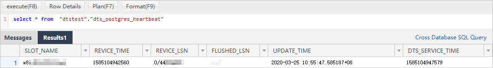<br>• Before you migrate data, evaluate the impact of data migration on the performance of the source and destination databases. We recommend that you migrate data during off-peak hours. During full data migration, DTS uses the read and write resources of the source and destination databases. This may increase the loads on the database servers.<br>• During full data migration, concurrent INSERT operations cause fragmentation in the tables of the destination database. After full data migration is complete, the size of used tablespace of the destination database is larger than that of the source database.<br>• Make sure that the precision settings for columns of the FLOAT or DOUBLE data type meet your business requirements. DTS uses the <code> ROUND(COLUMN,PRECISION) </code> function to retrieve values from columns of the FLOAT or DOUBLE data type. If you do not specify a precision, DTS sets the precision for columns of the FLOAT data type to 38 digits and the precision for columns of the DOUBLE data type to 308 digits.<br>• DTS attempts to resume data migration tasks that failed within the last seven days. Before you switch workloads to the destination instance, stop or release the data migration task. You can also execute the <code> REVOKE </code> statement to revoke the write permissions from the accounts that are used by DTS to access the destination instance. Otherwise, the data in the source database overwrites the data in the destination database after the failed task is resumed.</td>
  </tr>
</table>

**Migration types**

| Migration type | Description |
| --- | --- |
| Schema migration | DTS migrates the schemas of objects to the destination PolarDB cluster. DTS supports schema migration for the following types of objects: table, view, synonym, stored procedure, stored function, package, and user-defined type.<br>Important In this scenario, DTS does not support triggers. If an object contains triggers, data inconsistency may occur between the source and destination databases. |
| Full data migration | DTS migrates the historical data of objects from the source database to the destination PolarDB cluster.<br>Important During schema migration and full data migration, do not perform DDL operations on the objects to be migrated. Otherwise, the objects may fail to be migrated. |
| Incremental data migration | DTS retrieves redo log files from the source database. Then, DTS migrates incremental data from the source database to the destination database. DTS can migrate DML operations, such as INSERT, UPDATE, and DELETE. DTS cannot migrate DDL operations.<br>Incremental data migration allows you to ensure service continuity when you perform data migration. |

**Procedure**

1. Create a data migration instance.

2. On the Data Migration page, find the data migration instance that you created, and click **Configure Task** in the Actions column.

3. Configure the source and destination databases.

   **Section**

   **Parameter**

   **Description**

   The task name that DTS automatically generates. We recommend

   N/A

   **Task Name**

   that you specify a descriptive name that makes it easy to identify the task. You do not need to specify a unique task name.

   **Database**

   The type of the source database. Select **PolarDB (Compatible**

   **Type**

   **with Oracle)**.

   **Access**

   The access method of the source cluster. Select **Public IP**

   **Method**

   **Address**.

   The region in which the source database resides. If you set the

   **Instance**

   **Access Method** parameter to **Public IP Address**, you do not need

   **Region**

   to configure the **Instance Region** parameter.

   - **Single Data Source**: If you select this option, you must configure the **Domain Name or IP Address** and **Port Number** parameters of the primary node in the source PolarDB for PostgreSQL (Compatible with Oracle) cluster.

   - **Multiple Data Sources**: If you select this option, you must specify the IP addresses and port numbers of multiple nodes, including the primary node, in the source PolarDB for PostgreSQL (Compatible with Oracle) cluster in the **IP:Port of Data Sources** field.

   **Data Sources**

   > **Note**
   >
   > If you select **Multiple Data Sources** and
   >
   > specify the **IP:Port of Data Sources** parameter, DTS can automatically switch to a new primary node in the PolarDB

   **Source**

   > for PostgreSQL (Compatible with Oracle) cluster during

   **Database**

   > primary/secondary switchover. This is suitable for scenarios such as disaster recovery.

   **Domain**

   The endpoint of the source PolarDB for PostgreSQL (Compatible

   **Name or IP**

   with Oracle) cluster.

   **Address**

   The service port number of the source PolarDB for PostgreSQL

   **Port Number**

   (Compatible with Oracle) cluster. The default port number is **3433**.

   **Database**

   The name of the source database.

   **Name**

   **Database**

   The privileged account of the source PolarDB for PostgreSQL

   **Account**

   (Compatible with Oracle) cluster

   **Database**

   The password of the database account.

   **Password**

   **Database**

   The type of the destination database. Select **PolarDB**

   **Type**

   **(Compatible with Oracle)**.

   **Access**

   The access method of the destination cluster. Select **Public IP**

   **Method**

   **Address**.

   The region in which the destination cluster resides. The region is

   **Instance**

   the same as the destination region that you selected when you

   **Region**

   created the data migration instance. You cannot change the value of this parameter.

   - **Single Data Source**: If you select this option, you must configure the **Domain Name or IP Address** and **Port Number** parameters of the primary node in the destination PolarDB for PostgreSQL (Compatible with Oracle) cluster.

   - **Multiple Data Sources**: If you select this option, you must specify the IP addresses and port numbers of multiple nodes, including the primary node, in the destination PolarDB for PostgreSQL (Compatible with Oracle) cluster in the **IP:Port of**

   **Data**

   **Data Sources** field.

   **Sources**

   **Destinati**

   > **Note**
   >
   > If you select **Multiple Data Sources** and

   **on**

   > specify the **IP:Port of Data Sources** parameter, DTS can

   **Database**

   > automatically switch to a new primary node in the PolarDB for PostgreSQL (Compatible with Oracle) cluster during primary/secondary switchover. This is suitable for scenarios such as disaster recovery.

   **Domain**

   The endpoint of the primary node in the destination PolarDB for

   **Name or IP**

   PostgreSQL (Compatible with Oracle) cluster.

   **Address**

   The service port number of the destination PolarDB for PostgreSQL

   **Port Number**

   (Compatible with Oracle) cluster. Default value: **1433**.

   **Database**

   The name of the destination database.

   **Name**

   The database account of the destination PolarDB for PostgreSQL

   **Database**

   (Compatible with Oracle) cluster. The account must have the read

   **Account**

   and write permissions on the destination database.

   **Database**

   The password of the database account.

   **Password**

4. In the lower part of the page, click **Test Connectivity and Proceed**.

5. Select the migration types and the objects to be migrated.

   | Parame ter | Description |
   | --- | --- |
   | Task Stages | • To perform only full data migration, select <strong>Schema Migration</strong> and <strong>Full Data</strong> <strong>Migration</strong>.<br>• To ensure service continuity during data migration, select <strong>Schema Migration</strong>, <strong>Full</strong> <strong>Data Migration</strong>, and <strong>Incremental Data Migration</strong>.<br>Note<br>If <strong>Incremental Data Migration</strong> is not selected, do not write data to the source database during full data migration. This ensures data consistency between the source and destination databases. |
   | Process ing Mode of Conflict ing Tables | • <strong>Precheck and Report Errors</strong>: checks whether the destination database contains tables that have the same names as tables in the source database. If the source and destination databases do not contain tables that have identical table names, the precheck is passed. Otherwise, an error is returned during the precheck, and the data migration task cannot be started.<br>• <strong>Ignore Errors and Proceed</strong>: skips the precheck for identical table names in the source and destination databases.<br>Warning If you select <strong>Ignore Errors and Proceed</strong>, data inconsistency may occur, and your business may be exposed to potential risks.<br>• If the source and destination databases have the same schema, DTS does not migrate data records that have the same primary keys as data records in the destination database.<br>• If the source and destination databases have different schemas, only specific columns are migrated or the data migration task fails. |
   | Source Objects | Select one or more objects from the <strong>Source Objects</strong> section and click theicon to<br>add the objects to the <strong>Selected Objects</strong> section.<br>Note You can select columns, tables, or databases as the objects to be migrated. |
   | Selecte d Objects | By default, after an object is migrated to the destination database, the name of the object remains unchanged. You can use the object name mapping feature to change the names of the objects that are migrated to the destination database. For more information, see Object name mapping.<br>Note<br>• To select the SQL operations performed on a specific database or table, right-click an object in the <strong>Selected Objects</strong> section. In the dialog box that appears, select the SQL operations that you want to migrate.<br>• If you use the object name mapping feature to rename an object, other objects that are dependent on the object may fail to be migrated. |

6. Click **Next: Advanced Settings**.

   | Parameter | Description |
   | --- | --- |
   | Retry Time for Failed Connection | The retry time range for failed connections. If the source or destination database fails to be connected after the data migration task is started, DTS immediately retries a connection within the retry time range. Valid values: 10 to 1440. Unit: minutes. Default value: 720. We recommend that you set the parameter to a value greater than 30. If DTS reconnects to the source and destination databases within the specified time range, DTS resumes the data migration task. Otherwise, the data migration task fails.<br>Note<br>If you set different retry time ranges for multiple data migration tasks that have the same source or destination database, the shortest retry time range that is set takes precedence. |
   | Configure ETL | Specifies whether to configure the extract, transform, and load (ETL) feature.<br>• <strong>Yes</strong>: configures the ETL feature. You can enter data processing statements in the code editor. For more information,see Configure ETL in a migration task.<br>• <strong>No</strong>: does not configure the ETL feature. |

7. In the lower part of the page, click **Next: Precheck and Start Task**.

   > **Important**
   >
   > - Before you can start the data migration task, DTS performs a precheck. You can start the data migration task only after the task passes the precheck.
   >
   > - If the task fails to pass the precheck, click **View Details** next to each failed item. After you troubleshoot the issues based on the causes, run a precheck again.

8. Wait until **Success Rate** reaches 100%. Then, click **Back**.

   > **Note**
   >
   > If Incremental Data Migration is not selected, wait until the migration task is complete. If Incremental Data Migration is selected, the migration task does not automatically stop. In this case, you must wait until the migration task enters the **Running** state and is not delayed, and then manually stop the task.

<a id="section-4-4-3-6"></a>

#### 4.4.3.6. Migrate data from a PolarDB for PostgreSQL (Compatible with Oracle) cluster to a self-managed Oracle database

This topic describes how to migrate data from a PolarDB for PostgreSQL (Compatible with Oracle) cluster to a self-managed Oracle database by using Data Transmission Service (DTS).

**Prerequisites**

A self-managed Oracle database is created, and the schema of the Oracle database is the same as the schema of the source database in the PolarDB for PostgreSQL (Compatible with Oracle) cluster. This prerequisite must be met because DTS does not support schema migration from a PolarDB for PostgreSQL (Compatible with Oracle) cluster to a self-managed Oracle database.

**Limits**

| Category | Description |
| --- | --- |
| Limits on the source database | • The server to which the source database belongs must have sufficient outbound bandwidth. Otherwise, the data migration speed decreases.<br>• The tables to be migrated must have PRIMARY KEY or UNIQUE constraints, and all fields must be unique. Otherwise, the destination database may contain duplicate data records.<br>• If you want to migrate incremental data, make sure that the following requirements are met:<br>• The write-ahead logging (WAL) feature is enabled.<br>• WAL logs are retained for at least seven days during full data migration. You can wait until full data migration is complete, and then clear the WAL logs generated in the source database after the DTS task is run.<br>Note To ensure data security, DTS stores up to 50 GB of WAL logs that are generated within the last 24 hours. If the limit is exceeded, DTS automatically clears the cached logs.<br>Warning If you clear the WAL logs of the source database during full data migration, the data migration task may fail. For example, full data migration takes more than 24 hours due to a large amount of data in the source database and abnormal writing in the destination database. In this case, if the WAL logs of the source database are cleared during full data migration, DTS cannot obtain the WAL logs generated 24 hours ago. Therefore, the data migration task may fail.<br>• Limits on operations to be performed on the source database:<br>• During full data migration, do not perform DDL operations to change the schemas of databases or tables. Otherwise, the data migration task fails.<br>• If you perform only full data migration, do not write data to the source database during data migration. Otherwise, data inconsistency may occur between the source and destination databases. To ensure data consistency, we recommend that you select full data migration and incremental data migration as the migration types. |

<table>
  <tr>
    <td>Other limits</td>
    <td>• If you perform a primary/secondary switchover on the source database when the data migration task is running, the task fails.<br>• Schema migration is not supported. Before you configure a data migration task, you must create databases and tables in the destination instance based on the databases and tables that you want to migrate.<br>• A data migration task can migrate data from only one database. To migrate data from multiple databases, you must create a data migration task for each database.<br>• During incremental data migration, if you select a schema as the object to be migrated and create a table in the schema or execute the RENAME statement to rename a table in the schema, you must execute the <code> ALTER TABLE </code> <code>schema.table REPLICA IDENTITY FULL; </code> statement before you write data to the table.<br>Note Replace the <code> schema </code> and <code> table </code> variables in the preceding statement with your actual schema name and table name.<br>• To ensure that the latency of incremental data migration is accurate, DTS creates a heartbeat table named <code> dts_postgres_heartbeat </code> in the source database.<br>• Before you migrate data, evaluate the impact of data migration on the performance of the source and destination databases. We recommend that you migrate data during off-peak hours. During full data migration, DTS uses the read and write resources of the source and destination databases. This may increase the loads on the database servers.<br>• During full data migration, concurrent INSERT operations cause fragmentation in the tables of the destination database. After full data migration is complete, the size of used tablespace of the destination database is larger than that of the source database.<br>• Make sure that the precision settings for columns of the FLOAT or DOUBLE data type meet your business requirements. DTS uses the <code> ROUND(COLUMN,PRECISION) </code> function to retrieve values from columns of the FLOAT or DOUBLE data type. If you do not specify a precision, DTS sets the precision for columns of the FLOAT data type to 38 digits and the precision for columns of the DOUBLE data type to 308 digits.<br>• DTS attempts to resume data migration tasks that failed within the last seven days. Before you switch workloads to the destination instance, stop or release the data migration task. You can also execute the <code> REVOKE </code> statement to revoke the write permissions from the accounts that are used by DTS to access the destination instance. Otherwise, the data in the source database overwrites the data in the destination database after the failed task is resumed.</td>
  </tr>
</table>

**Procedure**

1. Create a data migration instance.

2. On the Data Migration page, find the data migration instance that you created, and click **Configure Task** in the Actions column.

3. Configure the source and destination instances.

   | Section | Parameter | Description |
   | --- | --- | --- |
   | N/A | Task Name | The task name that DTS automatically generates. We recommend that you specify a descriptive name that makes it easy to identify the task. You do not need to specify a unique task name. |

   **Database**

   The type of the source database. Select **PolarDB (Compatible**

   **Type**

   **with Oracle)**.

   **Access**

   The access method of the source database. Select **Public IP**

   **Method**

   **Address**.

   The region in which the source database resides. If you set the

   **Instance**

   **Access Method** parameter to **Public IP Address**, you do not need

   **Region**

   to configure the **Instance Region** parameter.

   - **Single Data Source**: If you select this option, you must configure the **Domain Name or IP Address** and **Port Number** parameters of the primary node in the PolarDB for PostgreSQL (Compatible with Oracle) cluster.

   - **Multiple Data Sources**: If you select this option, you must specify the IP addresses and port numbers of multiple nodes, including the primary node, in the PolarDB for PostgreSQL (Compatible with Oracle) cluster in the **IP:Port of Data Sources**

   **Data**

   field.

   **Sources**

   > **Note**
   >
   > If you select **Multiple Data Sources** and

   **Source**

   > configure the **IP:Port of Data Sources** parameter, DTS can

   **Database**

   > automatically switch to a new primary node in the PolarDB for PostgreSQL (Compatible with Oracle) cluster during primary/secondary switchover. This is suitable for scenarios such as disaster recovery.

   **Domain**

   The endpoint that is used to connect to the source PolarDB for

   **Name or IP**

   PostgreSQL (Compatible with Oracle) cluster.

   **Address**

   The service port number of the source PolarDB for PostgreSQL

   **Port Number**

   (Compatible with Oracle) cluster. The default port number is **1521**.

   **Database**

   The name of the source database.

   **Name**

   **Database**

   The privileged account of the source PolarDB for PostgreSQL

   **Account**

   (Compatible with Oracle) cluster.

   **Database**

   The password of the database account.

   **Password**

   **Database**

   The type of the destination database. Select **Oracle**.

   **Type**

   **Access**

   The access method of the destination database. Select **Public IP**

   **Method**

   **Address**.

   The region in which the destination instance resides. The region is

   **Instance**

   the same as the destination region that you selected when you

   **Region**

   created the data migration instance. You cannot change the value of this parameter.

   **Hostname or**

   The endpoint that is used to connect to the destination Oracle

   **IP address**

   database.

   The service port number of the destination Oracle database. The

   **Port Number**

   default port number is **1521**.

   **Destinati**

   The Oracle data type. Select **Non-RAC Instance** or **RAC or PDB**

   **on**

   **Oracle Type**

   **Instance** based on the architecture of the source Oracle database.

   **Database**

   The system ID (SID) of the source Oracle database.

   **SID**

   > **Note**
   >
   > This parameter is required if you select **Non-RAC**
   >
   > **Instance** as the instance type.

   The server name of the instance.

   **Service**

   > **Note**
   >
   > This parameter is required if you select **RAC or**

   **Name**

   > **PDB Instance** as the instance type.

   The account that is used to connect to the destination Oracle

   **Database**

   database. The account must have the read and write permissions

   **Account**

   on the database.

   **Database**

   The password of the database account.

   **Password**

4. In the lower part of the page, click **Test Connectivity and Proceed**.

5. Select the objects to be migrated and the migration types.

   | Parame ter | Description |
   | --- | --- |
   | Task Stages | • To perform only full data migration, select <strong>Full Data Migration</strong>.<br>• To ensure service continuity during data migration, select <strong>Full Data Migration</strong> and <strong>Incremental Data Migration</strong>.<br>Note<br>If <strong>Incremental Data Migration</strong> is not selected, do not write data to the source database during full data migration. This ensures data consistency between the source and destination databases. |
   | Source Objects | Select one or more objects from the <strong>Source Objects</strong> section and click theicon to<br>add the objects to the <strong>Selected Objects</strong> section.<br>Note You can select columns, tables, or databases as the objects to be migrated. |

   <table>
     <tr>
       <td>Selecte d Objects</td>
       <td>By default, after an object is migrated to the destination database, the name of the object remains unchanged. You can use the object name mapping feature to change the names of the objects that are migrated to the destination database. For more information, see Object name mapping.<br>Note<br>• To select the SQL operations performed on a specific database or table, right-click an object in the <strong>Selected Objects</strong> section. In the dialog box that appears, select the SQL operations that you want to migrate.<br>• If you use the object name mapping feature to rename an object, other objects that are dependent on the object may fail to be migrated.</td>
     </tr>
   </table>

6. Click **Next: Advanced Settings**.

   | Parameter | Description |
   | --- | --- |
   | Retry Time for Failed Connection | The retry time range for failed connections. If the source or destination database fails to be connected after the data migration task is started, DTS immediately retries a connection within the retry time range. Valid values: 10 to 1440. Unit: minutes. Default value: 720. We recommend that you set the parameter to a value greater than 30. If DTS reconnects to the source and destination databases within the specified time range, DTS resumes the data migration task. Otherwise, the data migration task fails.<br>Note<br>If you set different retry time ranges for multiple data migration tasks that have the same source or destination database, the shortest retry time range that is set takes precedence. |
   | Configure ETL | The extract, transform, and load (ETL) feature cannot be enabled for this data migration task. Select <strong>No</strong>. |

7. In the lower part of the page, click **Next: Precheck and Start Task**.

   > **Important**
   >
   > - Before you can start the data migration task, DTS performs a precheck. You can start the data migration task only after the task passes the precheck.
   >
   > - If the task fails to pass the precheck, click **View Details** next to each failed item. After you troubleshoot the issues based on the causes, run a precheck again.

8. Wait until **Success Rate** reaches 100%. Then, click **Back**.

   > **Note**
   >
   > If Incremental Data Migration is not selected, wait until the migration task is complete. If Incremental Data Migration is selected, the migration task does not automatically stop. In this case, you must wait until the migration task enters the **Running** state and is not delayed, and then manually stop the task.

<a id="section-4-4-3-7"></a>

#### 4.4.3.7. Migrate data from a PolarDB for PostgreSQL cluster that is compatible with Oracle to a self-managed Kafka cluster

Kafka is a distributed message queue service that supports high throughput and high scalability. Kafka is widely used for big data analytics such as log collection, monitoring data aggregation, streaming processing, and online and offline analysis. Kafka is an essential service for the big data ecosystem. This topic describes how to migrate data from a PolarDB for PostgreSQL (Compatible with Oracle) cluster to a self-managed Kafka cluster by using Data Transmission Service (DTS). The data migration feature allows you to extend message processing capabilities.

**Prerequisites**

The tables that you want to migrate from the source PolarDB for PostgreSQL (Compatible with Oracle) cluster contain primary keys or UNIQUE NOT NULL indexes.

**Limits**

| Category | Description |
| --- | --- |
| Limits on the source database | • The server to which the source database belongs must have sufficient outbound bandwidth. Otherwise, the data migration speed decreases.<br>• The tables to be migrated must have PRIMARY KEY or UNIQUE constraints, and all fields must be unique. Otherwise, the destination database may contain duplicate data records.<br>• If you want to migrate incremental data from a database, you must enable the write-ahead logging (WAL) feature for the database.<br>• The source PolarDB for PostgreSQL (Compatible with Oracle) cluster must be of the latest version. |

<table>
  <tr>
    <td>Other limits</td>
    <td>• Full data migration is not supported in this scenario.<br>• A data migration task can migrate data from only one database. To migrate data from multiple databases, you must create a data migration task for each database.<br>• During incremental data migration, if you select a schema as the object to be migrated and create a table in the schema or execute the RENAME statement to rename a table in the schema, you must execute the <code> ALTER TABLE </code> <code>schema.table REPLICA IDENTITY FULL; </code> statement before you write data to the table.<br>Note Replace the <code> schema </code> and <code> table </code> variables in the preceding statement with your actual schema name and table name.<br>• To ensure that the latency of incremental data migration is accurate, DTS creates a heartbeat table named <code> dts_postgres_heartbeat </code> in the source database.<br>• Make sure that the precision settings for columns of the FLOAT or DOUBLE data type meet your business requirements. DTS uses the <code> ROUND(COLUMN,PRECISION) </code> function to retrieve values from columns of the FLOAT or DOUBLE data type. If you do not specify a precision, DTS sets the precision for columns of the FLOAT data type to 38 digits and the precision for columns of the DOUBLE data type to 308 digits.<br>• DTS attempts to resume data migration tasks that failed within the last seven days. Before you switch workloads to the destination instance, stop or release the data migration task. You can also execute the <code> REVOKE </code> statement to revoke the write permissions from the accounts that are used by DTS to access the destination instance. Otherwise, the data in the source database overwrites the data in the destination database after the failed task is resumed.</td>
  </tr>
</table>

**Procedure**

1. Create a data migration instance.

2. On the Data Migration page, find the data migration instance that you created, and click **Configure Task** in the Actions column.

3. Configure the source and destination instances.

   **Section**

   **Parameter**

   **Description**

   The task name that DTS automatically generates. We recommend

   N/A

   **Task Name**

   that you specify a descriptive name that makes it easy to identify the task. You do not need to specify a unique task name.

   **Database**

   The type of the source database. Select **PolarDB (Compatible**

   **Type**

   **with Oracle)**.

   **Access**

   The access method of the source cluster. Select **Public IP**

   **Method**

   **Address**.

   **Instance**

   If you set the **Access Method** parameter to **Public IP Address**,

   **Region**

   you do not need to configure the **Instance Region** parameter.

   - **Single Data Source**: If you select this option, you must configure the **Domain Name or IP Address** and **Port Number** parameters of the primary node in the source PolarDB for PostgreSQL (Compatible with Oracle) cluster.

   - **Multiple Data Sources**: If you select this option, you must enter the IP addresses and port numbers of multiple nodes, including the primary node, in the source PolarDB for PostgreSQL (Compatible with Oracle) cluster in the **IP:Port of Data Sources**

   **Data**

   **Source**

   field.

   **Sources**

   **Database**

   > **Note**
   >
   > If you select **Multiple Data Sources** and
   >
   > configure the **IP:Port of Data Sources** parameter, DTS can automatically switch to a new primary node in the PolarDB for PostgreSQL (Compatible with Oracle) cluster during primary/secondary switchover. This is suitable for scenarios such as disaster recovery.

   **Domain**

   The endpoint of the source PolarDB for PostgreSQL (Compatible

   **Name or IP**

   with Oracle) cluster.

   **Address**

   The service port number of the PolarDB for PostgreSQL (Compatible

   **Port Number**

   with Oracle) cluster. Default value: **1521**.

   **Database**

   The name of the source database.

   **Name**

   **Database**

   The privileged account of the source PolarDB for PostgreSQL

   **Account**

   (Compatible with Oracle) cluster.

   **Database**

   The password of the database account.

   **Password**

   **Database**

   The type of the destination database. Select **Kafka**.

   **Type**

   **Access**

   The access method of the destination cluster. Select **Public IP**

   **Method**

   **Address**.

   The region in which the destination cluster resides. The region is

   **Instance**

   the same as the destination region that you selected when you

   **Region**

   created the data migration instance. You cannot change the value of this parameter.

   **IP address (domain**

   The IP address that is used to access the self-managed Kafka

   **name is not**

   cluster. In this example, the public IP address is used.

   **supported)**

   The service port number of the self-managed Kafka cluster. Default

   **Port Number**

   value: 9092.

   The username that is used to log on to the Kafka cluster. If no

   **Database**

   authentication is enabled for the Kafka cluster, you do not need to

   **Account**

   enter the username.

   The password of the database account. If no authentication is

   **Destinati**

   **Database**

   enabled for the self-managed Kafka cluster, you do not need to

   **on**

   **Password**

   specify this parameter.

   **Database**

   The version of the destination Kafka cluster.

   **Kafka**

   > **Note**
   >
   > You cannot select Kafka 2.0 in the DTS console. If

   **Version**

   > you are using Kafka 2.0, you must select Kafka 1.0.

   Specifies whether to encrypt the connection. Select **Non-**

   **Encryption**

   **encrypted** or **SCRAM-SHA-256** based on your business and security requirements.

   The name of the destination topic. Select a value from the drop-

   **Topic**

   down list.

   Specifies whether to use Kafka Schema Registry. Kafka Schema Registry provides a serving layer for your metadata. It provides a RESTful API to store and retrieve your Avro schemas. Valid values:

   **Use Kafka**

   - **No**: does not use Kafka Schema Registry.

   **Schema Registry**

   - **Yes**: uses Kafka Schema Registry. In this case, you must enter the URL or IP address that is registered in Kafka Schema Registry for your Avro schemas.

4. In the lower part of the page, click **Test Connectivity and Proceed**.

5. Select the objects to be migrated and the migration types.

   | Parameter | Description |
   | --- | --- |
   | Task Stages | Select <strong>Incremental Data Migration</strong> and <strong>Schema Migration</strong>. |
   | Source Objects | Select one or more objects from the <strong>Source Objects</strong> section and click the<br>icon to add the objects to the <strong>Selected Objects</strong> section.<br>Note You can select only tables as the objects to be migrated. |
   | Selected Objects | By default, after an object is migrated to the destination database, the name of the object remains unchanged. You can use the object name mapping feature to change the names of the objects that are migrated to the destination database. For more information, see Object name mapping.<br>Note If you use the object name mapping feature to rename an object, other objects that are dependent on the object may fail to be migrated. |

6. Click **Next: Advanced Settings**.

   | Parameter | Description |
   | --- | --- |
   | Retry Time for Failed Connection | The retry time range for failed connections. If the source or destination database fails to be connected after the data migration task is started, DTS immediately retries a connection within the retry time range. Valid values: 10 to 1440. Unit: minutes. Default value: 720. We recommend that you set the parameter to a value greater than 30. If DTS reconnects to the source and destination databases within the specified time range, DTS resumes the data migration task. Otherwise, the data migration task fails.<br>Note<br>If you set different retry time ranges for multiple data migration tasks that have the same source or destination database, the shortest retry time range that is set takes precedence. |
   | Configure ETL | The extract, transform, and load (ETL) feature cannot be enabled for this data migration task. Select <strong>No</strong>. |

7. In the lower part of the page, click **Next: Precheck and Start Task**.

   > **Important**
   >
   > - Before you can start the data migration task, DTS performs a precheck. You can start the data migration task only after the task passes the precheck.
   >
   > - If the task fails to pass the precheck, click **View Details** next to each failed item. After you troubleshoot the issues based on the causes, run a precheck again.

8. Wait until **Success Rate** reaches 100%. Then, click **Back**.

   > **Note**
   >
   > If Incremental Data Migration is not selected, wait until the migration task is complete. If Incremental Data Migration is selected, the migration task does not automatically stop. In this case, you must wait until the migration task enters the **Running** state and is not delayed, and then manually stop the task.

<a id="section-4-4-4"></a>

### 4.4.4. Migrate data from a PolarDB-X 2.0 instance

<a id="section-4-4-4-1"></a>

#### 4.4.4.1. Migrate data between PolarDB-X 2.0 instances

This topic describes how to migrate data between PolarDB-X 2.0 instances by using Data Transmission Service (DTS).

**Prerequisites**

- The source and destination PolarDB-X 2.0 instances are created and compatible with MySQL 5.7.

- The available storage space of the destination PolarDB-X 2.0 instance is larger than the total size of the data in the source PolarDB-X 2.0 instance.

**Limits**

| Type | Description |
| --- | --- |
| Source database limitations | • The server that hosts the source database must have sufficient outbound bandwidth. Insufficient bandwidth slows down data migration.<br>• Enterprise Edition PolarDB-X 2.0 read-only instances are not supported as a source database.<br>• Tables to be migrated must have a PRIMARY KEY or a UNIQUE constraint, and the fields in the key or constraint must be unique. Otherwise, this may cause duplicate data in the destination database.<br>• If you migrate objects at the table level and need to edit them, for example, by mapping column names, a single data migration task supports a maximum of 1,000 tables. If you exceed this limit, the task submission will fail. In this case, split the tables into multiple data migration tasks or configure a task to migrate the entire database.<br>• For incremental data migration, the source database must meet the following binary log requirements:<br>• Enable the binary log feature, and set the <code> binlog_row_image </code> parameter to <code> full </code>. Otherwise, the precheck fails and the data migration task cannot start.<br>• For incremental data migration tasks, DTS requires that the binary logs of the source database be retained for at least 24 hours. For tasks that include both full data migration and incremental data migration, the binary logs must be retained for at least 7 days. You can change the retention period to 24 hours after the full data migration is complete. If the binary logs are not retained for the required period, DTS may fail to obtain them, which can cause task failures or even data inconsistency and loss. The DTS SLA does not cover issues caused by an insufficient binary log retention period.<br>• If a table name in the PolarDB-X 2.0 instance contains uppercase letters, only schema migration is supported for that table.<br>• Operational limitations on the source database:<br>• During schema migration and full data migration, do not perform DDL operations that change the database or table schema. Otherwise, the data migration task will fail.<br>Note<br>During full data migration, DTS queries the source database. This action places a metadata lock, which may block DDL operations on the source database.<br>• If you need to change the network type of the PolarDB-X 2.0 instance during migration, you must update the network connection information of the migration task after the change is complete.<br>• If you perform only full data migration, do not write new data to the source database during the migration. Otherwise, data will become inconsistent between the source and destination databases. To maintain real-time data consistency, select schema migration, full data migration, and incremental data migration.<br>• Migration of table groups (TABLEGROUP) and databases or tables with the Locality attribute is not supported.<br>• Migration of tables whose names are reserved words, such as <code> select </code>, is not supported.<br>• In a PolarDB-X 2.0 instance, database partitions in DRDS mode are not supported for synchronization.<br>• During the operation of a DTS migration task, changing the type of a broadcast table in the source PolarDB-X 2.0 instance (for example, changing a broadcast table to a regular table or a sharded table) is not supported. To change the table type, stop the migration task first, and then reconfigure the migration task after the change is complete. |
| Other limitations | • Evaluate the performance of the source and destination databases before you start migration. We recommend that you perform data migration during off-peak hours because DTS consumes read and write resources on both databases during full data migration, which increases database load.<br>• During full data migration, concurrent INSERT operations can cause table fragmentation in the destination database. As a result, tables in the destination database may occupy more storage space than those in the source database.<br>• DTS attempts to recover failed tasks for up to seven days. Before you switch your workloads to the destination database, end or release the task, or revoke the write permissions of the DTS account on the destination database by using the <code> REVOKE </code> command. This prevents DTS from overwriting data in the destination database if the task is automatically recovered.<br>• If a task fails, DTS support staff will attempt to restore it within eight hours.During restoration, they may restart the task or adjust its parameters.<br>Note<br>Only DTS task parameters are modified—not database parameters.Parameters that may be adjusted include those listed in Modify instance parameters. |
| Other precautions | DTS periodically updates the <code> dts_health_check </code>.<code> ha_health_check </code> table in the source database to advance the binlog position. |

**Migration types**

- Schema migration

  DTS migrates the schema definitions of the migration objects from the source database to the destination database.

- Full migration

  DTS migrates all historical data of the specified migration objects from the source database to the destination database.

- Incremental migration

  After a full migration is complete, DTS migrates incremental data updates from the source database to the destination database. Incremental migration lets you smoothly migrate data without interrupting your self-managed applications.

**Permissions required by database accounts**

<table>
  <tr>
    <th>Database type</th>
    <th>Schema migration</th>
    <th>Full data migration</th>
    <th>Incremental data migration</th>
  </tr>
  <tr>
    <td>Source PolarDB-X 2.0 instance</td>
    <td>SELECT permission</td>
    <td>SELECT permission</td>
    <td>SELECT permission on the objects to be migrated, REPLICATION SLAVE permission, and REPLICATION CLIENT permission. DTS automatically grants these permissions to the database account.</td>
  </tr>
  <tr>
    <td>Destination PolarDB-X 2.0 instance</td>
    <td colspan="3">Read and write permissions</td>
  </tr>
</table>

**SQL operations for incremental migration**

| Operation type | SQL statement |
| --- | --- |
| DML | INSERT, UPDATE, DELETE |
| DDL | • ALTER TABLE<br>• CREATE FUNCTION, CREATE INDEX, CREATE TABLE<br>Note<br>If the source database is an Enterprise Edition PolarDB-X 2.0 instance, <code> CREATE FUNCTION </code> and <code> CREATE INDEX </code> operations are not migrated.<br>• DROP INDEX, DROP TABLE<br>• RENAME TABLE<br>Note<br>The <code> RENAME TABLE </code> operation may cause data inconsistency. For example, if you select only one table for migration and then rename it in the source instance, data from that table is not migrated. To avoid this issue, select the entire database to which the table belongs as the migration object. Make sure that the database that contains the table both before and after the rename operation is included in the migration objects.<br>• TRUNCATE TABLE |

**Procedure**

1. Create a data migration instance.

2. On the Data Migration page, find the data migration instance that you created, and click **Configure Task** in the Actions column.

3. Configure the source and destination databases.

   **Section**

   **Parameter**

   **Description**

   The task name that DTS automatically generates. We recommend that you

   None

   **Task Name**

   specify a descriptive name that makes it easy to identify the task. You do not need to specify a unique task name.

   The type of the source database. Select

   **Database Type**

   **PolarDB-X 2.0**.

   The access method of the source

   **Access Method**

   database. Set this parameter to **Alibaba Cloud Instance**.

   The region in which the source database resides. The region is the source region

   **Instance Region**

   that you selected when you created the data migration task. You cannot change the value of this parameter.

   **Replicate Data Across**

   Specifies whether to migrate data across

   **Source Database**

   **Alibaba Cloud Accounts**

   Alibaba Cloud accounts. Select **No**.

   The ID of the source PolarDB-X 2.0

   **Instance ID**

   instance.

   The database account of the source PolarDB-X 2.0 instance. For more information about the permissions that

   **Database Account**

   are required for the account, see the Permissions required for database accounts section of this topic.

   The password that is used to access the

   **Database Password**

   database.

   The type of the destination database.

   **Database Type**

   Select **PolarDB-X 2.0**.

   The access method of the destination

   **Access Method**

   database. Set this parameter to **Alibaba Cloud Instance**.

   The region in which the destination database resides. The region is the same as the destination region that you

   **Instance Region**

   **Destination**

   selected when you created the data

   **Database**

   migration task. You cannot change the value of this parameter.

   The ID of the destination PolarDB-X 2.0

   **Instance ID**

   instance.

   The database account of the destination PolarDB-X 2.0 instance. For more information about the permissions that

   **Database Account**

   are required for the account, see the Permissions required for database accounts section of this topic.

   The password that is used to access the

   **Database Password**

   database.

4. In the lower part of the page, click **Test Connectivity and Proceed**.

5. Select the objects to be migrated and the migration types.

   | Parameter | Description |
   | --- | --- |
   | Task Stages | • If you only need to perform a full migration, select both <strong>Schema Migration</strong> and <strong>Full Data Migration</strong>.<br>• To perform a migration with no downtime, select <strong>Schema</strong> <strong>Migration</strong>, <strong>Full Data Migration</strong>, and <strong>Incremental Data</strong> <strong>Migration</strong>.<br>Note<br>If Incremental Data Migration is not selected, we recommend that you do not write data to the source database during data migration. This ensures data consistency between the source and destination databases. |
   | Incremental CDC Type | Select an option based on the log engine of the PolarDB-X 2.0 instance.<br>Note<br>If you want to select <strong>Multi-stream CDC</strong>, make sure that multi-stream binary logging is enabled for the PolarDB-X 2.0 instance. |
   | Processing Mode of Conflicting Tables | • <strong>Precheck and Report Errors</strong>: checks whether the destination database contains tables that have the same names as tables in the source database. If the source and destination databases do not contain tables that have identical table names, the precheck is passed. Otherwise, an error is returned during the precheck, and the data migration task cannot be started.<br>Note<br>If the source and destination databases contain tables that have the same names and the tables in the destination database cannot be deleted or renamed, you can use the object name mapping feature to rename the tables that are migrated to the destination database. For more information, see Object name mapping.<br>• <strong>Ignore Errors and Proceed</strong>: skips the precheck for identical table names in the source and destination databases.<br>Warning<br>If you select <strong>Ignore Errors and Proceed</strong>, data inconsistency may occur, and your business may be exposed to potential risks.<br>• If the source and destination databases have the same schemas, DTS does not migrate data records that have the same primary key values as data records in the destination database.<br>• If the source and destination databases have different schemas, only specific columns are migrated, or the data migration task fails. |
   | Capitalization of Object Names in Destination Instance | The capitalization of database names, table names, and column names in the destination instance. By default, <strong>DTS default</strong> <strong>policy</strong> is selected. You can select other options to make sure that the capitalization of object names is consistent with that of the source or destination database. For more information, see Specify the capitalization of object names in the destination instance. |
   | Source Objects | In the <strong>Source Objects</strong> box, click the objects to migrate, and then<br>clickto move them to the <strong>Selected Objects</strong> box. |
   | Selected Objects | By default, after an object is migrated to the destination database, the name of the object remains unchanged. You can use the object name mapping feature to change the names of the objects that are migrated to the destination database. For more information, see Object name mapping.<br>Note<br>If you use the object name mapping feature to rename an object, other objects that are dependent on the object may fail to be migrated. |

6. Click **Next: Advanced Settings** to configure advanced settings. The following table describes the parameters.

   | Parameter | Description |
   | --- | --- |
   | Retry Time for Failed Connections | The retry time range for failed connections. If the source or destination database fails to be connected after the data migration task is started, an error is returned. For predictable errors, DTS immediately retries a connection within the time range. Valid values: 10 to 1440. Unit: minutes.Default value: 720. We recommend that you set the parameter to a value greater than 30. If DTS reconnects to the source and destination databases within the specified retry time range, DTS resumes the data migration task. Otherwise, the data migration task fails.<br>Note<br>If you specify different retry time ranges for multiple data migration tasks that have the same source or destination database, the shortest retry time range that is specified takes precedence. |
   | Configure ETL | The extract, transform, and load (ETL) feature cannot be enabled for this data migration task. Select <strong>No</strong>. |
   | Whether to delete SQL operations on heartbeat tables of forward and reverse tasks | Choose whether DTS writes heartbeat SQL information to the source database while the instance is running.<br>• <strong>Yes</strong>: Does not write heartbeat SQL information to the source database.The DTS instance may display latency.<br>• <strong>No</strong>: Writes heartbeat SQL information to the source database. This may interfere with source database operations like physical backups and cloning. |

7. In the lower part of the page, click **Next: Precheck and Start Task**.

   > **Important**
   >
   > - Before you can start the data migration task, DTS performs a precheck. You can start the data migration task only after the task passes the precheck.
   >
   > - If the task fails to pass the precheck, click **View Details** next to each failed item. After you troubleshoot the issues based on the causes, run a precheck again.

8. Wait until **Success Rate** reaches 100%. Then, click **Back**.

   > **Note**
   >
   > If Incremental Data Migration is not selected, wait until the migration task is complete. If Incremental Data Migration is selected, the migration task does not automatically stop. In this case, you must wait until the migration task enters the **Running** state and is not delayed, and then manually stop the task.

<a id="section-4-4-4-2"></a>

#### 4.4.4.2. Migrate data from a PolarDB-X 2.0 instance to a MySQL instance

This topic describes how to migrate data from a PolarDB-X 2.0 instance to an ApsaraDB RDS for MySQL instance by using Data Transmission Service (DTS).

**Prerequisites**

- The source PolarDB-X 2.0 instance is created and compatible with MySQL 5.7.

- The available storage space of the destination ApsaraDB RDS for MySQL instance is larger than the total size of data in the source PolarDB-X 2.0 instance.

**Limits**

| Category | Description |
| --- | --- |

<table>
  <tr>
    <td>Limits on the source instance</td>
    <td>• The server to which the source database belongs must have sufficient outbound bandwidth. Otherwise, the data migration speed is affected.<br>• The tables to be migrated must have PRIMARY KEY or UNIQUE constraints, and all fields must be unique. Otherwise, the destination database may contain duplicate data records.<br>• If you select tables as the objects to be migrated and you need to edit the tables in the destination database, such as renaming tables or columns, you can migrate up to 1,000 tables in a single data migration task. If you run a task to migrate more than 1,000 tables, a request error occurs. In this case, we recommend that you configure multiple tasks to migrate the tables in batches, or configure a task to migrate the entire database.<br>• If you need to migrate incremental data, make sure that the following requirements are met:<br>• The binary logging feature is enabled. The value of the binlog_row_image parameter is set to FULL. Otherwise, error messages are returned during precheck, and the data migration task cannot be started.<br>• For an incremental data migration task, binary logs of the source database must be stored for more than 24 hours. For a full data and incremental data migration task, binary logs of the source database must be stored for at least seven days. Otherwise, DTS may fail to obtain the binary logs, and the migration task may fail. In exceptional circumstances, data inconsistency or loss may occur. After full data migration is complete, you can set the retention period to more than 24 hours. Make sure that you set the retention period of binary logs based on the preceding requirements. Otherwise, the service reliability or performance in the Service Level Agreement (SLA) of DTS may not be achieved.<br>• Limits on operations to perform on the source database:<br>• During schema migration and full data migration, do not perform DDL operations to change the schemas of databases or tables. Otherwise, the data migration task fails.<br>• If you change the network type of a PolarDB-X instance during data migration, contact technical support to change the network connection settings of the data migration instance.<br>• If you perform only full data migration, do not write data to the source database during data migration. Otherwise, data inconsistency between the source and destination databases occurs. To ensure data consistency, we recommend that you select schema migration, full data migration, and incremental data migration as the migration types.<br>• The PolarDB-X instance must be compatible with MySQL 5.7.</td>
  </tr>
</table>

<table>
  <tr>
    <td>Other limits</td>
    <td>• Before you migrate data, evaluate the impact of data migration on the performance of the source database and destination cluster. We recommend that you migrate data during off-peak hours. During full data migration, DTS uses the read and write resources of the source database and destination cluster. This may increase the loads on the database servers.<br>• During full data migration, concurrent INSERT operations cause fragmentation in the tables of the destination cluster. After full data migration is complete, the size of used tablespace of the destination cluster is larger than that of the source database.<br>• DTS attempts to resume data migration tasks that failed within the last seven days. Before you switch workloads to the destination cluster, you must stop or release the failed tasks. You can also execute the <code> REVOKE </code> statement to revoke the write permissions from the accounts that are used by DTS to access the destination database. Otherwise, the data in the source database will overwrite the data in the destination database after the failed task is resumed.</td>
  </tr>
  <tr>
    <td>Special cases</td>
    <td>If the destination database runs on an ApsaraDB RDS for MySQL instance, take note of the following limits:<br>DTS automatically creates a database in the destination ApsaraDB RDS for MySQL instance. However, if the name of the source database is invalid, you must create a database in the destination ApsaraDB RDS for MySQL instance before you configure the data migration task. For more information, see the <strong>"Create a</strong> <strong>database"</strong> topic in the documentation of <strong>ApsaraDB RDS for MySQL</strong>.</td>
  </tr>
</table>

**Migration types**

- Schema migration

  DTS migrates the schema definitions of the migration objects from the source database to the destination database.

- Full migration

  DTS migrates all historical data of the specified migration objects from the source database to the destination database.

- Incremental migration

  After a full migration is complete, DTS migrates incremental data updates from the source database to the destination database. Incremental migration lets you smoothly migrate data without interrupting your self-managed applications.

**Supported SQL operations**

| Type | SQL statement |
| --- | --- |
| DML | INSERT, UPDATE, and DELETE |
| DDL | • ALTER TABLE<br>• CREATE FUNCTION, CREATE INDEX, and CREATE TABLE<br>Note<br>If the source database is an Enterprise Edition PolarDB-X 2.0 instance, <code> CREATE FUNCTION </code> and <code> CREATE INDEX </code> operations are not migrated.<br>• DROP INDEX and DROP TABLE<br>• RENAME TABLE<br>Note<br>The RENAME TABLE operation may cause data inconsistency. For example, if you select only a specific table as the migration object and that table is renamed in the source database during the migration, the data migration task does not migrate its data to the destination database. To prevent this issue, select the entire database that contains the table as the migration object when you configure the data migration task.<br>• TRUNCATE TABLE |

**Permissions required by database accounts**

<table>
  <tr>
    <th>Database type</th>
    <th>Schema migration</th>
    <th>Full data migration</th>
    <th>Incremental data migration</th>
  </tr>
  <tr>
    <td>PolarDB-X 2.0</td>
    <td>SELECT permission</td>
    <td>SELECT permission</td>
    <td>SELECT permission on the objects to be migrated, REPLICATION SLAVE permission, and REPLICATION CLIENT permission. DTS automatically grants these permissions to the database account.</td>
  </tr>
  <tr>
    <td>ApsaraDB RDS for MySQL</td>
    <td colspan="3">Read and write permissions</td>
  </tr>
</table>

**Procedure**

1. Create a data migration task.

2. On the Data Migration page, find the data migration instance that you created, and click **Configure Task** in the Actions column.

3. Configure the source and destination databases. The following table describes the parameters.

   | Section | Parameter | Description |
   | --- | --- | --- |

   DTS automatically generates a task name. We recommend that you

   None

   **Task Name**

   specify a descriptive name for easy identification. The name does not need to be unique.

   **Database**

   The type of the source database. Select **PolarDB-X 2.0**.

   **Type**

   **Access**

   The access method of the source database. Default value: **Alibaba**

   **Method**

   **Cloud Instance**.

   The region in which the source PolarDB-X 2.0 instance resides. The

   **Instance**

   region is the same as the source region that you selected when you

   **Region**

   created the data migration task. You cannot change the value of this parameter.

   **Replicate**

   **Source**

   **Data Across**

   **Database**

   Specifies whether to migrate data across Alibaba Cloud accounts.

   **Alibaba**

   Select **No**.

   **Cloud Accounts**

   **Instance ID**

   The ID of the source instance.

   The database account of the source instance. For information about

   **Database**

   the permissions that are required for the account, see the

   **Account**

   Permissions required for database accounts section of this topic.

   **Database**

   Enter the password for the database account.

   **Password**

   **Database**

   The type of the destination instance. Select **MySQL**.

   **Type**

   **Access**

   The access method of the destination database. Default value:

   **Method**

   **Public IP Address**.

   The region in which the destination database resides. The region is

   **Instance**

   the destination region that you selected when you created the data

   **Region**

   migration task. You cannot change the value of this parameter.

   **Hostname or**

   The endpoint of the destination instance.

   **Destinati**

   **IP Address**

   **on Database**

   **Port Number**

   The port number of the destination instance. Default value: 3306.

   The database account of the destination instance. For information

   **Database**

   about the permissions that are required for the account, see the

   **Account**

   Permissions required for database accounts section of this topic.

   **Database**

   Enter the password for the database account.

   **Password**

4. In the lower part of the page, click **Test Connectivity and Proceed**.

5. If a whitelist is configured for your MySQL instance, add the CIDR blocks of DTS servers that are displayed in the dialog box to the whitelist. After the whitelist is configured, click **Test Connectivity and Proceed**.

   > **Note**
   >
   > If no whitelist is configured for your MySQL instance, ignore the whitelist settings and click **Test Connectivity and Proceed**.

6. Configure the objects to be synchronized and advanced settings. The following table describes the parameters.

   | Parameter | Description |
   | --- | --- |
   | Task Stages | • If you only need to perform a full migration, select both <strong>Schema Migration</strong> and <strong>Full Data Migration</strong>.<br>• To perform a migration with no downtime, select <strong>Schema</strong> <strong>Migration</strong>, <strong>Full Data Migration</strong>, and <strong>Incremental Data</strong> <strong>Migration</strong>.<br>Note<br>• If you do not select <strong>Schema Migration</strong>, you must ensure that a database and tables to receive the data exist in the destination database. You can also use the object name mapping feature in the <strong>Selected</strong> <strong>Objects</strong> box as needed.<br>• If you do not select <strong>Incremental Data Migration</strong>, do not write new data to the source instance during data migration to ensure data consistency. |
   | Incremental CDC Type | Select an option based on the log engine of the PolarDB-X 2.0 instance.<br>Note<br>If you want to select <strong>Multi-stream CDC</strong>, make sure that multi-stream binary logging is enabled for the PolarDB-X 2.0 instance. |
   | Processing Mode of Conflicting Tables | • <strong>Precheck and Report Errors</strong>: checks whether the destination database contains tables that have the same names as tables in the source database. If the source and destination databases do not contain tables that have identical table names, the precheck is passed. Otherwise, an error is returned during the precheck, and the data migration task cannot be started.<br>Note<br>If the source and destination databases contain tables that have the same names and the tables in the destination database cannot be deleted or renamed, you can use the object name mapping feature to rename the tables that are migrated to the destination database. For more information, see Object name mapping.<br>• <strong>Ignore Errors and Proceed</strong>: skips the precheck for identical table names in the source and destination databases.<br>Warning<br>If you select <strong>Ignore Errors and Proceed</strong>, data inconsistency may occur, and your business may be exposed to potential risks.<br>• If the source and destination databases have the same schemas, DTS does not synchronize data records that have the same primary key values as data records in the destination database.<br>• If the source and destination databases have different schemas, only specific columns are migrated, or the data migration task fails. |
   | Capitalization of Object Names in Destination Instance | The capitalization of database names, table names, and column names in the destination instance. By default, <strong>DTS default</strong> <strong>policy</strong> is selected. You can select other options to make sure that the capitalization of object names is consistent with that of the source or destination database. For more information, see Specify the capitalization of object names in the destination instance. |

   <table>
     <tr>
       <td>Source Objects</td>
       <td>Select one or more objects from the <strong>Source Objects</strong> section and<br>click theicon to add the objects to the <strong>Selected Objects</strong><br>section.<br>Note<br>You can select columns, tables, or databases as the objects to be migrated. If you select tables or columns as the objects to be migrated, DTS does not migrate other objects, such as views, triggers, and stored procedures, to the destination database.</td>
     </tr>
     <tr>
       <td>Selected Objects</td>
       <td>By default, after an object is migrated to the destination database, the name of the object remains unchanged. You can use the object name mapping feature to change the names of the objects that are migrated to the destination database. For more information, see Object name mapping.<br>Note<br>If you use the object name mapping feature to rename an object, other objects that are dependent on the object may fail to be migrated.</td>
     </tr>
   </table>

7. Click **Next: Advanced Settings** to configure advanced settings. The following table describes the parameters.

   | Parameter | Description |
   | --- | --- |
   | Retry Time for Failed Connections | The retry time range for failed connections. If the source or destination database fails to be connected after the data migration task is started, an error is returned. For predictable errors, DTS immediately retries a connection within the time range. Valid values: 10 to 1440. Unit: minutes.Default value: 720. We recommend that you set the parameter to a value greater than 30. If DTS reconnects to the source and destination databases within the specified time range, DTS resumes the data migration task. Otherwise, the data migration task fails.<br>Note<br>If you specify different retry time ranges for multiple data migration tasks that have the same source or destination database, the shortest retry time range that is specified takes precedence. |
   | Configure ETL | The extract, transform, and load (ETL) feature cannot be enabled for this data migration task. Select <strong>No</strong>. |
   | Whether to delete SQL operations on heartbeat tables of forward and reverse tasks | Choose whether DTS writes heartbeat SQL information to the source database while the instance is running.<br>• <strong>Yes</strong>: Does not write heartbeat SQL information to the source database.The DTS instance may display latency.<br>• <strong>No</strong>: Writes heartbeat SQL information to the source database. This may interfere with source database operations like physical backups and cloning. |

8. In the lower part of the page, click **Next: Precheck and Start Task**.

   > **Important**
   >
   > - Before you can start the data migration task, DTS performs a precheck. You can start the data migration task only after the task passes the precheck.
   >
   > - If the task fails to pass the precheck, click **View Details** next to each failed item. After you troubleshoot the issues based on the causes, run a precheck again.

9. Wait until **Success Rate** reaches 100%. Then, click **Back**.

   > **Note**
   >
   > If Incremental Data Migration is not selected, wait until the migration task is complete. If Incremental Data Migration is selected, the migration task does not automatically stop. In this case, you must wait until the migration task enters the **Running** state and is not delayed, and then manually stop the task.

<a id="section-4-4-4-3"></a>

#### 4.4.4.3. Migrate data from a PolarDB-X V2.0 instance to an ApsaraMQ for Kafka instance

This topic describes how to migrate data from a PolarDB-X 2.0 instance to an ApsaraMQ for Kafka instance by using Data Transmission Service (DTS). ApsaraMQ for Kafka provides extended capabilities to process messages.

**Prerequisites**

- A PolarDB-X 2.0 instance is created.

- In the destination ApsaraMQ for Kafka instance, a topic is created to receive the migrated data.

- The available storage space of the destination ApsaraMQ for Kafka instance is larger than the total size of the data in the source PolarDB-X 2.0 instance.

**Limits**

| Type | Description |
| --- | --- |
| Source database limitations | • The server that hosts the source database must have sufficient outbound bandwidth. Insufficient bandwidth slows down data migration.<br>• Enterprise Edition PolarDB-X 2.0 read-only instances are not supported as a source database.<br>• Tables to be migrated must have a PRIMARY KEY or a UNIQUE constraint, and the fields in the key or constraint must be unique. Otherwise, this may cause duplicate data in the destination database.<br>• If you migrate objects at the table level and need to edit them, for example, by mapping column names, a single data migration task supports a maximum of 1,000 tables. If you exceed this limit, the task submission will fail. In this case, split the tables into multiple data migration tasks or configure a task to migrate the entire database.<br>• For incremental data migration, the source database must meet the following binary log requirements:<br>• Enable the binary log feature, and set the <code> binlog_row_image </code> parameter to <code> full </code>. Otherwise, the precheck fails and the data migration task cannot start.<br>• For incremental data migration tasks, DTS requires that the binary logs of the source database be retained for at least 24 hours. For tasks that include both full data migration and incremental data migration, the binary logs must be retained for at least 7 days. You can change the retention period to 24 hours after the full data migration is complete. If the binary logs are not retained for the required period, DTS may fail to obtain them, which can cause task failures or even data inconsistency and loss. The DTS SLA does not cover issues caused by an insufficient binary log retention period.<br>• If a table name in the PolarDB-X 2.0 instance contains uppercase letters, only schema migration is supported for that table.<br>• Operational limitations on the source database:<br>• During schema migration and full data migration, do not perform DDL operations that change the database or table schema. Otherwise, the data migration task will fail.<br>Note<br>During full data migration, DTS queries the source database. This action places a metadata lock, which may block DDL operations on the source database.<br>• If you need to change the network type of the PolarDB-X 2.0 instance during migration, you must update the network connection information of the migration task after the change is complete.<br>• If you perform only full data migration, do not write new data to the source database during the migration. Otherwise, data will become inconsistent between the source and destination databases. To maintain real-time data consistency, select schema migration, full data migration, and incremental data migration.<br>• Migration of table groups (TABLEGROUP) and databases or tables with the Locality attribute is not supported.<br>• Migration of tables whose names are reserved words, such as <code> select </code>, is not supported.<br>• In a PolarDB-X 2.0 instance, database partitions in DRDS mode are not supported for synchronization.<br>• During the operation of a DTS migration task, changing the type of a broadcast table in the source PolarDB-X 2.0 instance (for example, changing a broadcast table to a regular table or a sharded table) is not supported. To change the table type, stop the migration task first, and then reconfigure the migration task after the change is complete. |
| Other limits | • You cannot migrate the following database objects: indexes, partitions, views, procedures, functions, triggers, and foreign keys (FK).<br>• Evaluate the performance of the source and destination databases before you start migration. We recommend that you perform data migration during off-peak hours because DTS consumes read and write resources on both databases during full data migration, which increases database load.<br>• During full data migration, concurrent INSERT operations can cause table fragmentation in the destination database. As a result, tables in the destination database may occupy more storage space than those in the source database.<br>• DTS attempts to recover failed tasks for up to seven days. Before you switch your workloads to the destination database, end or release the task, or revoke the write permissions of the DTS account on the destination database by using the <code> REVOKE </code> command. This prevents DTS from overwriting data in the destination database if the task is automatically recovered.<br>• If you scale out or scale in the destination Message Queue for Apache Kafka instance during the data migration, you must restart the DTS instance.<br>• If a task fails, DTS support staff will attempt to restore it within eight hours.During restoration, they may restart the task or adjust its parameters.<br>Note<br>Only DTS task parameters are modified—not database parameters.Parameters that may be adjusted include those listed in Modify instance parameters. |
| Precautions | DTS periodically updates the <code> dts_health_check </code>.<code> ha_health_check </code> table in the source database to advance the binary log position. |

**Migration types**

- Schema migration

  DTS migrates the schema definitions of the migration objects from the source database to the destination database.

- Full migration

  DTS migrates all historical data of the specified migration objects from the source database to the destination database.

- Incremental migration

  After a full migration is complete, DTS migrates incremental data updates from the source database to the destination database. Incremental migration lets you smoothly migrate data without interrupting your self-managed applications.

**Permissions required by database accounts**

<table>
  <tr>
    <td>Database type</td>
    <td>Schema migration</td>
    <td>Full data migration</td>
    <td>Incremental data migration</td>
  </tr>
  <tr>
    <td>PolarDB-X 2.0</td>
    <td>SELECT permission</td>
    <td>SELECT permission</td>
    <td>SELECT permission on the objects to be migrated, and the REPLICATION SLAVE and REPLICATION CLIENT permissions. DTS automatically grants these permissions to the database account.</td>
  </tr>
</table>

**SQL operations that support incremental data migration**

| Operation type | SQL statement |
| --- | --- |
| DML | INSERT, UPDATE, and DELETE |

**Procedure**

1. Create a data migration instance.

2. On the Data Migration page, find the data migration instance that you created, and click **Configure Task** in the Actions column.

3. Configure the source and the destination database.

   **Section**

   **Parameter**

   **Description**

   DTS automatically generates a task name. We recommend that you

   None

   **Task Name**

   specify a descriptive name for easy identification. The name does not need to be unique.

   **Database**

   The type of the source database. Select **PolarDB-X 2.0**.

   **Type**

   **Access**

   The access method of the source database. Select **Alibaba Cloud**

   **Method**

   **Instance**.

   The region in which the source PolarDB-X 2.0 instance resides. The

   **Instance**

   region is the same as the source region that you selected when you

   **Region**

   created the data migration task. You cannot change the value of this parameter.

   **Replicate Data Across**

   Specifies whether to migrate data across Alibaba Cloud accounts.

   **Alibaba**

   Select **No**.

   **Source**

   **Cloud**

   **Database**

   **Accounts**

   **Instance ID**

   The ID of the source **PolarDB-X 2.0** instance.

   The database account of the source **PolarDB-X 2.0** instance. For

   **Database**

   more information about the required permissions, see the

   **Account**

   Permissions required for database accounts section of this topic.

   **Database**

   Enter the password for the specified database account.

   **Password**

   **Database**

   The type of the destination database. Select **Kafka**.

   **Type**

   The access method of the destination database. Default value: **Public IP Address**.

   **Access**

   > **Note**

   **Method**

   > If you select Public IP Address, you can use a specific IP address to connect to the destination ApsaraMQ for Kafka instance over the classic network.

   The region in which the destination ApsaraMQ for Kafka instance

   **Instance**

   resides. The region is the same as the destination region that you

   **Region**

   selected when you created the data migration task. You cannot change the value of this parameter.

   An IP address of the destination ApsaraMQ for Kafka instance.

   > **Note**
   >
   > To obtain an IP address of the ApsaraMQ for Kafka instance,

   **Hostname or**

   > perform the following operations: Log in to the ApsaraMQ for

   **IP Address**

   > Kafka console and go to the Instance Details page of the ApsaraMQ for Kafka instance. In the **Endpoint Information** section of the **Instance Information** tab, obtain an IP address from the Default Endpoint parameter.

   The service port number of the destination ApsaraMQ for Kafka

   **Port Number**

   instance.

   The database account of the destination ApsaraMQ for Kafka instance.

   **Database**

   > **Note**

   **Account**

   **Destinati**

   > If the ApsaraMQ for Kafka instance is a **VPC-connected**

   **on**

   > **instance**, you do not need to configure the **Database**

   **Database**

   > **Account** or **Database Password** parameter.

   **Database**

   Enter the password for the specified database account.

   **Password**

   The version of the destination ApsaraMQ for Kafka instance.

   > **Note**

   **Kafka Version**

   > If the version of the destination ApsaraMQ for Kafka instance is 1.0 or later, select **1.0**.

   Specifies whether to encrypt the connection to the destination instance. Select **Non-encrypted** or **SCRAM-SHA-256** based on

   **Encryption**

   your business and security requirements.

   The topic that is used to receive the migrated data. Select a topic

   **Topic**

   from the drop-down list.

   The topic that is used to store the DDL information. Select a topic

   **Topic That**

   from the drop-down list. If you do not configure this parameter, the

   **Stores DDL**

   DDL information is stored in the topic that is specified by the **Topic**

   **Information**

   parameter.

   Specifies whether to use Kafka Schema Registry. Kafka Schema Registry provides a serving layer for your metadata. It provides a RESTful API to store and retrieve your Avro schemas. Valid values:

   **Use Kafka Schema**

   - **No**: does not use Kafka Schema Registry.

   **Registry**

   - **Yes**: uses Kafka Schema Registry. In this case, you must enter the URL or IP address that is registered in Kafka Schema Registry for your Avro schemas.

4. In the lower part of the page, click **Test Connectivity and Proceed**.

5. Configure the objects to be migrated and advanced settings.

   | Parameter | Description |
   | --- | --- |

   <table>
     <tr>
       <td>Task Stages</td>
       <td>• If you only need to perform a full migration, select both <strong>Schema</strong> <strong>Migration</strong> and <strong>Full Data Migration</strong>.<br>• To perform a migration with no downtime, select <strong>Schema Migration</strong>, <strong>Full</strong> <strong>Data Migration</strong>, and <strong>Incremental Data Migration</strong>.<br>Note<br>• If you do not select <strong>Schema Migration</strong>, you must ensure that a database and tables to receive the data exist in the destination database. You can also use the object name mapping feature in the <strong>Selected Objects</strong> box as needed.<br>• If you do not select <strong>Incremental Data Migration</strong>, do not write new data to the source instance during data migration to ensure data consistency.</td>
     </tr>
     <tr>
       <td>Incremental CDC Type</td>
       <td>Select an option based on the log engine of the PolarDB-X 2.0 instance.<br>Note<br>If you want to select <strong>Multi-stream CDC</strong>, make sure that multi-stream binary logging is enabled for the PolarDB-X 2.0 instance.</td>
     </tr>
   </table>

   <table>
     <tr>
       <td>Processing Mode for Existing Destination Tables</td>
       <td>• <strong>Precheck and Report Errors</strong>: checks whether the destination database contains tables that have the same names as tables in the source database. If the source and destination databases do not contain tables that have identical table names, the precheck is passed. Otherwise, an error is returned during the precheck, and the data migration task cannot be started.<br>Note<br>If the source and destination databases contain tables that have the same names and the tables in the destination database cannot be deleted or renamed, you can use the object name mapping feature to rename the tables that are migrated to the destination database. For more information, see Object name mapping.<br>• <strong>Ignore Errors and Proceed</strong>: skips the precheck for identical table names in the source and destination databases.<br>Warning<br>If you select <strong>Ignore Errors and Proceed</strong>, data inconsistency may occur, and your business may be exposed to potential risks.<br>• If the source and destination databases have the same schemas, DTS does not migrate data records that have the same primary key values as data records in the destination database.<br>• If the source and destination databases have different schemas, only specific columns are migrated, or the data migration task fails.</td>
     </tr>
     <tr>
       <td>Data Format in Kafka</td>
       <td>The format in which data is stored in the ApsaraMQ for Kafka instance.<br>• If you select <strong>DTS Avro</strong>, data is parsed based on the schema definition of DTS Avro. For more information, visit GitHub.<br>• If you select <strong>Canal Json</strong>, data is parsed into the Canal JSON format. For more information about the parameters that are used to parse data into the Canal JSON format, see the Canal Json section of the "Data formats of a Kafka cluster" topic.</td>
     </tr>
     <tr>
       <td>Policy for Shipping Data to Kafka Partitions</td>
       <td>The policy based on which data is migrated to the ApsaraMQ for Kafka instance. Select a policy base on your business requirements. For more information, see Specify the policy for migrating data to Kafka partitions.</td>
     </tr>
     <tr>
       <td>Capitalization of Object Names in Destination Instance</td>
       <td>The capitalization of database names, table names, and column names in the destination instance. By default, <strong>DTS default policy</strong> is selected. You can select other options to make sure that the capitalization of object names is consistent with that of the source or destination database. For more information, see Specify the capitalization of object names in the destination instance.</td>
     </tr>
     <tr>
       <td>Source Objects</td>
       <td>In the <strong>Source Objects</strong> box, click the objects to migrate, and then clickto<br>move them to the <strong>Selected Objects</strong> box.</td>
     </tr>
     <tr>
       <td>Selected Objects</td>
       <td>By default, after an object is migrated to the destination database, the name of the object remains unchanged. You can use the object name mapping feature to change the names of the objects that are migrated to the destination database. For more information, see Object name mapping.<br>Note<br>• To select the SQL operations performed on a specific database or table, right-click an object in the <strong>Selected Objects</strong> section. In the dialog box that appears, select the SQL operations that you want to migrate.<br>• If you use the object name mapping feature to rename an object, other objects that are dependent on the object may fail to be migrated.<br>• For more information about how to specify conditions to filter data, see Specify an SQL condition to filter data.</td>
     </tr>
   </table>

6. Click **Next: Advanced Settings** to configure advanced settings. The following table describes the parameters.

   | Parameter | Description |
   | --- | --- |
   | Retry Time for Failed Connections | The retry time range for failed connections. If the source or destination database fails to be connected after the data migration task is started, an error is returned. For predictable errors, DTS immediately retries a connection within the time range. Valid values: 10 to 1440. Unit: minutes.Default value: 720. We recommend that you set the parameter to a value greater than 30. If DTS reconnects to the source and destination databases within the specified retry time range, DTS resumes the data migration task. Otherwise, the data migration task fails.<br>Note<br>If you specify different retry time ranges for multiple data migration tasks that have the same source or destination database, the shortest retry time range that is specified takes precedence. |
   | Configure ETL | The extract, transform, and load (ETL) feature cannot be enabled for this data migration task. Select <strong>No</strong>. |
   | Whether to delete SQL operations on heartbeat tables of forward and reverse tasks | Choose whether DTS writes heartbeat SQL information to the source database while the instance is running.<br>• <strong>Yes</strong>: Does not write heartbeat SQL information to the source database.The DTS instance may display latency.<br>• <strong>No</strong>: Writes heartbeat SQL information to the source database. This may interfere with source database operations like physical backups and cloning. |

7. In the lower part of the page, click **Next: Precheck and Start Task**.

   > **Important**
   >
   > - Before you can start the data migration task, DTS performs a precheck. You can start the data migration task only after the task passes the precheck.
   >
   > - If the task fails to pass the precheck, click **View Details** next to each failed item. After you troubleshoot the issues based on the causes, run a precheck again.

8. Wait until **Success Rate** reaches 100%. Then, click **Back**.

   > **Note**
   >
   > If Incremental Data Migration is not selected, wait until the migration task is complete. If Incremental Data Migration is selected, the migration task does not automatically stop. In this case, you must wait until the migration task enters the **Running** state and is not delayed, and then manually stop the task.

<a id="section-4-4-4-4"></a>

#### 4.4.4.4. Migrate data from a PolarDB-X 2.0 instance to an AnalyticDB for PostgreSQL instance

This topic describes how to migrate data from a PolarDB-X 2.0 instance to an AnalyticDB for PostgreSQL instance by using Data Transmission Service (DTS).

**Prerequisites**

- The source PolarDB-X 2.0 instance is created and compatible with MySQL 5.7.

- The destination AnalyticDB for PostgreSQL instance is created.

**Limits**

| Category | Description |
| --- | --- |
| Limits on the source instance | • The server that hosts the source database must have sufficient outbound bandwidth. Insufficient bandwidth slows down data migration.<br>• Enterprise Edition PolarDB-X 2.0 read-only instances are not supported as a source database.<br>• Tables to be migrated must have a PRIMARY KEY or a UNIQUE constraint, and the fields in the key or constraint must be unique. Otherwise, this may cause duplicate data in the destination database.<br>• If you migrate objects at the table level and need to edit them, for example, by mapping column names, a single data migration task supports a maximum of 1,000 tables. If you exceed this limit, the task submission will fail. In this case, split the tables into multiple data migration tasks or configure a task to migrate the entire database.<br>• For incremental data migration, the source database must meet the following binary log requirements:<br>• Enable the binary log feature, and set the <code> binlog_row_image </code> parameter to <code> full </code>. Otherwise, the precheck fails and the data migration task cannot start.<br>• For incremental data migration tasks, DTS requires that the binary logs of the source database be retained for at least 24 hours. For tasks that include both full data migration and incremental data migration, the binary logs must be retained for at least 7 days. You can change the retention period to 24 hours after the full data migration is complete. If the binary logs are not retained for the required period, DTS may fail to obtain them, which can cause task failures or even data inconsistency and loss. The DTS SLA does not cover issues caused by an insufficient binary log retention period.<br>• If a table name in the PolarDB-X 2.0 instance contains uppercase letters, only schema migration is supported for that table.<br>• Operational limitations on the source database:<br>• During schema migration and full data migration, do not perform DDL operations that change the database or table schema. Otherwise, the data migration task will fail.<br>Note<br>During full data migration, DTS queries the source database. This action places a metadata lock, which may block DDL operations on the source database.<br>• If you need to change the network type of the PolarDB-X 2.0 instance during migration, you must update the network connection information of the migration task after the change is complete.<br>• If you perform only full data migration, do not write new data to the source database during the migration. Otherwise, data will become inconsistent between the source and destination databases. To maintain real-time data consistency, select schema migration, full data migration, and incremental data migration.<br>• Migration of table groups (TABLEGROUP) and databases or tables with the Locality attribute is not supported.<br>• Migration of tables whose names are reserved words, such as <code> select </code>, is not supported.<br>• In a PolarDB-X 2.0 instance, database partitions in DRDS mode are not supported for synchronization.<br>• During the operation of a DTS migration task, changing the type of a broadcast table in the source PolarDB-X 2.0 instance (for example, changing a broadcast table to a regular table or a sharded table) is not supported. To change the table type, stop the migration task first, and then reconfigure the migration task after the change is complete. |

<table>
  <tr>
    <td>Other limits</td>
    <td>• Evaluate the performance of the source and destination databases before you start migration. We recommend that you perform data migration during off-peak hours because DTS consumes read and write resources on both databases during full data migration, which increases database load.<br>• During full data migration, concurrent INSERT operations can cause table fragmentation in the destination database. As a result, tables in the destination database may occupy more storage space than those in the source database.<br>• DTS attempts to recover failed tasks for up to seven days. Before you switch your workloads to the destination database, end or release the task, or revoke the write permissions of the DTS account on the destination database by using the <code> REVOKE </code> command. This prevents DTS from overwriting data in the destination database if the task is automatically recovered.<br>• If your data includes four-byte characters—such as rare Chinese characters or emojis—the destination database and table must use the utf8mb4 charset.<br>Note<br>If you use DTS to migrate schemas, set the instance-level parameter <code> character_set_server </code> to utf8mb4 in the destination database.<br>• If a DDL statement fails to execute on the destination database, the DTS task continues to run. Check the task log for the failed DDL statement. For more information, see View task logs.<br>• If you write columns with identical names but different cases into the same table in the destination MySQL database, unexpected results may occur.MySQL column names are case-insensitive.<br>• After migration completes—the task status is <strong>Status</strong> and the status changes to <strong>Completed</strong>—run <code> analyze table &lt;table_name&gt; </code> to confirm all data is written to the destination table. For example, after a high-availability (HA) switchover in the destination MySQL database, data may remain in memory and never reach disk, causing data loss.<br>• If a task fails, DTS support staff will attempt to restore it within eight hours.During restoration, they may restart the task or adjust its parameters.<br>Note<br>Only DTS task parameters are modified—not database parameters.Parameters that may be adjusted include those listed in Modify instance parameters.</td>
  </tr>
</table>

**Migration types**

- Schema migration

  DTS migrates the schema definitions of the migration objects from the source database to the destination database.

- Full migration

  DTS migrates all historical data of the specified migration objects from the source database to the destination database.

- Incremental migration

  After a full migration is complete, DTS migrates incremental data updates from the source database to the destination database. Incremental migration lets you smoothly migrate data without interrupting your self-managed applications.

**SQL operations for incremental migration**

| Operation type | SQL statement |
| --- | --- |
| DML | INSERT, UPDATE, DELETE |
| DDL | • ALTER TABLE<br>• CREATE FUNCTION, CREATE INDEX, CREATE TABLE<br>Note<br>If the source database is an Enterprise Edition PolarDB-X 2.0 instance, <code> CREATE FUNCTION </code> and <code> CREATE INDEX </code> operations are not migrated.<br>• DROP INDEX, DROP TABLE<br>• RENAME TABLE<br>Note<br>The <code> RENAME TABLE </code> operation may cause data inconsistency. For example, if you select only one table for migration and then rename it in the source instance, data from that table is not migrated. To avoid this issue, select the entire database to which the table belongs as the migration object. Make sure that the database that contains the table both before and after the rename operation is included in the migration objects.<br>• TRUNCATE TABLE |

**Procedure**

1. Create a data migration instance.

2. On the Data Migration page, find the data migration instance that you created, and click **Configure Task** in the Actions column.

3. Configure the source and destination databases.

   **Section**

   **Parameter**

   **Description**

   The task name that DTS automatically generates. We recommend that you

   **Task Name**

   specify a descriptive name that makes it

   None

   easy to identify the task. You do not need to specify a unique task name.

   The type of the source database. Select

   **Database Type**

   **PolarDB-X 2.0**.

   The access method of the source

   **Access Method**

   database. Set this parameter to **Alibaba Cloud Instance**.

   The region in which the source PolarDB-X 2.0 instance resides. The region is the same as the source region that you

   **Instance Region**

   selected when you created the data migration task. You cannot change the value of this parameter.

   **Source Database**

   **Replicate Data Across**

   Specifies whether to migrate data across

   **Alibaba Cloud Accounts**

   Alibaba Cloud accounts. Select **No**.

   The ID of the source PolarDB-X 2.0

   **Instance ID**

   instance.

   The database account of the source PolarDB-X 2.0 instance. The account must have the SELECT permission on the

   **Database Account**

   objects to be migrated, the REPLICATION CLIENT permission, and the REPLICATION SLAVE permission.

   The password that is used to access the

   **Database Password**

   database.

   The database type of the destination

   **Database Type**

   database. Select **AnalyticDB for PostgreSQL**.

   The access method of the destination

   **Access Method**

   database. Set this parameter to **Alibaba Cloud Instance**.

   The region in which the destination AnalyticDB for PostgreSQL instance resides. The region is the same as the destination region that you selected when you created the data migration

   **Instance Region**

   task. You cannot change the value of this parameter.

   **Destination Database**

   The ID of the destination AnalyticDB for

   **Instance ID**

   PostgreSQL instance.

   The name of the destination database in

   **Database Account**

   the AnalyticDB for PostgreSQL instance.

   The initial database account of the destination AnalyticDB for PostgreSQL

   **Database Account**

   instance or an account that has the RDS_SUPERUSER permission.

   The password that is used to access the

   **Database Password**

   database.

4. In the lower part of the page, click **Test Connectivity and Proceed**.

5. Select the objects to be migrated and the migration types.

   | Parameter | Description |
   | --- | --- |
   | Task Stages | • If you only need to perform a full migration, select both <strong>Schema Migration</strong> and <strong>Full Data Migration</strong>.<br>• To perform a migration with no downtime, select <strong>Schema</strong> <strong>Migration</strong>, <strong>Full Data Migration</strong>, and <strong>Incremental Data</strong> <strong>Migration</strong>.<br>Note<br>If Incremental Data Migration is not selected, we recommend that you do not write data to the source instance during data migration. This ensures data consistency between the source and destination instances. |
   | Incremental CDC Type | Select an option based on the log engine of the PolarDB-X 2.0 instance.<br>Note<br>If you want to select <strong>Multi-stream CDC</strong>, make sure that multi-stream binary logging is enabled for the PolarDB-X 2.0 instance. |

   <table>
     <tr>
       <td>Processing Mode of Conflicting Tables</td>
       <td>• <strong>Precheck and Report Errors</strong>: checks whether the destination database contains tables that have the same names as tables in the source database. If the source and destination databases do not contain tables that have identical table names, the precheck is passed. Otherwise, an error is returned during the precheck, and the data migration task cannot be started.<br>Note<br>If the source and destination databases contain tables that have the same names and the tables in the destination database cannot be deleted or renamed, you can use the object name mapping feature to rename the tables that are migrated to the destination database. For more information, see Object name mapping.<br>• <strong>Ignore Errors and Proceed</strong>: skips the precheck for identical table names in the source and destination databases.<br>Warning<br>If you select <strong>Ignore Errors and Proceed</strong>, data inconsistency may occur, and your business may be exposed to potential risks.<br>• If the source and destination databases have the same schemas, DTS does not migrate data records that have the same primary key values as data records in the destination database.<br>• If the source and destination databases have different schemas, only specific columns are migrated, or the data migration task fails.</td>
     </tr>
     <tr>
       <td>Capitalization of Object Names in Destination Instance</td>
       <td>The capitalization of database names, table names, and column names in the destination instance. By default, <strong>DTS default</strong> <strong>policy</strong> is selected. You can select other options to make sure that the capitalization of object names is consistent with that of the source or destination database. For more information, see Specify the capitalization of object names in the destination instance.</td>
     </tr>
     <tr>
       <td>Source Objects</td>
       <td>In the <strong>Source Objects</strong> box, click the objects to migrate, and then<br>clickto move them to the <strong>Selected Objects</strong> box.</td>
     </tr>
   </table>

   <table>
     <tr>
       <td>Selected Objects</td>
       <td>By default, after an object is migrated to the destination database, the name of the object remains unchanged. You can use the object name mapping feature to change the names of the objects that are migrated to the destination database. For more information, see Object name mapping.<br>Note<br>If you use the object name mapping feature to rename an object, other objects that are dependent on the object may fail to be migrated.</td>
     </tr>
   </table>

6. Click **Next: Advanced Settings** to configure advanced settings. The following table describes the parameters.

   | Parameter | Description |
   | --- | --- |
   | Retry Time for Failed Connections | The retry time range for failed connections. If the source or destination database fails to be connected after the data migration task is started, an error is returned. For predictable errors, DTS immediately retries a connection within the time range. Valid values: 10 to 1440. Unit: minutes.Default value: 720. We recommend that you set the parameter to a value greater than 30. If DTS reconnects to the source and destination databases within the specified retry time range, DTS resumes the data migration task. Otherwise, the data migration task fails.<br>Note<br>If you specify different retry time ranges for multiple data migration tasks that have the same source or destination database, the shortest retry time range that is specified takes precedence. |
   | Configure ETL | The extract, transform, and load (ETL) feature cannot be enabled for this data migration task. Select <strong>No</strong>. |
   | Whether to delete SQL operations on heartbeat tables of forward and reverse tasks | Choose whether DTS writes heartbeat SQL information to the source database while the instance is running.<br>• <strong>Yes</strong>: Does not write heartbeat SQL information to the source database.The DTS instance may display latency.<br>• <strong>No</strong>: Writes heartbeat SQL information to the source database. This may interfere with source database operations like physical backups and cloning. |

7. **Optional.** Click **Next: Configure Database and Table Fields**. Configure the tables that you want to migrate to the destination AnalyticDB for PostgreSQL instance.

   > **Note**
   >
   > If you select **Schema Synchronization**, you must specify the **type**, **primary key column**, and **distribution key** information for the tables that you want to migrate to the AnalyticDB for PostgreSQL instance.

8. In the lower part of the page, click **Next: Precheck and Start Task**.

   > **Important**
   >
   > - Before you can start the data migration task, DTS performs a precheck. You can start the data migration task only after the task passes the precheck.
   >
   > - If the task fails to pass the precheck, click **View Details** next to each failed item. After you troubleshoot the issues based on the causes, run a precheck again.

9. Wait until **Success Rate** reaches 100%. Then, click **Back**.

   > **Note**
   >
   > If Incremental Data Migration is not selected, wait until the migration task is complete. If Incremental Data Migration is selected, the migration task does not automatically stop. In this case, you must wait until the migration task enters the **Running** state and is not delayed, and then manually stop the task.

<a id="section-4-4-5"></a>

### 4.4.5. Migrate data from an Oracle database

<a id="section-4-4-5-1"></a>

#### 4.4.5.1. Migrate data between self-managed Oracle databases

This topic describes how to migrate data between self-managed Oracle databases by using Data Transmission Service (DTS). DTS supports schema migration, full data migration, and incremental data migration. You can select all the supported migration types to ensure service continuity.

**Prerequisites**

- A license is purchased for your extension plan of DTS Advanced Edition. The license ensures that a self-managed Oracle database can be used as the source database for data migration.

- The version of the source Oracle database is 9i, 10g, 11g, 12c, 18c, or 19c.

  > **Note**
  >
  > To ensure compatibility, the version of the destination database must be the same as or later than that of the source database.

- Supplemental logging, including SUPPLEMENTAL_LOG_DATA_PK and SUPPLEMENTAL_LOG_DATA_UI, is enabled for the source Oracle database. For more information, see Supplemental Logging.

- The source Oracle database is running in ARCHIVELOG mode. Archived log files are accessible and a suitable retention period is set for archived log files. For more information, see Managing Archived Redo Log Files.

- The available storage space of the destination Oracle database is larger than the total size of the data in the source Oracle database.

**Usage notes**

| Category | Description |
| --- | --- |
| Limits on the source database | • The server to which the source database belongs must have sufficient outbound bandwidth. Otherwise, the data migration speed decreases.<br>• Requirements for the objects to be migrated:<br>• The tables to be migrated must have PRIMARY KEY or UNIQUE constraints, and all fields must be unique. Otherwise, the destination database may contain duplicate data records.<br>• If the version of your Oracle database is 12c or later, the names of the tables to be migrated cannot exceed 30 bytes in length.<br>• If you want to migrate incremental data, make sure that the following requirements are met:<br>• The data logging feature is enabled.<br>• Data logs are stored for at least seven days during full data migration. You can wait until full data migration is complete, and then clear the data logs generated in the source database after the DTS task is run.<br>Note<br>To ensure data security, DTS stores up to 50 GB of data logs that are generated within the last 24 hours. If the limit is exceeded, DTS automatically clears the cached logs.<br>Warning<br>If you clear the data logs of the source database during full data migration, the data migration task may fail. For example, full data migration takes more than 24 hours due to a large amount of data in the source database and abnormal writing in the destination database. In this case, if the data logs of the source database are cleared during full data migration, DTS cannot obtain the data logs generated 24 hours ago. Therefore, the data migration task may fail.<br>• Limits on operations that are performed on the source database:<br>• During schema migration and full data migration, do not perform DDL operations to change the schemas of databases or tables. Otherwise, the data migration task fails.<br>• If you perform only full data migration, do not write data to the source database during data migration. Otherwise, data inconsistency between the source and destination databases may occur. To ensure data consistency, we recommend that you select schema synchronization, full data synchronization, and incremental data synchronization as the synchronization types. |
| Other limits | • If you perform a primary/secondary switchover on the source and destination databases when the data migration task is running, the task fails.<br>• Before you migrate data, evaluate the impact of data migration on the performance of the source and destination databases. We recommend that you migrate data during off-peak hours. During full data migration, DTS uses the read and write resources of the source and destination databases. This may increase the loads on the database servers.<br>• During full data migration, concurrent INSERT operations cause fragmentation in the tables of the destination database. After full data migration is complete, the size of used tablespace of the destination database is larger than that of the source database.<br>• DTS attempts to resume data migration tasks that failed within the last seven days.Before you switch workloads to the destination instance, stop or release the data migration task. You can also execute the <code> REVOKE </code> statement to revoke the write permissions from the accounts that are used by DTS to access the destination instance. Otherwise, the data in the source database overwrites the data in the destination database after the failed task is resumed. |

**Migration types**

| Migration type | Description |
| --- | --- |
| Schema migration | DTS migrates the schemas of the required objects to the destination Oracle database. DTS supports schema migration for the following types of objects: table, view, synonym, trigger, stored procedure, function, package, and user-defined type.<br>Note If an object contains triggers, the data between the source and destination databases will become inconsistent. |
| Full data migration | DTS migrates historical data of the required objects from the source Oracle database to the destination Oracle database.<br>Note During schema migration and full data migration, do not perform DDL operations on the objects to be migrated. Otherwise, the objects may fail to be migrated. |
| Incremental data migration | After full data migration, DTS retrieves redo log files from the source Oracle database. Then, DTS synchronizes incremental data from the source Oracle database to the destination Oracle database. Incremental data migration allows you to ensure service continuity when you migrate data between Oracle databases. |

**Permissions required for database accounts**

| Database | Schema migration | Full data migration | Incremental data migration |
| --- | --- | --- | --- |
| Source Oracle database | Owner permissions on schemas | Owner permissions on schemas | DBA |
| Destination Oracle database | Owner permissions on schemas | Owner permissions on schemas | Owner permissions on schemas |

> **Note**
>
> For more information about how to create an Oracle database account and grant the required permissions to the account, see CREATE USER and GRANT.

**Procedure**

1. Create a data migration instance.

2. On the Data Migration page, find the data migration instance that you created, and click **Configure Task** in the Actions column.

3. Configure the source and destination databases. The following table describes the parameters.

   **Section**

   **Parameter**

   **Description**

   The task name that DTS automatically generates. We recommend

   N/A

   **Task Name**

   that you specify a descriptive name that makes it easy to identify the task. You do not need to specify a unique task name.

   **Database**

   The type of the source database. Select **Oracle**.

   **Type**

   **Access**

   The access method of the destination database. Select **Public IP**

   **Method**

   **Address**.

   The region in which the source database resides. If you set the

   **Instance**

   **Access Method** parameter to **Public IP Address**, you do not need

   **Region**

   to configure the **Instance Region** parameter.

   **Domain Name or IP**

   The endpoint that is used to connect to the source Oracle database.

   The port number of the source Oracle database. Default value:

   **Port Number**

   1521.

   The architecture of the destination Oracle database. Select **Non-**

   **Oracle Type**

   **RAC Instance** or **RAC or PDB Instance** based on the architecture of the destination Oracle database.

   **Source Database**

   The SID of the destination Oracle database.

   > **Note**

   **SID**

   > This parameter is required if you select **Non-RAC Instance** as the instance type.

   The server name of the instance.

   **Service**

   > **Note**

   **Name**

   > This parameter is required if you select **RAC or PDB Instance** as the instance type.

   The account that is used to connect to the source Oracle database. To perform incremental data migration, the account must have the

   **Database**

   database administrator (DBA) permissions. To perform schema

   **Account**

   migration or full data migration, the account must have the owner permissions on schemas.

   **Database**

   The password of the source database account.

   **Password**

   **Database**

   The type of the source database. Select **Oracle**.

   **Type**

   The access method of the destination database. Select **Public IP**

   **Access**

   **Address**.

   **Method**

   The region in which the destination ApsaraMQ for Kafka instance

   **Instance**

   resides. The region is the same as the destination region that you

   **Region**

   selected when you created the data migration task. You cannot change the value of this parameter.

   **Domain**

   The endpoint that is used to connect to the destination Oracle

   **Name or IP**

   database.

   The port number of the destination Oracle database. Default value:

   **Port Number**

   1521.

   The architecture of the destination Oracle database. Select **Non-**

   **Oracle Type**

   **RAC Instance** or **RAC or PDB Instance** based on the architecture of the destination Oracle database.

   **Destinati on Database**

   The SID of the destination Oracle database.

   > **Note**

   **SID**

   > This parameter is required if you select **Non-RAC Instance** as the instance type.

   The server name of the instance.

   **Service**

   > **Note**

   **Name**

   > This parameter is required if you select **RAC or PDB Instance** as the instance type.

   The account that is used to connect to the destination Oracle

   **Database**

   database. The account must have the read and write permissions

   **Account**

   on the database.

   **Database**

   The password of the database account.

   **Password**

4. In the lower part of the page, click **Test Connectivity and Proceed**.

5. If a whitelist is configured for your self-managed Oracle database, add the CIDR blocks of DTS servers that are displayed in the dialog box to the whitelist. After the whitelist is configured, click **Test Connectivity and Proceed**.

   > **Note**
   >
   > If no whitelist is configured for your self-managed Oracle database, ignore the whitelist settings and click **Test Connectivity and Proceed**.

6. Select the objects to be migrated and the migration types. The following table describes the parameters.

   | Parame ter | Description |
   | --- | --- |
   | Task Stages | • To perform only full data migration, select <strong>Schema Migration</strong> and <strong>Full Data</strong> <strong>Migration</strong>.<br>• To ensure service continuity during data migration, select <strong>Schema Migration</strong>, <strong>Full</strong> <strong>Data Migration</strong>, and <strong>Incremental Data Migration</strong>.<br>Note<br>If <strong>Incremental Data Migration</strong> is not selected, do not write data to the source database during full data migration. This ensures data consistency between the source and destination databases. |
   | Process ing Mode of Conflict ing Tables | • <strong>Precheck and Report Errors</strong>: checks whether the destination database contains tables that use the same names as tables in the source database. If the source and destination databases do not contain tables that have identical table names, the precheck is passed. Otherwise, an error is returned during the precheck, and the data migration task cannot be started.<br>• <strong>Ignore Errors and Proceed</strong>: skips the precheck for identical table names in the source and destination databases.<br>Warning<br>If you select <strong>Ignore Errors and Proceed</strong>, data inconsistency may occur, and your business may be exposed to potential risks.<br>• If the source and destination databases have the same schemas, DTS does not migrate data records that have the same primary key values as data records in the destination database.<br>• If the source and destination databases have different table schemas, only specific columns are migrated, or the data migration task fails. |
   | Source Objects | Select one or more objects from the <strong>Source Objects</strong> section and click theicon to<br>add the objects to the <strong>Selected Objects</strong> section.<br>Note<br>• You can use the navigation tree to search for one or more objects.<br>• You can select columns, tables, or schemas as the objects to be migrated. |
   | Selecte d Objects | By default, after an object is migrated to the destination database, the name of the object remains unchanged. You can use the object name mapping feature to change the names of the objects that are migrated to the destination database. For more information, see Object name mapping.<br>Note<br>• To select the SQL operations performed on a specific database or table, right-click an object in the <strong>Selected Objects</strong> section. In the dialog box that appears, select the SQL operations that you want to migrate.<br>• If you use the object name mapping feature to rename an object, other objects that are dependent on the object may fail to be migrated. |

7. Click **Next: Advanced Settings** to configure advanced settings. The following table describes the parameters.

   | Parameter | Description |
   | --- | --- |
   | Retry Time for Failed Connections | The retry time range for failed connections. If the source or destination database fails to be connected after the data migration task is started, an error is returned. For predictable errors, DTS immediately retries a connection within the time range. Valid values: 10 to 1440. Unit: minutes.Default value: 720. We recommend that you set the parameter to a value greater than 30. If DTS reconnects to the source and destination databases within the specified retry time range, DTS resumes the data migration task. Otherwise, the migration task fails.<br>Note<br>If you specify different retry time ranges for multiple data migration tasks that have the same source or destination database, the shortest retry time range that is specified takes precedence. |
   | Configure ETL | The extract, transform, and load (ETL) feature cannot be enabled for this data migration task. Select <strong>No</strong>. |
   | Select Encoding Type | Select the encoding type of data written to the source database based on your business requirements. |

8. In the lower part of the page, click **Next: Precheck and Start Task**.

   > **Important**
   >
   > - Before you can start the data migration task, DTS performs a precheck. You can start the data migration task only after the task passes the precheck.
   >
   > - If the task fails to pass the precheck, click **View Details** next to each failed item. After you troubleshoot the issues based on the causes, run a precheck again.

9. Wait until **Success Rate** reaches 100%. Then, click **Back**.

   > **Note**
   >
   > If Incremental Data Migration is not selected, wait until the migration task is complete. If Incremental Data Migration is selected, the migration task does not automatically stop. In this case, you must wait until the migration task enters the **Running** state and is not delayed, and then manually stop the task.

<a id="section-4-4-5-2"></a>

#### 4.4.5.2. Migrate data from a self-managed Oracle database to an ApsaraDB RDS for MySQL instance

This topic describes how to migrate data from a self-managed Oracle database to an ApsaraDB RDS for MySQL instance by using Data Transmission Service (DTS). DTS supports schema migration, full data migration, and incremental data migration. When you migrate data from a self-managed Oracle database, you can select all the supported migration types to ensure service continuity.

**Prerequisites**

- A license is purchased for your extension plan of DTS Advanced Edition. The license ensures that a self-managed Oracle database can be used as the source database for data migration.

- The version number of the self-managed Oracle database is 9i, 10g, 11g, 12c, 18c, or 19c.

- Supplemental logging, including SUPPLEMENTAL_LOG_DATA_PK and SUPPLEMENTAL_LOG_DATA_UI, is enabled for the self-managed Oracle database. For more information, see Supplemental Logging.

- The self-managed Oracle database runs in ARCHIVELOG mode. Archived log files of the Oracle database are accessible, and an appropriate retention period is specified for the archived log files. For more information, see Managing Archived Redo Log Files.

**Usage notes**

| Category | Description |
| --- | --- |

<table>
  <tr>
    <td>Limits on the source database</td>
    <td>• The server to which the source database belongs must have sufficient outbound bandwidth. Otherwise, the data migration speed decreases.<br>• Requirements for the objects to be migrated:<br>• The tables to be migrated must have PRIMARY KEY or UNIQUE constraints, and all fields must be unique. Otherwise, the destination database may contain duplicate data records.<br>• If the version of your Oracle database is 12c or later, the names of the tables to be migrated cannot exceed 30 bytes in length.<br>• If you want to migrate incremental data, make sure that the following requirements are met:<br>• The data logging feature is enabled.<br>• Data logs are stored for at least seven days during full data migration. You can wait until full data migration is complete, and then clear the data logs generated in the source database after the DTS task is run.<br>Note<br>To ensure data security, DTS stores up to 50 GB of data logs that are generated within the last 24 hours. If the limit is exceeded, DTS automatically clears the cached logs.<br>Warning<br>If you clear the data logs of the source database during full data migration, the data migration task may fail. For example, full data migration takes more than 24 hours due to a large amount of data in the source database and abnormal writing in the destination database. In this case, if the data logs of the source database are cleared during full data migration, DTS cannot obtain the data logs generated 24 hours ago. Therefore, the data migration task may fail.<br>• Limits on operations that are performed on the source database:<br>• During schema migration and full data migration, do not perform DDL operations to change the schemas of databases or tables. Otherwise, the data migration task fails.<br>• If you perform only full data migration, do not write data to the source database during data migration. Otherwise, data inconsistency between the source and destination databases may occur. To ensure data consistency, we recommend that you select schema synchronization, full data synchronization, and incremental data synchronization as the synchronization types.</td>
  </tr>
</table>

<table>
  <tr>
    <td>Other limits</td>
    <td>• If a failover is performed on the source database when the data migration task is running, the task fails.<br>• Before you migrate data, evaluate the impact of data migration on the performance of the source and destination databases. We recommend that you migrate data during off-peak hours. During full data migration, DTS uses the read and write resources of the source and destination databases. This may increase the loads on the database servers.<br>• During full data migration, concurrent INSERT operations cause fragmentation in the tables of the destination database. After full data migration is complete, the size of used tablespace of the destination database is larger than that of the source database.<br>• DTS attempts to resume data migration tasks that failed within the last seven days.Before you switch workloads to the destination instance, stop or release the data migration task. You can also execute the <code> REVOKE </code> statement to revoke the write permissions from the accounts that are used by DTS to access the destination instance. Otherwise, the data in the source database overwrites the data in the destination database after the failed task is resumed.</td>
  </tr>
  <tr>
    <td>Special scenarios</td>
    <td>If the destination database runs on an ApsaraDB RDS for MySQL instance, take note of the following limits:<br>• Table names in the ApsaraDB RDS for MySQL instance are case-insensitive. If a table name in the source Oracle database contains uppercase letters, ApsaraDB RDS for MySQL converts all uppercase letters to lowercase letters before a table is created.<br>If the source Oracle database contains identical table names that differ only in capitalization, these table names are identified as duplicate. As a result, the "The object already exists" message may be displayed during schema migration. To prevent name conflicts in the destination database, you can use the object name mapping feature to capitalize the table names when you configure the objects to be migrated. For more information, see Object name mapping.<br>• DTS automatically creates a database in the destination ApsaraDB RDS for MySQL instance. However, if the name of the source database is invalid, you must create a database in the destination ApsaraDB RDS for MySQL instance before you configure the data migration task.</td>
  </tr>
</table>

**Migration types**

- Schema migration

  DTS supports schema migration for tables and indexes. DTS does not support schema migration for the following types of objects: views, synonyms, triggers, stored procedures, stored functions, packages, and user-defined data types. DTS has the following limits on schema migration for tables and indexes:

  - DTS does not support schema migration for nested tables. DTS converts clustered tables and index-organized tables into standard tables in the destination database.

  - DTS does not support schema migration for function-based indexes, domain indexes, bitmap indexes, or reverse indexes.

- Full data migration

  DTS migrates the historical data of specified objects from the self-managed Oracle database to the destination database in the RDS instance.

- Incremental data migration DTS uses the round-robin algorithm to retrieve redo log files from the self-managed Oracle database. Then, DTS synchronizes incremental data from the self-managed Oracle database to the destination database in the RDS instance. Incremental data migration ensures service continuity when you migrate data from the self-managed Oracle database to the destination database in the RDS instance.

**SQL operations that can be migrated during incremental data migration**

- INSERT, DELETE, and UPDATE

- CREATE TABLE

  > **Note**
  >
  > If a CREATE TABLE statement creates a table that contains functions, DTS does not migrate the statement.

- ALTER TABLE, ADD COLUMN, DROP COLUMN, RENAME COLUMN, and ADD INDEX

- DROP TABLE

- RENAME TABLE, TRUNCATE TABLE, and CREATE INDEX

**Data type mappings**

For more information, see Data type mappings between heterogeneous databases.

**Procedure**

1. Create a data migration instance.

2. On the Data Migration page, find the data migration instance that you created, and click **Configure Task** in the Actions column.

3. Configure the source and destination databases.

   **Category**

   **Parameter**

   **Description**

   The task name that DTS automatically generates. We recommend

   None

   **Task Name**

   that you specify a descriptive name that makes it easy to identify the task. You do not need to specify a unique task name.

   **Database**

   The type of the source database. Select **Oracle**.

   **Type**

   **Access**

   The access method of the source database. Select **Public IP**

   **Method**

   **Address**.

   The region in which the source database resides. If you set the

   **Instance**

   **Access Method** parameter to **Public IP Address**, you do not need

   **Region**

   to configure the **Instance Region** parameter.

   **Domain**

   The access address that is used to connect to the source Oracle

   **Name or IP**

   database.

   The port number of the source Oracle database. Default value:

   **Port Number**

   1521.

   The architecture of the source Oracle database. Select **Non-RAC**

   **Oracle Type**

   **Instance** or **RAC or PDB Instance** based on the architecture of the source Oracle database.

   **Source Database**

   The SID of the source Oracle database.

   > **Note**

   **SID**

   > This parameter is required if you select **Non-RAC Instance** as the instance type.

   The server name of the instance.

   **Service**

   > **Note**

   **Name**

   > This parameter is required if you select **RAC or PDB Instance** as the instance type.

   The account that is used to connect to the source Oracle database. To perform incremental data migration, the account must have the

   **Database**

   database administrator (DBA) permissions. To perform schema

   **Account**

   migration or full data migration, the account must have the owner permissions on schemas.

   **Database**

   The password of the database account.

   **Password**

   **Database**

   The type of the destination instance. Select **MySQL**.

   **Type**

   **Access**

   The access method of the destination database. Select **Alibaba**

   **Method**

   **Cloud Instance**.

   The region in which the destination cluster resides. The region is

   **Instance**

   specified when you created the data migration task. You cannot

   **Region**

   change the value of this parameter.

   **RDS Instance ID**

   The ID of the destination ApsaraDB RDS for MySQL instance.

   **Destinati on Database**

   The database account of the destination ApsaraDB RDS for MySQL

   **Database**

   instance. The account must have the read and write permissions on

   **Account**

   the destination database.

   **Database**

   The password that is used to access the database instance.

   **Password**

   The encryption method for the connection of the destination database. If you select **SSL-encrypted**, you must enable SSL

   **Encryption**

   encryption for the ApsaraDB RDS for MySQL instance before you configure the data migration task.

4. In the lower part of the page, click **Test Connectivity and Proceed**.

5. If a whitelist is configured for your self-managed Oracle database, add the CIDR blocks of DTS servers that are displayed in the dialog box to the whitelist. After the whitelist is configured, click **Test Connectivity and Proceed**.

   > **Note**
   >
   > If no whitelist is configured for your self-managed Oracle database, ignore the whitelist settings and click **Test Connectivity and Proceed**.

6. Select the objects to be migrated and the migration types. The following table describes the parameters.

   | Parame ter | Description |
   | --- | --- |
   | Task Stages | • To perform only full data migration, select <strong>Schema Migration</strong> and <strong>Full Data</strong> <strong>Migration</strong>.<br>• To ensure service continuity during data migration, select <strong>Schema Migration</strong>, <strong>Full</strong> <strong>Data Migration</strong>, and <strong>Incremental Data Migration</strong>.<br>Note<br>If <strong>Incremental Data Migration</strong> is not selected, do not write data to the source database during full data migration. This ensures data consistency between the source and destination databases. |

   <table>
     <tr>
       <td>Process ing Mode of Conflict ing Tables</td>
       <td>• <strong>Precheck and Report Errors</strong>: checks whether the destination database contains tables that use the same names as tables in the source database. If the source and destination databases do not contain tables that have identical table names, the precheck is passed. Otherwise, an error is returned during the precheck, and the data migration task cannot be started.<br>• <strong>Ignore Errors and Proceed</strong>: skips the precheck for identical table names in the source and destination databases.<br>Warning<br>If you select <strong>Ignore Errors and Proceed</strong>, data inconsistency may occur, and your business may be exposed to potential risks.<br>• If the source and destination databases have the same schemas, DTS does not migrate data records that have the same primary key values as data records in the destination database.<br>• If the source and destination databases have different schemas, only specific columns may be migrated, or the data migration task may fail.</td>
     </tr>
     <tr>
       <td>Capitali zation of Object Names in Destina tion Instanc e</td>
       <td>The capitalization of database names, table names, and column names in the destination instance. By default, the <strong>DTS default policy</strong> is selected. You can select other options to make sure that the capitalization of object names is consistent with that in the source or destination database. For more information, see Specify the capitalization of object names in the destination instance.</td>
     </tr>
     <tr>
       <td>Source Objects</td>
       <td>Select one or more objects from the <strong>Source Objects</strong> section and click theicon to<br>add the objects to the <strong>Selected Objects</strong> section.<br>Note<br>• You can use the navigation tree to search for one or more objects.<br>• You can select columns, tables, or databases as the objects to be migrated.</td>
     </tr>
   </table>

   <table>
     <tr>
       <td>Selecte d Objects</td>
       <td>By default, after an object is migrated to the destination database, the name of the object remains unchanged. You can use the object name mapping feature to change the names of the objects that are migrated to the destination database. For more information, see Object name mapping.<br>Note<br>• To select the SQL operations performed on a specific database or table, right-click an object in the <strong>Selected Objects</strong> section. In the dialog box that appears, select the SQL operations that you want to migrate.<br>• If you use the object name mapping feature to rename an object, other objects that are dependent on the object may fail to be migrated.</td>
     </tr>
   </table>

7. Click **Next: Advanced Settings** to configure advanced settings. The following table describes the parameters.

   | Parameter | Description |
   | --- | --- |
   | Retry Time for Failed Connections | The retry time range for failed connections. If the source or destination database fails to be connected after the data migration task is started, an error is returned. For predictable errors, DTS immediately retries a connection within the time range. Valid values: 10 to 1440. Unit: minutes.Default value: 720. We recommend that you set the parameter to a value greater than 30. If DTS reconnects to the source and destination databases within the specified retry time range, DTS resumes the data migration task. Otherwise, the migration task fails.<br>Note<br>If you specify different retry time ranges for multiple data migration tasks that have the same source or destination database, the shortest retry time range that is specified takes precedence. |
   | Configure ETL | Specify whether to enable the ETL feature. Valid values:<br>• <strong>Yes</strong>: enables the ETL feature. You can enter data processing statements in the code editor.<br>• <strong>No</strong>: disables the ETL feature. |
   | Select Encoding Type | The encoding type of data written to the source database. You can select an encoding type based on your business requirements. |

8. In the lower part of the page, click **Next: Precheck and Start Task**.

   > **Important**
   >
   > - Before you can start the data migration task, DTS performs a precheck. You can start the data migration task only after the task passes the precheck.
   >
   > - If the task fails to pass the precheck, click **View Details** next to each failed item. After you troubleshoot the issues based on the causes, run a precheck again.

9. Wait until **Success Rate** reaches 100%. Then, click **Back**.

   > **Note**
   >
   > If Incremental Data Migration is not selected, wait until the migration task is complete. If Incremental Data Migration is selected, the migration task does not automatically stop. In this case, you must wait until the migration task enters the **Running** state and is not delayed, and then manually stop the task.

<a id="section-4-4-5-3"></a>

#### 4.4.5.3. Migrate data from a self-managed Oracle database to a PolarDB for PostgreSQL (Compatible with Oracle) cluster

This topic describes how to migrate data from a self-managed Oracle database to a PolarDB for PostgreSQL (Compatible with Oracle) cluster. DTS supports schema migration, full data migration, and incremental data migration. You can select all the supported migration types to ensure service continuity during data migration.

**Prerequisites**

- A license is purchased for your extension plan of DTS Advanced Edition. The license ensures that a self-managed Oracle database can be used as the source database for data migration.

- The version number of the self-managed Oracle database is 9i, 10g, 11g, 12c, 18c, or 19c.

- Supplemental logging, including SUPPLEMENTAL_LOG_DATA_PK and SUPPLEMENTAL_LOG_DATA_UI, is enabled for the self-managed Oracle database. For more information, see Supplemental Logging.

- The self-managed Oracle database runs in ARCHIVELOG mode. Archived log files of the Oracle database are accessible, and an appropriate retention period is specified for the archived log files. For more information, see Managing Archived Redo Log Files.

**Usage notes**

| Category | Description |
| --- | --- |

<table>
  <tr>
    <td>Limits on the source database</td>
    <td>• The server to which the source database belongs must have sufficient outbound bandwidth. Otherwise, the data migration speed decreases.<br>• Requirements for the objects to be migrated:<br>• The tables to be migrated must have PRIMARY KEY or UNIQUE constraints, and all fields must be unique. Otherwise, the destination database may contain duplicate data records.<br>• If the version of your Oracle database is 12c or later, the names of the tables to be migrated cannot exceed 30 bytes in length.<br>• If you want to migrate incremental data, make sure that the following requirements are met:<br>• The data logging feature is enabled.<br>• Data logs are stored for at least seven days during full data migration. You can wait until full data migration is complete, and then clear the data logs generated in the source database after the DTS task is run.<br>Note<br>To ensure data security, DTS stores up to 50 GB of data logs that are generated within the last 24 hours. If the limit is exceeded, DTS automatically clears the cached logs.<br>Warning<br>If you clear the data logs of the source database during full data migration, the data migration task may fail. For example, full data migration takes more than 24 hours due to a large amount of data in the source database and abnormal writing in the destination database. In this case, if the data logs of the source database are cleared during full data migration, DTS cannot obtain the data logs generated 24 hours ago. Therefore, the data migration task may fail.<br>• Limits on operations that are performed on the source database:<br>• During schema migration and full data migration, do not perform DDL operations to change the schemas of databases or tables. Otherwise, the data migration task fails.<br>• If you perform only full data migration, do not write data to the source database during data migration. Otherwise, data inconsistency between the source and destination databases may occur. To ensure data consistency, we recommend that you select schema synchronization, full data synchronization, and incremental data synchronization as the synchronization types.</td>
  </tr>
</table>

<table>
  <tr>
    <td>Other limits</td>
    <td>• If a failover is performed on the source database when the data migration task is running, the task fails.<br>• Before you migrate data, evaluate the impact of data migration on the performance of the source and destination databases. We recommend that you migrate data during off-peak hours. During full data migration, DTS uses the read and write resources of the source and destination databases. This may increase the loads on the database servers.<br>• During full data migration, concurrent INSERT operations cause fragmentation in the tables of the destination database. After full data migration is complete, the size of used tablespace of the destination database is larger than that of the source database.<br>• DTS attempts to resume data migration tasks that failed within the last seven days.Before you switch workloads to the destination instance, stop or release the data migration task. You can also execute the <code> REVOKE </code> statement to revoke the write permissions from the accounts that are used by DTS to access the destination instance. Otherwise, the data in the source database overwrites the data in the destination database after the failed task is resumed.</td>
  </tr>
</table>

**Limits**

- During schema migration, the reverse indexes and bitmap indexes of the source database are stored as common indexes in the PolarDB for PostgreSQL (Compatible with Oracle) cluster.

- During schema migration, partitioned indexes are converted into independent indexes on each partition in the PolarDB for PostgreSQL (Compatible with Oracle) cluster.

- Incremental data migration supports only tables that have primary keys or UNIQUE NOT NULL indexes.

- Data of the LONG type cannot be migrated during incremental data migration.

- DDL operations that are performed during incremental data migration cannot be migrated to the destination database.

- DTS does not migrate materialized views.

**Data type mappings**

For more information, see Data type mappings between heterogeneous databases.

**Procedure**

1. Create a data migration instance.

2. On the Data Migration page, find the data migration instance that you created, and click **Configure Task** in the Actions column.

3. Configure the source and destination databases. The following table describes the parameters.

   | Section | Parameter | Description |
   | --- | --- | --- |
   | N/A | Task Name | The task name that DTS automatically generates. We recommend that you specify a descriptive name that makes it easy to identify the task. You do not need to specify a unique task name. |

   **Database**

   The type of the source database. Select **Oracle**.

   **Type**

   **Access**

   The access method of the destination database. Select **Public IP**

   **Method**

   **Address**.

   The region in which the source database resides. If you set the

   **Instance**

   **Access Method** parameter to **Public IP Address**, you do not need

   **Region**

   to configure the **Instance Region** parameter.

   **Domain**

   The endpoint that is used to connect to the source Oracle database.

   **Name or IP**

   The port number of the source Oracle database. The default port

   **Port Number**

   number is 1521.

   The architecture of the destination Oracle database. Select **Non-RAC Instance** or **RAC or PDB Instance** based on the architecture of the destination Oracle database.

   **Oracle Type**

   **Source Database**

   The SID of the destination Oracle database.

   > **Note**

   **SID**

   > This parameter is required if you select **Non-RAC Instance** as the instance type.

   The server name of the instance.

   **Service**

   > **Note**

   **Name**

   > This parameter is required if you select **RAC or PDB Instance** as the instance type.

   The account of the self-managed Oracle database. To perform incremental data migration, the account must have the database

   **Database**

   administrator (DBA) permissions. To perform schema migration or

   **Account**

   full data migration, the account must have the owner permissions on schemas.

   **Database**

   The password of the source database account.

   **Password**

   **Database**

   The type of the destination database. Select **PolarDB for**

   **Type**

   **PostgreSQL (Compatible with Oracle)**.

   **Access**

   The access method of the destination database. Select **Public IP**

   **Method**

   **Address**.

   The region in which the destination PolarDB (Compatible with

   **Instance**

   Oracle) cluster resides. The region is the destination region that you

   **Region**

   selected when you created the data migration task. You cannot change the value of this parameter.

   - **Single Data Source**: If you select this option, you must configure the **Domain Name or IP Address** and **Port Number** parameters of the primary node in the destination PolarDB for PostgreSQL (Compatible with Oracle) cluster.

   - **Multiple Data Sources**: If you select this option, you must specify the IP addresses and port numbers of multiple nodes, including the primary node, in the destination PolarDB for PostgreSQL (Compatible with Oracle) cluster in the **IP:Port of Data Sources** field.

   **Data Sources**

   > **Note**

   **Destinati on**

   > If you select **Multiple Data Sources** and configure the

   **Database**

   > **IP:Port of Data Sources** parameter, DTS can automatically switch to a new primary node in the PolarDB for PostgreSQL (Compatible with Oracle) cluster during primary/secondary switchover. This is suitable for scenarios such as disaster recovery.

   **Domain**

   The endpoint of the primary node in the destination PolarDB for

   **Name or IP**

   PostgreSQL (Compatible with Oracle) cluster.

   **Address**

   The service port number of the destination PolarDB for PostgreSQL

   **Port Number**

   (Compatible with Oracle) cluster. Default value: **1521**.

   **Database**

   The name of the destination database.

   **Name**

   The database account of the destination PolarDB for PostgreSQL

   **Database**

   (Compatible with Oracle) cluster. The account must have read and

   **Account**

   write permissions on the cluster.

   **Database**

   The password of the database account.

   **Password**

4. In the lower part of the page, click **Test Connectivity and Proceed**.

5. If a whitelist is configured for your self-managed Oracle database, add the CIDR blocks of DTS servers that are displayed in the dialog box to the whitelist. After the whitelist is configured, click **Test Connectivity and Proceed**.

   > **Note**
   >
   > If no whitelist is configured for your self-managed Oracle database, ignore the whitelist settings and click **Test Connectivity and Proceed**.

6. Select the objects to be migrated and the migration types. The following table describes the parameters.

   | Parame ter | Description |
   | --- | --- |
   | Task Stages | • To perform only full data migration, select <strong>Schema Migration</strong> and <strong>Full Data</strong> <strong>Migration</strong>.<br>• To ensure service continuity during data migration, select <strong>Schema Migration</strong>, <strong>Full</strong> <strong>Data Migration</strong>, and <strong>Incremental Data Migration</strong>.<br>Note<br>If <strong>Incremental Data Migration</strong> is not selected, do not write data to the source database during full data migration. This ensures data consistency between the source and destination databases. |
   | Process ing Mode of Conflict ing Tables | • <strong>Precheck and Report Errors</strong>: checks whether the destination database contains tables that use the same names as tables in the source database. If the source and destination databases do not contain tables that have identical table names, the precheck is passed. Otherwise, an error is returned during the precheck, and the data migration task cannot be started.<br>• <strong>Ignore Errors and Proceed</strong>: skips the precheck for identical table names in the source and destination databases.<br>Warning<br>If you select <strong>Ignore Errors and Proceed</strong>, data inconsistency may occur, and your business may be exposed to potential risks.<br>• If the source and destination databases have the same schemas, DTS does not migrate data records that have the same primary key values as data records in the destination database.<br>• If the source and destination databases have different table schemas, only specific columns are migrated, or the data migration task fails. |
   | Source Objects | Select one or more objects from the <strong>Source Objects</strong> section and click theicon to<br>add the objects to the <strong>Selected Objects</strong> section.<br>Note<br>You can select columns, tables, or databases as the objects to be migrated. |
   | Selecte d Objects | By default, after an object is migrated to the destination database, the name of the object remains unchanged. You can use the object name mapping feature to change the names of the objects that are migrated to the destination database. For more information, see Object name mapping.<br>Note<br>• To select the SQL operations performed on a specific database or table, right-click an object in the <strong>Selected Objects</strong> section. In the dialog box that appears, select the SQL operations that you want to migrate.<br>• If you use the object name mapping feature to rename an object, other objects that are dependent on the object may fail to be migrated. |

7. Click **Next: Advanced Settings**.

   | Parameter | Description |
   | --- | --- |
   | Specify the retry time range for failed connections | The retry time range for failed connections. If the source or destination database fails to be connected after the data migration task is started, DTS immediately retries a connection within the retry time range. Valid values: 10 to 1440. Unit: minutes. Default value: 720. We recommend that you set the parameter to a value greater than 30. If DTS reconnects to the source and destination databases within the specified retry time range, DTS resumes the data migration task. Otherwise, the data migration task fails.<br>Note If you set different retry time ranges for multiple data migration tasks that have the same source or destination database, the shortest retry time range that is set takes precedence. |
   | Configure ETL | The extract, transform, and load (ETL) feature cannot be enabled for this data migration task. Select <strong>No</strong>. |
   | Select Encoding Type | Select the encoding type of data written to the source database based on your business requirements. |

8. In the lower part of the page, click **Next: Precheck and Start Task**.

   > **Important**
   >
   > - Before you can start the data migration task, DTS performs a precheck. You can start the data migration task only after the task passes the precheck.
   >
   > - If the task fails to pass the precheck, click **View Details** next to each failed item. After you troubleshoot the issues based on the causes, run a precheck again.

9. Wait until **Success Rate** reaches 100%. Then, click **Back**.

   > **Note**
   >
   > If Incremental Data Migration is not selected, wait until the migration task is complete. If Incremental Data Migration is selected, the migration task does not automatically stop. In this case, you must wait until the migration task enters the **Running** state and is not delayed, and then manually stop the task.

<a id="section-4-4-5-4"></a>

#### 4.4.5.4. Migrate data from a self-managed Oracle database to a PolarDB-X 1.0 instance

This topic describes how to migrate data from a self-managed Oracle database to a PolarDB-X 1.0 instance by using Data Transmission Service (DTS). DTS allows you to ensure service continuity when you perform full data migration and incremental data migration.

**Prerequisites**

- A license is purchased for your extension plan of DTS Advanced Edition. The license ensures that a self-managed Oracle database can be used as the source database for data migration.

- The version number of the self-managed Oracle database is 9i, 10g, 11g, 12c, 18c, or 19c.

- Supplemental logging, including SUPPLEMENTAL_LOG_DATA_PK and SUPPLEMENTAL_LOG_DATA_UI, is enabled for the self-managed Oracle database. For more information, see Supplemental Logging.

- The self-managed Oracle database runs in ARCHIVELOG mode. Archived log files of the Oracle database are accessible, and an appropriate retention period is specified for the archived log files. For more information, see Managing Archived Redo Log Files.

**Usage notes**

| Category | Description |
| --- | --- |

<table>
  <tr>
    <td>Limits on the source database</td>
    <td>• The server to which the source database belongs must have sufficient outbound bandwidth. Otherwise, the data migration speed decreases.<br>• Requirements for the objects to be migrated:<br>• The tables to be migrated must have PRIMARY KEY or UNIQUE constraints, and all fields must be unique. Otherwise, the destination database may contain duplicate data records.<br>• If the version of your Oracle database is 12c or later, the names of the tables to be migrated cannot exceed 30 bytes in length.<br>• If you want to migrate incremental data, make sure that the following requirements are met:<br>• The data logging feature is enabled.<br>• Data logs are stored for at least seven days during full data migration. You can wait until full data migration is complete, and then clear the data logs generated in the source database after the DTS task is run.<br>Note<br>To ensure data security, DTS stores up to 50 GB of data logs that are generated within the last 24 hours. If the limit is exceeded, DTS automatically clears the cached logs.<br>Warning<br>If you clear the data logs of the source database during full data migration, the data migration task may fail. For example, full data migration takes more than 24 hours due to a large amount of data in the source database and abnormal writing in the destination database. In this case, if the data logs of the source database are cleared during full data migration, DTS cannot obtain the data logs generated 24 hours ago. Therefore, the data migration task may fail.<br>• Limits on operations:<br>• During full data migration, do not perform DDL operations to change the schemas of databases or tables. Otherwise, the data migration task fails.<br>• If you perform only full data migration, do not write data to the source database during data migration. Otherwise, data consistency occurs between the source and destination databases. To ensure data consistency, we recommend that you select full data migration and incremental data migration.</td>
  </tr>
</table>

<table>
  <tr>
    <td>Other limits</td>
    <td>• If you perform a primary/secondary switchover on the source database when the data migration task is running, the task fails.<br>• Schema migration is not supported. Before you configure a data migration task, you must create databases and tables in the destination instance based on the databases and tables that you want to migrate.<br>• Before you migrate data, evaluate the impact of data migration on the performance of the source and destination databases. We recommend that you migrate data during off-peak hours. During full data migration, DTS uses the read and write resources of the source and destination databases. This may increase the loads on the database servers.<br>• During full data migration, concurrent INSERT operations cause fragmentation in the tables of the destination database. After full data migration is complete, the size of used tablespace of the destination database is larger than that of the source database.<br>• DTS attempts to resume data migration tasks that failed within the last seven days.Before you switch workloads to the destination database, stop or release the failed tasks. You can also execute the <code> REVOKE </code> statement to revoke the write permissions from the accounts that are used by DTS to access the destination database.Otherwise, the data in the source database overwrites the data in the destination instance after a failed data migration task is resumed.</td>
  </tr>
</table>

**Migration types**

- Full data migration

  DTS migrates the historical data of objects from the source Oracle database to the destination database.

- Incremental data migration

  After full data migration is complete, DTS retrieves redo log files from the source Oracle database. Then, DTS migrates incremental data from the source Oracle database to the destination database.

  > **Note**
  >
  > The following SQL operations can be migrated during incremental data migration: INSERT, DELETE, and UPDATE operations. DDL operations cannot be migrated during incremental data migration.

**Procedure**

1. Create databases and tables in the destination PolarDB-X 1.0 instance based on the schemas of the source tables.

   > **Note**
   >
   > The data types of Oracle and PolarDB-X 1.0 do not have one-to-one correspondence. You must create the corresponding data types in the destination instance. For more information, see Data type mappings between heterogeneous databases.

2. Create a data migration instance.

3. On the Data Migration page, find the data migration instance that you created, and click **Configure Task** in the Actions column.

4. Configure the source and destination databases. The following table describes the parameters.

   **Section**

   **Parameter**

   **Description**

   The task name that DTS automatically generates. We recommend

   N/A

   **Task Name**

   that you specify a descriptive name that makes it easy to identify the task. You do not need to specify a unique task name.

   **Database**

   The type of the source database. Select **Oracle**.

   **Type**

   **Access**

   The access method of the destination database. Select **Public IP**

   **Method**

   **Address**.

   The region in which the source database resides. If you set the

   **Instance**

   **Access Method** parameter to **Public IP Address**, you do not need

   **Region**

   to configure the **Instance Region** parameter.

   **Domain**

   The endpoint that is used to connect to the source Oracle database.

   **Name or IP**

   The port number of the source Oracle database. Default value:

   **Port Number**

   1521.

   The architecture of the destination Oracle database. Select **Non-**

   **Oracle Type**

   **RAC Instance** or **RAC or PDB Instance** based on the architecture of the destination Oracle database.

   The SID of the destination Oracle database.

   **Source Database**

   > **Note**

   **SID**

   > This parameter is required if you select **Non-RAC Instance** as the instance type.

   The server name of the instance.

   **Service**

   > **Note**

   **Name**

   > This parameter is required if you select **RAC or PDB Instance** as the instance type.

   The account of the self-managed Oracle database. To perform incremental data migration, the account must have the database

   **Database**

   administrator (DBA) permissions. To perform schema migration or

   **Account**

   full data migration, the account must have the owner permissions on schemas.

   **Database**

   The password of the source database account.

   **Password**

   **Database**

   The type of the destination database. Select **PolarDB-X 1.0**.

   **Type**

   **Access**

   The access method of the destination database. Select **Alibaba**

   **Method**

   **Cloud Instance**.

   The region in which the destination database resides. The region is

   **Instance**

   the same as the destination region that you selected when you

   **Region**

   created the data migration task. You cannot change the value of

   **Destinati**

   this parameter.

   **on Database**

   **Instance ID**

   The ID of the destination PolarDB-X 1.0 instance.

   The database account of the destination PolarDB-X 1.0 instance.

   **Database**

   The account must have the read and write permissions on the

   **Account**

   destination database.

   **Database**

   The password of the database account.

   **Password**

5. In the lower part of the page, click **Test Connectivity and Proceed**.

6. If a whitelist is configured for your self-managed Oracle database, add the CIDR blocks of DTS servers that are displayed in the dialog box to the whitelist. After the whitelist is configured, click **Test Connectivity and Proceed**.

   > **Note**
   >
   > If no whitelist is configured for your self-managed Oracle database, ignore the whitelist settings and click **Test Connectivity and Proceed**.

7. Select the objects to be migrated and the migration types. The following table describes the parameters.

   | Parame ter | Description |
   | --- | --- |

   <table>
     <tr>
       <td>Task Stages</td>
       <td>• To perform only full data migration, select <strong>Full Data Migration</strong>.<br>• To ensure service continuity during data migration, select <strong>Full Data Migration</strong> and <strong>Incremental Data Migration</strong>.<br>Note<br>If <strong>Incremental Data Migration</strong> is not selected, do not write data to the source database during full data migration. This ensures data consistency between the source and destination databases.</td>
     </tr>
     <tr>
       <td>Process ing Mode of Conflict ing Tables</td>
       <td>• <strong>Precheck and Report Errors</strong>: checks whether the destination database contains tables that use the same names as tables in the source database. If the source and destination databases do not contain tables that have identical table names, the precheck is passed. Otherwise, an error is returned during the precheck, and the data migration task cannot be started.<br>• <strong>Ignore Errors and Proceed</strong>: skips the precheck for identical table names in the source and destination databases.<br>Warning<br>If you select <strong>Ignore Errors and Proceed</strong>, data inconsistency may occur, and your business may be exposed to potential risks.<br>• If the source and destination databases have the same schemas, DTS does not migrate data records that have the same primary key values as data records in the destination database.<br>• If the source and destination databases have different table schemas, only specific columns are migrated, or the data migration task fails.</td>
     </tr>
     <tr>
       <td>Source Objects</td>
       <td>Select one or more objects from the <strong>Source Objects</strong> section and click theicon to<br>add the objects to the <strong>Selected Objects</strong> section.<br>Note<br>You can select columns, tables, or databases as the objects to be migrated.</td>
     </tr>
     <tr>
       <td>Selecte d Objects</td>
       <td>By default, after an object is migrated to the destination database, the name of the object remains unchanged. You can use the object name mapping feature to change the names of the objects that are migrated to the destination database. For more information, see Object name mapping.<br>Note<br>• To select the SQL operations performed on a specific database or table, right-click an object in the <strong>Selected Objects</strong> section. In the dialog box that appears, select the SQL operations that you want to migrate.<br>• If you use the object name mapping feature to rename an object, other objects that are dependent on the object may fail to be migrated.</td>
     </tr>
   </table>

8. Click **Next: Advanced Settings** to configure advanced settings. The following table describes the parameters.

   | Parameter | Description |
   | --- | --- |
   | Retry Time for Failed Connections | The retry time range for failed connections. If the source or destination database fails to be connected after the data migration task is started, an error is returned. For predictable errors, DTS immediately retries a connection within the time range. Valid values: 10 to 1440. Unit: minutes.Default value: 720. We recommend that you set the parameter to a value greater than 30. If DTS reconnects to the source and destination databases within the specified retry time range, DTS resumes the data migration task. Otherwise, the migration task fails.<br>Note<br>If you specify different retry time ranges for multiple data migration tasks that have the same source or destination database, the shortest retry time range that is specified takes precedence. |
   | Configure ETL | The extract, transform, and load (ETL) feature cannot be enabled for this data migration task. Select <strong>No</strong>. |
   | Select Encoding Type | Select the encoding type of data written to the source database based on your business requirements. |

9. In the lower part of the page, click **Next: Precheck and Start Task**.

   > **Important**
   >
   > - Before you can start the data migration task, DTS performs a precheck. You can start the data migration task only after the task passes the precheck.
   >
   > - If the task fails to pass the precheck, click **View Details** next to each failed item. After you troubleshoot the issues based on the causes, run a precheck again.

0. Wait until **Success Rate** reaches 100%. Then, click **Back**.

   > **Note**
   >
   > If Incremental Data Migration is not selected, wait until the migration task is complete. If Incremental Data Migration is selected, the migration task does not automatically stop. In this case, you must wait until the migration task enters the **Running** state and is not delayed, and then manually stop the task.

<a id="section-4-4-5-5"></a>

#### 4.4.5.5. Migrate data from a self-managed Oracle database to an AnalyticDB for PostgreSQL instance

This topic describes how to migrate data from a self-managed Oracle database to an AnalyticDB for PostgreSQL instance by using Data Transmission Service (DTS). The data migration feature allows you to transfer and analyze data with ease.

**Prerequisites**

- A license is purchased for your extension plan of DTS Advanced Edition. The license ensures that a self-managed Oracle database can be used as the source database for data migration.

- The version of the self-managed Oracle database is 9i, 10g, 11g, 12c, 18c, or 19c.

- Supplemental logging, including SUPPLEMENTAL_LOG_DATA_PK and SUPPLEMENTAL_LOG_DATA_UI, is enabled for the self-managed Oracle database. For more information, see Supplemental Logging.

- The self-managed Oracle database runs in ARCHIVELOG mode. Archived log files of the Oracle database are accessible, and an appropriate retention period is specified for the archived log files. For more information, see Managing Archived Redo Log Files.

**Usage notes**

| Category | Description |
| --- | --- |

<table>
  <tr>
    <td>Limits on the source database</td>
    <td>• The server to which the source database belongs must have sufficient outbound bandwidth. Otherwise, the data migration speed decreases.<br>• Requirements for the objects to be migrated:<br>• The tables to be migrated must have PRIMARY KEY or UNIQUE constraints, and all fields must be unique. Otherwise, the destination database may contain duplicate data records.<br>• If the version of your Oracle database is 12c or later, the names of the tables to be migrated cannot exceed 30 bytes in length.<br>• If you want to migrate incremental data, make sure that the following requirements are met:<br>• The redo logging and archive logging must be enabled.<br>• Data logs are retained for at least seven days during full data migration. You can wait until full data migration is complete, and then clear the data logs generated in the source database after the DTS task is run.<br>Note To ensure data security, DTS stores up to 50 GB of data logs that are generated within the last 24 hours. If the limit is exceeded, DTS automatically clears the cached logs.<br>Warning If you clear the data logs of the source database during full data migration, the data migration task may fail. For example, full data migration takes more than 24 hours due to a large amount of data in the source database and abnormal writing in the destination database. In this case, if the data logs of the source database are cleared during full data migration, DTS cannot obtain the data logs generated 24 hours ago. Therefore, the data migration task may fail.<br>• Limits on operations to be performed on the source database:<br>• During schema migration and full data migration, do not perform DDL operations to change the schemas of databases or tables. Otherwise, the data migration task fails.<br>• If you perform only full data migration, do not write data to the source database during data migration. Otherwise, data inconsistency may occur between the source and destination databases. To ensure data consistency, we recommend that you select schema migration, full data migration, and incremental data migration as the migration types.</td>
  </tr>
</table>

<table>
  <tr>
    <td>Other limits</td>
    <td>• If a failover is performed on the source database when the data migration task is running, the task fails.<br>• Before you migrate data, evaluate the impact of data migration on the performance of the source and destination databases. We recommend that you migrate data during off-peak hours. During full data migration, DTS uses the read and write resources of the source and destination databases. This may increase the loads on the database servers.<br>• During full data migration, concurrent INSERT operations cause fragmentation in the tables of the destination database. After full data migration is complete, the size of used tablespace of the destination database is larger than that of the source database.<br>• DTS attempts to resume data migration tasks that failed within the last seven days.Before you switch workloads to the destination instance, stop or release the data migration task. You can also execute the <code> REVOKE </code> statement to revoke the write permissions from the accounts that are used by DTS to access the destination instance. Otherwise, the data in the source database overwrites the data in the destination database after the failed task is resumed.</td>
  </tr>
</table>

**Migration types**

| Migration type | Description |
| --- | --- |
| Schema migration | DTS migrates the schemas of required objects from the source database to the destination database. DTS supports schema migration for the following types of objects: table, index, constraint, function, sequence, and view.<br>Warning<br>• In this topic, the source and destination databases are heterogeneous databases. DTS does not ensure that the schemas of the source and destination databases are consistent after schema migration. We recommend that you evaluate the impact of data type conversion on your business. For more information, see Data type mappings between heterogeneous databases.<br>• For partitioned tables, DTS discards the partition definitions. You must define partitions in the destination database. |
| Full data migration | DTS migrates the historical data of required objects from the source database to the destination database.<br>Note<br>During schema migration and full data migration, we recommend that you do not perform DDL operations on the objects to be migrated. Otherwise, the data migration task may fail. |
| Incremental data migration | After full data migration is complete, DTS retrieves redo log files from the source Oracle database. Then, DTS migrates incremental data from the source Oracle database to the destination database in real time.<br>DTS can migrate the following SQL operations during incremental data migration:<br>• DML operations: INSERT, UPDATE, and DELETE<br>• DDL operation: ADD COLUMN<br>Incremental data migration ensures the service continuity of self-managed applications during data migration. |

**Procedure**

1. Create a data migration instance.

2. On the Data Migration page, find the data migration instance that you created, and click **Configure Task** in the Actions column.

3. Configure the source and destination databases.

   **Section**

   **Parameter**

   **Description**

   The task name that DTS automatically generates. We recommend

   N/A

   **Task Name**

   that you specify a descriptive name that makes it easy to identify the task. You do not need to specify a unique task name.

   **Database**

   The type of the source database. Select **Oracle**.

   **Type**

   **Access**

   The access method of the destination database. Select **Public IP**

   **Method**

   **Address**.

   **Instance**

   If you set the **Access Method** parameter to **Public IP Address**,

   **Region**

   you do not need to configure the **Instance Region** parameter.

   The endpoint that is used to connect to the self-managed Oracle

   **Domain**

   database.

   **Name or IP**

   The service port number of the self-managed Oracle database.

   **Port Number**

   Default value: 1521.

   The type of the source Oracle database. Select **Non-RAC Instance**

   **Oracle Type**

   or **RAC or PDB Instance** based on the data type of the self-managed Oracle database.

   **Source Database**

   The SID of the destination Oracle database.

   > **Note**
   >
   > This parameter must be specified if you select **Non-RAC Instance** as the instance type.

   **SID**

   The server name of the instance.

   **Service**

   > **Note**

   **Name**

   > This parameter must be specified if you select **RAC or PDB Instance** as the instance type.

   The account that is used to connect to the source Oracle database. To perform incremental data migration, the account must have the

   **Database**

   database administrator (DBA) permissions. To perform schema

   **Account**

   migration or full data migration, the account must have the owner permissions on schemas.

   **Database**

   The password of the source database account.

   **Password**

   **Database**

   The type of the destination database. Select **AnalyticDB for**

   **Type**

   **PostgreSQL**.

   **Access**

   The access method of the destination database. Select **Alibaba**

   **Method**

   **Cloud Instance**.

   The region in which the destination AnalyticDB for PostgreSQL

   **Instance**

   instance resides. The region is the same as the destination region

   **Region**

   that you selected when you created the data migration instance. You cannot change the value of this parameter.

   **Destinati**

   **Instance ID**

   The ID of the destination AnalyticDB for PostgreSQL instance.

   **on Database**

   **Database**

   The name of the destination database.

   **Name**

   The database account of the destination AnalyticDB for PostgreSQL

   **Database**

   instance. The account must have the read and write permissions on

   **Account**

   the instance.

   **Database**

   The password of the database account.

   **Password**

4. In the lower part of the page, click **Test Connectivity and Proceed**.

5. If a whitelist is configured for your self-managed Oracle database, add the CIDR blocks of DTS servers that are displayed in the dialog box to the whitelist. After the whitelist is configured, click **Test Connectivity and Proceed**.

   > **Note**
   >
   > If no whitelist is configured for your self-managed Oracle database, ignore the whitelist settings and click **Test Connectivity and Proceed**.

6. Select the objects to be migrated and the migration types. The following table describes the parameters.

   | Parame ter | Description |
   | --- | --- |
   | Task Stages | • To perform only full data migration, select <strong>Schema Migration</strong> and <strong>Full Data</strong> <strong>Migration</strong>.<br>• To ensure service continuity during data migration, select <strong>Schema Migration</strong>, <strong>Full</strong> <strong>Data Migration</strong>, and <strong>Incremental Data Migration</strong>.<br>Note<br>If <strong>Incremental Data Migration</strong> is not selected, do not write data to the source database during full data migration. This ensures data consistency between the source and destination databases. |
   | Process ing Mode of Conflict ing Tables | • <strong>Precheck and Report Errors</strong>: checks whether the destination database contains tables that use the same names as tables in the source database. If the source and destination databases do not contain tables that have identical table names, the precheck is passed. Otherwise, an error is returned during the precheck, and the data migration task cannot be started.<br>• <strong>Ignore Errors and Proceed</strong>: skips the precheck for identical table names in the source and destination databases.<br>Warning<br>If you select <strong>Ignore Errors and Proceed</strong>, data inconsistency may occur, and your business may be exposed to potential risks.<br>• If the source and destination databases have the same schemas, DTS does not migrate data records that have the same primary key values as data records in the destination database.<br>• If the source and destination databases have different table schemas, only specific columns are migrated, or the data migration task fails. |
   | Source Objects | Select one or more objects from the <strong>Source Objects</strong> section and click theicon to<br>add the objects to the <strong>Selected Objects</strong> section.<br>Note<br>You can select columns, tables, or databases as objects to be migrated. |
   | Selecte d Objects | By default, after an object is migrated to the destination database, the name of the object remains unchanged. You can use the object name mapping feature to change the names of the objects that are migrated to the destination database. For more information, see Object name mapping.<br>Note<br>• To select the SQL operations performed on a specific database or table, right-click an object in the <strong>Selected Objects</strong> section. In the dialog box that appears, select the SQL operations that you want to migrate.<br>• If you use the object name mapping feature to rename an object, other objects that are dependent on the object may fail to be migrated. |

7. Click **Next: Advanced Settings** to configure advanced settings. The following table describes the parameters.

   | Parameter | Description |
   | --- | --- |
   | Retry Time for Failed Connections | The retry time range for failed connections. If the source or destination database fails to be connected after the data migration task is started, an error is returned. For predictable errors, DTS immediately retries a connection within the time range. Valid values: 10 to 1440. Unit: minutes.Default value: 720. We recommend that you set the parameter to a value greater than 30. If DTS reconnects to the source and destination databases within the specified retry time range, DTS resumes the data migration task. Otherwise, the migration task fails.<br>Note<br>If you specify different retry time ranges for multiple data migration tasks that have the same source or destination database, the shortest retry time range that is specified takes precedence. |
   | Configure ETL | Specify whether to enable the ETL feature. Valid values:<br>• <strong>Yes</strong>: enables the ETL feature. You can enter data processing statements in the code editor.<br>• <strong>No</strong>: disables the ETL feature. |
   | Select Encoding Type | The encoding type of data written to the source database. You can select an encoding type based on your business requirements. |

8. In the lower part of the page, click **Next: Precheck and Start Task**.

   > **Important**
   >
   > - Before you can start the data migration task, DTS performs a precheck. You can start the data migration task only after the task passes the precheck.
   >
   > - If the task fails to pass the precheck, click **View Details** next to each failed item. After you troubleshoot the issues based on the causes, run a precheck again.

9. Wait until **Success Rate** reaches 100%. Then, click **Back**.

   > **Note**
   >
   > If Incremental Data Migration is not selected, wait until the migration task is complete. If Incremental Data Migration is selected, the migration task does not automatically stop. In this case, you must wait until the migration task enters the **Running** state and is not delayed, and then manually stop the task.

<a id="section-4-4-5-6"></a>

#### 4.4.5.6. Migrate data from a self-managed Oracle database to a self-managed PostgreSQL database

This topic describes how to migrate data from a self-managed Oracle database to a self-managed PostgreSQL database by using Data Transmission Service (DTS). Schema migration, full data migration, and incremental data migration ensure service continuity when you perform data migration.

**Prerequisites**

- A license is purchased for your extension plan of DTS Advanced Edition. The license ensures that a self-managed Oracle database can be used as the source database for data migration.

- The version of the self-managed Oracle database is 9i, 10g, 11g, 12c, 18c, or 19c.

- Supplemental logging, including SUPPLEMENTAL_LOG_DATA_PK and SUPPLEMENTAL_LOG_DATA_UI, is enabled for the self-managed Oracle database. For more information, see Supplemental Logging.

- The self-managed Oracle database runs in ARCHIVELOG mode. Archived log files of the Oracle database are accessible, and an appropriate retention period is specified for the archived log files. For more information, see Managing Archived Redo Log Files.

**Usage notes**

| Category | Description |
| --- | --- |

<table>
  <tr>
    <td>Limits on the source database</td>
    <td>• The server to which the source database belongs must have sufficient outbound bandwidth. Otherwise, the data migration speed decreases.<br>• Requirements for the objects to be migrated:<br>• The tables to be migrated must have PRIMARY KEY or UNIQUE constraints, and all fields must be unique. Otherwise, the destination database may contain duplicate data records.<br>• If the version of your Oracle database is 12c or later, the names of the tables to be migrated cannot exceed 30 bytes in length.<br>• If you want to migrate incremental data, make sure that the following requirements are met:<br>• The redo logging and archive logging must be enabled.<br>• Data logs are retained for at least seven days during full data migration. You can wait until full data migration is complete, and then clear the data logs generated in the source database after the DTS task is run.<br>Note To ensure data security, DTS stores up to 50 GB of data logs that are generated within the last 24 hours. If the limit is exceeded, DTS automatically clears the cached logs.<br>Warning If you clear the data logs of the source database during full data migration, the data migration task may fail. For example, full data migration takes more than 24 hours due to a large amount of data in the source database and abnormal writing in the destination database. In this case, if the data logs of the source database are cleared during full data migration, DTS cannot obtain the data logs generated 24 hours ago. Therefore, the data migration task may fail.<br>• Limits on operations to be performed on the source database:<br>• During schema migration and full data migration, do not perform DDL operations to change the schemas of databases or tables. Otherwise, the data migration task fails.<br>• If you perform only full data migration, do not write data to the source database during data migration. Otherwise, data inconsistency may occur between the source and destination databases. To ensure data consistency, we recommend that you select schema migration, full data migration, and incremental data migration as the migration types.</td>
  </tr>
</table>

<table>
  <tr>
    <td>Other limits</td>
    <td>• If you perform a primary/secondary switchover on the source and destination databases when the data migration task is running, the task fails.<br>• Before you migrate data, evaluate the impact of data migration on the performance of the source and destination databases. We recommend that you migrate data during off-peak hours. During full data migration, DTS uses the read and write resources of the source and destination databases. This may increase the loads on the database servers.<br>• During full data migration, concurrent INSERT operations cause fragmentation in the tables of the destination database. After full data migration is complete, the size of used tablespace of the destination database is larger than that of the source database.<br>• DTS attempts to resume data migration tasks that failed within the last seven days.Before you switch workloads to the destination instance, stop or release the data migration task. You can also execute the <code> REVOKE </code> statement to revoke the write permissions from the accounts that are used by DTS to access the destination instance. Otherwise, the data in the source database overwrites the data in the destination database after the failed task is resumed.</td>
  </tr>
</table>

**Migration types**

| Migration type | Description |
| --- | --- |
| Schema migration | DTS migrates the schemas of required objects from the source database to the destination database. DTS can migrate the following objects: tables, views, and indexes. |
| Full data migration | DTS migrates full data of required objects from the source database to the destination database.<br>Note<br>During schema migration and full data migration, we recommend that you do not perform DDL operations on the objects to be migrated. Otherwise, the data migration task may fail. |
| Incremental data migration | After full data migration is complete, DTS retrieves redo log files from the source Oracle database. Then, DTS migrates incremental data from the source Oracle database to the destination database in real time.<br>DTS can synchronize the following SQL operations during incremental data migration:<br>DML operations: INSERT, UPDATE, and DELETE<br>Incremental data migration allows data to be migrated smoothly without interrupting the services of self-managed applications. |

**Procedure**

1. Create a data migration instance.

2. On the Data Migration page, find the data migration instance that you created, and click **Configure Task** in the Actions column.

3. Configure the source and destination databases.

   **Section**

   **Parameter**

   **Description**

   The task name that DTS automatically generates. We recommend

   N/A

   **Task Name**

   that you specify a descriptive name that makes it easy to identify the task. You do not need to specify a unique task name.

   **Database**

   The type of the source database. Select **Oracle**.

   **Type**

   **Access**

   The access method of the destination database. Select **Public IP**

   **Method**

   **Address**.

   The region in which the source database resides. If you set the

   **Instance**

   **Access Method** parameter to **Public IP Address**, you do not need

   **Region**

   to configure the **Instance Region** parameter.

   **Domain**

   The endpoint that is used to connect to the source Oracle database.

   **Name or IP**

   The port number of the source Oracle database. Default value:

   **Port Number**

   1521.

   The architecture of the destination Oracle database. Select **Non-**

   **Oracle Type**

   **RAC Instance** or **RAC or PDB Instance** based on the architecture of the destination Oracle database.

   The SID of the destination Oracle database.

   **Source Database**

   > **Note**

   **SID**

   > This parameter is required if you select **Non-RAC Instance** as Oracle Type.

   The server name of the database.

   **Service**

   > **Note**

   **Name**

   > This parameter is required if you select **RAC or PDB Instance** as Oracle Type.

   The account that is used to connect to the source Oracle database. To perform incremental data migration, the account must have the

   **Database**

   database administrator (DBA) permissions. To perform schema

   **Account**

   migration or full data migration, the account must have the owner permissions on schemas.

   **Database**

   The password of the source database account.

   **Password**

   **Database**

   The type of the source database. Select **PostgreSQL**.

   **Type**

   **Access**

   The access method of the destination database. Select **Public IP**

   **Method**

   **Address**.

   The region in which the destination cluster resides. The region is

   **Instance**

   the same as the destination region that you selected when you

   **Region**

   created the data migration instance. You cannot change the value of this parameter.

   **Domain**

   The endpoint that is used to connect to the self-managed

   **Destinati**

   **Name or IP**

   PostgreSQL database.

   **on Database**

   The service port number of the self-managed PostgreSQL database.

   **Port Number**

   Default value: **3433**.

   **Database**

   The name of the self-managed PostgreSQL database.

   **Name**

   The account of the self-managed PostgreSQL database. The

   **Database**

   account must have read and write permissions on the destination

   **Account**

   database.

   **Database**

   The password of the database account.

   **Password**

4. In the lower part of the page, click **Test Connectivity and Proceed**.

5. If a whitelist is configured for your self-managed Oracle and self-managed PostgreSQL databases, add the CIDR blocks of DTS servers that are displayed in the dialog box to the whitelist. After the whitelist is configured, click **Test Connectivity and Proceed**.

   > **Note**
   >
   > If no whitelist is configured for your self-managed Oracle and PostgreSQL databases, ignore the whitelist settings and click **Test Connectivity and Proceed**.

6. Select the objects to be migrated and the migration types. The following table describes the parameters.

   | Parame ter | Description |
   | --- | --- |
   | Task Stages | • To perform only full data migration, select <strong>Schema Migration</strong> and <strong>Full Data</strong> <strong>Migration</strong>.<br>• To ensure service continuity during data migration, select <strong>Schema Migration</strong>, <strong>Full</strong> <strong>Data Migration</strong>, and <strong>Incremental Data Migration</strong>.<br>Note<br>If <strong>Incremental Data Migration</strong> is not selected, do not write data to the source database during full data migration. This ensures data consistency between the source and destination databases. |
   | Process ing Mode of Conflict ing Tables | • <strong>Precheck and Report Errors</strong>: checks whether the destination database contains tables that use the same names as tables in the source database. If the source and destination databases do not contain tables that have identical table names, the precheck is passed. Otherwise, an error is returned during the precheck, and the data migration task cannot be started.<br>• <strong>Ignore Errors and Proceed</strong>: skips the precheck for identical table names in the source and destination databases.<br>Warning<br>If you select <strong>Ignore Errors and Proceed</strong>, data inconsistency may occur, and your business may be exposed to potential risks.<br>• If the source and destination databases have the same schemas, DTS does not migrate data records that have the same primary key values as data records in the destination database.<br>• If the source and destination databases have different table schemas, only specific columns are migrated, or the data migration task fails. |
   | Source Objects | Select one or more objects from the <strong>Source Objects</strong> section and click theicon to<br>add the objects to the <strong>Selected Objects</strong> section.<br>Note<br>You can select columns, tables, or databases as the objects to be migrated. |
   | Selecte d Objects | By default, after an object is migrated to the destination database, the name of the object remains unchanged. You can use the object name mapping feature to change the names of the objects that are migrated to the destination database. For more information, see Object name mapping.<br>Note<br>• To select the SQL operations performed on a specific database or table, right-click an object in the <strong>Selected Objects</strong> section. In the dialog box that appears, select the SQL operations that you want to migrate.<br>• If you use the object name mapping feature to rename an object, other objects that are dependent on the object may fail to be migrated. |

7. Click **Next: Advanced Settings**.

   | Parameter | Description |
   | --- | --- |
   | Retry Time for Failed Connection | The retry time range for failed connections. If the source or destination database fails to be connected after the data migration task is started, DTS immediately retries a connection within the retry time range. Valid values: 10 to 1440. Unit: minutes. Default value: 720. We recommend that you set the parameter to a value greater than 30. If DTS reconnects to the source and destination databases within the specified time range, DTS resumes the data migration task. Otherwise, the data migration task fails.<br>Note If you set different retry time ranges for multiple data migration tasks that have the same source or destination database, the shortest retry time range that is set takes precedence. |
   | Configure ETL | Specifies whether to configure the extract, transform, and load (ETL) feature.<br>• <strong>Yes</strong>: configures the ETL feature. You can enter data processing statements in the code editor.<br>• <strong>No</strong>: does not configure the ETL feature. |
   | Select Encoding Type | Select the encoding type of data written to the source database based on your business requirements. |

8. In the lower part of the page, click **Next: Precheck and Start Task**.

   > **Important**
   >
   > - Before you can start the data migration task, DTS performs a precheck. You can start the data migration task only after the task passes the precheck.
   >
   > - If the task fails to pass the precheck, click **View Details** next to each failed item. After you troubleshoot the issues based on the causes, run a precheck again.

9. Wait until **Success Rate** reaches 100%. Then, click **Back**.

   > **Note**
   >
   > If Incremental Data Migration is not selected, wait until the migration task is complete. If Incremental Data Migration is selected, the migration task does not automatically stop. In this case, you must wait until the migration task enters the **Running** state and is not delayed, and then manually stop the task.

<a id="section-4-4-6"></a>

### 4.4.6. Migrate data from a self-managed SQL Server database to an ApsaraDB RDS for SQL Server instance

This topic describes how to migrate incremental data from a self-managed SQL Server database to an ApsaraDB RDS for SQL Server instance by using Data Transmission Service (DTS). DTS supports schema migration, full data migration, and incremental data migration. You can select all the supported migration types to ensure service continuity.

**Prerequisites**

- The version of the self-managed SQL Server database is 2005, 2008, 2008 R2, 2012, 2014, 2016, or 2017.

  > **Note**
  >
  > - DTS does not support SQL Server clusters or SQL Server Always On availability groups (AOAGs).
  >
  > - If the version of the source database is SQL Server 2005, incremental data migration is not supported.
  >
  > - To ensure compatibility, the version of the destination Redis instance must be the same as or later than that of the source Redis instance.

- The tables to be migrated from the self-managed SQL Server database have primary keys or UNIQUE NOT NULL indexes.

**Usage notes**

| Category | Description |
| --- | --- |

<table>
  <tr>
    <td>Limits on the source instance</td>
    <td>• The server to which the source database belongs must have sufficient outbound bandwidth. Otherwise, the data migration speed decreases.<br>• The tables to be migrated must have PRIMARY KEY or UNIQUE constraints, and all fields must be unique. Otherwise, the destination database may contain duplicate data records.<br>• If you want to migrate incremental data, make sure that the following requirements are met:<br>• The data logging feature must be enabled. The backup mode must be set to Full, and full logical backup must have been performed.<br>• Data logs are retained for at least seven days during full data migration. You can wait until full data migration is complete, and then clear the data logs generated in the source database after the DTS task is run.<br>Note<br>DTS stores up to 50 GB of data logs that are generated within the last 24 hours.If the limit is exceeded, DTS automatically clears the logs that exceed the limit.<br>Warning<br>If you clear the data logs of the source database during full data migration, the task may fail to migrate incremental data. For example, full data migration takes more than 24 hours due to a large amount of data in the source database and abnormal writing in the destination database. In this case, if the data logs of the source database are cleared during full data migration, DTS cannot obtain the data logs generated 24 hours ago. Therefore, the task may fail to migrate incremental data.<br>• Limits on operations that are performed on the source database:<br>• During schema migration and full data migration, do not perform DDL operations to change the schemas of databases or tables. Otherwise, the data migration task fails.<br>• If you perform only full data migration, do not write data to the source database during data migration. Otherwise, data will be inconsistent between the source and destination databases. To ensure data consistency, we recommend that you select schema migration, full data migration, and incremental data migration as the migration types.</td>
  </tr>
  <tr>
    <td>Other limits</td>
    <td>• A data migration task can migrate incremental data from only one database. To migrate incremental data from multiple databases, you must create a data migration task for each database.<br>• DTS does not migrate data of the following types: CURSOR, ROWVERSION, SQL_VARIANT, HIERACHYID, and GEOMETRY.<br>• DTS does not migrate heap tables, tables that contain non-clustered indexes, or tables that contain computed columns.<br>• To ensure compatibility, the version of the destination SQL Server instance must be the same as or later than that of the source SQL Server instance.<br>• To ensure that the latency of incremental data migration is accurate, DTS adds a heartbeat table to the self-managed SQL Server database. The name of the heartbeat table is in the <code> source table name_dts_mysql_heartbeat </code> format.<br>• If a failover is performed on the source database when the data migration task is running, the task fails.<br>• Before you migrate data, evaluate the impact of data migration on the performance of the source and destination databases. We recommend that you migrate data during off-peak hours. During full data migration, DTS uses the read and write resources of the source and destination databases. This may increase the loads on the database servers.<br>• During full data migration, concurrent INSERT operations cause fragmentation in the tables of the destination database. After full data migration is complete, the size of used tablespace of the destination database is larger than that of the source database.<br>• Make sure that the precision settings for columns of the FLOAT or DOUBLE data type meet your business requirements. DTS uses the <code> ROUND(COLUMN,PRECISION) </code> function to retrieve values from columns of the FLOAT or DOUBLE data type. If you do not specify a precision, DTS sets the precision for columns of the FLOAT data type to 38 digits and the precision for columns of the DOUBLE data type to 308 digits.<br>• DTS attempts to resume data migration tasks that failed within the last seven days.Before you switch workloads to the destination instance, stop or release the data migration task. You can also execute the <code> REVOKE </code> statement to revoke the write permissions from the accounts that are used by DTS to access the destination instance. Otherwise, the data in the source database overwrites the data in the destination database after the failed task is resumed.</td>
  </tr>
  <tr>
    <td>Special scenarios</td>
    <td>If the destination instance is an ApsaraDB RDS for SQL Server instance, take note of the following limits:<br>DTS automatically creates a destination database in the ApsaraDB RDS for SQL Server instance. However, if the name of the source database is invalid, you must create a database in the ApsaraDB RDS for SQL Server instance before you configure the data migration task.</td>
  </tr>
</table>

**Migration types**

- Schema migration

  DTS migrates the schemas of the required objects from the source database to the destination database. DTS supports schema migration for the following types of objects: table, view, trigger, synonym, SQL stored procedure, SQL function, plan guide, user-defined type, rule, and default.

- Full migration

  DTS migrates historical data of objects from the self-managed SQL Server database to the destination database.

- Incremental migration After full migration is complete, DTS migrates incremental data from the self-managed SQL Server database to the destination database. Incremental migration allows you to ensure service continuity when you migrate data from a self-managed SQL Server database to the cloud.

**SQL operations that can be incrementally migrated**

- INSERT, UPDATE, and DELETE

  > **Note**
  >
  > If an UPDATE operation updates only the large fields, DTS does not migrate the operation.

- CREATE TABLE

  > **Note**
  >
  > If a CREATE TABLE statement contains partitioning clauses, subpartitioning clauses, or functions, DTS does not migrate the operation.

- ALTER TABLE, including only ADD COLUMN, DROP COLUMN, and RENAME COLUMN

- DROP TABLE

- RENAME TABLE, TRUNCATE TABLE, and CREATE INDEX

**Data migration process**

To prevent data migration failures caused by dependencies among objects, DTS migrates schemas and data from the source SQL Server database in the following order:

1. Migrate the schemas of tables, views, synonyms, user-defined types, rules, defaults, and plan guides.

2. Perform full data migration.

3. Migrate the schemas of SQL stored procedures, SQL functions, triggers, and foreign keys.

4. Perform incremental data migration.

   > **Note**
   >
   > During incremental data migration, we recommend that you do not perform DDL operations on the objects to be migrated. Otherwise, the objects may fail to be migrated.

**Before you begin**

To perform incremental data migration, configure log settings on the self-managed SQL Server database.

> **Note**
>
> Skip this step if you do not need to perform incremental data migration.

1. Run the following command in the user-created SQL Server database to change the recovery mode to full mode:

   ```text
   use master;
   GO
   ALTER DATABASE <database_name> SET RECOVERY FULL WITH ROLLBACK IMMEDIATE;
   GO
   ```

   Parameters:

   &lt;database_name>: the name of the source database.

   Example:

   ```text
   use master;
   GO
   ALTER DATABASE mytestdata SET RECOVERY FULL WITH ROLLBACK IMMEDIATE;
   GO
   ```

2. Run the following command to create a logical backup for the source database. Skip this step if you have already created a logical backup.

   ```text
   BACKUP DATABASE <database_name> TO DISK='<physical_backup_device_name>';
   GO
   ```

   Parameters:

   - &lt;database_name>: the name of the source database.

   - &lt;physical_backup_device_name>: the storage path and file name of the backup file.

   Example:

   ```text
   BACKUP DATABASE mytestdata TO DISK='D:\backup\dbdata.bak';
   GO
   ```

3. Run the following command to back up the log entries of the source database:

   ```text
   BACKUP LOG <database_name> to DISK='<physical_backup_device_name>' WITH init;
   GO
   ```

   Parameters:

   - &lt;database_name>: the name of the source database.

   - &lt;physical_backup_device_name>: the storage path and file name of the backup file.

   Example:

   ```text
   BACKUP LOG mytestdata TO DISK='D:\backup\dblog.bak' WITH init;
   GO
   ```

**Procedure**

1. Create a data migration instance.

2. On the Data Migration page, find the data migration instance that you created, and click **Configure Task** in the Actions column.

3. Configure the source and destination databases.

   | Category | Parameter | Description |
   | --- | --- | --- |

   The task name that DTS automatically generates. We recommend

   None

   **Task Name**

   that you specify a descriptive name that makes it easy to identify the task. You do not need to specify a unique task name.

   **Database**

   The type of the source database. Select **SQL Server**.

   **Type**

   **Access**

   The access method of the source database. Select **Public IP**

   **Method**

   **Address**.

   The region in which the source database resides. If you set the

   **Instance**

   **Access Method** parameter to **Public IP Address**, you do not need

   **Region**

   to configure the **Instance Region** parameter.

   **Domain**

   The access address that is used to connect to the self-managed SQL

   **Name or IP**

   Server database.

   The service port number of the self-managed SQL Server database.

   **Port Number**

   **Source**

   Default value: **1433**.

   **Database**

   The account of the source self-managed SQL Server database.

   > **Note**
   >
   > - To perform incremental data migration, the account must have the sysadmin permission. To perform schema migration or full data migration, the account

   **Database**

   > must have the SELECT permission on the objects to be

   **Account**

   > migrated.
   >
   > - In this example, a self-managed SQL Server database is used as the source database. If your source database is an ApsaraDB RDS for SQL Server instance, you must use a privileged database account.

   **Database**

   The password of the database account.

   **Password**

   **Database**

   The type of the destination database. Select **SQL Server**.

   **Type**

   **Access**

   The access method of the destination database. Select **Alibaba**

   **Method**

   **Cloud Instance**.

   The region in which the destination database resides. The region is

   **Instance**

   specified when you created the data migration task. You cannot

   **Region**

   change the value of this parameter.

   **Destinati on**

   The ID of the destination ApsaraDB RDS for SQL Server instance.

   **Database**

   > **Note**

   **Instance ID**

   > In this scenario, the destination database can be only a SQL Server database.

   The database account of the destination ApsaraDB RDS for SQL

   **Database**

   Server instance. The account must have the read and write

   **Account**

   permissions on the destination database.

   **Database**

   The password of the database account.

   **Password**

4. In the lower part of the page, click **Test Connectivity and Proceed**.

5. If a whitelist is configured for your self-managed SQL Server database, add the CIDR blocks of DTS servers that are displayed in the dialog box to the whitelist. After the whitelist is configured, click **Test Connectivity and Proceed**.

   > **Note**
   >
   > If no whitelist is configured for your self-managed SQL Server database, ignore the whitelist settings and click **Test Connectivity and Proceed**.

6. Select the objects to be migrated and the migration types. The following table describes the parameters.

   | Parame ter | Description |
   | --- | --- |
   | Task Stages | • To perform only full data migration, select <strong>Schema Migration</strong> and <strong>Full Data</strong> <strong>Migration</strong>.<br>• To ensure service continuity during data migration, select <strong>Schema Migration</strong>, <strong>Full</strong> <strong>Data Migration</strong>, and <strong>Incremental Data Migration</strong>.<br>Note<br>If <strong>Incremental Data Migration</strong> is not selected, do not write data to the source database during full data migration. This ensures data consistency between the source and destination databases. |

   <table>
     <tr>
       <td>Process ing Mode in Existed Target Table</td>
       <td>• <strong>Precheck and Report Errors</strong>: checks whether the destination database contains tables that use the same names as tables in the source database. If the source and destination databases do not contain tables that have identical table names, the precheck is passed. Otherwise, an error is returned during the precheck, and the data migration task cannot be started.<br>• <strong>Ignore Errors and Proceed</strong>: skips the precheck for identical table names in the source and destination databases.<br>Warning<br>If you select <strong>Ignore Errors and Proceed</strong>, data inconsistency may occur, and your business may be exposed to potential risks.<br>• If the source and destination databases have the same schemas, DTS does not migrate data records that have the same primary key values as data records in the destination database.<br>• If the source and destination databases have different schemas, only specific columns may be migrated, or the data migration task may fail.</td>
     </tr>
     <tr>
       <td>SQL Server Increm ental Synchr onizati on Mode</td>
       <td>• Use the incremental synchronization based on logs of source database mode for non-heap tables, and the CDC-based incremental synchronization <strong>mode for heap tables. CDC-based Incremental Synchronization</strong>:<br>• Advantages:<br>• This mode supports heap tables, tables without primary keys, compressed tables, and tables with computed columns.<br>• This mode provides higher stability and a variety of complete DDL statements.<br>• Disadvantages:<br>• DTS creates the trigger named dts_cdc_sync_ddl, the heartbeat table named dts_sync_progress, and the DDL storage table named dts_cdc_ddl_history in the source database, and enables change data capture (CDC) for the source database and specific tables.<br>• You cannot execute the SELECT INTO statement on a table for which CDC is enabled in the source database. You cannot manually delete triggers that are created by DTS in the source database.<br>• <strong>Incremental Synchronization Based on Logs of Source Database</strong>:<br>• Advantages:<br>This mode does not modify the settings of the source database.<br>• Disadvantages:<br>This mode does not support heap tables, tables without primary keys, compressed tables, or tables with computed columns.</td>
     </tr>
     <tr>
       <td>Source Objects</td>
       <td>Select one or more objects from the <strong>Source Objects</strong> section and click theicon to<br>add the objects to the <strong>Selected Objects</strong> section.<br>Note<br>• You can use the navigation tree to search for one or more objects.<br>• You can select columns, tables, or databases as the objects to be migrated.</td>
     </tr>
     <tr>
       <td>Selecte d Objects</td>
       <td>By default, after an object is migrated to the destination database, the name of the object remains unchanged. You can use the object name mapping feature to change the names of the objects that are migrated to the destination database. For more information, see Object name mapping.<br>Note<br>• To select the SQL operations performed on a specific database or table, right-click an object in the <strong>Selected Objects</strong> section. In the dialog box that appears, select the SQL operations that you want to migrate.<br>• If you use the object name mapping feature to rename an object, other objects that are dependent on the object may fail to be migrated.</td>
     </tr>
   </table>

7. Click **Next: Advanced Settings** to configure advanced settings. The following table describes the parameters.

   | Parameter | Description |
   | --- | --- |
   | Retry Time for Failed Connections | The retry time range for failed connections. If the source or destination database fails to be connected after the data migration task is started, an error is returned. For predictable errors, DTS immediately retries a connection within the time range. Valid values: 10 to 1440. Unit: minutes.Default value: 720. We recommend that you set the parameter to a value greater than 30. If DTS reconnects to the source and destination databases within the specified retry time range, DTS resumes the data migration task. Otherwise, the migration task fails.<br>Note<br>If you specify different retry time ranges for multiple data migration tasks that have the same source or destination database, the shortest retry time range that is specified takes precedence. |
   | Configure ETL | The extract, transform, and load (ETL) feature cannot be enabled for this data migration task. Select <strong>No</strong>. |

8. In the lower part of the page, click **Next: Precheck and Start Task**.

   > **Important**
   >
   > - Before you can start the data migration task, DTS performs a precheck. You can start the data migration task only after the task passes the precheck.
   >
   > - If the task fails to pass the precheck, click **View Details** next to each failed item. After you troubleshoot the issues based on the causes, run a precheck again.

9. Wait until **Success Rate** reaches 100%. Then, click **Back**.

   > **Note**
   >
   > If Incremental Data Migration is not selected, wait until the migration task is complete. If Incremental Data Migration is selected, the migration task does not automatically stop. In this case, you must wait until the migration task enters the **Running** state and is not delayed, and then manually stop the task.

<a id="section-4-4-7"></a>

### 4.4.7. Migrate data from an ApsaraDB RDS for SQL Server database to an ApsaraDB RDS for MySQL database

This topic describes how to migrate data from an ApsaraDB RDS for SQL Server database to an ApsaraDB RDS for MySQL database by using Data Transmission Service (DTS). DTS supports schema migration, full data migration, and incremental data migration. When you configure a data migration task, you can select all of the supported migration types to ensure service continuity.

**Prerequisites**

- The source ApsaraDB RDS for SQL Server instance is created.

- The destination ApsaraDB RDS for MySQL instance is created. The available storage space of the destination ApsaraDB RDS for MySQL instance is larger than the total size of the data in the source ApsaraDB RDS for SQL Server instance.

**Limits**

| Category | Description |
| --- | --- |

<table>
  <tr>
    <td>Limits on the source database</td>
    <td>• The server to which the source database belongs must have sufficient outbound bandwidth. Otherwise, the data migration speed decreases.<br>• The tables to be migrated must have PRIMARY KEY or UNIQUE constraints, and all fields must be unique. Otherwise, the destination database may contain duplicate data records.<br>• If you want to migrate incremental data, make sure that the following requirements are met:<br>• The data logging feature must be enabled. The backup mode must be set to Full, and full logical backup must have been performed.<br>• Data logs are retained for at least seven days during full data migration. You can wait until full data migration is complete, and then clear the data logs generated in the source database after the DTS task is run.<br>Note<br>DTS stores up to 50 GB of data logs that are generated within the last 24 hours.If the limit is exceeded, DTS automatically clears the logs that exceed the limit.<br>Warning<br>If you clear the data logs of the source database during full data migration, the task may fail to migrate incremental data. For example, full data migration takes more than 24 hours due to a large amount of data in the source database and abnormal writing in the destination database. In this case, if the data logs of the source database are cleared during full data migration, DTS cannot obtain the data logs generated 24 hours ago. Therefore, the task may fail to migrate incremental data.<br>• Limits on operations that are performed on the source database:<br>• During schema migration and full data migration, do not perform DDL operations to change the schemas of databases or tables. Otherwise, the data migration task fails.<br>• If you perform only full data migration, do not write data to the source database during data migration. Otherwise, data will be inconsistent between the source and destination databases. To ensure data consistency, we recommend that you select schema migration, full data migration, and incremental data migration as the migration types.</td>
  </tr>
</table>

<table>
  <tr>
    <td>Other limits</td>
    <td>• DTS does not migrate data of the following types: TEXT, CURSOR, ROWVERSION, HIERACHYID, SQL_VARIANT, SPATIAL GEOMETRY, and SPATIAL GEOGRAPHY.<br>• DTS does not migrate heap tables, tables that contain non-clustered indexes, or tables that contain computed columns.<br>• If you perform a primary/secondary switchover on the source database when the data migration task is running, the task fails.<br>• Before you migrate data, evaluate the impact of data migration on the performance of the source and destination databases. We recommend that you migrate data during off-peak hours. During full data migration, DTS uses the read and write resources of the source and destination databases. This may increase the loads on the database servers.<br>• During full data migration, concurrent INSERT operations cause fragmentation in the tables of the destination database. After full data migration is complete, the size of used tablespace of the destination database is larger than that of the source database.<br>• Make sure that the precision settings for columns of the FLOAT or DOUBLE data type meet your business requirements. DTS uses the <code> ROUND(COLUMN,PRECISION) </code> function to retrieve values from columns of the FLOAT or DOUBLE data type. If you do not specify a precision, DTS sets the precision for columns of the FLOAT data type to 38 digits and the precision for columns of the DOUBLE data type to 308 digits.<br>• DTS attempts to resume data migration tasks that failed within the last seven days.Before you switch workloads to the destination database, you must stop or release the failed tasks. You can also execute the <code> REVOKE </code> statement to revoke the write permissions from the accounts that are used by DTS to access the destination database. Otherwise, the data in the source database overwrites the data in the destination database after the failed task is resumed.</td>
  </tr>
</table>

**SQL operations that can be incrementally migrated**

| Operation type | SQL statement |
| --- | --- |
| DML | INSERT, UPDATE, and DELETE |
| DDL | • CREATE TABLE<br>Note<br>If a CREATE TABLE operation creates a partitioned table or a table that contains functions, DTS does not migrate the operation.<br>• ADD COLUMN and DROP COLUMN<br>• DROP TABLE<br>• CREATE INDEX and DROP INDEX<br>Note<br>• DTS does not migrate DDL operations that contain user-defined types.<br>• DTS does not migrate online DDL operations.<br>• DTS does not migrate transactional DDL operations. |

**Procedure**

1. Create a data migration instance.

2. On the Data Migration page, find the data migration instance that you created, and click **Configure Task** in the Actions column.

3. Configure the source and the destination database. The following table describes the parameters.

   **Section**

   **Parameter**

   **Description**

   DTS automatically generates a task name. We recommend that you

   N/A

   **Task Name**

   specify a descriptive name for easy identification. The name does not need to be unique.

   **Database**

   The type of the source database. Select **SQL Server**.

   **Type**

   The access method of the source database. Select **Alibaba Cloud**

   **Access**

   **Instance**.

   **Method**

   The region in which the source database resides. The region is the

   **Instance**

   source region that you selected when you created the data

   **Region**

   migration instance. You cannot change the value of this parameter.

   Specifies whether to migrate data across Alibaba Cloud accounts. Select **No**.

   > **Note**

   **Replicate**

   > Specifies whether to migrate data between instances that

   **Data Across**

   **Source**

   > belong to different Alibaba Cloud accounts. If you select **Yes**,

   **Alibaba**

   **Database**

   > you must configure the **Alibaba Cloud Account** and **RAM**

   **Cloud**

   > **Role Name** parameters. For more information about how to

   **Accounts**

   > create a Resource Access Management (RAM) role and grant permissions to the RAM role, see the Configure RAM authorization for cross-account data migration or synchronization.

   **Instance ID**

   The ID of the source ApsaraDB RDS for SQL Server instance.

   The database account of the source ApsaraDB RDS for SQL Server

   **Database**

   instance. The account must have the owner permissions on the

   **Account**

   objects to be migrated. A privileged account has the required permissions.

   **Database**

   Enter the password for the specified database account.

   **Password**

   <table>
     <tr>
       <th rowspan="8">Destinati on Database</th>
       <th>Database Type</th>
       <th>The type of the destination database. Select <strong>MySQL</strong>.</th>
     </tr>
     <tr>
       <td>Access Method</td>
       <td>The access method of the destination database. Default value: <strong>Alibaba Cloud Instance</strong>.</td>
     </tr>
     <tr>
       <td>Instance Region</td>
       <td>The region in which the destination database resides. The region is the destination region that you selected when you created the data migration instance. You cannot change the value of this parameter.</td>
     </tr>
     <tr>
       <td>Replicate Data Across Alibaba Cloud Accounts</td>
       <td>Specifies whether to migrate data across Alibaba Cloud accounts.Select <strong>No</strong>.<br>Note<br>Specifies whether to migrate data between instances that belong to different Alibaba Cloud accounts. If you select <strong>Yes</strong>, you must configure the <strong>Alibaba Cloud Account</strong> and <strong>RAM</strong> <strong>Role Name</strong> parameters. For more information about how to create a RAM role and grant permissions to the RAM role, see Configure RAM authorization for cross-account data migration or synchronization.</td>
     </tr>
     <tr>
       <td>RDS Instance ID</td>
       <td>The ID of the destination ApsaraDB RDS for MySQL instance.</td>
     </tr>
     <tr>
       <td>Database Account</td>
       <td>The database account of the destination ApsaraDB RDS for MySQL instance. The account must have the read and write permissions on the destination database.</td>
     </tr>
     <tr>
       <td>Database Password</td>
       <td>Enter the password for the specified database account.</td>
     </tr>
     <tr>
       <td>Encryption</td>
       <td>The encryption method for the connection of the destination database. If you select <strong>SSL-encrypted</strong>, you must enable SSL encryption for the ApsaraDB RDS for MySQL instance before you configure the data migration task.</td>
     </tr>
   </table>

4. In the lower part of the page, click **Test Connectivity and Proceed**.

5. Configure the objects to be migrated and advanced settings. The following table describes the parameters.

   | Parameter | Description |
   | --- | --- |
   | Task Stages | • If you only need to perform a full migration, select both <strong>Schema</strong> <strong>Migration</strong> and <strong>Full Data Migration</strong>.<br>• To perform a migration with no downtime, select <strong>Schema Migration</strong>, <strong>Full</strong> <strong>Data Migration</strong>, and <strong>Incremental Data Migration</strong>.<br>Note<br>• If you do not select <strong>Schema Migration</strong>, you must ensure that a database and tables to receive the data exist in the destination database. You can also use the object name mapping feature in the <strong>Selected Objects</strong> box as needed.<br>• If you do not select <strong>Incremental Data Migration</strong>, do not write new data to the source instance during data migration to ensure data consistency. |
   | Processing Mode for Existing Destination Tables | • <strong>Precheck and Report Errors</strong>: checks whether the destination database contains tables that have the same names as tables in the source database. If the source and destination databases do not contain tables that have identical table names, the precheck is passed. Otherwise, an error is returned during the precheck, and the data migration task cannot be started.<br>Note<br>If the source and destination databases contain tables that have the same names and the tables in the destination database cannot be deleted or renamed, you can use the object name mapping feature to rename the tables that are migrated to the destination database. For more information, see Object name mapping.<br>• <strong>Ignore Errors and Proceed</strong>: skips the precheck for identical table names in the source and destination databases.<br>Warning<br>If you select <strong>Ignore Errors and Proceed</strong>, data inconsistency may occur and your business may be exposed to potential risks.<br>• If the source and destination databases have the same schemas, DTS does not migrate data records that have the same primary keys as data records in the destination database.<br>• If the source and destination databases have different schemas, only specific columns are migrated or the data migration task fails. |
   | Schema Mapping Mode of Source and Destination Databases | Select a schema mapping mode based on your business requirements.<br>Important<br>If you do not use the schema names of the source database, the source tables must have unique names across different schemas. Otherwise, data inconsistency may occur or the data migration task may fail. |
   | SQL Server Incremental Synchronization Mode | • Log-based Parsing for Non-heap Tables and CDC-based <strong>Incremental Synchronization for Heap Tables</strong>:<br>• Advantages:<br>• Supports heap tables, tables without primary keys, compressed tables, and tables with computed columns.<br>• Provides higher stability and a variety of complete DDL statements.<br>• Disadvantages:<br>• DTS creates the trigger dts_cdc_sync_ddl, the heartbeat table dts_sync_progress, and the DDL storage table dts_cdc_ddl_history in the source database and enables change data capture (CDC) for the source database and specific tables.<br>• You cannot execute the SELECT INTO statement on a table for which CDC is enabled in the source database. You cannot manually delete triggers that are created by DTS in the source database.<br>• Incremental Synchronization Based on Logs of Source Database <strong>(Heap tables are not supported)</strong>:<br>• Advantages:<br>Does not modify the settings of the source database.<br>• Disadvantages:<br>Does not support heap tables, tables without primary keys, compressed tables, or tables with computed columns. |
   | Capitalization of Object Names in Destination Instance | The capitalization of database names, table names, and column names in the destination instance. By default, the <strong>DTS default policy</strong> is selected. You can select other options to make sure that the capitalization of object names is consistent with that in the source or destination database. For more information, see Specify the capitalization of object names in the destination instance. |

   <table>
     <tr>
       <td>Source Objects</td>
       <td>In the <strong>Source Objects</strong> box, click the objects to migrate, and then clickto<br>move them to the <strong>Selected Objects</strong> box.<br>Note<br>• You can use the navigation tree to search for one or more objects.<br>• You can select tables as the objects to be migrated.</td>
     </tr>
     <tr>
       <td>Selected Objects</td>
       <td>By default, after an object is migrated to the destination database, the name of the object remains unchanged. You can use the object name mapping feature to change the names of the objects that are migrated to the destination database. For more information, see Object name mapping.<br>Note<br>• To select the SQL operations to be incrementally migrated, right-click an object in the <strong>Selected Objects</strong> section. In the dialog box that appears, select the SQL operations that you want to migrate.<br>• If you use the object name mapping feature to rename an object, other objects that are dependent on the object may fail to be migrated.<br>• For more information about how to specify conditions to filter data, see Specify an SQL condition to filter data.</td>
     </tr>
   </table>

6. Click **Next: Advanced Settings**.

   | Parameter | Description |
   | --- | --- |
   | Retry Time for Failed Connection | The retry time range for failed connections. If the source or destination database fails to be connected after the data migration task is started, DTS immediately retries a connection within the retry time range. Valid values: 10 to 1440. Unit: minutes. Default value: 720. We recommend that you set the parameter to a value greater than 30. If DTS reconnects to the source and destination databases within the specified time range, DTS resumes the data migration task. Otherwise, the data migration task fails.<br>Note<br>If you set different retry time ranges for multiple data migration tasks that have the same source or destination database, the shortest retry time range that is set takes precedence. |
   | Configure ETL | The extract, transform, and load (ETL) feature cannot be enabled for this data migration task. Select <strong>No</strong>. |

7. In the lower part of the page, click **Next: Precheck and Start Task**.

   > **Important**
   >
   > - Before you can start the data migration task, DTS performs a precheck. You can start the data migration task only after the task passes the precheck.
   >
   > - If the task fails to pass the precheck, click **View Details** next to each failed item. After you troubleshoot the issues based on the causes, run a precheck again.

8. Wait until **Success Rate** reaches 100%. Then, click **Back**.

   > **Note**
   >
   > If Incremental Data Migration is not selected, wait until the migration task is complete. If Incremental Data Migration is selected, the migration task does not automatically stop. In this case, you must wait until the migration task enters the **Running** state and is not delayed, and then manually stop the task.

<a id="section-4-4-8"></a>

### 4.4.8. Migrate data from a self-managed Db2 for LUW database to a PolarDB for MySQL instance

This topic describes how to use Data Transmission Service (DTS) to migrate data from a Db2 for LUW database to a PolarDB for MySQL instance that uses local disks.

**Prerequisites**

- You have created a source Db2 for LUW database and a destination PolarDB for MySQL instance that uses local disks.

- The available storage space of the destination database is larger than the size of the data to be migrated from the source database.

**Precautions**

| Type | Description |
| --- | --- |

<table>
  <tr>
    <td>Source database limitations</td>
    <td>• Bandwidth requirements: The server that hosts the source database must have sufficient outbound bandwidth. Otherwise, the data migration speed is affected.<br>• The tables to be migrated must have primary keys or UNIQUE constraints, and the fields must be unique. Otherwise, duplicate data may exist in the destination database.<br>• The data capture property must be enabled for the tables to be migrated.<br>• If you migrate data at the table level and need to edit the migration objects, such as mapping table and column names, a single data migration task supports a maximum of 1,000 tables. If you exceed this limit, a request error is reported after you submit the task. In this case, split the tables into multiple migration tasks or configure a task to migrate the entire database.<br>• If you perform incremental migration, note the following requirements for data logs:<br>• Data logging must be enabled. Otherwise, an error is reported during the precheck, and the data migration task cannot start.<br>• For an incremental migration task, DTS requires that data logs in the source database are retained for more than 24 hours. For a task that includes both full migration and incremental migration, DTS requires that data logs in the source database are retained for at least 7 days. After the full migration is complete, you can change the log retention period to more than 24 hours. If the log retention period is shorter than required, the task may fail because DTS cannot obtain the data logs. In extreme cases, data inconsistency or data loss may occur. Issues that arise because the log retention period is shorter than required are not covered by the DTS Service-Level Agreement (SLA).<br>• Limitations on operations in the source database:<br>• During the full migration phase, do not perform DDL operations that change the database or table schema. Otherwise, the data migration task fails.<br>• If you perform only full data migration, do not write new data to the source instance. Otherwise, data inconsistency occurs between the source and destination databases. To ensure real-time data consistency, select both full data migration and incremental data migration.</td>
  </tr>
</table>

<table>
  <tr>
    <td>Other limitations</td>
    <td>• A single data migration task can migrate only one database. To migrate multiple databases, you must configure a data migration task for each database.<br>• DTS uses the Change Data Capture (CDC) replication technology of Db2 for LUW to migrate incremental updates to the destination database. However, CDC replication has its own limitations. For more information, see Data type restrictions for SQL Replication.<br>• Before you migrate data, evaluate the performance of the source and destination databases. Migrate data during off-peak hours. Initial full data synchronization consumes read and write resources on both the source and destination databases, which may increase the database load.<br>• Initial full data synchronization runs concurrent INSERT operations, which causes table fragmentation in the destination database. As a result, the tablespace in the destination instance is larger than that in the source instance.<br>• If the data to be migrated contains content that requires 4-byte storage, such as uncommon characters or emojis, the destination database and tables that receive the data must use the utf8mb4 charset.<br>Note<br>If you use DTS to migrate the database and table schemas, you must set the <code> character_set_server </code> parameter at the instance level for the destination database to utf8mb4.<br>• During the DTS migration, if data is written to the destination database by sources other than DTS, data inconsistency may occur between the source and destination databases.</td>
  </tr>
  <tr>
    <td>Special cases</td>
    <td>Because the source Db2 for LUW database is a self-managed database, note the following:<br>• During migration, if a primary/standby switchover occurs in the source database, the migration task fails.<br>• The latency of DTS is calculated by comparing the timestamp of the last migrated data record with the current timestamp. If no DML operations are performed on the source database for a long time, the latency information may be inaccurate. If the displayed latency is too high, you can perform a DML operation on the source database to update the latency information.<br>Note<br>If you choose to migrate the entire database, you can also create a heartbeat table. The heartbeat table periodically updates or writes data every second.</td>
  </tr>
</table>

**SQL operations supported by incremental migration**

| Operation type | SQL operation |
| --- | --- |
| DML | INSERT, UPDATE, DELETE |

**Permission requirements for database accounts**

<table>
  <tr>
    <th>Database</th>
    <th>Full migration</th>
    <th>Schema migration</th>
    <th>Incremental migration</th>
  </tr>
  <tr>
    <td>Db2 for LUW</td>
    <td>CONNECT and SELECT permissions</td>
    <td>CONNECT and SELECT permissions</td>
    <td>DBADM permission</td>
  </tr>
  <tr>
    <td>PolarDB for MySQL</td>
    <td colspan="3">Read and write permissions on the destination database.<br>Important<br>Use a privileged account.</td>
  </tr>
</table>

**Procedure**

1. Create a data migration instance.

   > **Note**
   >
   > When you create the instance, set **Source Database Type** to **DB2 LUW** and **Destination Database Type** to **PolarDB for MySQL**.

2. On the Data Migration page, find the data migration instance that you created, and click **Configure Task** in the Actions column.

3. Configure the source and destination databases.

   **Category**

   **Configuration**

   **Description**

   The task name that DTS automatically generates. We recommend that you specify a descriptive name that

   **Task Name**

   None

   makes it easy to identify the task. You do not need to specify a unique task name.

   **Database Type**

   Fixed as **DB2 LUW**.

   **Connection**

   Select **Public IP**.

   **Type**

   The region of the source instance that you selected when

   **Instance**

   you purchased the data migration instance. This

   **Region**

   parameter cannot be changed.

   **DNS Or IP**

   Enter the IP address of the server that hosts the self-

   **Address**

   managed Db2 for LUW database.

   **Source Database Information**

   Enter the service port of the self-managed Db2 for LUW

   **Port**

   database.

   **Database**

   Enter the name of the database to which the tables to be

   **Name**

   migrated belong.

   **Database**

   Enter the database account of the self-managed Db2 for

   **Account**

   LUW database.

   **Database**

   Enter the password for the database account.

   **Password**

   **Database Type**

   Select **PolarDB for MySQL**.

   **Connection**

   Select **Cloud Instance**.

   **Type**

   The region of the destination instance that you selected

   **Instance**

   when you purchased the data migration instance. This

   **Region**

   parameter cannot be changed.

   Specifies whether to synchronize data across Alibaba

   **Cross-account**

   Cloud accounts. In this example, **No** is selected.

   **Architecture**

   **Destination**

   In this example, **Local Disk Dual-node** is selected.

   **Type**

   **Database Information**

   **PolarDB**

   Select the ID of the destination PolarDB for MySQL

   **Instance ID**

   instance.

   Enter the database account of the destination PolarDB for

   **Database**

   MySQL instance.

   **Account**

   **Database**

   Enter the password for the database account.

   **Password**

   **Connection**

   Select a method as needed.

   **Method**

4. After you complete the configurations, click **Test Connection And Proceed** at the bottom of the page.

   > **Note**
   >
   > - If your self-managed Db2 for LUW database uses a whitelist, add the IP addresses of the DTS servers to the database whitelist. The IP addresses are displayed in the dialog box that appears. After you add the IP addresses, click **Test Connection And Proceed**.
   >
   > - If your self-managed Db2 for LUW database does not require a whitelist, click **Test Connection And Proceed**.

5. Configure the task objects.

   | Configu ration | Description |
   | --- | --- |
   | Task Steps | • To perform only full migration, select <strong>Schema Migration</strong> and <strong>Full Migration</strong>.<br>• To perform migration without service interruption, select <strong>Schema Migration</strong>, <strong>Full</strong> <strong>Migration</strong>, and <strong>Incremental Migration</strong>.<br>Note<br>• If you do not select <strong>Schema Migration</strong>, ensure that the destination database contains the databases and tables that will receive the data. If needed, you can use the table and column name mapping feature in the <strong>Selected Objects</strong> box.<br>• If you do not select <strong>Incremental Migration</strong>, do not write new data to the source instance during data migration to ensure data consistency. |
   | Handlin g Of Existin g Tables In Destina tion | • <strong>Precheck And Block</strong>: Checks whether a table with the same name exists in the destination database. If a table with the same name does not exist, the precheck passes. If a table with the same name exists, the precheck reports an error, and the data migration task does not start.<br>• <strong>Ignore And Continue</strong>: Skips the check for tables with the same name in the destination database.<br>Warning<br>If you select <strong>Ignore And Continue</strong>, data inconsistency may occur and pose risks to your business. For example:<br>• If the table schemas are consistent and a record in the destination database has the same primary key value as a record in the source database, the record in the destination database is retained. The record from the source database is not migrated.<br>• If the table schemas are inconsistent, only some columns of data may be migrated, or the migration may fail. |
   | Case Sensiti vity Of Object Names In Destina tion Databa se | You can configure the case sensitivity policy for the names of databases, tables, and columns that are migrated to the destination instance. By default, <strong>DTS Default Policy</strong> is selected. You can also select a policy that is consistent with the default policy of the source or destination database. For more information, see Case sensitivity of object names in the destination database. |
   | Source Databa se Objects | Select one or more objects from the <strong>Source Objects</strong> section and click theicon to<br>add the objects to the <strong>Selected Objects</strong> section.<br>Note<br>• You can expand the navigation tree and use regular expressions to search for objects.<br>• You can select migration objects at the schema or table level. |
   | Selecte d Objects | By default, after an object is migrated to the destination database, the name of the object remains unchanged. You can use the object name mapping feature to change the names of the objects that are migrated to the destination database. For more information, see Object name mapping.<br>Note<br>• To filter data using a WHERE clause, right-click the table to be migrated in the <strong>Selected Objects</strong> box and set the filter condition in the dialog box that appears.<br>• To select the SQL operations performed on a specific database or table, right-click an object in the <strong>Selected Objects</strong> section. In the dialog box that appears, select the SQL operations that you want to migrate.<br>• If you use the object name mapping feature to rename an object, other objects that are dependent on the object may fail to be migrated. |

6. Click **Next: Advanced Configuration** to configure advanced settings.

   | Configuration Item | Description |
   | --- | --- |
   | Select Engine Type For Destination Database | If needed, you can set the engine type of the destination database to <strong>InnoDB</strong> or <strong>X-Engine</strong>. |
   | Retry Time After Source/Destination Database Connection Failure | After the migration task starts, DTS reports an error if the connection to the source or destination database fails. DTS then automatically retries the connection. The default retry duration is 720 minutes. You can also specify a custom retry duration from 10 to 1,440 minutes. We recommend that you set the duration to more than 30 minutes. If DTS successfully reconnects to the source or destination database within the specified duration, the migration task automatically resumes. Otherwise, the migration task fails.<br>Note<br>If you have multiple DTS instances, such as DTS instance A and DTS instance B, for the same source or destination, and you set the network retry duration to 30 minutes for A and 60 minutes for B, the shorter duration of 30 minutes is used for both instances. |

7. In the lower part of the page, click **Next: Precheck and Start Task**.

   > **Important**
   >
   > - Before you can start the data migration task, DTS performs a precheck. You can start the data migration task only after the task passes the precheck.
   >
   > - If the task fails to pass the precheck, click **View Details** next to each failed item. After you troubleshoot the issues based on the causes, run a precheck again.

8. Wait until **Success Rate** reaches 100%. Then, click **Back**.

   > **Note**
   >
   > If Incremental Data Migration is not selected, wait until the migration task is complete. If Incremental Data Migration is selected, the migration task does not automatically stop. In this case, you must wait until the migration task enters the **Running** state and is not delayed, and then manually stop the task.

<a id="section-4-4-9"></a>

### 4.4.9. Migrate data from a self-managed Db2 for LUW database to a PolarDB for PostgreSQL instance

This topic describes how to use Data Transmission Service (DTS) to migrate data from a Db2 for LUW database to a PolarDB for PostgreSQL instance.

**Prerequisites**

- You have created a source Db2 for LUW database and a destination PolarDB for PostgreSQL instance.

- The available storage space in the destination database is larger than the size of the data to be migrated.

- You have created a database in the destination PolarDB for PostgreSQL instance to store the migrated data.

**Notes**

| Type | Description |
| --- | --- |
| Source database limits | • Bandwidth requirements: The server that hosts the source database must have sufficient outbound bandwidth. Insufficient bandwidth affects the data migration speed.<br>• Tables to be migrated must have primary keys or UNIQUE constraints, and the fields must be unique. Otherwise, duplicate data may be generated in the destination database.<br>• The data capture property must be enabled for the tables to be migrated.<br>• If you migrate objects at the table level and need to edit the objects, such as mapping table and column names, a single data migration task can migrate a maximum of 1,000 tables. If the number of tables exceeds this limit, an error is reported after you submit the task. In this case, split the tables into multiple migration tasks, or configure a task to migrate the entire database.<br>• If you perform incremental migration, for data logs:<br>• Data logs must be enabled. Otherwise, an error is reported during the precheck, and the data migration task cannot start.<br>• For an incremental migration task, DTS requires that data logs of the source database are retained for more than 24 hours. For a full and incremental migration task, DTS requires that data logs of the source database are retained for at least 7 days. After the full migration is complete, you can set the log retention period to more than 24 hours. Otherwise, the DTS task may fail because DTS cannot obtain the data logs. In extreme cases, data inconsistency or loss may occur. Issues that are caused by a log retention period shorter than the required period are not covered by the DTS Service-Level Agreement (SLA).<br>• Operation limits on the source database:<br>• During the full migration phase, do not perform DDL operations to change the database or table schemas. Otherwise, the data migration task fails.<br>• If you perform only full data migration, do not write new data to the source instance. Otherwise, data inconsistency between the source and destination instances occurs. To ensure real-time data consistency, select both Full Data Migration and Incremental Data Migration. |
| Other limits | • A single data migration task can migrate only one database. To migrate multiple databases, configure a data migration task for each database.<br>• DTS uses the Change Data Capture (CDC) replication technology of Db2 for LUW to migrate incremental updates from the Db2 for LUW database to the destination database. However, CDC replication has its own limitations. For more information, see Data type restrictions for CDC Replication.<br>• Before migrating data, evaluate the performance of the source and destination databases. Migrate data during off-peak hours. Otherwise, initial full data synchronization consumes read and write resources on the source and destination databases, which may increase the database load.<br>• Initial full data synchronization concurrently runs INSERT operations. This causes table fragmentation in the destination database. As a result, the tablespace of the destination instance is larger than that of the source instance after the initial full data synchronization is complete.<br>• During the DTS migration, if data from sources other than DTS is written to the destination database, data inconsistency may occur between the source and destination databases. |
| Special cases | Because the source Db2 for LUW database is a self-managed database, note the following:<br>• During migration, if a primary/standby switchover occurs on the source database, the migration task fails.<br>• The latency of DTS is calculated based on the difference between the timestamp of the last migrated data entry in the destination database and the current timestamp. If no DML operations are performed on the source database for a long time, the latency information may be inaccurate. If the latency displayed for the task is too high, perform a DML operation on the source database to update the latency information.<br>Note<br>If you choose to migrate the entire database, you can also create a heartbeat table. Data is updated or written to the heartbeat table every second. |

**SQL operations supported by incremental migration**

| Operation type | SQL statement |
| --- | --- |
| DML | INSERT, UPDATE, and DELETE |

**Preparations**

- Create an account and grant permissions

  The Db2 for LUW account must have the DBADM permission. The account for the PolarDB for PostgreSQL instance must be the owner of the destination schema for the migration objects.

- Enable archived logs for the Db2 for LUW database.

**Procedure**

1. Create a data migration instance.

   > **Note**
   >
   > When you create the instance, set **Source Database Type** to **DB2 LUW** and **Destination Database Type** to **PolarDB for PostgreSQL**.

2. On the Data Migration page, find the data migration instance that you created, and click **Configure Task** in the Actions column.

3. Configure the source and destination databases.

   | Category | Configuration | Description |
   | --- | --- | --- |
   | Task Name | None | The task name that DTS automatically generates. We recommend that you specify a descriptive name that makes it easy to identify the task. You do not need to specify a unique task name. |

   **Database Type**

   Fixed as **DB2 LUW**.

   **Connection**

   Select **Public IP**.

   **Type**

   The region of the source instance that you selected when

   **Instance**

   you purchased the data migration instance. This

   **Region**

   parameter cannot be changed.

   **DNS Or IP**

   Enter the IP address of the server that hosts the self-

   **Address**

   managed Db2 for LUW database.

   **Source Database Information**

   Enter the service port of the self-managed Db2 for LUW

   **Port**

   database.

   **Database**

   Enter the name of the database to which the tables to be

   **Name**

   migrated belong.

   **Database**

   Enter the database account of the self-managed Db2 for

   **Account**

   LUW database.

   **Database**

   Enter the password that corresponds to the database

   **Password**

   account.

   **Database Type**

   Select **PolarDB for PostgreSQL**.

   **Connection**

   Select **Cloud Instance**.

   **Type**

   The region of the destination instance that you selected

   **Instance**

   when you purchased the data migration instance. This

   **Region**

   parameter cannot be changed.

   **Architecture**

   In this example, **Dual-node With Local Disks** is selected.

   **PolarDB**

   Select the ID of the destination PolarDB for PostgreSQL

   **Destination**

   **Instance ID**

   instance.

   **Database Information**

   Enter the name of the database that is created in the

   **Database**

   destination PolarDB for PostgreSQL instance to receive the

   **Name**

   migrated data.

   **Database**

   Enter the database account of the destination PolarDB for

   **Account**

   PostgreSQL instance.

   **Database**

   Enter the password of the database account.

   **Password**

   **Connection**

   Select a method as needed.

   **Method**

4. After you complete the configuration, click **Test Connection And Proceed** at the bottom of the page.

   > **Note**
   >
   > - If your self-managed Db2 for LUW database uses a whitelist, add the DTS server IP addresses from the dialog box to the whitelist. Then, click **Test Connection And Proceed**.
   >
   > - If your self-managed Db2 for LUW database does not require a whitelist, click **Test Connection And Proceed**.

5. Configure the task objects.

   | Configu ration | Description |
   | --- | --- |
   | Task Steps | • To perform only full data migration, select <strong>Schema Migration</strong> and <strong>Full Data</strong> <strong>Migration</strong>.<br>• To ensure service continuity during data migration, select <strong>Schema Migration</strong>, <strong>Full</strong> <strong>Data Migration</strong>, and <strong>Incremental Data Migration</strong>.<br>Note<br>If <strong>Incremental Data Migration</strong> is not selected, do not write data to the source database during full data migration. This ensures data consistency between the source and destination databases. |
   | Process ing Mode For Existin g Tables In Destina tion | • <strong>Precheck And Report An Error</strong>: Checks whether a table with the same name exists in the destination database. If no table with the same name exists, the precheck is passed. If a table with the same name exists, an error is reported during the precheck and the data migration task does not start.<br>• <strong>Ignore And Continue</strong>: Skips the check for tables with the same name in the destination database.<br>Warning<br>If you select <strong>Ignore And Continue</strong>, data inconsistency may occur and pose risks to your business. Examples:<br>• If the table schemas are the same and a record in the destination database has the same primary key value as a record in the source database, the record in the destination database is retained. The record from the source database is not migrated.<br>• If the table schemas are different, only data from some columns may be migrated, or the migration may fail. |
   | Case-sensitiv ity Of Object Names In Destina tion Databa se | You can configure the case-sensitivity policy for the names of databases, tables, and columns of the migration objects in the destination instance. By default, <strong>DTS Default</strong> <strong>Policy</strong> is selected. You can also select a policy that is consistent with the default policy of the source or destination database. For more information, see Case-sensitivity of object names in the destination database. |
   | Source Objects | Select one or more objects from the <strong>Source Objects</strong> section and click theicon to<br>add the objects to the <strong>Selected Objects</strong> section.<br>Note<br>• As needed, you can expand the navigation tree and use regular expressions to search for objects.<br>• You can select objects to migrate at the schema or table level. |
   | Selecte d Objects | By default, after an object is migrated to the destination database, the name of the object remains unchanged. You can use the object name mapping feature to change the names of the objects that are migrated to the destination database. For more information, see Object name mapping.<br>Note<br>• To filter data using a WHERE clause, right-click the table to be migrated in the <strong>Selected Objects</strong> section and set the filter condition in the dialog box that appears.<br>• To select the SQL operations performed on a specific database or table, right-click an object in the <strong>Selected Objects</strong> section. In the dialog box that appears, select the SQL operations that you want to migrate.<br>• If you use the object name mapping feature to rename an object, other objects that are dependent on the object may fail to be migrated. |

6. Click **Next: Advanced Configurations**.

   | Configuration Item | Description |
   | --- | --- |
   | Retry Time After Connection To Source Or Destination Database Fails | After the migration task starts, DTS reports an error if the connection to the source or destination database fails. For predictable errors, DTS immediately and continuously retries the connection. The default retry period is 720 minutes. You can also specify a custom retry period in the range of 10 to 1,440 minutes. We recommend that you set the retry period to more than 30 minutes. If DTS reconnects to the source or destination database within the specified period, the migration task automatically resumes. Otherwise, the migration task fails.<br>Note<br>If you have multiple DTS instances, such as DTS instance A and DTS instance B, that share the same source or destination, and you set the network retry period to 30 minutes for instance A and 60 minutes for instance B, the shorter period of 30 minutes is used for both. |

7. In the lower part of the page, click **Next: Precheck and Start Task**.

   > **Important**
   >
   > - Before you can start the data migration task, DTS performs a precheck. You can start the data migration task only after the task passes the precheck.
   >
   > - If the task fails to pass the precheck, click **View Details** next to each failed item. After you troubleshoot the issues based on the causes, run a precheck again.

8. Wait until **Success Rate** reaches 100%. Then, click **Back**.

   > **Note**
   >
   > If Incremental Data Migration is not selected, wait until the migration task is complete. If Incremental Data Migration is selected, the migration task does not automatically stop. In this case, you must wait until the migration task enters the **Running** state and is not delayed, and then manually stop the task.

<a id="section-4-4-10"></a>

### 4.4.10. Migrate data between self-managed Redis databases

This topic describes how to migrate data between self-managed Redis databases by using Data Transmission Service (DTS).

**Prerequisites**

- The version of the source Redis database is 2.8, 3.0, 3.2, 4.0, or 5.0.

- The source Redis database uses the standalone architecture rather than the cluster architecture.

- The  `PSYNC`  or  `SYNC`  command can be executed on the source Redis database.

**Limits**

| Category | Description |
| --- | --- |
| Limits on the source database | • Bandwidth requirements: The server on which the source database is deployed must have sufficient outbound bandwidth. Otherwise, the data migration speed decreases.<br>• You must enable the data logging and append-only file (AOF) logging features for the source database.<br>• The database version of the source ApsaraDB for Redis instance cannot be 2.8.<br>• Limits on operations: If you perform only full data migration, do not write data to the source database during data migration. Otherwise, data may be inconsistent between the source and destination databases. To ensure data consistency, we recommend that you select full data migration and incremental data migration as the migration types.<br>• Limits on data migration from a standalone Redis database to a Redis database deployed in the cluster architecture: Each command can be run only on a single slot in a Redis database deployed in the cluster architecture. If you perform operations on multiple keys in the source database and the keys belong to different slots, the following error occurs:<br><code>CROSSSLOT Keys in request don't hash to the same slot</code><br>We recommend that you perform operations on only one key during data migration.Otherwise, the migration task is interrupted.<br>• To ensure the stability of data migration, DTS inserts a key prefixed with DTS_REDIS_TIMESTAMP_HEARTBEAT into the source database to record when data is updated. The key is filtered out during data migration. After the data migration task is complete, the key expires.<br>• If the source database is a read-only database or the source database account that is used to run the data migration task does not have the permissions to run the SETEX command, the reported latency may be inaccurate.<br>• To ensure the stability of data migration, we recommend that you increase the value of the <code> repl-backlog-size </code> parameter in the redis.conf file. |

<table>
  <tr>
    <td>Other limits</td>
    <td>• If the data eviction policy <code> maxmemory-policy </code> of the destination database is not set to <code> noeviction </code>, data inconsistency may occur between the source and destination databases.<br>• If you run the EVAL or EVALSHA command to call Lua scripts, DTS cannot identify whether these Lua scripts are executed in the destination database. This is because the destination database does not explicitly return the execution results of Lua scripts during incremental data migration.<br>• When you run the <code> PSYNC </code> or <code> SYNC </code> command to transfer data of the LIST type, DTS does not perform the <code> FLUSH </code> operation on the existing data in the destination database. As a result, the destination database may contain duplicate data records.<br>• If an expiration policy is enabled for specific keys in the source database, these keys may not be deleted at the earliest opportunity after they expire. Therefore, the number of keys in the destination database may be less than that in the source database. You can run the INFO command to view the number of keys in the destination database.<br>Note<br>The number of keys that do not have the expiration policy enabled or have not expired is the same between the source and destination databases.<br>• To ensure compatibility, the version of the destination Redis database must be the same as or later than the version of the source Redis database.<br>• Before you migrate data, evaluate the impact of data migration on the performance of the source and destination databases. We recommend that you migrate data during off-peak hours. During full data migration, DTS uses the read and write resources of the source and destination databases. This may increase the loads on the database servers.<br>• During full data migration, concurrent INSERT operations cause fragmentation in the tables of the destination database. After full data migration is complete, the size of used tablespace of the destination database is larger than that of the source database.<br>• Make sure that the precision settings for columns of the FLOAT or DOUBLE data type meet your business requirements. DTS uses the <code> ROUND(COLUMN,PRECISION) </code> function to retrieve values from columns of the FLOAT or DOUBLE data type. If you do not specify a precision, DTS sets the precision for columns of the FLOAT data type to 38 digits and the precision for columns of the DOUBLE data type to 308 digits.<br>• DTS attempts to resume data migration tasks that failed within the last seven days.Before you switch workloads to the destination instance, stop or release the data migration task. You can also execute the <code> REVOKE </code> statement to revoke the write permissions from the accounts that are used by DTS to access the destination instance. Otherwise, the data in the source database overwrites the data in the destination database after the failed task is resumed.</td>
  </tr>
  <tr>
    <td>Special cases</td>
    <td>If you perform a primary/secondary switchover on the source or destination self-managed Redis database when the data migration task is running, the task fails.</td>
  </tr>
</table>

**Migration types**

- Full data migration: DTS migrates the existing data of objects from the source database to the destination database.

- Incremental data migration: After full data migration is complete, DTS migrates incremental data from the source database to the destination database in real time.

**Commands that can be incrementally migrated**

- APPEND

- BITOP, BLPOP, BRPOP, and BRPOPLPUSH

- DECR, DECRBY, and DEL

- EVAL, EVALSHA, EXEC, EXPIRE, and EXPIREAT

- FLUSHALL and FLUSHDB

- GEOADD and GETSET

- HDEL, HINCRBY, HINCRBYFLOAT, HMSET, HSET, and HSETNX

- INCR, INCRBY, and INCRBYFLOAT

- LINSERT, LPOP, LPUSH, LPUSHX, LREM, LSET, and LTRIM

- MOVE, MSET, MSETNX, and MULTI

- PERSIST, PEXPIRE, PEXPIREAT, PFADD, PFMERGE, PSETEX, and PUBLISH

- RENAME, RENAMENX, RESTORE, RPOP, RPOPLPUSH, RPUSH, and RPUSHX

- SADD, SDIFFSTORE, SELECT, SET, SETBIT, SETEX, SETNX, SETRANGE, SINTERSTORE, SMOVE, SPOP, SREM, and SUNIONSTORE

- ZADD, ZINCRBY, ZINTERSTORE, ZREM, ZREMRANGEBYLEX, ZUNIONSTORE, ZREMRANGEBYRANK, and ZREMRANGEBYSCORE

**Before you begin**

To ensure that incremental data migration tasks run as expected, we recommend that you remove the limit on the replication output buffer for the source database. In this topic, a server that runs on Linux is used in the example.

> **Note**
>
> If you perform only full data migration, skip the following steps.

1. Use the redis-cli program to connect to the source database.

   > **Note**
   >
   > You can use the redis-cli program after you install the Redis client. For more information, see Redis community official website.

   ```text
   redis-cli -h <host> -p <port> -a <password>
   ```

   > **Note**
   >
   > - &lt;host>: the endpoint that is used to connect to the source database. You can use 127.0.0.1 in this example.
   >
   > - &lt;port>: the service port number of the source database. The default port number is 6379.
   >
   > - &lt;password>: the password of the source database.

   Example:

   ```text
   redis-cli -h 127.0.0.1 -p 6379 -a Test123456
   ```

2. Run the following command to remove the limit on the replication output buffer:

   ```text
   config set client-output-buffer-limit 'slave 0 0 0'
   ```

**Procedure**

1. Create a data migration instance.

2. On the Data Migration page, find the data migration instance that you created, and click **Configure Task** in the Actions column.

3. Configure the source and destination databases. The following table describes the parameters.

   **Section**

   **Parameter**

   **Description**

   DTS automatically generates a task name. We recommend that you

   N/A

   **Task Name**

   specify a descriptive name for easy identification. The name does not need to be unique.

   **Database**

   The type of the source database. Select **Redis**.

   **Type**

   **Access**

   The access method of the source database. Select **Public IP**

   **Method**

   **Address**.

   The region in which the source database resides. If the **Access**

   **Instance**

   **Method** parameter is set to **Public IP Address**, you do not need to

   **Region**

   configure the **Instance Region** parameter.

   **Instance**

   The value of this parameter is fixed to **Standalone** and cannot be

   **Mode**

   changed to Cluster.

   **Source Database**

   **Hostname or**

   The endpoint that is used to connect to the source database.

   **IP Address**

   The service port number of the source database. Default value:

   **Port Number**

   **6379**.

   The password of the source database. If password verification is disabled for the source database, you do not need to enter the password.

   - If you use the default account, whose username is the same as

   **Database**

   the instance ID, you can enter only the password.

   **Password**

   - If you use a custom account, specify the password in the  `<Custom account username>:<Password>`  format. Example: testaccount:Test1234.

   <table>
     <tr>
       <th rowspan="7">Destinati on Database</th>
       <th>Database Type</th>
       <th>The type of the destination database. Select <strong>Redis</strong>.</th>
     </tr>
     <tr>
       <td>Access Method</td>
       <td>The access method of the destination database. Select <strong>Public IP</strong> <strong>Address</strong>.</td>
     </tr>
     <tr>
       <td>Instance Region</td>
       <td>The destination region that you selected on the buy page. You cannot change the value of this parameter.</td>
     </tr>
     <tr>
       <td>Instance Mode</td>
       <td>The value of this parameter is fixed to <strong>Standalone</strong> and cannot be changed to Cluster.</td>
     </tr>
     <tr>
       <td>Hostname or IP Address</td>
       <td>The endpoint that is used to connect to the destination database.</td>
     </tr>
     <tr>
       <td>Port Number</td>
       <td>The service port number of the destination database. Default value: <strong>6379</strong>.</td>
     </tr>
     <tr>
       <td>Database Password</td>
       <td>The password of the destination database. If password verification is disabled for the destination database, you do not need to enter the password.<br>• If you use the default account, whose username is the same as the instance ID, you can enter only the password.<br>• If you use a custom account, specify the password in the <code> &lt;Custom account username&gt;:&lt;Password&gt; </code> format. Example: testaccount:Test1234.</td>
     </tr>
   </table>

4. In the lower part of the page, click **Test Connectivity and Proceed**.

5. If a whitelist is configured for the self-managed Redis database, you must manually add the CIDR blocks of DTS servers to the whitelist of the database. After you configure the whitelist, click **Test Connectivity and Proceed**.

   > **Note**
   >
   > If you do not need to configure a whitelist for the self-managed Redis database, ignore the preceding settings and click **Test Connectivity and Proceed**.

6. Select the objects to be migrated and the migration types.

   | Parame ter | Description |
   | --- | --- |
   | Task Stages | • If you want to perform only full data migration, select <strong>Full Data Migration</strong>.<br>• To ensure service continuity during data migration, select <strong>Full Data Migration</strong> and <strong>Incremental Data Migration</strong>.<br>Note<br>If <strong>Incremental Data Migration</strong> is not selected, do not write data to the source database during full data migration. This ensures data consistency between the source and destination databases. |
   | Process ing Mode of Conflict ing Tables | • <strong>Precheck and Report Errors</strong>: checks whether the destination database contains tables that have the same names as tables in the source database. If the source and destination databases do not contain tables that have identical table names, the precheck is passed. Otherwise, an error is returned during the precheck, and the data migration task cannot be started.<br>• <strong>Ignore Errors and Proceed</strong>: skips the precheck for identical table names in the source and destination databases.<br>Warning<br>If you select <strong>Ignore Errors and Proceed</strong>, data inconsistency may occur, and your business may be exposed to potential risks.<br>• If the source and destination databases have the same schema, DTS does not migrate data records that have the same primary keys as data records in the destination database.<br>• If the source and destination databases have different schemas, only specific columns are migrated or the data migration task fails. |
   | Source Objects | Select one or more objects from the <strong>Source Objects</strong> section and click theicon to<br>add the objects to the <strong>Selected Objects</strong> section.<br>Note<br>You can select only databases as the objects to be migrated. You cannot select keys as the objects to be migrated. |
   | Selecte d Objects | By default, after an object is migrated to the destination database, the name of the object remains unchanged. You can use the object name mapping feature to change the names of the objects that are migrated to the destination database. For more information, see Object name mapping.<br>Note<br>If you use the object name mapping feature to rename an object, other objects that are dependent on the object may fail to be migrated. |

7. Click **Next: Advanced Settings**.

   | Parameter | Description |
   | --- | --- |
   | Retry Time for Failed Connection | The retry time range for failed connections. If the source or destination database fails to be connected after the data migration task is started, DTS immediately retries a connection within the retry time range. Valid values: 10 to 1440. Unit: minutes. Default value: 720. We recommend that you set the parameter to a value greater than 30. If DTS reconnects to the source and destination databases within the specified time range, DTS resumes the data migration task. Otherwise, the data migration task fails.<br>Note<br>If you set different retry time ranges for multiple data migration tasks that have the same source or destination database, the shortest retry time range that is set takes precedence. |
   | Configure ETL | The extract, transform, and load (ETL) feature cannot be enabled for this data migration task. Select <strong>No</strong>. |

8. In the lower part of the page, click **Next: Precheck and Start Task**.

   > **Important**
   >
   > - Before you can start the data migration task, DTS performs a precheck. You can start the data migration task only after the task passes the precheck.
   >
   > - If the task fails to pass the precheck, click **View Details** next to each failed item. After you troubleshoot the issues based on the causes, run a precheck again.

9. Wait until **Success Rate** reaches 100%. Then, click **Back**.

   > **Note**
   >
   > If Incremental Data Migration is not selected, wait until the migration task is complete. If Incremental Data Migration is selected, the migration task does not automatically stop. In this case, you must wait until the migration task enters the **Running** state and is not delayed, and then manually stop the task.

<a id="section-4-4-11"></a>

### 4.4.11. Migrate data from an ApsaraDB for MongoDB instance to a self-managed Kafka cluster

Data Transmission Service (DTS) allows you to migrate data from an ApsaraDB for MongoDB instance to a self-managed Kafka cluster. This topic describes how to migrate data from an ApsaraDB for MongoDB replica set instance to a self-managed Kafka cluster.

**Prerequisites**

- The destination Kafka cluster is created and the Kafka version is 0.10 to 2.7.

- A topic is created in the destination Kafka cluster to receive the migrated data.

- The endpoints of all shard nodes are obtained and the usernames and passwords of the accounts used to log in to the shard nodes are consistent if the source database is an ApsaraDB for MongoDB sharded cluster instance.

**Usage notes**

| Category | Description |
| --- | --- |

<table>
  <tr>
    <td>Limits on the source database</td>
    <td>• The server on which the source database is deployed must have sufficient outbound bandwidth. Otherwise, the data migration speed decreases.<br>• If you select collections as the objects to be migrated and you want to modify the collections in the destination database, such as renaming the collections, you can migrate up to 1,000 collections in a single data migration task. If you run a task to migrate more than 1,000 collections, a request error occurs. In this case, we recommend that you configure multiple tasks to migrate the collections.<br>• If the source database is an ApsaraDB for MongoDB sharded cluster instance:<br>• The <code> _id </code> field in the collection to be migrated must be unique. Otherwise, data inconsistency may occur.<br>• The number of mongos nodes in the source database cannot exceed 10.<br>• Make sure that the MongoDB balancer of the source database is disabled during full data migration. Do not enable the balancer until all full data migration is complete and incremental data migration starts. Otherwise, data inconsistency may occur.<br>• Make sure that orphaned documents are deleted in the destination ApsaraDB for MongoDB sharded cluster instance. Otherwise, data inconsistency may occur, or even the task may fail.<br>• Do not perform commands that change data distribution of the objects to be migrated in the source database when the migration task is in progress.Otherwise, data between the source and destination database may be inconsistent. Such commands include shardCollection, reshardCollection, unshardCollection, moveCollection, and movePrimary.<br>• The source database cannot be a standalone ApsaraDB for MongoDB instance.<br>• The operation logging feature must be enabled.<br>Note<br>If you perform only incremental data migration, the oplogs of the source database must be retained for more than 24 hours. If you perform both full data migration and incremental data migration, the oplogs of the source database must be retained for at least seven days. Otherwise, DTS may fail to obtain the oplogs and the task may fail. In exceptional circumstances, data inconsistency or loss may occur. After full data migration is complete, you can set the retention period to more than 24 hours. Make sure that you set the retention period of oplogs based on the preceding requirements. Otherwise, the Service Level Agreement (SLA) of DTS does not guarantee service reliability or performance.<br>• During full data migration, do not change the schemas of databases or collections. Otherwise, the data migration task fails. Schema changes include array updates.</td>
  </tr>
  <tr>
    <td>Other limits</td>
    <td>• Schema migration is not supported.<br>• The service port of the Kafka cluster must be accessible over the Internet.<br>• Only collections can be migrated.<br>• DTS cannot migrate data from the admin, config, or local database.<br>• If a single data entry to be migrated exceeds 10 MB, the task fails.<br>• If the source database is an ApsaraDB for MongoDB sharded cluster instance:<br>• If the balancer of the source database balances data, the migration task may be delayed.<br>• DTS cannot guarantee the order in which different partitions in the source database are written to the destination Kafka database.<br>• Transaction information is not retained. When transactions are migrated to the destination database, the transactions are converted into single records.<br>• When the migration task is running, if the destination Kafka cluster is scaled out or in, such as adding or reducing Kafka broker nodes, you must restart the migration task.<br>• Make sure that DTS can connect to the source and destination databases. For example, the security settings of the database instance and the <code> listeners </code> and <code> advertised.listeners </code> parameters in the server.properties configuration file of the self-managed Kafka cluster do not restrict access to DTS.<br>• During full data migration, DTS consumes read and write resources of the source and destination databases. This may increase the loads of the database servers. Before you start the migration task, assess the impact of data migration on the performance of the source and destination databases. We recommend that you migrate data during off-peak hours, such as when the CPU usage of the source and destination databases is lower than 30%.<br>• DTS attempts to restore failed tasks within the last seven days. Before you switch your workloads to the destination database, stop or release the data migration task. Otherwise, the data in the source database overwrites the data in the destination database after the task is resumed.<br>• DTS calculates the latency of incremental data migration based on the timestamp of the latest migrated data in the destination database and the current timestamp in the source database. If no update operation is performed on the source database for an extended period of time, the migration latency may be inaccurate. If the latency of the data migration task is excessively high, you can perform an update operation on the source database to update the latency.</td>
  </tr>
</table>

**Migration types**

| Migration type | Description |
| --- | --- |
| Full data migration | All existing data is migrated from the source ApsaraDB for MongoDB instance to the destination Kafka cluster.<br>Note<br>DTS supports full data migration for the following types of objects: database and collection. |
| Incremental data migration | In addition to the existing data, incremental data on the source ApsaraDB for MongoDB instance is also migrated to the destination Kafka cluster. A DTS task does not migrate incremental data from databases that are created after the task starts. DTS migrates incremental data generated by the following operations:<br>• CREATE COLLECTION and CREATE INDEX<br>• DROP DATABASE, DROP COLLECTION, and DROP INDEX<br>• RENAME COLLECTION<br>• The operations that are performed to insert, update, or delete documents in a collection. |

**Procedure**

1. Create a data migration task.

   > **Note**
   >
   > When you create the data migration task, select **MongoDB** as the **source database type** and **Kafka** as the **destination database type**.

2. On the Data Migration page, find the data migration task that you created and click **Configure Task**.

3. Configure the source and destination databases.

   **Section**

   **Parameter**

   **Description**

   The name of the task. DTS automatically generates a task name.

   **Task Name**

   N/A

   We recommend that you specify an informative name to identify the task. You do not need to specify a unique task name.

   **Database**

   The type of the destination database. Select **MongoDB**.

   **Type**

   **Access**

   The access method of the destination database. Select **Alibaba**

   **Method**

   **Cloud Instance**.

   The region in which the source PolarDB for PostgreSQL cluster

   **Instance**

   resides. The region is the source region that you selected when

   **Region**

   you created the data migration task. You cannot change the value of this parameter.

   **Replicate Data Across**

   Specifies whether to migrate data between instances that

   **Alibaba**

   belong to different Alibaba Cloud accounts. Select **No**.

   **Cloud Accounts**

   The architecture of the source ApsaraDB for MongoDB instance.

   **Architecture**

   In this example, **Replica Set** is selected.

   **Source**

   **Cluster ID**

   The ID of the source ApsaraDB for MongoDB instance.

   **Database**

   **Authenticati**

   The name of the authentication database in which the database

   **on Database**

   account is created.

   The account of the source database. The account must have the

   **Database**

   read permissions on the source database, admin database, and

   **Account**

   local database.

   **Database**

   The password of the database account.

   **Password**

   Specifies whether to encrypt the connection to the destination database. Select **Non-encrypted** or **SSL-encrypted** based on your business requirements. If you select **SSL-encrypted**, you must enable SSL encryption for the ApsaraDB for MongoDB instance before you configure the data migration task.

   **Encryption**

   > **Note**
   >
   > This parameter is available and required only when **Architecture** is set to **Replica Set**.

   **Database**

   The type of the destination database. Select **Kafka**.

   **Type**

   **Access**

   The access method of the destination database. Select **Public**

   **Method**

   **IP Address**.

   The region in which the destination Kafka cluster resides. The

   **Instance**

   region is the same as the destination region that you selected

   **Region**

   when you created the data migration task. You cannot change the value of this parameter.

   **Domain**

   The IP address that is used to access the self-managed Kafka

   **Name or IP**

   cluster. In this example, the public IP address is used.

   The service port number of the Kafka cluster. Default value:

   **Port Number**

   9092.

   The username that is used to log in to the Kafka cluster. If no

   **Database**

   authentication is enabled for the Kafka cluster, you do not need

   **Account**

   to enter the username.

   **Database**

   The password of the username. If no authentication is enabled

   **Password**

   for the Kafka cluster, you do not need to enter the password.

   **Destination Database**

   The version of the destination Kafka cluster.

   > **Note**

   **Kafka Version**

   > You cannot select a **Kafka Version** later than 1.0 in the console. If you are using a Kafka version later than 1.0, you must select Kafka **1.0**.

   Specifies whether to encrypt the connection to the destination

   **Encryption**

   cluster. Select **Non-encrypted** or **SCRAM-SHA-256** based on your business and security requirements.

   The name of the destination topic. Select a value from the drop-

   **Topic**

   down list.

   The topic that stores the DDL information. Select a topic from

   **Topic That**

   the drop-down list. If you do not set this parameter, the DDL

   **Stores DDL**

   information is stored in the topic that is specified by the **Topic**

   **Information**

   parameter.

   Specifies whether to use Kafka Schema Registry. Kafka Schema Registry provides a serving layer for your metadata. It provides a RESTful API to store and retrieve your Avro schemas. Valid values:

   **Use Kafka Schema**

   - **No**: does not use Kafka Schema Registry.

   **Registry**

   - **Yes**: uses Kafka Schema Registry. In this case, you must enter the URL or IP address that is registered in Kafka Schema Registry for your Avro schemas.

4. In the lower part of the page, click **Test Connectivity and Proceed**.

   > **Note**
   >
   > - If a whitelist is configured for your self-managed Kafka cluster, add the CIDR blocks of DTS servers that are displayed in the dialog box to the whitelist of the self-managed Kafka cluster. Then, click **Text Connectivity and Proceed**.
   >
   > - If you do not need to configure a whitelist for your self-managed Kafka cluster, ignore the preceding settings and click **Test Connectivity and Proceed**.

5. Select the migration policy and the objects to be migrated. The following table describes the parameters.

   | Parame ter | Description |
   | --- | --- |
   | Task Stages | By default, <strong>Incremental Data Migration</strong> is selected. By default, you must also select <strong>Full Data Migration</strong>. <strong>Schema Migration</strong> is not supported. |
   | Process ing Mode of Conflict ing Tables | • <strong>Precheck and Report Errors</strong>: checks whether the destination database contains tables that use the same names as tables in the source database. If the source and destination databases do not contain tables that have identical table names, the precheck is passed. Otherwise, an error is returned during the precheck, and the data migration task cannot be started.<br>• <strong>Ignore Errors and Proceed</strong>: skips the precheck for identical table names in the source and destination databases.<br>Warning<br>If you select <strong>Ignore Errors and Proceed</strong>, data inconsistency may occur, and your business may be exposed to potential risks.<br>• If the source and destination databases have the same schemas, DTS does not migrate data records that have the same primary key values as data records in the destination database.<br>• If the source and destination databases have different table schemas, only specific columns are migrated, or the data migration task fails. |
   | Data Format in Kafka | Only <strong>Canal Json</strong> is supported.<br>Note<br>For more information, see Canal Json. |
   | Policy for Shippin g Data to Kafka Partitio ns | The policy based on which data is migrated to the Kafka cluster. Select a policy based on your business requirements. For more information, see Specify the policy for migrating data to Kafka partitions. |
   | Capitali zation of Object Names in Destina tion Instanc e | The capitalization of database names, table names, and column names in the destination instance. By default, <strong>DTS default policy</strong> is selected. You can select other options to ensure that the capitalization of object names is consistent with that in the source or destination database. For more information, see Specify the capitalization of object names in the destination instance. |
   | Source Objects | Select one or more objects in the <strong>Source Objects</strong> list and click theicon to add the<br>objects to the <strong>Selected Objects</strong> list.<br>Note<br>• You can use the navigation tree to search for one or more objects.<br>• You can select tables or databases as the objects to be migrated. |
   | Selecte d Objects | By default, after an object is migrated to the destination database, the name of the object remains unchanged. You can use the object name mapping feature to rename the objects that are migrated to the destination database. For more information, see Object name mapping.<br>Note<br>If you use the object name mapping feature to rename an object, other objects that are dependent on the object may fail to be migrated. |

6. Click **Next: Advanced Settings** to configure advanced settings. The following table describes the parameters.

   | Parameter | Description |
   | --- | --- |
   | Retry Time for Failed Connections | The retry time range for failed connections. If the connection to the source or destination database fails after the data migration task is started, an error is returned. For predictable errors, DTS immediately retries a connection within the time range. Valid values: 10 to 1440. Unit: minutes.Default value: 720. We recommend that you set the parameter to a value greater than 30. If DTS reconnects to the source and destination databases within the specified retry time range, DTS resumes the data migration task. Otherwise, the migration task fails.<br>Note<br>If you set different retry time ranges for multiple data migration tasks that have the same source or destination database, the shortest retry time range that is set takes precedence. |

7. In the lower part of the page, click **Next: Precheck and Start Task**.

   > **Important**
   >
   > - Before you can start the data migration task, a precheck is performed. You can start the data migration task only after the task passes the precheck.
   >
   > - If the task fails to pass the precheck, click **View Details** next to each failed item. After you troubleshoot the issues based on the causes, run a precheck again.

8. Wait until **Success Rate** reaches 100% and then click **Back**.

   > **Note**
   >
   > If Incremental Data Migration is not selected, wait until the migration task is complete. If Incremental Data Migration is selected, the migration task does not automatically stop. In this case, you must wait until the migration task enters the **Running** state and is not delayed, and then manually stop the task.

<a id="section-4-4-12"></a>

### 4.4.12. Migrate data from a MaxCompute project to a MySQL database

This topic describes how to migrate data from a MaxCompute project to a MySQL database by using Data Transmission Service (DTS). In this example, an ApsaraDB RDS for MySQL instance is used as the destination instance.

**Usage notes**

- During a full data migration, DTS consumes read and write resources on the source and destination databases, increasing their load. If your databases have poor performance, low specifications, or high workloads (for example, if the source database has many slow SQL queries or tables without primary keys, or if deadlocks occur in the destination database), the increased load can strain your databases or even cause service interruptions. Perform the data migration during off-peak hours, such as when the CPU utilization of both databases is below 30%.

- DTS automatically creates a database in the destination ApsaraDB RDS for MySQL instance. However, if the name of the source database is invalid, you must manually create a database in the destination instance before you configure the data migration task.

  > **Note**
  >
  > For more information about ApsaraDB RDS for MySQL instances and how to create a database in an ApsaraDB RDS for MySQL instance, see the "Create a database" topic in the documentation of ApsaraDB RDS for MySQL.

- To ensure data consistency, we recommend that you do not write data to the source MaxCompute project during full data migration.

- If a data migration task fails, DTS automatically resumes the task. Before you switch your workloads to the destination instance, stop or release the data migration task. Otherwise, the data in the source database overwrites the data in the destination instance after the task is resumed.

- MaxCompute does not support the PRIMARY KEY constraint. If network errors occur, DTS retries the data migration task. In this case, duplicate data records may be migrated to the destination tables that do not have primary keys.

- DTS cannot migrate incremental data from a MaxCompute project to an ApsaraDB RDS for MySQL instance.

  > **Note**
  >
  > To ensure data consistency, we recommend that you do not write data to the source MaxCompute project during data migration.

**Migration types**

| Migration type | Description |
| --- | --- |
| Schema migration | DTS migrates the schemas of the required objects to the destination database.DTS supports schema migration for views, tables, and databases.<br>Warning<br>In this topic, the source and destination databases are heterogeneous databases. The schemas of the source and destination databases may be inconsistent after schema migration. We recommend that you evaluate the impact of data type conversion on your business. For more information, see Data type mappings between heterogeneous databases. |
| Full data migration | DTS migrates full data of the required objects to the destination database.<br>Note<br>During full data migration, concurrent INSERT operations cause fragmentation in the tables of the destination database. After full data migration is complete, the used tablespace of the destination database is larger than that of the source database. |

**Procedure**

1. Create a data migration instance.

2. On the Data Migration page, find the data migration instance that you created, and click **Configure Task** in the Actions column.

3. Configure the source and destination databases.

   **Section**

   **Parameter**

   **Description**

   The task name that DTS automatically generates. We recommend that you specify a descriptive name that makes it

   N/A

   **Task Name**

   easy to identify the task. You do not need to specify a unique task name.

   **Database**

   The type of the source database. Select **MaxCompute**.

   **Type**

   **Access**

   The access method of the destination database. Select **Alibaba**

   **Method**

   **Cloud Instance**.

   The region of the source MaxCompute project. The region is the

   **Instance**

   source region that you selected when you created the data

   **Region**

   migration task. You cannot change the value of this parameter.

   **Source**

   The name of the MaxCompute project. You can view the name

   **Database**

   **Project**

   of the MaxCompute project on the **Projects** page in the MaxCompute console.

   **accessKeyId**

   The AccessKey ID and AccessKey secret of the account that you use to connect to the destination ApsaraDB RDS for MySQL instance.

   > **Note**

   **accessSecre**

   > For information about how to obtain the AccessKey ID, see

   **t**

   > the **Obtain an AccessKey pair** topic of the **Developer Guide** of MaxCompute.

   **Database**

   The type of the source instance. Select **MySQL**.

   **Type**

   **Access**

   The access method of the destination database. Select **Alibaba**

   **Method**

   **Cloud Instance**.

   The region in which the destination ApsaraDB RDS for MySQL

   **Instance**

   instance resides. The region is the destination region that you

   **Region**

   selected when you created the data migration task. You cannot change the value of this parameter.

   **Destination Database**

   **RDS**

   The ID of the destination ApsaraDB RDS for MySQL instance.

   **Instance ID**

   The database account of the destination ApsaraDB RDS for

   **Database**

   MySQL instance. The account must have read and write

   **Account**

   permissions on the destination database.

   The password of the database account.

   **Database**

   After you configure the destination database parameters, click

   **Password**

   **Test Connectivity** next to **Database Password** to verify whether the configured parameters are valid.

4. In the lower part of the page, click **Test Connectivity and Proceed**.

5. In the message that appears, click **OK**. In this step, the permissions on the MaxCompute project are granted to the account used by DTS to migrate data.

6. Select the migration types and the objects to be migrated.

   | Parame ter | Description |
   | --- | --- |
   | Task Stages | Select <strong>Schema Migration</strong> and <strong>Full Data Migration</strong>.<br>Note<br>DTS cannot migrate incremental data from a MaxCompute project to an ApsaraDB RDS for MySQL instance. |
   | Capitali zation of Object Names in Destina tion Instanc e | The capitalization of database names, table names, and column names in the destination instance. By default, the <strong>DTS default policy</strong> is selected. You can select other options to make sure that the capitalization of object names is consistent with that in the source or destination database. For more information, see Specify the capitalization of object names in the destination instance. |
   | Source Objects | Select one or more objects from the <strong>Source Objects</strong> section and click theicon to<br>add the objects to the <strong>Selected Objects</strong> section.<br>Note<br>You can select columns, tables, or databases as the objects to be migrated. |
   | Selecte d Objects | By default, after an object is migrated to the destination database, the name of the object remains unchanged. You can use the object name mapping feature to change the names of the objects that are migrated to the destination database. For more information, see Object name mapping.<br>Note<br>If you use the object name mapping feature to rename an object, other objects that are dependent on the object may fail to be migrated. |

7. Click **Next: Advanced Settings** to configure advanced settings. The following table describes the parameters.

   | Parameter | Description |
   | --- | --- |
   | Retry Time for Failed Connections | The retry time range for failed connections. If the source or destination database fails to be connected after the data migration task is started, an error is returned. For predictable errors, DTS immediately retries a connection within the time range. Valid values: 10 to 1440. Unit: minutes.Default value: 720. We recommend that you set the parameter to a value greater than 30. If DTS reconnects to the source and destination databases within the specified retry time range, DTS resumes the data migration task. Otherwise, the migration task fails.<br>Note<br>If you specify different retry time ranges for multiple data migration tasks that have the same source or destination database, the shortest retry time range that is specified takes precedence. |
   | Configure ETL | The extract, transform, and load (ETL) feature cannot be enabled for this data migration task. Select <strong>No</strong>. |

8. In the lower part of the page, click **Next: Precheck and Start Task**.

   > **Important**
   >
   > - Before you can start the data migration task, DTS performs a precheck. You can start the data migration task only after the task passes the precheck.
   >
   > - If the task fails to pass the precheck, click **View Details** next to each failed item. After you troubleshoot the issues based on the causes, run a precheck again.

9. Wait until **Success Rate** reaches 100%. Then, click **Back**.

   > **Note**
   >
   > If Incremental Data Migration is not selected, wait until the migration task is complete. If Incremental Data Migration is selected, the migration task does not automatically stop. In this case, you must wait until the migration task enters the **Running** state and is not delayed, and then manually stop the task.

<a id="section-4-4-13"></a>

### 4.4.13. Migrate data from OceanBase (MySQL mode) to PolarDB for MySQL

This topic describes how to use Data Transmission Service (DTS) to migrate data from an OceanBase database to a PolarDB for MySQL instance.

**Prerequisites**

- The source database is a self-managed OceanBase database. DTS supports only Community Edition V4.*X*.

- You have created a destination PolarDB for MySQL instance. The available storage space of the destination instance must be greater than the amount of data to be migrated.

**Precautions**

**Source database limitations**

- Bandwidth requirements: The server that hosts the source database must have sufficient outbound bandwidth. Otherwise, the data migration speed is affected.

- The tables to be migrated must have a primary key or a UNIQUE constraint, and the fields in the constraint must be unique. Otherwise, duplicate data may appear in the destination database.

- If you migrate data at the table level and need to edit objects, such as mapping table and column names, a single data migration task can support a maximum of 1,000 tables. If you exceed this limit, an error is reported when you submit the task. In this case, you must split the tables into multiple data migration tasks or configure a task to migrate the entire database.

- Source database operation limits:

  - During schema migration and full data migration, do not perform DDL operations on the databases or tables. Otherwise, the data migration task will fail.

  - If you perform only full data migration, do not write new data to the source instance. Otherwise, data inconsistency between the source and destination databases may occur. To ensure real-time data consistency, select Schema Migration, Full Data Migration, and Incremental Data Migration.

- Data of the GEOMETRY type supports only full migration, not incremental migration.

- If the data to be migrated contains invisible columns, data may be lost because DTS cannot obtain data from these columns.

- If the source database is a self-managed OceanBase database:

  > **Note**
  >
  > To migrate incremental data, you must first perform the following steps:
  >
  > - Install oblogproxy (incremental log proxy service) on the server where your OceanBase database is deployed and configure the system tenant. For more information, see Install and deploy oblogproxy.
  >
  > - Install, deploy, and enable the binary logging (binlog) service for the OceanBase database. For more information, see Overview of the binlog service.

**Other limitations**

- You cannot convert data of the DATETIME type to VARCHAR.

- You cannot adjust the speed of full data migration.

- If a database name does not comply with the naming conventions of PolarDB for MySQL, you must create a database with a compliant name in the PolarDB for MySQL instance before you configure the data migration task. Then, you can use the object name mapping feature.

- If the data to be migrated contains content that requires four bytes for storage, such as emojis, the destination database and its tables must use the utf8mb4 charset.

  > **Note**
  >
  > If you use DTS for schema migration, you must set the  `character_set_server` parameter at the instance level to utf8mb4 for the destination database.

- Before you migrate data, evaluate the performance of the source and destination databases. We recommend that you migrate data during off-peak hours. This is because full data migration consumes read and write resources on the source and destination databases, which may increase the database load.

- Full data migration involves concurrent INSERT operations, which can cause table fragmentation in the destination database. After full data migration is complete, the storage space used by the tables in the destination database is larger than that in the source instance.

- Confirm whether the migration precision for columns of the FLOAT or DOUBLE data type meets your business requirements. DTS reads the values of these columns using  `ROUND(COLUMN,PRECISION)` . If the precision is not explicitly defined, DTS migrates FLOAT data with a precision of 38 digits and DOUBLE data with a precision of 308 digits.

- DTS attempts to resume a failed data migration task within seven days. Before you switch your business to the destination instance, you must end or release the task. You can also run the  `revoke`  command to revoke the write permissions of the database account that DTS uses to access the destination instance. This prevents the source data from overwriting the data in the destination instance after the task is automatically resumed.

- MySQL database column names are case-insensitive. When DTS migrates data to a destination PolarDB for MySQL instance, it writes data from columns whose names differ only in case to the same column. This may produce unexpected results.

**Supported incremental migration SQL operations**

| Operation type | SQL statement |
| --- | --- |
| DML | INSERT, UPDATE, DELETE |
| DDL | • ALTER TABLE, ALTER VIEW<br>• CREATE FUNCTION, CREATE INDEX, CREATE PROCEDURE, CREATE TABLE, CREATE VIEW<br>• DROP INDEX, DROP TABLE<br>• RENAME TABLE<br>Important<br>A RENAME TABLE operation may cause data inconsistency. For example, if you select only one table as the migration object and rename the table in the source instance during migration, the data of this table is not migrated to the destination database. To prevent this issue, select the entire database to which the table belongs as the migration object when you configure the data migration task. Make sure that the databases to which the table belongs before and after the RENAME TABLE operation are both included in the migration objects.<br>• TRUNCATE TABLE |

**Database account permissions**

**Schema**

**Full**

**Database**

**Incremental Migration**

**Migration**

**Migration**

User

SELECT permission

Regular tenant

> **Important**
>
> You must install oblogproxy (the

Sou

> incremental log proxy service)

rce

Self-

Regular

Regular

Tenant

> on the service where the

dat

managed

tenant

tenant

> OceanBase database is

aba

OceanBase

> deployed and configure the

se

> system tenant. For more information, see Install and deploy oblogproxy.

<table>
  <tr>
    <td>De stin ati on dat aba se</td>
    <td>PolarDB for MySQL</td>
    <td>Read and write permissions on the destination database</td>
  </tr>
</table>

**Procedure**

1. Create a data migration instance.

   > **Note**
   >
   > When you create the instance, set **Source Database Type** to **OceanBase (MySQL)** and **Destination Database Type** to **PolarDB for MySQL**.

2. On the Data Migration page, find the data migration instance that you created, and click **Configure Task** in the Actions column.

3. Configure the source and destination databases.

   **Configuratio**

   **Category**

   **Description**

   **n**

   The task name that DTS automatically generates. We recommend that you specify a descriptive name that makes it

   **Task Name**

   None

   easy to identify the task. You do not need to specify a unique task name.

   **Database**

   Select **OceanBase (MySQL)**.

   **Type**

   **Connection**

   Select **Public IP**.

   **Type**

   **Instance**

   This was specified when you created the data migration instance

   **Region**

   and cannot be changed.

   **Domain Name Or IP**

   Enter the endpoint of the source self-managed OceanBase

   **Address**

   database.

   Enter the connection port of the source self-managed

   **Port**

   OceanBase database. The default value is **2881**.

   **Source Database Information**

   **Log Proxy IP (Domain**

   Enter the IP address of the server where oblogproxy for the

   **Names Are**

   source self-managed OceanBase database is located.

   **Not Supported)**

   **Log Proxy**

   Enter the listener port of oblogproxy for the source self-

   **Port**

   managed OceanBase database. The default value is **2983**.

   **Database**

   Enter the database account of the source self-managed

   **Account**

   OceanBase database.

   **Database**

   Enter the password for the database account.

   **Password**

   **Database**

   Select **PolarDB for MySQL**.

   **Type**

   **Connection**

   Select **Cloud Instance**.

   **Type**

   **Instance**

   This was specified when you created the data migration instance

   **Region**

   and cannot be changed.

   **Cross-Alibaba**

   Specifies whether to synchronize data across Alibaba Cloud

   **Cloud**

   accounts. In this example, **No** is selected.

   **Account**

   **Destination Database**

   **Architecture**

   Select a value based on the actual architecture of your

   **Information**

   **Type**

   database.

   **PolarDB**

   Select the ID of the destination PolarDB for MySQL instance.

   **Instance ID**

   **Database**

   Enter the database account of the destination PolarDB for

   **Account**

   MySQL instance.

   **Database**

   Enter the password for the database account.

   **Password**

   **Connection**

   Select a value based on the actual connection method of your

   **Method**

   database.

4. After you complete the configurations, click **Test Connection And Proceed** at the bottom of the page.

   > **Note**
   >
   > - If a whitelist is configured for your self-managed OceanBase database, add the CIDR blocks of the DTS servers that are displayed in the dialog box to the whitelist of the self-managed OceanBase database. After you add the CIDR blocks, click **Test Connection And Proceed**.
   >
   > - If no whitelist is configured for your self-managed OceanBase database, click **Test Connection And Proceed**.

5. Configure the task objects.

   | Configu ration | Description |
   | --- | --- |
   | Task Step | • If you only need to perform full data migration, select <strong>Schema Migration</strong> and <strong>Full</strong> <strong>Migration</strong>.<br>• To perform migration with minimal downtime, select <strong>Schema Migration</strong>, <strong>Full</strong> <strong>Migration</strong>, and <strong>Incremental Migration</strong>.<br>Note<br>• If you do not select <strong>Schema Migration</strong>, you must make sure that the destination database contains the required databases and tables. You can use the object name mapping feature in the <strong>Selected Objects</strong> section if necessary.<br>• If you do not select <strong>Incremental Migration</strong>, do not write new data to the source instance during data migration to ensure data consistency. |
   | Process ing Mode For Existin g Tables In Destina tion | • <strong>Precheck And Report An Error</strong>: Checks whether a table with the same name exists in the destination database. If no table with the same name exists, the precheck passes. If a table with the same name exists, an error is reported during the precheck and the data migration task does not start.<br>• <strong>Ignore And Continue</strong>: Skips the check for tables with the same name in the destination database.<br>Warning<br>If you select <strong>Ignore And Continue</strong>, data inconsistency may occur, which poses risks to your business. For example:<br>• If the table schemas are consistent, records in the source database that have the same primary key values as records in the destination database are not migrated. The existing records in the destination database are retained.<br>• If the table schemas are inconsistent, only data from some columns may be migrated, or the migration may fail. |
   | Case-sensitiv ity Of Object Names In Destina tion Databa se | You can configure the case-sensitivity policy for the names of databases, tables, and columns for migrated objects in the destination instance. By default, <strong>DTS Default</strong> <strong>Policy</strong> is selected. You can also select a policy that is consistent with the default policy of the source or destination database. For more information, see Case-sensitivity of object names in the destination database. |
   | Source Databa se Objects | Select one or more objects from the <strong>Source Objects</strong> section and click theicon to<br>add the objects to the <strong>Selected Objects</strong> section.<br>Note<br>• You can expand the navigation tree and use regular expressions to search for objects if needed.<br>• You can select objects at the database or table level. |
   | Selecte d Objects | By default, after an object is migrated to the destination database, the name of the object remains unchanged. You can use the object name mapping feature to change the names of the objects that are migrated to the destination database. For more information, see Object name mapping.<br>Note<br>• To filter data using WHERE clauses, right-click the table that you want to migrate in the <strong>Selected Objects</strong> section and set the filter conditions in the dialog box that appears. For more information about how to set the conditions, see Filter data using SQL conditions.<br>• To select the SQL operations performed on a specific database or table, right-click an object in the <strong>Selected Objects</strong> section. In the dialog box that appears, select the SQL operations that you want to migrate.<br>• If you use the object name mapping feature to rename an object, other objects that are dependent on the object may fail to be migrated. |

6. Click **Next: Advanced Configurations** to configure advanced settings.

   | Configuration Item | Description |
   | --- | --- |
   | Select Engine Type For Destination Database | Select <strong>InnoDB</strong> or <strong>X-Engine</strong> as the engine type for the destination database based on your requirements. |
   | Retry Time After Connection Failure To Source Or Destination Database | After the data migration task starts, DTS reports an error if it fails to connect to the source or destination database. DTS then immediately attempts to reconnect. The default retry duration is 720 minutes. You can also specify a custom retry duration from 10 to 1,440 minutes. We recommend that you set the duration to 30 minutes or more. If DTS successfully reconnects to the source or destination database within the specified duration, the data migration task automatically resumes.Otherwise, the task fails.<br>Note<br>If you have multiple DTS instances for the same source or destination, such as DTS instance A and DTS instance B, and you set the network retry duration to 30 minutes for A and 60 minutes for B, the shorter duration of 30 minutes applies to both. |

7. In the lower part of the page, click **Next: Precheck and Start Task**.

   > **Important**
   >
   > - Before you can start the data migration task, DTS performs a precheck. You can start the data migration task only after the task passes the precheck.
   >
   > - If the task fails to pass the precheck, click **View Details** next to each failed item. After you troubleshoot the issues based on the causes, run a precheck again.

8. Wait until **Success Rate** reaches 100%. Then, click **Back**.

   > **Note**
   >
   > If Incremental Data Migration is not selected, wait until the migration task is complete. If Incremental Data Migration is selected, the migration task does not automatically stop. In this case, you must wait until the migration task enters the **Running** state and is not delayed, and then manually stop the task.

<a id="section-4-5"></a>

## 4.5. Manage data migration tasks

<a id="section-4-5-1"></a>

### 4.5.1. Update the starting values of sequences in the destination database

To avoid primary key conflicts caused by sequence value discrepancies during data synchronization, Data Transmission Service (DTS) can synchronize the current sequence value from the source database to the destination database by applying a specified offset. This ensures the continuity and uniqueness of auto-increment IDs.

**Background information**

A sequence is a database object that generates unique, ascending or descending numeric values, which is commonly used to automatically populate primary key fields. To avoid primary key conflicts caused by sequence changes after data is migrated to the destination database, you can use the sequence value adjustment feature. This feature allows you to obtain the current value of a sequence in the source database, add an offset to the current value, and use the adjusted value as the starting value of the corresponding sequence in the destination database.

Assume that you specify an offset of 10000. If the current value of a sequence in the source database is 12345, DTS updates the starting value of the corresponding sequence in the destination database to 22345.

**Applicable scope**

The migration instance meets the following requirements:

- The instance has an **incremental task**.

- The data migration is in the **incremental migration** stage.

- The instance is in the **Running** or **Paused** state.

**Supported source and destination databases**

- Source database: ApsaraDB RDS for PostgreSQL or PolarDB for PostgreSQL

- Destination database: ApsaraDB RDS for PostgreSQL or PolarDB for PostgreSQL

**Usage notes**

- By default, DTS updates the starting value of a sequence in the destination database based on the current value of a sequence with the same name in the source database. You cannot use this feature to update the starting value of a specified sequence in the destination database.

- If incremental data is written to the source database after the starting values of sequences in the destination database are updated, the updated sequence values may not meet your expectations.

**Procedure**

1. Log in to the DTS console.

2. Find the data migration instance that you want to manage, and click the ID of the instance to go to the details page. On the **Task Management** tab, click **Synchronize Sequence**.

3. In the dialog box that appears, specify the **Sequence Offset** parameter and click **Synchronize**.

   After the update is complete, the **Synchronized** message appears and the sequence values before and after the update are displayed.

   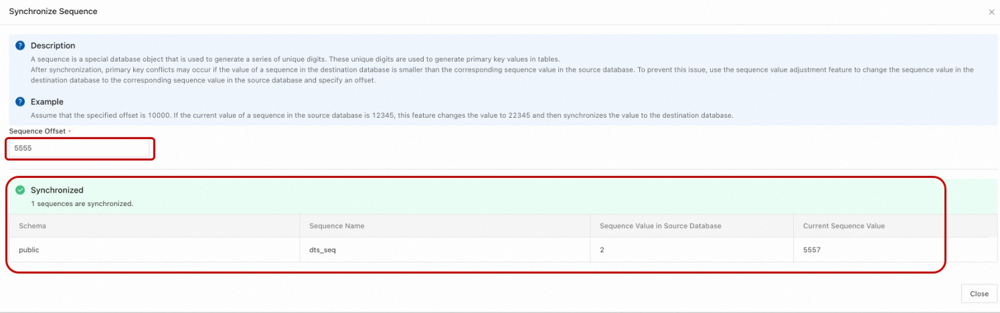

<a id="section-4-5-2"></a>

### 4.5.2. Configure automatic trigger migration

If a trigger in the source database updates a table to be synchronized or migrated, data inconsistency may occur between the source and destination databases because the trigger is synchronized or migrated to the destination database before schema migration. This topic describes how to configure automatic trigger migration for a migration or synchronization task to prevent data inconsistency.

**Prerequisites**

- The migration or synchronization task must support both **schema synchronization or migration** and **incremental data synchronization or migration**.

- When you configure a data synchronization or migration task, the **Source Objects** parameter is set to an entire database or a schema.

**Supported source and destination databases**

Currently, data can be migrated and synchronized between ApsaraDB RDS for MySQL databases.

**Configure a migration task**

When the prerequisites are met, configure the **Method to Migrate Triggers in Source Database** parameter in the **Advanced Configuration** step based on the task type:

- **Manual migration**: When DTS encounters a trigger during schema synchronization or migration, DTS does not synchronize or migrate the trigger to the destination database. You must manually migrate triggers from the source database to the destination database before incremental data synchronization or migration is complete.

- **Automatic migration**: No additional operations are required. DTS adds a trigger control statement to each synchronized or migrated trigger in the destination database. By default, DTS does not execute these triggers in the destination database.

**How automatic migration works**

DTS copies the code of triggers from the source database, adds a trigger control statement to the headers of triggers, and then writes the code to the destination database. The following sample code provides examples on how to create a trigger:

**Source database trigger:**

```text
CREATE TRIGGER testref BEFORE INSERT ON test1
  FOR EACH ROW
  BEGIN
    INSERT INTO test2 SET a2 = NEW.a1;
  END;
```

**Destination database trigger:**

```text
CREATE TRIGGER testref BEFORE INSERT ON test1
  FOR EACH ROW
  BEGIN
    IF (SELECT @`__#aliyun_dts_writer#__) IS NULL THEN
        INSERT INTO test2 SET a2 = NEW.a1;
    END IF;
  END;
```

<a id="section-4-5-3"></a>

### 4.5.3. Migrate database accounts

Data Transmission Service (DTS) allows you to migrate source database accounts. When you configure a data synchronization or migration task, you can enable the account migration feature. This helps you migrate the accounts of the source database and their passwords and permissions to the destination database.

**Prerequisites**

- The source and destination database accounts used by the configuration task meet the requirements.

- When you use DTS to synchronize or migrate data, **Schema synchronization** or **Schema Migration** is selected for **Migration/Synchronization Type** in the **Configure Objects and Advanced Settings** step.

**Supported source and destination databases**

| Source database type | Destination database type |
| --- | --- |
| RDS MySQL | ApsaraDB RDS for MySQL databases and PolarDB for MySQL databases that use local disks |
| PolarDB for MySQL databases that use local disks | PolarDB for MySQL databases that use local disks |
| ApsaraDB RDS for PostgreSQL databases and PolarDB for MySQL databases that use local disks | PolarDB for PostgreSQL clusters that use local disks |

**Permissions required for database accounts**

Before you migrate the accounts of the source database, make sure that the source and destination database accounts that are used when you configure the DTS task have the following permissions. Privileged accounts meet the requirements.

| Account | Permission | Authorization method |
| --- | --- | --- |

<table>
  <tr>
    <td>Source database account</td>
    <td>The SELECT permission on the mysql.user, mysql.db, mysql.columns_priv, and mysql.tables_priv metadata tables.</td>
    <td rowspan="2">Use a privileged account to run the following commands to grant permissions to the source and destination database accounts:<br>Source database<br><code>grant SELECT on mysql.user to</code><br><code>user@'%';</code><br><code>grant SELECT on mysql.db to user@'%';</code><br><code>grant SELECT on mysql.columns_priv to</code><br><code>user@'%';</code><br><code>grant SELECT on mysql.tables_priv to</code><br><code>user@'%';</code><br>Destination database<br><code>grant SELECT on mysql.user to</code><br><code>user@'%';</code><br><code>grant CREATE USER on *.* to user@'%';</code><br><code>grant GRANT OPTION on *.* to user@'%';</code><br>Note<br>Replace <code> user </code> in the commands with the source or destination account that you use to configure a DTS task.</td>
  </tr>
  <tr>
    <td>Destination database account</td>
    <td>The CREATE USER permission, the GRANT OPTION permission, and the SELECT permission on the mysql.user metadata table.</td>
  </tr>
</table>

**Procedure**

1. In the **Advanced Settings** step, set **Whether to Migrate Accounts** to **Yes**.

2. Select the accounts that you want to migrate based on your business requirements.

   > **Note**
   >
   > The account name is in the  `<username>@<host>`  format. The  `<host>`  variable specifies the host that can be logged on to by using the specified account.

3. Complete the subsequent configurations based on the instructions in Configure data migration tasks.

**FAQ**

- **Why am I unable to select an account?**

  The account may be a system account, or an account with the same name already exists in the destination database.

- **Why is the account list empty?**

  The accounts that you specify may not have the required permissions. Make sure that the accounts of the source and destination databases used in the DTS task are granted the required permissions.

<a id="section-4-5-4"></a>

### 4.5.4. Object name mapping

Data Transmission Service (DTS) provides the object name mapping feature. You can use this feature to change the names of one or more objects that are migrated to the destination instance. This topic describes how to use the object name mapping feature when you configure a data migration task.

**Limits**

You can use the object name mapping feature only when you configure parameters in the **Configure Objects and Advanced Settings** step for configuring a data migration task.

> **Note**
>
> We recommend that you do not use the object name mapping feature after a
>
> DTS task is started. Otherwise, the task may fail.

**Map the name of a single object**

1. In the **Configure Objects and Advanced Settings** step, move a database or table to the **Selected Objects** section and right-click the database or table.

2. In the dialog box that appears, set the object name that you want to use in the destination instance.

   > **Note**
   >
   > - If the source and destination databases are self-managed MySQL databases, ApsaraDB RDS for MySQL instances, or PolarDB for MySQL instances, you can select the DDL and DML statements that you want to synchronize or migrate.
   >
   > - If you select different statements for database name mapping and table name mapping, the statements that are selected for table name mapping prevail.

   - Database name or schema mapping

     In the **Edit Schema** dialog box, set the database name that you want to use in the destination instance.

   - Table name mapping

     In the **Edit Table Name** dialog box, set the table name that you want to use in the destination instance.

   - Column name mapping

     In the **Edit Table Name** dialog box, set the column names that you want to use in the destination instance.

     You can clear the columns that do not need to be migrated.

     > **Important**
     >
     > To clear the columns that do not need to be migrated, you must
     >
     > clear **Synchronize All Tables**.

3. Click **OK**.

4. Configure other parameters that are required for the data migration task.

**Map multiple object names at a time**

1. In the **Configure Objects and Advanced Settings** step, move the objects to be migrated to the **Selected Objects** section.

2. Click **Batch Edit** in the **Selected Objects** section.

3. In the **Batch Edit** dialog box, map the names of databases, tables, and columns based on your business requirements.

   <ol type="i">

   <li>

   Select the type of batch edit. In this example, **Select All Databases and Tables** is selected.

   </li>

   <li>

   Select the scope of batch edit.

   - **Edit Renamed Object Name**: edits the names of databases, tables, and columns based on their renamed names.

   - **Edit Original Name**: edits the names of databases, tables, and columns based on their original names.

   </li>

   <li>

   Select the objects whose names you want to edit.

   </li>

   <li>

   Set the names of databases and tables by using one of the following three rules. Then, click **Add Rule**.

   - Add Prefix and Suffix: Enter a prefix and suffix next to the **Add Prefix and Suffix** field.

   - Change All Names: Select **Change All Names** from the **Select Rule** drop-down list and enter the new name.

   - Shorten All Names: Select **Shorten All Names** from the **Select Rule** drop-down list and enter the keyword that you want to remove from object names.

   > **Note**
   >
   > In the Batch Edit dialog box, you can specify conditions to filter data. For
   >
   > more information, see Specify an SQL condition to filter data.

   </li>

   <li>

   Click **OK**.

   </li>

   </ol>

4. Configure other parameters that are required for the DTS task.

<a id="section-4-5-5"></a>

### 4.5.5. Specify an SQL condition to filter data

Data Transmission Service (DTS) allows you to configure SQL conditions to filter data to be migrated from the source database. SQL conditions work on the specified tables. Only data that meets the conditions is migrated to the destination database.

**Prerequisites**

A data migration task is being configured. The current step is **Configure Objects and Advanced Settings**. For more information about how to create and configure a data migration task, see configuration examples.

**Limits**

- SQL conditions only apply to full data migration. If you select **Incremental Data Migration** as the migration type, the SQL condition does not filter incremental data.

- To configure an SQL condition, migration objects must be tables. You cannot select databases as objects.

**Configure an SQL condition**

1. In the **Configure Objects and Advanced Settings** step, select objects to be migrated in

   the **Source Objects** list on the left and click  to move them to the **Selected Objects** list

   on the right. Then, right-click the table for which you want to configure an SQL condition.

2. In the **Edit Table** dialog box, enter an SQL condition in the **Filter Conditions** field.

   - An SQL condition is a standard SQL WHERE statement. The following operators are supported:  `=` ,  `!=` ,  `<` ,  `>` , and  `in` . Only the data that meets the WHERE condition is migrated to the destination database. Example:  `orderid>100` .

   - You can specify a time condition that meets SQL WHERE statement requirements. For example, to filter incremental data generated in 2020 and later, you must enter  `create_time>'2020-01-01'`  or  `create_time>'2020-01-01 00:00:00'` .  `create_time>'2020'`  is not supported.

   - You can use single quotation marks (') in an SQL condition if necessary. Example:  `address in('hangzhou','shanghai')` .

   - Column names in SQL conditions are not case-sensitive. During parsing, column names are uniformly standardized (for example, converted to names in all-uppercase format). Therefore, WHERE A=10 has exactly the same effect as WHERE a=10, both of which match the same column. Note: You cannot distinguish columns in the same table by name capitalization. To distinguish columns for exact match, make sure that the column

     

     names are in the actually defined formats of the source database.

   - If the source database is an ApsaraDB for MongoDB database, the SQL condition uses the MongoDB query syntax (JSON format), which is different from the standard SQL WHERE statement. For example, to filter data by user ID, enter  `{"_id": {$gt:"user100844658590795****",$lte:"user101674868045948****"}}`  as the SQL condition. In this condition,  `$gt`  indicates greater than, and  `$lte`  indicates smaller than or equal to.

3. Click **OK**.

   Configure other parameters as required.

**What to do next**

**View the SQL condition**

- **Task not yet started**: Return to the **Configure Objects and Advanced Settings** step. In the **Selected Objects** list, find the object for which you have configured an SQL condition and right-click it. In the dialog box that appears, view the SQL condition.

- **Task already running**:

  - Method 1: On the task details page, click **Task Management**. On the page that appears, click **View Objects**. In the dialog box that appears, move the pointer over the **Filter** field to view the SQL condition.

  - Method 2: On the task details page, choose **Migration Details > Schema Migration Details** or **Migration Details > Full Data Migration Details**. On the page that appears, move the pointer over the **Filter** field to view the SQL condition.

**Modify the SQL condition**

- Task not yet started: Return to the **Configure Objects and Advanced Settings** step. In the **Selected Objects** list, find the object for which you have configured an SQL condition and right-click it. In the dialog box that appears, modify the SQL condition in the **Filter Conditions** field.

- Task already running: If the task configuration is completed, you cannot modify the SQL condition.

<a id="section-4-5-6"></a>

### 4.5.6. Troubleshoot a failed data migration task

This topic describes how to troubleshoot a failed data migration task. You can use this feature if your data migration task is in the **Migration Failed** state during schema migration or full data migration.

**Troubleshoot a failed task during schema migration**

Data Transmission Service (DTS) supports data migration between heterogeneous data sources. However, if you migrate data of unsupported types to the destination instance during schema migration, the task may fail.

1. Log on to the DTS console.

2. In the left-side navigation pane, click **Data Migration**.

3. Use one of the following methods to troubleshoot the failed task:

   - Method 1

     <ol type="a">

     <li>

     Find the task and click **View Cause and Rectify**.

     </li>

     <li>

     Troubleshoot the issue based on the cause that is displayed in the View Cause and Rectify message. For example, you can troubleshoot an issue by modifying the schema syntax.

     </li>

     </ol>

     <ol type="i" start="100">

     <li>

     Click **Start Task**.

     </li>

     </ol>

   - Method 2

     <ol type="a">

     <li>

     Click the instance ID or task name.

     </li>

     <li>

     In the left-side navigation pane, choose **Migration Details > Schema Migration**.

     </li>

     </ol>

     <ol type="i" start="100">

     <li>

     On the **Schema Migration** page, find the object that causes the migration failure and click **Rectify** in the Status column.

     </li>

     <li value="500">

     Troubleshoot the issue based on the cause that is displayed in the **Rectify** dialog box. For example, you can troubleshoot an issue by modifying the schema syntax.

     </li>

     </ol>

     <ol type="a" start="5">

     <li>

     Click **Rectify**.

     > **Note**
     >
     > - If the failure persists, the **Rectify** dialog box does not close and shows the failure cause. You must continue troubleshooting based on the failure cause until the troubleshooting is successful.
     >
     > - If the troubleshooting is successful, the **Schema Migration** page appears and the status of the object changes to **Finished**.

     </li>

     </ol>

4. If no objects are in the Failed state, DTS proceeds with the data migration task, for example, entering the full data migration process.

**Troubleshoot a failed task during full data migration**

1. Log on to the DTS console.

2. In the left-side navigation pane, click **Data Migration**.

3. Find the task and click **View Cause and Rectify**.

   DTS allows you to troubleshoot a task that fails during full data migration due to the following reasons.

   > **Note**
   >
   > If a task fails during full data migration due to other reasons, DTS provides
   >
   > only the **Ignore** option. The object that causes the failure is not migrated to the destination database.

   - The connection to the source or destination database failed or timed out.

     Troubleshoot the issue, make sure that the connection is successful, and then restart the task.

   - The storage space of the destination instance is insufficient or the instance is locked.

     Upgrade the specifications of the destination instance or clear the log space, and then restart the task.

   - MyISAM tables in the source database are corrupted.

     Troubleshoot the issue in the source database, and restart the task.

4. In the dialog box that appears, troubleshoot the issue based on the failure cause.

5. Click **Start Task**.

<a id="section-4-5-7"></a>

### 4.5.7. Specify the capitalization of object names in the destination instance

When you configure a data migration or synchronization task, you can specify the capitalization of database names, table names, and column names in the destination instance.

**Capitalization policies**

Data Transmission Service (DTS) supports the following capitalization policies for object names:

- DTS default policy

  DTS configures the capitalization of database names, table names, and column names in the destination instance based on the database type and related parameters, such as the  `lower_case_table_names`  parameter.

  <table>
    <tr>
      <th>Destination database type</th>
      <th>Destination database parameter</th>
      <th>Capitalization of object names in the destination instance</th>
    </tr>
    <tr>
      <td rowspan="2">• Self-managed MySQL database or ApsaraDB RDS for MySQL<br>• PolarDB-X<br>• AnalyticDB for MySQL V3.0</td>
      <td>The <code>lower_case_table_names</code> parameter is set to 1 or 2.</td>
      <td>Database names and table names in the destination instance are in lowercase. The capitalization of column names in the destination instance is the same as that in the source instance.</td>
    </tr>
    <tr>
      <td>The <code>lower_case_table_names</code> parameter is set to 0.</td>
      <td>The capitalization of database names, table names, and column names in the destination instance is the same as that in the source instance.</td>
    </tr>
    <tr>
      <td>• AnalyticDB for MySQL V2.0<br>• DataHub<br>• MaxCompute</td>
      <td>N/A</td>
      <td>Database names, table names, and column names in the destination instance are in lowercase.</td>
    </tr>
    <tr>
      <td>Self-managed Oracle database</td>
      <td>N/A</td>
      <td>Database names, table names, and column names in the destination instance are in uppercase.</td>
    </tr>
    <tr>
      <td>• Self-managed SQL Server database or ApsaraDB RDS for SQL Server<br>• PolarDB for PostgreSQL (Compatible with Oracle)<br>• Self-managed PostgreSQL database or ApsaraDB RDS for PostgreSQL<br>• AnalyticDB for PostgreSQL<br>• Self-managed MongoDB database or ApsaraDB for MongoDB<br>• Self-managed Redis database or ApsaraDB for Redis</td>
      <td>N/A</td>
      <td>Database names and table names in the destination instance are in lowercase. The capitalization of column names in the destination instance is the same as that in the source instance.</td>
    </tr>
  </table>

- Consistent with the source database

  The capitalization of database names, table names, and column names in the destination instance is the same as that in the source instance.

- Consistent with the default policy of the destination database (uppercase)

  The names of all the databases, tables, and columns that are migrated or synchronized to the destination instance are in uppercase.

- Consistent with the default policy of the destination database (lowercase)

  The names of all the databases, tables, and columns that are migrated or synchronized to the destination instance are in lowercase.

<a id="section-4-5-8"></a>

### 4.5.8. Data formats of a Kafka cluster

When you use Data Transmission Service (DTS) to migrate or synchronize data to a Kafka cluster, you can specify the format in which data is stored in the Kafka cluster. This topic describes the formats that you can use to store data in a Kafka cluster. You can parse data based on the definition of these data formats.

**Data formats**

DTS allows you to store data into a Kafka cluster in the following formats:

- DTS Avro: a data serialization format into which data structures or objects can be converted to facilitate storage and transmission.

- Shareplex Json: the format in which the data read from the source database by using the data replication software SharePlex is stored.

- Canal Json: the format in which data is stored in a Kafka cluster after Canal parses the logs about the incremental data of the source database and transmits the incremental data to the Kafka cluster.

**DTS Avro**

**DTS Avro** is the default data format. By default, data that is migrated or synchronized to a Kafka cluster by using DTS is stored in the DTS Avro format. You must parse the data based on the schema definition of DTS Avro. For more information, visit GitHub.

> **Note**
>
> In the DTS Avro format, the DDL statements are of the STRING type.

**Shareplex Json**

Table 1. Parameters related to the SharePlex JSON format

| Parameter | Description |
| --- | --- |
| <code>time</code> | The UTC time when the transaction in the database is committed. It is in the yyyy-MM-ddTHH:mm:ssZ format. |
| <code>userid</code> | The ID of the user who commits the transaction. |
| <code>op</code> | The operation type. Valid values: INSERT, UPDATE, DELETE, TRUNCATE, DROP COLUMN, UPDATE BEFORE, and UPDATE AFTER. |
| <code>scn</code> | The system change number (SCN) that identifies the version of the transaction that the database commits at a specific point in time. Each committed transaction is assigned a unique SCN. |
| <code>rowid</code> | A relatively unique address value that is used to identify a record in the database. |
| <code>trans</code> | The ID of the transaction. |
| <code>seq</code> | The sequence number of the operation in the transaction. It starts from 1. |
| <code>size</code> | The total number of operations in the transaction. |
| <code>table</code> | The name of the table. |
| <code>idx</code> | The index of the operation in the transaction, in the <code> seq/size </code> format.For example, <code> 1/11 </code> indicates that the sequence number of the operation is 1 in the transaction that contains a total number of 11 operations. |
| <code>posttime</code> | The time when the transaction is committed to the destination database. |

Examples:

- Data inserted

  ```json
  {
      "meta": {
          "time": "2017-06-16T14:24:34", 
          "userid": 84,                                    
          "op": "ins",                                   
            "scn": "14589063118712",                  
            "rowid": "AAATGpAAIAAItcIAAA",      
          "trans": "7.0.411499",                 
          "seq": 1,                                          
          "size": 11,                                         
          "table": "CL_BIZ1.MIO_LOG",       
            "idx": "1/11",                                       
          "posttime": "2017-06-16T14:33:52"
      },
      "data": {
          "MIO_LOG_ID": "32539737"
       }
  }
  ```

- Data updated

  ```json
  {
      "meta": {
          "time": "2017-06-16T15:38:13",
          "userid": 84,
          "op": "upd",                             
          "table": "CL_BIZ1.MIO_LOG"
          ...
      },
      "data": {                                          
          "CNTR_NO": "1171201606"
      },
      "key": {                                            
          "MIO_LOG_ID": "32537893",
          "PLNMIO_REC_ID": "31557806",
          "POL_CODE": null,
          "CNTR_TYPE": null,
          "CNTR_NO": "1171201606syui26"
      }
  }
  ```

- Data deleted

  ```json
  {
      "meta": {
          "time": "2017-06-16T15:51:35",
          "userid": 84,
          "op": "del",                      
       },
      "data": {                                    
          "MIO_LOG_ID": "32539739",
          "PLNMIO_REC_ID": "31557806",
          "POL_CODE": null,
          "CNTR_TYPE": null,
          "CG_NO": null
       }
  }
  ```

**Canal Json**

Table 2. Parameters related to the Canal JSON format

| Parameter | Description |
| --- | --- |
| <code>database</code> | The name of the database. |
| <code>es</code> | The time when the operation is performed on the database. The value is a 13-bit UNIX timestamp. Unit: milliseconds.<br>Note<br>You can use a search engine to obtain a UNIX timestamp converter. |
| <code>id</code> | The serial number of the operation. |
| <code>isDdl</code> | Indicates whether the operation is a DDL operation. Valid values:<br>• true: The operation is a DDL operation.<br>• false: The operation is not a DDL operation. |
| <code>mysqlType</code> | The data type of the field. |
| <code> old </code> and <code> data </code> | The data before and after update.<br>Note<br>For change tracking instances that are created before March 20, 2022, the value of <code> old </code> is the data after update and the value of <code> data </code> is the data before update. To keep consistent with the open source community, the value of <code> data </code> is the data after update and the value of <code> old </code> is the data before update for change tracking instances that are created or restarted as of March 20, 2022. |
| <code>pkNames</code> | The name of the primary key. |
| <code>sql</code> | The SQL statement. |
| <code>sqlType</code> | The data type of the field after conversion. For example, the type LONG is converted from UNSIGNED INTEGER and BIGDECIMAL from UNSIGNED LONG. |
| <code>table</code> | The name of the table. |
| <code>ts</code> | The time when the operation is written to the destination database. The value is a 13-bit UNIX timestamp. Unit: milliseconds.<br>Note<br>You can use a search engine to obtain a UNIX timestamp converter. |
| <code>type</code> | The operation type. Valid values: DELETE, UPDATE, and INSERT. |

Examples of data updated

> **Note**
>
> For change tracking instances that are created before March 20, 2022, after the  `DELETE` statements of the source table are synchronized, the value of  `old`  is data and the value of  `data`  is NULL. To keep consistent with the open source community, the value of  `data`  is data and the value of  `old`  is NULL for change tracking instances that are created or restarted as of March 20, 2022.

**Change tracking instances that are created before March 20, 2022**

```json
{
    "old": [
        {
            "shipping_type": "aaa"
        }
    ], 
    "database": "dbname", 
    "es": 1600161894000, 
    "id": 58, 
    "isDdl": false, 
    "mysqlType": {
        "id": "bigint(20)", 
        "shipping_type": "varchar(50)"
    }, 
    "pkNames": [
        "id"
    ], 
    "sql": "", 
    "sqlType": {
        "id": -5, 
        "shipping_type": 12
    }, 
    "table": "tablename", 
    "ts": 1600161894771, 
    "type": "DELETE"
}
```

**Change tracking instances that are created or restarted as of March 20, 2022**

```json
{
    "data": [
        {
            "id": "500000287", 
            "shipping_type": null
        }
    ], 
    "database": "dbname", 
    "es": 1600161894000, 
    "id": 58, 
    "isDdl": false, 
    "mysqlType": {
        "id": "bigint(20)", 
        "shipping_type": "varchar(50)"
    }, 
    "pkNames": [
        "id"
    ], 
    "sql": "", 
    "sqlType": {
        "id": -5, 
        "shipping_type": 12
    }, 
    "table": "tablename", 
    "ts": 1600161894771, 
    "type": "DELETE"
}
            
```

Example of a DDL operation

```json
{
    "database": "dbname",    The name of the source database.
    "es": 1600161894000,    The time when the data is written to the binary logs of thesource database.
    "id": 58,      The offsets of DTS cache.
    "isDdl": true,       Indicates that the operation is a DDL operation.
    "sql": "eg: create xxx",      The DDL statements recorded in the binary logs.
    "table": "tablename",       The name of the table that is synchronized.
    "ts": 1600161894771,      The time when the data is written to the destination database by using DTS.
    "type":"DDL"
}
```

<a id="section-4-5-9"></a>

### 4.5.9. Specify the policy for migrating data to Kafka partitions

When you configure a task to migrate data to a Kafka cluster, you can specify the policy for migrating data to Kafka partitions. The policy allows you to improve the migration performance. For example, you can migrate data to different partitions based on hash values.

**Hash algorithm**

Data Transmission Service (DTS) uses the hashCode() method in Java to calculate hash values.

**Configuration method**

In the **Configure Objects and Advanced Settings** step of a task creation wizard, you can specify the policy for migrating data to Kafka partitions.

> **Warning**
>
> After a data migration task is started, do not change the number of
>
> partitions in the destination topic. Otherwise, data migration fails.

**Policies**

| Policy | Description | Advantage and disadvantage |
| --- | --- | --- |
| Ship All Data to Partition 0 | DTS migrates all data and DDL statements to Partition 0 of the destination topic. | • Advantage: The order in which all objects are created and changed is the same as that in the source database.<br>• Disadvantage: This policy provides ordinary migration performance. |
| Ship Data to Separate Partitions Based on Hash Values of Database and Table Names | DTS uses the database and table names as the partition key to calculate the hash value. Then, DTS migrates the data and DDL statements of each table to the corresponding partition of the destination topic.<br>Note<br>• The data and DDL statements of the same table are migrated to the same partition.<br>• If a DDL statement is irrelevant to a table, for example, CREATE DATABASE, the statement is migrated to Partition 0. | • Advantage: The order in which a destination table is created and changed is the same as that of the source table. This policy provides good migration performance.<br>• Disadvantage: Tables are migrated to different partitions. After data migration, the order of data changes on different tables may become inconsistent. |

<table>
  <tr>
    <td>Ship Data to Separate Partitions Based on Hash Values of Primary Keys</td>
    <td>DTS uses a table column as the partition key to calculate the hash value. The table column is the primary key by default. If a table does not have a primary key, the unique key is used as the partition key. DTS migrates each row to the corresponding partition of the destination topic.You can specify one or more columns as partition keys to calculate the hash value.<br>Note<br>• If you use this policy, DDL statements are migrated to Partition 0 of the destination topic by default.<br>• If a table does not have a primary key or unique key, DTS migrates the data and DDL statements of the table to Partition 0 of the destination topic.</td>
    <td>• Advantage: This policy provides the best migration performance.<br>• Disadvantage: After data migration, the order of data changes on each data record remains the same. However, the order of data changes on different tables or tables without a primary key may become inconsistent.</td>
  </tr>
</table>

<a id="section-4-5-10"></a>

### 4.5.10. Configure ETL in a migration task

DTS provides a streaming data ETL (Extract, Transform, and Load) feature. This feature works with DTS data replication to let you extract, transform, and load streaming data. Typical use cases include data filtering, data masking, recording data modification times, and auditing data changes. This topic describes how to configure ETL for a DTS migration task.

**Background**

During data migration and synchronization, you may need to transform or filter data in real time before it reaches the destination database. The DTS streaming data ETL feature lets you define this data processing logic by using Domain Specific Language (DSL) scripts.

**Databases that support ETL**

| Source database | Destination database |
| --- | --- |
| RDS for MySQL | AnalyticDB for MySQL 3.0 |
| PolarDB-X 2.0 | AnalyticDB for MySQL 3.0 |

**Configure ETL during task creation**

> **Important**
>
> If an ETL script includes an operation to add a new column, you must manually add the corresponding column to the target. Otherwise, the ETL script will not take effect. For example, in  `script:e_set(` new_column `, dt_now())` , the  `new_column`  must be added to the target in advance.

1. Create a migration task based on your requirements and proceed to the **Advanced Settings** step.

2. Set **Configure ETL Feature** to **Yes** and enter your data processing statements in the text box. For more information about the syntax, see Data Processing DSL syntax.

   > **Note**
   >
   > The following example uses a DSL to filter records where the id is greater than 3:  `script:e_if(op_gt(` id `, 3), e_drop())` . In this code,  `op_gt`  is an expression function that checks if a value is greater than another, and  `id`  is a variable. After this script is executed, records where the id is greater than 3 are filtered.

   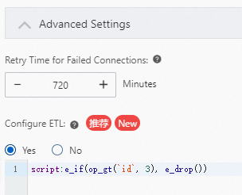

3. Click **Next: Pre-check and Start** and complete the subsequent steps.

**Data processing DSL overview**

The data processing DSL is a scripting language from DTS for data migration. It supports conditional functions and can process string, date, and numeric data types. Its key features include:

- Rich function library: Provides a wide range of built-in functions and supports function composition.

- Concise syntax: Provides examples for common scenarios such as data filtering, data transformation, and data masking. For more information, see Typical scenario examples.

- High performance: Built on code generation technology, which adds minimal overhead to the migration process.

**Typical scenario examples**

- **Data filtering**

  - Filter by numeric condition: If a record's ID is greater than 10,000, drop the record.

    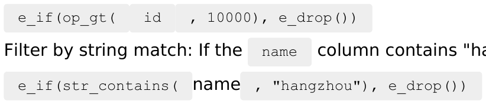

  - Filter by string match: If the  `name`  column contains "hangzhou", drop the record.

  - Filter by date: If the order time is earlier than the specified time, drop the record.

    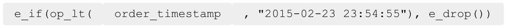

  - Filter by multiple conditions:

    - If the ID is greater than 1,000 and the name contains "hangzhou", drop the record:

      `e_if(op_and(str_contains(` name `, "hangzhou"), op_gt(` id `, 1000)), e_drop())`

    - If the ID is greater than 1,000 or the name contains "hangzhou", drop the record:


- **Data masking**

  Replace the last four digits of the  `phone`  column with asterisks:  `e_set(` phone `, str_mask(` phone `, 7, 10,`  \*')).

- **Record data modification times**

  - Add a new column to all tables: If the value of  `__OPERATION__`  is  `INSERT` ,  `UPDATE` , or  `DELETE` , add a new column named  `dts_sync_time`  and set its value to the transaction commit time ( `__COMMIT_TIMESTAMP__` ).

    ```text
    e_if(op_or(op_or(
            op_eq(__OPERATION__, __OP_INSERT__),
            op_eq(__OPERATION__, __OP_UPDATE__)),
            op_eq(__OPERATION__, __OP_DELETE__)),
        e_set(dts_sync_time, __COMMIT_TIMESTAMP__))
    ```

  - Add a new column to a specific table: If the value of  `__OPERATION__`  is  `INSERT` ,  `UPDATE` , or  `DELETE`  for the  `dts_test_table`  table, add a new column named  `dts_sync_time`  and set its value to the transaction commit time ( `__COMMIT_TIMESTAMP__` ).

    ```text
    e_if(op_and(
          op_eq(__TB__,'dts_test_table'),
          op_or(op_or(
            op_eq(__OPERATION__,__OP_INSERT__),
            op_eq(__OPERATION__,__OP_UPDATE__)),
            op_eq(__OPERATION__,__OP_DELETE__))),
          e_set(dts_sync_time,__COMMIT_TIMESTAMP__))
    ```

    > **Note**
    >
    > Before you start the task, you must modify the table definition in the destination database to add the  `dts_sync_time`  column.

- Audit data changes:

  - Record the type and time of data changes: Record the data change type in the  `operation_type`  column and the change time in the  `updated`  column of the destination table.

    ```text
    e_compose(
        e_switch(
            op_eq(__OPERATION__,__OP_DELETE__), e_set(operation_type, 'DELETE'),
            op_eq(__OPERATION__,__OP_UPDATE__), e_set(operation_type, 'UPDATE'),
            op_eq(__OPERATION__,__OP_INSERT__), e_set(operation_type, 'INSERT')),
        e_set(updated, __COMMIT_TIMESTAMP__),
        e_set(__OPERATION__,__OP_INSERT__)
    )
    ```

    > **Note**
    >
    > Before you start the task, you must add the  `operation_type`  and  `updated` columns to the destination table.

**Data processing DSL syntax**

**Constants and Variables**

- Constants

  | Type | Example |
  | --- | --- |
  | int | 123 |
  | float | 123.4 |
  | string | "hello1_world" |
  | boolean | true or false |
  | datetime | '2021-01-01 10:10:01' |

- Variables

  | Parameter | Description | Type | Example value |
  | --- | --- | --- | --- |
  | __TB__ | Table name | string | table |
  | __DB__ | Database name | string | mydb |
  | __OPERATION__ | Operation type | string | __OP_INSERT__, __OP_UPDATE__, __OP_DELETE__ |
  | __COMMIT_TIMESTAM P__ | Transaction commit time | datetime | '2021-01-01 10:10:01' |
  | <code>column</code> | The value of a specific column in a data record. | string | <code> id </code>, <code> name </code> |

**Expression functions**

- Numeric operations

  | Functio n | Syntax | Parameters | Return value | Example |
  | --- | --- | --- | --- | --- |
  | Addition | op_sum(value1, value2) | • value1: integer or float<br>• value2: integer or float | Returns an integer if both parameters are integers; otherwise, returns a float. | op_sum(<code> col1 </code>, 1.0) |
  | Subtracti on | op_sub(v alue1, value2) | • value1: integer or float<br>• value2: integer or float | Returns an integer if both parameters are integers; otherwise, returns a float. | op_sub(<code> col1 </code>, 1.0) |
  | Multiplic ation | op_mul(v alue1, value2) | • value1: integer or float<br>• value2: integer or float | Returns an integer if both parameters are integers; otherwise, returns a float. | op_mul(<code> col1 </code>, 1.0) |
  | Division | op_div_tr ue(value 1, value2) | • value1: integer or float<br>• value2: integer or float | Returns an integer if both parameters are integers; otherwise, returns a float. | op_div_true(<code> col1 </code>, 2.0). If <code> col1 </code> is 15, the function returns 7.5. |
  | Modulo | op_mod(value1, value2) | • value1: integer or float<br>• value2: integer or float | Returns an integer if both parameters are integers; otherwise, returns a float. | op_mod(<code> col1 </code>, 10).If <code> col1 </code> is 23, the function returns 3. |

- Logical operations

  | Functio n | Syntax | Parameters | Return value | Example |
  | --- | --- | --- | --- | --- |
  | Equals | op_eq(va lue1, value2) | • value1: integer, float, or string<br>• value2: integer, float, or string | Returns true or false. | op_eq(<code> col1 </code>, 23) |
  | Greater than | op_gt(val ue1, value2) | • value1: integer, float, or string<br>• value2: integer, float, or string | Returns true or false. | op_gt(<code> col1 </code>, 1.0) |
  | Less than | op_lt(val ue1, value2) | • value1: integer, float, or string<br>• value2: integer, float, or string | Returns true or false. | op_lt(<code> col1 </code>, 1.0) |
  | Greater than or equal to | op_ge(va lue1, value2) | • value1: integer, float, or string<br>• value2: integer, float, or string | Returns true or false. | op_ge(<code> col1 </code>, 1.0) |
  | Less than or equal to | op_le(val ue1, value2) | • value1: integer, float, or string<br>• value2: integer, float, or string | Returns true or false. | op_le(<code> col1 </code>, 1.0) |
  | AND | op_and(v alue1, value2) | • value1: boolean<br>• value2: boolean | Returns true or false. | op_and(<code> is_male </code>, <code> is_student </code>) |
  | OR | op_or(val ue1, value2) | • value1: boolean<br>• value2: boolean | Returns true or false. | op_or(<code> is_male </code>, <code> is_student </code>) |

- **String functions**

  | Functio n | Syntax | Parameters | Return value | Example |
  | --- | --- | --- | --- | --- |
  | Formats a string or concaten ates strings. | str_form at(forma t, value1, value2, value3,...) | • format: string. Uses braces {} as placeholders.Example: "part1: {}, part2: {}".<br>• value1: any<br>• value2: any | The formatted string. | str_format("part1: {}, part2: {}", <code> col1 </code>, <code> col2 </code>). If <code> col1 </code> is "ab" and <code> col2 </code> is "12", the function returns "part1: ab, part2: 12". |
  | Replaces a substring. | str_repla ce(origin al, oldStr, newStr, count) | • original: The original string.<br>• oldStr: The substring to be replaced.<br>• newStr: The new substring.<br>• count: integer. The maximum number of replacements. If set to -1, all occurrences are replaced. | The new string after replacement. | str_replace(<code> name </code>, "a", 'b', 1). If <code> name </code> is "aba", the function returns "bba".str_replace(<code> name </code>, "a", 'b', -1). If <code> name </code> is "aba", the function returns "bbb". |
  | Removes leading and trailing characte rs from a string. | str_strip(string_va l, charSet) | • string_val: The original string.<br>• charSet: The set of characters to remove. | The string after the characters are removed. | str_strip(<code> name </code>, 'ab'). If <code> name </code> is "axbzb", the function returns "xbz". |
  | Converts a string to lowercas e. | str_lower (value1) | value1: A string column or string constant. | The lowercase string. | str_lower(<code> str_col </code>) |
  | Converts a string to uppercas e. | str_uppe r(value1) | value1: A string column or string constant. | The uppercase string. | str_upper(<code> str_col </code>) |
  | Counts the occurren ces of a substring. | str_count (str, pattern) | • str: A string column or string constant.<br>• pattern: The substring to find. | The number of times the substring appears. | str_count(<code> str_col </code>, 'abc'). If <code> str_col </code> is "zabcyabcz", the function returns 2. |
  | Finds a substring. | str_find(s tr, pattern) | • str: A string column or string constant.<br>• pattern: The substring to find. | The index of the first occurrence of the substring. Returns <code> -</code><code>1 </code> if the substring is not found. | str_find(<code> str_col </code>, 'abc'). If <code> str_col </code> is "xabcy", the function returns <code> 1 </code>. |
  | Checks if a string consists only of letters. | str_isalp ha(str) | str: A string column or string constant. | true or false | str_isalpha(<code> str_col</code><code> </code>) |
  | Checks if a string consists only of digits. | str_isdigi t(str) | str: A string column or string constant. | true or false. | str_isdigit(<code> str_col</code><code> </code>). |

  

  

  <table>
    <tr>
      <td>Masks part of a string with a specified characte<br>r. This is useful for data masking, such as replacing the last four digits of a phone number with asterisks.</td>
      <td>str_mask (str, start, end, maskStr)</td>
      <td>• str: A string column or string constant.<br>• start: integer. The starting position for masking (inclusive, 0-indexed). The minimum value is 0.<br>• end: integer. The ending position for masking (inclusive).The maximum value is the string length minus 1.<br>• maskStr: string. A single-character string used for masking, such as '#'.</td>
      <td>The masked string.</td>
      <td>str_mask(<code> phone </code>, 7, 10, '#').</td>
    </tr>
    <tr>
      <td>Gets the current datetime in the local time zone.</td>
      <td>dt_now()</td>
      <td>None</td>
      <td>The current datetime in the local time zone.</td>
      <td>e_set(<code> dt_col </code>, dt_now())</td>
    </tr>
    <tr>
      <td>Gets the current datetime in UTC.</td>
      <td>dt_utcno w()</td>
      <td>None</td>
      <td>The current datetime in UTC.</td>
      <td>e_set(<code> dt_col </code>, dt_utcnow())</td>
    </tr>
  </table>

**Global functions**

- Flow control functions

  | Function | Syntax | Parameters | Example |
  | --- | --- | --- | --- |

  <table>
    <tr>
      <td>If statement</td>
      <td>e_if(bool_exp r, func_invoke)</td>
      <td>• bool_expr: A boolean constant (true or false) or a function call that returns a boolean value, such as op_gt(<code> id </code>, 10).<br>• func_invoke: A function call, such as <code> e_drop </code>, <code> e_keep </code>, <code> e_set </code>, <code> e_if </code>, or <code> e_compose </code>.</td>
      <td>e_if(op_gt(<code> id </code>, 10), e_drop()). If the ID is greater than 10, drop the record.</td>
    </tr>
    <tr>
      <td>If-else statement</td>
      <td>e_if_else(bool _expr, func_invoke1, func_invoke2)</td>
      <td>• bool_expr: A boolean constant (true or false) or a function call that returns a boolean value, such as <code> op_gt( </code>id<code> , 10) </code>.<br>• func_invoke1: A function call to execute if the condition is true.<br>• func_invoke2: A function call to execute if the condition is false.</td>
      <td>e_if_else(op_gt(<code> id </code>, 10), e_set(<code> tag </code>, 'large'), e_set(<code> tag </code>, 'small')). If the ID is greater than 10, set the <code> tag </code> column to 'large'.Otherwise, set it to 'small'.</td>
    </tr>
    <tr>
      <td>Evaluates conditions in order and executes the function for the first true condition. If no conditions are true, the default function is executed.</td>
      <td>e_switch(con dition1, func1, condition2, func2, ..., default = default_func)</td>
      <td>• condition1: A boolean constant or a function call that returns a boolean value, such as <code> op_gt( </code>id<code> , 10) </code>.<br>• func_invoke: A function call.If condition1 is true, this function is executed and the switch block is exited.<br>• default_func: A function call.If all preceding conditions are false, this default function is executed.</td>
      <td>e_switch(op_gt(<code> id </code>, 100), e_set(<code> str_col </code>, '&gt;100'), op_gt(<code> id </code>, 90), e_set(<code> str_col </code>, '&gt;90'), default=e_set(<code> str_col </code>, '&lt;=90')).</td>
    </tr>
    <tr>
      <td>Combines multiple operations.</td>
      <td>e_compose(f unc1, func2, func3, ...)</td>
      <td>• func1: A function call, such as <code> e_set </code>, <code> e_drop </code>, or <code> e_if </code>.<br>• func2: A function call, such as <code> e_set </code>, <code> e_drop </code>, or <code> e_if </code>.</td>
      <td>e_compose(e_set(<code> str_col </code>, 'test'), e_set(<code> dt_col </code>, dt_now())). Sets the value of the <code> str_col </code> column to 'test' and the value of the <code> dt_col </code> column to the current time.</td>
    </tr>
  </table>

- Data manipulation functions

  | Function | Syntax | Parameters | Example |
  | --- | --- | --- | --- |
  | Drops the current data record, which prevents it from being migrated. | e_drop() | None | e_if(op_gt(<code> id </code>, 10), e_drop()). Drops records with an ID greater than 10. |
  | Keeps the current data record for migration. | e_keep(condi tion) | condition: A boolean expression. | e_keep(op_gt(id, 1)). Migrates only records with an ID greater than 1. |
  | Sets the value of a column. | e_set(<code> col </code>, val) | • col: Column name.<br>• val: A constant or function call. The data type must match the column type. | • e_set(<code> dt_col </code>, dt_now()).Sets the <code> dt_col </code> column to the current time.<br>• e_set(<code> col1 </code>, <code> col2 </code> + 1). Sets the value of <code> col1 </code> to the value of <code> col2 </code> plus 1. |

<a id="section-4-5-11"></a>

### 4.5.11. Change the password of a database account

This topic describes how to change the password of a database account in the Data Transmission Service (DTS) console. If you have changed the password of your database account that is used for data migration, data synchronization, and change tracking to enhance the security, you must update the change on the instance details page in the DTS console.

**Prerequisites**

A data migration task, a data synchronization task, or a change tracking task of the **new version** is created.

**Procedure**

1. Log in to the DTS console.

2. Click the ID of the instance that you want to manage to go to the instance details page. On the **Task Management** page, find the source or destination database that you want to manage and click **Change Password** next to the **Account** parameter.

<a id="section-4-6"></a>

## 4.6. Precheck items

<a id="section-4-6-1"></a>

### 4.6.1. Source database connectivity

Data Transmission Service (DTS) checks whether DTS servers can connect to the source database for migration. DTS creates a connection to the source database by using the Java Database Connectivity (JDBC) protocol. If the connection fails, the data migration task fails to pass the connectivity check.

The following table describes the possible reasons for a connectivity precheck failure of the source database.

| Check item | Possible reason | Troubleshooting |
| --- | --- | --- |
| JDBC | 1. The username or password of the database account is incorrect, or the IP address or port number of the destination database is incorrect.<br>2. The database account cannot be used to access the destination database over an endpoint. | 1. Check and correct the connection information about the destination database.<br>2. Allow access to the destination database over all endpoints. |
| Ping | 1. The network of the service to which the database instance belongs is unavailable.<br>2. The IP address of the destination database is incorrect. | 1. Check whether the network is available.<br>2. Check and correct the IP address of the destination database. |
| Telnet | 1. The DTS servers are not allowed to access the destination database.<br>2. The port number of the destination database is incorrect. | 1. Allow access to the destination database from the public CIDR blocks of the DTS servers. For example, disable the firewall of the service to which the destination database belongs or add the public CIDR blocks of the DTS servers to the whitelist of the destination database.<br>2. Check and correct the port number of the destination database. |

<a id="section-4-6-2"></a>

### 4.6.2. Destination database connectivity

This check item checks whether the Data Transmission Service (DTS) servers can connect to the destination database for migration. DTS creates a connection to the destination database by using the Java Database Connectivity (JDBC) protocol. If the connection fails, the check item fails.

The following table describes the possible reasons for a connectivity precheck failure of the destination database.

| Check item | Possible reason | Troubleshooting |
| --- | --- | --- |
| JDBC | 1. The username or password of the database account is incorrect, or the IP address or port number of the destination database is incorrect.<br>2. The database account cannot be used to access the destination database over an endpoint. | 1. Check and correct the connection information about the destination database.<br>2. Allow access to the destination database over all endpoints. |
| Ping | 1. The network of the service to which the database instance belongs is unavailable.<br>2. The IP address of the destination database is incorrect. | 1. Check whether the network is available.<br>2. Check and correct the IP address of the destination database. |
| Telnet | 1. The DTS servers are not allowed to access the destination database.<br>2. The port number of the destination database is incorrect. | 1. Allow access to the destination database from the public CIDR blocks of the DTS servers. For example, disable the firewall of the service to which the destination database belongs or add the public CIDR blocks of the DTS servers to the whitelist of the destination database.<br>2. Check and correct the port number of the destination database. |

<a id="section-4-6-3"></a>

### 4.6.3. Binary logging configurations of the source database

**Whether binary logging is enabled in the source database**

This item is checked only when you migrate incremental data between MySQL databases. DTS checks whether binary logging is enabled in the source database. If binary logging is disabled in the source database, the check result is Failed.

Troubleshooting: Run the  `log_bin=mysql_bin`  command to modify the configuration file of the source database. Restart the source database and run a precheck again.

**Binary log format of the source database**

This item is checked only when you migrate incremental data between MySQL databases. DTS checks whether the binary log format is set to ROW in the source database. If the binary log format is not set to ROW in the source database, the check result is Failed.

Troubleshooting: Run the  `set global binlog_format=ROW`  command in the source database and run a precheck again. We recommend that you restart the MySQL process. Otherwise, data loss may occur because sessions will continue to be written in a non-ROW mode.

**Binary log files in the source database**

This item is checked only when you migrate incremental data between MySQL databases. DTS checks whether specific binary log files are removed from the source database. If binary log files in the source database are incomplete, the check result is Failed.

Troubleshooting: Run the  `PURGE BINARY LOGS TO 'The name of the first binary log file that is not deleted'`  command in the source database and run a precheck again.

To find the binary log files that are removed from the source database, click the info icon next to the failed item. In the **View Details** dialog box, the names of deleted binary log files are displayed.

**Parameter binlog_row_image of the source database**

This item is checked only when you migrate incremental data between MySQL databases. DTS checks whether the value of the binlog_row_image parameter in the source database is set to FULL. This parameter indicates whether the full image is recorded. If the full image is not recorded in binary log files of the source database, the check result is Failed.

Troubleshooting: Run the  `set global binlog_row_image=FULL`  command in the source database and run a precheck again.

<a id="section-4-6-4"></a>

### 4.6.4. Integrity of the FOREIGN KEY constraints

DTS checks whether the parent table on which a child table depends is included in the selected objects. The precheck allows DTS to protect the integrity of the FOREIGN KEY constraints.

If the parent table on which a child table depends is not included in the selected objects, the check result is Failed.

Troubleshooting:

- Do not migrate the child tables that cause the check failure. To do this, remove these child tables from the selected objects and run a precheck again.

- Migrate the parent tables rather than the child tables. To do this, add the parent tables to the selected objects and run a precheck again.

- Delete the foreign key dependencies between the parent and child tables in the source database and run a precheck again.

<a id="section-4-6-5"></a>

### 4.6.5. Existence of FEDERATED tables

This item is checked only when you migrate incremental data between MySQL databases. DTS checks whether the source database contains storage engines that are not supported by incremental data migration. Incremental data migration does not support the FEDERATED and MRG_MyISAM storage engines.

If **the FEDERATED storage engine is used by specific tables in the source database**, the check result is Failed.

If **the MRG_MyISAM storage engine is used by specific tables in the source database**, the check result is Failed.

Solution:

Remove the tables that use the FEDERATED or MRG_MyISAM storage engine from the selected objects. Then, create a separate migration task to perform schema migration and full data migration for these tables.

<a id="section-4-6-6"></a>

### 4.6.6. Permissions

**Source database permissions**

DTS checks whether the account of the source database has the required permissions to perform data migration. For information about the permissions that are required by each type of database, see the topics about how to configure data migration tasks.

**Destination database permissions**

DTS checks whether the account of the destination database has the required permissions to perform data migration. For information about the permissions that are required by each type of database, see the topics about how to configure data migration tasks.

<a id="section-4-6-7"></a>

### 4.6.7. Object name conflict

DTS checks whether the destination database contains objects that have the same names as the objects to be migrated. If the destination database contains objects that have the same names as the objects to be migrated, the check result is Failed. This causes migration failure.

If the check result is Failed, an error message is displayed indicating that an object in the destination database has the same name as an object to be migrated.

Troubleshooting:

- Use the object name mapping feature to map the conflicting object name to an object with a different name in the destination database.

- In the destination database, delete or rename the object that has the same name as the object to be migrated.

- Remove the conflicting object from the objects to be migrated.

<a id="section-4-6-8"></a>

### 4.6.8. Schema existence

This check item checks whether the database to be migrated exists in the destination instance. If the database does not exist in the destination instance, Data Transmission Service (DTS) automatically creates one. However, the check fails if DTS cannot automatically create the database in the following scenarios:

- The name of the database to be migrated contains characters other than lowercase letters, digits, underscores (_), and hyphens (-).

  Cause of failure: The name of the source database is invalid.

  Troubleshooting: On the Databases page of the RDS console, create a database that meets requirements, and grant the migration account the read and write permissions on the new database. Use the database name mapping feature of DTS to map the source database to the new database. Then, perform a precheck again.

- The character set of the database to be migrated is not UTF-8, GBK, Latin1, or UTF-8MB4.

  Cause of failure: The character set of the source database is not supported.

  Troubleshooting: On the Databases page of the RDS console, create a database that meets requirements, and grant the migration account the read and write permissions on the new database. If the new database and the database to be migrated have different names, you can use the database name mapping feature of DTS to map the database to be migrated to the new database. Then, perform a precheck again.

- The migration account of the destination database has no read and write permissions on the database to be migrated.

  Cause of failure: You are not authorized to perform operations on the source database.

  Troubleshooting: On the Accounts tab of the Databases page in the RDS console, grant the migration account the read and write permissions on the database to be migrated. Then, perform a precheck again.

<a id="section-4-6-9"></a>

### 4.6.9. Value of server_id in the source database

This item is checked only when you migrate incremental data between MySQL databases. DTS checks whether the value of **server-id** in the source database is set to an integer greater than 1.

If the check result is Failed, run the  `set global server_id='An integer greater than 1'` command in the source database and perform a precheck again.

<a id="section-4-6-10"></a>

### 4.6.10. Source database version

To ensure successful data migration, Data Transmission Service (DTS) checks the version number of the source database during precheck.

DTS checks whether the version of the source database is supported. For information about the source database versions that are supported by DTS, see Supported databases and migration types.

If the version check fails, you must upgrade or downgrade the source database to a version that is supported by DTS and then perform a precheck again.

<a id="section-4-7"></a>

## 4.7. Data type mappings between heterogeneous databases

Heterogeneous databases support different data types. During schema migration, Data Transmission Service (DTS) converts the data types of the source database into those of the destination database. This topic describes the data type mappings in detail to help you evaluate the impact of data migration on your business.

**Migrate data from an ApsaraDB RDS for MySQL instance or a self-managed MySQL database**

The following table describes the data type mappings between MySQL and heterogeneous databases. The source instance can be a PolarDB for MySQL cluster, an ApsaraDB RDS for MySQL instance, or a self-managed MySQL database. The destination instance can be an AnalyticDB for MySQL cluster or an AnalyticDB for PostgreSQL instance.

> **Note**
>
> If the value range of the data to be migrated from the source instance
>
> exceeds the range supported by DTS, the accuracy of the data migrated to the destination instance decreases.

<table>
  <tr>
    <th>Type</th>
    <th>Data type of the source instance</th>
    <th>Value range</th>
    <th>Data type of a Message Queue for Apache Kafka instance or a self-managed Kafka cluster</th>
  </tr>
  <tr>
    <td rowspan="8">Integer</td>
    <td>BIT[(M)]</td>
    <td>1 to 64</td>
    <td rowspan="8"></td>
  </tr>
  <tr>
    <td>TINYINT[(M)]</td>
    <td>-128 to 127</td>
  </tr>
  <tr>
    <td>TINYINT[(M)] [UNSIGNED]</td>
    <td>0 to 255</td>
  </tr>
  <tr>
    <td>SMALLINT[(M)]</td>
    <td>-32768 to 32767</td>
  </tr>
  <tr>
    <td>SMALLINT[(M)] [UNSIGNED]</td>
    <td>0 to 65535</td>
  </tr>
  <tr>
    <td>MEDIUMINT[(M)]</td>
    <td>-8388608 to 8388607</td>
  </tr>
  <tr>
    <td>MEDIUMINT[(M)] [UNSIGNED]</td>
    <td>0 to 16777215</td>
  </tr>
  <tr>
    <td colspan="2"></td>
  </tr>
  <tr>
    <td rowspan="5"></td>
    <td colspan="2"></td>
    <td rowspan="12">Consistent with the data types of MySQL</td>
  </tr>
  <tr>
    <td>INT[(M)]</td>
    <td>-2147483648 to 2147483647</td>
  </tr>
  <tr>
    <td>INT[(M)] [UNSIGNED]</td>
    <td>0 to 4294967295</td>
  </tr>
  <tr>
    <td>BIGINT[(M)]</td>
    <td>-922337203685477580 8 to 922337203685477580 7</td>
  </tr>
  <tr>
    <td>BIGINT[(M)] [UNSIGNED]</td>
    <td>0 to 184467440737095516 15.</td>
  </tr>
  <tr>
    <td rowspan="3">Decimal</td>
    <td>DECIMAL[(M[,D])]</td>
    <td>M: 0 to 65 D: 0 to 30</td>
  </tr>
  <tr>
    <td>FLOAT(p)</td>
    <td>1.175494351E-38 ~ 3.402823466E+38</td>
  </tr>
  <tr>
    <td>DOUBLE[(M,D)]</td>
    <td>2.2250738585072014 E-308 ~ 1.7976931348623157 E+308</td>
  </tr>
  <tr>
    <td rowspan="4">Date and time</td>
    <td>DATE</td>
    <td>1000-01-01 to 9999-12-31<br>Note The format is YYYY-MM-DD, in UTC.</td>
  </tr>
  <tr>
    <td>DATETIME[(fsp)]</td>
    <td>1000-01-01 00:00:00.000000 to 9999-12-31 23:59:59.999999<br>Note The format is YYYY-MM-DD hh:mm:ss[.fractio n], in UTC.</td>
  </tr>
  <tr>
    <td>TIMESTAMP[(fsp)]</td>
    <td>1970-01-01 00:00:01.000000 to 2038-01-19 03:14:07.999999<br>Note The format is YYYY-MM-DD hh:mm:ss[.fractio n], in UTC.</td>
  </tr>
  <tr>
    <td colspan="2"></td>
  </tr>
  <tr>
    <td rowspan="3"></td>
    <td colspan="2"></td>
    <td rowspan="23"></td>
  </tr>
  <tr>
    <td>TIME[(fsp)]</td>
    <td>-838:59:59.000000 to 838:59:59.000000<br>Note The format is hh:mm:ss[.fractio n], in UTC.</td>
  </tr>
  <tr>
    <td>YEAR[(4)]</td>
    <td>1901 to 2155, or 0000</td>
  </tr>
  <tr>
    <td rowspan="14">String</td>
    <td>CHAR[(M)]</td>
    <td>0 to 255 characters</td>
  </tr>
  <tr>
    <td>VARCHAR(M)</td>
    <td>0 to 65,535 characters</td>
  </tr>
  <tr>
    <td>BINARY[(M)]</td>
    <td>0 to 255 bytes</td>
  </tr>
  <tr>
    <td>VARBINARY(M)</td>
    <td>0 to 65,535 bytes</td>
  </tr>
  <tr>
    <td>TINYBLOB</td>
    <td>255 (2^8 - 1) bytes</td>
  </tr>
  <tr>
    <td>TINYTEXT</td>
    <td>255 (2^8 - 1) characters</td>
  </tr>
  <tr>
    <td>BLOB</td>
    <td>65,535 (2^16 - 1) bytes</td>
  </tr>
  <tr>
    <td>TEXT</td>
    <td>65,535 (2^16 - 1) characters</td>
  </tr>
  <tr>
    <td>MEDIUMBLOB</td>
    <td>16,777,215 (2^24 - 1) bytes</td>
  </tr>
  <tr>
    <td>MEDIUMTEXT</td>
    <td>16,777,215 (2^24 - 1) characters</td>
  </tr>
  <tr>
    <td>LONGBLOB</td>
    <td>4,294,967,295 or 4 GB (2^32 - 1) bytes</td>
  </tr>
  <tr>
    <td>LONGTEXT</td>
    <td>4,294,967,295 or 4 GB (2^32 - 1) characters</td>
  </tr>
  <tr>
    <td>ENUM('value1','value2',...)</td>
    <td>An ENUM column can have a maximum of 65,535 distinct elements.</td>
  </tr>
  <tr>
    <td>SET('value1','value2',...)</td>
    <td>A SET column can have a maximum of 64 distinct elements.</td>
  </tr>
  <tr>
    <td rowspan="6">Spatial</td>
    <td>GEOMETRY</td>
    <td>Geometry values of any type</td>
  </tr>
  <tr>
    <td>POINT</td>
    <td>N/A</td>
  </tr>
  <tr>
    <td>LINESTRING</td>
    <td>N/A</td>
  </tr>
  <tr>
    <td>POLYGON</td>
    <td>N/A</td>
  </tr>
  <tr>
    <td>MULTIPOINT</td>
    <td>N/A</td>
  </tr>
  <tr>
    <td colspan="2"></td>
  </tr>
  <tr>
    <td rowspan="4"></td>
    <td colspan="2"></td>
    <td rowspan="5"></td>
  </tr>
  <tr>
    <td>MULTILINESTRING</td>
    <td>N/A</td>
  </tr>
  <tr>
    <td>MULTIPOLYGON</td>
    <td>N/A</td>
  </tr>
  <tr>
    <td>GEOMETRYCOLLECTIO N</td>
    <td>A collection of geometry values of any type</td>
  </tr>
  <tr>
    <td>JSON</td>
    <td>JSON</td>
    <td>N/A</td>
  </tr>
</table>

**Migrate data from an Oracle database**

The following table describes the data type mappings between a self-managed Oracle database and heterogeneous databases. The destination instance can be a self-managed MySQL database, a PolarDB for MySQL cluster, an AnalyticDB for MySQL cluster, an AnalyticDB for PostgreSQL instance, or a PolarDB for Oracle cluster.

> **Note**
>
> If the value range of the data to be migrated from the source instance
>
> exceeds the range supported by DTS, the accuracy of the data migrated to the destination instance decreases.

**Data type of**

**Data type of**

**Data type of**

**Data type of**

**AnalyticDB**

**Type**

**Value range**

**MySQL or**

**PolarDB for**

**Oracle**

**for**

**PolarDB-X**

**Oracle**

**PostgreSQL**

1 to 22 bytes. The argument p indicates precision.

DECIMAL |

Valid values:

TINYINT |

DECIMAL[(p[,s

1 to 38.

NUMBER(p,s)

SMALLINT |

NUMBER(p,s)

])]

The argument

INTEGER |

s indicates

BIGINT

scale. Valid values: -84 to 127.

1 to 22 bytes. The variable

Numeric

p indicates a

DOUBLE

DOUBLE

FLOAT(p)

pointer. Valid

DOUBLE

PRECISION

PRECISION

values: 1 to 126, in units of bits.

A 32-bit

BINARY_FLOA

floating-point

DECIMAL(65,

DOUBLE

REAL

T

number (4

8)

PRECISION

bytes)

A 64-bit

BINARY_DOU

floating-point

DOUBLE

DOUBLE

DOUBLE

BLE

number (8

PRECISION

PRECISION

bytes)

TIMESTAMP(0

DATE

N/A

DATETIME

DATE

)

TIMESTAMP

DATETIME[(fr

TIMESTAMP

[(fractional_s

actional_seco

[(fractional_s

N/A

TIMESTAMP

econds_precis

nds_precision

econds_precis

ion)]

)]

ion)]

TIMESTAMP

TIMESTAMP

DATETIME[(fr

[(fractional_s

TIMESTAMP

[(fractional_s

actional_seco

econds_precis

N/A

WITH TIME

econds_precis

nds_precision

ion)] WITH

ZONE

ion)] WITH

)]

TIME ZONE

TIME ZONE

TIMESTAMP

TIMESTAMP

[(fractional_s

DATETIME[(fr

Date and

TIMESTAMP

[(fractional_s

econds_precis

actional_seco

time

N/A

WITH TIME

econds_precis

ion)] WITH

nds_precision

ZONE

ion)] WITH

LOCAL TIME

)]

TIME ZONE

ZONE

INTERVAL YEAR

Not

[(year_precisi

N/A

VARCHAR(32)

INTERVAL

supported

on)] TO MONTH

INTERVAL DAY [(day_precisio n)] TO

Not

N/A

VARCHAR(32)

INTERVAL

SECOND

supported

[(fractional_s econds_precis ion)]

CHAR [(size

CHAR [(size

[BYTE |

2,000 bytes

CHAR[(n)]

CHAR

[BYTE |

CHAR])]

CHAR])]

NATIONAL

NCHAR[(size)]

2,000 bytes

VARCHAR

NCHAR[(size)]

CHAR[(n)]

If MAX_STRING_ SIZE is set to EXTENDED, the maximum size is 32,767

VARCHAR2(si

VARCHAR2(si

bytes.

ze [BYTE |

VARCHAR(n)

VARCHAR

ze [BYTE |

If

CHAR])

CHAR])

MAX_STRING_ SIZE is set to STANDARD, the maximum size is 4,000 bytes.

If MAX_STRING_ SIZE is set to EXTENDED, the maximum size is 32,767

NVARCHAR2(

bytes.

NATIONALVA

NVARCHAR2(

VARCHAR

size)

If

RCHAR[(n)]

size)

MAX_STRING_ SIZE is set to STANDARD,

String

the maximum size is 4,000 bytes.

The maximum

LONG

LONGTEXT

TEXT

LONG

size is 2 GB (2^31 - 1).

The maximum

VARBINARY(2

RAW(size)

size is 32,767

BYTEA

RAW(size)

000)

bytes or 2,000 bytes.

The

LONG RAW

maximum

LONGBLOB

BYTEA

LONG RAW

size is 2 GB.

The maximum size is (4 GB -

CLOB

LONGTEXT

TEXT

CLOB

1. ×

DB_BLOCK_SI ZE.

The maximum size is (4 GB -

NCLOB

LONGTEXT

TEXT

CLOB

1. ×

DB_BLOCK_SI ZE.

The maximum size is (4 GB -

BLOB

LONGBLOB

BYTEA

BLOB

1. ×

DB_BLOCK_SI ZE.

The

Not

Not

Not

BFILE

maximum

supported

supported

supported

size is 4 GB.

The

Not

JSON

JSON

maximum

JSON

JSON

supported

size is 32 MB.

Not

ROWID

ROWID

64 characters

OID

VARCHAR

supported

<table>
  <tr>
    <td>Spatial</td>
    <td>Customizatio n required</td>
    <td>Not supported</td>
  </tr>
</table>

> **Note**
>
> - Destination instance: MySQL or PolarDB-X
>
>   - If a field of the CHAR data type in the source database is greater than 255 bytes in length, DTS converts this field to the VARCHAR(n) data type in the destination database.
>
>   - MySQL does not support the following Oracle data types: BFILE, INTERVAL YEAR TO MONTH, and INTERVAL DAY TO SECOND. Therefore, DTS does not convert these data types during schema migration.
>
>     If a table to be migrated contains these data types, schema migration fails. You must make sure that the columns of these data types are excluded from the objects to be migrated.
>
>   - The TIMESTAMP data type of MySQL databases does not contain the time zone information. However, the TIMESTAMP WITH TIME ZONE and TIMESTAMP WITH LOCAL TIME ZONE data types in Oracle databases provide the time zone information. Therefore, DTS converts the values of the latter two data types to UTC time in the destination database.
>
> - Destination instance: AnalyticDB for PostgreSQL
>
>   If an Oracle data type is not supported by AnalyticDB for PostgreSQL, DTS converts the data type to BYTEA. If the conversion fails, DTS sets the field value to NULL.

<a id="section-4-8"></a>

## 4.8. Create an account for a self-managed MySQL database and configure binary logging

Before you use Data Transmission Service (DTS) to migrate, synchronize, or track data from a self-managed MySQL database, you must create a database account and configure binary logging.

**Scenarios and required permissions**

| Scenario | Required permission |
| --- | --- |
| The source database of a data migration task is a self-managed MySQL database, and you want to perform Incremental data migration . | The SELECT permission on the objects to be migrated,<br>the REPLICATION CLIENT, REPLICATION SLAVE, and SHOW VIEW permissions, and<br>the permissions to create databases and tables.The permissions allow DTS to create a database named dts to record heartbeat data during migration. |
| The source database of a data synchronization task is a self-managed MySQL database. | The SELECT permission on the objects to be synchronized,<br>the REPLICATION CLIENT, REPLICATION SLAVE, and SHOW VIEW permissions, and<br>the permissions to create databases and tables.The permissions allow DTS to create a database named dts to record heartbeat data during synchronization. |
| The source database of a change tracking task is a self-managed MySQL database. | The SELECT permission on the objects for change tracking,<br>the REPLICATION CLIENT, REPLICATION SLAVE, and SHOW VIEW permissions, and<br>the permissions to create databases and tables.The permissions allow DTS to create a database named dts to record heartbeat data during change tracking. |

**Impact**

To perform the operations described in this topic, you must restart the MySQL service. We recommend that you perform the operations during off-peak hours.

**Procedure**

1. Log on to the self-managed MySQL database.

2. Execute the following statement to create an account for data migration or synchronization in the self-managed MySQL database:

   ```text
   CREATE USER 'username'@'host' IDENTIFIED BY 'password';
   ```

   > **Note**
   >
   > - username: the account to be created.
   >
   > - host: the host from which the account can be used to log on to the database. If you set this parameter to a percent sign (%), the account can be used to log on to the database from all hosts.
   >
   > - password: the password of the account.

   For example, you can execute the following statement to create an account named dtsmigration. The password is Dts123456. The account is allowed to log on to the database from all hosts.

   ```text
   CREATE USER 'dtsmigration'@'%' IDENTIFIED BY 'Dts123456';
   ```

3. Execute the following statements to grant permissions to the account. For more information, see Scenarios and required permissions.

   - Execute the following statement to grant the account the permissions on the specified databases and tables:

     ```sql
     GRANT privileges ON databasename.tablename TO 'username'@'host' WITH GRANT OPTION;
     ```

   - Execute the following statement to grant the account the permissions to create databases and tables:

     ```sql
     GRANT CREATE ON *.* TO 'username'@'host' WITH GRANT OPTION;
     ```

   > **Note**
   >
   > - privileges: the operation permissions to be granted to the account, such as SELECT, INSERT, and UPDATE. To grant all permissions to the account, set this parameter to ALL.
   >
   > - databasename: the name of the self-managed MySQL database. To grant the operation permissions of all databases to the account, set this parameter to an asterisk (\*).
   >
   > - tablename: the name of the table whose data you want to migrate. To grant the operation permissions of all tables to the account, set this parameter to an asterisk (\*).
   >
   > - username: the account to which you want to grant permissions.
   >
   > - host: the host from which the account is allowed to log on to the database. If you set this parameter to a percent sign (%), the account is allowed to log on to the database from all hosts.
   >
   > - WITH GRANT OPTION: grants the account the permission to run the GRANT command. This parameter is optional.

   For example, you can execute the following statement to grant all permissions on databases and tables to the dtsmigration account, and allow the account to log on to the database from all hosts.

   ```sql
   GRANT ALL ON *.* TO 'dtsmigration'@'%';
   ```

4. Enable binary logging for the self-managed MySQL database and set parameters.

   - For Linux systems, perform the following steps:

     <ol type="a">

     <li>

     Run the  `vim`  command and modify the following parameters in the my.cnf configuration file:

     ```text
     log_bin=mysql_bin
     binlog_format=row
     server_id=2 # Set this parameter to an integer greater than 1.
     binlog_row_image=full # You must set this parameter if the engine version of the self-managed MySQL database is later than 5.6.
     ```

     </li>

     <li>

     Run the following commands to restart the MySQL process:

     ```text
     /etc/init.d/mysqld restart
     ```

     > **Note**
     >
     > You can run other commands or use other methods to restart MySQL.

     </li>

     </ol>

   - For Windows systems, perform the following steps:

     <ol type="a">

     <li>

     Run the following commands to modify the parameters in the my.cnf configuration file:

     ```text
     log_bin=mysql_bin
     binlog_format=row
     server_id=2 # Set this parameter to an integer greater than 1.
     binlog_row_image=full # You must set this parameter if the version of the self-managed MySQL database is later than 5.6.
     ```

     </li>

     <li>

     Restart the MySQL service.

     > **Note**
     >
     > You can restart the MySQL service by using the Windows service manager or by running the following commands:
     >
     > ```text
     > net stop mysql
     > net start mysql
     > ```

     </li>

     </ol>

<a id="section-4-9"></a>

## 4.9. Enable logging and grant fine-grained permissions to an Oracle database account

This topic describes how to enable logging and grant fine-grained permissions to an Oracle database account.

> **Important**
>
> If you need to migrate incremental data from an Oracle database but the database administrator (DBA) permissions cannot be granted to the database account, you can enable archive logging and supplemental logging, and grant fine-grained permissions to the account.

1. Enable archive logging and supplemental logging.

   | Log type | Procedure |
   | --- | --- |
   | Archive logging | Execute the following statements to enable archive logging:<br><code>shutdown immediate;</code><br><code>startup mount;</code><br><code>alter database archivelog;</code><br><code>alter database open;</code><br><code>archive log list;</code> |
   | Supplemental logging | Enable supplemental logging at the database or table level based on your business requirements:<br>Note<br>You can enable database-level supplemental logging to ensure the stability of Data Transmission Service (DTS) tasks. You can enable table-level supplemental logging to reduce the disk usage of the source Oracle database.<br>• Enable database-level supplemental logging<br>a. Execute the following statement to enable minimal supplemental logging:<br><code>alter database add supplemental log data;</code><br>b. Execute the following statement to enable primary key and unique key supplemental logging at the database level:<br><code>alter database add supplemental log data (primary key,unique</code><br><code>index) columns;</code><br>• Enable table-level supplemental logging<br>a. Execute the following statement to enable minimal supplemental logging:<br><code>alter database add supplemental log data;</code><br>b. Use one of the following methods to enable table-level supplemental logging:<br>• Enable primary key supplemental logging at the table level<br><code>alter table table_name add supplemental log data (primary</code><br><code>key) columns;</code><br>• Enable table-level supplemental logging for all columns<br><code>alter table tb_name add supplemental log data (all)</code><br><code>columns;</code> |
   | Force logging | Execute the following statement to enable force logging:<br><code>alter database force logging;</code> |

2. Grant fine-grained permissions to an Oracle database account.

   **Oracle versions 9i to 11g**

   ```sql
   # Create a database account named rdsdt_dtsacct and grant permissions to the account.create user rdsdt_dtsacct IDENTIFIED BY rdsdt_dtsacct;
   grant create session to rdsdt_dtsacct;
   grant connect to rdsdt_dtsacct;
   grant resource to rdsdt_dtsacct;
   grant execute on sys.dbms_logmnr to rdsdt_dtsacct;
   grant select on V_$LOGMNR_LOGS to rdsdt_dtsacct;
   grant select on  all_objects to rdsdt_dtsacct;
   grant select on  all_tab_cols to rdsdt_dtsacct;
   grant select on  dba_registry to rdsdt_dtsacct;
   grant select any table to rdsdt_dtsacct;
   grant select any transaction to rdsdt_dtsacct;
   -- v$log privileges
   grant select on v_$log to rdsdt_dtsacct;
   -- v$logfile privileges
   grant select on v_$logfile to rdsdt_dtsacct;
   -- v$archived_log privileges
   grant select on v_$archived_log to rdsdt_dtsacct;
   -- v$parameter privileges
   grant select on v_$parameter to rdsdt_dtsacct;
   -- v$database privileges
   grant select on v_$database to rdsdt_dtsacct;
   -- v$active_instances privileges
   grant select on v_$active_instances to rdsdt_dtsacct;
   -- v$instance privileges
   grant select on v_$instance to rdsdt_dtsacct;
   -- v$logmnr_contents privileges
   grant select on v_$logmnr_contents to rdsdt_dtsacct;
   -- system tables
   grant select on sys.USER$ to rdsdt_dtsacct;
   grant select on SYS.OBJ$ to rdsdt_dtsacct;
   grant select on SYS.COL$ to rdsdt_dtsacct;
   grant select on SYS.IND$ to rdsdt_dtsacct;
   grant select on SYS.ICOL$ to rdsdt_dtsacct;
   grant select on SYS.CDEF$ to rdsdt_dtsacct;
   grant select on SYS.CCOL$ to rdsdt_dtsacct;
   grant select on SYS.TABPART$ to rdsdt_dtsacct;
   grant select on SYS.TABSUBPART$ to rdsdt_dtsacct;
   grant select on SYS.TABCOMPART$ to rdsdt_dtsacct;
   grant select_catalog_role TO rdsdt_dtsacct;
   ```

   **Oracle versions 12c to 19c that use the multitenant architecture**

   ```sql
   # Switch to the pluggable database (PDB). Create a database account named rdsdt_dtsacct and grant permissions to the account.
   ALTER SESSION SET container = ORCLPDB1;
   create user rdsdt_dtsacct IDENTIFIED BY rdsdt_dtsacct;
   grant create  session to rdsdt_dtsacct;
   grant connect  to rdsdt_dtsacct;
   grant resource to rdsdt_dtsacct;
   grant execute on sys.dbms_logmnr to rdsdt_dtsacct;
   grant select on  all_objects to rdsdt_dtsacct;
   grant select on  all_tab_cols to rdsdt_dtsacct;
   grant select on  dba_registry to rdsdt_dtsacct;
   grant select any table to rdsdt_dtsacct;
   grant select any transaction to rdsdt_dtsacct;
   -- v$log privileges
   grant select on v_$log to rdsdt_dtsacct;
   -- v$logfile privileges
   grant select on v_$logfile to rdsdt_dtsacct;
   -- v$archived_log privileges
   grant select on v_$archived_log to rdsdt_dtsacct;
   -- v$parameter privileges
   grant select on v_$parameter to rdsdt_dtsacct;
   -- v$database privileges
   grant select on v_$database to rdsdt_dtsacct;
   -- v$active_instances privileges
   grant select on v_$active_instances to rdsdt_dtsacct;
   -- v$instance privileges
   grant select on v_$instance to rdsdt_dtsacct;
   -- v$logmnr_contents privileges
   grant select on v_$logmnr_contents to rdsdt_dtsacct;
   grant select on sys.USER$ to rdsdt_dtsacct;
   grant select on SYS.OBJ$ to rdsdt_dtsacct;
   grant select on SYS.COL$ to rdsdt_dtsacct;
   grant select on SYS.IND$ to rdsdt_dtsacct;
   grant select on SYS.ICOL$ to rdsdt_dtsacct;
   grant select on SYS.CDEF$ to rdsdt_dtsacct;
   grant select on SYS.CCOL$ to rdsdt_dtsacct;
   grant select on SYS.TABPART$ to rdsdt_dtsacct;
   grant select on SYS.TABSUBPART$ to rdsdt_dtsacct;
   grant select on SYS.TABCOMPART$ to rdsdt_dtsacct;
   -- V$PDBS privileges
   grant select on V_$PDBS to rdsdt_dtsacct;
   grant select on v$database to rdsdt_dtsacct;
   grant select on dba_objects to rdsdt_dtsacct;
   grant select on DBA_TAB_COMMENTS to rdsdt_dtsacct;
   grant select on dba_tab_cols to rdsdt_dtsacct;
   grant select_catalog_role TO rdsdt_dtsacct;

   # Switch to the CDB$ROOT, which is the root container of the container database (CDB). Create a database account and grant permissions to the account.
   ALTER SESSION SET container = CDB$ROOT;
   # Create a database account named rdsdt_dtsacct and grant permissions to the account.
   You must modify the default parameters of the Oracle database. 
   alter session set "_ORACLE_SCRIPT"=true;
   create user rdsdt_dtsacct IDENTIFIED BY rdsdt_dtsacct;
   grant create session to rdsdt_dtsacct;
   grant connect to rdsdt_dtsacct;
   grant select on v_$logmnr_contents to rdsdt_dtsacct;
   grant LOGMINING TO rdsdt_dtsacct;
   grant EXECUTE_CATALOG_ROLE to rdsdt_dtsacct;
   grant execute on sys.dbms_logmnr to rdsdt_dtsacct;
   ```

   **Oracle 12c to 19c (non-tenant mode)**

   ```sql
   # Create a database account named rdsdt_dtsacct and grant permissions to the account.create user rdsdt_dtsacct IDENTIFIED BY rdsdt_dtsacct;
   grant create  session to rdsdt_dtsacct;
   grant connect  to rdsdt_dtsacct;
   grant resource to rdsdt_dtsacct;
   grant select on V_$LOGMNR_LOGS to rdsdt_dtsacct;
   grant select on  all_objects to rdsdt_dtsacct;
   grant select on  all_tab_cols to rdsdt_dtsacct;
   grant select on  dba_registry to rdsdt_dtsacct;
   grant select any table to rdsdt_dtsacct;
   grant select any transaction to rdsdt_dtsacct;
   grant select on v$database to rdsdt_dtsacct;
   grant select on dba_objects to rdsdt_dtsacct;
   grant select on DBA_TAB_COMMENTS to rdsdt_dtsacct;
   grant select on dba_tab_cols to rdsdt_dtsacct;
   -- v$log privileges
   grant select on v_$log to rdsdt_dtsacct;
   -- v$logfile privileges
   grant select on v_$logfile to rdsdt_dtsacct;
   -- v$archived_log privileges
   grant select on v_$archived_log to rdsdt_dtsacct;
   -- v$parameter privileges
   grant select on v_$parameter to rdsdt_dtsacct;
   -- v$database privileges
   grant select on v_$database to rdsdt_dtsacct;
   -- v$active_instances privileges
   grant select on v_$active_instances to rdsdt_dtsacct;
   -- v$instance privileges
   grant select on v_$instance to rdsdt_dtsacct;
   -- v$logmnr_contents privileges
   grant select on v_$logmnr_contents to rdsdt_dtsacct;
   grant select on sys.USER$ to rdsdt_dtsacct;
   grant select on SYS.OBJ$ to rdsdt_dtsacct;
   grant select on SYS.COL$ to rdsdt_dtsacct;
   grant select on SYS.IND$ to rdsdt_dtsacct;
   grant select on SYS.ICOL$ to rdsdt_dtsacct;
   grant select on SYS.CDEF$ to rdsdt_dtsacct;
   grant select on SYS.CCOL$ to rdsdt_dtsacct;
   grant select on SYS.TABPART$ to rdsdt_dtsacct;
   grant select on SYS.TABSUBPART$ to rdsdt_dtsacct;
   grant select on SYS.TABCOMPART$ to rdsdt_dtsacct;
   grant LOGMINING TO rdsdt_dtsacct;
   grant EXECUTE_CATALOG_ROLE to rdsdt_dtsacct;
   grant execute on sys.dbms_logmnr to rdsdt_dtsacct;
   grant select_catalog_role TO rdsdt_dtsacct;
   ```

<a id="section-4-10"></a>

## 4.10. Configure RAM authorization for cross-account data migration or synchronization

When you configure cross-account migration or synchronization in Data Transmission Service (DTS), you need to configure RAM authorization for the Apsara Stack account to which the source or destination instance belongs. This topic describes how to configure the RAM authorization.

**Background information**

When you use DTS to migrate or synchronize data across Apsara Stack accounts, you must create RAM users for the Apsara Stack account to which the database instance belongs (hereinafter referred to as Account A). You must specify the Apsara Stack account on which you configure a DTS task (hereinafter referred to as Account B) as a trusted account and authorize Account B to access the cloud resources of Account A by using DTS.

**Precautions**

When you configure a DTS task across accounts, you need to purchase a DTS instance across Apsara Stack accounts and make sure that the network between the two Apsara Stack accounts are established and related configurations are complete. For more information, contact Apsara Stack technical support.

**Procedure**

1. Go to the **Create RAM Role & Attach Policy** page.

   <ol type="i">

   <li>

   Log on to the Apsara Uni-manager Management Console.

   </li>

   <li>

   In the top navigation bar, click **Enterprise**.

   </li>

   <li>

   In the left-side navigation pane, choose **Permissions > Role Permissions**.

   

   </li>

   <li>

   In the **Role Permissions** page, click the

   icon.

   </li>

   <li>

   In the lower part of the **Create Custom Role** page, click **Advanced Settings** and click **Create RAM Role & Attach Policy**.

   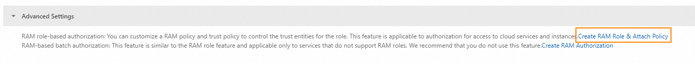

   </li>

   </ol>

2. Configure parameters for the RAM role.

   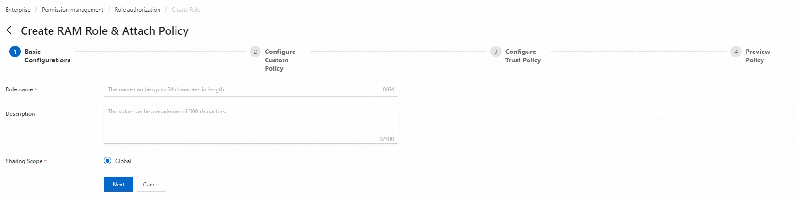

   | Parameter | Description |
   | --- | --- |
   | Role name | The name of the RAM role. In this example, <strong>ram-for-dts</strong> is used. |
   | Description | Optional. The description for the RAM role. |

   | Sharing Scope | Default value: <strong>Global</strong>. |
   | --- | --- |

3. Click **Next** and configure the permission policy.

   <ol type="i">

   <li>

   On the page that appears, click **Create Policy**.

   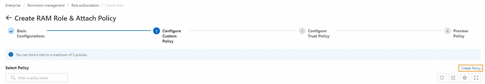

   </li>

   <li>

   Configure the permission policy.

   </li>

   </ol>

   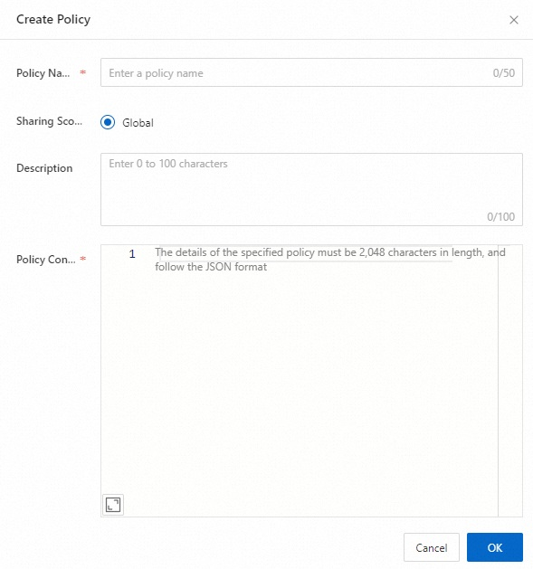

   | Parameter | Description |
   | --- | --- |
   | Policy Name | The name of the policy. |
   | Sharing Scope | Default value: <strong>Global</strong>. |
   | Description | Optional. The description for the policy. |
   | Policy Content | The content of the policy depends on the database type. The number of characters in a RAM policy content cannot exceed the predefined limit. You cannot enter the complete policy for DTS in this field. The following example shows part of the policy content for MySQL and PolarDB-X 1.0. For more information, see Complete policy.<br><code>{</code><br><code>"Statement": [</code><br><code>{</code><br><code>"Action": "sts:AssumeRole",</code><br><code>"Effect": "Allow",</code><br><code>"Resource": "*"</code><br><code>},</code><br><code>{</code><br><code>"Action": [</code><br><code>"rds:Describe*",</code><br><code>"rds:CreateDBInstance",</code><br><code>"rds:CreateAccount*",</code><br><code>"rds:CreateDataBase*",</code><br><code>"rds:ModifySecurityIps",</code><br><code>"rds:GrantAccountPrivilege"</code><br><code>],</code><br><code>"Resource": "*",</code><br><code>"Effect": "Allow"</code><br><code>},</code><br><code>{</code><br><code>"Action": [</code><br><code>"drds:DescribeDrds*",</code><br><code>"drds:ModifyDrdsIpWhiteList",</code><br><code>"drds:DescribeRegions",</code><br><code>"drds:DescribeRdsList",</code><br><code>"drds:CeateDrdsDB",</code><br><code>"drds:DescribeShardDBs"</code><br><code>],</code><br><code>"Resource": "*",</code><br><code>"Effect": "Allow"</code><br><code>}</code><br><code>],</code><br><code>"Version": "1"</code><br><code>}</code> |

   <ol type="i" start="3">

   <li>

   Click **OK**.

   </li>

   <li>

   Select the created policy and click **Next**.

   </li>

   </ol>

4. Configure the trust policy.

   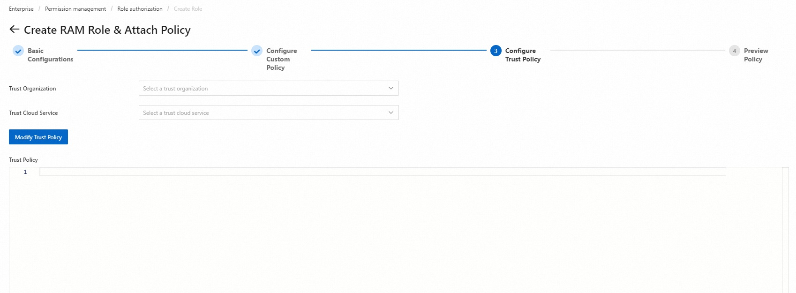

   | Parameter | Description |
   | --- | --- |
   | Trust Organization | Select the level-1 organization in which the DTS task is created. |
   | Trust Cloud Service | Select <strong>dts.aliyuncs.com</strong>. |
   | Trust Policy | If you select a <strong>Trust Organization</strong> and <strong>Trust Cloud Service</strong> from the drop-down lists, you do not need to manually configure the trust policy. |

5. Click **Next** to preview the policy.

6. On the page that appears, click **Create** to create a RAM role.

7. Grant permissions to the RAM role.

   <ol type="i">

   <li>

   Search for the RAM role that you created, and then click the name of the RAM role.

   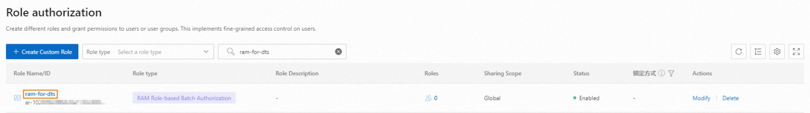

   </li>

   <li>

   Click the **RAM Role** tab.

   </li>

   </ol>

   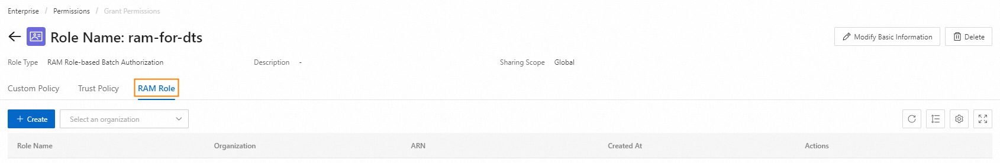

   <ol type="i" start="3">

   <li>

   Click **Create**.

   </li>

   </ol>

   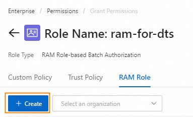

   <ol type="i" start="4">

   <li>

   Set the **Organization** parameter to the level-1 organization to which the database instance belongs.

   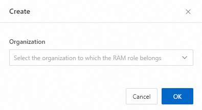

   </li>

   <li>

   Click **OK**.

   </li>

   </ol>

**Obtain the Apsara Stack account to which the database instance belongs**

1. Log on to the Apsara Uni-manager Management Console.

2. In the top navigation bar, click **Enterprise**.

3. In the left-side navigation pane, choose **Resources > Organizations**.

4. Click the level-1 organization to which the database instance belongs.

5. Click **Management Accesskey** on the right side of the page.

   

6. To the right of the **UID** in the **Management AccessKey** dialog box, check the Apsara Stack account of the database instance.

   > **Note**
   >
   > You need to specify the ID of this Apsara Stack account when you configure cross-account tasks.

   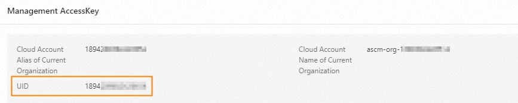

**Complete permission policy**

> **Note**
>
> Each  `{ "Action": [****], "Resource": "*", "Effect": "Allow"}`  represents a complete policy content for a specific database type. You can copy the relevant policy content into **Policy Content** of the RAM role based on your business requirements. If you have any questions when you configure permission policies, contact Apsara Stack technical support.

```json
{
  "Version": "1",
  "Statement": [
    {
      "Action": [
        "rds:Describe*",
        "rds:CreateDBInstance",
        "rds:CreateAccount*",
        "rds:CreateDataBase*",
        "rds:ModifySecurityIps",
        "rds:GrantAccountPrivilege",
        "rds:ReceiveDBInstance",
        "rds:CreateMigrateTask",
        "rds:DescribeMigrateTaskById",
        "rds:CreateOnlineDatabaseTask"
      ],
      "Resource": "*",
      "Effect": "Allow"
    },
    {
      "Action": [
        "ecs:DescribeSecurityGroupAttribute",
        "ecs:DescribeInstances",
        "ecs:DescribeRegions",
        "ecs:AuthorizeSecurityGroup",
        "ecs:CreateSecurityGroup",
        "ecs:DeleteSecurityGroup",
        "ecs:DescribeSecurityGroups",
        "ecs:JoinSecurityGroup",
        "ecs:LeaveSecurityGroup",
        "ecs:RevokeSecurityGroup"
      ],
      "Resource": "*",
      "Effect": "Allow"
    },
    {
      "Action": [
        "dhs:ListProject",
        "dhs:GetProject",
        "dhs:CreateTopic",
        "dhs:ListTopic",
        "dhs:GetTopic",
        "dhs:UpdateTopic",
        "dhs:ListShard",
        "dhs:MergeShard",
        "dhs:SplitShard",
        "dhs:PutRecords",
        "dhs:GetRecords",
        "dhs:GetCursors"
      ],
      "Resource": "*",
      "Effect": "Allow"
    },
    {
      "Action": [
        "elasticsearch:DescribeInstance",
        "elasticsearch:ListInstance",
        "elasticsearch:UpdateAdminPwd",
        "elasticsearch:UpdatePublicNetwork",
        "elasticsearch:UpdateBlackIps",
        "elasticsearch:UpdateKibanaIps",
        "elasticsearch:UpdatePublicIps",
        "elasticsearch:UpdatePrivateNetworkWhiteIps",
        "elasticsearch:UpdatePublicWhiteIps",
        "elasticsearch:UpdateWhiteIps"
      ],
      "Resource": "*",
      "Effect": "Allow"
    },
    {
      "Action": [
        "drds:DescribeDrds*",
        "drds:ModifyDrdsIpWhiteList",
        "drds:DescribeRegions",
        "drds:DescribeRdsList",
        "drds:CreateDrdsDB",
        "drds:CreateDrdsAccount",
        "drds:DescribeShardDBs"
      ],
      "Resource": "*",
      "Effect": "Allow"
    },
    {
      "Action": [
        "polardb:DescribeDBClusterIPArrayList",
        "polardb:DescribeDBClusterNetInfo",
        "polardb:DescribeDBClusters",
        "polardb:DescribeRegions",
        "polardb:DescribeDBClusterEndpoints",
        "polardb:DescribeDBClusterAccessWhiteList",
        "polardb:ModifyDBClusterAccessWhitelist",
        "polardb:ModifySecurityIps",
        "polardb:DescribeDBClusterAttribute"
      ],
      "Resource": "*",
      "Effect": "Allow"
    },
    {
      "Action": [
        "dds:DescribeDBInstanceAttribute",
        "dds:DescribeReplicaSetRole",
        "dds:DescribeSecurityIps",
        "dds:DescribeDBInstances",
        "dds:ModifySecurityIps",
        "dds:DescribeShardingNetworkAddress",
        "dds:DescribeRegions"
      ],
      "Resource": "*",
      "Effect": "Allow"
    },
    {
      "Action": [
        "kvstore:DescribeSecurityIps",
        "kvstore:DescribeInstances",
        "kvstore:DescribeRegions",
        "kvstore:ModifySecurityIps",
        "kvstore:DescribeAccounts",
        "kvstore:CreateAccount",
        "kvstore:DescribeDBInstanceNetInfoForInner",
        "kvstore:DescribeDBInstanceNetInfo",
        "kvstore:AllocateInstancePrivateConnection",
        "kvstore:SyncDtsStatus",
        "kvstore:GetDbMasterInfo"
      ],
      "Resource": "*",
      "Effect": "Allow"
    },
    {
      "Action": [
        "petadata:DescribeInstanceInfo",
        "petadata:DescribeSecurityIPs",
        "petadata:DescribeInstances",
        "petadata:ModifySecurityIPs"
      ],
      "Resource": "*",
      "Effect": "Allow"
    },
    {
      "Action": [
        "adb:DescribeDBClusters",
        "adb:DescribeDBClusterAttribute",
        "adb:DescribeRegions",
        "adb:DescribeDBClusterNetInfo",
        "adb:DescribeDBClusterAccessWhiteList",
        "adb:ModifyDBClusterAccessWhiteList",
        "adb:DescribeDBClusterPerformance"
      ],
      "Resource": "*",
      "Effect": "Allow"
    },
    {
      "Action": [
        "gpdb:DescribeDBInstanceAttribute",
        "gpdb:DescribeDBInstances",
        "gpdb:DescribeRegions",
        "gpdb:DescribeDBInstanceIPArrayList",
        "gpdb:DescribeDBClusterIPArrayList",
        "gpdb:ModifySecurityIps",
        "gpdb:DescribeDBInstanceNetInfo",
        "gpdb:DescribeDBClusterPerformance"
      ],
      "Resource": "*",
      "Effect": "Allow"
    },
    {
      "Action": [
        "clickhouse:DescribeRegions",
        "clickhouse:DescribeDBClusters",
        "clickhouse:DescribeDBClusterAttribute",
        "clickhouse:DescribeDBClusterNetInfoItems",
        "clickhouse:DescribeDBClusterAccessWhiteList",
        "clickhouse:ModifyDBClusterAccessWhiteList",
        "clickhouse:DescribeAllDataSource"
      ],
      "Resource": "*",
      "Effect": "Allow"
    },
    {
      "Action": [
        "ots:ListInstance",
        "ots:GetInstance",
        "ots:GetRow",
        "ots:PutRow",
        "ots:UpdateRow",
        "ots:DeleteRow",
        "ots:BatchWriteRow",
        "ots:BulkImport",
        "ots:CreateTable",
        "ots:DescribeTable",
        "ots:ListTable"
      ],
      "Resource": "*",
      "Effect": "Allow"
    },
    {
      "Action": [
        "dg:GetUserDatabases",
        "dg:GetUserGateways"
      ],
      "Resource": "*",
      "Effect": "Allow"
    },
    {
      "Action": [
        "cen:DeleteRouteServiceInCen",
        "cen:DescribeCenAttachedChildInstances",
        "cen:DescribeCens",
        "cen:DescribeRouteServicesInCen",
        "cen:ResolveAndRouteServiceInCen"
      ],
      "Resource": "*",
      "Effect": "Allow"
    },
    {
      "Action": [
        "polardbx:DescribeDBInstances",
        "polardbx:DescribeDBInstanceAttribute",
        "polardbx:DescribeSecurityIps",
        "polardbx:ModifySecurityIps"
      ],
      "Resource": "*",
      "Effect": "Allow"
    },
    {
      "Action": [
        "dms:GetUserActiveTenant",
        "dms:GetInstance",
        "dms:GetLogicDatabase",
        "dms:ListLogicDatabases",
        "dms:GetDBTopology",
        "dms:ListLogicTables",
        "dms:GetTableDBTopology"
      ],
      "Resource": "*",
      "Effect": "Allow"
    },
    {
      "Action": [
        "vpc:DescribeVpcs",
        "vpc:DescribeVpcAttribute"
      ],
      "Resource": "*",
      "Effect": "Allow"
    },
    {
      "Action": [
        "lindorm:GetLindormInstanceListForDMS",
        "lindorm:GetLindormInstanceForDMS",
        "lindorm:UpdateInstanceIpWhiteList"
      ],
      "Resource": "*",
      "Effect": "Allow"
    },
    {
      "Action": [
        "hbase:DescribeClusterConnection",
        "hbase:DescribeInstance",
        "hbase:DescribeInstances",
        "hbase:ModifyIpWhitelist"
      ],
      "Resource": "*",
      "Effect": "Allow"
    }
  ]
}
```

<a id="section-5"></a>

# 5.Data synchronization

<a id="section-5-1"></a>

## 5.1. Supported databases, synchronization types, and synchronization topologies

The data synchronization feature enables real-time synchronization between data sources. This topic describes the supported databases, synchronization types, and synchronization topologies.

**Synchroniz**

**Synchronizati**

**Source database**

**Destination database**

**ation**

**on type**

**topology**

schema and table structure synchronizatio

- self-hosted MySQL

  one-way

  n

  synchronizati

  Versions 5.1, 5.5, 5.6, and

  full data

  on

  5.7

  synchronizatio

  two-way

  n

- ApsaraDB RDS for MySQL

  synchronizati

  incremental

  on

  All versions

  data synchronizatio n

  schema and table structure synchronizatio n

PolarDB for MySQL

full data

one-way

(primary/standby or cluster

synchronizatio

synchronizati

edition)

n

on

All versions

incremental data synchronizatio n

schema and table structure synchronizatio n

one-way

full data

AnalyticDB for MySQL

synchronizati

synchronizatio

on

Version 3.0

n

incremental data synchronizatio

- self-hosted MySQL

  n

  Versions 5.1, 5.5, 5.6, and 5.7

- ApsaraDB RDS for MySQL

  schema and

  All versions

  table structure synchronizatio n

  one-way

  full data

  AnalyticDB for PostgreSQL

  synchronizati

  synchronizatio

  Versions 4.3 and 6.0

  on

  n

  incremental data synchronizatio n

  schema and table structure synchronizatio n

  full data

  one-way

  MaxCompute

  synchronizatio

  synchronizati

  n

  on

  incremental data synchronizatio n

  schema and table structure synchronizatio n

  full data

  one-way

  PolarDB-X 2.0

  synchronizatio

  synchronizati

  n

  on

  incremental data synchronizatio n

  PolarDB for PostgreSQL

  schema and

  (primary/standby or cluster

  table structure

  edition)

  synchronizatio

  All versions

  n

  full data

  one-way

  > **Note**

  synchronizatio

  synchronizati

  n

  on

  > Only table-level synchronization is

  incremental

  > supported. Database-level

  data

  > synchronization is not

  synchronizatio

  > supported.

  n

ApsaraDB RDS for MySQL

All versions

schema and table structure synchronizatio n

full data

one-way

AnalyticDB for MySQL

synchronizatio

synchronizati

Version 2.0

n

on

incremental data synchronizatio n

schema and table structure synchronizatio

- self-hosted MySQL

  n

  Versions 5.1, 5.5, 5.6, and

  one-way

  full data

  5.7

  DataHub

  synchronizati

  synchronizatio

  on

  n

- ApsaraDB RDS for MySQL

  incremental

  All versions

  data synchronizatio n

  schema and table structure synchronizatio n

  PolarDB for MySQL

  full data

  one-way

  (primary/standby or cluster

  synchronizatio

  synchronizati

  edition)

  n

  on

  All versions

  incremental data synchronizatio n

  schema and table structure synchronizatio

  - self-hosted MySQL

    n

    Versions 5.1, 5.5, 5.6, and

    full data

    one-way

    5.7

    synchronizatio

    synchronizati

    n

    on

  - ApsaraDB RDS for MySQL

    incremental

    All versions

    data synchronizatio n

    schema and table structure synchronizatio n

PolarDB for MySQL

full data

one-way

(primary/standby or cluster

PolarDB-X 2.0

synchronizatio

synchronizati

edition)

n

on

All versions

incremental data synchronizatio n

schema and table structure synchronizatio n

full data

one-way

MaxCompute

synchronizatio

synchronizati

n

on

incremental data synchronizatio n

schema and table structure synchronizatio n

full data

one-way

AnalyticDB for PostgreSQL

synchronizatio

synchronizati

Versions 4.3 and 6.0

n

on

incremental data synchronizatio n

full data synchronizatio n

one-way

self-hosted Kafka

synchronizati

incremental

Versions 0.1 to 2.7

on

data synchronizatio n

schema and table structure synchronizatio

one-way

AnalyticDB for MySQL

AnalyticDB for MySQL

n

synchronizati

Version 3.0

Version 3.0

on

full data synchronizatio n schema and table structure synchronizatio n

- PolarDB-X 1.0 (formerly

  full data

  one-way

  DRDS)

  synchronizatio

  synchronizati

  n

  on

- PolarDB-X 2.0

  incremental data synchronizatio n

  schema and table structure

  one-way

  synchronizatio

  synchronizati

  n

  on

DataHub

incremental data synchronizatio n

schema and table structure synchronizatio n

full data

one-way

self-hosted Kafka

synchronizatio

synchronizati

Versions 0.1 to 2.7

n

on

incremental data synchronizatio n

schema and table structure synchronizatio

- self-hosted MySQL

  n

  Versions 5.1, 5.5, 5.6, and

  full data

  one-way

  5.7

  synchronizatio

  synchronizati

  n

  on

- ApsaraDB RDS for MySQL

  incremental

  All versions

  data synchronizatio

PolarDB-X 1.0 (formerly DRDS)

n

schema and table structure synchronizatio n

full data

one-way

MaxCompute

synchronizatio

synchronizati

n

on

incremental data synchronizatio n

full data synchronizatio

self-hosted Oracle (RAC or non-

n

one-way

RAC architecture)

synchronizati

incremental

Versions 9i, 10g, 11g, 12c, 18c,

on

data

and 19c

synchronizatio n

schema and table structure synchronizatio n

full data

one-way

AnalyticDB for MySQL

synchronizatio

synchronizati

Versions 2.0 and 3.0

n

on

incremental data synchronizatio n

full data synchronizatio n

one-way

PolarDB-X 1.0 (formerly DRDS)

synchronizati

incremental

on

data synchronizatio n

schema and table structure synchronizatio n

full data

one-way

PolarDB-X 2.0

synchronizatio

synchronizati

n

on

incremental data synchronizatio n schema and table structure synchronizatio

- self-hosted MySQL

  n

  Versions 5.1, 5.5, 5.6, and

  full data

  one-way

  5.7

  synchronizatio

  synchronizati

  n

  on

- ApsaraDB RDS for MySQL

  incremental

  All versions

  data synchronizatio n

  schema and table structure synchronizatio n

PolarDB-X 2.0

PolarDB for MySQL

full data

one-way

(primary/standby or cluster

synchronizatio

synchronizati

edition)

n

on

All versions

incremental data synchronizatio n

schema and table structure synchronizatio n

AnalyticDB for PostgreSQL

full data

one-way

synchronizatio

synchronizati

Versions 4.3 and 6.0

n

on

incremental data synchronizatio n

schema and table structure synchronizatio n

full data

one-way

AnalyticDB for MySQL

synchronizatio

synchronizati

Versions 2.0 and 3.0

n

on

incremental data synchronizatio n

<table>
  <tr>
    <td rowspan="3">• self-hosted PostgreSQL<br>Versions 9.4, 9.5, 9.6, 10.x, 11, and 12<br>• ApsaraDB RDS for PostgreSQL<br>Versions 9.4, 10.0, 11.0, 12.0, and 13.0</td>
    <td>AnalyticDB for PostgreSQL<br>Versions 4.3 and 6.0</td>
    <td>full data synchronizatio n<br>incremental data synchronizatio n</td>
    <td>one-way synchronizati on</td>
  </tr>
  <tr>
    <td>• self-hosted PostgreSQL<br>Versions 9.4, 9.5, 9.6, 10.x, 11, and 12<br>• ApsaraDB RDS for PostgreSQL<br>Versions 9.4, 10.0, 11.0, 12.0, and 13.0</td>
    <td>schema and table structure synchronizatio n<br>full data synchronizatio n<br>incremental data synchronizatio n</td>
    <td>one-way synchronizati on</td>
  </tr>
  <tr>
    <td>PolarDB for PostgreSQL</td>
    <td>schema and table structure synchronizatio n<br>full data synchronizatio n<br>incremental data synchronizatio n</td>
    <td>one-way synchronizati on<br>two-way synchronizati on</td>
  </tr>
  <tr>
    <td>self-hosted PostgreSQL<br>Versions 13 and 14</td>
    <td>PolarDB for MySQL (primary/standby or cluster edition)<br>Versions 5.7, 8.0, and 8.4</td>
    <td>schema and table structure synchronizatio n<br>full data synchronizatio n<br>incremental data synchronizatio n</td>
    <td>one-way synchronizati on</td>
  </tr>
</table>

schema and table structure synchronizatio n

full data synchronizatio

one-way

n

PolarDB for PostgreSQL

PolarDB for PostgreSQL

synchronizati on

incremental data synchronizatio n

full data synchronizatio

PolarDB for PostgreSQL

n

one-way

self-hosted Kafka

primary/standby edition

synchronizati

incremental

Versions 0.1 to 2.7

on

All versions

data synchronizatio n

schema and table structure synchronizatio n

full data

one-way

AnalyticDB for PostgreSQL

synchronizatio

synchronizati

Versions 4.3 and 6.0

n

on

incremental data synchronizatio n

schema and table structure synchronizatio n

PolarDB for MySQL

full data

one-way

(primary/standby or cluster

synchronizatio

synchronizati

edition)

n

on

All versions

incremental data synchronizatio n

Db2 for LUW

schema and table structure synchronizatio n

full data

one-way

synchronizatio

PolarDB for PostgreSQL

synchronizati

n

on

incremental data synchronizatio n

schema and table structure synchronizatio n

PolarDB for MySQL

full data

one-way

(primary/standby or cluster

Db2 for i (AS/400)

synchronizatio

synchronizati

edition)

n

on

All versions

incremental data synchronizatio n

schema and table structure synchronizatio

one-way

n

DataHub

synchronizati

incremental

on

data synchronizatio n

schema and table structure synchronizatio n

full data

one-way

MaxCompute

synchronizatio

synchronizati

n

on

incremental data synchronizatio n

self-hosted Oracle (RAC or non-RAC architecture)

Versions 9i, 10g, 11g, 12c, 18c, and 19c

schema and table structure

- PolarDB for PostgreSQL

  synchronizatio

  (primary/standby or cluster

  n

  edition)

  full data

  one-way

- PolarDB for PostgreSQL

  synchronizatio

  synchronizati

  (Oracle-compatible)

  n

  on

  (primary/standby or cluster edition)

  incremental data

All versions

synchronizatio n

schema and table structure synchronizatio

- self-hosted MySQL

  n

  Versions 5.1, 5.5, 5.6, and

  full data

  one-way

  5.7

  synchronizatio

  synchronizati

  n

  on

- ApsaraDB RDS for MySQL

  incremental

  All versions

  data synchronizatio n

  schema and table structure synchronizatio n

  full data

  one-way

Tair (compatible with Redis)

synchronizatio

synchronizati

All versions

n

on

incremental data synchronizatio n

self-hosted Redis

Versions 4.0 and 5.0

Tair (compatible with Redis)

full data

All versions

synchronizatio

> **Note**

n

one-way

> The **connection method**

synchronizati

incremental

> must be **Private**

on

data

> **Line/VPN**

synchronizatio

> **Gateway/Smart Access**

n

> **Gateway** or a **self-hosted database on an ECS instance**.

- ApsaraDB RDS for SQL

  schema and

  Server

  table structure synchronizatio

  Versions 2012, 2016, and

  n

  2017

  full data

  one-way

  ApsaraDB RDS for SQL Server

- self-hosted SQL Server

  synchronizatio

  synchronizati

  Versions 2012, 2016, and 2017

  n

  on

  Versions 2005, 2008, 2008 R2, 2012, 2014, 2016, and

  incremental

  2017

  data synchronizatio n

  > **Note**
  >
  > - SQL Server clusters and SQL Server Always On availability groups are not

  schema and

  > supported.

  table structure synchronizatio

  > - If the source

  one-way

  n

  > database is SQL

  DataHub

  synchronizati

  > Server 2005 or

  incremental

  on

  > 2008,

  data

  > incremental data

  synchronizatio

  > synchronization

  n

  > is not supported.

  schema and table structure

  - self-hosted MongoDB

    synchronizatio

    (replica set or sharded

    n

    cluster)

self-hosted MongoDB (replica

full data

one-way

Versions 8.0 and earlier

set or sharded cluster)

synchronizatio

synchronizati

- ApsaraDB for MongoDB

  n

  on

Versions 8.0 and earlier

(replica set or sharded

incremental

cluster)

data

Versions 8.0 and earlier

synchronizatio n

schema and table structure

- self-hosted MongoDB

  synchronizatio

  (replica set or sharded

  n

  cluster)

  full data

  one-way

  Versions 8.0 and earlier

  synchronizatio

  synchronizati

- ApsaraDB for MongoDB

  n

  on

  (replica set or sharded

  incremental

  cluster)

  data

  Versions 8.0 and earlier

  synchronizatio n

  full data synchronizatio n

  one-way

self-hosted Kafka

synchronizati

incremental

Versions 0.1 to 2.7

on

data synchronizatio n

ApsaraDB for MongoDB (replica set or sharded cluster)

Versions 8.0 and earlier

<table>
  <tr>
    <td>ApsaraDB for MongoDB (replica set or sharded cluster)</td>
    <td>PolarDB for MySQL 8.0 cluster with local disks (MongoDB-compatible, replica set architecture)<br>Note<br>• The destination uses a PolarDB for MySQL cluster with local disks that is compatible with MongoDB syntax.<br>• When you configure the synchronization task, set the <strong>Database Type</strong> to <strong>MongoDB</strong> for both the source and destination. For the destination, you must select <strong>Replica Set</strong> as the Architecture (sharded clusters are not supported).Configure the connection methods as follows:<br>• Source: Cloud instance<br>• Destination: Private Line/VPN Gateway/S mart Access Gateway</td>
    <td>schema and table structure synchronizatio n<br>full data synchronizatio n<br>incremental data synchronizatio n</td>
    <td>one-way synchronizati on</td>
  </tr>
  <tr>
    <td rowspan="3">PolarDB for PostgreSQL (Oracle-compatible)</td>
    <td>AnalyticDB for MySQL<br>Version 3.0</td>
    <td>schema and table structure synchronizatio n<br>full data synchronizatio n<br>incremental data synchronizatio n</td>
    <td>one-way synchronizati on</td>
  </tr>
  <tr>
    <td>PolarDB for PostgreSQL (Oracle-compatible)</td>
    <td>schema and table structure synchronizatio n<br>full data synchronizatio n<br>incremental data synchronizatio n</td>
    <td>one-way synchronizati on</td>
  </tr>
  <tr>
    <td>AnalyticDB for PostgreSQL<br>Versions 4.3 and 6.0</td>
    <td>schema and table structure synchronizatio n<br>full data synchronizatio n<br>incremental data synchronizatio n</td>
    <td>one-way synchronizati on</td>
  </tr>
  <tr>
    <td>MaxCompute</td>
    <td>ApsaraDB RDS for MySQL<br>All versions</td>
    <td>schema and table structure synchronizatio n<br>full data synchronizatio n</td>
    <td>one-way synchronizati on</td>
  </tr>
  <tr>
    <td>self-hosted MariaDB (all versions)</td>
    <td>self-hosted MariaDB (all versions)</td>
    <td>schema and table structure synchronizatio n<br>full data synchronizatio n<br>incremental data synchronizatio n</td>
    <td>one-way synchronizati on</td>
  </tr>
</table>

<a id="section-5-2"></a>

## 5.2. Create a data synchronization instance

Before you configure a task to synchronize data, you must create a data synchronization instance. This topic describes how to create a data synchronization instance in the Data Transmission Service (DTS) console.

**Procedure**

1. Log on to the DTS console. For more information, see Log on to the DTS console.

2. In the left-side navigation pane, click **Data Synchronization**.

3. Click **Create Task**.

4. In the panel that appears, configure the parameters described in the following table.

   | Parameter | Description |
   | --- | --- |
   | Source Database Type | The type of the source database. For more information about supported types of source databases, see Supported databases, synchronization types, and synchronization topologies. |
   | Source Region | The region in which the source database resides.<br>Note You cannot change the value of this parameter after you purchase the data synchronization instance. Exercise caution when you configure this parameter. |
   | Destination Database Type | The type of the destination database. For more information about supported types of destination databases, see Supported databases, synchronization types, and synchronization topologies. |
   | Destination Region | The region in which the destination database resides.<br>Note You cannot change the value of this parameter after you purchase the data synchronization instance. Exercise caution when you configure this parameter. |
   | Synchronization Topology | The synchronization topology of the data synchronization instance.For more information about the supported synchronization topologies, see Supported databases, synchronization types, and synchronization topologies. |
   | Quantity | The number of data synchronization instances that you want to create at a time. |

   > **Note**
   >
   > In this panel, you can view the total number of instances, the number of
   >
   > existing instances, and the number of instances that can be created.

5. Click **Purchase Instance**.

6. In the message that appears, click **OK**.

<a id="section-5-3"></a>

## 5.3. Synchronization topologies

The data synchronization feature supports multiple types of synchronization topologies. You can plan your data synchronization instances based on your business requirements. This topic describes the synchronization topologies that are supported by Data Transmission Service (DTS) and how to use these topologies.

**One-way synchronization**

To ensure data consistency for one-way synchronization, we recommend that you perform only read operations on the objects in the destination instance. Do not perform write operations on the objects.

| Topology type | Topology | Description |
| --- | --- | --- |
| One-way one-to-one synchronizati on | 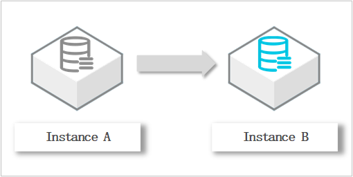 | N/A |
| One-way one-to-many synchronizati on | 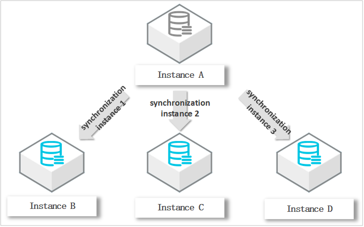 | You must purchase multiple data synchronization instances to implement one-way one-to-many synchronization.<br>For example, if you want to synchronize data from Instance A to Instance B, Instance C, and Instance D, you must purchase three data synchronization instances. |
| One-way cascade synchronizati on | 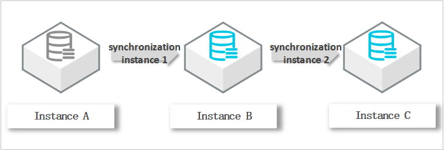 | You must purchase multiple data synchronization instances to implement one-way cascade synchronization.<br>For example, if you want to synchronize data from Instance A to Instance B and then from Instance B to Instance C, you must purchase two data synchronization instances. |
| One-way many-to-one synchronizati on | 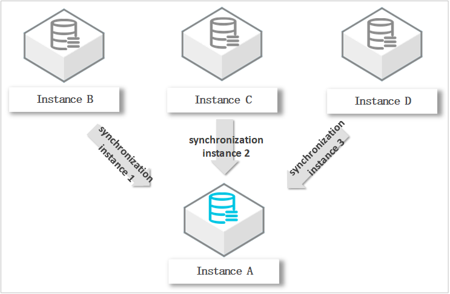 | You must purchase multiple data synchronization instances to implement one-way many-to-one synchronization.<br>For example, if you want to synchronize data from Instance B, Instance C, and Instance D to Instance A, you must purchase three data synchronization instances.<br>Note To ensure data consistency, you must select different objects to synchronize for these data synchronization instances. |

**Two-way synchronization**

DTS supports two-way synchronization only between two MySQL databases.

| Topology type | Topology | Description |
| --- | --- | --- |
| Two-way one-to-one synchronizatio n | 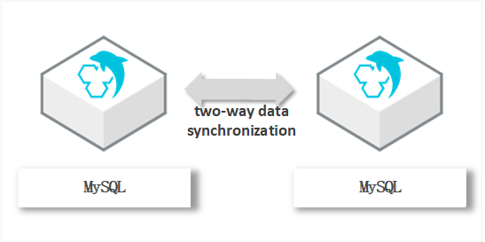 | To ensure data consistency, make sure that data records with the same primary key, business primary key, or unique key are updated on only one of the source and destination instances. |

<a id="section-5-4"></a>

## 5.4. Prepare the database accounts for data synchronization

When you configure a data synchronization task, you must specify the database accounts for the source and destination databases. The database accounts are used for data synchronization. Different databases and synchronization types require different permissions. You must create and authorize database accounts before you configure a data synchronization task.

**Permissions required for the source database account**

| Database | Required permission | References |
| --- | --- | --- |
| ApsaraDB RDS for MySQL database | Read permissions on the objects to synchronize | See the "Create an account on an ApsaraDB RDS for MySQL instance" and "Modify the permissions of a standard account on an ApsaraDB RDS for MySQL instance" sections of User Guide of ApsaraDB RDS for MySQL. |
| Self-managed MySQL database | The SELECT permission on the objects to synchronize<br>The REPLICATION CLIENT, REPLICATION SLAVE, and SHOW VIEW permissions<br>Permissions to create databases and tables. The permissions allow Data Transmission Service (DTS) to create a database named dts to record heartbeat data during synchronization. | See Create an account for a self-managed MySQL database and configure binary logging. |
| PolarDB for MySQL database | Read permissions on the objects to synchronize | See the "Create a database account" section of User Guide of PolarDB for MySQL. |
| PolarDB for Oracle database | Permissions of a privileged account | See the "Create a database account" section of User Guide of PolarDB. |

<table>
  <tr>
    <td>Self-managed Oracle database</td>
    <td>Permissions of the database administrator (DBA)</td>
    <td>See CREATE USER and GRANT.<br>Important<br>If you need to migrate incremental data from an Oracle database but the DBA permission cannot be granted to the database account, you can grant fine-grained permissions to the account. For more information, see Enable logging and grant fine-grained permissions to an Oracle database account.</td>
  </tr>
  <tr>
    <td>PolarDB-X database</td>
    <td>Read permissions on the objects to synchronize</td>
    <td>• For a PolarDB-X 1.0 instance, see the "Create an account on a PolarDB-X 1.0 instance" and "Modify the permissions of a standard account on a PolarDB-X 1.0 instance" sections of User Guide of PolarDB for Xscale (1.0).<br>• For a PolarDB-X 2.0 instance, see the "Manage database accounts" section of User Guide of PolarDB for Xscale.</td>
  </tr>
  <tr>
    <td>ApsaraDB RDS for SQL Server database</td>
    <td>The owner permission on the source database<br>Note<br>A privileged account has the required permissions.</td>
    <td>See the "Create an account" section of User Guide of ApsaraDB RDS for SQL Server.</td>
  </tr>
  <tr>
    <td>Self-managed SQL Server database</td>
    <td>The permissions of the sysadmin role</td>
    <td>See CREATE USER and GRANT (Transact-SQL).</td>
  </tr>
  <tr>
    <td>ApsaraDB RDS for PostgreSQL database</td>
    <td>Permissions of a privileged account.The account must be the owner of the database.<br>Note<br>If the source database runs on an ApsaraDB RDS for PostgreSQL instance V9.4 and you synchronize only DML operations, the database account must have the REPLICATION permission.</td>
    <td>See the "Create an account" section of User Guide of ApsaraDB RDS for PostgreSQL.</td>
  </tr>
  <tr>
    <td>Self-managed PostgreSQL database</td>
    <td>Permissions of the superuser role</td>
    <td>See CREATE USER and GRANT.</td>
  </tr>
  <tr>
    <td>KVStore for Redis database</td>
    <td>Read and write permissions on the objects to synchronize</td>
    <td>See the "Account management" section of User Guide of KVStore for Redis.</td>
  </tr>
  <tr>
    <td>Self-managed Redis database</td>
    <td>The <code> PSYNC </code> or <code> SYNC </code> statement can be executed on the source Redis database.</td>
    <td>None</td>
  </tr>
  <tr>
    <td>ApsaraDB for MongoDB database</td>
    <td>• Full data migration: read permissions on the source database<br>• Incremental data migration: the read permissions on the source database, the admin database, and the local database</td>
    <td>The default value of the name of the authentication database is admin. The database account parameter is set to root.</td>
  </tr>
  <tr>
    <td>Self-managed MongoDB database</td>
    <td>• Full data migration: read permissions on the source database<br>• Incremental data migration: the read permissions on the source database, the admin database, and the local database</td>
    <td>See db.createUser().</td>
  </tr>
</table>

**Permissions required for the destination database account**

<table>
  <tr>
    <th>Database</th>
    <th>Required permission</th>
    <th>References</th>
  </tr>
  <tr>
    <td>ApsaraDB RDS for MySQL database</td>
    <td>The read and write permissions on the destination database</td>
    <td>See the "Create an account on an ApsaraDB RDS for MySQL instance" and "Modify the permissions of a standard account on an ApsaraDB RDS for MySQL instance" sections of User Guide of ApsaraDB RDS for MySQL.</td>
  </tr>
  <tr>
    <td>Self-managed MySQL database</td>
    <td>The ALL permission on the destination database</td>
    <td>See Create an account for a self-managed MySQL database and configure binary logging.</td>
  </tr>
  <tr>
    <td>PolarDB for MySQL database</td>
    <td>The ALL permission on the destination database</td>
    <td>See the "Create a database account" section of User Guide of PolarDB for MySQL.</td>
  </tr>
  <tr>
    <td>PolarDB for Oracle database</td>
    <td>Permissions of a privileged account</td>
    <td>See the "Create a database account" section of User Guide of PolarDB.</td>
  </tr>
  <tr>
    <td>Self-managed Oracle database</td>
    <td>Permissions of the schema owner</td>
    <td>See CREATE USER and GRANT.</td>
  </tr>
  <tr>
    <td>PolarDB-X</td>
    <td>Write permissions on the objects to synchronize</td>
    <td>• For a PolarDB-X 1.0 instance, see the "Create an account on a PolarDB-X 1.0 instance" and "Modify the permissions of a standard account on a PolarDB-X 1.0 instance" sections of User Guide of PolarDB for Xscale (1.0).<br>• For a PolarDB-X 2.0 instance, see the "Manage database accounts" section of User Guide of PolarDB for Xscale.</td>
  </tr>
  <tr>
    <td rowspan="2">KVStore for Redis database</td>
    <td>If you use the instance password, no authorization is required.</td>
    <td>None</td>
  </tr>
  <tr>
    <td>If you use a custom account, the read and write permissions are required.</td>
    <td>See the "Account management" section of User Guide of KVStore for Redis.</td>
  </tr>
  <tr>
    <td>Self-managed Redis database</td>
    <td>The database password must be valid.</td>
    <td>None</td>
  </tr>
  <tr>
    <td>ApsaraDB for MongoDB database</td>
    <td>The dbAdminAnyDatabase permission, read and write permissions on the destination database, and read permissions on the local database</td>
    <td>The default value of the name of the authentication database is admin. The database account parameter is set to root.</td>
  </tr>
  <tr>
    <td>Self-managed MongoDB database</td>
    <td>The dbAdminAnyDatabase permission, read and write permissions on the destination database, and read permissions on the local database</td>
    <td>See db.createUser().</td>
  </tr>
  <tr>
    <td>AnalyticDB for MySQL database</td>
    <td>• V2.0: DTS automatically creates a database account and grants permissions to the account. You do not need to specify the database account.<br>• V3.0: Read and write permissions are required.</td>
    <td>V3.0: See the "Database accounts and permissions" section of User Guide of AnalyticDB for MySQL.</td>
  </tr>
  <tr>
    <td>AnalyticDB for PostgreSQL database</td>
    <td>The initial account or an account that has the RDS_SUPERUSER permission is required.</td>
    <td>See the "Create a database account" and "Manage users and permissions" sections of User Guide of AnalyticDB for MySQL.</td>
  </tr>
  <tr>
    <td>Message Queue for Apache Kafka instance</td>
    <td>N/A</td>
    <td>None</td>
  </tr>
  <tr>
    <td>Self-managed Kafka cluster</td>
    <td>N/A<br>Note<br>If no authentication is enabled for the Kafka cluster, you do not need to enter the username or password.</td>
    <td>None</td>
  </tr>
  <tr>
    <td>MaxCompute</td>
    <td>The CREATE TABLE, CREATE INSTANCE, CREATE RESOURCE, CREATE JOB, and List permissions on the project to be synchronized</td>
    <td>When you configure the data synchronization task, DTS automatically authorizes the database account.</td>
  </tr>
</table>

**Permissions required for the database accounts in two-way data synchronization tasks**

The following table lists the permissions that are required for the source and destination database accounts in two-way data synchronization tasks. The permissions allow DTS to create a database named dts in the source and destination databases to prevent circular data replication.

<table>
  <tr>
    <th>Database</th>
    <th>Required permission</th>
    <th>References</th>
  </tr>
  <tr>
    <td>ApsaraDB RDS for MySQL database</td>
    <td>Permissions of a privileged account</td>
    <td>See the "Create an account on an ApsaraDB RDS for MySQL instance" and "Modify the permissions of a standard account on an ApsaraDB RDS for MySQL instance" sections of User Guide of ApsaraDB RDS for MySQL.</td>
  </tr>
  <tr>
    <td>Self-managed MySQL database</td>
    <td>The SELECT permission on the objects to synchronize<br>The REPLICATION CLIENT, REPLICATION SLAVE, and SHOW VIEW permissions<br>The permissions to create databases and tables. The permissions allow DTS to create a database named dts to prevent circular data replication.</td>
    <td>See Create an account for a self-managed MySQL database and configure binary logging.</td>
  </tr>
  <tr>
    <td>ApsaraDB RDS for PostgreSQL database</td>
    <td>Permissions of a privileged account.The account must be the owner of the database.</td>
    <td>See the "Create an account" section of User Guide of ApsaraDB RDS for PostgreSQL.</td>
  </tr>
  <tr>
    <td>Self-managed PostgreSQL database</td>
    <td>Permissions of the superuser role</td>
    <td>See CREATE USER and GRANT.</td>
  </tr>
  <tr>
    <td>PolarDB for MySQL database</td>
    <td>Permissions of a privileged account</td>
    <td>See the "Create a database account" section of User Guide of PolarDB for MySQL.</td>
  </tr>
  <tr>
    <td rowspan="2">KVStore for Redis database</td>
    <td>If you use the instance password, no authorization is required.</td>
    <td>None</td>
  </tr>
  <tr>
    <td>If you use a custom account, the read and write permissions are required.</td>
    <td>See the "Account management" section of User Guide of KVStore for Redis.</td>
  </tr>
  <tr>
    <td>Self-managed Redis database</td>
    <td>The <code> PSYNC </code> or <code> SYNC </code> statement can be executed on the source Redis database.</td>
    <td>None</td>
  </tr>
</table>

<a id="section-5-5"></a>

## 5.5. Configure data synchronization tasks

<a id="section-5-5-1"></a>

### 5.5.1. Synchronize data from an ApsaraDB RDS for MySQL instance

<a id="section-5-5-1-1"></a>

#### 5.5.1.1. Synchronize data between ApsaraDB RDS for MySQL instances

This topic describes how to synchronize data between ApsaraDB RDS for MySQL instances by using Data Transmission Service (DTS).

**Prerequisites**

The source and destination ApsaraDB RDS for MySQL instances are created.

**Usage notes**

| Category | Description |
| --- | --- |
| Limits on the source database | • The tables to be synchronized must have PRIMARY KEY or UNIQUE constraints and all fields must be unique. Otherwise, the destination database may contain duplicate data records.<br>• The following requirements for binary logs must be met:<br>• The binary logging feature is enabled. The binlog_format parameter is set to row.The binlog_row_image parameter is set to full. Otherwise, error messages are returned during the precheck, and the data synchronization task cannot be started.<br>• Binary logs are retained for at least seven days during initial full data synchronization. You can wait until initial full data synchronization is complete, and then clear the binary logs generated in the source database after the DTS task is run.<br>Note<br>To ensure data security, DTS stores up to 50 GB of binary logs that are generated within the last 24 hours. If the limit is exceeded, DTS automatically clears the cached logs.<br>Warning<br>If you clear the binary logs of the source database during initial full data synchronization, the data synchronization task may fail. For example, initial full data synchronization takes more than 24 hours due to a large amount of data in the source database and abnormal writing in the destination database. In this case, if the binary logs of the source database are cleared during initial full data synchronization, DTS cannot obtain the binary logs generated 24 hours ago and the data synchronization task may fail. |

<table>
  <tr>
    <td>Other limits</td>
    <td>• To ensure compatibility, the version of the destination ApsaraDB RDS for MySQL database must be the same as or later than the version of the source ApsaraDB RDS for MySQL database.<br>• DTS supports initial schema synchronization for triggers. However, data inconsistency may occur due to triggers. We recommend that you delete the triggers of the source database to prevent data inconsistency caused by the triggers.<br>• Limits on RENAME TABLE operations during data synchronization:<br>The RENAME TABLE operation may cause data inconsistency between the source and destination databases. For example, if you select a table as the object and rename the table during data synchronization, the data of this table is not synchronized to the destination cluster. To prevent this situation, you can select the database to which this table belongs as the object to be synchronized when you configure the data synchronization task.<br>• Before you synchronize data, evaluate the impact of data synchronization on the performance of the source and destination databases. We recommend that you synchronize data during off-peak hours. During initial full data synchronization, DTS uses the read and write resources of the source and destination databases. This may increase the load on the database servers.<br>• During initial full data synchronization, concurrent INSERT operations cause fragmentation in the tables of the destination database. After initial full data synchronization is complete, the size of the used tablespace of the destination database is larger than that of the source database.<br>• We recommend that you do not use tools such as gh-ost or pt-online-schema-change to perform DDL operations on source tables during data synchronization. Otherwise, data synchronization may fail.<br>• If you use only DTS to write data to the destination database, you can use Data Management (DMS) to perform online DDL operations on source tables during data synchronization.<br>Warning<br>Do not use DMS to execute online DDL statements while data from other sources is written to the destination database. Otherwise, data loss may occur in the destination database.</td>
  </tr>
  <tr>
    <td>Other limits</td>
    <td>Two-way data synchronization between MySQL databases<br>• To configure two-way data synchronization, you must purchase basic plans for cross-cloud data synchronization and two-way data synchronization.<br>• DTS supports two-way data synchronization only between two MySQL databases. DTS does not support two-way data synchronization between multiple MySQL databases.<br>• Limits on DDL synchronization direction: To ensure the stability of two-way data synchronization, you can synchronize DDL operations only in the forward direction.<br>• When DTS runs a two-way data synchronization task, DTS creates a database named dts in the destination database to prevent circular synchronization. When the task is running, do not modify the dts database.</td>
  </tr>
</table>

**Supported synchronization topologies**

DTS supports one-way synchronization and two-way synchronization. For more information, see Synchronization topologies.

**SQL operations that can be synchronized**

| Operati on type | SQL statement |
| --- | --- |
| DML | INSERT, UPDATE, DELETE, and REPLACE |
| DDL | • ALTER TABLE and ALTER VIEW<br>• CREATE FUNCTION, CREATE INDEX, CREATE PROCEDURE, CREATE TABLE, and CREATE VIEW<br>• DROP INDEX and DROP TABLE<br>• RENAME TABLE<br>Important<br>RENAME TABLE operations may cause data inconsistency between the source and destination databases. For example, if you select a table as the object to be synchronized and rename the table during data synchronization, the data of this table is not synchronized to the destination database. To prevent this situation, you can select the database to which this table belongs as the object to be synchronized when you configure the data synchronization task. Make sure that the databases to which the table belongs before and after the RENAME TABLE operation are added to the objects to be synchronized.<br>• TRUNCATE TABLE |

**Procedure**

1. Create a data synchronization task.

   > **Note**
   >
   > When you create a data synchronization task, select **MySQL** as the source and destination database types and **One-way Synchronization** as the synchronization topology.

2. On the Data Synchronization page, find the data synchronization task that you created and click **Configure Task**.

3. Configure the source and destination databases

   **Section**

   **Parameter**

   **Description**

   The task name that DTS automatically generates. We recommend that you specify a descriptive name that makes it easy to identify the task. You do not need to specify a unique task name.

   N/A

   **Task Name**

   **Database**

   The type of the source instance. Select **MySQL**.

   **Type Access**

   The access method of the destination database. Select **Alibaba**

   **Method**

   **Cloud Instance**.

   The region in which the source database resides. The region is

   **Instance**

   the source region that you selected when you created the data

   **Region**

   synchronization task. You cannot change the value of this parameter.

   **Replicate Data Across**

   Specifies whether to migrate data between instances that

   **Alibaba**

   belong to different Alibaba Cloud accounts. In this example, **No**

   **Cloud**

   is selected.

   **Accounts**

   **RDS**

   **Source**

   The ID of the source ApsaraDB RDS for MySQL instance.

   **Instance ID**

   **Database**

   The database account of the source ApsaraDB RDS for MySQL instance.

   > **Note**

   **Database Account**

   > If the database engine of the source ApsaraDB RDS for MySQL instance is **MySQL 5.6**, you do not need to configure the **Database Account** and **Database Password** parameters.

   **Database**

   The password of the database account.

   **Password**

   The encryption method for the connection to the source database. If you select **SSL-encrypted**, you must enable SSL

   **Encryption**

   encryption for the source ApsaraDB RDS for MySQL instance before you configure the data synchronization task.

   **Database**

   The type of the source instance. Select **MySQL**.

   **Type**

   **Access**

   The access method of the destination database. Select **Alibaba**

   **Method**

   **Cloud Instance**.

   The region in which the destination database resides. The region

   **Instance**

   is the destination region that you selected when you created the

   **Region**

   data synchronization task. You cannot change the value of this parameter.

   **RDS**

   The ID of the destination ApsaraDB RDS for MySQL instance.

   **Instance ID**

   **Destination Database**

   The database account of the destination ApsaraDB RDS for MySQL instance.

   > **Note**

   **Database Account**

   > If the database engine of the destination ApsaraDB RDS for MySQL instance is **MySQL 5.6**, you do not need to configure the **Database Account** and **Database Password** parameters.

   **Database**

   The password of the database account.

   **Password**

   The encryption method for the connection to the source database. If you select **SSL-encrypted**, you must enable SSL

   **Encryption**

   encryption for the destination ApsaraDB RDS for MySQL instance before you configure the data synchronization task.

4. In the lower part of the page, click **Test Connectivity and Proceed**.

5. Select the processing mode of conflicting tables and the objects to be synchronized.

   | Parameter | Description |
   | --- | --- |
   | Task Stages | <strong>Incremental Data Synchronization</strong> is automatically selected. You must also select <strong>Schema Synchronization</strong> and <strong>Full Data Synchronization</strong>.After the precheck is complete, DTS synchronizes the historical data of selected objects from the source instance to the destination instance. The historical data is the basis for subsequent incremental synchronization. |

   <table>
     <tr>
       <td>Processing Mode of Conflicting Tables</td>
       <td>• <strong>Precheck and Report Errors</strong>: checks whether the destination database contains tables that use the same names as tables in the source database. If the source and destination databases do not contain tables that have identical table names, the precheck is passed.Otherwise, an error is returned during the precheck and the data synchronization task cannot be started.<br>• <strong>Ignore Errors and Proceed</strong>: skips the precheck for identical table names in the source and destination databases.<br>Warning<br>If you select <strong>Ignore Errors and Proceed</strong>, data inconsistency may occur between the source and destination databases, and your business may be exposed to potential risks.<br>• During initial data synchronization, DTS does not synchronize the data records that have the same primary keys as the data records in the destination database. This occurs if the source and destination databases have the same schema. However, DTS synchronizes these data records during incremental data synchronization.<br>• If the source and destination databases have different schemas, initial data synchronization may fail. In this case, only some columns are synchronized or the data synchronization task fails.</td>
     </tr>
     <tr>
       <td>Synchronization Topology</td>
       <td>Select <strong>One-way Synchronization</strong>.</td>
     </tr>
     <tr>
       <td>Capitalization of Object Names in Destination Instance</td>
       <td>Specify the capitalization of database names, table names, and column names in the destination instance. By default, <strong>DTS default policy</strong> is selected. You can select other options to ensure that the capitalization of object names is consistent with that in the source or destination database.For more information, see Specify the capitalization of object names in the destination instance.</td>
     </tr>
     <tr>
       <td>Source Objects</td>
       <td>Select one or more objects (tables or databases) in the <strong>Source Objects</strong><br>section and click theicon to move the objects to the <strong>Selected</strong><br><strong>Objects</strong> section.<br>Note<br>If you select a database as the object to be synchronized, all schema changes in the database are synchronized to the destination database.</td>
     </tr>
     <tr>
       <td>Selected Objects</td>
       <td>By default, after an object is synchronized to the destination instance, the name of the object remains unchanged. You can use the object name mapping feature to change the names of the objects that are synchronized to the destination instance. For more information, see Rename an object to be synchronized.<br>Note<br>• To synchronize SQL operations that are performed on a specific database or table, right-click an object in the <strong>Selected Objects</strong> section. In the dialog box that appears, select the SQL operations that you want to synchronize.<br>• To specify WHERE clauses to filter data, right-click a table in the <strong>Selected Objects</strong> section. In the dialog box that appears, specify the filter conditions. For more information, see Use SQL conditions to filter data.<br>• If you use the object name mapping feature to rename an object, other objects that are dependent on the object may fail to be synchronized.</td>
     </tr>
   </table>

6. Click **Next: Advanced Settings** to configure advanced settings. The following table describes the parameters.

   | Parameter | Description |
   | --- | --- |
   | Retry Time for Failed Connections | The retry time range for failed connections. If the connection to the source or destination database fails after the data synchronization task is started, an error is returned. For predictable errors, DTS immediately retries a connection within the time range. Valid values: 10 to 1440. Unit: minutes.Default value: 720. We recommend that you set the parameter to a value greater than 30. If DTS reconnects to the source and destination databases within the specified retry time range, DTS resumes the data synchronization task. Otherwise, the data synchronization task fails.<br>Note<br>If you set different retry time ranges for multiple data synchronization tasks that have the same source or destination database, the shortest retry time range that is set takes precedence. |
   | Configure ETL | Specifies whether to configure the extract, transform, and load (ETL) feature. Valid values:<br>• <strong>Yes</strong>: enables the ETL feature. You can enter data processing statements in the code editor. For more information, see Configure ETL in a data synchronization task.<br>• <strong>No</strong>: disables the ETL feature. |

7. In the lower part of the page, click **Next: Precheck and Start Task**.

   > **Important**
   >
   > - Before you can start the data synchronization task, a precheck is performed. You can start the data synchronization task only after the task passes the precheck.
   >
   > - If the task fails to pass the precheck, click **View Details** next to each failed item. After you troubleshoot the issues based on the causes, run a precheck again.

8. Wait until **Success Rate** displays 100% and then click **Back**.

<a id="section-5-5-1-2"></a>

#### 5.5.1.2. Configure two-way data synchronization between ApsaraDB RDS for MySQL instances

<a id="section-5-5-1-2-1"></a>

##### 5.5.1.2.1. Overview

DTS supports two-way real-time data synchronization between RDS instances on any two clouds. This section describes how to use DTS to create a two-way synchronization task between two ApsaraDB RDS for MySQL instances for active geo-redundancy, geo-disaster recovery, and other scenarios.

<a id="section-5-5-1-2-2"></a>

##### 5.5.1.2.2. Supported synchronization statements

Two-way synchronization between ApsaraDB RDS for MySQL instances supports all DML updates (including INSERT, UPDATE, and DELETE) and the following DDL updates:

- ALTER TABLE, ALTER VIEW, ALTER FUNCTION, and ALTER PROCEDURE

- CREATE DATABASE, CREATE SCHEMA, CREATE INDEX, CREATE TABLE, CREATE PROCEDURE, CREATE FUNCTION, CREATE TRIGGER, CREATE VIEW, and CREATE EVENT

- DROP FUNCTION, DROP EVENT, DROP INDEX, DROP PROCEDURE, DROP TABLE, DROP TRIGGER, and DROP VIEW

- RENAME TABLE and TRUNCATE TABLE

> **Note**
>
> To ensure the stability of a two-way synchronization channel, you can
>
> synchronize DDL updates on the same table in only one direction.
>
> For example, for two-way synchronization, you must enable DDL synchronization in either the **A-to-B** or **B-to-A** direction. If DDL synchronization is configured in one direction, it is not supported in the reverse direction. You can only perform DML synchronization.

<a id="section-5-5-1-2-3"></a>

##### 5.5.1.2.3. Detect and resolve conflicts

To ensure data consistency, for two-way synchronized instances, make sure that records with the same primary key, business primary key, or unique key are updated only on one of the instances. If you unexpectedly update a record with the same primary key, business primary key, or unique key on both instances that are two-way synchronized, a synchronization conflict occurs. To maximize the stability of two-way synchronized instances, DTS supports detecting and resolving data conflicts.

**Considerations**

During two-way synchronization, the system time of the source and destination instances may not be the same. Additionally, synchronization delays may occur. For these reasons, DTS cannot guarantee that its conflict detection mechanism can completely prevent data conflicts. You must refactor certain business logic to ensure that records of the same primary key, business primary key, or unique key are updated only on one of the instances that are two-way synchronized.

**Supported conflict types**

Currently, DTS supports detecting the following conflict types:

- Uniqueness conflicts caused by INSERT operations

  A uniqueness conflict occurs when the synchronization of an inserted row violates the unique constraint. For example, if two instances in two-way synchronization insert a record with the same primary key value at almost the same time, one of the inserted records fails to be synchronized because a record with the same primary key value already exists in the destination instance.

- Inconsistent records caused by UPDATE operations Update conflicts occur in the following scenarios:

  - The records to be updated do not exist in the destination instance. If the records to be updated do not exist, DTS automatically changes the UPDATE operation to the INSERT operation and inserts these records to the destination instance. In this case, duplicate unique key values may occur.

  - The primary keys or unique keys of the records to be updated conflict with each other.

- A DELETE operation is made on non-existent records

  A delete conflict occurs when the records to be deleted do not exist in the destination instance.

  In this case, DTS automatically ignores the DELETE operation regardless of the conflict resolution policy that you have configured.

**Supported conflict resolution policies**

For the preceding synchronization conflicts, DTS provides the following resolution policies. You can select a conflict resolution policy as required when configuring two-way synchronization.

- TaskFailed: The synchronization task reports an error and automatically exits the process in case of a conflict.

  When the synchronization encounters a conflict of the preceding types, the synchronization task reports an error and automatically exits the process. The task enters a failed state and you must manually resolve the conflict. This method is the default conflict resolution policy.

- Ignore: The records in the destination instance are used in case of a conflict.

  When the synchronization encounters a conflict of the preceding types, the synchronization task skips the current synchronization statement and continues the process. The records in the destination instance are used.

- Overwrite: The conflict records in the destination instance are overwritten in case of a conflict.

  When the synchronization encounters a conflict of the preceding types, the conflict records in the destination instance are overwritten.

<a id="section-5-5-1-2-4"></a>

##### 5.5.1.2.4. Limits on data synchronization

This topic describes the limits on two-way data synchronization tasks that are configured by using Data Transmission Service (DTS).

**Limits on data sources**

Only ApsaraDB RDS for MySQL instances support two-way data synchronization. Other heterogeneous data sources do not support two-way data synchronization.

The destination instance cannot be an ApsaraDB RDS for MySQL instance that is accessible in standard mode and has only public endpoints.

**Limits on the synchronization topology**

DTS supports two-way data synchronization between only two ApsaraDB RDS for MySQL instances. Only two-way one-to-one synchronization is supported in DTS.

**Limits on features**

- Incompatibility with triggers

  If the object to be synchronized is the entire database and the database contains a trigger that updates the tables to be synchronized, data inconsistency may occur.

  For example, the object to be synchronized is Database A that contains Table A and Table

  <ol type="A" start="2">

  <li>

  Table A has a trigger that inserts a row of data into Table B after the row of data is

  </li>

  </ol>

  inserted into Table A. In this case, if an INSERT operation is performed on Table A in the source instance during data synchronization, the data in Table B is inconsistent between the source and destination instances.

  To fix the issue, you must delete the trigger in the destination instance. The data in Table B is synchronized from the source instance.

- Limits on the RENAME TABLE operation

  The RENAME TABLE operation may cause data inconsistency between the source and destination instances. For example, if the object to be synchronized includes only Table A and the **rename a to b** command is run in the source instance during data synchronization, subsequent operations on the renamed Table B are not synchronized to the destination instance. To fix the issue, you can synchronize the entire database in which Table A and Table B reside.

- Limits on DDL synchronization directions

  To ensure the stability of two-way data synchronization, you can synchronize the DDL operations on a single table only in one direction. For example, in A-to-B or B-to-A synchronization, you can synchronize DDL operations in the **A-to-B** or **B-to-A** direction. If the synchronization of DDL operations is configured in one direction, DDL operations cannot be synchronized in the reverse direction.

<a id="section-5-5-1-2-5"></a>

##### 5.5.1.2.5. Configure two-way data synchronization between ApsaraDB RDS for MySQL instances

This topic describes how to configure two-way data synchronization between ApsaraDB RDS for MySQL instances by using Data Transmission Service (DTS).

**Prerequisites**

- A basic plan for two-way data synchronization is purchased.

- The source and destination ApsaraDB RDS for MySQL instances are created.

**Usage notes**

| Category | Description |
| --- | --- |
| Limits on the source database | • The tables to be synchronized must have PRIMARY KEY or UNIQUE constraints and all fields must be unique. Otherwise, the destination database may contain duplicate data records.<br>• The following requirements for binary logs must be met:<br>• The binary logging feature is enabled. The binlog_format parameter is set to row.The binlog_row_image parameter is set to full. Otherwise, error messages are returned during the precheck, and the data synchronization task cannot be started.<br>• Binary logs are retained for at least seven days during initial full data synchronization. You can wait until initial full data synchronization is complete, and then clear the binary logs generated in the source database after the DTS task is run.<br>Note<br>To ensure data security, DTS stores up to 50 GB of binary logs that are generated within the last 24 hours. If the limit is exceeded, DTS automatically clears the cached logs.<br>Warning<br>If you clear the binary logs of the source database during initial full data synchronization, the data synchronization task may fail. For example, initial full data synchronization takes more than 24 hours due to a large amount of data in the source database and abnormal writing in the destination database. In this case, if the binary logs of the source database are cleared during initial full data synchronization, DTS cannot obtain the binary logs generated 24 hours ago and the data synchronization task may fail. |
| Other limits | • To ensure compatibility, we recommend that you use the same engine versions for the source and destination MySQL databases.<br>• Before you synchronize data, evaluate the impact of data synchronization on the performance of the source and destination databases. We recommend that you synchronize data during off-peak hours. During initial full data synchronization, DTS uses the read and write resources of the source and destination databases. This may increase the load on the database servers.<br>• During initial full data synchronization, concurrent INSERT operations cause fragmentation in the tables of the destination database. After initial full data synchronization is complete, the size of the used tablespace of the destination database is larger than that of the source database.<br>• We recommend that you do not use tools such as gh-ost or pt-online-schema-change to perform DDL operations on source tables during data synchronization. Otherwise, data synchronization may fail.<br>• If you use only DTS to write data to the destination database, you can use Data Management (DMS) to perform online DDL operations on source tables during data synchronization.<br>Warning<br>If you use tools other than DTS to write data to the destination database, we recommend that you do not use DMS to perform online DDL operations.Otherwise, data loss may occur in the destination database. |
| Special scenarios | Take note of the following items when you configure two-way data synchronization between MySQL instances:<br>• DTS supports two-way data synchronization only between two MySQL databases. DTS does not support two-way data synchronization between multiple MySQL databases.<br>• Limits on DDL synchronization directions: To ensure the stability of two-way data synchronization, you can synchronize DDL operations only in the forward direction.<br>• When DTS runs a two-way data synchronization task, DTS creates a database named dts in the destination database to prevent circular synchronization. When the task is running, do not modify the dts database. |

**Procedure**

1. Log in to the DTS console.

2. In the left-side navigation pane, click **Data Synchronization**.

3. On the **Data Synchronization** page, click **Create Task**. In the panel that appears, configure parameters to create a data synchronization instance.

   | Parameter | Description |
   | --- | --- |
   | Source Database Type | The type of the source instance. Select <strong>MySQL</strong>. |
   | Source Region | The region in which the source instance resides.<br>Note<br>You cannot change the value of this parameter after you purchase the data synchronization instance. Exercise caution when you configure this parameter. |
   | Destination Database Type | The type of the source instance. Select <strong>MySQL</strong>. |
   | Destination Instance Region | The region in which the destination instance resides.<br>Note<br>You cannot change the value of this parameter after you purchase the data synchronization instance. Exercise caution when you configure this parameter. |
   | Synchronization Topology | The synchronization topology. Select <strong>Two-way Synchronization</strong>. |
   | Quantity | The number of data synchronization instances that you want to create at a time. |

4. After you configure the parameters, click **Purchase Instance**. In the message that appears, click **OK**.

   After you create a data synchronization instance, go back to the Data Synchronization page. The new data synchronization instance is in the Not Configured state and contains two data synchronization tasks. You can configure data synchronization tasks in the forward and reverse directions.

5. Find the data synchronization task in the forward direction and click **Configure Task**.

   > **Note**
   >
   > When you configure the data synchronization task in the forward direction, the data synchronization task in the reverse direction cannot be configured.

6. Configure the source and destination databases.

   **Category**

   **Parameter**

   **Description**

   The name of the task. DTS automatically generates a task name. We recommend that you specify an

   None

   **Task Name**

   informative name to identify the task. You do not need to specify a unique task name.

   **Database Type**

   The type of the source instance. Select **MySQL**.

   The access method of the source database. Select

   **Access Method**

   **Alibaba Cloud Instance**.

   The region in which the source ApsaraDB RDS for

   **Instance Region**

   MySQL instance resides.

   **Replicate Data**

   Specifies whether to migrate data between

   **Across Alibaba Cloud**

   instances that belong to different Alibaba Cloud

   **Accounts**

   accounts. In this example, **No** is selected.

   **Alibaba Cloud**

   The ID of the Alibaba Cloud account to which the

   **Account for**

   source instance belongs.

   **Migration**

   **Source**

   The name of the Resource Access Management

   **Database**

   **RAM Role Name**

   (RAM) user that is configured by the Alibaba Cloud account to which the source instance belongs.

   The ID of the source ApsaraDB RDS for MySQL

   **RDS Instance ID**

   instance.

   The database account of the source ApsaraDB RDS

   **Database Account**

   for MySQL instance.

   Database Password

   The password of the database account.

   Specifies whether to encrypt the connection to the destination database. Select **Non-encrypted** or

   **Encryption**

   **SSL-encrypted** based on your business requirements. In this example, **Non-encrypted** is selected.

   **Database Type**

   The type of the source instance. Select **MySQL**.

   The access method of the destination database.

   **Access Method**

   Select **Alibaba Cloud Instance**.

   The region in which the destination ApsaraDB RDS for MySQL instance resides.

   **Instance Region**

   The ID of the destination ApsaraDB RDS for MySQL instance.

   **RDS Instance ID**

   **Destination Database**

   The database account of the destination ApsaraDB

   **Database Account**

   RDS for MySQL instance.

   **Database Password**

   The password of the database account.

   Specifies whether to encrypt the connection to the destination database. Select **Non-encrypted** or

   **Encryption**

   **SSL-encrypted** based on your business requirements. In this example, **Non-encrypted** is selected.

7. In the lower part of the page, click **Test Connectivity and Proceed**.

   > **Note**
   >
   > - DTS automatically adds the CIDR blocks of DTS servers in the source or destination region to the whitelist of the source or destination instance.
   >
   > - After data synchronization is complete, we recommend that you remove the CIDR blocks of DTS servers from the whitelists.

8. Select the processing mode of conflicting tables and the objects to be synchronized.

   | Parameter | Description |
   | --- | --- |
   | Task Stages | The synchronization types. By default, <strong>Incremental Data Synchronization</strong> is selected. By default, you must also select <strong>Schema Synchronization</strong> and <strong>Full</strong> <strong>Data Synchronization</strong>. After the precheck is complete, DTS synchronizes the historical data of selected objects from the source instance to the destination cluster. The historical data is the basis for subsequent incremental synchronization. |
   | Processing Mode of Conflicting Tables | • <strong>Precheck and Report Errors</strong>: checks whether the destination database contains tables that use the same names as tables in the source database. If the source and destination databases do not contain tables that have identical table names, the precheck is passed. Otherwise, an error is returned during the precheck, and the data synchronization task cannot be started.<br>Note<br>If the source and destination databases contain tables that have the same names and the tables in the destination database cannot be deleted or renamed, you can use the object name mapping feature to rename the tables that are synchronized to the destination database. For more information, see Rename an object to be synchronized.<br>• <strong>Ignore Errors and Proceed</strong>: skips the precheck for identical table names in the source and destination databases.<br>Warning<br>If you select <strong>Ignore</strong>, data inconsistency may occur between the source and destination databases and your business may be exposed to risks.<br>• If the source and destination databases have the same schema, and a data record has the same primary key as an existing data record in the destination database, the following scenarios may occur:<br>• During full data synchronization, DTS does not synchronize the data record to the destination database.The existing data record in the destination database is retained.<br>• During incremental data synchronization, DTS synchronizes the data record to the destination database.The existing data record in the destination database is overwritten.<br>• If the source and destination databases have different schemas, data may fail to be initialized. In this case, only specific columns are synchronized, or the data synchronization task fails. |
   | Exclude DDL Statements | • To exclude DDL operations, select <strong>Yes</strong>.<br>• To include DDL operations, select <strong>No</strong>.<br>Important<br>Limits on DDL synchronization directions: To ensure the stability of two-way data synchronization, you can synchronize DDL operations only in the forward direction. |
   | Conflict Resolution Policy | The resolution policy for synchronization conflicts. By default, <strong>TaskFailed</strong> is selected. You can select a conflict resolution policy based on your business requirements.<br>• <strong>TaskFailed</strong> (When a conflict occurs, an error is reported and the task is terminated.)<br>The default conflict resolution policy. If a conflict occurs during data synchronization, the synchronization task reports an error and exits. The task enters a failed state and you must manually resolve the conflict.<br>• <strong>Ignore</strong> (When a conflict occurs, the conflicting record in the destination instance is used.)<br>If a conflict occurs during data synchronization, the synchronization task ignores the current statement and continues. The conflicting records in the destination database are used.<br>• <strong>Overwrite</strong> (Conflicting records in the destination instance are overwritten.)<br>If a conflict occurs during data synchronization, the conflicting records in the destination database are overwritten. |
   | Source Objects | Select one or more objects from the <strong>Source Objects</strong> section and click the<br>icon to add the objects to the <strong>Selected Objects</strong> section.<br>Note<br>You can select columns, tables, or databases as the objects to be synchronized. If you select tables or columns as the objects to be synchronized, DTS does not synchronize other objects such as views, triggers, or stored procedures to the destination database. |
   | Selected Objects | • To rename an object that you want to synchronize to the destination instance, right-click the object in the <strong>Selected Objects</strong> section. For more information, see Rename an object to be synchronized.<br>• You can specify WHERE conditions to filter data. For more information, see Use SQL conditions to filter data.<br>• To select the DML and DDL operations, right-click an object in the <strong>Selected</strong> <strong>Objects</strong> section. In the dialog box that appears, select the DML and DDL operations that you want to synchronize. |

9. Click **Next: Advanced Settings** to configure advanced settings.

   | Parameter | Description |
   | --- | --- |

   <table>
     <tr>
       <td>Retry Time for Failed Connection</td>
       <td>The retry time range for failed connections. If the source or destination database fails to be connected after the data synchronization task is started, an error is returned. For predictable errors, DTS immediately retries a connection within the time range. Valid values: 10 to 1440. Unit: minutes. Default value: 720. We recommend that you set the parameter to a value greater than 30. If DTS reconnects to the source and destination databases within the specified retry time range, DTS resumes the data synchronization task. Otherwise, the data synchronization task fails.<br>Note<br>If you set different retry time ranges for multiple data synchronization tasks that have the same source or destination database, the shortest retry time range that is set takes precedence.</td>
     </tr>
     <tr>
       <td>Configure ETL</td>
       <td>Specifies whether to configure the extract, transform, and load (ETL) feature. Valid values:<br>• <strong>Yes</strong>: enables the ETL feature. You can enter data processing statements in the code editor. For more information, see Configure ETL in a data synchronization task.<br>• <strong>No</strong>: disables the ETL feature.</td>
     </tr>
   </table>

0. In the lower part of the page, click **Next: Save Task Settings and Precheck**.

1. Wait until the **Success Rate** value becomes **100%**. Then, click **Back**.

2. After the data synchronization task in the forward direction is initialized, you can configure the data synchronization task in the reverse direction. For more information about how to configure the task, see the preceding Steps 6 to 11.

   > **Important**
   >
   > The source instance in the reverse direction corresponds to the destination instance in the forward direction. The destination instance in the reverse direction corresponds to the source instance in the forward direction. You must also make sure that the parameter settings such as the database name, account, and password are consistent.

3. Wait until the two data synchronization tasks enter the **Running** state.

<a id="section-5-5-1-3"></a>

#### 5.5.1.3. Synchronize data from an ApsaraDB RDS for MySQL instance to a MaxCompute project

This topic describes how to synchronize real-time data from an ApsaraDB RDS for MySQL instance to a MaxCompute project by using Data Transmission Service (DTS). This facilitates real-time data analysis.

**Features**

- DTS supports real-time data synchronization from an ApsaraDB RDS for MySQL instance to a MaxCompute project within the same Apsara Stack tenant account.

- DTS supports RDS instances that can be accessed over the classic network or a virtual private cloud (VPC).

Objects to be synchronized

You can select only tables as the objects to be synchronized.

**Synchronization process**

The synchronization process consists of two stages:

1. Initial full data synchronization.

   In this stage, all existing data of the ApsaraDB RDS for MySQL instance is synchronized to the MaxCompute project. Data in each table is synchronized and stored independently to a full baseline table in the MaxCompute project. The default name of the full baseline table is source table name_base. For example, if the source table is named t1, the full baseline table in the destination MaxCompute project is named t1_dts_base. When you configure the data synchronization task, you can modify the prefix of the table name in the destination MaxCompute project.

2. Incremental data synchronization.

   In this stage, the incremental data that is generated in the ApsaraDB RDS for MySQL instance is synchronized to the MaxCompute project in real time. The incremental data is stored in incremental data tables in MaxCompute. Each source table corresponds to an incremental data table. The default name of an incremental data table in MaxCompute is: source table name_log. When you configure the data synchronization task, you can modify the prefix of the table name in the destination MaxCompute project.

   Incremental data tables store both the incremental data and specific metadata. Table 1. Fields in the schema describes the schema of an incremental data table.

   Table 1. Fields in the schema

   | record_i d | operation_flag | utc_timestam p | before_fl ag | after_fl ag | co l1 | …. | colN |
   | --- | --- | --- | --- | --- | --- | --- | --- |
   | 1 | I | 1476258462 | N | Y | 1 | ... | JustInsert |
   | 2 | U | 1476258463 | Y | N | 1 | ... | JustInsert |
   | 2 | U | 1476258463 | N | Y | 1 | ... | JustUpdate |
   | 3 | D | 1476258464 | Y | N | 1 | ... | JustUpdate |

   Where:

   - record_id: the unique ID of an incremental log entry. The ID auto-increments for each new log entry. If an UPDATE operation is performed on a data record, DTS generates two log entries for an INSERT operation and a DELETE operation. The values of the record_id field in the two log entries are the same.

   - operation_flag: the operation type of the incremental log entry.

     Valid values:

     - I: an INSERT operation

     - D: a DELETE operation

     - U: an UPDATE operation

   - dts_utc_timestamp: the operation timestamp of the incremental log. It is also the timestamp of the binary log file for the UPDATE record. The timestamp is in the UTC format.

   - before_flag: indicates whether the column values that follow the incremental log entry are pre-update values. Valid values: Y and N. The value of the before_flag field is Y if the column values that follow the log entry are pre-update values. The value of the before_flag field is N if the column values are post-update values.

   - after_flag: indicates whether the column values that follow the incremental log entry are post-update values. Valid values: Y and N. The value of the after_flag field is N if the column values that follow the log entry are pre-update values. The value of the after_flag field is Y if the column values are post-update values.

   The before_flag and after_flag fields of an incremental log entry are defined based on the operation type.

   - INSERT operation

     | record_id | operation_f lag | utc_timestam p | before_fla g | after_fla g | co l1 | …. | colN |
     | --- | --- | --- | --- | --- | --- | --- | --- |
     | 1 | I | 1476258462 | N | Y | 1 | ... | JustInser t |

     For an INSERT operation, the column values that follow an incremental log entry are the newly inserted record values (post-update values). Therefore, the value of the before_flag field is N and the value of the after_flag field is Y.

   - UPDATE operation

     | record_id | operation_f lag | utc_timesta mp | before_fla g | after_fl ag | co l1 | …. | colN |
     | --- | --- | --- | --- | --- | --- | --- | --- |
     | 2 | U | 1476258463 | Y | N | 1 | ... | JustInsert |
     | 2 | U | 1476258463 | N | Y | 1 | ... | JustUpdat e |

     When an UPDATE operation is performed, two incremental log entries are generated. The two incremental log entries have the same values for the record_id, operation_flag, and dts_utc_timestamp fields.

     The first log entry records the pre-update values, so the value of the before_flag field is Y and the value of the after_flag field is N.

     The second log entry records the post-update values, so the value of the before_flag field is N and the value of the after_flag field is Y.

   - DELETE operation

     | record_id | operation_fl ag | dts_utc_timesta mp | before_fl ag | after_fl ag | c o l 1 | …. | colN |
     | --- | --- | --- | --- | --- | --- | --- | --- |
     | 3 | D | 1476258464 | Y | N | 1 | ... | JustUpdat e |

     For a DELETE operation, the column values that follow an incremental log entry are the deleted record values (pre-update values). Therefore, the value of the before_flag field is Y and the value of the after_flag field is N.

For each table synchronized from an ApsaraDB RDS for MySQL instance to a MaxCompute project, a full baseline table and an incremental data table are generated in the MaxCompute project. To retrieve the full data of a specific table at a specific point in time in the MaxCompute project, you must merge the corresponding full baseline table and incremental data table. The merging procedure is described later.

**Usage notes**

| Category | Description |
| --- | --- |
| Limits on the source database | • The tables to be synchronized must have PRIMARY KEY or UNIQUE constraints and all fields must be unique. Otherwise, the destination database may contain duplicate data records.<br>• The following requirements for binary logs must be met:<br>• The binary logging feature is enabled. The binlog_format parameter is set to row.The binlog_row_image parameter is set to full. Otherwise, error messages are returned during the precheck, and the data synchronization task cannot be started.<br>• Binary logs are retained for at least seven days during initial full data synchronization. You can wait until initial full data synchronization is complete, and then clear the binary logs generated in the source database after the DTS task is run.<br>Note<br>To ensure data security, DTS stores up to 50 GB of binary logs that are generated within the last 24 hours. If the limit is exceeded, DTS automatically clears the cached logs.<br>Warning<br>If you clear the binary logs of the source database during initial full data synchronization, the data synchronization task may fail. For example, initial full data synchronization takes more than 24 hours due to a large amount of data in the source database and abnormal writing in the destination database. In this case, if the binary logs of the source database are cleared during initial full data synchronization, DTS cannot obtain the binary logs generated 24 hours ago and the data synchronization task may fail. |
| Other limits | • You can select only tables as the objects to be synchronized.<br>• MaxCompute does not support PRIMARY KEY constraints. If network errors occur, DTS may synchronize duplicate data records to MaxCompute.<br>• Before you synchronize data, evaluate the impact of data synchronization on the performance of the source and destination databases. We recommend that you synchronize data during off-peak hours. During initial full data synchronization, DTS uses the read and write resources of the source and destination databases. This may increase the load on the database servers.<br>• During initial full data synchronization, concurrent INSERT operations cause fragmentation in the tables of the destination database. After initial full data synchronization is complete, the size of the used tablespace of the destination database is larger than that of the source database.<br>• We recommend that you do not use tools such as gh-ost or pt-online-schema-change to perform DDL operations on source tables during data synchronization. Otherwise, data synchronization may fail. |

**Configure a data synchronization task**

This section describes how to configure a data synchronization task to synchronize data from an ApsaraDB RDS for MySQL instance to a MaxCompute project in real time.

1. Create a data synchronization instance.

   > **Note**
   >
   > When you create a data synchronization task, set the **Source Database Type** parameter to **MySQL**, the **Destination Database type** parameter to **MaxCompute**, and the **Synchronization Topology** parameter to **One-way Synchronization**.

2. On the Data Synchronization page, find the data synchronization task that you created and click **Configure Task** in the Actions column.

3. Configure the source and destination databases. The following table describes the parameters.

   **Section**

   **Parameter**

   **Description**

   The task name that DTS automatically generates. We recommend that you specify a descriptive name that makes it

   None

   **Task Name**

   easy to identify the task. You do not need to specify a unique task name.

   **Database**

   The type of the source instance. Select **MySQL**.

   **Type**

   **Access**

   The access method of the destination database. Select **Alibaba**

   **Method**

   **Cloud Instance**.

   The region in which the source database resides. The region is

   **Instance**

   the source region that you selected when you created the data

   **Region**

   synchronization instance. You cannot change the value of this parameter.

   **Replicate Data Across**

   Specifies whether to synchronize data across Alibaba Cloud

   **Alibaba**

   accounts. In this example, **No** is selected.

   **Cloud Accounts**

   **Source**

   **RDS**

   The ID of the source ApsaraDB RDS for MySQL instance.

   **Database**

   **Instance ID**

   The database account of the source ApsaraDB RDS for MySQL instance.

   **Database**

   > **Note**

   **Account**

   > If the source ApsaraDB RDS for MySQL instance runs **MySQL 5.5** or **MySQL 5.6**, you do not need to configure the **Database Account** and **Database Password** parameters.

   **Database**

   The password of the database account.

   **Password**

   Specifies whether to encrypt the connection to the database. You can select **Non-encrypted** or **SSL-encrypted** based on your

   **Encryption**

   business requirements. If you select **SSL-encrypted**, you must enable SSL encryption for the ApsaraDB RDS instance before you configure the backup schedule.

   **Database**

   The type of the source database. Select **MaxCompute**.

   **Type**

   **Access**

   The access method of the destination database. Select **Alibaba**

   **Method**

   **Cloud Instance**.

   The region in which the destination database resides. The region

   **Instance**

   is the destination region that you selected when you created the

   **Region**

   data synchronization task. You cannot change the value of this parameter.

   **Destination Database**

   **Project**

   The name of the MaxCompute project.

   **accessKeyId**

   The AccessKey ID and AccessKey secret of the account that you use to connect to the destination MaxCompute project.

   > **Note**
   >
   > For information about how to obtain the AccessKey ID, see

   **accessSecret**

   > the **Obtain an AccessKey pair** topic of the **Developer Guide** of MaxCompute.

4. In the lower part of the page, click **Test Connectivity and Proceed**.

5. Click **OK**.

6. Select a synchronization policy and the objects to be synchronized. The following table describes the parameters.

   | Parameter | Description |
   | --- | --- |
   | Task Stages | By default, <strong>Incremental Data Synchronization</strong> is selected. You must also select <strong>Schema Synchronization</strong> and <strong>Full Data Synchronization</strong>.After the precheck is complete, DTS synchronizes the historical data of selected objects from the source instance to the destination instance. The historical data is the basis for subsequent incremental synchronization. |
   | Processing Mode of Conflicting Tables | • <strong>Precheck and Report Errors</strong>: checks whether the destination database contains tables that have the same names as tables in the source database. If the source and destination databases do not contain tables that have identical table names, the precheck is passed.Otherwise, an error is returned during the precheck and the data synchronization task cannot be started.<br>• <strong>Ignore Errors and Proceed</strong>: skips the precheck for identical table names in the source and destination databases.<br>Warning<br>If you select <strong>Ignore Errors and Proceed</strong>, data inconsistency may occur between the source and destination databases, and your business may be exposed to potential risks.<br>• If the source and destination databases have the same schema, DTS does not synchronize the data records that have the same primary keys as the data records in the destination database during initial full data synchronization.However, DTS synchronizes these data records during incremental data synchronization.<br>• If the source and destination databases have different schemas, initial data synchronization may fail. In this case, only specific columns are synchronized, or the data synchronization task fails. |
   | Apply New Naming Rules of Additional Columns | After DTS synchronizes data to MaxCompute, DTS adds additional columns to the destination topic. If the names of additional columns are the same as the names of existing columns in the destination table, data synchronization fails.<br>Set this parameter based on your business requirements. Valid values:<br>• <strong>New Rule</strong>: Adopt new naming rules for additional columns.<br>• <strong>Previous Rule</strong>: Adopt old naming rules for additional columns.<br>• <strong>Do Not Use Default Naming Rules of Additional Columns</strong>: does not adopt any rules for additional columns.<br>Warning<br>Before you set this parameter, check whether additional columns have the same names as the existing columns in the destination table. |
   | Partition Definition of Incremental Data Table | Select the partition names based on your business requirements. |
   | Capitalization of Object Names in Destination Instance | Specify the capitalization of database names, table names, and column names in the destination instance. By default, <strong>DTS default policy</strong> is selected. You can select other options to ensure that the capitalization of object names is consistent with that in the source or destination database.For more information, see Specify the capitalization of object names in the destination instance. |
   | Source Objects | Select one or more objects (tables or databases) in the <strong>Source Objects</strong><br>section and click theicon to move the objects to the <strong>Selected</strong><br><strong>Objects</strong> section.<br>Note<br>If you select a database as the object to be synchronized, all schema changes in the database are synchronized to the destination database. |
   | Selected Objects | By default, after an object is synchronized to the destination instance, the name of the object remains unchanged. You can use the object name mapping feature to change the names of the objects that are synchronized to the destination instance. For more information, see Rename an object to be synchronized.<br>Note<br>• To synchronize SQL operations that are performed on a specific database or table, right-click an object in the <strong>Selected Objects</strong> section. In the dialog box that appears, select the SQL operations that you want to synchronize.<br>• To specify WHERE clauses to filter data, right-click a table in the <strong>Selected Objects</strong> section. In the dialog box that appears, specify the filter conditions. For more information, see Use SQL conditions to filter data.<br>• If you use the object name mapping feature to rename an object, other objects that are dependent on the object may fail to be synchronized. |

7. Click **Next: Advanced Settings**.

   | Parameter | Description |
   | --- | --- |
   | Retry Time for Failed Connections | The retry time range for failed connections. If the connection to the source or destination database fails after the data synchronization task is started, an error is returned. For predictable errors, DTS immediately retries a connection within the time range. Valid values: 10 to 1440. Unit: minutes.Default value: 720. We recommend that you set the parameter to a value greater than 30. If DTS reconnects to the source and destination databases within the specified retry time range, DTS resumes the data synchronization task. Otherwise, the data synchronization task fails.<br>Note<br>If you set different retry time ranges for multiple data synchronization tasks that have the same source or destination database, the shortest retry time range that is set takes precedence. |
   | Configure ETL | Specifies whether to configure the extract, transform, and load (ETL) feature. Valid values:<br>• <strong>Yes</strong>: enables the ETL feature. You can enter data processing statements in the code editor. For more information, see Configure ETL in a data synchronization task.<br>• <strong>No</strong>: disables the ETL feature. |

8. In the lower part of the page, click **Next: Save Task Settings and Precheck**.

   > **Important**
   >
   > - Before you can start the data synchronization task, a precheck is performed. You can start the data synchronization task only after the task passes the precheck.
   >
   > - If the task fails to pass the precheck, click **View Details** next to each failed item. After you troubleshoot the issues based on the causes, run a precheck again.

9. Wait until **Success Rate** reaches 100%. Then, click **Back**.

**Merge a full baseline table and an incremental data table**

This section describes how to retrieve the full data of a table at a specific point in time from the full baseline table and incremental data table in the MaxCompute project. You can use SQL statements to merge the two tables.

After you merge the full baseline table and incremental data table in MaxCompute by using SQL statements, you can obtain the full data at a specific point in time. The following sample code shows the SQL statements that you can run to merge the two tables:

```text
insert overwrite table result_storage_table
select col1,
       col2,
       colN
  from(
select row_number() over(partition by t.primary_key_column
 order by record_id desc, after_flag desc) as row_number, record_id, operation_flag, after_flag, col1,col2,colN
  from(
select incr.record_id, incr.operation_flag, incr.after_flag, incr.col1, 
incr.col2,incr.colN
  from table_log incr
 where utc_timestamp< timestmap
 union all
select 0 as record_id, 'I' as operation_flag, 'Y' as after_flag, base.col1, 
base.col2,base.colN
  from table_base base) t) gt
where record_num=1
  and after_flag='Y'
```

Take note of the following variables in the preceding code:

- result_storage_table: the name of the table that stores the merged data.

- col1, col2, colN: the names of the columns in the table to be merged.

- primary_key_column: the name of the primary key column in the table to be merged.

- table_log: the name of the incremental data table.

- table_base: the name of the full baseline table.

- timestamp: the timestamp when the full data to be merged is generated.

In the following example, the jiangliu_test_20161010_base table is the full baseline table that corresponds to the jiangliu_test table. The jiangliu_test_20161010_log table is the incremental data table that corresponds to the jiangliu_test table.

Figure 1. Fields in the schema describes the schema of the jiangliu_test table.

Figure 1. Fields in the schema

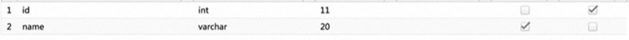

You can run the following SQL statements in MaxCompute to query the full data of the jiangliu_test table at the 1476263486 time:

```text
insert overwrite table jiangliu_test_1476263486
select id,
       name
  from(
select row_number() over(partition by t.id
 order by record_id desc, after_flag desc) as row_number, record_id, operation_flag, after_flag, id, name
  from(
select incr.record_id, incr.operation_flag, incr.after_flag, incr.id, incr.name
  from jiangliu_test_20161010_log incr
 where utc_timestamp< 1476263486
 union all
select 0 as record_id, 'I' as operation_flag, 'Y' as after_flag, base.id, base.name
  from jiangliu_test_20161010_base base) t) gt
 where gt.row_number= 1
   and gt.after_flag= 'Y' ;
```

You can also use DataWorks to add full data merging nodes before you perform further computing and analysis. After full data is merged, downstream computing and analysis nodes can be automatically triggered. You can set an interval for periodic offline data analysis.

At this time, a data synchronization task is configured for synchronizing data from an ApsaraDB RDS for MySQL instance to a MaxCompute project in real time and the full data of tables is merged.

<a id="section-5-5-1-4"></a>

#### 5.5.1.4. Synchronize data from an ApsaraDB RDS for MySQL instance to an AnalyticDB for MySQL V3.0 cluster

AnalyticDB for MySQL V3.0 is a real-time online analytical processing (RT-OLAP) service that is developed by Alibaba Cloud for online data analysis with high concurrency. This topic describes how to synchronize data from an ApsaraDB RDS for MySQL instance to an AnalyticDB for MySQL V3.0 cluster by using Data Transmission Service (DTS). After you synchronize data, you can use AnalyticDB for MySQL V3.0 to build internal business intelligence (BI) systems, interactive query systems, and real-time report systems.

**Prerequisites**

- The tables that you want to synchronize from the ApsaraDB RDS for MySQL instance contain primary keys.

- The destination AnalyticDB for MySQL V3.0 cluster has sufficient storage space.

**Limits**

| Category | Description |
| --- | --- |
| Limits on the source database | • The tables to be synchronized must have PRIMARY KEY or UNIQUE constraints, and all fields must be unique. Otherwise, the destination database may contain duplicate data records.<br>• The following requirements for binary logs must be met:<br>• The binary logging feature is enabled. The binlog_format parameter is set to row.The binlog_row_image parameter is set to full. Otherwise, error messages are returned during the precheck and the data synchronization task cannot be started.<br>• Binary logs are retained for at least seven days during initial full data synchronization. You can wait until initial full data synchronization is complete, and then clear the binary logs generated in the source database after the DTS task is run.<br>Note To ensure data security, DTS stores up to 50 GB of binary logs that are generated within the last 24 hours. If the limit is exceeded, DTS automatically clears the cached logs.<br>Warning If you clear the binary logs of the source database during initial full data synchronization, the data synchronization task may fail. For example, initial full data synchronization takes more than 24 hours due to a large amount of data in the source database and abnormal writing in the destination database. In this case, if the binary logs of the source database are cleared during initial full data synchronization, DTS cannot obtain the binary logs generated 24 hours ago and the data synchronization task may fail. |
| Other limits | • Prefix indexes cannot be synchronized. If the source database contains prefix indexes, data may fail to be synchronized.<br>• Due to the limits of AnalyticDB for MySQL V3.0, if the disk space usage of nodes in an AnalyticDB for MySQL V3.0 cluster exceeds 80%, the data synchronization task is delayed and an error is returned. We recommend that you estimate the required disk space based on the objects to be synchronized. You must make sure that the destination cluster has sufficient storage space.<br>• Before you synchronize data, evaluate the impact of data synchronization on the performance of the source and destination databases. We recommend that you synchronize data during off-peak hours. During initial full data synchronization, DTS uses the read and write resources of the source and destination databases. This may increase the loads on the database servers.<br>• During initial full data synchronization, concurrent INSERT operations cause fragmentation in the tables of the destination database. After the initial full data synchronization is complete, the size of used tablespace of the destination database is larger than that of the source database.<br>• We recommend that you do not use tools such as gh-ost or pt-online-schema-change to perform DDL operations on source tables during data synchronization. Otherwise, data synchronization may fail.<br>• If you use only DTS to write data to the destination database, you can use Data Management (DMS) to perform online DDL operations on source tables during data synchronization.<br>Warning If you use tools other than DTS to write data to the destination database, we recommend that you do not use DMS to perform online DDL operations. Otherwise, data loss may occur in the destination database. |

**SQL operations that can be synchronized**

- DDL operations: CREATE TABLE, DROP TABLE, RENAME TABLE, TRUNCATE TABLE, ADD COLUMN, and DROP COLUMN

- DML operations: INSERT, UPDATE, and DELETE

> **Note**
>
> We recommend that you do not change the data type of fields in the source
>
> table during data synchronization. Otherwise, DTS generates an error message and stops the data synchronization task.

**Data type mappings**

The data types of ApsaraDB RDS for MySQL and AnalyticDB for MySQL do not have one-to-one correspondence. During initial schema synchronization, DTS converts the data types of the source database into those of the destination database. The following table describes the data types that DTS can convert.

| Data type of ApsaraDB RDS for MySQL | Data type of AnalyticDB for MySQL V3.0 |
| --- | --- |
| BIGINT UNSIGNED | DECIMAL(20,0) |
| BINARY | VARBINARY |
| BIT | VARCHAR |
| BLOB | VARBINARY |
| CHAR | VARCHAR |
| DATE | DATE |
| DATETIME | DATETIME |
| DECIMAL | DECIMAL |
| DOUBLE | DOUBLE |
| ENUM | VARCHAR |
| FLOAT | FLOAT |
| GEOMETRY | VARBINARY |
| GEOMETRYCOLLECTION | VARBINARY |
| INT UNSIGNED | BIGINT |
| INTEGER | INT |
| JSON | JSON |
| LINESTRING | VARBINARY |
| LONGBLOB | VARBINARY |
| LONGTEXT | VARCHAR |
| MEDIUMBLOB | VARBINARY |
| MEDIUMINT | INT |
| MEDIUMINT UNSIGNED | INT |
| MEDIUMTEXT | VARCHAR |
| MULTILINESTRING | VARBINARY |
| MULTIPOINT | VARBINARY |
| MULTIPOLYGON | VARBINARY |
| NUMBERIC | DECIMAL |
| POINT | VARBINARY |
| POLYGON | VARBINARY |
| SET | VARCHAR |
| SMALLINT UNSIGNED | INT |
| TEXT | VARCHAR |
| TIME | TIME |
| TIMESTAMP | TIMESTAMP |
| TINYBLOB | VARBINARY |
| TINYINT UNSIGNED | SMALLINT |
| TINYTEXT | VARCHAR |
| VARBINARY | VARBINARY |
| VARCHAR | VARCHAR |
| YEAR | INT |

**Procedure**

1. Create a data synchronization instance.

   > **Note**
   >
   > When you create a data synchronization instance, select **MySQL** as the
   >
   > source database type, **AnalyticDB MySQL 3.0** as the destination database type, and **One-way Synchronization** as the synchronization topology.

2. On the Data Synchronization page, find the data synchronization task that you created and click **Configure Task** in the Actions column.

3. Configure the source and destination databases.

   **Section**

   **Parameter**

   **Description**

   The task name that DTS automatically generates. We recommend that you specify a descriptive name that makes it

   N/A

   **Task Name**

   easy to identify the task. You do not need to specify a unique task name.

   **Database**

   The type of the source database. Select **MySQL**.

   **Type**

   **Access**

   The access method of the source database. Select **Alibaba**

   **Method**

   **Cloud Instance**.

   The region in which the source database resides. The region is

   **Instance**

   the source region that you selected when you created the data

   **Region**

   synchronization instance. You cannot change the value of this parameter.

   **Replicate Data Across**

   Specifies whether to synchronize data across Alibaba Cloud

   **Alibaba**

   accounts. In this example, **No** is selected.

   **Cloud Accounts**

   **Source**

   **RDS Instance**

   **Database**

   The ID of the source ApsaraDB RDS for MySQL instance.

   **ID**

   The database account of the source ApsaraDB RDS for MySQL instance. The account must have the SELECT permission on the objects to be synchronized and the REPLICATION CLIENT, REPLICATION SLAVE, and SHOW VIEW permissions.

   **Database Account**

   > **Note**
   >
   > If the database engine of the source ApsaraDB
   >
   > RDS for MySQL instance. is **MySQL 5.5** or **MySQL 5.6**, you do not need to configure the **Database Account** and **Database Password** parameters.

   **Database**

   The password of the database account.

   **Password**

   The encryption method for the connection of the source database. If you select **SSL-encrypted**, you must enable SSL

   **Encryption**

   encryption for the ApsaraDB RDS for MySQL instance before you configure the data synchronization task.

   **Database**

   The type of the destination database. Select **AnalyticDB for**

   **Type**

   **MySQL 3.0**.

   **Access**

   The access method of the destination database. Select **Alibaba**

   **Method**

   **Cloud Instance**.

   The region in which the destination database resides. The region

   **Instance**

   is the destination region that you selected when you created the

   **Region**

   data synchronization instance. You cannot change the value of

   **Destination**

   this parameter.

   **Database**

   **Instance ID**

   The ID of the destination AnalyticDB for MySQL V3.0 cluster.

   The database account of the destination AnalyticDB for MySQL

   **Database**

   V3.0 cluster. The account must have the read and write

   **Account**

   permissions on the destination database.

   **Database**

   The password of the database account.

   **Password**

4. In the lower part of the page, click **Test Connectivity and Proceed**.

5. Configure the synchronization policy and the objects to be synchronized.

   | Parameter | Description |
   | --- | --- |
   | Task Stages | By default, <strong>Incremental Data Synchronization</strong> is selected. You must also select <strong>Schema Synchronization</strong> and <strong>Full Data Synchronization</strong>. After the precheck is complete, DTS synchronizes the historical data of selected objects from the source instance to the destination instance. The historical data is the basis for subsequent incremental synchronization. |
   | Processing Mode of Conflicting Tables | • <strong>Precheck and Report Errors</strong>: checks whether the destination database contains tables that have the same names as tables in the source database.If the source and destination databases do not contain tables that have identical table names, the precheck is passed. Otherwise, an error is returned during the precheck and the data synchronization task cannot be started.<br>• <strong>Ignore Errors and Proceed</strong>: skips the precheck for identical table names in the source and destination databases.<br>Warning<br>If you select <strong>Ignore Errors and Proceed</strong>, data inconsistency may occur between the source and destination databases, and your business may be exposed to potential risks.<br>• If the source and destination databases have the same schema, DTS does not synchronize the data records that have the same primary keys as the data records in the destination database during initial full data synchronization. However, DTS synchronizes these data records during incremental data synchronization.<br>• If the source and destination databases have different schemas, initial data synchronization may fail. In this case, only specific columns are synchronized, or the data synchronization task fails. |

   <table>
     <tr>
       <td>Merge Tables</td>
       <td>• Specifies whether to merge tables. If you select <strong>Yes</strong>, DTS adds the <code> __dts_data_source </code> column to each table to store data sources. In this case, DDL operations cannot be synchronized.<br>• If you select <strong>No</strong>, DDL operations can be synchronized. By default, No is selected.<br>Important<br>• If you set this parameter to Yes, all the selected source tables in the task are merged into a destination table. If you want to merge only specific source tables, you can create two data synchronization tasks.<br>• If you enable the multi-table merging feature for an incremental data synchronization task, DDL operations are not supported to be synchronized. If you perform DDL operations on the source database, data loss occurs in the destination database or the task fails.</td>
     </tr>
     <tr>
       <td>Source Objects</td>
       <td>Select objects (tables or a database) from the <strong>Source Objects</strong> section and<br>click theicon to move the objects to the <strong>Selected Objects</strong> section.<br>Note Only the INSERT, UPDATE, DELETE, and ADD COLUMN operations can be synchronized.</td>
     </tr>
     <tr>
       <td>Selected Objects</td>
       <td>By default, after an object is synchronized to the destination database, the name of the object remains unchanged. You can use the object name mapping feature to change the names of the objects that are synchronized to the destination instance. For more information, see Rename an object to be synchronized.<br>Note<br>• If you use the multi-table merging feature to merge source tables, you must change the table names to the names of tables to be synchronized in the destination database.<br>• If you use the object name mapping feature to rename an object, other objects that are dependent on the object may fail to be synchronized.</td>
     </tr>
   </table>

6. Click **Next: Advanced Settings**.

   | Parameter | Description |
   | --- | --- |

   <table>
     <tr>
       <td>Retry Time for Failed Connection</td>
       <td>The retry time range for failed connections. If the source or destination database fails to be connected after the data synchronization task is started, DTS immediately retries a connection within the time range. Valid values: 10 to 1440. Unit: minutes. Default value: 720. We recommend that you set the parameter to a value greater than 30. If DTS reconnects to the source and destination databases within the specified time range, DTS resumes the data synchronization task. Otherwise, the data synchronization task fails.<br>Note<br>If you set different retry time ranges for multiple data synchronization tasks that have the same source or destination database, the shortest retry time range that is set takes precedence.</td>
     </tr>
     <tr>
       <td>Configure ETL</td>
       <td>Specifies whether to configure the extract, transform, and load (ETL) feature.<br>• <strong>Yes</strong>: configures the ETL feature. You can enter data processing statements in the code editor. For more information, see Configure ETL in a synchronization task.<br>• <strong>No</strong>: does not configure the ETL feature.</td>
     </tr>
   </table>

7. <strong>Optional:</strong>Click **Next: Configure Database and Table Fields** and specify a type for the tables that you want to synchronize to the destination database.

   > **Note**
   >
   > If you select **Schema Synchronization**, you must specify the **type**,
   >
   > **primary key column**, and **distribution key** for the tables that you want to synchronize to the destination AnalyticDB for MySQL cluster.

8. In the lower part of the page, click **Next: Precheck and Start Task**.

   > **Important**
   >
   > - Before you can start the data synchronization task, a precheck is performed. You can start the data synchronization task only after the task passes the precheck.
   >
   > - If the task fails to pass the precheck, click **View Details** next to each failed item. After you troubleshoot the issues based on the causes, run a precheck again.

9. Wait until the success rate becomes 100%. Then, click **Back**.

<a id="section-5-5-1-5"></a>

#### 5.5.1.5. Synchronize data from an ApsaraDB RDS for MySQL instance to an AnalyticDB for PostgreSQL instance

This topic describes how to synchronize data from an ApsaraDB RDS for MySQL instance to an AnalyticDB for PostgreSQL instance by using Data Transmission Service (DTS). The data synchronization feature allows you to transfer and analyze data with ease.

**Prerequisites Prerequisites**

- The tables that you want to synchronize from the source database contain primary keys.

- The destination AnalyticDB for PostgreSQL instance is created.

**Usage notes**

| Category | Description |
| --- | --- |
| Limits on the source database | • The tables to be synchronized must have PRIMARY KEY or UNIQUE constraints and all fields must be unique. Otherwise, the destination database may contain duplicate data records.<br>• The following requirements for binary logs must be met:<br>• The binary logging feature is enabled. The binlog_format parameter is set to row.The binlog_row_image parameter is set to full. Otherwise, error messages are returned during the precheck, and the data synchronization task cannot be started.<br>• Binary logs are retained for at least seven days during initial full data synchronization. You can wait until initial full data synchronization is complete, and then clear the binary logs generated in the source database after the DTS task is run.<br>Note<br>To ensure data security, DTS stores up to 50 GB of binary logs that are generated within the last 24 hours. If the limit is exceeded, DTS automatically clears the cached logs.<br>Warning<br>If you clear the binary logs of the source database during initial full data synchronization, the data synchronization task may fail. For example, initial full data synchronization takes more than 24 hours due to a large amount of data in the source database and abnormal writing in the destination database. In this case, if the binary logs of the source database are cleared during initial full data synchronization, DTS cannot obtain the binary logs generated 24 hours ago and the data synchronization task may fail. |

<table>
  <tr>
    <td>Other limits</td>
    <td>• Requirements for the objects to synchronize:<br>• Only tables can be selected as objects to be synchronized.<br>• DTS does not synchronize the following types of data: BIT, VARBIT, GEOMETRY, ARRAY, UUID, TSQUERY, TSVECTOR, and TXID_SNAPSHOT.<br>• Prefix indexes cannot be synchronized. If the source database contains prefix indexes, the data synchronization task may fail.<br>• DTS does not synchronize the schemas of the objects to be synchronized from the source database to the destination database. You must create a database, schema, or table in the destination AnalyticDB for PostgreSQL instance based on the data structure of the source instance.<br>• Before you synchronize data, evaluate the impact of data synchronization on the performance of the source and destination databases. We recommend that you synchronize data during off-peak hours. During initial full data synchronization, DTS uses the read and write resources of the source and destination databases. This may increase the load on the database servers.<br>• During initial full data synchronization, concurrent INSERT operations cause fragmentation in the tables of the destination database. After initial full data synchronization is complete, the size of the used tablespace of the destination database is larger than that of the source database.<br>• We recommend that you do not use tools such as gh-ost or pt-online-schema-change to perform DDL operations on source tables during data synchronization. Otherwise, data synchronization may fail.<br>• If you use only DTS to write data to the destination database, you can use Data Management (DMS) to perform online DDL operations on source tables during data synchronization.<br>Warning<br>Do not use DMS to execute online DDL statements while data from other sources is written to the destination database. Otherwise, data loss may occur in the destination database.</td>
  </tr>
</table>

**SQL operations that can be synchronized**

- DML operations: INSERT, UPDATE, and DELETE

- DDL operations: ALTER TABLE, ADD COLUMN, DROP COLUMN, and RENAME COLUMN

  > **Note**
  >
  > The CREATE TABLE and DROP TABLE operations are not supported. To synchronize data from a new table, you must add the table to the selected objects. For more information, see Add an object to a data synchronization task.

**Term mapping**

| Term in ApsaraDB RDS for MySQL | Term in AnalyticDB for PostgreSQL |
| --- | --- |
| Database | Schema |
| Table | Table |

**Create a data structure in the destination instance**

You must create a database, schema, or table in the destination AnalyticDB for PostgreSQL instance based on the data structure of the source ApsaraDB RDS for MySQL instance.

**Configure a data synchronization task**

1. Create a data synchronization task.

   > **Note**
   >
   > When you create the data synchronization task, select **MySQL** as the source database type, **AnalyticDB for PostgreSQL** as the destination database type, and **One-way Synchronization** as the synchronization topology.

2. On the Data Synchronization page, find the data synchronization task that you created and click **Configure Task** in the Actions column.

3. Configure the source and destination instances.

   **Category**

   **Parameter**

   **Description**

   The task name that DTS automatically generates. We recommend that you specify a

   Synchronization Task

   None

   descriptive name that makes it easy to identify

   Name

   the task. You do not need to specify a unique task name.

   **Database Type**

   The type of the source instance. Select **MySQL**.

   The access method of the source database.

   **Access Method**

   Select **Alibaba Cloud Instance**.

   The region in which the source ApsaraDB RDS

   **Instance Region**

   for MySQL instance resides.

   **Replicate Data**

   Specifies whether to synchronize data across

   **Across Alibaba**

   Alibaba Cloud accounts. In this example, **No** is

   **Cloud Accounts**

   selected.

   The ID of the source ApsaraDB RDS for MySQL

   **RDS Instance ID**

   instance.

   The database account of the source ApsaraDB RDS for MySQL instance. The account must have the SELECT permission on the objects to be synchronized and the REPLICATION CLIENT,

   **Source Database**

   REPLICATION SLAVE, and SHOW VIEW permissions.

   **Database Account**

   > **Note**
   >
   > If the source ApsaraDB RDS for MySQL instance runs **MySQL 5.5** or **MySQL 5.6**, you do not need to configure the **Database Account** and **Database Password** parameters.

   **Database Password**

   The password of the database account.

   Specifies whether to encrypt the connection to the database. You can select **Non-encrypted** or **SSL-encrypted** based on your business requirements.

   > **Note**

   **Encryption**

   > If you select **SSL-encrypted**, you must enable SSL encryption for the source ApsaraDB RDS for MySQL instance before you configure the data synchronization task.

   The database type of the destination database.

   **Database Type**

   Select **AnalyticDB for PostgreSQL**.

   The access method of the destination database.

   **Access Method**

   Select **Alibaba Cloud Instance**.

   The region in which the destination instance

   **Instance Region**

   resides.

   The ID of the destination AnalyticDB for

   **Instance ID**

   PostgreSQL instance.

   **Database Name**

   The name of the destination database.

   **Destination Database**

   The database account of the destination AnalyticDB for PostgreSQL instance.

   > **Note**

   **Database Account**

   > The database account must have the SELECT, INSERT, UPDATE, DELETE, COPY, TRUNCATE, and ALTER TABLE permissions.

   **Database Password**

   The password of the database account.

4. In the lower part of the page, click **Test Connectivity and Proceed**.

5. Configure the synchronization policy and the objects to be synchronized. The following table describes the parameters.

   | Parameter | Description |
   | --- | --- |
   | Task Stages | By default, <strong>Incremental Data Synchronization</strong> is selected. You must also select <strong>Schema Synchronization</strong> and <strong>Full Data</strong> <strong>Synchronization</strong>. After the precheck is complete, DTS synchronizes the historical data of selected objects from the source instance to the destination instance. The historical data is the basis for subsequent incremental synchronization. |
   | Processing Mode of Conflicting Tables | • <strong>Precheck and Report Errors</strong>: checks whether the destination database contains tables that use the same names as tables in the source database. If the source and destination databases do not contain tables that have identical table names, the precheck is passed. Otherwise, an error is returned during the precheck, and the data migration task cannot be started.<br>• <strong>Clear Destination Table</strong>: skips the precheck for empty destination tables and clears the data in destination tables before initial full data synchronization.<br>• <strong>Ignore Errors and Proceed</strong>: skips the precheck for identical table names in the source and destination databases.<br>Warning<br>If you select <strong>Ignore Errors and Proceed</strong>, data inconsistency may occur, and your business may be exposed to potential risks.<br>• If the source and destination databases have the same schemas, DTS does not migrate data records that have the same primary key values as data records in the destination database.<br>• If the source and destination databases have different schemas, only specific columns may be migrated, or the data migration task may fail. |
   | DDL and DML Operations to Be Synchronized | The SQL operations to be synchronized during incremental data migration at the instance level.<br>Note<br>To select the SQL operations performed on a specific database or table, perform the following steps: In the <strong>Selected Objects</strong> section, right-click an object. In the dialog box that appears, select the SQL operations that you want to synchronize. |
   | Source Objects | Select objects (tables) from the <strong>Source Objects</strong> section and click<br>theicon to move the objects to the <strong>Selected Objects</strong> section.<br>Note<br>The CREATE TABLE operation is not supported. To synchronize data from a new table, you must add the table to the selected objects. For more information, see Add an object to a data synchronization task. |
   | Selected Objects | By default, after an object is synchronized to the destination database, the name of the object remains unchanged. You can use the object name mapping feature to change the names of the objects that are synchronized to the destination instance. For more information, see Rename an object to be synchronized. |

6. Click **Next: Advanced Settings** to configure advanced settings. The following table describes the parameters.

   | Parameter | Description |
   | --- | --- |
   | Retry Time for Failed Connection | The retry time range for failed connections. If the source or destination database fails to be connected after the data synchronization task is started, an error is returned. For predictable errors, DTS immediately retries a connection within the time range. Valid values: 10 to 1440. Unit: minutes. Default value: 720. We recommend that you set the parameter to a value greater than 30. If DTS reconnects to the source and destination databases within the specified retry time range, DTS resumes the data synchronization task. Otherwise, the data synchronization task fails.<br>Note<br>If you set different retry time ranges for multiple data synchronization tasks that have the same source or destination database, the shortest retry time range that is set takes precedence. |
   | Configure ETL | Specifies whether to configure the extract, transform, and load (ETL) feature. Valid values:<br>• <strong>Yes</strong>: enables the ETL feature. You can enter data processing statements in the code editor.<br>• <strong>No</strong>: disables the ETL feature. |

7. **(Optional)** Click **Next: Configure Database and Table Fields**. Configure the tables that you want to synchronize to the destination database.

   > **Note**
   >
   > If you select **Schema Synchronization**, you must specify the **type**, **primary key column**, and **distribution key** information for the tables that you want to migrate to the AnalyticDB for PostgreSQL instance.

8. In the lower part of the page, click **Next: Precheck and Start Task**.

   > **Important**
   >
   > - Before you can start the data synchronization task, a precheck is performed. You can start the data synchronization task only after the task passes the precheck.
   >
   > - If the task fails to pass the precheck, click **View Details** next to each failed item. After you troubleshoot the issues based on the causes, run a precheck again.

9. Wait until the success rate becomes 100%. Then, click **Back**.

<a id="section-5-5-1-6"></a>

#### 5.5.1.6. Synchronize data from an ApsaraDB RDS for MySQL instance to a PolarDB for MySQL cluster

Data Transmission Service (DTS) allows you to synchronize data from an ApsaraDB RDS for MySQL instance or a self-managed MySQL database to a PolarDB for MySQL cluster that uses a local disk or a shared storage. This topic describes how to synchronize data from an ApsaraDB RDS for MySQL instance to a local disk-based PolarDB for MySQL cluster that can be accessed over public endpoints by using DTS.

**Prerequisites**

- The destination local disk-based PolarDB for MySQL cluster is created. The destination cluster is of High-availability Edition and its available storage space is larger than the total size of data in the source ApsaraDB RDS for MySQL instance.

- The destination local disk-based PolarDB for MySQL cluster can be accessed over public endpoints.

**Usage notes**

| Category | Description |
| --- | --- |
| Limits on the source instance | • The tables to be synchronized must have PRIMARY KEY or UNIQUE constraints and all fields must be unique. Otherwise, the destination database may contain duplicate data records.<br>• The following requirements for binary logs must be met:<br>• The binary logging feature is enabled. The binlog_format parameter is set to row. The binlog_row_image parameter is set to full. Otherwise, error messages are returned during the precheck and the data synchronization task cannot be started.<br>• Binary logs are retained for at least seven days during initial full data synchronization. You can wait until initial full data synchronization is complete, and then clear the binary logs generated in the source database after the DTS task is run.<br>Note<br>To ensure data security, DTS stores up to 50 GB of binary logs that are generated within the last 24 hours. If the limit is exceeded, DTS automatically clears the cached logs.<br>Warning<br>If you clear the binary logs of the source database during initial full data synchronization, the data synchronization task may fail. For example, initial full data synchronization takes more than 24 hours due to a large amount of data in the source database and abnormal writing in the destination database. In this case, if the binary logs of the source database are cleared during initial full data synchronization, DTS cannot obtain the binary logs generated 24 hours ago and the data synchronization task may fail.<br>• During schema synchronization and full data synchronization, do not execute DDL statements to change the schemas of databases or tables. Otherwise, the data synchronization task fails. |

<table>
  <tr>
    <td>Other limits</td>
    <td>• You cannot use a read-only instance as the destination database.<br>• To ensure compatibility, the version of the destination database must be the same as or later than that of the source database. If the version of the destination database is earlier than that of the source database, database compatibility issues may occur.<br>• During full data synchronization, DTS uses the read and write resources of the source and destination databases. This may increase the loads of the database servers. Before you synchronize data, assess the impact of data synchronization on the performance of the source and destination databases.We recommend that you synchronize data during off-peak hours, such as when the CPU usage of the source and destination databases is lower than 30%.<br>• During initial full data synchronization, concurrent INSERT operations cause table fragmentation in the destination database. Therefore, after initial full data synchronization is complete, the size of the used tablespace of the destination database is larger than that of the source database.<br>• If you select one or more tables instead of an entire database as the objects to be synchronized, do not use tools such as pt-online-schema-change to perform online DDL operations on the tables during data synchronization. Otherwise, the data synchronization task fails.<br>• Data inconsistency between the source and destination databases occurs if data from other sources is written to the destination database during the data synchronization. For example, if you use Data Management (DMS) to execute online DDL statements while data from other sources is written to the destination database, data loss may occur in the destination database.<br>• You cannot convert data from the DATETIME type to the VARCHAR type.</td>
  </tr>
</table>

**SQL operations that support incremental synchronization**

DML operations: INSERT, UPDATE, and DELETE

**Procedure**

1. Create a data synchronization instance.

   > **Note**
   >
   > When you create the data synchronization instance, select **MySQL** as the source database type, **PolarDB for MySQL** as the destination database type, and **One-way Synchronization** as the synchronization topology.

2. On the Data Synchronization page, find the data synchronization task that you created and click **Configure Task** in the Actions column.

3. Configure the source and destination databases

   | Section | Parameter | Description |
   | --- | --- | --- |
   | N/A | Task Name | The task name that DTS automatically generates. We recommend that you specify a descriptive name that makes it easy to identify the task. You do not need to specify a unique task name. |

   **Database**

   The type of the source instance. Select **MySQL**.

   **Type**

   **Access**

   The access method of the source database. Select **Alibaba**

   **Method**

   **Cloud Instance**.

   The region in which the destination database resides. The region

   **Instance**

   is the destination region that you selected when you created the

   **Region**

   data synchronization instance. You cannot change the value of this parameter.

   **Replicate Data Across Alibaba Cloud**

   Specifies whether to synchronize data across Alibaba Cloud

   **Accounts**

   accounts. In this example, **No** is selected.

   **Source**

   **Instance ID**

   The ID of the source ApsaraDB RDS for MySQL instance.

   **Database**

   The database account of the source ApsaraDB RDS for MySQL instance. The account must have the SELECT permission on the objects to be synchronized and the REPLICATION CLIENT, REPLICATION SLAVE, and SHOW VIEW permissions.

   **Database**

   > **Note**

   **Account**

   > If the source ApsaraDB RDS for MySQL instance runs **MySQL 5.5** or **MySQL 5.6**, you do not need to configure the **Database Account** and **Database Password** parameters.

   **Database**

   The password that is used to access the database instance.

   **Password**

   The encryption method for the connection of the destination database. If you select **SSL-encrypted**, you must enable SSL

   **Encryption**

   encryption for the ApsaraDB RDS for MySQL instance before you configure the data synchronization task.

   **Database**

   The type of the destination database. Select **PolarDB for**

   **Type**

   **MySQL**.

   The access method of the destination database. Select **Public**

   **Access**

   **IP Address**.

   **Method**

   The region in which the destination database resides. The region is the destination region that you selected when you created the data synchronization instance. You cannot change the value of

   **Instance**

   this parameter.

   **Region**

   **Destination Database**

   Enter the value of **Vip** or **Public Endpoint** displayed on the

   **Hostname or**

   details page of the destination local disk-based PolarDB for

   **IP address**

   MySQL cluster.

   Enter the value of **Public Port** displayed on the details page of

   **Port Number**

   the destination local disk-based PolarDB for MySQL cluster.

   The database account of the destination local disk-based

   **Database**

   PolarDB for MySQL cluster. The account must have the read and

   **Account**

   write permissions on the destination database.

   **Database**

   The password that is used to access the database instance.

   **Password**

4. In the lower part of the page, click **Test Connectivity and Proceed**.

5. If an IP address whitelist is configured for your local disk-based PolarDB for MySQL cluster, you must add the CIDR blocks of DTS servers to the whitelist. Then, click **Test Connectivity and Proceed**.

   > **Note**
   >
   > If no whitelist is configured for your local disk-based PolarDB for MySQL cluster, ignore the whitelist settings and click **Test Connectivity and Proceed**.

6. Select the synchronization policy and the objects to be synchronized.

   | Parameter | Description |
   | --- | --- |
   | Task Stages | By default, <strong>Incremental Data Synchronization</strong> is selected. You must also select <strong>Schema Synchronization</strong> and <strong>Full Data Synchronization</strong>. After the precheck is complete, DTS synchronizes the historical data of selected objects from the source instance to the destination instance. The historical data is the basis for subsequent incremental synchronization. |
   | Processing Mode of Conflicting Tables | • <strong>Precheck and Report Errors</strong>: checks whether the destination database contains tables that have the same names as tables in the source database.If the source and destination databases do not contain tables that have identical table names, the precheck is passed. Otherwise, an error is returned during the precheck and the data synchronization task cannot be started.<br>• <strong>Ignore Errors and Proceed</strong>: skips the precheck for identical table names in the source and destination databases.<br>Warning<br>If you select <strong>Ignore Errors and Proceed</strong>, data inconsistency may occur between the source and destination databases, and your business may be exposed to potential risks.<br>• If the source and destination databases have the same schema, DTS does not synchronize the data records that have the same primary keys as the data records in the destination database during initial full data synchronization. However, DTS synchronizes these data records during incremental data synchronization.<br>• If the source and destination databases have different schemas, initial data synchronization may fail. In this case, only specific columns are synchronized, or the data synchronization task fails. |
   | Synchronization Topology | The synchronization topology of the data synchronization task. Select <strong>One-</strong><strong>way Synchronization</strong>.<br>Important<br>Two-way synchronization is not supported. |
   | Capitalization of Object Names in Destination Instance | Specify the capitalization of database names, table names, and column names in the destination instance. By default, <strong>DTS default policy</strong> is selected. You can select other options to make sure that the capitalization of object names is consistent with that in the source or destination database. For more information, see Specify the capitalization of object names in the destination instance. |
   | Source Objects | Select objects (tables or a database) from the <strong>Source Objects</strong> section and<br>click theicon to move the objects to the <strong>Selected Objects</strong> section.<br>Note<br>• You can use the navigation tree to search for one or more objects.<br>• You can select columns, tables, or databases as the objects to be synchronized. |
   | Selected Objects | By default, after an object is synchronized to the destination database, the name of the object remains unchanged. You can use the object name mapping feature to change the names of the objects that are synchronized to the destination instance. For more information, see Rename an object to be synchronized.<br>Note<br>• To synchronize SQL operations that are performed on a specific database or table, right-click an object in the <strong>Selected Objects</strong> section. In the dialog box that appears, select the SQL operations that you want to synchronize.<br>• To specify WHERE clauses to filter data, right-click a table in the <strong>Selected Objects</strong> section. In the dialog box that appears, specify the filter conditions.<br>• If you use the object name mapping feature to rename an object, other objects that are dependent on the object may fail to be synchronized. |

7. Click **Next: Advanced Settings** to configure advanced settings.

   | Parameter | Description |
   | --- | --- |
   | Select the engine type of the destination database | The engine type of the destination database. Select <strong>InnoDB</strong> or <strong>X-Engine</strong> based on your business requirements. |
   | Retry Time for Failed Connections | The retry time range for failed connections. If the source or destination database fails to be connected after the data synchronization task is started, an error is returned. For predictable errors, DTS immediately retries a connection within the time range. Valid values: 10 to 1440. Unit: minutes. Default value: 720. We recommend that you set the parameter to a value greater than 30. If DTS reconnects to the source and destination databases within the specified retry time range, DTS resumes the data synchronization task. Otherwise, the data synchronization task fails.<br>Note<br>If you specify different retry time ranges for multiple data synchronization tasks that have the same source or destination database, the shortest retry time range takes precedence. |

8. In the lower part of the page, click **Next: Precheck and Start Task**.

   > **Important**
   >
   > - Before you can start the data synchronization task, a precheck is performed. You can start the data synchronization task only after the task passes the precheck.
   >
   > - If the task fails to pass the precheck, click **View Details** next to each failed item. After you troubleshoot the issues based on the causes, run a precheck again.

9. Wait until the success rate becomes 100%. Then, click **Back**.

<a id="section-5-5-1-7"></a>

#### 5.5.1.7. Synchronize data from an ApsaraDB RDS for MySQL instance to a PolarDB-X 2.0 instance

Data Transmission Service (DTS) allows you to synchronize data from an ApsaraDB RDS for MySQL instance or a self-managed MySQL instance to a PolarDB-X 2.0 instance. This topic describes how to synchronize data from an ApsaraDB RDS for MySQL instance to a PolarDB-X 2.0 instance by using DTS.

**Prerequisites**

The destination PolarDB-X 2.0 instance that is compatible with MySQL 5.7 is created. The available storage space of the destination database is larger than the total size of data in the source ApsaraDB RDS for MySQL database.

**Limits**

| Category | Description |
| --- | --- |

<table>
  <tr>
    <td>Limits on the source instance</td>
    <td>• The tables to be synchronized must have PRIMARY KEY or UNIQUE constraints and all fields must be unique. Otherwise, the destination database may contain duplicate data records.<br>• The following requirements for binary logs must be met:<br>• The binary logging feature is enabled. The binlog_format parameter is set to row. The binlog_row_image parameter is set to full. Otherwise, error messages are returned during the precheck and the data synchronization task cannot be started.<br>• Binary logs are retained for at least seven days during initial full data synchronization. You can wait until initial full data migration is complete, and then clear the binary logs generated in the source database after the DTS task is run.<br>Note<br>To ensure data security, DTS stores up to 50 GB of binary logs that are generated within the last 24 hours. If the limit is exceeded, DTS automatically clears the cached logs.<br>Warning<br>If you clear the binary logs of the source database during initial full data synchronization, the data synchronization task may fail. For example, initial full data synchronization takes more than 24 hours due to a large amount of data in the source database and abnormal writing in the destination database. In this case, if the binary logs of the source database are cleared during initial full data synchronization, DTS cannot obtain the binary logs generated 24 hours ago and the data synchronization task may fail.<br>• During schema synchronization and full data synchronization, do not execute DDL statements to change the schemas of databases or tables. Otherwise, the data synchronization task fails.<br>• Requirements for the objects to be synchronized:<br>• DTS does not synchronize the following types of data: BIT, VARBIT, GEOMETRY, ARRAY, UUID, TSQUERY, TSVECTOR, and TXID_SNAPSHOT.<br>• Prefix indexes cannot be synchronized. If the source database contains prefix indexes, the data synchronization task may fail.</td>
  </tr>
  <tr>
    <td>Other limits</td>
    <td>• During full data synchronization, DTS uses the read and write resources of the source and destination databases. This may increase the loads of the database servers. Before you synchronize data, assess the impact of data synchronization on the performance of the source and destination databases.We recommend that you synchronize data during off-peak hours, such as when the CPU usage of the source and destination databases is lower than 30%.<br>• During initial full data synchronization, concurrent INSERT operations cause table fragmentation in the destination database. Therefore, after initial full data synchronization is complete, the size of the used tablespace of the destination database is larger than that of the source database.<br>• If you select one or more tables instead of an entire database as the objects to be synchronized, do not use tools such as pt-online-schema-change to perform online DDL operations on the tables during data synchronization. Otherwise, the data synchronization task fails.<br>• Data inconsistency between the source and destination databases may occur if data from other sources is written to the destination database during data synchronization.</td>
  </tr>
  <tr>
    <td>Special cases</td>
    <td>• For a self-managed MySQL source database:<br>• If a primary/secondary switchover occurs in the source database during synchronization, the task fails.<br>• DTS calculates latency by comparing the timestamp of the last synchronized record with the current time. If no DML operations run for a long time in the source database, latency reporting may become inaccurate. If latency appears too high, run a DML operation in the source database to update the latency.<br>Note<br>If you select a full database for synchronization, create a heartbeat table. Update or write to this table every second.<br>• DTS periodically runs the <strong>CREATE DATABASE IF NOT EXISTS `test`</strong> command in the source database to advance the binary log offset.<br>• If your source database is Amazon Aurora MySQL or another clustered MySQL instance, ensure the domain name or IP address used in the task configuration—and its DNS resolution—always points to a read/write (RW) node. Otherwise, synchronization may fail.<br>• For an ApsaraDB RDS for MySQL source database:<br>• Read-only instances—such as ApsaraDB RDS for MySQL 5.6 read-only instances—that do not record transaction logs cannot serve as source databases.<br>• DTS periodically runs the <strong>CREATE DATABASE IF NOT EXISTS `test`</strong> command in the source database to advance the binary log offset.</td>
  </tr>
</table>

**SQL operations that can be incrementally synchronized**

| Operati on type | SQL statement |
| --- | --- |
| DML | INSERT, UPDATE, and DELETE |
| DDL | • ALTER TABLE and ALTER VIEW<br>• CREATE FUNCTION, CREATE INDEX, CREATE PROCEDURE, CREATE TABLE, and CREATE VIEW<br>• DROP INDEX and DROP TABLE<br>• RENAME TABLE<br>Important<br>The RENAME TABLE operation may cause data inconsistency. For example, if the synchronization object is a single table and you rename it on the source instance during synchronization, the data of that table is not synchronized to the destination database. To avoid this issue, you can configure the task to synchronize the entire database that contains the table. Make sure that the database to which the table belongs both before and after the RENAME TABLE operation is included in the synchronization objects.<br>• TRUNCATE TABLE |

**Procedure**

1. Create a data synchronization instance.

   > **Note**
   >
   > When you create the data synchronization instance, select **MySQL** as the **source database type** and **PolarDB-X 2.0** as the **destination database type**.

2. On the Data Synchronization page, find the data synchronization task that you created and click **Configure Task** in the Actions column.

3. Configure the source and destination databases

   **Section**

   **Parameter**

   **Description**

   The task name that DTS automatically generates. We recommend that you specify a descriptive name that makes it

   N/A

   **Task Name**

   easy to identify the task. You do not need to specify a unique task name.

   **Database**

   The type of the source instance. Select **MySQL**.

   **Type**

   **Access**

   The access method of the source database. Select **Alibaba**

   **Method**

   **Cloud Instance**.

   The region in which the destination database resides. The region

   **Instance**

   is the destination region that you selected when you created the

   **Region**

   data synchronization instance. You cannot change the value of this parameter.

   **Replicate Data Across**

   Specifies whether to synchronize data across Alibaba Cloud

   **Alibaba**

   accounts. In this example, **No** is selected.

   **Cloud Accounts**

   **Source**

   **RDS**

   The ID of the source ApsaraDB RDS for MySQL instance.

   **Database**

   **Instance ID**

   The database account of the source ApsaraDB RDS for MySQL instance. The account must have the SELECT permission on the objects to be synchronized and the REPLICATION CLIENT, REPLICATION SLAVE, and SHOW VIEW permissions.

   **Database**

   > **Note**

   **Account**

   > If the source ApsaraDB RDS for MySQL instance runs **MySQL 5.5** or **MySQL 5.6**, you do not need to configure the **Database Account** and **Database Password** parameters.

   **Database**

   The password that is used to access the database instance.

   **Password**

   Configure this parameter based on your business requirements. If you select **SSL-encrypted**, you must enable SSL encryption

   **Encryption**

   for the ApsaraDB RDS for MySQL instance before you configure the data migration task.

   **Database**

   The type of the destination database. Select **PolarDB-X 2.0**.

   **Type**

   **Access**

   The access method of the destination database. Select **Alibaba**

   **Method**

   **Cloud Instance**.

   The region in which the destination database resides. The region

   **Instance**

   is the destination region that you selected when you created the

   **Region**

   data synchronization instance. You cannot change the value of this parameter.

   **Destination Database**

   **Instance ID**

   The ID of the destination PolarDB-X 2.0 instance.

   The database account of the destination PolarDB-X 2.0 instance.

   **Database**

   The account must have the read and write permissions on the

   **Account**

   destination PolarDB-X 2.0 instance.

   **Database**

   The password that is used to access the database instance.

   **Password**

4. In the lower part of the page, click **Test Connectivity and Proceed**.

5. **Optional**: If a whitelist is configured for your self-managed MySQL database, add the CIDR blocks of DTS servers that are displayed in the dialog box to the whitelist. Then, click **Test Connectivity and Proceed**.

6. Select the synchronization policy and the objects to be synchronized.

   | Parameter | Description |
   | --- | --- |
   | Task Stages | By default, <strong>Incremental Data Synchronization</strong> is selected. You must also select <strong>Schema Synchronization</strong> and <strong>Full Data Synchronization</strong>. After the precheck is complete, DTS synchronizes the historical data of selected objects from the source instance to the destination instance. The historical data is the basis for subsequent incremental synchronization. |
   | Processing Mode of Conflicting Tables | • <strong>Precheck and Report Errors</strong>: checks whether the destination database contains tables that have the same names as tables in the source database.If the source and destination databases do not contain tables that have identical table names, the precheck is passed. Otherwise, an error is returned during the precheck and the data synchronization task cannot be started.<br>• <strong>Ignore Errors and Proceed</strong>: skips the precheck for identical table names in the source and destination databases.<br>Warning<br>If you select <strong>Ignore Errors and Proceed</strong>, data inconsistency may occur between the source and destination databases, and your business may be exposed to potential risks.<br>• If the source and destination databases have the same schema, DTS does not synchronize the data records that have the same primary keys as the data records in the destination database during initial full data synchronization. However, DTS synchronizes these data records during incremental data synchronization.<br>• If the source and destination databases have different schemas, initial data synchronization may fail. In this case, only specific columns are synchronized, or the data synchronization task fails. |
   | Capitalization of Object Names in Destination Instance | Specify the capitalization of database names, table names, and column names in the destination instance. By default, <strong>DTS default policy</strong> is selected. You can select other options to make sure that the capitalization of object names is consistent with that in the source or destination database. For more information, see Specify the capitalization of object names in the destination instance. |
   | Source Objects | Select objects (tables or a database) from the <strong>Source Objects</strong> section and<br>click theicon to move the objects to the <strong>Selected Objects</strong> section.<br>Note<br>• You can use the navigation tree to search for one or more objects.<br>• You can select tables or databases as the objects to be synchronized. |
   | Selected Objects | By default, after an object is synchronized to the destination database, the name of the object remains unchanged. You can use the object name mapping feature to change the names of the objects that are synchronized to the destination instance. For more information, see Rename an object to be synchronized.<br>Note<br>• To synchronize SQL operations that are performed on a specific database or table, right-click an object in the <strong>Selected Objects</strong> section. In the dialog box that appears, select the SQL operations that you want to synchronize.<br>• To specify WHERE clauses to filter data, right-click a table in the <strong>Selected Objects</strong> section. In the dialog box that appears, specify the filter conditions.<br>• If you use the object name mapping feature to rename an object, other objects that are dependent on the object may fail to be synchronized. |

7. Click **Next: Advanced Settings** to configure advanced settings. The following table describes the parameters.

   | Parameter | Description |
   | --- | --- |
   | Retry Time for Failed Connections | The retry time range for failed connections. If the source or destination database fails to be connected after the data synchronization task is started, an error is returned. For predictable errors, DTS immediately retries a connection within the time range. Valid values: 10 to 1440. Unit: minutes. Default value: 720. We recommend that you set the parameter to a value greater than 30. If DTS reconnects to the source and destination databases within the specified retry time range, DTS resumes the data synchronization task. Otherwise, the data synchronization task fails.<br>Note<br>If you specify different retry time ranges for multiple data synchronization tasks that have the same source or destination database, the shortest retry time range takes precedence. |

8. In the lower part of the page, click **Next: Precheck and Start Task**.

   > **Important**
   >
   > - Before you can start the data synchronization task, a precheck is performed. You can start the data synchronization task only after the task passes the precheck.
   >
   > - If the task fails to pass the precheck, click **View Details** next to each failed item. After you troubleshoot the issues based on the causes, run a precheck again.

9. Wait until the success rate becomes 100%. Then, click **Back**.

<a id="section-5-5-1-8"></a>

#### 5.5.1.8. Synchronize data from RDS MySQL to DataHub

Alibaba Cloud DataHub is a platform for processing streaming data. It allows you to publish, subscribe to, and distribute streaming data to build analytics and applications. Data Transmission Service (DTS) supports synchronizing data from an RDS MySQL instance to DataHub, enabling real-time data analysis using big data products such as stream computing.

**Prerequisites**

- You have a source RDS MySQL instance.

- You have activated the DataHub service and created a Project to receive the synchronized data.

**Limitations**

> **Note**
>
> DTS does not synchronize foreign keys from the source database to the destination database. Therefore, cascade and delete operations on the source database are not synchronized to the destination database.

| Category | Description |
| --- | --- |

<table>
  <tr>
    <td>Source database limitations</td>
    <td>• The tables to be synchronized must have a primary key or unique constraint. The columns in the constraint must contain unique values. Otherwise, duplicate data may occur in the destination database.<br>• If you select synchronization objects at the table level and need to edit them (for example, by mapping column names), a single data synchronization task supports a maximum of 1,000 tables. If this limit is exceeded, the task submission fails. To work around this, split the tables into multiple tasks or configure the task to synchronize the entire database.<br>• Binlog:<br>• Binlog is enabled by default for RDS MySQL. You must ensure that the <code> binlog_row_image </code> parameter is set to <code> FULL </code>. Otherwise, the precheck fails, and the data synchronization task cannot start.<br>• The local Binlog for an RDS MySQL instance must be retained for at least 3 days (7 days recommended). For a self-managed MySQL database, the local Binlog must be retained for at least 7 days. Otherwise, the task may fail if DTS cannot obtain the Binlog. In extreme cases, this can lead to data inconsistency or data loss. Issues caused by a Binlog retention period shorter than required are not covered by the DTS Service Level Agreement (SLA).<br>• During schema synchronization and full synchronization, do not perform DDL operations. Otherwise, the data synchronization task fails.<br>Note<br>During full synchronization, DTS queries the source database, placing metadata locks that may block DDL operations on the source database.<br>• While the data synchronization instance is running, data changes from operations not recorded in the Binlog (such as physical backup restores or cascading operations) are not synchronized to the destination database.<br>Note<br>If this occurs and your business process allows, you can modify the synchronization objects to remove the affected database or table and then add it back.<br>• If the source database is MySQL 8.0.23 or later and the data to be synchronized contains invisible columns, data loss may occur because DTS cannot retrieve data from these columns.<br>Note<br>You can use the <code> ALTER TABLE &lt;table_name&gt; ALTER COLUMN &lt;column_name&gt; </code> <code>SET VISIBLE; </code> command to make the columns visible. For more information, see Invisible Columns.</td>
  </tr>
  <tr>
    <td>Other limitations</td>
    <td>• The maximum length for a single STRING field in DataHub is 2 MB.<br>• Synchronization of <code> INDEX </code>, <code> PARTITION </code>, <code> VIEW </code>, <code> PROCEDURE </code>, <code> FUNCTION </code>, <code> TRIGGER </code>, and <code> FK </code> is not supported.<br>• If a source table to be synchronized contains a field named <strong>record_id</strong>, we recommend using the field mapping feature to rename the field in the destination instance.Otherwise, the task reports an error.<br>• During DTS synchronization, do not allow any external applications to write data to the destination database. This can cause data inconsistencies between the source and destination databases. For example, if you use DMS to perform an online DDL change while external applications are writing data, data loss may occur in the destination database.<br>• If the Always Encrypted (EncDB) feature is enabled on the RDS MySQL instance, full data synchronization is not supported.<br>Note<br>An RDS MySQL instance with Transparent Data Encryption (TDE) enabled supports schema synchronization, full data synchronization, and incremental data synchronization.</td>
  </tr>
  <tr>
    <td>Special cases</td>
    <td>• RDS MySQL instances that do not record transaction logs, such as read-only instances of RDS MySQL 5.6, cannot serve as a source database.<br>• DTS periodically runs the <strong><code> CREATE DATABASE IF NOT EXISTS `test` </code></strong> command on the source database to advance the Binlog position.</td>
  </tr>
</table>

**Supported synchronization topologies**

- One-to-one, one-way synchronization

- One-to-many, one-way synchronization

- Many-to-one, one-way synchronization

**Supported SQL operations**

| Operation type | SQL operation |
| --- | --- |
| DML | INSERT, UPDATE, DELETE |
| DDL | ADD COLUMN<br>Important<br>If you manually modify the table structure in the destination, you must restart the task by pausing and then resuming it. |

**Procedure**

1. Create a data synchronization instance.

   When you create the instance, select MySQL for the source database and DataHub for the destination database.

2. In the list of synchronization tasks, find the data synchronization instance that you just created and click **Configure Task**.

3. Configure the source and destination database information.

   > **Warning**
   >
   > After you select the source and destination instances, review the **Limits** at the top of the page. Otherwise, the task may fail or data inconsistency may occur.

   **Category**

   **Parameter**

   **Description**

   DTS automatically generates a task name. We recommend that you

   N/A

   **Task Name**

   specify a descriptive name for easy identification. The name does not need to be unique.

   **Database**

   Select **MySQL**.

   **Type**

   **Connection**

   Select **Cloud Instance**.

   **Type**

   **Instance**

   The region is specified when you create the data synchronization

   **Region**

   instance and cannot be changed.

   **Cross-**

   This tutorial uses synchronization within the same Alibaba Cloud

   **account**

   account. Select **No**.

   Source Database

   **RDS Instance**

   Informatio

   Select the instance ID of the source RDS MySQL instance.

   **ID**

   n

   Enter the database account for the source RDS MySQL instance.

   **Database**

   This account must have read permissions on the objects to be

   **Account**

   synchronized.

   **Database Password**

   Enter the password for the specified database account.

   Select **Non-encrypted Connection** or **SSL connection** based on your requirements. If you select **SSL connection**, you must enable SSL encryption on the RDS MySQL instance in advance.

   **Database**

   Select **DataHub**.

   **Type**

   Destinatio n

   **Connection**

   The default value is **Cloud Instance**.

   Database

   **Type**

   Informatio n

   **Instance**

   The region is specified when you create the data synchronization

   **Region**

   instance and cannot be changed.

   **Project**

   Select the target DataHub Project.

4. After you complete the configurations, click **Test Connection and Proceed** at the bottom of the page.

5. Select synchronization objects and types.

   | Parameter | Description |
   | --- | --- |
   | Synchronizatio n Type | DTS always selects <strong>Incremental Data Synchronization</strong>. By default, you must also select <strong>Schema Synchronization</strong> and <strong>Full Data Synchronization</strong>. After the precheck, DTS initializes the destination cluster with the full data of the selected source objects, which serves as the baseline for subsequent incremental synchronization. |
   | Appended Column Rule | DTS adds appended columns to destination tables when synchronizing data to DataHub. The data synchronization task fails if an appended column name conflicts with an existing column name. Select <strong>New rule</strong> or <strong>Old rule</strong> based on your business requirements.<br>Warning<br>Before you select a rule for appended columns, check whether the names of the appended columns conflict with those of existing columns in the destination tables. Name conflicts can cause data loss or task failures. |

   <table>
     <tr>
       <td>Action on Existing Destination Tables</td>
       <td>• <strong>Precheck and Report Error</strong>: DTS checks for tables with conflicting names in the destination database. If a conflict is found, the precheck fails and the task does not start. If no conflicts are found, the check passes.<br>Note<br>If you cannot delete or rename the conflicting table in the destination database, you can change its name in the task configuration for the destination.<br>• <strong>Ignore Error and Continue</strong>: Skips the check for conflicting table names in the destination database.<br>Warning<br>Selecting <strong>Ignore Error and Continue</strong> may cause data inconsistencies and business risks. For example:<br>• If the table schemas are identical and a record in the destination database has the same primary or unique key value as a source record:<br>• During full synchronization, DTS keeps the existing record in the destination instance and does not synchronize the source record.<br>• During incremental synchronization, DTS overwrites the existing record in the destination instance with the source record.<br>• If the table schemas differ, data initialization may fail, columns may be only partially synchronized, or the entire synchronization may fail. Use this option with caution.</td>
     </tr>
     <tr>
       <td>Case Policy for Destination Object Names</td>
       <td>You can configure the case sensitivity policy for the names of databases, tables, and columns in the destination instance. By default, <strong>DTS Default</strong> <strong>Policy</strong> is selected. You can also choose to align with the default policy of the source or destination database.</td>
     </tr>
     <tr>
       <td>Source Objects</td>
       <td>In the <strong>Source Objects</strong> box, click the objects, and then clickto move them<br>to the <strong>Selected Objects</strong> box.<br>Note<br>You can select objects only at the table level.</td>
     </tr>
     <tr>
       <td>Selected Objects</td>
       <td>• To rename a single object in the destination instance, right-click the object in the <strong>Selected Objects</strong> box.<br>• To rename objects in batches, click <strong>Batch Edit</strong> in the upper-right corner of the <strong>Selected Objects</strong> box.<br>Note<br>• To filter data by using a WHERE clause, right-click a table in the <strong>Selected Objects</strong> box and specify a filter condition in the dialog box.<br>• To set a shard key (a key used for partitioning), right-click a table in the <strong>Selected Objects</strong> box, and in the dialog box that appears, clear the <strong>Synchronize All Columns</strong> check box.</td>
     </tr>
   </table>

6. Click **Next: Advanced Settings**.

   | Parame ter | Description |
   | --- | --- |
   | Select a dedicat ed cluster for the task | By default, DTS schedules tasks on a shared cluster, and you do not need to select one.For improved task stability, you can purchase a dedicated cluster to run DTS synchronization tasks. |
   | Configu re Alerts | • Specifies whether to configure alerts. If you enable this, DTS sends a notification to the specified contacts if the task fails or latency exceeds a defined threshold.<br>• <strong>Do not configure</strong>: No alerts are configured.<br>• <strong>Configure</strong>: Alerts are configured. |
   | Retry Duratio n upon Connec tion Failure | If the connection to the source or destination database fails after the synchronization task starts, DTS reports an error and immediately begins to retry the connection. The default retry duration is 720 minutes. You can customize the retry time to a value from 10 to 1,440 minutes. We recommend a duration of 30 minutes or more. If the connection is restored within this period, the task resumes automatically. Otherwise, the task fails.<br>Note<br>• If multiple DTS instances (e.g., Instance A and B) share a source or destination, DTS uses the <em>shortest</em> configured retry duration (e.g., 30 minutes for A, 60 for B, so 30 minutes is used) for all instances.<br>• DTS charges for task runtime during connection retries. Set a custom duration based on your business needs, or release the DTS instance promptly after you release the source/destination instances. |
   | Retry Duratio n upon Other Errors | If a non-connection issue (e.g., a DDL or DML execution error) occurs, DTS reports an error and immediately retries the operation. The default retry duration is 10 minutes.You can also customize the retry time to a value from 1 to 1,440 minutes. We recommend a duration of 10 minutes or more. If the related operations succeed within the set retry time, the synchronization task automatically resumes. Otherwise, the task fails.<br>Important<br>The value of <strong>Retry Time for Other Issues</strong> must be less than that of <strong>Retry Time</strong> <strong>for Failed Connections</strong>. |
   | Limit Full Synchr onizati on Rate | • During full synchronization, DTS consumes read and write resources on the source and destination databases, increasing their load. You can limit the rate of the full synchronization task by setting <strong>QPS for querying the source database</strong>, <strong>RPS for</strong> <strong>full data migration</strong>, and <strong>BPS (MB) for full data migration</strong> to reduce the load on the source and destination databases.<br>Note<br>• This parameter is available only if you select <strong>Full Synchronization</strong> for <strong>Synchronization Type</strong>.<br>• You can also adjust the full synchronization rate while the synchronization instance runs. |
   | Limit Increm ental Synchr onizati on Rate | You can also limit the incremental synchronization rate to reduce pressure on the destination database by setting <strong>RPS of Incremental Data Synchronization</strong> and <strong>Data synchronization speed for incremental synchronization (MB/s)</strong>. |
   | Environ ment Tag | You can select an environment tag to identify the instance. This is not required for this tutorial. |
   | Remov e Heartb eat SQLs for Two-way Tasks | Choose whether DTS writes heartbeat SQL information to the source database while the instance is running.<br>• <strong>Yes</strong>: Does not write heartbeat SQL information to the source database. The DTS instance may display latency.<br>• <strong>No</strong>: Writes heartbeat SQL information to the source database. This may interfere with source database operations like physical backups and cloning. |
   | Configu re ETL | Specifies whether to configure the extract, transform, and load (ETL) feature.<br>• <strong>Yes</strong>: configures the ETL feature. You can enter data processing statements in the code editor. For more information, see Configure ETL in a synchronization task.<br>• <strong>No</strong>: does not configure the ETL feature. |
   | Monitor ing and Alerts | • Specifies whether to configure alerts. If you enable this, DTS sends a notification to the specified contacts if the task fails or latency exceeds a defined threshold.<br>• <strong>Do not configure</strong>: No alerts are configured.<br>• <strong>Configure</strong>: Alerts are configured. |

7. In the lower part of the page, click **Next: Precheck and Start Task**.

   > **Important**
   >
   > - Before you can start the data synchronization task, a precheck is performed. You can start the data synchronization task only after the task passes the precheck.
   >
   > - If the task fails to pass the precheck, click **View Details** next to each failed item. After you troubleshoot the issues based on the causes, run a precheck again.

8. Wait until the success rate becomes 100%. Then, click **Back**.

**Topic schema definition**

When DTS synchronizes data changes to a Topic in a DataHub instance, the destination Topic stores not only the changed data but also additional metadata in appended columns. An example is shown below.

> **Note**
>
> In this example, the business fields are  `id` ,  `name` , and  `address` . Because the old appended column rule was selected during the task configuration, DTS adds the  `dts_` prefix to these business fields.

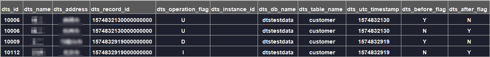

The following table describes the schema.

| Appended column name (Old) | Appended column name (New) | Type | Description |
| --- | --- | --- | --- |

<table>
  <tr>
    <td><code>dts_record</code><br><code>_id</code></td>
    <td><code>new_dts_sync_dts_rec</code><br><code>ord_id</code></td>
    <td>String</td>
    <td>The record ID of the incremental log, which uniquely identifies the log entry.<br>Note<br>• Under normal conditions, this ID is globally unique and auto-incrementing.During disaster recovery, the ID may roll back and is no longer guaranteed to be unique or auto-incrementing.<br>• For an UPDATE operation, the update is split into two records: one for the value before the update and one for the value after. Both records share the same <code> dts_record_id </code>.</td>
  </tr>
  <tr>
    <td><code>dts_operat</code><br><code>ion_flag</code></td>
    <td><code>new_dts_sync_dts_ope</code><br><code>ration_flag</code></td>
    <td>String</td>
    <td>The operation type. Valid values:<br>• I: INSERT operation.<br>• D: DELETE operation.<br>• U: UPDATE operation.<br>• F: Full data synchronization.</td>
  </tr>
  <tr>
    <td><code>dts_instan</code><br><code>ce_id</code></td>
    <td><code>new_dts_sync_dts_ins</code><br><code>tance_id</code></td>
    <td>String</td>
    <td>The server ID of the database.</td>
  </tr>
  <tr>
    <td><code>dts_db_nam</code><br><code>e</code></td>
    <td><code>new_dts_sync_dts_db_</code><br><code>name</code></td>
    <td>String</td>
    <td>The database name.</td>
  </tr>
  <tr>
    <td><code>dts_table_</code><br><code>name</code></td>
    <td><code>new_dts_sync_dts_tab</code><br><code>le_name</code></td>
    <td>String</td>
    <td>The table name.</td>
  </tr>
  <tr>
    <td><code>dts_utc_ti</code><br><code>mestamp</code></td>
    <td><code>new_dts_sync_dts_utc</code><br><code>_timestamp</code></td>
    <td>String</td>
    <td>The timestamp of the operation, in UTC, from the Binlog.</td>
  </tr>
  <tr>
    <td><code>dts_before</code><br><code>_flag</code></td>
    <td><code>new_dts_sync_dts_bef</code><br><code>ore_flag</code></td>
    <td>String</td>
    <td>Indicates if the record contains pre-update values. Valid values: Y and N.</td>
  </tr>
  <tr>
    <td><code>dts_after_</code><br><code>flag</code></td>
    <td><code>new_dts_sync_dts_aft</code><br><code>er_flag</code></td>
    <td>String</td>
    <td>Indicates if the record contains post-update values. Valid values: Y and N.</td>
  </tr>
</table>

**dts_before_flag and dts_after_flag**

The values of  `dts_before_flag`  and  `dts_after_flag`  in the incremental log differ depending on the operation type.

- INSERT

  For an INSERT operation, the record contains the newly inserted values (post-update state). Therefore,  `dts_before_flag`  is N, and  `dts_after_flag`  is Y. The following image is an example.

  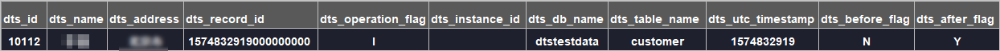

- UPDATE

  For an UPDATE operation, DTS generates two log entries that share the same values for  `dts_record_id` ,  `dts_operation_flag` , and  `dts_utc_timestamp` .

  The first log entry records the pre-update values, so  `dts_before_flag`  is Y, and  `dts_after_flag`  is N. The second log entry records the post-update values, so  `dts_before_flag`  is N, and  `dts_after_flag`  is Y. The following image is an example.

  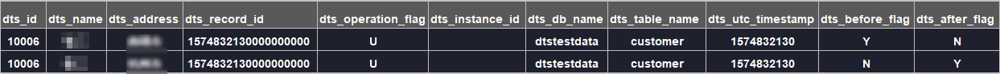

- DELETE

  For a DELETE operation, the log entry contains the deleted values (pre-update state). Therefore,  `dts_before_flag`  is Y, and  `dts_after_flag`  is N. The following image is an example.

  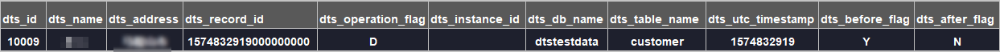

<a id="section-5-5-2"></a>

### 5.5.2. Synchronize data from a PolarDB for MySQL source

<a id="section-5-5-2-1"></a>

#### 5.5.2.1. Synchronize data between PolarDB for MySQL clusters

Data Transmission Service (DTS) supports data synchronization between PolarDB for MySQL Primary/Standby Edition or Cluster Edition) clusters. This topic describes how to synchronize data between PolarDB for MySQL Primary/standby Edition clusters that can be accessed over public endpoints.

**Prerequisites**

- The destination PolarDB for MySQL Primary/Standby Edition cluster is created. The destination cluster is of High-availability Edition and its available storage space is larger than the total size of data in the source PolarDB for MySQL Primary/Standby Edition cluster.

- Both the source and destination PolarDB for MySQL Primary/Standby Edition clusters can be accessed over public endpoints.

**Usage notes**

| Category | Description |
| --- | --- |
| Limits on the source database | • The tables to be synchronized must have PRIMARY KEY or UNIQUE constraints and all fields must be unique. Otherwise, the destination database may contain duplicate data records.<br>• The <code> binlog_row_image </code> parameter must be set to <code> full </code>. Otherwise, an error may occur during the precheck and the data synchronization task cannot be started.<br>Note<br>For an incremental data synchronization task, the binary logs of the source database are retained for at least 24 hours. For a full and incremental data synchronization task, the binary logs of the source database are retained for at least seven days. Otherwise, DTS may fail to obtain the binary logs and the task may fail. In exceptional circumstances, data inconsistency or loss may occur. After the full data synchronization is complete, you can set the retention period to more than 24 hours. Make sure that you configure the retention period of binary logs based on the preceding requirements.Otherwise, the service reliability or performance stated in the SLA of DTS may not be guaranteed.<br>• During schema synchronization and full data synchronization, do not execute DDL statements to change the schemas of databases or tables. Otherwise, the data synchronization task fails. |
| Other limits | • The source and destination databases cannot be read-only instances.<br>• To ensure compatibility, the version of the destination database must be the same as or later than that of the source database. If the version of the destination database is earlier than that of the source database, database compatibility issues may occur.<br>• During full data synchronization, DTS uses the read and write resources of the source and destination databases. This may increase the loads of the database servers. Before you synchronize data, assess the impact of data synchronization on the performance of the source and destination databases.We recommend that you synchronize data during off-peak hours, such as when the CPU usage of the source and destination databases is lower than 30%.<br>• During initial full data synchronization, concurrent INSERT operations cause fragmentation in the tables of the destination database. Therefore, after initial full data synchronization is complete, the size of the used tablespace of the destination database is larger than that of the source database.<br>• If you select one or more tables instead of an entire database as the objects to be synchronized, do not use tools such as pt-online-schema-change to perform online DDL operations on the tables during data synchronization. Otherwise, the data synchronization task fails.<br>• Data inconsistency between the source and destination databases occurs if data from other sources is written to the destination database during the data synchronization. For example, if you use tools other than DTS to write data to the destination, data loss may occur in the destination when you use DMS to perform online DDL operations.<br>• DTS executes the <strong>CREATE DATABASE IF NOT EXISTS \`test\`</strong> statement in the source database as scheduled to move forward the binary log file position. |

**SQL operations that can be synchronized during incremental data synchronization**

| Operati on type | SQL statement |
| --- | --- |
| DML | INSERT, UPDATE, DELETE |
| DDL | • ALTER TABLE, ALTER VIEW<br>• CREATE FUNCTION, CREATE INDEX, CREATE PROCEDURE, CREATE TABLE, CREATE VIEW<br>• DROP INDEX, DROP TABLE<br>• RENAME TABLE<br>Important<br>The RENAME TABLE operation may cause data inconsistency. For example, if the synchronization object is only a specific table and you rename the table in the source instance during synchronization, the data of the table is not synchronized to the destination database. To prevent this issue, select the entire database to which the table belongs as the synchronization object when you configure the data synchronization task. Make sure that the databases to which the table belongs before and after the RENAME TABLE operation are both included in the synchronization object.<br>• TRUNCATE TABLE |

**Procedure**

1. Create a data synchronization instance.

   > **Note**
   >
   > When you create the data synchronization instance, select **PolarDB for MySQL** as the **source database type**, **PolarDB for MySQL** as the **destination database type**, and **One-way Synchronization** as the synchronization topology.

2. On the Data Synchronization page, find the data synchronization task that you created and click **Configure Task** in the Actions column.

3. Configure the source and destination databases.

   **Section**

   **Parameter**

   **Description**

   The task name that DTS automatically generates. We recommend that you specify a descriptive name that makes it easy to identify the task. You do not need to specify a unique task name.

   N/A

   **Task Name**

   **Database**

   The type of the source database. Select **PolarDB for MySQL**.

   **Type Access**

   The access method of the destination database. Select **Public**

   **Method**

   **IP Address**.

   The region in which the destination database resides. The region is the destination region that you selected when you created the

   **Instance**

   data synchronization task. You cannot change the value of this

   **Region**

   parameter.

   **Source**

   Enter the value of **Vip** or **Public Endpoint** displayed on the

   **Domain**

   **Database**

   details page of the source PolarDB for MySQL Primary/Standby

   **Name or IP**

   Edition cluster.

   Enter the number of **Public Port** displayed on the details page

   **Port Number**

   of the source PolarDB for MySQL Primary/Standby Edition cluster.

   Enter the account of the source PolarDB for MySQL Primary/Standby Edition database. The account must have the

   **Database**

   read and write permissions on the database.

   **Account**

   **Database**

   The password of the database account.

   **Password**

   **Database**

   The type of the source database. Select **PolarDB for MySQL**.

   **Type**

   **Access**

   The access method of the destination database. Select **Public**

   **Method**

   **IP Address**.

   The region in which the destination database resides. The region

   **Instance**

   is the destination region that you selected when you created the

   **Region**

   data synchronization task. You cannot change the value of this parameter.

   Enter the value of **VIP** or **Public Endpoint** displayed on the

   **Domain**

   details page of the destination PolarDB for MySQL

   **Name or IP**

   **Destination**

   Primary/Secondary Edition cluster.

   **Database**

   Enter the number of **Public Port** displayed on the details page

   **Port Number**

   of the destination PolarDB for MySQL Primary/Secondary Edition cluster.

   Enter the database account of the destination PolarDB for

   **Database**

   MySQL Primary/Secondary Edition cluster. The account must

   **Account**

   have the read and write permissions on the destination database.

   **Database**

   The password of the database account.

   **Password**

4. In the lower part of the page, click **Test Connectivity and Proceed**.

5. If IP address whitelists are configured for your source and destination PolarDB for MySQL clusters, you must add the CIDR blocks of DTS servers to the whitelists of the clusters. Then, click **Test Connectivity and Proceed**.

   > **Note**
   >
   > If no whitelist is configured for your PolarDB for PostgreSQL cluster, ignore the whitelist settings and click **Test Connectivity and Proceed**.

6. Configure the synchronization policy and the objects to be synchronized. The following table describes the parameters.

   | Parameter | Description |
   | --- | --- |
   | Task Stages | By default, <strong>Incremental Data Synchronization</strong> is selected. You must also select <strong>Schema Synchronization</strong> and <strong>Full Data Synchronization</strong>. After the precheck is complete, DTS synchronizes the historical data of selected objects from the source instance to the destination instance. The historical data is the basis for subsequent incremental synchronization. |
   | Processing Mode of Conflicting Tables | • <strong>Precheck and Report Errors</strong>: checks whether the destination database contains tables that have the same names as tables in the source database.If the source and destination databases do not contain tables that have identical table names, the precheck is passed. Otherwise, an error is returned during the precheck and the data synchronization task cannot be started.<br>• <strong>Ignore Errors and Proceed</strong>: skips the precheck for identical table names in the source and destination databases.<br>Warning<br>If you select <strong>Ignore Errors and Proceed</strong>, data inconsistency may occur between the source and destination databases, and your business may be exposed to potential risks.<br>• If the source and destination databases have the same schema, DTS does not synchronize the data records that have the same primary keys as the data records in the destination database during initial full data synchronization. However, DTS synchronizes these data records during incremental data synchronization.<br>• If the source and destination databases have different schemas, initial data synchronization may fail. In this case, only specific columns are synchronized, or the data synchronization task fails. |
   | Synchronization Topology | The synchronization topology of the data synchronization task. Select <strong>One-</strong><strong>way Synchronization</strong>.<br>Important<br>Two-way synchronization is not supported. |
   | Capitalization of Object Names in Destination Instance | Specify the capitalization of database names, table names, and column names in the destination instance. By default, <strong>DTS default policy</strong> is selected. You can select other options to make sure that the capitalization of object names is consistent with that in the source or destination database. For more information, see Specify the capitalization of object names in the destination instance. |
   | Source Objects | Select objects (tables or a database) from the <strong>Source Objects</strong> section and<br>click theicon to move the objects to the <strong>Selected Objects</strong> section.<br>Note<br>• You can use the navigation tree to search for one or more objects.<br>• You can select columns, tables, or databases as the objects to be synchronized. |
   | Selected Objects | By default, after an object is synchronized to the destination database, the name of the object remains unchanged. You can use the object name mapping feature to change the names of the objects that are synchronized to the destination instance. For more information, see Rename an object to be synchronized.<br>Note<br>• To synchronize SQL operations that are performed on a specific database or table, right-click an object in the <strong>Selected Objects</strong> section. In the dialog box that appears, select the SQL operations that you want to synchronize.<br>• To specify WHERE clauses to filter data, right-click a table in the <strong>Selected Objects</strong> section. In the dialog box that appears, specify the filter conditions.<br>• If you use the object name mapping feature to rename an object, other objects that are dependent on the object may fail to be synchronized. |

7. Click **Next: Advanced Settings** to configure advanced settings. The following table describes the parameters.

   | Parameter | Description |
   | --- | --- |
   | Select the engine type of the destination database | The engine type of the destination database. Select <strong>InnoDB</strong> or <strong>X-Engine</strong> based on your business requirements. |
   | Retry Time for Failed Connections | The retry time range for failed connections. If the connection to the source or destination database fails after the data synchronization task is started, an error is returned. For predictable errors, DTS immediately retries a connection within the time range. Valid values: 10 to 1440. Unit: minutes.Default value: 720. We recommend that you set the parameter to a value greater than 30. If DTS reconnects to the source and destination databases within the specified retry time range, DTS resumes the data synchronization task. Otherwise, the data synchronization task fails.<br>Note<br>If you set different retry time ranges for multiple data synchronization tasks that have the same source or destination database, the shortest retry time range that is set takes precedence. |
   | Whether to delete SQL operations on heartbeat tables of forward and reverse tasks | Choose whether DTS writes heartbeat SQL information to the source database while the instance is running.<br>• <strong>Yes</strong>: Does not write heartbeat SQL information to the source database.The DTS instance may display latency.<br>• <strong>No</strong>: Writes heartbeat SQL information to the source database. This may interfere with source database operations like physical backups and cloning. |

8. In the lower part of the page, click **Next: Precheck and Start Task**.

   > **Important**
   >
   > - Before you can start the data synchronization task, a precheck is performed. You can start the data synchronization task only after the task passes the precheck.
   >
   > - If the task fails to pass the precheck, click **View Details** next to each failed item. After you troubleshoot the issues based on the causes, run a precheck again.

9. Wait until the success rate becomes 100%. Then, click **Back**.

<a id="section-5-5-2-2"></a>

#### 5.5.2.2. Synchronize data from a PolarDB for MySQL cluster to an ApsaraDB RDS for MySQL instance

You can synchronize data from a PolarDB for MySQL cluster to an ApsaraDB RDS for MySQL instance by using Data Transmission Service (DTS). This topic describes how to synchronize data from a PolarDB for MySQL cluster to an ApsaraDB RDS for MySQL instance by using DTS.

**Prerequisites**

- The source PolarDB for MySQL cluster is created.

- The available storage capacity of the destination ApsaraDB RDS for MySQL instance is larger than the total size of data in the source PolarDB for MySQL cluster.

**Usage notes**

> **Note**
>
> - During schema synchronization, DTS synchronizes foreign keys from the source database to the destination database.
>
> - During full synchronization and incremental synchronization, DTS temporarily disables checking of foreign key constraints and foreign key cascade operations at the session level. If you perform the cascade update and delete operations on the source database during data synchronization, data inconsistency may occur.

| Category | Description |
| --- | --- |
| Limits on the source database | • The tables to be synchronized must have PRIMARY KEY or UNIQUE constraints, and all fields must be unique. Otherwise, the destination database may contain duplicate data records.<br>• If you select tables as the objects to be synchronized and you need to modify the tables, such as renaming tables or columns, in the destination database, you can synchronize up to 1,000 tables in a single data synchronization task. If you run a task to synchronize more than 1,000 tables, a request error occurs.In this case, we recommend that you split the tables and configure multiple tasks to synchronize the tables in batches or configure a task to synchronize the entire database.<br>• The <code> binlog_row_image </code> parameter must be set to <code> full </code>. Otherwise, an error may occur during the precheck and the data synchronization task cannot be started.<br>Note<br>For an incremental data synchronization task, the binary logs of the source database are retained for at least 24 hours. For a full and incremental data synchronization task, the binary logs of the source database are retained for at least seven days. Otherwise, DTS may fail to obtain the binary logs and the task may fail. In exceptional circumstances, data inconsistency or loss may occur. After the full data synchronization is complete, you can set the retention period to more than 24 hours. Make sure that you configure the retention period of binary logs based on the preceding requirements.Otherwise, the service reliability or performance stated in the SLA of DTS may not be guaranteed.<br>• During schema synchronization and full data synchronization, do not execute DDL statements to change the schemas of databases or tables. Otherwise, the data synchronization task fails. |
| Other limits | • DTS does not synchronize the read-only nodes of the source PolarDB for MySQL cluster.<br>• DTS does not synchronize Object Storage Service (OSS) external tables from the source PolarDB for MySQL cluster.<br>• Indexes and partitions cannot be synchronized.<br>• Parsers that are defined by using comments cannot be synchronized.<br>• DTS does not support primary/secondary switchovers for database instances during the full synchronization process. In this scenario, we recommend that you reconfigure the synchronization task at your earliest opportunity.<br>• If the source database contains online DDL change operations performed on temporary tables, including but not limited to multi-table merging scenarios, data loss in the destination database may occur or the synchronization task may fail.<br>• If you encounter a primary key or unique key conflict during the execution of the synchronization task:<br>• If the source and destination databases have the same schema and a data record in the destination database has the same primary key value or unique key value as a data record in the source database:<br>• During full data synchronization, DTS does not synchronize the data record to the destination database. The existing data record in the destination database is retained.<br>• During incremental data synchronization, DTS synchronizes the data record to the destination database. The existing data record in the destination database is overwritten.<br>• If the source and destination databases have different schemas, data may fail to be initialized. In this case, only some columns are synchronized, or the data synchronization task fails. Proceed with caution.<br>• If the data to be synchronized contains content that requires four-byte storage, such as rarely used characters and emojis, the database and table in the destination cluster that receive the data must use the utf8mb4 character set.<br>Note<br>If you use DTS to synchronize schemas, you must set the instance-level parameter <code> character_set_server </code> in the destination database to utf8mb4.<br>• During full data synchronization, DTS uses the read and write resources of the source and destination databases. This may increase the loads of the database servers. Before you synchronize data, assess the impact of data synchronization on the performance of the source and destination databases.We recommend that you synchronize data during off-peak hours, such as when the CPU usage of the source and destination databases is lower than 30%.<br>• During initial full data synchronization, concurrent INSERT operations cause fragmentation in the tables of the destination database. Therefore, after initial full data synchronization is complete, the size of the used tablespace of the destination database is larger than that of the source database.<br>• We recommend that you do not use tools such as pt-online-schema-change to perform DDL operations on source tables during data synchronization.Otherwise, the data synchronization task fails.<br>• Data inconsistency between the source and destination databases may occur if data from other sources is written to the destination database during data synchronization.<br>• If DDL statements fail to be executed in the destination database, the DTS task continues to run. You can view the DDL statements that fail to be executed in task logs.<br>• Column names in MySQL databases are not case-sensitive. Therefore, if multiple columns in the source database have names that differ only in capitalization, data in the columns are written to the same column in the destination MySQL database during the synchronization. This can cause unexpected synchronization results.<br>• After the data synchronization task is completed and the <strong>task status</strong> changes to <strong>Completed</strong>, we recommend that you run the <code> analyze table </code> <code>&lt;table_name&gt; </code> command to verify that all data is written to the destination table. For example, if a high-availability (HA) switchover is triggered in the destination MySQL database, data may be written only to the memory. As a result, data loss occurs.<br>• A two-way data synchronization instance contains a forward synchronization task and a reverse synchronization task. If an object is to be synchronized in both the forward and reverse synchronization tasks when you configure or reset the instance, the following rules apply:<br>• Only one of the tasks can synchronize both the full data and incremental data of objects. The other task synchronizes only the incremental data of the objects.<br>• The source data of the current task can be synchronized only to the destination database in the task. The synchronized data is not used as the source data of the other task. |

- DTS executes the **CREATE DATABASE IF NOT EXISTS \`test\`** statement in

**SQL operations that can be synchronized**

the source database as scheduled to move forward the binary log file position.

| Operati on type | SQL statement |
| --- | --- |
| DML | INSERT, UPDATE, and DELETE |
| DDL | • ALTER TABLE and ALTER VIEW<br>• CREATE FUNCTION, CREATE INDEX, CREATE PROCEDURE, CREATE TABLE, and CREATE VIEW<br>• DROP INDEX and DROP TABLE<br>• RENAME TABLE<br>Important<br>The RENAME TABLE operation may cause data inconsistency between the source and destination databases. For example, if you select a table as the object to be synchronized and rename the table during data synchronization, the data of this table is not synchronized to the destination database. To prevent this situation, select the database to which this table belongs as the object to be synchronized when you configure the data synchronization task. Make sure that the databases to which the table belongs before and after the RENAME TABLE operation are added to the objects to be synchronized.<br>• TRUNCATE TABLE |

**Procedure**

1. Create a data synchronization instance.

   > **Note**
   >
   > When you create the data synchronization task, select **PolarDB for MySQL** as the **source database type** and **MySQL** as the **destination database type**.

2. On the Data Synchronization page, find the data synchronization task that you created and click **Configure Task** in the Actions column.

3. Configure the source and the destination database. The following table describes the parameters.

   **Section**

   **Parameter**

   **Description**

   The task name that DTS automatically generates. We recommend that you specify a descriptive name that makes it

   **Task Name**

   N/A

   easy to identify the task. You do not need to specify a unique task name.

   **Database**

   The type of the destination database. Select **PolarDB for**

   **Type**

   **MySQL**.

   **Access**

   The access method of the destination database. Select **Alibaba**

   **Method**

   **Cloud Instance**.

   The region in which the source database resides. The region is

   **Instance**

   the source region that you selected when you created the data

   **Region**

   synchronization task. You cannot change the value of this parameter.

   **Replicate Data Across**

   Specifies whether to synchronize data across Alibaba Cloud

   **Alibaba**

   accounts. In this example, **No** is selected.

   **Cloud Accounts**

   **Source Database**

   You can select **Primary/Standby Edition** (previously known as

   **Architecture**

   Two Nodes with Local Disks) or **Cluster Edition** (previously known as Shared Storage).

   **PolarDB**

   The ID of the source PolarDB for MySQL cluster.

   **Cluster ID**

   **Database**

   The account of the source PolarDB for MySQL database. The

   **Account**

   account must have the read permissions on the database.

   **Database**

   The password of the database account.

   **Password**

   Specifies whether to encrypt the connection to the source

   **Encryption**

   database. You can configure this parameter based on your business requirements.

   **Database**

   The type of the source instance. Select **MySQL**.

   **Type Access**

   In this example, **Alibaba Cloud Instance** is selected.

   **Method**

   The region in which the destination database resides. The region

   **Instance**

   is the destination region that you selected when you created the

   **Region**

   data synchronization task. You cannot change the value of this parameter.

   In this example, a database of the current Apsara Stack tenant account is used. Therefore, **No** is selected.

   **Replicate**

   > **Note**

   **Data Across**

   > If you select **Yes**, you must configure the **Alibaba Cloud**

   **Alibaba**

   > **Account** and **RAM Role Name** parameters. For more

   **Cloud**

   > information about how to create a RAM role and grant

   **Destination**

   **Accounts**

   > permissions to the RAM role, see Configure RAM

   **Database**

   > authorization for cross-account data migration or synchronization.

   **RDS**

   The ID of the destination ApsaraDB RDS for MySQL instance.

   **Instance ID**

   **Database**

   The database account of the destination database.

   **Account**

   **Database**

   The password that is used to access the database instance.

   **Password**

   Specifies whether to encrypt the connection to the destination database. Select **Non-encrypted** or **SSL-encrypted** based on

   **Encryption**

   your business requirements. If you select **SSL-encrypted**, you must enable SSL encryption for the ApsaraDB RDS instance before you configure the data synchronization task.

4. In the lower part of the page, click **Test Connectivity and Proceed**.

   > **Note**
   >
   > If a whitelist is configured for your self-managed MySQL database, add the CIDR blocks of DTS servers that are displayed in the dialog box to the whitelist. Then, click **Text Connectivity and Proceed**.

5. Configure objects for the task.

   | Parameter | Description |
   | --- | --- |
   | Task Stages | <strong>Incremental Data Synchronization</strong> is automatically selected. You must also select <strong>Schema Synchronization</strong> and <strong>Full Data Synchronization</strong>. After the precheck is complete, DTS synchronizes the historical data of selected objects from the source instance to the destination instance. The historical data is the basis for subsequent incremental synchronization. |
   | Processing Mode of Conflicting Tables | • <strong>Precheck and Report Errors</strong>: checks whether the destination database contains tables that use the same names as tables in the source database.If the source and destination databases do not contain tables that have identical table names, the precheck is passed. Otherwise, an error is returned during the precheck and the data synchronization task cannot be started.<br>• <strong>Ignore Errors and Proceed</strong>: skips the precheck for identical table names in the source and destination databases.<br>Warning<br>If you select <strong>Ignore Errors and Proceed</strong>, data inconsistency may occur and your business may be exposed to potential risks.<br>• If the source and destination databases have the same schema and a data record in the destination database has the same primary key value or unique key value as a data record in the source database:<br>• During full data synchronization, DTS does not synchronize the data record to the destination database.The existing data record in the destination database is retained.<br>• During incremental data synchronization, DTS synchronizes the data record to the destination database. The existing data record in the destination database is overwritten.<br>• If the source and destination databases have different schemas, data may fail to be initialized. In this case, only some columns are synchronized, or the data synchronization task fails.Proceed with caution. |
   | Synchronization Topology | Select <strong>One-way Synchronization</strong>. |
   | Capitalization of Object Names in Destination Instance | The capitalization of database names, table names, and column names in the destination instance. By default, <strong>DTS default policy</strong> is selected. You can select other options to ensure that the capitalization of object names is consistent with that in the source or destination database. For more information, see Specify the capitalization of object names in the destination instance. |
   | Source Objects | Select one or more objects from the <strong>Source Objects</strong> section and click the<br>icon to add them to the <strong>Selected Objects</strong> section.<br>Note<br>• You can use the navigation tree to search for one or more objects.<br>• You can select columns, tables, or databases as the objects to be synchronized. If you select tables or columns as the objects to be synchronized, DTS does not synchronize other objects, such as views, triggers, and stored procedures, to the destination database. |
   | Selected Objects | By default, after an object is synchronized to the destination database, the name of the object remains unchanged. You can use the object name mapping feature to change the names of the objects that are synchronized to the destination instance. For more information, see Rename an object to be synchronized.<br>Note<br>• To synchronize SQL operations that are performed on a specific database or table, right-click an object in the <strong>Selected Objects</strong> section. In the dialog box that appears, select the SQL operations that you want to synchronize.<br>• To specify conditions to filter data, right-click a table in the <strong>Selected Objects</strong> section. In the dialog box that appears, specify the conditions.<br>• If you use the object name mapping feature to rename an object, other objects that are dependent on the object may fail to be synchronized. |

6. Click **Next: Advanced Settings** to configure advanced settings. The following table describes the parameters.

   | Parameter | Description |
   | --- | --- |
   | Retry Time for Failed Connections | The retry time range for failed connections. If the source or destination database fails to be connected after the data synchronization task is started, an error is returned. For predictable errors, DTS immediately retries a connection within the time range. Valid values: 10 to 1440. Unit: minutes. Default value: 720. We recommend that you set the parameter to a value greater than 30. If DTS reconnects to the source and destination databases within the specified retry time range, DTS resumes the data synchronization task. Otherwise, the data synchronization task fails.<br>Note<br>If you set different retry time ranges for multiple data synchronization tasks that have the same source or destination database, the shortest retry time range that is set takes precedence. |
   | Whether to delete SQL operations on heartbeat tables of forward and reverse tasks | Choose whether DTS writes heartbeat SQL information to the source database while the instance is running.<br>• <strong>Yes</strong>: Does not write heartbeat SQL information to the source database.The DTS instance may display latency.<br>• <strong>No</strong>: Writes heartbeat SQL information to the source database. This may interfere with source database operations like physical backups and cloning. |

7. In the lower part of the page, click **Next: Precheck and Start Task**.

   > **Important**
   >
   > - Before you can start the data synchronization task, a precheck is performed. You can start the data synchronization task only after the task passes the precheck.
   >
   > - If the task fails to pass the precheck, click **View Details** next to each failed item. After you troubleshoot the issues based on the causes, run a precheck again.

8. Wait until the success rate becomes 100%. Then, click **Back**.

<a id="section-5-5-2-3"></a>

#### 5.5.2.3. Synchronize data from a PolarDB for MySQL cluster to a PolarDB-X V2.0 instance

Data Transmission Service (DTS) allows you to synchronize data from a PolarDB for MySQL Primary/Standby Edition or Cluster Edition instance to a PolarDB-X V2.0 instance. This topic describes how to synchronize data from PolarDB for MySQL Primary/Standby Edition instance by using DTS.

**Prerequisites**

The destination PolarDB-X V2.0 instance that is compatible with MySQL 5.7 is created. The available storage space of this instance is larger than the total size of data in the source instance.

**Limits**

| Category | Description |
| --- | --- |

<table>
  <tr>
    <td>Limits on the source instance</td>
    <td>• The tables to be synchronized must have PRIMARY KEY or UNIQUE constraints and all fields must be unique. Otherwise, the destination database may contain duplicate data records.<br>• The <code> binlog_row_image </code> parameter must be set to <code> full </code>. Otherwise, an error may occur during the precheck and the data synchronization task cannot be started.<br>Note<br>For an incremental data synchronization task, the binary logs of the source database are retained for at least 24 hours. For a full and incremental data synchronization task, the binary logs of the source database are retained for at least seven days. Otherwise, DTS may fail to obtain the binary logs and the task may fail. In exceptional circumstances, data inconsistency or loss may occur. After the full data synchronization is complete, you can set the retention period to more than 24 hours. Make sure that you configure the retention period of binary logs based on the preceding requirements.Otherwise, the service reliability or performance stated in the SLA of DTS may not be guaranteed.<br>• During schema synchronization and full data synchronization, do not execute DDL statements to change the schemas of databases or tables. Otherwise, the data synchronization task fails.<br>• Requirements for the objects to be synchronized:<br>• DTS does not synchronize the following types of data: BIT, VARBIT, GEOMETRY, ARRAY, UUID, TSQUERY, TSVECTOR, and TXID_SNAPSHOT.<br>• Prefix indexes cannot be synchronized. If the source database contains prefix indexes, the data synchronization task may fail.<br>• You cannot synchronize data from a read-only node of the source PolarDB for MySQL cluster.<br>• You cannot synchronize OSS foreign tables from the source PolarDB for MySQL cluster.</td>
  </tr>
  <tr>
    <td>Other limits</td>
    <td>• During full data synchronization, DTS uses the read and write resources of the source and destination databases. This may increase the loads of the database servers. Before you synchronize data, assess the impact of data synchronization on the performance of the source and destination databases.We recommend that you synchronize data during off-peak hours, such as when the CPU usage of the source and destination databases is lower than 30%.<br>• During initial full data synchronization, concurrent INSERT operations cause table fragmentation in the destination database. Therefore, after initial full data synchronization is complete, the size of the used tablespace of the destination database is larger than that of the source database.<br>• If you select one or more tables instead of an entire database as the objects to be synchronized, do not use tools such as pt-online-schema-change to perform online DDL operations on the tables during data synchronization. Otherwise, the data synchronization task fails.<br>• Data inconsistency between the source and destination databases may occur if data from other sources is written to the destination database during data synchronization.<br>• DTS executes the <strong>CREATE DATABASE IF NOT EXISTS `test`</strong> statement in the source database as scheduled to move forward the binary log file position.</td>
  </tr>
</table>

**SQL operations that can be incrementally synchronized**

| Operati on type | SQL statement |
| --- | --- |
| DML | INSERT, UPDATE, and DELETE |
| DDL | • ALTER TABLE and ALTER VIEW<br>• CREATE FUNCTION, CREATE INDEX, CREATE PROCEDURE, CREATE TABLE, and CREATE VIEW<br>• DROP INDEX and DROP TABLE<br>• RENAME TABLE<br>Important<br>The RENAME TABLE operation may cause data inconsistency. For example, if the synchronization object is a single table and you rename it on the source instance during synchronization, the data of that table is not synchronized to the destination database. To avoid this issue, you can configure the task to synchronize the entire database that contains the table. Make sure that the database to which the table belongs both before and after the RENAME TABLE operation is included in the synchronization objects.<br>• TRUNCATE TABLE |

**Procedure**

1. Create a data synchronization instance.

   > **Note**
   >
   > When you create the data synchronization instance, select **PolarDB for MySQL** as the **source database type** and **PolarDB-X 2.0** as the **destination database type**.

2. On the Data Synchronization page, find the data synchronization task that you created and click **Configure Task** in the Actions column.

3. Configure the source and destination databases

   **Section**

   **Parameter**

   **Description**

   The task name that DTS automatically generates. We

   **Task Name**

   recommend that you specify a descriptive name that makes it

   N/A

   easy to identify the task. You do not need to specify a unique task name.

   **Destination**

   The type of the source database. Select **PolarDB for MySQL**.

   **Database**

   The access method of the destination database. Select **Alibaba**

   **Access**

   **Cloud Instance**.

   **Method**

   The region in which the destination database resides. The region

   **Instance**

   is the destination region that you selected when you created the

   **Region**

   data synchronization instance. You cannot change the value of this parameter.

   **Replicate Data Across**

   Specifies whether to synchronize data across Alibaba Cloud

   **Alibaba**

   **Source**

   accounts. In this example, **No** is selected.

   **Cloud**

   **Database**

   **Accounts**

   Select **Primary/Standby Edition** (previously known as Two

   **Architecture**

   Nodes with Local Disks).

   **PolarDB**

   The ID of the source PolarDB for MySQL cluster.

   **instance ID**

   The database account of the source local disk-based PolarDB for

   **Database**

   MySQL cluster. The account must have the read and write

   **Account**

   permissions on the objects to be synchronized.

   **Database**

   The password that is used to access the database instance.

   **Password**

   **Database**

   The type of the destination database. Select **PolarDB-X 2.0**.

   **Type**

   **Access**

   The access method of the destination database. Select **Alibaba**

   **Method**

   **Cloud Instance**.

   The region in which the destination database resides. The region

   **Instance**

   is the destination region that you selected when you created the

   **Region**

   data synchronization instance. You cannot change the value of this parameter.

   **Destination Database**

   **Instance ID**

   The ID of the destination PolarDB-X 2.0 instance.

   The database account of the destination PolarDB-X 2.0 instance.

   **Database**

   The account must have the read and write permissions on the

   **Account**

   destination PolarDB-X 2.0 instance.

   **Database**

   The password that is used to access the database instance.

   **Password**

4. In the lower part of the page, click **Test Connectivity and Proceed**.

5. Select the synchronization policy and the objects to be synchronized.

   | Parameter | Description |
   | --- | --- |
   | Task Stages | By default, <strong>Incremental Data Synchronization</strong> is selected. You must also select <strong>Schema Synchronization</strong> and <strong>Full Data Synchronization</strong>. After the precheck is complete, DTS synchronizes the historical data of selected objects from the source instance to the destination instance. The historical data is the basis for subsequent incremental synchronization. |
   | Processing Mode of Conflicting Tables | • <strong>Precheck and Report Errors</strong>: checks whether the destination database contains tables that have the same names as tables in the source database.If the source and destination databases do not contain tables that have identical table names, the precheck is passed. Otherwise, an error is returned during the precheck and the data synchronization task cannot be started.<br>• <strong>Ignore Errors and Proceed</strong>: skips the precheck for identical table names in the source and destination databases.<br>Warning<br>If you select <strong>Ignore Errors and Proceed</strong>, data inconsistency may occur between the source and destination databases, and your business may be exposed to potential risks.<br>• If the source and destination databases have the same schema, DTS does not synchronize the data records that have the same primary keys as the data records in the destination database during initial full data synchronization. However, DTS synchronizes these data records during incremental data synchronization.<br>• If the source and destination databases have different schemas, initial data synchronization may fail. In this case, only specific columns are synchronized, or the data synchronization task fails. |
   | Capitalization of Object Names in Destination Instance | Specify the capitalization of database names, table names, and column names in the destination instance. By default, <strong>DTS default policy</strong> is selected. You can select other options to make sure that the capitalization of object names is consistent with that in the source or destination database. For more information, see Specify the capitalization of object names in the destination instance. |

   <table>
     <tr>
       <td>Source Objects</td>
       <td>Select objects (tables or a database) from the <strong>Source Objects</strong> section and<br>click theicon to move the objects to the <strong>Selected Objects</strong> section.<br>Note<br>• You can use the navigation tree to search for one or more objects.<br>• You can select tables or databases as the objects to be synchronized.</td>
     </tr>
     <tr>
       <td>Selected Objects</td>
       <td>By default, after an object is synchronized to the destination database, the name of the object remains unchanged. You can use the object name mapping feature to change the names of the objects that are synchronized to the destination instance. For more information, see Rename an object to be synchronized.<br>Note<br>• To synchronize SQL operations that are performed on a specific database or table, right-click an object in the <strong>Selected Objects</strong> section. In the dialog box that appears, select the SQL operations that you want to synchronize.<br>• To specify WHERE clauses to filter data, right-click a table in the <strong>Selected Objects</strong> section. In the dialog box that appears, specify the filter conditions.<br>• If you use the object name mapping feature to rename an object, other objects that are dependent on the object may fail to be synchronized.</td>
     </tr>
   </table>

6. Click **Next: Advanced Settings** to configure advanced settings. The following table describes the parameters.

   | Parameter | Description |
   | --- | --- |
   | Retry Time for Failed Connections | The retry time range for failed connections. If the source or destination database fails to be connected after the data synchronization task is started, an error is returned. For predictable errors, DTS immediately retries a connection within the time range. Valid values: 10 to 1440. Unit: minutes. Default value: 720. We recommend that you set the parameter to a value greater than 30. If DTS reconnects to the source and destination databases within the specified retry time range, DTS resumes the data synchronization task. Otherwise, the data synchronization task fails.<br>Note<br>If you specify different retry time ranges for multiple data synchronization tasks that have the same source or destination database, the shortest retry time range takes precedence. |
   | Whether to delete SQL operations on heartbeat tables of forward and reverse tasks | Choose whether DTS writes heartbeat SQL information to the source database while the instance is running.<br>• <strong>Yes</strong>: Does not write heartbeat SQL information to the source database.The DTS instance may display latency.<br>• <strong>No</strong>: Writes heartbeat SQL information to the source database. This may interfere with source database operations like physical backups and cloning. |

7. In the lower part of the page, click **Next: Precheck and Start Task**.

   > **Important**
   >
   > - Before you can start the data synchronization task, a precheck is performed. You can start the data synchronization task only after the task passes the precheck.
   >
   > - If the task fails to pass the precheck, click **View Details** next to each failed item. After you troubleshoot the issues based on the causes, run a precheck again.

8. Wait until the success rate becomes 100%. Then, click **Back**.

<a id="section-5-5-2-4"></a>

#### 5.5.2.4. Synchronize data from a PolarDB for MySQL cluster to a self-managed Kafka cluster

This topic describes how to use Data Transmission Service (DTS) to synchronize data from a PolarDB for MySQL cluster to a self-managed Kafka cluster.

**Prerequisites**

- The destination Kafka cluster is created and the Kafka version is 0.10 to 2.7.

- A topic is created in the destination Kafka cluster to receive the synchronized data.

**Usage notes**

| Category | Description |
| --- | --- |

<table>
  <tr>
    <td>Limits on the source database</td>
    <td>• The tables to be synchronized must have PRIMARY KEY or UNIQUE constraints and all fields must be unique. Otherwise, the destination database may contain duplicate data records.<br>• The <code> binlog_row_image </code> parameter must be set to <code> full </code>. Otherwise, an error may occur during the precheck and the data synchronization task cannot be started.<br>Note<br>For an incremental data synchronization task, the binary logs of the source database are retained for at least 24 hours. For a full and incremental data synchronization task, the binary logs of the source database are retained for at least seven days. Otherwise, DTS may fail to obtain the binary logs and the task may fail. In exceptional circumstances, data inconsistency or loss may occur. After the full data synchronization is complete, you can set the retention period to more than 24 hours. Make sure that you configure the retention period of binary logs based on the preceding requirements.Otherwise, the service reliability or performance stated in the SLA of DTS may not be guaranteed.<br>• During full data synchronization, do not perform DDL operations to change the schemas of databases or tables. Otherwise, the data synchronization task fails.<br>• Requirements for the objects to synchronize:<br>• You cannot synchronize data from a read-only node of the source PolarDB for MySQL cluster.<br>• You cannot synchronize OSS foreign tables from the source PolarDB for MySQL cluster.<br>• Indexes, partitions, views, procedures, functions, triggers, and foreign keys cannot be synchronized.</td>
  </tr>
</table>

<table>
  <tr>
    <td>Other limits</td>
    <td>• Schema synchronization is not supported.<br>• The service port of the Kafka cluster must be accessible over the Internet.<br>• During data synchronization, if the destination Kafka cluster is scaled in or out, you must restart the synchronization task.<br>• DTS does not support primary/secondary switchovers for database instances during the full synchronization process. In this scenario, we recommend that you reconfigure the synchronization task at your earliest opportunity.<br>• During full data synchronization, DTS uses the read and write resources of the source and destination databases. This may increase the loads of the database servers. Before you synchronize data, assess the impact of data synchronization on the performance of the source and destination databases.We recommend that you synchronize data during off-peak hours, such as when the CPU usage of the source and destination databases is lower than 30%.<br>• During initial full data synchronization, concurrent INSERT operations cause fragmentation in the tables of the destination database. Therefore, after initial full data synchronization is complete, the size of the used tablespace of the destination database is larger than that of the source database.<br>• If you select one or more tables instead of an entire database as the objects to be synchronized, do not use tools such as pt-online-schema-change to perform online DDL operations on the tables during data synchronization. Otherwise, the data synchronization task fails.<br>• Data inconsistency between the source and destination databases may occur if data from other sources is written to the destination database during data synchronization.<br>• DTS executes the <strong>CREATE DATABASE IF NOT EXISTS `test`</strong> statement in the source database as scheduled to move forward the binary log file position.</td>
  </tr>
</table>

**SQL operations that support data synchronization**

| Operation type | SQL statement |
| --- | --- |
| DML | INSERT, UPDATE, and DELETE |
| DDL | • CREATE TABLE, ALTER TABLE, DROP TABLE, RENAME TABLE, and TRUNCATE TABLE<br>• CREATE VIEW, ALTER VIEW, and DROP VIEW<br>• CREATE PROCEDURE, ALTER PROCEDURE, and DROP PROCEDURE<br>• CREATE FUNCTION, DROP FUNCTION, CREATE TRIGGER, and DROP TRIGGER<br>• CREATE INDEX and DROP INDEX |

**Procedure**

1. Create a data synchronization instance.

   > **Note**
   >
   > When you create the data migration task, select **PolarDB for MySQL** as the **source database type** and **Kafka** as the **destination database type**.

2. On the Data Synchronization page, find the data synchronization task that you created and click **Configure Task** in the Actions column.

3. Configure the source and destination databases. The following table describes the parameters.

   **Section**

   **Parameter**

   **Description**

   The task name that DTS automatically generates. We recommend that you specify a descriptive name that makes it

   **Task Name**

   N/A

   easy to identify the task. You do not need to specify a unique task name.

   **Database**

   The type of the destination database. Select **PolarDB for**

   **Type**

   **MySQL**.

   **Access**

   The access method of the destination database. Select **Alibaba**

   **Method**

   **Cloud Instance**.

   The region in which the source database resides. The region is

   **Instance**

   the source region that you selected when you created the data

   **Region**

   synchronization task. You cannot change the value of this parameter.

   **Replicate Data Across**

   Specifies whether to synchronize data across Alibaba Cloud

   **Alibaba**

   accounts. In this example, **No** is selected.

   **Cloud Accounts**

   **Source Database**

   You can select **Primary/Standby Edition** (previously known as

   **Architecture**

   Two Nodes with Local Disks) or **Cluster Edition** (previously known as Shared Storage).

   **PolarDB**

   The ID of the source PolarDB for MySQL cluster.

   **Cluster ID**

   **Database**

   The account of the source PolarDB for MySQL database. The

   **Account**

   account must have the read permissions on the database.

   **Database**

   The password of the database account.

   **Password**

   Specifies whether to encrypt the connection to the source

   **Encryption**

   database. You can configure this parameter based on your business requirements.

   **Database**

   The type of the destination database. Select **Kafka**.

   **Type Access**

   The access method of the destination database. Select **Public**

   **Method**

   **IP Address**.

   The region in which the destination database resides. The region

   **Instance**

   is the destination region that you selected when you created the

   **Region**

   data synchronization task. You cannot change the value of this parameter.

   **Domain**

   The IP address that is used to access the self-managed Kafka

   **Name or IP**

   cluster. In this example, the public IP address is used.

   The service port number of the Kafka cluster. Default value:

   **Port Number**

   9092.

   **Database**

   The username that is used to log in to the Kafka cluster. If no

   **Account**

   authentication is enabled for the Kafka cluster, you do not need to enter the username.

   **Database**

   The password of the username. If no authentication is enabled

   **Password**

   for the Kafka cluster, you do not need to enter the password.

   The version of the destination Kafka cluster.

   > **Note**

   **Kafka Version**

   > You cannot select a **Kafka Version** later than 1.0 in the

   **Destination**

   > console. If you are using a Kafka version later than 1.0, you

   **Database**

   > must select Kafka **1.0**.

   Specifies whether to encrypt the connection to the destination cluster. Select **Non-encrypted** or **SCRAM-SHA-256** based on

   **Encryption**

   your business and security requirements.

   The name of the destination topic. Select a value from the drop-

   **Topic**

   down list.

   The topic that stores the DDL information. Select a topic from

   **Topic That**

   the drop-down list. If you do not set this parameter, the DDL

   **Stores DDL**

   information is stored in the topic that is specified by the **Topic**

   **Information**

   parameter.

   Specifies whether to use Kafka Schema Registry. Kafka Schema Registry provides a serving layer for your metadata. It provides a RESTful API to store and retrieve your Avro schemas. Valid values:

   **Use Kafka Schema**

   - **No**: does not use Kafka Schema Registry.

   **Registry**

   - **Yes**: uses Kafka Schema Registry. In this case, you must enter the URL or IP address that is registered in Kafka Schema Registry for your Avro schemas.

4. In the lower part of the page, click **Test Connectivity and Proceed**.

   > **Note**
   >
   > - If a whitelist is configured for your self-managed Kafka cluster, add the CIDR blocks of DTS servers that are displayed in the dialog box to the whitelist of the self-managed Kafka cluster. Then, click **Text Connectivity and Proceed**.
   >
   > - If you do not need to configure a whitelist for your self-managed Kafka cluster, ignore the preceding settings and click **Test Connectivity and Proceed**.

5. Configure the synchronization policy and the objects to be synchronized. The following table describes the parameters.

   | Parameter | Description |
   | --- | --- |
   | Task Stages | By default, <strong>Incremental Data Synchronization</strong> is selected. By default, you must also select <strong>Full Data Synchronization</strong>. <strong>Schema Synchronization</strong> is not supported. |

   <table>
     <tr>
       <td>Processing Mode of Conflicting Tables</td>
       <td>• <strong>Precheck and Report Errors</strong>: checks whether the destination database contains tables that have the same names as tables in the source database.If the source and destination databases do not contain tables that have identical table names, the precheck is passed. Otherwise, an error is returned during the precheck and the data synchronization task cannot be started.<br>• <strong>Ignore Errors and Proceed</strong>: skips the precheck for identical table names in the source and destination databases.<br>Warning<br>If you select <strong>Ignore Errors and Proceed</strong>, data inconsistency may occur between the source and destination databases, and your business may be exposed to potential risks.<br>• If the source and destination databases have the same schema, DTS does not synchronize the data records that have the same primary keys as the data records in the destination database during initial full data synchronization. However, DTS synchronizes these data records during incremental data synchronization.<br>• If the source and destination databases have different schemas, initial data synchronization may fail. In this case, only specific columns are synchronized, or the data synchronization task fails.</td>
     </tr>
     <tr>
       <td>Data Format in Kafka</td>
       <td>The format in which data records are stored in the Message Queue for Apache Kafka instance.<br>Note<br><strong>DTS Avro</strong> and <strong>Canal JSON</strong> are supported.</td>
     </tr>
     <tr>
       <td>Policy for Shipping Data to Kafka Partitions</td>
       <td>Select a synchronization policy based on your business requirements. For more information, see Specify the policy for migrating data to Kafka partitions.</td>
     </tr>
     <tr>
       <td>Capitalization of Object Names in Destination Instance</td>
       <td>Specify the capitalization of database names, table names, and column names in the destination instance. By default, <strong>DTS default policy</strong> is selected. You can select other options to make sure that the capitalization of object names is consistent with that in the source or destination database. For more information, see Specify the capitalization of object names in the destination instance.</td>
     </tr>
     <tr>
       <td>Source Objects</td>
       <td>Select one or more objects that you want to synchronize in the <strong>Source</strong><br><strong>Objects</strong> section and click theicon to move the objects to the <strong>Selected</strong><br><strong>Objects</strong> section.<br>Note<br>• You can use the navigation tree to search for one or more objects.<br>• You can select tables as the objects to be synchronized.</td>
     </tr>
     <tr>
       <td>Selected Objects</td>
       <td>By default, after an object is synchronized to the destination database, the name of the object remains unchanged. You can use the object name mapping feature to change the names of the objects that are synchronized to the destination instance. For more information, see Rename an object to be synchronized.<br>Note<br>• To synchronize SQL operations that are performed on a specific database or table, right-click an object in the <strong>Selected Objects</strong> section. In the dialog box that appears, select the SQL operations that you want to synchronize.<br>• To specify WHERE clauses to filter data, right-click a table in the <strong>Selected Objects</strong> section. In the dialog box that appears, specify the filter conditions.<br>• If you use the object name mapping feature to rename an object, other objects that are dependent on the object may fail to be synchronized.</td>
     </tr>
   </table>

6. Click **Next: Advanced Settings** to configure advanced settings. The following table describes the parameters.

   | Parameter | Description |
   | --- | --- |
   | Retry Time for Failed Connections | The retry time range for failed connections. If the source or destination database fails to be connected after the data synchronization task is started, an error is returned. For predictable errors, DTS immediately retries a connection within the time range. Valid values: 10 to 1440. Unit: minutes. Default value: 720. We recommend that you set the parameter to a value greater than 30. If DTS reconnects to the source and destination databases within the specified retry time range, DTS resumes the data synchronization task. Otherwise, the data synchronization task fails.<br>Note<br>If you set different retry time ranges for multiple data synchronization tasks that have the same source or destination database, the shortest retry time range that is set takes precedence. |
   | Whether to delete SQL operations on heartbeat tables of forward and reverse tasks | Choose whether DTS writes heartbeat SQL information to the source database while the instance is running.<br>• <strong>Yes</strong>: Does not write heartbeat SQL information to the source database.The DTS instance may display latency.<br>• <strong>No</strong>: Writes heartbeat SQL information to the source database. This may interfere with source database operations like physical backups and cloning. |

7. In the lower part of the page, click **Next: Precheck and Start Task**.

   > **Important**
   >
   > - Before you can start the data synchronization task, a precheck is performed. You can start the data synchronization task only after the task passes the precheck.
   >
   > - If the task fails to pass the precheck, click **View Details** next to each failed item. After you troubleshoot the issues based on the causes, run a precheck again.

8. Wait until the success rate becomes 100%. Then, click **Back**.

<a id="section-5-5-3"></a>

### 5.5.3. Synchronize data from a PostgreSQL database

<a id="section-5-5-3-1"></a>

#### 5.5.3.1. Synchronize data between PolarDB for PostgreSQL clusters

Data Transmission Service (DTS) allows you to synchronize data between PolarDB for PostgreSQL Primary/Standby Edition or Cluster Edition instances. This topic describes how to synchronize data between PolarDB for PostgreSQL Primary/Standby Edition instances by using DTS.

**Prerequisites**

A destination PolarDB for PostgreSQL cluster is created. The available storage space of this cluster is larger than the total size of the data in the source PolarDB for PostgreSQL cluster.

**Usage notes**

| Category | Description |
| --- | --- |

<table>
  <tr>
    <td>Limits on the source database</td>
    <td>• Bandwidth requirements: The server on which the source database is deployed must have sufficient outbound bandwidth. Otherwise, the data synchronization speed decreases.<br>• The tables to be migrated must have PRIMARY KEY or UNIQUE constraints and all fields must be unique. Otherwise, the destination database may contain duplicate data records.<br>• The following requirements for data logs must be met:<br>• The <strong>wal_level</strong> parameter is set to logical.<br>• Data logs are retained for at least seven days during initial full data synchronization. You can wait until initial full data synchronization is complete, and then clear the data logs generated in the source database after the DTS task is run.<br>Note<br>DTS stores up to 50 GB of data logs that are generated within the last 24 hours.If the limit is exceeded, DTS automatically clears the cached logs.<br>Warning<br>If you clear the data logs of the source database during initial full data synchronization, the data synchronization task may fail. For example, initial full data synchronization takes more than 24 hours due to a large amount of data in the source database and abnormal writing in the destination database. In this case, if the data logs of the source database are cleared during initial full data synchronization, DTS cannot obtain the data logs generated 24 hours ago.As a result, the data synchronization task may fail.<br>• If the source database has long-running transactions, the WAL logs generated before the long-running transactions in the source database are committed may be accumulated. As a result, the disk space of the source database may become insufficient.<br>• Due to the inherent limitations of logical subscriptions in the source database, if a single data record to be synchronized exceeds 256 MB after an incremental change, the synchronization instance will fail and must be reconfigured.<br>• Do not run DDL operations that change database or table schemas during schema synchronization or full synchronization. Otherwise, the synchronization task fails.<br>Note<br>During full synchronization, DTS queries the source database. This creates metadata locks that may block DDL operations on the source database.</td>
  </tr>
  <tr>
    <td>Other limits</td>
    <td>• A data synchronization task can synchronize data from only one database. To synchronize data from multiple databases, you must create a data synchronization task for each database.<br>• The name of the source database cannot contain hyphens (-). For example, dts-testdata is invalid.<br>• DTS does not check the validity of metadata, such as sequences. You must manually check the validity of metadata.<br>• Data may be inconsistent between the primary and secondary nodes of the source database due to the latency of incremental data synchronization. Therefore, you must use the primary node as the data source when you synchronize data.<br>• During full data synchronization, concurrent INSERT operations cause fragmentation in the tables of the destination database. After full data synchronization is complete, the tablespace of the destination database is larger than that of the source database.<br>• If you select a schema as the object to be synchronized and create a table in the schema or execute the RENAME statement to rename a table in the schema during incremental data synchronization, you must execute the <code> ALTER TABLE </code> <code>schema.table REPLICA IDENTITY FULL; </code> statement before you write data to the table.<br>Note<br>Replace the <code> schema </code> and <code> table </code> in the preceding sample statement with the actual schema name and table name.<br>• Make sure that the precision settings for columns of the FLOAT or DOUBLE data type meet your business requirements. DTS uses the <code> ROUND(COLUMN,PRECISION) </code> function to retrieve values from columns of the FLOAT or DOUBLE data type. If you do not specify a precision, DTS sets the precision for columns of the FLOAT data type to 38 digits and the precision for columns of the DOUBLE data type to 308 digits.<br>• To ensure that the latency of incremental data synchronization is accurate, DTS creates a heartbeat table named dts_postgres_heartbeat in the source database.<br>• Before you synchronize data, evaluate the impact of data synchronization on the performance of the source and destination databases. We recommend that you synchronize data during off-peak hours. During full data synchronization, DTS uses the read and write resources of the source and destination databases. This may increase the loads on the database servers.<br>• During incremental data synchronization, DTS creates a replication slot for the source database. The replication slot is prefixed with <code> dts_sync_ </code>. DTS automatically clears historical data in the replication slot every 90 minutes to reduce storage usage.<br>Note<br>If the data synchronization task is released or fails, DTS automatically deletes the replication slot. If a primary/secondary switchover is performed on the source database, you must log on to the secondary database to manually delete the replication slot.<br>• DTS attempts to resume data synchronization tasks that failed within the last seven days. Before you switch workloads to the destination instance, stop or release the ongoing data synchronization task. You can also execute the <code> REVOKE </code> statement to revoke the write permissions from the accounts that are used by DTS to access the destination instance. Otherwise, the data in the source database overwrites the data in the destination database after the failed task is resumed.<br>• After your workloads are switched to the destination database, new sequences do not increment from the maximum value of the sequences in the source database.Therefore, you must query the maximum value of the sequences in the source database before you switch your workloads to the destination database. Then, you must specify the queried maximum value as the starting value of the sequences in the destination database.</td>
  </tr>
</table>

**Procedure**

1. Create a data synchronization task.

   > **Note**
   >
   > When you create the data synchronization instance, set both the **source database type** and the **destination database type** to **PolarDB for PostgreSQL**.

2. On the Data Synchronization page, find the data synchronization task that you created and click **Configure Task** in the Actions column.

3. Configure the source and destination databases. The following table describes the parameters.

   **Section**

   **Parameter**

   **Description**

   The task name that DTS automatically generates. We recommend that you specify a descriptive name that makes it

   N/A

   **Task Name**

   easy to identify the task. You do not need to specify a unique task name.

   **Database**

   The type of the destination database. Select **PolarDB for**

   **Type**

   **PostgreSQL**.

   **Access**

   The access method of the destination database. Select **Alibaba**

   **Method**

   **Cloud Instance**.

   The region in which the source database resides. The region is

   **Instance**

   the source region that you selected when you created the data

   **Region**

   synchronization task. You cannot change the value of this parameter.

   **Replicate Data Across**

   Specifies whether to migrate data across Alibaba Cloud accounts.

   **Alibaba**

   Select **No**.

   **Cloud Accounts**

   **Architectur**

   Select **Primary/Standby Edition** (previously known as Two

   **Source**

   **e**

   Nodes with Local Disks).

   **Database**

   **PolarDB**

   The ID of the source PolarDB for PostgreSQL cluster.

   **Cluster ID**

   **Database**

   The name of the source database in the PolarDB for PostgreSQL

   **Name**

   cluster.

   The privileged account of the source PolarDB for PostgreSQL

   **Database**

   cluster. The account must have the owner permission on the

   **Account**

   database to which the data to be synchronized belongs.

   **Database**

   The password of the database account.

   **Password**

   **Encryption**

   Configure this parameter based on your business requirements.

   **Database**

   The type of the destination database. Select **PolarDB for**

   **Type**

   **PostgreSQL**.

   **Access**

   The access method of the destination database. Select **Alibaba**

   **Method**

   **Cloud Instance**.

   The region in which the destination database resides. The region

   **Instance**

   is the destination region that you selected when you created the

   **Region**

   data synchronization task. You cannot change the value of this parameter.

   **Architectur**

   Select **Primary/Standby Edition** (previously known as Two

   **e**

   Nodes with Local Disks).

   **Destination Database**

   **PolarDB**

   Select the ID of the destination PolarDB for PostgreSQL cluster.

   **Cluster ID**

   **Database**

   Enter the name of the database used to receive data in the

   **Name**

   destination PolarDB for PostgreSQL cluster.

   Enter the database account of the destination PolarDB for

   **Database**

   PostgreSQL cluster. The account must have the owner

   **Account**

   permissions on schemas.

   **Database**

   The password of the database account.

   **Password**

   **Encryption**

   Configure this parameter based on your business requirements.

4. In the lower part of the page, click **Test Connectivity and Proceed**.

5. Select the objects to be synchronized and the synchronization types. The following table describes the parameters.

   | Parameter | Description |
   | --- | --- |
   | Task Stages | By default, <strong>Incremental Data Synchronization</strong> is selected. You must also select <strong>Schema Synchronization</strong> and <strong>Full Data</strong> <strong>Synchronization</strong>. After the precheck is complete, DTS synchronizes the historical data of selected objects from the source instance to the destination instance. The historical data is the basis for subsequent incremental synchronization. |
   | Processing Mode of Conflicting Tables | • <strong>Precheck and Report Errors</strong>: checks whether the destination database contains tables that have the same names as tables in the source database. If the source and destination databases do not contain tables that have identical table names, the precheck is passed. Otherwise, an error is returned during the precheck and the data synchronization task cannot be started.<br>• <strong>Ignore Errors and Proceed</strong>: skips the precheck for identical table names in the source and destination databases.<br>Warning<br>If you select <strong>Ignore Errors and Proceed</strong>, data inconsistency may occur between the source and destination databases, and your business may be exposed to potential risks.<br>• If the source and destination databases have the same schema, DTS does not synchronize the data records that have the same primary keys as the data records in the destination database during initial full data synchronization. However, DTS synchronizes these data records during incremental data synchronization.<br>• If the source and destination databases have different schemas, initial data synchronization may fail. In this case, only specific columns are synchronized, or the data synchronization task fails. |
   | Capitalization of Object Names in Destination Instance | Specify the capitalization of database names, table names, and column names in the destination instance. By default, <strong>DTS default</strong> <strong>policy</strong> is selected. You can select other options to ensure that the capitalization of object names is consistent with that in the source or destination database. For more information, see Specify the capitalization of object names in the destination instance. |
   | Source Objects | Select objects (tables or a database) from the <strong>Source Objects</strong><br>section and click theicon to move the objects to the <strong>Selected</strong><br><strong>Objects</strong> section.<br>Note<br>You can select schemas or tables as the objects to be synchronized. |
   | Selected Objects | By default, after an object is synchronized to the destination database, the name of the object remains unchanged. You can use the object name mapping feature to change the names of the objects that are synchronized to the destination instance. For more information, see Rename an object to be synchronized.<br>Note<br>• To select SQL operations for the synchronization task, right-click an object in the <strong>Selected Objects</strong> section. In the dialog box that appears, select the SQL operations that you want to synchronize.<br>• To specify WHERE clauses to filter data, right-click a table in the <strong>Selected Objects</strong> section. In the dialog box that appears, specify the filter conditions.<br>• If you use the object name mapping feature to rename an object, other objects that are dependent on the object may fail to be synchronized. |

6. Click **Next: Advanced Settings** to configure advanced settings. The following table describes the parameters.

   | Parameter | Description |
   | --- | --- |
   | Retry Time for Failed Connections | The retry time range for failed connections. If the connection to the source or destination database fails after the data synchronization task is started, an error is returned. For predictable errors, DTS immediately retries a connection within the time range. Valid values: 10 to 1440. Unit: minutes.Default value: 720. We recommend that you set the parameter to a value greater than 30. If DTS reconnects to the source and destination databases within the specified retry time range, DTS resumes the data synchronization task. Otherwise, the data synchronization task fails.<br>Note<br>If you set different retry time ranges for multiple data synchronization tasks that have the same source or destination database, the shortest retry time range that is set takes precedence. |

7. In the lower part of the page, click **Next: Precheck and Start Task**.

   > **Important**
   >
   > - Before you can start the data synchronization task, a precheck is performed. You can start the data synchronization task only after the task passes the precheck.
   >
   > - If the task fails to pass the precheck, click **View Details** next to each failed item. After you troubleshoot the issues based on the causes, run a precheck again.

8. Wait until the success rate becomes 100%. Then, click **Back**.

<a id="section-5-5-3-2"></a>

#### 5.5.3.2. Synchronize data between ApsaraDB RDS for PostgreSQL instances

This topic describes how to synchronize data between ApsaraDB RDS for PostgreSQL instances by using Data Transmission Service (DTS).

**Prerequisites**

- The source and destination ApsaraDB RDS for PostgreSQL instances are created.

  > **Note**
  >
  > To ensure compatibility, the version of the destination database must be the same as or later than that of the source database. Otherwise, compatibility issues may occur.

- The available storage space of the destination ApsaraDB RDS for PostgreSQL instance is larger than the total size of the data in the source ApsaraDB RDS for PostgreSQL instance.

**Limits**

| Category | Description |
| --- | --- |
| Limits on the source database | • Bandwidth requirements: The server to which the source database belongs must have a sufficient outbound bandwidth. Otherwise, the data synchronization speed is affected.<br>• The tables to be synchronized must have PRIMARY KEY or UNIQUE constraints, and all fields must be unique. Otherwise, the destination database may contain duplicate data records.<br>• The data logging feature must be enabled. We recommend that you retain data logs for at least seven days during full data synchronization. You can wait until full data synchronization is complete, and then clear the data logs generated in the source database after the DTS task is run. Otherwise, DTS may fail to obtain the write-ahead logging (WAL) logs, which causes the task to fail, or even data inconsistency and data loss. Make sure that you set the retention period of WAL logs based on the preceding requirements. Otherwise, the Service Level Agreement (SLA) of DTS does not guarantee service reliability or performance.<br>Note<br>To ensure data security, the DTS server stores up to 50 GB of data logs that are generated within the last 24 hours. If the limit is exceeded, the DTS server automatically clears the logs that exceed the limit.<br>• During schema synchronization and full data synchronization, do not perform DDL operations to change the schemas of databases or tables. Otherwise, the data synchronization task fails.<br>• If the source database has long-running transactions and incremental data is synchronized in the data synchronization task, the WAL logs generated before the long-running transactions in the source database are committed may be accumulated. As a result, the disk space of the source database may be insufficient. |
| Other limits | • To ensure that the data synchronization task is run as expected, you can perform a primary/secondary switchover only on an ApsaraDB RDS for PostgreSQL V11 instance during data synchronization. In this case, you must set the <code> rds_failover_slot_mode </code> parameter to <code> sync </code>.<br>Warning<br>If you perform a primary/secondary switchover on an ApsaraDB RDS for PostgreSQL instance of another version during data synchronization, the data synchronization task fails.<br>• A data synchronization task can synchronize data from only one database. To synchronize data from multiple databases, you must create a data synchronization task for each database.<br>• The name of the source database cannot contain hyphens (-). For example, dts-testdata is invalid.<br>• DTS does not check the validity of metadata such as sequences. You must manually check the validity of metadata.<br>• Data may be inconsistent between the primary and secondary nodes of the source database due to the latency of incremental data synchronization.Therefore, you must use the primary node as the data source when you synchronize data.<br>• During full data synchronization, concurrent INSERT operations cause fragmentation in the tables of the destination database. After full data synchronization is complete, the tablespace of the destination database is larger than that of the source database.<br>• If you select a schema as the object to be synchronized and create a table in the schema or execute the RENAME statement to rename a table in the schema during incremental data synchronization, you must execute the <code> ALTER TABLE schema.table REPLICA IDENTITY FULL; </code> statement before you write data to the table.<br>Note<br>Replace the <code> schema </code> and <code> table </code> variables in the preceding sample statement with your actual schema name and table name.<br>• Make sure that the precision settings for columns of the FLOAT or DOUBLE data type meet your business requirements. DTS uses the <code> ROUND(COLUMN,PRECISION) </code> function to retrieve values from columns of the FLOAT or DOUBLE data type. If you do not specify a precision, DTS sets the precision for columns of the FLOAT data type to 38 digits and the precision for columns of the DOUBLE data type to 308 digits.<br>• To ensure that the latency of incremental data synchronization is accurate, DTS creates a heartbeat table named dts_postgres_heartbeat in the source database.<br>• Before you synchronize data, evaluate the impact of data synchronization on the performance of the source and destination databases. We recommend that you synchronize data during off-peak hours. During full data synchronization, DTS uses the read and write resources of the source and destination databases. This may increase the loads on the database servers.<br>• During incremental data synchronization, DTS creates a replication slot for the source database. The replication slot is prefixed with <code> dts_sync_ </code>. DTS automatically clears historical data in the replication slot every 90 minutes to reduce storage usage.Note<br>If the data synchronization task is released or fails, DTS automatically clears the replication slot. If the source database is an ApsaraDB RDS for PostgreSQL instance and a primary/secondary switchover is performed on the instance, you must log on to the secondary database to manually clear the replication slot.<br>• DTS attempts to resume data synchronization tasks that failed within the last seven days. Before you switch workloads to the destination instance, you must stop or release the failed tasks. You can also execute the <code> REVOKE </code> statement to revoke the write permissions from the accounts that are used by DTS to access the destination database. Otherwise, the data in the source database overwrites the data in the destination database after a failed task is resumed.<br>• After your workloads are switched to the destination database, newly written sequences do not increment from the maximum value of the sequences in the source database. Therefore, you must query the maximum value of the sequences in the source database before you switch your workloads to the destination database. Then, you must specify the queried maximum value as the starting value of the sequences in the destination database. For more information, see the Statements that are executed to query the maximum value of the sequences in the source database section of this topic. |
| Special cases | If the source or destination instance is an ApsaraDB RDS for PostgreSQL instance, take note of the following limits:<br>During data synchronization, do not modify the endpoint or zone of the ApsaraDB RDS for PostgreSQL instance. Otherwise, the data synchronization task fails. |

**Statements that are executed to query the maximum value of the sequences in the source database**

```text
do language plpgsql $$
declare
  nsp name;
  rel name;
  val int8;
begin
  for nsp,rel in select nspname,relname from pg_class t2 , pg_namespace t3 where t2.relnamespace=t3.oid and t2.relkind='S'
  loop
    execute format($_$select last_value from %I.%I$_$, nsp, rel) into val;
    raise notice '%',
    format($_$select setval('%I.%I'::regclass, %s);$_$, nsp, rel, val+1);
  end loop;
end;
$$;
```

**Preparations**

Before you synchronize data from an ApsaraDB RDS for PostgreSQL instance, you must perform the following operations: Log on to the ApsaraDB RDS console. Click the ID of the source ApsaraDB RDS for PostgreSQL instance. In the left-side navigation pane, click **Parameters**. Find the **wal_level** parameter and change the value of this parameter to logical.

> **Warning**
>
> After you change the value of the  `wal_level`  parameter, you must restart the instance to apply the change. We recommend that you evaluate the impact on your business and modify the parameter during off-peak hours.

**Procedure**

1. Create a data synchronization instance.

   > **Note**
   >
   > When you create the data synchronization instance, select **PostgreSQL** as the source and destination database types and select **One-way Synchronization** as the synchronization topology.

2. On the Data Synchronization page, find the data synchronization task that you created and click **Configure Task** in the Actions column.

3. Configure the source and destination databases. The following table describes the parameters.

   **Section**

   **Parameter**

   **Description**

   The task name that DTS automatically generates. We recommend that you specify a descriptive name that makes it

   N/A

   **Task Name**

   easy to identify the task. You do not need to specify a unique task name.

   **Database**

   The type of the source database. Select **PostgreSQL**.

   **Type**

   **Access**

   The access method of the source database. Select **Alibaba**

   **Method**

   **Cloud Instance**.

   The region in which the source database resides. The region is

   **Instance**

   the source region that you selected when you created the data

   **Region**

   synchronization instance. You cannot change the value of this parameter.

   **Replicate Data Across**

   Specifies whether to migrate data across Alibaba Cloud accounts.

   **Alibaba**

   Select **No**.

   **Source**

   **Cloud**

   **Database**

   **Accounts**

   **Instance ID**

   The ID of the source ApsaraDB RDS for PostgreSQL instance.

   **Database**

   The name of the database from which you want to synchronize

   **Name**

   data in the source ApsaraDB RDS for PostgreSQL instance.

   The database account of the source ApsaraDB RDS for

   **Database**

   PostgreSQL instance. Specify a privileged account. The account

   **Account**

   must be the owner of the source database.

   **Database**

   The password of the database account.

   **Password**

   **Database**

   The type of the destination database. Select **PostgreSQL**.

   **Type**

   **Access**

   The access method of the destination database. Select **Alibaba**

   **Method**

   **Cloud Instance**.

   The region in which the destination database resides. The region

   **Instance**

   is the destination region that you selected when you created the

   **Region**

   data synchronization instance. You cannot change the value of this parameter.

   **Instance ID**

   The ID of the destination ApsaraDB RDS for PostgreSQL instance.

   **Destination Database**

   The name of the database in the destination ApsaraDB RDS for PostgreSQL instance.

   **Database**

   > **Note**

   **Name**

   > The name of the destination database can be different from that of the database in the source ApsaraDB RDS for PostgreSQL instance.

   The database account of the destination ApsaraDB RDS for

   **Database**

   PostgreSQL instance. The account must have the owner

   **Account**

   permissions on schemas.

   **Database**

   The password of the database account.

   **Password**

4. In the lower part of the page, click **Test Connectivity and Proceed**.

5. Select the objects to be synchronized and the synchronization types.

   | Parameter | Description |
   | --- | --- |
   | Task Stages | By default, <strong>Incremental Data Synchronization</strong> is selected. You must also select <strong>Schema Synchronization</strong> and <strong>Full Data</strong> <strong>Synchronization</strong>. After the precheck is complete, DTS synchronizes the historical data of selected objects from the source instance to the destination instance. The historical data is the basis for subsequent incremental synchronization. |
   | Processing Mode of Conflicting Tables | • <strong>Precheck and Report Errors</strong>: checks whether the destination database contains tables that have the same names as tables in the source database. If the source and destination databases do not contain tables that have identical table names, the precheck is passed. Otherwise, an error is returned during the precheck, and the data synchronization task cannot be started.<br>• <strong>Ignore Errors and Proceed</strong>: skips the precheck for identical table names in the source and destination databases.<br>Warning<br>If you select <strong>Ignore Errors and Proceed</strong>, data inconsistency may occur, and your business may be exposed to potential risks.<br>• If the source and destination databases have the same schemas, DTS does not synchronize data records that have the same primary key values as data records in the destination database.<br>• If the source and destination databases have different schemas, only specific columns are synchronized or the data synchronization task fails. |
   | Synchronization Topology | Select <strong>One-way Synchronization</strong>. |
   | Capitalization of Object Names in Destination Instance | The capitalization of database names, table names, and column names in the destination instance. By default, <strong>DTS default policy</strong> is selected. You can select other options to make sure that the capitalization of object names is consistent with that in the source or destination database. For more information, see Specify the capitalization of object names in the destination instance. |
   | Source Objects | Select objects (tables or a database) from the <strong>Source Objects</strong><br>section and click theicon to move the objects to the <strong>Selected</strong><br><strong>Objects</strong> section.<br>Note<br>You can select columns, tables, or databases as the objects to be synchronized. |
   | Selected Objects | By default, after an object is synchronized to the destination database, the name of the object remains unchanged. You can use the object name mapping feature to change the names of the objects that are synchronized to the destination instance. For more information, see Rename an object to be synchronized.<br>Note<br>• If you use the multi-table merging feature to merge source tables, you must change the table names to the names of tables to be synchronized in the destination database.<br>• If you use the object name mapping feature to rename an object, other objects that are dependent on the object may fail to be synchronized. |

6. Click **Next: Advanced Settings**.

   | Parameter | Description |
   | --- | --- |
   | Retry Time for Failed Connection | The retry time range for failed connections. If the source or destination database fails to be connected after the data synchronization task is started, DTS immediately retries a connection within the time range. Valid values: 10 to 1440. Unit: minutes. Default value: 720. We recommend that you set the parameter to a value greater than 30. If DTS reconnects to the source and destination databases within the specified time range, DTS resumes the data synchronization task. Otherwise, the data synchronization task fails.<br>Note<br>If you set different retry time ranges for multiple data synchronization tasks that have the same source or destination database, the shortest retry time range that is set takes precedence. |
   | Configure ETL | Specifies whether to configure the extract, transform, and load (ETL) feature.<br>• <strong>Yes</strong>: configures the ETL feature. You can enter data processing statements in the code editor. For more information, see Configure ETL in a synchronization task.<br>• <strong>No</strong>: does not configure the ETL feature. |

7. In the lower part of the page, click **Next: Precheck and Start Task**.

   > **Important**
   >
   > - Before you can start the data synchronization task, a precheck is performed. You can start the data synchronization task only after the task passes the precheck.
   >
   > - If the task fails to pass the precheck, click **View Details** next to each failed item. After you troubleshoot the issues based on the causes, run a precheck again.

8. Wait until the success rate becomes 100%. Then, click **Back**.

<a id="section-5-5-3-3"></a>

#### 5.5.3.3. Synchronize data from a PolarDB for PostgreSQL (Compatible with Oracle) cluster to an AnalyticDB for MySQL 3.0 cluster

AnalyticDB for MySQL 3.0 is a real-time online analytical processing (OLAP) service that is developed by Alibaba Cloud for online data analysis with high concurrency. This topic describes how to synchronize data from a PolarDB for PostgreSQL (Compatible with Oracle) cluster to an AnalyticDB for MySQL 3.0 cluster by using Data Transmission Service (DTS).

**Prerequisites**

The tables to be migrated in the source PolarDB for PostgreSQL (Compatible with Oracle) cluster must contain primary keys or UNIQUE NOT NULL indexes.

**Usage notes**

| Category | Description |
| --- | --- |

<table>
  <tr>
    <td>Limits on the source database</td>
    <td>• Bandwidth requirements: The server on which the source database is deployed must have sufficient outbound bandwidth. Otherwise, the data synchronization speed is affected.<br>• The tables to be synchronized must have PRIMARY KEY or UNIQUE constraints and all fields must be unique. Otherwise, the destination database may contain duplicate data records.<br>• If you select tables as the objects to be synchronized and you need to modify the tables in the destination database, such as renaming tables or columns, up to 1,000 tables can be synchronized in a single data synchronization task. If you run a task to synchronize more than 1,000 tables, a request error occurs. In this case, we recommend that you configure multiple tasks to synchronize the tables in batches or configure a task to synchronize the entire database.<br>• The write-ahead logging (WAL) feature must be enabled. If you perform only incremental data synchronization, the WAL logs of the source database must be stored for more than 24 hours. If you perform both full data synchronization and incremental data synchronization, the WAL logs of the source database must be stored for at least seven days. Otherwise, DTS may fail to obtain the WAL logs and the task may fail. In exceptional circumstances, data inconsistency or loss may occur.After the full data synchronization is complete, you can set the retention period to more than 24 hours. Make sure that you set the retention period of WAL logs based on the preceding requirements. Otherwise, service reliability or performance in the Service Level Agreement (SLA) of DTS may not be guaranteed.<br>• If one or more long-running transactions exist in the source database and incremental data is synchronized in the data synchronization task, the WAL logs generated before the long-running transactions in the source database are committed may be accumulated. As a result, the disk space of the source database may be insufficient.<br>• During schema synchronization and full data synchronization, do not perform DDL operations to change the schemas of databases or tables. Otherwise, the data synchronization task fails.</td>
  </tr>
</table>

<table>
  <tr>
    <td>Other limits</td>
    <td>• Prefix indexes cannot be synchronized. If the source database contains prefix indexes, the data synchronization task may fail.<br>• Due to the limits of AnalyticDB for MySQL 3.0, if the disk space usage of nodes in an AnalyticDB for MySQL 3.0 cluster exceeds 80%, the data synchronization task is delayed and an error is returned. We recommend that you estimate the required disk space based on the objects to be synchronized. You must ensure that the destination cluster has sufficient storage space.<br>• Before you synchronize data, evaluate the impact of data synchronization on the performance of the source and destination databases. We recommend that you synchronize data during off-peak hours. During initial full data synchronization, DTS uses the read and write resources of the source and destination databases. This may increase the load on the database servers.<br>• During initial full data synchronization, concurrent INSERT operations cause fragmentation in the tables of the destination database. After initial full data synchronization is complete, the size of the used tablespace of the destination database is larger than that of the source database.<br>• We recommend that you do not use tools such as gh-ost or pt-online-schema-change to perform DDL operations on source tables during data synchronization. Otherwise, data synchronization may fail.<br>• If you use only DTS to write data to the destination database, you can use Data Management Service (DMS) to perform online DDL operations on source tables during data synchronization.<br>Warning<br>Do not use DMS to execute online DDL statements while data from other sources is written to the destination database. Otherwise, data loss may occur in the destination database.</td>
  </tr>
</table>

**SQL operations that support data synchronization**

INSERT, UPDATE, and DELETE

> **Note**
>
> When you write data to an AnalyticDB for MySQL 3.0 cluster, the UPDATE statement is automatically converted to the REPLACE INTO statement.

**Procedure**

1. Create a data synchronization instance.

   > **Note**
   >
   > When you create the data synchronization task, select **PolarDB for Oracle** as the source database type, and **AnalyticDB for MySQL 3.0** as the destination database type.

2. On the Data Synchronization page, find the data synchronization task that you created and click **Configure Task** in the Actions column.

3. Configure the source and destination instances.

   **Category**

   **Parameter**

   **Description**

   The task name that DTS automatically generates. We recommend that you specify a descriptive name that makes it

   None

   **Task Name**

   easy to identify the task. You do not need to specify a unique task name.

   **Database**

   The type of the source database. Select **PolarDB (Compatible**

   **Type**

   **with Oracle)**.

   **Access**

   The access method of the destination database. Select **Alibaba**

   **Method**

   **Cloud Instance**.

   The region in which the source database resides. The region is

   **Instance**

   specified when you created the data synchronization task. You

   **Region**

   cannot change the value of this parameter.

   **Replicate Data Across**

   Specifies whether to synchronize data across Alibaba Cloud

   **Alibaba**

   accounts. In this example, **No** is selected.

   **Cloud Accounts**

   **Source**

   The architecture of the data synchronization task. Default value:

   **Database**

   **Primary/Standby Edition** (previously known as Two Nodes with Local Disks). Only this architecture type is currently

   **Architecture**

   supported.

   Select the ID of the source PolarDB for PostgreSQL (Compatible

   **Instance ID**

   with Oracle) instance.

   **Database**

   The name of the source database to be synchronized.

   **Account**

   **Database**

   The privileged account of the source PolarDB for PostgreSQL

   **Account**

   (Compatible with Oracle) cluster.

   **Database**

   The password of the database account.

   **Password**

   **Database**

   The type of the destination database. Select **AnalyticDB for**

   **Type**

   **MySQL 3.0**.

   The access method of the destination database. Select **Alibaba**

   **Access**

   **Cloud Instance**.

   **Method**

   The region in which the source database resides. The region is

   **Destination**

   **Instance**

   specified when you created the data synchronization task. You

   **Database**

   **Region**

   cannot change the value of this parameter.

   **Instance ID**

   The ID of the destination AnalyticDB for MySQL 3.0 cluster.

   The database account of the destination AnalyticDB for MySQL

   **Database**

   3.0 cluster. The account must have the read and write

   **Account**

   permissions on the destination database.

   **Database**

   The password of the database account.

   **Password**

4. In the lower part of the page, click **Test Connectivity and Proceed**.

5. Configure the synchronization policy and the objects to be synchronized.

   | Parameter | Description |
   | --- | --- |
   | Task Stages | By default, <strong>Incremental Data Synchronization</strong> is selected. You must also select <strong>Schema Synchronization</strong> and <strong>Full Data Synchronization</strong>. After the precheck is complete, DTS synchronizes the historical data of selected objects from the source instance to the destination instance. The historical data is the basis for subsequent incremental synchronization. |

   <table>
     <tr>
       <td>Processing Mode of Conflicting Tables</td>
       <td>• <strong>Precheck and Report Errors</strong>: checks whether the destination database contains tables that have the same names as tables in the source database.If the source and destination databases do not contain tables that have identical table names, the precheck is passed. Otherwise, an error is returned during the precheck and the data synchronization task cannot be started.<br>• <strong>Ignore Errors and Proceed</strong>: skips the precheck for identical table names in the source and destination databases.<br>Warning<br>If you select <strong>Ignore Errors and Proceed</strong>, data inconsistency may occur between the source and destination databases, and your business may be exposed to potential risks.<br>• If the source and destination databases have the same schema, DTS does not synchronize the data records that have the same primary keys as the data records in the destination database during initial full data synchronization. However, DTS synchronizes these data records during incremental data synchronization.<br>• If the source and destination databases have different schemas, initial data synchronization may fail. In this case, only specific columns are synchronized, or the data synchronization task fails.</td>
     </tr>
     <tr>
       <td>DDL and DML Operations to Be Synchronized</td>
       <td>The SQL operations to be synchronized during incremental data synchronization at the instance level. For more information, see the SQL operations that support data synchronization section of this topic.<br>Note<br>To synchronize SQL operations that are performed on a specific database or table, right-click an object in the <strong>Selected Objects</strong> section. In the dialog box that appears, select the SQL operations that you want to synchronize.</td>
     </tr>
   </table>

   <table>
     <tr>
       <td>Merge Tables</td>
       <td>• If you select <strong>Yes</strong>, DTS adds the <code> __dts_data_source </code> column to each table to store data sources. In this case, DDL operations cannot be synchronized.<br>Note<br>After you select multiple tables from the source database, you must change the names of these tables to the name of the destination table by using the object name mapping feature.<br>• If you select <strong>No</strong>, DDL operations can be synchronized. By default, No is selected.<br>Important<br>• If you set this parameter to Yes, all the selected source tables in the task are merged into a destination table. If you want to merge only specific source tables, you can create two data synchronization tasks.<br>• If you enable the multi-table merging feature for an incremental data synchronization task, DDL operations are not supported to be synchronized. If you perform DDL operations on the source database, data loss occurs in the destination database, or the task fails.</td>
     </tr>
     <tr>
       <td>Capitalization of Object Names in Destination Instance</td>
       <td>The capitalization of database names, table names, and column names in the destination instance. By default, the <strong>DTS default policy</strong> is selected. You can select other options to make sure that the capitalization of object names is consistent with that in the source or destination database. For more information, see Specify the capitalization of object names in the destination instance.</td>
     </tr>
     <tr>
       <td>Source Objects</td>
       <td>Select objects (tables or a database) from the <strong>Source Objects</strong> section and<br>click theicon to move the objects to the <strong>Selected Objects</strong> section.</td>
     </tr>
     <tr>
       <td>Selected Objects</td>
       <td>By default, after an object is synchronized to the destination database, the name of the object remains unchanged. You can use the object name mapping feature to change the names of the objects that are synchronized to the destination instance. For more information, see Rename an object to be synchronized.<br>Note<br>• If you use the multi-table merging feature to merge source tables, you must change the table names to the names of tables to be synchronized in the destination database.<br>• If you use the object name mapping feature to rename an object, other objects that are dependent on the object may fail to be synchronized.</td>
     </tr>
   </table>

6. Click **Next: Advanced Settings** to configure advanced settings. The following table describes the parameters.

   | Parameter | Description |
   | --- | --- |
   | Retry Time for Failed Connection | The retry time range for failed connections. If the source or destination database fails to be connected after the data synchronization task is started, an error is returned. For predictable errors, DTS immediately retries a connection within the time range. Valid values: 10 to 1440. Unit: minutes. Default value: 720. We recommend that you set the parameter to a value greater than 30. If DTS reconnects to the source and destination databases within the specified retry time range, DTS resumes the data synchronization task. Otherwise, the data synchronization task fails.<br>Note<br>If multiple DTS instances have the same source or destination database, the lowest value of this parameter takes effect. For example, if the retry time range is set to 30 minutes for Instance A and 60 minutes for Instance B, DTS retries failed connections within 30 minutes. |
   | Configure ETL | The extract, transform, and load (ETL) feature cannot be enabled for this data migration task. Select <strong>No</strong>. |

7. **(Optional)** Click **Next: Configure Database and Table Fields**. Configure the tables that you want to synchronize to the destination database.

   > **Note**
   >
   > If you select **Schema Synchronization**, you must specify the **type**, **primary key column**, and **distribution key** for the tables that you want to synchronize to the destination AnalyticDB for MySQL cluster.

8. In the lower part of the page, click **Next: Precheck and Start Task**.

   > **Important**
   >
   > - Before you can start the data synchronization task, a precheck is performed. You can start the data synchronization task only after the task passes the precheck.
   >
   > - If the task fails to pass the precheck, click **View Details** next to each failed item. After you troubleshoot the issues based on the causes, run a precheck again.

9. Wait until the success rate becomes 100%. Then, click **Back**.

<a id="section-5-5-3-4"></a>

#### 5.5.3.4. Synchronize data from an ApsaraDB RDS for PostgreSQL instance to a PolarDB for PostgreSQL cluster

Data Transmission Service (DTS) allows you to synchronize data from an ApsaraDB RDS for PostgreSQL instance to a PolarDB for PostgreSQL Primary/Standby Edition or Cluster Edition cluster. This topic describes how to synchronize data from an ApsaraDB RDS for PostgreSQL instance to a PolarDB for PostgreSQL Primary/Standby Edition cluster.

**Prerequisites**

The destination PolarDB for PostgreSQL cluster is created. The available storage space of the destination instance is larger than the total size of the data in the source ApsaraDB RDS for PostgreSQL instance.

**Usage notes**

| Category | Description |
| --- | --- |
| Limits on the source database | • Bandwidth requirements: The server on which the source database is deployed must have sufficient outbound bandwidth. Otherwise, the data synchronization speed decreases.<br>• The tables to be migrated must have PRIMARY KEY or UNIQUE constraints and all fields must be unique. Otherwise, the destination database may contain duplicate data records.<br>• The following requirements for data logs must be met:<br>• The <strong>wal_level</strong> parameter is set to logical.<br>• Data logs are retained for at least seven days during initial full data synchronization. You can wait until initial full data synchronization is complete, and then clear the data logs generated in the source database after the DTS task is run.<br>Note<br>DTS stores up to 50 GB of data logs that are generated within the last 24 hours.If the limit is exceeded, DTS automatically clears the cached logs.<br>Warning<br>If you clear the data logs of the source database during initial full data synchronization, the data synchronization task may fail. For example, initial full data synchronization takes more than 24 hours due to a large amount of data in the source database and abnormal writing in the destination database. In this case, if the data logs of the source database are cleared during initial full data synchronization, DTS cannot obtain the data logs generated 24 hours ago.As a result, the data synchronization task may fail.<br>• If the source database has long-running transactions, the WAL logs generated before the long-running transactions in the source database are committed may be accumulated. As a result, the disk space of the source database may become insufficient.<br>• Due to the inherent limitations of logical subscriptions in the source database, if a single data record to be synchronized exceeds 256 MB after an incremental change, the synchronization instance will fail and must be reconfigured.<br>• Do not run DDL operations that change database or table schemas during schema synchronization or full synchronization. Otherwise, the synchronization task fails.<br>Note<br>During full synchronization, DTS queries the source database. This creates metadata locks that may block DDL operations on the source database. |
| Other limits | • To ensure that the data synchronization task is run as expected, you can perform a primary/secondary switchover only on an ApsaraDB RDS for PostgreSQL V11 instance during data synchronization. In this case, you must set the <code> rds_failover_slot_mode </code> parameter to <code> sync </code>.<br>Warning<br>If you perform a primary/secondary switchover on an ApsaraDB RDS for PostgreSQL instance of another version during data synchronization, the data synchronization task fails.<br>• A data synchronization task can synchronize data from only one database. To synchronize data from multiple databases, you must create a data synchronization task for each database.<br>• The name of the source database cannot contain hyphens (-). For example, dts-testdata is invalid.<br>• DTS does not check the validity of metadata, such as sequences. You must manually check the validity of metadata.<br>• Data may be inconsistent between the primary and secondary nodes of the source database due to the latency of incremental data synchronization. Therefore, you must use the primary node as the data source when you synchronize data.<br>• During full data synchronization, concurrent INSERT operations cause fragmentation in the tables of the destination database. After full data synchronization is complete, the tablespace of the destination database is larger than that of the source database.<br>• If you select a schema as the object to be synchronized and create a table in the schema or execute the RENAME statement to rename a table in the schema during incremental data synchronization, you must execute the <code> ALTER TABLE </code> <code>schema.table REPLICA IDENTITY FULL; </code> statement before you write data to the table.<br>Note<br>Replace the <code> schema </code> and <code> table </code> in the preceding sample statement with the actual schema name and table name.<br>• Make sure that the precision settings for columns of the FLOAT or DOUBLE data type meet your business requirements. DTS uses the <code> ROUND(COLUMN,PRECISION) </code> function to retrieve values from columns of the FLOAT or DOUBLE data type. If you do not specify a precision, DTS sets the precision for columns of the FLOAT data type to 38 digits and the precision for columns of the DOUBLE data type to 308 digits.<br>• To ensure that the latency of incremental data synchronization is accurate, DTS creates a heartbeat table named dts_postgres_heartbeat in the source database.<br>• Before you synchronize data, evaluate the impact of data synchronization on the performance of the source and destination databases. We recommend that you synchronize data during off-peak hours. During full data synchronization, DTS uses the read and write resources of the source and destination databases. This may increase the loads on the database servers.<br>• During incremental data synchronization, DTS creates a replication slot for the source database. The replication slot is prefixed with <code> dts_sync_ </code>. DTS automatically clears historical data in the replication slot every 90 minutes to reduce storage usage.<br>Note<br>If the data synchronization task is released or fails, DTS automatically clears the replication slot. If the source database is an ApsaraDB RDS for PostgreSQL instance and a primary/secondary switchover is performed on the instance, you must log on to the secondary database to manually clear the replication slot.<br>• DTS attempts to resume data synchronization tasks that failed within the last seven days. Before you switch workloads to the destination instance, stop or release the ongoing data synchronization task. You can also execute the <code> REVOKE </code> statement to revoke the write permissions from the accounts that are used by DTS to access the destination instance. Otherwise, the data in the source database overwrites the data in the destination database after the failed task is resumed.<br>• After your workloads are switched to the destination database, new sequences do not increment from the maximum value of the sequences in the source database.Therefore, you must query the maximum value of the sequences in the source database before you switch your workloads to the destination database. Then, you must specify the queried maximum value as the starting value of the sequences in the destination database. |

**Procedure**

1. Create a data synchronization instance.

   > **Note**
   >
   > When you create the data synchronization instance, select **PostgreSQL** as the **source database type** and **PolarDB for PostgreSQL** as the **destination database type**.

2. On the Data Synchronization page, find the data synchronization task that you created and click **Configure Task** in the Actions column.

3. Configure the source and destination databases. The following table describes the parameters.

   **Section**

   **Parameter**

   **Description**

   The task name that DTS automatically generates. We recommend that you specify a descriptive name that makes it

   N/A

   **Task Name**

   easy to identify the task. You do not need to specify a unique task name.

   **Database**

   The type of the source database. Select **PostgreSQL**.

   **Type**

   **Access**

   The access method of the destination database. Select **Alibaba**

   **Method**

   **Cloud Instance**.

   The region in which the source database resides. The region is

   **Instance**

   the source region that you selected when you created the data

   **Region**

   synchronization task. You cannot change the value of this parameter.

   **Replicate Data Across**

   Specifies whether to migrate data across Alibaba Cloud accounts.

   **Alibaba**

   Select **No**.

   **Source**

   **Cloud**

   **Database**

   **Accounts**

   **Instance ID**

   The ID of the source ApsaraDB RDS for PostgreSQL instance.

   **Database**

   The name of the source database in the ApsaraDB RDS for

   **Name**

   PostgreSQL instance.

   The privileged account of the source ApsaraDB RDS for

   **Database**

   PostgreSQL instance. The account must have the owner

   **Account**

   permission on the database to which the data to be synchronized belongs.

   **Database**

   The password of the database account.

   **Password**

   **Database**

   The type of the destination database. Select **PolarDB for**

   **Type**

   **PostgreSQL**.

   **Access**

   The access method of the destination database. Select **Alibaba**

   **Method**

   **Cloud Instance**.

   The region in which the destination database resides. The region

   **Instance**

   is the destination region that you selected when you created the

   **Region**

   data synchronization task. You cannot change the value of this parameter.

   **Architectur**

   Select **Primary/Standby Edition** (previously known as Two

   **e**

   Nodes with Local Disks).

   **Destination**

   **PolarDB**

   The ID of the destination PolarDB for PostgreSQL cluster.

   **Database**

   **Cluster ID**

   **Database**

   Enter the name of the database used to receive data in the

   **Name**

   destination PolarDB for PostgreSQL cluster.

   Enter the database account of the destination PolarDB for

   **Database**

   PostgreSQL cluster. The account must have the owner

   **Account**

   permissions on schemas.

   **Database**

   The password of the database account.

   **Password Encryption**

   Configure this parameter based on your business requirements.

4. In the lower part of the page, click **Test Connectivity and Proceed**.

5. **Optional**: If a whitelist is configured for the self-managed PostgreSQL database, add the CIDR blocks of DTS servers that are displayed in the dialog box to the whitelist of the database. Then, click **Test Connectivity and Proceed**.

   > **Note**
   >
   > If you do not need to configure a whitelist for the self-managed PostgreSQL database, ignore the preceding settings and click **Test Connectivity and Proceed**.

6. Select the objects to be synchronized and the synchronization types. The following table describes the parameters.

   | Parameter | Description |
   | --- | --- |
   | Task Stages | By default, <strong>Incremental Data Synchronization</strong> is selected. You must also select <strong>Schema Synchronization</strong> and <strong>Full Data</strong> <strong>Synchronization</strong>. After the precheck is complete, DTS synchronizes the historical data of selected objects from the source instance to the destination instance. The historical data is the basis for subsequent incremental synchronization. |
   | Processing Mode of Conflicting Tables | • <strong>Precheck and Report Errors</strong>: checks whether the destination database contains tables that have the same names as tables in the source database. If the source and destination databases do not contain tables that have identical table names, the precheck is passed. Otherwise, an error is returned during the precheck and the data synchronization task cannot be started.<br>• <strong>Ignore Errors and Proceed</strong>: skips the precheck for identical table names in the source and destination databases.<br>Warning<br>If you select <strong>Ignore Errors and Proceed</strong>, data inconsistency may occur between the source and destination databases, and your business may be exposed to potential risks.<br>• If the source and destination databases have the same schema, DTS does not synchronize the data records that have the same primary keys as the data records in the destination database during initial full data synchronization. However, DTS synchronizes these data records during incremental data synchronization.<br>• If the source and destination databases have different schemas, initial data synchronization may fail. In this case, only specific columns are synchronized, or the data synchronization task fails. |
   | Capitalization of Object Names in Destination Instance | Specify the capitalization of database names, table names, and column names in the destination instance. By default, <strong>DTS default</strong> <strong>policy</strong> is selected. You can select other options to ensure that the capitalization of object names is consistent with that in the source or destination database. For more information, see Specify the capitalization of object names in the destination instance. |
   | Source Objects | Select objects (tables or a database) from the <strong>Source Objects</strong><br>section and click theicon to move the objects to the <strong>Selected</strong><br><strong>Objects</strong> section.<br>Note<br>You can select schemas or tables as the objects to be synchronized. |
   | Selected Objects | By default, after an object is synchronized to the destination database, the name of the object remains unchanged. You can use the object name mapping feature to change the names of the objects that are synchronized to the destination instance. For more information, see Rename an object to be synchronized.<br>Note<br>• To select SQL operations for the synchronization task, right-click an object in the <strong>Selected Objects</strong> section. In the dialog box that appears, select the SQL operations that you want to synchronize.<br>• To specify WHERE clauses to filter data, right-click a table in the <strong>Selected Objects</strong> section. In the dialog box that appears, specify the filter conditions.<br>• If you use the object name mapping feature to rename an object, other objects that are dependent on the object may fail to be synchronized. |

7. Click **Next: Advanced Settings** to configure advanced settings. The following table describes the parameters.

   | Parameter | Description |
   | --- | --- |
   | Retry Time for Failed Connections | The retry time range for failed connections. If the source or destination database fails to be connected after the data synchronization task is started, an error is returned. For predictable errors, DTS immediately retries a connection within the time range. Valid values: 10 to 1440. Unit: minutes. Default value: 720. We recommend that you set the parameter to a value greater than 30. If DTS reconnects to the source and destination databases within the specified retry time range, DTS resumes the data synchronization task. Otherwise, the data synchronization task fails.<br>Note<br>If you set different retry time ranges for multiple data synchronization tasks that have the same source or destination database, the shortest retry time range that is set takes precedence. |

8. In the lower part of the page, click **Next: Precheck and Start Task**.

   > **Important**
   >
   > - Before you can start the data synchronization task, a precheck is performed. You can start the data synchronization task only after the task passes the precheck.
   >
   > - If the task fails to pass the precheck, click **View Details** next to each failed item. After you troubleshoot the issues based on the causes, run a precheck again.

9. Wait until the success rate becomes 100%. Then, click **Back**.

<a id="section-5-5-3-5"></a>

#### 5.5.3.5. Synchronize data from a self-managed PostgreSQL database to an AnalyticDB for PostgreSQL instance

This topic describes how to synchronize data from a self-managed PostgreSQL database to an AnalyticDB for PostgreSQL instance by using Data Transmission Service (DTS). The data synchronization feature provided by DTS allows you to transfer and analyze data with ease.

**Prerequisites**

- The source self-managed PostgreSQL database and the destination AnalyticDB for PostgreSQL instance are created.

- The available storage space of the AnalyticDB for PostgreSQL instance is larger than the total size of the data in the self-managed PostgreSQL database.

**Usage notes**

| Category | Description |
| --- | --- |
| Limits on the source database | • The tables to be synchronized must have PRIMARY KEY or UNIQUE constraints and all fields must be unique. Otherwise, the destination database may contain duplicate data records.<br>• The following requirements for data logs must be met:<br>• The <strong>wal_level</strong> parameter is set to logical.<br>• Data logs are retained for at least seven days during full data synchronization. You can wait until full data synchronization is complete, and then clear the data logs generated in the source database after the DTS task is run.<br>Note<br>DTS stores only 50 GB of data logs or the data logs for only the last 24 hours. If the limit is exceeded, DTS automatically clears the cached logs.<br>Warning<br>If you clear the data logs of the source database during initial full data synchronization, the data synchronization task may fail. For example, initial full data synchronization takes more than 24 hours due to a large amount of data in the source database and abnormal writing in the destination database. In this case, if the data logs of the source database are cleared during initial full data synchronization, DTS cannot obtain the data logs generated 24 hours ago.As a result, the data synchronization task may fail. |
| Other limits | • DTS does not synchronize the schemas of the objects to be synchronized from the source database to the destination database. You must create a database, schema, or table in the destination AnalyticDB for PostgreSQL instance based on the data structure of the source self-managed PostgreSQL database.<br>• Requirements for the objects to synchronize:<br>• Only tables can be selected as objects to be synchronized.<br>• DTS does not synchronize the following types of data: BIT, VARBIT, GEOMETRY, ARRAY, UUID, TSQUERY, TSVECTOR, and TXID_SNAPSHOT.<br>• A single data synchronization task can synchronize data from only one database. To synchronize data from multiple databases, you must create a data synchronization task for each database.<br>• During data synchronization, if you select a schema as the object to synchronize, take note of the following limits: If you create a table in the schema or run the RENAME command to rename the table, you must execute the <code> ALTER TABLE schema.table </code> <code>REPLICA IDENTITY FULL; </code> statement before you write data to the table. This ensures data consistency.<br>Note<br>Replace the <code> schema </code> and <code> table </code> variables in the preceding sample statement with your actual schema name and table name.<br>• To ensure that the latency of data synchronization is accurate, DTS adds a heartbeat table to the source database. The name of the heartbeat table is dts_postgres_heartbeat.<br>• During data synchronization, DTS creates a replication slot for the source database.The replication slot is prefixed with <code> dts_sync_ </code>. DTS automatically clears historical data in the replication slot every 90 minutes to reduce storage usage.Note<br>If the data synchronization task is released or fails, DTS automatically clears the replication slot. If the source database is an ApsaraDB RDS for PostgreSQL instance and a primary/secondary switchover is performed on the instance, you must log on to the secondary database to clear the replication slot.<br>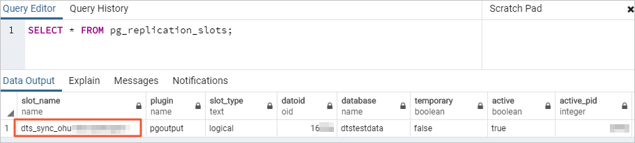<br>• Before you synchronize data, evaluate the impact of data synchronization on the performance of the source and destination databases. We recommend that you synchronize data during off-peak hours. During initial full data synchronization, DTS uses the read and write resources of the source and destination databases. This may increase the load on the database servers.<br>• During initial full data synchronization, concurrent INSERT operations cause fragmentation in the tables of the destination database. After initial full data synchronization is complete, the size of the used tablespace of the destination database is larger than that of the source database.<br>• We recommend that you do not use tools such as gh-ost or pt-online-schema-change to perform DDL operations on source tables during data synchronization. Otherwise, data synchronization may fail.<br>• If you use only DTS to write data to the destination database, you can use Data Management (DMS) to perform online DDL operations on source tables during data synchronization.<br>Warning<br>Do not use DMS to execute online DDL statements while data from other sources is written to the destination database. Otherwise, data loss may occur in the destination database. |

**SQL operations that support data synchronization**

DML operations: INSERT, UPDATE, and DELETE

**Before you begin**

DTS does not synchronize the schemas of the objects to be synchronized from the source database to the destination database. You must create a database, schema, or table in the destination AnalyticDB for PostgreSQL instance based on the data structure of the source self-managed PostgreSQL database.

**Procedure**

1. Create a data synchronization task.

   > **Note**
   >
   > When you create the data synchronization instance, select **PostgreSQL** as the source database type, **AnalyticDB for PostgreSQL** as the destination database type, and **One-way Synchronization** as the synchronization topology.

2. On the Data Synchronization page, find the data synchronization task that you created and click **Configure Task** in the Actions column.

3. Configure the source and destination instances.

   **Section**

   **Parameter**

   **Description**

   The task name that DTS automatically generates. We recommend that you specify an informative name to

   N/A

   **Task Name**

   identify the task. You do not need to use a unique task name.

   **Database Type**

   The type of the source database. Select **PostgreSQL**.

   The access method of the destination database. Select

   **Access Method**

   **Public IP Address**.

   The region in which the source database resides. The region is the source region that you selected when you

   **Instance**

   created the data synchronization instance. You cannot

   **Region**

   change the value of this parameter.

   **Domain Name**

   The server IP address of the self-managed PostgreSQL

   **or IP**

   database.

   **Source Database**

   The service port number of the self-managed PostgreSQL

   **Port Number**

   database.

   **Database**

   The name of the self-managed PostgreSQL database.

   **Name**

   The username of the account used to log on to the self-

   **Database**

   managed PostgreSQL database. The account must have

   **Account**

   the superuser permissions.

   **Database**

   The password of the database account.

   **Password**

   The database type of the destination database. Select

   **Database Type**

   **AnalyticDB for PostgreSQL**.

   The access method of the destination database. Select

   **Access Method**

   **Alibaba Cloud Instance**.

   The region in which the destination database resides. The

   **Instance**

   region is the destination region that you selected when

   **Region**

   you created the data synchronization task. You cannot change the value of this parameter.

   **Destination Database**

   **Instance ID**

   The ID of the AnalyticDB for PostgreSQL instance.

   **Database**

   The name of the destination database.

   **Name**

   The username of the database account of the AnalyticDB

   **Database**

   for PostgreSQL instance or the database account that has

   **Account**

   the RDS_SUPERUSER permission.

   **Database Password**

   The password of the database account.

4. In the lower part of the page, click **Test Connectivity and Proceed**.

5. If a whitelist is configured for the self-managed PostgreSQL database, add the CIDR blocks of DTS servers that are displayed in the dialog box to the whitelist of the database. After the whitelist is configured, click **Test Connectivity and Proceed**.

   > **Note**
   >
   > If you do not need to configure a whitelist for the self-managed PostgreSQL database, ignore the preceding settings and click **Test Connectivity and Proceed**.

6. Configure the synchronization policy and the objects to be synchronized. The following table describes the parameters.

   | Parameter | Description |
   | --- | --- |
   | Task Stages | By default, <strong>Incremental Data Synchronization</strong> is selected. By default, you must also select <strong>Full Data Synchronization</strong>. <strong>Schema</strong> <strong>Synchronization</strong> is not supported. After the precheck is complete, DTS synchronizes the historical data of selected objects from the source instance to the destination instance. The historical data serves as the basis for subsequent incremental synchronization. |

   <table>
     <tr>
       <td>Processing Mode of Conflicting Tables</td>
       <td>• <strong>Precheck and Report Errors</strong>: checks whether the destination database contains tables that have the same names as tables in the source database. If the source and destination databases do not contain tables that have identical table names, the precheck is passed.Otherwise, an error is returned during the precheck, and the data migration task cannot be started.<br>• <strong>Clear Destination Table</strong>: skips the precheck for empty destination tables and clears the data in destination tables before initial full data synchronization.<br>• <strong>Ignore</strong>: skips the precheck for identical table names in the source and destination databases.<br>Warning If you select <strong>Ignore</strong>, data consistency is not ensured, and your business may be exposed to potential risks.<br>• If the source and destination databases have the same schema, DTS does not migrate data records that have the same primary keys as data records in the destination database.<br>• If the source and destination databases have different schemas, only specific columns are migrated or the data migration task fails.</td>
     </tr>
     <tr>
       <td>DDL and DML Operations to Be Synchronized</td>
       <td>The SQL operations to be synchronized during incremental data migration at the instance level.<br>Note To select the SQL operations performed on a specific database or table, perform the following steps: In the <strong>Selected</strong> <strong>Objects</strong> section, right-click an object. In the dialog box that appears, select the SQL operations that you want to synchronize.</td>
     </tr>
     <tr>
       <td>Capitalization of Object Names in Destination Instance</td>
       <td>Specify the capitalization of database names, table names, and column names in the destination instance. By default, <strong>DTS default policy</strong> is selected. You can select other options to ensure that the capitalization of object names is consistent with that in the source or destination database.For more information, see Specify the capitalization of object names in the destination instance.</td>
     </tr>
     <tr>
       <td>Source Objects</td>
       <td>Select one or more objects that you want to synchronize in the <strong>Source</strong><br><strong>Objects</strong> section and click theicon to move the objects to the<br><strong>Selected Objects</strong> section.<br>Note<br>You can use the navigation tree to search for one or more objects.</td>
     </tr>
     <tr>
       <td>Selected Objects</td>
       <td>By default, after an object is synchronized to the destination instance, the name of the object remains unchanged. You can use the object name mapping feature to rename the objects that are synchronized to the destination instance. For more information, see Rename an object to be synchronized.<br>Note<br>• To select the SQL operations performed on a specific table, perform the following steps: In the <strong>Selected Objects</strong> section, right-click an object. In the dialog box that appears, select the SQL operations that you want to synchronize.<br>• To specify WHERE clauses to filter data, right-click a table in the <strong>Selected Objects</strong> section. In the dialog box that appears, specify the filter conditions. For more information, see Use SQL conditions to filter data.<br>• If you use the object name mapping feature to rename an object, other objects that are dependent on the object may fail to be synchronized.</td>
     </tr>
   </table>

7. Click **Next: Advanced Settings** to configure advanced settings. The following table describes the parameters.

   | Parameter | Description |
   | --- | --- |
   | Retry Time for Failed Connections | The retry time range for failed connections. If the connection to the source or destination database fails after the data synchronization task is started, an error is returned. For predictable errors, DTS immediately retries a connection within the time range. Valid values: 10 to 1440. Unit: minutes.Default value: 720. We recommend that you set the parameter to a value greater than 30. If DTS reconnects to the source and destination databases within the specified retry time range, DTS resumes the data synchronization task. Otherwise, the data synchronization task fails.<br>Note<br>If you set different retry time ranges for multiple data synchronization tasks that have the same source or destination database, the shortest retry time range that is set takes precedence. |
   | Configure ETL | The extract, transform, and load (ETL) feature cannot be enabled for this data synchronization task. Select <strong>No</strong>. |

8. <strong>Optional:</strong>Click **Next: Configure Database and Table Fields** to specify a type for the tables that you want to synchronize to the destination database.

   > **Note**
   >
   > If you select **Schema Synchronization**, you must specify the **type**,
   >
   > **primary key column**, and **distribution key** information for the tables that you want to synchronize to the AnalyticDB for PostgreSQL instance.

9. In the lower part of the page, click **Next: Precheck and Start Task**.

   > **Important**
   >
   > - Before you can start the data synchronization task, a precheck is performed. You can start the data synchronization task only after the task passes the precheck.
   >
   > - If the task fails to pass the precheck, click **View Details** next to each failed item. After you troubleshoot the issues based on the causes, run a precheck again.

0. Wait until the success rate becomes 100%. Then, click **Back**.

<a id="section-5-5-4"></a>

### 5.5.4. Synchronize data from an ApsaraDB RDS for SQL Server database to a DataHub instance

This topic describes how to use Data Transmission Service (DTS) to synchronize data from an ApsaraDB RDS for SQL Server database to a DataHub instance.

**Prerequisites**

DataHub is activated and a project is created to receive the data to be synchronized.

**Limits**

**SQL operations that can be incrementally synchronized**

| Operation type | SQL statement |
| --- | --- |
| DML | INSERT、UPDATE、DELETE<br>Note<br>DTS does not synchronize <code> UPDATE </code> statements that only update a large field. |

**Procedure**

1. Create a data synchronization instance.

   > **Note**
   >
   > When you create the data synchronization instance, select **SQLServer** as the source database type and **DataHub** as the destination database type.

2. On the Data Synchronization page, find the data synchronization task that you created and click **Configure Task** in the Actions column.

3. Configure the source and destination databases. The following table describes the parameters.

   **Section**

   **Parameter**

   **Description**

   DTS automatically generates a task name. We recommend that you

   N/A

   **Task Name**

   specify a descriptive name for easy identification. The name does not need to be unique.

   **Database**

   The type of the source database. Select **SQL Server**.

   **Type**

   **Access**

   The access method of the source database. Select **Alibaba Cloud**

   **Method**

   **Instance**.

   The region in which the source database resides. The region is the

   **Instance**

   source region that you selected when you created the data

   **Region**

   synchronization instance. You cannot change the value of this parameter.

   Specifies whether to migrate data across Alibaba Cloud accounts. Select **No**.

   > **Note**

   **Replicate**

   **Source**

   **Data Across**

   > Specifies whether to synchronize data between instances that

   **Database**

   **Alibaba**

   > belong to different Alibaba Cloud accounts. If you select **Yes**,

   **Cloud**

   > you must configure the **Alibaba Cloud Account** and **RAM**

   **Accounts**

   > **Role Name** parameters. For more information about how to create a Resource Access Management (RAM) role and grant permissions to the role, see Configure RAM authorization for cross-account data migration or synchronization.

   **Instance ID**

   The ID of the source SQL Server instance.

   The database account of the source SQL Server instance. The

   **Database**

   account must have the owner permissions on the objects to be

   **Account**

   synchronized. A privileged account has the required permissions.

   **Database**

   Enter the password for the specified database account.

   **Password**

   **Database**

   The type of the destination database. Select **DataHub**.

   **Type**

   **Access**

   The access method of the destination database. Default value:

   **Method**

   **Alibaba Cloud Instance**.

   **Destinati on Database**

   The region in which the destination database resides. The region is the destination region that you selected when you created the data

   **Instance**

   synchronization instance. You cannot change the value of this

   **Region**

   parameter.

   **Project**

   The name of the DataHub project to which data is synchronized.

4. In the lower part of the page, click **Test Connectivity and Proceed**.

5. Select the objects to be synchronized and the synchronization types.

   | Parameter | Description |
   | --- | --- |
   | Task Stages | <strong>Incremental Data Synchronization</strong> is automatically selected.By default, you must also select <strong>Schema Synchronization</strong>. <strong>Full</strong> <strong>Data Synchronization</strong> is not supported. |

   <table>
     <tr>
       <td>Processing Mode of Conflicting Tables</td>
       <td>• <strong>Precheck and Report Errors</strong>: checks whether the destination database contains tables that have the same names as tables in the source database. If the source and destination databases do not contain tables that have identical table names, the precheck is passed. Otherwise, an error is returned during the precheck and the data synchronization task cannot be started.<br>• <strong>Ignore Errors and Proceed</strong>: skips the precheck for identical table names in the source and destination databases.<br>Warning<br>If you select <strong>Ignore Errors and Proceed</strong>, data inconsistency may occur between the source and destination databases, and your business may be exposed to potential risks.<br>• If the source and destination databases have the same schema, DTS does not synchronize the data records that have the same primary keys as the data records in the destination database during initial full data synchronization. However, DTS synchronizes these data records during incremental data synchronization.<br>• If the source and destination databases have different schemas, initial data synchronization may fail. In this case, only specific columns are synchronized, or the data synchronization task fails.</td>
     </tr>
     <tr>
       <td>Apply New Naming Rules of Additional Columns</td>
       <td>Configure this parameter based on your business requirements.<br>• <strong>New Rule</strong>: Adopt new naming rules for additional columns.<br>• <strong>Previous Rule</strong>: Adopt old naming rules for additional columns.<br>• <strong>Do Not Use Default Naming Rules of Additional Columns</strong>: Do not adopt any rules for additional columns.<br>Warning Before you specify this parameter, check whether additional columns have the same names as the existing columns in the destination table.</td>
     </tr>
     <tr>
       <td>Capitalization of Object Names in Destination Instance</td>
       <td>Specify the capitalization of database names, table names, and column names in the destination instance. By default, <strong>DTS</strong> <strong>default policy</strong> is selected. You can select other options to make sure that the capitalization of object names is consistent with that in the source or destination database. For more information, see Specify the capitalization of object names in the destination instance.</td>
     </tr>
     <tr>
       <td>Source Objects</td>
       <td>In the <strong>Source Objects</strong> box, click the objects, and then click<br>to move them to the <strong>Selected Objects</strong> box.<br>Note<br>You can use the navigation tree to search for one or more objects.</td>
     </tr>
     <tr>
       <td>Selected Objects</td>
       <td>By default, after an object is synchronized to the destination instance, the name of the object remains unchanged. You can use the object name mapping feature to change the names of the objects that are synchronized to the destination instance. For more information, see Rename an object to be synchronized.<br>Note<br>If you use the object name mapping feature to rename an object, other objects that are dependent on the object may fail to be synchronized.</td>
     </tr>
   </table>

6. Click **Next: Advanced Settings**.

   | Parameter | Description |
   | --- | --- |
   | Retry Time for Failed Connection | The retry time range for failed connections. If the source or destination database fails to be connected after the data synchronization task is started, DTS immediately retries a connection within the time range. Valid values: 10 to 1440. Unit: minutes. Default value: 720. We recommend that you set the parameter to a value greater than 30. If DTS reconnects to the source and destination databases within the specified time range, DTS resumes the data synchronization task. Otherwise, the data synchronization task fails.<br>Note If you set different retry time ranges for multiple data synchronization tasks that have the same source or destination database, the shortest retry time range that is set takes precedence. |
   | Configure ETL | Specifies whether to enable the extract, transform, and load (ETL) feature.The data synchronization task does not support the ETL feature. Select <strong>No</strong>. |

7. In the lower part of the page, click **Next: Precheck and Start Task**.

   > **Important**
   >
   > - Before you can start the data synchronization task, a precheck is performed. You can start the data synchronization task only after the task passes the precheck.
   >
   > - If the task fails to pass the precheck, click **View Details** next to each failed item. After you troubleshoot the issues based on the causes, run a precheck again.

8. Wait until the success rate becomes 100%. Then, click **Back**.

<a id="section-5-5-5"></a>

### 5.5.5. Synchronize data from a PolarDB-X 2.0 instance

<a id="section-5-5-5-1"></a>

#### 5.5.5.1. Synchronize data from a PolarDB-X 2.0 instance to a PolarDB-X 1.0 instance

This topic describes how to use Data Transmission Service (DTS) to synchronize data from a PolarDB-X 2.0 instance to a PolarDB-X 1.0 instance.

**Prerequisites**

- The source PolarDB-X 2.0 instance is created and compatible with MySQL 5.7.

- A destination PolarDB-X 1.0 that has a larger storage space than the total size of the data to be synchronized from the source PolarDB-X 2.0 instance is created.

- Databases and tables are created in the destination PolarDB-X 1.0 instance to receive data.

  > **Note**
  >
  > We recommend that you keep the names of the destination databases and tables the same as those of the source databases and tables on the PolarDB-X 2.0 instance. Otherwise, you must map the names of the databases, tables, and columns added to the **Selected Objects** list when you configure the synchronization task.

**Limits**

| Category | Description |
| --- | --- |

<table>
  <tr>
    <td>Limits on the source database</td>
    <td>• The tables to be synchronized must have PRIMARY KEY or UNIQUE constraints, and all fields must be unique. Otherwise, the destination may contain duplicate data records.<br>• If you select tables as the objects to be synchronized and you need to modify the tables, such as renaming tables or columns, in the destination database, you can synchronize up to 1,000 tables in a single data synchronization task. If you run a task to synchronize more than 1,000 tables, a request error occurs.In this case, we recommend that you split the tables and configure multiple tasks to synchronize the tables in batches or configure a task to synchronize the entire database.<br>• If you perform only incremental data synchronization, the binary logs of the source database are retained for at least 24 hours. If you perform both full data synchronization and incremental data synchronization, the binary logs of the source database are retained for at least seven days. Otherwise, DTS may fail to obtain the binary logs, and the task may fail. In exceptional circumstances, data inconsistency or loss may occur. After full data synchronization is complete, you can set the retention period to more than 24 hours. Make sure that you set the retention period of binary logs in accordance with the preceding requirements. Otherwise, the service reliability and performance stated in the Service Level Agreement (SLA) of DTS may not be achieved.<br>• The source PolarDB-X 2.0 instance must be compatible with MySQL 5.7.<br>• DTS does not synchronize tables whose names contain uppercase letters.<br>• DTS does not synchronize TABLEGROUP and databases or tables that contain the Locality attribute.<br>• Do not run DDL operations that change database or table schemas during schema synchronization or full synchronization. Otherwise, the synchronization task fails.<br>Note<br>During full synchronization, DTS queries the source database. This creates metadata locks that may block DDL operations on the source database.</td>
  </tr>
</table>

<table>
  <tr>
    <td>Other limits</td>
    <td>• Schema synchronization is not supported. Before you configure a data synchronization task, you must create databases and tables in the destination instance based on the databases and tables that you want to synchronize.<br>• During full data synchronization, DTS uses the read and write resources of the source and destination databases. This may increase the loads of the database servers. Before you synchronize data, assess the impact of data synchronization on the performance of the source and destination databases.We recommend that you synchronize data during off-peak hours, such as when the CPU usage of the source and destination databases is lower than 30%.<br>• During initial full data synchronization, concurrent INSERT operations cause table fragmentation in the destination database. Therefore, after initial full data synchronization is complete, the size of the used tablespace of the destination database is larger than that of the source database.<br>• If you select one or more tables instead of an entire database as the objects to be synchronized, do not use tools such as pt-online-schema-change to perform online DDL operations on the tables during data synchronization. Otherwise, the data synchronization task fails.<br>• Data inconsistency between the source and destination databases may occur if data from other sources is written to the destination database during data synchronization.<br>• DTS attempts to resume data synchronization tasks that failed within the last seven days. Before you switch workloads to the destination instance, stop or release the ongoing data synchronization task. You can also execute the <code> REVOKE </code> statement to revoke the write permissions from the accounts that are used by DTS to access the destination instance. Otherwise, the data in the source database overwrites the data in the destination database after the failed task is resumed.<br>• DTS updates the `dts_health_check`.`ha_health_check` table in the source database as scheduled to move forward the binary log file position.</td>
  </tr>
</table>

**SQL operations that support incremental synchronization**

| Operation type | SQL statements |
| --- | --- |
| DML | INSERT, UPDATE, DELETE |
| DDL | CREATE TABLE, RENAME TABLE, ALTER TABLE, TRUNCATE TABLE, DROP TABLE, CREATE INDEX, DROP INDEX |

**Permissions required by database accounts**

| Database type | Schema synchronization | Full data synchronization | Incremental data synchronization |
| --- | --- | --- | --- |
| Source PolarDB-X 2.0 instance | SELECT permission | SELECT permission | SELECT permission on the objects to be synchronized, REPLICATION SLAVE permission, and REPLICATION CLIENT permission |

<table>
  <tr>
    <td>Destination PolarDB-X 1.0 instance</td>
    <td>Read and write permissions</td>
  </tr>
</table>

**Procedure**

1. Create a data synchronization task.

   > **Note**
   >
   > When you create the data synchronization task, select **PolarDB-X 2.0** as the **source database type** and **PolarDB-X 1.0** as the **destination database type**.

2. On the Data Synchronization page, find the data synchronization task that you created and click **Configure Task** in the Actions column.

3. Configure the source and the destination database.

   **Section**

   **Parameter**

   **Description**

   DTS automatically generates a task name. We recommend that you

   None.

   **Task Name**

   specify a descriptive name for easy identification. The name does not need to be unique.

   **Database**

   The type of the source database. Select **PolarDB-X 2.0**.

   **Type**

   **Access**

   The access method of the source database. Default value: **Alibaba**

   **Method**

   **Cloud Instance**.

   The region in which the source database resides. The region is the

   **Instance**

   source region that you selected when you created the data

   **Region**

   synchronization task. You cannot change the value of this parameter.

   **Replicate Data Across**

   Specifies whether to synchronize data across Alibaba Cloud

   **Alibaba**

   accounts. In this example, **No** is selected.

   **Source**

   **Cloud**

   **Database**

   **Accounts**

   **Instance ID**

   The ID of the source PolarDB-X 2.0 instance.

   The database account of the source PolarDB-X 2.0 instance. For

   **Database**

   more information about the permissions that are required for the

   **Account**

   account, see the Permissions required for database accounts section of this topic.

   **Database**

   Enter the password for the database account.

   **Password**

   **Database**

   The type of the destination database. Select **PolarDB-X 1.0**.

   **Type**

   **Access**

   The access method of the destination database. Select **Alibaba**

   **Method**

   **Cloud Instance**.

   The region in which the destination database resides. The region is

   **Instance**

   the destination region that you selected when you created the data

   **Region**

   synchronization task. You cannot change the value of this parameter.

   **Replicate**

   **Destinati**

   **Data Across**

   **on**

   Specifies whether to synchronize data across Alibaba Cloud

   **Alibaba**

   **Database**

   accounts. In this example, **No** is selected.

   **Cloud Accounts**

   **Instance ID**

   The ID of the destination PolarDB-X 1.0 instance.

   The database account of the destination PolarDB-X 1.0 instance. For

   **Database**

   more information about the permissions that are required for the

   **Account**

   account, see the Permissions required for database accounts section of this topic.

   **Database**

   Enter the password for the database account.

   **Password**

4. In the lower part of the page, click **Test Connectivity and Proceed**.

5. Configure the objects to be synchronized and advanced settings. The following table describes the parameters.

   | Parameter | Description |
   | --- | --- |
   | Task Stages | By default, <strong>Incremental Data Synchronization</strong> is selected. You must also select <strong>Full Data Synchronization</strong>. After the precheck is complete, DTS synchronizes the historical data of the selected objects from the source database to the destination database.The historical data is the basis for subsequent incremental synchronization. |
   | Incremental CDC Type | Select an option based on the log engine of the PolarDB-X 2.0 instance.<br>Note<br>If you want to select <strong>Multi-stream CDC</strong>, make sure that multi-stream binary logging is enabled for the PolarDB-X 2.0 instance. |
   | Processing Mode of Conflicting Tables | • <strong>Precheck and Report Errors</strong>: checks whether the destination database contains tables that have the same names as tables in the source database. If the source and destination databases do not contain tables that have identical table names, the precheck is passed. Otherwise, an error is returned during the precheck and the data synchronization task cannot be started.<br>• <strong>Ignore Errors and Proceed</strong>: skips the precheck for identical table names in the source and destination databases.<br>Warning<br>If you select <strong>Ignore Errors and Proceed</strong>, data inconsistency may occur between the source and destination databases, and your business may be exposed to potential risks.<br>• If the source and destination databases have the same schema, DTS does not synchronize the data records that have the same primary keys as the data records in the destination database during initial full data synchronization. However, DTS synchronizes these data records during incremental data synchronization.<br>• If the source and destination databases have different schemas, initial data synchronization may fail. In this case, only specific columns are synchronized, or the data synchronization task fails. |

   <table>
     <tr>
       <td>Source Objects</td>
       <td>In the <strong>Source Objects</strong> box, click the objects, and then click<br>to move them to the <strong>Selected Objects</strong> box.<br>Note<br>• You can use the navigation tree to search for one or more objects.<br>• You can select tables or databases as the objects to be synchronized.</td>
     </tr>
     <tr>
       <td>Selected Objects</td>
       <td>By default, after an object is synchronized to the destination database, the name of the object remains unchanged. You can use the object name mapping feature to change the names of the objects that are synchronized to the destination instance. For more information, see Rename an object to be synchronized.<br>Note<br>If you use the object name mapping feature to rename an object, other objects that are dependent on the object may fail to be synchronized.</td>
     </tr>
   </table>

6. Click **Next: Advanced Settings** to configure advanced settings. The following table describes the parameters.

   | Parameter | Description |
   | --- | --- |
   | Retry Time for Failed Connections | The retry time range for failed connections. If the source or destination database fails to be connected after the data synchronization task is started, an error is returned. For predictable errors, DTS immediately retries a connection within the time range. Valid values: 10 to 1440. Unit: minutes. Default value: 720. We recommend that you set the parameter to a value greater than 30. If DTS reconnects to the source and destination databases within the specified retry time range, DTS resumes the data synchronization task. Otherwise, the data synchronization task fails.<br>Note<br>If you specify different retry time ranges for multiple data synchronization tasks that have the same source or destination database, the shortest retry time range takes precedence. |
   | Whether to delete SQL operations on heartbeat tables of forward and reverse tasks | Specifies whether to write SQL operations on heartbeat tables to the source database while the DTS instance is running. Valid values:<br>• <strong>Yes</strong>: does not write SQL operations on heartbeat tables. In this case, a latency of the DTS instance may be displayed.<br>• <strong>No</strong>: writes SQL operations on heartbeat tables. In this case, features such as physical backup and cloning of the source database may be affected. |

7. In the lower part of the page, click **Next: Precheck and Start Task**.

   > **Important**
   >
   > - Before you can start the data synchronization task, a precheck is performed. You can start the data synchronization task only after the task passes the precheck.
   >
   > - If the task fails to pass the precheck, click **View Details** next to each failed item. After you troubleshoot the issues based on the causes, run a precheck again.

8. Wait until the success rate becomes 100%. Then, click **Back**.

<a id="section-5-5-5-2"></a>

#### 5.5.5.2. Synchronize data between PolarDB-X 2.0 instances

This topic describes how to synchronize data between PolarDB-X 2.0 instances by using Data Transmission Service (DTS).

**Prerequisites**

- The source and destination PolarDB-X 2.0 instances are created and compatible with MySQL 5.7.

- The available storage space of the destination PolarDB-X 2.0 instance is larger than the total size of the data in the source PolarDB-X 2.0 instance.

**Limits**

| Category | Description |
| --- | --- |

<table>
  <tr>
    <td>Limits on the source instance</td>
    <td>• The tables to be synchronized must have PRIMARY KEY or UNIQUE constraints, and all fields must be unique. Otherwise, the destination may contain duplicate data records.<br>• If you select tables as the objects to be synchronized and you need to edit the tables in the destination database, such as remaining tables or columns, up to 1,000 tables can be synchronized in a single data synchronization task. If you run a task to synchronize more than 1,000 tables, a request error occurs. In this case, we recommend that you split the tables and configure multiple tasks to synchronize the tables in batches or configure a task to synchronize the entire database.<br>• The following requirements for binary logs must be met:<br>• Binary logging is enabled on the Calculation layer and Storage layer tabs in the PolarDB-X console. For more information, see the <strong>"Parameter</strong> <strong>settings"</strong> topic in the documentation of <strong>PolarDB-X</strong>. The binlog_row_image parameter is set to full. Otherwise, error messages are returned during the precheck, and the data synchronization task cannot be started.<br>• If you perform only incremental data synchronization, the binary logs of the source database must be stored for more than 24 hours. If you perform both full data synchronization and incremental data synchronization, the binary logs of the source database must be stored for at least seven days.Otherwise, DTS may fail to obtain the binary logs, and the task may fail. In exceptional circumstances, data inconsistency or loss may occur. After full data synchronization is complete, you can set the retention period to more than 24 hours. Make sure that you set the retention period of binary logs in accordance with the preceding requirements. Otherwise, the service reliability and performance stated in the Service Level Agreement (SLA) of DTS may not be achieved.<br>• The source PolarDB-X 2.0 instance must be compatible with MySQL 5.7.</td>
  </tr>
  <tr>
    <td>Other limits</td>
    <td>• The destination PolarDB-X 2.0 instance must be compatible with MySQL 5.7.<br>• Before you synchronize data, evaluate the impact of data synchronization on the performance of the source and destination databases. We recommend that you synchronize data during off-peak hours. During initial full data synchronization, DTS uses the read and write resources of the source and destination databases. This may increase the load on the database servers.<br>• During initial full data synchronization, concurrent INSERT operations cause fragmentation in the tables of the destination database. After initial full data synchronization is complete, the size of the used tablespace of the destination database is larger than that of the source database.<br>• We recommend that you do not use gh-ost or pt-online-schema-change to perform data definition language (DDL) operations on objects to be synchronized. Otherwise, data synchronization fail.</td>
  </tr>
</table>

**SQL operations that support data synchronization**

| Operation type | SQL statement |
| --- | --- |
| DML | INSERT, UPDATE, and DELETE |

**Permissions required by database accounts**

<table>
  <tr>
    <th>Instance type</th>
    <th>Schema synchronization</th>
    <th>Full data synchronization</th>
    <th>Incremental data synchronization</th>
  </tr>
  <tr>
    <td>Source <strong>PolarDB-</strong><strong>X 2.0</strong> Instance</td>
    <td>SELECT permission</td>
    <td>SELECT permission</td>
    <td>SELECT permission on the objects to be synchronized, REPLICATION SLAVE permission, and REPLICATION CLIENT permission</td>
  </tr>
  <tr>
    <td>Destination PolarDB-X 2.0 Instance</td>
    <td colspan="3">Read and write permissions</td>
  </tr>
</table>

**Procedure**

1. Create a data synchronization task.

   > **Note**
   >
   > When you create the data synchronization task, select **PolarDB-X 2.0** as the source and destination database types.

2. On the Data Synchronization page, find the data synchronization task that you created and click **Configure Task** in the Actions column.

3. Configure the source and the destination database. The following table describes the parameters.

   **Section**

   **Parameter**

   **Description**

   DTS automatically generates a task name. We recommend that you

   None

   **Task Name**

   specify a descriptive name for easy identification. The name does not need to be unique.

   **Database**

   The type of the source database. Select **PolarDB-X 2.0**.

   **Type**

   **Access**

   The access method of the source database. Default value:**Alibaba**

   **Method**

   **Cloud Instance**.

   The region in which the source database resides. The region is the

   **Instance**

   source region that you selected when you created the data

   **Region**

   synchronization task. You cannot change the value of this parameter.

   **Source**

   **Replicate**

   **Database**

   **Data Across**

   Specifies whether to synchronize data across Alibaba Cloud

   **Alibaba**

   accounts. In this example, **No** is selected.

   **Cloud Accounts**

   **Instance ID**

   The ID of the source PolarDB-X 2.0 instance.

   The database account of the source PolarDB-X 2.0 instance. The

   **Database**

   account must have the SELECT permission on the objects to be

   **Account**

   synchronized, the REPLICATION CLIENT permission, and the REPLICATION SLAVE permission.

   **Database**

   The password that is used to access the database.

   **Password**

   **Database**

   The type of the destination database. Select **PolarDB-X 2.0**.

   **Type**

   **Access**

   The access method of the destination database. Default value:

   **Method**

   **Alibaba Cloud Instance**.

   The region in which the destination database resides. The region is

   **Instance**

   the destination region that you selected when you created the data

   **Region**

   synchronization task. You cannot change the value of this

   **Destinati**

   parameter.

   **on Database**

   **Instance ID**

   The ID of the destination PolarDB-X 2.0 instance.

   The database account of the destination PolarDB-X 2.0 instance.

   **Database**

   The account must have the read and write permissions on the

   **Account**

   destination PolarDB-X 2.0 instance.

   **Database**

   The password that is used to access the database.

   **Password**

4. In the lower part of the page, click **Test Connectivity and Proceed**.

5. Configure the objects to be synchronized and advanced settings. The following table describes the parameters.

   | Parame ter | Description |
   | --- | --- |
   | Task Stages | DTS always selects <strong>Incremental Data Synchronization</strong>. By default, you must also select <strong>Schema Synchronization</strong> and <strong>Full Data Synchronization</strong>. After the precheck, DTS initializes the destination cluster with the full data of the selected source objects, which serves as the baseline for subsequent incremental synchronization. |
   | Increm ental CDC Type | Select an option based on the log engine of the PolarDB-X 2.0 instance.<br>Note<br>If you want to select <strong>Multi-stream CDC</strong>, make sure that multi-stream binary logging is enabled for the PolarDB-X 2.0 instance. |
   | Process ing Mode of Conflict ing Tables | • <strong>Precheck and Report Errors</strong>: checks whether the destination instance contains tables that have the same names as tables in the source database. If the source and destination databases do not contain tables that have identical table names, the precheck is passed. Otherwise, an error is returned during the precheck, and the data synchronization task cannot be started.<br>Note<br>If the source and destination databases contain tables that have the same names and the tables in the destination database cannot be deleted or renamed, you can use the object name mapping feature to rename the tables that are synchronized to the destination database. For more information, see Rename an object to be synchronized.<br>• <strong>Ignore Errors and Proceed</strong>: skips the precheck for identical table names in the source and destination databases.<br>Warning<br>If you select <strong>Ignore Errors and Proceed</strong>, data inconsistency may occur, and your business may be exposed to potential risks.<br>• If the source and destination databases have the same schema, and a data record has the same primary key as an existing data record in the destination database, the following scenarios may occur:<br>• During full data synchronization, DTS does not synchronize the data record to the destination database. The existing data record in the destination database is retained.<br>• During incremental data synchronization, DTS synchronizes the data record to the destination database. The existing data record in the destination database is overwritten.<br>• If the source and destination databases have different schemas, data may fail to be initialized. In this case, only specific columns are synchronized, or the data synchronization task fails. |
   | Capitali zation of Object Names in Destina tion Instanc e | The capitalization of database names, table names, and column names in the destination instance. By default, <strong>DTS default policy</strong> is selected. You can select other options to make sure that the capitalization of object names is consistent with that of the source or destination database. For more information, see Specify the capitalization of object names in the destination instance. |
   | Source Objects | In the <strong>Source Objects</strong> box, click the objects, and then clickto move them to the<br><strong>Selected Objects</strong> box.<br>Note<br>You can select objects at the database, table, or column level. If you select only tables or columns, DTS does not synchronize other object types (such as views, triggers, and stored procedures). |
   | Selecte d Objects | By default, after an object is synchronized to the destination database, the name of the object remains unchanged. You can use the object name mapping feature to change the names of the objects that are synchronized to the destination instance. For more information, see Rename an object to be synchronized.<br>Note<br>If you use the object name mapping feature to rename an object, other objects that depend on the object may fail to be synchronized. |

6. Click **Next: Advanced Settings** to configure advanced settings. The following table describes the parameters.

   | Parameter | Description |
   | --- | --- |
   | Retry Time for Failed Connections | The retry time range for failed connections. If the source or destination database fails to be connected after the data synchronization task is started, an error is returned. For predictable errors, DTS immediately retries a connection within the time range. Valid values: 10 to 1440. Unit: minutes. Default value: 720. We recommend that you set the parameter to a value greater than 30. If DTS reconnects to the source and destination databases within the specified retry time range, DTS resumes the data synchronization task. Otherwise, the data synchronization task fails.<br>Note<br>If you set different retry time ranges for multiple data synchronization tasks that have the same source or destination database, the shortest retry time range that is set takes precedence. |
   | Configure ETL | The extract, transform, and load (ETL) feature cannot be enabled for this data synchronization task. Select <strong>No</strong>. |
   | Whether to delete SQL operations on heartbeat tables of forward and reverse tasks | Specifies whether to write SQL operations on heartbeat tables to the source database while the DTS instance is running. Valid values:<br>• <strong>Yes</strong>: does not write SQL operations on heartbeat tables. In this case, a latency of the DTS instance may be displayed.<br>• <strong>No</strong>: writes SQL operations on heartbeat tables. In this case, features such as physical backup and cloning of the source database may be affected. |

7. In the lower part of the page, click **Next: Precheck and Start Task**.

   > **Important**
   >
   > - Before you can start the data synchronization task, a precheck is performed. You can start the data synchronization task only after the task passes the precheck.
   >
   > - If the task fails to pass the precheck, click **View Details** next to each failed item. After you troubleshoot the issues based on the causes, run a precheck again.

8. Wait until the success rate becomes 100%. Then, click **Back**.

<a id="section-5-5-5-3"></a>

#### 5.5.5.3. Synchronize data from a PolarDB-X 2.0 instance to an ApsaraDB RDS for MySQL instance

Data Transmission Service (DTS) allows you to synchronize data from a PolarDB-X 2.0 instance to an ApsaraDB RDS for MySQL instance or a self-managed MySQL instance. This topic describes how to synchronize data from a PolarDB-X 2.0 instance to an ApsaraDB RDS for MySQL instance by using DTS.

**Prerequisites**

- The source PolarDB-X 2.0 instance is created and compatible with MySQL 5.7.

- The available storage space of the destination ApsaraDB RDS for MySQL instance is larger than the total size of data in the source PolarDB-X 2.0 instance.

**Limits**

| Category | Description |
| --- | --- |

<table>
  <tr>
    <td>Limits on the source instance</td>
    <td>• The tables to be synchronized must have PRIMARY KEY or UNIQUE constraints, and all fields must be unique. Otherwise, the destination may contain duplicate data records.<br>• If you select tables as the objects to be synchronized and you need to edit the tables in the destination database, such as remaining tables or columns, up to 1,000 tables can be synchronized in a single data synchronization task. If you run a task to synchronize more than 1,000 tables, a request error occurs. In this case, we recommend that you split the tables and configure multiple tasks to synchronize the tables in batches or configure a task to synchronize the entire database.<br>• If you perform only incremental data synchronization, the binary logs of the source database are retained for at least 24 hours. If you perform both full data synchronization and incremental data synchronization, the binary logs of the source database are retained for at least seven days. Otherwise, DTS may fail to obtain the binary logs and the task may fail. In exceptional circumstances, data inconsistency or loss may occur. After full data synchronization is complete, you can set the retention period to more than 24 hours. Make sure that you set the retention period of binary logs in accordance with the preceding requirements. Otherwise, the service reliability and performance stated in the Service Level Agreement (SLA) of DTS may not be achieved.<br>• If the source database is PolarDB-X 2.0 and the name of the table to be synchronized contains uppercase letters, you can perform only schema synchronization.<br>• The source PolarDB-X 2.0 instance must be compatible with MySQL 5.7.</td>
  </tr>
  <tr>
    <td>Other limits</td>
    <td>• Before you synchronize data, evaluate the impact of data synchronization on the performance of the source and destination databases. We recommend that you synchronize data during off-peak hours. During full data synchronization, DTS uses the read and write resources of the source and destination databases. This may increase the loads on the database servers.<br>• During full data synchronization, concurrent INSERT operations cause fragmentation in the tables of the destination database. After full data synchronization is complete, the size of used tablespace of the destination database is larger than that of the source database.<br>• DTS attempts to resume data synchronization tasks that failed within the last seven days. Before you switch workloads to the destination instance, stop or release the ongoing data synchronization task. You can also execute the <code> REVOKE </code> statement to revoke the write permissions from the accounts that are used by DTS to access the destination instance. Otherwise, the data in the source database overwrites the data in the destination database after the failed task is resumed.</td>
  </tr>
  <tr>
    <td>Special cases</td>
    <td>If the destination database runs on an ApsaraDB RDS for MySQL instance, take note of the following limits:<br>DTS automatically creates a database in the destination ApsaraDB RDS for MySQL instance. However, if the name of the source database is invalid, you must create a database in the destination ApsaraDB RDS for MySQL instance before you configure the data synchronization task. For more information, see the <strong>"Create</strong> databases and accounts for an ApsaraDB RDS for MySQL instance" section of <strong>User Guide of ApsaraDB RDS for MySQL</strong>.</td>
  </tr>
</table>

**Supported SQL operations**

| Operation type | SQL statement |
| --- | --- |
| DML | INSERT, UPDATE, DELETE |
| DDL | • ALTER TABLE<br>• CREATE FUNCTION, CREATE INDEX, CREATE TABLE<br>Note<br>If the source database is a PolarDB-X 2.0 Enterprise Edition instance, CREATE FUNCTION and CREATE INDEX operations cannot be synchronized.<br>• DROP INDEX, DROP TABLE<br>• RENAME TABLE<br>Note<br>The RENAME TABLE operation may cause data inconsistencies. For example, if you select only a specific table as the synchronization object and then rename that table in the source instance during synchronization, data from that table will no longer be synchronized. To prevent this, configure the task to synchronize the entire database that contains the table. This ensures data synchronization continues after the table is renamed.<br>• TRUNCATE TABLE |

**Permissions required for database accounts**

| Instance | Schema synchronization | Full data synchronization | Incremental data synchronization |
| --- | --- | --- | --- |
| PolarDB-X 2.0 | SELECT permission | SELECT permission | SELECT permission on the objects to be synchronized, REPLICATION SLAVE permission, and REPLICATION CLIENT permission.DTS automatically grants these permissions to the database account. |

<table>
  <tr>
    <td>ApsaraDB RDS for MySQL instance</td>
    <td>Read and write permissions.</td>
  </tr>
</table>

**Procedure**

1. Create a data synchronization task.

   > **Note**
   >
   > When you create the data synchronization instance, select **PolarDB-X 2.0** as the source database type and **MySQL** as the destination database type.

2. On the Data Synchronization page, find the data synchronization task that you created and click **Configure Task** in the Actions column.

3. Configure the source and destination databases. The following table describes the parameters.

   **Section**

   **Parameter**

   **Description**

   DTS automatically generates a task name. We recommend that you

   N/A

   **Task Name**

   specify a descriptive name for easy identification. The name does not need to be unique.

   **Database**

   The type of the source database. Select **PolarDB-X 2.0**.

   **Type**

   **Access**

   The access method of the source database. Default value:**Alibaba**

   **Method**

   **Cloud Instance**.

   The region in which the destination database resides. The region is

   **Instance**

   the destination region that you selected when you created the data

   **Region**

   synchronization instance. You cannot change the value of this parameter.

   Specifies whether to synchronize data between instances that belong to different Alibaba Cloud accounts. Select **No**.

   > **Note**

   **Replicate Data Across**

   > If you select **Yes**, you must configure the **Alibaba Cloud**

   **Alibaba**

   > **Account** and **RAM Role Name** parameters. For more

   **Source**

   **Cloud**

   > information about how to create a RAM role and grant

   **Database**

   **Accounts**

   > permissions to the role, see Configure RAM authorization for cross-account data migration or synchronization.

   **Instance ID**

   The ID of the source PolarDB-X 2.0 instance.

   The database account of the source PolarDB-X 2.0 instance. For

   **Database**

   information about the permissions that are required for the

   **Account**

   account, see the Permissions required for database accounts section of this topic.

   **Database**

   Enter the password for the database account.

   **Password**

   **Database**

   The type of the destination instance. Select **MySQL**.

   **Type**

   **Access**

   The access method of the destination database. Select **Alibaba**

   **Method**

   **Cloud Instance**.

   The region in which the destination database resides. The region is

   **Instance**

   the destination region that you selected when you created the data

   **Region**

   synchronization instance. You cannot change the value of this parameter.

   Specifies whether to migrate data across Alibaba Cloud accounts. Select **No**.

   **Replicate**

   > **Note**

   **Data Across Alibaba**

   > If you select **Yes**, you must configure the **Alibaba Cloud**

   **Cloud**

   > **Account** and **RAM Role Name** parameters. For more

   **Accounts**

   > information about how to create a RAM role and grant

   **Destinati**

   > permissions to the role, see Configure RAM authorization for

   **on**

   > cross-account data migration or synchronization.

   **Database**

   **Instance ID**

   The ID of the destination ApsaraDB RDS instance.

   The database account of the destination instance. For information about the permissions that are required for the account, see the

   **Database**

   "Permissions required for database accounts" section of

   **Account**

   Synchronize data from a PolarDB-X 2.0 instance to a MySQL instance.

   **Database**

   Enter the password for the database account.

   **Password**

   Specifies whether to encrypt the connection to the source database. Select **Non-encrypted** or **SSL-encrypted** based on your business

   **Encryption**

   requirements. If you select **SSL-encrypted**, you must enable SSL encryption for the RDS instance before you configure the data synchronization task.

4. In the lower part of the page, click **Test Connectivity and Proceed**.

5. **Optional**: If a whitelist is configured for your self-managed MySQL database, add the CIDR blocks of DTS servers that are displayed in the dialog box to the whitelist. Then, click **Test Connectivity and Proceed**.

6. Configure the objects to be synchronized and advanced settings. The following table describes the parameters.

   | Parameter | Description |
   | --- | --- |
   | Task Stages | By default, <strong>Incremental Data Synchronization</strong> is selected. You must also select <strong>Schema Synchronization</strong> and <strong>Full Data</strong> <strong>Synchronization</strong>. After the precheck is complete, DTS synchronizes the historical data of selected objects from the source instance to the destination instance. The historical data is the basis for subsequent incremental synchronization. |
   | Incremental CDC Type | Select an option based on the log engine of the PolarDB-X 2.0 instance.<br>Note<br>If you want to select <strong>Multi-stream CDC</strong>, make sure that multi-stream binary logging is enabled for the PolarDB-X 2.0 instance. |
   | Processing Mode of Conflicting Tables | • <strong>Precheck and Report Errors</strong>: checks whether the destination database contains tables that have the same names as tables in the source database. If the source and destination databases do not contain tables that have identical table names, the precheck is passed. Otherwise, an error is returned during the precheck and the data synchronization task cannot be started.<br>• <strong>Ignore Errors and Proceed</strong>: skips the precheck for identical table names in the source and destination databases.<br>Warning<br>If you select <strong>Ignore Errors and Proceed</strong>, data inconsistency may occur between the source and destination databases, and your business may be exposed to potential risks.<br>• If the source and destination databases have the same schema, DTS does not synchronize the data records that have the same primary keys as the data records in the destination database during initial full data synchronization. However, DTS synchronizes these data records during incremental data synchronization.<br>• If the source and destination databases have different schemas, initial data synchronization may fail. In this case, only specific columns are synchronized, or the data synchronization task fails. |
   | Capitalization of Object Names in Destination Instance | The capitalization of database names, table names, and column names in the destination instance. By default, <strong>DTS default</strong> <strong>policy</strong> is selected. You can select other options to make sure that the capitalization of object names is consistent with that of the source or destination database. For more information, see Specify the capitalization of object names in the destination instance. |
   | Source Objects | In the <strong>Source Objects</strong> box, click the objects, and then click<br>to move them to the <strong>Selected Objects</strong> box.<br>Note<br>• You can use the navigation tree to search for one or more objects.<br>• You can select columns, tables, or databases as objects to synchronize. If you select tables or columns as the objects to be synchronized, DTS does not synchronize other objects such as views, triggers, or stored procedures to the destination database. |
   | Selected Objects | By default, after an object is synchronized to the destination database, the name of the object remains unchanged. You can use the object name mapping feature to change the names of the objects that are synchronized to the destination instance. For more information, see Rename an object to be synchronized.<br>Note<br>If you use the object name mapping feature to rename an object, other objects that are dependent on the object may fail to be synchronized. |

7. Click **Next: Advanced Settings** to configure advanced settings.

   | Parameter | Description |
   | --- | --- |

   <table>
     <tr>
       <td>Retry Time for Failed Connections</td>
       <td>The retry time range for failed connections. If the source or destination database fails to be connected after the data synchronization task is started, an error is returned. For predictable errors, DTS immediately retries a connection within the time range. Valid values: 10 to 1440. Unit: minutes. Default value: 720. We recommend that you set the parameter to a value greater than 30. If DTS reconnects to the source and destination databases within the specified retry time range, DTS resumes the data synchronization task. Otherwise, the data synchronization task fails.<br>Note<br>If you specify different retry time ranges for multiple data synchronization tasks that have the same source or destination database, the shortest retry time range takes precedence.</td>
     </tr>
     <tr>
       <td>Whether to delete SQL operations on heartbeat tables of forward and reverse tasks</td>
       <td>Specifies whether to write SQL operations on heartbeat tables to the source database while the DTS instance is running. Valid values:<br>• <strong>Yes</strong>: does not write SQL operations on heartbeat tables. In this case, a latency of the DTS instance may be displayed.<br>• <strong>No</strong>: writes SQL operations on heartbeat tables. In this case, features such as physical backup and cloning of the source database may be affected.</td>
     </tr>
   </table>

8. In the lower part of the page, click **Next: Precheck and Start Task**.

   > **Important**
   >
   > - Before you can start the data synchronization task, a precheck is performed. You can start the data synchronization task only after the task passes the precheck.
   >
   > - If the task fails to pass the precheck, click **View Details** next to each failed item. After you troubleshoot the issues based on the causes, run a precheck again.

9. Wait until the success rate becomes 100%. Then, click **Back**.

<a id="section-5-5-5-4"></a>

#### 5.5.5.4. Synchronize data from a PolarDB-X 2.0 instance to a PolarDB for MySQL cluster

This topic describes how to use Data Transmission Service (DTS) to synchronize data from a PolarDB-X 2.0 instance to a PolarDB for MySQLPrimary/Standby Edition cluster.

**Prerequisites**

The destination PolarDB for MySQL Primary/Standby Edition cluster is created. The destination cluster is of High-availability Edition and its available storage space is larger than the total size of data on the source PolarDB-X 2.0 instance.

**Usage notes**

| Category | Description |
| --- | --- |
| Limits on the source database | • The tables to be synchronized must have PRIMARY KEY or UNIQUE constraints and all fields must be unique. Otherwise, the destination database may contain duplicate data records.<br>• If you select tables as the objects to be synchronized and you need to modify the tables, such as renaming tables or columns, in the destination database, you can synchronize up to 1,000 tables in a single data synchronization task. If you run a task to synchronize more than 1,000 tables, a request error occurs.In this case, we recommend that you split the tables and configure multiple tasks to synchronize the tables in batches or configure a task to synchronize the entire database.<br>• If you perform only incremental data synchronization, the binary logs of the source database must be stored for more than 24 hours. If you perform both full data synchronization and incremental data synchronization, the binary logs of the source database must be stored for at least seven days. Otherwise, DTS may fail to obtain the binary logs, and the task may fail. In exceptional circumstances, data inconsistency or loss may occur. After full data synchronization is complete, you can set the retention period to more than 24 hours. Make sure that you set the retention period of binary logs in accordance with the preceding requirements. Otherwise, the service reliability and performance stated in the Service Level Agreement (SLA) of DTS may not be achieved.<br>• If the source database is PolarDB-X 2.0 and the name of the table to be synchronized contains uppercase letters, you can perform only schema synchronization.<br>• The source PolarDB-X 2.0 instance must be compatible with MySQL 5.7.<br>• DTS does not synchronize table groups and databases or tables that contain the Locality attribute.<br>• Do not run DDL operations that change database or table schemas during schema synchronization or full synchronization. Otherwise, the synchronization task fails.<br>Note<br>During full synchronization, DTS queries the source database. This creates metadata locks that may block DDL operations on the source database. |

<table>
  <tr>
    <td>Other limits</td>
    <td>• During full data synchronization, DTS uses the read and write resources of the source and destination databases. This may increase the loads of the database servers. Before you synchronize data, assess the impact of data synchronization on the performance of the source and destination databases.We recommend that you synchronize data during off-peak hours, such as when the CPU usage of the source and destination databases is lower than 30%.<br>• During initial full data synchronization, concurrent INSERT operations cause fragmentation in the tables of the destination database. Therefore, after initial full data synchronization is complete, the size of the used tablespace of the destination database is larger than that of the source database.<br>• If you select one or more tables instead of an entire database as the objects to be synchronized, do not use tools such as pt-online-schema-change to perform online DDL operations on the tables during data synchronization. Otherwise, the data synchronization task fails.<br>• Data inconsistency between the source and destination databases may occur if data from other sources is written to the destination database during data synchronization.<br>• DTS attempts to resume data synchronization tasks that failed within the last seven days. Before you switch workloads to the destination instance, stop or release the ongoing data synchronization task. You can also execute the <code> REVOKE </code> statement to revoke the write permissions from the accounts that are used by DTS to access the destination instance. Otherwise, the data in the source database overwrites the data in the destination database after the failed task is resumed.<br>• DTS updates the `dts_health_check`.`ha_health_check` table in the source database as scheduled to move forward the binary log file position.</td>
  </tr>
</table>

**SQL operations that can be incrementally synchronized**

| Operation type | SQL statement |
| --- | --- |
| DML | INSERT, UPDATE, and DELETE |

<table>
  <tr>
    <td>DDL</td>
    <td>• ALTER TABLE<br>• CREATE FUNCTION, CREATE INDEX, and CREATE TABLE<br>Note<br>If the source database is a PolarDB-X 2.0 Enterprise Edition instance, CREATE FUNCTION and CREATE INDEX operations cannot be synchronized.<br>• DROP INDEX and DROP TABLE<br>• RENAME TABLE<br>Note<br>RENAME TABLE may cause data inconsistency. For example, if only a specific table is included in the synchronization objects and the table is renamed on the source instance during synchronization, its data is not synchronized to the destination database. To avoid this, add the entire database that contains the table as a synchronization object and make sure the databases to which the table belongs before and after the rename are both included in the synchronization objects.<br>• TRUNCATE TABLE</td>
  </tr>
</table>

**Permissions required by database accounts**

<table>
  <tr>
    <th>Database</th>
    <th>Schema synchronization</th>
    <th>Full data synchronization</th>
    <th>Incremental data synchronization</th>
  </tr>
  <tr>
    <td>PolarDB-X 2.0 instance</td>
    <td>SELECT permission</td>
    <td>SELECT permission</td>
    <td>SELECT permission on the objects to be synchronized, REPLICATION SLAVE permission, and REPLICATION CLIENT permission.DTS automatically grants these permissions to the database account.</td>
  </tr>
  <tr>
    <td>PolarDB for MySQL cluster</td>
    <td colspan="3">Read and write permissions</td>
  </tr>
</table>

**Procedure**

1. Create a data synchronization instance.

   > **Note**
   >
   > When you create the data synchronization task, select **PolarDB-X 2.0** as the **source database type** and **PolarDB for MySQL** as the **destination database type**.

2. On the Data Synchronization page, find the data synchronization task that you created and click **Configure Task** in the Actions column.

3. Configure the source and the destination database.

   **Section**

   **Parameter**

   **Description**

   DTS automatically generates a task name. We recommend that you

   N/A

   **Task Name**

   specify a descriptive name for easy identification. The name does not need to be unique.

   **Database**

   The type of the source database. Select **PolarDB-X 2.0**.

   **Type**

   **Access**

   The access method of the source database. Select **Alibaba Cloud**

   **Method**

   **Instance**.

   The region in which the source database resides. The region is the

   **Instance**

   source region that you selected when you created the data

   **Region**

   synchronization task. You cannot change the value of this parameter.

   **Replicate**

   **Source**

   **Data Across**

   Specifies whether to synchronize data across Alibaba Cloud

   **Database**

   **Alibaba**

   accounts. In this example, **No** is selected.

   **Cloud Accounts**

   **Instance ID**

   The ID of the source PolarDB-X 2.0 instance.

   The database account of the source PolarDB-X 2.0 instance. For

   **Database**

   information about the permissions that are required for the

   **Account**

   account, see the Permissions required for database accounts section of this topic.

   **Database**

   Enter the password for the database account.

   **Password**

   **Database**

   The type of the destination database. Select **PolarDB for MySQL**.

   **Type**

   **Access**

   The access method of the destination database. Select **Alibaba**

   **Method**

   **Cloud Instance**.

   The region in which the destination database resides. The region is

   **Instance**

   the destination region that you selected when you created the data

   **Region**

   synchronization task. You cannot change the value of this parameter.

   **Replicate Data Across**

   **Destinati**

   Specifies whether to synchronize data across Alibaba Cloud

   **Alibaba**

   **on**

   accounts. In this example, **No** is selected.

   **Cloud**

   **Database**

   **Accounts**

   Select **Primary/Standby Edition** (previously known as Two Nodes

   **Architecture**

   with Local Disks).

   **PolarDB**

   The ID of the destination PolarDB for MySQL cluster.

   **Cluster ID**

   The database account of the destination PolarDB for MySQL cluster.

   **Database**

   For information about the permissions that are required for the

   **Account**

   account, see the Permissions required for database accounts section of this topic.

   **Database**

   Enter the password for the database account.

   **Password**

4. In the lower part of the page, click **Test Connectivity and Proceed**.

5. Configure the objects to be synchronized and advanced settings. The following table describes the parameters.

   | Parameter | Description |
   | --- | --- |
   | Task Stages | By default, <strong>Incremental Data Synchronization</strong> is selected. You must also select <strong>Schema Synchronization</strong> and <strong>Full Data</strong> <strong>Synchronization</strong>. After the precheck is complete, DTS synchronizes the historical data of selected objects from the source instance to the destination instance. The historical data is the basis for subsequent incremental synchronization. |
   | Incremental CDC Type | Select an option based on the log engine of the PolarDB-X 2.0 instance.<br>Note<br>If you want to select <strong>Multi-stream CDC</strong>, make sure that multi-stream binary logging is enabled for the PolarDB-X 2.0 instance. |
   | Processing Mode of Conflicting Tables | • <strong>Precheck and Report Errors</strong>: checks whether the destination database contains tables that have the same names as tables in the source database. If the source and destination databases do not contain tables that have identical table names, the precheck is passed. Otherwise, an error is returned during the precheck and the data synchronization task cannot be started.<br>• <strong>Ignore Errors and Proceed</strong>: skips the precheck for identical table names in the source and destination databases.<br>Warning<br>If you select <strong>Ignore Errors and Proceed</strong>, data inconsistency may occur between the source and destination databases, and your business may be exposed to potential risks.<br>• If the source and destination databases have the same schema, DTS does not synchronize the data records that have the same primary keys as the data records in the destination database during initial full data synchronization. However, DTS synchronizes these data records during incremental data synchronization.<br>• If the source and destination databases have different schemas, initial data synchronization may fail. In this case, only specific columns are synchronized, or the data synchronization task fails. |
   | Capitalization of Object Names in Destination Instance | Specify the capitalization of database names, table names, and column names in the destination instance. By default, <strong>DTS</strong> <strong>default policy</strong> is selected. You can select other options to ensure that the capitalization of object names is consistent with that in the source or destination database. For more information, see Specify the capitalization of object names in the destination instance. |

   <table>
     <tr>
       <td>Source Objects</td>
       <td>In the <strong>Source Objects</strong> box, click the objects, and then click<br>to move them to the <strong>Selected Objects</strong> box.<br>Note<br>• You can use the navigation tree to search for one or more objects.<br>• You can select tables or databases as the objects to be synchronized. If you select tables as the objects to be synchronized, DTS does not synchronize other objects, such as views, triggers, or stored procedures, to the destination database.</td>
     </tr>
     <tr>
       <td>Selected Objects</td>
       <td>By default, after an object is synchronized to the destination database, the name of the object remains unchanged. You can use the object name mapping feature to change the names of the objects that are synchronized to the destination instance. For more information, see Rename an object to be synchronized.<br>Note<br>If you use the object name mapping feature to rename an object, other objects that are dependent on the object may fail to be synchronized.</td>
     </tr>
   </table>

6. Click **Next: Advanced Settings** to configure advanced settings. The following table describes the parameters.

   | Parameter | Description |
   | --- | --- |
   | Select the engine type of the destination database | The engine type of the destination database. Select <strong>InnoDB</strong> or <strong>X-Engine</strong> based on your business requirements. |
   | Retry Time for Failed Connections | The retry time range for failed connections. If the connection to the source or destination database fails after the data synchronization task is started, an error is returned. For predictable errors, DTS immediately retries a connection within the time range. Valid values: 10 to 1440. Unit: minutes.Default value: 720. We recommend that you set the parameter to a value greater than 30. If DTS reconnects to the source and destination databases within the specified retry time range, DTS resumes the data synchronization task. Otherwise, the data synchronization task fails.<br>Note<br>If you specify different retry time ranges for multiple data synchronization tasks that have the same source or destination database, the shortest retry time range takes precedence. |
   | Whether to delete SQL operations on heartbeat tables of forward and reverse tasks | Specifies whether to write SQL operations on heartbeat tables to the source database while the DTS instance is running. Valid values:<br>• <strong>Yes</strong>: does not write SQL operations on heartbeat tables. In this case, a latency of the DTS instance may be displayed.<br>• <strong>No</strong>: writes SQL operations on heartbeat tables. In this case, features such as physical backup and cloning of the source database may be affected. |

7. In the lower part of the page, click **Next: Precheck and Start Task**.

   > **Important**
   >
   > - Before you can start the data synchronization task, a precheck is performed. You can start the data synchronization task only after the task passes the precheck.
   >
   > - If the task fails to pass the precheck, click **View Details** next to each failed item. After you troubleshoot the issues based on the causes, run a precheck again.

8. Wait until the success rate becomes 100%. Then, click **Back**.

<a id="section-5-5-5-5"></a>

#### 5.5.5.5. Synchronize data from a PolarDB-X 2.0 instance to an AnalyticDB for PostgreSQL instance

This topic describes how to use Data Transmission Service (DTS) to synchronize data from a PolarDB-X 2.0 instance to an AnalyticDB for PostgreSQL instance.

**Prerequisites**

- The source PolarDB-X 2.0 instance is created and compatible with MySQL 5.7.

- The destination AnalyticDB for PostgreSQL instance is created.

**Limits**

| Category | Description |
| --- | --- |

<table>
  <tr>
    <td>Limits on the source database</td>
    <td>• The tables to be synchronized must have PRIMARY KEY or UNIQUE constraints, and all fields must be unique. Otherwise, the destination database may contain duplicate data records.<br>• If you select tables as the objects to be synchronized and you need to edit the tables in the destination database, such as remaining tables or columns, up to 1,000 tables can be synchronized in a single data synchronization task. If you run a task to synchronize more than 1,000 tables, a request error occurs. In this case, we recommend that you configure multiple tasks to synchronize the tables in batches or configure a task to synchronize the entire database.<br>• If you perform only incremental data synchronization, the binary logs of the source database are retained for at least 24 hours. If you perform both full data synchronization and incremental data synchronization, the binary logs of the source database are retained for at least seven days. Otherwise, DTS may fail to obtain the binary logs and the task may fail. In exceptional circumstances, data inconsistency or loss may occur. After full data synchronization is complete, you can set the retention period to more than 24 hours. Make sure that you set the retention period of binary logs based on the preceding requirements. Otherwise, the service level agreement (SLA) of DTS does not guarantee service reliability or performance.<br>• If the source database is PolarDB-X 2.0 and the name of the table to be synchronized contains uppercase letters, you can perform only schema synchronization.<br>• The source PolarDB-X 2.0 instance must be compatible with MySQL 5.7.</td>
  </tr>
  <tr>
    <td>Other limits</td>
    <td>• Before you synchronize data, evaluate the impact of data synchronization on the performance of the source and destination databases. We recommend that you synchronize data during off-peak hours. During full data synchronization, DTS uses the read and write resources of the source and destination databases. This may increase the loads on the database servers.<br>• During full data synchronization, concurrent INSERT operations cause fragmentation in the tables of the destination database. After full data synchronization is complete, the size of used tablespace of the destination database is larger than that of the source database.<br>• DTS attempts to resume data synchronization tasks that failed within the last seven days. Before you switch workloads to the destination instance, stop or release the ongoing data synchronization task. You can also execute the <code> REVOKE </code> statement to revoke the write permissions from the accounts that are used by DTS to access the destination instance. Otherwise, the data in the source database overwrites the data in the destination database after the failed task is resumed.</td>
  </tr>
</table>

**SQL operations that can be incrementally synchronized**

| Operation type | SQL statement |
| --- | --- |
| DML | INSERT, UPDATE, DELETE |
| DDL | • ALTER TABLE, ALTER VIEW<br>• CREATE FUNCTION, CREATE INDEX, CREATE PROCEDURE, CREATE TABLE, CREATE VIEW<br>• DROP INDEX, DROP TABLE<br>• RENAME TABLE<br>Important<br>A RENAME TABLE operation may cause data inconsistency. For example, if you select only one table as the migration object and rename the table in the source instance during migration, the data of this table is not migrated to the destination database. To prevent this issue, select the entire database to which the table belongs as the migration object when you configure the data migration task. Make sure that the databases to which the table belongs before and after the RENAME TABLE operation are both included in the migration objects.<br>• TRUNCATE TABLE |

**Procedure**

1. Create a data synchronization task.

   > **Note**
   >
   > When you create the data synchronization task, select **PolarDB-X 2.0** as the source database type and **AnalyticDB for PostgreSQL** as the destination database type.

2. On the Data Synchronization page, find the data synchronization task that you created and click **Configure Task** in the Actions column.

3. Configure the source and destination databases. The following table describes the parameters.

   **Section**

   **Parameter**

   **Description**

   The task name that DTS automatically generates. We recommend that you

   None

   **Task Name**

   specify a descriptive name that makes it easy to identify the task. You do not need to specify a unique task name.

   The type of the source database. Select

   **Database Type**

   **PolarDB-X 2.0**.

   The access method of the source

   **Access Method**

   database. Set this parameter to **Alibaba Cloud Instance**.

   The region in which the source database resides. The region is the source region that you selected when you created the

   **Instance Region**

   data synchronization task. You cannot change the value of this parameter.

   Specifies whether to migrate data across Alibaba Cloud accounts. Select **No**.

   > **Note**

   **Source Database**

   > If you select **Yes**, you must configure the **Alibaba Cloud Account** and

   **Replicate Data Across**

   > **RAM Role Name** parameters. For

   **Alibaba Cloud Accounts**

   > more information about how to create a Resource Access Management (RAM) role and grant permissions to the role, see Configure RAM authorization for cross-account data migration or synchronization.

   The ID of the source PolarDB-X 2.0

   **Instance ID**

   instance.

   The database account of the source PolarDB-X 2.0 instance. The account must have the SELECT permission on the

   **Database Account**

   objects to be synchronized, the REPLICATION CLIENT permission, and the REPLICATION SLAVE permission.

   The password that is used to access the

   **Database Password**

   database.

   The type of the destination database.

   **Database Type**

   Select **AnalyticDB for PostgreSQL**.

   The access method of the destination

   **Access Method**

   database. Set this parameter to **Alibaba Cloud Instance**.

   The region in which the destination database resides. The region is the destination region that you selected

   **Instance Region**

   when you created the data synchronization task. You cannot change the value of this parameter.

   **Destination Database**

   The ID of the destination AnalyticDB for

   **Instance ID**

   PostgreSQL instance.

   The name of the destination database in

   **Database Name**

   the AnalyticDB for PostgreSQL instance.

   The initial database account of the destination AnalyticDB for PostgreSQL

   **Database Account**

   instance, or an account that has the RDS_SUPERUSER permission.

   The password that is used to access the

   **Database Password**

   database.

4. In the lower part of the page, click **Test Connectivity and Proceed**.

5. Select the objects to be synchronized and the synchronization types. The following table describes the parameters.

   | Parameter | Description |
   | --- | --- |
   | Task Stages | By default, <strong>Incremental Data Synchronization</strong> is selected. You must also select <strong>Schema Synchronization</strong> and <strong>Full Data</strong> <strong>Synchronization</strong>. After the precheck is complete, DTS synchronizes the historical data of selected objects from the source instance to the destination instance. The historical data is the basis for subsequent incremental synchronization. |
   | Incremental CDC Type | Select an option based on the log engine of the PolarDB-X 2.0 instance.<br>Note<br>If you want to select <strong>Multi-stream CDC</strong>, make sure that multi-stream binary logging is enabled for the PolarDB-X 2.0 instance. |

   <table>
     <tr>
       <td>Processing Mode of Conflicting Tables</td>
       <td>• <strong>Precheck and Report Errors</strong>: checks whether the destination database contains tables that have the same names as tables in the source database. If the source and destination databases do not contain tables that have identical table names, the precheck is passed. Otherwise, an error is returned during the precheck and the data synchronization task cannot be started.<br>• <strong>Ignore Errors and Proceed</strong>: skips the precheck for identical table names in the source and destination databases.<br>Warning<br>If you select <strong>Ignore Errors and Proceed</strong>, data inconsistency may occur between the source and destination databases, and your business may be exposed to potential risks.<br>• If the source and destination databases have the same schema, DTS does not synchronize the data records that have the same primary keys as the data records in the destination database during initial full data synchronization. However, DTS synchronizes these data records during incremental data synchronization.<br>• If the source and destination databases have different schemas, initial data synchronization may fail. In this case, only specific columns are synchronized, or the data synchronization task fails.</td>
     </tr>
     <tr>
       <td>Capitalization of Object Names in Destination Instance</td>
       <td>The capitalization of database names, table names, and column names in the destination instance. By default, <strong>DTS default</strong> <strong>policy</strong> is selected. You can select other options to make sure that the capitalization of object names is consistent with that of the source or destination database. For more information, see Specify the capitalization of object names in the destination instance.</td>
     </tr>
     <tr>
       <td>Source Objects</td>
       <td>In the <strong>Source Objects</strong> box, click the objects, and then click<br>to move them to the <strong>Selected Objects</strong> box.<br>Note<br>You can use the navigation tree to search for one or more objects.</td>
     </tr>
     <tr>
       <td>Selected Objects</td>
       <td>By default, after an object is synchronized to the destination database, the name of the object remains unchanged. You can use the object name mapping feature to change the names of the objects that are synchronized to the destination instance. For more information, see Rename an object to be synchronized.<br>Note<br>If you use the object name mapping feature to rename an object, other objects that depend on the object may fail to be synchronized.</td>
     </tr>
   </table>

6. Click **Next: Advanced Settings** to configure advanced settings.

   | Parameter | Description |
   | --- | --- |
   | Retry Time for Failed Connections | The retry time range for failed connections. If the source or destination database fails to be connected after the data synchronization task is started, an error is returned. For predictable errors, DTS immediately retries a connection within the time range. Valid values: 10 to 1440. Unit: minutes. Default value: 720. We recommend that you set the parameter to a value greater than 30. If DTS reconnects to the source and destination databases within the specified retry time range, DTS resumes the data synchronization task. Otherwise, the data synchronization task fails.<br>Note<br>If you set different retry time ranges for multiple data synchronization tasks that have the same source or destination database, the shortest retry time range that is set takes precedence. |
   | Configure ETL | Specifies whether to enable the extract, transform, and load (ETL) feature.This data synchronization task does not support the ETL feature. Select <strong>No</strong>. |
   | Whether to delete SQL operations on heartbeat tables of forward and reverse tasks | Specifies whether to write SQL operations on heartbeat tables to the source database while the DTS instance is running.<br>• <strong>Yes</strong>: does not write SQL operations on heartbeat tables. In this case, a latency of the DTS instance may be displayed.<br>• <strong>No</strong>: writes SQL operations on heartbeat tables. In this case, specific features such as physical backup and cloning of the source database may be affected. |

7. **Optional.** Click **Next: Configure Database and Table Fields**. Configure the tables that you want to synchronize to the destination AnalyticDB for PostgreSQL instance.

   > **Note**
   >
   > If you select **Schema Synchronization**, you must specify the **type**, **primary key column**, and **distribution key** information for the tables that you want to synchronize to the AnalyticDB for PostgreSQL instance.

8. In the lower part of the page, click **Next: Precheck and Start Task**.

   > **Important**
   >
   > - Before you can start the data synchronization task, a precheck is performed. You can start the data synchronization task only after the task passes the precheck.
   >
   > - If the task fails to pass the precheck, click **View Details** next to each failed item. After you troubleshoot the issues based on the causes, run a precheck again.

9. Wait until the success rate becomes 100%. Then, click **Back**.

<a id="section-5-5-5-6"></a>

#### 5.5.5.6. Synchronize data from a PolarDB-X 2.0 instance to an AnalyticDB for MySQL V3.0 cluster

This topic describes how to synchronize data from a PolarDB-X 2.0 instance to an AnalyticDB for MySQL V3.0 cluster by using Data Transmission Service (DTS).

**Prerequisites**

- The source PolarDB-X 2.0 instance is created and compatible with MySQL 5.7.

- The destination AnalyticDB for MySQL V3.0 cluster is created.

**Limits**

| Category | Description |
| --- | --- |

<table>
  <tr>
    <td>Limits on the source instance</td>
    <td>• The tables to be synchronized must have PRIMARY KEY or UNIQUE constraints, and all fields must be unique. Otherwise, the destination database may contain duplicate data records.<br>• If you select tables as the objects to be synchronized and you need to edit the tables in the destination database, such as remaining tables or columns, up to 1,000 tables can be synchronized in a single data synchronization task. If you run a task to synchronize more than 1,000 tables, a request error occurs. In this case, we recommend that you configure multiple tasks to synchronize the tables in batches or configure a task to synchronize the entire database.<br>• If you perform only incremental data synchronization, the binary logs of the source database are retained for at least 24 hours. If you perform both full data synchronization and incremental data synchronization, the binary logs of the source database are retained for at least seven days. Otherwise, DTS may fail to obtain the binary logs and the task may fail. In exceptional circumstances, data inconsistency or loss may occur. After full data synchronization is complete, you can set the retention period to more than 24 hours. Make sure that you set the retention period of binary logs based on the preceding requirements. Otherwise, the service level agreement (SLA) of DTS does not guarantee service reliability or performance.<br>• If the source database is PolarDB-X 2.0 and the name of the table to be synchronized contains uppercase letters, you can perform only schema synchronization.<br>• The source PolarDB-X 2.0 instance must be compatible with MySQL 5.7.</td>
  </tr>
  <tr>
    <td>Other limits</td>
    <td>• Before you synchronize data, evaluate the impact of data synchronization on the performance of the source and destination databases. We recommend that you synchronize data during off-peak hours. During full data synchronization, DTS uses the read and write resources of the source and destination databases. This may increase the loads on the database servers.<br>• During full data synchronization, concurrent INSERT operations cause fragmentation in the tables of the destination database. After full data synchronization is complete, the size of used tablespace of the destination database is larger than that of the source database.<br>• DTS attempts to resume data synchronization tasks that failed within the last seven days. Before you switch workloads to the destination instance, stop or release the ongoing data synchronization task. You can also execute the <code> REVOKE </code> statement to revoke the write permissions from the accounts that are used by DTS to access the destination instance. Otherwise, the data in the source database overwrites the data in the destination database after the failed task is resumed.</td>
  </tr>
</table>

**SQL operations that can be incrementally synchronized**

| Operation type | SQL statement |
| --- | --- |
| DML | INSERT, UPDATE, and DELETE<br>Note<br>When data is written to the AnalyticDB for MySQL cluster, the UPDATE statement is automatically converted to the REPLACE INTO statement. |
| DDL | CREATE TABLE, DROP TABLE, RENAME TABLE, TRUNCATE TABLE, ADD COLUMN, and DROP COLUMN |

**Procedure**

1. Create a data synchronization task.

   > **Note**
   >
   > When you create the data synchronization task, select **PolarDB-X 2.0** as the source database type and **AnalyticDB for MySQL V3.0** as the destination database type.

2. On the Data Synchronization page, find the data synchronization task that you created and click **Configure Task** in the Actions column.

3. Configure the source and destination databases. The following table describes the parameters.

   **Section**

   **Parameter**

   **Description**

   The task name that DTS automatically generates. We recommend that you

   None

   **Task Name**

   specify a descriptive name that makes it easy to identify the task. You do not need to specify a unique task name.

   The type of the source database. Select

   **Database Type**

   **PolarDB-X 2.0**.

   The access method of the source

   **Access Method**

   database. Set this parameter to **Alibaba Cloud Instance**.

   The region in which the source database resides. The region is the source region

   **Instance Region**

   that you selected when you created the data synchronization task. You cannot change the value of this parameter.

   Specifies whether to migrate data across Alibaba Cloud accounts. Select **No**.

   > **Note**

   **Source Database**

   > If you select **Yes**, you must configure the **Alibaba Cloud Account** and

   **Replicate Data Across**

   > **RAM Role Name** parameters. For

   **Alibaba Cloud Accounts**

   > more information about how to create a Resource Access Management (RAM) role and grant permissions to the role, see Configure RAM authorization for cross-account data migration or synchronization.

   The ID of the source PolarDB-X 2.0

   **Instance ID**

   instance.

   The database account of the source PolarDB-X 2.0 instance. The account must have the SELECT permission on the

   **Database Account**

   objects to be synchronized, the REPLICATION CLIENT permission, and the REPLICATION SLAVE permission.

   The password that is used to access the

   **Database Password**

   database.

   The type of the destination database.

   **Database Type**

   Select **AnalyticDB for MySQL V3.0**.

   The access method of the destination

   **Access Method**

   database. Set this parameter to **Alibaba Cloud Instance**.

   The region in which the destination database resides. The region is the destination region that you selected

   **Instance Region**

   when you created the data synchronization task. You cannot change the value of this parameter.

   **Destination Database**

   The ID of the destination AnalyticDB for

   **Instance ID**

   MySQL V3.0 cluster.

   The initial database account of the destination AnalyticDB for MySQL V3.0

   **Database Account**

   cluster or an account that has the RDS_SUPERUSER permission.

   The password that is used to access the

   **Database Password**

   database.

4. In the lower part of the page, click **Test Connectivity and Proceed**.

5. Select the objects to be synchronized and the synchronization types. The following table describes the parameters.

   | Parameter | Description |
   | --- | --- |
   | Task Stages | By default, <strong>Incremental Data Synchronization</strong> is selected. You must also select <strong>Schema Synchronization</strong> and <strong>Full Data</strong> <strong>Synchronization</strong>. After the precheck is complete, DTS synchronizes the historical data of selected objects from the source instance to the destination instance. The historical data is the basis for subsequent incremental synchronization. |
   | Incremental CDC Type | Select an option based on the log engine of the PolarDB-X 2.0 instance.<br>Note<br>If you want to select <strong>Multi-stream CDC</strong>, make sure that multi-stream binary logging is enabled for the PolarDB-X 2.0 instance. |

   <table>
     <tr>
       <td>Processing Mode of Conflicting Tables</td>
       <td>• <strong>Precheck and Report Errors</strong>: checks whether the destination database contains tables that have the same names as tables in the source database. If the source and destination databases do not contain tables that have identical table names, the precheck is passed. Otherwise, an error is returned during the precheck and the data synchronization task cannot be started.<br>• <strong>Ignore Errors and Proceed</strong>: skips the precheck for identical table names in the source and destination databases.<br>Warning<br>If you select <strong>Ignore Errors and Proceed</strong>, data inconsistency may occur between the source and destination databases, and your business may be exposed to potential risks.<br>• If the source and destination databases have the same schema, DTS does not synchronize the data records that have the same primary keys as the data records in the destination database during initial full data synchronization. However, DTS synchronizes these data records during incremental data synchronization.<br>• If the source and destination databases have different schemas, initial data synchronization may fail. In this case, only specific columns are synchronized, or the data synchronization task fails.</td>
     </tr>
   </table>

   <table>
     <tr>
       <td>Merge Tables</td>
       <td>• If you select <strong>Yes</strong>, DTS adds the __dts_data_source column to each table to store data sources. In this case, DDL operations cannot be synchronized.<br>• If you select <strong>No</strong>, DDL operations can be synchronized. By default, No is selected.<br>Important<br>• If you set this parameter to Yes, all the selected source tables in the task are merged into a destination table. If you want to merge only specific source tables, you can create two data synchronization tasks.<br>• If you enable the multi-table merging feature for an incremental data synchronization task, DDL operations are not supported to be synchronized. If you perform DDL operations on the source database, data loss occurs in the destination database, or the task fails.</td>
     </tr>
     <tr>
       <td>Source Objects</td>
       <td>In the <strong>Source Objects</strong> box, click the objects, and then click<br>to move them to the <strong>Selected Objects</strong> box.<br>Note<br>You can use the navigation tree to search for one or more objects.</td>
     </tr>
     <tr>
       <td>Selected Objects</td>
       <td>By default, after an object is synchronized to the destination instance, the name of the object remains unchanged. You can use the object name mapping feature to change the names of the objects that are synchronized to the destination instance. For more information, see Rename an object to be synchronized.<br>Note<br>• If you use the multi-table merging feature to merge source tables, you must change the table names to the names of tables to be synchronized in the destination database.<br>• If you use the object name mapping feature to rename an object, other objects that depend on the object may fail to be synchronized.</td>
     </tr>
   </table>

6. Click **Next: Advanced Settings** to configure advanced settings.

   | Parameter | Description |
   | --- | --- |
   | Retry Time for Failed Connections | The retry time range for failed connections. If the source or destination database fails to be connected after the data synchronization task is started, an error is returned. For predictable errors, DTS immediately retries a connection within the time range. Valid values: 10 to 1440. Unit: minutes. Default value: 720. We recommend that you set the parameter to a value greater than 30. If DTS reconnects to the source and destination databases within the specified retry time range, DTS resumes the data synchronization task. Otherwise, the data synchronization task fails.<br>Note<br>If you set different retry time ranges for multiple data synchronization tasks that have the same source or destination database, the shortest retry time range that is set takes precedence. |
   | Configure ETL | Specifies whether to enable the extract, transform, and load (ETL) feature.This data synchronization task does not support the ETL feature. Select <strong>No</strong>. |
   | Whether to delete SQL operations on heartbeat tables of forward and reverse tasks | Specifies whether to write SQL operations on heartbeat tables to the source database while the DTS instance is running.<br>• <strong>Yes</strong>: does not write SQL operations on heartbeat tables. In this case, a latency of the DTS instance may be displayed.<br>• <strong>No</strong>: writes SQL operations on heartbeat tables. In this case, specific features such as physical backup and cloning of the source database may be affected. |

7. **Optional.** Click **Next: Configure Database and Table Fields**. Configure the tables that you want to synchronize to the destination AnalyticDB for MySQL V3.0 cluster.

   > **Note**
   >
   > If you select **Schema Synchronization**, you must specify the **type**, **primary key column**, and **distribution key** information for the tables that you want to synchronize to the AnalyticDB for MySQL V3.0 cluster.

8. In the lower part of the page, click **Next: Precheck and Start Task**.

   > **Important**
   >
   > - Before you can start the data synchronization task, a precheck is performed. You can start the data synchronization task only after the task passes the precheck.
   >
   > - If the task fails to pass the precheck, click **View Details** next to each failed item. After you troubleshoot the issues based on the causes, run a precheck again.

9. Wait until the success rate becomes 100%. Then, click **Back**.

<a id="section-5-5-6"></a>

### 5.5.6. Synchronize data from a PolarDB-X 1.0 instance

<a id="section-5-5-6-1"></a>

#### 5.5.6.1. Synchronize data between PolarDB-X 1.0 instances

PolarDB-X 1.0 is formerly known as Distributed Relational Database Service (DRDS). It is compatible with the MySQL protocol and syntax, and supports automatic sharding, online smooth scaling, auto scaling, and transparent read/write splitting. This topic describes how to synchronize data between PolarDB-X 1.0 instances by using Data Transmission Service (DTS).

**Prerequisites**

The tables to be synchronized contain primary keys.

**Usage notes**

> **Warning**
>
> For more information about the usage notes on PolarDB-X 1.0 instances, see Precautions and limits for synchronizing data between PolarDB-X instances.

| Category | Description |
| --- | --- |

<table>
  <tr>
    <td>Limits on the source database</td>
    <td>• The tables to be synchronized must have PRIMARY KEY or UNIQUE constraints and all fields must be unique. Otherwise, the destination database may contain duplicate data records.<br>• The ApsaraDB RDS for MySQL instances attached to the PolarDB-X 1.0 instance must meet the following requirements for binary logs:<br>• The binary logging feature must be enabled. The value of the binlog_format parameter must be set to row. The value of the binlog_row_image parameter must be set to full. Otherwise, error messages are returned during the precheck, and the data synchronization task cannot be started.<br>• Binary logs are retained for at least seven days during initial full data synchronization. You can wait until initial full data synchronization is complete, and then clear the binary logs generated in the source database after the DTS task is run.<br>Note<br>To ensure data security, DTS stores up to 50 GB of binary logs that are generated within the last 24 hours. If the limit is exceeded, DTS automatically clears the cached logs.<br>Warning<br>If you clear the binary logs of the source database during initial full data synchronization, the data synchronization task may fail. For example, initial full data synchronization takes more than 24 hours due to a large amount of data in the source database and abnormal writing in the destination database. In this case, if the binary logs of the source database are cleared during initial full data synchronization, DTS cannot obtain the binary logs generated 24 hours ago and the data synchronization task may fail.</td>
  </tr>
  <tr>
    <td>Other limits</td>
    <td>• The storage type of the PolarDB-X 1.0 instance must be ApsaraDB RDS for MySQL (private custom RDS instance). PolarDB for MySQL cannot be used as the storage type.<br>• Before you synchronize data, evaluate the impact of data synchronization on the performance of the source and destination databases. We recommend that you synchronize data during off-peak hours. During initial full data synchronization, DTS uses the read and write resources of the source and destination databases. This may increase the load on the database servers.<br>• During full data synchronization, concurrent INSERT operations cause fragmentation in the tables of the destination database. After full data synchronization is completed, the size of the used tablespace of the destination database is larger than that of the source database.<br>• If more than two ApsaraDB RDS for MySQL instances are attached to the source PolarDB-X 1.0 instance, synchronization latency and stability issues may occur when you synchronize data from the source PolarDB-X 1.0 instance to the destination instance. We recommend that you use the following solution to configure data synchronization tasks. For more information about the benefits of this solution, see Solutions of data synchronization from a PolarDB-X instance.<br>• You can configure a data synchronization task for each ApsaraDB RDS for MySQL instance that is attached to the source PolarDB-X 1.0 instance.<br>• When you configure the data synchronization tasks, you must map the names of the databases and tables in the ApsaraDB RDS for MySQL instances that are attached to the source PolarDB-X 1.0 instance to the names of the databases and tables in the destination instance. This way, many-to-one synchronization is implemented.<br>Note<br>• Example 1: If three ApsaraDB RDS for MySQL instances are attached to a PolarDB-X 1.0 instance and you want to synchronize data from the PolarDB-X 1.0 instance to an AnalyticDB for MySQL instance, we recommend that you configure three data synchronization tasks to synchronize data from each ApsaraDB RDS for MySQL instance to the destination AnalyticDB for MySQL instance. During the task configuration, you must map the names of the databases and tables in the three ApsaraDB RDS for MySQL instances to the names of databases and tables in the AnalyticDB for MySQL instances to implement many-to-one synchronization.<br>• Example 2: If three ApsaraDB RDS for MySQL instances are attached to PolarDB-X 1.0 Instance A, three ApsaraDB RDS for MySQL instances are attached to PolarDB-X 1.0 Instance B, and you want to synchronize data between the two PolarDB-X 1.0 instances, we recommend that you configure three data synchronization tasks to synchronize data from each source ApsaraDB RDS for MySQL instance to each destination ApsaraDB RDS for MySQL instance.When you configure the synchronization task, map the names of databases and tables in the source ApsaraDB RDS for MySQL instances to the names of databases and tables in the destination ApsaraDB RDS for MySQL instances.<br>• If N ApsaraDB RDS for MySQL instances are attached to source PolarDB-X 1.0 Instance A, you must create N data synchronization tasks to synchronize data from PolarDB-X 1.0 Instance A to a destination instance. We recommend that you estimate the number of data synchronization tasks in advance and purchase enough scale-out plans.<br>• We recommend that you do not change the network type of the PolarDB-X 1.0 instances during data synchronization.<br>Note<br>If you change the network type of a PolarDB-X 1.0 instance during data synchronization, you must submit a ticket to make the network modification take effect for the data synchronization instance.<br>• During data synchronization, do not upgrade or downgrade the PolarDB-X 1.0 instance, migrate frequently accessed tables, change shard keys, or perform DDL operations on source objects. Otherwise, the data synchronization task fails.<br>• We recommend that you do not use tools such as gh-ost or pt-online-schema-change to perform DDL operations on source tables during data synchronization. Otherwise, data synchronization may fail.</td>
  </tr>
</table>

**Supported synchronization topologies**

DTS supports the following synchronization topologies: one-way one-to-one synchronization, one-way one-to-many synchronization, one-way cascade synchronization, and one-way many-to-one synchronization. For more information, see Synchronization topologies.

**SQL operations that can be synchronized**

INSERT, UPDATE, and DELETE

**Procedure**

1. Create a data synchronization task.

   > **Note**
   >
   > When you create the data synchronization task, select **PolarDB-X 1.0** as the source database type, **PolarDB-X 1.0** as the destination database type, and **One-way Synchronization** as the synchronization topology.

2. On the Data Synchronization page, find the data synchronization task that you created and click **Configure Task** in the Actions column.

3. Configure the source and destination databases. The following table describes the parameters.

   **Section**

   **Parameter**

   **Description**

   The task name that DTS automatically generates. We recommend that you specify a descriptive name that makes it

   N/A

   **Task Name**

   easy to identify the task. You do not need to specify a unique task name.

   **Database**

   The type of the destination database. Select **PolarDB-X 1.0**.

   **Type**

   **Access**

   The access method of the destination database. Select **Alibaba**

   **Method**

   **Cloud Instance**.

   The region in which the source instance resides. The region is

   **Instance**

   the source region that you selected when you created the data

   **Region**

   synchronization instance. You cannot change the value of this parameter.

   **Replicate**

   **Source**

   **Data Across**

   Specifies whether to synchronize data across Alibaba Cloud

   **Database**

   **Alibaba**

   accounts. In this example, **No** is selected.

   **Cloud Accounts Instance ID**

   The ID of the source PolarDB-X 1.0 instance.

   The database account of the source PolarDB-X 1.0 instance. The

   **Database**

   account must have the read permissions on the objects to be

   **Account**

   synchronized.

   **Database**

   The password of the database account.

   **Password**

   **Database**

   The type of the destination database. Select **PolarDB-X 1.0**.

   **Type**

   **Access**

   The access method of the destination database. Select **Alibaba**

   **Method**

   **Cloud Instance**.

   The region in which the source instance resides. The region is

   **Instance**

   the source region that you selected when you created the data

   **Region**

   synchronization instance. You cannot change the value of this parameter.

   **Destination Database**

   **Cluster ID**

   The ID of the destination PolarDB-X 1.0 instance.

   The database account of the destination PolarDB-X 1.0 instance.

   **Database**

   The account must have the read and write permissions on the

   **Account**

   destination database.

   **Database**

   The password of the database account.

   **Password**

4. In the lower part of the page, click **Test Connectivity and Proceed**.

5. Configure the synchronization policy and the objects to be synchronized. The following table describes the parameters.

   | Parameter | Description |
   | --- | --- |
   | Task Stages | By default, <strong>Incremental Data Synchronization</strong> is selected. You must also select <strong>Schema Synchronization</strong> and <strong>Full Data Synchronization</strong>. After the precheck is complete, DTS synchronizes the historical data of selected objects from the source instance to the destination instance. The historical data is the basis for subsequent incremental synchronization. |
   | Select the processing mode of conflicting tables | • <strong>Precheck and Report Errors</strong>: checks whether the destination database contains tables that have the same names as tables in the source database.If the source and destination databases do not contain tables that have identical table names, the precheck is passed. Otherwise, an error is returned during the precheck and the data synchronization task cannot be started.<br>• <strong>Ignore Errors and Proceed</strong>: skips the precheck for identical table names in the source and destination databases.<br>Warning<br>If you select <strong>Ignore Errors and Proceed</strong>, data inconsistency may occur between the source and destination databases, and your business may be exposed to potential risks.<br>• If the source and destination databases have the same schema, DTS does not synchronize the data records that have the same primary keys as the data records in the destination database during initial full data synchronization. However, DTS synchronizes these data records during incremental data synchronization.<br>• If the source and destination databases have different schemas, initial data synchronization may fail. In this case, only specific columns are synchronized, or the data synchronization task fails. |
   | Capitalization of Object Names in Destination Instance | Specify the capitalization of database names, table names, and column names in the destination instance. By default, <strong>DTS default policy</strong> is selected. You can select other options to make sure that the capitalization of object names is consistent with that in the source or destination database. For more information, see Specify the capitalization of object names in the destination instance. |
   | Source Objects | Select one or more objects that you want to synchronize in the <strong>Source</strong><br><strong>Objects</strong> section and click theicon to move the objects to the <strong>Selected</strong><br><strong>Objects</strong> section.<br>Note<br>You can select tables as the objects to be synchronized. |
   | Selected Objects | By default, after an object is synchronized to the destination database, the name of the object remains unchanged. You can use the object name mapping feature to change the names of the objects that are synchronized to the destination instance. For more information, see Rename an object to be synchronized.<br>Note<br>If you use the object name mapping feature to rename an object, other objects that are dependent on the object may fail to be synchronized. |

6. Click **Next: Advanced Settings** to configure advanced settings. The following table describes the parameters.

   | Parameter | Description |
   | --- | --- |
   | Retry Time for Failed Connections | The retry time range for failed connections. If the connection to the source or destination database fails after the data synchronization task is started, an error is returned. For predictable errors, DTS immediately retries a connection within the time range. Valid values: 10 to 1440. Unit: minutes.Default value: 720. We recommend that you set the parameter to a value greater than 30. If DTS reconnects to the source and destination databases within the specified retry time range, DTS resumes the data synchronization task. Otherwise, the data synchronization task fails.<br>Note<br>If you set different retry time ranges for multiple data synchronization tasks that have the same source or destination database, the shortest retry time range that is set takes precedence. |
   | Configure ETL | Specifies whether to configure the extract, transform, and load (ETL) feature. Valid values:<br>• <strong>Yes</strong>: enables the ETL feature. You can enter data processing statements in the code editor. For more information, see Configure ETL in a data synchronization task.<br>• <strong>No</strong>: disables the ETL feature. |

7. In the lower part of the page, click **Next: Precheck and Start Task**.

   > **Important**
   >
   > - Before you can start the data synchronization task, a precheck is performed. You can start the data synchronization task only after the task passes the precheck.
   >
   > - If the task fails to pass the precheck, click **View Details** next to each failed item. After you troubleshoot the issues based on the causes, run a precheck again.

8. Wait until the success rate becomes 100%. Then, click **Back**.

<a id="section-5-5-6-2"></a>

#### 5.5.6.2. Synchronize data from a PolarDB-X 1.0 instance to an AnalyticDB for MySQL V3.0 cluster

This topic describes how to synchronize data from a PolarDB-X 1.0 instance to an AnalyticDB for MySQL V3.0 cluster by using Data Transmission Service (DTS).

**Limits**

> **Warning**
>
> For more information about the limits of which you need to take note
>
> when you use DTS to synchronize data from a PolarDB-X 1.0 instance, see Precautions and limits for synchronizing data between PolarDB-X instances.

| Category | Description |
| --- | --- |
| Limits on the source database | • The tables to be synchronized must have PRIMARY KEY or UNIQUE constraints, and all fields must be unique. Otherwise, the destination database may contain duplicate data records.<br>• The ApsaraDB RDS for MySQL instances attached to the PolarDB-X 1.0 instance must meet the following requirements for binary logs:<br>• The binary logging feature is enabled. The binlog_format parameter is set to row. The binlog_row_image parameter is set to full. Otherwise, error messages are returned during the precheck and the data synchronization task cannot be started.<br>• Binary logs are retained for at least seven days during initial full data synchronization. You can wait until initial full data synchronization is complete, and then clear the binary logs generated in the source database after the DTS task is run.<br>Note To ensure data security, DTS stores up to 50 GB of binary logs that are generated within the last 24 hours. If the limit is exceeded, DTS automatically clears the cached logs.<br>Warning If you clear the binary logs of the source database during initial full data synchronization, the data synchronization task may fail. For example, initial full data synchronization takes more than 24 hours due to a large amount of data in the source database and abnormal writing in the destination database. In this case, if the binary logs of the source database are cleared during initial full data synchronization, DTS cannot obtain the binary logs generated 24 hours ago and the data synchronization task may fail.<br>• Limits on operations to be performed on the source database:<br>• The storage type of the PolarDB-X 1.0 instance must be ApsaraDB RDS for MySQL (private custom RDS instance). PolarDB for MySQL cannot be used as the storage type.<br>• We recommend that you do not change the network type of the PolarDB-X 1.0 instances during data synchronization.<br>Note If you change the network type of a PolarDB-X 1.0 instance during data synchronization, you must submit a ticket to make the network modification take effect for the data synchronization instance.<br>• During data synchronization, do not upgrade or downgrade the PolarDB-X 1.0 instance, migrate frequently accessed tables, change shard keys, or perform DDL operations on source objects. Otherwise, the data synchronization task fails. |
| Other limits | • If more than two ApsaraDB RDS for MySQL instances are attached to the source PolarDB-X 1.0 instance, synchronization latency and stability issues may occur when you synchronize data from the source PolarDB-X 1.0 instance to the destination instance. We recommend that you use the following solution to configure data synchronization tasks. For more information about the benefits of this solution, see Solutions of data synchronization from a PolarDB-X instance.<br>• You can configure a data synchronization task for each ApsaraDB RDS for MySQL instance that is attached to the source PolarDB-X 1.0 instance.<br>• When you configure the data synchronization tasks, you must map the names of the databases and tables in the ApsaraDB RDS for MySQL instances that are attached to the source PolarDB-X 1.0 instance to the names of the databases and tables in the destination instance. This way, many-to-one synchronization is implemented.Note<br>• Example 1: If three ApsaraDB RDS for MySQL instances are attached to a PolarDB-X 1.0 instance and you want to synchronize data from the PolarDB-X 1.0 instance to an AnalyticDB for MySQL instance, we recommend that you configure three data synchronization tasks to synchronize data from each ApsaraDB RDS for MySQL instance to the destination AnalyticDB for MySQL instance. During the task configuration, you must map the names of the databases and tables in the three ApsaraDB RDS for MySQL instances to the names of databases and tables in the AnalyticDB for MySQL instances to implement many-to-one synchronization.<br>• Example 2: If three ApsaraDB RDS for MySQL instances are attached to PolarDB-X 1.0 Instance A, three ApsaraDB RDS for MySQL instances are attached to PolarDB-X 1.0 Instance B, and you want to synchronize data between the two PolarDB-X 1.0 instances, we recommend that you configure three data synchronization tasks to synchronize data from each source ApsaraDB RDS for MySQL instance to each destination ApsaraDB RDS for MySQL instance.During the task configuration, you must map the names of databases and tables in the source ApsaraDB RDS for MySQL instances to the names of databases and tables in the destination ApsaraDB RDS for MySQL instances.<br>• If N ApsaraDB RDS for MySQL instances are attached to source PolarDB-X 1.0 Instance A, you must create N data synchronization tasks to synchronize data from PolarDB-X 1.0 Instance A to a destination instance. We recommend that you estimate the number of data synchronization tasks in advance and purchase enough expansion plans.<br>• Prefix indexes cannot be synchronized. If the source database contains prefix indexes, data may fail to be synchronized.<br>• Due to the limits of AnalyticDB for MySQL, if the disk space usage of nodes in an AnalyticDB for MySQL cluster exceeds 80%, the data synchronization task is delayed and an error is returned. We recommend that you estimate the required disk space based on the objects to be synchronized. You must make sure that the destination cluster has sufficient storage space.<br>• Before you synchronize data, evaluate the impact of data synchronization on the performance of the source and destination databases. We recommend that you synchronize data during off-peak hours. During initial full data synchronization, DTS uses the read and write resources of the source and destination databases. This may increase the loads on the database servers.<br>• During initial full data synchronization, concurrent INSERT operations cause fragmentation in the tables of the destination database. After the initial full data synchronization is complete, the size of used tablespace of the destination database is larger than that of the source database.<br>• We recommend that you do not use tools such as gh-ost or pt-online-schema-change to perform DDL operations on source tables during data synchronization. Otherwise, data synchronization may fail.<br>• If you use only DTS to write data to the destination database, you can use Data Management (DMS) to perform online DDL operations on source tables during data synchronization.<br>Warning If you use tools other than DTS to write data to the destination database, we recommend that you do not use DMS to perform online DDL operations. Otherwise, data loss may occur in the destination database. |

**Supported synchronization topologies**

DTS supports the following synchronization topologies: one-way one-to-one synchronization, one-way one-to-many synchronization, and one-way many-to-one synchronization. For more information, see Synchronization topologies.

**SQL operations that can be synchronized**

INSERT, UPDATE, and DELETE

**Data type mappings**

The data types of ApsaraDB RDS for MySQL and AnalyticDB for MySQL do not have one-to-one correspondence. During initial schema synchronization, DTS converts the data types of the source database into those of the destination database. The following table describes the data types that DTS can convert.

| Data type of ApsaraDB RDS for MySQL | Data type of AnalyticDB for MySQL V3.0 |
| --- | --- |
| BIGINT UNSIGNED | DECIMAL(20,0) |
| BINARY | VARBINARY |
| BIT | VARCHAR |
| BLOB | VARBINARY |
| CHAR | VARCHAR |
| DATE | DATE |
| DATETIME | DATETIME |
| DECIMAL | DECIMAL |
| DOUBLE | DOUBLE |
| ENUM | VARCHAR |
| FLOAT | FLOAT |
| GEOMETRY | VARBINARY |
| GEOMETRYCOLLECTION | VARBINARY |
| INT UNSIGNED | BIGINT |
| INTEGER | INT |
| JSON | JSON |
| LINESTRING | VARBINARY |
| LONGBLOB | VARBINARY |
| LONGTEXT | VARCHAR |
| MEDIUMBLOB | VARBINARY |
| MEDIUMINT | INT |
| MEDIUMINT UNSIGNED | INT |
| MEDIUMTEXT | VARCHAR |
| MULTILINESTRING | VARBINARY |
| MULTIPOINT | VARBINARY |
| MULTIPOLYGON | VARBINARY |
| NUMBERIC | DECIMAL |
| POINT | VARBINARY |
| POLYGON | VARBINARY |
| SET | VARCHAR |
| SMALLINT UNSIGNED | INT |
| TEXT | VARCHAR |
| TIME | TIME |
| TIMESTAMP | TIMESTAMP |
| TINYBLOB | VARBINARY |
| TINYINT UNSIGNED | SMALLINT |
| TINYTEXT | VARCHAR |
| VARBINARY | VARBINARY |
| VARCHAR | VARCHAR |
| YEAR | INT |

**Procedure**

1. Create a data synchronization instance.

   > **Note**
   >
   > When you create a data synchronization instance, select **PolarDB-X 1.0** as
   >
   > the source database type, **AnalyticDB MySQL 3.0** as the destination database type, and **One-way Synchronization** as the synchronization topology.

2. On the Data Synchronization page, find the data synchronization task that you created and click **Configure Task** in the Actions column.

3. Configure the source and destination databases.

   **Section**

   **Parameter**

   **Description**

   The task name that DTS automatically generates. We recommend that you specify a descriptive name that makes it

   N/A

   **Task Name**

   easy to identify the task. You do not need to specify a unique task name.

   **Database**

   The type of the source database. Select **PolarDB-X 1.0**.

   **Type**

   **Access**

   The access method of the source database. Select **Alibaba**

   **Method**

   **Cloud Instance**.

   The region in which the source database resides. The region is

   **Instance**

   the source region that you selected when you created the data

   **Region**

   synchronization instance. You cannot change the value of this parameter.

   **Source Database**

   **Replicate Data Across**

   Specifies whether to synchronize data across Alibaba Cloud

   **Alibaba**

   accounts. In this example, **No** is selected.

   **Cloud Accounts**

   **Instance ID**

   The ID of the source PolarDB-X 1.0 instance.

   The database account of the source PolarDB-X 1.0 instance. The

   **Database**

   account must have the read permissions on the objects to be

   **Account**

   synchronized.

   **Database**

   The password of the database account.

   **Password**

   **Database**

   The type of the destination database. Select **AnalyticDB for**

   **Type**

   **MySQL 3.0**.

   **Access**

   The access method of the destination database. Select **Alibaba**

   **Method**

   **Cloud Instance**.

   The region in which the destination database resides. The region

   **Instance**

   is the destination region that you selected when you created the

   **Region**

   data synchronization instance. You cannot change the value of

   **Destination**

   this parameter.

   **Database**

   **Instance ID**

   The ID of the destination AnalyticDB for MySQL V3.0 cluster.

   The database account of the AnalyticDB for MySQL V3.0 cluster.

   **Database**

   The account must have the read and write permissions on the

   **Account**

   destination database.

   **Database**

   The password of the database account.

   **Password**

4. In the lower part of the page, click **Test Connectivity and Proceed**.

5. Select the synchronization policy and the objects to be synchronized.

   | Parameter | Description |
   | --- | --- |
   | Task Stages | By default, <strong>Incremental Data Synchronization</strong> is selected. You must also select <strong>Schema Synchronization</strong> and <strong>Full Data Synchronization</strong>. After the precheck is complete, DTS synchronizes the historical data of selected objects from the source instance to the destination instance. The historical data serves as the basis for subsequent incremental synchronization. |
   | Processing Mode of Conflicting Tables | • <strong>Precheck and Report Errors</strong>: checks whether the destination database contains tables that have the same names as tables in the source database.If the source and destination databases do not contain tables that have identical table names, the precheck is passed. Otherwise, an error is returned during the precheck and the data synchronization task cannot be started.<br>• <strong>Ignore Errors and Proceed</strong>: skips the precheck for identical table names in the source and destination databases.<br>Warning<br>If you select <strong>Ignore Errors and Proceed</strong>, data inconsistency may occur between the source and destination databases, and your business may be exposed to potential risks.<br>• If the source and destination databases have the same schema, DTS does not synchronize the data records that have the same primary keys as the data records in the destination database during initial full data synchronization. However, DTS synchronizes these data records during incremental data synchronization.<br>• If the source and destination databases have different schemas, initial data synchronization may fail. In this case, only specific columns are synchronized, or the data synchronization task fails. |
   | Capitalization of Object Names in Destination Instance | Specify the capitalization of database names, table names, and column names in the destination instance. By default, <strong>DTS default policy</strong> is selected. You can select other options to make sure that the capitalization of object names is consistent with that in the source or destination database. For more information, see Specify the capitalization of object names in the destination instance. |
   | Merge Tables | • If you select <strong>Yes</strong>, DTS adds the <code> __dts_data_source </code> column to each table to store data sources. In this case, DDL operations cannot be synchronized.<br>• <strong>No</strong> is selected by default. In this case, DDL operations can be synchronized.<br>Important<br>• If you set this parameter to Yes, all the selected source tables in the task are merged into a destination table. If you want to merge only specific source tables, you can create two data synchronization tasks.<br>• If you enable the multi-table merging feature for an incremental data synchronization task, DDL operations are not supported to be synchronized. If you perform DDL operations on the source database, data loss occurs in the destination database or the task fails. |
   | Source Objects | Select one or more tables from the <strong>Source Objects</strong> section and click the<br>icon to move the tables to the <strong>Selected Objects</strong> section.<br>Note You can select only tables as the objects to be synchronized. |
   | Selected Objects | By default, after an object is synchronized to the destination database, the name of the object remains unchanged. You can use the object name mapping feature to change the names of the objects that are synchronized to the destination instance. For more information, see Rename an object to be synchronized.<br>Note<br>• If you use the multi-table merging feature to merge source tables, you must change the table names to the names of tables to be synchronized in the destination database.<br>• If you use the object name mapping feature to rename an object, other objects that are dependent on the object may fail to be synchronized. |

6. Click **Next: Advanced Settings**.

   | Parameter | Description |
   | --- | --- |

   <table>
     <tr>
       <td>Retry Time for Failed Connection</td>
       <td>The retry time range for failed connections. If the source or destination database fails to be connected after the data synchronization task is started, DTS immediately retries a connection within the time range. Valid values: 10 to 1440. Unit: minutes. Default value: 720. We recommend that you set the parameter to a value greater than 30. If DTS reconnects to the source and destination databases within the specified time range, DTS resumes the data synchronization task. Otherwise, the data synchronization task fails.<br>Note<br>If you set different retry time ranges for multiple data synchronization tasks that have the same source or destination database, the shortest retry time range that is set takes precedence.</td>
     </tr>
     <tr>
       <td>Configure ETL</td>
       <td>Specifies whether to configure the extract, transform, and load (ETL) feature.<br>• <strong>Yes</strong>: configures the ETL feature. You can enter data processing statements in the code editor. For more information, see Configure ETL in a synchronization task.<br>• <strong>No</strong>: does not configure the ETL feature.</td>
     </tr>
   </table>

7. <strong>Optional:</strong>Click **Next: Configure Database and Table Fields** and specify a type for the tables that you want to synchronize to the destination database.

   > **Note**
   >
   > If you select **Schema Synchronization**, you must specify the **type**,
   >
   > **primary key column**, and **distribution key** for the tables that you want to synchronize to the destination AnalyticDB for MySQL cluster.

8. In the lower part of the page, click **Next: Precheck and Start Task**.

   > **Important**
   >
   > - Before you can start the data synchronization task, a precheck is performed. You can start the data synchronization task only after the task passes the precheck.
   >
   > - If the task fails to pass the precheck, click **View Details** next to each failed item. After you troubleshoot the issues based on the causes, run a precheck again.

9. Wait until the success rate becomes 100%. Then, click **Back**.

<a id="section-5-5-6-3"></a>

#### 5.5.6.3. Synchronize data from a PolarDB-X 1.0 instance to a DataHub project

This topic describes how to synchronize data from a PolarDB-X 1.0 instance to a DataHub project by using Data Transmission Service (DTS). After you synchronize data, you can use big data services such as Realtime Compute to analyze data in real time.

**Prerequisites**

A DataHub project is created to receive the synchronized data.

**Usage notes**

> **Warning**
>
> For more information about the limits of which you need to take note
>
> when you use DTS to synchronize data from a PolarDB-X 1.0 instance, see Precautions and limits for synchronizing data between PolarDB-X instances.

| Category | Description |
| --- | --- |

<table>
  <tr>
    <td>Limits on the source database</td>
    <td>• The tables to be synchronized must have PRIMARY KEY or UNIQUE constraints and all fields must be unique. Otherwise, the destination database may contain duplicate data records.<br>• The ApsaraDB RDS for MySQL instances attached to the PolarDB-X 1.0 instance must meet the following requirements for binary logs:<br>• The binary logging feature is enabled. The binlog_format parameter is set to row. The binlog_row_image parameter is set to full. Otherwise, error messages are returned during the precheck, and the data synchronization task cannot be started.<br>• Binary logs are retained for at least seven days during initial full data synchronization. You can wait until initial full data synchronization is complete, and then clear the binary logs generated in the source database after the DTS task is run.<br>Note<br>To ensure data security, DTS stores up to 50 GB of binary logs that are generated within the last 24 hours. If the limit is exceeded, DTS automatically clears the cached logs.<br>Warning<br>If you clear the binary logs of the source database during initial full data synchronization, the data synchronization task may fail. For example, initial full data synchronization takes more than 24 hours due to a large amount of data in the source database and abnormal writing in the destination database. In this case, if the binary logs of the source database are cleared during initial full data synchronization, DTS cannot obtain the binary logs generated 24 hours ago and the data synchronization task may fail.<br>• Limits on operations to be performed on the source database:<br>• The storage type of the PolarDB-X 1.0 instance must be ApsaraDB RDS for MySQL (private custom RDS instance). PolarDB for MySQL cannot be used as the storage type.<br>• We recommend that you do not change the network type of the PolarDB-X 1.0 instances during data synchronization.<br>Note<br>If you change the network type of a PolarDB-X 1.0 instance during data synchronization, you must submit a ticket to make the network modification take effect for the data synchronization instance.<br>• During data synchronization, do not upgrade or downgrade the PolarDB-X 1.0 instance, migrate frequently accessed tables, change shard keys, or perform DDL operations on source objects. Otherwise, the data synchronization task fails.</td>
  </tr>
  <tr>
    <td>Other limits</td>
    <td>• If more than two ApsaraDB RDS for MySQL instances are attached to the source PolarDB-X 1.0 instance, synchronization latency and stability issues may occur when you synchronize data from the source PolarDB-X 1.0 instance to the destination instance. We recommend that you use the following solution to configure data synchronization tasks. For more information about the benefits of this solution, see Solutions of data synchronization from a PolarDB-X instance.<br>• You can configure a data synchronization task for each ApsaraDB RDS for MySQL instance that is attached to the source PolarDB-X 1.0 instance.<br>• When you configure the data synchronization tasks, you must map the names of the databases and tables in the ApsaraDB RDS for MySQL instances that are attached to the source PolarDB-X 1.0 instance to the names of the databases and tables in the destination instance. This way, many-to-one synchronization is implemented.<br>Note<br>• Example 1: If three ApsaraDB RDS for MySQL instances are attached to a PolarDB-X 1.0 instance and you want to synchronize data from the PolarDB-X 1.0 instance to an AnalyticDB for MySQL instance, we recommend that you configure three data synchronization tasks to synchronize data from each ApsaraDB RDS for MySQL instance to the destination AnalyticDB for MySQL instance. During the task configuration, you must map the names of the databases and tables in the three ApsaraDB RDS for MySQL instances to the names of databases and tables in the AnalyticDB for MySQL instances to implement many-to-one synchronization.<br>• Example 2: If three ApsaraDB RDS for MySQL instances are attached to PolarDB-X 1.0 Instance A, three ApsaraDB RDS for MySQL instances are attached to PolarDB-X 1.0 Instance B, and you want to synchronize data between the two PolarDB-X 1.0 instances, we recommend that you configure three data synchronization tasks to synchronize data from each source ApsaraDB RDS for MySQL instance to each destination ApsaraDB RDS for MySQL instance.During the task configuration, you must map the names of databases and tables in the source ApsaraDB RDS for MySQL instances to the names of databases and tables in the destination ApsaraDB RDS for MySQL instances.<br>• If N ApsaraDB RDS for MySQL instances are attached to source PolarDB-X 1.0 Instance A, you must create N data synchronization tasks to synchronize data from PolarDB-X 1.0 Instance A to a destination instance. We recommend that you estimate the number of data synchronization tasks in advance and purchase enough expansion plans.<br>• You can select only tables as the objects to be synchronized.<br>• Initial full data synchronization is not supported. DTS does not synchronize historical data of the objects to be synchronized from the source PolarDB-X 1.0 instance to the destination DataHub project.<br>• DTS does not synchronize DDL operations. If you perform a DDL operation on the source PolarDB-X instance during data synchronization, data fails to be synchronized. To solve this issue, you must modify the related topic in the destination DataHub project and then restart the data synchronization task.<br>• Before you synchronize data, evaluate the impact of data synchronization on the performance of the source and destination databases. We recommend that you synchronize data during off-peak hours. During initial full data synchronization, DTS uses the read and write resources of the source and destination databases. This may increase the load on the database servers.<br>• During initial full data synchronization, concurrent INSERT operations cause fragmentation in the tables of the destination database. After initial full data synchronization is complete, the size of the used tablespace of the destination database is larger than that of the source database.<br>• We recommend that you do not use tools such as gh-ost or pt-online-schema-change to perform DDL operations on source tables during data synchronization. Otherwise, data synchronization may fail.</td>
  </tr>
</table>

**SQL operations that can be synchronized**

INSERT, UPDATE, and DELETE

**Procedure**

1. Create a data synchronization task.

   > **Note**
   >
   > When you create a data synchronization task, select **PolarDB-X 1.0** as the source database type, **DataHub** as the destination database type, and **One-way Synchronization** as the synchronization topology.

2. On the Data Synchronization page, find the data synchronization task that you created and click **Configure Task** in the Actions column.

3. Configure the source and destination databases. The following table describes the parameters.

   **Section**

   **Parameter**

   **Description**

   The task name that DTS automatically generates. We recommend that you specify a descriptive name that makes it

   N/A

   **Task Name**

   easy to identify the task. You do not need to specify a unique task name.

   **Database**

   The type of the destination database. Select **PolarDB-X 1.0**.

   **Type**

   **Access**

   The access method of the destination database. Select **Alibaba**

   **Method**

   **Cloud Instance**.

   The region in which the source database resides. The region is

   **Instance**

   the source region that you selected when you created the data

   **Region**

   synchronization task. You cannot change the value of this parameter.

   **Replicate Data Across**

   Specifies whether to synchronize data across Alibaba Cloud

   **Alibaba**

   accounts. In this example, **No** is selected.

   **Source**

   **Cloud**

   **Database**

   **Accounts**

   **Cluster ID**

   The ID of the source PolarDB-X 1.0 instance.

   The database account of the source PolarDB-X 1.0 instance. The

   **Database**

   account must have the read permissions on the objects to be

   **Account**

   synchronized.

   **Database**

   The password of the database account.

   **Password**

   **Database**

   The type of the destination database. Select **DataHub**.

   **Type**

   **Access**

   The access method of the destination database. Select **Alibaba**

   **Method**

   **Cloud Instance**.

   **Destination Database**

   The region in which the destination database resides. The region

   **Instance**

   is the destination region that you selected when you created the

   **Region**

   data synchronization task. You cannot change the value of this parameter.

   **Project**

   The name of the DataHub project to which data is synchronized.

4. In the lower part of the page, click **Test Connectivity and Proceed**.

5. Select the synchronization policy and the objects to be synchronized.

   | Parameter | Description |
   | --- | --- |
   | Task Stages | By default, <strong>Incremental Data Synchronization</strong> is selected. You can select only <strong>Schema Synchronization</strong>. You cannot select <strong>Full Data</strong> <strong>Synchronization</strong>.<br>Note<br>During initial synchronization, DTS synchronizes the schemas of the selected objects, such as tables, from the source instance to the destination Datahub project. |

   <table>
     <tr>
       <td>Processing Mode of Conflicting Tables</td>
       <td>• <strong>Precheck and Report Errors</strong>: checks whether the destination database contains tables that have the same names as tables in the source database.If the source and destination databases do not contain tables that have identical table names, the precheck is passed. Otherwise, an error is returned during the precheck and the data synchronization task cannot be started.<br>• <strong>Ignore Errors and Proceed</strong>: skips the precheck for identical table names in the source and destination databases.<br>Warning<br>If you select <strong>Ignore Errors and Proceed</strong>, data inconsistency may occur between the source and destination databases, and your business may be exposed to potential risks.<br>• If the source and destination databases have the same schema, DTS does not synchronize the data records that have the same primary keys as the data records in the destination database during initial full data synchronization. However, DTS synchronizes these data records during incremental data synchronization.<br>• If the source and destination databases have different schemas, initial data synchronization may fail. In this case, only specific columns are synchronized, or the data synchronization task fails.</td>
     </tr>
     <tr>
       <td>Apply New Naming Rules of Additional Columns</td>
       <td>After DTS synchronizes data to DataHub, DTS adds additional columns to the destination table. If the names of additional columns are the same as the names of existing columns in the destination topic, data synchronization fails.<br>Configure this parameter based on your business requirements.<br>• <strong>New Rule</strong>: Adopt new naming rules for additional columns.<br>• <strong>Previous Rule</strong>: Adopt old naming rules for additional columns.<br>• <strong>Do Not Use Default Naming Rules of Additional Columns</strong>: Do not adopt any rules for additional columns.<br>Warning<br>Before you set this parameter, check whether additional columns have the same names as the existing columns in the destination topic.</td>
     </tr>
     <tr>
       <td>Capitalization of Object Names in Destination Instance</td>
       <td>Specify the capitalization of database names, table names, and column names in the destination instance. By default, <strong>DTS default policy</strong> is selected. You can select other options to make sure that the capitalization of object names is consistent with that in the source or destination database. For more information, see Specify the capitalization of object names in the destination instance.</td>
     </tr>
     <tr>
       <td>Source Objects</td>
       <td>Select one or more objects that you want to synchronize in the <strong>Source</strong><br><strong>Objects</strong> section and click theicon to move the objects to the <strong>Selected</strong><br><strong>Objects</strong> section.<br>Note<br>You can select tables as the objects to be synchronized.</td>
     </tr>
     <tr>
       <td>Selected Objects</td>
       <td>By default, after an object is synchronized to the destination database, the name of the object remains unchanged. You can use the object name mapping feature to change the names of the objects that are synchronized to the destination instance. For more information, see Rename an object to be synchronized.<br>Note<br>If you use the object name mapping feature to rename an object, other objects that are dependent on the object may fail to be synchronized.</td>
     </tr>
   </table>

6. Click **Next: Advanced Settings** to configure advanced settings. The following table describes the parameters.

   | Parameter | Description |
   | --- | --- |
   | Retry Time for Failed Connections | The retry time range for failed connections. If the connection to the source or destination database fails after the data synchronization task is started, an error is returned. For predictable errors, DTS immediately retries a connection within the time range. Valid values: 10 to 1440. Unit: minutes.Default value: 720. We recommend that you set the parameter to a value greater than 30. If DTS reconnects to the source and destination databases within the specified retry time range, DTS resumes the data synchronization task. Otherwise, the data synchronization task fails.<br>Note<br>If you set different retry time ranges for multiple data synchronization tasks that have the same source or destination database, the shortest retry time range that is set takes precedence. |
   | Configure ETL | The extract, transform, and load (ETL) feature cannot be enabled for this data synchronization task. Select <strong>No</strong>. |

7. In the lower part of the page, click **Next: Precheck and Start Task**.

   > **Important**
   >
   > - Before you can start the data synchronization task, a precheck is performed. You can start the data synchronization task only after the task passes the precheck.
   >
   > - If the task fails to pass the precheck, click **View Details** next to each failed item. After you troubleshoot the issues based on the causes, run a precheck again.

8. Wait until the success rate becomes 100%. Then, click **Back**.

<a id="section-5-5-6-4"></a>

#### 5.5.6.4. Synchronize data from a PolarDB-X 1.0 instance to a self-managed Kafka cluster

This topic describes how to synchronize data from a PolarDB-X 1.0 instance to a self-managed Kafka cluster by using Data Transmission Service (DTS).

**Prerequisites**

- The destination Kafka cluster is created and the Kafka version is 0.10 to 2.7.

- A topic is created in the destination Kafka cluster to receive the synchronized data.

**Limits**

> **Warning**
>
> For more information about the limits of which you need to take note
>
> when you use DTS to synchronize data from a PolarDB-X 1.0 instance, see Precautions and limits for synchronizing data between PolarDB-X instances.

| Category | Description |
| --- | --- |
| Limits on the source instance | • The tables to be synchronized must have PRIMARY KEY or UNIQUE constraints and all fields must be unique. Otherwise, the destination database may contain duplicate data records.<br>• The storage type of the PolarDB-X 1.0 instance must be ApsaraDB RDS for MySQL (private custom RDS instance). PolarDB for MySQL cannot be used as the storage type.<br>• The ApsaraDB RDS for MySQL instances attached to the PolarDB-X 1.0 instance must meet the following requirements for binary logs:<br>• The binary logging feature is enabled. The binlog_format parameter is set to row and the binlog_row_image parameter is set to full. Otherwise, error messages are returned during the precheck and the data synchronization task cannot be started.<br>• Binary logs are retained for at least seven days during initial full data synchronization. You can wait until initial full data migration is complete, and then clear the binary logs generated in the source database after the DTS task is run.<br>Note<br>To ensure data security, DTS stores up to 50 GB of binary logs that are generated within the last 24 hours. If the limit is exceeded, DTS automatically clears the cached logs.<br>Warning<br>If you clear the binary logs of the source database during initial full data synchronization, the data synchronization task may fail. For example, initial full data synchronization takes more than 24 hours due to a large amount of data in the source database and abnormal writing in the destination database. In this case, if the binary logs of the source database are cleared during initial full data synchronization, DTS cannot obtain the binary logs generated 24 hours ago and the data synchronization task may fail.<br>• Limits on operations to be performed on the source database:<br>• During schema synchronization and full data synchronization, do not execute DDL statements to change the schemas of databases or tables.Otherwise, the data synchronization task fails.<br>• We recommend that you do not change the network type of the PolarDB-X 1.0 instances during data synchronization.<br>Note<br>If you change the network type of a PolarDB-X 1.0 instance during data |
| Other limits | synchronization, you must submit a ticket to make the network<br>• The service port of the Kafka cluster must be accessible over the Internet.modification take effect for the data synchronization instance.<br>• You can select only tables as the objects to be migrated.<br>• During data synchronization, do not upgrade or downgrade the PolarDB-X<br>• If more than two ApsaraDB RDS for MySQL instances are attached to the source 1.0 instance, migrate frequently accessed tables, change shard keys, orPolarDB-X 1.0 instance, synchronization latency and stability issues may occur perform DDL operations on source objects. Otherwise, the datawhen you synchronize data from the source PolarDB-X 1.0 instance to the synchronization task fails.destination instance. We recommend that you use the following solution to configure data synchronization tasks. For more information about the benefits of this solution, see Solutions of data synchronization from a PolarDB-X instance.<br>• You can configure a data synchronization task for each ApsaraDB RDS for MySQL instance that is attached to the source PolarDB-X 1.0 instance.<br>• When you configure the data synchronization tasks, you must map the names of the databases and tables in the ApsaraDB RDS for MySQL instances that are attached to the source PolarDB-X 1.0 instance to the names of the databases and tables in the destination instance. This way, many-to-one synchronization is implemented.Note<br>• Example 1: If three ApsaraDB RDS for MySQL instances are attached to a PolarDB-X 1.0 instance and you want to synchronize data from the PolarDB-X 1.0 instance to an AnalyticDB for MySQL instance, we recommend that you configure three data synchronization tasks to synchronize data from each ApsaraDB RDS for MySQL instance to the destination AnalyticDB for MySQL instance. During the task configuration, you must map the names of the databases and tables in the three ApsaraDB RDS for MySQL instances to the names of databases and tables in the AnalyticDB for MySQL instances to implement many-to-one synchronization.<br>• Example 2: If three ApsaraDB RDS for MySQL instances are attached to PolarDB-X 1.0 Instance A, three ApsaraDB RDS for MySQL instances are attached to PolarDB-X 1.0 Instance B, and you want to synchronize data between the two PolarDB-X 1.0 instances, we recommend that you configure three data synchronization tasks to synchronize data from each source ApsaraDB RDS for MySQL instance to each destination ApsaraDB RDS for MySQL instance.During the task configuration, you must map the names of databases and tables in the source ApsaraDB RDS for MySQL instances to the names of databases and tables in the destination ApsaraDB RDS for MySQL instances.<br>• If N ApsaraDB RDS for MySQL instances are attached to source PolarDB-X 1.0 Instance A, you must create N data synchronization tasks to synchronize data from PolarDB-X 1.0 Instance A to a destination instance. We recommend that you estimate the number of data synchronization tasks in advance and purchase enough expansion plans.<br>• The data that is synchronized to the Kafka cluster is stored in the Avro format.You must parse the synchronized data based on the Avro schema. For more information, see DTS Avro schema.<br>• Prefix indexes cannot be synchronized. If the source database contains prefix indexes, the data synchronization task may fail.<br>• During full data synchronization, DTS uses the read and write resources of the source and destination databases. This may increase the loads of the database servers. Before you synchronize data, assess the impact of data synchronization on the performance of the source and destination databases.We recommend that you synchronize data during off-peak hours, such as when the CPU usage of the source and destination databases is lower than 30%.<br>• During initial full data synchronization, concurrent INSERT operations cause table fragmentation in the destination database. Therefore, after initial full |

data synchronization is complete, the size of the used tablespace of the destination database is larger than that of the source database.

**SQL operations that support incremental synchronization**

- During data synchronization, do not use tools such as pt-online-schema-change

INSERT, UPDATE, and DELETE

to perform online DDL operations on the objects to be synchronized in the source database. Otherwise, data synchronization may fail.

**Procedure**

- Data inconsistency between the source and destination databases may occur if data from other sources is written to the destination database during data

1. Create a data synchronization instance.

   synchronization.

   > **Note**
   >
   > When you create the data synchronization instance, select **PolarDB-X 1.0** as the **source database type** and **Kafka** as the **destination database type**.

2. On the Data Synchronization page, find the data synchronization task that you created and click **Configure Task** in the Actions column.

3. Configure the source and destination databases. The following table describes the parameters.

   **Section**

   **Parameter**

   **Description**

   The task name that DTS automatically generates. We recommend that you specify a descriptive name that makes it

   N/A

   **Task Name**

   easy to identify the task. You do not need to specify a unique task name.

   **Database**

   The type of the source database. Select **PolarDB-X 1.0**.

   **Type**

   **Access**

   The access method of the source database. Select **Alibaba**

   **Method**

   **Cloud Instance**.

   The region in which the destination database resides. The region

   **Instance**

   is the destination region that you selected when you created the

   **Region**

   data synchronization instance. You cannot change the value of this parameter.

   **Replicate**

   **Source**

   **Data Across**

   **Database**

   Specifies whether to synchronize data across Alibaba Cloud

   **Alibaba**

   accounts. In this example, **No** is selected.

   **Cloud Accounts**

   **Instance ID**

   The ID of the source PolarDB-X 1.0 instance.

   The database account of the source PolarDB-X 1.0 instance. The

   **Database**

   account must have the read permissions on the objects to be

   **Account**

   synchronized.

   **Database**

   The password that is used to access the database instance.

   **Password**

   **Database**

   The type of the destination database. Select **Kafka**.

   **Type**

   **Access**

   The access method of the source database. Select **Public IP**

   **Method**

   **Address**.

   **Domain**

   The IP address that is used to access the self-managed Kafka

   **name or IP**

   cluster. In this example, the public IP address is used.

   **address**

   The service port number of the Kafka cluster. Default value:

   **Port Number**

   9092.

   The username that is used to log on to the Kafka cluster. If no

   **Database**

   authentication is enabled for the Kafka cluster, you do not need

   **Account**

   to enter the username.

   **Database**

   The password of the username. If no authentication is enabled

   **Password**

   for the Kafka cluster, you do not need to enter the password.

   The version of the destination Kafka cluster.

   **Destination Database**

   > **Note**

   **Kafka Version**

   > You cannot select a **Kafka Version** later than 1.0 in the console. If you are using a Kafka version later than 1.0, you must select Kafka 1.0.

   Specifies whether to encrypt the connection to the Kafka cluster.

   **Encryption**

   Select **Non-encrypted** or **SCRAM-SHA-256** based on your business and security requirements.

   The name of the destination topic. Select a value from the drop-

   **Topic**

   down list.

   The topic that stores the DDL information. Select a topic from

   **Topic That**

   the drop-down list. If you do not set this parameter, the DDL

   **Stores DDL**

   information is stored in the topic that is specified by the **Topic**

   **Information**

   parameter.

   Specifies whether to use Kafka Schema Registry. Kafka Schema Registry provides a serving layer for your metadata. It provides a RESTful API to store and retrieve your Avro schemas. Valid values:

   **Use Kafka Schema**

   - **No**

   **Registry**

   - **Yes** If you select Yes for this parameter, you must enter the URL or IP address that is registered in Kafka Schema Registry for your Avro schemas.

4. In the lower part of the page, click **Test Connectivity and Proceed**.

5. If a whitelist is configured for your self-managed MySQL database or self-managed Kafka cluster, add the CIDR blocks of DTS servers that are displayed in the dialog box to the whitelist of the self-managed MySQL database or self-managed Kafka cluster. After the whitelist is configured, click **Test Connectivity and Proceed**.

   > **Note**
   >
   > If you do not need to configure a whitelist for your self-managed MySQL database or self-managed Kafka cluster, ignore the preceding settings and click **Test Connectivity and Proceed**.

6. Select the synchronization policy and the objects to be synchronized.

   | Parameter | Description |
   | --- | --- |
   | Task Stages | By default, <strong>Incremental Data Synchronization</strong> is selected. You must also select <strong>Schema Synchronization</strong> and <strong>Full Data Synchronization</strong>. After the precheck is complete, DTS synchronizes the historical data of selected objects from the source instance to the destination instance. The historical data is the basis for subsequent incremental synchronization. |
   | Processing Mode of Conflicting Tables | • <strong>Precheck and Report Errors</strong>: checks whether the destination database contains tables that have the same names as tables in the source database.If the source and destination databases do not contain tables that have identical table names, the precheck is passed. Otherwise, an error is returned during the precheck and the data synchronization task cannot be started.<br>• <strong>Ignore Errors and Proceed</strong>: skips the precheck for identical table names in the source and destination databases.<br>Warning<br>If you select <strong>Ignore Errors and Proceed</strong>, data inconsistency may occur between the source and destination databases, and your business may be exposed to potential risks.<br>• If the source and destination databases have the same schema, DTS does not synchronize the data records that have the same primary keys as the data records in the destination database during initial full data synchronization. However, DTS synchronizes these data records during incremental data synchronization.<br>• If the source and destination databases have different schemas, initial data synchronization may fail. In this case, only specific columns are synchronized, or the data synchronization task fails. |
   | Data Format in Kafka | The format in which data is stored in the ApsaraMQ for Kafka instance.<br>• If you select <strong>DTS Avro</strong>, data is parsed based on the schema definition of DTS Avro. For more information, see GitHub.<br>• If you select <strong>Canal Json</strong>, data is stored in the Canal JSON format. For more information about the related parameters and examples, see the Canal JSON section in Data formats of a Kafka cluster. |
   | Policy for Shipping Data to Kafka Partitions | The policy based on which data is synchronized to the Message Queue for Apache Kafka instance. Select a policy base on your business requirements.For more information, see Specify the policy for migrating data to Kafka partitions. |
   | Capitalization of Object Names in Destination Instance | Specify the capitalization of database names, table names, and column names in the destination instance. By default, <strong>DTS default policy</strong> is selected. You can select other options to make sure that the capitalization of object names is consistent with that in the source or destination database. For more information, see Specify the capitalization of object names in the destination instance. |
   | Source Objects | Select one or more objects that you want to synchronize in the <strong>Source</strong><br><strong>Objects</strong> section and click theicon to move the objects to the <strong>Selected</strong><br><strong>Objects</strong> section.<br>Note<br>• You can use the navigation tree to search for one or more objects.<br>• You can select tables as the objects to be synchronized. |
   | Selected Objects | By default, after an object is synchronized to the destination database, the name of the object remains unchanged. You can use the object name mapping feature to change the names of the objects that are synchronized to the destination instance. For more information, see Rename an object to be synchronized.<br>Note<br>• To synchronize SQL operations that are performed on a specific database or table, right-click an object in the <strong>Selected Objects</strong> section. In the dialog box that appears, select the SQL operations that you want to synchronize.<br>• To specify WHERE clauses to filter data, right-click a table in the <strong>Selected Objects</strong> section. In the dialog box that appears, specify the filter conditions.<br>• If you use the object name mapping feature to rename an object, other objects that are dependent on the object may fail to be synchronized. |

7. Click **Next: Advanced Settings** to configure advanced settings. The following table describes the parameters.

   | Parameter | Description |
   | --- | --- |

   <table>
     <tr>
       <td>Retry Time for Failed Connections</td>
       <td>The retry time range for failed connections. If the source or destination database fails to be connected after the data synchronization task is started, an error is returned. For predictable errors, DTS immediately retries a connection within the time range. Valid values: 10 to 1440. Unit: minutes. Default value: 720. We recommend that you set the parameter to a value greater than 30. If DTS reconnects to the source and destination databases within the specified retry time range, DTS resumes the data synchronization task. Otherwise, the data synchronization task fails.<br>Note<br>If you specify different retry time ranges for multiple data synchronization tasks that have the same source or destination database, the shortest retry time range takes precedence.</td>
     </tr>
   </table>

8. In the lower part of the page, click **Next: Precheck and Start Task**.

   > **Important**
   >
   > - Before you can start the data synchronization task, a precheck is performed. You can start the data synchronization task only after the task passes the precheck.
   >
   > - If the task fails to pass the precheck, click **View Details** next to each failed item. After you troubleshoot the issues based on the causes, run a precheck again.

9. Wait until the success rate becomes 100%. Then, click **Back**.

<a id="section-5-5-7"></a>

### 5.5.7. Synchronize data from a self-managed Db2 for LUW database to an AnalyticDB for PostgreSQL instance

This topic describes how to synchronize data from a self-managed Db2 for LUW database to an AnalyticDB for PostgreSQL instance by using Data Transmission Service (DTS). The data synchronization feature provided by DTS allows you to transfer and analyze data with ease.

**Prerequisites**

- The source self-managed Db2 for LUW database and the destination AnalyticDB for PostgreSQL instance are created.

- The available storage space of the AnalyticDB for PostgreSQL instance is larger than the total size of the data in the self-managed Db2 for LUW database.

**Usage notes**

| Category | Description |
| --- | --- |
| Limits on the source database | • Bandwidth requirements: The server on which the source database is deployed must have sufficient outbound bandwidth. Otherwise, the data synchronization speed decreases.<br>• The tables to be migrated must have PRIMARY KEY or UNIQUE constraints and all fields must be unique. Otherwise, the destination database may contain duplicate data records.<br>• If you select tables as the objects to be synchronized and you need to modify the tables, such as renaming tables or columns, in the destination database, you can synchronize up to 1,000 tables in a single data synchronization task. If you run a task to synchronize more than 1,000 tables, a request error occurs. In this case, we recommend that you split the tables to be synchronized, configure multiple tasks to synchronize the tables, or configure a task to synchronize the entire database.<br>• The following requirements for data logs must be met:<br>• The data logging feature is enabled. Otherwise, error messages are returned during precheck and the data synchronization task cannot be started.<br>• If you perform only incremental data synchronization, the data logs of the source database must be stored for more than 24 hours. If you perform both full data synchronization and incremental data synchronization, the data logs of the source database must be stored for at least seven days. After the full data synchronization is completed, you can set the retention period to more than 24 hours. Otherwise, DTS may fail to obtain the data logs and the task may fail. In exceptional circumstances, data inconsistency or loss may occur. Make sure that you set the retention period of data logs based on the preceding requirements. Otherwise, the service reliability or performance stated in the SLA of DTS cannot be guaranteed. |
| Other limits | • Schema synchronization is not supported. Before you configure a data synchronization task, you must create databases and tables in the destination instance based on the databases and tables that you want to synchronize.<br>• DTS synchronizes incremental updates from a self-managed Db2 for LUW database to the destination database based on the Change Data Capture (CDC) replication technology of Db2 for LUW. However, the CDC replication technology has its own limits. For more information, see General data restrictions for SQL Replication.<br>• Before you synchronize data, evaluate the impact of data synchronization on the performance of the source and destination databases. We recommend that you synchronize data during off-peak hours. During initial full data synchronization, DTS uses the read and write resources of the source and destination databases. This may increase the load on the database servers.<br>• During full data synchronization, concurrent INSERT operations cause fragmentation in the tables of the destination database. After full data synchronization is completed, the size of the used tablespace of the destination database is larger than that of the source database.<br>• We recommend that you do not use gh-ost or pt-online-schema-change to perform data definition language (DDL) operations on objects to be synchronized. Otherwise, data synchronization fails. |

<table>
  <tr>
    <td>Special scenarios</td>
    <td>The source database is a self-managed Db2 for LUW database. Therefore, you must take note of the following items:<br>• If you perform a primary/secondary switchover on the source database when the data synchronization task is running, the task fails.<br>• DTS calculates synchronization latency based on the timestamp of the latest synchronized data in the destination database and the current timestamp in the source database. If no DML operation is performed on the source database for a long time, the synchronization latency may be inaccurate. If the latency of the data synchronization task is too high, you can perform a DML operation on the source database to update the latency.<br>Note<br>If you select an entire database as the object to synchronize, you can create a heartbeat table. The heartbeat table is updated or receives data every second.</td>
  </tr>
</table>

**SQL operations that support data synchronization**

DML operations: INSERT, UPDATE, and DELETE

**Before you begin**

- Create database accounts and grant permissions to the accounts.

  - Self-managed Db2 for LUW database: the database administrator permissions (DBADM authority).

  - AnalyticDB for PostgreSQL instance: read and write permissions on the destination database.

- Enable the archive logging feature for the self-managed Db2 for LUW database.

**Procedure**

1. Create a data synchronization task.

   > **Note**
   >
   > When you create a data synchronization instance, select **DB2 for LUW** as the source database type and **AnalyticDB PostgreSQL** as the destination database type.

2. On the Data Synchronization page, find the data synchronization task that you created and click **Configure Task** in the Actions column.

3. Configure the source and destination instances.

   **Section**

   **Parameter**

   **Description**

   The task name that DTS automatically generates. We recommend that you specify a descriptive name that

   N/A

   **Task Name**

   makes it easy to identify the task. You do not need to specify a unique task name.

   **Database Type**

   This parameter is set to **DB2 for LUW**.

   The access method of the destination database. Select

   **Access Method**

   **Public IP Address**.

   The region in which the source database resides. The

   **Instance**

   region is the source region that you selected when you

   **Region**

   created the data synchronization instance. You cannot change the value of this parameter.

   **Domain Name**

   The endpoint of the self-managed Db2 for LUW database.

   **or IP Address**

   **Source Database**

   The service port number of the self-managed Db2 for LUW

   **Port Number**

   database.

   **Database**

   The name of the source database.

   **Name**

   **Database**

   The account of the self-managed Db2 for LUW database.

   **Account**

   The account must have the superuser permissions.

   **Database**

   The password of the database account.

   **Password**

   The database type of the destination database. Select

   **Database Type**

   **AnalyticDB for PostgreSQL**.

   The access method of the destination database. Select

   **Access Method**

   **Alibaba Cloud Instance**.

   The region in which the destination database resides. The

   **Instance**

   region is the destination region that you selected when

   **Region**

   you created the data synchronization task. You cannot change the value of this parameter.

   The ID of the destination AnalyticDB for PostgreSQL

   **Instance ID**

   instance.

   **Destination Database**

   **Database**

   The name of the destination database.

   **Name**

   The username of the database account of the AnalyticDB

   **Database**

   for PostgreSQL instance or the database account that has

   **Account**

   the RDS_SUPERUSER permission.

   **Database**

   The password of the database account.

   **Password**

4. In the lower part of the page, click **Test Connectivity and Proceed**.

5. If a whitelist is configured for your self-managed Db2 for LUW database, you must add the CIDR blocks of DTS servers to the whitelist of the database. After the whitelist is configured, click **Test Connectivity and Proceed**.

   > **Note**
   >
   > If you do not need to configure a whitelist for the self-managed Db2 for LUW database, click **Test Connectivity and Proceed**.

6. Configure the synchronization policy and the objects to be synchronized. The following table describes the parameters.

   | Parameter | Description |
   | --- | --- |
   | Task Stages | By default, <strong>Incremental Data Synchronization</strong> is selected. You must also select <strong>Schema Synchronization</strong> and <strong>Full Data Synchronization</strong>.After the precheck is complete, DTS synchronizes the historical data of selected objects from the source instance to the destination instance. The historical data is the basis for subsequent incremental synchronization. |
   | Processing Mode of Conflicting Tables | • <strong>Precheck and Report Errors</strong>: checks whether the destination database contains tables that have the same names as tables in the source database. If the source and destination databases do not contain tables that have identical table names, the precheck is passed.Otherwise, an error is returned during the precheck, and the data migration task cannot be started.<br>• <strong>Clear Destination Table</strong>: skips the precheck for empty destination tables and clears the data in destination tables before initial full data synchronization.<br>• <strong>Ignore</strong>: skips the precheck for identical table names in the source and destination databases.<br>Warning If you select <strong>Ignore</strong>, data consistency is not ensured, and your business may be exposed to potential risks.<br>• If the source and destination databases have the same schema, DTS does not migrate data records that have the same primary keys as data records in the destination database.<br>• If the source and destination databases have different schemas, only specific columns are migrated or the data migration task fails. |
   | DDL and DML Operations to Be Synchronized | The SQL operations to be synchronized during incremental data migration at the instance level.<br>Note To select the SQL operations performed on a specific database or table, perform the following steps: In the <strong>Selected</strong> <strong>Objects</strong> section, right-click an object. In the dialog box that appears, select the SQL operations that you want to synchronize. |
   | Capitalization of Object Names in Destination Instance | Specify the capitalization of database names, table names, and column names in the destination instance. By default, <strong>DTS default policy</strong> is selected. You can select other options to ensure that the capitalization of object names is consistent with the default capitalization of object names in the source or destination database. For more information, see Specify the capitalization of object names in the destination instance. |
   | Source Objects | Select one or more objects that you want to synchronize in the <strong>Source</strong><br><strong>Objects</strong> section and click theicon to move the objects to the<br><strong>Selected Objects</strong> section. |
   | Selected Objects | By default, after an object is synchronized to the destination instance, the name of the object remains unchanged. You can use the object name mapping feature to change the names of the objects that are synchronized to the destination instance. For more information, see Rename an object to be synchronized.<br>Note<br>• To select the SQL operations that are performed on a specific table, perform the following steps: In the <strong>Selected Objects</strong> section, right-click an object. In the dialog box that appears, select the SQL operations that you want to synchronize.<br>• To specify WHERE clauses to filter data, right-click a table in the <strong>Selected Objects</strong> section. In the dialog box that appears, specify the filter conditions. For more information, see Use SQL conditions to filter data.<br>• If you use the object name mapping feature to rename an object, other objects that depend on the object may fail to be synchronized. |

7. Click **Next: Advanced Settings** to configure advanced settings. The following table describes the parameters.

   | Parameter | Description |
   | --- | --- |
   | Retry Time for Failed Connections | The retry time range for failed connections. If the connection to the source or destination database fails after the data synchronization task is started, an error is returned. For predictable errors, DTS immediately retries a connection within the time range. Valid values: 10 to 1440. Unit: minutes.Default value: 720. We recommend that you set the parameter to a value greater than 30. If DTS reconnects to the source and destination databases within the specified retry time range, DTS resumes the data synchronization task. Otherwise, the data synchronization task fails.<br>Note<br>If you set different retry time ranges for multiple data synchronization tasks that have the same source or destination database, the shortest retry time range that is set takes precedence. |
   | Configure ETL | Specifies whether to configure the extract, transform, and load (ETL) feature. Valid values:<br>• <strong>Yes</strong>: enables the ETL feature. You can enter data processing statements in the code editor. For more information, see Configure ETL in a data synchronization task.<br>• <strong>No</strong>: disables the ETL feature. |

8. <strong>Optional:</strong>Click **Next: Configure Database and Table Fields** to specify a type for the tables that you want to synchronize to the destination database.

   > **Note**
   >
   > If you select **Schema Synchronization**, you must specify the **type**,
   >
   > **primary key column**, and **distribution key** information for the tables that you want to synchronize to the AnalyticDB for PostgreSQL instance.

9. In the lower part of the page, click **Next: Precheck and Start Task**.

   > **Important**
   >
   > - Before you can start the data synchronization task, a precheck is performed. You can start the data synchronization task only after the task passes the precheck.
   >
   > - If the task fails to pass the precheck, click **View Details** next to each failed item. After you troubleshoot the issues based on the causes, run a precheck again.

0. Wait until the success rate becomes 100%. Then, click **Back**.

<a id="section-5-5-8"></a>

### 5.5.8. Synchronize data from a self-managed Db2 for LUW database to a PolarDB for MySQL cluster

This topic describes how to synchronize data from a Db2 for LUW database to a PolarDB for MySQL Primary/Standby Edition cluster by using Data Transmission Service (DTS).

**Prerequisites**

- A source Db2 for LUW database and a destination PolarDB for MySQL Primary/Standby Edition cluster are created.

- The available storage space of the destination database is larger than the total size of the data to be synchronized from the source database.

**Usage notes**

| Category | Description |
| --- | --- |
| Limits on the source database | • Bandwidth requirements: The server on which the source database is deployed must have sufficient outbound bandwidth. Otherwise, the data synchronization speed is affected.<br>• The tables that you want to synchronize must have PRIMARY KEY or UNIQUE constraints, and all fields must be unique. Otherwise, the destination database may contain duplicate data records.<br>• The change data capture (CDC) feature must be enabled for the tables to be synchronized.<br>• If you select tables as the objects to be synchronized and you need to modify the tables, such as renaming tables or columns, in the destination database, you can synchronize up to 1,000 tables in a single data synchronization task. If you run a task to synchronize more than 1,000 tables, a request error occurs. In this case, we recommend that you split the tables and configure multiple tasks to synchronize the tables in batches or configure a task to synchronize the entire database.<br>• Data logging:<br>• The data logging feature must be enabled. Otherwise, error messages are returned during precheck and the data synchronization task cannot be started.<br>• If you perform only incremental data synchronization, the data logs of the source database must be retained for more than 24 hours. If you perform both full data synchronization and incremental data synchronization, the data logs of the source database must be retained for at least seven days. Otherwise, DTS may fail to obtain the data logs and the task may fail. In some cases, data inconsistency or loss may even occur. After full data synchronization is complete, you can set the retention period to more than 24 hours. Make sure that you set the retention period of data logs based on the preceding requirements. Otherwise, the service reliability or performance stated in the service level agreement (SLA) of DTS may not be guaranteed.<br>• During schema synchronization and full data synchronization, do not execute DDL statements to change the schemas of databases or tables. Otherwise, the data synchronization task fails. |

<table>
  <tr>
    <td>Other limits</td>
    <td>• A data synchronization task can synchronize data from only one database. To synchronize data from multiple databases, you must create a data synchronization task for each database.<br>• DTS synchronizes incremental updates from a self-managed Db2 for LUW database to the destination database based on the CDC replication technology of Db2 for LUW.However, the CDC replication technology has its own limits. For more information, see General data restrictions for SQL Replication.<br>• Before you synchronize data, evaluate the impact of data synchronization on the performance of the source and destination databases. We recommend that you synchronize data during off-peak hours. During initial full data synchronization, DTS uses the read and write resources of the source and destination databases. This may increase the load on the database servers.<br>• During initial full data synchronization, concurrent INSERT operations cause fragmentation in the tables of the destination database. After initial full data synchronization is complete, the size of the used tablespace of the destination database is larger than that of the source database.<br>• If the data to be synchronized contains content that requires four-byte storage, such as rarely used characters and emojis, the database and table in the destination cluster that receive the data must use the utf8mb4 character set.<br>Note<br>If you use DTS to synchronize schemas, you must set the instance-level parameter <code> character_set_server </code> in the destination database to utf8mb4.<br>• Column names in PolarDB for MySQL clusters are not case-sensitive. If you write column names that differ only in capitalization to the same table in the destination cluster, the data synchronization result may not meet your expectations.<br>• During data synchronization, we recommend that you use only DTS to write data to the destination database. This prevents data inconsistency between the source and destination databases.</td>
  </tr>
  <tr>
    <td>Special scenarios</td>
    <td>The source database is a self-managed Db2 for LUW database. Therefore, you must take note of the following items:<br>• If you perform a primary/secondary switchover on the source database when the data synchronization task is running, the task fails.<br>• DTS calculates synchronization latency based on the timestamp of the latest synchronized data in the destination database and the current timestamp in the source database. If no DML operation is performed on the source database for a long time, the synchronization latency may be inaccurate. If the latency of the data synchronization task is excessively high, you can perform a DML operation on the source database to update the latency.<br>Note<br>If you select an entire database as the object to be synchronized, you can create a heartbeat table. The heartbeat table is updated or receives data every second.</td>
  </tr>
</table>

**SQL operations that can be synchronized**

| Operation | SQL statement |
| --- | --- |
| DML | INSERT, UPDATE, and DELETE |

**Before you begin**

- Create database accounts and grant permissions to the accounts.

  The account of the Db2 for LUW database must have the database administrator permissions. The account of the PolarDB for MySQL cluster must have read and write permissions on the schemas to which the objects to be synchronized belong.

- Enable the archive logging feature of the Db2 for LUW database.

**Procedure**

1. Create a data synchronization instance.

   > **Note**
   >
   > When you create the data migration task, select **DB2 LUW** as the **source database type** and **PolarDB for MySQL** as the **destination database type**.

2. On the Data Synchronization page, find the data synchronization task that you created and click **Configure Task** in the Actions column.

3. Configure the source and the destination database. The following table describes the parameters.

   **Section**

   **Parameter**

   **Description**

   The task name that DTS automatically generates. We recommend that you specify a descriptive name that

   **Task Name**

   N/A

   makes it easy to identify the task. You do not need to specify a unique task name.

   **Database Type**

   This parameter is set to **DB2 for LUW**.

   The access method of the destination database. Select

   **Access Method**

   **Public IP Address**.

   The region in which the source database resides. The

   **Instance**

   region is the source region that you selected when you

   **Region**

   created the data synchronization instance. You cannot change the value of this parameter.

   **Domain Name**

   The endpoint of the self-managed Db2 for LUW database.

   **or IP Address**

   **Source**

   The service port number of the self-managed Db2 for LUW

   **Database**

   **Port Number**

   database.

   **Database**

   The name of the self-managed PostgreSQL database.

   **Name**

   **Database**

   The database account of the self-managed Db2 for LUW

   **Account**

   database.

   **Database**

   The password of the database account.

   **Password**

   The type of the destination database. Select **PolarDB for**

   **Database Type**

   **MySQL**.

   The access method of the destination database. Select

   **Access Method**

   **Alibaba Cloud Instance**.

   The region in which the destination database resides. The

   **Instance**

   region is the destination region that you selected when

   **Region**

   you created the data synchronization task. You cannot change the value of this parameter.

   **Replicate Data Across Alibaba**

   Specifies whether to synchronize data across Alibaba

   **Cloud**

   Cloud accounts. In this example, **No** is selected.

   **Accounts**

   **Destination Database**

   **Architecture**

   In this example, **Primary/Standby Edition** (previously known as Two Nodes with Local Disks) is selected.

   **PolarDB**

   The ID of the destination PolarDB for MySQL cluster.

   **Instance ID**

   **Database**

   The database account of the destination PolarDB for

   **Account**

   MySQL cluster.

   **Database**

   The password of the database account.

   **Password**

   Specifies whether to encrypt the connection to the

   **Encryption**

   destination database. Configure this parameter based on your business requirements.

4. In the lower part of the page, click **Test Connectivity and Proceed**.

   > **Note**
   >
   > - If a whitelist is configured for your self-managed Db2 for LUW database, you must click the DTS server IP address displayed in the pop-up message to add it to the whitelist of the database. Then, click **Text Connectivity and Proceed**.
   >
   > - If you do not need to configure a whitelist for the self-managed Db2 for LUW database, click **Test Connectivity and Proceed**.

5. Configure objects for the task.

   | Parameter | Description |
   | --- | --- |
   | Task Stages | By default, <strong>Incremental Data Synchronization</strong> is selected. You must also select <strong>Schema Synchronization</strong> and <strong>Full Data Synchronization</strong>.After the precheck is complete, DTS synchronizes the historical data of selected objects from the source instance to the destination instance. The historical data is the basis for subsequent incremental synchronization. |
   | Processing Mode of Conflicting Tables | • <strong>Precheck and Report Errors</strong>: checks whether the destination database contains tables that have the same names as tables in the source database. If the source and destination databases do not contain tables that have identical table names, the precheck is passed.Otherwise, an error is returned during the precheck and the data synchronization task cannot be started.<br>• <strong>Ignore Errors and Proceed</strong>: skips the precheck for identical table names in the source and destination databases.<br>Warning<br>If you select <strong>Ignore Errors and Proceed</strong>, data inconsistency may occur between the source and destination databases, and your business may be exposed to potential risks.<br>• If the source and destination databases have the same schema, DTS does not synchronize the data records that have the same primary keys as the data records in the destination database during initial full data synchronization.However, DTS synchronizes these data records during incremental data synchronization.<br>• If the source and destination databases have different schemas, initial data synchronization may fail. In this case, only specific columns are synchronized, or the data synchronization task fails. |
   | Capitalization of Object Names in Destination Instance | Specify the capitalization of database names, table names, and column names in the destination instance. By default, <strong>DTS default policy</strong> is selected. You can select other options to make sure that the capitalization of object names is consistent with that in the source or destination database. For more information, see Specify the capitalization of object names in the destination instance. |
   | Source Objects | Select one or more objects from the <strong>Source Objects</strong> section and click the<br>icon to add them to the <strong>Selected Objects</strong> section.<br>Note<br>• You can use the navigation tree to search for one or more objects.<br>• You can select schemas or tables as the objects to be synchronized. |
   | Selected Objects | By default, after an object is synchronized to the destination database, the name of the object remains unchanged. You can use the object name mapping feature to change the names of the objects that are synchronized to the destination instance. For more information, see Rename an object to be synchronized.<br>Note<br>• To synchronize SQL operations that are performed on a specific database or table, right-click an object in the <strong>Selected Objects</strong> section. In the dialog box that appears, select the SQL operations that you want to synchronize.<br>• To specify WHERE clauses to filter data, right-click a table in the <strong>Selected Objects</strong> section. In the dialog box that appears, specify the filter conditions.<br>• If you use the object name mapping feature to rename an object, other objects that are dependent on the object may fail to be synchronized. |

6. Click **Next: Advanced Settings** to configure advanced settings. The following table describes the parameters.

   | Parameter | Description |
   | --- | --- |
   | Select the engine type of the destination database | The engine type of the destination database. Select <strong>InnoDB</strong> or <strong>X-Engine</strong> based on your business requirements. |

   <table>
     <tr>
       <td>Retry Time for Failed Connections</td>
       <td>The retry time range for failed connections. If the connection to the source or destination database fails after the data synchronization task is started, an error is returned. For predictable errors, DTS immediately retries a connection within the time range. Valid values: 10 to 1440. Unit: minutes.Default value: 720. We recommend that you set the parameter to a value greater than 30. If DTS reconnects to the source and destination databases within the specified retry time range, DTS resumes the data synchronization task. Otherwise, the data synchronization task fails.<br>Note<br>If you set different retry time ranges for multiple data synchronization tasks that have the same source or destination database, the shortest retry time range that is set takes precedence.</td>
     </tr>
   </table>

7. In the lower part of the page, click **Next: Precheck and Start Task**.

   > **Important**
   >
   > - Before you can start the data synchronization task, a precheck is performed. You can start the data synchronization task only after the task passes the precheck.
   >
   > - If the task fails to pass the precheck, click **View Details** next to each failed item. After you troubleshoot the issues based on the causes, run a precheck again.

8. Wait until the success rate becomes 100%. Then, click **Back**.

<a id="section-5-5-9"></a>

### 5.5.9. Synchronize data from a self-managed Db2 for LUW database to a PolarDB for PostgreSQL cluster

This topic describes how to synchronize data from a Db2 for LUW database to a PolarDB for PostgreSQL cluster by using Data Transmission Service (DTS).

**Prerequisites**

- The source Db2 for LUW database and the destination PolarDB for PostgreSQL database instance are created.

- The available storage space of the destination database is larger than the total size of the data to be synchronized in the source database.

- A database is created in the destination PolarDB for PostgreSQL cluster to receive data.

**Usage notes**

| Category | Description |
| --- | --- |
| Limits on the source database | • Bandwidth requirements: The server on which the source database is deployed must have sufficient outbound bandwidth. Otherwise, the data synchronization speed is affected.<br>• The tables that you want to synchronize must have PRIMARY KEY or UNIQUE constraints, and all fields must be unique. Otherwise, the destination database may contain duplicate data records.<br>• The change data capture (CDC) feature must be enabled for the tables to be synchronized.<br>• If you select tables as the objects to be synchronized and you need to modify the tables, such as renaming tables or columns, in the destination database, you can synchronize up to 1,000 tables in a single data synchronization task. If you run a task to synchronize more than 1,000 tables, a request error occurs. In this case, we recommend that you split the tables to be synchronized, configure multiple tasks to synchronize the tables, or configure a task to synchronize the entire database.<br>• The following requirements for data logs must be met:<br>• The data logging feature is enabled. Otherwise, error messages are returned during precheck and the data synchronization task cannot be started.<br>• If you perform only incremental data synchronization, the data logs of the source database must be stored for more than 24 hours. If you perform both full data synchronization and incremental data synchronization, the data logs of the source database must be stored for at least seven days. After the full data synchronization is completed, you can set the retention period to more than 24 hours. Otherwise, DTS may fail to obtain the data logs and the task may fail. In exceptional circumstances, data inconsistency or loss may occur. Make sure that you set the retention period of data logs based on the preceding requirements. Otherwise, the service reliability or performance stated in the service level agreement (SLA) of DTS may not be guaranteed.<br>• During schema synchronization and full data synchronization, do not execute DDL statements to change the schemas of databases or tables. Otherwise, the data synchronization task fails. |
| Other limits | • A data synchronization task can synchronize data from only one database. To synchronize data from multiple databases, you must create a data synchronization task for each database.<br>• DTS synchronizes incremental updates from a self-managed Db2 for LUW database to the destination database based on the Change Data Capture (CDC) replication technology of Db2 for LUW. However, the CDC replication technology has its own limits. For more information, see General data restrictions for SQL Replication.<br>• Before you synchronize data, evaluate the impact of data synchronization on the performance of the source and destination databases. We recommend that you synchronize data during off-peak hours. During initial full data synchronization, DTS uses the read and write resources of the source and destination databases. This may increase the load on the database servers.<br>• During initial full data synchronization, concurrent INSERT operations cause fragmentation in the tables of the destination database. After initial full data synchronization is complete, the size of the used tablespace of the destination database is larger than that of the source database.<br>• During data synchronization, we recommend that you use only DTS to write data to the destination database. This prevents data inconsistency between the source and destination databases. |
| Special scenarios | The source database is a self-managed Db2 for LUW database. Therefore, you must take note of the following items:<br>• If you perform a primary/standby switchover on the source database when the data synchronization task is running, the task fails.<br>• DTS calculates synchronization latency based on the timestamp of the latest synchronized data in the destination database and the current timestamp in the source database. If no DML operation is performed on the source database for a long time, the synchronization latency may be inaccurate. If the latency of the data synchronization task is too high, you can perform a DML operation on the source database to update the latency.<br>Note<br>If you select an entire database as the object to synchronize, you can create a heartbeat table. The heartbeat table is updated or receives data every second. |

**SQL operations that can be synchronized**

| Operation type | SQL statement |
| --- | --- |
| DML | INSERT, UPDATE, and DELETE |

**Before you begin**

- Create database accounts and grant permissions to the accounts.

  The account of the Db2 for LUW database must have the database administrator permissions. The account of the PolarDB for PostgreSQL cluster must have the owner permissions on the schemas to which the objects to be synchronized belong.

- Enable the archive logging feature of the Db2 for LUW database.

**Procedure**

1. Create a data synchronization instance.

   > **Note**
   >
   > When you create the data synchronization task, select **DB2 for LUW** as the **source database type** and **PolarDB for PostgreSQL** as the **destination database type**.

2. On the Data Synchronization page, find the data synchronization task that you created and click **Configure Task** in the Actions column.

3. Configure the source and the destination databases.

   | Category | Parameter | Description |
   | --- | --- | --- |
   | Task Name | None | The task name that DTS automatically generates. We recommend that you specify a descriptive name that makes it easy to identify the task. You do not need to specify a unique task name. |

   **Database Type**

   This parameter is set to **DB2 for LUW**.

   The access method of the source database. Select **Public**

   **Access Method**

   **IP Address**.

   The region in which the source database resides. The

   **Instance**

   region is specified when you created the data

   **Region**

   synchronization instance. You cannot change the value of this parameter.

   **Domain Name**

   The endpoint of the self-managed Db2 for LUW database.

   **or IP Address**

   **Source Database**

   The service port number of the self-managed Db2 for LUW

   **Port Number**

   database.

   **Database**

   The name of the database to which the tables to be

   **Name**

   synchronized belong.

   **Database**

   The database account of the self-managed Db2 for LUW

   **Account**

   database.

   **Database**

   The password of the database account.

   **Password**

   The type of the destination database. Select **PolarDB for**

   **Database Type**

   **PostgreSQL**.

   The access method of the destination database. Select

   **Access Method**

   **Alibaba Cloud Instance**.

   The region in which the destination database resides. The

   **Instance**

   region is specified when you created the data

   **Region**

   synchronization task. You cannot change the value of this parameter.

   In this example, **Primary/Standby Edition** (previously

   **Architecture**

   known as Two Nodes with Local Disks) is selected.

   **PolarDB**

   The ID of the destination PolarDB for PostgreSQL cluster.

   **Destination**

   **Instance ID**

   **Database**

   **Database**

   The name of the database used to receive data in the

   **Name**

   destination PolarDB for PostgreSQL instance.

   **Database**

   The database account of the destination PolarDB for

   **Account**

   PostgreSQL instance.

   **Database**

   The password of the database account.

   **Password**

   Specifies whether to encrypt the connection to the

   **Encryption**

   destination database. Configure this parameter based on your business requirements.

4. In the lower part of the page, click **Test Connectivity and Proceed**.

   > **Note**
   >
   > - If a whitelist is configured for your self-managed Db2 for LUW database, you must click the DTS server IP address displayed in the pop-up message to add it to the whitelist of the database. Then, click **Text Connectivity and Proceed**.
   >
   > - If you do not need to configure a whitelist for the self-managed Db2 for LUW database, click **Test Connectivity and Proceed**.

5. Configure objects for the task.

   | Parameter | Description |
   | --- | --- |
   | Task Step | By default, <strong>Incremental Data Synchronization</strong> is selected. You must also select <strong>Schema Synchronization</strong> and <strong>Full Data Synchronization</strong>.After the precheck is complete, DTS synchronizes the historical data of selected objects from the source instance to the destination instance. The historical data is the basis for subsequent incremental synchronization. |

   <table>
     <tr>
       <td>Processing Mode For Existing Tables In Destination</td>
       <td>• <strong>Precheck and Report Errors</strong>: checks whether the destination database contains tables that have the same names as tables in the source database. If the source and destination databases do not contain tables that have identical table names, the precheck is passed.Otherwise, an error is returned during the precheck and the data synchronization task cannot be started.<br>• <strong>Ignore Errors and Proceed</strong>: skips the precheck for identical table names in the source and destination databases.<br>Warning<br>If you select <strong>Ignore Errors and Proceed</strong>, data inconsistency may occur between the source and destination databases, and your business may be exposed to potential risks.<br>• If the source and destination databases have the same schema, DTS does not synchronize the data records that have the same primary keys as the data records in the destination database during initial full data synchronization.However, DTS synchronizes these data records during incremental data synchronization.<br>• If the source and destination databases have different schemas, initial data synchronization may fail. In this case, only specific columns are synchronized, or the data synchronization task fails.</td>
     </tr>
     <tr>
       <td>Case Sensitivity Policy For Destination Object Name</td>
       <td>Specify the capitalization of database names, table names, and column names in the destination instance. By default, <strong>DTS default policy</strong> is selected. You can select other options to make sure that the capitalization of object names is consistent with that in the source or destination database. For more information, see Specify the capitalization of object names in the destination instance.</td>
     </tr>
     <tr>
       <td>Source Objects</td>
       <td>In the <strong>Source Objects</strong> section, click the objects that you want to<br>synchronize and click theicon to move them to the <strong>Selected Objects</strong><br>section.<br>Note<br>• You can use the navigation tree to search for one or more objects.<br>• You can select schemas or tables as the objects to be synchronized.</td>
     </tr>
   </table>

   <table>
     <tr>
       <td>Selected Objects</td>
       <td>By default, after an object is synchronized to the destination database, the name of the object remains unchanged. You can use the object name mapping feature to change the names of the objects that are synchronized to the destination instance. For more information, see Rename an object to be synchronized.<br>Note<br>• To select the SQL operations to be synchronized at the database or table level, right-click the object in the <strong>Selected</strong> <strong>Objects</strong> section. In the dialog box that appears, select the desired SQL operations that you want to synchronize.<br>• To specify a WHERE clause to filter data, right-click a table in the <strong>Selected Objects</strong> section. In the dialog box that appears, specify the filter conditions.<br>• If you use the object name mapping feature to rename an object, other objects that are dependent on the object may fail to be synchronized.</td>
     </tr>
   </table>

6. Click **Next: Advanced Configuration** to configure advanced settings. The following table describes the parameters.

   | Parameter | Description |
   | --- | --- |
   | Retry Time After Source/Destination Connection Failure | The retry time range for failed connections. If the source or destination database fails to be connected after the data synchronization task is started, an error is returned. For predictable errors, DTS immediately retries a connection within the time range. Valid values: 10 to 1440. Unit: minutes. Default value: 720. We recommend that you set the parameter to a value greater than 30. If DTS reconnects to the source and destination databases within the specified retry time range, DTS resumes the data synchronization task. Otherwise, the data synchronization task fails.<br>Note<br>If you set different retry time ranges for multiple data synchronization tasks that have the same source or destination database, the shortest retry time range that is set takes precedence. |

7. In the lower part of the page, click **Next: Precheck and Start Task**.

   > **Important**
   >
   > - Before you can start the data synchronization task, a precheck is performed. You can start the data synchronization task only after the task passes the precheck.
   >
   > - If the task fails to pass the precheck, click **View Details** next to each failed item. After you troubleshoot the issues based on the causes, run a precheck again.

8. Wait until the success rate becomes 100%. Then, click **Back**.

<a id="section-5-5-10"></a>

### 5.5.10. Synchronize data from a self-managed Oracle database to a DataHub project

DataHub is a real-time data distribution platform that is designed to process streaming data. You can publish and subscribe to streaming data in DataHub and distribute the data to other platforms. DataHub allows you to analyze and use streaming data with ease. This topic describes how to synchronize data from a self-managed Oracle database to a DataHub project by using Data Transmission Service (DTS). After you synchronize data, you can use big data services such as Realtime Compute for Apache Flink to analyze the data in real time.

**Prerequisites**

- The engine version of the self-managed Oracle database is 9i, 10g, 11g, 12c, 18c, or 19c.

- The self-managed Oracle database is running in ARCHIVELOG mode. Archived log files are accessible, and a suitable retention period is set for archived log files. For more information, see Managing Archived Redo Log Files.

- Supplemental logging, including SUPPLEMENTAL_LOG_DATA_PK and SUPPLEMENTAL_LOG_DATA_UI, is enabled for the self-managed Oracle database. For more information, see Supplemental Logging.

- The destination DataHub project is created. For more information, see the **"Create a project"** topic in the documentation of **DataHub**.

**Limits**

| Category | Description |
| --- | --- |

<table>
  <tr>
    <td>Limits on the source database</td>
    <td>• Requirements for the objects to be synchronized:<br>• The tables to be synchronized must have PRIMARY KEY or UNIQUE constraints, and all fields must be unique. Otherwise, the destination database may contain duplicate data records.<br>• If the version of your Oracle database is 12c or later, the names of the tables to be synchronized cannot exceed 30 bytes in length.<br>• If you select tables as the objects to be synchronized and you need to edit the tables in the destination database, up to 1,000 tables can be synchronized in a single data synchronization task. If you run a task to synchronize more than 1,000 tables, a request error occurs. In this case, we recommend that you configure multiple tasks to synchronize the tables in batches or configure a task to synchronize the entire database.<br>• If the self-managed Oracle database is an Oracle Real Application Cluster (RAC) database, you can use only a single virtual IP address (VIP) rather than a Single Client Access Name (SCAN) IP address when you configure the data synchronization task. After you specify the VIP, node failover of the Oracle RAC database is not supported.<br>• The following requirements must be met:<br>• The redo logging and archive logging features must be enabled.<br>• If you perform only incremental data synchronization, the redo logs and archive logs of the source database must be stored for more than 24 hours. If you perform both schema synchronization and incremental data synchronization, the redo logs and archive logs of the source database must be stored for at least seven days. Otherwise, DTS may fail to obtain the redo logs and archive logs and the task may fail. In exceptional circumstances, data inconsistency or loss may occur. After the schema synchronization is complete, you can set the retention period to more than 24 hours. Make sure that you set the retention period of redo logs and archive logs based on the preceding requirements. Otherwise, the service level agreement (SLA) of DTS does not guarantee service reliability or performance.<br>• If you perform a primary/secondary switchover on the source database when the data synchronization task is running, the task fails.</td>
  </tr>
</table>

<table>
  <tr>
    <td>Other limits</td>
    <td>• You can configure a data synchronization task for this scenario only in the DTS console of the new version.<br>• The objects of initial schema synchronization must be tables.<br>Warning<br>In this scenario, DTS does not support triggers. We recommend that you delete the triggers of the source database to prevent data inconsistency caused by the triggers.<br>• Full data synchronization is not supported. DTS does not synchronize historical data of the required objects from the source database to the destination DataHub project.<br>• Only tables can be selected as the objects to be synchronized.<br>• We recommend that you do not use tools such as gh-ost and pt-online-schema-change to perform DDL operations on source tables during data synchronization.Otherwise, data synchronization may fail.<br>• DTS calculates synchronization latency based on the timestamp of the latest synchronized data in the destination database and the current timestamp in the source database. If no DML operation is performed on the source database for an extended period of time, the synchronization latency may be inaccurate. If the latency of the data synchronization task is excessively high, you can perform a DML operation on the source database to update the latency.<br>Note<br>If you select an entire database as the object to be synchronized, you can create a heartbeat table. The heartbeat table is updated or receives data every second.</td>
  </tr>
</table>

**Supported synchronization topologies**

- One-way one-to-one synchronization

- One-way one-to-many synchronization

- One-way many-to-one synchronization

**SQL operations that can be synchronized**

INSERT, UPDATE, and DELETE

**Permissions required for database accounts**

| Database | Required permission | References |
| --- | --- | --- |
| Self-managed Oracle databases | Permissions of database administrator (DBA) | CREATE USER and GRANT<br>Important<br>If you need to synchronize data from an Oracle database but the DBA permissions cannot be granted to the database account, you can enable archive logging and supplemental logging, and grant fine-grained permissions to the account. |

**Enable logging and grant fine-grained permissions to an Oracle database account**

> **Important**
>
> If you need to synchronize data from an Oracle database but the DBA permissions cannot be granted to the database account, you can enable archive logging and supplemental logging, and grant fine-grained permissions to the account.

1. Enable archive logging and supplemental logging.

   | Log type | Procedure |
   | --- | --- |
   | Archive logging | Execute the following statements to enable archive logging:<br><code>shutdown immediate;</code><br><code>startup mount;</code><br><code>alter database archivelog;</code><br><code>alter database open;</code><br><code>archive log list;</code> |

   <table>
     <tr>
       <td>Supplemental logging</td>
       <td>Enable supplemental logging at the database or table level based on your business requirements:<br>Note<br>You can enable database-level supplemental logging to ensure the stability of DTS tasks. You can enable table-level supplemental logging to reduce the disk usage of the source Oracle database.<br>• Enable database-level supplemental logging<br>a. Execute the following statement to enable minimal supplemental logging:<br><code>alter database add supplemental log data;</code><br>b. Execute the following statement to enable primary key and unique key supplemental logging at the database level:<br><code>alter database add supplemental log data (primary key,unique</code><br><code>index) columns;</code><br>• Enable table-level supplemental logging<br>a. Execute the following statement to enable minimal supplemental logging:<br><code>alter database add supplemental log data;</code><br>b. Enable table-level supplemental logging by using one of the following methods:<br>• Execute the following statement to enable primary key supplemental logging at the table level:<br><code>alter table table_name add supplemental log data (primary</code><br><code>key) columns;</code><br>• Execute the following statement to enable table-level supplemental logging for all columns:<br><code>alter table tb_name add supplemental log data (all)</code><br><code>columns ;</code></td>
     </tr>
   </table>

2. Grant fine-grained permissions to an Oracle database account.

   - Oracle 9i to 11g

     ```sql
     # Create a database account, such as rdsdt_dtsacct, and grant permissions to the account. 
     create user rdsdt_dtsacct IDENTIFIED BY rdsdt_dtsacct;
     grant create session to rdsdt_dtsacct;
     grant connect to rdsdt_dtsacct;
     grant resource to rdsdt_dtsacct;
     grant execute on sys.dbms_logmnr to rdsdt_dtsacct;
     grant select on V_$LOGMNR_LOGS to rdsdt_dtsacct;
     grant select on  all_objects to rdsdt_dtsacct;
     grant select on  all_tab_cols to rdsdt_dtsacct;
     grant select on  dba_registry to rdsdt_dtsacct;
     grant select any table to rdsdt_dtsacct;
     grant select any transaction to rdsdt_dtsacct;
     -- v$log privileges
     grant select on v_$log to rdsdt_dtsacct;
     -- v$logfile privileges
     grant select on v_$logfile to rdsdt_dtsacct;
     -- v$archived_log privileges
     grant select on v_$archived_log to rdsdt_dtsacct;
     -- v$parameter privileges
     grant select on v_$parameter to rdsdt_dtsacct;
     -- v$database privileges
     grant select on v_$database to rdsdt_dtsacct;
     -- v$active_instances privileges
     grant select on v_$active_instances to rdsdt_dtsacct;
     -- v$instance privileges
     grant select on v_$instance to rdsdt_dtsacct;
     -- v$logmnr_contents privileges
     grant select on v_$logmnr_contents to rdsdt_dtsacct;
     -- system tables
     grant select on sys.USER$ to rdsdt_dtsacct;
     grant select on SYS.OBJ$ to rdsdt_dtsacct;
     grant select on SYS.COL$ to rdsdt_dtsacct;
     grant select on SYS.IND$ to rdsdt_dtsacct;
     grant select on SYS.ICOL$ to rdsdt_dtsacct;
     grant select on SYS.CDEF$ to rdsdt_dtsacct;
     grant select on SYS.CCOL$ to rdsdt_dtsacct;
     grant select on SYS.TABPART$ to rdsdt_dtsacct;
     grant select on SYS.TABSUBPART$ to rdsdt_dtsacct;
     grant select on SYS.TABCOMPART$ to rdsdt_dtsacct;
     ```

   - Oracle 12c to 19c (tenant mode)

     ```sql
     # Switch to the pluggable database (PDB). Create a database account, such as rdsdt_dtsacct, and grant permissions to the account. 
     ALTER SESSION SET container = ORCLPDB1;
     create user rdsdt_dtsacct IDENTIFIED BY rdsdt_dtsacct;
     grant create  session to rdsdt_dtsacct;
     grant connect  to rdsdt_dtsacct;
     grant resource to rdsdt_dtsacct;
     grant execute on sys.dbms_logmnr to rdsdt_dtsacct;
     grant select on  all_objects to rdsdt_dtsacct;
     grant select on  all_tab_cols to rdsdt_dtsacct;
     grant select on  dba_registry to rdsdt_dtsacct;
     grant select any table to rdsdt_dtsacct;
     grant select any transaction to rdsdt_dtsacct;
     -- v$log privileges
     grant select on v_$log to rdsdt_dtsacct;
     -- v$logfile privileges
     grant select on v_$logfile to rdsdt_dtsacct;
     -- v$archived_log privileges
     grant select on v_$archived_log to rdsdt_dtsacct;
     -- v$parameter privileges
     grant select on v_$parameter to rdsdt_dtsacct;
     -- v$database privileges
     grant select on v_$database to rdsdt_dtsacct;
     -- v$active_instances privileges
     grant select on v_$active_instances to rdsdt_dtsacct;
     -- v$instance privileges
     grant select on v_$instance to rdsdt_dtsacct;
     -- v$logmnr_contents privileges
     grant select on v_$logmnr_contents to rdsdt_dtsacct;
     grant select on sys.USER$ to rdsdt_dtsacct;
     grant select on SYS.OBJ$ to rdsdt_dtsacct;
     grant select on SYS.COL$ to rdsdt_dtsacct;
     grant select on SYS.IND$ to rdsdt_dtsacct;
     grant select on SYS.ICOL$ to rdsdt_dtsacct;
     grant select on SYS.CDEF$ to rdsdt_dtsacct;
     grant select on SYS.CCOL$ to rdsdt_dtsacct;
     grant select on SYS.TABPART$ to rdsdt_dtsacct;
     grant select on SYS.TABSUBPART$ to rdsdt_dtsacct;
     grant select on SYS.TABCOMPART$ to rdsdt_dtsacct;
     -- V$PDBS privileges
     grant select on V_$PDBS to rdsdt_dtsacct;

     # Switch to the container database (CDB). Create a database account and grant permissions to the account by using one of the following methods: 
     ALTER SESSION SET container = CDB$ROOT;
     # Method 1: Create a global account that starts with C##, such as C##rdsdt_dtsacct, 
     and grant permissions to the account. If you use this method, you must contact the 
     O&M engineers of DTS. 
     create user C##rdsdt_dtsacct IDENTIFIED BY rdsdt_dtsacct;
     grant create session to C##rdsdt_dtsacct;
     grant connect to C##rdsdt_dtsacct;
     grant resource to C##rdsdt_dtsacct;
     grant select on v_$logmnr_contents to C##rdsdt_dtsacct;
     grant LOGMINING to C##rdsdt_dtsacct;
     grant EXECUTE_CATALOG_ROLE to C##rdsdt_dtsacct;
     grant execute on sys.dbms_logmnr to C##rdsdt_dtsacct;
     # Method 2: Create a database account, such as rdsdt_dtsacct, and grant permissionsto the account. If you use this method, you must modify the default parameters of the Oracle database. 
     alter session set "_ORACLE_SCRIPT"=true;
     create user rdsdt_dtsacct IDENTIFIED BY rdsdt_dtsacct;
     grant create session to rdsdt_dtsacct;
     grant connect to rdsdt_dtsacct;
     grant select on v_$logmnr_contents to rdsdt_dtsacct;
     grant LOGMINING TO rdsdt_dtsacct;
     grant EXECUTE_CATALOG_ROLE to rdsdt_dtsacct;
     grant execute on sys.dbms_logmnr to rdsdt_dtsacct;
     ```

   - Oracle 12c to 19c (non-tenant mode)

     ```sql
     # Create a database account, such as rdsdt_dtsacct, and grant permissions to the account. 
     create user rdsdt_dtsacct IDENTIFIED BY rdsdt_dtsacct;
     grant create  session to rdsdt_dtsacct;
     grant connect  to rdsdt_dtsacct;
     grant resource to rdsdt_dtsacct;
     grant select on V_$LOGMNR_LOGS to rdsdt_dtsacct;
     grant select on  all_objects to rdsdt_dtsacct;
     grant select on  all_tab_cols to rdsdt_dtsacct;
     grant select on  dba_registry to rdsdt_dtsacct;
     grant select any table to rdsdt_dtsacct;
     grant select any transaction to rdsdt_dtsacct;
     -- v$log privileges
     grant select on v_$log to rdsdt_dtsacct;
     -- v$logfile privileges
     grant select on v_$logfile to rdsdt_dtsacct;
     -- v$archived_log privileges
     grant select on v_$archived_log to rdsdt_dtsacct;
     -- v$parameter privileges
     grant select on v_$parameter to rdsdt_dtsacct;
     -- v$database privileges
     grant select on v_$database to rdsdt_dtsacct;
     -- v$active_instances privileges
     grant select on v_$active_instances to rdsdt_dtsacct;
     -- v$instance privileges
     grant select on v_$instance to rdsdt_dtsacct;
     -- v$logmnr_contents privileges
     grant select on v_$logmnr_contents to rdsdt_dtsacct;
     grant select on sys.USER$ to rdsdt_dtsacct;
     grant select on SYS.OBJ$ to rdsdt_dtsacct;
     grant select on SYS.COL$ to rdsdt_dtsacct;
     grant select on SYS.IND$ to rdsdt_dtsacct;
     grant select on SYS.ICOL$ to rdsdt_dtsacct;
     grant select on SYS.CDEF$ to rdsdt_dtsacct;
     grant select on SYS.CCOL$ to rdsdt_dtsacct;
     grant select on SYS.TABPART$ to rdsdt_dtsacct;
     grant select on SYS.TABSUBPART$ to rdsdt_dtsacct;
     grant select on SYS.TABCOMPART$ to rdsdt_dtsacct;
     grant LOGMINING TO rdsdt_dtsacct;
     grant EXECUTE_CATALOG_ROLE to rdsdt_dtsacct;
     grant execute on sys.dbms_logmnr to rdsdt_dtsacct;
     ```

     > **Note**
     >
     > To create a global account that starts with C## for a multitenant CDB$ROOT in Oracle 12c to 19c (tenant mode), you must contact the O&M engineers to modify some parameters.

**Procedure**

1. Create a data synchronization instance.

   > **Note**
   >
   > When you create the data synchronization instance, select **Oracle** as the source database type and **DataHub** as the destination database type.

2. On the Data Synchronization page, find the data synchronization task that you created and click **Configure Task** in the Actions column.

3. Configure the source and destination databases. The following table describes the parameters.

   **Section**

   **Parameter**

   **Description**

   The task name that DTS automatically generates. We recommend that you specify a descriptive name that makes it

   N/A

   **Task Name**

   easy to identify the task. You do not need to specify a unique task name.

   **Database**

   The type of the source database. Select **Oracle**.

   **Type**

   **Access**

   The access method of the source database. Select **Public IP**

   **Method**

   **Address**.

   The region in which the source database resides. The region is

   **Instance**

   the source region that you selected when you created the data

   **Region**

   synchronization instance. You cannot change the value of this parameter.

   **Hostname or**

   The endpoint or IP address that is used to connect to the self-

   **IP address**

   managed Oracle database.

   **Source**

   The service port number of the self-managed Oracle database.

   **Port Number**

   **Database**

   Default value: 1521.

   - **Non-RAC Instance**: If you select this option, you must configure the **SID** parameter.

   - **RAC or PDB Instance**: If you select this option, you must

   **Oracle Type**

   configure the **Service Name** parameter.

   **Database**

   The account of the self-managed Oracle database.

   **Account**

   **Database**

   The password of the database account.

   **Password**

   <table>
     <tr>
       <th rowspan="4">Destination Database</th>
       <th>Database Type</th>
       <th>The type of the destination database. Select <strong>DataHub</strong>.</th>
     </tr>
     <tr>
       <td>Access Method</td>
       <td>The access method of the destination database. Select <strong>Alibaba</strong> <strong>Cloud Instance</strong>.</td>
     </tr>
     <tr>
       <td>Instance Region</td>
       <td>The region in which the destination database resides. The region is the destination region that you selected when you created the data synchronization instance. You cannot change the value of this parameter.</td>
     </tr>
     <tr>
       <td>Project</td>
       <td>The name of the DataHub <strong>project</strong>.</td>
     </tr>
   </table>

4. In the lower part of the page, click **Test Connectivity and Proceed**.

5. If a whitelist is configured for your self-managed Oracle database, add the CIDR blocks of DTS servers that are displayed in the dialog box to the whitelist. After the whitelist is configured, click **Test Connectivity and Proceed**.

   > **Note**
   >
   > If no whitelist is configured for your Oracle database, ignore the whitelist settings and click **Test Connectivity and Proceed**.

6. Configure the synchronization policy and the objects to be synchronized. The following table describes the parameters.

   | Parameter | Description |
   | --- | --- |
   | Task Stages | <strong>Incremental Data Synchronization</strong> is automatically selected. By default, you must also select <strong>Schema Synchronization</strong>. <strong>Full Data</strong> <strong>Synchronization</strong> is not supported. |

   <table>
     <tr>
       <td>Processing Mode of Conflicting Tables</td>
       <td>• <strong>Precheck and Report Errors</strong>: checks whether the destination database contains tables that have the same names as tables in the source database. If the source and destination databases do not contain tables that have identical table names, the precheck is passed.Otherwise, an error is returned during the precheck and the data synchronization task cannot be started.<br>• <strong>Ignore Errors and Proceed</strong>: skips the precheck for identical table names in the source and destination databases.<br>Warning<br>If you select <strong>Ignore Errors and Proceed</strong>, data inconsistency may occur between the source and destination databases, and your business may be exposed to potential risks.<br>• If the source and destination databases have the same schema, DTS does not synchronize the data records that have the same primary keys as the data records in the destination database during initial full data synchronization.However, DTS synchronizes these data records during incremental data synchronization.<br>• If the source and destination databases have different schemas, initial data synchronization may fail. In this case, only specific columns are synchronized, or the data synchronization task fails.</td>
     </tr>
     <tr>
       <td>Apply New Naming Rules of Additional Columns</td>
       <td>After DTS synchronizes data to DataHub, DTS adds additional columns to the destination topic. If the names of additional columns are the same as the names of existing columns in the destination topic, data synchronization fails.<br>Configure this parameter based on your business requirements.<br>• <strong>New Rule</strong>: Adopt new naming rules for additional columns.<br>• <strong>Previous Rule</strong>: Adopt old naming rules for additional columns.<br>• <strong>Do Not Use Default Naming Rules of Additional Columns</strong>: Do not adopt any rules for additional columns.<br>Warning<br>Before you set this parameter, check whether additional columns have the same names as the existing columns in the destination topic.</td>
     </tr>
     <tr>
       <td>Capitalization of Object Names in Destination Instance</td>
       <td>Specify the capitalization of database names, table names, and column names in the destination instance. By default, <strong>DTS default policy</strong> is selected. You can select other options to make sure that the capitalization of object names is consistent with that in the source or destination database. For more information, see Specify the capitalization of object names in the destination instance.</td>
     </tr>
     <tr>
       <td>Source Objects</td>
       <td>Select one or more objects that you want to synchronize in the <strong>Source</strong><br><strong>Objects</strong> section and click theicon to move the objects to the<br><strong>Selected Objects</strong> section.</td>
     </tr>
     <tr>
       <td>Selected Objects</td>
       <td>By default, after an object is synchronized to the destination database, the name of the object remains unchanged. You can use the object name mapping feature to rename the objects that are synchronized to the destination instance. For more information, see Rename an object to be synchronized.<br>Note<br>• To select the SQL operations that are performed on a specific table, perform the following steps: In the <strong>Selected Objects</strong> section, right-click an object. In the dialog box that appears, select the SQL operations that you want to synchronize.<br>• To specify WHERE conditions to filter data, right-click a table in the <strong>Selected Objects</strong> section. In the dialog box that appears, specify the conditions. For more information, see Use SQL conditions to filter data.<br>• If you use the object name mapping feature to rename an object, other objects that are dependent on the object may fail to be synchronized.</td>
     </tr>
   </table>

7. Click **Next: Advanced Settings** to configure advanced settings.

   | Parameter | Description |
   | --- | --- |
   | Retry Time for Failed Connections | The retry time range for failed connections. If the source or destination database fails to be connected after the data synchronization task is started, an error is returned. For predictable errors, DTS immediately retries a connection within the time range. Valid values: 10 to 1440. Unit: minutes. Default value: 720. We recommend that you set the parameter to a value greater than 30. If DTS reconnects to the source and destination databases within the specified retry time range, DTS resumes the data synchronization task. Otherwise, the data synchronization task fails.<br>Note<br>If you set different retry time ranges for multiple data synchronization tasks that have the same source or destination database, the shortest retry time range that is set takes precedence. |
   | Select Encoding Type | The encoding type of data written to the source database. You can select an encoding type based on your business requirements. |
   | Configure ETL | Specifies whether to configure the extract, transform, and load (ETL) feature. Valid values:<br>• <strong>Yes</strong>: configures the ETL feature. You can enter data processing statements in the code editor. For more information, see Configure ETL in a synchronization task.<br>• <strong>No</strong>: does not configure the ETL feature. |

8. In the lower part of the page, click **Next: Precheck and Start Task**.

   > **Important**
   >
   > - Before you can start the data synchronization task, a precheck is performed. You can start the data synchronization task only after the task passes the precheck.
   >
   > - If the task fails to pass the precheck, click **View Details** next to each failed item. After you troubleshoot the issues based on the causes, run a precheck again.

9. Wait until the success rate becomes 100%. Then, click **Back**.

**Schema of a DataHub topic**

When DTS synchronizes incremental data to a DataHub topic, DTS adds additional columns to store metadata. The following figure shows the schema of a DataHub topic.

> **Note**
>
> In this example,  `id` ,  `name` , and  `address`  are data fields. DTS adds the  `dts_` prefix to data fields because the naming rules of the previous version for additional columns are used.


The following table describes the additional columns in the DataHub topic.

| Previous additional column name | New additional column name | Data type | Description |
| --- | --- | --- | --- |
| <code>dts_record</code><br><code>_id</code> | <code>new_dts_sync_dts_rec</code><br><code>ord_id</code> | String | The unique ID of the incremental log entry.<br>Note<br>• By default, the ID auto-increments for each new log entry. In disaster recovery scenarios, rollback may occur, and the ID may not auto-increment. Therefore, some IDs may be duplicated.<br>• If an UPDATE operation is performed, DTS generates two incremental log entries to record the pre-update and post-update values. The values of the <code> dts_record_id </code> field in the two incremental log entries are the same. |
| <code>dts_operat</code><br><code>ion_flag</code> | <code>new_dts_sync_dts_ope</code><br><code>ration_flag</code> | String | The operation type. Valid values:<br>• I: an INSERT operation<br>• D: a DELETE operation<br>• U: an UPDATE operation |
| <code>dts_instan</code><br><code>ce_id</code> | <code>new_dts_sync_dts_ins</code><br><code>tance_id</code> | String | The server ID of the database. The value is <code> null </code>. The actual value is not displayed. This ensures database security. |
| <code>dts_db_nam</code><br><code>e</code> | <code>new_dts_sync_dts_db_</code><br><code>name</code> | String | The name of the database. |
| <code>dts_table_</code><br><code>name</code> | <code>new_dts_sync_dts_tab</code><br><code>le_name</code> | String | The name of the table in the database. |
| <code>dts_utc_ti</code><br><code>mestamp</code> | <code>new_dts_sync_dts_utc</code><br><code>_timestamp</code> | String | The operation timestamp, in UTC. It is also the timestamp of the redo log file. |
| <code>dts_before</code><br><code>_flag</code> | <code>new_dts_sync_dts_bef</code><br><code>ore_flag</code> | String | Indicates whether the column values are pre-update values. Valid values: Y and N. |
| <code>dts_after_</code><br><code>flag</code> | <code>new_dts_sync_dts_aft</code><br><code>er_flag</code> | String | Indicates whether the column values are post-update values. Valid values: Y and N. |

**Additional information about the dts_before_flag and dts_after_flag fields**

The values of the  `dts_before_flag`  and  `dts_after_flag`  fields in an incremental log entry vary based on operation types:

- INSERT operation

  For an INSERT operation, the column values are the newly inserted record values (post-update values). The value of the  `dts_before_flag`  field is N, and the value of the  `dts_after_flag`  field is Y.

  

- UPDATE operation

  DTS generates two incremental log entries for an UPDATE operation. The two incremental log entries have the same values for the  `dts_record_id` ,  `dts_operation_flag` , and  `dts_utc_timestamp`  fields.

  The first log entry records the pre-update values. Therefore, the value of the  `dts_before_flag`  field is Y, and the value of the  `dts_after_flag`  field is N. The second log entry records the post-update values. Therefore, the value of the  `dts_before_flag` field is N, and the value of the  `dts_after_flag`  field is Y.

  

- DELETE operation

  For a DELETE operation, the column values are the deleted record values (pre-update values). The value of the  `dts_before_flag`  field is Y, and the value of the  `dts_after_flag`  field is N.

  

<a id="section-5-5-11"></a>

### 5.5.11. Synchronize data from a self-managed Oracle database to a MaxCompute project

This topic describes how to synchronize data in real time from a self-managed Oracle database to a MaxCompute project by using Data Transmission Service (DTS).

**Prerequisites**

- The engine version of the self-managed Oracle database is 9i, 10g, 11g, 12c, 18c, or 19c.

- The self-managed Oracle database is running in ARCHIVELOG mode. Archived log files are accessible, and a suitable retention period is set for archived log files. For more information, see Managing Archived Redo Log Files.

- The supplemental logging feature is enabled for the self-managed Oracle database, and the SUPPLEMENTAL_LOG_DATA_PK and SUPPLEMENTAL_LOG_DATA_UI parameters are set to Yes. For more information, see Supplemental Logging.

- A MaxCompute project is created to receive the synchronized data.

**Limits**

| Category | Description |
| --- | --- |

<table>
  <tr>
    <td>Limits on the source database</td>
    <td>• Requirements for the objects to be synchronized:<br>• The tables to be synchronized must have PRIMARY KEY or UNIQUE constraints, and all fields must be unique. Otherwise, the destination database may contain duplicate data records.<br>• If the version of your Oracle database is 12c or later, the names of the tables to be synchronized cannot exceed 30 bytes in length.<br>• If you select tables as the objects to be synchronized and you need to edit the tables in the destination database, such as renaming tables or columns, up to 1,000 tables can be synchronized in a single data synchronization task. If you run a task to synchronize more than 1,000 tables, a request error occurs. In this case, we recommend that you configure multiple tasks to synchronize the tables in batches or configure a task to synchronize the entire database.<br>• If the self-managed Oracle database is an Oracle Real Application Cluster (RAC) database, you can use only a single virtual IP address (VIP) rather than a Single Client Access Name (SCAN) IP address when you configure the data synchronization task.After you specify the VIP, node failover of the Oracle RAC database is not supported.<br>• The following requirements must be met:<br>• The redo logging and archive logging features must be enabled.<br>• If you perform only incremental data synchronization, the redo logs and archive logs of the source database must be stored for more than 24 hours. If you perform both schema synchronization and incremental data synchronization, the redo logs and archive logs of the source database must be stored for at least seven days.Otherwise, DTS may fail to obtain the redo logs and archive logs and the task may fail. In exceptional circumstances, data inconsistency or loss may occur. After the schema synchronization is complete, you can set the retention period to more than 24 hours. Make sure that you set the retention period of redo logs and archive logs based on the preceding requirements. Otherwise, the service level agreement (SLA) of DTS does not guarantee service reliability or performance.<br>• If you perform a primary/secondary switchover on the source database when the data synchronization task is running, the task fails.</td>
  </tr>
  <tr>
    <td>Other limits</td>
    <td>• Only tables can be selected as the objects to be synchronized.<br>• MaxCompute does not support PRIMARY KEY constraints. If network errors occur, DTS may synchronize duplicate data records to MaxCompute.<br>• Before you synchronize data, evaluate the impact of data synchronization on the performance of the source and destination databases. We recommend that you synchronize data during off-peak hours. During initial full data synchronization, DTS uses the read and write resources of the source and destination databases. This may increase the loads on the database servers.<br>• During full data synchronization, concurrent INSERT operations cause fragmentation in the tables of the destination database. After full data synchronization is complete, the size of used tablespace of the destination database is larger than that of the source database.<br>• We recommend that you do not use tools such as gh-ost or pt-online-schema-change to perform DDL operations on source tables during data synchronization. Otherwise, data synchronization may fail.</td>
  </tr>
</table>

**Permissions required for database accounts**

| Database | Required permissions | References |
| --- | --- | --- |
| Self-managed Oracle database | DBA | CREATE USER and GRANT<br>Important If you need to synchronize data from an Oracle database but the database administrator (DBA) permissions cannot be granted to the database account, you can enable archive logging and supplemental logging, and grant fine-grained permissions to the account. |

**Enable logging and grant fine-grained permissions to an Oracle database account**

> **Important**
>
> If you need to synchronize data from an Oracle database but the DBA
>
> permissions cannot be granted to the database account, you can enable archive logging and supplemental logging, and grant fine-grained permissions to the account.

1. Enable archive logging and supplemental logging.

   | Log type | Procedure |
   | --- | --- |
   | Archive logging | Execute the following statements to enable archive logging:<br><code>shutdown immediate;</code><br><code>startup mount;</code><br><code>alter database archivelog;</code><br><code>alter database open;</code><br><code>archive log list;</code> |

   <table>
     <tr>
       <td>Supplemental logging</td>
       <td>Enable supplemental logging at the database or table level based on your business requirements:<br>Note You can enable database-level supplemental logging to ensure the stability of Data Transmission Service (DTS) tasks. You can enable table-level supplemental logging to reduce the disk usage of the source Oracle database.<br>• Enable database-level supplemental logging<br>a. Execute the following statement to enable minimal supplemental logging:<br><code>alter database add supplemental log data;</code><br>b. Execute the following statement to enable primary key and unique key supplemental logging at the database level:<br><code>alter database add supplemental log data (primary key,unique</code><br><code>index) columns;</code><br>• Enable table-level supplemental logging<br>a. Execute the following statement to enable minimal supplemental logging:<br><code>alter database add supplemental log data;</code><br>b. Enable table-level supplemental logging by using one of the following methods:<br>• Execute the following statement to enable primary key supplemental logging at the table level:<br><code>alter table table_name add supplemental log data (primary</code><br><code>key) columns;</code><br>• Execute the following statement to enable table-level supplemental logging for all columns:<br><code>alter table tb_name add supplemental log data (all)</code><br><code>columns ;</code></td>
     </tr>
   </table>

2. Grant fine-grained permissions to an Oracle database account.

   - Oracle 9i to 11g

     ```sql
     # Create a database account, such as rdsdt_dtsacct, and grant permissions to the account. 
     create user rdsdt_dtsacct IDENTIFIED BY rdsdt_dtsacct;
     grant create session to rdsdt_dtsacct;
     grant connect to rdsdt_dtsacct;
     grant resource to rdsdt_dtsacct;
     grant execute on sys.dbms_logmnr to rdsdt_dtsacct;
     grant select on V_$LOGMNR_LOGS to rdsdt_dtsacct;
     grant select on  all_objects to rdsdt_dtsacct;
     grant select on  all_tab_cols to rdsdt_dtsacct;
     grant select on  dba_registry to rdsdt_dtsacct;
     grant select any table to rdsdt_dtsacct;
     grant select any transaction to rdsdt_dtsacct;
     -- v$log privileges
     grant select on v_$log to rdsdt_dtsacct;
     -- v$logfile privileges
     grant select on v_$logfile to rdsdt_dtsacct;
     -- v$archived_log privileges
     grant select on v_$archived_log to rdsdt_dtsacct;
     -- v$parameter privileges
     grant select on v_$parameter to rdsdt_dtsacct;
     -- v$database privileges
     grant select on v_$database to rdsdt_dtsacct;
     -- v$active_instances privileges
     grant select on v_$active_instances to rdsdt_dtsacct;
     -- v$instance privileges
     grant select on v_$instance to rdsdt_dtsacct;
     -- v$logmnr_contents privileges
     grant select on v_$logmnr_contents to rdsdt_dtsacct;
     -- system tables
     grant select on sys.USER$ to rdsdt_dtsacct;
     grant select on SYS.OBJ$ to rdsdt_dtsacct;
     grant select on SYS.COL$ to rdsdt_dtsacct;
     grant select on SYS.IND$ to rdsdt_dtsacct;
     grant select on SYS.ICOL$ to rdsdt_dtsacct;
     grant select on SYS.CDEF$ to rdsdt_dtsacct;
     grant select on SYS.CCOL$ to rdsdt_dtsacct;
     grant select on SYS.TABPART$ to rdsdt_dtsacct;
     grant select on SYS.TABSUBPART$ to rdsdt_dtsacct;
     grant select on SYS.TABCOMPART$ to rdsdt_dtsacct;
     ```

   - Oracle 12c to 19c (tenant mode)

     ```sql
     # Switch to the pluggable database (PDB). Create a database account, such as rdsdt_dtsacct, and grant permissions to the account. 
     ALTER SESSION SET container = ORCLPDB1;
     create user rdsdt_dtsacct IDENTIFIED BY rdsdt_dtsacct;
     grant create  session to rdsdt_dtsacct;
     grant connect  to rdsdt_dtsacct;
     grant resource to rdsdt_dtsacct;
     grant execute on sys.dbms_logmnr to rdsdt_dtsacct;
     grant select on  all_objects to rdsdt_dtsacct;
     grant select on  all_tab_cols to rdsdt_dtsacct;
     grant select on  dba_registry to rdsdt_dtsacct;
     grant select any table to rdsdt_dtsacct;
     grant select any transaction to rdsdt_dtsacct;
     -- v$log privileges
     grant select on v_$log to rdsdt_dtsacct;
     -- v$logfile privileges
     grant select on v_$logfile to rdsdt_dtsacct;
     -- v$archived_log privileges
     grant select on v_$archived_log to rdsdt_dtsacct;
     -- v$parameter privileges
     grant select on v_$parameter to rdsdt_dtsacct;
     -- v$database privileges
     grant select on v_$database to rdsdt_dtsacct;
     -- v$active_instances privileges
     grant select on v_$active_instances to rdsdt_dtsacct;
     -- v$instance privileges
     grant select on v_$instance to rdsdt_dtsacct;
     -- v$logmnr_contents privileges
     grant select on v_$logmnr_contents to rdsdt_dtsacct;
     grant select on sys.USER$ to rdsdt_dtsacct;
     grant select on SYS.OBJ$ to rdsdt_dtsacct;
     grant select on SYS.COL$ to rdsdt_dtsacct;
     grant select on SYS.IND$ to rdsdt_dtsacct;
     grant select on SYS.ICOL$ to rdsdt_dtsacct;
     grant select on SYS.CDEF$ to rdsdt_dtsacct;
     grant select on SYS.CCOL$ to rdsdt_dtsacct;
     grant select on SYS.TABPART$ to rdsdt_dtsacct;
     grant select on SYS.TABSUBPART$ to rdsdt_dtsacct;
     grant select on SYS.TABCOMPART$ to rdsdt_dtsacct;
     -- V$PDBS privileges
     grant select on V_$PDBS to rdsdt_dtsacct;

     # Switch to the container database (CDB). Create a database account and grant permissions to the account by using one of the following methods: 
     ALTER SESSION SET container = CDB$ROOT;
     # Method 1: Create a global account that starts with C##, such as C##rdsdt_dtsacct, 
     and grant permissions to the account. If you use this method, you must contact the 
     O&M engineers of DTS. 
     create user C##rdsdt_dtsacct IDENTIFIED BY rdsdt_dtsacct;
     grant create session to C##rdsdt_dtsacct;
     grant connect to C##rdsdt_dtsacct;
     grant resource to C##rdsdt_dtsacct;
     grant select on v_$logmnr_contents to C##rdsdt_dtsacct;
     grant LOGMINING to C##rdsdt_dtsacct;
     grant EXECUTE_CATALOG_ROLE to C##rdsdt_dtsacct;
     grant execute on sys.dbms_logmnr to C##rdsdt_dtsacct;
     # Method 2: Create a database account, such as rdsdt_dtsacct, and grant permissionsto the account. If you use this method, you must modify the default parameters of the Oracle database. 
     alter session set "_ORACLE_SCRIPT"=true;
     create user rdsdt_dtsacct IDENTIFIED BY rdsdt_dtsacct;
     grant create session to rdsdt_dtsacct;
     grant connect to rdsdt_dtsacct;
     grant select on v_$logmnr_contents to rdsdt_dtsacct;
     grant LOGMINING TO rdsdt_dtsacct;
     grantEXECUTECATALOGROLEtordsdtdtsacct;
     grant execute on sys.dbms_logmnr to rdsdt_dtsacct;
     ```

   - Oracle 12c to 19c (non-tenant mode)

     ```sql
     # Create a database account, such as rdsdt_dtsacct, and grant permissions to the account. 
     create user rdsdt_dtsacct IDENTIFIED BY rdsdt_dtsacct;
     grant create  session to rdsdt_dtsacct;
     grant connect  to rdsdt_dtsacct;
     grant resource to rdsdt_dtsacct;
     grant select on V_$LOGMNR_LOGS to rdsdt_dtsacct;
     grant select on  all_objects to rdsdt_dtsacct;
     grant select on  all_tab_cols to rdsdt_dtsacct;
     grant select on  dba_registry to rdsdt_dtsacct;
     grant select any table to rdsdt_dtsacct;
     grant select any transaction to rdsdt_dtsacct;
     -- v$log privileges
     grant select on v_$log to rdsdt_dtsacct;
     -- v$logfile privileges
     grant select on v_$logfile to rdsdt_dtsacct;
     -- v$archived_log privileges
     grant select on v_$archived_log to rdsdt_dtsacct;
     -- v$parameter privileges
     grant select on v_$parameter to rdsdt_dtsacct;
     -- v$database privileges
     grant select on v_$database to rdsdt_dtsacct;
     -- v$active_instances privileges
     grant select on v_$active_instances to rdsdt_dtsacct;
     -- v$instance privileges
     grant select on v_$instance to rdsdt_dtsacct;
     -- v$logmnr_contents privileges
     grant select on v_$logmnr_contents to rdsdt_dtsacct;
     grant select on sys.USER$ to rdsdt_dtsacct;
     grant select on SYS.OBJ$ to rdsdt_dtsacct;
     grant select on SYS.COL$ to rdsdt_dtsacct;
     grant select on SYS.IND$ to rdsdt_dtsacct;
     grant select on SYS.ICOL$ to rdsdt_dtsacct;
     grant select on SYS.CDEF$ to rdsdt_dtsacct;
     grant select on SYS.CCOL$ to rdsdt_dtsacct;
     grant select on SYS.TABPART$ to rdsdt_dtsacct;
     grant select on SYS.TABSUBPART$ to rdsdt_dtsacct;
     grant select on SYS.TABCOMPART$ to rdsdt_dtsacct;
     grant LOGMINING TO rdsdt_dtsacct;
     grant EXECUTE_CATALOG_ROLE to rdsdt_dtsacct;
     grant execute on sys.dbms_logmnr to rdsdt_dtsacct;
     ```

     > **Note**
     >
     > To create a global account that starts with C## for a multi-tenant
     >
     > CDB$ROOT in Oracle 12c to 19c (tenant mode), you must contact the O&M engineers to modify some parameters.

**Configure a data synchronization task**

This section describes how to configure a data synchronization task to synchronize data from a self-managed Oracle database to a MaxCompute project in real time.

1. Create a data synchronization instance.

   > **Note**
   >
   > When you create the data synchronization instance, select **Oracle** as the source database type and **MaxCompute** as the destination database type.

2. On the Data Synchronization page, find the data synchronization task that you created and click **Configure Task** in the Actions column.

3. Configure the source and destination databases. The following table describes the parameters.

   **Section**

   **Parameter**

   **Description**

   The task name that DTS automatically generates. We recommend that you specify a descriptive name that makes it

   N/A

   **Task Name**

   easy to identify the task. You do not need to specify a unique task name.

   **Database**

   The type of the source database. Select **Oracle**.

   **Type**

   **Access**

   The access method of the source database. Select **Public IP**

   **Method**

   **Address**.

   The region in which the source database resides. The region is

   **Instance**

   the source region that you selected when you created the data

   **Region**

   synchronization instance. You cannot change the value of this parameter.

   **Hostname or**

   The endpoint or IP address that is used to connect to the self-

   **IP address**

   managed Oracle database.

   **Source**

   The service port number of the self-managed Oracle database.

   **Port Number**

   **Database**

   Default value: 1521.

   - The architecture of the self-managed Oracle database. If you select **Non-RAC Instance**, you must configure the **SID** parameter.

   **Oracle Type**

   - If you select **RAC or PDB Instance**, you must configure the **Service Name** parameter.

   **Database**

   The account of the self-managed Oracle database.

   **Account**

   **Database**

   The password of the database account.

   **Password**

   <table>
     <tr>
       <th rowspan="6">Destination Database</th>
       <th>Database Type</th>
       <th>The type of the destination database. Select <strong>MaxCompute</strong>.</th>
     </tr>
     <tr>
       <td>Access Method</td>
       <td>The access method of the destination database. Select <strong>Alibaba</strong> <strong>Cloud Instance</strong>.</td>
     </tr>
     <tr>
       <td>Instance Region</td>
       <td>The region in which the destination database resides. The region is the destination region that you selected when you created the data synchronization instance. You cannot change the value of this parameter.</td>
     </tr>
     <tr>
       <td>Project</td>
       <td>The name of the MaxCompute project.</td>
     </tr>
     <tr>
       <td>AccessKey ID of Alibaba Cloud Account</td>
       <td rowspan="2">The AccessKey ID and AccessKey secret of the account that you use to connect to the destination MaxCompute project.<br>Note<br>For more information about how to obtain an AccessKey pair, see the <strong>"Obtain the AccessKey pair of an</strong> <strong>organization"</strong> topic in the documentation of <strong>MaxCompute</strong>.</td>
     </tr>
     <tr>
       <td>AccessKey Secret of Alibaba Cloud Account</td>
     </tr>
   </table>

4. In the lower part of the page, click **Test Connectivity and Proceed**.

5. If a whitelist is configured for your self-managed Oracle database, add the CIDR blocks of DTS servers that are displayed in the dialog box to the whitelist. After the whitelist is configured, click **Test Connectivity and Proceed**.

   > **Note**
   >
   > If no whitelist is configured for your Oracle database, ignore the whitelist settings and click **Test Connectivity and Proceed**.

6. Click **OK** to grant permissions to your MaxCompute account.

7. Select the synchronization policy and the objects to be synchronized. The following table describes the parameters.

   | Parameter | Description |
   | --- | --- |
   | Task Stages | By default, <strong>Incremental Data Synchronization</strong> is selected. You must also select <strong>Schema Synchronization</strong> and <strong>Full Data Synchronization</strong>.After the precheck is complete, DTS synchronizes the historical data of selected objects from the source instance to the destination instance. The historical data is the basis for subsequent incremental synchronization. |
   | Processing Mode of Conflicting Tables | • <strong>Precheck and Report Errors</strong>: checks whether the destination database contains tables that have the same names as tables in the source database. If the source and destination databases do not contain tables that have identical table names, the precheck is passed.Otherwise, an error is returned during the precheck and the data synchronization task cannot be started.<br>• <strong>Ignore Errors and Proceed</strong>: skips the precheck for identical table names in the source and destination databases.<br>Warning<br>If you select <strong>Ignore Errors and Proceed</strong>, data inconsistency may occur between the source and destination databases, and your business may be exposed to potential risks.<br>• If the source and destination databases have the same schema, DTS does not synchronize the data records that have the same primary keys as the data records in the destination database during initial full data synchronization.However, DTS synchronizes these data records during incremental data synchronization.<br>• If the source and destination databases have different schemas, initial data synchronization may fail. In this case, only specific columns are synchronized, or the data synchronization task fails. |
   | Apply New Naming Rules of Additional Columns | After DTS synchronizes data to MaxCompute, DTS adds additional columns to the destination topic. If the names of additional columns are the same as the names of existing columns in the destination topic, data synchronization fails.<br>Set this parameter based on your business requirements. Valid values:<br>• <strong>New Rule</strong>: adopts new naming rules for additional columns.<br>• <strong>Previous Rule</strong>: adopts old naming rules for additional columns.<br>• <strong>Do Not Use Default Naming Rules of Additional Columns</strong>: does not adopt any rules for additional columns.<br>Warning<br>Before you set this parameter, check whether additional columns have the same names as the existing columns in the destination table. |
   | Partition Definition of Incremental Data Table | Select the partition names based on your business requirements. |
   | Source Objects | Select one or more objects (tables or databases) in the <strong>Source Objects</strong><br>section and click theicon to move the objects to the <strong>Selected</strong><br><strong>Objects</strong> section.<br>Note<br>If you select a database as the object to be synchronized, all schema changes in the database are synchronized to the destination database. |
   | Selected Objects | By default, after an object is synchronized to the destination database, the name of the object remains unchanged. You can use the object name mapping feature to rename the objects that are synchronized to the destination instance. For more information, see Rename an object to be synchronized.<br>Note<br>• To select the SQL operations performed on a specific database or table, right-click an object in the <strong>Selected Objects</strong> section.In the dialog box that appears, select the SQL operations that you want to synchronize.<br>• To specify WHERE conditions to filter data, right-click a table in the <strong>Selected Objects</strong> section. In the dialog box that appears, specify the conditions. For more information, see Use SQL conditions to filter data.<br>• If you use the object name mapping feature to rename an object, other objects that are dependent on the object may fail to be synchronized. |

8. Click **Next: Advanced Settings**.

   | Parameter | Description |
   | --- | --- |

   <table>
     <tr>
       <td>Retry Time for Failed Connections</td>
       <td>The retry time range for failed connections. If the source or destination database fails to be connected after the data synchronization task is started, an error is returned. For predictable errors, DTS immediately retries a connection within the time range. Valid values: 10 to 1440. Unit: minutes. Default value: 720. We recommend that you set the parameter to a value greater than 30. If DTS reconnects to the source and destination databases within the specified retry time range, DTS resumes the data synchronization task. Otherwise, the data synchronization task fails.<br>Note<br>If you set different retry time ranges for multiple data synchronization tasks that have the same source or destination database, the shortest retry time range that is set takes precedence.</td>
     </tr>
     <tr>
       <td>Select Encoding Type</td>
       <td>The encoding type of data written to the source database. You can select an encoding type based on your business requirements.</td>
     </tr>
     <tr>
       <td>Configure ETL</td>
       <td>Specifies whether to configure the extract, transform, and load (ETL) feature. Valid values:<br>• <strong>Yes</strong>: configures the ETL feature. You can enter data processing statements in the code editor. For more information, see Configure ETL in a synchronization task.<br>• <strong>No</strong>: does not configure the ETL feature.</td>
     </tr>
   </table>

9. In the lower part of the page, click **Next: Precheck and Start Task**.

   > **Important**
   >
   > - Before you can start the data synchronization task, a precheck is performed. You can start the data synchronization task only after the task passes the precheck.
   >
   > - If the task fails to pass the precheck, click **View Details** next to each failed item. After you troubleshoot the issues based on the causes, run a precheck again.

0. Wait until the success rate becomes 100%. Then, click **Back**.

<a id="section-5-5-12"></a>

### 5.5.12. Synchronize data between Tair (Redis OSS-compatible) instances

You can use Data Transmission Service (DTS) to perform one-way or two-way data synchronization between Tair (Redis OSS-compatible) instances. This feature is applicable to scenarios such as resource migration or resource merging and business architecture adjustment.

**Prerequisites Prerequisites**

- The available storage space of the destination Tair (Redis OSS-compatible) instance is larger than the total size of the data in the source Tair (Redis OSS-compatible) instance.

- Tair (Redis OSS-compatible) Enhanced Edition is integrated with more Redis modules than Tair (Redis OSS-compatible) Community Edition. To ensure compatibility between the source and destination instances, if the source instance is a Tair (Redis OSS-compatible) Enhanced Edition, the destination instance must also be a Tair (Redis OSS-compatible) Enhanced Edition.

**Usage notes**

| Category | Description |
| --- | --- |
| Limits on the source database | • The collections to synchronize must have PRIMARY KEY or UNIQUE constraints, and all fields must be unique. Otherwise, the destination database may contain duplicate data records.<br>• To ensure the synchronization quality, DTS adds the following key to the source database: DTS_REDIS_TIMESTAMP_HEARTBEAT. This key is used to record the time when data is synchronized to the destination database.<br>• To ensure the stability of data synchronization, we recommend that you increase the value of the <code> repl-backlog-size </code> parameter in the redis.conf file.<br>• The following requirements for append-only file (AOF) logging must be met:<br>• The AOF logging feature must be enabled.<br>• If you perform only incremental data synchronization, the AOF logs of the source database must be stored for more than 24 hours. If you perform both full data synchronization and incremental data synchronization, the AOF logs of the source database must be stored for at least seven days. Otherwise, DTS may fail to obtain the AOF logs, and your data synchronization task may fail. In exceptional circumstances, data inconsistency or loss may occur.After the full data synchronization is complete, you can set the retention period to more than 24 hours. Make sure that you set the retention period of AOF logs in accordance with the preceding requirements. Otherwise, the service reliability or performance in the Service Level Agreement (SLA) of DTS may not be guaranteed.<br>Note<br>This limit is not applied to Tair (Redis OSS-compatible) instances.<br>• If an expiration policy is enabled for specific keys in the source database, these keys may not be deleted at the earliest opportunity after they expire.Therefore, the number of keys in the destination database may be smaller than that in the source database. You can run the INFO command to view the number of keys in the destination database.<br>• If the data eviction policy (<code> maxmemory-policy </code>) of the destination database is not set to <code> noeviction </code>, data may become inconsistent between the source and destination databases. |
| Other limits | • During data synchronization, if the number of shards on the source Tair (Redis OSS-compatible) instance is increased or decreased, or if you change the database specifications, such as scaling up the memory capacity, you must reconfigure the data synchronization task. To ensure data consistency, we recommend that you clear the data that has been synchronized to the destination Redis database before you reconfigure the data synchronization task.<br>• During data synchronization, if the endpoint of the source Tair (Redis OSS-compatible) instance is changed, you must contact technical support to update the change. Otherwise, the AOF logs of the Tair (Redis OSS-compatible) instance may be reset. In this case, you must reconfigure the task.<br>• To ensure compatibility, the version of the destination instance must be the same as or later than that of the source database. If the version of the destination database is earlier than the version of the source database, database compatibility issues may occur.<br>• Before you synchronize data, evaluate the impact of data synchronization on the performance of the source and destination databases. We recommend that you synchronize data during off-peak hours. During initial full data synchronization, DTS consumes the read and write resources of the source and destination databases. This may increase the load on the database servers.<br>• Data inconsistency between the source and destination databases occurs if data from other sources is written to the destination database during the data synchronization. If you use tools other than DTS to write data to the destination database, we recommend that you do not use DMS to perform online DDL operations. Otherwise, data loss may occur in the destination database. |

**SQL operations that can be synchronized**

| Edition | SQL operation |
| --- | --- |
| Tair (Redis OSS-compatible) Community Edition | • APPEND<br>• BITOP, BLPOP, BRPOP, and BRPOPLPUSH<br>• DECR, DECRBY, and DEL<br>• EVAL, EVALSHA, EXEC, EXPIRE, and EXPIREAT<br>• GEOADD and GETSET<br>• HDEL, HINCRBY, HINCRBYFLOAT, HMSET, HSET, and HSETNX<br>• INCR, INCRBY, and INCRBYFLOAT<br>• LINSERT, LPOP, LPUSH, LPUSHX, LREM, LSET, and LTRIM<br>• MOVE, MSET, MSETNX, and MULTI<br>• PERSIST, PEXPIRE, PEXPIREAT, PFADD, PFMERGE, and PSETEX<br>• RENAME, RENAMENX, RESTORE, RPOP, RPOPLPUSH, RPUSH, and RPUSHX<br>• SADD, SDIFFSTORE, SELECT, SET, SETBIT, SETEX, SETNX, SETRANGE, SINTERSTORE, SMOVE, SPOP, SREM, and SUNIONSTORE<br>• ZADD, ZINCRBY, ZINTERSTORE, ZREM, ZREMRANGEBYLEX, ZUNIONSTORE, ZREMRANGEBYRANK, and ZREMRANGEBYSCORE<br>• SWAPDB and UNLINK. These two SQL operations can be synchronized only if the engine version of the source instance is Redis 4.0. |
| Tair (Redis OSS-compatible) Enhanced Edition | • APPEND<br>• BITOP, BLPOP, BRPOP, and BRPOPLPUSH<br>• DECR, DECRBY, and DEL<br>• EVAL, EVALSHA, EXEC, EXPIRE, and EXPIREAT<br>• GEOADD and GETSET<br>• HDEL, HINCRBY, HINCRBYFLOAT, HMSET, HSET, and HSETNX<br>• INCR, INCRBY, and INCRBYFLOAT<br>• LINSERT, LPOP, LPUSH, LPUSHX, LREM, LSET, and LTRIM<br>• MOVE, MSET, MSETNX, and MULTI<br>• PERSIST, PEXPIRE, PEXPIREAT, PFADD, PFMERGE, and PSETEX<br>• RENAME, RENAMENX, RPOP, RPOPLPUSH, RPUSH, and RPUSHX<br>• SADD, SDIFFSTORE, SELECT, SET, SETBIT, SETEX, SETNX, SETRANGE, SINTERSTORE, SMOVE, SPOP, SREM, and SUNIONSTORE<br>• UNLINK, ZADD, ZINCRBY, ZINTERSTORE, ZREM, ZREMRANGEBYLEX, ZUNIONSTORE, ZREMRANGEBYRANK, and ZREMRANGEBYSCORE |

> **Note**
>
> - The  `PUBLISH`  command is not synchronized.
>
> - For Lua scripts invoked with  `EVAL`  or  `EVALSHA` , DTS cannot guarantee that the scripts are successfully executed on the destination during incremental data synchronization. This is because the destination does not explicitly return an execution result.
>
> - For List data types, DTS does not clear existing data on the destination when retransmitting data with  `sync`  or  `psync` . This may result in duplicate data.

**Procedure**

1. Create a data synchronization task.

   > **Note**
   >
   > When you create a data synchronization task, select **Tair/Redis** as the source database type, **Redis** as the destination database type, and **One-way Synchronization** as the synchronization topology.

2. On the Data Synchronization page, find the data synchronization task that you created and click **Configure Task**.

3. Configure the source and the destination database. The following table describes the parameters.

   | Section | Parameter | Description |
   | --- | --- | --- |

   DTS automatically generates a task name. We recommend that you

   N/A

   **Task Name**

   specify a descriptive name for easy identification. The name does not need to be unique.

   **Database**

   Select **Tair/Redis**.

   **Type**

   **Access**

   The access method of the destination database. Select **Alibaba**

   **Method**

   **Cloud Instance**.

   The region in which the source database resides. The region is the

   **Instance**

   source region that you selected when you created the data

   **Region**

   synchronization task. You cannot change the value of this parameter.

   **Replicate Data Across**

   Specifies whether data is synchronized across Alibaba Cloud

   **Alibaba**

   accounts. In this example, **No** is selected.

   **Cloud Accounts**

   **Instance ID**

   The ID of the source Tair (Redis OSS-compatible) instance.

   The database account of the source Tair (Redis OSS-compatible) instance. The account must have the read permissions on the source database. If you forget the password, you can reset the

   **Source**

   password.

   **Database**

   - If you use the default account whose username is the same as the instance ID, directly enter the password.

   - If you use a custom account, specify the password in the  `<Custom account username>:<Password>`  format. Example: testaccount:Test1234.

   **Database Password**

   > **Note**
   >
   > This parameter is optional and can be left empty if no database password is configured for the source Tair (Redis OSS-compatible) instance.

   Specifies whether to encrypt the connection to the destination database. Select **Non-encrypted** or **SSL-encrypted** based on

   **Encryption**

   your business requirements. If you select **SSL-encrypted**, you must enable SSL encryption for the Tair (Redis OSS-compatible) instance before you configure the synchronization task.

   <table>
     <tr>
       <th rowspan="7">Destinati on Database</th>
       <th>Database Type</th>
       <th>Select <strong>Tair/Redis</strong>.</th>
     </tr>
     <tr>
       <td>Access Method</td>
       <td>The access method of the destination database. Select <strong>Alibaba</strong> <strong>Cloud Instance</strong>.</td>
     </tr>
     <tr>
       <td>Instance Region</td>
       <td>The region in which the source database resides. The region is the source region that you selected when you created the data synchronization task. You cannot change the value of this parameter.</td>
     </tr>
     <tr>
       <td>Replicate Data Across Alibaba Cloud Accounts</td>
       <td>Specifies whether data is synchronized across Alibaba Cloud accounts. In this example, <strong>No</strong> is selected.</td>
     </tr>
     <tr>
       <td>Instance ID</td>
       <td>The ID of the destination Tair (Redis OSS-compatible) instance.</td>
     </tr>
     <tr>
       <td>Database Password</td>
       <td>The database account of the destination Tair (Redis OSS-compatible) instance. The account must have the read and write permissions on the destination database.<br>• If you use the default account whose username is the same as the instance ID, directly enter the password.<br>• If you use a custom account, specify the password in the <code> &lt;Custom account username&gt;:&lt;Password&gt; </code> format. Example: testaccount:Test1234.</td>
     </tr>
     <tr>
       <td>Encryption</td>
       <td>Specifies whether to encrypt the connection to the destination database. Select <strong>Non-encrypted</strong> or <strong>SSL-encrypted</strong> based on your business requirements. If you select <strong>SSL-encrypted</strong>, you must enable SSL encryption for the Tair (Redis OSS-compatible) instance before you configure the synchronization task.</td>
     </tr>
   </table>

4. In the lower part of the page, click **Test Connectivity and Proceed**.

5. Configure the objects to be synchronized and advanced settings. The following table describes the parameters.

   | Parame ter | Description |
   | --- | --- |
   | Task Stages | By default, <strong>Full Data Synchronization and Incremental Data Synchronization</strong> are selected. After the precheck is complete, DTS synchronizes the historical data of selected objects from the source instance to the destination instance. The historical data is the basis for subsequent incremental synchronization.<br>Note<br>Full data synchronization is supported only for Tair (Redis OSS-compatible) Enhanced Edition instances. |
   | Process ing Mode of Conflict ing Tables | • <strong>Precheck and Report Errors</strong>: checks whether the destination database contains tables that have the same names as tables in the source database. If the source and destination databases do not contain tables that have identical table names, the precheck is passed. Otherwise, an error is returned during the precheck and the data synchronization task cannot be started.<br>• <strong>Ignore Errors and Proceed</strong>: skips the precheck for identical table names in the source and destination databases.<br>Warning If you select <strong>Ignore Errors and Proceed</strong>, data inconsistency may occur, and your business may be exposed to potential risks.<br>• If the source and destination databases have the same schemas, and a data record has the same primary key value as an existing data record in the destination database:<br>• During full data synchronization, DTS does not synchronize the data record to the destination database. The existing data record in the destination database is retained.<br>• During incremental data synchronization, DTS synchronizes the data record to the destination database. The existing data record in the destination database is overwritten.<br>• If the source and destination databases have different schemas, initial data synchronization may fail. In this case, only specific columns are synchronized, or the data synchronization task fails. |
   | Source Objects | In the <strong>Source Objects</strong> box, click the objects, and then clickto move them to the<br><strong>Selected Objects</strong> box.<br>Note<br>You can select only databases as the objects to be synchronized. You cannot select keys as the objects to be synchronized. |
   | Selecte d Objects | By default, after an object is synchronized to the destination instance, the name of the object remains unchanged. You can use the object name mapping feature to change the names of the objects that are synchronized to the destination instance. For more information, see Rename an object to be synchronized.<br>Note<br>If you use the object name mapping feature to rename an object, other objects that are dependent on the object may fail to be synchronized. |

6. Click **Next: Advanced Settings** to configure advanced settings. The following table describes the parameters.

   | Parameter | Description |
   | --- | --- |
   | Retry Time for Failed Connections | The retry time range for failed connections. If the source or destination database fails to be connected after the data synchronization task is started, an error is returned. For predictable errors, DTS immediately retries a connection within the time range. Valid values: 10 to 1440. Unit: minutes. Default value: 720. We recommend that you set the parameter to a value greater than 30. If DTS reconnects to the source and destination databases within the specified retry time range, DTS resumes the data synchronization task. Otherwise, the data synchronization task fails.<br>Note<br>If multiple DTS instances have the same source or destination database, the lowest value of this parameter takes effect. For example, if the retry time range is set to 30 minutes for Instance A and 60 minutes for Instance B, DTS retries failed connections within 30 minutes. |
   | Configure ETL | The extract, transform, and load (ETL) feature cannot be enabled for this data migration task. Select <strong>No</strong>. |

7. In the lower part of the page, click **Next: Precheck and Start Task**.

   > **Important**
   >
   > - Before you can start the data synchronization task, DTS performs a precheck. You can start the data synchronization task only after the task passes the precheck.
   >
   > - If the task fails to pass the precheck, click **View Details** next to each failed item. After you troubleshoot the issues based on the causes, run a precheck again.

8. Wait until **Success Rate** reaches 100% and then click **Back**.

<a id="section-5-5-13"></a>

### 5.5.13. Synchronize data from a self-managed MongoDB database to an ApsaraDB for MongoDB instance

This topic describes how to synchronize data from a self-managed MongoDB database to an ApsaraDB for MongoDB instance by using Data Transmission Service (DTS).

**Prerequisites**

The version of the source MongoDB database is 3.0, 3.2, 3.4, 3.6, 4.0, or 4.2.

**Usage notes**

| Category | Description |
| --- | --- |
| Limits on the source database | • The source database cannot be a MongoDB sharded cluster.<br>• Bandwidth requirements: The server to which the source database belongs must have a sufficient outbound bandwidth. Otherwise, the data synchronization speed is affected.<br>• The collections to be synchronized must have PRIMARY KEY or UNIQUE constraints and all fields must be unique. Otherwise, the destination database may contain duplicate data records.<br>• If you select collections as the objects to be synchronized and you want to edit the collections in the destination database, such as renaming the collections, up to 1,000 collections can be synchronized in a single data synchronization task. If you run a task to synchronize more than 1,000 collections, a request error occurs. In this case, we recommend that you configure multiple tasks to synchronize the collections in batches, or configure a task to synchronize the entire database.<br>• The operation logging feature must be enabled.<br>Note<br>If you perform only incremental data synchronization, the oplogs of the source database must be stored for more than 24 hours. If you perform both full data synchronization and incremental data synchronization, the oplogs of the source database must be stored for at least seven days. Otherwise, DTS may fail to obtain the oplogs and the task may fail. In exceptional cases, data inconsistency or loss may occur. After full data synchronization is complete, you can set the retention period to more than 24 hours. Make sure that you set the retention period of oplogs based on the preceding requirements. Otherwise, the Service Level Agreement (SLA) of DTS does not guarantee service reliability or performance.<br>• If you perform a primary/secondary switchover on the source database during synchronization, the synchronization task fails.<br>• DTS calculates synchronization latency based on the timestamp of the latest synchronized data in the destination database and the current timestamp in the source database. If no DML operation is performed on the source database for a long time, the synchronization latency may be inaccurate. If the latency of the data synchronization task is too high, you can perform a DML operation on the source database to update the latency.<br>Note<br>If you select an entire database as the object to synchronize, you can create a heartbeat table. The heartbeat table is updated or receives data every second. |

<table>
  <tr>
    <td>Other limits</td>
    <td>• If you need to synchronize incremental data from a standalone MongoDB instance, you must enable the oplog feature. A standalone MongoDB instance contains only a primary node. For more information, see Preparation for a standalone MongoDB instance.<br>• To ensure compatibility, the version of the destination ApsaraDB for MongoDB instance must be the same as or later than the version of the source MongoDB database.<br>• The admin or local database cannot be used as the source or destination database.<br>• Before you synchronize data, evaluate the impact of data synchronization on the performance of the source and destination databases. We recommend that you synchronize data during off-peak hours. During full data synchronization, DTS uses the read and write resources of the source and destination databases. This may increase the loads on the database servers.<br>• During full data synchronization, concurrent INSERT operations cause fragmentation in the collections of the destination database. After full data synchronization is complete, the storage space for collections of the destination database is larger than that of the source database.<br>• Make sure that the destination MongoDB database does not have the same primary key as the source database. The default primary key is _id. Otherwise, data may be lost. If the source and destination databases have the same primary key, delete the corresponding document in the destination database without interrupting your business services.<br>• You must use the <code> db.$table_name.aggregate([{ $count:"myCount"}]) </code> syntax to query the return value of a count operation on the destination MongoDB database.<br>• DTS attempts to resume data synchronization tasks that failed within the last seven days. Before you switch workloads to the destination instance, stop or release the failed tasks. You can also execute the <code> REVOKE </code> statement to revoke the write permissions from the accounts that are used by DTS to access the destination instance. Otherwise, the data in the source database overwrites the data in the destination instance after a failed data synchronization task is resumed.</td>
  </tr>
</table>

**Synchronization types**

| Synchronization type | Description |
| --- | --- |
| Schema synchronization | DTS synchronizes the schemas of the objects to be synchronized from the source MongoDB database to the destination ApsaraDB for MongoDB instance. |
| Full data synchronization | DTS synchronizes all historical data of the objects to be synchronized from the source database to the destination database.<br>Note<br>DTS can synchronize historical data of databases, collections, and indexes. |
| Incremental data synchronization | DTS synchronizes incremental data from the source database to the destination database after full data synchronization is complete.<br>Note<br>• DTS can synchronize CREATE and DELETE operations on databases, collections, and indexes.<br>• DTS can synchronize INSERT, DELETE, and UPDATE operations on documents. |

**Preparation for a standalone MongoDB instance**

If you need to synchronize incremental data from a standalone MongoDB instance, you must enable the oplog feature. A standalone MongoDB instance contains only a primary node.

> **Note**
>
> When you enable the oplog feature, the MongoDB service is restarted. We recommend that you perform this operation during off-peak hours.

1. Use Mongo Shell to connect to the source database.

2. Run the following commands to shut down the MongoDB service:

   ```text
   use admin
   db.shutdownServer()
   ```

3. Run the following command to start the MongoDB service from the backend as a replica set:

   ```text
   mongod --port 27017 --dbpath /var/lib/mongodb --logpath /var/log/mongodb/mongod.log --replSet rs0 --bind_ip 0.0.0.0 --auth --fork
   ```

   > **Note**
   >
   > - The database path used by the preceding command is /var/lib/mongodb. The log file path is /var/log/mongodb/mongod.log. Specify the actual paths used by your business.
   >
   > - The command uses  `0.0.0.0`  as the IP address associated with the MongoDB database. This allows you to access the database by using a random IP address. After the synchronization is complete, run the  `kill`  command to end the process. Then, start the MongoDB service by using the original configuration file.
   >
   > - The command enables authentication. You can access the MongoDB database only after you pass the authentication.

4. Use Mongo Shell to connect to the source database again.

5. Run the following commands to initialize the replica set:

   ```text
   use admin
   rs.initiate()
   ```

6. Wait until the role of the current node changes to primary, which indicates that oplog is enabled.

   > **Note**
   >
   > You can run the  `rs.printReplicationInfo()`  command to view the status of the oplog feature.

**Procedure**

1. Create a data synchronization task.

   > **Note**
   >
   > When you create the data synchronization instance, select **MongoDB** as the source database type, **MongoDB** as the destination database type, and **One-way Synchronization** as the synchronization topology.

2. On the Data Synchronization page, find the data synchronization task that you created and click **Configure Task** in the Actions column.

3. Configure the source and destination databases. The following table describes the parameters.

   **Section**

   **Parameter**

   **Description**

   The name of the task. DTS automatically generates a task name. We

   N/A

   **Task Name**

   recommend that you specify an informative name to identify the task. You do not need to specify a unique task name.

   **Database**

   The type of the destination database. Select **MongoDB**.

   **Type**

   **Access**

   The access method of the destination database. Select **Public IP**

   **Method**

   **Address**.

   The region in which the source database resides. If you set the

   **Instance**

   **Access Method** parameter to **Public IP Address**, you do not need

   **Region**

   to set the **Instance Region** parameter.

   **Domain**

   The endpoint that is used to connect to the source database.

   **Name or IP**

   **Port Number**

   The service port number of the source database.

   **Database**

   The name of the authentication database in which the database

   **Name**

   account is created.

   **Source Databas e**

   The database account of the source MongoDB database. The

   **Database**

   account must have the read permissions on the source database,

   **Account**

   admin database, and local database.

   **Database**

   The password of the database account.

   **Password**

   Specifies whether to encrypt the connection to the destination database. You can select **Non-encrypted**, **SSL-encrypted**, or **Mongo Atlas SSL** based on your business requirements. In this example, Non-encrypted is selected.

   **Encryption**

   > **Note**
   >
   > The options available for the **Encryption** parameter are determined by the values selected for the **Access Method** and **Architecture** parameters. The options displayed in the DTS console prevail.

   **Database**

   The type of the destination database. Select **MongoDB**.

   **Type**

   **Access**

   The access method of the destination database. Select **Alibaba**

   **Method**

   **Cloud Instance**.

   The region in which the destination database resides. The region is

   **Instance**

   the destination region that you selected when you created the data

   **Region**

   synchronization task. You cannot change the value of this parameter.

   The architecture type of the destination ApsaraDB for MongoDB

   **Architecture**

   instance.

   **Instance ID**

   The ID of the destination ApsaraDB for MongoDB instance.

   The name of the authentication database in which the database account is created.

   **Authenticati**

   > **Note**

   **on Database**

   **Destinat**

   > If you want to use the root account, enter admin in the

   **ion**

   > Database Name field.

   **Databas e**

   The database account of the destination ApsaraDB for MongoDB

   **Database**

   instance. The account must have the dbAdminAnyDatabase

   **Account**

   permission, the read and write permissions on the destination database, and the read permissions on the local database.

   **Database**

   The password of the database account.

   **Password**

   Specifies whether to encrypt the connection to the destination database. Select **Non-encrypted** or **SSL-encrypted** based on your business requirements. If you select **SSL-encrypted**, you must enable SSL encryption for the ApsaraDB for MongoDB instance before you configure the synchronization task.

   **Encryption**

   > **Note**
   >
   > This parameter is available and required only when **Architecture** is set to **Replica Set**.

4. In the lower part of the page, click **Test Connectivity and Proceed**.

5. If a whitelist is configured for your self-managed MongoDB database, add the CIDR blocks of DTS servers that are displayed in the dialog box to the whitelist of the self-managed MongoDB database. After the whitelist is configured, click **Test Connectivity and Proceed**.

   > **Note**
   >
   > If you do not need to configure a whitelist for your self-managed MongoDB database, ignore the preceding settings and click **Test Connectivity and Proceed**.

6. Select the objects to be synchronized and the synchronization types. The following table describes the parameters.

   | Parame ter | Description |
   | --- | --- |
   | Task Stages | By default, <strong>Incremental Data Synchronization</strong> is selected. You must also select <strong>Schema Synchronization</strong> and <strong>Full Data Synchronization</strong>. After the precheck is complete, DTS synchronizes the historical data of selected objects from the source instance to the destination instance. The historical data is the basis for subsequent incremental synchronization. |
   | Process ing Mode of Conflict ing Tables | • <strong>Precheck and Report Errors</strong>: checks whether the destination database contains collections that have the same names as the collections in the source database. If the source and destination databases do not contain collections that have identical collection names, the precheck is passed. Otherwise, an error is returned during the precheck and the data synchronization task cannot be started.<br>• <strong>Ignore Errors and Proceed</strong>: skips the precheck for identical collection names in the source and destination databases.<br>Warning<br>If you select <strong>Ignore Errors and Proceed</strong>, data consistency may occur and your business may be exposed to potential risks.<br>• DTS does not synchronize data records that have the same primary key values as data records in the destination database.<br>• Data may fail to be initialized, only some columns are synchronized, or the data synchronization task fails. |
   | Synchr onizati on Topolo gy | The synchronization topology of the data synchronization task. Select <strong>One-way</strong> <strong>Synchronization</strong>.<br>Note<br>Only one-way synchronization is supported for data synchronization from a self-managed MongoDB database to an ApsaraDB for MongoDB instance. |
   | Source Objects | Select one or more objects from the <strong>Available</strong> section and click theicon to add<br>them to the <strong>Selected</strong> section.<br>Note<br>You can select databases or collections as the objects to be synchronized. |
   | Selecte d Objects | By default, after an object is synchronized to the destination instance, the name of the object remains unchanged. You can use the object name mapping feature to change the names of the objects that are synchronized to the destination instance. For more information, see Rename an object to be synchronized.<br>Note<br>If you use the object name mapping feature to rename an object, other objects that are dependent on the object may fail to be synchronized. |

7. Click **Next: Advanced Settings** to configure advanced settings. The following table describes the parameters.

   | Parameter | Description |
   | --- | --- |
   | Retry Time for Failed Connections | The retry time range for failed connections. If the connection to the source or destination database fails after the data synchronization task is started, an error is returned. For predictable errors, DTS immediately retries a connection within the time range. Valid values: 10 to 1440. Unit: minutes.Default value: 720. We recommend that you set the parameter to a value greater than 30. If DTS reconnects to the source and destination databases within the specified retry time range, DTS resumes the data synchronization task. Otherwise, the data synchronization task fails.<br>Note<br>If you set different retry time ranges for multiple data synchronization tasks that have the same source or destination database, the shortest retry time range that is set takes precedence. |
   | Configure ETL | Specifies whether to configure the extract, transform, and load (ETL) feature. Valid values:<br>• <strong>Yes</strong>: enables the ETL feature. You can enter data processing statements in the code editor. For more information, see Configure ETL in a data synchronization task.<br>• <strong>No</strong>: disables the ETL feature. |

8. In the lower part of the page, click **Next: Precheck and Start Task**.

   > **Important**
   >
   > - Before you can start the data synchronization task, DTS performs a precheck. You can start the data synchronization task only after the task passes the precheck.
   >
   > - If the task fails to pass the precheck, click **View Details** next to each failed item. After you troubleshoot the issues based on the causes, run a precheck again.

9. Wait until **Success Rate** reaches 100% and then click **Back**.

<a id="section-5-5-14"></a>

### 5.5.14. Synchronize data between ApsaraDB for MongoDB instances

This topic describes how to synchronize data between ApsaraDB for MongoDB instances by using Data Transmission Service (DTS).

**Usage notes**

| Category | Description |
| --- | --- |

<table>
  <tr>
    <td>Limits on the source database</td>
    <td>• Bandwidth requirements: The server to which the source database belongs must have sufficient outbound bandwidth. Otherwise, the data synchronization is slowed down.<br>• The collections to be synchronized must have PRIMARY KEY or UNIQUE constraints and all fields must be unique. Otherwise, the destination database may contain duplicate data records.<br>• If you select collections as the objects to be synchronized and you need to edit collections in the destination database, such as renaming collections, up to 1,000 collections can be synchronized in a single data synchronization task. If you run a task to synchronize more than 1,000 collections, a request error occurs. In this case, we recommend that you configure multiple tasks to synchronize the collections in batches, or configure a task to synchronize the entire database.<br>• DTS cannot synchronize data from an ApsaraDB for MongoDB sharded cluster instance to an ApsaraDB for MongoDB replica set instance.<br>• The oplog feature must be enabled.<br>Note<br>If you perform only incremental data synchronization, the oplogs of the source database must be stored for more than 24 hours. If you perform both full data synchronization and incremental data synchronization, the oplogs of the source database must be stored for at least seven days. Otherwise, DTS may fail to obtain the oplogs and the task may fail. In exceptional cases, data inconsistency or loss may occur. After full data synchronization is complete, you can set the retention period to more than 24 hours. Make sure that you set the retention period of oplogs based on the preceding requirements. Otherwise, the service reliability and performance stated in the Service Level Agreement (SLA) of DTS may not be guaranteed.</td>
  </tr>
</table>

<table>
  <tr>
    <td>Other limits</td>
    <td>• If you need to synchronize incremental data from a standalone MongoDB instance, you must enable the oplog feature. A standalone MongoDB instance contains only a primary node. For more information, see Preparation for a standalone MongoDB instance.<br>• To ensure compatibility, the version of the destination ApsaraDB for MongoDB instance must be the same as or later than the version of the source MongoDB database.<br>• The admin or local database cannot be used as the source or destination database.<br>• Before you synchronize data, evaluate the impact of data synchronization on the performance of the source and destination databases. We recommend that you synchronize data during off-peak hours. During full data synchronization, DTS uses the read and write resources of the source and destination databases. This may increase the loads on the database servers.<br>• During initial full data synchronization, concurrent INSERT operations cause fragmentation in the collections of the destination database. After initial full data synchronization is complete, the storage usage of collections in the destination database is larger than that of collections in the source database.<br>• Make sure that the destination ApsaraDB for MongoDB instance does not have the same primary key as the source ApsaraDB for MongoDB instance. Otherwise, data loss may occur in the destination database. The default primary key is _id. If the source and destination databases have the same primary key, delete the corresponding document in the destination database without interrupting your business services.Delete the document with the same primary key _id in the destination database as the one in the source database.<br>• You must use the <code> db.$table_name.aggregate([{ $count:"myCount"}]) </code> syntax to query the return value of a count operation on the destination MongoDB database.<br>• DTS attempts to resume data synchronization tasks that failed within the last seven days. Before you switch workloads to the destination instance, stop or release the ongoing data synchronization task. You can also execute the <code> REVOKE </code> statement to revoke the write permissions from the accounts that are used by DTS to access the destination instance. Otherwise, the data in the source database overwrites the data in the destination database after the failed task is resumed.</td>
  </tr>
</table>

**Synchronization types**

| Synchronization type | Description |
| --- | --- |
| Schema synchronization | DTS synchronizes the schemas of the objects to be synchronized from the source ApsaraDB for MongoDB instance to the destination ApsaraDB for MongoDB instance. |
| Full data synchronization | DTS synchronizes all historical data of the objects to be synchronized from the source database to the destination database.<br>Note<br>DTS can synchronize historical data of databases, collections, and indexes. |
| Incremental data synchronization | DTS synchronizes incremental data from the source database to the destination database after full data synchronization is complete.<br>Note<br>• DTS can synchronize CREATE and DELETE operations on databases, collections, and indexes.<br>• DTS can synchronize INSERT, DELETE, and UPDATE operations on documents. |

**Preparation for a standalone MongoDB database**

If you need to migrate incremental data from a standalone MongoDB database, you must enable the operation logging feature. A standalone MongoDB database contains only a primary node. If you do not need to perform incremental data migration, skip the following steps.

> **Note**
>
> When you enable the operation logging feature, the MongoDB service is
>
> restarted. We recommend that you perform this operation during off-peak hours.

1. Use Mongo Shell to connect to the source database.

2. Run the following commands to shut down the MongoDB service:

   ```text
   use admin
   db.shutdownServer()
   ```

3. Run the following command to start the MongoDB service from the backend as a replica set:

   ```text
   mongod --port 27017 --dbpath /var/lib/mongodb --logpath /var/log/mongodb/mongod.log --replSet rs0 --bind_ip 0.0.0.0 --auth --fork
   ```

   > **Note**
   >
   > - The database path used by the preceding command is /var/lib/mongodb. The log file path is /var/log/mongodb/mongod.log. You must specify the paths based on your business requirements.
   >
   > - The command uses  `0.0.0.0`  as the associated IP address of the MongoDB service. This allows you to access the database by using a random IP address. After the migration is complete, run the  `kill`  command to end the process, and start the MongoDB service by using the original configuration file.
   >
   > - The command enables authentication. You can access the database only after you pass the authentication.

4. Use Mongo Shell to connect to the source database again.

5. Run the following commands to initialize the replica set:

   ```text
   use admin
   rs.initiate()
   ```

6. Wait until the role of the current node changes to primary. This indicates that the operation logging feature is enabled.

   > **Note**
   >
   > You can run the  `rs.printReplicationInfo()`  command to view the status
   >
   > of the operation logging feature.

**Procedure**

1. Create a data synchronization task.

   > **Note**
   >
   > When you create the data synchronization instance, set the Source Database Type parameter to **MongoDB**, the Destination Database Type parameter to **MongoDB**, and the Synchronization Topology parameter to **One-way Synchronization**.

2. On the Data Synchronization page, find the data synchronization task that you created and click **Configure Task**.

3. Configure the source and destination databases. The following table describes the parameters.

   **Category**

   **Parameter**

   **Description**

   DTS automatically generates a task name. We recommend that you

   None

   **Task Name**

   specify a descriptive name for easy identification. The name does not need to be unique.

   **Database**

   The type of the source database. Select **MongoDB**.

   **Type**

   **Access**

   The access method of the destination database. Select **Alibaba**

   **Method**

   **Cloud Instance**.

   The region in which the source database resides. The region is the

   **Instance**

   source region that you selected when you created the data

   **Region**

   synchronization task. You cannot change the value of this parameter.

   **Replicate Data Across**

   Specifies whether to synchronize data across Alibaba Cloud

   **Alibaba**

   accounts. In this example, **No** is selected.

   **Cloud Accounts**

   The architecture type of the source ApsaraDB for MongoDB instance.

   **Architecture**

   **Instance ID**

   The ID of the source ApsaraDB for MongoDB instance.

   **Source Databas e**

   **Authenticati**

   The name of the authentication database in which the database

   **on Database**

   account is created.

   The account of the source database. The account must have the

   **Database**

   read permissions on the source database, admin database, and local

   **Account**

   database.

   **Database**

   The password of the database account.

   **Password**

   Specifies whether to encrypt the connection to the destination database. Select **Non-encrypted** or **SSL-encrypted** based on your business requirements. If you select **SSL-encrypted**, you must enable SSL encryption for the AsparaDB for MongoDB instance in advance.

   **Encryption**

   > **Note**
   >
   > This parameter is available and required only when **Architecture** is set to **Replica Set**.

   **Database**

   The type of the destination database. Select **MongoDB**.

   **Type**

   **Access**

   The access method of the destination database. Select **Alibaba**

   **Method**

   **Cloud Instance**.

   The region in which the destination database resides. The region is

   **Instance**

   the destination region that you selected when you created the data

   **Region**

   synchronization task. You cannot change the value of this parameter.

   The architecture type of the destination ApsaraDB for MongoDB instance.

   **Architecture**

   > **Important**
   >
   > If you select **Sharded Cluster** for the source database, you must select **Sharded Cluster** for the destination database.

   **Instance ID**

   The ID of the destination ApsaraDB for MongoDB instance.

   **Destinat ion Databas e**

   The name of the authentication database in which the database account is created.

   **Authenticati**

   > **Note**

   **on Database**

   > If you want to use the root account, enter admin in the value field.

   The database account of the destination ApsaraDB for MongoDB

   **Database**

   instance. The account must have the dbAdminAnyDatabase

   **Account**

   permission, the read and write permissions on the destination database, and the read permissions on the local database.

   **Database**

   The password of the database account.

   **Password**

   Specifies whether to encrypt the connection to the source database. Select **Non-encrypted** or **SSL-encrypted** based on your business requirements. If you select **SSL-encrypted**, you must enable SSL encryption for the AsparaDB for MongoDB instance in advance.

   **Encryption**

   > **Note**
   >
   > This parameter is available and required only when **Architecture** is set to **Replica Set**.

4. In the lower part of the page, click **Test Connectivity and Proceed**.

5. Select the objects to be synchronized and the synchronization type.

   | Parame ter | Description |
   | --- | --- |
   | Task Stages | <strong>Incremental Data Synchronization</strong> is automatically selected. By default, you must also select <strong>Schema Synchronization</strong> and <strong>Full Data Synchronization</strong>. After the precheck is complete, DTS synchronizes the historical data of selected objects from the source instance to the destination instance. The historical data is the basis for subsequent incremental synchronization. |

   <table>
     <tr>
       <td>Process ing Mode of Conflict ing Tables</td>
       <td>• <strong>Precheck and Report Errors</strong>: checks whether the destination database contains collections that have the same names as the collections in the source database. If the source and destination databases do not contain collections that have identical collection names, the precheck is passed. Otherwise, an error is returned during the precheck and the data synchronization task cannot be started.<br>• <strong>Ignore Errors and Proceed</strong>: skips the precheck for identical collection names in the source and destination databases.<br>Warning<br>If you select <strong>Ignore Errors and Proceed</strong>, data consistency may occur and your business may be exposed to potential risks.<br>• DTS does not synchronize data records that have the same primary key values as data records in the destination database.<br>• Data may fail to be initialized, only some columns are synchronized, or the data synchronization task fails.</td>
     </tr>
     <tr>
       <td>Synchr onizati on Topolo gy</td>
       <td>The synchronization topology of the data synchronization task. Select <strong>One-way</strong> <strong>Synchronization</strong>.<br>Note<br>Only one-way synchronization is supported for data synchronization between ApsaraDB for MongoDB instances.</td>
     </tr>
     <tr>
       <td>Source Objects</td>
       <td>Select one or more objects from the <strong>Source Objects</strong> section and click theicon to<br>add them to the <strong>Selected Objects</strong> section.<br>Note<br>You can select databases or collections as the objects to be synchronized.</td>
     </tr>
     <tr>
       <td>Selecte d Objects</td>
       <td>By default, after an object is synchronized to the destination instance, the name of the object remains unchanged. You can use the object name mapping feature to change the names of the objects that are synchronized to the destination instance. For more information, see Rename an object to be synchronized.<br>Note<br>If you use the object name mapping feature to rename an object, other objects that are dependent on the object may fail to be synchronized.</td>
     </tr>
   </table>

6. Click **Next: Advanced Settings** to configure advanced settings. The following table describes the parameters.

   | Parameter | Description |
   | --- | --- |
   | Retry Time for Failed Connection | The retry time range for failed connections. If the source or destination database fails to be connected after the data synchronization task is started, an error is returned. For predictable errors, DTS immediately retries a connection within the time range. Valid values: 10 to 1440. Unit: minutes. Default value: 720. We recommend that you set the parameter to a value greater than 30. If DTS reconnects to the source and destination databases within the specified retry time range, DTS resumes the data synchronization task. Otherwise, the data synchronization task fails.<br>Note<br>If you set different retry time ranges for multiple data synchronization tasks that have the same source or destination database, the shortest retry time range that is set takes precedence. |
   | Configure ETL | Specify whether to enable the ETL feature. Valid values:<br>• <strong>Yes</strong>: enables the ETL feature. You can enter data processing statements in the code editor. For more information, see Configure ETL in a data synchronization task.<br>• <strong>No</strong>: disables the ETL feature. |

7. In the lower part of the page, click **Next: Precheck and Start Task**.

   > **Important**
   >
   > - Before you can start the data synchronization task, DTS performs a precheck. You can start the data synchronization task only after the task passes the precheck.
   >
   > - If the task fails to pass the precheck, click **View Details** next to each failed item. After you troubleshoot the issues based on the causes, run a precheck again.

8. Wait until **Success Rate** reaches 100% and then click **Back**.

<a id="section-5-5-15"></a>

### 5.5.15. Synchronize data from an ApsaraDB for MongoDB instance to a self-managed Kafka cluster

Data Transmission Service (DTS) allows you to synchronize data from an ApsaraDB for MongoDB instance to a self-managed Kafka cluster. This topic describes how to synchronize data from an ApsaraDB for MongoDB replica set instance to a self-managed Kafka cluster.

**Prerequisites**

- The destination Kafka cluster is created and the Kafka version is 0.10 to 2.7.

- A topic is created in the destination Kafka cluster to receive the synchronized data.

- The endpoints of all shard nodes are obtained and the usernames and passwords of the accounts used to log on to the shard nodes are consistent if the source database is an ApsaraDB for MongoDB sharded cluster instance.

**Usage notes**

| Category | Description |
| --- | --- |
| Limits on the source database | • Bandwidth requirements: The server on which the source database is deployed must have sufficient outbound bandwidth. Otherwise, the data synchronization speed is affected.<br>• If you want to modify collections in the destination database, such as configuring name mapping for collections, you can synchronize up to 1,000 collections in a single data synchronization task. If you run a task to synchronize more than 1,000 collections, a request error occurs. In this case, we recommend that you configure multiple tasks to synchronize the collections or configure a task to synchronize the entire database.<br>• If the source database is an ApsaraDB for MongoDB sharded cluster instance:<br>• The <code> _id </code> field in the collection to be synchronized must be unique. Otherwise, data inconsistency may occur.<br>• The number of mongos nodes in the source database cannot exceed 10.<br>• Make sure that the MongoDB balancer of the source database is disabled during full data synchronization. Do not enable the balancer until all full data synchronization is complete and incremental data synchronization starts. Otherwise, data inconsistency may occur.<br>• Make sure that orphaned documents are deleted in the destination MongoDB sharded cluster instance. Otherwise, data inconsistency may occur, or even the task may fail.<br>• Do not perform commands that change data distribution of the objects to be synchronized in the source database when the synchronization task is in progress.Otherwise, data between the source and destination database may be inconsistent.Such commands include shardCollection, reshardCollection, unshardCollection, moveCollection, and movePrimary.<br>• The source database cannot be a standalone ApsaraDB for MongoDB instance.<br>• The oplog feature must be enabled.<br>Note<br>If you perform only incremental data synchronization, the oplogs of the source database must be stored for more than 24 hours. If you perform both full data synchronization and incremental data synchronization, the oplogs of the source database must be stored for at least seven days. Otherwise, DTS may fail to obtain the oplogs and the task may fail. In exceptional cases, data inconsistency or loss may occur. After full data synchronization is complete, you can set the retention period to more than 24 hours. Make sure that you set the retention period of oplogs based on the preceding requirements. Otherwise, the Service Level Agreement (SLA) of DTS does not guarantee service reliability or performance.<br>• During full data synchronization, do not change the schemas of databases or collections. Otherwise, the data synchronization task fails. Schema changes include array updates. |
| Other limits | • Schema synchronization is not supported.<br>• The service port of the Kafka cluster must be accessible over the Internet.<br>• Only collections can be synchronized.<br>• DTS cannot synchronize data from the admin, config, or local database.<br>• If a single data entry to be synchronized exceeds 10 MB, the task fails.<br>• If the source database is an ApsaraDB for MongoDB sharded cluster instance:<br>• If the balancer of the source database balances data, the synchronization task may be delayed.<br>• DTS cannot guarantee the order in which different partitions in the source database are written to the destination Kafka cluster.<br>• Transaction information is not retained. When transactions are synchronized to the destination database, the transactions are converted into single records.<br>• When the synchronization task is running, if the destination Kafka cluster is scaled out or in, such as adding or reducing Kafka broker nodes, you must restart the synchronization task.<br>• Make sure that DTS can connect to the source and destination databases. For example, the security settings of the database instance and the <code> listeners </code> and <code> advertised.listeners </code> parameters in the server.properties configuration file of the self-managed Kafka cluster do not restrict access to DTS.<br>• During full data synchronization, DTS consumes read and write resources of the source and destination databases. This may increase the loads of the database servers. Before you start the synchronization task, assess the impact of data synchronization on the performance of the source and destination databases. We recommend that you synchronize data during off-peak hours, such as when the CPU usage of the source and destination databases is lower than 30%.<br>• DTS attempts to restore failed tasks within the last seven days. Before you switch your workloads to the destination database, stop or release the data synchronization task.Otherwise, the data in the source database overwrites the data in the destination database after the task is resumed.<br>• DTS calculates the latency of incremental data synchronization based on the timestamp of the latest synchronized data in the destination database and the current timestamp in the source database. If no update operation is performed on the source database for an extended period of time, the synchronization latency may be inaccurate. If the latency of the data synchronization task is excessively high, you can perform an update operation on the source database to update the latency. |

**Synchronization types**

| Synchronization type | Description |
| --- | --- |
| Full synchronization | All existing data is synchronized from the source ApsaraDB for MongoDB instance to the destination Kafka cluster.<br>Note<br>DTS supports full data synchronization for the following types of objects: database and collection. |
| Incremental synchronization | In addition to the existing data, incremental data on the source ApsaraDB for MongoDB instance is also synchronized to the destination Kafka cluster. A DTS task does not synchronize incremental data from databases that are created after the task starts. DTS synchronizes incremental data generated by the following operations:<br>• CREATE COLLECTION and CREATE INDEX<br>• DROP DATABASE, DROP COLLECTION, and DROP INDEX<br>• RENAME COLLECTION<br>• The operations that are performed to insert, update, or delete documents in a collection. |

**Procedure**

1. Create a data synchronization instance.

   > **Note**
   >
   > When you create the data migration task, select **MongoDB** as the **source database type** and **Kafka** as the **destination database type**.

2. On the Data Synchronization page, find the data synchronization task that you created and click **Configure Task**.

3. Configure the source and destination databases. The following table describes the parameters.

   **Section**

   **Parameter**

   **Description**

   DTS automatically generates a task name. We recommend that you

   **Task**

   N/A

   specify a descriptive name for easy identification. The name does

   **Name**

   not need to be unique.

   **Database**

   The type of the destination database. Select **MongoDB**.

   **Type**

   **Access**

   The access method of the destination database. Select **Alibaba**

   **Method**

   **Cloud Instance**.

   The region in which the source database resides. The region is the

   **Instance**

   source region that you selected when you created the data

   **Region**

   synchronization task. You cannot change the value of this parameter.

   **Replicate Data Across**

   Specifies whether to migrate data between instances that belong to

   **Alibaba**

   different Alibaba Cloud accounts. Select **No**.

   **Cloud Accounts**

   The architecture of the source ApsaraDB for MongoDB instance. In

   **Architecture**

   this example, **Replica Set** is selected.

   **Source**

   **Instance ID**

   The ID of the source ApsaraDB for MongoDB instance.

   **Databas e**

   **Authenticati**

   The name of the authentication database in which the database

   **on Database**

   account is created.

   The database account of the source MongoDB database. The

   **Database**

   account must have the read permissions on the source database,

   **Account**

   admin database, and local database.

   **Database**

   The password that is used to access the database instance.

   **Password**

   Specifies whether to encrypt the connection to the destination database. Select **Non-encrypted** or **SSL-encrypted** based on your business requirements. If you select **SSL-encrypted**, you must enable SSL encryption for the AsparaDB MongoDB instance before you configure the data synchronization task.

   **Encryption**

   > **Note**
   >
   > This parameter is available and required only when **Architecture** is set to **Replica Set**.

   **Database**

   The type of the destination database. Select **Kafka**.

   **Type**

   **Access**

   The access method of the destination database. Select **Public IP**

   **Method**

   **Address**.

   The region in which the destination database resides. The region is

   **Instance**

   the destination region that you selected when you created the data

   **Region**

   synchronization task. You cannot change the value of this parameter.

   **Domain**

   The IP address that is used to access the self-managed Kafka

   **Name or IP**

   cluster. In this example, the public IP address is used.

   **Port Number**

   The service port number of the Kafka cluster. Default value: 9092.

   The username that is used to log in to the Kafka cluster. If no

   **Database**

   authentication is enabled for the Kafka cluster, you do not need to

   **Account**

   enter the username.

   **Database**

   The password of the username. If no authentication is enabled for

   **Password**

   the Kafka cluster, you do not need to enter the password.

   **Destinat ion Databas e**

   The version of the destination Kafka cluster.

   > **Note**

   **Kafka Version**

   > You cannot select a **Kafka Version** later than 1.0 in the console. If you are using a Kafka version later than 1.0, you must select Kafka **1.0**.

   Specifies whether to encrypt the connection to the destination

   **Encryption**

   cluster. Select **Non-encrypted** or **SCRAM-SHA-256** based on your business and security requirements.

   The name of the destination topic. Select a value from the drop-

   **Topic**

   down list.

   **Topic That**

   The topic that stores the DDL information. Select a topic from the

   **Stores DDL**

   drop-down list. If you do not set this parameter, the DDL information

   **Information**

   is stored in the topic that is specified by the **Topic** parameter.

   Specifies whether to use Kafka Schema Registry. Kafka Schema Registry provides a serving layer for your metadata. It provides a RESTful API to store and retrieve your Avro schemas. Valid values:

   **Use Kafka Schema**

   - **No**: does not use Kafka Schema Registry.

   **Registry**

   - **Yes**: uses Kafka Schema Registry. In this case, you must enter the URL or IP address that is registered in Kafka Schema Registry for your Avro schemas.

4. In the lower part of the page, click **Test Connectivity and Proceed**.

5. Select the object to be synchronized and the synchronization type.

   | Parame ter | Description |
   | --- | --- |
   | Task Stages | By default, <strong>Incremental Data Synchronization</strong> is selected. By default, you must also select <strong>Full Data Synchronization</strong>. <strong>Schema Synchronization</strong> is not supported. |

   <table>
     <tr>
       <td>Process ing Mode of Conflict ing Tables</td>
       <td>• <strong>Precheck and Report Errors</strong>: checks whether the destination database contains collections that have the same names as the collections in the source database. If the source and destination databases do not contain collections that have identical collection names, the precheck is passed. Otherwise, an error is returned during the precheck, and the data synchronization task cannot be started.<br>• <strong>Ignore Errors and Proceed</strong>: skips the precheck for identical collection names in the source and destination databases.<br>Warning<br>If you select <strong>Ignore Errors and Proceed</strong>, data inconsistency may occur, and your business may be exposed to potential risks.<br>• DTS does not synchronize data records that have the same primary key values as data records in the destination database.<br>• Data may fail to be initialized, only some columns are synchronized, or the data synchronization task fails.</td>
     </tr>
     <tr>
       <td>Data Format in Kafka</td>
       <td>Only <strong>Canal Json</strong> is supported.<br>Note<br>For more information, see Canal Json.</td>
     </tr>
     <tr>
       <td>Policy for Shippin g Data to Kafka Partitio ns</td>
       <td>Select a synchronization policy based on your business requirements. For more information, see Specify the policy for migrating data to Kafka partitions.</td>
     </tr>
     <tr>
       <td>Capitali zation of Object Names in Destina tion Instanc e</td>
       <td>The capitalization of database names and collection names in the destination instance.By default, <strong>DTS default policy</strong> is selected. You can select other options to ensure that the capitalization of object names is consistent with the default capitalization of object names in the source or destination database. For more information, see Specify the capitalization of object names in the destination instance.</td>
     </tr>
     <tr>
       <td>Source Objects</td>
       <td>Select one or more objects from the <strong>Source Objects</strong> section and click theicon to<br>add them to the <strong>Selected Objects</strong> section.<br>Note<br>• You can use the navigation tree to search for one or more objects.<br>• You can select collections as the objects to be synchronized.</td>
     </tr>
     <tr>
       <td>Selecte d Objects</td>
       <td>By default, after an object is synchronized to the destination instance, the name of the object remains unchanged. You can use the object name mapping feature to change the names of the objects that are synchronized to the destination instance. For more information, see Rename an object to be synchronized.<br>Note<br>If you use the object name mapping feature to rename an object, other objects that are dependent on the object may fail to be synchronized.</td>
     </tr>
   </table>

6. Click **Next: Advanced Settings** to configure advanced settings. The following table describes the parameters.

   | Parameter | Description |
   | --- | --- |
   | Retry Time for Failed Connections | The retry time range for failed connections. If the connection to the source or destination database fails after the data synchronization task is started, an error is returned. For predictable errors, DTS immediately retries a connection within the time range. Valid values: 10 to 1440. Unit: minutes.Default value: 720. We recommend that you set the parameter to a value greater than 30. If DTS reconnects to the source and destination databases within the specified retry time range, DTS resumes the data synchronization task. Otherwise, the data synchronization task fails.<br>Note<br>If you set different retry time ranges for multiple data synchronization tasks that have the same source or destination database, the shortest retry time range that is set takes precedence. |

7. In the lower part of the page, click **Next: Precheck and Start Task**.

   > **Important**
   >
   > - Before you can start the data synchronization task, DTS performs a precheck. You can start the data synchronization task only after the task passes the precheck.
   >
   > - If the task fails to pass the precheck, click **View Details** next to each failed item. After you troubleshoot the issues based on the causes, run a precheck again.

8. Wait until **Success Rate** reaches 100% and then click **Back**.

<a id="section-5-6"></a>

## 5.6. Manage data synchronization instances

<a id="section-5-6-1"></a>

### 5.6.1. Update the starting values of sequences in the destination database

To avoid primary key conflicts caused by sequence value discrepancies during data synchronization, Data Transmission Service (DTS) can synchronize the current sequence value from the source database to the destination database by applying a specified offset. This ensures the continuity and uniqueness of auto-increment IDs.

**Background information**

A sequence is a database object that generates unique, ascending or descending numeric values, which is commonly used to automatically populate primary key fields. To avoid primary key conflicts caused by sequence changes after data is synchronized to the destination database, you can use the sequence value adjustment feature. This feature allows you to obtain the current value of a sequence in the source database, add an offset to the current value, and use the adjusted value as the starting value of the corresponding sequence in the destination database.

Assume that you specify an offset of 10000. If the current value of a sequence in the source database is 12345, DTS updates the starting value of the corresponding sequence in the destination database to 22345.

**Applicable scope**

The synchronization instance meets the following requirements:

- The instance has an **incremental task**.

- The data synchronization of the instance is in the **incremental synchronization** stage.

- The instance is in the **Running** or **Paused** state.

- The synchronization topology is **one-way synchronization**. Two-way synchronization does not support this feature.

**Supported source and destination databases**

- Source database: ApsaraDB RDS for PostgreSQL or PolarDB for PostgreSQL

- Destination database: ApsaraDB RDS for PostgreSQL or PolarDB for PostgreSQL

**Usage notes**

- By default, DTS updates the starting value of a sequence in the destination database based on the current value of a sequence with the same name in the source database. You cannot use this feature to update the starting value of a specified sequence in the destination database.

- If incremental data is written to the source database after the starting values of sequences in the destination database are updated, the updated sequence values may not meet your expectations.

**Procedure**

1. Log in to the DTS console.

2. Find the data synchronization instance that you want to manage, and click the ID of the instance to go to the details page. On the **Task Management** tab, click **Synchronize Sequence**.

3. In the dialog box that appears, specify the **Sequence Offset** parameter and click **Synchronize**.

   After the update is complete, the **Synchronized** message appears and the sequence values before and after the update are displayed.

   

<a id="section-5-6-2"></a>

### 5.6.2. Rename an object to be synchronized

By default, after an object (such as a database or table) is synchronized from the source instance to the destination instance, the name of the object remains unchanged. You can use the object name mapping feature provided by Data Transmission Service (DTS) to rename the object in the destination instance.

**Usage notes**

You can rename an object only in the **Configure Objects and Advanced Settings** step when you configure a data synchronization task.

> **Note**
>
> We recommend that you do not rename objects after the data
>
> synchronization task is started. Otherwise, the task may fail.

**Procedure**

> **Note**
>
> The images in the following example are used for reference only. The actual
>
> interface may vary based on the configurations of your instance.

1. In the **Configure Objects and Advanced Settings** step, move a database or table that you want to manage to the **Selected Objects** section, and then right-click the database or table.

   > **Note**
   >
   > - If the source and destination databases are self-managed MySQL databases, ApsaraDB RDS for MySQL databases, or PolarDB for MySQL databases, you can specify the DDL and DML statements that you want to synchronize when you perform database name mapping or table name mapping.
   >
   > - If you select different statements for database name mapping and table name mapping, the statements that are selected for table name mapping prevail.

2. In the dialog box that appears, specify a name for the object in the destination instance.

   - Database name or schema mapping In the **Edit Schema** dialog box, set the database name that you want to use in the destination instance.

   - Table name mapping

     In the **Edit Table Name** dialog box, set the table name that you want to use in the destination instance.

   - Column name mapping

     In the **Edit Table Name** dialog box, set the column names that you want to use in the destination instance.

     You can clear the columns that do not need to be synchronized.

     > **Important**
     >
     > To clear the columns that do not need to be migrated, you must
     >
     > clear **Synchronize All Tables**.

3. Click **OK**.

4. Configure other parameters that are required for the data synchronization task as prompted.

<a id="section-5-6-3"></a>

### 5.6.3. Use SQL conditions to filter data

When you select the objects to be synchronized in a data synchronization task, you can specify SQL conditions to filter data. Only the data that meets the specified conditions is synchronized to the destination database. This feature applies to scenarios such as regular data synchronization and table partitioning.

**Prerequisites**

A data synchronization task is being configured. The current step is **Configure Objects and Advanced Settings**. For more information about how to create and configure a data synchronization task, see configuration examples.

**Limits**

- SQL conditions can filter the fields only in the current table. Cross-table filtering is not supported.

- If the source is a self-managed PostgreSQL database or an ApsaraDB RDS for PostgreSQL instance, SQL conditions do not take effect on incremental data.

**Configure an SQL condition**

1. In the **Configure Objects and Advanced Settings** step, select objects to be

   synchronized in the **Source Objects** list on the left and click  to move them to the

   **Selected Objects** list on the right. Then, right-click the table for which you want to configure an SQL condition.

2. In the **Edit Table** dialog box, enter an SQL condition in the **Filter Conditions** field.

   - An SQL condition is a standard SQL WHERE statement. The following operators are supported:  `=` ,  `!=` ,  `<` ,  `>` , and  `in` . Only the data that meets the WHERE condition is synchronized to the destination database. Example:  `orderid>100` .

   - You can specify a time condition that meets SQL WHERE statement requirements. For example, to filter incremental data generated in 2020 and later, you must enter  `create_time>'2020-01-01'`  or  `create_time>'2020-01-01 00:00:00'` .  `create_time>'2020'`  is not supported.

   - You can use single quotation marks (') in an SQL condition if necessary. Example:  `address in('hangzhou','shanghai')` .

   - Column names in SQL conditions are not case-sensitive. During parsing, column names are uniformly standardized (for example, converted to names in all-uppercase format). Therefore, WHERE A=10 has exactly the same effect as WHERE a=10, both of which match the same column. Note: You cannot distinguish columns in the same table by name capitalization. To distinguish columns for exact match, make sure that the column

     

     names are in the actually defined formats of the source database.

   - If the source database is an ApsaraDB for MongoDB database, the SQL condition uses the MongoDB query syntax (JSON format), which is different from the standard SQL WHERE statement. For example, to filter data by user ID, enter  `{"_id": {$gt:"user100844658590795****",$lte:"user101674868045948****"}}`  as the SQL condition. In this condition,  `$gt`  indicates greater than, and  `$lte`  indicates smaller than or equal to.

3. Click **OK**.

   Configure other parameters as required.

**What to do next**

**View the SQL condition**

- **Task not yet started**: Return to the **Configure Objects and Advanced Settings** step. In the **Selected Objects** list, find the object for which you have configured an SQL condition and right-click it. In the dialog box that appears, view the SQL condition.

- **Task already running**:

  - Method 1: On the task details page, click **Task Management**. On the page that appears, click **View Objects**. In the dialog box that appears, move the pointer over the **Filter** field to view the SQL condition.

    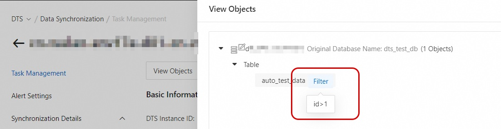

  - Method 2: On the task details page, choose **Synchronization Details > Schema Synchronization Details** or **Migration Details > Full Data Synchronization Details**. On the page that appears, move the pointer over the **Filter** field to view the SQL condition.

    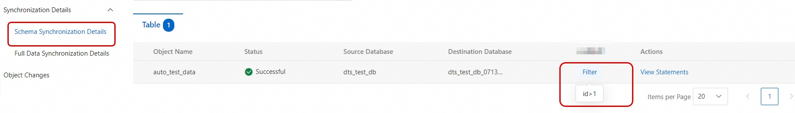

    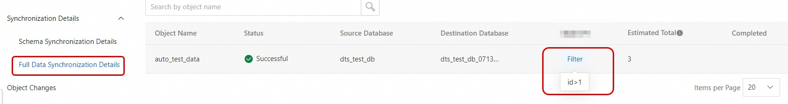

**Modify the SQL condition**

- Task not yet started: Return to the **Configure Objects and Advanced Settings** step. In the **Selected Objects** list, find the object for which you have configured an SQL condition and right-click it. In the dialog box that appears, modify the SQL condition in the **Filter Conditions** field.

- Task already running: If the task configuration is completed, you cannot modify the SQL condition.

<a id="section-5-6-4"></a>

### 5.6.4. Add an object to a data synchronization task

When a data synchronization task is running, you can add objects to the task or remove objects from the task. This topic describes how to add objects to a data synchronization task in the Data Transmission Service (DTS) console.

**Limits**

You can modify the objects only when a data synchronization task is in the incremental data synchronization phase and not in the Modifying Objects state.

**Start time of data synchronization**

The time when DTS synchronizes data of new objects depends on whether schema synchronization is specified for the data synchronization task.

- If schema synchronization is specified, DTS synchronizes the schemas of the new objects before DTS synchronizes incremental data.

- If schema synchronization is not specified, DTS synchronizes data after incremental data is generated on the source instance.

**Procedure**

1. Log on to the DTS console. For more information, see Log on to the DTS console.

2. In the left-side navigation pane, click **Data Synchronization**.

3. On the page that appears, find the instance that you want to manage and click **Reselect Objects** in the Actions column.

   > **Note**
   >
   > For instances that failed to run, choose
   >
   > > **Reselect Objects**.
   >
   > 

4. In the **Available** section, click the object that you want to add, and click the  icon to

   move the object to the **Selected** section.

5. Click **Next: Advanced Settings**.

6. Click **Next: Precheck and Start Task** to perform the precheck.

   After the task passes the precheck, the objects are added to the data synchronization task.

7. You can click **Changed. Return** to view the initial synchronization progress of the new objects.

   > **Note**
   >
   > When the data synchronization task is in the **Running** state, the objects to
   >
   > be synchronized are modified and the instance is running as expected.

<a id="section-5-6-5"></a>

### 5.6.5. Remove an object from a data synchronization task

When a data synchronization task is running, you can add objects to the task or remove objects from the task. This topic describes how to remove objects from a data synchronization task in the Data Transmission Service (DTS) console.

**Limits**

You can modify the objects only when a data synchronization task is in the incremental data synchronization phase and not in the Modifying Objects state.

**Procedure**

1. Log on to the DTS console.

2. In the left-side navigation pane, click **Data Synchronization**.

3. On the page that appears, find the instance that you want to manage and click **Reselect Objects** in the Actions column.

   > **Note**
   >
   > For instances that failed to run, choose
   >
   > > **Reselect Objects**.
   >
   > 

4. In the **Selected Objects** section, click the object that you want to remove, and click the

    icon to move the object to the **Source Objects** section.

5. Click **Next: Advanced Settings**.

6. Click **Next: Precheck and Start Task** to perform the precheck.

   After the task passes the precheck, the objects are removed from the data synchronization task.

7. You can click **Changed. Return** to view the initial synchronization progress of the new objects.

   > **Note**
   >
   > When the data synchronization task is in the **Running** state, the objects to
   >
   > be synchronized are modified and the instance is running as expected.

<a id="section-5-6-6"></a>

### 5.6.6. Specify the capitalization of object names in the destination instance

When you configure a data migration or synchronization task, you can specify the capitalization of database names, table names, and column names in the destination instance.

**Capitalization policies**

Data Transmission Service (DTS) supports the following capitalization policies for object names:

- DTS default policy

  DTS configures the capitalization of database names, table names, and column names in the destination instance based on the database type and related parameters, such as the  `lower_case_table_names`  parameter.

  <table>
    <tr>
      <th>Destination database type</th>
      <th>Destination database parameter</th>
      <th>Capitalization of object names in the destination instance</th>
    </tr>
    <tr>
      <td rowspan="2">• Self-managed MySQL database or ApsaraDB RDS for MySQL<br>• PolarDB-X<br>• AnalyticDB for MySQL V3.0</td>
      <td>The <code>lower_case_table_names</code> parameter is set to 1 or 2.</td>
      <td>Database names and table names in the destination instance are in lowercase. The capitalization of column names in the destination instance is the same as that in the source instance.</td>
    </tr>
    <tr>
      <td>The <code>lower_case_table_names</code> parameter is set to 0.</td>
      <td>The capitalization of database names, table names, and column names in the destination instance is the same as that in the source instance.</td>
    </tr>
    <tr>
      <td>• AnalyticDB for MySQL V2.0<br>• DataHub<br>• MaxCompute</td>
      <td>N/A</td>
      <td>Database names, table names, and column names in the destination instance are in lowercase.</td>
    </tr>
    <tr>
      <td>Self-managed Oracle database</td>
      <td>N/A</td>
      <td>Database names, table names, and column names in the destination instance are in uppercase.</td>
    </tr>
    <tr>
      <td>• Self-managed SQL Server database or ApsaraDB RDS for SQL Server<br>• PolarDB for PostgreSQL (Compatible with Oracle)<br>• Self-managed PostgreSQL database or ApsaraDB RDS for PostgreSQL<br>• AnalyticDB for PostgreSQL<br>• Self-managed MongoDB database or ApsaraDB for MongoDB<br>• Self-managed Redis database or ApsaraDB for Redis</td>
      <td>N/A</td>
      <td>Database names and table names in the destination instance are in lowercase. The capitalization of column names in the destination instance is the same as that in the source instance.</td>
    </tr>
  </table>

- Consistent with the source database

  The capitalization of database names, table names, and column names in the destination instance is the same as that in the source instance.

- Consistent with the default policy of the destination database (uppercase)

  The names of all the databases, tables, and columns that are migrated or synchronized to the destination instance are in uppercase.

- Consistent with the default policy of the destination database (lowercase)

  The names of all the databases, tables, and columns that are migrated or synchronized to the destination instance are in lowercase.

<a id="section-5-6-7"></a>

### 5.6.7. Troubleshoot precheck failures

Before Data Transmission Service (DTS) runs a data synchronization task, DTS performs a precheck. This topic describes the precheck items and how to troubleshoot precheck failures.

**Source database connectivity**

- Description

  DTS checks whether DTS servers can connect to the source RDS instance. DTS creates a connection to the source RDS instance by using the Java Database Connectivity (JDBC) protocol. If the connection fails, the task fails to pass this precheck item.

- Cause of failure

  - DTS does not support data synchronization between RDS instances in the region in which the source instance resides.

  - The database account or password of the source instance is invalid.

- Solution

  Contact Alibaba Cloud technical support.

**Destination database connectivity**

- Description

  DTS checks whether DTS servers can connect to the destination RDS instance. DTS creates a connection to the destination RDS instance by using the JDBC protocol. If the connection fails, the task fails to pass this precheck item.

- Cause of failure

  - DTS does not support data synchronization between RDS instances in the region in which the destination instance resides.

  - The database account or password of the destination instance is invalid.

- Solution

  Submit a ticket and contact Alibaba Cloud technical support.

**Source database version**

- Description

  DTS checks whether:

  <ol type="i">

  <li>

  The database version of the source RDS instance is supported by the data synchronization feature.

  </li>

  <li>

  The database version of the destination RDS instance is the same as the database

  </li>

  </ol>

  version of the source RDS instance.

- Cause of failure

  - The database version of the source RDS instance is earlier than the database versions that are supported by DTS. For example, the data synchronization feature supports the following database versions: MySQL 5.1, 5.5, 5.6, and 5.7.

  - The database version of the destination RDS instance is earlier than the database version of the source RDS instance.

- Solution

  - If the database version of the source RDS instance is earlier than the database versions that are supported by DTS, update the source RDS instance to MySQL 5.6 or 5.7 in the RDS console. Then, create a data synchronization task again.

  - If the database version of the destination RDS instance is earlier than the database version of the source RDS instance, update the destination RDS instance to MySQL 5.6 or 5.7 in the RDS console. Then, create a data synchronization task again.

**Database existence**

DTS checks whether the destination database already exists in the destination instance. If the destination database does not exist in the destination instance, DTS automatically creates a database. However, DTS fails to create the database and reports a failure under the following circumstances:

- The database name contains characters other than lowercase letters, digits, underscores (_), and hyphens (-).

- The character set of the database is not UTF-8, GBK, Latin1, or UTF-8MB4.

- The account of the destination database does not have the read and write permissions on the destination database.

  If the data source is an RDS instance, the task passes this precheck item.

**Source database permissions**

DTS checks whether the account of the source database has the required permissions. If the account does not have the required permissions, the task fails to pass this precheck item. If the data source is an RDS instance, the task passes this precheck item.

**Destination database permissions**

- Description

  DTS checks whether the account of the destination database has the required permissions. If the account does not have the required permissions, the task fails to pass this precheck item.

- Cause of failure

  - DTS fails to create a database account in the destination RDS instance.

  - DTS fails to grant the read and write permissions to the database account of the destination RDS instance.

- Solution

  Submit a ticket and contact Alibaba Cloud technical support.

**Object name conflict**

- Description

  DTS checks object names only if you select initial synchronization for a data synchronization task. DTS checks whether an object that you want to synchronize has the same name as an object in the destination RDS instance.

- Cause of failure

  If an object in the destination RDS instance has the same name as the object that you want to synchronize, the task fails to pass this precheck item.

- Solution

  - Delete the conflicting object from the destination database.

  - After the conflicting object is deleted, create a data synchronization task again. Select both Initial Schema Synchronization and Initial Full Data Synchronization.

**Value of server_id in the source database**

DTS checks whether the value of the server_id parameter in the source database is set to an integer that is greater than or equal to 2. If the data source is an RDS instance, the task passes this precheck item.

**Whether binary logging is enabled for the source database**

DTS checks whether the binary logging feature is enabled for the source database. If the binary logging feature is disabled for the source database, the task fails to pass this precheck item. If the data source is an RDS instance, the task passes this precheck item.

**Whether the binary log format is ROW in the source database**

DTS checks whether the binary log format of the source database is set to ROW. If the binary log format of the source database is not set to ROW, the task fails to pass this precheck item. If the data source is an RDS instance, the task passes this precheck item.

**Integrity of the FOREIGN KEY constraints**

- Description

  DTS checks whether the parent tables and child tables that have referential relationships with each other are all included in the objects to be synchronized. The precheck allows DTS to protect the integrity of the FOREIGN KEY constraints.

- Cause of failure

  One or more child tables are included in the objects to be synchronized. However, the parent tables that are referenced by the child tables are not included in the objects to be synchronized. This impairs the integrity of the FOREIGN KEY constraints.

- Solution

  The following solutions are available:

  - Create a data synchronization task again and do not synchronize the child tables that fail to pass this precheck item.

  - Create a data synchronization task again and add the parent tables to the objects to be synchronized.

  - Remove the FOREIGN KEY constraints from the child tables that fail to pass this precheck item. Then, create a data synchronization task again.

**Storage engine**

- Description

  DTS checks whether the objects to be synchronized use the storage engines that are not supported by the data synchronization feature, such as FEDERATED, MRG_MyISAM, and TokuDB.

- Cause of failure

  If the storage engine of a source table is FEDERATED, MRG_MyISAM, or TokuDB, the task fails to pass this precheck item.

- Solution

  Change the unsupported storage engine to InnoDB and create a data synchronization task again.

**Character set**

- Description

  DTS checks whether the objects to be synchronized use the character sets that are not supported by the data synchronization feature, such as the UCS-2 character set.

- Cause of failure If the character sets used by the objects to be synchronized are not supported by the data synchronization feature, the task fails to pass this precheck item.

- Solution

  Change the unsupported character sets to UTF-8, GBK, or Latin1. Then, create a data synchronization task again.

**Complex topologies**

- Description

  DTS checks whether the topology that you specify for the source and destination RDS instances is supported.

- Cause of failure

  - The source RDS instance in the current task is being used as the destination instance of another task.

  - The destination RDS instance in the current task is being used as the source or destination instance of another task.

  - The objects that you want to synchronize in the current task are being synchronized by an existing task. The two tasks have the same source and destination RDS instances.

- Solution

  - If the task that you want to create has the same source and destination RDS instances as an existing task, you can add the objects that you want to synchronize to the existing task. You do not need to create another task to synchronize these objects.

  - If the task that you want to create conflicts with an existing task, wait until the existing task is complete before you create a data synchronization task again.

**Format of the MySQL database password**

DTS checks whether the format of the password that is used to access the source database is no longer valid. If the data source is an RDS instance, the task passes this precheck item.

<a id="section-5-6-8"></a>

### 5.6.8. Configure ETL in a synchronization task

Data Transmission Service (DTS) provides streaming Extract, Transform, Load (ETL) data processing capabilities. By combining ETL with the stream data replication feature of DTS, you can extract, transform, and load data during a synchronization task. Typical use cases include data filtering, data masking, recording data modification times, and auditing data changes. This topic describes how to configure ETL in a synchronization task.

**Background**

Data Transmission Service (DTS) is a data migration and synchronization service commonly used for data relocation or real-time data transmission. To allow users to transform or filter real-time data before writing it to a target database, DTS provides a streaming ETL feature. This feature allows you to flexibly define data processing logic by using DSL (Domain Specific Language) scripts.

**Databases that support ETL**

| Source database | Target database |
| --- | --- |
| RDS MySQL | AnalyticDB for MySQL 3.0 |
| PolarDB-X 2.0 | AnalyticDB for MySQL 3.0 |

**Configure ETL during task creation**

> **Important**
>
> If an ETL script adds a new column, you must manually add the corresponding column to the target table. Otherwise, the ETL script has no effect. For example, for the script  `script:e_set(` new_column `, dt_now())` , you must add the  `new_column`  column to the target table.

1. Create a synchronization task and go to the **advanced configuration** step.

2. Set **Configure ETL function** to **Yes** and enter the data processing statements in the text box according to the data processing DSL syntax.

   > **Note**
   >
   > For example, you can use DSL to filter out records where the ID is greater than 3:  ``script:e_if(op_gt(`id`, 3), e_drop())`` . In this script,  `op_gt`  is an expression function that checks if a value is greater than a specified value, and  `id`  is a variable.

   

3. Click **Next: Precheck and Start Task**.

**Data processing DSL syntax**

The data processing DSL is a scripting language designed by DTS for data processing during synchronization. It supports conditional functions and can process strings, dates, and numeric values, allowing you to flexibly define data processing logic. The DSL has the following features:

- Powerful: Provides a rich set of functions and supports function composition.

- Simple syntax: Provides examples for typical scenarios, such as data filtering, data transformation, and data masking. For more information, see Typical scenario examples.

- High performance: Based on code generation technology, it has a minimal impact on synchronization performance.

**Typical scenario examples**

- Data filtering:

  - Filter by a numeric column: Discard records where id > 10000: e_if(op_gt( `id` , 10000), e_drop())

  - Filter by a string match: Discard records where the  `name`  column contains "hangzhou": e_if(str_contains( `name` , "hangzhou"), e_drop())

  - Filter by date: Do not synchronize orders placed before a specific time: e_if(op_lt( `order_timestamp` , "2015-02-23 23:54:55"), e_drop())

  - Filter by multiple conditions:

    - Discard records where id > 1000 AND the name contains "hangzhou": e_if(op_and(str_contains( `name` , "hangzhou"), op_gt( `id` , 1000)), e_drop())

    - Discard records where id > 1000 OR the name contains "hangzhou": e_if(op_or(str_contains( `name` , "hangzhou"), op_gt( `id` , 1000)), e_drop())

- Data masking:

  - Mask a column: Replace the last four digits of the phone column with asterisks (\*): e_set( `phone` , str_mask( `phone` , 7, 10, '\*'))

- Record data modification time:

  - Add a new column to all tables: When the __OPERATION__ is INSERT, UPDATE, or DELETE, add a new column named "dts_sync_time" and set its value to the log commit time (__COMMIT_TIMESTAMP__).

    ```text
    e_if(op_or(op_or(
            op_eq(__OPERATION__, __OP_INSERT__),
            op_eq(__OPERATION__, __OP_UPDATE__)),
            op_eq(__OPERATION__, __OP_DELETE__)),
        e_set(dts_sync_time, __COMMIT_TIMESTAMP__))
    ```

  - Add a new column to a specific table: When the __OPERATION__ is INSERT, UPDATE, or DELETE on the "dts_test_table" table, add a new column named "dts_sync_time" and set its value to the log commit time (__COMMIT_TIMESTAMP__).

    ```text
    e_if(op_and(
          op_eq(__TB__,'dts_test_table'),
          op_or(op_or(
            op_eq(__OPERATION__,__OP_INSERT__),
            op_eq(__OPERATION__,__OP_UPDATE__)),
            op_eq(__OPERATION__,__OP_DELETE__))),
          e_set(dts_sync_time,__COMMIT_TIMESTAMP__))
    ```

    > **Note**
    >
    > Before you start the task, you must modify the table definition in the target database to add the "dts_sync_time" column; otherwise, this operation will have no effect.

- Audit data changes:

  - Record the type and time of table data changes: In the target database, record the data change type in the "operation_type" column and the time of the change in the "updated" column.

    ```text
    e_compose(
        e_switch(
            op_eq(__OPERATION__,__OP_DELETE__), e_set(operation_type, 'DELETE'),
            op_eq(__OPERATION__,__OP_UPDATE__), e_set(operation_type, 'UPDATE'),
            op_eq(__OPERATION__,__OP_INSERT__), e_set(operation_type, 'INSERT')),
        e_set(updated, __COMMIT_TIMESTAMP__),
        e_set(__OPERATION__,__OP_INSERT__)
    )
    ```

    > **Note**
    >
    > Before you start the task, you must add the "operation_type" and "updated" columns to the table in the target database.

**Data processing DSL syntax**

**Constants and variables**

- Constants

  | Type | Example |
  | --- | --- |
  | int | 123 |
  | float | 123.4 |
  | string | "hello1_world" |
  | boolean | true or false |
  | datetime | '2021-01-01 10:10:01' |

- Variables

  | Parameter | Description | Type | Example value |
  | --- | --- | --- | --- |
  | __TB__ | table name | string | table |
  | __DB__ | database name | string | mydb |
  | __OPERATION__ | Operation type | string | __OP_INSERT__, __OP_UPDATE__, __OP_DELETE__ |
  | __COMMIT_TIMESTAM P__ | Transaction commit time | datetime | '2021-01-01 10:10:01' |
  | <code>column</code> | The value of the column in a data record | string | <code> id </code>, <code> name </code> |

**Expression functions**

- Numeric operations

  | Functio n | Syntax | Parameters | Return value | Example |
  | --- | --- | --- | --- | --- |
  | Addition | op_sum(value1, value2) | • value1: integer or float<br>• value2: integer or float | An integer if both parameters are integers; otherwise, a float. | op_sum(<code> col1 </code>, 1.0) |
  | Subtracti on | op_sub(v alue1, value2) | • value1: integer or float<br>• value2: integer or float | An integer if both parameters are integers; otherwise, a float. | op_sub(<code> col1 </code>, 1.0) |
  | Multiplic ation | op_mul(v alue1, value2) | • value1: integer or float<br>• value2: integer or float | An integer if both parameters are integers; otherwise, a float. | op_mul(<code> col1 </code>, 1.0) |
  | Division | op_div_tr ue(value 1, value2) | • value1: integer or float<br>• value2: integer or float | An integer if both parameters are integers; otherwise, a float. | op_div_true(<code> col1 </code>, 2.0). If col1 is 15, the function returns 7.5. |
  | Modulo | op_mod(value1, value2) | • value1: integer or float<br>• value2: integer or float | An integer if both parameters are integers; otherwise, a float. | op_mod(<code> col1 </code>, 10).If col1 is 23, the function returns 3. |

- Logical operations

  | Functio n | Syntax | Parameters | Return value | Example |
  | --- | --- | --- | --- | --- |
  | Equal to | op_eq(va lue1, value2) | • value1: integer, float, or string<br>• value2: integer, float, or string | Boolean | op_eq(<code> col1 </code>, 23) |
  | Greater than | op_gt(val ue1, value2) | • value1: integer, float, or string<br>• value2: integer, float, or string | Boolean | op_gt(<code> col1 </code>, 1.0) |
  | Less than | op_lt(val ue1, value2) | • value1: integer, float, or string<br>• value2: integer, float, or string | Boolean | op_lt(<code> col1 </code>, 1.0) |
  | Greater than or equal to | op_ge(va lue1, value2) | • value1: integer, float, or string<br>• value2: integer, float, or string | Boolean | op_ge(<code> col1 </code>, 1.0) |
  | Less than or equal to | op_le(val ue1, value2) | • value1: integer, float, or string<br>• value2: integer, float, or string | Boolean | op_le(<code> col1 </code>, 1.0) |
  | AND | op_and(v alue1, value2) | • value1: boolean<br>• value2: boolean | Boolean | op_and(<code> is_male </code>, <code> is_student </code>) |
  | OR | op_or(val ue1, value2) | • value1: boolean<br>• value2: boolean | Boolean | op_or(<code> is_male </code>, <code> is_student </code>) |

- **String functions**

  | Functio n | Syntax | Parameters | Return value | Example |
  | --- | --- | --- | --- | --- |
  | Formats a string or concaten ates strings. | str_form at(forma t, value1, value2, value3,...) | • format: A string that uses braces {} as placeholders, for example, "part1: {}, part2: {}".<br>• value1: any<br>• value2: any | The formatted string. | str_format("part1: {}, part2: {}", <code> col1 </code>, <code> col2 </code>). If col1 is "ab" and col2 is "12", the function returns "part1: ab, part2: 12". |
  | Replaces a substring. | str_repla ce(origin al, oldStr, newStr, count) | • original: The original string.<br>• oldStr: The substring to be replaced.<br>• newStr: The new substring.<br>• count: The maximum number of replacements (integer). If set to -1, all occurrences are replaced. | The modified string. | str_replace(<code> name </code>, "a", 'b', 1). If name is "aba", the function returns "bba".str_replace(<code> name </code>, "a", 'b', -1). If name is "aba", the function returns "bbb". |
  | Removes specified characte rs from the beginnin g and end of a string. | str_strip(string_va l, charSet) | • string_val: The original string.<br>• char_set: The set of characters to be removed. | The stripped string. | str_strip(<code> name </code>, 'ab'). If name is axbzb, the function returns xbz. |
  | Converts a string to lowercas e. | str_lower (value1) | value1: A string column or a string constant. | The lowercase string. | str_lower(<code> str_col </code>) |
  | Converts a string to uppercas e. | str_uppe r(value1) | value1: A string column or a string constant. | The uppercase string. | str_upper(<code> str_col </code>) |
  | Counts the occurren ces of a substring. | str_count (str, pattern) | • str: A string column or a string constant.<br>• pattern: The substring to find. | The number of occurrences of the substring. | str_count(<code> str_col </code>, 'abc'). If str_col is "zabcyabcz", the function returns 2. |
  | Finds a substring. | str_find(s tr, pattern). | • str: A string column or a string constant.<br>• pattern: The substring to find. | The starting position of the first match. If no match is found, the function returns -1. | str_find(<code> str_col </code>, 'abc'). If <code> str_col </code> is "xabcy", the function returns 1. |
  | Checks if a string consists only of letters. | str_isalp ha(str) | str: A string column or a string constant. | true or false | str_isalpha(<code> str_col</code><code> </code>) |
  | Checks if a string consists only of digits. | str_isdigi t(str) | str: A string column or a string constant. | true or false | str_isdigit(<code> str_col </code>). |
  | Masks part of a string with a specified characte<br>r. This can be used for data masking, such as replacing the last four digits of a phone number with asterisks. | str_mask (str, start, end, maskStr) | • str: A string column or a string constant.<br>• start: An integer that specifies the starting position of the mask. The minimum value is 0.<br>• end: An integer that specifies the ending position of the mask. The maximum value is the string length minus one.<br>• maskStr: A string of length 1, such as '#'. | The string with characters from the start to end positions masked. | str_mask(<code> phone </code>, 7, 10, '#'). |
  | Gets the current datetime in the local time zone. | dt_now() | None | The current datetime in the local time zone. | e_set(<code> dt_col </code>, dt_now()) |

  

  <table>
    <tr>
      <td>Gets the current datetime in UTC.</td>
      <td>dt_utcno w()</td>
      <td>None</td>
      <td>The current datetime in UTC.</td>
      <td>e_set(<code> dt_col </code>, dt_utcnow())</td>
    </tr>
  </table>

**Global functions**

- Flow control functions

  | Function | Syntax | Parameters | Example |
  | --- | --- | --- | --- |
  | if statement | e_if(bool_exp r, func_invoke) | • bool_expr: A boolean expression, such as a constant (true or false) or a function call like op_gt(<code> id </code>, 10).<br>• func_invoke: A function call, such as e_drop, e_keep, e_set, e_if, or e_compose. | e_if(op_gt(<code> id </code>, 10), e_drop()). Discards the record if its ID is greater than 10. |
  | if-else statement | e_if_else(bool _expr, func_invoke1, func_invoke2) | • bool_expr: A boolean constant or function call.Constant: true or false.Function call: op_gt(<code> id </code>, 10).<br>• func_invoke1: The function to execute if the condition is true.<br>• func_invoke2: The function to execute if the condition is false. | e_if_else(op_gt(<code> id </code>, 10), e_set(<code> tag </code>, 'large'), e_set(<code> tag </code>, 'small')). Sets the tag column to "large" if the ID is greater than 10; otherwise, sets it to "small". |
  | Evaluates a series of conditions and executes the operation for the first one that is true. If no conditions match, the default operation is executed. | s_switch(con dition1, func1, condition2, func2, ..., default = default_func) | • condition1: A boolean constant or function call.Constant: true or false.Function call: op_gt(<code> id </code>, 10).<br>• func_invoke: The function to execute if condition1 is true.The switch statement then exits. If false, the next condition is evaluated.<br>• default_func: The default function to execute if all preceding conditions are false. | e_switch(op_gt(<code> id </code>, 100), e_set(<code> str_col </code>, '&gt;100'), op_gt(<code> id </code>, 90), e_set(<code> str_col </code>, '&gt;90'), default=e_set(<code> str_col </code>, '&lt;=90')). |
  | Combines multiple operations. | e_compose(f unc1, func2, func3, ...) | • func1: A function call, such as e_set, e_drop, or e_if.<br>• func2: A function call, such as e_set, e_drop, or e_if. | e_compose(e_set(<code> str_col </code>, 'test'), e_set(<code> dt_col </code>, dt_now())). Sets the value of the <code> str_col </code> column to 'test' and the value of the <code> dt_col </code> column to the current time. |

- Data manipulation functions

  | Function | Syntax | Parameters | Example |
  | --- | --- | --- | --- |
  | Discards a data record and does not synchronize it. | e_drop() | None | e_if(op_gt(<code> id </code>, 10), e_drop()). Discards records with an ID greater than 10. |
  | Keeps a data record and synchronizes it to the target. | e_keep(condi tion) | condition: A boolean expression. | e_keep(op_gt(<code> id </code>, 1)).Synchronizes only data with an ID greater than 1. |
  | Sets a column value. | e_set(col, val) | • col: The column name.<br>• val: A constant or function call. The type must match the type of the column. | • e_set(<code> dt_col </code>, dt_now()).Sets dt_col to the current time.<br>• e_set(<code> col1 </code>, op_sum(<code> col2 </code>, 1)). Sets <code> col1 </code> to the value of <code> col2 </code> plus 1. |

<a id="section-5-7"></a>

## 5.7. Best practices for data synchronization from PolarDB-X instances

<a id="section-5-7-1"></a>

### 5.7.1. Precautions and limits for synchronizing data between PolarDB-X instances

PolarDB-X does not provide binary logs. To ensure data quality, we recommend that you take note of the limits when you perform business design, business development, and O&M changes.

**Overview**

- Limits on the business design

- Limits on the database architecture

- Limits on O&M changes

- Potential risks on data quality

- Suggestions to ensure data quality

**Limits on the business design**

- All tables must have primary keys. Otherwise, data inconsistency may occur in data synchronization because the destination database may contain duplicate data records.

- We recommend that you do not use the global secondary indexes (GSIs) of PolarDB-X because they are updated asynchronously. If you use GSIs, Data Transmission Service (DTS) can ensure only the eventual consistency of data.

- The databases that you want to synchronize cannot be deployed in mixed mode. The mixed mode refers to a mode in which both the unit mode and the copy mode are used.

  > **Note**
  >
  > In unit mode, users perform read and write operations in their respective
  >
  > unit nodes. Two-way synchronization is implemented between the databases in each unit node and those in the central node. In copy mode, users write data to the databases in the central node. The data is then synchronized to the databases in each unit node.

- If you configure two-way synchronization between PolarDB-X instances and use underlying MySQL databases, fields of the FLOAT or DOUBLE type are not supported in business tables. If the business tables have fields of the FLOAT or DOUBLE type, convert the field type to DECIMAL. If you configure one-way synchronization between PolarDB-X instances, fields of the FLOAT or DOUBLE type are supported in business tables.

- DTS does not allow you to synchronize objects such as stored procedures, triggers, functions, views, and events in data synchronization between PolarDB-X instances.

- DTS does not support initial schema synchronization between PolarDB-X instances. You must manually create objects such as databases and tables in the destination database.

- Make sure that the available storage capacities in PolarDB-X instances are sufficient for business expansion.

**Limits on the database architecture**

- An ApsaraDB RDS for MySQL instance that is attached to a PolarDB-X instance cannot be attached to another PolarDB-X instance.

- The ApsaraDB RDS for MySQL instances attached to the source PolarDB-X instance must have the same specifications as those attached to the destination PolarDB-X instance. For example, if the source PolarDB-X instance has four ApsaraDB RDS for MySQL instances, the destination PolarDB-X instance must have four ApsaraDB RDS for MySQL instances whose specifications are the same as those in the source PolarDB-X instance.

- The sharding rule of the source PolarDB-X instance must be the same as that of the destination PolarDB-X instance. Otherwise, no data synchronization task can be created.

- You can synchronize only business tables between Polar-X instances. You cannot synchronize metadata tables or system tables between PolarDB-X instances.

**Limits on O&M changes**

| Change type | Description | Impact and solution |
| --- | --- | --- |

Change a sharding rule. For

Not supported. You must perform the following

example, change the shard

steps to recreate a data synchronization task:

key of a database or table,

1. Stop and delete the original data

or change the number of

synchronization task.

shards.

2. Wait until the changes are complete in the

PolarDB-X

source database. Then, clear the data that has

instances

Change the number of

been synchronized to the destination database.

instances at the storage

3. Configure a data synchronization task for each

layer. For example, scale

ApsaraDB RDS for MySQL instance that is

out instances or migrate

attached to the source PolarDB-X instance.

frequently-accessed tables.

Change the specifications of instances and switch

Data synchronization is not affected.

workloads at the storage layer.

The parameter settings of the source and destination databases must be the same. To change the parameter settings of instances at the storage layer, you must make sure that new parameters do not affect previous parameters.

Change parameter settings.

Storage

> **Note**
>
> If you are not sure about the
>
> impact of changing parameter settings, you can contact technical support of Database Expert Service.

Change backup and recovery policies, and

The change takes effect only on the current

enable auditing and

instance and does not affect other instances with

diagnostics for instances at

replication relationships.

the storage layer.

If you configure data synchronization tasks for ApsaraDB RDS for MySQL instances that are attached to the source PolarDB-X instance, the

DTS tasks

Perform DDL operations.

tasks may be delayed after you perform DDL operations. This is caused by the implementation logic of MySQL.

Not supported. You must perform the following steps:

1. After you perform DDL operations to create tables in the destination database, perform the same DDL operations to create tables in the source database.

2. Add the new tables to the objects of the data synchronization task.

Add tables.

You can write data to the source database only after the preceding operations are complete. If you select tables as the objects of the data synchronization task, you must add the new tables to the synchronization queues on the source and destination instances at the storage layer.

DDL operations at the database or table level

- If you configure a data synchronization task for a PolarDB-X instance, you must perform DDL operations in the destination database, and then perform the same DDL operations in the source database.

Add fields, add secondary indexes, delete indexes,

- If you configure data synchronization tasks for

and modify indexes (except

ApsaraDB RDS for MySQL instances that are

for replacing secondary

attached to the source PolarDB-X instance, DTS

indexes with unique

automatically synchronizes the operations that

indexes).

you perform. The following operations can be synchronized: Add fields, add secondary indexes, delete indexes, and modify indexes (except for replacing secondary indexes with unique indexes).

Perform other DDL

Only the preceding DDL operations are

operations.

supported.

Before you perform a switchover, make sure that

Perform a switchover.

the DTS task is not delayed. Otherwise, data quality issues occur.

Perform a failover that meets the requirements of recovery point objective

If a failure such as a network interruption, an

(RPO).

equipment failure, or a data center failure occurs and the data synchronization task is delayed, you

> **Note**
>
> RPO

may need to perform a failover. In this case, if the

> represents the

difference between the time when the last data

Switchover

> maximum amount of

entry is synchronized to the destination database

> data that can be lost

and the time when the failure occurs is less than

> **Note**

> after a recovery from a

the RPO, you can perform a failover to recover

> Switchover:

> failure. RPO is

your business. For example, if the RPO is 5

> After you use

> measured by time.

minutes, the quality of the data within the 5

> DTS to

minutes cannot be ensured after you perform a

> migrate or

failover. You may need to revise the data to

> **Warning**

> synchronize

ensure consistency.

> Failover: If the source

> data from

> instance or the data

> the source

> **Note**
>
> To query the time when the last

> center where the

> database to

> data entry is synchronized to the destination

> source instance resides

> the

> database, refer to the documentation about

> fails, you can switch

> destination

> task management.

> workloads to a backup

> database,

> system. A failover is a

> you switch

> lossy operation.

> workloads from the source database to

The data synchronization task may be delayed

> the

due to the following causes: A large number of

> destination

DDL operations are performed in the source

> database.

database, a network failure occurs, and the performance of the destination database is unfavorable. In this case, if the data center fails and the difference between the time when the

Perform a failover that does

last data entry is synchronized to the destination

not meet the requirements

database and the time when the failure occurs is

of RPO.

greater than the RPO, we recommend that you wait until the data center recovers before you perform a failover. For example, if the RPO is 5 minutes, the quality of the data within the 5 minutes cannot be ensured after you perform a failover. You may need to revise the data to ensure consistency.

**Potential risks on data quality**

Some changes or switchover operations may cause data quality issues such as schema inconsistency between the source and destination databases.

- If data latency occurs between the primary and secondary databases of the source instance, the data written to the primary database is not updated to the secondary database at the earliest opportunity. In this case, if you perform a primary/secondary switchover in the source instance, DTS uses the secondary database of the source instance as the source database for data synchronization. As a result, the data that is not updated to the secondary database is lost.

- If the DTS task is resumed from a network failure after you perform a switchover, DTS attempts to synchronize the data generated before the failure occurs. This mechanism prevents data loss in the destination database. In this case, if the destination tables do not have primary keys, data will be inconsistent between the source and destination databases. If the destination tables have primary keys, data may not be consistent when DTS implements the retry mechanism, but data will remain consistent after the retry ends.

- The data synchronization task may be delayed due to network failures and DDL operations.

- The data synchronization task may be delayed or interrupted due to changes to the source database, unfavorable performance of the destination database, and schema inconsistency.

Alibaba Cloud cannot solve the preceding issues. You must recreate a DTS task or adjust the source and destination databases.

**Suggestions to ensure data quality**

- You must perform all DDL operations with caution. All DDL operations must be confirmed by the technical engineers to comply with the preceding limits.

- Do not directly perform DDL operations in your program code.

<a id="section-5-7-2"></a>

### 5.7.2. Solutions of data synchronization from a PolarDB-X instance

Data Transmission Service (DTS) supports data synchronization from a source PolarDB-X instance to a destination instance. However, if more than two ApsaraDB RDS for MySQL instances are attached to the source PolarDB-X instance, we recommend that you do not directly configure a data synchronization task for the source PolarDB-X instance. If you do so, you may encounter a performance bottleneck or stability risks. This may affect your business. To ensure good performance and high stability of data synchronization, we recommend that you configure a data synchronization task for each ApsaraDB RDS for MySQL instance attached to the source PolarDB-X instance.

**Prerequisites**

You have read the Precautions and limits for synchronizing data between PolarDB-X instances topic and understood the relevant conventions and precautions.

**Synchronization solutions**

| Soluti on | Configuration | Description |
| --- | --- | --- |
| Solutio n 1 | You can configure a data synchronization task for each ApsaraDB RDS for MySQL instance that is attached to the source PolarDB-X instance. You must map the names of databases and tables in the ApsaraDB RDS for MySQL instances to the names of databases and tables in the destination instance.<br>Compared with Solution 2, this solution ensures good performance and high stability of data synchronization.<br>Important If you use this solution, you can select only tables as the objects to be synchronized. | If you require better performance and higher stability, we recommend that you use this solution.This solution has no limits on the number of ApsaraDB RDS for MySQL instances that are attached to the source PolarDB-X instance. |
| Solutio n 2 | You can directly configure a data synchronization task for the source PolarDB-X instance. If more than two ApsaraDB RDS for MySQL instances are attached to the source PolarDB-X instance, the performance and stability of data synchronization may deteriorate to the extent that your business may be affected. | If you use this solution, make sure that no more than two ApsaraDB RDS for MySQL instances are attached to the source PolarDB-X instance.Otherwise, the performance and stability of data synchronization may deteriorate. |

**Comparison between the two solutions**

| Comparison item | Solution 1 | Solution 2 |
| --- | --- | --- |
| Performance | This solution requires you to configure multiple data synchronization tasks.This way, this solution multiplies the performance of data synchronization and ensures the feasibility of writing a large amount of data from a PolarDB-X instance. | This solution supports only one data synchronization task for the source PolarDB-X instance. If a large amount of data is written to the source PolarDB-X instance by the business side, a performance bottleneck may occur during data synchronization. |
| Stability | This solution ensures high stability.<br>If a data synchronization task that you configure for one of the ApsaraDB RDS for MySQL instances fails, data synchronization tasks for other ApsaraDB RDS for MySQL instances are not affected. You need to only recover the failed data synchronization task. | This solution provides medium stability.<br>If the data synchronization task for the source PolarDB-X instance fails, data synchronization fails. |
| Ease of use | You must configure multiple data synchronization tasks. This complicates the configuration process.You must configure database and table name mapping for each task. You must map the names of databases and tables in the ApsaraDB RDS for MySQL instances to the names of the databases and tables in the destination instance. | You need to only configure one data synchronization task. This simplifies the configuration process. |
| Resource usage | This solution requires multiple data synchronization instances. | This solution requires only one data synchronization instance. |

**Synchronization of DDL operations**

In most cases, data synchronization from a source PolarDB-X instance does not support the synchronization of DDL operations. If you synchronize DDL operations during a data synchronization task, data may fail to be written to the destination instance. To prevent this problem, you can take one of the following measures:

1. Release the data synchronization task.

2. Clear the destination database.

3. Reconfigure the data synchronization task.

However, in a few cases, you can synchronize DDL operations during data synchronization from a source PolarDB-X instance. The following table describes the details of these cases.

| Case | Supported operation |
| --- | --- |
| You use Solution 1 and select tables as the objects to be synchronized. | • You can add tables to the objects that you select for the data synchronization task.<br>• You can also add columns to or remove columns from the objects.However, you can perform these operations only during data synchronization between PolarDB-X instances. To do this, perform the following steps:<br>i. Add columns to or remove columns from the objects that you select for the data synchronization task.<br>ii. Add or remove columns in the destination database, and then perform the same operations in the source database. When DTS detects that a column already exists in the destination database, DTS ignores the error and does not display a write failure. |
| You use Solution 2 and select entire databases as the objects to be synchronized. | • You can only add tables to the objects. To do this, you must add tables in the destination database, and then perform the same operations in the source database.<br>• You cannot add or remove columns.<br>Warning If you add a column to the database of the source PolarDB-X instance, some physical tables at the underlying layer may contain the column, whereas some physical tables do not contain the column. When DTS executes the assembled SQL statement, DTS may fail to find the column or lose the data in the column. |
| You use Solution 2 and do not select entire databases as the objects to be synchronized. | • You can only add tables to the objects. To do this, perform the following steps:<br>i. Add tables to the objects that you select for the data synchronization task.<br>ii. Add tables in the destination database, and then perform the same operations in the source database.<br>• You cannot add or remove columns. |

<a id="section-6"></a>

# 6.Change tracking

<a id="section-6-1"></a>

## 6.1. Overview

You can use Data Transmission Service (DTS) to track data changes from MySQL instances in real time. This feature applies to the following scenarios: lightweight cache updates, business decoupling, asynchronous data processing, and synchronization of extract, transform, and load (ETL) operations.

**Supported database services**

- Self-managed MySQL databases or RDS for MySQL instances

- Cloud-native distributed database PolarDB-X (formerly Distributed Relational Database Service or DRDS)

- Cloud-native distributed database PolarDB-X 2.0

- Self-managed Oracle databases

**Precautions**

By default, the change tracking feature of the previous version is no longer available. The newly created change tracking tasks are of the new version. To run change tracking tasks of the previous version, you must reconfigure the objects for change tracking in the DTS console. Otherwise, the service level agreement (SLA) of DTS does not guarantee service reliability or performance.

**Subscribed Objects**

The objects for change tracking include tables and databases.

In change tracking, data changes include DML and DDL operations. When you configure a change tracking task, you can select the operation type.

**Subscribe to a channel**

A change tracking task is the basic unit of change tracking and data consumption. To track data changes from an RDS instance, you must create a change tracking task in the DTS console for the RDS instance. The change tracking task pulls data changes from the RDS instance in real time and locally stores the data changes. You can use the DTS SDK to consume the tracked data. You can also create, manage, or delete change tracking tasks in the DTS console.

<a id="section-6-2"></a>

## 6.2. Create a change tracking instance

Before you configure a task to track data changes, you must create a change tracking instance. This topic describes how to create a change tracking instance in the Data Transmission Service (DTS) console.

**Procedure**

1. Log on to the DTS console. For more information, see Log on to the DTS console.

2. In the left-side navigation pane, click **Change Tracking**.

3. Click **Create Task**.

4. In the panel that appears, configure the parameters described in the following table.

   | Parameter | Description |
   | --- | --- |
   | Source Database Type | The type of the source database. |
   | Source Region | The region in which the source database resides.<br>Note You cannot change the value of this parameter after you purchase the change tracking instance. Exercise caution when you configure this parameter. |
   | Quantity | The number of change tracking instances that you want to create at a time. |

   > **Note**
   >
   > In this panel, you can view the total number of instances, the number of
   >
   > existing instances, and the number of instances that can be created.

5. Click **Create**.

6. In the message that appears, click **OK**.

<a id="section-6-3"></a>

## 6.3. Configure change tracking tasks

<a id="section-6-3-1"></a>

### 6.3.1. Track data changes from an ApsaraDB RDS for MySQL instance

Data Transmission Service (DTS) allows you to track data changes from databases in real time. You can use the change tracking feature in the following scenarios: lightweight cache updates, business decoupling, asynchronous data processing, and synchronization of extract, transform, and load (ETL) operations. This topic describes how to track data changes from an ApsaraDB RDS for MySQL instance.

**Prerequisites**

The database version is 5.6, 5.7, or 8.0.

**Limits**

| Category | Description |
| --- | --- |

<table>
  <tr>
    <td>Limits on the source database</td>
    <td>• The server to which the source database belongs must have sufficient outbound bandwidth. Otherwise, the change tracking speed decreases.<br>• The source tables must have PRIMARY KEY or UNIQUE constraints, and all fields must be unique. Otherwise, part of the tracked data changes may be duplicate.<br>• The following requirements for binary logs must be met:<br>The binary logging feature is enabled. The binlog_format parameter is set to row. The binlog_row_image parameter is set to full. Otherwise, error messages are returned during the precheck, and the change tracking task cannot be started.<br>• A read-only instance or temporary instance cannot be used as the source instance for change tracking.</td>
  </tr>
  <tr>
    <td>Other limits</td>
    <td>• Make sure that the precision settings for columns of the FLOAT or DOUBLE data type meet your business requirements. DTS uses the <code> ROUND(COLUMN,PRECISION) </code> function to retrieve values from columns of the FLOAT or DOUBLE data type. If you do not specify a precision, DTS sets the precision for columns of the FLOAT data type to 38 digits and the precision for columns of the DOUBLE data type to 308 digits.<br>• DTS does not track the DDL operations that are performed by using gh-ost or pt-online-schema-change. Therefore, the change tracking client may fail to write the consumed data to the destination tables due to schema conflicts.<br>• If the source database is used in another task such as a data migration task that is running, DTS may track the data changes of other objects. In this case, you must manually filter the tracked data on the change tracking client.</td>
  </tr>
</table>

**Procedure**

1. Create a change tracking instance.

2. Find the change tracking instance that you created, and click **Configure Task** in the Actions column.

3. Configure the source database and network type.

   **Section**

   **Parameter**

   **Description**

   The task name that DTS automatically generates. We recommend

   N/A

   **Task Name**

   that you specify a descriptive name that makes it easy to identify the task. You do not need to specify a unique task name.

   **Database**

   The type of the source database. Select **MySQL**.

   **Type**

   **Access**

   The access method of the source database. Select **Alibaba Cloud**

   **Method**

   **Instance**.

   The region in which the source instance resides. The region is the

   **Instance**

   source region that you selected when you created the change

   **Region**

   tracking instance. You cannot change the value of this parameter.

   **Replicate Data Across**

   Specifies whether data is replicated across multiple Alibaba Cloud

   **Alibaba**

   accounts. You can select only **No**.

   **Cloud Accounts**

   **Source Database**

   The ID of the ApsaraDB RDS for MySQL instance from which you want to track data changes.

   **RDS**

   > **Note**

   **Instance ID**

   > A read-only instance or temporary instance cannot be used as the source instance for change tracking.

   The database account of the ApsaraDB RDS for MySQL instance from which you want to track data changes.

   > **Note**

   **Database Account**

   > The account must have the SELECT permission on the objects for change tracking, the REPLICATION SLAVE permission, and the REPLICATION CLIENT permission.

   **Database**

   The password of the database account.

   **Password**

   The network type of the change tracking instance.

   - **Classic**

     If you select **Classic**, no other configurations are required.

   - **VPC**

     If you select **VPC**, you must configure the **VPC** and **vSwitch**

   **Consume**

   parameters.

   **r**

   **Network**

   **Network**

   **Type**

   > **Note**

   **Type**

   > - If your change tracking client is deployed on a local server, you can select **Classic** or **VPC**.
   >
   > - If you track data changes over internal networks, the network latency is minimal.

4. In the lower part of the page, click **Test Connectivity and Proceed**.

5. Select the data change types and objects.

   | Parame ter | Description |
   | --- | --- |
   | Data Change Types | • Data Updates<br>DTS tracks data updates of the selected objects, including the INSERT, DELETE, and UPDATE operations.<br>• Schema Updates<br>DTS tracks the create, delete, and modify operations that are performed on all object schemas of the source instance. You must use the change tracking client to filter the data to be tracked.<br>Note<br>• If you select a database as the object, DTS tracks data changes of all objects, including new objects in the database.<br>• If you select a table as the object, DTS tracks only data changes of this table. In this case, if you want to track data changes of another table, you must add the table to the objects for change tracking. For more information, see Modify the objects for change tracking. |
   | Source Objects | Select tables or databases from the <strong>Source Objects</strong> section and click theicon to<br>move them to the <strong>Selected Objects</strong> section. |
   | Selecte d Objects | If you want to remove a selected object, select the object in the <strong>Selected Objects</strong><br>section and click theicon to move it to the <strong>Source Objects</strong> section. |

6. Click **Next: Advanced Settings**.

   | Parameter | Description |
   | --- | --- |
   | Retry Time for Failed Connection | The retry time range for failed connections. If the source database fails to be connected after the change tracking task is started, DTS immediately retries a connection within the retry time range. Valid values: 10 to 1440.Unit: minutes. Default value: 720. We recommend that you set the parameter to a value greater than 30. If DTS reconnects to the source databases within the specified time range, DTS resumes the change tracking task. Otherwise, the change tracking task fails. |
   | Configure ETL | Specifies whether to configure the ETL feature. In this topic, the ETL feature is not supported, and <strong>No</strong> is selected. |

7. In the lower part of the page, click **Next: Precheck and Start Task**.

   > **Important**
   >
   > - Before you can start the change tracking task, a precheck is performed. You can start the change tracking task only after the task passes the precheck.
   >
   > - If the task fails to pass the precheck, click **View Details** next to each failed item. After you troubleshoot the issues based on the causes, run a precheck again.

8. Wait until the success rate becomes 100%. Then, click **Back**.

   Wait until the change tracking task is started. You can add consumer groups and consume the tracked data only after the task is in the **Normal** state.

<a id="section-6-3-2"></a>

### 6.3.2. Track data changes from a PolarDB-X 1.0 instance

Data Transmission Service (DTS) allows you to track data changes from databases in real time. You can use the change tracking feature in the following scenarios: lightweight cache updates, business decoupling, asynchronous data processing, and synchronization of extract, transform, and load (ETL) operations. This topic describes how to track data changes from a PolarDB-X 1.0 instance.

**Usage notes**

> **Warning**
>
> For more information about the usage notes on PolarDB-X 1.0 instances, see Precautions and limits for synchronizing data between PolarDB-X instances.

| Category | Description |
| --- | --- |
| Limits on the source database | • Bandwidth requirements: The server on which the source database is deployed must have sufficient outbound bandwidth. Otherwise, the change tracking speed decreases.<br>• The source tables must have PRIMARY KEY or UNIQUE constraints, and all fields must be unique. Otherwise, part of the tracked data changes may be duplicate.<br>• The ApsaraDB RDS for MySQL instances attached to the PolarDB-X 1.0 instance must meet the following requirements for binary logs:<br>The binary logging feature must be enabled. The value of the binlog_format parameter must be set to row. The value of the binlog_row_image parameter must be set to full. Otherwise, error messages are returned during the precheck, and the change tracking task cannot be started. |

<table>
  <tr>
    <td>Other limits</td>
    <td>• If more than two ApsaraDB RDS for MySQL instances are attached to a PolarDB-X 1.0 instance, issues such as latency and instability may occur to the DTS task when you track data changes from the PolarDB-X 1.0 instance. We recommend that you split the task for tracking data changes from a PolarDB-X 1.0 instance into multiple subtasks for tracking data changes from ApsaraDB RDS for MySQL instances.<br>• If N ApsaraDB RDS for MySQL instances are attached to the source PolarDB-X 1.0 Instance A, you must create N change tracking tasks to track data changes from PolarDB-X 1.0 Instance A. We recommend that you estimate the number of change tracking tasks in advance and purchase enough scale-out plans.<br>• Limits on the objects for change tracking:<br>• You can track data changes only at the table level.<br>• After the change tracking task is configured, the objects for change tracking cannot be reselected. If you want to track the data changes of tables that are not included in the selected objects, you must create another change tracking task for the tables.<br>• Make sure that the precision settings for columns of the FLOAT or DOUBLE data type meet your business requirements. DTS uses the <code> ROUND(COLUMN,PRECISION) </code> function to retrieve values from columns of the FLOAT or DOUBLE data type. If you do not specify a precision, DTS sets the precision for columns of the FLOAT data type to 38 digits and the precision for columns of the DOUBLE data type to 308 digits.<br>• DTS does not track the DDL operations that are performed by using gh-ost or pt-online-schema-change. Therefore, the change tracking client may fail to write the consumed data to the destination tables due to schema conflicts.<br>• If you perform a primary/secondary switchover on the source database when the change tracking task is running, the task fails.<br>• When the change tracking task is running, do not scale out or scale in the capacity of the source instance, migrate frequently accessed tables, change shards, or perform DDL operations. Otherwise, the change tracking task fails or data inconsistency occurs.<br>• If the source database is used in another task such as a data migration task that is running, DTS may track the data changes of other objects. In this case, you must manually filter the tracked data on the change tracking client.</td>
  </tr>
</table>

**Procedure**

1. Create a change tracking instance.

2. Find the change tracking instance that you created, and click **Configure Channel** in the Actions column.

3. Configure the source database and network.

   **Section**

   **Parameter**

   **Description**

   The name of the change tracking task. DTS automatically assigns a name to the task. We recommend that you specify a descriptive

   N/A

   **Task Name**

   name that makes it easy to identify the task. You do not need to use a unique task name.

   **Database**

   The type of the destination database. Select **PolarDB-X 1.0**.

   **Type Access**

   The access method of the destination database. Select **Alibaba**

   **Method**

   **Cloud Instance**.

   The region in which the source instance resides. The region is the

   **Instance**

   source region that you selected when you created the change

   **Region**

   tracking instance. You cannot change the value of this parameter.

   **Replicate Data Across**

   **Source**

   Specifies whether data is replicated across multiple Alibaba Cloud

   **Alibaba**

   **Database**

   accounts. You can select only **No**.

   **Cloud Accounts**

   **Instance ID**

   The ID of the PolarDB-X 1.0 instance.

   **Database Account**

   The database account of the PolarDB-X 1.0 instance.

   **Database**

   The password of the database account.

   **Password**

   The network type of the change tracking instance.

   - **Classic**

     If you select **Classic**, no other configurations are required.

   - **VPC**

     If you select **VPC**, you must configure the **VPC** and **vSwitch**

   **Consume**

   parameters.

   **r**

   **Network**

   **Network**

   **Type**

   **Type**

   > **Note**
   >
   > - If your change tracking client is deployed on a local server, you can select **Classic** or **VPC**.
   >
   > - If you track data changes over internal networks, the network latency is minimal.

4. In the lower part of the page, click **Test Connectivity and Proceed**.

5. Select the data change types and objects.

   | Parameter | Description |
   | --- | --- |
   | Data Change Types | • Data Update<br>DTS tracks data updates of the selected objects, including the INSERT, DELETE, and UPDATE operations.<br>• Schema Update<br>DTS tracks the create, delete, and modify operations that are performed on all object schemas of the source instance. You must use the change tracking client to filter the data that you want to track.<br>Note<br>• You can track data changes only at the table level.<br>• After the change tracking task is configured, the objects for change tracking cannot be reselected. If you want to track the data changes of tables that are not included in the selected objects, you must create another change tracking task for the tables. |
   | Source Objects | Select tables or databases from the <strong>Source Objects</strong> section and click the<br>icon to move them to the <strong>Selected Objects</strong> section. |
   | Selected Objects | If you want to remove a selected object, select the object in the <strong>Selected</strong><br><strong>Objects</strong> section and click theicon to move it to the <strong>Source Objects</strong><br>section. |

6. Click **Next: Advanced Settings** to configure advanced settings. The following table describes the parameters.

   | Parameter | Description |
   | --- | --- |
   | Retry Time for Failed Connections | The retry time for failed connections. If the connection to the source database fails, an error is reported. For predictable errors, DTS immediately retries a connection within the time range. Valid values: 10 to<br>1440. Unit: minutes. Default value: 720. We recommend that you set the parameter to a value greater than 30. If DTS reconnects to the source databases within the specified time range, DTS resumes the change tracking task. Otherwise, the change tracking task fails. |
   | Configure ETL | Specifies whether to configure the ETL feature. In this topic, the ETL feature is not supported, and <strong>No</strong> is selected. |

7. In the lower part of the page, click **Next: Precheck and Start Task**.

   > **Important**
   >
   > - Before you can start the change tracking task, a precheck is performed. You can start the change tracking task only after the task passes the precheck.
   >
   > - If the task fails to pass the precheck, click **View Details** next to each failed item. After you troubleshoot the issues based on the causes, run a precheck again.

8. Wait until the success rate becomes 100%. Then, click **Back**. Wait until the change tracking task is started. You can add consumer groups and consume the tracked data only after the task is in the **Normal** state.

<a id="section-6-3-3"></a>

### 6.3.3. Create a change tracking task for a PolarDB-X 2.0 instance

This topic describes how to create a change tracking task for a PolarDB-X 2.0 instance.

**Prerequisites**

A PolarDB-X 2.0 instance and a database have been created.

**Precautions**

**Source database limits**

- The tables that you want to track must have primary keys or UNIQUE constraints to ensure that each row can be uniquely identified. Otherwise, duplicate data may be tracked.

- If you track objects at the table level, a single change tracking task supports a maximum of 500 tables. If you exceed this limit, an error is reported after you submit the task. In this case, you can split the tables into multiple change tracking tasks or configure a task to track the entire database.

- Binary logs:

  - Binary logging must be enabled, and the **binlog_row_image** parameter in the storage layer must be set to **full**. Otherwise, the precheck fails, and the change tracking task cannot be started.

  - DTS requires that local binary logs in the source database are retained for more than 24 hours. Otherwise, the DTS task may fail because DTS cannot retrieve the binary logs. In extreme cases, this can cause data inconsistency or data loss. The DTS Service-Level Agreement (SLA) does not cover issues caused by a binary log retention period that is shorter than the required period.

- If the source instance is a read-only instance or a temporary instance, ensure that the instance has logs that record transactions.

  > **Note**
  >
  > PolarDB-X 2.0 Enterprise Edition read-only instances are not currently supported as the source database.

**Other limits**

- During change tracking, if a primary/standby switchover occurs on the source database, the change tracking task fails.

- During the change tracking period, do not perform operations on the source instance, such as scale-out, scale-in, hot spot table migration, shard key changes, or DDL changes. Otherwise, the change tracking task fails or data inconsistency occurs.

- If the source database is also part of another task, such as a running data migration task, DTS may track data from objects that are not specified for tracking. In this scenario, you must manually filter out the unwanted data in the change tracking client.

- If a single row of tracked data exceeds 16 MB, it cannot be consumed. This may cause an out-of-memory (OOM) error in the consumer client.

- Confirm whether the precision that DTS uses to track FLOAT or DOUBLE columns meets your business requirements. DTS reads the values of these columns using  `ROUND(COLUMN,PRECISION)` . If you do not explicitly define the precision, DTS tracks FLOAT columns with a precision of 38 digits and DOUBLE columns with a precision of 308 digits.

- Online DDL operations performed using tools such as pt-online-schema-change are not tracked. This may cause write operations to fail due to table schema inconsistencies when the client writes the consumed data to the destination table.

**Permissions required for the database account**

| Database | Permission requirements |
| --- | --- |
| Source PolarDB-X 2.0 instance | Read permissions on the objects to be tracked. |

**Procedure**

1. Create a change tracking instance.

2. Find the change tracking instance that you created, and click **Configure Channel** in the Actions column.

3. Configure the source database information and network type.

   **Configuratio**

   **Category**

   **Description**

   **n**

   **Task**

   DTS automatically generates a task name. Specify a descriptive

   None

   **Name**

   name for easy identification. The name does not need to be unique.

   **Database**

   Select **PolarDB-X 2.0**.

   **Type**

   **Connection**

   This is fixed to **Cloud Instance**.

   **Type**

   **Instance**

   This was specified when you created the change tracking instance

   **Region**

   and cannot be changed.

   **Cross-**

   Currently, only tasks within the same **Alibaba Cloud Account** are

   **Source**

   **account**

   supported.

   **Database Informati on**

   Select the ID of the cloud native distributed database PolarDB-X 2.0

   **Instance ID**

   instance that you want to track.

   Enter the database account of the cloud native distributed database

   **Database**

   PolarDB-X 2.0 instance. The account must have read permissions

   **Account**

   on the objects to be tracked.

   **Database**

   Enter the password for the database account.

   **Password**

   The network type of the change tracking instance.

   - **Classic**

     If you select **Classic**, no other configurations are required.

   - **VPC**

   **Consume**

   If you select **VPC**, you must configure the **VPC** and **vSwitch**

   **Consumer**

   **r**

   parameters.

   **Network**

   **Network**

   **Type**

   **Type**

   > **Note**
   >
   > - If your change tracking client is deployed on a local server, you can select **Classic** or **VPC**.
   >
   > - If you track data changes over internal networks, the network latency is minimal.

4. In the lower part of the page, click **Test Connectivity and Proceed**.

5. Configure the data types to track, the incremental CDC type, and the objects to track.

   | Configuration | Description |
   | --- | --- |
   | Subscription Data Types | The selected data types cannot be changed after the task is created.<br>• Data Update<br>Tracks incremental data updates for the selected objects, including INSERT, DELETE, and UPDATE operations.<br>• Schema Update<br>Tracks the creation, deletion, and modification of the schemas of all objects in the entire instance. You must use the change tracking client to filter the data. |
   | Incremental CDC Type | Multi-stream CDC is supported. You can select a created CDC stream group from the drop-down list.<br>Note<br>You must first enable the multi-stream binary log service in the PolarDB-X 2.0 console. For more information, see <strong>PolarDB</strong> V2.0_Distributed Edition User Guide &gt; Instance Management <strong>&gt; Binary Log Service</strong>. |
   | Source Database Objects | Select tables or databases from the <strong>Source Objects</strong> section and click the<br>icon to move them to the <strong>Selected Objects</strong> section.<br>Note<br>• If you select an entire database as the object to track, incremental data from new objects in the database is also tracked.<br>• If you select a table as the object to track, only incremental data from that table is tracked. To track a new table, you must add it to the list of tracked objects. For more information, see Modify tracked objects. |
   | Selected Objects | If you want to remove a selected object, select the object in the <strong>Selected</strong><br><strong>Objects</strong> section and click theicon to move it to the <strong>Source Objects</strong><br>section. |

6. Click **Next: Advanced Configuration** to configure advanced settings.

   | Configuration Item | Description |
   | --- | --- |
   | Retry Time After Connection To Source Or Destination Database Fails | The retry time range for failed connections. If the source database fails to be connected after the change tracking task is started, DTS immediately retries a connection within the retry time range. Valid values: 10 to 1440.Unit: minutes. Default value: 720. We recommend that you set the parameter to a value greater than 30. If DTS reconnects to the source databases within the specified time range, DTS resumes the change tracking task. Otherwise, the change tracking task fails. |
   | Remove Heartbeat Table SQL For Forward And Reverse Tasks | Select whether to write heartbeat SQL information to the source database when the DTS instance is running.<br>• <strong>Yes</strong>: Does not write heartbeat SQL information to the source database.The DTS instance may show a delay.<br>• <strong>No</strong>: Writes heartbeat SQL information to the source database. This may affect features of the source database such as physical backup and cloning. |

7. In the lower part of the page, click **Next: Precheck and Start Task**.

   > **Important**
   >
   > - Before you can start the change tracking task, a precheck is performed. You can start the change tracking task only after the task passes the precheck.
   >
   > - If the task fails to pass the precheck, click **View Details** next to each failed item. After you troubleshoot the issues based on the causes, run a precheck again.

8. Wait until the success rate becomes 100%. Then, click **Back**. Wait until the change tracking task is started. You can add consumer groups and consume the tracked data only after the task is in the **Normal** state.

<a id="section-6-3-4"></a>

### 6.3.4. Track data changes from a self-managed Oracle database

Data Transmission Service (DTS) allows you to track data changes from databases in real time. You can use the change tracking feature in the following scenarios: lightweight cache updates, business decoupling, asynchronous data processing, and synchronization of extract, transform, and load (ETL) operations. This topic describes how to track data changes from a self-managed Oracle database.

**Prerequisites**

- The engine version of the self-managed Oracle database is 9i, 10g, or 11g. Real Application Cluster (RAC) instances are not supported.

- Supplemental logging is enabled for the self-managed Oracle database. The SUPPLEMENTAL_LOG_DATA_PK and SUPPLEMENTAL_LOG_DATA_UI parameters are set to Yes. For more information, see Supplemental Logging.

- The self-managed Oracle database runs in ARCHIVELOG mode. Archived log files of the Oracle database are accessible, and an appropriate retention period is specified for the archived log files. For more information, see Managing Archived Redo Log Files.

**Usage notes**

| Category | Description |
| --- | --- |
| Limits on the source database | • The server to which the source database belongs must have sufficient outbound bandwidth. Otherwise, the change tracking speed decreases.<br>• The source tables must have PRIMARY KEY or UNIQUE constraints, and all fields must be unique. Otherwise, part of the tracked data changes may be duplicate.<br>• The data logging feature must be enabled. Otherwise, error messages are returned during precheck and the change tracking task cannot be started. |
| Other limits | • Make sure that the precision settings for columns of the FLOAT or DOUBLE data type meet your business requirements. DTS uses the <code> ROUND(COLUMN,PRECISION) </code> function to retrieve values from columns of the FLOAT or DOUBLE data type. If you do not specify a precision, DTS sets the precision for columns of the FLOAT data type to 38 digits and the precision for columns of the DOUBLE data type to 308 digits.<br>• DTS does not track the DDL operations that are performed by using gh-ost or pt-online-schema-change. Therefore, the change tracking client may fail to write the consumed data to the destination tables due to schema conflicts.<br>• If you perform a primary/secondary switchover on the source database when the change tracking task is running, the task fails.<br>• If the source database is used in another task such as a data migration task that is running, DTS may track the data changes of other objects. In this case, you must manually filter the tracked data on the change tracking client. |

**Procedure**

1. Create a change tracking instance.

2. Find the change tracking instance that you created, and click **Configure Task** in the Actions column.

3. Configure parameters in the Source Database and Consumer Network Type sections.

   **Section**

   **Parameter**

   **Description**

   The task name that DTS automatically generates. We recommend

   N/A

   **Task Name**

   that you specify a descriptive name that makes it easy to identify the task. You do not need to specify a unique task name.

   **Database**

   The type of the source database. Select **Oracle**.

   **Type**

   **Access**

   The access method of the source database. In this example, **Public**

   **Method**

   **IP Address** is selected.

   The region in which the source database resides. The region is the

   **Instance**

   source region that you selected when you created the change

   **Region**

   tracking instance. You cannot change the value of this parameter.

   **Domain**

   The hostname or IP address of the self-managed Oracle database.

   **Name or IP**

   **Port Number**

   The service port number of the self-managed Oracle database.

   **Oracle Type**

   You can select only **Non-RAC Instance**.

   **SID**

   The system ID (SID) of the self-managed Oracle database.

   **Source Database**

   The account of the self-managed Oracle database.

   **Database**

   > **Note**

   **Account**

   > The account must have the database administrator (DBA) permissions.

   **Database**

   The password of the database account.

   **Password**

   <table>
     <tr>
       <td>Consume r Network Type</td>
       <td>Network Type</td>
       <td>The network type of the change tracking instance.<br>• Classic Network<br>If you select <strong>Classic Network</strong>, no other parameters are required.<br>• VPC<br>If you select <strong>VPC</strong>, you must specify the <strong>VPC</strong> and <strong>vSwitch</strong> parameters.<br>Note<br>• If your change tracking client is deployed on a local server, you can select <strong>Classic Network</strong> or <strong>VPC</strong>.<br>• If you track data changes over internal networks, the network latency is minimal.</td>
     </tr>
   </table>

4. In the lower part of the page, click **Test Connectivity and Proceed**.

5. If a whitelist is configured for your self-managed Oracle database, add the CIDR blocks of DTS servers that are displayed in the dialog box to the whitelist. After the whitelist is configured, click **Test Connectivity and Proceed**.

   > **Note**
   >
   > If no whitelist is configured for your Oracle database, ignore the whitelist settings and click **Test Connectivity and Proceed**.

6. Select the data change types and objects.

   | Parame ter | Description |
   | --- | --- |

   <table>
     <tr>
       <td>Data Change Types</td>
       <td>• Data Update<br>DTS tracks data updates of the selected objects, including INSERT, DELETE, and UPDATE operations.<br>• Schema Update<br>DTS tracks the create, delete, and modify operations that are performed on all object schemas of the source instance. You must use the change tracking client to filter the data that you want to track.<br>Note<br>• If you select a database as the object, DTS tracks incremental data of all objects, including new objects in the database.<br>• If you select a table as the object, DTS tracks only incremental data of this table. In this case, if you want to track data changes of another table, you must add the table to the object list. For more information, see Modify the objects for change tracking.</td>
     </tr>
     <tr>
       <td>Source Objects</td>
       <td>Select tables or databases from the <strong>Source Objects</strong> section and click theicon to<br>move them to the <strong>Selected Objects</strong> section.</td>
     </tr>
     <tr>
       <td>Selecte d Objects</td>
       <td>If you want to remove a selected object, select the object in the <strong>Selected Objects</strong><br>section and click theicon to move it to the <strong>Source Objects</strong> section.</td>
     </tr>
   </table>

7. Click **Next: Advanced Settings** to configure advanced settings. The following table describes the parameters.

   | Parameter | Description |
   | --- | --- |
   | Retry Time for Failed Connections | The retry time for failed connections. If the connection to the source database fails, an error is reported. For predictable errors, DTS immediately retries a connection within the time range. Valid values: 10 to<br>1440. Unit: minutes. Default value: 720. We recommend that you set the parameter to a value greater than 30. If DTS reconnects to the source databases within the specified time range, DTS resumes the change tracking task. Otherwise, the change tracking task fails. |
   | Configure ETL | Specifies whether to configure the ETL feature. The ETL feature is not supported, and <strong>No</strong> is selected. |
   | Select Encoding Type | The encoding type of data written to the source database. You can select an encoding type based on your business requirements. |

8. In the lower part of the page, click **Next: Precheck and Start Task**.

   > **Important**
   >
   > - Before you can start the change tracking task, a precheck is performed. You can start the change tracking task only after the task passes the precheck.
   >
   > - If the task fails to pass the precheck, click **View Details** next to each failed item. After you troubleshoot the issues based on the causes, run a precheck again.

9. Wait until **Success Rate** displays 100% and then click **Back**.

   Wait until the change tracking task is started. You can add consumer groups and consume the tracked data only after the task is in the **Normal** state.

**What to do next**

Use a Kafka client to consume tracked data

<a id="section-6-4"></a>

## 6.4. Manage change tracking tasks

<a id="section-6-4-1"></a>

### 6.4.1. Modify the objects for change tracking

Data Transmission Service (DTS) allows you to add or remove the objects for change tracking in the consumption process. This topic describes how to modify the objects for change tracking.

**Procedure**

1. Log on to the DTS console.

2. In the left-side navigation pane, click **Change Tracking**.

3. Find the change tracking task and click **Reselect Objects** in the Actions column.

4. In the **Configure Objects** step, you can add or remove the objects for change tracking.

   - Add the objects for change tracking

     In the **Source Objects** section, select one or more objects and click the  icon to add

     the objects to the **Selected Objects** section.

   - Remove the objects for change tracking

     In the **Selected Objects** section, select one or more objects and click the  icon to

     move the objects to the **Source Objects** section.

5. In the lower part of the page, click **Next: Advanced Settings**.

6. In the lower part of the page, click **Next: Precheck and Start Task**.

   > **Important**
   >
   > - Before you can start the change tracking task, a precheck is performed. You can start the change tracking task only after the task passes the precheck.
   >
   > - If the task fails to pass the precheck, click **View Details** next to each failed item. After you troubleshoot the issues based on the causes, run a precheck again.

<a id="section-6-4-2"></a>

### 6.4.2. Add consumer groups

You can manage consumer groups of a change tracking task in the Data Transmission Service (DTS) console. This topic describes how to add a consumer group.

**Prerequisites**

A change tracking task is created.

**Usage notes**

- You can add multiple consumer groups in a change tracking task to repeatedly consume data.

- A consumer group consumes each message only once. Each consumer in the consumer group serves as a backup for other consumers.

- In a consumer group, only one consumer can consume data at a time. Other consumers act as disaster recovery nodes.

**Procedure**

1. Log on to the DTS console.

2. In the left-side navigation pane, click **Change Tracking**.

3. On the Change Tracking page, find the change tracking task for which you want to add a consumer group and click the task ID.

4. In the left-side navigation pane, click **Consume Data**.

5. On the **Consume Data** page, click **Add Consumer Group** in the upper-left corner.

6. In the dialog box that appears, set the parameters for the consumer group.

   | Parameter | Description |
   | --- | --- |
   | Consumer Group Name | The name of the consumer group. We recommend that you use a descriptive name to identify the consumer group. |
   | Account | The username of the consumer group.<br>• The username can contain uppercase letters, lowercase letters, and digits.<br>• The username can be up to 16 characters in length. |
   | Password | The password that corresponds to the username of the consumer group.<br>• The password must contain at least two of the following character types: uppercase letters, lowercase letters, digits, and special characters.<br>• The password must be 8 to 32 characters in length. |
   | Confirm Password | Enter the password again. |

7. Click **OK**.

<a id="section-6-4-3"></a>

### 6.4.3. Manage consumer groups

You can manage consumer groups of a change tracking task in the Data Transmission Service (DTS) console. This topic describes how to modify the password of a consumer group and how to delete a consumer group.

**Prerequisites**

Add consumer groups

**Procedure**

1. Log on to the DTS console. For more information, see Log on to the DTS console.

2. In the left-side navigation pane, click **Change Tracking**.

3. On the Change Tracking page, find the change tracking task that you want to manage and click the task ID.

4. In the left-side navigation pane, click **Consume Data**.

5. Modify the password of a consumer group or delete a consumer group. **Modify the password**

   <ol type="i">

   <li>

   On the **Consume Data** page, find the consumer group that you want to manage and click **Change Password** in the **Actions** column.

   </li>

   <li>

   In the **Add Consumer Group** dialog box, enter a new password and confirm the

   </li>

   </ol>

   password.

   > **Note**
   >
   > - The password must contain at least two of the following character types: uppercase letters, lowercase letters, and digits.
   >
   > - The password must be 8 to 32 characters in length.

   <ol type="i" start="3">

   <li>

   Click **OK**.

   </li>

   </ol>

   **Delete a consumer group**

   > **Note**
   >
   > After a consumer group is deleted, the data in the group is cleared and
   >
   > cannot be recovered. Proceed with caution.

   <ol type="i">

   <li>

   On the **Consume Data** page, find the consumer group that you want to delete and click **Delete** in the **Actions** column.

   </li>

   <li>

   In the message that appears, click **OK**.

   </li>

   </ol>

<a id="section-6-5"></a>

## 6.5. Use the SDK to consume tracked data

<a id="section-6-5-1"></a>

### 6.5.1. Methods provided by SDK

You can use the SDK demo code that is provided by DTS to consume tracked data. This topic describes the methods that are available for the SDK classes.

**Methods of the RegionContex class**

| Method | Description |
| --- | --- |
| <code>setAccessKey(accessKey)</code> | Specifies the AccessKey ID of the Alibaba Cloud account to which the source instance belongs. |
| <code>setSecret(AccessKeySecret)</code> | Specifies the AccessKey secret of the Alibaba Cloud account to which the source instance belongs. |
| <code>setUsePublicIp(usePublicIp)</code> | Specifies whether to track data changes over the Internet.<br>Note DTS can track data changes only over the Internet. Therefore, set the usePublicIp parameter to <code> true </code>. |
| <code>context.setUseBinary(boolean</code><br><code>useBinary)</code> | Specifies whether to enable the binary packaging feature.Valid values: True and False. We recommend that you enable this feature to improve consumption performance. |
| <code>context.setUseDrcNet(boolean</code><br><code>useDrcNet)</code> | Specifies whether to enable the network optimization feature. Valid values: True and False. We recommend that you enable this feature to improve consumption performance. |

**Methods of the ClusterClient class**

| Method | Description |
| --- | --- |
| <code>void</code><br><code>addConcurrentListener(ClusterListe</code><br><code>ner arg0)</code> | Adds a downstream listener to retrieve data changes from a change tracking instance.<br>Note The <code> ClusterListener arg0 </code> parameter specifies an object of the <code> ClusterListener </code> class. |
| <code>void askForGUID(String arg0)</code> | Retrieves data changes from a change tracking instance.Set the String arg0 parameter to the ID of the change tracking instance. |
| <code>List&lt;ClusterListener&gt;</code><br><code>getConcurrentListeners()</code> | Queries the list of listeners in a ClusterClient object. The return type is <code> List &lt;ClusterListener&gt; </code>. |
| <code>void start()</code> | Starts the SDK client to start change tracking. |
| <code>void stop()</code> | Stops the SDK client to stop change tracking.<br>Note Data pulling and notification callback are performed in the same thread of the SDK client. If the consumption code of the notify() method contains a function that prevents signal interruptions, the stop() function may fail to terminate the SDK client. |

**Methods of the ClusterListener class**

The  `void notify(List<ClusterMessage> arg0)`  method specifies the consumption mode of tracked data. When the DTS SDK receives the data, it uses the notify() function to notify a ClusterListener object to consume the data. Then, the SDK displays the data on the screen.

**Methods of the ClusterMessage class**

> **Note**
>
> Each ClusterMessage object stores the data record of a transaction. Each
>
> data record in the transaction is stored by using a Record object.

| Method | Description |
| --- | --- |
| <code>Record getRecord()</code> | Retrieves a change record from a ClusterMessage object.The change record contains an entry in the binary log file, such as a BEGIN, COMMIT, UPDATE, or INSERT operation. |
| <code>void ackAsConsumed</code> | After the data consumption is complete, you must call this method to send an ACK packet to instruct the DTS server to update the consumer offset. This ensures the integrity of the consumed data after an abnormal SDK client restarts.<br>Note If a downstream SDK client restarts after a breakdown, the client resumes change tracking from the last consumer offset. |

**Methods of the Record class**

The  `String getAttribute(String key)`  method retrieves the attribute values in a Record object. The following table describes the parameters that are available when you call this method.

| Parameter | Description |
| --- | --- |
| <code>record_id</code> | The ID of the record.<br>Note The record ID may not increment during the change tracking process. |
| <code>instance</code> | The endpoint that is used to connect to the database instance. The format is &lt;IP address&gt;:&lt;Port number&gt;. |
| <code>source_type</code> | The engine type of the database instance. The value is set to MySQL. |
| <code>source_category</code> | The type of the record. The value is set to full_recorded. |
| <code>timestamp</code> | The binlog timestamp that is generated when the SQL statement is executed in the source database. |
| <code>checkpoint</code> | The checkpoint of the binary log file. The format is <code> binlog_offset@binlog_file </code>.<br>Note The <code> binlog_offset </code> parameter indicates the offset of a record in the binary log file. The <code> binlog_file </code> parameter indicates the numerical suffix of the binary log file. For example, if the name of a binary log file is mysql-bin.0008, the value of the binlog_file parameter is 8. |
| <code>record_type</code> | The operation type. Valid values: insert, update, delete, replace, ddl, begin, commit, and heartbeat.<br>Note A heartbeat record indicates the heartbeat table that is defined by DTS. The system generates one heartbeat record per second to detect whether the change tracking instance is running as expected. |

<table>
  <tr>
    <td><code>db</code></td>
    <td>The name of the database.</td>
  </tr>
  <tr>
    <td><code>table_name</code></td>
    <td>The name of the table.</td>
  </tr>
  <tr>
    <td><code>record_recording</code></td>
    <td>The encoding format.</td>
  </tr>
  <tr>
    <td><code>primary</code></td>
    <td>The name of the primary key column. If the primary key is a composite key, separate column names with commas (,).</td>
  </tr>
  <tr>
    <td><code>fields_enc</code></td>
    <td>The encoding of each field value. Separate fields with commas (,).<br>Note If a field value is not of the character type, the encoding of this field value is null.</td>
  </tr>
</table>

The following table lists the methods that are preset in the SDK demo code. You can call these methods to retrieve the attribute values in a Record object.

| Method | Description |
| --- | --- |
| <code>Type getOpt()</code> | Queries the operation type. |
| <code>String getCheckpoint()</code> | Queries the checkpoint of the binary log file. |
| <code>String gettimestamp()</code> | Queries the timestamp of the binary log file. |
| <code>String getDbname()</code> | Queries the database name. |
| <code>String getTablename()</code> | Queries the table name. |
| <code>String getPrimaryKeys()</code> | Queries the name of the primary key column. |
| <code>DBType getDbType()</code> | Queries the database type. |
| <code>String getServerId()</code> | Queries the endpoint that is used to connect to the database instance. |
| <code>int getFieldCount()</code> | Queries the number of fields. |
| <code>List&lt;Field&gt; getFieldList()</code> | Queries the definitions of all fields, the pre-change image values, and the post-change image values. For more information, see Methods of the Field class. |
| <code>Boolean isFirstInLogevent()</code> | Checks whether the record is the first transaction log in a large volume of data changes. The return value is True or False. |

**Methods of the Field class**

| Method | Description |
| --- | --- |
| <code>String getEncoding()</code> | Obtains the encoding format of the field value. |
| <code>String getFieldname()</code> | Queries the name of the field. |
| <code>Type getType()</code> | Queries the data type of the field. |
| <code>ByteString getValue()</code> | Queries the value of the field. The return type is ByteString.If the field is not specified, the method returns <code> NULL </code>. |
| <code>Boolean isPrimary()</code> | Checks whether the field is a primary key column. The return value is True or False. |

<a id="section-6-5-2"></a>

### 6.5.2. Quick start

This section describes how to use the DTS Java SDK to perform some basic operations.

**Initialize a RegionContext object**

A RegionContext object stores the settings of authentication credentials and network access mode. The following code shows how to initialize a RegionContext object.

```java
import java.util.List;
import com.aliyun.drc.clusterclient.ClusterClient;
import com.aliyun.drc.clusterclient.DefaultClusterClient;
import com.aliyun.drc.clusterclient.RegionContext;
public class MainClass
{
      public static void main(String[] args) throws Exception {
        // Create a RegionContext object.
          RegionContext context = new RegionContext();
          context.setAccessKey("<AccessKey>");
          context.setSecret("<AccessKeySecret>");
          context.setUsePublicIp(true);
          // Create a ClusterClient object.
          final ClusterClient client = new DefaultClusterClient(context);
          // Other invocation code.
          ...
    }
}
```

**Initialize a Listener object**

Data consumption is implemented by using an object of the Listener class. After you initialize the ClusterClient object, you must add a Listener object. The Listener object uses the notify() method to receive and consume the tracked data. The following code shows how to display the tracked data on the screen.

```java
import com.aliyun.drc.clusterclient.ClusterClient;
import com.aliyun.drc.clusterclient.ClusterListener;
import com.aliyun.drc.clusterclient.DefaultClusterClient;
import com.aliyun.drc.clusterclient.RegionContext;
import com.aliyun.drc.clusterclient.message.ClusterMessage;
public class MainClass
{
    public static void main(String[] args) throws Exception {
        // Initialize the RegionContext object.
        ...
        //Initialize the ClusterClient object.
        ...
        ClusterListener listener = new ClusterListener(){
             @Override
             public void notify(List<ClusterMessage> messages) throws Exception {
                  for (ClusterMessage message : messages) {
                    // Display the tracked data on the screen.
                      System.out.println(message.getRecord() + ":" + 
message.getRecord().getTablename() + ":"
                      + message.getRecord().getOpt());
                      // Call the following method to send an ACK packet to the DTS serv
er.
                      message.ackAsConsumed();
              }
      }
     }
}
```

DTS saves the consumption checkpoints of the SDK to the DTS server. This simplifies disaster recovery during the use of the SDK. The ackAsConsumed() method sends the checkpoint and timestamp of the latest data record that was consumed by the DTS SDK to the DTS server. If the SDK restarts due to an error, the SDK obtains the consumption checkpoint from the DTS server. The SDK resumes data consumption from the checkpoint. This ensures that the SDK does not consume duplicate data.

**Start the ClusterClient object**

Use the following code:

```java
import java.util.List;
import com.aliyun.drc.clusterclient.ClusterClient;
import com.aliyun.drc.clusterclient.ClusterListener;
import com.aliyun.drc.clusterclient.DefaultClusterClient;
import com.aliyun.drc.clusterclient.RegionContext;
import com.aliyun.drc.clusterclient.message.ClusterMessage;
import org.slf4j.Logger;
import org.slf4j.LoggerFactory;
public class MainClass
{
   public static void main(String[] args) throws Exception {
    // Initialize the RegionContext object.
    ...
    // Initialize the ClusterClient object.
    ...
    // Initialize the ClusterListener object.
    ...
    // Add a Listener class.
      client.addConcurrentListener(listener);
      // Specify the ID of the change tracking instance.
      client.askForGUID("dts_rdsrjiei2u2afnb_DSF");
      // Start a background thread. The main thread cannot exit.
      client.start();
}
```

The askForGUID() method sets the ID of the change tracking instance. You can obtain the ID of the change tracking instance from the DTS console. After the ID of the change tracking instance is specified in the askForGUID() method, the SDK retrieves incremental data from this instance.

Before you can start a ClusterClient object, you must add a Listener class to the ClusterClient object. When the ClusterClient object pulls incremental data from the change tracking instance, it also calls the notify() method of the Listener class to consume data.

<a id="section-6-5-3"></a>

### 6.5.3. Parse tracked SQL statements

You can use the DTS SDK to track data changes. DTS records the tracked data changes in a custom format. This topic describes how to parse various types of SQL statements.

**Parse a DDL statement**

If a data definition language (DDL) operation is performed in the source database, the operation type of the data record is DDL. The DDL statement is stored in the value of the first column. You can use the following sample code to parse the DDL statement:

```text
String ddl_string;                   
Record.Type type=record.getOpt();
if(type.equals(Record.Type.DDL)){
    List<DataMessage.Record.Field> fields = record.getFieldList();   
    ddl_string = fields.get(0).getValue().toString();
}
```

**Parse an INSERT statement**

If an INSERT operation is performed in the source database, the operation type of the data record is INSERT. You can use the following sample code to parse the INSERT statement:

```text
StringBuilder insert_string=new StringBuilder();
Record.Type type=record.getOpt();
DataMessage.Record.Field field;
StringBuilder FieldName=new StringBuilder();
StringBuilder FieldValue = new StringBuilder();
if(type.equals(Record.Type.INSERT)){
       int i=0;
       List<DataMessage.Record.Field> fields = record.getFieldList();   
       for (; i < fields.size(); i++) {
              field = fields.get(i);                                   
FieldName.append('`'+field.getFieldname().toLowerCase()+'`');
              FieldValue.append("'"+field.getValue()+"'");
              if (i ! = fields.size() - 1) {
                      FieldName.append(',');
                      FieldValue.append(',');
              }
        }
        insert_string.append("insert "+ record.getTablename()+"
("+FieldName.toString()+") values("+FieldValue.toString()+");");
}
```

**Parse an UPDATE statement**

If an UPDATE operation is performed in the source database, the operation type of the data record is UPDATE. The field values prior to the UPDATE operation are stored in  `Record.getFieldList()`  entries with even indexes. The field values after the UPDATE operation are stored in Record.getFieldList() entries with odd indexes.

If the UPDATE operation is performed on a table that has a primary key, you can use the following sample code to parse the UPDATE statement:

```text
StringBuilder update_string=new StringBuilder();                   
Record.Type type=record.getOpt();
DataMessage.Record.Field field;
StringBuilder SetValue = new StringBuilder();
StringBuilder WhereCondition = new StringBuilder();
String ConditionStr;
boolean hasPk=false;
boolean pkMode=false;
boolean hasSet=false;
if(type.equals(Record.Type.UPDATE)){                        
    int i=0;
    DataMessage.Record.Field OldField = null;
    DataMessage.Record.Field NewField = null;
    List<DataMessage.Record.Field> fields = record.getFieldList();
    for (; i <fields.size() ; i++) {
        if (i % 2 == 0) {
            OldField = fields.get(i);
            continue;
        }
    NewField = fields.get(i);
    field = NewField;
    if (field.isPrimary()) {
        if (hasPk) {
            WhereCondition.append(" and ");
        }
        //where old value
        ConditionStr = getFieldValue(OldField);
        if(ConditionStr==null){                                         
WhereCondition.append("`"+field.getFieldname().toLowerCase()+"`" + " " + "is null");
        }else{
               WhereCondition.append("`"+field.getFieldname().toLowerCase()+"`"+" = "+ "
'"+OldField.getValue()+"'");                       
         }
        hasPk = true;
    }
    if (hasSet) {
        SetValue.append(",");
    }
      SetValue.append("`"+field.getFieldname().toLowerCase()+"`" + " = " + 
"'"+field.getValue()+"'");
    String setStr = getFieldValue(field);
    hasSet = true;
    }
    update_string.append("Update "+record.getTablename() +" Set " + SetValue + " Where 
"+WhereCondition +";");                        
}
protected String getFieldValue(Field field) throws Exception {
    ByteString byteString = field.getValue();
    if (byteString == null) {
        return null;
    }
    else {
        String value;
        if (field.getType() == 
com.aliyun.drc.client.message.DataMessage.Record.Field.Type.STRING && 
field.getEncoding() ! = null && field.getEncoding() ! = "ASCII") {
            value = field.getValue().toString(field.getEncoding()); 
        }
        else {
          value = byteString.toString();
        }
        return value;
    }
}
```

**Parse a DELETE statement**

If a DELETE operation is performed in the source database, the operation type of the data record is DELETE. If the DELETE operation is performed on a table that has a primary key, you can use the following sample code to parse the DELETE statement:

```text
StringBuilder delete_string=new StringBuilder();                   
Record.Type type=record.getOpt();
DataMessage.Record.Field field;
StringBuilder FieldName=new StringBuilder();
StringBuilder FieldValue = new StringBuilder();
StringBuilder DeleteCondition = new StringBuilder();
boolean hasPk=false;
boolean pkMode=false;
if(type.equals(Record.Type.DELETE)){
   int i=0;
   List<DataMessage.Record.Field> fields = record.getFieldList();                     
   delete_string.append("Delete From" + record.getTablename() + "where");               

   // Check whether the table has a primary key.
   if (record.getPrimaryKeys() ! = null) {
             pkMode = record.getPrimaryKeys().length() > 0 ? true : false;
   }                        
   for (; i < fields.size(); i++) {
            if ((pkMode && ! field.isPrimary())) {
                    continue;
            }
            if (hasPk) {
                    delete_string.append(" and ");
            }
            delete_string.append(field.getFieldname() + "=" + field.getValue());
            hasPk = true;
    }
    delete_string.append(";");
}
```

**Parse a REPLACE statement**

If a REPLACE operation is performed in the source database, the operation type of the data record is UPDATE or INSERT.

- If the value specified in the REPLACE statement does not exist, the operation type of the data record is INSERT.

- If the value specified in the REPLACE statement exists, the operation type of the data record is UPDATE.

**Parse a BEGIN statement**

If a BEGIN operation is performed in the source database, the operation type of the data record is BEGIN. You do not need to perform operations on fields because the BEGIN statement does not modify fields. You only need to check that the operation is a BEGIN operation. You can use the following sample code to parse the BEGIN statement:

```text
StringBuilder sql_string = new StringBuilder();
Record.Type type = record.getOpt();
if(type.equals(Record.Type.BEGIN)){
        sql_string.append("Begin");
}
```

**Parse a COMMIT statement**

If a COMMIT operation is performed in the source database, the operation type for the data record is COMMIT. You do not need to perform operations on fields because the COMMIT statement does not modify fields. You only need to check that the operation is a COMMIT operation. You can use the following sample code to parse the COMMIT statement:

```text
StringBuilder sql_string = new StringBuilder();
Record.Type type = record.getOpt();
if(type.equals(Record.Type.COMMIT)){
        sql_string.append("commit");
}
```

<a id="section-6-5-4"></a>

### 6.5.4. Run the SDK demo code

This topic describes how to run the SDK demo code that is provided by the Data Transmission Service (DTS) console.

1. Create an AccessKey.

   Your account must pass the AccessKey authentication before you use an SDK to connect to a change tracking instance. Therefore, you must obtain an AccessKey pair before you use the SDK. For more information, see the **Obtain an AccessKey pair** topic of the **DTS Developer Guide**.

2. Install the SDK for Java.

   The development environment supported by the DTS SDK for Java is J2SE Development Kit (JDK) V1.5 or later.

   The following steps provide an example on how to install the SDK for Java:

   <ol type="i">

   <li>

   Click **View Sample Code** and download the SDK package consumer.jar.

   </li>

   <li>

   In the following example, the jar package is imported to an Eclipse project.

   </li>

   </ol>

   In Eclipse, right-click your project and select **Properties**. Click **Java Build Path** on the left, and then click the **Libraries** tab. Click **Add External JARs**. Locate the path in which the consumer.jar file is stored and add the**consumer.jar** file to the project.

   <ol type="i" start="3">

   <li>

   Select the consumer.jar package and click **OK**.

   </li>

   </ol>

   After you perform the preceding steps, you can use the SDK for Java in the project.

3. Run the SDK demo code.

   DTS provides the SDK demo code. You can copy the demo code by using the View Sample Code feature in the DTS console. In the following example, the SDK demo code is run in an Eclipse project.

   <ol type="i">

   <li>

   Create a class named MainClass in the src directory of the Eclipse project.

   </li>

   <li>

   Open the generated Java file MainClass and delete the code template.

   </li>

   <li>

   Paste the demo code into the MainClass file.

   </li>

   <li>

   Modify the AccessKey ID, the AccessKey secret, and the ID of the change tracking instance in the demo code. The following figure shows the sample code.

   Figure 1. Sample code

   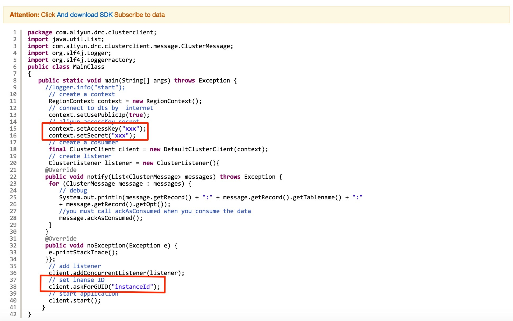

   Replace the marked parts in the preceding sample code with the AccessKey ID, the AccessKey secret, and the ID of the change tracking instance of your account.

   Log on to the DTS console to obtain the ID of the change tracking instance. In the left-side navigation pane, click **Change Tracking** to go to the Change Tracking Tasks page. On the page that appears, find the instance that you want to manage and click the ID of the instance in the **ID/Name** column.

   </li>

   <li>

   In Eclipse, right-click the demo file and choose **Run As > Java Application** to run the demo code.

   </li>

   </ol>

<a id="section-6-6"></a>

## 6.6. Use a Kafka client to consume tracked data

This topic describes how to use a Kafka client demo to consume tracked data. The change tracking feature of the new version allows you to consume tracked data by using a Kafka client of V0.11 to V2.0.

**Prerequisites**

- A change tracking instance is created. For more information, see Track data changes from an ApsaraDB RDS for MySQL instance.

- One or more consumer groups are created. For more information, see Add consumer groups.

**Precautions**

- If you enable auto commit when you use the change tracking feature, some data may be committed before it is consumed. This results in data loss. We recommend that you manually commit data.

  > **Note**
  >
  > If data fails to be committed due to a fault, you can restart the client to
  >
  > continue consuming data from the last recorded consumer offset. However, duplicate data may be generated during this period. You must manually filter out the duplicate data.

- Data is serialized and stored in the Avro format. For more information, see Record.avsc.

  > **Note**
  >
  > If the client that you use is not a Kafka client, you must parse the tracked
  >
  > data based on the Avro schema.

- Regarding the  `offsetFotTimes`  interface, the search unit of DTS is seconds, and the search unit of native Kafka is milliseconds.

**Download and run the demo code of the Kafka client**

Download the Kafka client demo. For more information about how to use the demo, see Readme.

Table 1. Steps

| Step | File or directory |
| --- | --- |
| 1. Use the native Kafka consumer to obtain incremental data from the change tracking instance. | subscribe_example-master/javaimpl/src/main/java/r ecordgenerator/ |
| 2. Deserialize the image of the incremental data, and obtain the pre-image and post-image and other attributes. | subscribe_example-master/javaimpl/src/main/java/boot/MysqlRecordPrinter.java |
| 3. Convert the dataTypeNumber values in the deserialized data into MySQL or Oracle data types.<br>Note For more information, see the Mappings between MySQL data types and dataTypeNumber values and Mappings between Oracle data types and dataTypeNumber values sections of this topic. | subscribe_example-master/javaimpl/src/main/java/r ecordprocessor/mysql/ |

**Procedure**

This procedure uses IntelliJ IDEA (Community Edition 2018.1.4 Windows) as an example.

1. Download the Kafka client demo and decompress the package.

2. Open IntelliJ IDEA. In the window that appears, click **Open**.

3. In the dialog box that appears, go to the directory in which the downloaded demo code resides and find the pom.xml file.

4. In the dialog box that appears, select **Open as Project**.

5. In the Project tool window of IntelliJ IDEA, expand folders to find the demo file of the Kafka client, and double-click the file. The file name is NotifyDemo.java.

   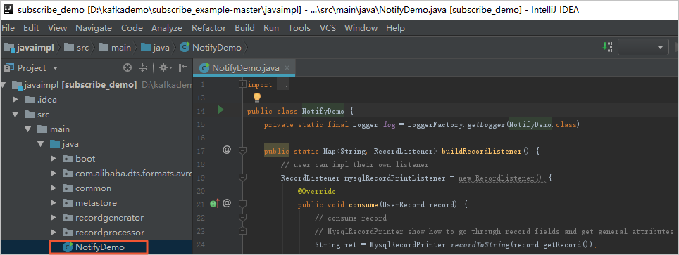

6. Set the parameters in the NotifyDemo.java file.

   **Method to obtain the parameter**

   **Parameter**

   **Description**

   **value**

   The account of the consumer group.

   > **Warning**
   >
   > If you are not
   >
   > using the Kafka client that is described in this topic, you

   In the Data Transmission Service (DTS)

   > must specify the username in

   console, find the change tracking

   > the following format:

   instance that you want to view details

   USER_NAME

   > ```xml
   >  <Consumer group account>-
   > ```

   and click the instance ID. In the left-

   > `<Consumer group ID>` , for

   side navigation pane, click **Consume Data**. On the page that appears, you

   > example,  `dtstest-`

   can obtain the consumer group ID and

   > `dtsae******bpv` . Otherwise,

   the corresponding account

   > the connection fails.

   information.

   > **Note**
   >
   > The password of the

   PASSWORD_NAM

   > consumer group account is

   The password of the account.

   E

   > automatically specified when you create the consumer group.

   SID_NAME

   The ID of the consumer group.

   The name of the consumer group.

   GROUP_NAME

   Set this parameter to the consumer group ID.

   The topic of the change tracking

   KAFKA_TOPIC

   instance.

   The endpoint and port number of the change tracking instance.

   In the DTS console, find the change

   > **Note**
   >
   > If you track data

   tracking instance that you want to

   > changes over internal

   view details and click the instance ID.

   > networks, the network latency

   In the left-side navigation pane, click

   > is minimal. This is applicable if

   KAFKA_BROKER_

   **Basic Information**. On the page that

   > the Elastic Compute Service

   URL_NAME

   appears, you can view the tracked

   > (ECS) instance on which you

   topic, endpoint, and port number.

   > deploy the Kafka client resides on the classic network or in the same virtual private cloud (VPC) as the change tracking instance.

   <table>
     <tr>
       <td>INITIAL_CHECKPO INT_NAME</td>
       <td>The consumer offset of consumed data. The value is a UNIX timestamp.<br>Note You must save the consumer offset. If the consumption process is interrupted, you can specify the consumer offset on the change tracking client to resume data consumption. This helps prevent data loss. When you start the change tracking client, you can specify the consumer offset to consume data based on your business requirements.</td>
       <td>When you use the Kafka client to track data changes for the first time, convert the required time point into a UNIX timestamp.</td>
     </tr>
     <tr>
       <td>USE_CONFIG_CHE CKPOINT_NAME</td>
       <td>Specifies whether to force the client to consume data from the specified consumption checkpoint. Default value: true. You can set this parameter to true to prevent the data that is received but not processed from being lost.</td>
       <td>N/A</td>
     </tr>
   </table>

7. In the top navigation bar of IntelliJ IDEA, choose **Run > Run** to run the client.

   > **Note**
   >
   > When you run IntelliJ IDEA for the first time, it loads and installs the
   >
   > relevant dependency.

**Execution result**

The following figure shows that the Kafka client can track data changes in the source database.

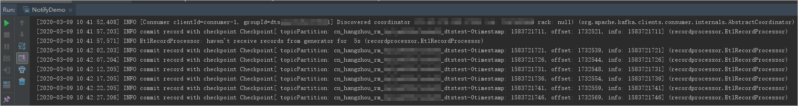

You can also delete the  `//`  characters from the  `//log.info(ret);`  string in line 25 of the NotifyDemo.java file. Then, run the client again to view the data change information.

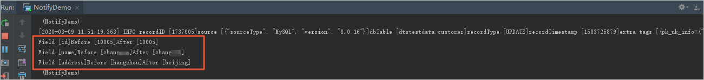

**Mappings between MySQL data types and dataTypeNumber values**

| MySQL data type | Value of dataTypeNumber |
| --- | --- |
| MYSQL_TYPE_DECIMAL | 0 |
| MYSQL_TYPE_INT8 | 1 |
| MYSQL_TYPE_INT16 | 2 |
| MYSQL_TYPE_INT32 | 3 |
| MYSQL_TYPE_FLOAT | 4 |
| MYSQL_TYPE_DOUBLE | 5 |
| MYSQL_TYPE_NULL | 6 |
| MYSQL_TYPE_TIMESTAMP | 7 |
| MYSQL_TYPE_INT64 | 8 |
| MYSQL_TYPE_INT24 | 9 |
| MYSQL_TYPE_DATE | 10 |
| MYSQL_TYPE_TIME | 11 |
| MYSQL_TYPE_DATETIME | 12 |
| MYSQL_TYPE_YEAR | 13 |
| MYSQL_TYPE_DATE_NEW | 14 |
| MYSQL_TYPE_VARCHAR | 15 |
| MYSQL_TYPE_BIT | 16 |
| MYSQL_TYPE_TIMESTAMP_NEW | 17 |
| MYSQL_TYPE_DATETIME_NEW | 18 |
| MYSQL_TYPE_TIME_NEW | 19 |
| MYSQL_TYPE_JSON | 245 |
| MYSQL_TYPE_DECIMAL_NEW | 246 |
| MYSQL_TYPE_ENUM | 247 |
| MYSQL_TYPE_SET | 248 |
| MYSQL_TYPE_TINY_BLOB | 249 |
| MYSQL_TYPE_MEDIUM_BLOB | 250 |
| MYSQL_TYPE_LONG_BLOB | 251 |
| MYSQL_TYPE_BLOB | 252 |
| MYSQL_TYPE_VAR_STRING | 253 |
| MYSQL_TYPE_STRING | 254 |
| MYSQL_TYPE_GEOMETRY | 255 |

**Mappings between Oracle data types and dataTypeNumber values**

| Oracle data type | Value of dataTypeNumber |
| --- | --- |
| VARCHAR2 or NVARCHAR2 | 1 |
| NUMBER or FLOAT | 2 |
| LONG | 8 |
| DATE | 12 |
| RAW | 23 |
| LONG_RAW | 24 |
| UNDEFINED | 29 |
| XMLTYPE | 58 |
| ROWID | 69 |
| CHAR and NCHAR | 96 |
| BINARY_FLOAT | 100 |
| BINARY_DOUBLE | 101 |
| CLOB/NCLOB | 112 |
| BLOB | 113 |
| BFILE | 114 |
| TIMESTAMP | 180 |
| TIMESTAMP_WITH_TIME_ZONE | 181 |
| INTERVAL_YEAR_TO_MONTH | 182 |
| INTERVAL_DAY_TO_SECOND | 183 |
| UROWID | 208 |
| TIMESTAMP_WITH_LOCAL_TIME_ZONE | 231 |
