Alibaba Cloud  
Apsara Stack  
DataHub  
Operations and Maintenance  
Guide  
Product Version: v3.18.6-2607  
Document Version: 20260825

**Table of Contents**

- [1.Commands and tools](#section-1)
    - [1.1. Service: Basic concepts and common operations](#section-1-1)
    - [1.2. Common O&M commands for the Apsara Distributed Operating System](#section-1-2)
    - [1.3. Common O&M commands for Apsara Distributed File System](#section-1-3)
    - [1.4. Common O&M commands for task scheduling system](#section-1-4)
    - [1.5. Xstream_tool](#section-1-5)
    - [1.6. View performance statistics in the DataHub console](#section-1-6)
    - [1.7. Apsara Big Data Manager](#section-1-7)
- [2.Routine maintenance](#section-2)
    - [2.1. DataHub Cluster Power Outage Recovery](#section-2-1)
    - [2.2. Shut down anomalous chunkserver hosts](#section-2-2)
    - [2.3. Shut down a DataHub cluster](#section-2-3)
    - [2.4. Replace a pangu_cs disk](#section-2-4)
- [3.O&M by using Apsara Big Data Manager](#section-3)
    - [3.1. Log on to Apsara Bigdata Manager](#section-3-1)
    - [3.2. Monitoring](#section-3-2)
        - [3.2.1. Health Score](#section-3-2-1)
        - [3.2.2. Reports](#section-3-2-2)
    - [3.3. Operations and maintenance](#section-3-3)
        - [3.3.1. DataHub O&M features and access](#section-3-3-1)
        - [3.3.2. Business O&M](#section-3-3-2)
            - [3.3.2.1. Topics](#section-3-3-2-1)
            - [3.3.2.2. DataHub Business Projects](#section-3-3-2-2)
            - [3.3.2.3. DataHub service hot spot analysis](#section-3-3-2-3)
            - [3.3.2.4. DataHub service archiving latency](#section-3-3-2-4)
        - [3.3.3. Service O&M](#section-3-3-3)
            - [3.3.3.1. Manage Control Service O&M](#section-3-3-3-1)
            - [3.3.3.2. Service O&M for Job Scheduler](#section-3-3-3-2)
                - [3.3.3.2.1. DataHub Fuxi Service O&M Entry](#section-3-3-3-2-1)
                - [3.3.3.2.2. Overview of DataHub Fuxi Service](#section-3-3-3-2-2)
                - [3.3.3.2.3. DataHub Fuxi server roles](#section-3-3-3-2-3)
                - [3.3.3.2.4. DataHub Fuxi Service Compute Node](#section-3-3-3-2-4)
            - [3.3.3.3. Service O&M for Apsara Distributed File System](#section-3-3-3-3)
                - [3.3.3.3.1. DataHub Pangu Service O&M Entry](#section-3-3-3-3-1)
                - [3.3.3.3.2. DataHub Pangu service overview](#section-3-3-3-3-2)
                - [3.3.3.3.3. DataHub Pangu service roles](#section-3-3-3-3-3)
                - [3.3.3.3.4. DataHub Pangu Service Storage Node](#section-3-3-3-3-4)
                - [3.3.3.3.5. Clear the Pangu recycle bin](#section-3-3-3-3-5)
                - [3.3.3.3.6. Enable and disable automatic data balancing for Pangu](#section-3-3-3-3-6)
                - [3.3.3.3.7. Perform a checkpoint on a Pangu Master](#section-3-3-3-3-7)
                - [3.3.3.3.8. Switch the Pangu Master](#section-3-3-3-3-8)
        - [3.3.4. Cluster O&M](#section-3-3-4)
            - [3.3.4.1. DataHub Cluster O&M Entry](#section-3-3-4-1)
            - [3.3.4.2. DataHub cluster overview](#section-3-3-4-2)
            - [3.3.4.3. DataHub cluster health](#section-3-3-4-3)
            - [3.3.4.4. DataHub cluster machine list](#section-3-3-4-4)
            - [3.3.4.5. Scale out DataHub nodes](#section-3-3-4-5)
            - [3.3.4.6. Scale in DataHub nodes](#section-3-3-4-6)
            - [3.3.4.7. Perform a reverse lookup for a DataHub RequestId](#section-3-3-4-7)
        - [3.3.5. Host O&M](#section-3-3-5)
            - [3.3.5.1. Host O&M entry](#section-3-3-5-1)
            - [3.3.5.2. DataHub Host Overview](#section-3-3-5-2)
            - [3.3.5.3. DataHub host service](#section-3-3-5-3)
    - [3.4. Management](#section-3-4)
        - [3.4.1. Overview](#section-3-4-1)
        - [3.4.2. Jobs](#section-3-4-2)
            - [3.4.2.1. Overview](#section-3-4-2-1)
            - [3.4.2.2. Jobs](#section-3-4-2-2)
                - [3.4.2.2.1. Manually execute a job](#section-3-4-2-2-1)
                - [3.4.2.2.2. Enable and disable scheduled jobs](#section-3-4-2-2-2)
                - [3.4.2.2.3. View job execution history](#section-3-4-2-2-3)
        - [3.4.3. Health management](#section-3-4-3)
            - [3.4.3.1. Monitoring Configuration](#section-3-4-3-1)
            - [3.4.3.2. Inspection management](#section-3-4-3-2)
        - [3.4.4. Operation audit](#section-3-4-4)
- [4.DataHub in-depth inspection](#section-4)
- [5.FAQ and solutions](#section-5)
- [6.Enable IPv4/IPv6 dual-stack](#section-6)
- [7.Appendix](#section-7)
    - [7.1. Installation environment](#section-7-1)
    - [7.2. Deployment directories and services](#section-7-2)
    - [7.3. Error codes](#section-7-3)

<a id="section-1"></a>

# 1.Commands and tools

<a id="section-1-1"></a>

## 1.1. Service: Basic concepts and common operations

**DataHub service: Basic concepts**

<table>
  <tr>
    <th>Category</th>
    <th>Name</th>
    <th>Basic Concepts</th>
  </tr>
  <tr>
    <td rowspan="4">DataHub</td>
    <td>Xstream</td>
    <td>The main DataHub service. It accepts read and write requests from the frontend and writes data to PanGu.</td>
  </tr>
  <tr>
    <td>Shipper/Connector</td>
    <td>Reads data from DataHub and imports it into third-party storage, such as MaxCompute, RDS, or OSS.</td>
  </tr>
  <tr>
    <td>Coordinator</td>
    <td>After a user creates a subscription, the coordinator saves the data read position. This lets the user resume reading from that position later.</td>
  </tr>
  <tr>
    <td>Frontend</td>
    <td>The frontend machine for DataHub and the entry point for all requests.</td>
  </tr>
</table>

**Procedure**

1. Before you run common O&M commands, log on to the command line interface.

   <ol type="i">

   <li>

   Log on to Apsara Infrastructure Management.

   </li>

   <li>

   In the navigation pane on the left, choose **Resource Management > Product Cluster**

   </li>

   </ol>

   **O&M**.

   <ol type="i" start="3">

   <li>

   Under the **Product List**, search for the DataHub cluster and click **Cluster Details**.

   </li>

   <li>

   On the **Service List** tab, click the **datahub-service** service.

   </li>

   <li>

   On the **Instance List** tab, click **Terminal** next to the target instance to open the interface.

   </li>

   </ol>

2. Run the following commands to view the services deployed on the cluster.

   ```text
   alias r='/apsara/deploy/rpc_wrapper/rpc.sh'
   ```

   ```text
   r al
   ```

   The following figure shows this:

   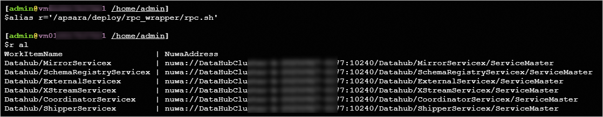

3. Run the following command to view the roles and running machines for the service. Replace `$<WorkItemName>`  with the result from the previous step.

   ```text
   r wwl $<WorkItemName>
   ```

   As shown in the following figure:

   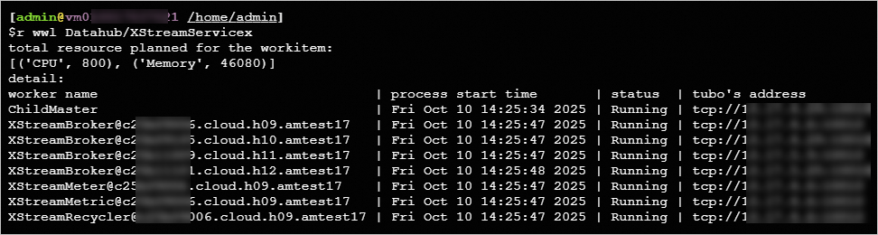

<a id="section-1-2"></a>

## 1.2. Common O&M commands for the Apsara Distributed Operating System

**Background information**

DataHub is fully deployed on the Apsara Infrastructure Management platform. As a result, all Apsara Distributed Operating System commands are replaced by tj_show. The task scheduling system, PolarFileSystem, Apsara naming service, and distributed lock system are now managed as services within the Apsara Infrastructure Management platform.

**Procedure**

1. Before running common O&M commands, log on to the command line interface. You can access the command line interface in one of two ways.

   - Method 1: Log on directly to the OPS1 machine.

   - Method 2: Use the Apsara Infrastructure Management platform.

     <ol type="a">

     <li>

     Log on to Apsara Infrastructure Management.

     </li>

     <li>

     In the navigation pane on the left, choose **Resource Management > Product Cluster O&M**.

     </li>

     </ol>

     <ol type="i" start="100">

     <li>

     Under the **Product List**, search for the DataHub cluster and click **Cluster Details**.

     </li>

     <li value="500">

     On the **Service List** tab, click the **datahub-service** service.

     </li>

     </ol>

     <ol type="a" start="5">

     <li>

     On the **Instance List** tab, click **Terminal** next to the target instance to open the interface.

     </li>

     </ol>

2. Run the following command to view the roles on the current machine.

   ```text
   tj_show
   ```

3. Run the following command to view all roles.

   ```text
   tj_show -l
   ```

4. Run the following command to view the list of machines for a specific role. For example, to view the machines for pangu_chunkserver.

   ```text
   tj_show -r pangu.PanguChunkserver# // Returns hostnames
   tj_show -r pangu.PanguChunkserver# -ip // Returns IP addresses
   ```

5. Run the following command to view the list of machines for FrontEnd.

   ```text
   tj_show -r datahub-frontend.Frontend#
   ```

6. Run the following command to view the list of machines for WebConsole.

   ```text
   tj_show -r datahub-webconsole.WebConsole#
   ```

<a id="section-1-3"></a>

## 1.3. Common O&M commands for Apsara Distributed File System

The primary O&M commands for Apsara Distributed File System are  `pu`  and  `puadmin` . To view the complete help documentation for either command, enter **the command name followed by --help and press Enter**.

**Procedure**

1. Before you run the common O&M commands, log on to the command-line interface.

   <ol type="i">

   <li>

   Log on to Apsara Infrastructure Management.

   </li>

   <li>

   In the navigation pane on the left, choose **Resource Management > Product Cluster**

   </li>

   </ol>

   **O&M**.

   <ol type="i" start="3">

   <li>

   Under the **Product List**, search for the DataHub cluster and click **Cluster Details**.

   </li>

   <li>

   On the **Service List** tab, click the **datahub-service** service.

   </li>

   <li>

   On the **Instance List** tab, click **Terminal** next to the target instance to open the interface.

   </li>

   </ol>

2. Run the following O&M commands.

   - View the files in a specified folder. This command functions similarly to the Linux ls command.

     ```text
     pu ls
     ```

   - Upload a local file to Apsara Distributed File System.

     ```text
     pu put $<target_filepath> 
     ```

   - View the metadata of a file.

     ```text
     pu meta
     ```

   - Display information about all Apsara Distributed File System Masters.

     ```text
     puadmin gems
     ```

   - List detailed information for all chunkservers.

     ```text
     puadmin lscs
     ```

   - View the version information.

     ```text
     puadmin --buildinfo
     ```

   - To perform maintenance on a single chunkserver, set its status as follows:

     <ol type="a">

     <li>

     View the current status.

     ```text
     puadmin cs -stat tcp://x.x.x.x:10260
     ```

     </li>

     <li>

     Set the status of the specified chunkserver to shutdown to remove it from the cluster.

     ```text
     puadmin cs -stat tcp://x.x.x.x:10260 --set=shutdown
     ```

     </li>

     </ol>

     <ol type="i" start="100">

     <li>

     After maintenance is complete, add the chunkserver back to the cluster.

     ```text
     puadmin cs -stat tcp://x.x.x.x:10260 --set=normal
     ```

     </li>

     </ol>

<a id="section-1-4"></a>

## 1.4. Common O&M commands for task scheduling system

**Procedure**

1. Before you run common O&M commands, log on to the command line interface.

   <ol type="i">

   <li>

   Log on to Apsara Infrastructure Management.

   </li>

   <li>

   In the navigation pane on the left, choose **Resource Management > Product Cluster**

   </li>

   </ol>

   **O&M**.

   <ol type="i" start="3">

   <li>

   Under the **Product List**, search for the DataHub cluster and click **Cluster Details**.

   </li>

   <li>

   On the **Service List** tab, click the **datahub-service** service.

   </li>

   <li>

   On the **Instance List** tab, click **Terminal** next to the target instance to open the interface.

   </li>

   </ol>

2. The  `r`  command is an Operations and Maintenance (O&M) command for the task scheduling system. This command encapsulates rpc.sh to send RPC requests to specified services, such as  `fuxi_master` ,  `pangu_master` , and  `nuwa` .

   ```text
   alias r='/apsara/deploy/rpc_wrapper/rpc.sh'
   ```

3. Run the following O&M commands in sequence to view O&M information.

   - View all jobs and services.

     ```text
     r al
     ```

     > **Note**
     >
     > Typically, the returned list is large on a production cluster.

   - View the status of a single service. Replace the  `$<service name>`  variable with the actual service name.

     ```text
     r wwl $<servicename>
     ```

   - Stop a single service. Replace the  `$<service name>`  variable with the actual service name.

     ```text
     r sstop $<servicename>
     ```

   - Start a single service. Replace the  `$<service name>`  variable with the actual service name.

     ```text
     r sstart $<servicename>
     ```

   - View total cluster resources.

     ```text
     r ttrl
     ```

   - View idle cluster resources.

     ```text
     r tfrl
     ```

     Run the command without parameters to view other options.

<a id="section-1-5"></a>

## 1.5. Xstream_tool

O&M engineers can use Xstream_tool to perform O&M operations from the command line. Before running specific commands, log on to the command-line interface as follows.

> **Note**
>
> Always use the admin account when using Xstream_tool.

**Access the command-line interface through Apsara Infrastructure Management**

The Apsara Infrastructure Management interface may vary slightly across versions. Follow your actual environment. This topic uses version V3 as an example.

1. Log on to Apsara Infrastructure Management. Then, navigate to **Resource Management > Product Cluster O&M**. In the search box under **Products**, enter datahub to find related clusters.

2. Click **Cluster Details** next to your destination cluster. On the **Services** tab, click the **datahub-webconsole** service.

3. On the **Instances** tab, click **Terminal** in the **Actions** column for your target machine to open the TerminalService window.

**Perform O&M operations**

After you log on to the command-line interface, use Xstream_tool to perform O&M operations as follows.

1. Run the following commands. After you locate the childmaster address in the first line, use SSH to connect to the machine where childmaster runs.

   ```text
   alias r='/apsara/deploy/rpc_wrapper/rpc.sh'
   ```

   ```text
   r wwl Datahub/XStreamServicex
   ```

   Figure 1. Find the childmaster address

   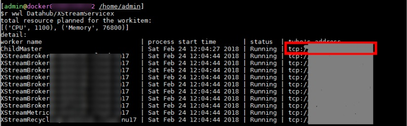

2. Navigate to the following directory.

   ```bash
   cd /apsara/tubo/TempRoot/Datahub/XStreamServicex/tool 
   ```

3. Run the following command to set the environment variable.

   ```bash
   export LD_LIBRARY_PATH=/apsara/lib64/:../lib/
   ```

4. Run the following command to view resources.

   ```text
   ./xstream_tool -x x mo
   ```

   Figure 2. View resources

   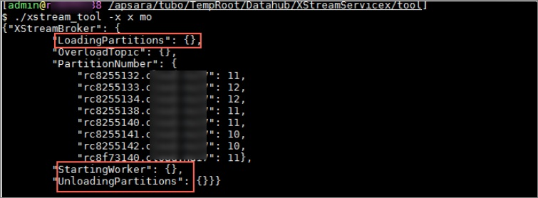

   Expected result: No data is present in **LoadingPartitions** or **UnloadingPartitions**. If data is present, it indicates an abnormality caused by an issue during the shard program's startup or shutdown. Note that when you execute a command, data may temporarily appear in StartingWorker if a shard is starting up. However, if the data persists, this indicates an abnormality.

5. Run the following command to check the status of all brokers.

   ```text
   ./xstream_tool gws -x x -r broker
   ```

   Figure 3. Check the status of all brokers

   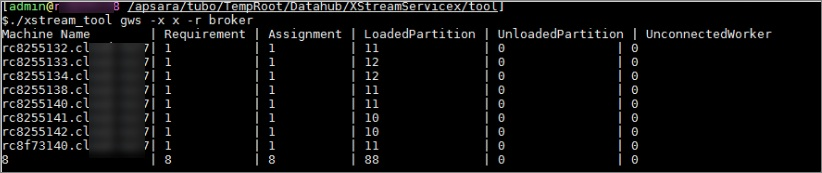

   **UnloadedPartition** and **UnconnectedWorker** should show no data. A value of 0 is normal.

6. Run the following command to check the status of all shards for the current topic. Replace  `$<project>`  and  `$<topic>`  with your actual project and topic names.

   ```text
   ./xstream_tool -x x lsw -p $<project> -t $<topic> -r broker
   ```

   Figure 4. Check the status of all shards for the current topic

   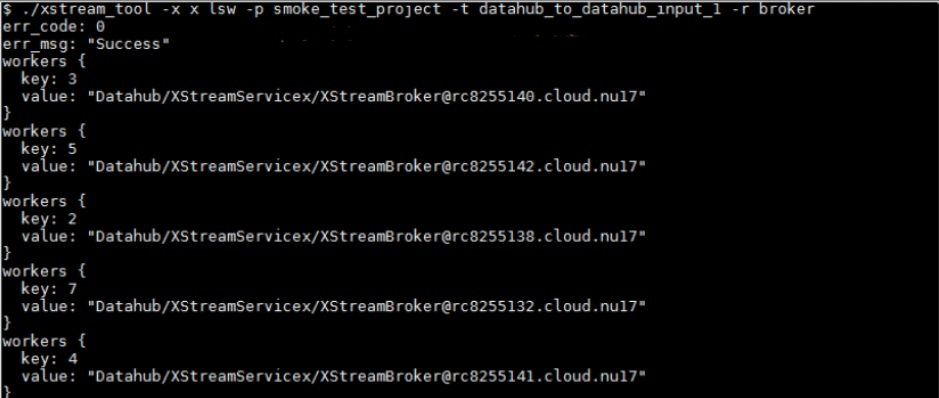

   This helps you quickly locate issues with a specific shard.

> **Note**
>
> Xstream_tool is an admin tool for DataHub. Except for the commands demonstrated above, do not run other commands unless necessary. If your work requires additional commands, contact second-line O&M engineers first.

<a id="section-1-6"></a>

## 1.6. View performance statistics in the DataHub console

In the DataHub console, you can obtain performance statistics to facilitate O&M.

For information about how to log on to the DataHub console, see the Log on to the DataHub console topic in *User Guide*.

To view the performance statistics in the DataHub console, perform the following steps:

1. Log on to the DataHub console. In the left-side navigation pane, click **Project Manager**. On the Project List page, find the project whose performance statistics you want to view and click **View** in the Actions column.

2. On the project details page, find the topic whose performance metrics you want to view and click **View** in the Actions column.

3. On the topic details page that appears, click the **Metric Statistics** tab to view the charts that display the performance statistics of this topic.

<a id="section-1-7"></a>

## 1.7. Apsara Big Data Manager

Apsara Big Data Manager (ABM) supports O&M on big data services from the perspectives of business, services, clusters, and hosts. You can also update big data services, customize alert configurations, and view the O&M history in the ABM console.

On-site Apsara Stack engineers can use ABM to easily manage big data services by performing operations, such as viewing runtime metrics, modifying runtime configurations, and viewing alerts.

For more information about how to log in to the ABM console and perform O&M operations on DataHub in the ABM console, see **O&M by using Apsara Big Data Manager**.

<a id="section-2"></a>

# 2.Routine maintenance

<a id="section-2-1"></a>

## 2.1. DataHub Cluster Power Outage Recovery

**Procedure**

1. You can log on to the command-line interface before you run common O&M commands.

   <ol type="i">

   <li>

   Log on to Apsara Infrastructure Management.

   </li>

   <li>

   In the navigation pane on the left, choose **Resource Management > Product Cluster**

   </li>

   </ol>

   **O&M**.

   <ol type="i" start="3">

   <li>

   Under the **Product List**, search for the DataHub cluster and click **Cluster Details**.

   </li>

   <li>

   On the **Service List** tab, click the **datahub-service** service.

   </li>

   <li>

   On the **Instance List** tab, click **Terminal** next to the target instance to open the interface.

   </li>

   </ol>

2. Because DataHub relies on the Apsara distributed file system to store data, an unexpected power outage may cause data loss. Check the Apsara distributed file system for data loss in the DataHub console. Use the following command with admin privileges to perform the check.

   ```text
   puadmin fs -abnchunk|grep NONE|awk '{print $1}'|awk -F"_" '{print $1}'|while read line;do puadmin whois $line;done|grep FileId|awk '{print $4}' |sort|uniq 
   >/home/admin/lostfile -- /deleted/     # Files starting with /deleted/ are Apsara distributed file system recycle bin files and can be ignored. For other directories, send them to a Tier 2 O&M engineer to check for data loss.
   ```

3. Repair the issue based on the type of files lost in the Apsara distributed file system.

   - If the lost files are DataHub data files, inform the user to rebuild the topic.

   - If the lost files are meta files of other components, reinstall the program or run init for Docker based on the file's origin.

4. After completing the repair, wait for the cluster in Apsara Infrastructure Management to reach the desired state. If the cluster does not reach the desired state, contact a Tier 2 O&M engineer for assistance.

<a id="section-2-2"></a>

## 2.2. Shut down anomalous chunkserver hosts

**Prerequisites**

None.

**Procedure**

1. Configure the action and action status for the anomalous chunkserver hosts.

   <ol type="i">

   <li>

   Log on to the ops1 host and set action to rma and action status to pending for the anomalous chunkserver host. In this example, the name of the anomalous chunkserver host is m1.

   Command:

   ```bash
   curl "http://127.0.0.1:7070/api/v5/SetMachineAction?hostname=m1" -d 
   '{"action_name":"rma", "action_status":"pending"}'
   ```

   Response:

   ```json
   {
       "err_code": 0,
       "err_msg": "",
       "data": [
           {
               "hostname": "m1"
           }
       ]
   }
   ```

   Figure 1. Set action to rma and action status to pending for the anomalous chunkserver host

   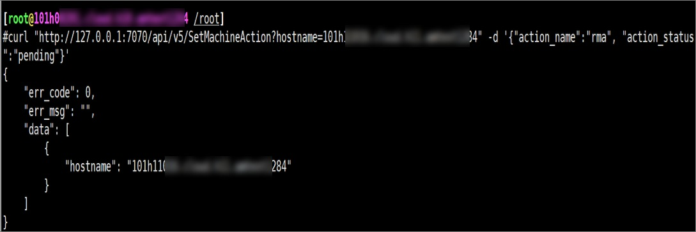

   > **Note**
   >
   > Replace the IP address and hostname in the sample code with those of your anomalous chunkserver host.

   </li>

   <li>

   Run the following command to configure audit logs:

   </li>

   </ol>

   ```bash
   curl "http://127.0.0.1:7070/api/v5/AddAuditLog?object=/m/m1&category=action" -d '{"category":"action", "from":"tianji.HealingService#", "object":"/m/m1", "content": "
   {\n   \"action\" : \"/action/rma\",\n   \"description\" : \"/monitor/rma=error, mtime: 1513488046851649\",\n   \"status\" : \"pending\"\n}\n" }'
   ```

   > **Note**
   >
   > - Replace the IP address and hostname in the sample code with those of your anomalous chunkserver host.
   >
   > - Replace the value of the mtime parameter in the sample code with the current time.
   >
   > - Run the following command to query mtime. The sample code is for your reference only.
   >
   >   Command:
   >
   >   ```bash
   >   curl "http://127.0.0.1:7070/api/v5/GetMachineInfo?
   >   hostname=m1&attr=action_name,action_status,action_description@mtime"
   >   ```
   >
   >   Response:
   >
   >   ```json
   >   {
   >       "err_code": 0,
   >       "err_msg": "",
   >       "data": {
   >           "action_description": "",
   >           "action_description@mtime": 1516168642565661,
   >           "action_name": "rma",
   >           "action_name@mtime": 1516777552688111,
   >           "action_status": "pending",
   >           "action_status@mtime": 1516777552688111,
   >           "hostname": "m1",
   >           "hostname@mtime": 1516120875605211
   >       }
   >   }
   >   ```
   >
   >   Figure 2. Query mtime
   >
   >   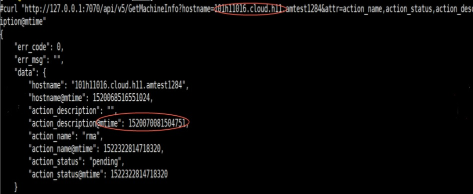

2. Wait for approval.

   <ol type="i">

   <li>

   Check the action status of the host.

   Command:

   ```bash
   curl "http://127.0.0.1:7070/api/v5/GetMachineInfo?hostname=m1"
   ```

   Response: (We recommend that you search for the host by the keyword.)**"action_status": "pending"**

   After you verify that the action status is pending, you can approve the action in the Apsara Infrastructure Management console.

   </li>

   <li>

   Check the action status of the server role. When the status is approved or done, you can

   </li>

   </ol>

   shut down the host for maintenance.

   Command:

   ```bash
   curl http://127.0.0.1:7070/api/v5/GetMachineInfoPackage?
   hostname=m1&attr=sr.id,sr.action_name,sr.action_status
   ```

   Response: (We recommend that you search for the host by the keyword.)**"action_status": "done"**

3. After the action of the host changes to rma and action status changes to approved or done, shut down the host. Restart the host after the maintenance is completed.

4. After the host is restarted, run the following command to configure the action status of the host:

   ```bash
   curl "http://127.0.0.1:7070/api/v5/SetMachineAction?hostname=m1&action_name=rma" -d '
   {"action_name":"rma","action_status":"done", "force":true}'
   ```

5. Log on to the Apsara Infrastructure Management console and check whether the cluster is at desired state.

<a id="section-2-3"></a>

## 2.3. Shut down a DataHub cluster

**Prerequisites**

None.

**Procedure**

1. Terminate DataHub services.

   <ol type="i">

   <li>

   Log on to the webconsole host of the target cluster and run the following commands as an administrator. Ensure that no data is returned.

   ```text
   puadmin abnchunk fs -t none
   puadmin abnchunk fs -t onecopy
   puadmin abnchunk fs -t lessmin
   ```

   </li>

   <li>

   On the webconsole host, run the following commands as an administrator to terminate all

   </li>

   </ol>

   services run by chunkserver hosts in the Apsara system:

   ```text
   r ttrl |grep disk |awk '{print $1}'  > tubo.list
   pssh -h tubo.list -i "/apsara/cloud/tool/tianji/apsarad stop"
   ```

   <ol type="i" start="3">

   <li>

   On the webconsole host, run the following command as an administrator to make sure

   </li>

   </ol>

   that all services in the Apsara system have been terminated:

   ```text
   pssh -h tubo.list -i "/apsara/cloud/tool/tianji/apsarad status"
   ```

2. Shut down the cluster.

3. Restart DataHub services.

   <ol type="i">

   <li>

   On the webconsole host, run the following command as an administrator to restart all services run by chunkserver hosts in the Apsara system:

   ```text
   r ttrl |grep disk |awk '{print $1}'  > tubo.list
   pssh -h tubo.list -i "/apsara/cloud/tool/tianji/apsarad start"
   ```

   </li>

   <li>

   On the webconsole host, run the following command as an administrator to make sure

   </li>

   </ol>

   that all services in the Apsara system are functioning properly:

   ```text
   pssh -h tubo.list -i "/apsara/cloud/tool/tianji/apsarad status"
   ```

<a id="section-2-4"></a>

## 2.4. Replace a pangu_cs disk

**Prerequisites**

Collect the following information:

- Hostname or IP address.

- Drive letter: the drive letter of the failed data disk, such as  `/dev/sdk1` .

- Disk number: If the path of the faulty data disk in the Apsara Distributed File System is  `/apsarapangu/disk(?)` , for example,  `/apsarapangu/disk5` , then the disk number is 5. You can retrieve this number by running the  `puadmin lscs -m`  command.

**Procedure**

1. Before you can execute common O&M commands, you must log on to the command-line interface.

   <ol type="i">

   <li>

   Log on to Apsara Infrastructure Management.

   </li>

   <li>

   In the navigation pane on the left, choose **Resource Management > Product Cluster**

   </li>

   </ol>

   **O&M**.

   <ol type="i" start="3">

   <li>

   Under the **Product List**, search for the DataHub cluster and click **Cluster Details**.

   </li>

   <li>

   On the **Service List** tab, click the **datahub-service** service.

   </li>

   <li>

   On the **Instance List** tab, click **Terminal** next to the target instance to open the interface.

   </li>

   </ol>

2. Run the following command as an administrator to confirm that the disk to replace is in the DISK_ERROR state.

   ```text
   puadmin lscs -m
   ```

   > **Note**
   >
   > If the disk is not in the DISK_ERROR state, run the following command to set it to ERROR.
   >
   > ```text
   > puadmin cs -stat tcp://hostname-or-IP:10260 -d disk-ID --set=ERROR
   > ```

3. Unmount the faulty drive letter. For example, if the drive is  `/dev/sdk1` , run:

   ```bash
   sudo umount /dev/sdk1
   ```

   > **Note**
   >
   > If  `df`  shows that the drive is not mounted, skip this step.

4. Hot-swap the disk.

5. Upload the  `repair_app_disk.sh`  script (contact Alibaba Cloud Technical Support to obtain the script) to the target machine, and then execute the  `sudo sh repair_app_disk.sh` command to format the disk.

6. Run the following command to set the disk status to OK in the Apsara distributed file system.

   ```text
   puadmin cs -stat tcp://hostname-or-IP:10260 -d disk-ID --set=OK
   ```

7. Restart the server to detect the new disk.

   > **Note**
   >
   > You can restart the pangu_cs node by killing its process. This has no impact because DataHub is a distributed service. Restarting a single cs node does not affect overall service.

8. Run the following command to verify that the drive status is now DISK_OK.

   ```text
   puadmin lscs -m
   ```

   You can also log on to the machine to confirm that a chunks directory has been created under the drive letter. For example, in the  `/apsarapangu/disk5/chunks/`  path, the  `chunks/`  directory exists and chunks have been written to it.

<a id="section-3"></a>

# 3.O&M by using Apsara Big Data Manager

<a id="section-3-1"></a>

## 3.1. Log on to Apsara Bigdata Manager

This topic describes how to log on to Apsara Bigdata Manager.

**Prerequisites**

- The endpoint of the Apsara Uni-manager Operations Console and the username and password that are used to log in to the console are obtained from a deployment engineer or an administrator.

  The endpoint of the Apsara Uni-manager Operations Console is in the following format: *regi on-id*.ops.console.*intranet-domain-id*.

- A supported browser is used. We recommend that you use Google Chrome.

**Procedure**

1. Open your browser.

2. In the address bar, enter the endpoint of the Apsara Uni-manager Operations Console. Press the ENTER key.

   

   > **Note**
   >
   > You can click the current language in the upper-right corner to switch to another language. Simplified Chinese and English are supported.

3. Enter your username and password.

   > **Note**
   >
   > - Obtain the username and password that are used to log on to the Apsara Uni-manager Operations Console from a deployment engineer or an administrator.
   >
   > - If you enter an invalid password for three consecutive times, the system enables the image verification logon feature. If you enter an invalid password for five consecutive times, the account is locked. Contact the administrator to unlock the account.
   >
   > - The first time that you log on to the Apsara Uni-manager Operations Console, change the password for your username as prompted.
   >
   >   To enhance security, your password must meet the following requirements:
   >
   >   - The password contains uppercase and lowercase letters.
   >
   >   - The password contains digits.
   >
   >   - The password contains at least one of the following special characters: ! @ # $ %
   >
   >   - The password is 10 to 20 characters in length.

4. Click **Agree to Private Policy and Log On**.

5. After you log on to the Apsara Uni-manager Operations Console, click **Product O&M** in the top menu bar.

6. Select **Big Data O&M > General Big Data O&M · Apsara Bigdata Manager**, and the Dashboard page of Apsara Bigdata Manager opens automatically.

<a id="section-3-2"></a>

## 3.2. Monitoring

<a id="section-3-2-1"></a>

### 3.2.1. Health Score

The Health Score page displays metrics for big data products and alerts at different severity levels. It also provides details and lets you recheck after fixing issues.

**Procedure**

1. Log on to Apsara Bigdata Manager.

2. Click the  icon in the upper-left corner. Then select **DataHub**.

3. In the top menu bar, click **Monitoring**.

4. On the **Health Score** tab, you can view the health check information.

   The Health Score page displays metrics, metric sources, severity levels, and metric details. Filter the list as needed.

<a id="section-3-2-2"></a>

### 3.2.2. Reports

Reports display inspection results for big data products.

**Procedure**

1. Log on to Apsara Bigdata Manager.

2. Click the  icon in the upper-left corner. Then select **DataHub**.

3. In the top menu bar, click **Monitoring**.

4. On the **Reports** tab, you can view report information.

   The Reports page displays the report ID, report name, product name, template name, instance type, and creation information. You can also view details.

<a id="section-3-3"></a>

## 3.3. Operations and maintenance

<a id="section-3-3-1"></a>

### 3.3.1. DataHub O&M features and access

This topic describes the DataHub operations and maintenance (O&M) features supported by Apsara Bigdata Manager and how to access the O&M page.

**DataHub O&M features**

DataHub O&M consists of four modules: Business O&M, Service O&M, Cluster O&M, and Host O&M. The details are as follows:

**O&M**

**Sub-feature**

**Description**

**feature**

Displays the name of the log source, the corresponding project name, the number of

Log source

shards, storage, read traffic, write traffic, and creation time.

Displays the project name, author, log source,

Project

read traffic, write traffic, storage, and creation

Business

time.

O&M

Displays a hot spot distribution view of the

Hot spot analysis

number of shards on each node in the cluster.

Displays the latency of data archiving.

Archive latency

Displays the overall operational status of the

Control

control service. This includes a service summary,

Overview

service

service status, operational health, operational health history, and resource usage trends.

Summarizes key operational metrics for the Fuxi service. This includes a service summary, service

Service

status, operational health, operational health

overview

history, saturation-resource allocation, a CPU usage trend chart, a memory usage trend chart, and a compute node overview.

Displays information about the server roles of the

Fuxi service

Fuxi service. This includes the server role name,

O&M

Server role

the host of the server role, the IP address of the server role, the server role status, and the host status.

Lists the compute nodes under the Fuxi service. This includes the blacklisted status, active status,

Service O&M

Service

total CPU, idle CPU, total memory, and idle

compute

memory of each node. On the compute node

node

page, you can also add nodes to a blacklist, remove them from a blacklist, set them to read-only, or remove their read-only status.

Summarizes key operational metrics for the Pangu service. This includes a service summary,

Service

service status, operational health, operational

overview

health history, saturation-storage level, a storage change trend chart, a file change trend chart, and a storage node overview.

Displays information about the server roles of the

Pangu service

Pangu service. This includes the server role

O&M

server role

name, the host of the server role, the IP address of the server role, the server role status, and the host status.

Lists the storage nodes under the Pangu service. This includes the total space, remaining space,

Service

status, TTL, and sendBuffer of each node. On the

storage node

storage node page, you can also set the status of storage nodes and data disks.

Summarizes the overall operational information of the cluster. This includes machine status,

Cluster overview

service status, CPU, disk, memory, load, packet, operational health, and operational health history.

Lets you view all check items for the cluster and the details of each item, which include solutions for alarms. You can also view the check status of

Cluster health

each item on its host. Additionally, you can log on to the host directly and manually run checks.

Displays information about all hosts in the cluster. This includes CPU usage, memory usage,

Cluster machine list

Cluster O&M

root disk usage, packet loss rate, and error packet rate.

Lets you scale out and scale in physical hosts in a

Node scale-out and scale-in

DataHub cluster.

View operation history

Lets you view the history of operations.

Lets you use a RequestId to reverse parse the time a job occurred and the IP address of the

Reverse parse RequestId

host. This helps you find logs and locate issues.

information

Summarizes the overall operational information for each host in the DataHub cluster. This includes the current machine information, the

Host overview

status of the server roles on the machine, and trend charts for CPU, disk, load, memory, and

Host O&M

packets.

Displays the service instances on the host and

server role

the roles of those instances.

**Access the DataHub O&M page**

1. Log on to Apsara Bigdata Manager.

2. Click the  icon in the upper-left corner. Then select **DataHub**.

3. In the top menu bar, click **O&M**.

   The **O&M** page includes four modules: **Business O&M**, **Service O&M**, **Cluster O&M**, and **Host O&M**.

<a id="section-3-3-2"></a>

### 3.3.2. Business O&M

<a id="section-3-3-2-1"></a>

#### 3.3.2.1. Topics

The topic list displays the name, project, number of shards, storage, read traffic, write traffic, and creation time of each topic.

**View the topic list**

On the **Business** tab, click **Topics** in the left-side navigation pane to view the topic list.

**View the details of a topic**

On the **List** page, click the name of the topic that you want to view. On the page that appears, you can view the number of shards, the time when the topic was created and modified, the current storage usage, the lifecycle, the type, and the description of the topic. You can also view more details about monitoring metrics, shards, subscriptions, DataConnectors, and schema.

The Metric, Shard, Subscriptions, DataConnector, and Schema tabs provide more details about the topic.

- **Metric**: On the **Metric** tab, you can view the throughput and latency of the topic in near real time.

- **Shard**: Shards are concurrent tunnels used for data transmission in the topic.

  On the Shard tab, you can view the ID, status, and active time of each shard.

- **Subscriptions**: The subscription feature allows you to save consumption offsets to the server and resume data consumption from a saved consumption offset.

  On the Subscriptions tab, you can view the ID, status, owner, and description of each subscription and the time when the subscription was modified.

- **DataConnector**: DataConnectors synchronize the streaming data from DataHub to other Apsara Stack services. You can configure a DataConnector so that the data you write to DataHub can be used in other Apsara Stack services.

  On the DataConnector tab, you can view the name, ID, owner, and status of each DataConnector, and the time when the DataConnector was created and modified.

- **Schema**: Schemas define the data types of fields.

  On the Schema tab, you can view the data type and name of each field.

**Disable or enable a topic**

When you view the topic information, you may find that the DataHub instance has abnormal traffic or its cluster resources are nearly full. In this case, you need to temporarily disable data read/write for abnormal topics and low-priority topics. When abnormal Meta requests increase, you also need to temporarily disable requests related to abnormal topics to ensure cluster stability.

In this case, you can click **Disable** in the Actions column. In the dialog box that appears, specify the topic that you want to disable. After you disable a topic, all requests for the topic trigger errors, including read and write requests.

After the issue is solved, you can click **Enable** in the Actions column to enable the topic. After the topic is enabled, you can use the topic again.

You can view the information in the Status column to check whether a topic is disabled or enabled. The **off** status indicates that the topic is disabled, and the **on** status indicates that the topic is enabled.

<a id="section-3-3-2-2"></a>

#### 3.3.2.2. DataHub Business Projects

A business project displays its name, author, log sources, read traffic, write traffic, storage usage, and creation time.

**Access the Business Projects Interface**

On the **Business O&M** page, click **Projects** in the navigation pane on the left. The **Projects List** appears in the area on the right.

**View Project Overview**

On the **Projects List** page, click the name of the project you want to view. Then, go to the **Overview** tab to view the project overview.

**View Log Sources for a Project**

On the **Projects List** page, click the name of the project you want to view. Then, go to the **Log Sources** tab to view the log sources for that project.

<a id="section-3-3-2-3"></a>

#### 3.3.2.3. DataHub service hot spot analysis

Service hot spot analysis displays the shard hot spot distribution across nodes in the cluster.

**Accessing the service hot spot analysis page**

On the **Service O&M** page, click **Hot Spot Analysis** in the left navigation pane. The right pane displays the shard count hot spot distribution for each node in the cluster.

**Refresh and filter the hot spot analysis view**

On the **Hot Spot Analysis** page, click **SHARD Count** to refresh the hot spot distribution view. You can also filter the data.

The **qps** value indicates the number of requests per second for a machine in the cluster. A high **qps** value suggests that the machine handles more requests than others, which may indicate a hot spot.

> **Note**
>
> - A normal cluster displays at least four rows of data because the minimum cluster size is four servers.
>
> - At least two rows show a **qps** value other than N/A. This is because at least two of the four servers have the Frontend role and report a **qps** value. A server that shows N/A for this value either has only the Chunkserver role, is not co-located with a Frontend role, or is abnormal.

<a id="section-3-3-2-4"></a>

#### 3.3.2.4. DataHub service archiving latency

Archiving latency indicates the delay during data archiving.

**Access the service archiving latency page**

On the **Service O&M** page, click **Archiving Latency** in the navigation pane on the left. A list of archiving tasks appears on the right.

**View archiving latency information**

On the **Archiving Task List** page, select a **Region Cluster** to view the **Project Name**, **Topic Name**, **Archiving Type**, **Subscription ID**, and **Last Archiving Time** of each task. You can search and sort the list by keyword.

Click the **Topic Name** of an archiving task to go to the **Log Source** page. On the **DataConnector** tab, you can find detailed archiving information to help you troubleshoot issues.

<a id="section-3-3-3"></a>

### 3.3.3. Service O&M

<a id="section-3-3-3-1"></a>

#### 3.3.3.1. Manage Control Service O&M

The Control Service Overview page outlines the operational status of the control service, including a service summary, service status, and resource usage trends.

**Access Control Service O&M**

1. Log on to Apsara Bigdata Manager.

2. In the upper-left corner, click the  icon. Then select the **DataHub** product.

3. On the DataHub page, click **O&M** at the top. Then select **Service O&M**.

4. In the left navigation pane of the **Service O&M** page, select **Control Service**. The **Overview** page is displayed by default.

<a id="section-3-3-3-2"></a>

#### 3.3.3.2. Service O&M for Job Scheduler

<a id="section-3-3-3-2-1"></a>

##### 3.3.3.2.1. DataHub Fuxi Service O&M Entry

This section describes how to access the DataHub Fuxi service O&M page in Apsara Bigdata Manager.

**Procedure**

1. Log on to Apsara Bigdata Manager.

2. In the upper-left corner, click the  icon, then select the **DataHub** product.

3. On the DataHub page, click **O&M** at the top, then click **Service O&M**.

4. On the **Service O&M** page, in the left navigation pane, click **Fuxi Service**. Then, on the right, select a cluster to open the **Overview** page for that cluster's Fuxi service.

<a id="section-3-3-3-2-2"></a>

##### 3.3.3.2.2. Overview of DataHub Fuxi Service

The overview interface displays key operational metrics for the Fuxi Service, including Service Summary, Service Status, Saturation – Resource Allocation, CPU Usage Trend Graph, Memory Usage Trend Graph, and Compute Node Resource Overview.

**Access the Fuxi Service Overview Interface**

1. In the navigation pane on the left of the **Service O&M** interface, click **Fuxi Service**.

2. On the right, select a cluster, then click the **Overview** tab to open the **Overview** page for the Fuxi Service.

   View the destination cluster’s Service Summary, Service Status, Saturation – Resource Allocation, CPU Usage Trend Graph, Memory Usage Trend Graph, and Compute Node Resource Overview.

   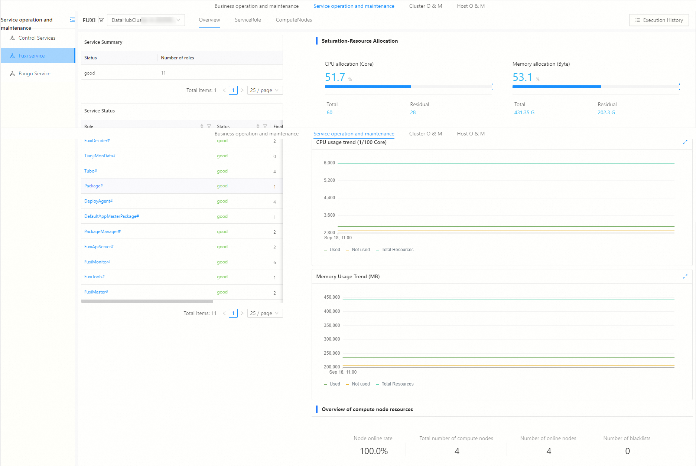

**Service Summary**

The Service Summary shows the number of roles in active status, unavailable status, and upgrade status.

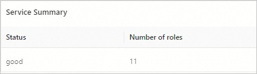

**Service Status**

This section lists all service roles for the Fuxi Service and their statuses, and shows the final count and desired state count for each role.

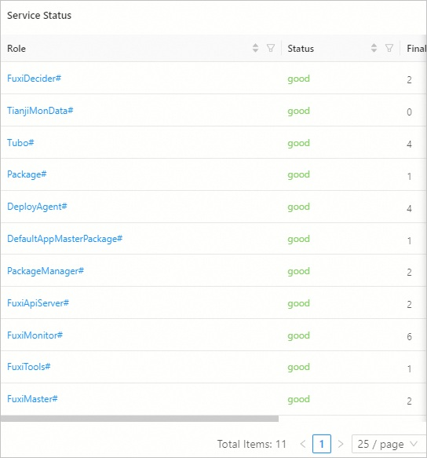

**Saturation - Resource Allocation**

This section displays the allocation of CPU and memory resources:

- CPU allocation: Shows CPU usage, total number of CPU cores, remaining CPU cores, and CPU cores used for SQL acceleration.

- Memory allocation: Shows memory usage, total memory, remaining memory, and memory used for SQL acceleration.

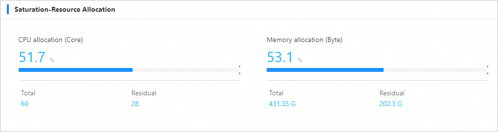

**CPU and Memory Usage Trends**

Over time, different colored curves display the CPU and memory usage trends for the Fuxi Service, including used, unused, and total resources.

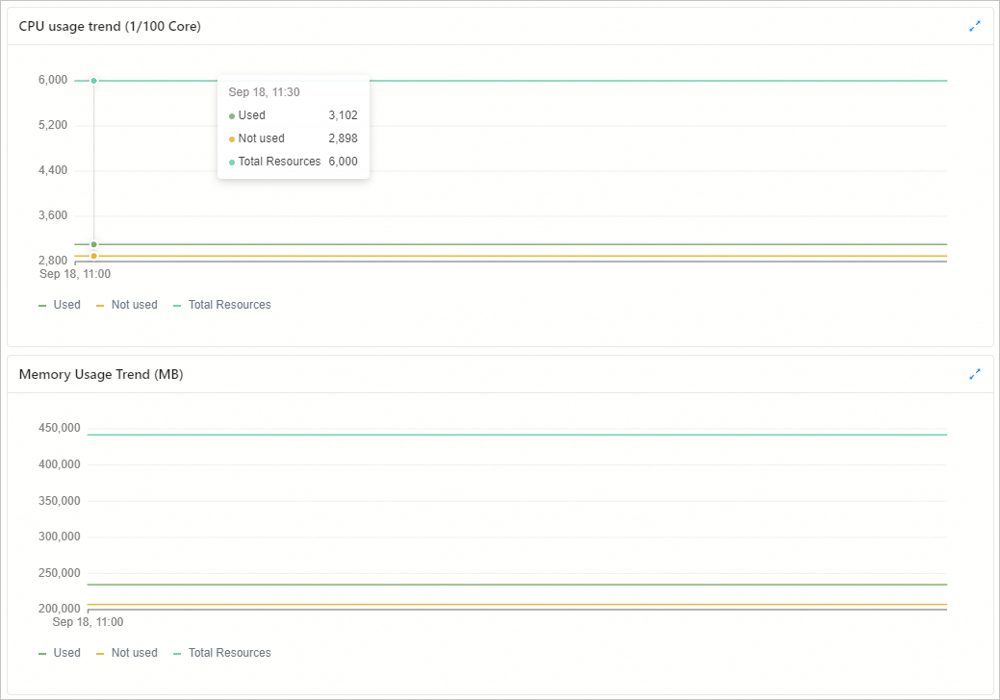

Click the  icon in the upper-right corner of the graph to enlarge the usage trend graph. For

example, you can enlarge the CPU usage trend graph.

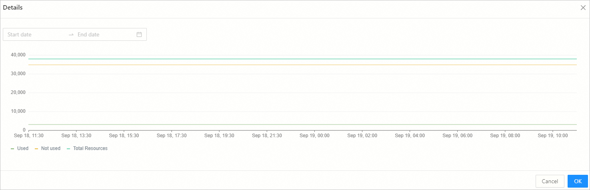

In the enlarged graph, specify a time range in the upper-left corner to view the cluster’s CPU usage trend graph.

**Compute Node Resource Overview**

This section summarizes compute node resource information for the Fuxi Service, including node online rate, total number of compute nodes, number of online nodes, and number of blacklisted nodes.

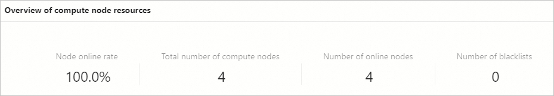

<a id="section-3-3-3-2-3"></a>

##### 3.3.3.2.3. DataHub Fuxi server roles

The Fuxi server roles page displays information about Fuxi server roles, such as the server role name, host, IP address, server role status, and host status.

**Procedure**

1. In the navigation pane on the left of the **O&M** interface, click **Fuxi Service**.

2. Select a cluster on the right, and then click **Server Roles** to open the server roles page for the Fuxi service.

   The server roles page displays information about Fuxi server roles, such as the server role name, host, IP address, server role status, and host status.

<a id="section-3-3-3-2-4"></a>

##### 3.3.3.2.4. DataHub Fuxi Service Compute Node

You can view the details of compute nodes on the ComputeNodes tab for Job Scheduler, including the total CPU, idle CPU, total memory, and idle memory of each compute node. You can also check whether a node is added to the blacklist and whether it is active. You can also add compute nodes to or remove compute nodes from the blacklist or read-only list on the ComputeNodes tab.

**Fuxi Service Compute Node Page Access**

1. In the navigation pane on the left of the **Service O&M** page, click **Fuxi Service**.

2. On the right, select a cluster. Then click the **Compute Node** tab to open the **Compute Node** page for the Fuxi Service.

   The Compute Node page displays information about compute nodes for the Fuxi Service, including blacklisting status, active status, total CPU, idle CPU, total memory, and idle memory.

**Blacklist and read-only settings**

You can add compute nodes to or remove compute nodes from the blacklist or read-only list. To add compute nodes to the blacklist, perform the following steps:

1. On the **ComputeNodes** tab, find the desired compute node and click **Actions > Add blacklist** in the Actions column.

2. In the panel that appears, click **Run**. A message appears, indicating that the action is submitted.

   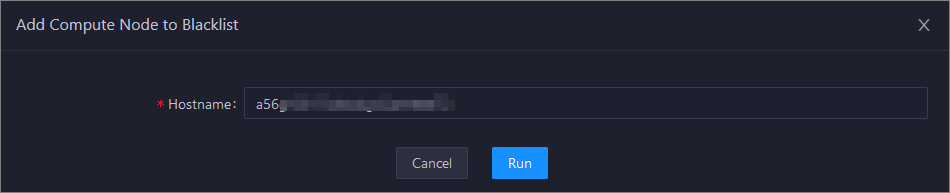

   > **Note**
   >
   > The value of the **Hostname** parameter is automatically filled. You do not need to specify a value for this parameter.

   You can check whether a compute node is added to the **blacklist** in the **compute node** list after the configuration is complete.

<a id="section-3-3-3-3"></a>

#### 3.3.3.3. Service O&M for Apsara Distributed File System

<a id="section-3-3-3-3-1"></a>

##### 3.3.3.3.1. DataHub Pangu Service O&M Entry

This section describes how to access the DataHub Pangu Service O&M page in Apsara Bigdata Manager.

**Procedure**

1. Log on to Apsara Bigdata Manager.

2. In the upper-left corner, click the  icon, then select the **DataHub** product.

3. On the DataHub page, click **O&M** at the top, then select **Service O&M**.

4. On the **Service O&M** page, click **Pangu Service** in the left navigation pane. Then, on the right, select a cluster to access the **Overview** page for that cluster's Pangu Service.

<a id="section-3-3-3-3-2"></a>

##### 3.3.3.3.2. DataHub Pangu service overview

On the Overview tab, the key information about the operations of Apsara Distributed File System is displayed. You can view the summary of services, service role status, statistics on storage usage, statistics on storage nodes, and the trend charts of storage usage and the number of files.

**Access the overview page**

1. On the **Service O&M** page, click **Pangu Service** in the navigation pane on the left.

2. On the right, select a cluster and click the **Overview** tab to view the **Overview** page of the Pangu service.

   The **Overview** page summarizes the key operational metrics for the Pangu service, including Service Summary, Service Status, Saturation - Storage Level, Storage Change Trend Graph, File Change Trend Graph, and Storage Node Overview.

**Service Summary**

In the Service Summary section, the status of Apsara Distributed File System and the number of service roles are displayed.

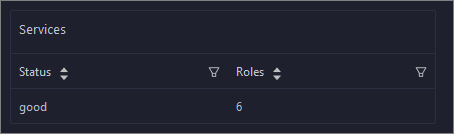

**Service Status**

In the Service Status section, all service roles of Apsara Distributed File System and their status are displayed. You can also view the number of physical servers on which each service role is deployed and the number of physical servers at desired state for each service role.

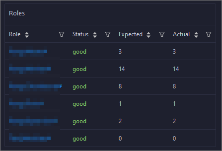

**Saturation-storage level**

In the Saturation-storage level section, the statistics on storage usage and the number of files are displayed.

- In the Storage water level section, you can view the storage usage, total storage space, available storage space, and the size of the recycle bin.

- In the Number of files Water level section, you can view the storage usage of files, maximum number of files, number of existing files, and number of files in the recycle bin.

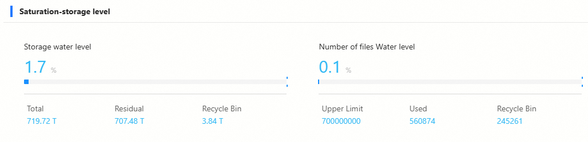

**Physical storage capacity and Document change trend**

In the Physical storage capacity and Document change trend sections, the trend charts of storage usage and the number of files are displayed. The Physical storage capacity chart shows the trend lines of the total storage space, used storage space, and storage usage in different colors. The Document change trend chart shows the trend line of the number of files.

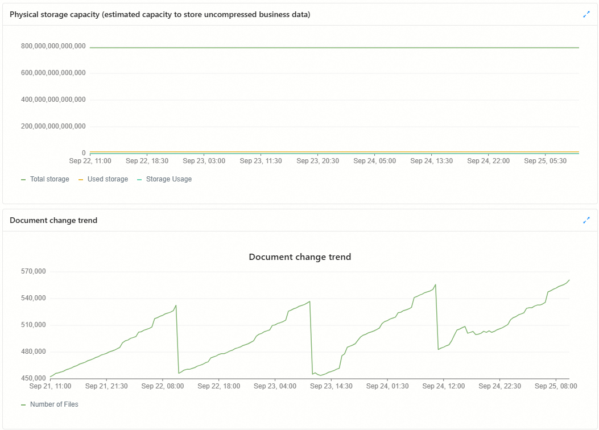

In the upper-right corner of a chart, you can click the  icon to zoom in on the chart. The

following figure shows an enlarged chart of storage usage.

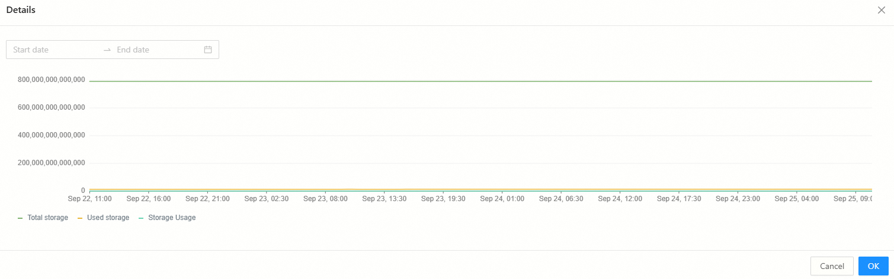

You can specify the start date and end date in the upper-left corner of the enlarged chart to view the storage usage of the cluster in the specified period.

**Storage Node Overview**

In the Storage Node Overview section, the information about the storage nodes of Apsara Distributed File System is displayed. You can view the numbers of data nodes, normal nodes, disks, and normal disks. You can also view the percentages of faulty nodes and faulty disks.

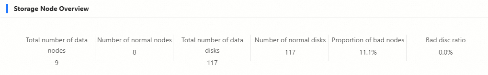

<a id="section-3-3-3-3-3"></a>

##### 3.3.3.3.3. DataHub Pangu service roles

The Pangu service roles page displays information about each Pangu service role, including the service role name, host, IP address, service role status, and host status.

**Access the Pangu service instance interface**

1. In the left navigation pane of the **O&M** interface, click **Pangu Service**.

2. On the right, select a cluster, then click the **Service Roles** tab to open the **Service Roles** interface for Pangu Service.

   You can view Pangu service role information, including the service role name, host, IP address, service role status, and host status.

**Supported operations for Pangu service instances**

You can filter and sort by column to view information more conveniently. .

For instructions on switching the Pangu Master or executing a Checkpoint on the Pangu Master, see Switch the Pangu Master and Execute a Checkpoint on the Pangu Master.

<a id="section-3-3-3-3-4"></a>

##### 3.3.3.3.4. DataHub Pangu Service Storage Node

This topic describes how to view the storage overview and storage node information of Apsara Distributed File System, and how to set the status of storage nodes and data disks.

**Storage Overview Entry**

1. Go to the DataHub Pangu service O&M page.

2. Switch to the **Storage** tab. By default, the **Storage Overview** page appears.

   > **Note**
   >
   > The **Storage Overview** page displays Pangu's **rebalance status**, **metrics**, and information about **rack dimensions**.

**Set the storage node status**

You can set the storage node status to Disabled or Normal. This section describes how to set the status of a storage node to Disabled.

1. On the **Storage Nodes** page, find the storage node that you want to manage, click **Operation**, and then select **Set Storage Node To Shutdown**.

2. In the **Set Storage Node To Shutdown** panel, click **Execute**. A message appears, indicating that the operation was submitted.

   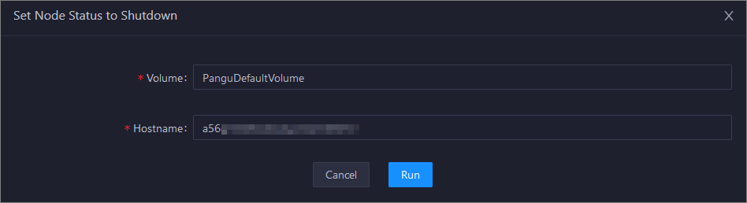

   The values of the **Volume** and **Hostname** parameters are automatically filled based on the selected storage node. You do not need to specify values for the parameters.

   You can check whether the status of storage node is changed in the storage node list.

**Set the data disk status**

You can set the data disk status to Error or Normal. This section describes how to set the status of a data disk to Error.

1. On the **Storage Nodes** page, find the storage node that you want to manage, click **Operation**, and then select **Set Data Disk To Error**.

2. In the **Set Data Disk To Error** panel, enter the **Disk ID**.

   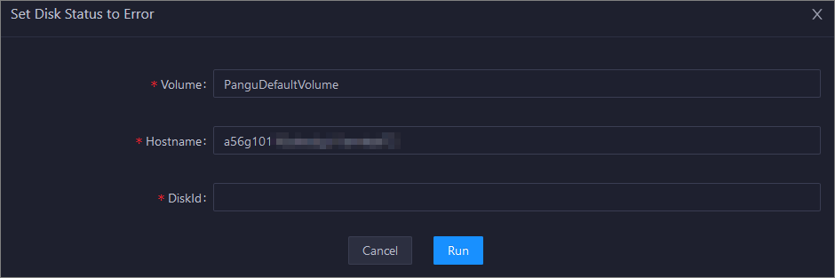

   The values of the **Volume** and **Hostname** parameters are automatically filled based on the selected storage node. You do not need to specify values for the parameters.

3. After you configure the parameter, click **Execute**. A message appears, indicating that the operation was submitted.

<a id="section-3-3-3-3-5"></a>

##### 3.3.3.3.5. Clear the Pangu recycle bin

Apsara Big Data Manager (ABM) allows you to clear the recycle bin of Apsara Distributed File System to release storage space.

**Prerequisites**

You have an Apsara Bigdata Manager account with permissions to manage DataHub.

**Procedure**

1. In the navigation pane on the left of the **Service O&M** page, click **Pangu Service**. Then, select a cluster to open the **Overview** page for the Pangu service.

2. In the upper-right corner, click **Operation** and then select **Clear System Recycle Bin**.

3. In the dialog box that appears, set **volume**. The default value is **PanguDefaultVolume**.

4. After you configure the parameters, click **Execute**. A message is displayed indicating that the task was successfully submitted.

5. Check the status of the task.

   Click **Operation**, and then click **History** next to **Clear System Recycle Bin** to view the execution history.

   A status of **RUNNING** indicates that the task is in progress. A status of **SUCCESS** indicates that the task was successful. A status of **FAILED** indicates that the task failed.

6. Click **Details** next to the target task. On the **Clear System Recycle Bin** page, click **Clear System Recycle Bin > Machine Details > View Details** in the failed step to identify the cause of the failure.

   > **Note**
   >
   > To analyze the cause of the task failure, review the **Parameter Settings**, **Machine Details**, and **Runtime Parameters**.

<a id="section-3-3-3-3-6"></a>

##### 3.3.3.3.6. Enable and disable automatic data balancing for Pangu

Apsara Bigdata Manager lets you enable and disable the automatic data balancing feature of the Apsara Distributed File System for DataHub.

**Prerequisites**

You have an Apsara Bigdata Manager account with O&M permissions for DataHub.

**Disable automatic data balancing**

1. On the **Service O&M** page, in the left navigation pane, click **Pangu Service**. Then, on the right, select a cluster to go to its Pangu service O&M page.

2. In the upper-right corner, click **Actions** and select **Disable Automatic Data Balancing**.

3. In the dialog box that appears, set **volume**. The default value is **PanguDefaultVolume**.

4. After you configure the parameters, click **Execute**. A message indicates that the task was submitted.

5. View the execution status of the task.

   Click **Actions**, and then click **History** next to **Disable Automatic Data Balancing** to view the execution history.

   A status of **RUNNING** indicates that the task is in progress. A status of **SUCCESS** indicates that the task is successful. A status of **FAILED** indicates that the task failed.

6. If the task fails, click **Details** next to the execution record to identify the cause of the failure. For more information, see Identify the cause of a task failure.

**Enable automatic data balancing**

1. On the **Service O&M** page, in the left navigation pane, select **Pangu Service**. Then, on the right, select a cluster to go to its Pangu service O&M page.

2. On the right, click **Actions** and select **Enable Automatic Data Balancing**.

3. In the dialog box that appears, set **volume**. The default value is **PanguDefaultVolume**.

4. After you configure the parameters, click **Execute**. A message indicates that the task was submitted.

5. View the execution status of the task.

   Click **Actions**, and then click **History** next to **Enable Automatic Data Balancing** to view the execution history.

   A status of **RUNNING** indicates that the task is in progress. A status of **SUCCESS** indicates that the task is successful. A status of **FAILED** indicates that the task failed.

6. If the task fails, click **Details** next to the execution record to identify the cause of the failure. For more information, see Identify the cause of a task failure.

**Identify the cause of failures when enabling and disabling data auto-balancing**

The following example shows how to determine why enabling automatic data balancing failed.

1. In the upper-right corner, click **Actions**, and then click **History** next to **Enable Automatic Data Balancing**.

2. In the **Execution History** panel, click **Details** in the Actions column for the failed task to view the job execution details.

3. On the job execution details page, click the **Machine Details** tab for the failed step. Then, click **View Details** to identify the cause of the failure.

   > **Note**
   >
   > To analyze the cause of the task failure, review the **Parameter Settings**, **Machine Details**, and **Runtime Parameters**.

<a id="section-3-3-3-3-7"></a>

##### 3.3.3.3.7. Perform a checkpoint on a Pangu Master

Apsara Bigdata Manager lets you perform checkpoint operations for DataHub on the Apsara Distributed File System. A checkpoint saves data from memory to a disk. If the Apsara Distributed File System fails, you can use the checkpoint to quickly recover data to its pre-failure state and ensure data consistency.

**Prerequisites**

You must have an Apsara Bigdata Manager account with O&M permissions for DataHub.

**Procedure**

1. On the **Service O&M** page, click **Pangu Service** in the navigation pane on the left. Then, select a cluster.

2. In the upper-right corner, click **Operation** and then select **Master Execute Checkpoint**.

3. In the dialog box that appears, set the **volume** parameter. The default value is **PanguDefaultVolume**.

4. After you configure the parameters, click **Execute**. A message appears indicating that the task was submitted successfully.

5. Check the execution status of the checkpoint task.

   Click **Operation** and then click **History** for **Master Execute Checkpoint** to view the execution history.

   A status of **RUNNING** indicates that the task is in progress. A status of **SUCCESS** indicates that the task was completed successfully. A status of **FAILED** indicates that the task failed.

6. If a checkpoint task fails, click **Details** for the execution record to determine the cause of the failure.

   > **Note**
   >
   > To analyze the cause of the task failure, review the **Parameter Settings**, **Machine Details**, and **Runtime Parameters**.

<a id="section-3-3-3-3-8"></a>

##### 3.3.3.3.8. Switch the Pangu Master

Apsara Bigdata Manager enables you to perform a primary/secondary switchover for machines in the Master group of a Pangu distributed file system. After the switchover, the current primary machine becomes secondary, and the target secondary machine becomes primary.

**Prerequisites**

- You have an Apsara Bigdata Manager account with DataHub management permissions.

- You know the working status—Primary or Secondary—of each machine in the Master group of the volume. To query the status, use Apsara Infrastructure Management to log on to the host where the **PanguTools#** service runs in the DataHub cluster. Then, run the  `puadmin gems`  command.

- You know the hostname of the target machine—the secondary machine that you want to switch to primary. To view the hostname, go to the **DataHub > Service O&M > Pangu Service > Server Role** page in Apsara Bigdata Manager and locate the host of **PanguMaster#**.

**Background information**

In a Pangu distributed file system, a volume functions as a namespace. The default volume is PanguDefaultVolume. A cluster with many machines may contain multiple volumes. Each volume includes a Master group consisting of one primary machine and two secondary machines.

**Procedure**

1. In the navigation pane on the left of the **Service O&M** page, click **Pangu Service**. On the right, select a cluster to open the **Overview** page for the Pangu service in that cluster.

2. Click **Operations** and select **Switch Master**. In the dialog box that appears, set the parameters.

   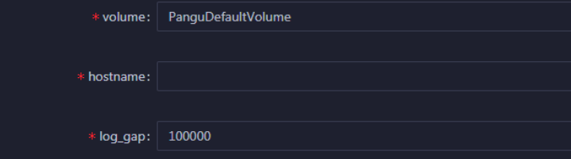

   The key parameters are described as follows:

   - **volume**: The default value is **PanguDefaultVolume**. In a cluster with multiple volumes, specify the required volume name to perform a switchover for a different volume.

   - **hostname**: The hostname of the target machine—the secondary machine that you want to switch to primary.

   - **log_gap**: During the switchover, the system checks the difference in the number of log transactions between the primary and secondary machines. If the difference is less than the specified value (default: **100000**), the switchover proceeds. Otherwise, the operation fails.

3. After you set the parameters, click **Execute**. A message confirms that the request was submitted.

4. View the task status.

   Click **Actions**, and then click **History** after **Master Execution Switch** to view the job execution history.

   A status of **RUNNING** indicates that the task is in progress. A status of **SUCCESS** indicates that the task completed successfully. A status of **FAILED** indicates that the task failed.

5. On the job execution details page, locate the failed step. On the **Machine Details** tab, click **View Details** to identify the cause of the failure.

   > **Note**
   >
   > To analyze the cause of the task failure, review the **Parameter Settings**, **Machine Details**, and **Runtime Parameters**.

<a id="section-3-3-4"></a>

### 3.3.4. Cluster O&M

<a id="section-3-3-4-1"></a>

#### 3.3.4.1. DataHub Cluster O&M Entry

This section describes how to access the DataHub cluster Operations and Maintenance (O&M) page in Apsara Bigdata Manager.

**Procedure**

1. Log on to Apsara Bigdata Manager.

2. In the upper-left corner, click the  icon, then select **DataHub**.

3. On the DataHub page, click **O&M** at the top, then select **Cluster O&M**.

<a id="section-3-3-4-2"></a>

#### 3.3.4.2. DataHub cluster overview

The cluster overview summarizes key cluster metrics and health check results. It shows machine status, service status, operational health, operational health history, and trend graphs for CPU, disk, memory, load, and package usage.

**Access the cluster overview**

1. On the **Cluster O&M** page, select a cluster.

2. Click the **Overview** tab.

   The following sections describe the information in each area of the page.

**Machine status**

This area displays the number of machines in the cluster for each operational status, such as good, bad, or upgrading.

**Service status**

This area summarizes all services in the cluster and shows the number of normal (good) and abnormal (bad) instances for each service.

**Operational health**

This area shows the total number of current health check items and the number of CRITICAL, WARNING, and EXCEPTION alerts in the cluster.

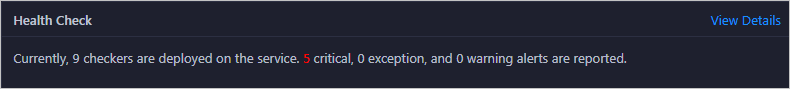

Click **View Details** to open the DataHub Cluster Health page, where you can view detailed information about the health checks.

**Operational health history**

This area shows the history of cluster health checks.

Click **View Details** to open the DataHub Cluster Health page, where you can view detailed information about the health checks.

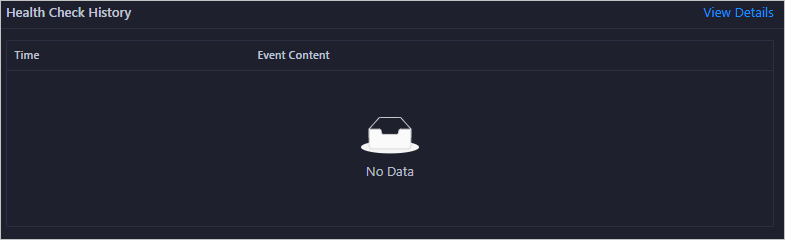

Click **Event Content** for a health check to view the abnormal items found during that check.


**CPU**

The CPU chart shows the trend lines of the total CPU utilization, CPU utilization for running code in kernel space, and CPU utilization for running code in user space for the cluster over time in different colors.

In the upper-right corner of the chart, click the  icon to zoom in on the chart.

You can specify the start time and end time in the upper-right corner of the enlarged chart to view the CPU utilization of the cluster within the specified period of time.

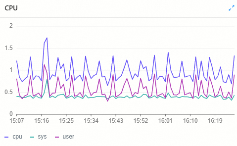

**DISK**

The DISK chart shows the trend line of the storage usage for the cluster over time.

In the upper-right corner of the chart, click the  icon to zoom in on the chart.

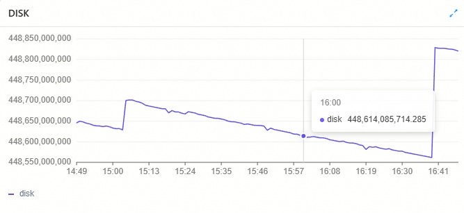

You can specify the start time and end time in the upper-right corner of the enlarged chart to view the storage usage of the cluster within the specified period of time.

**MEMORY**

The MEMORY chart shows the trend lines of the memory usage, total memory size, used memory size, size of memory used by buffers, and available memory size for the cluster over time in different colors.

In the upper-right corner of the chart, click the  icon to zoom in on the chart.

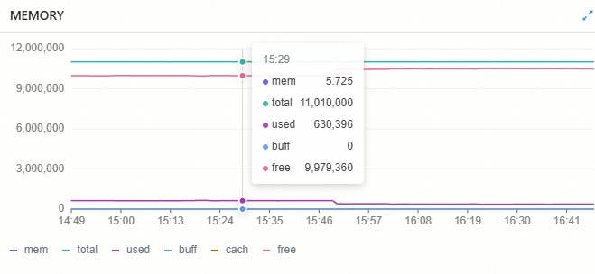

You can specify the start time and end time in the upper-right corner of the enlarged chart to view the memory usage of the cluster within the specified period of time.

**PACKAGE**

The PACKAGE chart shows the trend lines of the numbers of dropped packets, error packets, received packets, and sent packets for the cluster over time in different colors. These trend lines reflect the data transmission status of the cluster.

In the upper-right corner of the chart, click the  icon to zoom in on the chart.

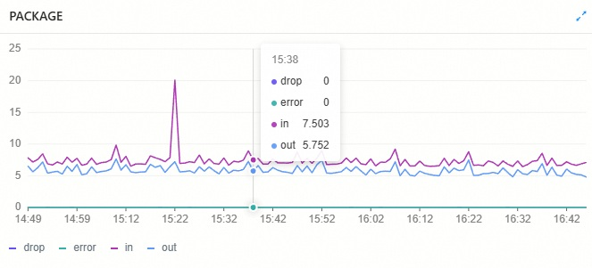

You can specify the start time and end time in the upper-right corner of the enlarged chart to view the data transmission status of the cluster within the specified period of time.

**LOAD**

The LOAD chart shows the trend lines of the average loads for every 1 minute, every 5 minutes, and every 15 minutes for the cluster over time in different colors.

In the upper-right corner of the chart, click the  icon to zoom in on the chart.

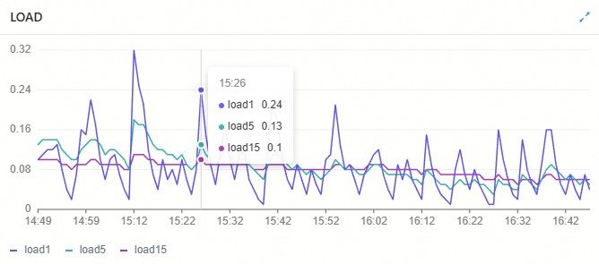

You can specify the start time and end time in the upper-right corner of the enlarged chart to view the average loads for every 1 minute, every 5 minutes, and every 15 minutes for the cluster within the specified period of time.

<a id="section-3-3-4-3"></a>

#### 3.3.4.3. DataHub cluster health

The cluster health interface shows all health checks for the cluster, the details of each check, and the status of each check on its host. The details include solutions for alerts. You can also log on to hosts directly and manually run health checks.

**Cluster Health Portal**

On the **Cluster O&M** interface, you can select the **Health** tab to access the cluster health interface.

**View metric details**

1. On the cluster **Health** tab, click **Details** in the **Operation** column for the target metric. The metric details appear in a dialog box.

   The metric details include **Name**, **Source**, **Alias**, **Application**, **Type**, **Is Scheduling Enabled**, **System Default Parameter List**, **User-defined Parameter List**, and **Description**. The description provides solutions for alerts related to the check.

2. You can click **Show More** at the bottom to view additional information about the metric.

   Additional information about the metric includes **Execution Script**, **Execution Target**, **System Default Threshold Rule**, and **User-defined Threshold Rule**.

**View alerting hosts and alert reasons**

For each host associated with a metric, you can view the history of checks and their results.

1. On the cluster **Health** tab, click the  icon next to a metric that has an alert to view all

   **Host** information for that metric.

2. Click a **Host** name. In the dialog box that appears, click **Details** next to an alert to view the reason for the alert on the right.

   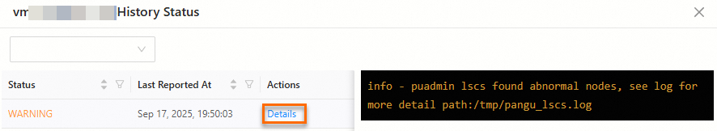

**Handle metric alerts**

On the cluster **Health** tab, click **Details** next to a metric with an alert. The **Details** dialog box appears, where you can view the solution.

**Run a check again**

After handling an alert, you can go to the cluster **Health** tab and click **Operation > Run Check Again** next to the target host to run a real-time check and determine if the alert is resolved.

<a id="section-3-3-4-4"></a>

#### 3.3.4.4. DataHub cluster machine list

The Machine List page displays information about all machines in the current cluster, including the hostname, IP address, role, type, and the entry point for scaling.

**Access the cluster machine list**

On the **Cluster O&M** page, click the **Machine List** tab to open the **Machine List** page.

To view more detailed information about a machine, click its **Hostname** to go to the Host Overview page.

<a id="section-3-3-4-5"></a>

#### 3.3.4.5. Scale out DataHub nodes

This topic describes how to scale out physical hosts for a DataHub cluster in Apsara Bigdata Manager. Scaling out adds physical hosts from the Default cluster in Apsara Infrastructure Management to the DataHub cluster. Physical hosts in a DataHub cluster include CS machines and frontend machines.

**Prerequisites**

- The physical hosts to add are in the Default cluster of Apsara Infrastructure Management.

- The Default cluster in Apsara Infrastructure Management contains hosts with the **Product** type set to **DataHub**.

  > **Note**
  >
  > Only **CS** and **frontend** nodes can be scaled out in a DataHub cluster.

**Background information**

In an Apsara Stack environment, scaling out a cluster is a complex process. New physical hosts must be configured in the Apsara Stack planning system and Apsara Infrastructure Management before they can be added to the Default cluster. The Default cluster in Apsara Infrastructure Management acts as an idle resource pool. This pool provides resources for service clusters to scale out. Scaling out a service cluster adds physical hosts from the Default cluster to the service cluster. Scaling in moves physical hosts from the service cluster back to the Default cluster.

**Step 1: Get the hostname of the host to add**

1. Log on to Apsara Bigdata Manager.

2. In the upper-left corner, click the  icon and select the **TIANJI** product to log on to Apsara

   Infrastructure Management.

3. In the navigation pane on the left, choose **Resource Management > Machine Management**.

4. On the **Machine Management** page, find any host in the **Default** cluster with the product type **DataHub**, and then copy its **Hostname**.

**Step 2: Scale out DataHub nodes**

DataHub supports scaling out multiple hosts simultaneously. When scaling out, specify an existing host as a template host. The new hosts clone all services from the template host to complete the scale-out process.

1. On the **Cluster O&M** page, select a cluster from the left pane. Then, on the **Machine List** page, select any host with the **CS** or **frontend** role to use as the template host.

   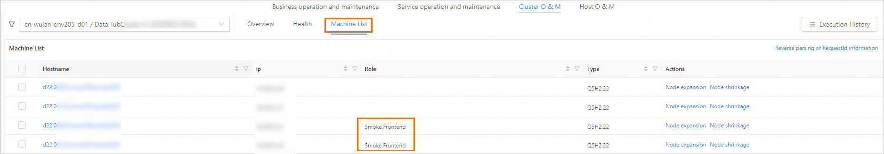

2. Choose **Operation > Node Scale-out**. In the **Node Scale-out** dialog box that appears, set the parameters.

   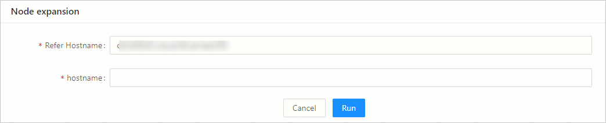

   The following table describes the parameters.

   - **Refer_hostname**: The **Hostname** of the template host. This parameter is automatically filled with the selected host.

   - **hostname**: The **Hostname** of the host to add. Select one or more hosts from the drop-down list. The list contains all hosts in the Default cluster that are available for DataHub scale-out.

3. After you configure the parameters, click **Execute**. A message indicates that the request was submitted.

4. Check the status of the scale-out task.

   Click **Operation History** to view the history of scale-out operations.

   The scale-out process takes a long time. Wait for the process to complete. A status of **RUNNING** indicates that the task is in progress. **FAILED** indicates that the task failed. **SUCCESS** indicates that the task is complete.

5. While the task is running, you can click **Details** next to an operation record to view its steps and progress.

6. If the scale-out task fails (**FAILED**), click **Details** to identify the cause of the failure. For more information, see Troubleshoot a failed task.

**Identifying Failure Causes**

1. On the **Cluster O&M** interface, click **Operations**, and then click **History** next to **Node Scale-in** to view the historical operation records for node scale-in.

2. Find the failed operation record and click **Details** to identify the cause of the failure.

   Use the information in the **Parameter Settings**, **Machine Details**, and **Runtime Parameter** sections to determine why the step failed.

<a id="section-3-3-4-6"></a>

#### 3.3.4.6. Scale in DataHub nodes

This topic describes how to scale in physical hosts in a DataHub cluster using Apsara Bigdata Manager. Scaling in removes physical hosts from a DataHub cluster and moves them to the Default cluster in Apsara Infrastructure Management. Physical hosts in a DataHub cluster include cs machines and frontend machines.

**Background information**

In an Apsara Stack environment, scaling out a cluster is a complex process. New physical hosts must be configured in the Apsara Stack planning system and Apsara Infrastructure Management before they can be added to the Default cluster. The Default cluster in Apsara Infrastructure Management acts as an idle resource pool. This pool provides resources for service clusters to scale out. Scaling out a service cluster adds physical hosts from the Default cluster to the service cluster. Scaling in moves physical hosts from the service cluster back to the Default cluster.

**Prerequisites**

- DataHub clusters support scaling in only **cs** and **frontend** nodes.

- Before you scale in **cs** machines:

  - Use the  `df`  command to check the disk usage on each machine. Determine whether scaling in n machines will cause disks to become full. If disks will become full, do not scale in.

  - Because scaling in causes shards to migrate to other machines, log on to the webconsole virtual machine to calculate the shard load after scaling in. If the number of shards on a machine exceeds 1,000, performance may be affected. Do not scale in if this is the case.

- Before you scale in **frontend** machines:

  - Use the  `df`  command to check the disk usage on each machine. Determine whether scaling in n machines will cause disks to become full. If disks will become full, do not scale in.

  - Because scaling in causes shards to migrate to other machines, log on to the webconsole virtual machine to calculate the shard load after scaling in. If the number of shards on a machine exceeds 1,000, performance may be affected. Do not scale in if this is the case.

  - Check the traffic and Queries Per Second (QPS). If traffic exceeds 400 MB or QPS exceeds 15,000, do not scale in.

**Procedure**

1. On the **Cluster O&M** page, select a cluster in the navigation pane on the left. Then, on the **Machine List** page, select one or more hosts with the **cs** or **frontend** role to scale in.

   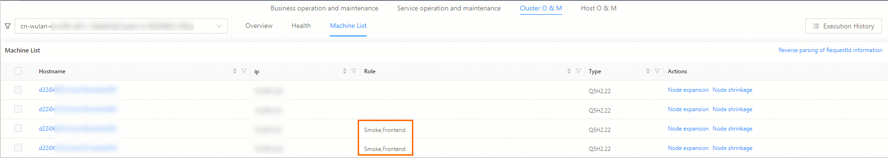

2. Choose **Operation > Scale In Node**. The **Scale In Node** dialog box appears.

   **Hostname**: The **Hostname** of the host to be scaled in. This field is automatically populated with the hostname of the selected host.

   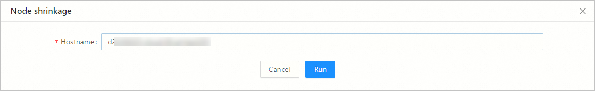

3. After you configure the parameters, click **Execute**. A message appears indicating that the operation is submitted.

4. Check the execution status of the scale-in operation.

   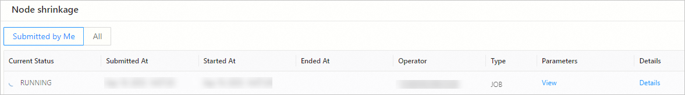

   The scale-in operation takes a long time. Wait for the operation to complete. A status of **RUNNING** indicates that the operation is in progress. A status of **FAILED** indicates that the operation failed. A status of **SUCCESS** indicates that the operation succeeded.

   > **Note**
   >
   > If the status is **FAILED**, see Troubleshoot a failure.

5. **Optional:** Check the progress of the scale-in operation.

   If the execution status is **RUNNING**, click **Details** for the operation record to view the steps and progress of the operation.

   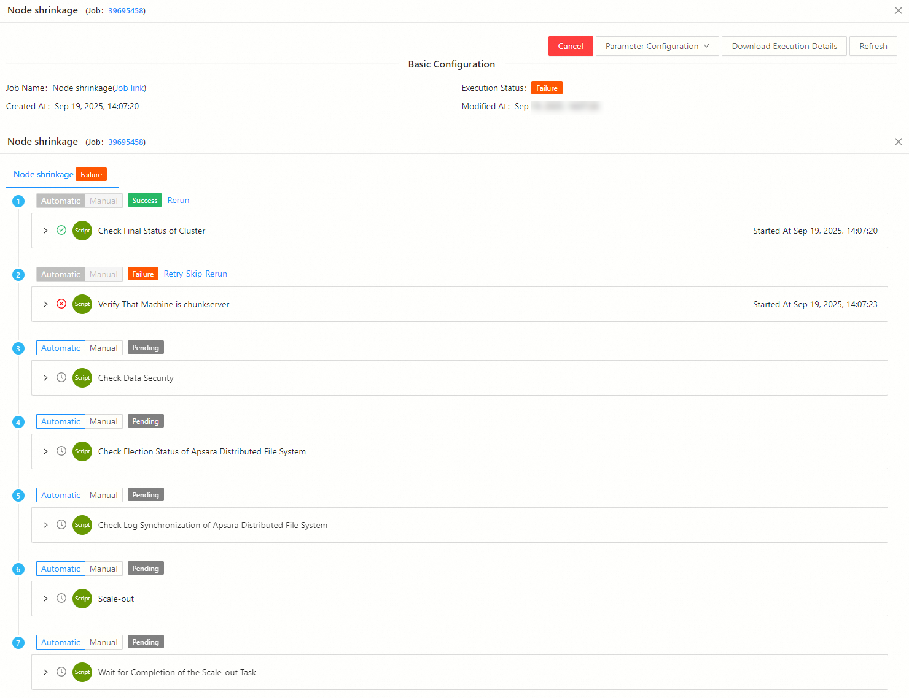

**Troubleshoot a failure**

1. On the **Cluster O&M** page, click **Operation History** to view the history of scale-in operations.

2. Click **Details** for a failed operation record to identify the cause of the failure.

   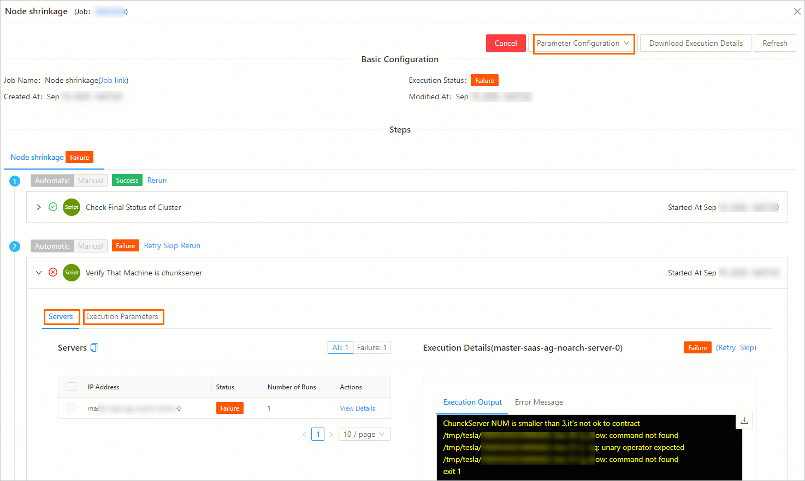

   Use information such as **Parameter Settings**, **Machine Details**, and **Runtime Parameters** to identify why the operation step failed.

<a id="section-3-3-4-7"></a>

#### 3.3.4.7. Perform a reverse lookup for a DataHub RequestId

You can use Apsara Bigdata Manager to perform a reverse DNS lookup for a DataHub RequestId. This process retrieves the time a job occurred and the host IP address, which helps you locate logs and troubleshoot issues.

**Procedure**

1. On the **Cluster O&M** page, select the **Machine List** tab to go to the **Machine List** page.

2. Click **Reverse Lookup RequestId**. In the **Reverse Lookup RequestId** dialog box, enter the **Request ID**.

3. Click the **Execute** button. A success message appears.

4. Check the status of the reverse lookup task.

   Click **Operation History** to view the execution history of the **Reverse Lookup RequestId** task.

   A **RUNNING** status indicates that the task is in progress. A **SUCCESS** status indicates that the task completed successfully. A **FAILED** status indicates that the task failed.

   - If a task fails, click **Details** to view the execution record. You can find the cause of the failure under **Parameter Settings**, **Machine Details**, and **Runtime Parameters**.

   - If the task is successful, click **Details** to view the execution record. On the success page, click **View Details** in the **Operations** column. The execution result appears in the lower-right corner and includes the task occurrence time and the host IP address.

<a id="section-3-3-5"></a>

### 3.3.5. Host O&M

<a id="section-3-3-5-1"></a>

#### 3.3.5.1. Host O&M entry

This topic describes how to go to the host O&M page for DataHub in the ABM console.

1. Log on to the ABM console.

2. Click  in the upper-left corner and select **DataHub**.

3. On the DataHub page, click **O&M** in the upper-right corner, and then click the **Hosts** tab.

4. On the **Hosts** page, select a host in the left-side navigation pane. The **Overview** page for the host appears.

<a id="section-3-3-5-2"></a>

#### 3.3.5.2. DataHub Host Overview

The host overview provides a summary of operational information for each host in the DataHub cluster, including current machine details, service role status, and usage trend graphs for CPU, DISK, LOAD, MEMORY, and PACKAGE.

**Host Overview Entry**

On the **Host O&M** interface, select the target host from the **Host List** on the left. The right pane defaults to the Host **Overview** interface.

**Machine Information**

In the Machine Information section, the information about the host is displayed. You can view the region, cluster, hostname, IP address, status, data center, and server room of the host.

**Machine Service Role Status**

In the Machine Service Role Status section, the information about the services that are deployed on the host is displayed. You can view the roles, status, and number of services.

**CPU**

The CPU chart shows the trend lines of the total CPU utilization, CPU utilization for running code in kernel space, and CPU utilization for running code in user space for the host over time in different colors.

In the upper-right corner of the chart, click the  icon to zoom in on the chart.


You can specify the start time and end time in the upper-right corner of the enlarged chart to view the CPU utilization of the host in the specified period.

**DISK**

The DISK chart shows the trend lines of the storage usage in the /, /boot, /home/admin, and /home directories for the host over time in different colors.

In the upper-right corner of the chart, click the  icon to zoom in on the chart.

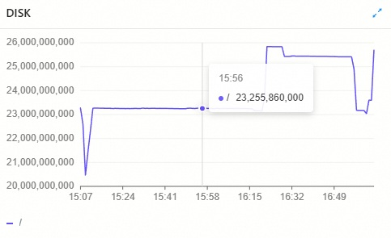

You can specify the start time and end time in the upper-right corner of the enlarged chart to view the storage usage of the host in the specified period.

**LOAD**

The LOAD chart shows the trend lines of the average loads for every 1 minute, every 5 minutes, and every 15 minutes for the host over time in different colors.

In the upper-right corner of the chart, click the  icon to zoom in on the chart.


You can specify the start time and end time in the upper-right corner of the enlarged chart to view the average loads for every 1 minute, every 5 minutes, and every 15 minutes for the host in the specified period.

**MEMORY**

The MEMORY chart shows the trend lines of the memory usage, total memory size, used memory size, size of memory used by buffers, size of memory used by the page cache, and available memory size for the host over time in different colors.

In the upper-right corner of the chart, click the  icon to zoom in on the chart.

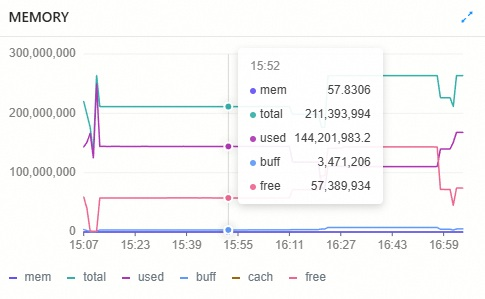

You can specify the start time and end time in the upper-right corner of the enlarged chart to view the memory usage of the host in the specified period.

**PACKAGE**

The PACKAGE chart shows the trend lines of the numbers of dropped packets, error packets, received packets, and sent packets for the host over time in different colors. These trend lines reflect the data transmission status of the host.

In the upper-right corner of the chart, click the  icon to zoom in on the chart.


You can specify the start time and end time in the upper-right corner of the enlarged chart to view the data transmission status of the host in the specified period.

<a id="section-3-3-5-3"></a>

#### 3.3.5.3. DataHub host service

The Service Roles page shows the service instances that are running on a host and their corresponding roles.

**View host service roles**

1. On the **Host O&M** page, select the target host from the **Host List** on the left.

2. Click the **Service Roles** tab to view details for the selected host, including its cluster, service instances, and their roles.

<a id="section-3-4"></a>

## 3.4. Management

<a id="section-3-4-1"></a>

### 3.4.1. Overview

The management module is the configuration and software management center of Apsara Big Data Manager (ABM). It is an important functional module that supports and customizes O&M items for services.

The management module provides the following features:

- Job Services: allows you to run jobs to perform O&M operations on big data services.

- Health Management: allows you to create health check items and apply them to service hosts.

- Process Services: allows you to view pending and completed manual tasks, view process information including flowcharts and XML definitions, and view the information about process instances in different states, such as Running, Complete, Exception, and Terminated.

- Operational Audit: allows you to view the job execution records and other service O&M operations in ABM.

- Data Log Management: allows you to collect logs from Logstores of databases such as MySQL, PolarDB, and PolarDB-X, as well as data logs of DataWorks, DataHub, and Hologres. The collected data logs are stored in a specified sls-pub Project, which are used to address issues of inconsistent and insufficiently accessible data logs, audit logs, and data metrics across databases and big data services.

<a id="section-3-4-2"></a>

### 3.4.2. Jobs

<a id="section-3-4-2-1"></a>

#### 3.4.2.1. Overview

This topic describes the concepts of jobs in DataHub and outlines the job interface.

**Background information**

DataHub performs operations and maintenance (O&M) on big data products by executing jobs. A job is an O&M task that performs operations on the physical devices in a cluster. The job service interface consists primarily of the **Execute** page.

**Concepts**

The following concepts are related to jobs:

- Standard job: A job that requires manual execution and does not have a timer set.

- Scheduled job: A job that has a timer set and is automatically executed at a specified time.

**The Execute page**

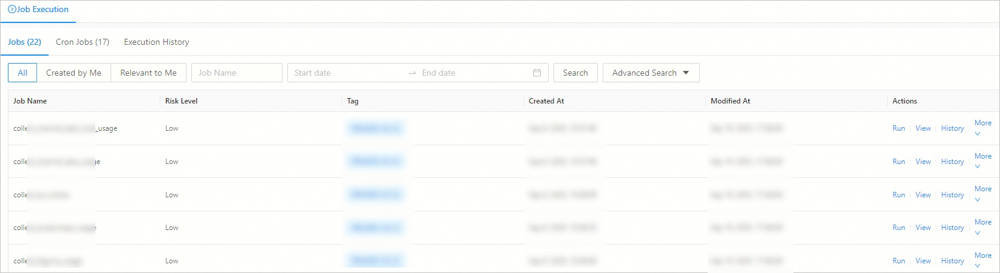

The **Execute** page includes the following functional modules:

| Feature | Description |
| --- | --- |
| Standard jobs | • View and execute standard jobs, and view their execution history.<br>• Search for, copy, export, and delete jobs. |
| Scheduled jobs | • Enable or disable, view, and execute scheduled jobs, and view their execution history.<br>• Search for, copy, export, and delete jobs. |
| Execution history | • View the historical execution records of jobs, such as standard and scheduled jobs.<br>• Search for records, view details, and preview records. |

<a id="section-3-4-2-2"></a>

#### 3.4.2.2. Jobs

<a id="section-3-4-2-2-1"></a>

##### 3.4.2.2.1. Manually execute a job

After you create a standard job, you can manually execute it to perform O&M operations on the product. You can also manually execute scheduled jobs.

**Prerequisites**

You have an administrator account for Apsara Bigdata Manager.

**Procedure**

1. Log on to Apsara Bigdata Manager.

2. Click the  icon in the upper-left corner and select DataHub.

3. In the top menu bar, click **Management**.

4. In the navigation pane on the left, click **Job Service**.

5. On the **Execution** page, click the **Job List** tab.

   To manually execute a scheduled job, click the **Scheduled Jobs** tab. The process for manually executing a scheduled job is the same as for a standard job. This topic uses a standard job as an example.

6. On the **Job List** page, click **Execute** in the row of the target job.

   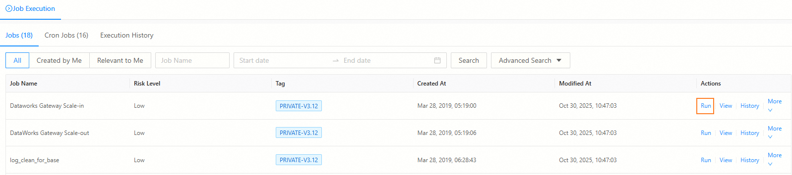

7. In the dialog box, complete the **Configure Target Group And Parameters** operation, and click **Next**.

   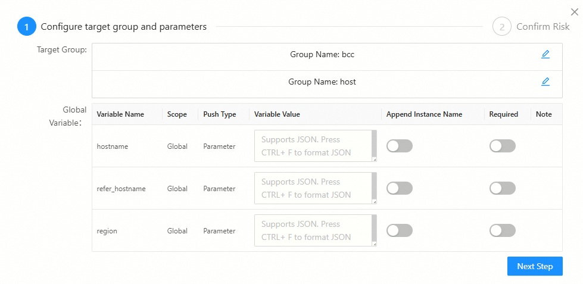

8. After you complete **Confirm Job Threats**, click **Confirm Execution**.

   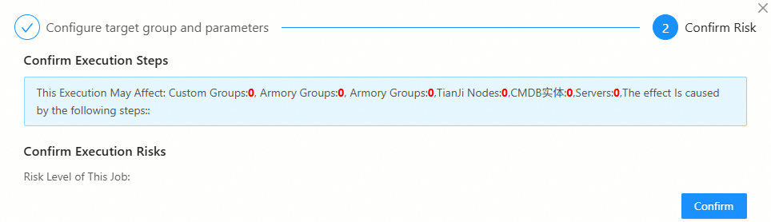

   > **Note**
   >
   > After you confirm the execution, an execution record is automatically generated on the **Execution History** page. For more information, see View job execution history.

9. On the job execution interface, click **Start** at the top to start the job.

   If you exit the job execution interface without performing any operations, you can find the execution record on the **Execution History** page. Click **Details** in the **Actions** column to open the job execution interface again.

<a id="section-3-4-2-2-2"></a>

##### 3.4.2.2.2. Enable and disable scheduled jobs

Scheduled jobs are disabled by default. You must enable a job for it to run. If a job is no longer needed, you can disable it.

**Prerequisites**

You have an administrator account for Apsara Bigdata Manager.

**Procedure**

1. Log on to Apsara Bigdata Manager.

2. Click the  icon in the upper-left corner and select DataHub.

3. In the top menu bar, click **Management**.

4. In the navigation pane on the left, click **Job Service**.

5. On the **Execute** page, click the **Scheduled Jobs** tab.

   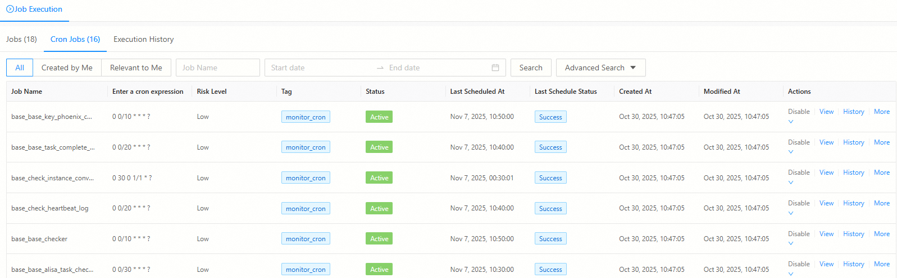

6. On the **Scheduled Jobs** page, enable or disable a scheduled job:

   - To enable a disabled job: Click **Enable** next to the job.

     After you enable the job, the **Status** changes to **Enabled**, and the **Enable** button changes to **Disable**.

   - To disable an enabled job: Click **Disable** next to the job.

     After you disable the job, the **Status** changes to **Disabled**, and the **Disable** button changes to **Enable**.

<a id="section-3-4-2-2-3"></a>

##### 3.4.2.2.3. View job execution history

DataHub lets you view the execution history for a specific job or for all jobs. This helps you monitor job and plan execution.

**Background information**

After you confirm job or plan execution, DataHub records execution details for each job. You can review these details later.

The **Execution History** page supports the following features:

- View information such as the task’s trigger method, current status, start time, and end time.

- View the task execution procedure and parameter settings. You can also download detailed task execution information.

- Perform different operations based on the task’s status. For example, you can **Start** a task that is **Not Started** or **Retry** a task that is **Abnormal**.

Execution history information is identical for regular jobs and scheduled jobs. This topic uses a regular job as an example.

**Prerequisites**

You have an Apsara Bigdata Manager administrator account.

**View a specific job's execution history**

1. Log on to Apsara Bigdata Manager.

2. Click the  icon in the upper-left corner and select DataHub.

3. In the top menu bar, click **Management**.

4. In the navigation pane on the left, click **Job Service**.

5. On the **Execution** page, click the **Job List** tab.

6. On the **Job List** page, click **History** next to the regular job that you want to view. This opens the **Execution History** page.

   On the **Execution History** page, you can view the job’s execution history. For more information, see View job execution history.

**View execution history**

1. Go to the **Execution History** page. If many history records exist, filter them by instance name, time range, or execution status. Then, click **Search** to find matching records.

2. Click **Operation > Details** for a history record to view its details.

   Available operations depend on the status of the history record:

   | Task execution record status | Supported feature | Procedure |
   | --- | --- | --- |

   Click **Parameter Settings** at the top. Select **Context**

   View parameter

   **Parameters** or **Global Parameters** to view the context

   settings

   or global parameters for the task.

   Click **Download Execution Details** at the top to download the job execution details to your local machine

   Download

   as a .txt file.

   execution details

   The execution details include information such as the execution **JSON** and **raw data**.

   - On the **Machine Details** page for a step, click **View**

   All statuses

   **Details** next to a machine. The execution details for that step on the machine appear on the right, including the execution outputs.

   View step

   - If it is a script step, the **Script Content** and **Runtime**

   execution details

   **Parameters** pages are displayed. You can view the script content and runtime parameters.

   - If it is a command step, the **Command Content** and **Runtime Parameters** pages are displayed. You can view the command content and runtime parameters.

   Refresh the

   If the task is running, click **Refresh** at the top to view the

   interface

   latest execution status.

   Start execution

   Click **Start** at the top to begin execution.

   Not Started

   Cancel execution

   Click **Cancel** at the top to cancel execution.

   Complete

   In the manual step that requires an operation, perform the

   manual

   required actions as prompted. Then, click **Confirm** to

   operation and

   proceed to the next step.

   confirm

   Pending Manual

   Roll back to the

   Confirmation

   In the manual step that requires an operation, click

   state after the

   **Rollback** to return to the state after the previous step was

   previous step

   completed.

   was completed

   Cancel execution

   Click **Cancel** to cancel this execution.

   Retry the

   In the abnormal step, click **Retry** to execute the step

   abnormal step

   again.

   Skip the

   In the abnormal step, click **Skip** to skip this step and

   abnormal step

   continue with the subsequent steps.

   Roll back to the state after the

   In the abnormal step, click **Rollback** to return to the state

   previous step

   after the previous step was completed.

   was completed

   In the abnormal step, click **Reset** to reset the step to the **Not Started** state.

   Reset the abnormal step to

   When an abnormal step is reset to the Not Started state,

   Abnormal

   the Not Started

   the execution status changes to **Paused**. You can then

   state

   click **Continue** at the top to re-execute the current step.

   - On the **Machine Details** page for a step, click **View Details** next to a machine. The execution details for that step on the machine appear on the right, including execution outputs and error messages.

     For a machine where the execution was abnormal, after you view the details, you can click **Skip** to skip this machine or click **Retry** to execute the step again on the

   View abnormal

   machine.

   step execution details

   - If it is a script step, the **Script Content** and **Runtime Parameters** pages are displayed. You can view the script content and runtime parameters.

   - If it is a command step, the **Command Content** and **Runtime Parameters** pages are displayed. You can view the command content and runtime parameters.

   Retry the failed

   In the failed step, click **Retry** to execute the step again.

   step

   Skip the failed

   In the failed step, click **Skip** to skip this step and continue

   step

   with the subsequent steps.

   Roll back to the state after the

   In the failed step, click **Rollback** to return to the state

   previous step

   after the previous step was completed.

   was completed

   In the failed step, click **Reset** to reset the step to the **Not Started** state.

   Reset the failed step to the Not

   When a failed step is reset to the Not Started state, the

   Started state

   execution status changes to **Paused**. You can then click **Continue** at the top to restart the current step.

   Failed

   - On the **Machine Details** page for a step, click **View Details** next to a machine. The execution details for that step on the machine appear on the right, including execution outputs and error messages.

     For a machine where the execution was abnormal, after you view the details, you can click **Skip** to skip this machine or click **Retry** to execute the step again on the

   View failed step

   machine.

   execution details

   - If it is a script step, the **Script Content** and **Runtime Parameters** pages are displayed. You can view the script content and runtime parameters.

   - If it is a command step, the **Command Content** and **Runtime Parameters** pages are displayed. You can view the command content and runtime parameters.

   Cancel execution

   Click **Cancel** at the top to cancel the execution.

<a id="section-3-4-3"></a>

### 3.4.3. Health management

<a id="section-3-4-3-1"></a>

#### 3.4.3.1. Monitoring Configuration

Apsara Bigdata Manager provides comprehensive scheduling and monitoring capabilities for each product. These capabilities detect product failures and generate alerts to help you identify and resolve issues quickly.

**Prerequisites**

- You have an Apsara Bigdata Manager account with O&M permissions for the product.

- You have identified the alert source and check items for the monitoring item.

**Background information**

> **Note**
>
> Scheduling and monitoring items vary by product. However, their configuration and operation methods are consistent.

Scheduling items run scheduling scripts on all machines associated with a specified tianji role. This process generates raw alert data, including the scheduling item that triggered the alert, the severity level, the affected machines, and the alert result. The raw data is sent to ABM's database for storage.

Monitoring items display the raw alert data generated by scheduling items on the corresponding product pages in ABM. After mounting, you can configure filter policies to show only the alert results relevant to your needs on that page.

Both scheduling and monitoring items are built-in and cannot be added. However, you can modify certain parameters for both, such as enable or disable status, runtime parameters, and description. Monitoring items also support configuring mount targets and deletion.

**Access the management page**

1. Log on to Apsara Bigdata Manager.

2. In the upper-left corner, click the  icon. Then, select the DataHub product.

3. In the top menu bar, click **Management** to access the management page.

**View scheduling item details and mount targets**

Scheduling item mount targets are built-in. You cannot add, modify, or delete them. Each mount target corresponds to the full list of machines associated with the tianji role that runs the scheduling script.

1. In the left navigation pane, click **Health Management**. By default, this opens the **Monitoring Configuration > Scheduling** page.

   The **Scheduling** page displays all scheduling items for the current product.

2. On the **Scheduling** page, click **View** next to a scheduling item to view its details.

   Scheduling item details include the check item name, alias, description, and processing steps.

3. Click the  icon next to a scheduling item to view its mount targets.

**Modify scheduling items**

You can set the scheduling interval and runtime parameters for scheduling items. You can also enable or disable scheduling items.

1. In the left navigation pane, click **Health Management**. By default, this opens the **Monitoring Configuration > Scheduling** page.

2. On the **Scheduling** interface, click **Edit** next to a scheduling item. In the dialog box that appears, configure the parameters.

   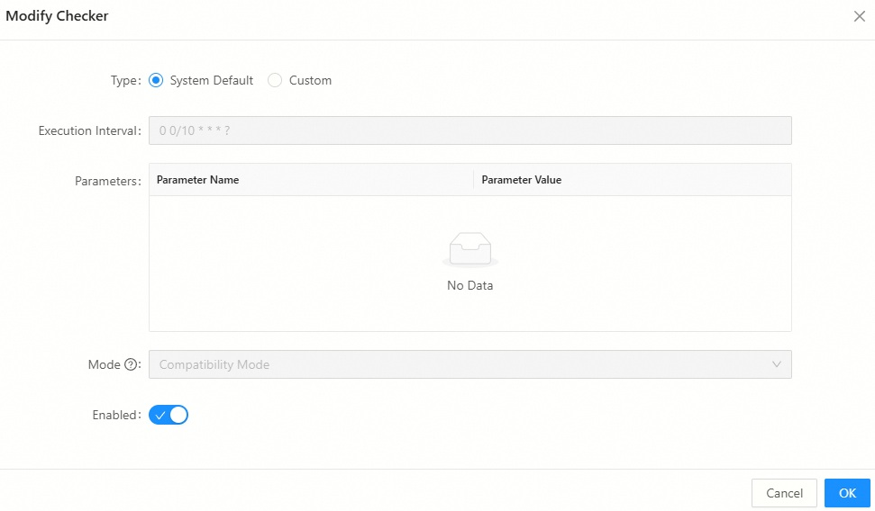

   **Type**: **System Default** means parameters such as **Scheduling Interval** and **Parameter List** use the system's default configurations. **Custom** means you can customize these parameters.

   > **Note**
   >
   > **Scheduling Interval** is configured using the **crontab** command.

3. After configuring the parameters, click **OK**. The interface displays a success message.

**View the list of failed machines**

View all failed machines in the current cluster.

1. In the left navigation pane, click **Health Management**. By default, this opens the **Monitoring Configuration > Scheduling** page.

2. In the upper-right corner, click **Failed Machine List** to view the failed machines in the cluster.

   The failed machine list displays all failed machines in the current cluster and each machine's role in Apsara Infrastructure Management.

**Modify monitoring items**

You can modify the name and description of monitoring items. You can also enable or disable monitoring items. The alert source and check items for monitoring items are built-in and must not be modified.

1. In the left navigation pane, click **Health Management**.

2. Click the **Monitoring** tab to access the monitoring interface.

   The **Monitoring** interface displays all monitoring items for the current product.

3. Click **Edit** next to a monitoring item to modify its configuration.

4. After configuring the parameters, click **OK**. The interface displays a success message.

**Add mount targets to monitoring items**

Add mount targets to monitoring items to display raw alert data on the O&M interfaces of various products in ABM.

1. In the left navigation pane, click **Health Management**.

2. Click the **Monitoring** tab to access the monitoring interface.

3. Click the  icon next to a monitoring item to view its mount targets.

4. Below the mount target list, click **Add Mount Target**. In the dialog box that appears, configure the parameters.

   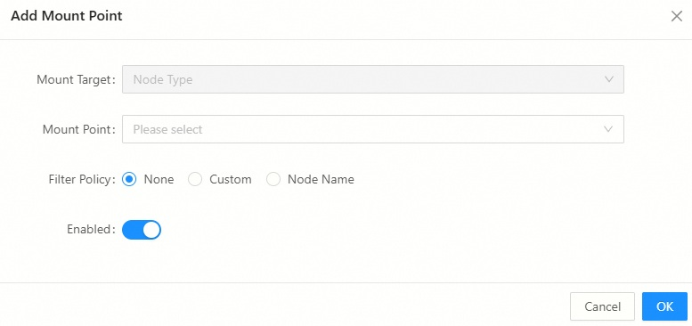

   Key parameter descriptions are as follows:

   | Configuration item | Description |
   | --- | --- |
   | Mount Type | Cannot be modified by default. |
   | Mount Target | From the drop-down list, select which product's O&amp;M interface to mount the check results of this monitoring item to. |
   | Filter Policy | Available values are as follows:<br>• <strong>Full</strong>: All alert records generated by this monitoring item are displayed.<br>• <strong>Product Tree Custom Filter</strong>: Filter alerts generated by this monitoring item based on the filter configured in the product tree node.<br>• <strong>Product Tree Node Name Match</strong>: Match records from the alert records that have the same name as the current node. |
   | Effective | Set whether this mount target is effective. |

5. After configuring the parameters, click **OK**. The interface displays a success message.

**Delete monitoring item mount targets**

1. In the left navigation pane, click **Health Management**.

2. Click the **Monitoring** tab to access the monitoring interface.

3. Click the  icon next to a monitoring item to view its mount targets.

4. Click **Delete** next to the mount target. In the dialog box that appears, click **OK**. The interface displays a success message.

**Delete monitoring items**

1. In the left navigation pane, click **Health Management**.

2. Click the **Monitoring** tab to access the monitoring interface.

3. Click **Delete** next to the monitoring item. In the dialog box that appears, click **OK**. The interface displays a success message.

<a id="section-3-4-3-2"></a>

#### 3.4.3.2. Inspection management

The inspection management feature in Apsara Bigdata Manager enables you to configure inspection scenarios, inspection items, and scenario groups for each product as needed.

**Prerequisites**

You have an Apsara Bigdata Manager account with O&M permissions for the relevant product.

**Go to the management page**

1. Log on to Apsara Bigdata Manager.

2. In the upper-left corner, click the  icon and select the DataHub product.

3. In the top menu bar, click **Management** to go to the management page.

**Create a scenario**

1. In the left navigation pane, click **Health Management** and then choose **Inspection Management > Scenarios**.

2. In the upper-right corner, click **Create Scenario**. In the dialog box that appears, configure the parameters as needed.

   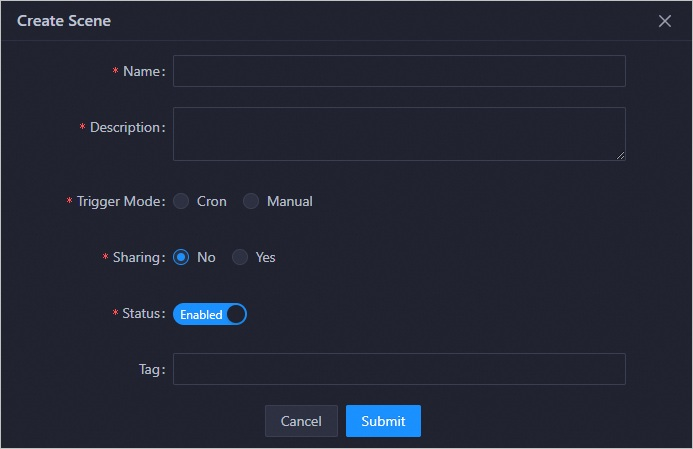

   | Parameter | Description |
   | --- | --- |
   | Scenario Name | Customize it as needed. |
   | Scenario Description | Enter a detailed description for the inspection scenario. |
   | Trigger Method | The supported methods are <strong>Periodic</strong> and <strong>Manual</strong>. |
   | Share | Specifies whether to enable the sharing feature. |
   | Status Settings | Set the status to <strong>Enabled</strong> or <strong>Disabled</strong> as needed. |
   | Tags | Set tags to facilitate subsequent management and filtering. |

3. Click **Submit**.

   After the scenario is created, you can perform operations such as **Edit**, **Inspect Now**, **Manage Scenario**, and view **Run History**.

   

**Create an inspection item**

1. In the left navigation pane, click **Health Management** and then choose **Inspection Management > Inspection Items**.

2. In the upper-right corner, click **Add Inspection Item**.

3. In the **Create Inspection Item** dialog box, configure the parameters as needed.

   

   **Area**

   **Parameter**

   **Description**

   **Creation**

   The supported methods are **Custom** and **Create from Shared**.

   **Method**

   **Name**

   You can customize it to suit your needs.

   **Description**

   Enter a detailed description for the inspection item.

   **Basic Definition**

   **Inspection**

   The supported inspection types are **Performance**, **Capacity**,

   **Type**

   **Configuration**, **Consistency**, and **Stability**.

   **Tags**

   Set tags to facilitate subsequent management and filtering.

   **Share**

   Specifies whether to enable the sharing feature.

   The supported execution types are **Job** and **Metric Check**. The

   **Execution**

   **Execution**

   parameters that you need to configure vary based on the

   **Definition**

   **Type**

   execution type. Configure the parameters as displayed on the interface.

4. Click **Submit**.

   After the inspection item is created, you can **Edit** or **Delete** it.

   

**Create a scenario group**

1. In the left navigation pane, click **Health Management** and then choose **Inspection Management > Scenario Groups**.

2. In the upper-right corner, click **Create Scenario**.

3. In the **Create Scenario** dialog box, configure the parameters as needed.

   

   | Parameter | Description |
   | --- | --- |
   | Scenario Name | Customize it as needed. |
   | Scenario Description | Enter a detailed description for the inspection scenario. |
   | Trigger Method | The supported methods are <strong>Periodic</strong> and <strong>Manual</strong>. |
   | Share | Specifies whether to enable the sharing feature. |
   | Status Settings | Set the status to <strong>Enabled</strong> or <strong>Disabled</strong> as needed. |
   | Tags | Set tags to facilitate subsequent management and filtering. |

4. Click **Submit**.

   After the scenario group is created, you can perform operations such as **Edit**, **Manage Scenario**, and view **Run History**.

   

<a id="section-3-4-4"></a>

### 3.4.4. Operation audit

The operation audit feature lists the history of operations and maintenance (O&M) activities for the current product on the **O&M** interface of Apsara Bigdata Manager. You can view the details of each operation for future review and fault localization.

**Prerequisites**

You have an Apsara Bigdata Manager account with the required O&M permissions for the product.

**Background information**

Operation audit is specific to each product. To view the operation audit for a product, first navigate to that product’s interface.

> **Note**
>
> Operation audit displays the O&M history from the product’s **O&M** interface. It does not include O&M operations for job services.

**Procedure**

1. Log on to Apsara Bigdata Manager.

2. In the upper-left corner, click the  icon and select DataHub.

3. In the top menu bar, click **Management**. In the left navigation pane, click **Operation audit**.

   The **Operation audit** page displays the O&M history from the product’s **O&M** interface. The history includes the following fields: Action, Operation identity, Threat level, Current status, Submission time, Running time, End time, Executor, Implementation method, Runtime parameter, and Details.

4. Click **Details** next to an operation to view its details.

   For failed steps, you can also view the specific reason for the failure.

5. If an O&M operation fails, review the reason for the failure.

6. When an O&M task is in a Not Started, Waiting, Abnormal, or Failed state, perform the following operations as needed.

   | Status | Available operations |
   | --- | --- |
   | Not Started | • Click <strong>Start</strong> to start the task.<br>• Click <strong>Parameter settings</strong> to view the parameter settings for the task.<br>• Click <strong>Cancel</strong> to cancel the task. |
   | Waiting | • Follow the prompts and click <strong>Confirm</strong> to continue with the subsequent steps.<br>• Click <strong>Rollback</strong> to roll back to the state after the previous step was completed.<br>• Click <strong>Parameter settings</strong> to view the parameter settings for the task.<br>• Click <strong>Cancel</strong> to cancel the task. |
   | Abnormal | • Click <strong>Retry</strong> to run the step again.<br>• Click <strong>Skip</strong> to skip this step and continue with the subsequent steps.<br>• Click <strong>Rollback</strong> to roll back to the state after the previous step was completed.<br>• Click <strong>Parameter settings</strong> to view the parameter settings for the task.<br>• Click <strong>Cancel</strong> to cancel the task. |
   | Failed | • Click <strong>Retry</strong> to run the step again.<br>• Click <strong>Skip</strong> to skip this step and continue with the subsequent steps.<br>• Click <strong>Rollback</strong> to roll back to the state after the previous step was completed.<br>• Click <strong>Parameter settings</strong> to view the parameter settings for the task.<br>• Click <strong>Cancel</strong> to cancel the task. |

7. To download the execution log for an O&M operation, click **Download Execution Details** at the top of the page to save the log to your local machine.

<a id="section-4"></a>

# 4.DataHub in-depth inspection

This topic describes DataHub in-depth inspection from two perspectives: cluster inspection and business inspection. The DataHub in-depth inspection applies to Apsara Stack V3.16.2 and later.

1. **Inspection overview**

DataHub in-depth inspection covers and collects the alerts, resource usage, and key metrics of DataHub. This allows you to check the health status of DataHub in a visualized manner, prevent unexpected risks before major issues or faults occur, and ensure service stability.

The inspection objects include but are not limited to the operating system, hardware, inventory, user instances, size of the business data, and service requests.

2. **Cluster inspection**

**2.1 Inspection scenario**

Perform routine maintenance to ensure the normal state of DataHub control components.

**2.2 Inspection items**

> **Note**
>
> This topic uses Apsara Stack V3 as an example. The screenshots may differ from those provided in the following sections, depending on the version of Apsara Stack. Your actual business environment prevails.

**2.2.1 Apsara Infrastructure Management dashboard**

**2.2.1.1 Check whether the cluster is at the desired state**

- **Inspection item**

  Check whether all DataHub services have reached the desired state without errors.

- **Procedure**

  <ol type="i">

  <li>

  Log in to the Apsara Uni-manager Operations Console. In the top navigation bar, choose **Platform Operation** > **Apsara Infrastructure Management**.

  

  </li>

  <li>

  In the left-side navigation pane, choose **Resource Management > Product & Cluster**

  </li>

  </ol>

  **O&M**. On the page that appears, enter **datahub** in the Product | Cluster search box to search for DataHub clusters and view their status.

  

- **Inspection results**

  - If **Ready** is displayed in the Status column, the DataHub cluster is in the normal state and works as expected.

  - If **Not Ready** is displayed in the Status column, the DataHub cluster is in the abnormal state and must be fixed.

  > **Note**
  >
  > If any DataHub service role is not at the desired state or an error occurs during a rolling task for deployment or upgrade, take a screenshot of the error promptly and submit a ticket.

**2.2.1.2 Check the operating system**

- **Inspection item**

  Check the core system metrics of physical servers in the DataHub cluster, including the CPU utilization, load, memory usage, network traffic, TCP retransmission, and disk I/O.

- **Procedure**

  <ol type="i">

  <li>

  Log in to the Apsara Uni-manager Operations Console. In the top navigation bar, choose **Monitor&Alert > Monitor Management > Cloud Platform Monitoring Dashboard**.

  </li>

  <li>

  In the left-side navigation pane, choose **Cloud Product Business Monitoring > Alert**

  </li>

  </ol>

  **History**.

  <ol type="i" start="3">

  <li>

  In the **Services** section of the page that appears, enter **datahub** in the search box to

  </li>

  </ol>

  view the alerts within the last 1 day.

  

- **Inspection results**

  - Normal: No **Emergency** alerts are displayed.

  - Abnormal: One or more **Emergency** alerts are displayed.

> **Note**
>
> The Alert History page displays the alerts about the preceding core system metrics. If an alert is displayed for a core system metric, take a screenshot of the alert promptly and submit a ticket.

**2.2.2 Cluster configurations**

**2.2.2.1 Check the proportion of server roles in the DataHub cluster**

- **Inspection item**

  Check whether the proportion of frontend servers to chunk servers in the DataHub cluster is proper. If the proportion is improper, a cluster scale-in or scale-out is required.

- **Procedure**

  <ol type="i">

  <li>

  Log in to the Apsara Uni-manager Operations Console. In the top navigation bar, choose **Platform Operation** > **Apsara Infrastructure Management**.

  </li>

  <li>

  In the left-side navigation pane, choose **Resource Management > Product & Cluster**

  </li>

  </ol>

  **O&M**. On the page that appears, enter **datahub** in the Product | Cluster search box to search for DataHub clusters. Find the cluster that you want to inspect and click **Cluster Details** in the Actions column. The Cluster Details page appears.

  

  <ol type="i" start="3">

  <li>

  Click the **Desired State Configuration** tab. Find the **machine_group.conf** file, check

  </li>

  </ol>

  the number of frontend servers and chunk servers, and calculate the proportion of frontend servers to chunk servers.

  

- **Inspection results**

  - Normal: The proportion of frontend servers to chunk servers is smaller than 1.

  - Abnormal: The proportion of frontend servers to chunk servers is greater than 1. If the proportion of frontend servers to chunk servers is improper, submit a ticket.

**2.2.2.2 Check the data read and write limits of DataHub**

- **Inspection item**

  Check the data read and write limits of DataHub.

- **Procedure**

  <ol type="i">

  <li>

  Log in to the Apsara Uni-manager Operations Console. In the top navigation bar, choose **Platform Operation > Apsara Infrastructure Management**. In the left-side navigation pane, choose **O&M Tools > Resource Dashboard**.

  </li>

  <li>

  On the **Resource Dashboard** page, enter **datahub_db** in the Name search box. View

  </li>

  </ol>

  the information in the **Result** column to obtain the information required for logging in to the DataHub metadatabase.

  

  <ol type="i" start="3">

  <li>

  Run the following MySQL command to log in to the DataHub metadatabase and query the

  </li>

  </ol>

  current data read and write limits:

  ```sql
  use datahub_db;
  select * from config_meta ;
  ```

- **Inspection results**

  The criteria are as follows:

  ```text
  // Normal: DataHub uses the following initial configurations that are recommended by the DataHub team.

  // (1) Read operations are not limited for a shard.
  ReadBandwidth   0            
  ReadQPS   0
  ReadRPS  0

  // (2) For each shard, the maximum write bandwidth is 5 Mbit/s, the maximum write queries per second (QPS) is 2,000, and the number of records written per second is not limited.
  WriteBandwidth   5120     
  WriteQPS    2000              
  WriteRPS    0

  // Abnormal: The initial configurations of DataHub are different from the preceding recommended configurations.
  ```

  If the configurations in your runtime environment are different from the recommended configurations, submit a ticket to Alibaba Cloud technical support.

**2.2.3 Underlying Apsara services**

**2.2.3.1 Check the status of Apsara Distributed File System for DataHub**

- **Inspection item**

  Apsara Distributed File System provides the underlying storage service for DataHub. In this inspection item, check whether Apsara Distributed File System is normal.

- **Procedure**

  <ol type="i">

  <li>

  Log in to the Apsara Big Data Manager (ABM) console, and then go to the **DataHub** page.

  

  </li>

  <li>

  In the top navigation bar, click **Operation and maintenance > Service operation**

  </li>

  </ol>

  **and maintenance > Pangu Service** On the page that appears, click the **Overview** tab to view the relevant information.

  

- **Inspection results**

  - Normal: All Apsara Distributed File System server roles are in the good state, which indicates that the resource usage is normal and does not exceed 80%.

  - Abnormal: One or more Apsara Distributed File System server roles are in the error state, which indicates that the resource usage exceeds 80%. If the inspection result is abnormal, take a screenshot of the exception promptly and submit a ticket to the technical support of Apsara Distributed File System.

**2.2.3.2 Check the status of Apsara Name Service and Distributed Lock Synchronization System (Control Service) for DataHub**

- **Inspection item**

  Apsara Name Service and Distributed Lock Synchronization System provides service registration and underlying metadata consistency check for DataHub. In this inspection item, check whether Apsara Name Service and Distributed Lock Synchronization System is normal.

- **Procedure**

  <ol type="i">

  <li>

  Log in to the ABM console, and then go to the **DataHub** page.

  </li>

  <li>

  In the top navigation bar, click **Operation and maintenance > Service operation**

  </li>

  </ol>

  **and maintenance > Control Services**. On the page that appears, click the **Overview** tab to view the relevant information.

  

- **Inspection results**

  - Normal: Apsara Name Service and Distributed Lock Synchronization System is in the good state.

  - Abnormal: Apsara Name Service and Distributed Lock Synchronization System is in the good state, but one or more error records exist in the Health Check column. If the inspection result is abnormal, take a screenshot of the exception promptly and submit a ticket to the technical support of Apsara Name Service and Distributed Lock Synchronization System.

**2.2.3.3 Check the status of Job Scheduler for DataHub**

- **Inspection item**

  Check the health status of Job Scheduler.

- **Procedure**

  <ol type="i">

  <li>

  Log in to the ABM console, and then go to the **DataHub** page.

  </li>

  <li>

  In the top navigation bar, click **Operation and maintenance > Service operation**

  </li>

  </ol>

  **and maintenance > Fuxi service**. On the page that appears, click the **Overview** tab to view the relevant information.

  

- **Inspection results**

  - Normal: All Job Scheduler server roles are in the good state, which indicates that the resource usage is within the normal range.

  - Abnormal: One or more Job Scheduler server roles are in the error state, which indicates that the resource usage exceeds the warning threshold.

**2.2.4 DataHub core services**

**2.2.4.1 Check the frontend request QPS and the queue length**

- **Inspection item**

  Check whether the frontend request QPS and the queue length are in the proper range.

  > **Note**
  >
  > A high frontend request QPS and a high queue length affect the efficiency of frontend request processing.

- **Procedure**

  <ol type="i">

  <li>

  Copy and paste the hostnames of the DataHub frontend servers to the  `datahub_frontend.list file`  in the /tmp directory of the OPS1 server. The datahub_frontend.list file must be created in advance.

  

  

  </li>

  <li>

  Run the batch check commands on OPS1:

  </li>

  </ol>

  ```bash
  // Run the following command on OPS1 as the root user:
  cd  /tmp/

  // In Apsara Stack V3.10.X and earlier, run the following command:
  pssh -h datahub_frontend.list -i "curl http://127.0.0.1/ez_status"   

  // In versions later than Apsara Stack V3.10.X, run the following command:
  pssh -h datahub_frontend.list -i "curl http://127.0.0.1:8081/ez_status"
  ```

  Expected output:

  

- **Inspection results**

  - Normal: The frontend request QPS is smaller than 15,000, and the queue length is smaller than 100.

  - Abnormal: The frontend request QPS is 15,000 or greater, and the queue length is greater than or equal to 100 and smaller than 2,000. Alternatively, the queue length of a single frontend server is greater than those of other servers for an extended period of time or exceeds the maximum threshold of 2,000. In these cases, the frontend server is a hot server.

    Note: The frontend request QPS and the queue length change dynamically. If the frontend request QPS is greater than 15,000 and the queue length is greater than 100 or even close to 2,000 for 30 minutes or longer, an exception occurs. In this case, take a screenshot of the exception promptly and submit a ticket to DataHub technical support.

    The following figure shows an exception in which the queue length is greater than 100 for several hours continuously.

    

    For example, the queue length of a single frontend server is 1,895, obviously greater than that of other frontend servers. In this case, the frontend server is a hot server.

    

**2.2.4.2 Check the number of shards on DataHub broker servers and whether it exceeds the limit**

- **Inspection item**

  A DataHub broker server is the carrier of shards. The number of shards that can store topic tables is limited. If the number of shards exceeds the limit, the service performance and stability are affected. In this inspection item, check whether the number of shards on the broker servers exceeds the limit.

- **Procedure**

  <ol type="i">

  <li>

  Log in to the DataHub WebConsole server and switch to the admin user.

  

  </li>

  <li>

  Run the following command to check the number of shards on DataHub broker servers

  </li>

  </ol>

  and whether it exceeds the limit.

  ```bash
  // Note: If the tool directory already exists in the package directory, you do not need to decompress the tool package in the TAR format. Otherwise, decompress the package to obtain the tool.

  cd  /home/admin/datahub_service/package
  tar zxvf datahub_tools_release_64.tar.gz
  cd tool
  export LD_LIBRARY_PATH=/apsara/lib64/:../lib/
  ./xstream_tool -x x mo

  // Check the maximum number of shards that are allowed on a broker server in the environment.
  r plan Datahub/XStreamServicex |grep -i "WorkerMaxPartitionNumber"
  ```

- **Inspection results**

  - Normal: The number of shards is less than 1,000.

  - Abnormal: The number of shards is greater than 1,000.

    It is recommended by the DataHub team that the number of shards on a DataHub broker server does not exceed 1,000. If the number of shards exceeds 1,000, contact the customer to check whether some topic tables are never used after they are created. If so, ask the customer to delete the topic tables. If the customer has many projects and topic tables, contact Alibaba Cloud technical support to check the issue by using the script tool described in Obtain the latest data write time in all shards by using Apsara Stack V3. If the number of shards is still high after processing, but the service usage is reasonable, submit a ticket to the DataHub team to evaluate whether more DataHub backend chunk servers are required.

    Examples:

    - The following figure shows that the number of shards is normal.

      

    - The following figure shows that the number of shards exceeds 1,000, which indicates that an error occurs.

      

**2.2.4.3 Check the availability of the DataHub metadatabase**

- **Inspection item**

  The datahub_db instance is the metadatabase of DataHub. The status of this instance affects access to DataHub backend services. In this inspection item, check whether the disk usage and IOPS of the datahub_db instance exceed the warning thresholds.

- **Procedure**

  <ol type="i">

  <li>

  Log in to the Apsara Uni-manager Operations Console. In the top navigation bar, choose **Product Operation > Databases > ApsaraDB Operations and Maintenance System**.

  

  </li>

  <li>

  In the upper-right corner of the **Home Page** of **ApsaraDB Operations and**

  </li>

  </ol>

  **Maintenance System**, enter **datahub_db** in the search box to search for DataHub database instances and view their status.

- **Inspection results**

  - Normal: In ApsaraDB Operations and Maintenance System, the instance status or the progress bar of IOPS or disk usage is displayed in green. This indicates that the primary/secondary latency is low and that the ApsaraDB RDS instance is successful.

  - Abnormal: In ApsaraDB Operations and Maintenance System, the instance status is displayed as  `Unavailable`  in red, or the progress bar of IOPS or disk usage is displayed in red. This indicates that the primary/secondary latency is high and that the ApsaraDB RDS instance backup failed.

    The ApsaraDB RDS technical support team provides support for the underlying services of ApsaraDB RDS instances. If an error occurs, take a screenshot of the error promptly and submit a ticket to ApsaraDB RDS technical support.

**2.2.4.4 Check whether the DataHub services are restarted and whether core files exist**

- **Inspection item**

  DataHub services include Xstream, Shipper, and Coordinator services. These services are deployed on the XStream broker and master nodes, Shipper executor and controller nodes, and Coordinator offset and master nodes. In this inspection item, check whether processes on these service nodes are restarted by comparing the process start time with the current time. In addition, check whether core files that indicate program crashes exist on the physical servers of these nodes.

- **Procedure**

  <ol type="i">

  <li>

  Log in to the DataHub WebConsole server and switch to the admin user. Run the following command to view the relevant service information:

  ```text
  r al
  r wwl Datahub/XStreamServicex
  r wwl Datahub/CoordinatorServicex
  r wwl Datahub/ShipperServicex
  ```

  </li>

  <li>

  Check whether processes on these service nodes are restarted by comparing the process

  </li>

  </ol>

  start time with the current time.

  

  <ol type="i" start="3">

  <li>

  Run the following command on the OPS1 cluster to query whether core files exist on all

  </li>

  </ol>

  DataHub physical servers at a time:

  ```text
  pssh -h /tmp/datahub_nc.list -i "ls -lrth /apsara/cloud/data/corefile"
  ```

  

  The following figure shows that no core files exist in the corefile directory.

  

- **Inspection results**

  - Normal: The process start time of the nodes of the three DataHub services is the same, which is the time when the nodes are deployed or upgraded, and no core file exists.

  - Abnormal: The process start time of one or more servers is different from that of other servers or closer to the current time, indicating that the server has been restarted. One or more core files exist. If an error occurs, take a screenshot of the error promptly and submit a ticket to DataHub technical support.

  3. **Business inspection**

**3.1 Inspection scenario**

Check the status of the following services: DataHub topic read and write, data archiving and synchronization, and data subscription and consumption. These services are the core services of the customer in the production environment. Contact the customer to obtain the following information of DataHub: project names, topic names, subscription IDs, and connector IDs.

**3.2 Inspection items**

**3.2.1 Overall DataHub service load**

**3.2.1.1 Check the overall read and write traffic of the DataHub cluster**

- **Inspection item** Check the read and write traffic of the DataHub cluster within the specified time range.

- **Procedure**

  <ol type="i">

  <li>

  Log in to the ABM console.

  </li>

  <li>

  On the **Instrument cluster** tab of ABM, specify a region in the **Area** field and a time

  </li>

  </ol>

  range in the **Select Time** field, and click **DataHub**.

  

  Check the **Cluster read and write byte traffic** metric of the DataHub cluster, as shown in the preceding figure.

- **Inspection results**

  Normal: Use the following formulas to determine whether the read and write traffic of the DataHub cluster is normal based on the peak traffic of the chunk servers and frontend servers in your environment.

  - Peak traffic of chunk servers/100 (traffic of a single chunk server) = Number of chunk servers

  - Peak traffic of frontend servers/Security threshold of server NICs (150 Mbit/s for a dual-GE server) = Number of frontend servers

  You can use the following method to obtain the peak traffic of a single DataHub server:

  In the left-side navigation pane, choose **Cloud Product Business Monitoring > Cloud Product Monitoring**. On the page that appears, enter **datahub** in the search box to search for and view DataHub clusters. On the right side of the Cloud Product page, click the **Machines** tab. On the page that appears, find the host whose peak traffic you want to

  obtain and click the  icon in the **Actions** column to go to the monitoring dashboard,

  where you can view the **Traffic** metric<strong>.</strong>

  

**3.2.1.2 Check the read and write latency of the DataHub cluster**

- **Inspection item**

  Check the overall read and write latency of the DataHub cluster.

- **Procedure**

  <ol type="i">

  <li>

  Log in to the Apsara Uni-manager Operations Console and go to the ABM page.

  </li>

  <li>

  On the **Instrument cluster** page of ABM, find the **Cluster read/write latency** metric in

  </li>

  </ol>

  the DataHub section.

  

  > **Note**
  >
  > In the preceding figure, the read/write latency metric is measured in milliseconds.

- **Inspection results**

  - Normal: The curve is smooth, and the latency is less than 5 seconds.

  - Abnormal: The curve fluctuates greatly, with steep rises or falls. The latency is greater than 5 seconds

**3.2.2 DataHub service usage**

**3.2.2.1 Check for hot topics**

**Inspection item**

Check whether the system contains topics that have a large number of requests, have errors, or have no requests.

**Procedure**

1. Log in to the DataHub WebConsole server.

2. Run the following command to go to the directory in which xstream_tool resides:

   ```bash
   cd /home/admin/datahub_service/package
   tar zxvf datahub_tools_release_64.tar.gz
   cd tool
   ./xstream_tool -x x btn
   ```

**Inspection results**

- Normal:

  - The values in the QPS column are close to each other for all the topics.

  - The values in the Fails column are also close to each other for all the topics.

  - No topic has a large value in the QPS column, but small values or even 0 appear in the RPS and BPS columns.

  As shown in the following figure, the values in the BPS, QPS, RPS, Fails, and Lat columns are all 0. This indicates that no read and write traffic exists in the environment, which is also normal.

  

- Abnormal:

  - The values of some topics in the QPS column are much larger than those of other topics. This indicates that these topics have a large number of requests.

  - The values of some topics in the Fails column are much larger than those of other topics. This indicates that these topics have a large number of read and write errors.

  - The values of some topics in the QPS column are especially large, but the values of the same topics are especially small or even 0 in the RPS and BPS columns. A value of 0 indicates that a topic has no requests.

  The topics that meet the preceding conditions are hot topics. The errors must be processed at the earliest opportunity.

  The following two figures show hot topics with an extremely large QPS.

  

  

**3.2.2.2 Check the topic write service**

- **Inspection item**

  Check whether data pushed from the business side to topic shards meets the business scenario and expectations of the customer.

- **Procedure**

  <ol type="i">

  <li>

  Log in to the Apsara Uni-manager Management Console and go to the Shard List tab of a DataHub topic.

  

  </li>

  <li>

  Check the shard status, earliest data time, latest data time, and data amount on the

  </li>

  </ol>

  Shard List tab.

- **Inspection results**

  - Normal:

    - All shards are in the Active state.

    - The earliest data time is recorded.

    - The latest data time is recorded. Generally, the displayed time is close to or the same as the current time in UTC+8 format.

    - A data amount is displayed for each shard, and data is evenly distributed to the shards.

  - Abnormal:

    - One or more shards are not in the Active state. For example, a shard is in the Closed state.

    - The earliest data time is not recorded, and the corresponding column is empty.

    - The latest data time is not recorded, and the corresponding column is empty. Alternatively, the displayed time is earlier than the current time. For example, the displayed time is tens of minutes, several hours, or even several days earlier than the current time.

    - No data amount is displayed for a shard, or data is not evenly distributed to the shards. Alternatively, the display on the Shards tab is abnormal, or an error is reported when you go to the Shards tab.

  > **Note**
  >
  > - **Shard Status**: If some shards are in a state other than Active, such as Closed, you must confirm with the customer whether the shards are split and whether the shards meet the business requirements and expectations for the scenario.
  >
  > - **Earliest Data Time and Latest Data Time**: If the earliest data time and latest data time are empty, no data is pushed to the topic after the customer creates the topic. If this issue is detected, inform the customer of the issue. You must confirm with the customer whether the customer plans to push data to the topic and whether the customer wants to retain the topic. If the customer confirms that the topic is not required any longer, delete the topic. Otherwise, the topic consumes DataHub backend server resources. If a large number of topics exist, contact Alibaba Cloud technical support to check the issue by using the script tool described in Obtain the latest data write time in all shards by using Apsara Stack V3.
  >
  > - **Data Amount**: If no data amount is displayed, resolve the issue by using the same method described above. If some data amount is displayed, but the data amount of one or more shards is significantly higher or lower than that of other shards, record the inspection results and inform the customer of the results. The customer can adjust services based on the information.

**3.2.2.3 Check the data archiving and synchronization service**

- **Inspection item**

  Check the connector archiving task of a topic to determine whether the data delivered by the business side meets expectations.

- **Procedure**

  <ol type="i">

  <li>

  Log in to the Apsara Uni-manager Management Console and go to the **Synchronization Task** tab of a DataHub topic.

  

  </li>

  <li>

  Find a synchronization task and click **View** in the **Actions** column to go to the topic

  </li>

  </ol>

  details page.

  

- **Inspection results**

  <ol type="i">

  <li>

  Normal: The synchronization task is in the RUNNING or EXECUTING state, the synchronization latency is less than 5 minutes, and the amount of dirty data is 0. The display on the Synchronization Task tab is normal, and no error is reported.

  </li>

  <li>

  Abnormal: The synchronization task is in a state other than RUNNING, such as HANG or

  </li>

  </ol>

  ERROR. Errors are displayed on the topic details page. The synchronization latency is more than 5 minutes, and the amount of dirty data is not 0. Errors are displayed on the Synchronization Task tab. If this happens, take a screenshot promptly and contact the customer on the business side to resolve the issue. If the issue persists, submit a ticket to DataHub technical support.

  > **Note**
  >
  > - Synchronization checkpoint: Data before this checkpoint has been synchronized to a third-party service, such as MaxCompute or ApsaraDB RDS.
  >
  > - Synchronization latency: Calculate the latency by using the following formula:  `Current time - Synchronization checkpoint` .

**3.2.2.4 Check data consumption from a subscribed topic**

- **Inspection item**

  Check whether data consumption from subscribed topics on the business side meets expectations.

- **Procedure**

  <ol type="i">

  <li>

  Check the latest data time on the Shard List tab of the topic details page. In the following example, the latest data time of a shard is  `14:41:17 on October 28, 2021` .

  

  </li>

  <li>

  Check the consumption checkpoint on the topic subscription page. In the following

  </li>

  </ol>

  example, the consumption checkpoint of the topic is  `23:07:16 on October 27, 2021` .

  

- **Inspection results**

  - Normal: The consumption checkpoint is the same as or a few seconds earlier than the latest data time of the shard. This indicates that data is normally consumed without latency. No error is displayed on the topic subscription page.

  - Abnormal: The consumption checkpoint is several minutes, tens of minutes, several hours, or even several days earlier than the latest data time of the shard. This indicates that data consumption is interrupted or the consumption checkpoint is reset. Errors are displayed on the topic subscription page.

    The inspection results of the preceding example show that the consumption checkpoint of the subscribed topic is October 27, 2021. This indicates a latency in data consumption. You must report the issue to the customer on the business side for processing. Alternatively, errors are displayed on the topic subscription page. In this case, take a screenshot promptly and submit a ticket to DataHub technical support.

<a id="section-5"></a>

# 5.FAQ and solutions

This topic describes common issues and their solutions in the current version.

**Case one: LimitExceeded error when the number of topics exceeds 20 or the number of projects exceeds 5**

Cause: Earlier versions of DataHub limited each user to five projects and each project to 20 topics.

Solution: In the latest version, these limits are increased to 50 projects per user and 500 topics per project. Update the limits as follows.

1. In datahub_ag, retrieve the MySQL host information from the  `/home/admin/datahub/service/deploy/env.cfg`  file.

2. Connect to the MySQL database and check the \`ProjectLimit4User\` and \`TopicLimit4Project\` rows in the \`config_meta\` table. These rows contain the limit configurations.

3. Use the  `update`  command to update the database. The change takes effect within one minute. A restart is not required.

   ```sql
   update config_meta set config_value = 50 where config_type = ‘ProjectLimit4User’;
   ```

   ```sql
   update config_meta set config_value = 500 where config_type = ‘TopicLimit4Project’;
   ```

**Case two: InvalidParameter error with a message similar to "Invalid Time 149"**

Cause: Stream computing attempts to seek data using an incorrect time. This usually occurs because the system clock on the machine that submits the stream computing job is inaccurate, causing the job's time parameter to be set to a future time.

Solution: Synchronize the local system clock, or manually specify a time in the past, such as 10 minutes ago.

**Case three: InvalidCursor error with a message similar to "Cursor is invalid or expired"**

Cause: Stream computing attempts to read data using an expired or invalid cursor. This usually occurs because the stream computing job has already failed for other reasons and has not processed data for several days. As a result, the data access attempt exceeds the time to live (TTL) in DataHub, causing the job to use a checkpoint from days ago.

Solution: Contact stream computing technical support to investigate the original cause of the job failure. This is not a DataHub issue.

**Case four: "Parse response failed" error followed by a "301 Move Permanent" XML response**

Cause: The Endpoint is most likely configured to the WebConsole address.

Solution: Run a smoke test. If the test passes, verify the Endpoint configuration in Apsara Infrastructure Management. Navigate to **Apsara Infrastructure Management > O&M Tools > Service Registration Variable Dashboard**. Search for the DataHub cluster and locate the **datahub_frontend.endpoint** value under **Service Registration** for the **datahub-frontend** service.

**Case five: InternalServerError exception in smoke test or stream computing logs**

Cause: First, retry the operation. If the retry also fails, an internal service issue may exist. If this error appears in Galaxy logs with an old timestamp, it was likely a temporary issue and can be ignored.

Solution: Search the logs to identify the root cause of the exception and resolve it as described below. If you cannot resolve the issue, provide a screenshot of the error log to the developers for troubleshooting.

- A DataHub exception usually includes a RequestId. The RequestId is a unique identifier generated by DataHubServer and contains the time the exception occurred. To investigate the error, search for this RequestId in the log files within the \`logs\` directory of DataHubServer.

- If many requests fail, go to the \`logs\` directory of DataHubServer and search for **ERROR**-level entries in the \`datahub.log\` file.

<a id="section-6"></a>

# 6.Enable IPv4/IPv6 dual-stack

This topic describes how to configure an IPv4/IPv6 dual-stack network for DataHub.

**Usage notes**

The network type supports IPv4 by default. To use the IPv4/IPv6 dual-stack feature, work with Alibaba Cloud technical support to complete the following steps:

1. Complete the prerequisite platform-level modifications to enable IPv6.

2. Enable IPv6 for the product. For details, see the **network change > feature orchestration > IPv6 dashboard** sections in the **Apsara Stack VPC Operations and Maintenance Guide**.

<a id="section-7"></a>

# 7.Appendix

<a id="section-7-1"></a>

## 7.1. Installation environment

Operation system: AliOS5U7-x86-64

Template: Bigdata

<a id="section-7-2"></a>

## 7.2. Deployment directories and services

Table 1. Services

| Name | Type | Description |
| --- | --- | --- |
| service-datahub-service | Controller | The service that is used to deploy DataHub backend services and used as the admin gateway of Apsara system. |
| service-datahub-webconsole | Controller | The service that is used to deploy the DataHub console and configured on the same container as service-datahub-service. |
| service-datahub-frontend | Worker | The service that is used to deploy frontend servers and used as chunk servers. |
| Chunkserver | Worker | The service that is used to deploy chunk servers in Apsara Distributed File System. |
| PanguMaster | Controller | The service that is used to deploy three masters in Apsara Distributed File System. |
| NuwaMaster | Controller | The service that is used to deploy three masters of Apsara Name Service and Distributed Lock Synchronization System. |
| FuxiMaster | Controller | The service that is used to deploy two masters of Job Scheduler. |

Table 2. Deployment directories and corresponding services

| Module | Directory | Service |
| --- | --- | --- |
| Datahub/XStreamServicex | /home/admin/datahub_service | service-datahub-service |
| Datahub/ShipperServicex | /home/admin/datahub_service | service-datahub-service |
| Datahub/CoordinatorServicex | /home/admin/datahub_service | service-datahub-service |
| WebConsole | /home/admin/datahub_webcon sole | service-datahub-webconsole |
| Smoke | /home/admin/datahub_smoke | service-datahub-frontend |
| Frontend | /home/admin/datahub_fronten d_server | service-datahub-frontend |

<a id="section-7-3"></a>

## 7.3. Error codes

Table 1. Error codes

| Error code | HTTP status code | Description |
| --- | --- | --- |
| InvalidUriSpec | 400 | The error code is returned when the request URI is invalid. This is probably caused by invalid topic or project names. |
| InvalidParameter | 400 | The error code is returned when a parameter is invalid. For more information about the cause of the error, see the error message. |
| Unauthorized | 401 | The error code is returned when the signature is incorrect. This is usually caused by an incorrect AccessKey or a time difference of more than 15 minutes between the client and the server. |
| NoPermission | 403 | The error code is returned when you do not have the permission to perform the operation. |
| InvalidSchema | 400 | The error code is returned when the schema format is invalid. |
| InvalidCursor | 400 | The error code is returned when the cursor is invalid or has expired. |
| NoSuchProject | 404 | The error code is returned when the specified project does not exist. |
| NoSuchTopic | 404 | The error code is returned when the specified topic does not exist. |
| NoSuchShard | 404 | The error code is returned when the specified shard ID does not exist. |
| ProjectAlreadyExist | 400 | The error code is returned when the project name already exists. |
| TopicAlreadyExist | 400 | The error code is returned when the topic name already exists. |
| InvalidShardOperation | 405 | The error code is returned when the operation on the shard is not allowed. For example, you are not allowed to write data into a shard when it is in Deactivated status. |
| LimitExceeded | 400 | The error code is returned when a specified threshold is exceeded. For example, you create no more than 512 shards in a topic and 20 topics in a project. |
| InternalServerError | 500 | The error code is returned when an unknown or internal error occurs or when the system is being upgraded. For more information about the cause of the error, obtain the request ID or search DataHub server logs for <strong>InternalServerError</strong>. |
