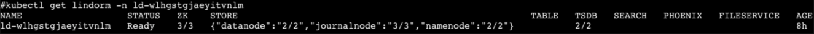
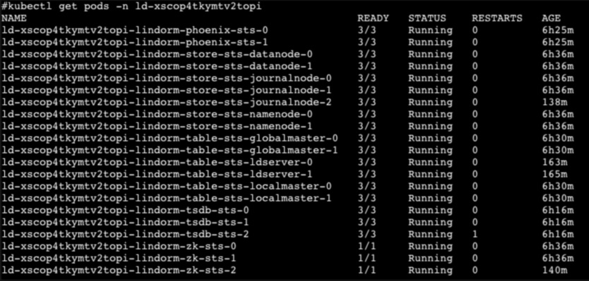
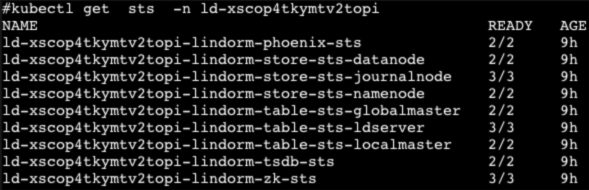

Alibaba Cloud  
Apsara Stack  
Lindorm  
Operations and Maintenance  
Guide  
Product Version: V3.18.6  
Document Version: 20260630

**Table of Contents**

- [1.What is Lindorm?](#section-1)
- [2.Deployment mode](#section-2)
- [3.Cluster management](#section-3)
    - [3.1. View the status of an instance by using the CLI](#section-3-1)
    - [3.2. View the status of all instance nodes](#section-3-2)
    - [3.3. Log on to a node to view logs](#section-3-3)
    - [3.4. Cluster scaling](#section-3-4)
    - [3.5. Minor version update](#section-3-5)
    - [3.6. Restart a node](#section-3-6)
- [4.ApsaraDB Operations and Maintenance System](#section-4)
    - [4.1. Homepage](#section-4-1)
    - [4.2. Instance management](#section-4-2)
        - [4.2.1. Instance batch management](#section-4-2-1)
            - [4.2.1.1. Migrate multiple instances at a time](#section-4-2-1-1)
            - [4.2.1.2. Modify multiple instance parameters at a time](#section-4-2-1-2)
            - [4.2.1.3. Modify multiple DIY parameters at a time](#section-4-2-1-3)
            - [4.2.1.4. Manage batch tasks](#section-4-2-1-4)
            - [4.2.1.5. Manage batch task types](#section-4-2-1-5)
            - [4.2.1.6. Manage SQL templates](#section-4-2-1-6)
        - [4.2.2. Singal instance management](#section-4-2-2)
            - [4.2.2.1. Overview](#section-4-2-2-1)
            - [4.2.2.2. View an instance](#section-4-2-2-2)
            - [4.2.2.3. Manage instances](#section-4-2-2-3)
            - [4.2.2.4. Diagnose an instance](#section-4-2-2-4)
            - [4.2.2.5. Manage emergency response plans](#section-4-2-2-5)
            - [4.2.2.6. View the instance dashboard](#section-4-2-2-6)
            - [4.2.2.7. Manage instance migration plans](#section-4-2-2-7)
    - [4.3. Host management](#section-4-3)
        - [4.3.1. Create a host](#section-4-3-1)
        - [4.3.2. Configure multiple hosts at a time](#section-4-3-2)
        - [4.3.3. View the information about a host](#section-4-3-3)
    - [4.4. Cluster management](#section-4-4)
        - [4.4.1. Create a PolarDB for PostgreSQL cluster](#section-4-4-1)
        - [4.4.2. Manage service types](#section-4-4-2)
        - [4.4.3. Manage service nodes](#section-4-4-3)
        - [4.4.4. Manage DB configuration templates](#section-4-4-4)
        - [4.4.5. Manage Fangcunshan clusters](#section-4-4-5)
        - [4.4.6. Manage locations](#section-4-4-6)
    - [4.5. Task management](#section-4-5)
        - [4.5.1. Manage interrupted tasks](#section-4-5-1)
        - [4.5.2. Manage temporarily closed tasks](#section-4-5-2)
    - [4.6. System management](#section-4-6)
    - [4.7. Handle exceptions](#section-4-7)
- [5.Apsara Uni-manager Platform Operations](#section-5)
    - [5.1. Turn on the IPv6 display switch](#section-5-1)

<a id="section-1"></a>

# 1.What is Lindorm?

Lindorm is a cloud native multi-model database service that allows you to store data of all sizes. Lindorm provides low-cost storage for large volumes of data. Lindorm supports wide table models and is compatible with the standard APIs of multiple open source services, such as Apache HBase, OpenTSDB, and SQL. Lindorm provides databases that are suitable for scenarios such as the Internet, Internet of Things (IoT), Internet of Vehicles (IoV), advertising, social networking, monitoring, gaming, and risk control scenarios. Lindorm provides technical support for the core business of Alibaba Group.

Lindorm uses a cloud native multi-model architecture in which computing is decoupled from storage. Lindorm provides benefits such as elasticity, cost-effectiveness, ease of use, high compatibility, and high stability. It allows you to store and analyze data such as metadata, logs, bills, tags, messages, reports, dimension tables, result tables, feeds, user personas, device data, monitoring data, sensor data, small files, and small pictures. Lindorm provides the following core capabilities:

- Data interoperability: Lindorm supports wide table models. It provides a unified API and also supports the APIs of multiple open source database management systems. Data can be transferred and synchronized between models. This makes application development more agile, flexible, and efficient.

- Cost-effectiveness: Lindorm can handle tens of millions of concurrent requests and responds with a latency of a few milliseconds. Lindorm greatly reduces the storage cost by using high-density and cost-effective media, automatic cold and hot data separation, and adaptive compression.

- Cloud-native support and high scalability: Lindorm allows you to scale computing and storage resources separately. Lindorm also provides serverless services that you can scale based on actual usage.

- Open data ecosystem: Lindorm provides multiple easy-to-use features such as data exchanges, processing, and subscription. It can be seamlessly integrated with systems such as MySQL, Spark, Flink, and Kafka.

**Multi-modal capabilities**

Lindorm supports wide table models. It provides a unified API and supports the APIs of multiple open source database management systems. Data can be transferred and synchronized between models. This makes application development more agile, flexible, and efficient. LindormTable

LindormTable is used to store large amounts of key-value data and table data. It provides features such as global secondary indexes, multi-dimensional queries, dynamic columns, and Time to Live (TTL). It is suitable for scenarios such as metadata storage, orders, bills, user personas, social networking information, feeds, and logs. LindormTable is compatible with the open standards of multiple types of open source software, such as Apache HBase.

LindormTable supports tens of millions of concurrent requests, separation of cold and hot data, and hundreds of petabytes of data storage. Compared with the performance delivered by open source Apache HBase, the throughput is increased by 2 to 6 times, the percentile 99% (P99) latency is reduced by 90%, the mean time to repair (MTTR) is reduced by 90%, the data compression ratio is increased by 100%, and the comprehensive storage cost is reduced by 50%.

A combination of HBase and Elasticsearch or a combination of HBase, OpenTSDB, and Elasticsearch is used in some scenarios, such as monitoring, social networking, and advertising. In such cases, you may face multiple pain points, such as complex architectures, complex queries, weak consistency, high cost, and misalignment of features. The cloud native multi-model capabilities of Lindorm can help you resolve these pain points to ensure efficient innovations.

<a id="section-2"></a>

# 2.Deployment mode

Before you perform the operations in this manual, make sure to read this topic to understand how Lindorm is deployed on Apsara Stack Agility PaaS and what role each node plays.

Lindorm that is deployed on Apsara Stack Agility PaaS consists of multiple StatefulSets. The storage includes ZooKeeper (three replicas), NameNode (two replicas), JournalNode (three replicas), and DataNode (at least three replicas). You can select LindormTable or LindormTSDB based on your business requirements. If you select LindormTable, configure two replicas for GlobalMaster, two replicas for LocalMaster, and at least two replicas for LDServer. If you select LindormTSDB, configure at least two replicas for it.

<a id="section-3"></a>

# 3.Cluster management

<a id="section-3-1"></a>

## 3.1. View the status of an instance by using the CLI

This topic describes how to view the status of an instance by using the CLI.

After you create a Lindorm instance, you can run the following command to view the status of the instance. Note that you must replace namespace in the command with the instance ID.

```bash
kubectl get lindorm -n <namespace>
```

The normal status of a Lindorm instance is Ready, as shown in the following figure.



<a id="section-3-2"></a>

## 3.2. View the status of all instance nodes

This topic describes how to view the status of all instance nodes.

You can run the following command to view the status of all instance nodes:

```bash
kubectl get pods -n <namespace>
```

In normal cases, you can see all pods are in the running or ready state, and the number of restarts is 0, as shown in the following figure.



<a id="section-3-3"></a>

## 3.3. Log on to a node to view logs

If an exception occurs in a node, you can run the following command to log on to the node and view service logs and logs from liveness probe and readiness probe checks:

```bash
kubectl exec -it ld-xscop4tkymtv2topi-lindorm-store-sts-namenode-0 -n ld-xscop4tkymtv2topi /bin/bash
```

Startup logs:

```text
/tmp/auto_start.log
```

Service logs:

Logs for LindormZooKeeper, LindormStore, and LindormTable are stored in the following directory: /disk1/cluster-data/logs.

<a id="section-3-4"></a>

## 3.4. Cluster scaling

You can run the following command to manually scale an engine in a cluster:

```bash
LindormStore:
kubectl patch lindorm <instanceId> -n <namespace> --type='merge' -p '{"spec" : {"lindormStore" : {"replicas" : 3}}}'
LindormTable:
kubectl patch lindorm <instanceId> -n <namespace> --type='merge' -p '{"spec" : {"lindormTable" : {"replicas" : 3}}}'
```

You must replace  `instanceId`  and  `namespace`  in the preceding command with the instance ID in the console. The number of replicas is the desired number of nodes in the engine. If the current number of nodes in the engine is less than 3, the engine is scaled out after you run the preceding command. If the current number of nodes in the engine is greater than 3, the engine is scaled in after you run the preceding command.

<a id="section-3-5"></a>

## 3.5. Minor version update

You can refer to this topic to manually update the minor version of a cluster.

Run the following command to obtain the list of StatefulSets:

```bash
kubectl get sts -n <namespace>
```

The following figure shows a sample command output.



Run the following command to upgrade the image to update the minor version.

```bash
kubectl patch sts <stsName> -n <namespace> --type='merge' -p '{"spec" : {"template": {"spec": {"containers":[{"name":"<containerName>","image" : "<new Image>"}]}}}}'
```

You can obtain stsName from the StatefulSet list and containerName from the following list:

```text
lindorm-datanode
lindorm-namenode
lindorm-journalnode
lindorm-localmaster
lindorm-globalmaster
lindorm-ldserver
```

<a id="section-3-6"></a>

## 3.6. Restart a node

In most cases, you can refer to this topic to restart a single pod.

```bash
kubectl delete pods <podName> -n <namespace>
```

In normal cases, do not restart two or more replicas in a StatefulSet at the same time. Otherwise, service jitters and service unavailability may occur.

<a id="section-4"></a>

# 4.ApsaraDB Operations and Maintenance System

<a id="section-4-1"></a>

## 4.1. Homepage

The homepage of ApsaraDB Operations and Maintenance System provides an overview of your databases on dashboards. You can perform operations such as viewing exceptions, searching for instances, and using the advanced search features.

**Procedure**

Log on to the ApsaraDB Operations and Maintenance System console. On the homepage that appears, view and handle PolarDB alerts at the earliest opportunity, and continuously optimize existing metrics.

Click the number next to the exception information to view the exception details. For example, you can click **Backup exception** in the **Backup information** section. On the page that appears, all the exceptions on PolarDB instances are displayed. You can click an exception for troubleshooting.

<a id="section-4-2"></a>

## 4.2. Instance management

<a id="section-4-2-1"></a>

### 4.2.1. Instance batch management

<a id="section-4-2-1-1"></a>

#### 4.2.1.1. Migrate multiple instances at a time

This topic describes how to migrate multiple instances at a time.

**Procedure**

1. Log on to the ApsaraDB Operations and Maintenance System console.

2. In the left-side navigation pane, choose **Instance management > Instance List**.

3. In the upper part of the **Instance List** page, click **Instance batch management**.

4. On the page that appears, click **Batch instance migration** in the **Instance batch operations** section.

5. On the **Batch instance migration waiting list** page, click **Download template file** and fill in the template file.

6. Click **Select File**.

7. Select the completed template file and then click **Submit**.

> **Note**
>
> - Interruptions occur on instances that use HAProxy only if they are migrated across clusters.
>
> - Batch instance migration operations are not reviewed. Proceed with caution.

**What to do next**

You can click **Batch instance migration success list** or **Batch instance migration failure list** in the upper part of the **Batch instance migration waiting list** page to view the details of the migration operations.

<a id="section-4-2-1-2"></a>

#### 4.2.1.2. Modify multiple instance parameters at a time

This topic describes how to modify multiple instance parameters at a time.

**Procedure**

1. Log on to the ApsaraDB Operations and Maintenance System console.

2. In the left-side navigation pane, choose **Instance management > Instance List**.

3. In the upper part of the **Instance List** page, click **Instance batch management**.

4. On the page that appears, click **Batch instance parameter refresh** in the **Instance batch operations** section.

5. Select the clusters for which you want to modify the parameters and click **Select parameter Template**.

   > **Important**
   >
   > Instance parameter changes may cause risks such as transient connections or unavailability. You can modify the parameters by following the instructions on the console.

6. On the page that appears, select the parameter template and click **Next Step**

7. Select the instances and click **Submit**.

**What to do next**

You can click **Batch refresh parameter instance successful list** or **Batch refresh parameter instance failure list** in the upper part of the **Batch instance parameter refresh** page to view the details of the modified parameters.

<a id="section-4-2-1-3"></a>

#### 4.2.1.3. Modify multiple DIY parameters at a time

This topic describes how to modify multiple DIY parameters at a time.

**Procedure**

1. Log on to the ApsaraDB Operations and Maintenance System console.

2. In the left-side navigation pane, choose **Instance management > Instance List**.

3. In the upper part of the **Instance List** page, click **Instance batch management**.

4. On the page that appears, click **Batch DIY parameter refresh** in the **Instance batch operations** section.

5. On the **BatchDIYRefresh parameter wait list** page, configure the parameters described in the following table.

   | Parameter | Description |
   | --- | --- |
   | Instance name | Instances for which you want to modify DIY parameters.<br>Note<br>• Make sure that the instances that you specify are of the same database engine and engine version.<br>• Do not enter spaces, tabs, or blank lines.<br>• Only parameters that take effect without restarts are supported. |
   | dbType | The database type. Select the database engine of the specified instances. |
   | dbVersion | The version of the database engine. Select the database engine version of the specified instances. |
   | Remarks | The description of the modification. |

6. Click **To select parameters**.

7. In the **Confirm** message, click **Determine**.

8. Select the parameters that you want to modify and specify the new values on the right side of the page.

9. In the lower-left corner of the page, click **Save**.

**What to do next**

You can click **BatchDIYRefresh parameter successful list** or **BatchDIYRefresh parameter failure list** in the upper part of the **Batch DIY parameter refresh** page to view the details of the modified DIY parameters.

<a id="section-4-2-1-4"></a>

#### 4.2.1.4. Manage batch tasks

This topic describes how to manage batch tasks.

**Create a task**

1. Log on to the ApsaraDB Operations and Maintenance System.

2. In the left-side navigation pane, choose **Instance management > Instance List**.

3. In the upper part of the **Instance List** page, click **Instance batch management**.

4. Click **Batch task management** in the **Instance batch operations** section.

5. In the upper part of the Instance batch management-Task Management page, click **Create task**.

6. In the **Create task** dialog box, configure the parameters described in the following table.

   | Parameter | Description |
   | --- | --- |

   | Task type | The task type. Valid values include <strong>Batch enable SQL WALL</strong>, <strong>Batch link</strong> <strong>switching</strong>, and <strong>Batch instance minor version update</strong>. |
   | --- | --- |
   | Task tips | Tips for the selected task type. |
   | Task parameters | Parameters for the selected task type. |
   | Time rules | • <strong>Issue immediately</strong>: immediately executes the task.<br>• <strong>Operation and maintenance time</strong>: executes the task in the O&amp;M window.<br>• <strong>Specify time</strong>: executes the tasks in the specified periods of time. |
   | Send SMS | Specifies whether to send SMS notifications. Valid values:<br>• Yes<br>• No |
   | Instance source | The instance source. Valid values: <strong>Cluster</strong> and <strong>SqlTemplate</strong>. |
   | Please select a source cluster | This parameter is available only when the <strong>Instance source</strong> parameter is set to <strong>Cluster</strong>. The instances in the cluster will populate the <strong>Input instance</strong> parameter. |
   | Please selectSqlTemplat e | This parameter is available only when the <strong>Instance source</strong> parameter is set to <strong>SqlTemplate</strong>. The SQL template will populate the <strong>Input instance</strong> parameter.<br>Note<br>You can click <strong>Create Template</strong> to the right of the parameter to create SQL templates on the <strong>SQL Template management</strong> page. |
   | Input instance | The instances on which the batch task is executed. Enter an instance name on each line. |
   | Remarks | Remarks of the task.<br>Note<br>This parameter is optional. |

7. Click **Submit**.

<a id="section-4-2-1-5"></a>

#### 4.2.1.5. Manage batch task types

This topic describes how to create a type of batch tasks.

**Procedure**

1. Log on to the ApsaraDB Operations and Maintenance System console.

2. In the left-side navigation pane, choose **Instance management > Instance List**.

3. In the upper part of the **Instance List** page, click **Instance batch management**.

4. On the page that appears, click **Batch task type management** in the **Instance batch operations** section.

5. In the upper part of the Instance batch management-Task type management page, click **New type**.

6. In the **New type** dialog box, configure the parameters described in the following table.

   | Parameter | Description |
   | --- | --- |
   | Name | The name of the new task type. |
   | Number | The ID of the new task type. |
   | API | The API name for the new task type. |
   | apiInstance parameter name | • The parameter of the API.<br>• Default value: <strong>DBInstanceName</strong>. |
   | Prompt information | The prompt that is displayed for the task type. |
   | Parameter rules | The parameter rules, including the parameter name, API parameter name, and parameter type. |
   | Validation rules | The validation rules, including the validation relationship, attribute name, validation rule, and validation value. |
   | Highest concurrency | The largest number of tasks of this type that can be executed at the same time. |
   | Stop failure rate | The probability for the tasks to be stopped or fail. |
   | Remarks | The remarks of the task type. |

7. Click **Submit**.

<a id="section-4-2-1-6"></a>

#### 4.2.1.6. Manage SQL templates

This topic describes how to create an SQL template.

**Procedure**

1. Log on to the ApsaraDB Operations and Maintenance System console.

2. In the left-side navigation pane, choose **Instance management > Instance List**.

3. In the upper part of the **Instance List** page, click **Instance batch management**.

4. On the page that appears, click **SQL Template management** in the **Instance batch operations** section.

5. In the upper part of the SQL template list page, click **New template**.

6. In the **NewTemplate** dialog box, configure the parameters described in the following table.

   | Parameter | Description |
   | --- | --- |
   | Template name | The name of the new template. |
   | Template type | The type of the new template. |
   | Database name | The database on which the template is used. |
   | Database type | The engine of the target database. |
   | SQL script | The script of the SQL template. |
   | New reason | The reason to create the template. |

   > **Note**
   >
   > Custom SQL templates support only SELECT statements and can be used only for DBaaS databases. The creation of SQL templates must be approved in the business process management system. To ensure that the SQL template is not mistakenly executed by other users, we recommend that you give the template a descriptive name and describe the purpose of the template in detail in the New reason parameter.

7. Click **Submit**.

<a id="section-4-2-2"></a>

### 4.2.2. Singal instance management

<a id="section-4-2-2-1"></a>

#### 4.2.2.1. Overview

This topic describes how to view the information about instances, such as the basic information, data links, databases, and accounts, in the instance list.

**Procedure**

1. Log on to the ApsaraDB Operations and Maintenance System console.

2. In the left-side navigation pane, choose **Instance management > Instance List**.

   On the Instance List page, you can perform the following operations:

   - Click **Batch query**. In the Batch query dialog box, enter instance names to query multiple instances at a time.

   - Click **Advance search** and configure parameters such as Database type and Instance status to query instances.

   - Find an instance that you want to manage and click its name to go to the Basic information page. You can view the instance information and manage the instance.

   - For more information, see View an instance, Diagnose an instance, Manage emergency response plans, View the instance dashboard, and Manage instance migration plans.

<a id="section-4-2-2-2"></a>

#### 4.2.2.2. View an instance

This topic describes how to view the information about an instance, such as the basic information and instance performance, on the instance details page.

**Procedure**

1. Log on to the ApsaraDB Operations and Maintenance System console.

2. In the left-side navigation pane, choose **Instance management > Instance List**.

3. On the Instance List page, find the instance that you want to manage and click its name in the **User instance name** column.

   > **Note**
   >
   > You can search for the instance by entering keywords in the search box on the upper part of the page. You can also click **Advance search** to filter instances by condition.

4. In the **Basic information** section, view the basic information about the instance. You can also click the options in the Instance details section to perform operations on the instance, such as performing backup and restoration, viewing the change records, and querying the SQL information.

<a id="section-4-2-2-3"></a>

#### 4.2.2.3. Manage instances

This topic describes the operations that you can perform on instances, including exporting instances and migrating instances.

**Procedure**

1. Log on to the ApsaraDB Operations and Maintenance System console.

2. In the left-side navigation pane, choose **Instance management > Instance List**.

3. In the upper part of the Instance List page, you can perform the following operations by clicking options to the right of the search box:

   - Click Instance batch management to perform operations on multiple instances at a time.

   - Click **Instance plan migration management** to migrate instances.

     > **Important**
     >
     > Instance migration is a high-risk operation. We recommend that you perform this operation during off-peak hours.

   - Click **Instance dashboard** to view the CPU utilization, connections, IOPS, and disk usage.

   - Click **mysql master/slave latency** to view the latency between the primary and secondary nodes of the instances.

<a id="section-4-2-2-4"></a>

#### 4.2.2.4. Diagnose an instance

You can use the instance diagnostics feature to view the performance metrics of an instance.

**Procedure**

1. Log on to the ApsaraDB Operations and Maintenance System console.

2. In the left-side navigation pane, choose **Instance management** > **Instance List**.

3. On the Instance List page, find the instance that you want to manage and click its name in the **User instance name** column.

4. In the **Instance details** section, click **Instance diagnosis**. On the page that appears, you can view the performance metrics of the instance

<a id="section-4-2-2-5"></a>

#### 4.2.2.5. Manage emergency response plans

This topic describes how to manage emergency response plans for instances.

**Procedure**

1. Log on to the ApsaraDB Operations and Maintenance System console.

2. In the left-side navigation pane, choose **Host management > System host**.

3. In the upper part of the **System host** page, click **Emergency response plan**.

4. On the Host Information page, enter keywords in the search box to find the instance that you want to manage and select the instance.

5. Export the instance information to your computer by clicking the button in the upper part of the page.

   > **Note**
   >
   > You must specify a condition to search for the instance before you can export the instance information.

<a id="section-4-2-2-6"></a>

#### 4.2.2.6. View the instance dashboard

This topic describes how to view the metrics of instances on the instance dashboard, such as CPU utilization and connection utilization.

**Procedure**

1. Log on to the ApsaraDB Operations and Maintenance System console.

2. In the left-side navigation pane of the **ApsaraDB Operations and Maintenance System** console, choose **Instance management > Instance List**.

3. In the upper part of the **Instance List** page, click **Instance dashboard**.

4. On the page that appears, you can view the CPU utilization, connection utilization, IOPS, and disk usage of instances.

<a id="section-4-2-2-7"></a>

#### 4.2.2.7. Manage instance migration plans

Instance migration plans can be uploaded by specifying the instances or the IP addresses of hosts. This topic describes how to migrate instances by instance plans.

**Procedure**

1. Log on to the ApsaraDB Operations and Maintenance System console.

2. In the left-side navigation pane, choose **Instance management > Instance List**.

3. In the upper part of the **Instance List** page, click **Instance plan migration management**.

4. Select an upload mode for the list of instances to be migrated.

   > **Note**
   >
   > - Mode 1: If you select Submit by instance, when an instance that cannot be migrated is detected, submission for all the instances will be stopped.
   >
   > - Mode 2: If you select By hostIPSubmit, the instances that cannot be migrated will be filtered out and ignored.

5. Click **Download template file** and fill in the template file.

6. Click **Select File** and select the completed template file.

7. Click **Submit**.

**What to do next**

You can click **Push success list** or **Deleted list** in the upper part of the **Instance plan migration management** page to view the information about the migrated instances.

<a id="section-4-3"></a>

## 4.3. Host management

<a id="section-4-3-1"></a>

### 4.3.1. Create a host

This topic describes how to create a host.

**Procedure**

1. Log on to the ApsaraDB Operations and Maintenance System console.

2. In the left-side navigation pane, choose **Host management > System host**.

3. In the upper part of the System host page, click **Emergency response plan**.

4. On the Host Information page, click **New host**.

5. In the New host dialog box, configure the parameters and click **Submit**.

<a id="section-4-3-2"></a>

### 4.3.2. Configure multiple hosts at a time

This topic describes how to configure multiple hosts at a time.

**Procedure**

1. Log on to the ApsaraDB Operations and Maintenance System console.

2. In the left-side navigation pane, choose **Host management > System host**.

3. On the System host page, select the hosts that you want to configure and click **Batch configuration** in the upper part of the page.

4. In the Batch configuration parameters dialog box, configure the parameters and click **Submit**.

<a id="section-4-3-3"></a>

### 4.3.3. View the information about a host

This topic describes how to view the information about a host.

**Procedure**

1. Log on to the ApsaraDB Operations and Maintenance System console.

2. In the left-side navigation pane, choose **Host management > System host**.

3. On the System host page, search for the host that you want to view by IP address or host name.

4. Click the IP address of the host and view information on the **Host details** page. The information includes the CPU utilization, memory usage, disk usage, and the number of instances.

   You can also click the options in the Host details section to view the information about host instances, performance, backups, and accounts.

<a id="section-4-4"></a>

## 4.4. Cluster management

<a id="section-4-4-1"></a>

### 4.4.1. Create a PolarDB for PostgreSQL cluster

This topic describes how to create a PolarDB for PostgreSQL cluster.

**Create a system cluster**

1. Log on to the ApsaraDB Operations and Maintenance System.

2. In the left-side navigation pane, click **Cluster management**.

3. On the **System Cluster** page, click **New Cluster**.

4. In the dialog box that appears, select a database type and click **OK**.

5. In the **Create a cluster** dialog box, configure the parameters and click **Confirm**.

   > **Note**
   >
   > You can refer to the tooltip or text next to the parameter for detailed description.

**Create a user cluster template**

1. Log on to the ApsaraDB Operations and Maintenance System.

2. In the left-side navigation pane, click **Cluster management**.

3. In the left-side navigation pane, click **User cluster**. On the page that appears, click **Cluster Template**.

4. In the dialog box that appears, click **Create a cluster Template**.

5. In the **Create a cluster Template** dialog box, configure the required parameters and click **Submit**.

   > **Note**
   >
   > You can refer to the tooltip or text next to the parameter for detailed description.

<a id="section-4-4-2"></a>

### 4.4.2. Manage service types

This topic describes how to manage cloud service types.

**Procedure**

1. Log on to the ApsaraDB Operations and Maintenance System console.

2. In the left-side navigation pane, click **Cluster management**.

3. In the left-side navigation pane, click **Service Type Management**. The **Service Type Management** page appears.

   - Find the service type that you want to modify and click **Edit** in the **Operation** column to modify the service type.

   - Find the service type that you want to delete and click **Delete** in the **Operation** column. In the message that appears, click OK to delete the service type.

<a id="section-4-4-3"></a>

### 4.4.3. Manage service nodes

This topic describes how to create, modify, and delete a service node.

**Procedure**

1. Log on to the ApsaraDB Operations and Maintenance System console.

2. In the left-side navigation pane, click **Cluster management**.

3. In the left-side navigation pane, click **Service node management**.

   - In the upper part of the Service node management page, click **New service node**. In the dialog box that appears, configure the required parameters and click **OK**.

   - Find the service node that you want to modify and click **Edit** in the **Operation** column to modify the service node.

   - Find the service node that you want to delete and click **Delete** in the **Operation** column. In the message that appears, click OK to delete the service node.

<a id="section-4-4-4"></a>

### 4.4.4. Manage DB configuration templates

This topic describes how to manage DB configuration templates.

**Procedure**

1. Log on to the ApsaraDB Operations and Maintenance System console.

2. In the left-side navigation pane, click **Cluster management**.

3. In the left-side navigation pane, click **DB configuration template** to go to the **DB configuration template** page.

   - In the upper part of the page, click **New DB template**, enter the template information, and then click **Save** in the **Operation** column.

   - Find the template that you want to modify, click **Edit** in the **Operation** column to modify the template, and then click **Save** in the **Operation** column.

   - Find the template that you want to delete and click **Delete** in the **Operation** column. In the message that appears, click **OK** to delete the template.

<a id="section-4-4-5"></a>

### 4.4.5. Manage Fangcunshan clusters

This topic describes how to manage Fangcunshan clusters.

**Procedure**

1. Log on to the ApsaraDB Operations and Maintenance System console.

2. In the left-side navigation pane, click **Cluster management**.

3. In the left-side navigation pane, click **Fangcunshan cluster management** to go to the **Cluster group configuration** page.

4. In the upper part of the page, click **New cluster group**.

5. In the dialog box that appears, select a region, enter the cluster group name, and then click **Confirm**.

6. Click **Set up a cluster** in the **Operation** column of the new cluster. In the dialog box that appears, configure the resource type of the instance and click **Confirm**.

7. Optional. Find the cluster group that you want to modify and click **Modify a cluster group** in the **Operation** column to modify the name of the cluster group.

8. Optional. Find the cluster group that you want to delete and click **Deleting a cluster group** in the **Operation** column. In the message that appears, click Determine to delete the cluster group.

<a id="section-4-4-6"></a>

### 4.4.6. Manage locations

This topic describes how to configure the locations of clusters.

**Procedure**

1. Log on to the ApsaraDB Operations and Maintenance System console.

2. In the left-side navigation pane, click **Cluster management**.

3. In the left-side navigation pane, click **Location**.

4. On the Location page, search for clusters by keyword and configure their locations.

   > **Note**
   >
   > You can also perform cluster consistency check and subdomain consistency check on this page.

   - Click **Add** next to the required unit, region, or zone. In the dialog box that appears, configure the parameters and click **Submit** to add a location node.

   - Click **Parameters** next to the required unit, region, zone, or subdomain. In the dialog box that appears, add, modify, or delete parameters.

   - Click **Delete** next to the required unit, region, zone, or subdomain. In the message that appears, click OK to delete the unit, region, zone, or subdomain.

<a id="section-4-5"></a>

## 4.5. Task management

<a id="section-4-5-1"></a>

### 4.5.1. Manage interrupted tasks

This topic describes how to manage interrupted tasks, including user instance tasks, host instance tasks, and host tasks. In this example, a user instance task is managed.

**Procedure**

1. Log on to the ApsaraDB Operations and Maintenance System console.

2. In the left-side navigation pane of the **ApsaraDB Operations and Maintenance System** console, click **Task Management**. In the upper-left corner of the **Instance tasks** page, select **Interrupted tasks** from the drop-down list.

   > **Note**
   >
   > - If interrupted tasks are displayed, perform the following steps.
   >
   > - If no interrupted tasks are displayed, skip the following steps.

3. Click a task name in the **Task name** column to view and analyze the cause of the task failure.

   > **Note**
   >
   > In most cases, if you encounter issues such as secondary databases in an abnormal state, connection timeout errors, or password errors, you can log on to the faulty instance by using the instance IP address and fix the issue.

4. After you fix the issue, find the task and click **Operation** in the **Operation** column.

5. On the page that appears, click **Perform tasks**.

6. In the **Re-execute the task** dialog box, click **Current step retry** to run the task again.

   > **Important**
   >
   > If you want to retry the task starting from a specific step, click **Continue from the specified step**. We recommend that you do not retry the task if you are not familiar with the task or the purposes of its steps.

7. In the upper-left corner of the Instance tasks page, select **Running tasks** from the drop-down list to view the status of the task.

   > **Note**
   >
   > If the task fails again, repeat the preceding steps.

<a id="section-4-5-2"></a>

### 4.5.2. Manage temporarily closed tasks

This topic describes how to manage temporarily closed tasks.

**Procedure**

1. Log on to the ApsaraDB Operations and Maintenance System console.

2. In the left-side navigation pane of the **ApsaraDB Operations and Maintenance System** console, click **Task Management**. In the upper-left corner of the Instance tasks page, select **Temporarily Closed tasks** from the drop-down list.

   - Click a task name in the **Task name** column. In the message that appears, view the steps of the task.

   - Find a task and click the operation object name in the **Operation object** column to view the task logs of this operation object.

   - Find a task and click the operator name in the **Executor** column to view the information about the operator.

   - Find a task and click **Operation** in the **Operation** column to view the reason why the task is temporarily closed.

     - On the page that appears, click **Perform tasks** to retry the task.

     - On the page that appears, click **Intervention record** to view the intervention records of the task.

   - Find a task and click **Add remarks** in the Operation column to add remarks for the task.

<a id="section-4-6"></a>

## 4.6. System management

This topic describes the features of system management.

Table 1. System management

| Feature | Description | Remarks |
| --- | --- | --- |
| System settings | You can create packages, configure system settings, manage database parameter templates, configure system parameter settings, manage traffic statistics rules, configure performance settings, manage Internet service provider (ISP) information, configure component exception levels, and configure Linux kernel parameters. | The operations are of high risks. |
| Permission configuration | You can add roles and manage permission codes. | Permission code management is of high risks. |
| General configuration | You can enable or disable ACL cache, enable or disable email, create cluster information, and send cluster information. | None. |
| Label list | You can add labels and view the types, aliases, and values of labels. | None. |
| Cluster management | You can create clusters, refresh management machine whitelists, refresh synchronization modes, and refresh resource cache. | The operations are of high risks. |
| Whitelist management | You can view and refresh region whitelists. | None. |
| Service type management | You can modify and delete service types. | Service type creation is of high risks. |
| Host masking information management | You can add and remove masked host IP addresses. | None. |
| AccessKey management | You can create and view AccessKey pairs, and view logs for O&amp;M APIs. | The operations are of high risks. |
| Fangcunshan cluster configuration | You can view the configurations of cluster groups and create cluster groups. | The operations are of high risks. |
| Disaster recovery management | You can perform inspections on link components and control components, perform switchover, and manage disaster recovery tasks. | None. |
| Scheduled task management | You can manage the scheduled tasks in the system. | None. |

<a id="section-4-7"></a>

## 4.7. Handle exceptions

This topic describes how to handle exceptions in ApsaraDB RDS databases in the ApsaraDB Operations and Maintenance System console and improve the databases based on monitoring metrics.

**Procedure**

1. Log on to the ApsaraDB Operations and Maintenance System console.

2. In the left-side navigation pane, click **Home Page**.

3. View the information about various types of exceptions on the homepage.

   Figure 1: Homepage

4. Find an exception type and click the number to view the details of exceptions. For example, find **Backup exception** in the **Backup information** section and click the number. On the page that appears, you can view all the backup exceptions of ApsaraDB RDS instances.

   You can click the exceptions one by one and handle them accordingly.

<a id="section-5"></a>

# 5.Apsara Uni-manager Platform Operations

<a id="section-5-1"></a>

## 5.1. Turn on the IPv6 display switch

If you want to configure an IPv6 address when you create an instance in an Apsara Stack environment, you must turn on the IPv6 display switch in the Apsara Uni-manager Operations Console. After you turn on the switch, an IPv6 configuration option is displayed on the instance creation page in the Lindorm console.

> **Important**
>
> This operation is an account-level global setting. After the IPv6 display switch is turned on, all tenants within the current account can configure IPv6 when they create instances in the Lindorm console.

**Prerequisites**

- The URL of the Apsara Uni-manager Operations Console and the username and password that are used to log in to the console are obtained from a deployment engineer or an administrator.

  The URL of the Apsara Uni-manager Operations Console is in the following format: *ops*.asconsole.*intranet-domain-id*.com.

- A web browser is available. We recommend that you use Google Chrome.

**Procedure**

1. **Log in to the Apsara Uni-manager Operations Console**

   <ol type="i">

   <li>

   Open a browser.

   </li>

   <li>

   In the address bar, enter the URL of the Apsara Uni-manager Operations Console and

   </li>

   </ol>

   press Enter.

   > **Note**
   >
   > You can select a language from the drop-down list in the upper-right corner of the page.

   <ol type="i" start="3">

   <li>

   Enter your username and password.

   </li>

   </ol>

   > **Note**
   >
   > - Obtain the username and password that are used to log on to the Apsara Uni-manager Operations Console from a deployment engineer or an administrator.
   >
   > - If you enter an invalid password for three consecutive times, the system enables the image verification logon feature. If you enter an invalid password for five consecutive times, the account is locked. Contact the administrator to unlock the account.
   >
   > - The first time that you log on to the Apsara Uni-manager Operations Console, change the password for your username as prompted.
   >
   >   To enhance security, your password must meet the following requirements:
   >
   >   - The password contains uppercase and lowercase letters.
   >
   >   - The password contains digits.
   >
   >   - The password contains at least one of the following special characters: ! @ # $ %
   >
   >   - The password is 10 to 20 characters in length.

   <ol type="i" start="4">

   <li>

   Click **Agree to Private Policy and Log On**.

   </li>

   </ol>

2. **Navigate to the switch management page**

   <ol type="i">

   <li>

   In the top navigation bar of the Apsara Uni-manager Operations Console, choose **Platform Operation** > **Management and Control Service O&M** > **UniConsole**.

   </li>

   <li>

   On the **Products** page, search for **lindorm** and click **Switch List** in the **Actions** column.

   </li>

   </ol>

3. **Turn on the IPv6 display switch**

   On the **lindorm Switches** page, search for  `enableIPv6`  and turn on the switch.

   > **Note**
   >
   > After the switch is turned on, all tenants within the current account can configure IPv6 when they create instances in the Lindorm console.

4. **Create a Lindorm instance and configure IPv6**

   After the switch is turned on, log in to the Lindorm console, create a Lindorm instance, and configure **IP Type**. For more information, see the **Create a Lindorm instance** topic in the User Guide.
