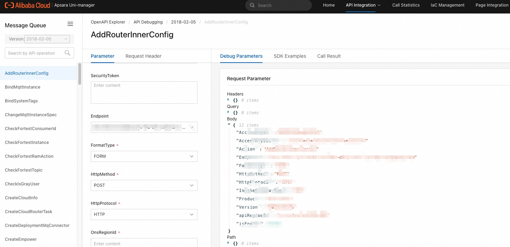
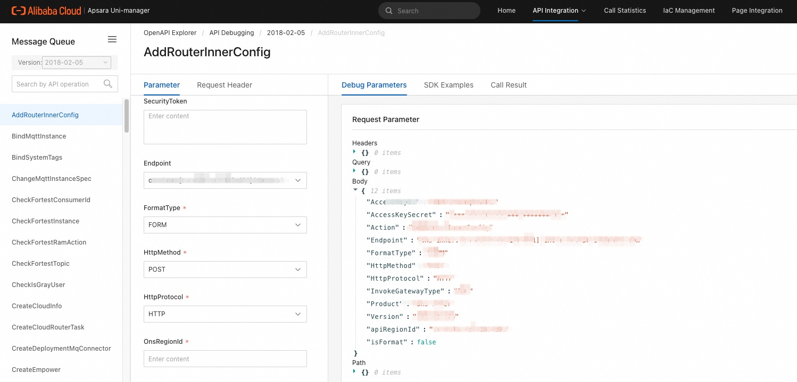
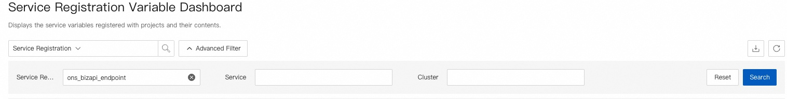
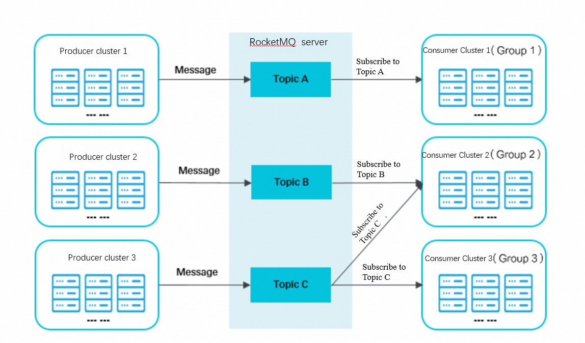
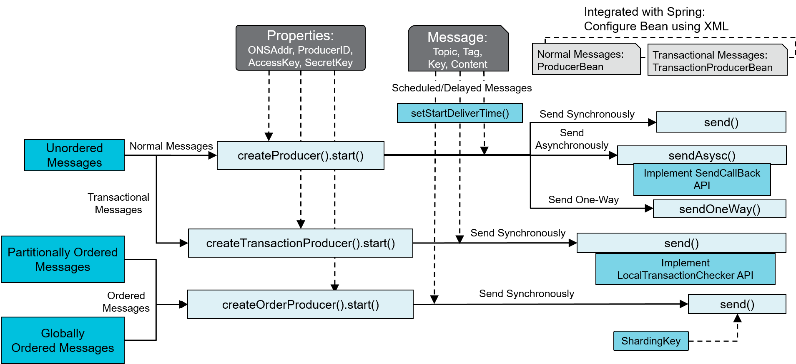

Alibaba Cloud  
Apsara Stack  
Alibaba Cloud Message Queue  
RocketMQ v5.0 Developer  
Guide  
Product Version: v3.18.6-2607  
Document Version: 20260828

**Table of Contents**

- [1.Prerequisites](#section-1)
    - [1.1. Obtain API information and its endpoint](#section-1-1)
    - [1.2. Obtain an AccessKey pair](#section-1-2)
    - [1.3. Obtain common header parameters](#section-1-3)
    - [1.4. Obtain STS access credentials](#section-1-4)
- [2.Calling private cloud APIs through a POP gateway](#section-2)
    - [2.1. Overview](#section-2-1)
    - [2.2. Preparations](#section-2-2)
    - [2.3. SDK for Java](#section-2-3)
- [3.API reference](#section-3)
    - [3.1. RocketMQ v5.0_API](#section-3-1)
        - [3.1.1. Overview](#section-3-1-1)
            - [3.1.1.1. Intended audience and scenarios](#section-3-1-1-1)
            - [3.1.1.2. Scenarios and limits](#section-3-1-1-2)
            - [3.1.1.3. Basic principles](#section-3-1-1-3)
        - [3.1.2. Common parameters](#section-3-1-2)
            - [3.1.2.1. Common parameter settings](#section-3-1-2-1)
            - [3.1.2.2. Common response parameters](#section-3-1-2-2)
        - [3.1.3. Common terms](#section-3-1-3)
            - [3.1.3.1. Account security](#section-3-1-3-1)
                - [3.1.3.1.1. AccessKey](#section-3-1-3-1-1)
                - [3.1.3.1.2. SecretKey](#section-3-1-3-1-2)
            - [3.1.3.2. Resource management](#section-3-1-3-2)
                - [3.1.3.2.1. Topic](#section-3-1-3-2-1)
                - [3.1.3.2.2. Group ID (GID)](#section-3-1-3-2-2)
        - [3.1.4. Error codes](#section-3-1-4)
        - [3.1.5. API reference](#section-3-1-5)
            - [3.1.5.1. Instance management](#section-3-1-5-1)
                - [3.1.5.1.1. ConsoleInstanceList](#section-3-1-5-1-1)
                - [3.1.5.1.2. ConsoleClusterCreate](#section-3-1-5-1-2)
                - [3.1.5.1.3. ConsoleClusterSpecList](#section-3-1-5-1-3)
                - [3.1.5.1.4. ConsoleClusterStatus](#section-3-1-5-1-4)
                - [3.1.5.1.5. ConsoleInstanceStatistics](#section-3-1-5-1-5)
                - [3.1.5.1.6. ConsoleInstanceUpdate](#section-3-1-5-1-6)
                - [3.1.5.1.7. ConsoleInstanceBaseInfo](#section-3-1-5-1-7)
            - [3.1.5.2. Topic management](#section-3-1-5-2)
                - [3.1.5.2.1. ConsoleTopicDelete](#section-3-1-5-2-1)
                - [3.1.5.2.2. ConsoleTopicListInPage](#section-3-1-5-2-2)
                - [3.1.5.2.3. ConsoleTopicStatus](#section-3-1-5-2-3)
                - [3.1.5.2.4. ConsoleTopicUpdateInfo](#section-3-1-5-2-4)
                - [3.1.5.2.5. ConsoleTopicUpdate](#section-3-1-5-2-5)
                - [3.1.5.2.6. ConsoleTopicSubDetail](#section-3-1-5-2-6)
                - [3.1.5.2.7. ConsoleTopicListNames](#section-3-1-5-2-7)
                - [3.1.5.2.8. ConsoleTopicList](#section-3-1-5-2-8)
                - [3.1.5.2.9. ConsoleTopicGet](#section-3-1-5-2-9)
                - [3.1.5.2.10. ConsoleTopicCreate](#section-3-1-5-2-10)
                - [3.1.5.2.11. ConsoleGroupListTopicsByGroupId](#section-3-1-5-2-11)
            - [3.1.5.3. Group management](#section-3-1-5-3)
                - [3.1.5.3.1. ConsoleGroupListInPage](#section-3-1-5-3-1)
                - [3.1.5.3.2. ConsoleGroupUpdateInfo](#section-3-1-5-3-2)
                - [3.1.5.3.3. ConsoleGroupListGroupIds](#section-3-1-5-3-3)
                - [3.1.5.3.4. ConsoleGroupList](#section-3-1-5-3-4)
                - [3.1.5.3.5. ConsoleGroupDelete](#section-3-1-5-3-5)
                - [3.1.5.3.6. ConsoleGroupCreate](#section-3-1-5-3-6)
            - [3.1.5.4. Message management](#section-3-1-5-4)
                - [3.1.5.4.1. ConsoleMessageGetByPagedDLQ](#section-3-1-5-4-1)
                - [3.1.5.4.2. ConsoleMessageResendByIdInDLQ](#section-3-1-5-4-2)
                - [3.1.5.4.3. ConsoleMessageDownload](#section-3-1-5-4-3)
                - [3.1.5.4.4. ConsoleMessageDownloadAllInDLQ](#section-3-1-5-4-4)
                - [3.1.5.4.5. ConsoleMessageSend](#section-3-1-5-4-5)
                - [3.1.5.4.6. ConsoleMessageTrace](#section-3-1-5-4-6)
                - [3.1.5.4.7. ConsoleMessagePush](#section-3-1-5-4-7)
                - [3.1.5.4.8. ConsoleMessageGetByPagedTopic](#section-3-1-5-4-8)
                - [3.1.5.4.9. ConsoleMessageGetByKey](#section-3-1-5-4-9)
                - [3.1.5.4.10. ConsoleMessageGetByIdInDLQ](#section-3-1-5-4-10)
                - [3.1.5.4.11. ConsoleMessageGetById](#section-3-1-5-4-11)
                - [3.1.5.4.12. ConsoleMessageDownloadBodyInDLQ](#section-3-1-5-4-12)
            - [3.1.5.5. Trace management](#section-3-1-5-5)
                - [3.1.5.5.1. ConsoleTraceDeleteTraceQueryTask](#section-3-1-5-5-1)
                - [3.1.5.5.2. ConsoleTraceGetPubTraceByQueryId](#section-3-1-5-5-2)
                - [3.1.5.5.3. ConsoleTraceQueryByMsgId](#section-3-1-5-5-3)
                - [3.1.5.5.4. ConsoleTraceQueryByMsgTopic](#section-3-1-5-5-4)
                - [3.1.5.5.5. ConsoleTraceQueryByMsgKey](#section-3-1-5-5-5)
                - [3.1.5.5.6. ConsoleTraceListByUserIdInPage](#section-3-1-5-5-6)
                - [3.1.5.5.7. ConsoleTraceGetTraceMapByQueryId](#section-3-1-5-5-7)
            - [3.1.5.6. Consumer management](#section-3-1-5-6)
                - [3.1.5.6.1. ConsoleConsumerGetConnection](#section-3-1-5-6-1)
                - [3.1.5.6.2. ConsoleConsumerProgress](#section-3-1-5-6-2)
                - [3.1.5.6.3. ConsoleGroupConsumerUpdate](#section-3-1-5-6-3)
                - [3.1.5.6.4. ConsoleConsumerAccumulate](#section-3-1-5-6-4)
                - [3.1.5.6.5. ConsoleConsumerTimespan](#section-3-1-5-6-5)
                - [3.1.5.6.6. ConsoleGroupSubDetail](#section-3-1-5-6-6)
                - [3.1.5.6.7. ConsoleConsumerStatus](#section-3-1-5-6-7)
                - [3.1.5.6.8. ConsoleConsumerResetOffset](#section-3-1-5-6-8)
                - [3.1.5.6.9. ConsoleConsumerJstackInfo](#section-3-1-5-6-9)
            - [3.1.5.7. Cluster management](#section-3-1-5-7)
                - [3.1.5.7.1. ConsoleClusterGetCapacity](#section-3-1-5-7-1)
                - [3.1.5.7.2. ConsoleClusterList](#section-3-1-5-7-2)
            - [3.1.5.8. Region management](#section-3-1-5-8)
                - [3.1.5.8.1. ConsoleRegionList](#section-3-1-5-8-1)
                - [3.1.5.8.2. ConsoleMetaData](#section-3-1-5-8-2)
                - [3.1.5.8.3. ConsoleCommonRegionData](#section-3-1-5-8-3)
            - [3.1.5.9. Connect instance management](#section-3-1-5-9)
                - [3.1.5.9.1. ConsoleConnectCreate](#section-3-1-5-9-1)
                - [3.1.5.9.2. ConsoleConnectList](#section-3-1-5-9-2)
            - [3.1.5.10. Router task management](#section-3-1-5-10)
                - [3.1.5.10.1. ConsoleStopCloudRouterTask](#section-3-1-5-10-1)
                - [3.1.5.10.2. ConsoleStartCloudRouterTask](#section-3-1-5-10-2)
                - [3.1.5.10.3. ConsoleQueryCloudRouterTask](#section-3-1-5-10-3)
                - [3.1.5.10.4. ConsoleQueryStatsCloudRouterTask](#section-3-1-5-10-4)
                - [3.1.5.10.5. ConsoleQueryItemsCloudRouterTask](#section-3-1-5-10-5)
                - [3.1.5.10.6. ConsoleListInPageCloudRouterTask](#section-3-1-5-10-6)
                - [3.1.5.10.7. ConsoleDeleteCloudRouterTask](#section-3-1-5-10-7)
                - [3.1.5.10.8. ConsoleCreateCloudRouterTask](#section-3-1-5-10-8)
            - [3.1.5.11. CloudInfo management](#section-3-1-5-11)
                - [3.1.5.11.1. ConsoleUpdateCloudInfo](#section-3-1-5-11-1)
                - [3.1.5.11.2. ConsoleQueryCloudInfo](#section-3-1-5-11-2)
                - [3.1.5.11.3. ConsoleDeleteCloudInfo](#section-3-1-5-11-3)
                - [3.1.5.11.4. ConsoleCreateCloudInfo](#section-3-1-5-11-4)
- [4.SDK reference](#section-4)
    - [4.1. RocketMQ v5.0_SDK](#section-4-1)
        - [4.1.1. Overview](#section-4-1-1)
        - [4.1.2. Message model](#section-4-1-2)
        - [4.1.3. Transport protocol and character encoding](#section-4-1-3)
        - [4.1.4. Common classes and methods](#section-4-1-4)
            - [4.1.4.1. PropertyKeyConst](#section-4-1-4-1)
            - [4.1.4.2. ONSFactory](#section-4-1-4-2)
                - [4.1.4.2.1. createConsumer](#section-4-1-4-2-1)
                - [4.1.4.2.2. createBatchConsumer](#section-4-1-4-2-2)
                - [4.1.4.2.3. createOrderedConsumer](#section-4-1-4-2-3)
                - [4.1.4.2.4. createOrderProducer](#section-4-1-4-2-4)
                - [4.1.4.2.5. createProducer](#section-4-1-4-2-5)
                - [4.1.4.2.6. createTransactionProducer](#section-4-1-4-2-6)
            - [4.1.4.3. Message](#section-4-1-4-3)
                - [4.1.4.3.1. Overview](#section-4-1-4-3-1)
                - [4.1.4.3.2. Default message construction](#section-4-1-4-3-2)
                - [4.1.4.3.3. Message construction by using parameters (1)](#section-4-1-4-3-3)
                - [4.1.4.3.4. Message construction by using parameters (2)](#section-4-1-4-3-4)
                - [4.1.4.3.5. putUserProperties](#section-4-1-4-3-5)
                - [4.1.4.3.6. getUserProperties](#section-4-1-4-3-6)
                - [4.1.4.3.7. getTopic](#section-4-1-4-3-7)
                - [4.1.4.3.8. setTopic](#section-4-1-4-3-8)
                - [4.1.4.3.9. getTag](#section-4-1-4-3-9)
                - [4.1.4.3.10. setTag](#section-4-1-4-3-10)
                - [4.1.4.3.11. getKey](#section-4-1-4-3-11)
                - [4.1.4.3.12. setKey](#section-4-1-4-3-12)
                - [4.1.4.3.13. getMsgID](#section-4-1-4-3-13)
                - [4.1.4.3.14. setMsgID](#section-4-1-4-3-14)
                - [4.1.4.3.15. getReconsumeTimes](#section-4-1-4-3-15)
                - [4.1.4.3.16. setReconsumeTimes](#section-4-1-4-3-16)
                - [4.1.4.3.17. getBornTimestamp](#section-4-1-4-3-17)
                - [4.1.4.3.18. setBornTimestamp](#section-4-1-4-3-18)
                - [4.1.4.3.19. getBornHost](#section-4-1-4-3-19)
                - [4.1.4.3.20. setBornHost](#section-4-1-4-3-20)
                - [4.1.4.3.21. getStartDeliverTime](#section-4-1-4-3-21)
                - [4.1.4.3.22. setStartDeliverTime](#section-4-1-4-3-22)
                - [4.1.4.3.23. getShardingKey](#section-4-1-4-3-23)
                - [4.1.4.3.24. setShardingKey](#section-4-1-4-3-24)
            - [4.1.4.4. ONSClientException](#section-4-1-4-4)
                - [4.1.4.4.1. Default ONSClientException construction](#section-4-1-4-4-1)
                - [4.1.4.4.2. ONSClientException construction by using parameters (1)](#section-4-1-4-4-2)
                - [4.1.4.4.3. ONSClientException construction by using parameters (2)](#section-4-1-4-4-3)
                - [4.1.4.4.4. ONSClientException construction by using parameters (3)](#section-4-1-4-4-4)
            - [4.1.4.5. Message sending](#section-4-1-4-5)
                - [4.1.4.5.1. Overview](#section-4-1-4-5-1)
                - [4.1.4.5.2. SendResult](#section-4-1-4-5-2)
                    - [4.1.4.5.2.1. Default SendResult construction](#section-4-1-4-5-2-1)
                    - [4.1.4.5.2.2. getMessageId](#section-4-1-4-5-2-2)
                    - [4.1.4.5.2.3. getTopic](#section-4-1-4-5-2-3)
                    - [4.1.4.5.2.4. toString](#section-4-1-4-5-2-4)
                - [4.1.4.5.3. Producer](#section-4-1-4-5-3)
                    - [4.1.4.5.3.1. Overview](#section-4-1-4-5-3-1)
                    - [4.1.4.5.3.2. send](#section-4-1-4-5-3-2)
                    - [4.1.4.5.3.3. sendOneway](#section-4-1-4-5-3-3)
                    - [4.1.4.5.3.4. sendAsync](#section-4-1-4-5-3-4)
                    - [4.1.4.5.3.5. isStarted](#section-4-1-4-5-3-5)
                    - [4.1.4.5.3.6. isClosed](#section-4-1-4-5-3-6)
                    - [4.1.4.5.3.7. start](#section-4-1-4-5-3-7)
                    - [4.1.4.5.3.8. shutdown](#section-4-1-4-5-3-8)
                - [4.1.4.5.4. TransactionProducer](#section-4-1-4-5-4)
                    - [4.1.4.5.4.1. send](#section-4-1-4-5-4-1)
                    - [4.1.4.5.4.2. isStarted](#section-4-1-4-5-4-2)
                    - [4.1.4.5.4.3. isClosed](#section-4-1-4-5-4-3)
                    - [4.1.4.5.4.4. start](#section-4-1-4-5-4-4)
                    - [4.1.4.5.4.5. shutdown](#section-4-1-4-5-4-5)
                    - [4.1.4.5.4.6. LocalTransactionExecuter](#section-4-1-4-5-4-6)
                    - [4.1.4.5.4.7. TransactionStatus](#section-4-1-4-5-4-7)
                - [4.1.4.5.5. OrderProducer](#section-4-1-4-5-5)
                    - [4.1.4.5.5.1. send](#section-4-1-4-5-5-1)
                    - [4.1.4.5.5.2. isStarted](#section-4-1-4-5-5-2)
                    - [4.1.4.5.5.3. isClosed](#section-4-1-4-5-5-3)
                    - [4.1.4.5.5.4. start](#section-4-1-4-5-5-4)
                    - [4.1.4.5.5.5. shutdown](#section-4-1-4-5-5-5)
            - [4.1.4.6. Message subscription](#section-4-1-4-6)
                - [4.1.4.6.1. Overview](#section-4-1-4-6-1)
                - [4.1.4.6.2. Consumer](#section-4-1-4-6-2)
                    - [4.1.4.6.2.1. Overview](#section-4-1-4-6-2-1)
                    - [4.1.4.6.2.2. subscribe](#section-4-1-4-6-2-2)
                    - [4.1.4.6.2.3. unsubscribe](#section-4-1-4-6-2-3)
                    - [4.1.4.6.2.4. isStarted](#section-4-1-4-6-2-4)
                    - [4.1.4.6.2.5. isClosed](#section-4-1-4-6-2-5)
                    - [4.1.4.6.2.6. start](#section-4-1-4-6-2-6)
                    - [4.1.4.6.2.7. shutdown](#section-4-1-4-6-2-7)
                - [4.1.4.6.3. MessageListener](#section-4-1-4-6-3)
                    - [4.1.4.6.3.1. Overview](#section-4-1-4-6-3-1)
                    - [4.1.4.6.3.2. consume](#section-4-1-4-6-3-2)
                - [4.1.4.6.4. Action](#section-4-1-4-6-4)
                    - [4.1.4.6.4.1. Overview](#section-4-1-4-6-4-1)
                    - [4.1.4.6.4.2. valueOf](#section-4-1-4-6-4-2)
                    - [4.1.4.6.4.3. values](#section-4-1-4-6-4-3)
                - [4.1.4.6.5. PropertyValueConst](#section-4-1-4-6-5)
                - [4.1.4.6.6. OrderConsumer](#section-4-1-4-6-6)
                    - [4.1.4.6.6.1. Overview](#section-4-1-4-6-6-1)
                    - [4.1.4.6.6.2. subscribe](#section-4-1-4-6-6-2)
                    - [4.1.4.6.6.3. unsubscribe](#section-4-1-4-6-6-3)
                    - [4.1.4.6.6.4. isStarted](#section-4-1-4-6-6-4)
                    - [4.1.4.6.6.5. isClosed](#section-4-1-4-6-6-5)
                    - [4.1.4.6.6.6. start](#section-4-1-4-6-6-6)
                    - [4.1.4.6.6.7. shutdown](#section-4-1-4-6-6-7)
                - [4.1.4.6.7. MessageOrderListener](#section-4-1-4-6-7)
                    - [4.1.4.6.7.1. Overview](#section-4-1-4-6-7-1)
                    - [4.1.4.6.7.2. consume](#section-4-1-4-6-7-2)
                - [4.1.4.6.8. OrderAction](#section-4-1-4-6-8)
                    - [4.1.4.6.8.1. Overview](#section-4-1-4-6-8-1)
                    - [4.1.4.6.8.2. valueOf](#section-4-1-4-6-8-2)
                    - [4.1.4.6.8.3. values](#section-4-1-4-6-8-3)
                - [4.1.4.6.9. BatchConsumer](#section-4-1-4-6-9)
                    - [4.1.4.6.9.1. Overview](#section-4-1-4-6-9-1)
                    - [4.1.4.6.9.2. subscribe](#section-4-1-4-6-9-2)
                    - [4.1.4.6.9.3. unsubscribe](#section-4-1-4-6-9-3)
                    - [4.1.4.6.9.4. isStarted](#section-4-1-4-6-9-4)
                    - [4.1.4.6.9.5. isClosed](#section-4-1-4-6-9-5)
                    - [4.1.4.6.9.6. start](#section-4-1-4-6-9-6)
                    - [4.1.4.6.9.7. shutdown](#section-4-1-4-6-9-7)
                - [4.1.4.6.10. BatchMessageListener](#section-4-1-4-6-10)
                    - [4.1.4.6.10.1. Overview](#section-4-1-4-6-10-1)
                    - [4.1.4.6.10.2. consume](#section-4-1-4-6-10-2)

<a id="section-1"></a>

# 1.Prerequisites

<a id="section-1-1"></a>

## 1.1. Obtain API information and its endpoint

To call an API operation for a cloud product, you must obtain information about the operation, such as the product name (code), API operation name, and API version.

**Background information**

The API information in the API directory of the Apsara Uni-manager Management Console is for reference only. For detailed instructions on using an API operation, refer to the developer guide for the specific cloud product. If any inconsistencies exist, the information in the developer guide takes precedence.

**Procedure**

1. Log on to the Apsara Uni-manager Management Console.

2. In the top menu bar, choose **Products** > **Developer Tools** > **APIs and Tools** > **Developer Portal**.

3. On the **Developer Portal** page, choose **API Integration** > **API Debugging**.

   

4. In the navigation pane on the left, select the desired cloud product.

5. From the **Version** drop-down list, select the target API version.

6. The page displays a list of all API operations for the current version.

7. Click a desired API operation. In the list of parameters, find the POP Endpoint information.

   

<a id="section-1-2"></a>

## 1.2. Obtain an AccessKey pair

You can use an AccessKey pair to authenticate API calls. AccessKey pairs support two authorization modes: Resource Access Management (RAM) and Security Token Service (STS). This topic describes how to obtain a RAM-authorized AccessKey pair.

**Background information**

An AccessKey pair is used to verify the identity of a requester. An AccessKey pair consists of an AccessKey ID and an AccessKey secret, which are used for symmetric encryption. The AccessKey ID identifies the user, and the AccessKey secret is used to encrypt the signature string.

The two authorization modes for an AccessKey pair are as follows:

- An AccessKey ID and an AccessKey secret authorized by RAM for a third-party requester.

- An AccessKey ID, an AccessKey secret, and a security token authorized by STS for a third-party requester. For more information, see Obtain STS access credentials.

The Apsara Uni-manager Management Console provides AccessKey pairs for personal accounts and organizations. Only operations administrators and administrators of level-1 organizations can obtain the AccessKey pairs of organizations. We recommend that you use the AccessKey pair of a personal account to call APIs of the Apsara Uni-manager Management Console and cloud products. When you use a personal account AccessKey pair, you may need to add specific parameters to the request header to prevent errors related to insufficient permissions.

> **Warning**
>
> A personal account AccessKey is a restricted key managed by the permission system of the Apsara Uni-manager Management Console. An organization AccessKey has higher permissions. An administrator must ensure that operations that use this key are secure.

| Parameter | Description |
| --- | --- |
| x-acs-regionid | The region. Example: cn-hangzhou-\*. |
| x-acs-organizationid | The ID of the organization in the Apsara Uni-manager Management Console. For more information about how to obtain the organization ID, see the <strong>Apsara Uni-manager Management</strong> <strong>Console Developer Guide</strong> topic <strong>GetOrganizationList</strong>. |
| x-acs-resourcegroupid | The ID of the resource set in the Apsara Uni-manager Management Console. For more information about how to obtain the resource set ID, see the <strong>Apsara Uni-manager Management</strong> <strong>Console Developer Guide</strong> topic <strong>ListResourceGroup</strong>. |
| x-acs-instanceid | The ID of the instance that you want to manage.For example, you can find the ID of an Elastic Compute Service (ECS) instance in the ECS instance list. |

**Obtain the AccessKey pair of a personal account**

To obtain the AccessKey pair of a personal account, perform the following steps:

1. Log on to the Apsara Uni-manager Management Console.

2. In the upper-right corner, click your profile picture, and then click **User Information**.

3. In the **AccessKey** section, you can view the AccessKey information for your account.

   

   > **Note**
   >
   > An AccessKey pair consists of an AccessKey ID and an AccessKey secret. This pair grants full access to your cloud resources. Keep your AccessKey pair confidential.

**Obtain the AccessKey pair of an organization**

To obtain the AccessKey pair of an organization, perform the following steps:

1. Log on to the Apsara Uni-manager Management Console as an administrator.

2. In the top menu bar, click **Enterprise**.

3. In the left navigation pane, choose **Resource Management > Organization Management**.

4. In the organization chart, click the name of the target level-1 organization.

5. Click the **Management AccessKey**.

6. In the dialog box that appears, view the AccessKey pair of the organization.

<a id="section-1-3"></a>

## 1.3. Obtain common header parameters

When you call an API, you must provide multiple header parameters. This topic describes how to obtain these parameters and explains the response parameters.

**Obtain a region ID**

1. Log in to the Apsara Uni-manager Management Console as an administrator.

2. In the top navigation bar, click **Enterprise**.

3. In the navigation pane on the left, choose **Resources** > **Regions**.

4. Click the name of the target organization.

5. On the **Regions** page, find the Region ID in the **Region Name** column.

**Obtain an organization ID**

Call an API operation to obtain an organization ID. You can use the API debugging feature in the Apsara Uni-manager Management Console to obtain the ID.

1. Log in to the Apsara Uni-manager Management Console as an administrator.

2. In the top navigation bar, click **Products** and choose **Developer Tools** > **API & SDK** > **OpenAPI Explorer**.

3. On the **OpenAPI Explorer** page, choose **API Integration** > **API Debugging** in the top navigation bar.

4. Move the pointer over the  icon and choose **Platform** > **Apsara Uni-manager**. Select

   **2019-05-10**. from the **Version** drop-down list.

5. In the text box, enter  `GetOrganizationList`  to start online debugging. Set the name parameter to the name of your target organization and initiate the call. After the call succeeds, find the organization ID in the **id** parameter on the **Call Result** tab. For more information, see the GetOrganizationList topic in the Apsara Uni-manager Management Console Developer Guide.

**Obtain a resource set ID**

Call an API operation to obtain a resource group ID. You can use the API debugging feature in the Apsara Uni-manager Management Console to obtain the ID.

1. Log in to the Apsara Uni-manager Management Console as an administrator.

2. In the top navigation bar, click **Products** and choose **Developer Tools** > **API & SDK** > **OpenAPI Explorer**.

3. On the **Developer Portal** page, choose **API Integration** > **API Debugging**.

4. Move the pointer over the  icon and choose **Platform** > **Apsara Uni-manager**. Select

   **2019-05-10**. from the **Version** drop-down list.

5. In the text box, enter  `ListResourceGroup`  to start online debugging. After the call succeeds, find the resource group ID in the **id** parameter on the **Call Result** tab. For more information, see the ListResourceGroup topic in the Apsara Uni-manager Management Console Developer Guide.

**Obtain an instance ID**

You can obtain an instance ID from the instance list of a cloud product in the Apsara Uni-manager Management Console. This topic uses API Gateway as an example.

1. Log in to the Apsara Uni-manager Management Console.

2. In the top navigation bar, choose **Products** > **Middleware** > **ApsaraMQ** > **ApsaraMQ for RocketMQ**.

3. In the left-side navigation pane, click **Switch** to the right of **v4.0**, and then click **OK** in the dialog box to switch the environment to **v5.0**.

4. In the navigation pane on the left, click **Instance List**.

5. Find the ID in the **Instance ID** column.

**Response parameters**

When you call an API operation to query a list of resource instances for a cloud service, the following parameters are returned by default.

| Name | Description |
| --- | --- |
| ResourceGroupName | The name of the resource group. |
| ResourceGroup | The ID of the resource group. |
| DepartmentName | The name of the organization. |
| Department | The ID of the organization. |

<a id="section-1-4"></a>

## 1.4. Obtain STS access credentials

This topic describes how to use Security Token Service (STS) to call product APIs in Apsara Stack.

**Background information**

Security Token Service (STS) is an Alibaba Cloud service that provides temporary access permission management. You can use STS to call product APIs in Apsara Stack.

**Procedure**

1. You can obtain the  `RAM Role`  of the user.

   <ol type="i">

   <li>

   Log on to the Apsara Uni-manager Management Console.

   </li>

   <li>

   In the upper-right corner of the page, click the profile picture and select **User**

   </li>

   </ol>

   **Information**.

   <ol type="i" start="3">

   <li>

   Click **View Current Role Policy**.

   </li>

   </ol>

   In the **Current Role Policy** dialog box, you can view the  `RAM Role` .

2. Use the following code to obtain an AccessKey ID ( `stsAK` ), AccessKey secret ( `stsSK` ), and Security Token Service token ( `stsToken` ) by assuming the RAM role.

   ```java
   public static void main(String[] args) {
        ASClient asClient = new ASClient();
        // Specify the description of the call source.
           asClient.setSdkSource("test");
        // Specify the ARN.
           String assumeRole = AssumeRole(asClient, "<RAM Role>");

           JSONObject assumeRoleJson = JSONObject.parseObject(assumeRole);

           JSONObject credentials = assumeRoleJson.getJSONObject("Credentials");

           // Obtain the access credentials assigned by STS.
           String stsAK = credentials.getString("AccessKeyId");
           String stsSK = credentials.getString("AccessKeySecret");
           String stsToken = credentials.getString("SecurityToken");
   }

   public static String AssumeRole(ASClient asClient, String roleArn) {

           Map<String, String> headers = new HashMap<>();

           Map<String, Object> reqParams = new HashMap<>();

           reqParams.put("action", "AssumeRole");

           reqParams.put("Product", "Sts");

           reqParams.put("Version", "2015-04-01");

           reqParams.put("regionId", regionId);

        // The AccessKey ID of the current user.
           reqParams.put("AccessKeyId", <The AccessKey ID of the current user>);
        // The AccessKey secret of the current user.
           reqParams.put("AccessKeySecret", <The AccessKey secret of the current user>);

           reqParams.put("roleSessionName", "StsUser");

           reqParams.put("roleArn", roleArn);

           return asClient.doRequest(endpoint, headers, reqParams);
   }
   ```

3. Use the STS credentials to call cloud product APIs. The following example shows how to initialize the credential client.

   ```java
   import com.aliyun.credentials.Client;
   import com.aliyun.credentials.models.Config;

   // The following example shows how to initialize a credential client using an STS token. 
   // This example does not include the procedure for obtaining an STS token.
   public class DemoStsTest {
       public static void main(String[] args) {
           Config credentialConfig = new Config();
           credentialConfig.setType("sts");
           // Replace this value with the AccessKey ID from the STS credentials obtained 
   in the previous step.
           credentialConfig.setAccessKeyId("your_AccessKeyId");
           // Replace this value with the AccessKey secret from the STS credentials obtained in the previous step.
           credentialConfig.setAccessKeySecret("your_AccessKeySecret");
           // Replace this value with the security token from the STS credentials obtained in the previous step.
           credentialConfig.setSecurityToken("your_SecurityToken");
           Client credentialClient = new Client(credentialConfig);

           // You can now use the client to call APIs. For more information, see the relevant API documentation.
       }
   }
   ```

<a id="section-2"></a>

# 2.Calling private cloud APIs through a POP gateway

<a id="section-2-1"></a>

## 2.1. Overview

You can use the point of presence (POP) gateway to call API operations in Apsara Stack in the same way as in Alibaba Cloud public cloud. This topic provides an overview.

**Background information**

By calling Apsara Stack API operations through the POP gateway, you can create, delete, modify, and query management layer resources, such as instances, topics, and groups. The platform has encapsulated an SDK that supports the Java language. You can download this SDK from the platform to directly call Apsara Stack API operations.

The SDK code examples for API operations in this document are for reference only. For complete usage steps and parameter descriptions of each API operation, see the SDK examples and OpenAPI documentation in the developer portal.

**Environment requirements**

- Supported JDK versions: JDK 8 to JDK 9

- Supported platforms: Linux, macOS, and Windows.

**Language**

Currently only the Java language is supported.

**Release notes**

**SDK versions**

| Version | Release date | Updates |
| --- | --- | --- |
| 3.18.6 | May 2026 | Released the Apsara Stack 3.18.6 SDK for calling external API operations. |

**API operations**

The following table lists the API operations currently supported by the Apsara Stack Enterprise Edition SDK.

| API name | Version |
| --- | --- |
| ConsoleCreateCloudInfo | 3.18.6 |
| ConsoleCreateCloudRouterTask | 3.18.6 |
| ConsoleGroupCreate | 3.18.6 |
| ConsoleClusterCreate | 3.18.6 |
| ConsoleTopicCreate | 3.18.6 |
| ConsoleDeleteCloudInfo | 3.18.6 |
| ConsoleDeleteCloudRouterTask | 3.18.6 |
| ConsoleGroupDelete | 3.18.6 |
| ConsoleTopicDelete | 3.18.6 |
| ConsoleTraceDeleteTraceQueryTask | 3.18.6 |
| ConsoleMessageDownload | 3.18.6 |
| ConsoleMessageDownloadAllInDLQ | 3.18.6 |
| ConsoleMessageDownloadBodyInDLQ | 3.18.6 |
| ConsoleListInPageCloudRouterTask | 3.18.6 |
| ConsoleGroupList | 3.18.6 |
| ConsoleTopicListInPage | 3.18.6 |
| ConsoleTraceListByUserIdInPage | 3.18.6 |
| ConsoleMessagePush | 3.18.6 |
| ConsoleConsumerAccumulate | 3.18.6 |
| ConsoleQueryCloudInfo | 3.18.6 |
| ConsoleQueryItemsCloudRouterTask | 3.18.6 |
| ConsoleQueryCloudRouterTask | 3.18.6 |
| ConsoleQueryStatsCloudRouterTask | 3.18.6 |
| ConsoleClusterGetCapacity | 3.18.6 |
| ConsoleClusterList | 3.18.6 |
| ConsoleCommonRegionData | 3.18.6 |
| ConsoleConsumerAccumulate | 3.18.6 |
| ConsoleConsumerGetConnection | 3.18.6 |
| ConsoleConsumerJstackInfo | 3.18.6 |
| ConsoleConsumerProgress | 3.18.6 |
| ConsoleConsumerStatus | 3.18.6 |
| ConsoleConsumerTimespan | 3.18.6 |
| ConsoleGroupListGroupIds | 3.18.6 |
| ConsoleGroupList | 3.18.6 |
| ConsoleGroupSubDetail | 3.18.6 |
| ConsoleInstanceBaseInfo | 3.18.6 |
| ConsoleInstanceList | 3.18.6 |
| ConsoleInstanceStatistics | 3.18.6 |
| ConsoleMessageGetById | 3.18.6 |
| ConsoleMessageGetByIdInDLQ | 3.18.6 |
| ConsoleMessageGetByKey | 3.18.6 |
| ConsoleMessageGetByPagedDLQ | 3.18.6 |
| ConsoleMessageGetByPagedTopic | 3.18.6 |
| ConsoleMetaData | 3.18.6 |
| ConsoleTraceGetPubTraceByQueryId | 3.18.6 |
| ConsoleRegionList | 3.18.6 |
| ConsoleTopicGet | 3.18.6 |
| ConsoleTopicList | 3.18.6 |
| ConsoleGroupListTopicsByGroupId | 3.18.6 |
| ConsoleTopicListNames | 3.18.6 |
| ConsoleTopicStatus | 3.18.6 |
| ConsoleTopicSubDetail | 3.18.6 |
| ConsoleTraceQueryByMsgId | 3.18.6 |
| ConsoleTraceQueryByMsgKey | 3.18.6 |
| ConsoleTraceQueryByMsgTopic | 3.18.6 |
| ConsoleTraceGetTraceMapByQueryId | 3.18.6 |
| ConsoleMessageResendByIdInDLQ | 3.18.6 |
| ConsoleConsumerResetOffset | 3.18.6 |
| ConsoleMessageSend | 3.18.6 |
| ConsoleStartCloudRouterTask | 3.18.6 |
| ConsoleStopCloudRouterTask | 3.18.6 |
| ConsoleMessageTrace | 3.18.6 |
| ConsoleUpdateCloudInfo | 3.18.6 |
| ConsoleGroupConsumerUpdate | 3.18.6 |
| ConsoleGroupUpdateInfo | 3.18.6 |
| ConsoleInstanceUpdate | 3.18.6 |
| ConsoleTopicUpdate | 3.18.6 |
| ConsoleTopicUpdateInfo | 3.18.6 |

<a id="section-2-2"></a>

## 2.2. Preparations

You can use the point of presence (POP) gateway to call API operations in Apsara Stack in the same way that you call them in the Alibaba Cloud public cloud. This topic describes the required preparations.

**Background information**

The POP gateway lets you call API operations in Apsara Stack, which provides a convenient and consistent experience similar to that of the Alibaba Cloud public cloud.

**Obtain service endpoints**

**Obtain an endpoint from the Developer Portal**

1. Log on to the Apsara Uni-manager Management Console.

2. In the top navigation bar, choose **Products** > **Developer Tools** > **API and Tools** > **Developer Portal**.

3. On the **Developer Portal** page, choose **API Integration** > **API Debugging**.

   

4. In the navigation pane on the left, select the target cloud service.

5. From the **Version** drop-down list, select the target API version.

6. In the API list, you can view all API operations for the current version.

7. Click an API operation. Then, find the POP Endpoint value in the parameter list.

   

**Obtain an endpoint from Apsara Infrastructure Management**

To call API operations in Apsara Stack using the POP gateway, you must obtain the business domain endpoint for the service. You can obtain the endpoint from an Apsara Stack on-site operations and maintenance (O&M) engineer or obtain it yourself.

1. Log on to the Apsara Uni-manager Operations Console.

2. In the top navigation bar, choose **Platform O&M** > **Apsara Infrastructure Management** > **O&M Tools**.

3. In the navigation pane on the left, choose **O&M Tools** > **Service Registration Variable Dashboard**.

4. On the **Service Registration Variable Dashboard** page, click **Advanced Filter**.

5. In the Service Registration text box, enter  `ons_bizapi_endpoint` , and then click **Search**.

   

6. In the Service Registration column for the  `mq-console`  service, click the  icon.

7. Click the text in the Service Registration column for the  `mq-console`  service. In the **Registration Variables** dialog box that appears, find the value of ons_bizapi_endpoint. This value is the  `Endpoint` .

**Obtain common parameters**

Calling API operations using the POP gateway requires common parameters, such as organization ID, resource set ID, Region ID, and instance ID. For more information, see Obtain common header parameters.

<a id="section-2-3"></a>

## 2.3. SDK for Java

This topic provides examples of how to use the Premium software development kit (SDK) to call APIs over the POP gateway.

**Installation instructions Obtain the SDK package from Developer Portal**

1. Log on to the Apsara Uni-manager Management Console.

2. In the top navigation bar, choose **Products** > **Developer Tools** > **API and Tools** > **Developer Portal**.

3. On the **Developer Portal** page, choose **API Integration** > **SDK Sample**.

4. Click the  button, choose **Middleware** > **Message Queue (MQ)**, and set **Version** to

   **2018-02-05**.

5. From the **SDK Type** drop-down list, select **Premium Edition** and Java.

6. The sample code is displayed. Click **Download Full Project** to obtain the sample project and the SDK package.

**Import the SDK package**

1. Create a Maven project in one of the following ways.

   Method 1: Add a Maven project in IDEA.

   Method 2: Convert an existing project to a Maven project.

   <ol type="i">

   <li>

   Right-click the project that you want to convert and select **Add Framework Support...**.

   </li>

   <li>

   Select **Maven** and click **OK**.

   </li>

   </ol>

2. Create a lib folder in the root directory of the project. Obtain the SDK package from the Developer Portal and place it in the lib folder, as shown in the following figure.

3. In the pom.xml file of the project, add the Java SDK dependency.

   ```xml
   <dependencies>
       <dependency>
           <groupId>com.aliyun.apsarastack</groupId>
           <artifactId>aliyun-java-sdk-ons</artifactId>
           <version>3.18.3-0</version>
           <scope>system</scope>
           <systemPath>${project.basedir}/lib/aliyun-java-sdk-ons-3.18.3-
   0.jar</systemPath>
       </dependency>
   </dependencies>
   ```

4. Check the Maven pane on the right side of IDEA.

   If the dependency is displayed as shown in the following figure, the dependency has been imported.

**Code example**

The following example shows how to call the  `QueryInstanceList`  API to query a list of MQ instances.

```java
import com.aliyun.ons_inner20180205.Client;
import com.aliyun.ons_inner20180205.models.QueryInstanceListRequest;
import com.aliyun.ons_inner20180205.models.QueryInstanceListResponse;
import com.aliyun.tea.TeaException;
import com.aliyun.teaopenapi.models.Config;
import com.aliyun.teautil.models.ExtendsParameters;
import com.aliyun.teautil.models.RuntimeOptions;

import java.util.HashMap;
import java.util.Map;

public class sample {
    public static void main(String[] args) throws Exception {
        // 1. Initialize the com.aliyun.teaopenapi.models.Config object.
        Config config = new Config()
                // The region ID.
                .setRegionId("<your-regionId>")
                // Your AccessKey ID.
                .setAccessKeyId("<AccessKey ID>")
                // Your AccessKey secret.
                .setAccessKeySecret("<AccessKey Secret>")
                // You can set a proxy for requests during client initialization using 
Config. Replace the sample value as needed.
                .setHttpProxy("http://127.0.0.1:9898");
        // The domain name to access. You can obtain the Endpoint from the API debugging page in Developer Portal.
        config.endpoint = "<your Endpoint>";

        // 2. Instantiate a client from the com.aliyun.ons_inner20180205.Client class. 
Subsequent request and response objects are obtained from 
com.aliyun.ons_inner20180205.models.
        Client client = new Client(config);

        // 3. Configure runtime parameters.
        RuntimeOptions runtime = new RuntimeOptions();
        Map<String, String> headers = new HashMap<>();
        // The organization ID.
        headers.put("x-acs-organizationid", "<your-organizationId>");
        // The resource group ID.
        headers.put("x-acs-resourcegroupid", "<your-resourcegroupId>");
        // The role ID.
        headers.put("x-acs-roleId", "<your-roleId>");
        runtime.setExtendsParameters(new ExtendsParameters().setHeaders(headers));
        // You can configure a proxy for the current request using runtime parameters (
RuntimeOptions). Proxy configurations in RuntimeOptions have a higher priority than those in the client. Select a method as needed.
        runtime.setHttpProxy("http://127.0.0.1:9898");
        runtime.ignoreSSL = true;
        runtime.setConnectTimeout(3000);
        runtime.setReadTimeout(30000);

        // 4. Set the parameters for the request object. The properties of the class correspond to the required API parameters. For more information, see the specific API 
document.
        QueryInstanceListRequest request = new QueryInstanceListRequest();
        // This is a sample value. Specify the parameter as needed.
        request.setNeedResourceInfo(true);
        // This is a sample value. Specify the parameter as needed.
        request.setOnsSessionId("your_value");
        // This is a sample value. Specify the parameter as needed.
        request.setOnsRegionId("your_value");
        // This is a sample value. Specify the parameter as needed.
        request.setPreventCache(System.currentTimeMillis());
        
        try{
            // 5. Obtain the response that corresponds to the request from the client object.
            QueryInstanceListResponse response = 
client.queryInstanceListWithOptions(request, runtime);
            // 6. Call the corresponding properties in the response to obtain the 
returned parameter values. For example, to obtain the request ID:
            String requestId = response.body.getRequestId();
            // The printed result is for demonstration purposes only. Replace it as 
needed.
            System.out.println(com.aliyun.teautil.Common.toJSONString(response));
        } catch (TeaException error) {
            // Use catch() to handle errors.
            // The error is printed for demonstration purposes only. Handle exceptions with caution. Do not ignore exceptions in your project.
            System.out.println(error.message);
        } catch (Exception _error) {
            // Use catch() to handle errors.
            TeaException error = new TeaException(_error.getMessage(), _error);
            // The error is printed for demonstration purposes only. Handle exceptions with caution. Do not ignore exceptions in your project.
            System.out.println(error.getMessage());
        }
    }
}
```

**Step description**

1. Initialize the com.aliyun.teaopenapi.models.Config object. The Config object stores configurations such as the AccessKey ID, AccessKey secret, and Endpoint. For more information about how to obtain this information, see Obtain an AccessKey pair and Obtain API information and its endpoint.

   ```text
   Config config = new Config()
   // Your AccessKey ID
   .setAccessKeyId(System.getenv("ALIBABA_CLOUD_ACCESS_KEY_ID"))
   // Your AccessKey secret
   .setAccessKeySecret(System.getenv("ALIBABA_CLOUD_ACCESS_KEY_SECRET"));
   // The domain name to access
   config.endpoint = "************";
   ```

2. Instantiate a client by creating a client object from the com.aliyun.ons_inner20180205.Client class. Subsequent request and response objects are obtained from the com.aliyun.ons_inner20180205.models package.

   ```text
   Client client = new Client(config);
   ```

3. Create a Request object for the corresponding API. The class uses the API method name + Request naming convention. Example:

   ```text
   QueryInstanceListRequest request = new QueryInstanceListRequest();
   ```

4. Set the parameters for the request object. The properties of the request class correspond to the required API parameters.

   ```text
   request.SourceRegionId = "your_value"; // This is a sample value. Specify the parameter as needed.
   request.RegionId = "your_value"; // This is a sample value. Specify the parameter as needed.
   ```

5. Obtain the response that corresponds to the request from the client object.

   ```java
   QueryInstanceListResponse response = client.queryInstanceListWithOptions(request, runtime);
   System.out.println(new Gson().toJson(response.Body));
   ```

6. Call the corresponding properties in the response to retrieve the returned parameter values. For example, to retrieve the request ID:

   ```text
   String requestId = response.Body.requestId;
   ```

7. Use catch() to handle errors.

   ```text
   catch (Exception e) {
       e.printStackTrace();
   }
   ```

<a id="section-3"></a>

# 3.API reference

<a id="section-3-1"></a>

## 3.1. RocketMQ v5.0_API

<a id="section-3-1-1"></a>

### 3.1.1. Overview

<a id="section-3-1-1-1"></a>

#### 3.1.1.1. Intended audience and scenarios

provides you with API operations to help you manage resources. Different from the SDKs for production, API operations are used to manage the resources of , such as topics and group IDs.

API operations are intended for those who:

- Are familiar with the main features of the console.

- Require a management and control tool similar to the console and have a need for custom management and control features.

<a id="section-3-1-1-2"></a>

#### 3.1.1.2. Scenarios and limits

1. Due to the implementation principles of API operations, the caller must be able to access the domain name of the console. Otherwise, the call may fail.

2. The underlying layer of API operations is based on HTTP, with average performance and efficiency. Therefore, API operations are applicable only to management and control scenarios. Do not use them in large-volume, high-concurrency production scenarios.

<a id="section-3-1-1-3"></a>

#### 3.1.1.3. Basic principles

The underlying layer of API operations provides services based on HTTP. Each time you call an API operation, you send an HTTP request from the HTTP client to the backend service of ApsaraMQ for RocketMQ for execution.

You can encapsulate parameters in an HTTP request and send the request to call an API operation. The execution results are returned in a response. The request and response are encoded in UTF-8.

The service endpoint in the HTTP request is the domain name of the ApsaraMQ for RocketMQ console.

<a id="section-3-1-2"></a>

### 3.1.2. Common parameters

<a id="section-3-1-2-1"></a>

#### 3.1.2.1. Common parameter settings

When a client calls the Open API over HTTPS, all API requests must include common parameters for the server to perform permission verification.

The following table lists the common parameters.

| Parameter | Type | Required | Description |
| --- | --- | --- | --- |
| _accesskey | String | Yes | The AccessKey ID of your account. |
| __preventCache | Long | Yes | The parameter that is used for cross-site request forgery (CSRF) verification. Set this parameter to the current system time.Unit: ms. |
| _regionId | String | Yes (except for the API that retrieves the region ID list) | The current region. |
| _signature | String | Yes | The signature of the request. |

The **_regionId** parameter specifies the region for the resources operated by the request. The default value is mq-private for private domains and Apsara Stack.

The **_signature** parameter is generated by sorting the other parameters in the HTTPS request to form a string to sign, followed by signature calculation using the AccessKey secret of the account.

**Signature calculation example**

For example, the original request uses the following HTTPS method:

```text
https://mq.console.${global:internet-domain}/json/topic/create
```

> **Note**
>
> To access the region in single-region deployment or access the central region in multi-region deployment, use ${global:internet-domain} to specify the domain name to be accessed. To access a regular region in multi-region deployment, use ${global:region}.${global:internet-domain} to specify the domain name to be accessed.

The request contains the following parameters, including common parameters and operation-specific parameters:

**Key_2=Value_2&Key_1=Value_1&Key_3=Value_3**

The following code shows the original request URL:

```text
https://mq.console.${global:internet-domain}/json/topic/create?
Key_2=Value_2&Key_1=Value_1&Key_3=Value_3
```

Sort the keys **Key_2,Key_1,Key_3** in alphabetical order and connect the corresponding values in the same order to form a string. The sorting result of the keys is Key_1, Key_2, Key_3 and the value string is Value1Value2Value3. Then, the string-to-sign is Value1Value2Value3.

Use your AccessKey secret as the key and the HmacSHA1 algorithm to sign the preceding string. Most programming languages provide ready-to-use Hmac function libraries. Search for the appropriate library for your language.

For example, the following method can be used in Linux:

```bash
echo -n 'Value1Value2Value3' | openssl dgst -hmac 'SecretKey of the user' -sha1 -binary
| base64
```

Assume that the final result is **eqweq+adwe23\*\*\*\*=**.

When you use curl, replace "+" with "%2B", "=" with "%3D", and "/" with "%2F". Otherwise, an authentication failure is reported after the characters are automatically escaped. The signed HTTPS request is:

```text
https://mq.console.${global:internet-domain}/json/topic/create?
Key_2=Value_2&Key_1=Value_1&Key_3=Value_3&_signature= eqweq%2Badwe23****%3D
```

<a id="section-3-1-2-2"></a>

#### 3.1.2.2. Common response parameters

The HTTP client sends an HTTP request to the backend service of ApsaraMQ for RocketMQ. The backend service processes the request and then returns results in an HTTP response to the client in the same way. In normal cases, the HTTP status code is 200 in the response. The returned content is contained in the body as a JSON string. The client needs to parse the JSON string to determine whether the call is successful.

JSON format:

```json
 { 
    "code": 200, 
    "currentPage": 0, 
    "data": { }, 
    "dynamicCode": "", 
    "dynamicMessage": "",  
    "message": "operation success", 
    "pageSize": 0, 
    "requestId": "", 
    "status": "SUCCESS", 
    "success": true, 
    "total": 0
}     
   
```

Response parameters:

- code: the HTTP status code. A value of 200 indicates that the call is successful. Other values indicate that the call fails.

- currentPage: the page number of the returned page if the request is a paged query.

- dynamicMessage: the error message.

- message: the processing result.

- pageSize: the number of entries returned per page if the request is a paged query.

- success: indicates whether the call is successful.

- data: the returned service data. The value is also a JSON string. If the return results of the current request contain service data, you must reverse parse the content in the JSON format.

- RequestId: the unique ID of the request. The value is a string.

<a id="section-3-1-3"></a>

### 3.1.3. Common terms

<a id="section-3-1-3-1"></a>

#### 3.1.3.1. Account security

<a id="section-3-1-3-1-1"></a>

##### 3.1.3.1.1. AccessKey

The AccessKey ID of the account that you use to access Alibaba Cloud services. You can obtain your AccessKey ID from the console. When you call an API operation, the AccessKey ID is included in the API request and sent to the backend service of ApsaraMQ for RocketMQ for identity authentication. You can call ApsaraMQ for RocketMQ API operations to manage resources only within your account.

<a id="section-3-1-3-1-2"></a>

##### 3.1.3.1.2. SecretKey

The AccessKey secret of the account that you use to access Alibaba Cloud services. You can obtain your AccessKey secret from the console. When you call an API operation, the AccessKey secret is included in the API request and used to calculate the signature string of the API request. The backend service of ApsaraMQ for RocketMQ uses the AccessKey secret to verify the signature string of the API request for authentication.

<a id="section-3-1-3-2"></a>

#### 3.1.3.2. Resource management

<a id="section-3-1-3-2-1"></a>

##### 3.1.3.2.1. Topic

A classifier that is used to classify messages. Messages in are stored by topic. Topics are among the most important resources in . In , topics are globally unique.

<a id="section-3-1-3-2-2"></a>

##### 3.1.3.2.2. Group ID (GID)

The ID of a group. A group consists of producers or consumers that produce or consume messages of the same type and publish or subscribe to messages based on the same logic.

- If group IDs for consumers or existing consumer IDs are created by a RAM user, both the RAM user and the Apsara Stack tenant account to which the RAM user belongs have permissions on these resources.

- If group IDs for consumers or existing consumer IDs are created by an Apsara Stack tenant account, only the Apsara Stack tenant account has permissions on these resources. Its RAM users have no permissions on these resources.

<a id="section-3-1-4"></a>

### 3.1.4. Error codes

If an API operation of is successfully called, HTTP status code 200 is returned to the client. If the call fails, error codes and descriptions are returned. You can find solutions based on the error codes that are described in the following table.

| Error code | Symptom and cause | Solution |
| --- | --- | --- |
| ONS_SYSTEM_ERROR | An error has occurred at the backend of . | Submit a ticket to contact the technical support staff of . |
| ONS_SERVICE_UNSUPPORTED | The API operation is not supported in the specified region. | Contact the technical support staff of to confirm whether the operation is supported. |
| ONS_INVOKE_ERROR | The API operation failed to be called. | Contact the technical support staff of . |
| BIZ_FIELD_CHECK_INVALID | Parameters failed the verification. | Check whether the specified request parameters are valid based on the API reference. |
| BIZ_TOPIC_NOT_FOUND | The topic does not exist. | Check whether the specified topic is valid or whether the topic is created. |
| BIZ_SUBSCRIPTION_NOT_FOUN D | The group ID of the subscription does not exist. | Check whether the group ID is created or whether the query conditions are valid. |
| BIZ_PUBLISHER_EXISTED | The specified group ID already exists. | Use a new group ID and try again. |
| BIZ_SUBSCRIPTION_EXISTED | The specified group ID already exists. | Use a new group ID and try again. |
| BIZ_CONSUMER_NOT_ONLINE | The consumer that is identified by the specified group ID is offline. | Ensure that the consumer is online and try again. |
| BIZ_NO_MESSAGE | No messages match the query conditions. | Check the query conditions and check whether messages are sent based on the query conditions. |
| BIZ_REGION_NOT_FOUND | The requested region does not exist. | Check whether the specified region ID is valid. |
| BIZ_TOPIC_EXISTED | The specified topic already exists. | Use a new topic name and try again. |
| BIZ_PRODUCER_ID_BELONG_T O_OTHER_USER | The specified group ID is occupied by another user. | Use a new group ID and try again. |
| BIZ_CONSUMER_ID_BELONG_T O_OTHER_USER | The specified group ID is occupied by another user. | Use a new group ID and try again. |
| BIZ_PUBLISH_INFO_NOT_FOUN D | The requested group ID does not exist. | Check whether the group ID exists or whether the query conditions are valid. |
| EMPOWER_EXIST_ERROR | The specified authorization already exists. | Check the request parameters and try again or query the authorization first. |
| EMPOWER_OWNER_CHECK_ER ROR | The current user is not the owner of the authorized topic. | Check the ownership of the resource. |

<a id="section-3-1-5"></a>

### 3.1.5. API reference

<a id="section-3-1-5-1"></a>

#### 3.1.5.1. Instance management

<a id="section-3-1-5-1-1"></a>

##### 3.1.5.1.1. ConsoleInstanceList

Queries the list of instances.

**Request headers**

This operation does not have operation-specific request headers and uses only common request headers. For more information, see Common request parameters.

**Request parameters**

| Parameter | Type | Position | Required | Example | Description |
| --- | --- | --- | --- | --- | --- |
| RegionId | String | Host | No | cn-hangzhou | The region ID. |
| OnsRegionI d | String | Query | Yes | region123 | The region identifier for Open Notification Service (ONS), used to specify the region where resources are located. |
| PreventCac he | Long | Query | Yes | xxxxx | The cache prevention feature. When the feature is enabled, each request retrieves the latest data from the server and does not consume cached data. |
| OnsSessionI d | String | Query | No | abc123xyz | The unique ID that identifies a client session in the ONS service, which maintains the connection status of producers or consumers. |
| NeedResour ceInfo | Boole an | Query | No | true | Specifies whether to return resource statistics, including the number of topics and the number of groups under the instance. Default value: false. |

**Response parameters**

| Parameter | Type | Example | Description |
| --- | --- | --- | --- |
| RequestId | String | AF9A8B10-C426-530F-A0DD-96320B39\*\*\*\* | The request ID. |
| Success | Boolean | true | Indicates whether the request is successful. |
| Code | Integer | 200 | The response code. |
| Message | String | success | The returned message. |
| Data | String | {} | The returned data. |

**Examples**

Sample requests

```text
http(s)://[Endpoint]/?Action=ConsoleInstanceList
&OnsRegionId=region123
&PreventCache=xxxxx
&Common request parameters
```

Sample success responses

`JSON`  format

```json
{
 "RequestId":"AF9A8B10-C426-530F-A0DD-96320B39****",
 "Message":"success",
 "Data":"{}",
 "Code":200,
 "Success":true
}
```

<a id="section-3-1-5-1-2"></a>

##### 3.1.5.1.2. ConsoleClusterCreate

Creates an ApsaraMQ for RocketMQ instance.

**Request headers**

This operation does not have operation-specific request headers and uses only common request headers. For more information, see Common request parameters.

**Request parameters**

| Parameter | Type | Position | Required | Example | Description |
| --- | --- | --- | --- | --- | --- |
| RegionId | Strin g | Host | No | cn-wulan-env\*\*\*-d01 | The ID of the region to which the instance belongs. |
| InstanceNa me | Strin g | Query | Yes | test_instance | The name of the instance to create. If you do not specify this parameter, the system uses the instance ID as the instance name. |
| ResourceTy pe | Strin g | Query | Yes | rmq.1xunit | The resource type. |
| Replicas | Strin g | Query | Yes | 4 | The number of replicas for the instance. |
| Remark | Strin g | Query | No | This is the remark for test. | The remark for the instance. |
| TopicCapaci ty | Integ er | Query | No | 50 | The maximum number of topics that you can create for the instance. |
| MaxSendTp s | Long | Query | No | 1000 | The maximum number of requests to send messages that the system can process per second. |
| MaxReceive Tps | Long | Query | No | 1000 | The maximum number of transaction requests that the system can receive per second. |
| Independen tNaming | Boole an | Query | No | true | Specifies whether the instance has a namespace.Valid values:<br>• <strong>true</strong>: The instance has an independent namespace. Resource names must be unique within the instance, but can be reused across instances.<br>• <strong>false</strong>: The instance does not have an independent namespace. Resource names must be globally unique within and across instances. Default value: true. |
| OnsRegionI d | Strin g | Query | Yes | region123 | The region identifier for Open Notification Service (ONS), used to specify the region where resources are located. |
| PreventCac he | Long | Query | No | 1000 | The cache prevention feature. When the feature is enabled, clients and proxy servers are instructed not to cache responses. Each request retrieves the latest data from the server. |

**Response parameters**

| Parameter | Type | Example | Description |
| --- | --- | --- | --- |
| RequestId | String | AF9A8B10-C426-530F-A0DD-96320B39\*\*\*\* | The request ID. Each request has a unique ID that can be used to troubleshoot and locate issues. |
| Success | Boolean | true | Indicates whether the request is successful. |
| Message | String | success | The returned message. |
| Data | String | {} | The returned data. |
| Total | Long | 1 | The total number of entries. |
| Code | Integer | 200 | The HTTP status code or API error code. |

**Examples**

Sample requests

```text
http(s)://[Endpoint]/?Action=ConsoleClusterCreate
&InstanceName=test_instance
&ResourceType=rmq.1xunit
&Replicas=4
&OnsRegionId=region123
&Common request parameters
```

Sample success responses

`JSON`  format

```json
{
 "RequestId":"AF9A8B10-C426-530F-A0DD-96320B39****",
 "Message":"success",
 "Total":1,
 "Data":"{}",
 "Code":200,
 "Success":true
}
```

<a id="section-3-1-5-1-3"></a>

##### 3.1.5.1.3. ConsoleClusterSpecList

Queries cluster specification information.

**Request headers**

This operation does not have operation-specific request headers and uses only common request headers. For more information, see Common request parameters.

**Request parameters**

| Parameter | Type | Position | Required | Example | Description |
| --- | --- | --- | --- | --- | --- |
| RegionId | String | Host | No | cn-hangzhou | The region ID of the instance. |
| OnsRegionI d | String | Query | Yes | region123 | The region identifier for Open Notification Service (ONS), used to specify the region where resources are located. |
| PreventCac he | Long | Query | No | 100000 | The cache prevention feature. When the feature is enabled, clients and proxy servers are instructed not to cache responses. Each request retrieves the latest data from the server. |

**Response parameters**

| Parameter | Type | Example | Description |
| --- | --- | --- | --- |
| RequestId | String | AF9A8B10-C426-530F-A0DD-96320B39\*\*\*\* | The request ID. Each request has a unique ID that can be used to troubleshoot and locate issues. |
| Success | Boolean | true | Indicates whether the request is successful. |
| Code | Integer | 200 | The API status code or POP error code. |
| Message | String | success | The additional information. |
| Data | String | {} | The returned data. |
| Total | Long | 1 | The total number of entries. |

**Examples**

Sample requests

```text
http(s)://[Endpoint]/?Action=ConsoleClusterSpecList
&OnsRegionId=region123
&Common request parameters
```

Sample success responses

`JSON`  format

```json
{
 "RequestId":"AF9A8B10-C426-530F-A0DD-96320B39****",
 "Message":"success",
 "Total":1,
 "Data":"{}",
 "Code":200,
 "Success":true
}
```

<a id="section-3-1-5-1-4"></a>

##### 3.1.5.1.4. ConsoleClusterStatus

Queries the pod status of an ApsaraMQ for RocketMQ V5.0 instance.

**Request headers**

This operation does not have operation-specific request headers and uses only common request headers. For more information, see Common request parameters.

**Request parameters**

| Parameter | Type | Position | Required | Example | Description |
| --- | --- | --- | --- | --- | --- |
| RegionId | String | Host | No | cn-hangzhou | The region ID. |
| OnsRegionId | String | Query | Yes | region123 | The region identifier for Open Notification Service (ONS), used to specify the region where the service is located. |
| PreventCach e | Long | Query | No | 10000 | The cache prevention feature. When the feature is enabled, each request retrieves the latest data from the server. |
| InstanceId | String | Query | Yes | MQ_INST_1\* \*\*\*mioMmJ0 | The ID of the instance to query. |

**Response parameters**

| Parameter | Type | Example | Description |
| --- | --- | --- | --- |
| RequestId | String | AF9A8B10-C426-530F-A0DD-96320B39\*\*\*\* | The request ID. Each request has a unique ID that can be used to troubleshoot and locate issues. |
| Success | Boolean | true | Indicates whether the request is successful. |
| Code | Integer | 200 | The API status code or POP error code. |
| Message | String | success | The returned message. |
| Data | String | {} | The returned data. |
| Total | Long | 1 | The total number of entries. |

**Examples**

Sample requests

```text
http(s)://[Endpoint]/?Action=ConsoleClusterStatus
&OnsRegionId=region123
&InstanceId=MQ_INST_1****mioMmJ0
&Common request parameters
```

Sample success responses

`JSON`  format

```json
{
 "RequestId":"AF9A8B10-C426-530F-A0DD-96320B39****",
 "Message":"success",
 "Total":1,
 "Data":"{}",
 "Code":200,
 "Success":true
}
```

<a id="section-3-1-5-1-5"></a>

##### 3.1.5.1.5. ConsoleInstanceStatistics

Queries instance statistics.

**Request headers**

This operation does not have operation-specific request headers and uses only common request headers. For more information, see Common request parameters.

**Request parameters**

| Parameter | Type | Posit ion | Required | Example | Description |
| --- | --- | --- | --- | --- | --- |
| PreventCa che | Long | Quer y | Yes | 1000 | The cache prevention feature. When the feature is enabled, clients and proxy servers are instructed not to cache responses. Each request retrieves the latest data from the server. |
| InstanceId | Strin g | Quer y | Yes | MQ_INST_136744485915\* \*\*_B\*\*\* | The instance ID. |
| EndTime | Long | Quer y | No | 1706668721 | The end of the time range to query. |
| OnsSessio nId | Strin g | Quer y | No | abc123\*\*\* | The unique ID that identifies a client session in the ONS service, which maintains the connection status of producers or consumers. |

**Response parameters**

| Parameter | Type | Example | Description |
| --- | --- | --- | --- |
| RequestId | String | AF9A8B10-C426-530F-A0DD-96320B39\*\*\*\* | The request ID. Each request has a unique ID that can be used to troubleshoot and locate issues. |
| Success | Boolean | true | Indicates whether the request is successful. |
| Code | Integer | 200 | The API status code or POP error code. |
| Message | String | success | The returned message. |
| Data | String | {} | The returned data. |

**Examples**

Sample requests

```text
http(s)://[Endpoint]/?Action=ConsoleInstanceStatistics
&PreventCache=1000
&InstanceId=MQ_INST_136744485915***_B***
&Common request parameters
```

Sample success responses

`JSON`  format

```json
{
 "RequestId":"AF9A8B10-C426-530F-A0DD-96320B39****",
 "Message":"success",
 "Data":"{}",
 "Code":200,
 "Success":true
}
```

<a id="section-3-1-5-1-6"></a>

##### 3.1.5.1.6. ConsoleInstanceUpdate

Updates instance information.

**Request headers**

This operation does not have operation-specific request headers and uses only common request headers. For more information, see Common request parameters.

**Request parameters**

| Parameter | Type | Position | Required | Example | Description |
| --- | --- | --- | --- | --- | --- |
| RegionId | String | Host | No | cn-hangzhou | The region ID. |
| OnsRegionId | String | Query | Yes | region123 | The region identifier for Open Notification Service (ONS), used to specify the region where resources are located. |
| PreventCach e | Long | Query | Yes | xxxx | The cache prevention feature. When the feature is enabled, each request retrieves the latest data from the server and does not consume cached data. |
| InstanceId | String | Query | Yes | MQ_INST_136 744485915\*\*\* _B\*\*\* | The instance ID. |
| InstanceNa me | String | Query | No | test_instance | The instance name. |
| Remark | String | Query | No | This is the remark for test. | The remarks. |
| TopicCapaci ty | Integ er | Query | No | 50 | The maximum number of topics that can be created for this instance. |
| MaxSendTps | Long | Query | No | 1000 | The maximum number of requests for sending messages that the system can process per second. |
| MaxReceive Tps | Long | Query | No | 1000 | The maximum number of transaction requests that the system can receive per second. |

**Response parameters**

| Parameter | Type | Example | Description |
| --- | --- | --- | --- |
| RequestId | String | AF9A8B10-C426-530F-A0DD-96320B39\*\*\*\* | The request ID. Each request has a unique ID that can be used to troubleshoot and locate issues. |
| Success | Boolean | true | Indicates whether the request is successful. |
| Code | Integer | 200 | The response code. |
| Message | String | success | The returned message. |
| Data | String | {} | The returned data. |

**Examples**

Sample requests

```text
http(s)://[Endpoint]/?Action=ConsoleInstanceUpdate
&OnsRegionId=region123
&PreventCache=xxxx
&InstanceId=MQ_INST_136744485915***_B***
&Common request parameters
```

Sample success responses

`JSON`  format

```json
{
 "RequestId":"AF9A8B10-C426-530F-A0DD-96320B39****",
 "Message":"success",
 "Data":"{}",
 "Code":200,
 "Success":true
}
```

<a id="section-3-1-5-1-7"></a>

##### 3.1.5.1.7. ConsoleInstanceBaseInfo

Queries instance details.

**Request headers**

This operation does not have operation-specific request headers and uses only common request headers. For more information, see Common request parameters.

**Request parameters**

| Parameter | Type | Position | Required | Example | Description |
| --- | --- | --- | --- | --- | --- |
| RegionId | Strin g | Host | No | cn-hangzhou | The region ID. |
| OnsRegionI d | Strin g | Query | Yes | region123 | The region identifier for Open Notification Service (ONS), used to specify the region where resources are located. |
| PreventCac he | Long | Query | Yes | xxxx | The cache prevention feature. When the feature is enabled, each request retrieves the latest data from the server and does not consume cached data. |
| InstanceId | Strin g | Query | Yes | MQ_INST_1367 44485915\*\*\*_B \*\*\* | The instance ID. |
| OnsSessionI d | Strin g | Query | No | abc123xyz | The unique ID that identifies a client session in the ONS service, which maintains the connection status of producers or consumers. |

**Response parameters**

| Parameter | Type | Example | Description |
| --- | --- | --- | --- |
| RequestId | String | AF9A8B10-C426-530F-A0DD-96320B39\*\*\*\* | The request ID. Each request has a unique ID that can be used to troubleshoot and locate issues. |
| Success | Boolean | true | Indicates whether the request is successful. |
| Code | Integer | 200 | The response code. |
| Message | String | success | The returned message. |
| Data | String | {} | The returned data. |

**Examples**

Sample requests

```text
http(s)://[Endpoint]/?Action=ConsoleInstanceBaseInfo
&OnsRegionId=region123
&PreventCache=xxxx
&InstanceId=MQ_INST_136744485915***_B***
&Common request parameters
```

Sample success responses

`JSON`  format

```json
{
 "RequestId":"AF9A8B10-C426-530F-A0DD-96320B39****",
 "Message":"success",
 "Data":"{}",
 "Code":200,
 "Success":true
}
```

<a id="section-3-1-5-2"></a>

#### 3.1.5.2. Topic management

<a id="section-3-1-5-2-1"></a>

##### 3.1.5.2.1. ConsoleTopicDelete

Deletes a topic.

**Request headers**

This operation does not have operation-specific request headers and uses only common request headers. For more information, see Common request parameters.

**Request parameters**

| Parameter | Type | Posit ion | Required | Example | Description |
| --- | --- | --- | --- | --- | --- |
| RegionId | Strin g | Host | No | cn-hangzhou | The region ID. |
| OnsRegion Id | Strin g | Quer y | Yes | region123 | The region identifier for Open Notification Service (ONS), used to specify the region where resources are located. |
| PreventCa che | Long | Quer y | Yes | xxx | The cache prevention feature. When the feature is enabled, each request retrieves the latest data from the server and does not consume cached data. |
| InstanceId | Strin g | Quer y | No | MQ_INST_136744485915\* \*\*_B\*\*\* | The instance ID. |
| Topic | Strin g | Quer y | Yes | test | The topic name. |

**Response parameters**

| Parameter | Type | Example | Description |
| --- | --- | --- | --- |
| RequestId | String | AF9A8B10-C426-530F-A0DD-96320B39\*\*\*\* | The request ID. |
| Success | Boolean | true | Indicates whether the request is successful. |
| Code | Integer | 200 | The response code. |
| Message | String | success | The returned message. |
| Data | String | {} | The returned data. |

**Examples**

Sample requests

```text
http(s)://[Endpoint]/?Action=ConsoleTopicDelete
&OnsRegionId=region123
&PreventCache=xxx
&Topic=test
&Common request parameters
```

Sample success responses

`JSON`  format

```json
{
 "RequestId":"AF9A8B10-C426-530F-A0DD-96320B39****",
 "Message":"success",
 "Data":"{}",
 "Code":200,
 "Success":true
}
```

<a id="section-3-1-5-2-2"></a>

##### 3.1.5.2.2. ConsoleTopicListInPage

Queries the information about topics by page.

**Request headers**

This operation does not have operation-specific request headers and uses only common request headers. For more information, see Common request parameters.

**Request parameters**

| Parameter | Type | Position | Required | Example | Description |
| --- | --- | --- | --- | --- | --- |
| RegionId | Strin g | Host | No | cn-hangzhou | The region ID. |
| OnsRegionI d | Strin g | Query | Yes | region123 | The region identifier for Open Notification Service (ONS), used to specify the region where resources are located. |
| PreventCac he | Long | Query | Yes | xxxx | The cache prevention feature. When the feature is enabled, each request retrieves the latest data from the server and does not consume cached data. |
| InstanceId | Strin g | Query | No | MQ_INST_15243 \*\*\*\*\*\*3_BmioMm J0 | The instance ID. |
| CurrentPag e | Integ er | Query | No | 1 | The page number of the current page. |
| PageSize | Integ er | Query | No | 10 | The number of entries per page.<br>Valid values: 10 to 200.<br>If you set this parameter to a value less than 10, the system uses 10 as the effective value by default.If you set this parameter to a value greater than 200, the system uses 200 as the effective value by default. |
| Search | Strin g | Query | No | test | The search keyword. |
| OnsSession Id | Strin g | Query | No | abc123xyz | The unique ID that identifies a client session in the ONS service, which maintains the connection status of producers or consumers. |

**Response parameters**

| Parameter | Type | Example | Description |
| --- | --- | --- | --- |
| RequestId | String | AF9A8B10-C426-530F-A0DD-96320B39\*\*\*\* | The request ID. |
| Success | Boolean | true | Indicates whether the request is successful. |
| Code | Integer | 200 | The response code. |
| Message | String | success | The returned message. |
| Data | String | {} | The returned data. |
| Total | Long | 1 | The total number of entries. |

**Examples**

Sample requests

```text
http(s)://[Endpoint]/?Action=ConsoleTopicListInPage
&OnsRegionId=cn-wulan-env188-d01
&PreventCache=xxxx
&Common request parameters
```

Sample success responses

`JSON`  format

```json
{
 "RequestId":"AF9A8B10-C426-530F-A0DD-96320B39****",
 "Message":"success",
 "Total":1,
 "Data":"{}",
 "Code":200,
 "Success":true
}
```

<a id="section-3-1-5-2-3"></a>

##### 3.1.5.2.3. ConsoleTopicStatus

Queries queue-level statistics for a specified topic.

**Request headers**

This operation does not have operation-specific request headers and uses only common request headers. For more information, see Common request parameters.

**Request parameters**

| Parameter | Type | Posit ion | Required | Example | Description |
| --- | --- | --- | --- | --- | --- |
| RegionId | Strin g | Host | No | cn-hangzhou | The region ID. |
| OnsRegion Id | Strin g | Quer y | Yes | region123 | The region identifier for Open Notification Service (ONS), used to specify the region where resources are located. |
| PreventCa che | Long | Quer y | Yes | xxxx | The cache prevention feature. When the feature is enabled, each request retrieves the latest data from the server and does not consume cached data. |
| InstanceId | Strin g | Quer y | No | MQ_INST_136744485915\* \*\*_B\*\*\* | The instance ID. |
| Topic | Strin g | Quer y | Yes | test-mq_topic | The topic name. |

**Response parameters**

| Parameter | Type | Example | Description |
| --- | --- | --- | --- |
| RequestId | String | AF9A8B10-C426-530F-A0DD-96320B39\*\*\*\* | The request ID. |
| Success | Boolean | true | Indicates whether the request is successful. |
| Code | Integer | 200 | The response code. |
| Message | String | success | The returned message. |
| Data | String | {} | The returned data. |
| Total | Long | 1 | The total number of entries. |

**Examples**

Sample requests

```text
http(s)://[Endpoint]/?Action=ConsoleTopicStatus
&OnsRegionId=region123
&PreventCache=xxxx
&Topic=test-mq_topic
&Common request parameters
```

Sample success responses

`JSON`  format

```json
{
 "RequestId":"AF9A8B10-C426-530F-A0DD-96320B39****",
 "Message":"success",
 "Total":1,
 "Data":"{}",
 "Code":200,
 "Success":true
}
```

<a id="section-3-1-5-2-4"></a>

##### 3.1.5.2.4. ConsoleTopicUpdateInfo

Updates topic information.

**Request headers**

This operation does not have operation-specific request headers and uses only common request headers. For more information, see Common request parameters.

**Request parameters**

| Parameter | Type | Position | Required | Example | Description |
| --- | --- | --- | --- | --- | --- |
| RegionId | String | Host | No | cn-hangzhou | The region ID. |
| OnsRegionId | String | Query | Yes | region123 | The region identifier for Open Notification Service (ONS), used to specify the region where resources are located. |
| PreventCach e | Long | Query | Yes | xxx | The cache prevention feature. When the feature is enabled, each request retrieves the latest data from the server and does not consume cached data. |
| InstanceId | String | Query | Yes | MQ_INST_13\*\* \*\*\*3_BmioMmJ 0 | The instance ID. |
| Topic | String | Query | Yes | test-mq_topic | The topic name. |
| Remark | String | Query | Yes | xxxx | The remarks. |

**Response parameters**

| Parameter | Type | Example | Description |
| --- | --- | --- | --- |
| RequestId | String | AF9A8B10-C426-530F-A0DD-96320B39\*\*\*\* | The request ID. Each request has a unique ID that can be used to troubleshoot and locate issues. |
| Success | Boolean | true | Indicates whether the request is successful. |
| Code | Integer | 200 | The response code. |
| Message | String | success | The returned message. |
| Data | String | {} | The returned data. |
| Total | Long | 1 | The total number of entries. |

**Examples**

Sample requests

```text
http(s)://[Endpoint]/?Action=ConsoleTopicUpdateInfo
&OnsRegionId=region123
&PreventCache=xxx
&InstanceId=MQ_INST_13*****3_BmioMmJ0
&Topic=test-mq_topic
&Remark=xxxx
&Common request parameters
```

Sample success responses

`JSON`  format

```json
{
 "RequestId":"AF9A8B10-C426-530F-A0DD-96320B39****",
 "Message":"success",
 "Total":1,
 "Data":"{}",
 "Code":200,
 "Success":true
}
```

<a id="section-3-1-5-2-5"></a>

##### 3.1.5.2.5. ConsoleTopicUpdate

Updates topic information.

**Request headers**

This operation does not have operation-specific request headers and uses only common request headers. For more information, see Common request parameters.

**Request parameters**

| Parameter | Type | Position | Required | Example | Description |
| --- | --- | --- | --- | --- | --- |
| RegionId | Strin g | Host | No | cn-hangzhou | The region ID. |
| OnsRegionI d | Strin g | Query | Yes | region123 | The region identifier for Open Notification Service (ONS), used to specify the region where resources are located. |
| PreventCac he | Long | Query | Yes | xxxxxx | The cache prevention feature. When the feature is enabled, each request retrieves the latest data from the server and does not consume cached data. |
| InstanceId | Strin g | Query | No | MQ_INST_13\*\*\*\*\* BmioMmJ0 | The instance ID. |
| Topic | Strin g | Query | Yes | test-topic | The topic name. |
| Perm | Integ er | Query | No | 6 | The read/write mode of the topic. Valid values:<br>• 6: Both read and write operations are supported.<br>• 4: Write operations are forbidden.<br>• 2: Read operations are forbidden. |
| UnitFlag | Boole an | Query | No | unitA | The unit isolation switch. |

**Response parameters**

| Parameter | Type | Example | Description |
| --- | --- | --- | --- |
| RequestId | String | AF9A8B10-C426-530F-A0DD-96320B39\*\*\*\* | The request ID. Each request has a unique ID that can be used to troubleshoot and locate issues. |
| Success | Boolean | true | Indicates whether the request is successful. |
| Code | Integer | 200 | The response code. |
| Message | String | success | The returned message. |
| Data | String | {} | The returned data. |
| Total | Long | 1 | The total number of entries. |

**Examples**

Sample requests

```text
http(s)://[Endpoint]/?Action=ConsoleTopicUpdate
&OnsRegionId=region123
&PreventCache=xxxxxx
&Topic=test-topic  
&Common request parameters
```

Sample success responses

`JSON`  format

```json
{
 "RequestId":"AF9A8B10-C426-530F-A0DD-96320B39****",
 "Message":"success",
 "Total":1,
 "Data":"{}",
 "Code":200,
 "Success":true
}
```

<a id="section-3-1-5-2-6"></a>

##### 3.1.5.2.6. ConsoleTopicSubDetail

Queries subscriber information under a topic.

**Request headers**

This operation does not have operation-specific request headers and uses only common request headers. For more information, see Common request parameters.

**Request parameters**

| Parameter | Type | Position | Required | Example | Description |
| --- | --- | --- | --- | --- | --- |
| RegionId | String | Host | No | cn-hangzhou | The region ID. |
| OnsRegionI d | String | Query | Yes | region123 | The region identifier for Open Notification Service (ONS), used to specify the region where resources are located. |
| PreventCac he | Long | Query | Yes | xxxx | The cache prevention feature. When the feature is enabled, each request retrieves the latest data from the server and does not consume cached data. |
| InstanceId | String | Query | Yes | MQ_INST_136\* \*\*\*\*33_BmioM mJ0 | The instance ID. |
| Topic | String | Query | Yes | test-topic | The topic name. |
| OnsSessionI d | String | Query | No | abc123xyz | The unique ID that identifies a client session in the ONS service, which maintains the connection status of producers or consumers. |

**Response parameters**

| Parameter | Type | Example | Description |
| --- | --- | --- | --- |
| RequestId | String | AF9A8B10-C426-530F-A0DD-96320B39\*\*\*\* | The request ID. Each request has a unique ID that can be used to troubleshoot and locate issues. |
| Success | Boolean | true | Indicates whether the request is successful. |
| Code | Integer | 200 | The response code. |
| Message | String | success | The returned message. |
| Data | String | {} | The returned data. |

**Examples**

Sample requests

```text
http(s)://[Endpoint]/?Action=ConsoleTopicSubDetail
&OnsRegionId=region123
&PreventCache=xxxx
&InstanceId=MQ_INST_136*****33_BmioMmJ0
&Topic=test-topic  
&Common request parameters
```

Sample success responses

`JSON`  format

```json
{
 "RequestId":"AF9A8B10-C426-530F-A0DD-96320B39****",
 "Message":"success",
 "Data":"{}",
 "Code":200,
 "Success":true
}
```

<a id="section-3-1-5-2-7"></a>

##### 3.1.5.2.7. ConsoleTopicListNames

Retrieves a collection of topic names.

**Request headers**

This operation does not have operation-specific request headers and uses only common request headers. For more information, see Common request parameters.

**Request parameters**

| Parameter | Type | Positio n | Required | Example | Description |
| --- | --- | --- | --- | --- | --- |
| RegionId | String | Host | No | cn-hangzhou | The region ID. |
| OnsRegionId | String | Query | Yes | region123 | The region identifier for Open Notification Service (ONS), used to specify the region where resources are located. |
| PreventCach e | Long | Query | Yes | xxxx | The cache prevention feature.When the feature is enabled, each request retrieves the latest data from the server and does not consume cached data. |
| InstanceId | String | Query | No | MQ_INST_1\*\*\* \*_BmioMmJ0 | The instance ID. |
| OnsSessionId | String | Query | No | abc123xyz | The unique ID that identifies a client session in the ONS service, which maintains the connection status of producers or consumers. |

**Response parameters**

| Parameter | Type | Example | Description |
| --- | --- | --- | --- |
| RequestId | String | AF9A8B10-C426-530F-A0DD-96320B39\*\*\*\* | The request ID. Each request has a unique ID that can be used to troubleshoot and locate issues. |
| Success | Boolean | true | Indicates whether the request is successful. |
| Code | Integer | 200 | The response code. |
| Message | String | success | The returned message. |
| Data | String | {} | The returned data. |

**Examples**

Sample requests

```text
http(s)://[Endpoint]/?Action=ConsoleTopicListNames
&OnsRegionId=region123
&PreventCache=xxxx
&Common request parameters
```

Sample success responses

`JSON`  format

```json
{
 "RequestId":"AF9A8B10-C426-530F-A0DD-96320B39****",
 "Message":"success",
 "Data":"{}",
 "Code":200,
 "Success":true
}
```

<a id="section-3-1-5-2-8"></a>

##### 3.1.5.2.8. ConsoleTopicList

Queries the topic list.

**Request headers**

This operation does not have operation-specific request headers and uses only common request headers. For more information, see Common request parameters.

**Request parameters**

| Parameter | Type | Position | Required | Example | Description |
| --- | --- | --- | --- | --- | --- |
| RegionId | Strin g | Host | No | cn-hangzhou | The region ID. |
| OnsRegionI d | Strin g | Query | Yes | region123 | The region identifier for Open Notification Service (ONS), used to specify the region where resources are located. |
| PreventCac he | Long | Query | Yes | xxxx | The cache prevention feature. When the feature is enabled, each request retrieves the latest data from the server and does not consume cached data. |
| InstanceId | Strin g | Query | No | MQ_INST_13674 4485915\*\*\*_B\*\* \* | The instance ID. |
| Topic | Strin g | Query | No | test-topic | The topic name. |

**Response parameters**

| Parameter | Type | Example | Description |
| --- | --- | --- | --- |
| RequestId | String | AF9A8B10-C426-530F-A0DD-96320B39\*\*\*\* | The request ID. |
| Success | Boolean | true | Indicates whether the request is successful. |
| Code | Integer | 200 | The response code. |
| Message | String | success | The returned message. |
| Data | String | {} | The returned data. |
| Total | Long | 1 | The total number of entries. |

**Examples**

Sample requests

```text
http(s)://[Endpoint]/?Action=ConsoleTopicList
&OnsRegionId=region123
&PreventCache=xxxx
&Common request parameters
```

Sample success responses

`JSON`  format

```json
{
 "RequestId":"AF9A8B10-C426-530F-A0DD-96320B39****",
 "Message":"success",
 "Total":1,
 "Data":"{}",
 "Code":200,
 "Success":true
}
```

<a id="section-3-1-5-2-9"></a>

##### 3.1.5.2.9. ConsoleTopicGet

Queries the topic list.

**Request headers**

This operation does not have operation-specific request headers and uses only common request headers. For more information, see Common request parameters.

**Request parameters**

| Parameter | Type | Position | Required | Example | Description |
| --- | --- | --- | --- | --- | --- |
| RegionId | Strin g | Host | No | cn-hangzhou | The region ID. |
| OnsRegionI d | Strin g | Query | Yes | region123 | The region identifier for Open Notification Service (ONS), used to specify the region where resources are located. |
| PreventCac he | Long | Query | Yes | xxxxx | The cache prevention feature. When the feature is enabled, each request retrieves the latest data from the server and does not consume cached data. |
| InstanceId | Strin g | Query | No | MQ_INST_136744 485915\*\*\*_B\*\*\* | The instance ID. |
| Topic | Strin g | Query | No | test-topic | The topic name. |

**Response parameters**

| Parameter | Type | Example | Description |
| --- | --- | --- | --- |
| RequestId | String | AF9A8B10-C426-530F-A0DD-96320B39\*\*\*\* | The request ID. Each request has a unique ID that can be used to troubleshoot and locate issues. |
| Success | Boolean | true | Indicates whether the request is successful. |
| Code | Integer | 200 | The response code. |
| Message | String | success | The returned message. |
| Data | String | {} | The returned data. |
| Total | Long | 1 | The total number of entries. |

**Examples**

Sample requests

```text
http(s)://[Endpoint]/?Action=ConsoleTopicGet
&OnsRegionId=region123
&PreventCache=xxxxx
&Common request parameters
```

Sample success responses

`JSON`  format

```json
{
 "RequestId":"AF9A8B10-C426-530F-A0DD-96320B39****",
 "Message":"success",
 "Total":1,
 "Data":"{}",
 "Code":200,
 "Success":true
}
```

<a id="section-3-1-5-2-10"></a>

##### 3.1.5.2.10. ConsoleTopicCreate

Creates a topic.

**Request headers**

This operation does not have operation-specific request headers and uses only common request headers. For more information, see Common request parameters.

**Request parameters**

| Parameter | Type | Position | Required | Example | Description |
| --- | --- | --- | --- | --- | --- |
| RegionId | String | Host | No | cn-hangzhou | The region ID. |
| OnsRegionId | String | Query | Yes | region123 | The region identifier for Open Notification Service (ONS), used to specify the region where resources are located. |
| PreventCach e | Long | Query | Yes | xxxxx | The cache prevention feature.When the feature is enabled, each request retrieves the latest data from the server and does not consume cached data. |
| InstanceId | String | Query | No | MQ_INST_136 744485915\*\*\* _B\*\*\* | The instance ID. |
| Topic | String | Query | Yes | test-topic | The topic name. |
| OrderType | Intege r | Query | No | 0 | The message type.<br>• 0: normal message<br>• 1: partitionally ordered message<br>• 4: transactional message<br>• 5: scheduled and delayed message |
| Remark | String | Query | No | xxxxx | The remarks. |

**Response parameters**

| Parameter | Type | Example | Description |
| --- | --- | --- | --- |
| RequestId | String | AF9A8B10-C426-530F-A0DD-96320B39\*\*\*\* | The request ID. Each request has a unique ID that can be used to troubleshoot and locate issues. |
| Success | Boolean | true | Indicates whether the request is successful. |
| Code | Integer | 200 | The response code. |
| Message | String | success | The returned message. |
| Data | String | {} | The returned data. |

**Examples**

Sample requests

```text
http(s)://[Endpoint]/?Action=ConsoleTopicCreate
&OnsRegionId=region123
&PreventCache=xxxxx
&Topic=test-topic  
&Common request parameters
```

Sample success responses

`JSON`  format

```json
{
 "RequestId":"AF9A8B10-C426-530F-A0DD-96320B39****",
 "Message":"success",
 "Data":"{}",
 "Code":200,
 "Success":true
}
```

<a id="section-3-1-5-2-11"></a>

##### 3.1.5.2.11. ConsoleGroupListTopicsByGroupId

Queries the list of topics to which a consumer group subscribes.

**Request headers**

This operation does not have operation-specific request headers and uses only common request headers. For more information, see Common request parameters.

**Request parameters**

| Parameter | Type | Position | Required | Example | Description |
| --- | --- | --- | --- | --- | --- |
| RegionId | String | Host | No | cn-hangzhou | The region ID. |
| OnsRegionI d | String | Query | Yes | region123 | The region identifier for Open Notification Service (ONS), used to specify the region where resources are located. |
| PreventCac he | Long | Query | Yes | xxxx | The cache prevention feature. When the feature is enabled, each request retrieves the latest data from the server and does not consume cached data. |
| InstanceId | String | Query | Yes | MQ_INST_1367 44485915\*\*\*_B \*\*\* | The instance ID. |
| GroupId | String | Query | Yes | GID_test | The consumer group ID. |
| OnsSessionI d | String | Query | No | abc123xyz | The unique ID that identifies a client session in the ONS service, which maintains the connection status of producers or consumers. |

**Response parameters**

| Parameter | Type | Example | Description |
| --- | --- | --- | --- |
| RequestId | String | AF9A8B10-C426-530F-A0DD-96320B39\*\*\*\* | The request ID. Each request has a unique ID that can be used to troubleshoot and locate issues. |
| Success | Boolean | true | Indicates whether the request is successful. |
| Code | Integer | 200 | The response code. |
| Message | String | success | The returned message. |
| Data | String | {} | The returned data. |
| Total | Long | 1 | The total number of entries. |

**Examples**

Sample requests

```text
http(s)://[Endpoint]/?Action=ConsoleGroupListTopicsByGroupId
&OnsRegionId=region123
&PreventCache=xxxx
&InstanceId=MQ_INST_136744485915***_B***
&GroupId=GID_test
&Common request parameters
```

Sample success responses

`JSON`  format

```json
{
 "RequestId":"AF9A8B10-C426-530F-A0DD-96320B39****",
 "Message":"success",
 "Total":1,
 "Data":"{}",
 "Code":200,
 "Success":true
}
```

<a id="section-3-1-5-3"></a>

#### 3.1.5.3. Group management

<a id="section-3-1-5-3-1"></a>

##### 3.1.5.3.1. ConsoleGroupListInPage

Queries subscription group information by page.

**Request headers**

This operation does not have operation-specific request headers and uses only common request headers. For more information, see Common request parameters.

**Request parameters**

| Parameter | Type | Posit ion | Required | Example | Description |
| --- | --- | --- | --- | --- | --- |
| RegionId | Strin g | Host | No | cn-hangzhou | The region ID. |
| OnsRegion Id | Strin g | Quer y | Yes | region123 | The region identifier for Open Notification Service (ONS), used to specify the region where resources are located. |
| PreventCa che | Long | Quer y | Yes | xxxx | The cache prevention feature. When the feature is enabled, each request retrieves the latest data from the server and does not consume cached data. |
| InstanceId | Strin g | Quer y | Yes | MQ_INST_136744485915\* \*\*_B\*\*\* | The instance ID. |
| CurrentPa ge | Integ er | Quer y | No | 1 | The page number of the current page. |
| PageSize | Integ er | Quer y | No | 10 | The number of entries per page.<br>Valid values: 10 to 200.<br>If you set this parameter to a value less than 10, the system uses 10 as the effective value by default. If you set this parameter to a value greater than 200, the system uses 200 as the effective value by default. |
| GroupType | Strin g | Quer y | No | 0 | The group type. |
| Search | Strin g | Quer y | No | test | The search keyword. |
| OnsSessio nId | Strin g | Quer y | No | abc123xyz | The unique ID that identifies a client session in the ONS service, which maintains the connection status of producers or consumers. |

**Response parameters**

| Parameter | Type | Example | Description |
| --- | --- | --- | --- |
| RequestId | String | AF9A8B10-C426-530F-A0DD-96320B39\*\*\*\* | The request ID. Each request has a unique ID that can be used to troubleshoot and locate issues. |
| Success | Boolean | true | Indicates whether the request is successful. |
| Code | Integer | 200 | The response code. |
| Message | String | success | The returned message. |
| Data | String | {} | The returned data. |
| Total | Long | 1 | The total number of entries. |

**Examples**

Sample requests

```text
http(s)://[Endpoint]/?Action=ConsoleGroupListInPage
&OnsRegionId=cn-wulan-env188-d01
&PreventCache=xxxx
&InstanceId=MQ_INST_1367444859152433_BmioMmJ0
&Common request parameters
```

Sample success responses

`JSON`  format

```json
{
 "RequestId":"AF9A8B10-C426-530F-A0DD-96320B39****",
 "Message":"success",
 "Total":1,
 "Data":"{}",
 "Code":200,
 "Success":true
}
```

<a id="section-3-1-5-3-2"></a>

##### 3.1.5.3.2. ConsoleGroupUpdateInfo

Updates the consumer group information.

**Request headers**

This operation does not have operation-specific request headers and uses only common request headers. For more information, see Common request parameters.

**Request parameters**

| Parameter | Type | Position | Required | Example | Description |
| --- | --- | --- | --- | --- | --- |
| RegionId | Strin g | Host | No | cn-hangzhou | The region ID. |
| OnsRegionI d | Strin g | Query | Yes | region123 | The region identifier for Open Notification Service (ONS), used to specify the region where resources are located. |
| PreventCac he | Long | Query | Yes | xxxx | The cache prevention feature. When the feature is enabled, each request retrieves the latest data from the server and does not consume cached data. |
| InstanceId | Strin g | Query | No | MQ_INST_1367444 85915\*\*\*_B\*\*\* | The instance ID. |
| GroupId | Strin g | Query | Yes | GID_test | The consumer group ID. |
| Remark | Strin g | Query | Yes | This is the remark for test. | The remarks. |

**Response parameters**

| Parameter | Type | Example | Description |
| --- | --- | --- | --- |
| RequestId | String | AF9A8B10-C426-530F-A0DD-96320B39\*\*\*\* | The request ID. Each request has a unique ID that can be used to troubleshoot and locate issues. |
| Success | Boolean | true | Indicates whether the request is successful. |
| Code | Integer | 200 | The response code. |
| Message | String | success | The returned message. |
| Data | String | {} | The returned data. |
| Total | Long | 1 | The total number of entries. |

**Examples**

Sample requests

```text
http(s)://[Endpoint]/?Action=ConsoleGroupUpdateInfo
&OnsRegionId=region123
&PreventCache=xxxx
&GroupId=GID_test
&Remark=This is the remark for test.
&Common request parameters
```

Sample success responses

`JSON`  format

```json
{
 "RequestId":"AF9A8B10-C426-530F-A0DD-96320B39****",
 "Message":"success",
 "Total":1,
 "Data":"{}",
 "Code":200,
 "Success":true
}
```

<a id="section-3-1-5-3-3"></a>

##### 3.1.5.3.3. ConsoleGroupListGroupIds

Queries group IDs.

**Request headers**

This operation does not have operation-specific request headers and uses only common request headers. For more information, see Common request parameters.

**Request parameters**

| Parameter | Type | Position | Required | Example | Description |
| --- | --- | --- | --- | --- | --- |
| RegionId | String | Host | No | cn-hangzhou | The region ID. |
| OnsRegionId | String | Query | Yes | region123 | The region identifier for Open Notification Service (ONS), used to specify the region where resources are located. |
| PreventCach e | Long | Query | Yes | xxxx | The cache prevention feature. When the feature is enabled, each request retrieves the latest data from the server and does not consume cached data. |
| InstanceId | String | Query | Yes | MQ_INST_1367 44485915\*\*\*_B\*\*\* | The instance ID. |
| OnsSessionI d | String | Query | No | abc123xyz | The unique ID that identifies a client session in the ONS service, which maintains the connection status of producers or consumers. |

**Response parameters**

| Parameter | Type | Example | Description |
| --- | --- | --- | --- |
| RequestId | String | AF9A8B10-C426-530F-A0DD-96320B39\*\*\*\* | The request ID. Each request has a unique ID that can be used to troubleshoot and locate issues. |
| Success | Boolean | true | Indicates whether the request is successful. |
| Code | Integer | 200 | The response code. |
| Message | String | success | The returned message. |
| Data | String | {} | The returned data. |
| Total | Long | 1 | The total number of entries. |

**Examples**

Sample requests

```text
http(s)://[Endpoint]/?Action=ConsoleGroupListGroupIds
&OnsRegionId=region123
&PreventCache=xxxx
&InstanceId=MQ_INST_136744485915***_B***
&Common request parameters
```

Sample success responses

`JSON`  format

```json
{
 "RequestId":"AF9A8B10-C426-530F-A0DD-96320B39****",
 "Message":"success",
 "Total":1,
 "Data":"{}",
 "Code":200,
 "Success":true
}
```

<a id="section-3-1-5-3-4"></a>

##### 3.1.5.3.4. ConsoleGroupList

Queries the consumer group list.

**Request headers**

This operation does not have operation-specific request headers and uses only common request headers. For more information, see Common request parameters.

**Request parameters**

| Parameter | Type | Positio n | Required | Example | Description |
| --- | --- | --- | --- | --- | --- |
| RegionId | String | Host | No | cn-hangzhou | The region ID. |
| OnsRegionId | String | Query | Yes | region123 | The region identifier for Open Notification Service (ONS), used to specify the region where resources are located. |
| PreventCach e | Long | Query | Yes | xxxx | The cache prevention feature.When the feature is enabled, each request retrieves the latest data from the server and does not consume cached data. |
| InstanceId | String | Query | No | MQ_INST_136 744485915\*\*\* _B\*\*\* | The instance ID. |
| GroupId | String | Query | No | GID_test | The message group ID. |
| GroupType | String | Query | No | 0 | The group type. |

**Response parameters**

| Parameter | Type | Example | Description |
| --- | --- | --- | --- |
| RequestId | String | AF9A8B10-C426-530F-A0DD-96320B39\*\*\*\* | The request ID. Each request has a unique ID that can be used to troubleshoot and locate issues. |
| Success | Boolean | true | Indicates whether the request is successful. |
| Code | Integer | 200 | The response code. |
| Message | String | success | The returned message. |
| Data | String | {} | The returned data. |
| Total | Long | 1 | The total number of entries. |

**Examples**

Sample requests

```text
http(s)://[Endpoint]/?Action=ConsoleGroupList
&OnsRegionId=region123
&PreventCache=xxxx
&Common request parameters
```

Sample success responses

`JSON`  format

```json
{
 "RequestId":"AF9A8B10-C426-530F-A0DD-96320B39****",
 "Message":"success",
 "Total":1,
 "Data":"{}",
 "Code":200,
 "Success":true
}
```

<a id="section-3-1-5-3-5"></a>

##### 3.1.5.3.5. ConsoleGroupDelete

Deletes a consumer group.

**Request headers**

This operation does not have operation-specific request headers and uses only common request headers. For more information, see Common request parameters.

**Request parameters**

| Parameter | Type | Posit ion | Required | Example | Description |
| --- | --- | --- | --- | --- | --- |
| RegionId | Strin g | Host | No | cn-hangzhou | The region ID. |
| OnsRegion Id | Strin g | Quer y | Yes | region123 | The region identifier for Open Notification Service (ONS), used to specify the region where resources are located. |
| PreventCa che | Long | Quer y | Yes | xxxxx | The cache prevention feature. When the feature is enabled, each request retrieves the latest data from the server and does not consume cached data. |
| InstanceId | Strin g | Quer y | Yes | MQ_INST_136744485915\* \*\*_B\*\*\* | The instance ID. |
| GroupId | Strin g | Quer y | Yes | GID_test | The consumer group ID. |

**Response parameters**

| Parameter | Type | Example | Description |
| --- | --- | --- | --- |
| RequestId | String | AF9A8B10-C426-530F-A0DD-96320B39\*\*\*\* | The request ID. |
| Success | Boolean | true | Indicates whether the request is successful. |
| Code | Integer | 200 | The response code. |
| Message | String | success | The response message. |
| Data | String | {} | The response data. |
| Total | Long | 1 | The total number of entries. |

**Examples**

Sample requests

```text
http(s)://[Endpoint]/?Action=ConsoleGroupDelete
&OnsRegionId=region123
&PreventCache=xxxxx
&InstanceId=MQ_INST_136744485915***_B***
&GroupId=GID_test
&Common request parameters
```

Sample success responses

`JSON`  format

```json
{
 "RequestId":"AF9A8B10-C426-530F-A0DD-96320B39****",
 "Message":"success",
 "Total":1,
 "Data":"{}",
 "Code":200,
 "Success":true
}
```

<a id="section-3-1-5-3-6"></a>

##### 3.1.5.3.6. ConsoleGroupCreate

Creates a consumer group.

**Request headers**

This operation does not have operation-specific request headers and uses only common request headers. For more information, see Common request parameters.

**Request parameters**

| Parameter | Type | Position | Required | Example | Description |
| --- | --- | --- | --- | --- | --- |
| RegionId | String | Host | No | cn-hangzhou | The region ID. |
| OnsRegionI d | String | Query | Yes | region123 | The region identifier for Open Notification Service (ONS), used to specify the region where resources are located. |
| PreventCac he | Long | Query | Yes | xxxx | The cache prevention feature. When the feature is enabled, each request retrieves the latest data from the server and does not consume cached data. |
| InstanceId | String | Query | No | MQ_INST_136 744485915\*\* \*_B\*\*\* | The instance ID. |
| GroupId | String | Query | Yes | GID_test | The consumer group ID. |
| GroupType | String | Query | No | 0 | The type of the consumer group. |
| Remark | String | Query | No | This is the remark for test. | The remarks. |

**Response parameters**

| Parameter | Type | Example | Description |
| --- | --- | --- | --- |
| RequestId | String | AF9A8B10-C426-530F-A0DD-96320B39\*\*\*\* | The request ID. Each request has a unique ID that can be used to troubleshoot and locate issues. |
| Success | Boolean | true | Indicates whether the request is successful. |
| Code | Integer | 200 | The response code. |
| Message | String | success | The returned message. |
| Data | String | {} | The returned data. |
| Total | Long | 1 | The total number of entries. |

**Examples**

Sample requests

```text
http(s)://[Endpoint]/?Action=ConsoleGroupCreate
&OnsRegionId=region123
&PreventCache=xxxx
&GroupId=GID_test
&Common request parameters
```

Sample success responses

`JSON`  format

```json
{
 "RequestId":"AF9A8B10-C426-530F-A0DD-96320B39****",
 "Message":"success",
 "Total":1,
 "Data":"{}",
 "Code":200,
 "Success":true
}
```

<a id="section-3-1-5-4"></a>

#### 3.1.5.4. Message management

<a id="section-3-1-5-4-1"></a>

##### 3.1.5.4.1. ConsoleMessageGetByPagedDLQ

Queries dead-letter messages by page.

**Request headers**

This operation does not have operation-specific request headers and uses only common request headers. For more information, see Common request parameters.

**Request parameters**

| Parameter | Type | Position | Required | Example | Description |
| --- | --- | --- | --- | --- | --- |
| RegionId | Strin g | Host | No | cn-hangzhou | The region ID of the instance. |
| OnsRegionI d | Strin g | Query | Yes | cn-hangzhou-01 | The region identifier for Open Notification Service (ONS), used to specify the region where the service is located. |
| PreventCac he | Long | Query | Yes | 1000 | The cache prevention feature. When the feature is enabled, clients and proxy servers are instructed not to cache responses. Each request retrieves the latest data from the server. |
| InstanceId | Strin g | Query | Yes | MQ_INST_13674 4485915\*\*\*_B\*\*\* | The instance ID. |
| GroupId | Strin g | Query | Yes | GID_test | The consumer group ID. |
| TaskId | Strin g | Query | No | ev-c5566dc90a7180 42e40acfa07e29 e\*\*\*\* | The task ID. |
| CurrentPag e | Integ er | Query | No | 1 | The page number of the current page. |
| PageSize | Integ er | Query | No | 10 | The number of entries per page.<br>Valid values: 10 to 200.<br>If you set this parameter to a value less than 10, the system uses 10 as the effective value by default. If you set this parameter to a value greater than 200, the system uses 200 as the effective value by default. |
| BeginTime | Long | Query | No | 1570852800000 | The beginning of the time range to query. |
| EndTime | Long | Query | No | 1703575552000 | The end of the time range to query. |
| OnsSessionI d | Strin g | Query | No | abc123xyz | The unique ID that identifies a client session in the ONS service, which maintains the connection status of producers or consumers. |

**Response parameters**

| Parameter | Type | Example | Description |
| --- | --- | --- | --- |
| RequestId | String | AF9A8B10-C426-530F-A0DD-96320B39\*\*\*\* | The request ID. Each request has a unique ID that can be used to troubleshoot and locate issues. |
| Success | Boolean | true | Indicates whether the request is successful. |
| Code | Integer | 200 | The API status code or POP error code. |
| Message | String | success | The returned message. |
| Data | String | {} | The returned data. |
| Total | Long | 1 | The total number of entries. |

<a id="section-3-1-5-4-2"></a>

##### 3.1.5.4.2. ConsoleMessageResendByIdInDLQ

Resends dead-letter messages.

**Request headers**

This operation does not have operation-specific request headers and uses only common request headers. For more information, see Common request parameters.

**Request parameters**

| Parameter | Type | Posit ion | Required | Example | Description |
| --- | --- | --- | --- | --- | --- |
| RegionId | Strin g | Host | No | cn-hangzhou | The region ID. |
| OnsRegion Id | Strin g | Quer y | Yes | cn-hangzhou-01 | The region identifier for Open Notification Service (ONS), used to specify the region where the service is located. |
| PreventCa che | Long | Quer y | Yes | 1000 | The cache prevention feature. When the feature is enabled, clients and proxy servers are instructed not to cache responses. Each request retrieves the latest data from the server. |
| InstanceId | Strin g | Quer y | Yes | MQ_INST_136744485915\* \*\*_B\*\*\* | The instance ID. |
| GroupId | Strin g | Quer y | Yes | GID_test | The consumer group ID. |
| MsgId | Strin g | Quer y | Yes | 0BC16699165C03B925D B8A404E2D\*\*\*\* | The message ID. |

**Response parameters**

| Parameter | Type | Example | Description |
| --- | --- | --- | --- |
| RequestId | String | C7F94090-3358-506A-97DC-34BC803C\*\*\*\* | The request ID. Each request has a unique ID that can be used to troubleshoot and locate issues. |
| Success | Boolean | true | Indicates whether the request is successful. |
| Code | Integer | 200 | The API status or POP error code. |
| Message | String | success | The returned message. |
| Data | String | {} | The returned data. |
| Total | Long | 1 | The total number of entries. |

<a id="section-3-1-5-4-3"></a>

##### 3.1.5.4.3. ConsoleMessageDownload

Downloads a message.

**Request headers**

This operation does not have operation-specific request headers and uses only common request headers. For more information, see Common request parameters.

**Request parameters**

| Parameter | Type | Position | Required | Example | Description |
| --- | --- | --- | --- | --- | --- |
| RegionId | String | Host | No | cn-hangzhou | The region ID. |
| OnsRegionI d | String | Query | Yes | region123 | The region identifier for Open Notification Service (ONS), used to specify the region where resources are located. |
| PreventCac he | Long | Query | Yes | xxxxx | The cache prevention feature. When the feature is enabled, each request retrieves the latest data from the server and does not consume cached data. |
| InstanceId | String | Query | Yes | MQ_INST_13674 4485915\*\*\*_B\*\* \* | The instance ID. |
| Topic | String | Query | Yes | test-topic | The topic name. |
| MsgId | String | Query | Yes | 0BC16699165C 03B925DB8A40 4E2D\*\*\*\* | The message ID. |
| OnsSessionI d | String | Query | No | abc123xyz | The unique ID that identifies a client session in the ONS service, which maintains the connection status of producers or consumers. |

**Response parameters**

| Parameter | Type | Example | Description |
| --- | --- | --- | --- |
| RequestId | String | AF9A8B10-C426-530F-A0DD-96320B39\*\*\*\* | The request ID. Each request has a unique ID that can be used to troubleshoot and locate issues. |
| Success | Boolean | true | Indicates whether the request is successful. |
| Code | Integer | 200 | The HTTP status code. |
| Message | String | success | The response message. |
| Data | String | {} | The response data. |

**Examples**

`JSON`  format

```json
{
 "RequestId":"AF9A8B10-C426-530F-A0DD-96320B39****",
 "Message":"success",
 "Data":"{}",
 "Code":200,
 "Success":true
}
```

<a id="section-3-1-5-4-4"></a>

##### 3.1.5.4.4. ConsoleMessageDownloadAllInDLQ

Downloads messages from the dead-letter queue.

**Request headers**

This operation does not have operation-specific request headers and uses only common request headers. For more information, see Common request parameters.

**Request parameters**

| Parameter | Type | Position | Required | Example | Description |
| --- | --- | --- | --- | --- | --- |
| RegionId | Strin g | Host | No | cn-hangzhou | The region ID. |
| OnsRegionI d | Strin g | Query | Yes | region123 | The region identifier for Open Notification Service (ONS), used to specify the region where resources are located. |
| PreventCac he | Long | Query | Yes | xxxxx | The cache prevention feature. When the feature is enabled, each request retrieves the latest data from the server and does not consume cached data. |
| InstanceId | Strin g | Query | Yes | MQ_INST_1367 44485915\*\*\*_B\*\*\* | The instance ID. |
| GroupId | Strin g | Query | Yes | GID_test | The message group ID. |
| MsgId | Strin g | Query | Yes | 1E0578FE110F 18B4AAC235C 05F2\*\*\*\*\* | The message ID. |
| OnsSessionI d | Strin g | Query | No | abc123xyz | The unique ID that identifies a client session in the ONS service, which maintains the connection status of producers or consumers. |

**Response parameters**

| Parameter | Type | Example | Description |
| --- | --- | --- | --- |
| RequestId | String | AF9A8B10-C426-530F-A0DD-96320B39\*\*\*\* | The request ID. Each request has a unique ID that can be used to troubleshoot and locate issues. |
| Success | Boolean | true | Indicates whether the request is successful. |
| Code | Integer | 200 | The API status or POP error code. |
| Message | String | success | The returned message. |
| Data | String | {} | The returned data. |
| Total | Long | 1 | The total number of entries. |

**Examples**

Sample requests

```text
http(s)://[Endpoint]/?Action=ConsoleMessageDownloadAllInDLQ
&OnsRegionId=region123
&PreventCache=xxxxx
&InstanceId=MQ_INST_136744485915***_B***
&GroupId=GID_test
&MsgId=1E0578FE110F18B4AAC235C05F2*****
&Common request parameters
```

Sample success responses

`JSON`  format

```json
{
 "RequestId":"AF9A8B10-C426-530F-A0DD-96320B39****",
 "Message":"success",
 "Total":1,
 "Data":"{}",
 "Code":200,
 "Success":true
}
```

<a id="section-3-1-5-4-5"></a>

##### 3.1.5.4.5. ConsoleMessageSend

Sends a message.

**Request headers**

This operation does not have operation-specific request headers and uses only common request headers. For more information, see Common request parameters.

**Request parameters**

| Parameter | Type | Position | Required | Example | Description |
| --- | --- | --- | --- | --- | --- |
| RegionId | String | Host | No | cn-hangzhou | The region ID. |
| OnsRegionI d | String | Query | Yes | region123 | The region identifier for Open Notification Service (ONS), used to specify the region where resources are located. |
| PreventCac he | Long | Query | Yes | xxxx | The cache prevention feature. When the feature is enabled, each request retrieves the latest data from the server and does not consume cached data. |
| InstanceId | String | Query | No | MQ_INST_136 744485915\*\* \*_B\*\*\* | The instance ID. |
| Topic | String | Query | Yes | test-topic | The topic name. |
| Tag | String | Query | No | Tag 1 | The tag. |
| Key | String | Query | No | TestKey | The message key. |
| Message | String | Query | Yes | xxxx | The message content. |

**Response parameters**

| Parameter | Type | Example | Description |
| --- | --- | --- | --- |
| RequestId | String | AF9A8B10-C426-530F-A0DD-96320B39\*\*\*\* | The request ID. Each request has a unique ID that can be used to troubleshoot and locate issues. |
| Success | Boolean | true | Indicates whether the request is successful. |
| Code | Integer | 200 | The response code. |
| Message | String | success | The returned message. |
| Data | String | {} | The returned data. |

**Examples**

Sample requests

```text
http(s)://[Endpoint]/?Action=ConsoleMessageSend
&OnsRegionId=region123
&PreventCache=xxxx
&Topic=test-topic  
&Message=xxxx
&Common request parameters
```

Sample success responses

`JSON`  format

```json
{
 "RequestId":"AF9A8B10-C426-530F-A0DD-96320B39****",
 "Message":"success",
 "Data":"{}",
 "Code":200,
 "Success":true
}
```

<a id="section-3-1-5-4-6"></a>

##### 3.1.5.4.6. ConsoleMessageTrace

Queries message traces.

**Request headers**

This operation does not have operation-specific request headers and uses only common request headers. For more information, see Common request parameters.

**Request parameters**

| Parameter | Type | Position | Required | Example | Description |
| --- | --- | --- | --- | --- | --- |
| RegionId | Strin g | Host | No | cn-hangzhou | The region ID. |
| OnsRegionI d | Strin g | Query | Yes | region123 | The region identifier for Open Notification Service (ONS), used to specify the region where resources are located. |
| PreventCac he | Long | Query | Yes | xxxx | The cache prevention feature. When the feature is enabled, each request retrieves the latest data from the server and does not consume cached data. |
| InstanceId | Strin g | Query | No | MQ_INST_13674448 5915\*\*\*_B\*\*\* | The instance ID. |
| Topic | Strin g | Query | Yes | test-topic | The topic name. |
| MsgId | Strin g | Query | Yes | 0BC16699165C03B 925DB8A404E2D\*\*\* \* | The message ID. |
| OnsSession Id | Strin g | Query | No | abc123xyz | The unique ID that identifies a client session in the ONS service, which maintains the connection status of producers or consumers. |
| NeedDelive ryResult | Bool ean | Query | No | false | Specifies whether to deliver results. This parameter typically marks a workflow or task that must return its final execution result to the caller or the system. |

**Response parameters**

| Parameter | Type | Example | Description |
| --- | --- | --- | --- |
| RequestId | String | AF9A8B10-C426-530F-A0DD-96320B39\*\*\*\* | The request ID. |
| Success | Boolean | true | Indicates whether the request is successful. |
| Code | Integer | 200 | The response code. |
| Message | String | success | The returned message. |
| Data | String | {} | The returned data. |
| Total | Long | 1 | The total number of entries. |

**Examples**

Sample requests

```text
http(s)://[Endpoint]/?Action=ConsoleMessageTrace
&OnsRegionId=cn-wulan-env188-d01
&PreventCache=xxxx
&Topic=test-topic  
&MsgId=0BC16699165C03B925DB8A404E2D****
&Common request parameters
```

Sample success responses

`JSON`  format

```json
{
 "RequestId":"AF9A8B10-C426-530F-A0DD-96320B39****",
 "Message":"success",
 "Total":1,
 "Data":"{}",
 "Code":200,
 "Success":true
}
```

<a id="section-3-1-5-4-7"></a>

##### 3.1.5.4.7. ConsoleMessagePush

Pushes a message.

**Request headers**

This operation does not have operation-specific request headers and uses only common request headers. For more information, see Common request parameters.

**Request parameters**

| Parameter | Type | Position | Required | Example | Description |
| --- | --- | --- | --- | --- | --- |
| RegionId | Strin g | Host | No | cn-hangzhou | The region ID. |
| OnsRegionI d | Strin g | Query | Yes | region123 | The region identifier for Open Notification Service (ONS), used to specify the region where resources are located. |
| PreventCac he | Long | Query | Yes | xxxx | The cache prevention feature. When the feature is enabled, each request retrieves the latest data from the server and does not consume cached data. |
| InstanceId | Strin g | Query | No | MQ_INST_13674 4485915\*\*\*_B\*\* \* | The instance ID. |
| GroupId | Strin g | Query | Yes | GID_test | The consumer group ID. |
| Topic | Strin g | Query | Yes | test-topic | The topic name. |
| ClientId | Strin g | Query | Yes | c-\*\*\*\*\*\*\*\*\*\*\*\*\*\*\*\* \*\*\*\*\* | The client ID. |
| MsgId | Strin g | Query | Yes | 0BC16699165C0 3B925DB8A404 E2D\*\*\*\* | The message ID. |

**Response parameters**

| Parameter | Type | Example | Description |
| --- | --- | --- | --- |
| RequestId | String | AF9A8B10-C426-530F-A0DD-96320B39\*\*\*\* | The request ID. Each request has a unique ID that can be used to troubleshoot and locate issues. |
| Success | Boolean | true | Indicates whether the request is successful. |
| Code | Integer | 200 | The response code. |
| Message | String | success | The returned message. |
| Data | String | {} | The returned data. |
| Total | Long | 1 | The total number of entries. |

**Examples**

Sample requests

```text
http(s)://[Endpoint]/?Action=ConsoleMessagePush
&OnsRegionId=region123
&PreventCache=xxxx
&GroupId=GID_test
&Topic=test-topic  
&ClientId=c-*********************
&MsgId=0BC16699165C03B925DB8A404E2D****
&Common request parameters
```

Sample success responses

`JSON`  format

```json
{
 "RequestId":"AF9A8B10-C426-530F-A0DD-96320B39****",
 "Message":"success",
 "Total":1,
 "Data":"{}",
 "Code":200,
 "Success":true
}
```

<a id="section-3-1-5-4-8"></a>

##### 3.1.5.4.8. ConsoleMessageGetByPagedTopic

Queries messages by page.

**Request headers**

This operation does not have operation-specific request headers and uses only common request headers. For more information, see Common request parameters.

**Request parameters**

| Parameter | Type | Position | Required | Example | Description |
| --- | --- | --- | --- | --- | --- |
| RegionId | String | Host | No | cn-hangzhou | The region ID. |
| OnsRegionId | String | Query | Yes | region123 | The region identifier for Open Notification Service (ONS), used to specify the region where resources are located. |
| InstanceId | String | Query | No | MQ_INST_136 744485915\*\*\* _B\*\*\* | The instance ID. |
| Topic | String | Query | Yes | test-topic | The topic name. |
| TaskId | String | Query | No | 123456 | The task ID. |
| BeginTime | Long | Query | Yes | 15708528000 00 | The beginning of the time range to query. |
| EndTime | Long | Query | Yes | 17035755520 00 | The end of the time range to query. |
| CurrentPage | Integ er | Query | No | 1 | The page number of the current page. |
| PageSize | Integ er | Query | Yes | 10 | The number of entries per page.<br>Valid values: 10 to 200.<br>If you set this parameter to a value less than 10, the system uses 10 as the effective value by default. If you set this parameter to a value greater than 200, the system uses 200 as the effective value by default. |
| OnsSessionI d | String | Query | No | abc123xyz | The unique ID that identifies a client session in the ONS service, which maintains the connection status of producers or consumers. |

**Response parameters**

| Parameter | Type | Example | Description |
| --- | --- | --- | --- |
| RequestId | String | AF9A8B10-C426-530F-A0DD-96320B39\*\*\*\* | The request ID. Each request has a unique ID that can be used to troubleshoot and locate issues. |
| Success | Boolean | true | Indicates whether the request is successful. |
| Code | Integer | 200 | The response code. |
| Message | String | success | The returned message. |
| Data | String | {} | The returned data. |
| Total | Long | 1 | The total number of entries. |

**Examples**

Sample requests

```text
http(s)://[Endpoint]/?Action=ConsoleMessageGetByPagedTopic
&OnsRegionId=region123
&Topic=test-topic  
&BeginTime=1570852800000
&EndTime=1703575552000
&PageSize=10
&Common request parameters
```

Sample success responses

`JSON`  format

```json
{
 "RequestId":"AF9A8B10-C426-530F-A0DD-96320B39****",
 "Message":"success",
 "Total":1,
 "Data":"{}",
 "Code":200,
 "Success":true
}
```

<a id="section-3-1-5-4-9"></a>

##### 3.1.5.4.9. ConsoleMessageGetByKey

Queries messages by message key.

**Request headers**

This operation does not have operation-specific request headers and uses only common request headers. For more information, see Common request parameters.

**Request parameters**

| Parameter | Type | Position | Required | Example | Description |
| --- | --- | --- | --- | --- | --- |
| RegionId | Strin g | Host | No | cn-hangzhou | The region ID. |
| OnsRegionI d | Strin g | Query | Yes | region123 | The region identifier for Open Notification Service (ONS), used to specify the region where resources are located. |
| PreventCac he | Long | Query | Yes | xxxx | The cache prevention feature. When the feature is enabled, each request retrieves the latest data from the server and does not consume cached data. |
| InstanceId | Strin g | Query | No | MQ_INST_136744 485915\*\*\*_B\*\*\* | The instance ID. |
| Topic | Strin g | Query | Yes | test | The topic name. |
| Key | Strin g | Query | Yes | key1 | The key value of the message. |
| OnsSessionI d | Strin g | Query | No | abc123xyz | The unique ID that identifies a client session in the ONS service, which maintains the connection status of producers or consumers. |

**Response parameters**

| Parameter | Type | Example | Description |
| --- | --- | --- | --- |
| RequestId | String | AF9A8B10-C426-530F-A0DD-96320B39\*\*\*\* | The request ID. Each request has a unique ID that can be used to troubleshoot and locate issues. |
| Success | Boolean | true | Indicates whether the request is successful. |
| Code | Integer | 200 | The response code. |
| Message | String | success | The returned message. |
| Data | String | {} | The returned data. |
| Total | Long | 1 | The total number of entries. |

**Examples**

Sample requests

```text
http(s)://[Endpoint]/?Action=ConsoleMessageGetByKey
&OnsRegionId=region123
&PreventCache=xxxx
&Topic=test
&Key=key1
&Common request parameters
```

Sample success responses

`JSON`  format

```json
{
 "RequestId":"AF9A8B10-C426-530F-A0DD-96320B39****",
 "Message":"success",
 "Total":1,
 "Data":"{}",
 "Code":200,
 "Success":true
}
```

<a id="section-3-1-5-4-10"></a>

##### 3.1.5.4.10. ConsoleMessageGetByIdInDLQ

Queries messages from the dead-letter queue by message ID.

**Request headers**

This operation does not have operation-specific request headers and uses only common request headers. For more information, see Common request parameters.

**Request parameters**

| Parameter | Type | Position | Required | Example | Description |
| --- | --- | --- | --- | --- | --- |
| RegionId | String | Host | No | cn-hangzhou | The region ID. |
| OnsRegionI d | String | Query | Yes | region123 | The region identifier for Open Notification Service (ONS), used to specify the region where resources are located. |
| PreventCac he | Long | Query | Yes | xxxx | The cache prevention feature. When the feature is enabled, each request retrieves the latest data from the server and does not consume cached data. |
| InstanceId | String | Query | Yes | MQ_INST_1367 44485915\*\*\*_B\*\*\* | The instance ID. |
| GroupId | String | Query | Yes | GID_test | The message group ID. |
| MsgId | String | Query | Yes | 0BC16699165 C03B925DB8A 404E2D\*\*\*\* | The message ID. |
| OnsSessionI d | String | Query | No | abc123xyz | The unique ID that identifies a client session in the ONS service, which maintains the connection status of producers or consumers. |

**Response parameters**

| Parameter | Type | Example | Description |
| --- | --- | --- | --- |
| RequestId | String | AF9A8B10-C426-530F-A0DD-96320B39\*\*\*\* | The request ID. Each request has a unique ID that can be used to troubleshoot and locate issues. |
| Success | Boolean | true | Indicates whether the request is successful. |
| Code | Integer | 200 | The response code. |
| Message | String | success | The returned message. |
| Data | String | {} | The returned data. |
| Total | Long | 1 | The total number of entries. |

**Examples**

Sample requests

```text
http(s)://[Endpoint]/?Action=ConsoleMessageGetByIdInDLQ
&OnsRegionId=region123
&PreventCache=xxxx
&InstanceId=MQ_INST_136744485915***_B***
&GroupId=GID_test
&MsgId=0BC16699165C03B925DB8A404E2D****
&Common request parameters
```

Sample success responses

`JSON`  format

```json
{
 "RequestId":"AF9A8B10-C426-530F-A0DD-96320B39****",
 "Message":"success",
 "Total":1,
 "Data":"{}",
 "Code":200,
 "Success":true
}
```

<a id="section-3-1-5-4-11"></a>

##### 3.1.5.4.11. ConsoleMessageGetById

Queries a message.

**Request headers**

This operation does not have operation-specific request headers and uses only common request headers. For more information, see Common request parameters.

**Request parameters**

| Parameter | Type | Position | Required | Example | Description |
| --- | --- | --- | --- | --- | --- |
| RegionId | String | Host | No | cn-hangzhou | The region ID. |
| OnsRegionI d | String | Query | Yes | region123 | The region identifier for Open Notification Service (ONS), used to specify the region where resources are located. |
| PreventCac he | Long | Query | Yes | xxx | The cache prevention feature. When the feature is enabled, each request retrieves the latest data from the server and does not consume cached data. |
| InstanceId | String | Query | Yes | MQ_INST_1367 44485915\*\*\*_B\*\*\* | The instance ID. |
| Topic | String | Query | Yes | test-topic | The topic name. |
| MsgId | String | Query | Yes | 0BC16699165 C03B925DB8A 404E2D\*\*\*\* | The message ID. |
| OnsSessionI d | String | Query | No | abc123xyz | The unique ID that identifies a client session in the ONS service, which maintains the connection status of producers or consumers. |

**Response parameters**

| Parameter | Type | Example | Description |
| --- | --- | --- | --- |
| RequestId | String | AF9A8B10-C426-530F-A0DD-96320B39\*\*\*\* | The request ID. Each request has a unique ID that can be used to troubleshoot and locate issues. |
| Success | Boolean | true | Indicates whether the request is successful. |
| Code | Integer | 200 | The HTTP status code. |
| Message | String | success | The response message. |
| Data | String | {} | The response data. |

**Examples**

Sample requests

```text
http(s)://[Endpoint]/?Action=ConsoleMessageGetById
&OnsRegionId=region123
&PreventCache=xxx
&InstanceId=MQ_INST_136744485915***_B***
&Topic=test-topic  
&MsgId=0BC16699165C03B925DB8A404E2D****
&Common request parameters
```

Sample success responses

`JSON`  format

```json
{
 "RequestId":"AF9A8B10-C426-530F-A0DD-96320B39****",
 "Message":"success",
 "Data":"{}",
 "Code":200,
 "Success":true
}
```

<a id="section-3-1-5-4-12"></a>

##### 3.1.5.4.12. ConsoleMessageDownloadBodyInDLQ

Downloads messages from the dead-letter queue.

**Request headers**

This operation does not have operation-specific request headers and uses only common request headers. For more information, see Common request parameters.

**Request parameters**

| Parameter | Type | Position | Required | Example | Description |
| --- | --- | --- | --- | --- | --- |
| RegionId | String | Host | No | cn-hangzhou | The region ID. |
| OnsRegionI d | String | Query | Yes | region123 | The region identifier for Open Notification Service (ONS), used to specify the region where resources are located. |
| PreventCac he | Long | Query | Yes | xxxxx | The cache prevention feature. When the feature is enabled, each request retrieves the latest data from the server and does not consume cached data. |
| InstanceId | String | Query | Yes | MQ_INST_1367 44485915\*\*\*_B \*\*\* | The instance ID. |
| GroupId | String | Query | Yes | GID_test | The message group ID. |
| MsgId | String | Query | Yes | 0BC16699165C 03B925DB8A4 04E2D\*\*\*\* | The message ID. |
| OnsSessionI d | String | Query | No | abc123xyz | The unique ID that identifies a client session in the ONS service, which maintains the connection status of producers or consumers. |

**Response parameters**

| Parameter | Type | Example | Description |
| --- | --- | --- | --- |
| RequestId | String | AF9A8B10-C426-530F-A0DD-96320B39\*\*\*\* | The request ID. Each request has a unique ID that can be used to troubleshoot and locate issues. |
| Success | Boolean | true | Indicates whether the request is successful. |
| Code | Integer | 200 | The response code. |
| Message | String | success | The returned message. |
| Data | String | {} | The returned data. |
| Total | Long | 1 | The total number of entries. |

**Examples**

Sample requests

```text
http(s)://[Endpoint]/?Action=ConsoleMessageDownloadBodyInDLQ
&OnsRegionId=region123
&PreventCache=xxxxx
&InstanceId=MQ_INST_136744485915***_B***
&GroupId=GID_test
&MsgId=0BC16699165C03B925DB8A404E2D****
&Common request parameters
```

Sample success responses

`JSON`  format

```json
{
 "RequestId":"AF9A8B10-C426-530F-A0DD-96320B39****",
 "Message":"success",
 "Total":1,
 "Data":"{}",
 "Code":200,
 "Success":true
}
```

<a id="section-3-1-5-5"></a>

#### 3.1.5.5. Trace management

<a id="section-3-1-5-5-1"></a>

##### 3.1.5.5.1. ConsoleTraceDeleteTraceQueryTask

Deletes a trace query task.

**Request headers**

This operation does not have operation-specific request headers and uses only common request headers. For more information, see Common request parameters.

**Request parameters**

| Parameter | Type | Position | Required | Example | Description |
| --- | --- | --- | --- | --- | --- |
| RegionId | String | Host | No | cn-hangzhou | The region ID. |
| OnsRegionI d | String | Query | Yes | cn-hangzhou-01 | The region identifier for Open Notification Service (ONS), used to specify the region where the service is located. |
| PreventCac he | Long | Query | Yes | 1000 | The cache prevention feature. When the feature is enabled, clients and proxy servers are instructed not to cache responses. Each request retrieves the latest data from the server. |
| InstanceId | String | Query | Yes | MQ_INST_1367 44485915\*\*\*_B \*\*\* | The instance ID. |
| QueryId | String | Query | Yes | 272967562652 883649157096 685\*\*\*\* | The query ID, which serves as the unique ID of the query. |

**Response parameters**

| Parameter | Type | Example | Description |
| --- | --- | --- | --- |
| RequestId | String | AF9A8B10-C426-530F-A0DD-96320B39\*\*\*\* | The request ID. Each request has a unique ID that can be used to troubleshoot and locate issues. |
| Success | Boolean | true | Indicates whether the request is successful. |
| Code | Integer | 200 | The response code. |
| Message | String | success | The returned message. |
| Data | String | {} | The returned data. |

<a id="section-3-1-5-5-2"></a>

##### 3.1.5.5.2. ConsoleTraceGetPubTraceByQueryId

Queries the trace of a message.

**Request headers**

This operation does not have operation-specific request headers and uses only common request headers. For more information, see Common request parameters.

**Request parameters**

| Parameter | Type | Position | Required | Example | Description |
| --- | --- | --- | --- | --- | --- |
| RegionId | String | Host | No | cn-hangzhou | The region ID of the instance. |
| OnsRegionI d | String | Query | Yes | cn-hangzhou-01 | The region identifier for Open Notification Service (ONS), used to specify the region where the service is located. |
| PreventCac he | Long | Query | Yes | 1000 | The cache prevention feature. When the feature is enabled, clients and proxy servers are instructed not to cache responses. Each request retrieves the latest data from the server. |
| InstanceId | String | Query | Yes | MQ_INST_13674 4485915\*\*\*_B\*\* \* | The Instance ID. |
| QueryId | String | Query | Yes | 2729675626528 8364915709668 5\*\*\*\* | The query ID, which serves as the unique ID for the query. |
| CurrentPag e | Integ er | Query | No | 1 | The page number of the current page. |
| OnsSessionI d | String | Query | No | abc123xyz | The unique ID that identifies a client session in the ONS service, which maintains the connection status of producers or consumers. |

**Response parameters**

| Parameter | Type | Example | Description |
| --- | --- | --- | --- |
| RequestId | String | AF9A8B10-C426-530F-A0DD-96320B39\*\*\*\* | The request ID. Each request has a unique ID that can be used to troubleshoot and locate issues. |
| Success | Boolean | true | Indicates whether the request is successful. |
| Code | Integer | 200 | The response code. |
| Message | String | success | The returned message. |
| Data | String | {} | The returned data. |

<a id="section-3-1-5-5-3"></a>

##### 3.1.5.5.3. ConsoleTraceQueryByMsgId

Queries message traces.

**Request headers**

This operation does not have operation-specific request headers and uses only common request headers. For more information, see Common request parameters.

**Request parameters**

| Parameter | Type | Position | Required | Example | Description |
| --- | --- | --- | --- | --- | --- |
| RegionId | String | Host | No | cn-hangzhou | The region ID. |
| OnsRegionId | String | Query | Yes | region123 | The region identifier for Open Notification Service (ONS), used to specify the region where resources are located. |
| PreventCach e | Long | Query | Yes | xxxx | The cache prevention feature. When the feature is enabled, each request retrieves the latest data from the server and does not consume cached data. |
| InstanceId | String | Query | Yes | MQ_INST_1\*\*\* \*\*\*33_BmioM mJ0 | The instance ID. |
| Topic | String | Query | Yes | test-topic | The topic name. |
| MsgId | String | Query | Yes | 0BC1669916 5C03B925DB 8A404E2D\*\*\* \* | The message ID. |
| OnsSessionI d | String | Query | No | abc123xyz | The unique ID that identifies a client session in the ONS service, which maintains the connection status of producers or consumers. |

**Response parameters**

| Parameter | Type | Example | Description |
| --- | --- | --- | --- |
| RequestId | String | AF9A8B10-C426-530F-A0DD-96320B39\*\*\*\* | The request ID. Each request has a unique ID that can be used to troubleshoot and locate issues. |
| Success | Boolean | true | Indicates whether the request is successful. |
| Code | Integer | 200 | The HTTP status code. |
| Message | String | success | The returned message. |
| Data | String | {} | The returned data. |

**Examples**

Sample requests

```text
http(s)://[Endpoint]/?Action=ConsoleTraceQueryByMsgId
&OnsRegionId=region123
&PreventCache=xxxx
&InstanceId=MQ_INST_1******33_BmioMmJ0
&Topic=test-topic  
&MsgId=0BC16699165C03B925DB8A404E2D****
&Common request parameters
```

Sample success responses

`JSON`  format

```json
{
 "RequestId":"AF9A8B10-C426-530F-A0DD-96320B39****",
 "Message":"success",
 "Data":"{}",
 "Code":200,
 "Success":true
}
```

<a id="section-3-1-5-5-4"></a>

##### 3.1.5.5.4. ConsoleTraceQueryByMsgTopic

Queries message traces by topic name.

**Request headers**

This operation does not have operation-specific request headers and uses only common request headers. For more information, see Common request parameters.

**Request parameters**

| Parameter | Type | Position | Required | Example | Description |
| --- | --- | --- | --- | --- | --- |
| RegionId | Strin g | Host | No | cn-hangzhou | The region ID. |
| OnsRegionI d | Strin g | Query | Yes | region123 | The region identifier for Open Notification Service (ONS), used to specify the region where resources are located. |
| PreventCac he | Long | Query | Yes | xxxx | The cache prevention feature. When the feature is enabled, each request retrieves the latest data from the server and does not consume cached data. |
| InstanceId | Strin g | Query | Yes | MQ_INST_1\*\*\*\*\* \*_BmioMmJ0 | The instance ID. |
| Topic | Strin g | Query | Yes | test | The topic name. |
| BeginTime | Long | Query | No | 1570852800000 | The beginning of the time range to query. |
| EndTime | Long | Query | Yes | 1703575552000 | The end of the time range to query. |
| OnsSessionI d | Strin g | Query | No | abc123xyz | The unique ID that identifies a client session in the ONS service, which maintains the connection status of producers or consumers. |

**Response parameters**

| Parameter | Type | Example | Description |
| --- | --- | --- | --- |
| RequestId | String | AF9A8B10-C426-530F-A0DD-96320B39\*\*\*\* | The request ID. Each request has a unique ID that can be used to troubleshoot and locate issues. |
| Success | Boolean | true | Indicates whether the request is successful. |
| Code | Integer | 200 | The response code. |
| Message | String | success | The returned message. |
| Data | String | {} | The returned data. |
| Total | Long | 1 | The total number of entries. |

**Examples**

Sample requests

```text
http(s)://[Endpoint]/?Action=ConsoleTraceQueryByMsgTopic
&OnsRegionId=region123
&PreventCache=xxxx
&InstanceId=MQ_INST_1******_BmioMmJ0
&Topic=test
&EndTime=1703575552000
&Common request parameters
```

Sample success responses

`JSON`  format

```json
{
 "RequestId":"AF9A8B10-C426-530F-A0DD-96320B39****",
 "Message":"success",
 "Total":1,
 "Data":"{}",
 "Code":200,
 "Success":true
}
```

<a id="section-3-1-5-5-5"></a>

##### 3.1.5.5.5. ConsoleTraceQueryByMsgKey

Queries message traces by message key.

**Request headers**

This operation does not have operation-specific request headers and uses only common request headers. For more information, see Common request parameters.

**Request parameters**

| Parameter | Type | Position | Required | Example | Description |
| --- | --- | --- | --- | --- | --- |
| RegionId | String | Host | No | cn-hangzhou | The region ID. |
| OnsRegionId | String | Query | Yes | region123 | The region identifier for Open Notification Service (ONS), used to specify the region where resources are located. |
| PreventCach e | Long | Query | Yes | xxxxx | The cache prevention feature. When the feature is enabled, each request retrieves the latest data from the server and does not consume cached data. |
| InstanceId | String | Query | Yes | MQ_INST_136 \*\*\*\*\*\*\*\*3_Bmi oMmJ0 | The instance ID. |
| Topic | String | Query | Yes | test | The topic name. |
| MsgKey | String | Query | Yes | keyA | The message key of the message to query. |
| BeginTime | Long | Query | No | 15708528000 00 | The beginning of the time range to query. |
| EndTime | Long | Query | Yes | 17035755520 00 | The end of the time range to query. |
| OnsSessionI d | String | Query | No | abc123xyz | The unique ID that identifies a client session in the ONS service, which maintains the connection status of producers or consumers. |

**Response parameters**

| Parameter | Type | Example | Description |
| --- | --- | --- | --- |
| RequestId | String | AF9A8B10-C426-530F-A0DD-96320B39\*\*\*\* | The request ID. Each request has a unique ID that can be used to troubleshoot and locate issues. |
| Success | Boolean | true | Indicates whether the request is successful. |
| Code | Integer | 200 | The response code. |
| Message | String | success | The returned message. |
| Data | String | {} | The returned data. |
| Total | Long | 1 | The total number of entries. |

**Examples**

Sample requests

```text
http(s)://[Endpoint]/?Action=ConsoleTraceQueryByMsgKey
&OnsRegionId=region123
&PreventCache=xxxxx
&InstanceId=MQ_INST_136********3_BmioMmJ0
&Topic=test
&MsgKey=keyA
&EndTime=1703575552000
&Common request parameters
```

Sample success responses

`JSON`  format

```json
{
 "RequestId":"AF9A8B10-C426-530F-A0DD-96320B39****",
 "Message":"success",
 "Total":1,
 "Data":"{}",
 "Code":200,
 "Success":true
}
```

<a id="section-3-1-5-5-6"></a>

##### 3.1.5.5.6. ConsoleTraceListByUserIdInPage

Queries trace information within the user permissions.

**Request headers**

This operation does not have operation-specific request headers and uses only common request headers. For more information, see Common request parameters.

**Request parameters**

| Parameter | Type | Positi on | Required | Example | Description |
| --- | --- | --- | --- | --- | --- |
| RegionId | String | Host | No | cn-hangzhou | The region ID. |
| OnsRegionId | String | Query | Yes | region123 | The region identifier for Open Notification Service (ONS), used to specify the region where the service is located. |
| PreventCach e | Long | Query | Yes | xxxx | The cache prevention feature. When the feature is enabled, each request retrieves the latest data from the server and does not consume cached data. |
| InstanceId | String | Query | Yes | MQ_INST_1367 \*\*\*\*\*3_BmioM mJ0 | The instance ID. |
| PageSize | Intege r | Query | No | 10 | The number of entries to return on each page.<br>Valid values: 10 to 200. If you set this parameter to a value less than 10, the system uses 10 as the effective value by default. If you set this parameter to a value greater than 200, the system uses 200 as the effective value by default. |
| CurrentPage | Intege r | Query | No | 1 | The page number of the current page. |
| OnsSessionI d | String | Query | No | abc123xyz | The unique ID that identifies a client session in the ONS service, which maintains the connection status of producers or consumers. |

**Response parameters**

| Parameter | Type | Example | Description |
| --- | --- | --- | --- |
| RequestId | String | AF9A8B10-C426-530F-A0DD-96320B39\*\*\*\* | The request ID. Each request has a unique ID that can be used to troubleshoot and locate issues. |
| Success | Boolean | true | Indicates whether the request is successful. |
| Code | Integer | 200 | The response code. |
| Message | String | success | The returned message. |
| Data | String | {} | The returned data. |
| Total | Long | 1 | The total number of entries. |

**Examples**

Sample requests

```text
http(s)://[Endpoint]/?Action=ConsoleTraceListByUserIdInPage
&OnsRegionId=region123
&PreventCache=xxxx
&InstanceId=MQ_INST_1367*****3_BmioMmJ0
&Common request parameters
```

Sample success responses

`JSON`  format

```json
{
 "RequestId":"AF9A8B10-C426-530F-A0DD-96320B39****",
 "Message":"success",
 "Total":1,
 "Data":"{}",
 "Code":200,
 "Success":true
}
```

<a id="section-3-1-5-5-7"></a>

##### 3.1.5.5.7. ConsoleTraceGetTraceMapByQueryId

Queries the complete trace link based on a single query ID.

**Request headers**

This operation does not have operation-specific request headers and uses only common request headers. For more information, see Common request parameters.

**Request parameters**

| Parameter | Type | Positio n | Required | Example | Description |
| --- | --- | --- | --- | --- | --- |
| RegionId | String | Host | No | cn-hangzhou | The region ID. |
| OnsRegionId | String | Query | Yes | region123 | The region identifier for Open Notification Service (ONS), used to specify the region where resources are located. |
| PreventCach e | Long | Query | Yes | xxxxx | The cache prevention feature.When the feature is enabled, each request retrieves the latest data from the server and does not consume cached data. |
| InstanceId | String | Query | Yes | MQ_INST_13\*\* \*\*\*33_BmioM mJ0 | The instance ID. |
| QueryId | String | Query | Yes | 27296756265 28836491570 96685\*\*\*\* | The query ID, which is the unique ID of the query. |
| OnsSessionI d | String | Query | No | abc123xyz | The unique ID that identifies a client session in the ONS service, which maintains the connection status of producers or consumers. |

**Response parameters**

| Parameter | Type | Example | Description |
| --- | --- | --- | --- |
| RequestId | String | AF9A8B10-C426-530F-A0DD-96320B39\*\*\*\* | The request ID. Each request has a unique ID that can be used to troubleshoot and locate issues. |
| Success | Boolean | true | Indicates whether the request is successful. |
| Code | Integer | 200 | The response code. |
| Message | String | success | The returned message. |
| Data | String | {} | The returned data. |

**Examples**

Sample requests

```text
http(s)://[Endpoint]/?Action=ConsoleTraceGetTraceMapByQueryId
&OnsRegionId=region123
&PreventCache=xxxxx
&InstanceId=MQ_INST_13*****33_BmioMmJ0
&QueryId=272967562652883649157096685****
&Common request parameters
```

Sample success responses

`JSON`  format

```json
{
 "RequestId":"AF9A8B10-C426-530F-A0DD-96320B39****",
 "Message":"success",
 "Data":"{}",
 "Code":200,
 "Success":true
}
```

<a id="section-3-1-5-6"></a>

#### 3.1.5.6. Consumer management

<a id="section-3-1-5-6-1"></a>

##### 3.1.5.6.1. ConsoleConsumerGetConnection

Queries online consumer information.

**Request headers**

This operation does not have operation-specific request headers and uses only common request headers. For more information, see Common request parameters.

**Request parameters**

| Parameter | Type | Position | Required | Example | Description |
| --- | --- | --- | --- | --- | --- |
| RegionId | String | Host | No | cn-hangzhou | The region ID. |
| OnsRegionId | String | Query | Yes | region123 | The region identifier for Open Notification Service (ONS), used to specify the region where resources are located. |
| PreventCach e | Long | Query | Yes | xxxxx | The cache prevention feature. When the feature is enabled, each request retrieves the latest data from the server and does not consume cached data. |
| GroupId | String | Query | Yes | GID_test | The consumer group ID. |
| InstanceId | String | Query | No | MQ_INST_1367 44485915\*\*\*_B\*\*\* | The instance ID. |

**Response parameters**

| Parameter | Type | Example | Description |
| --- | --- | --- | --- |
| RequestId | String | AF9A8B10-C426-530F-A0DD-96320B39\*\*\*\* | The request ID. Each request has a unique ID that can be used to troubleshoot and locate issues. |
| Success | Boolean | true | Indicates whether the request is successful. |
| Code | Integer | 200 | The response code. |
| Message | String | success | The returned message. |
| Data | String | {} | The returned data. |
| Total | Long | 1 | The total number of entries. |

**Examples**

Sample requests

```text
http(s)://[Endpoint]/?Action=ConsoleConsumerGetConnection
&OnsRegionId=region123
&PreventCache=xxxxx
&GroupId=GID_test
&Common request parameters
```

Sample success responses

`JSON`  format

```json
{
 "RequestId":"AF9A8B10-C426-530F-A0DD-96320B39****",
 "Message":"success",
 "Total":1,
 "Data":"{}",
 "Code":200,
 "Success":true
}
```

<a id="section-3-1-5-6-2"></a>

##### 3.1.5.6.2. ConsoleConsumerProgress

Views the consumption progress of consumers.

**Request headers**

This operation does not have operation-specific request headers and uses only common request headers. For more information, see Common request parameters.

**Request parameters**

| Parameter | Type | Position | Required | Example | Description |
| --- | --- | --- | --- | --- | --- |
| RegionId | String | Host | No | cn-hangzhou | The region ID. |
| OnsRegionI d | String | Query | Yes | region123 | The region identifier for Open Notification Service (ONS), used to specify the region where resources are located. |
| PreventCac he | Long | Query | Yes | xxxxx | The cache prevention feature. When the feature is enabled, each request retrieves the latest data from the server and does not consume cached data. |
| GroupId | String | Query | No | GID_test | The message group ID. |
| InstanceId | String | Query | No | MQ_INST_1367 44485915\*\*\*_B \*\*\* | The instance ID. |
| ConsumerId | String | Query | No | consumer-123 | The consumer ID. |
| OnsSessionI d | String | Query | No | abc123xyz | The unique ID that identifies a client session in the ONS service, which maintains the connection status of producers or consumers. |

**Response parameters**

| Parameter | Type | Example | Description |
| --- | --- | --- | --- |
| RequestId | String | AF9A8B10-C426-530F-A0DD-96320B39\*\*\*\* | The request ID. Each request has a unique ID that can be used to troubleshoot and locate issues. |
| Success | Boolean | true | Indicates whether the request is successful. |
| Code | Integer | 200 | The response code. |
| Message | String | success | The returned message. |
| Data | String | {} | The returned data. |
| Total | Long | 1 | The total number of entries. |

**Examples**

Sample requests

```text
http(s)://[Endpoint]/?Action=ConsoleConsumerProgress
&OnsRegionId=region123
&PreventCache=xxxxx
&Common request parameters
```

Sample success responses

`JSON`  format

```json
{
 "RequestId":"AF9A8B10-C426-530F-A0DD-96320B39****",
 "Message":"success",
 "Total":1,
 "Data":"{}",
 "Code":200,
 "Success":true
}
```

<a id="section-3-1-5-6-3"></a>

##### 3.1.5.6.3. ConsoleGroupConsumerUpdate

Updates the consumer information in a subscription group.

**Request headers**

This operation does not have operation-specific request headers and uses only common request headers. For more information, see Common request parameters.

**Request parameters**

| Parameter | Type | Position | Required | Example | Description |
| --- | --- | --- | --- | --- | --- |
| RegionId | String | Host | No | cn-hangzhou | The region ID. |
| OnsRegionId | String | Query | Yes | region123 | The region identifier for Open Notification Service (ONS), used to specify the region where resources are located. |
| InstanceId | String | Query | No | MQ_INST_136 744485915\*\* \*_B\*\*\* | The instance ID. |
| GroupId | String | Query | Yes | GID_test | The message group ID. |
| ReadEnable | Boole an | Query | No | true | The read permission. |
| UnitFlag | Boole an | Query | No | unitA | The unit isolation switch. |

**Response parameters**

| Parameter | Type | Example | Description |
| --- | --- | --- | --- |
| RequestId | String | AF9A8B10-C426-530F-A0DD-96320B39\*\*\*\* | The request ID. Each request has a unique ID that can be used to troubleshoot and locate issues. |
| Success | Boolean | true | Indicates whether the request is successful. |
| Code | Integer | 200 | The response code. The status code 200 indicates that the request was successful. |
| Message | String | success | The returned message. |
| Data | String | {} | The returned data. |
| Total | Long | 1 | The total number of entries. |

**Examples**

Sample requests

```text
http(s)://[Endpoint]/?Action=ConsoleGroupConsumerUpdate
&OnsRegionId=region123
&GroupId=GID_test
&Common request parameters
```

Sample success responses

`JSON`  format

```json
{
 "RequestId":"AF9A8B10-C426-530F-A0DD-96320B39****",
 "Message":"success",
 "Total":1,
 "Data":"{}",
 "Code":200,
 "Success":true
}
```

<a id="section-3-1-5-6-4"></a>

##### 3.1.5.6.4. ConsoleConsumerAccumulate

Queries the consumption progress.

**Request headers**

This operation does not have operation-specific request headers and uses only common request headers. For more information, see Common request parameters.

**Request parameters**

| Parameter | Type | Position | Required | Example | Description |
| --- | --- | --- | --- | --- | --- |
| RegionId | String | Host | No | cn-hangzhou | The region ID. |
| OnsRegionI d | String | Query | Yes | cn-hangzhou-01 | The region identifier for Open Notification Service (ONS), used to specify the region where the service is located. |
| PreventCac he | Long | Query | Yes | 1000 | The cache prevention feature. When the feature is enabled, clients and proxy servers are instructed not to cache responses. Each request retrieves the latest data from the server. |
| InstanceId | String | Query | No | MQ_INST_136 744485915\*\*\* _B\*\*\* | The instance ID. |
| GroupId | String | Query | Yes | GID_test | The consumer group ID. |
| Detail | Boole an | Query | No | true | Specifies whether to return detailed information. |

**Response parameters**

| Parameter | Type | Example | Description |
| --- | --- | --- | --- |
| RequestId | String | AF9A8B10-C426-530F-A0DD-96320B39\*\*\*\* | The request ID. Each request has a unique ID that can be used to troubleshoot and locate issues. |
| Success | Boolean | true | Indicates whether the request is successful. |
| Code | Integer | 200 | The API status code or POP error code. |
| Message | String | success | The response message. |
| Data | String | {} | The response data. |
| Total | Long | 1 | The total number of entries. |

<a id="section-3-1-5-6-5"></a>

##### 3.1.5.6.5. ConsoleConsumerTimespan

Views the consumption progress.

**Request headers**

This operation does not have operation-specific request headers and uses only common request headers. For more information, see Common request parameters.

**Request parameters**

| Parameter | Type | Position | Required | Example | Description |
| --- | --- | --- | --- | --- | --- |
| RegionId | Strin g | Host | No | cn-hangzhou | The region ID. |
| OnsRegionI d | Strin g | Query | Yes | region123 | The region identifier for Open Notification Service (ONS), used to specify the region where resources are located. |
| PreventCac he | Long | Query | Yes | xxxx | The cache prevention feature. When the feature is enabled, each request retrieves the latest data from the server and does not consume cached data. |
| InstanceId | Strin g | Query | Yes | MQ_INST_136744 485915\*\*\*_B\*\*\* | The instance ID. |
| GroupId | Strin g | Query | Yes | GID_test | The message group ID. |
| Topic | Strin g | Query | Yes | test-topic | The topic name. |
| OnsSessionI d | Strin g | Query | No | abc123xyz | The unique ID that identifies a client session in the ONS service, which maintains the connection status of producers or consumers. |

**Response parameters**

| Parameter | Type | Example | Description |
| --- | --- | --- | --- |
| RequestId | String | AF9A8B10-C426-530F-A0DD-96320B39\*\*\*\* | The request ID. |
| Success | Boolean | true | Indicates whether the request is successful. |
| Code | Integer | 200 | The response code. |
| Message | String | success | The returned message. |
| Data | String | {} | The returned data. |
| Total | Long | 1 | The total number of entries. |

**Examples**

Sample requests

```text
http(s)://[Endpoint]/?Action=ConsoleConsumerTimespan
&OnsRegionId=region123
&PreventCache=xxxx
&InstanceId=MQ_INST_136744485915***_B***
&GroupId=GID_test
&Topic=test-topic  
&Common request parameters
```

Sample success responses

`JSON`  format

```json
{
 "RequestId":"AF9A8B10-C426-530F-A0DD-96320B39****",
 "Message":"success",
 "Total":1,
 "Data":"{}",
 "Code":200,
 "Success":true
}
```

<a id="section-3-1-5-6-6"></a>

##### 3.1.5.6.6. ConsoleGroupSubDetail

Queries consumer subscription details.

**Request headers**

This operation does not have operation-specific request headers and uses only common request headers. For more information, see Common request parameters.

**Request parameters**

| Parameter | Type | Position | Required | Example | Description |
| --- | --- | --- | --- | --- | --- |
| RegionId | String | Host | No | cn-hangzhou | The region ID. |
| OnsRegionI d | String | Query | Yes | region123 | The unique ID of a specific region, such as East China and North China, used in the messaging service to distinguish deployments and management across different geographical regions. |
| PreventCac he | Long | Query | Yes | xxxx | The cache prevention feature. When the feature is enabled, each request retrieves the latest data from the server and does not consume cached data. |
| InstanceId | String | Query | Yes | MQ_INST_136\* \*\*\*\*\*\*3_BmioM mJ0 | The instance ID. |
| GroupId | String | Query | Yes | GID_test | The consumer group ID. |
| OnsSessionI d | String | Query | No | abc123\*\*\* | The unique ID that identifies a client session in the Open Notification Service (ONS) service, which maintains the connection status of producers or consumers. |

**Response parameters**

| Parameter | Type | Example | Description |
| --- | --- | --- | --- |
| RequestId | String | AF9A8B10-C426-530F-A0DD-96320B39\*\*\*\* | The request ID. Each request has a unique ID that can be used to troubleshoot and locate issues. |
| Success | Boolean | true | Indicates whether the request is successful. |
| Code | Integer | 200 | The response code. |
| Message | String | success | The returned message. |
| Data | String | {} | The returned data. |
| Total | Long | 1 | The total number of entries. |

**Examples**

Sample requests

```text
http(s)://[Endpoint]/?Action=ConsoleGroupSubDetail
&OnsRegionId=region123
&PreventCache=xxxx
&InstanceId=MQ_INST_136*******3_BmioMmJ0
&GroupId=GID_test
&Common request parameters
```

Sample success responses

`JSON`  format

```json
{
 "RequestId":"AF9A8B10-C426-530F-A0DD-96320B39****",
 "Message":"success",
 "Total":1,
 "Data":"{}",
 "Code":200,
 "Success":true
}
```

<a id="section-3-1-5-6-7"></a>

##### 3.1.5.6.7. ConsoleConsumerStatus

Queries the consumption status of consumers.

**Request headers**

This operation does not have operation-specific request headers and uses only common request headers. For more information, see Common request parameters.

**Request parameters**

| Parameter | Type | Position | Required | Example | Description |
| --- | --- | --- | --- | --- | --- |
| RegionId | String | Host | No | cn-hangzhou | The region ID. |
| OnsRegionId | String | Query | Yes | region123 | The region identifier for Open Notification Service (ONS), used to specify the region where resources are located. |
| PreventCach e | Long | Query | Yes | xxxx | The cache prevention feature. When the feature is enabled, each request retrieves the latest data from the server and does not consume cached data. |
| InstanceId | String | Query | Yes | MQ_INST_1367 44485915\*\*\*_B\*\*\* | The instance ID. |
| GroupId | String | Query | Yes | GID_test | The consumer group ID. |
| Detail | Boole an | Query | No | true | Specifies whether to return detailed information. |
| NeedJstack | Boole an | Query | No | true | Specifies whether to return Jstack information. |
| OnsSessionI d | String | Query | No | abc123xyz | The unique ID that identifies a client session in the ONS service, which maintains the connection status of producers or consumers. |

**Response parameters**

| Parameter | Type | Example | Description |
| --- | --- | --- | --- |
| RequestId | String | AF9A8B10-C426-530F-A0DD-96320B39\*\*\*\* | The request ID. Each request has a unique ID that can be used to troubleshoot and locate issues. |
| Success | Boolean | true | Indicates whether the request is successful. |
| Code | Integer | 200 | The response code. |
| Message | String | success | The returned message. |
| Data | String | {} | The returned data. |
| Total | Long | 1 | The total number of entries. |

**Examples**

Sample requests

```text
http(s)://[Endpoint]/?Action=ConsoleConsumerStatus
&OnsRegionId=region123
&PreventCache=xxxx
&InstanceId=MQ_INST_136744485915***_B***
&GroupId=GID_test
&Common request parameters
```

Sample success responses

`JSON`  format

```json
{
 "RequestId":"AF9A8B10-C426-530F-A0DD-96320B39****",
 "Message":"success",
 "Total":1,
 "Data":"{}",
 "Code":200,
 "Success":true
}
```

<a id="section-3-1-5-6-8"></a>

##### 3.1.5.6.8. ConsoleConsumerResetOffset

Resets consumer offsets.

**Request headers**

This operation does not have operation-specific request headers and uses only common request headers. For more information, see Common request parameters.

**Request parameters**

| Parameter | Type | Position | Required | Example | Description |
| --- | --- | --- | --- | --- | --- |
| RegionId | String | Host | No | cn-hangzhou | The region ID. |
| OnsRegionI d | String | Query | Yes | region123 | The region identifier for Open Notification Service (ONS), used to specify the region where resources are located. |
| PreventCac he | Long | Query | Yes | xxxxx | The cache prevention feature. When the feature is enabled, each request retrieves the latest data from the server and does not consume cached data. |
| InstanceId | String | Query | Yes | MQ_INST_1367 44485915\*\*\*_B \*\*\* | The instance ID. |
| GroupId | String | Query | Yes | GID_test | The consumer group ID. |
| Topic | String | Query | Yes | test | The topic name. |
| Type | Integ er | Query | No | 1 | The type. Valid values:<br>• 0: consumes messages from the latest offset.<br>• 1: resets consumer offsets by time. |
| ResetTime | Long | Query | No | 2022-10-29 01:06:24 | The time when the consumer offset is reset.Consumption starts from the specified point in time. |

**Response parameters**

| Parameter | Type | Example | Description |
| --- | --- | --- | --- |
| RequestId | String | AF9A8B10-C426-530F-A0DD-96320B39\*\*\*\* | The request ID. Each request has a unique ID that can be used to troubleshoot and locate issues. |
| Success | Boolean | true | Indicates whether the request is successful. |
| Code | Integer | 200 | The response code. |
| Message | String | success | The returned message. |
| Data | String | {} | The returned data. |
| Total | Long | 1 | The total number of entries. |

**Examples**

Sample requests

```text
http(s)://[Endpoint]/?Action=ConsoleConsumerResetOffset
&OnsRegionId=region123
&PreventCache=xxxxx
&InstanceId=MQ_INST_136744485915***_B***
&GroupId=GID_test
&Topic=test
&Common request parameters
```

Sample success responses

`JSON`  format

```json
{
 "RequestId":"AF9A8B10-C426-530F-A0DD-96320B39****",
 "Message":"success",
 "Total":1,
 "Data":"{}",
 "Code":200,
 "Success":true
}
```

<a id="section-3-1-5-6-9"></a>

##### 3.1.5.6.9. ConsoleConsumerJstackInfo

Queries the stack information about a consumer.

**Request headers**

This operation does not have operation-specific request headers and uses only common request headers. For more information, see Common request parameters.

**Request parameters**

| Parameter | Type | Position | Required | Example | Description |
| --- | --- | --- | --- | --- | --- |
| RegionId | String | Host | No | cn-hangzhou | The region ID. |
| OnsRegionId | String | Query | Yes | region123 | The region identifier for Open Notification Service (ONS), used to specify the region where resources are located. |
| PreventCach e | Long | Query | Yes | xxxx | The cache prevention feature. When the feature is enabled, each request retrieves the latest data from the server and does not consume cached data. |
| ConsumerId | String | Query | No | consumer-123 | The consumer ID. |
| GroupId | String | Query | No | GID_test | The message group ID. |
| ClientId | String | Query | Yes | GID_test@@ @test | The client ID. |
| InstanceId | String | Query | No | MQ_INST_13 674448591 5\*\*\*_B\*\*\* | The instance ID. |
| OnsSessionI d | String | Query | No | abc123xyz | The unique ID that identifies a client session in the ONS service, which maintains the connection status of producers or consumers. |

**Response parameters**

| Parameter | Type | Example | Description |
| --- | --- | --- | --- |
| RequestId | String | AF9A8B10-C426-530F-A0DD-96320B39\*\*\*\* | The request ID. Each request has a unique ID that can be used to troubleshoot and locate issues. |
| Success | Boolean | true | Indicates whether the request is successful. |
| Code | Integer | 200 | The response code. |
| Message | String | success | The returned message. |
| Data | String | {} | The returned data. |
| Total | Long | 1 | The total number of entries. |

**Examples**

Request example

```text
http(s)://[Endpoint]/?Action=ConsoleConsumerJstackInfo
&OnsRegionId=region123
&PreventCache=xxxx
&ClientId=GID_test@@@test
&Common Request Parameter
```

Successful response example

`JSON`  format

```json
{
 "RequestId":"AF9A8B10-C426-530F-A0DD-96320B39****",
 "Message":"success",
 "Total":1,
 "Data":"{}",
 "Code":200,
 "Success":true
}
```

<a id="section-3-1-5-7"></a>

#### 3.1.5.7. Cluster management

<a id="section-3-1-5-7-1"></a>

##### 3.1.5.7.1. ConsoleClusterGetCapacity

Queries the cluster capacity.

**Request headers**

This operation does not have operation-specific request headers and uses only common request headers. For more information, see Common request parameters.

**Request parameters**

| Parameter | Type | Position | Required | Example | Description |
| --- | --- | --- | --- | --- | --- |
| RegionId | String | Host | No | cn-hangzhou | The region ID of the instance. |
| OnsRegionId | String | Query | Yes | cn-hangzhou-01 | The region identifier for Open Notification Service (ONS), used to specify the region where the service is located. |
| PreventCach e | Long | Query | No | 1000 | The cache prevention feature. When the feature is enabled, clients and proxy servers are instructed not to cache responses. Each request retrieves the latest data from the server. |
| ResourceTy pe | String | Query | No | rmq.1xunit | The resource type. |
| Replicas | String | Query | No | 4 | The number of replicas. |

**Response parameters**

| Parameter | Type | Example | Description |
| --- | --- | --- | --- |
| RequestId | String | AF9A8B10-C426-530F-A0DD-96320B39\*\*\*\* | The request ID. Each request has a unique ID that can be used to troubleshoot and locate issues. |
| Success | Boolean | true | Indicates whether the request is successful. |
| Code | Integer | 200 | The API status code or POP error code. |
| Message | String | success | The returned message. |
| Data | String | {} | The returned data. |
| Total | Long | 1 | The total number of entries. |

<a id="section-3-1-5-7-2"></a>

##### 3.1.5.7.2. ConsoleClusterList

Queries a list of clusters.

**Request headers**

This operation does not have operation-specific request headers and uses only common request headers. For more information, see Common request parameters.

**Request parameters**

| Parameter | Type | Position | Required | Example | Description |
| --- | --- | --- | --- | --- | --- |
| RegionId | Strin g | Host | No | cn-hangzhou | The region ID. |
| OnsRegionI d | Strin g | Query | Yes | region123 | The region identifier for Open Notification Service (ONS), used to specify the region where resources are located. |
| PreventCac he | Long | Query | No | xxx | The cache prevention feature. When the feature is enabled, each request retrieves the latest data from the server and does not consume cached data. |

**Response parameters**

| Parameter | Type | Example | Description |
| --- | --- | --- | --- |
| RequestId | String | AF9A8B10-C426-530F-A0DD-96320B39\*\*\*\* | The request ID. Each request has a unique ID that can be used to troubleshoot and locate issues. |
| Success | Boolean | true | Indicates whether the request is successful. |
| Code | Integer | 200 | The response code. |
| Message | String | success | The returned message. |
| Data | String | {} | The returned data. |
| Total | Long | 1 | The total number of entries. |

**Examples**

Sample requests

```text
http(s)://[Endpoint]/?Action=ConsoleClusterList
&OnsRegionId=region123
&Common request parameters
```

Sample success responses

`JSON`  format

```json
{
 "RequestId":"AF9A8B10-C426-530F-A0DD-96320B39****",
 "Message":"success",
 "Total":1,
 "Data":"{}",
 "Code":200,
 "Success":true
}
```

<a id="section-3-1-5-8"></a>

#### 3.1.5.8. Region management

<a id="section-3-1-5-8-1"></a>

##### 3.1.5.8.1. ConsoleRegionList

Queries regions.

**Request headers**

This operation does not have operation-specific request headers and uses only common request headers. For more information, see Common request parameters.

**Request parameters**

| Parameter | Type | Position | Required | Example | Description |
| --- | --- | --- | --- | --- | --- |
| PreventCach e | Long | Query | Yes | 1000 | The cache prevention feature.When the feature is enabled, clients and proxy servers are instructed not to cache responses. Each request retrieves the latest data from the server. |
| OnsSessionI d | String | Query | No | abc123\*\*\* | The unique ID that identifies a client session in the Open Notification Service (ONS) service, which maintains the connection status of producers or consumers. |

**Response parameters**

| Parameter | Type | Example | Description |
| --- | --- | --- | --- |
| RequestId | String | AF9A8B10-C426-530F-A0DD-96320B39\*\*\*\* | The request ID. Each request has a unique ID that can be used to troubleshoot and locate issues. |
| Success | Boolean | true | Indicates whether the request is successful. |
| Code | Integer | 200 | The API status code or the POP error code. |
| Message | String | success | The returned message. |
| Data | String | {} | The returned data. |

**Examples**

Sample requests

```text
http(s)://[Endpoint]/?Action=ConsoleRegionList
&PreventCache=1000
&Common request parameters
```

Sample success responses

`JSON`  format

```json
{
 "RequestId":"AF9A8B10-C426-530F-A0DD-96320B39****",
 "Message":"success",
 "Data":"{}",
 "Code":200,
 "Success":true
}
```

<a id="section-3-1-5-8-2"></a>

##### 3.1.5.8.2. ConsoleMetaData

Queries metadata information.

**Request headers**

This operation does not have operation-specific request headers and uses only common request headers. For more information, see Common request parameters.

**Request parameters**

| Parameter | Type | Position | Required | Example | Description |
| --- | --- | --- | --- | --- | --- |
| OnsRegionI d | String | Query | Yes | region123 | The region identifier for Open Notification Service (ONS), used to specify the region where the service is located. |
| OnsSessionI d | String | Query | No | abc123\*\*\* | The unique ID that identifies a client session in the ONS service, which maintains the connection status of producers or consumers. |
| RegionId | String | Host | No | cn-hangzhou | The region ID of the instance, used to specify the region where the service is located. |

**Response parameters**

| Parameter | Type | Example | Description |
| --- | --- | --- | --- |
| RequestId | String | AF9A8B10-C426-530F-A0DD-96320B39\*\*\*\* | The request ID. Each request has a unique ID that can be used to troubleshoot and locate issues. |
| Success | Boolean | true | Indicates whether the request is successful. |
| Code | Integer | 200 | The API status code or POP error code. |
| Message | String | success | The returned message. |
| Data | String | {} | The returned data. |

**Examples**

Sample requests

```text
http(s)://[Endpoint]/?Action=ConsoleMetaData
&OnsRegionId=region123
&Common request parameters
```

Sample success responses

`JSON`  format

```json
{
 "RequestId":"AF9A8B10-C426-530F-A0DD-96320B39****",
 "Message":"success",
 "Data":"{}",
 "Code":200,
 "Success":true
}
```

<a id="section-3-1-5-8-3"></a>

##### 3.1.5.8.3. ConsoleCommonRegionData

Queries the region parameter.

**Request headers**

This operation does not have operation-specific request headers and uses only common request headers. For more information, see Common request parameters.

**Request parameters**

| Parameter | Type | Position | Required | Example | Description |
| --- | --- | --- | --- | --- | --- |
| PreventCach e | Long | Query | Yes | 10000 | The cache prevention feature. When the feature is enabled, clients and proxy servers are instructed not to cache responses. Each request retrieves the latest data from the server. |
| OnsSessionI d | String | Query | No | abc123\*\*\* | The unique ID that identifies a client session in the Open Notification Service (ONS) service, which maintains the connection status of producers or consumers. |

**Response parameters**

| Parameter | Type | Example | Description |
| --- | --- | --- | --- |
| RequestId | String | AF9A8B10-C426-530F-A0DD-96320B39\*\*\*\* | The request ID. Each request has a unique ID that can be used to troubleshoot and locate issues. |
| Success | Boolean | true | Indicates whether the request is successful. |
| Code | Integer | 200 | The API status code or POP error code. |
| Message | String | success | The returned message. |
| Data | String | {} | The returned data. |

**Examples**

Sample requests

```text
http(s)://[Endpoint]/?Action=ConsoleCommonRegionData
&PreventCache=10000
&Common Request Parameter
```

Sample success responses

`JSON`  format

```json
{
 "RequestId":"AF9A8B10-C426-530F-A0DD-96320B39****",
 "Message":"success",
 "Data":"{}",
 "Code":200,
 "Success":true
}
```

<a id="section-3-1-5-9"></a>

#### 3.1.5.9. Connect instance management

<a id="section-3-1-5-9-1"></a>

##### 3.1.5.9.1. ConsoleConnectCreate

Creates a connect instance.

**Request headers**

This operation does not have operation-specific request headers and uses only common request headers. For more information, see Common request parameters.

**Request parameters**

| Parameter | Type | Position | Required | Example | Description |
| --- | --- | --- | --- | --- | --- |
| RegionId | String | Host | No | cn-hangzhou | The region ID. |
| OnsRegionI d | String | Query | Yes | region123 | The region identifier for Open Notification Service (ONS), used to specify the region where the service is located. |
| PreventCac he | Long | Query | No | 10000 | The cache prevention feature. When the feature is enabled, clients and proxy servers are instructed not to cache responses. Each request retrieves the latest data from the server. |
| ClusterNam e | String | Query | Yes | testCluster\*\*\* \* | The name of the RocketMQ v5.0 cluster. |
| InstanceId | String | Query | Yes | MQ_INST_136 74\*\*\*\*\*\*_Bmi oMmJ0 | The ID of the RocketMQ v5.0 instance. |

**Response parameters**

| Parameter | Type | Example | Description |
| --- | --- | --- | --- |
| RequestId | String | AF9A8B10-C426-530F-A0DD-96320B39\*\*\*\* | The request ID. Each request has a unique ID that can be used to troubleshoot and locate issues. |
| Success | Boolean | True | Indicates whether the request is successful. |
| Code | Integer | 200 | The API status code or POP error code. |
| Message | String | success | The returned message. |
| Data | String | {} | The returned data. |

**Examples**

Sample requests

```text
http(s)://[Endpoint]/?Action=ConsoleConnectCreate
&OnsRegionId=region123
&ClusterName=testCluster****
&InstanceId=MQ_INST_13674******_BmioMmJ0
&Common request parameters
```

Sample success responses

`JSON`  format

```json
{
 "RequestId":"AF9A8B10-C426-530F-A0DD-96320B39****",
 "Message":"success",
 "Data":"{}",
 "Code":200,
 "Success":true
}
```

<a id="section-3-1-5-9-2"></a>

##### 3.1.5.9.2. ConsoleConnectList

Queries the connect instance list.

**Request headers**

This operation does not have operation-specific request headers and uses only common request headers. For more information, see Common request parameters.

**Request parameters**

| Parameter | Type | Position | Required | Example | Description |
| --- | --- | --- | --- | --- | --- |
| RegionId | String | Host | No | cn-hangzhou | The region ID of the instance. |
| OnsRegionI d | String | Query | Yes | region123 | The region identifier for Open Notification Service (ONS), used to specify the region where the service is located. |
| PreventCac he | Long | Query | No | 1000 | The cache prevention feature. When the feature is enabled, clients and proxy servers are instructed not to cache responses. Each request retrieves the latest data from the server. |

**Response parameters**

| Parameter | Type | Example | Description |
| --- | --- | --- | --- |
| RequestId | String | AF9A8B10-C426-530F-A0DD-96320B39\*\*\*\* | The request ID. Each request has a unique ID that can be used to troubleshoot and locate issues. |
| Success | Boolean | true | Indicates whether the request is successful. |
| Code | Integer | 200 | The API status code or POP error code. |
| Message | String | success | The returned message. |
| Data | String | {} | The returned data. |

**Examples**

Sample requests

```text
http(s)://[Endpoint]/?Action=ConsoleConnectList
&OnsRegionId=region123
&Common request parameters
```

Sample success responses

`JSON`  format

```json
{
 "RequestId":"AF9A8B10-C426-530F-A0DD-96320B39****",
 "Message":"success",
 "Data":"{}",
 "Code":200,
 "Success":true
}
```

<a id="section-3-1-5-10"></a>

#### 3.1.5.10. Router task management

<a id="section-3-1-5-10-1"></a>

##### 3.1.5.10.1. ConsoleStopCloudRouterTask

Stops a cloud router task in the console.

**Request headers**

This operation does not have operation-specific request headers and uses only common request headers. For more information, see Common request parameters.

**Request parameters**

| Parameter | Type | Position | Required | Example | Description |
| --- | --- | --- | --- | --- | --- |
| RegionId | Strin g | Host | No | cn-hangzhou | The region ID. |
| OnsRegionI d | Strin g | Query | Yes | cn-hangzhou-01 | The region identifier for Open Notification Service (ONS), used to specify the region where the service is located. |
| PreventCac he | Long | Query | Yes | 1000 | The cache prevention feature. When the feature is enabled, clients and proxy servers are instructed not to cache responses. Each request retrieves the latest data from the server. |
| CloudRoute rTaskId | Strin g | Query | No | ONS_xxx_23424 we | The task ID. |

**Response parameters**

| Parameter | Type | Example | Description |
| --- | --- | --- | --- |
| RequestId | String | AF9A8B10-C426-530F-A0DD-96320B39\*\*\*\* | The request ID. Each request has a unique ID that can be used to troubleshoot and locate issues. |
| Success | Boolean | true | Indicates whether the request is successful. |
| Code | Integer | 200 | The response code. |
| Message | String | success | The returned message. |
| Data | String | {} | The returned data. |
| Total | Long | 1 | The total number of entries. |

<a id="section-3-1-5-10-2"></a>

##### 3.1.5.10.2. ConsoleStartCloudRouterTask

Starts a cloud router task.

**Request headers**

This operation does not have operation-specific request headers and uses only common request headers. For more information, see Common request parameters.

**Request parameters**

| Parameter | Type | Position | Required | Example | Description |
| --- | --- | --- | --- | --- | --- |
| RegionId | Strin g | Host | No | cn-hangzhou | The region ID. |
| OnsRegionI d | Strin g | Query | Yes | cn-hangzhou-01 | The region identifier for Open Notification Service (ONS), used to specify the region where the service is located. |
| PreventCac he | Long | Query | Yes | 1000 | The cache prevention feature. When the feature is enabled, clients and proxy servers are instructed not to cache responses. Each request retrieves the latest data from the server. |
| CloudRoute rTaskId | Strin g | Query | No | ONS_xxx_ewwr34 23 | The task ID. |

**Response data**

| Parameter | Type | Example | Description |
| --- | --- | --- | --- |
| RequestId | String | AF9A8B10-C426-530F-A0DD-96320B39\*\*\*\* | The request ID. Each request has a unique ID that can be used to troubleshoot and locate issues. |
| Success | Boolean | true | Indicates whether the request is successful. |
| Code | Integer | 200 | The response code. |
| Message | String | success | The returned message. |
| Data | String | {} | The returned data. |
| Total | Long | 1 | The total number of entries. |

<a id="section-3-1-5-10-3"></a>

##### 3.1.5.10.3. ConsoleQueryCloudRouterTask

Queries cloud router tasks in the console.

**Request headers**

This operation does not have operation-specific request headers and uses only common request headers. For more information, see Common request parameters.

**Request parameters**

| Parameter | Type | Position | Required | Example | Description |
| --- | --- | --- | --- | --- | --- |
| RegionId | Strin g | Host | No | cn-hangzhou | The region ID. |
| OnsRegionI d | Strin g | Query | Yes | cn-hangzhou-01 | The region identifier for Open Notification Service (ONS), used to specify the region where the service is located. |
| PreventCac he | Long | Query | Yes | 1000 | The cache prevention feature. When the feature is enabled, clients and proxy servers are instructed not to cache responses. Each request retrieves the latest data from the server. |
| CloudRoute rTaskId | Strin g | Query | No | task ID | The route task ID. |
| OnsSessionI d | Strin g | Query | No | abc123xyz | The unique ID that identifies a client session in the ONS service, which maintains the connection status of producers or consumers. |

**Response parameters**

| Parameter | Type | Example | Description |
| --- | --- | --- | --- |
| RequestId | String | AF9A8B10-C426-530F-A0DD-96320B39\*\*\*\* | The request ID. Each request has a unique ID that can be used to troubleshoot and locate issues. |
| Success | Boolean | true | Indicates whether the request is successful. |
| Code | Integer | 200 | The response code. |
| Message | String | success | The response message. |
| Data | String | {} | The response data. |
| Total | Long | 1 | The total number of entries. |

<a id="section-3-1-5-10-4"></a>

##### 3.1.5.10.4. ConsoleQueryStatsCloudRouterTask

Queries cloud router statistics.

**Request headers**

This operation does not have operation-specific request headers and uses only common request headers. For more information, see Common request parameters.

**Request parameters**

| Parameter | Type | Position | Required | Example | Description |
| --- | --- | --- | --- | --- | --- |
| RegionId | Strin g | Host | No | cn-hangzhou | The region ID. |
| OnsRegionI d | Strin g | Query | Yes | cn-hangzhou-01 | The region identifier for Open Notification Service (ONS), used to specify the region where the service is located. |
| PreventCac he | Long | Query | Yes | 1000 | The cache prevention feature. When the feature is enabled, clients and proxy servers are instructed not to cache responses. Each request retrieves the latest data from the server. |
| CloudRoute rTaskId | Strin g | Query | No | ONS_xxxxx_qd34 322 | The task ID. |
| FromDate | Long | Query | Yes | 1560134212326 | The beginning of the time range to query. |
| ToDate | Long | Query | Yes | 1560134212326 | The end of the time range to query. |
| OnsSession Id | Strin g | Query | No | abc123xyz | The unique ID that identifies a client session in the ONS service, which maintains the connection status of producers or consumers. |

**Response parameters**

| Parameter | Type | Example | Description |
| --- | --- | --- | --- |
| RequestId | String | AF9A8B10-C426-530F-A0DD-96320B39\*\*\*\* | The request ID. |
| Success | Boolean | true | Indicates whether the request is successful. |
| Code | Integer | 200 | The response code. |
| Message | String | success | The returned message. |
| Data | String | {} | The returned data. |
| Total | Long | 1 | The total number of entries. |

<a id="section-3-1-5-10-5"></a>

##### 3.1.5.10.5. ConsoleQueryItemsCloudRouterTask

Queries configuration items related to the cloud router.

**Request headers**

This operation does not have operation-specific request headers and uses only common request headers. For more information, see Common request parameters.

**Request parameters**

| Parameter | Type | Posit ion | Required | Example | Description |
| --- | --- | --- | --- | --- | --- |
| RegionId | Strin g | Host | No | cn-hangzhou | The region ID. |
| OnsRegion Id | Strin g | Quer y | Yes | cn-hangzhou-01 | The region identifier for Open Notification Service (ONS), used to specify the region where the service is located. |
| PreventCa che | Long | Quer y | Yes | 1000 | The cache prevention feature. When the feature is enabled, clients and proxy servers are instructed not to cache responses. Each request retrieves the latest data from the server. |
| CloudId | Strin g | Quer y | No | 1 | The cloud instance ID. |
| QueryRegi onId | Strin g | Quer y | No | cn-hangzhou-01 | The region ID of the route to query. |
| InstanceId | Strin g | Quer y | No | MQ_INST_136744485915 2433_\*\*\*\* | The instance ID. |
| OnsSessio nId | Strin g | Quer y | No | abc123xyz | The unique ID that identifies a client session in the ONS service, which maintains the connection status of producers or consumers. |

**Response parameters**

| Parameter | Type | Example | Description |
| --- | --- | --- | --- |
| RequestId | String | AF9A8B10-C426-530F-A0DD-96320B39\*\*\*\* | The request ID. Each request has a unique ID that can be used to troubleshoot and locate issues. |
| Success | Boolean | true | The response status. Valid values:<br>• true<br>• false |
| Code | Integer | 200 | The response code. |
| Message | String | success | The returned message. |
| Data | String | {} | The returned data. |
| Total | Long | 1 | The total number of entries. |

<a id="section-3-1-5-10-6"></a>

##### 3.1.5.10.6. ConsoleListInPageCloudRouterTask

Queries cloud routers by page.

**Request headers**

This operation does not have operation-specific request headers and uses only common request headers. For more information, see Common request parameters.

**Request parameters**

| Parameter | Type | Position | Required | Example | Description |
| --- | --- | --- | --- | --- | --- |
| RegionId | Strin g | Host | No | cn-hangzhou | The region ID. |
| OnsRegionI d | Strin g | Query | Yes | cn-hangzhou-01 | The region identifier for Open Notification Service (ONS), used to specify the region where the service is located. |
| PreventCac he | Long | Query | Yes | 1000 | The cache prevention feature. When the feature is enabled, clients and proxy servers are instructed not to cache responses. Each request retrieves the latest data from the server. |
| CurrentPag e | Integ er | Query | Yes | 1 | The page number of the current page. |
| PageSize | Integ er | Query | Yes | 10 | The number of entries per page.<br>Valid values: 10 to 200.<br>If you set this parameter to a value less than 10, the system uses 10 as the effective value by default.If you set this parameter to a value greater than 200, the system uses 200 as the effective value by default. |
| TaskKey | Strin g | Query | No | taskKey | The task key. |
| OnsSession Id | Strin g | Query | No | abc123xyz | The unique ID that identifies a client session in the ONS service, which maintains the connection status of producers or consumers. |

**Response parameters**

| Parameter | Type | Example | Description |
| --- | --- | --- | --- |
| RequestId | String | AF9A8B10-C426-530F-A0DD-96320B39\*\*\*\* | The request ID. Each request has a unique ID that can be used to troubleshoot and locate issues. |
| Success | Boolean | true | Indicates whether the request is successful. |
| Code | Integer | 200 | The response code. |
| Message | String | success | The response message. |
| Data | String | {} | The response data. |
| Total | Long | 1 | The total number of entries. |

<a id="section-3-1-5-10-7"></a>

##### 3.1.5.10.7. ConsoleDeleteCloudRouterTask

Deletes a cloud router.

**Request headers**

This operation does not have operation-specific request headers and uses only common request headers. For more information, see Common request parameters.

**Request parameters**

| Parameter | Type | Position | Required | Example | Description |
| --- | --- | --- | --- | --- | --- |
| RegionId | Strin g | Host | No | cn-hangzhou | The region ID. |
| OnsRegionI d | Strin g | Query | Yes | cn-hangzhou-01 | The region identifier for Open Notification Service (ONS), used to specify the region where the service is located. |
| PreventCac he | Long | Query | Yes | 1000 | The cache prevention feature. When the feature is enabled, clients and proxy servers are instructed not to cache responses. Each request retrieves the latest data from the server. |
| CloudRoute rTaskId | Strin g | Query | No | 111 | The message route ID. |

**Response parameters**

| Parameter | Type | Example | Description |
| --- | --- | --- | --- |
| RequestId | String | AF9A8B10-C426-530F-A0DD-96320B39\*\*\*\* | The request ID. Each request has a unique ID that can be used to troubleshoot and locate issues. |
| Success | Boolean | true | The request status. |
| Code | Integer | 200 | The response code. |
| Message | String | success | The returned message. |
| Data | String | {} | The returned data. |
| Total | Long | 1 | The total number of entries. |

<a id="section-3-1-5-10-8"></a>

##### 3.1.5.10.8. ConsoleCreateCloudRouterTask

Creates an asynchronous task for cloud router operations in the console.

**Request headers**

This operation does not have operation-specific request headers and uses only common request headers. For more information, see Common request parameters.

**Request parameters**

| Parameter | Type | Position | Required | Example | Description |
| --- | --- | --- | --- | --- | --- |
| SrcCloudId | String | Host | Yes | 1 | The unique ID of the source cloud platform. This ID distinguishes different cloud service providers or cloud instances. |
| DesCloudId | String | Host | Yes | 2 | The unique ID of the destination cloud platform.This ID distinguishes different cloud service providers or cloud environments. |
| RegionId | String | Host | No | cn-hangzhou | The region ID. |
| OnsRegionId | String | Query | Yes | cn-hangzhou-01 | The region identifier for Open Notification Service (ONS), used to specify the region where the service is located. |
| PreventCach e | Long | Query | Yes | 1000 | The cache prevention feature. When the feature is enabled, clients and proxy servers are instructed not to cache responses. Each request retrieves the latest data from the server. |
| TaskDesc | String | Query | No | task-desc | The task description. |
| TaskKey | String | Query | No | taskKey | The task key. |
| FilterType | String | Query | No | Tag | The message filter type. |
| FilterRule | String | Query | No | {"field":"sta tus","operat or":"=","val ue":"active"} | The filter rule. |
| FilterPropert y | String | Query | No | Date | The column field used as the filter condition. |
| SrcTopic | String | Query | Yes | test | The source topic to which you subscribe. Example: <code>SrcTopic.1=/x7aWKW9****</code><br><code>/testDataToDataHub/user/u</code> <code>pdate </code>. |
| SrcRegion | String | Query | Yes | cn-beijing | The region ID of the instance. |
| SrcInstanceI d | String | Query | No | rm-2ze1jdv45i7 l6\*\*\*\* | The source project ID. |
| DesTopic | String | Query | Yes | des-topic | The topic name. |
| DesRegion | String | Query | Yes | SG | The region. |
| DesInstance Id | String | Query | No | inst123456 | The unique ID of the destination instance. This ID specifies the target instance for the operation. |
| OffsetFromT ype | String | Query | Yes | 256 | The type identifier that indicates an offset of 500 units from the baseline position. |
| OffsetFromG roupId | String | Query | No | 1001 | Specifies that the offsets are calculated starting from the element with a group ID of 1001. |
| OffsetFromT imestamp | Long | Query | No | 163042560 0000 | The offset at which the timestamp starts. This parameter is typically used to mark the start position of a specific point in time. |
| ConnectClus terId | String | Query | Yes | cluster-xxx | The connect cluster ID. |

**Response parameters**

| Parameter | Type | Example | Description |
| --- | --- | --- | --- |
| RequestId | String | AF9A8B10-C426-530F-A0DD-96320B39\*\*\*\* | The request ID. Each request has a unique ID that can be used to troubleshoot and locate issues. |
| Success | Boolean | true | The request status. |
| Code | Integer | 200 | The HTTP status code. |
| Message | String | success | The response message. |
| Data | String | {} | The response data. |
| Total | Long | 1 | The total number of entries. |

<a id="section-3-1-5-11"></a>

#### 3.1.5.11. CloudInfo management

<a id="section-3-1-5-11-1"></a>

##### 3.1.5.11.1. ConsoleUpdateCloudInfo

Updates the cloud service configuration or status information in the console.

**Request headers**

This operation does not have operation-specific request headers and uses only common request headers. For more information, see Common request parameters.

**Request parameters**

| Parameter | Type | Position | Required | Example | Description |
| --- | --- | --- | --- | --- | --- |
| RegionId | Strin g | Host | No | cn-hangzhou | The region ID. |
| OnsRegionI d | Strin g | Query | Yes | cn-hangzhou-01 | The region identifier for Open Notification Service (ONS), used to specify the region where the service is located. |
| PreventCac he | Long | Query | Yes | 1000 | The cache prevention feature. When the feature is enabled, clients and proxy servers are instructed not to cache responses. Each request retrieves the latest data from the server. |
| CloudName | Strin g | Query | No | 212e | The cloud instance name. |
| AddRegionI d | Strin g | Query | No | 1001 | The ID of the newly added region, which identifies the new geographic region or service scope. |
| CloudId | Strin g | Query | Yes | ffe1\*\*\*\*\*\*\*\*6d6d | The cloud instance ID. |
| Ak | Strin g | Query | No | LTAIpY33\*\*\*\*\*\*\*\* | The AccessKey ID. |
| Sk | Strin g | Query | No | 123456 | The AccessKey Secret. |
| MqEndPoint | Strin g | Query | No | http://nameserver Addr | The message queue service endpoint on the local host, commonly used for message communication in development environments. |
| ConsoleEnd Point | Strin g | Query | No | http://consoleAddr/pop | The endpoint for accessing the console service. |
| Remark | Strin g | Query | No | xxxx | The updated remarks of the consumer group. |

**Response parameters**

| Parameter | Type | Example | Description |
| --- | --- | --- | --- |
| RequestId | String | AF9A8B10-C426-530F-A0DD-96320B39\*\*\*\* | The request ID. Each request has a unique ID that can be used to troubleshoot and locate issues. |
| Success | Boolean | true | Indicates whether the request is successful. |
| Code | Integer | 200 | The HTTP status code. |
| Message | String | success | The additional information. |
| Data | String | {} | The response data. |

<a id="section-3-1-5-11-2"></a>

##### 3.1.5.11.2. ConsoleQueryCloudInfo

Queries information related to the cloud platform for console operations.

**Request headers**

This operation does not have operation-specific request headers and uses only common request headers. For more information, see Common request parameters.

**Request parameters**

| Parameter | Type | Position | Required | Example | Description |
| --- | --- | --- | --- | --- | --- |
| RegionId | Strin g | Host | No | cn-hangzhou | The region ID. |
| OnsRegionI d | Strin g | Query | Yes | cn-hangzhou-01 | The region identifier for Open Notification Service (ONS), used to specify the region where the service is located. |
| PreventCac he | Long | Query | Yes | 1000 | The cache prevention feature. When the feature is enabled, clients and proxy servers are instructed not to cache responses. Each request retrieves the latest data from the server. |
| CurrentPag e | Integ er | Query | Yes | 1 | The page number of the current page. |
| PageSize | Integ er | Query | Yes | 10 | The number of entries per page.<br>Valid values: 10 to 200.<br>If you set this parameter to a value less than 10, the system uses 10 as the effective value by default.If you set this parameter to a value greater than 200, the system uses 200 as the effective value by default. |
| CloudInfoKe y | Strin g | Query | No | 111 | The unique ID. |
| OnsSessionI d | Strin g | Query | No | abc123xyz | The unique ID that identifies a client session in the ONS service, which maintains the connection status of producers or consumers. |

**Response parameters**

| Parameter | Type | Example | Description |
| --- | --- | --- | --- |
| RequestId | String | AF9A8B10-C426-530F-A0DD-96320B39\*\*\*\* | The request ID. Each request has a unique ID that can be used to troubleshoot and locate issues. |
| Success | Boolean | true | Indicates whether the request is successful. |
| Code | Integer | 200 | The HTTP Status Code. |
| Message | String | success | The returned message. |
| Data | String | {} | The returned data. |
| Total | Long | 1 | The total number of entries. |

<a id="section-3-1-5-11-3"></a>

##### 3.1.5.11.3. ConsoleDeleteCloudInfo

Deletes cloud platform-related information.

**Request headers**

This operation does not have operation-specific request headers and uses only common request headers. For more information, see Common request parameters.

**Request parameters**

| Parameter | Type | Posit ion | Required | Example | Description |
| --- | --- | --- | --- | --- | --- |
| RegionId | Strin g | Host | No | cn-hangzhou | The region ID. |
| OnsRegion Id | Strin g | Quer y | Yes | cn-hangzhou-01 | The region identifier for Open Notification Service (ONS), used to specify the region where the service is located. |
| PreventCa che | Long | Quer y | Yes | 1000 | The cache prevention feature. When the feature is enabled, clients and proxy servers are instructed not to cache responses. Each request retrieves the latest data from the server. |
| CloudId | Strin g | Quer y | Yes | 1 | The instance ID. |

**Response parameters**

| Parameter | Type | Example | Description |
| --- | --- | --- | --- |
| RequestId | String | AF9A8B10-C426-530F-A0DD-96320B39\*\*\*\* | The request ID. Each request has a unique ID that can be used to troubleshoot and locate issues. |
| Success | Boolean | true | Indicates whether the request is successful. |
| Code | Integer | 200 | The response code. |
| Message | String | success | The additional information. |
| Data | String | {} | The returned data. |

<a id="section-3-1-5-11-4"></a>

##### 3.1.5.11.4. ConsoleCreateCloudInfo

Generates cloud service configuration information entered in the console for cloud resource creation.

**Request headers**

This operation does not have operation-specific request headers and uses only common request headers. For more information, see Common request parameters.

**Request parameters**

| Parameter | Type | Position | Required | Example | Description |
| --- | --- | --- | --- | --- | --- |
| RegionId | String | Host | No | cn-hangzhou | The region ID. |
| OnsRegionI d | String | Query | Yes | cn-hangzhou-01 | The region identifier for Open Notification Service (ONS), used to specify the region where the service is located. |
| PreventCac he | Long | Query | No | 1000 | The cache prevention feature. When the feature is enabled, clients and proxy servers are instructed not to cache responses. Each request retrieves the latest data from the server. |
| CloudName | String | Query | Yes | cloud-test | The cloud instance name. |
| AddRegionI d | String | Query | Yes | cn-hangzhou-01 | The ID of the new region.This parameter identifies the newly added geographical region or service scope. |
| Ak | String | Query | Yes | LTAIpY33\*\*\*\*\*\*\*\* | The AccessKey ID. |
| Sk | String | Query | Yes | 123456 | The AccessKey Secret. |
| MqEndPoint | String | Query | Yes | http://nameserv | The endpoint of the message queue service on the local host. This endpoint is typically used for message communication in development environments. |
| ConsoleEnd Point | String | Query | Yes | http://consoleAddr/pop | The endpoint for accessing the console service. |
| Remark | String | Query | Yes | xxxx | The remarks. |

**Response parameters**

| Parameter | Type | Example | Description |
| --- | --- | --- | --- |
| RequestId | String | AF9A8B10-C426-530F-A0DD-96320B39\*\*\*\* | The request ID. Each request has a unique ID that can be used to troubleshoot and locate issues. |
| Success | Boolean | true | Indicates whether the request is successful. |
| Code | Integer | 200 | The HTTP status code. |
| Message | String | success | The response message. |
| Data | String | {} | The response data. |

<a id="section-4"></a>

# 4.SDK reference

<a id="section-4-1"></a>

## 4.1. RocketMQ v5.0_SDK

<a id="section-4-1-1"></a>

### 4.1.1. Overview

is an important component of distributed systems. This service supports asynchronous communication for application decoupling and peak-load shifting, and provides high performance, high availability, high scalability, and eventual consistency.

This document describes how to manage a message queuing service between RocketMQ applications and the message queuing server during data transmission. This document provides the specifications that the service complies with and the common API operations that are used to manage the service.

This document is suitable for scenarios in which messages are transmitted over the TCP protocol by using SDK for Java.

<a id="section-4-1-2"></a>

### 4.1.2. Message model

supports the publish-subscribe model. A producer can publish a message to a broker, and multiple consumers can subscribe to a topic on the broker. The following figure shows the messaging model.

Figure 1. Publish-subscribe model



<a id="section-4-1-3"></a>

### 4.1.3. Transport protocol and character encoding

The underlying layer of SDKs provides services based on the TCP protocol. User requests and responses in use UTF-8 character encoding.

**Transport layer encryption**

instances support Transport Layer Security (TLS) 1.2 and later. You can configure parameters in an SDK to determine whether to use encrypted transport layer links.

**Configuration method**: When you start the client program, set the JVM attributes to determine whether to use the encrypted transport layer link. The startup command is **java -Dtls.enable=true**. By default, TLS links are disabled. If you set the value to true, encrypted transport layer links are enabled.

<a id="section-4-1-4"></a>

### 4.1.4. Common classes and methods

<a id="section-4-1-4-1"></a>

#### 4.1.4.1. PropertyKeyConst

The following table lists the main fields of this class.

| Parameter | Type | Default value | Description |
| --- | --- | --- | --- |
| AccessKey | String | - | The AccessKey ID that you created in the Apsara Uni-manager Management Console for identity verification. |
| SecretKey | String | - | The AccessKey secret that you created in the Apsara Uni-manager Management Console for identity verification. |
| OnsChannel | String | ALIYUN | The user channel. Valid values: ALIYUN and CLOUD. ALIYUN stands for Apsara Stack. CLOUD stands for CloudTmall. |
| NAMESRV_ADDR | String | - | The TCP endpoint that is used to connect to the instance. |
| GROUP_ID | String | - | The group ID that you created in the console. This group ID identifies a type of producers or consumers. |
| MessageModel | String | CLUSTERING | The consumption mode for the consumer instance. Valid values: CLUSTERING and BROADCASTING. |
| ConsumeThreadNums | String | 64 | The number of consumer threads. |
| MaxReconsumeTimes | String | 16 | The maximum number of delivery retries that can be performed when a message fails to be consumed. |
| ConsumeTimeout | String | 15 | The timeout period for consuming each message. If the time for consuming a message exceeds the specified timeout period, the message fails to be consumed and is redelivered after a retry interval.Configure an appropriate value for each type of application. Unit: minute. |
| ConsumeMessageBatc hMaxSize | String | 1 | The maximum number of messages that can be consumed in each batch.The actual number of consumed messages in a batch can be smaller than the value of this parameter. The value must be an integer from 1 to 32.The default value is 1. |
| CheckImmunityTimeIn Seconds | String | 30 | The shortest time for which the system waits before checking the status of a transactional message for the first time. Unit: seconds. |
| shardingKey | String | - | The partition key that is used to determine the partitions to which ordered messages are distributed. |
| suspendTimeMillis | String | 3000 | The retry interval for ordered messages that fail to be consumed.Unit: milliseconds. |

<a id="section-4-1-4-2"></a>

#### 4.1.4.2. ONSFactory

<a id="section-4-1-4-2-1"></a>

##### 4.1.4.2.1. createConsumer

- Syntax: static Consumer createConsumer(Properties properties)

- Description: You can call this operation to create a consumer instance that consumes multiple types of messages in . These message types include normal messages, scheduled messages, delayed messages, and transactional messages.

- Request parameter

  | Parameter | Type | Description |
  | --- | --- | --- |
  | properties | Properties | For more information, see the description of PropertyKeyConst.<br>Required properties: PropertyKeyConst.NAMESRV_ADDR, PropertyKeyConst.ConsumerId, PropertyKeyConst.AccessKey, and PropertyKeyConst.SecretKey.<br>Optional properties: PropertyKeyConst.ConsumeThreadNums and PropertyKeyConst.ConsumeTimeout. |

- Response parameter

  | Type | Description |
  | --- | --- |
  | Consumer | The consumer instance that consumes multiple types of messages in .These message types include normal messages, scheduled messages, 、分布式事务消息, and delayed messages. |

<a id="section-4-1-4-2-2"></a>

##### 4.1.4.2.2. createBatchConsumer

- Syntax: static BatchConsumer createBatchConsumer(Properties properties)

- Description: You can call this operation to create consumer instances in in batches.

- Request parameters:

  | Parameter | Type | Description |
  | --- | --- | --- |
  | properties | Properties | For more information, see the description of PropertyKeyConst.<br>Required properties:<br>PropertyKeyConst.NAMESRV_ADDR, PropertyKeyConst.GROUP_ID, PropertyKeyConst.AccessKey, and PropertyKeyConst.SecretKey.<br>Optional properties: PropertyKeyConst.ConsumeThreadNums, PropertyKeyConst.ConsumeTimeout, and PropertyKeyConst.ConsumeMessageBatchMaxSize. |

- Response:

  | Type | Description |
  | --- | --- |
  | BatchConsumer | BatchConsumer |

<a id="section-4-1-4-2-3"></a>

##### 4.1.4.2.3. createOrderedConsumer

- Syntax: static OrderConsumer createOrderedConsumer(Properties properties)

- Description: You can call this operation to create a consumer instance for consuming ordered messages in .

- Request parameters:

  | Parameter | Type | Description |
  | --- | --- | --- |
  | properties | properties | For more information, see the description of PropertyKeyConst.<br>Required properties: PropertyKeyConst.NAMESRV_ADDR, PropertyKeyConst.GROUP_ID, PropertyKeyConst.AccessKey, and PropertyKeyConst.SecretKey.<br>Optional properties: PropertyKeyConst.ConsumeThreadNums and PropertyKeyConst.ConsumeTimeout. |

- Response:

  | Type | Description |
  | --- | --- |
  | OrderConsumer | The consumer instance of ordered messages in . |

<a id="section-4-1-4-2-4"></a>

##### 4.1.4.2.4. createOrderProducer

- Syntax: static OrderProducer createOrderProducer(Properties properties)

- Description: You can call this operation to create a producer instance for sending ordered messages in .

- Request parameters:

  | Parameter | Type | Description |
  | --- | --- | --- |
  | properties | Properties | For more information, see the description of PropertyKeyConst.<br>Required properties:<br>PropertyKeyConst.NAMESRV_ADDR, PropertyKeyConst.GROUP_ID, PropertyKeyConst.AccessKey, PropertyKeyConst.SecretKey, and PropertyKeyConst.ShardingKey<br>Optional properties: PropertyKeyConst.SendMsgTimeoutMillis |

- Response:

  | Type | Description |
  | --- | --- |
  | OrderProducer | The producer instance of ordered messages in . |

<a id="section-4-1-4-2-5"></a>

##### 4.1.4.2.5. createProducer

- Syntax: static Producer createProducer(Properties properties)

- Description: You can call this operation to create a producer instance that publishes normal messages, scheduled messages, and delayed messages in .

- Request parameter

  | Parameter | Type | Description |
  | --- | --- | --- |
  | properties | Properties | For more information, see the description of PropertyKeyConst.<br>Required properties:<br>PropertyKeyConst.NAMESRV_ADDR, PropertyKeyConst.GROUP_ID, PropertyKeyConst.AccessKey, and PropertyKeyConst.SecretKey.<br>Optional property: PropertyKeyConst.SendMsgTimeoutMillis. |

- Response:

  | Type | Description |
  | --- | --- |
  | Producer | The producer instance that publishes normal messages, scheduled messages, and delayed messages in . |

<a id="section-4-1-4-2-6"></a>

##### 4.1.4.2.6. createTransactionProducer

- Syntax: static TransactionProducer createTransactionProducer(Properties properties, LocalTransactionChecker checker)

- Description: You can call this operation to create a producer instance for sending distributed transactional messages in .

- Request parameters:

  | Parameter | Type | Description |
  | --- | --- | --- |
  | properties | Properties | For more information, see the description of PropertyKeyConst.<br>Required properties: PropertyKeyConst.NAMESRV_ADDR, PropertyKeyConst.GROUP_ID, PropertyKeyConst.AccessKey, and PropertyKeyConst.SecretKey.<br>Optional properties: PropertyKeyConst.SendMsgTimeoutMillis and PropertyKeyConst.CheckImmunityTimeInSeconds. |
  | checker | LocalTransactionC hecker | For more information, see the description of LocalTransactionChecker. |

- Response:

  | Type | Description |
  | --- | --- |
  | TransactionProducer | The producer instance of distributed transactional messages in. |

<a id="section-4-1-4-3"></a>

#### 4.1.4.3. Message

<a id="section-4-1-4-3-1"></a>

##### 4.1.4.3.1. Overview

It is a message that you want to send. A valid message must contain the topic, body, optional tags, and message key.

Note: The length of the custom key-value pair for a message is not constrained, but all custom key-value pairs cannot exceed 32,767 bytes after they are serialized.

<a id="section-4-1-4-3-2"></a>

##### 4.1.4.3.2. Default message construction

- Syntax: Message()

- Description: You can call this operation to create a message by using the default constructor.

- Request parameters: none

<a id="section-4-1-4-3-3"></a>

##### 4.1.4.3.3. Message construction by using parameters (1)

- Syntax: public Message(String topic, String tag, String key, byte body)

- Description: You can call this operation to create a message by specifying parameters.

- Request parameters:

  | Parameter | Type | Description |
  | --- | --- | --- |
  | topic | String | The topic of the message. It cannot exceed 255 characters in length. The message topic can contain uppercase letters (A-Z), lowercase letters (a-z), digits (0-9), hyphens (-), and underscores (_). |
  | tag | String | The message tag, which must be a valid identifier. The tag must be as short as possible and easy to understand. |
  | key | String | The key of the message. |
  | body | byte | The message body. It cannot exceed 4 MB by default, including message attributes that cannot exceed 8 KB.For more information about the message body, see the cluster deployment documentation. |

<a id="section-4-1-4-3-4"></a>

##### 4.1.4.3.4. Message construction by using parameters (2)

- Syntax: public Message(String topic, String tags, byte body)

- Description: You can call this operation to create a message by specifying parameters.

- Request parameters:

  | Parameter | Type | Description |
  | --- | --- | --- |
  | topic | String | The topic of the message. It cannot exceed 255 characters in length. The message topic can contain uppercase letters (A-Z), lowercase letters (a-z), digits (0-9), hyphens (-), and underscores (_). |
  | tags | String | The message tag, which must be a valid identifier. The tag must be as short as possible and easy to understand. |
  | body | byte | The message body. It cannot exceed 4 MB by default, including message attributes that cannot exceed 8 KB. For more information about the message body, see the cluster deployment documentation. |

<a id="section-4-1-4-3-5"></a>

##### 4.1.4.3.5. putUserProperties

- Syntax: public void putUserProperties(String key, String value)

- Description: You can call this operation to add a custom property key-value pair that can be obtained when the message is consumed.

- Request parameters:

  | Parameter | Type | Description |
  | --- | --- | --- |
  | key | String | The custom property key. |
  | value | String | The custom property value. |

- Response: none

<a id="section-4-1-4-3-6"></a>

##### 4.1.4.3.6. getUserProperties

- Syntax: public String getUserProperties(String key)

- Description: You can call this operation to obtain the custom property value.

- Request parameters:

  | Parameter | Type | Description |
  | --- | --- | --- |
  | key | String | The custom property key. |

- Response:

  | Type | Description |
  | --- | --- |
  | String | The custom property value. |

<a id="section-4-1-4-3-7"></a>

##### 4.1.4.3.7. getTopic

- Syntax: public String getTopic()

- Description: You can call this operation to obtain the topic of the messages.

- Request parameters: none

- Response:

  | Type | Description |
  | --- | --- |
  | String | The topic of the messages. |

<a id="section-4-1-4-3-8"></a>

##### 4.1.4.3.8. setTopic

- Syntax: public void setTopic(String topic)

- Description: You can call this operation to set the topic of the messages.

- Request parameters:

  | Parameter | Type | Description |
  | --- | --- | --- |
  | topic | String | The topic of the messages. |

- Response: none

<a id="section-4-1-4-3-9"></a>

##### 4.1.4.3.9. getTag

- Syntax: public String getTag()

- Description: You can call this operation to obtain the message tag.

- Request parameters: none

- Response:

  | Type | Description |
  | --- | --- |
  | String | The tag of the message. |

<a id="section-4-1-4-3-10"></a>

##### 4.1.4.3.10. setTag

- Syntax: public void setTag(String tag)

- Syntax: public void setTag(String tag)

- Description: You can call this operation to set the message tag.

- Request parameters:

  | Parameter | Type | Description |
  | --- | --- | --- |
  | tag | String | The tag of the message. |

- Response: none

<a id="section-4-1-4-3-11"></a>

##### 4.1.4.3.11. getKey

- Description: You can call this operation to obtain the message key.

- Syntax: public String getKey()

- Request parameters: none

- Response:

  | Type | Description |
  | --- | --- |
  | String | The key of the message. |

<a id="section-4-1-4-3-12"></a>

##### 4.1.4.3.12. setKey

- Syntax: public void setKey(String key)

- Description: You can call this operation to set the message key.

- Request parameters:

  | Parameter | Type | Description |
  | --- | --- | --- |
  | key | String | The key of the message. |

- Response: none

<a id="section-4-1-4-3-13"></a>

##### 4.1.4.3.13. getMsgID

- Syntax: public String getMsgID()

- Description: You can call this operation to obtain the message ID.

- Request parameters: none

- Response:

  | Type | Description |
  | --- | --- |
  | String | The ID of the message. |

<a id="section-4-1-4-3-14"></a>

##### 4.1.4.3.14. setMsgID

- Syntax: public void setMsgID(String msgid)

- Description: You can call this operation to set the message ID.

- Request parameters:

  | Parameter | Type | Description |
  | --- | --- | --- |
  | msgid | String | The ID of the message. |

- Response: none

<a id="section-4-1-4-3-15"></a>

##### 4.1.4.3.15. getReconsumeTimes

- Syntax: public int getReconsumeTimes()

- Description: You can call this operation to obtain the number of retries after a message has failed to be consumed.

- Request parameters: none

- Response:

  | Type | Description |
  | --- | --- |
  | String | The number of retries. |

<a id="section-4-1-4-3-16"></a>

##### 4.1.4.3.16. setReconsumeTimes

- Syntax: public void setReconsumeTimes(int value)

- Description: You can call this operation to set the number of retries to consume a message.

- Request parameters:

  | Parameter | Type | Description |
  | --- | --- | --- |
  | value | int | The number of retries. |

- Response: none

<a id="section-4-1-4-3-17"></a>

##### 4.1.4.3.17. getBornTimestamp

- Syntax: public long getBornTimestamp()

- Description: You can call this operation to obtain the message production time.

- Request parameters: none

- Response:

  | Type | Description |
  | --- | --- |
  | String | The production time of the message. |

<a id="section-4-1-4-3-18"></a>

##### 4.1.4.3.18. setBornTimestamp

- Syntax: public void setBornTimestamp(long value)

- Description: You can call this operation to set the message production time.

- Request parameters:

  | Parameter | Type | Description |
  | --- | --- | --- |
  | value | long | The production time of the message. |

- Response: none

<a id="section-4-1-4-3-19"></a>

##### 4.1.4.3.19. getBornHost

- Syntax: public String getBornHost()

- Description: You can call this operation to retrieve the message production host.

- Request parameters: none

- Response:

  | Type | Description |
  | --- | --- |
  | String | The host that produced the message. |

<a id="section-4-1-4-3-20"></a>

##### 4.1.4.3.20. setBornHost

- Syntax: public void setBornHost(String value)

- Description: You can call this operation to set the message production host.

- Request parameters:

  | Parameter | Type | Description |
  | --- | --- | --- |
  | value | long | The host that produces the message. |

- Response: none

<a id="section-4-1-4-3-21"></a>

##### 4.1.4.3.21. getStartDeliverTime

- Syntax: public long getStartDeliverTime()

- Description: You can call this operation to obtain the start time for delivering scheduled messages.

- Request parameters: none

- Response:

  | Type | Description |
  | --- | --- |
  | String | The start time for delivering scheduled messages. |

<a id="section-4-1-4-3-22"></a>

##### 4.1.4.3.22. setStartDeliverTime

- Syntax: public void setStartDeliverTime(long value)

- Description: You can call this operation to set the delivery time (absolute time) of scheduled messages with a maximum latency of 40 days.

- Request parameters:

  | Parameter | Type | Description |
  | --- | --- | --- |
  | value | long | The start time for delivering scheduled messages. |

- Response: none

<a id="section-4-1-4-3-23"></a>

##### 4.1.4.3.23. getShardingKey

- Syntax: public long getShardingKey()

- Description: You can call this operation to obtain the sharding key for ordered messages.

- Request parameters: none

- Response:

  | Type | Description |
  | --- | --- |
  | String | The sharding key for ordered messages. |

<a id="section-4-1-4-3-24"></a>

##### 4.1.4.3.24. setShardingKey

- Syntax: public void setShardingKey(String value)

- Description: You can call this operation to set the sharding key for ordered messages.

- Request parameters:

  | Parameter | Type | Description |
  | --- | --- | --- |
  | String | long | The sharding key for ordered messages. |

- Response: none

<a id="section-4-1-4-4"></a>

#### 4.1.4.4. ONSClientException

<a id="section-4-1-4-4-1"></a>

##### 4.1.4.4.1. Default ONSClientException construction

- Syntax: public ONSClientException()

- Description: Uses the default exception constructor to construct ONSClientException.

- Request parameters: none

<a id="section-4-1-4-4-2"></a>

##### 4.1.4.4.2. ONSClientException construction by using parameters (1)

- Syntax: public ONSClientException(String message)

- Description: Uses the exception constructor to construct ONSClientException by using parameters.

- Request parameters

  | Parameter | Type | Description |
  | --- | --- | --- |
  | message | String | The exception information that needs to be exposed. |

<a id="section-4-1-4-4-3"></a>

##### 4.1.4.4.3. ONSClientException construction by using parameters (2)

- Syntax: public ONSClientException(Throwable cause)

- Description: Uses the exception constructor to construct ONSClientException by using parameters.

- Request parameters

  | Parameter | Type | Description |
  | --- | --- | --- |
  | message | String | The exception information that needs to be exposed. |

<a id="section-4-1-4-4-4"></a>

##### 4.1.4.4.4. ONSClientException construction by using parameters (3)

- Syntax: public ONSClientException(String message, Throwable cause)

- Description: Uses the exception constructor to construct ONSClientException by using parameters.

- Request parameters

  | Parameter | Type | Description |
  | --- | --- | --- |
  | message | String | The exception information that needs to be exposed. |
  | cause | Throwable | The exception information that needs to be exposed. |

<a id="section-4-1-4-5"></a>

#### 4.1.4.5. Message sending

<a id="section-4-1-4-5-1"></a>

##### 4.1.4.5.1. Overview

This topic describes the methods for sending various types of messages in ApsaraMQ for RocketMQ. The following figure shows the methods and parameters for different message types.

Figure 1. Methods and parameters for publishing messages



<a id="section-4-1-4-5-2"></a>

##### 4.1.4.5.2. SendResult

<a id="section-4-1-4-5-2-1"></a>

###### 4.1.4.5.2.1. Default SendResult construction

- Syntax: public SendResult()

- Description: Uses the default constructor to create a message sending result object.

- Request parameters: none

<a id="section-4-1-4-5-2-2"></a>

###### 4.1.4.5.2.2. getMessageId

- Syntax: public long getMessageId()

- Description: Queries the ID of a message that is sent.

- Request parameters: none

- Response parameters

  | Type | Description |
  | --- | --- |
  | String | The ID of the sent message. |

<a id="section-4-1-4-5-2-3"></a>

###### 4.1.4.5.2.3. getTopic

- Syntax: public String getTopic()

- Description: Queries the topic to which a message that is sent belongs.

- Request parameters: none

- Response parameters

  | Type | Description |
  | --- | --- |
  | String | The topic of the sent message. |

<a id="section-4-1-4-5-2-4"></a>

###### 4.1.4.5.2.4. toString

- Syntax: public String toString()

- Description: Serializes a message sending result.

- Request parameters: none

- Response parameters

  | Type | Description |
  | --- | --- |
  | String | The serialized string of the message sending result. |

<a id="section-4-1-4-5-3"></a>

##### 4.1.4.5.3. Producer

<a id="section-4-1-4-5-3-1"></a>

###### 4.1.4.5.3.1. Overview

You can use a producer instance to send regular messages, scheduled messages, or delayed messages.

- Thread security: All implementation classes of a producer instance are thread-secure. Multiple threads can be used to send messages concurrently.

- A producer instance can send messages under multiple topics.

- In normal cases, a producer instance is efficient enough to complete all the message sending tasks by using relevant methods. No more instances need to be created.

Regular messages can be sent in reliable synchronous, reliable asynchronous, or one-way mode.

<a id="section-4-1-4-5-3-2"></a>

###### 4.1.4.5.3.2. send

- Syntax: public SendResult send(Message message)

- Description: Sends a regular message, scheduled message, or delayed message in synchronous mode. The message is sent if no exception is thrown.

- Request parameters

  | Parameter | Type | Description |
  | --- | --- | --- |
  | message | Message | The message that you want to send. |

- Response parameters

  | Parameter | Description |
  | --- | --- |
  | SendResult | The sending result that is returned, including the message ID and topic. |

<a id="section-4-1-4-5-3-3"></a>

###### 4.1.4.5.3.3. sendOneway

- Syntax: public void sendOneway(Message message)

- Description: Sends a regular message, scheduled message, or delayed message in one-way mode. In this mode, if the RocketMQ broker does not respond, you cannot know whether the message is sent to the broker.

- Request parameters

  | Parameter | Type | Description |
  | --- | --- | --- |
  | message | Message | The message that you want to send. |

- Response parameters: none

<a id="section-4-1-4-5-3-4"></a>

###### 4.1.4.5.3.4. sendAsync

- Syntax: public void sendAsync(Message message, SendCallback sendCallback)

- Description: Sends a regular message, scheduled message, or delayed message in asynchronous callback mode.

- Request parameters

  | Parameter | Type | Description |
  | --- | --- | --- |
  | message | Message | The message that you want to send. |
  | sendCallback | SendCallback | The callback function to be called after the message is sent. |

- Response parameters: none

<a id="section-4-1-4-5-3-5"></a>

###### 4.1.4.5.3.5. isStarted

- Syntax: public boolean isStarted()

- Description: Checks whether an instance is enabled.

- Request parameters: none

- Response parameters

  | Type | Description |
  | --- | --- |
  | boolean | Indicates whether the instance is enabled. A value of true indicates that the instance is enabled. A value of false indicates that the instance is not enabled. |

<a id="section-4-1-4-5-3-6"></a>

###### 4.1.4.5.3.6. isClosed

- Syntax: public boolean isClosed()

- Description: Checks whether an instance is disabled.

- Request parameters: none

- Response parameters

  | Type | Description |
  | --- | --- |
  | boolean | Indicates whether the instance is disabled. A value of true indicates that the instance is disabled. A value of false indicates that the instance is not disabled. |

<a id="section-4-1-4-5-3-7"></a>

###### 4.1.4.5.3.7. start

- Syntax: public void start()

- Description: Enables a producer instance to send messages.

- Request parameters: none

- Response parameters: none

<a id="section-4-1-4-5-3-8"></a>

###### 4.1.4.5.3.8. shutdown

- Syntax: public void shutdown()

- Description: Disables a producer instance from sending messages.

- Request parameters: none

- Response parameters: none

<a id="section-4-1-4-5-4"></a>

##### 4.1.4.5.4. TransactionProducer

<a id="section-4-1-4-5-4-1"></a>

###### 4.1.4.5.4.1. send

- Syntax: SendResult send(Message message, LocalTransactionExecuter executer, Object arg)

- Description: Sends a transactional message. The process of sending a transactional message consists of the following three steps:

  - The producer instance first sends a half message to the RocketMQ broker.

  - The producer instance starts a local transaction by using an executor.

  - The RocketMQ broker commits or rolls back the half message that is sent in Step 1 based on the result of the local transaction in Step 2.

- Request parameters

  | Parameter | Type | Description |
  | --- | --- | --- |
  | message | Message | The transactional message that you want to send. |
  | executer | LocalTransactionExecuter | The local transaction executor. For more information, see the LocalTransactionExecuter class. |
  | arg | Object | A custom parameter. This parameter can be used for the local transaction executor. |

- Response parameters

  | Parameter | Description |
  | --- | --- |
  | SendResult | The sending result that is returned, including the message ID and topic. |

<a id="section-4-1-4-5-4-2"></a>

###### 4.1.4.5.4.2. isStarted

- Syntax: public boolean isStarted()

- Description: Checks whether an instance is enabled.

- Request parameters: none

- Response parameters

  | Type | Description |
  | --- | --- |
  | boolean | Indicates whether the instance is enabled. A value of true indicates that the instance is enabled. A value of false indicates that the instance is not enabled. |

<a id="section-4-1-4-5-4-3"></a>

###### 4.1.4.5.4.3. isClosed

- Syntax: public boolean isClosed()

- Description: Checks whether an instance is disabled.

- Request parameters: none

- Response parameters

  | Type | Description |
  | --- | --- |
  | boolean | Indicates whether the instance is disabled. A value of true indicates that the instance is disabled. A value of false indicates that the instance is not disabled. |

<a id="section-4-1-4-5-4-4"></a>

###### 4.1.4.5.4.4. start

- Syntax: public void start()

- Description: Enables a producer instance to send transactional messages.

- Request parameters: none

- Response parameters: none

<a id="section-4-1-4-5-4-5"></a>

###### 4.1.4.5.4.5. shutdown

- Syntax: public void shutdown()

- Description: Disables a producer instance from sending transactional messages.

- Request parameters: none

- Response parameters: none

<a id="section-4-1-4-5-4-6"></a>

###### 4.1.4.5.4.6. LocalTransactionExecuter

execute

- Syntax: TransactionStatus execute(Message msg, Object arg)

- Description: Starts a local transaction. This method is called by applications.

- Request parameters

  | Parameter | Type | Description |
  | --- | --- | --- |
  | message | Message | The transactional message that you want to send. |
  | arg | Object | The custom parameter that is specified by the send method. |

- Response parameters

  | Parameter | Description |
  | --- | --- |
  | TransactionStatus | The result of the local transaction that is returned. The transaction may be in the Commit, Rollback, or unknown state. |

<a id="section-4-1-4-5-4-7"></a>

###### 4.1.4.5.4.7. TransactionStatus

The status of a distributed transaction half message includes transaction commit, transaction rollback, and unknown status.

Enumeration:

| Value | Description |
| --- | --- |
| CommitTransaction | The transaction is committed. The corresponding transactional message will be delivered to consumers. |
| RollbackTransaction | The transaction is rolled back. The corresponding transactional message will be deleted and will not be delivered to consumers. |
| Unknow | The transaction is in the unknown status. Generally, this value is used when you cannot determine whether the transaction has succeeded or failed. The server periodically checks the transactions that are in the unknown status. |

<a id="section-4-1-4-5-5"></a>

##### 4.1.4.5.5. OrderProducer

<a id="section-4-1-4-5-5-1"></a>

###### 4.1.4.5.5.1. send

- Syntax: SendResult send(Message message, String shardingKey)

- Description: Send ordered messages.

- Parameters:

  | Parameter | Type | Description |
  | --- | --- | --- |
  | message | Message | The ordered message that you want to send. |
  | shardingKey | String | The selectivity factor for the ordered message. A specific message queue is selected based on the value of the shardingKey parameter. |

- Response parameter:

  | Type | Description |
  | --- | --- |
  | SendResult | The sending result. It includes the message ID, message topic, and other information. |

<a id="section-4-1-4-5-5-2"></a>

###### 4.1.4.5.5.2. isStarted

- Syntax: public boolean isStarted()

- Description: Checks whether an instance is enabled.

- Request parameters: none

- Response parameters

  | Type | Description |
  | --- | --- |
  | boolean | Indicates whether the instance is enabled. A value of true indicates that the instance is enabled. A value of false indicates that the instance is not enabled. |

<a id="section-4-1-4-5-5-3"></a>

###### 4.1.4.5.5.3. isClosed

- Syntax: public boolean isClosed()

- Description: Checks whether an instance is disabled.

- Request parameters: none

- Response parameters

  | Type | Description |
  | --- | --- |
  | boolean | Indicates whether the instance is disabled. A value of true indicates that the instance is disabled. A value of false indicates that the instance is not disabled. |

<a id="section-4-1-4-5-5-4"></a>

###### 4.1.4.5.5.4. start

- Syntax: public void start()

- Description: Enable a producer instance to send ordered messages.

- Parameters: None

- Returns: None

<a id="section-4-1-4-5-5-5"></a>

###### 4.1.4.5.5.5. shutdown

- Syntax: public void shutdown()

- Description: Disable a producer instance for ordered messages sending.

- Parameters: None

- Returns: None

<a id="section-4-1-4-6"></a>

#### 4.1.4.6. Message subscription

<a id="section-4-1-4-6-1"></a>

##### 4.1.4.6.1. Overview

This topic describes the methods for subscribing to various types of messages in ApsaraMQ for RocketMQ. The following figure shows the methods and parameters for different message types.

Figure 1. Methods and parameters for subscribing to messages


<a id="section-4-1-4-6-2"></a>

##### 4.1.4.6.2. Consumer

<a id="section-4-1-4-6-2-1"></a>

###### 4.1.4.6.2.1. Overview

You can use a consumer instance to subscribe to regular messages, transactional messages, scheduled messages, or delayed messages.

<a id="section-4-1-4-6-2-2"></a>

###### 4.1.4.6.2.2. subscribe

- Syntax: public void subscribe(String topic, String subExpression, MessageListener listener)

- Description: Subscribes to regular messages, transactional messages, scheduled messages, or delayed messages.

- Request parameters

  | Parameter | Type | Description |
  | --- | --- | --- |
  | topic | String | The topic of the messages. |
  | subExpression | String | The filter expression for subscribing to messages. The RocketMQ broker filters messages based on this expression. Only OR (\|\|) operations are supported.<br>Example 1: "tag1 \|\| tag2 \|\| tag3";<br>Example 2: When the subExpression parameter is set to null or \*, all messages are subscribed to. |
  | listener | MessageListener | The message listener for callbacks. |

- Response parameters: none

<a id="section-4-1-4-6-2-3"></a>

###### 4.1.4.6.2.3. unsubscribe

- Syntax: void unsubscribe(String topic)

- Description: Cancels the subscription to a specific topic.

- Request parameters

  | Parameter | Type | Description |
  | --- | --- | --- |
  | topic | String | The topic of the messages. |

- Response parameters: none

<a id="section-4-1-4-6-2-4"></a>

###### 4.1.4.6.2.4. isStarted

- Syntax: public boolean isStarted()

- Description: Checks whether an instance is enabled.

- Request parameters: none

- Response parameters

  | Type | Description |
  | --- | --- |
  | boolean | Indicates whether the instance is enabled. A value of true indicates that the instance is enabled. A value of false indicates that the instance is not enabled. |

<a id="section-4-1-4-6-2-5"></a>

###### 4.1.4.6.2.5. isClosed

- Syntax: public boolean isClosed()

- Description: Checks whether an instance is disabled.

- Request parameters: none

- Response parameters

  | Type | Description |
  | --- | --- |
  | boolean | Indicates whether the instance is disabled. A value of true indicates that the instance is disabled. A value of false indicates that the instance is not disabled. |

<a id="section-4-1-4-6-2-6"></a>

###### 4.1.4.6.2.6. start

- Syntax: public void start()

- Description: Enables a consumer instance.

- Request parameters: none

- Response parameters: none

<a id="section-4-1-4-6-2-7"></a>

###### 4.1.4.6.2.7. shutdown

- Syntax: public void shutdown()

- Description: Disables a consumer instance.

- Request parameters: none

- Response parameters: none

<a id="section-4-1-4-6-3"></a>

##### 4.1.4.6.3. MessageListener

<a id="section-4-1-4-6-3-1"></a>

###### 4.1.4.6.3.1. Overview

A consumer registers a message listener to subscribe to messages.

Thread security requirements: A message listener can be concurrently used by multiple threads of a consumer. You must ensure the security of concurrency.

<a id="section-4-1-4-6-3-2"></a>

###### 4.1.4.6.3.2. consume

- Syntax: Action consume(Message message, ConsumeContext context)

- Description: Consumes messages. This method is called by applications. Unstable network conditions such as network jitter may result in message duplication. In this case, the consumer can perform idempotent processing for services that are sensitive to duplicated messages.

- Request parameters

  | Parameter | Type | Description |
  | --- | --- | --- |
  | message | Message | The message that you want to consume. |
  | context | ConsumeContext | The context of the consumption. For more information, see ConsumeContext in the code. |

- Response parameters

  | Parameter | Description |
  | --- | --- |
  | Action | The result of the consumption.<br>Consumption failed: An exception is thrown or Action.ReconsumeLater is returned. Action.ReconsumeLater indicates null.<br>Consumption succeeded: Action.CommitMessage is returned. |

<a id="section-4-1-4-6-4"></a>

##### 4.1.4.6.4. Action

<a id="section-4-1-4-6-4-1"></a>

###### 4.1.4.6.4.1. Overview

The result of the consumption that is returned for a message.

Enumeration

| Value | Type | Description |
| --- | --- | --- |
| CommitMessage | String | The message is consumed. The consumer continues to consume the next message. |
| ReconsumeLater | String | The consumer failed to consume the message. The consumer requests the RocketMQ broker to redeliver the failed message later and continues to consume another message. |

<a id="section-4-1-4-6-4-2"></a>

###### 4.1.4.6.4.2. valueOf

- Syntax: public static Action valueOf(String name)

- Description: Returns an enumerated constant of an enumerated type with the specified name. The specified string must exactly match the ID that is used to declare the enumerated constant. No extra space is allowed.

- Request parameters

  | Parameter | Type | Description |
  | --- | --- | --- |
  | name | String | The name of the enumerated constant to return. |

- Response parameters

  | Parameter | Description |
  | --- | --- |
  | Action | The enumerated constant with the specified name that is returned. |

- Exceptions

  | Exception | Description |
  | --- | --- |
  | IllegalArgumentException | This exception is thrown because the enumerated type does not have an enumerated constant with the specified name. |
  | NullPointerException | This exception is thrown because the value of the request parameter is null. |

<a id="section-4-1-4-6-4-3"></a>

###### 4.1.4.6.4.3. values

- Syntax: public static Action[] values()

- Description: Returns an array of constants in the declared order of constants of an enumerated type.

- Request parameters: none

- Response parameters

  | Parameter | Description |
  | --- | --- |
  | Action\[\] | The array of constants in the declared order of constants of the enumerated type that is returned. |

<a id="section-4-1-4-6-5"></a>

##### 4.1.4.6.5. PropertyValueConst

The constant that specifies the consumption mode.

Enumeration

| Value | Type | Description |
| --- | --- | --- |
| BROADCASTING | String | The broadcasting consumption mode. |
| CLUSTERING | String | The clustering consumption mode. |

<a id="section-4-1-4-6-6"></a>

##### 4.1.4.6.6. OrderConsumer

<a id="section-4-1-4-6-6-1"></a>

###### 4.1.4.6.6.1. Overview

You can use a consumer instance of ordered messages to subscribe to messages in first in, first out (FIFO) order.

<a id="section-4-1-4-6-6-2"></a>

###### 4.1.4.6.6.2. subscribe

- Syntax: void subscribe(String topic, String subExpression, MessageOrderListener listener)

- Description: Subscribes to ordered messages.

- Parameters:

  | Name | Type | Description |
  | --- | --- | --- |
  | topic | String | The message topic. |
  | subExpression | String | The filter expression for subscribing to messages. The RocketMQ server filters messages based on this expression.Only OR (\|\|) operations are supported.<br>Example 1: "tag1 \|\| tag2 \|\| tag3".<br>Example 2: If subExpression is null or \*, all messages are subscribed to. |
  | listener | MessageOrd erListener | The message callback listener. |

- Response parameters: none

<a id="section-4-1-4-6-6-3"></a>

###### 4.1.4.6.6.3. unsubscribe

- Syntax: void unsubscribe(String topic)

- Description: Cancels the subscription to a specific topic.

- Request parameters

  | Parameter | Type | Description |
  | --- | --- | --- |
  | topic | String | The topic of the messages. |

- Response parameters: none

<a id="section-4-1-4-6-6-4"></a>

###### 4.1.4.6.6.4. isStarted

- Syntax: public boolean isStarted()

- Description: Checks whether an instance is enabled.

- Request parameters: none

- Response parameters

  | Type | Description |
  | --- | --- |
  | boolean | Indicates whether the instance is enabled. A value of true indicates that the instance is enabled. A value of false indicates that the instance is not enabled. |

<a id="section-4-1-4-6-6-5"></a>

###### 4.1.4.6.6.5. isClosed

- Syntax: public boolean isClosed()

- Description: Checks whether an instance is disabled.

- Request parameters: none

- Response parameters

  | Type | Description |
  | --- | --- |
  | boolean | Indicates whether the instance is disabled. A value of true indicates that the instance is disabled. A value of false indicates that the instance is not disabled. |

<a id="section-4-1-4-6-6-6"></a>

###### 4.1.4.6.6.6. start

- Syntax: public void start()

- Description: Enables a consumer instance.

- Request parameters: none

- Response parameters: none

<a id="section-4-1-4-6-6-7"></a>

###### 4.1.4.6.6.7. shutdown

- Syntax: public void shutdown()

- Description: Disables a consumer instance.

- Request parameters: none

- Response parameters: none

<a id="section-4-1-4-6-7"></a>

##### 4.1.4.6.7. MessageOrderListener

<a id="section-4-1-4-6-7-1"></a>

###### 4.1.4.6.7.1. Overview

A consumer registers an ordered message listener to subscribe to ordered messages.

Thread security requirements: A message listener can be concurrently used by multiple threads of a consumer. You must ensure the security of concurrency.

<a id="section-4-1-4-6-7-2"></a>

###### 4.1.4.6.7.2. consume

- Syntax: OrderAction consume(Message message, ConsumeOrderContext context)

- Description: Consumes messages. This method is called by applications. Unstable network conditions such as network jitter may result in message duplication. In this case, the consumer can perform idempotent processing for services that are sensitive to duplicated messages.

- Request parameters

  | Parameter | Type | Description |
  | --- | --- | --- |
  | message | Message | The message that you want to consume. |
  | context | ConsumeOrderContext | The context of the consumption. For more information, see ConsumeOrderContext in the code. |

- Response parameters

  | Parameter | Description |
  | --- | --- |
  | OrderAction | The result of the consumption.<br>Consumption failed: An exception is thrown or Action.Suspend is returned. Action.Suspend indicates null.<br>Consumption succeeded: Action.Success is returned. |

<a id="section-4-1-4-6-8"></a>

##### 4.1.4.6.8. OrderAction

<a id="section-4-1-4-6-8-1"></a>

###### 4.1.4.6.8.1. Overview

The result of the consumption that is returned for an ordered message.

Enumeration

| Value | Type | Description |
| --- | --- | --- |
| Success | String | The message is consumed. The consumer continues to consume the next message. |
| Suspend | String | The consumer failed to consume the message. The current queue is suspended. |

<a id="section-4-1-4-6-8-2"></a>

###### 4.1.4.6.8.2. valueOf

- Syntax: public static OrderAction valueOf(String name)

- Description: Returns an enumerated constant of an enumerated type with the specified name. The specified string must exactly match the ID that is used to declare the enumerated constant. No extra space is allowed.

- Request parameters

  | Parameter | Type | Description |
  | --- | --- | --- |
  | name | String | The name of the enumerated constant to return. |

- Response parameters

  | Parameter | Description |
  | --- | --- |
  | OrderAction | The enumerated constant with the specified name that is returned. |

- Exceptions

  | Exception | Description |
  | --- | --- |
  | IllegalArgumentException | This exception is thrown because the enumerated type does not have an enumerated constant with the specified name. |
  | NullPointerException | This exception is thrown because the value of the request parameter is null. |

<a id="section-4-1-4-6-8-3"></a>

###### 4.1.4.6.8.3. values

- Syntax:publicstaticOrderAction[]values()

- Syntax: public static OrderAction[] values()

- Description: Returns an array of constants in the declared order of constants of an enumerated type.

- Request parameters: none

- Response parameters

  | Parameter | Description |
  | --- | --- |
  | OrderAction\[\] | The array of constants in the declared order of constants of the enumerated type that is returned. |

<a id="section-4-1-4-6-9"></a>

##### 4.1.4.6.9. BatchConsumer

<a id="section-4-1-4-6-9-1"></a>

###### 4.1.4.6.9.1. Overview

You can use a batch consumer instance to subscribe to multiple messages at a time.

<a id="section-4-1-4-6-9-2"></a>

###### 4.1.4.6.9.2. subscribe

- Syntax: void subscribe(String topic, String subExpression, BatchMessageListener listener)

- Description: Subscribes to regular messages, transactional messages, scheduled messages, or delayed messages.

- Parameters:

  | Name | Type | Description |
  | --- | --- | --- |
  | topic | String | The message topic. |
  | subExpression | String | The filter expression string for the subscription. The RocketMQ server filters messages based on this expression.Only the OR (\|\|) operator is supported.<br>Example 1: "tag1 \|\| tag2 \|\| tag3".<br>Example 2: If subExpression is null or \*, all messages are subscribed. |
  | listener | BatchMess ageListener | The message callback listener. |

- Response parameters: none

<a id="section-4-1-4-6-9-3"></a>

###### 4.1.4.6.9.3. unsubscribe

- Syntax: void unsubscribe(String topic)

- Description: Cancels the subscription to a specific topic.

- Request parameters

  | Parameter | Type | Description |
  | --- | --- | --- |
  | topic | String | The topic of the messages. |

- Response parameters: none

<a id="section-4-1-4-6-9-4"></a>

###### 4.1.4.6.9.4. isStarted

- Syntax: public boolean isStarted()

- Description: Checks whether an instance is enabled.

- Request parameters: none

- Response parameters

  | Type | Description |
  | --- | --- |
  | boolean | Indicates whether the instance is enabled. A value of true indicates that the instance is enabled. A value of false indicates that the instance is not enabled. |

<a id="section-4-1-4-6-9-5"></a>

###### 4.1.4.6.9.5. isClosed

- Syntax: public boolean isClosed()

- Description: Checks whether an instance is disabled.

- Request parameters: none

- Response parameters

  | Type | Description |
  | --- | --- |
  | boolean | Indicates whether the instance is disabled. A value of true indicates that the instance is disabled. A value of false indicates that the instance is not disabled. |

<a id="section-4-1-4-6-9-6"></a>

###### 4.1.4.6.9.6. start

- Syntax: public void start()

- Description: Enables a consumer instance.

- Request parameters: none

- Response parameters: none

<a id="section-4-1-4-6-9-7"></a>

###### 4.1.4.6.9.7. shutdown

- Syntax: public void shutdown()

- Description: Disables a consumer instance.

- Request parameters: none

- Response parameters: none

<a id="section-4-1-4-6-10"></a>

##### 4.1.4.6.10. BatchMessageListener

<a id="section-4-1-4-6-10-1"></a>

###### 4.1.4.6.10.1. Overview

A consumer registers a batch message listener to consume multiple messages at a time.

Thread security requirements: A message listener can be concurrently used by multiple threads of a consumer. You must ensure the security of concurrency.

<a id="section-4-1-4-6-10-2"></a>

###### 4.1.4.6.10.2. consume

- Syntax: Action consume(Message message, ConsumeContext context)

- Description: Consumes multiple messages at a time. This method is called by applications. Unstable network conditions such as network jitter may result in message duplication. In this case, the consumer can perform idempotent processing for services that are sensitive to duplicated messages.

- Request parameters

  | Parameter | Type | Description |
  | --- | --- | --- |
  | message | Message | The messages that you want to consume. |
  | context | ConsumeContext | The context of the consumption. For more information, see ConsumeContext in the code. |

- Response parameters

  | Parameter | Description |
  | --- | --- |
  | Action | The result of the consumption.<br>Consumption failed: An exception is thrown or Action.ReconsumeLater is returned. Action.ReconsumeLater indicates null.<br>Consumption succeeded: Action.CommitMessage is returned. |
