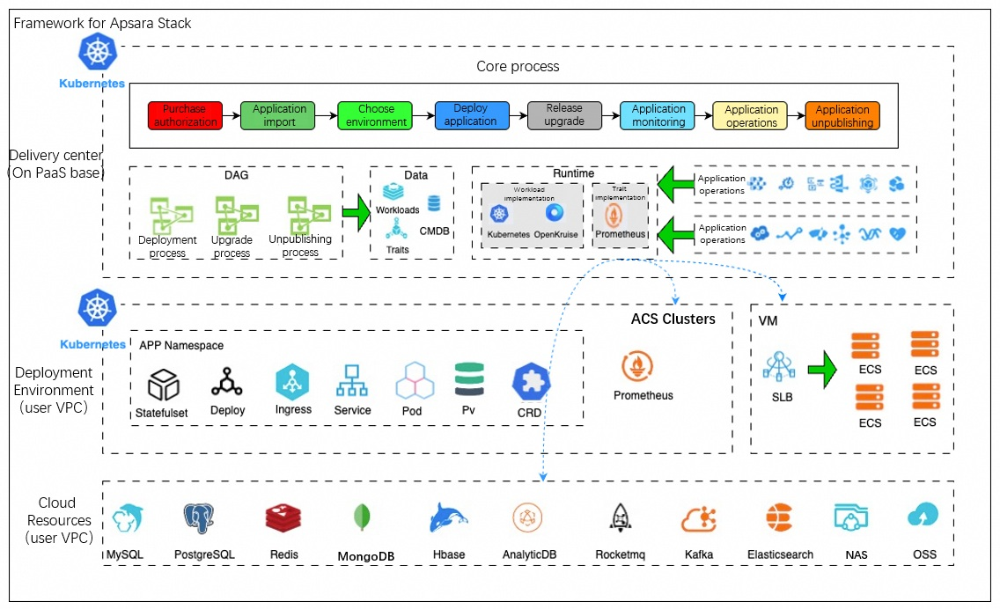
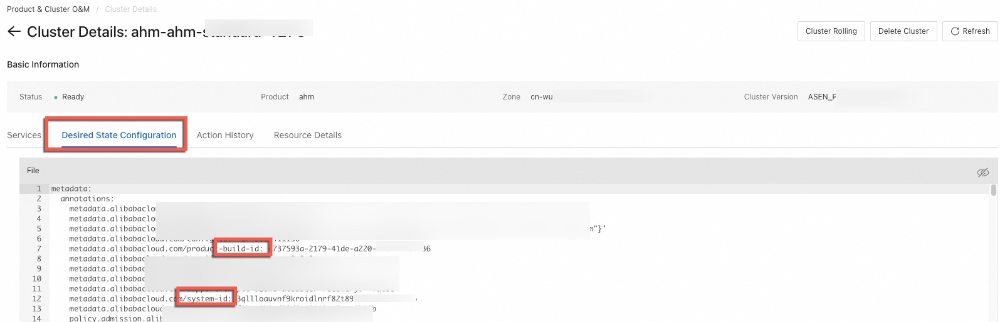
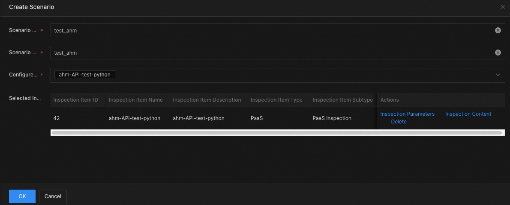
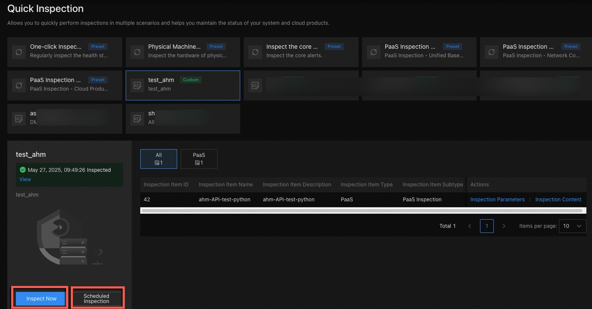
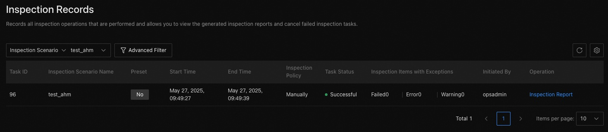

Alibaba Cloud  
Apsara Stack  
Application Operation  
Platform  
Application Hybrid  
Marketplace Operations and  
Maintenance Guide  
Product Version: v3.18.6-2607  
Document Version: 20260831

**Table of Contents**

- [1.Overview](#section-1)
- [2.Service architecture](#section-2)
- [3.Routine O&M](#section-3)
    - [3.1. Perform O&M during the delivery phase](#section-3-1)
    - [3.2. Running stage](#section-3-2)
- [4.Emergency response plans](#section-4)
    - [4.1. Plugin center is unavailable](#section-4-1)
    - [4.2. Service components are unavailable](#section-4-2)
- [5.Product inspection](#section-5)
    - [5.1. Inspect AHM by using the Inspections console](#section-5-1)
    - [5.2. Inspection through command line](#section-5-2)

<a id="section-1"></a>

# 1.Overview

In Apsara Stack environments, the Hybrid Cloud Application Center (AHM) is deployed only with a Delivery Center. It provides capabilities such as application import, application deployment, application details, application upgrade, application decommissioning, and system configuration management. AHM supports applications with various deployment modes including On Kubernetes, and On ECS.

The operations and maintenance (O&M) of AHM primarily include the following contents:

- Query the version number during the delivery process

- Verify whether each component has reached the desired state during product deployment

- Troubleshoot common feature issues of the product

- View AHM product monitoring metrics

- View AHM product inspection results

<a id="section-2"></a>

# 2.Service architecture

The Delivery Center module of Hybrid Cloud Application Center is deployed in the classic network of the infrastructure based on the PaaS foundation in the Apsara Stack environment.



Widgets in Hybrid Cloud Application Center are as follows:

- ahm-ark-apiserver

- ahm-ark-webhook

- ahm-autotest

- ahm-cloud-operator

- ahm-cluster-init

- ahm-conversion-webhook

- ahm-dbinit

- ahm-gateway

- ahm-k8s-apiserver

- ahm-kone-runtime

<a id="section-3"></a>

# 3.Routine O&M

<a id="section-3-1"></a>

## 3.1. Perform O&M during the delivery phase

During the deployment and delivery phase of Hybrid Cloud Application Center (AHM), typical O&M operations include checking the version of AHM delivered on site and the readiness of all AHM components.

**Check the version of AHM delivered on site**

You can log on to the terminal server or the Apsara Infrastructure Management console to view the build ID and system ID of AHM.

- Log on to the terminal server and run the following commands.

  ```bash
  # Check the build ID of AHM.
  kubectl get appset -n ark-system -o yaml -l product=ahm|grep build-id

  # Check the system ID of AHM.
  kubectl get appset -n ark-system -o yaml -l product=ahm|grep system-id
  ```

- Log on to the Apsara Uni-manager Operations Console. In the top navigation bar, choose Platform Operation > Apsara Infrastructure Management > **Resource Management**. On the **Product & Cluster O&M** page, search for AHM, find the AHM cluster, and then click **Cluster Details** in the Actions column. On the Cluster Details page, click the **Desired State Configuration** tab, and then search for the build-id and system-id parameters. The build-id parameter indicates the build ID and the system-id parameter indicates the system ID.

  

**Check the readiness of all AHM components**

Log on to the terminal server and run the  `kubectl get pod,svc,deploy -nahm`  command to check the status of the AHM components.

If the AHM components are normal and the pod is in the Running state, AHM is deployed.

<a id="section-3-2"></a>

## 3.2. Running stage

During the daily operation of the Hybrid Cloud Application Center product, you might encounter common issues such as browser security alerts. You can use the provided methods to resolve or troubleshoot these issues.

**Chrome browser displays ERR_CERT_AUTHORITY_INVALID alert**

When accessing the Hybrid Cloud Application Center console, the browser might display a security prompt indicating that the certificate authentication is invalid. This prevents you from continuing to use the Hybrid Cloud Application Center product.

You can resolve this issue using the following methods:

- Install the relevant certificate on the client, then log on to the Hybrid Cloud Application Center console again.

- On the browser alert page, directly type thisisunsafe. The browser will automatically refresh and allow normal access to the Hybrid Cloud Application Center console.

<a id="section-4"></a>

# 4.Emergency response plans

For potential failures in the Hybrid Cloud Application Center (AHM) products, you can quickly resolve the failures by using the handling methods in the relevant emergency response plans.

<a id="section-4-1"></a>

## 4.1. Plugin center is unavailable

All plugins in the Hybrid Cloud Application Center (AHM) are unavailable, and abnormal results occur when calling any plugin.

**Failure analysis**

If you load or uninstall plugins in the plugin center for many times, the plugin center memory will overflow. This will lead to plugin center being unavailable.

**Technical and business impact**

If the failure is not recovered timely, remote plugins may not be callable.

**Estimated recovery time**

5 minutes

**Resolution instructions**

On the **Plug-in Center ＞ My Plugins** page of the Hybrid Cloud Application Center, click **Restart Plugin Center**.

<a id="section-4-2"></a>

## 4.2. Service components are unavailable

A service component (such as ahm-gateway) in the Hybrid Cloud Application Center has a normal Pod status but cannot accept business requests.

**Failure analysis**

This issue may occur due to frequent full garbage collection (FullGC), memory overflow, disk exhaustion, or network connection exhaustion.

**Technical and business impact**

If the O&M features of products depend on the unavailable service component, the O&M features are also unavailable.

**Estimated recovery time**

5 minutes

**Resolution instructions**

To resolve this issue, you can restart the Pod of the corresponding service component.

For example, you can restart the ahm-gateway by restarting Pod through the following steps:

1. Log on to the OPS machine and execute the following commands to check the deployment status and restart policy of the AHM container.

   ```bash
   #Check the container service status
   kubectl get statefulset -nahm

   #Check the container restart policy and description
   kubectl edit statefulset ahm-plugin  -nahm
   ```

2. Execute the  `kubectl get pod -nahm | grep ahm`  command to view the list of Pods that need to be restarted.

3. Select the Pod that needs to be restarted and execute the  `kubectl delete`  command to delete the Pod. For example, execute the  `kubectl delete pod ahm-gateway-0 -nahm` command to delete the Pod of the ahm-plugin application.

4. Execute the  `kubectl get pod -nahm | grep ahm`  command to confirm that the Pod is in the Running status, which indicates that the Pod has been successfully restarted.

<a id="section-5"></a>

# 5.Product inspection

Hybrid Cloud Application Center is integrated with the PaaS inspection framework of Apsara Stack. You can verify the availability of various component services through the PaaS inspection console.

The product inspection in Hybrid Cloud Application Center primarily includes basic health checks for the ahm-web and ahm-plugin components.

| Inspection componen t | Inspection metric | Inspection description |
| --- | --- | --- |
| ahm-web | test_ahm_web_service_health_check | Health check for the ahm-core project to verify whether the component can provide business services normally. |
| ahm-pugin | test_ahm_web_plugin_health_check | Health check for Plug-in Center to verify whether the component can provide business services normally. |

<a id="section-5-1"></a>

## 5.1. Inspect AHM by using the Inspections console

Hybrid Cloud Application Center (AHM) is connected to the Inspections console. You can directly run inspection tasks in the Inspections console to view inspection results of AHM.

**Procedure**

1. Log on to the Apsara Uni-manager Operations Console.

2. In the top navigation bar, choose **Monitor&Alert > Inspections > Inspection Settings**. On the Inspection Scenarios tab of the **Inspection Settings** page, click **Create Inspection Scenario**.

3. In the Create Scenario panel, select ahm-API-test-python from the **Configure Inspection Items** drop-down list, configure other parameters, and then click **OK**.

   

4. On the **Quick Inspection** page, select the inspection scenario that you created in the previous step and click **Inspect Now** or **Scheduled Inspection** to inspect AHM.

   

5. On the **Inspection Records** page, find the inspection scenario and click **Inspection Report** in the Operation column to view the inspection details.

   

   > **Note**
   >
   > If a large number of inspection tasks fail, you can select each inspection task and click **Inspect Now** to manually run the inspection task to check whether the inspection results are as expected.

<a id="section-5-2"></a>

## 5.2. Inspection through command line

Hybrid Cloud Application Center supports inspection through the command line.

**Procedure**

Execute the following inspection commands on the OPS machine to view the product inspection information of Hybrid Cloud Application Center.

- Execute the  `kubectl -nahm -l trident.apsara-stack.alibaba-inc.com/task-name=ahm-autotest get opsinstance`  command to view the execution status of all inspection task instances.

  > **Note**
  >
  > If the status is Duplicate, it might be repeated execution because the execution cycle of the inspection task is too short.

- Execute the  `kubectl -nahm get opsinstance <Inspection Task Instance ID> -oyaml` command to view the detailed execution status of a single inspection task instance.

- Execute the  `kubectl -n ahm get opstask ahm-autotest -oyaml`  command to view the detailed information of the inspection task. When the inspection result is abnormal, you can use this command to view detailed error messages.

  > **Note**
  >
  > If the inspection task returns a dial up or timeout mark, it is generally an internal call timeout issue in the PaaS environment. You can ignore it and continue to observe the next inspection result.
