Alibaba Cloud  
Apsara Stack  
Enterprise Distributed  
Application Service (EDAS)  
Application Service  
Operations and Maintenance  
Guide  
Product Version: v3.18.6-2607  
Document Version: 20260828

**Table of Contents**

- [1.O&M overview](#section-1)
    - [1.1. Service architecture](#section-1-1)
    - [1.2. O&M Architecture](#section-1-2)
- [2.O&M preparation](#section-2)
    - [2.1. O&M preparation instructions](#section-2-1)
- [3.Operations and maintenance](#section-3)
    - [3.1. Log on to Apsara Infrastructure Management](#section-3-1)
    - [3.2. Components O&M](#section-3-2)
        - [3.2.1. Log on to components](#section-3-2-1)
        - [3.2.2. Component Descriptions](#section-3-2-2)
        - [3.2.3. EDAS components](#section-3-2-3)
            - [3.2.3.1. Cai Address](#section-3-2-3-1)
            - [3.2.3.2. Cai Fs](#section-3-2-3-2)
            - [3.2.3.3. EDAS Init](#section-3-2-3-3)
            - [3.2.3.4. EDAS Web Server](#section-3-2-3-4)
            - [3.2.3.5. EDAS Console](#section-3-2-3-5)
            - [3.2.3.6. EDAS Server](#section-3-2-3-6)
            - [3.2.3.7. EDAS Service Platform](#section-3-2-3-7)
            - [3.2.3.8. EDAS Lite ARMS Console Init](#section-3-2-3-8)
            - [3.2.3.9. EDAS Lite ARMS Console](#section-3-2-3-9)
        - [3.2.4. Dauth Component](#section-3-2-4)
            - [3.2.4.1. Dauth Init](#section-3-2-4-1)
            - [3.2.4.2. Dauth Diamond](#section-3-2-4-2)
            - [3.2.4.3. Dauth Server](#section-3-2-4-3)
        - [3.2.5. DNCS Component](#section-3-2-5)
            - [3.2.5.1. DNCS Init](#section-3-2-5-1)
            - [3.2.5.2. DNCS Console](#section-3-2-5-2)
            - [3.2.5.3. DNCS Server](#section-3-2-5-3)
        - [3.2.6. Staragent2 component](#section-3-2-6)
            - [3.2.6.1. Staragent2 Server](#section-3-2-6-1)
        - [3.2.7. Redis Component](#section-3-2-7)
            - [3.2.7.1. Middleware Redis](#section-3-2-7-1)
    - [3.3. Monitoring](#section-3-3)
        - [3.3.1. Prometheus monitoring](#section-3-3-1)
    - [3.4. EDAS Health Check Guide](#section-3-4)
    - [3.5. EDAS Log Descriptions](#section-3-5)
- [4.EDAS O&M Console User Guide](#section-4)
    - [4.1. Operation and Maintenance](#section-4-1)
        - [4.1.1. Log on to the EDAS O&M console](#section-4-1-1)
        - [4.1.2. Overview](#section-4-1-2)
        - [4.1.3. Feature Flag Management](#section-4-1-3)
        - [4.1.4. Query licenses](#section-4-1-4)
        - [4.1.5. Component management](#section-4-1-5)
            - [4.1.5.1. Pandora components](#section-4-1-5-1)
            - [4.1.5.2. Components](#section-4-1-5-2)
        - [4.1.6. Dedicated Configuration Center](#section-4-1-6)

<a id="section-1"></a>

# 1.O&M overview

This topic describes the system architecture, component architecture, and O&M architecture of EDAS.

<a id="section-1-1"></a>

## 1.1. Service architecture

This document describes the service and component architectures of Enterprise Distributed Application Service (EDAS). This information helps you understand the system during operations and maintenance (O&M).

**System architecture**

The system architecture of EDAS consists of the console, data collection system, authentication system, address server, Distributed Naming and Configuration Service (DNCS), command channel, and file system. For an overview of the architecture, see EDAS system architecture.

Figure 1. EDAS system architecture

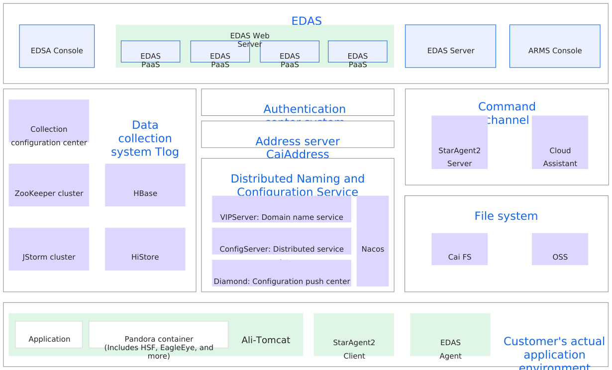

environment

- EDAS console

  You can use the console to manage resources, manage the application lifecycle, perform O&M and service governance, and implement multi-dimensional monitoring and digital operations.

- Data collection system

  Collects, computes, and stores the runtime status and trace logs of applications, clusters, and machines in EDAS in real time.

- Authentication system

  Controls permissions for user data to ensure data security.

- Address server

  CaiAddress is the address server component of EDAS. It stores the addresses of the configuration center and service registry.

- Distributed Naming and Configuration Service

  The central server for publishing and subscribing to High-speed Service Framework (HSF) services. It is also the central server for pushing configurations in a distributed system.

- Command channel

  Delivers commands to ECS nodes.

- File system

  Stores user-uploaded WAR packages and required components, such as JDK and Ali-Tomcat.

**Component architecture**

Each system in EDAS contains one or more components. The component architecture is shown in the following figure.

Figure 2. EDAS component architecture

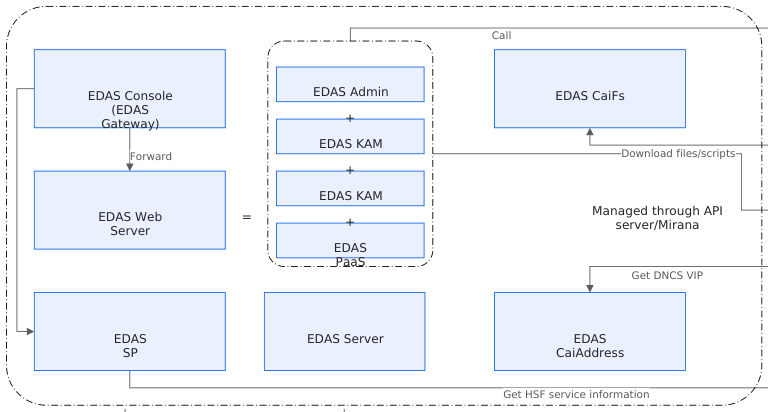

StarAgent

ECS

Send commands

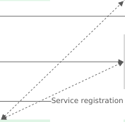

K8s Cluster

Service registration and subscription

DNCS

Dauth

Service authentication

Metadata

Cache

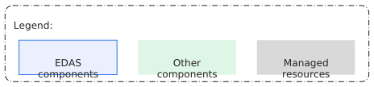

Middleware-Redis

miniRDS

> **Note**
>
> In Apsara Stack Enterprise Edition 3.16 and later, EDAS, StarAgent, and Middleware-Redis are migrated to Platform as a Service (PaaS). The original EDAS Admin, EDAS KAM, EDAS EAM, and EDAS PaaS components are merged into EDAS Web Server. The figure shows only the main call relationships and dependent components. The edas-lite-arms-console component is also available as a supplement if Application Real-Time Monitoring Service (ARMS) is not deployed.

| Component | Node type | Number of nodes | Description |
| --- | --- | --- | --- |
| EDAS Console | Management node | 2 | Includes the EDAS Gateway. It provides a service entry point and performs functions such as unified authentication and service forwarding based on URLs. |
| EDAS Server | Management node | 3 | Accepts requests from EDAS Agent. |
| CaiFs | Management node | 2 | A file server. It stores the EDAS Agent installation package, EDAS application packages, and more. |
| CaiAddress | Management node | 2 | An address server. It is used to obtain the virtual IP addresses (VIPs) of servers such as the DNCS server. |
| EDAS Web Server | Management node | 2 | The core service of EDAS. It provides features such as permission management, user and business data queries, resource management for ECS and Kubernetes (K8s) clusters, and application management and changes. |
| EDAS Init | Initialization node | 1 | Initializes EDAS services. |
| EDAS Lite Arms Console Init | Initialization node | 1 | Initializes the Application Real-Time Monitoring Service. |
| EDAS Lite Arms Console | Management node | 2 | The Application Real-Time Monitoring Service. |
| EDAS Service Platform | Management node | 2 | The microservice feature of EDAS. It provides microservice capabilities for applications. |

For more information about other external components, such as DNCS, DAuth, and TLog, see their respective O&M documents.

<a id="section-1-2"></a>

## 1.2. O&M Architecture

This topic describes the operations and maintenance (O&M) architecture of EDAS.

The command line is the primary tool for EDAS O&M.

| O&amp;M Category | Description | O&amp;M Tool |
| --- | --- | --- |
| Routine Maintenance | Includes inspection and monitoring. | Command line: Manually inspect EDAS containers and components. |
| Shutdown Maintenance | • Check and confirm container and component status.<br>• Stop and start containers and components. | Command line. |
| Troubleshooting | Mainly handles EDAS component availability and business continuity failures. | Handle failures using the command line. |

<a id="section-2"></a>

# 2.O&M preparation

This topic describes the logon portals, accounts, permissions, and tools required for Operations and Maintenance (O&M).

<a id="section-2-1"></a>

## 2.1. O&M preparation instructions

Describes the logon endpoints, accounts, permissions, and tools required for O&M.

| Name | Purpose | Description |
| --- | --- | --- |
| SSH remote logon tool (such as <em>MobaXterm</em> or <em>PuTTY</em>) | You can log on to the machine hosting the component. | The account used for logon must have the necessary operation permissions. Do not use the <strong>root</strong> or <strong>admin</strong> account directly. |
| Account | Used to log on to the console or a specific machine. | • Obtain the console logon credentials from the EDAS helpdesk.<br>• The account used to log on to the machine hosting EDAS components must have the necessary operation permissions. Do not use the <strong>root</strong> or <strong>admin</strong> account directly. |

<a id="section-3"></a>

# 3.Operations and maintenance

EDAS provides operations and maintenance (O&M) for both components and applications. Component O&M ensures that the components deployed by EDAS run correctly. Application O&M monitors the operational status of your applications.

<a id="section-3-1"></a>

## 3.1. Log on to Apsara Infrastructure Management

This section describes how operations and maintenance (O&M) engineers and other users log on to Apsara Infrastructure Management.

**Prerequisites**

- Obtain the endpoint, username, and password for the Apsara Uni-manager Operations Console from your deployment team or administrator.

- The endpoint for the Apsara Uni-manager Operations Console uses the following format:  `region-id.aso.intranet-domain-id.com` .

- We recommend that you use Chrome.

**Procedure**

1. Open your browser.

2. In the address bar, enter the endpoint for the Apsara Uni-manager Operations Console:  `region-id.aso.intranet-domain-id.com` . Press Enter.

   

   > **Note**
   >
   > You can click the language selector in the upper-right corner to switch languages. Simplified Chinese, English, and Traditional Chinese are supported.

3. Enter your username and password.

   > **Note**
   >
   > - Obtain your username and password for the Apsara Uni-manager Operations Console from your deployment team or administrator.
   >
   > - If you enter an incorrect password three times in a row, the system displays an image CAPTCHA. If you enter an incorrect password five times in a row, your account is locked. Contact your administrator to unlock it.

   On your first logon to the Apsara Uni-manager Operations Console, you must change your password. Follow the on-screen prompts to complete the change.

   To improve security, your new password must meet the following requirements:

   - Contain both uppercase and lowercase English letters.

   - Contain Arabic numerals (0–9).

   - Contain at least one special character, such as an exclamation mark (!), at sign (@), number sign (#), dollar sign ($), or percent sign (%).

   - Be 10 to 20 characters long.

4. Click **Account Logon**.

5. In the top menu bar of the Apsara Uni-manager Operations Console, choose **Platform O&M > Apsara Infrastructure Management > Resource Management**.

   Logon screen (legacy version):

   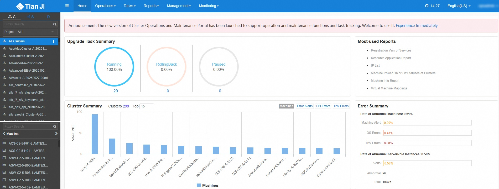

   Logon screen (new version):

   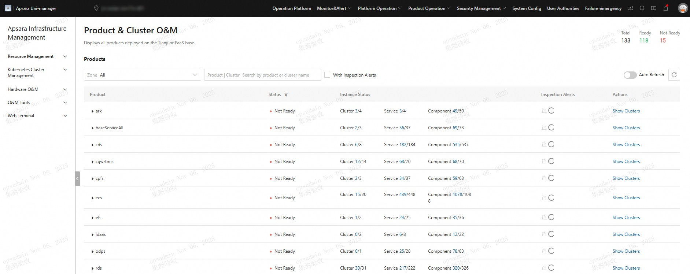

<a id="section-3-2"></a>

## 3.2. Components O&M

<a id="section-3-2-1"></a>

### 3.2.1. Log on to components

This topic describes how O&M engineers and other users can log on to components in the EDAS system.

**Prerequisites**

- You have logged on to Apsara Infrastructure Management.

- Use the Chrome browser.

**Procedure**

EDAS components are deployed in two ways: ontianji and onpaas. ontianji deployments are managed using virtual machines (VMs) and Docker. onpaas deployments are managed using Kubernetes (K8s). This topic uses the new version of Apsara Infrastructure Management to show how to log on to and access both types of components.

**Log on to an ontianji component**

1. Log on to Apsara Infrastructure Management. In the navigation pane on the left, click **Resource Management > Product Cluster O&M**. This topic uses  `middleware-dncs`  as an example.

   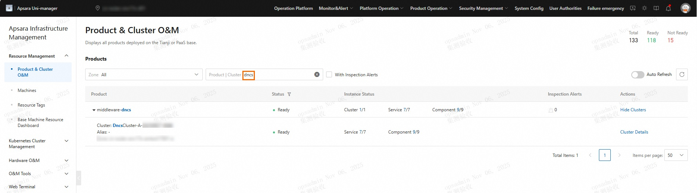

2. To the right of the  `middleware-dncs`  product, click **Expand Cluster List**. In the cluster list, click **Cluster Details** in the **Actions** column of the destination cluster.

3. On the cluster details page, click the **Machine Group** tab. The following figure uses  `dncsConsole`  as an example. View the machines in the **Associated Machines** column.

   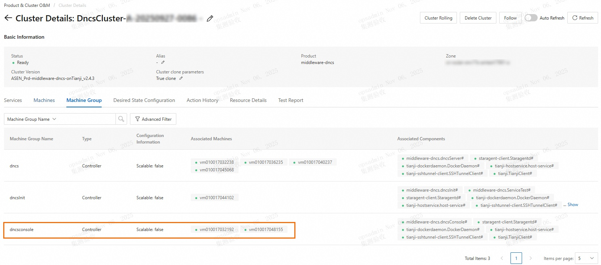

4. On the cluster details page, click the **Machine** tab. In the **Actions** column for the associated machine, click **Terminal**.

   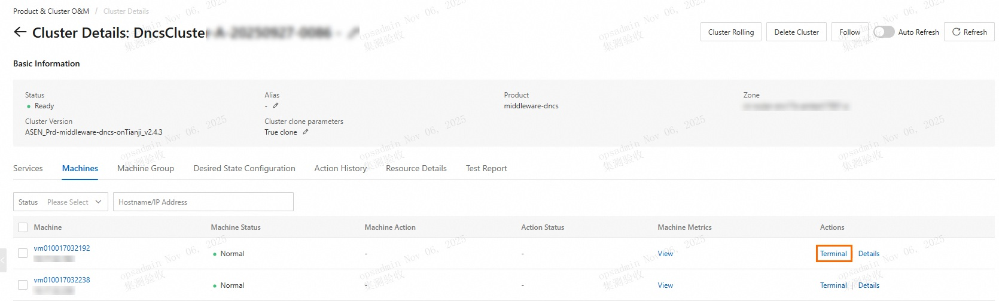

5. In the VM, use Docker commands to manage the component. First, run  `docker ps`  to find the container ID. Then, run the  `docker exec -it <Container ID> bash`  command to log on to the component container.

   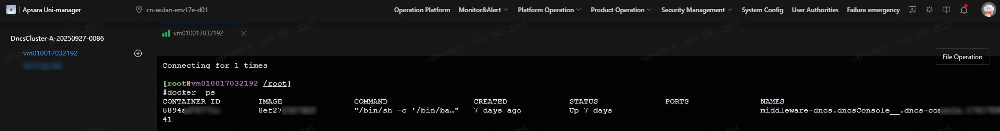

**Log on to an onpaas component**

1. Log on to Apsara Infrastructure Management. In the navigation pane on the left, click **Resource Management > Product Cluster O&M**. On the **Products** page, enter  `tianji`  in the **Product|Cluster** search box to search.

   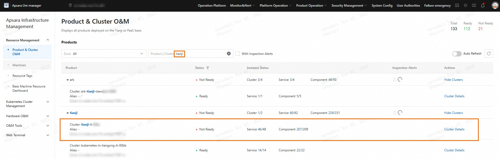

2. In the **Products** column for the **tianji** product, click **Expand Cluster List**. Select the destination cluster and click **Cluster Details** in the **Actions** column.

   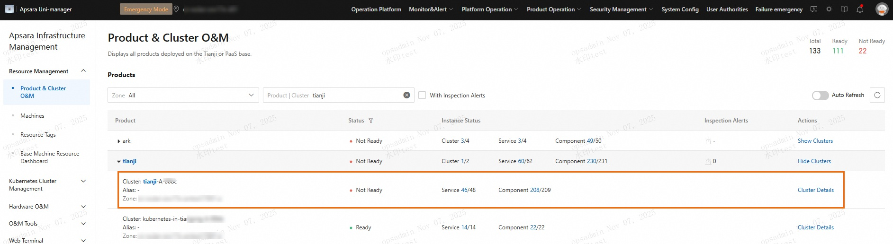

3. On the cluster details page, click the **Services** tab, and then click the **ops** service.

   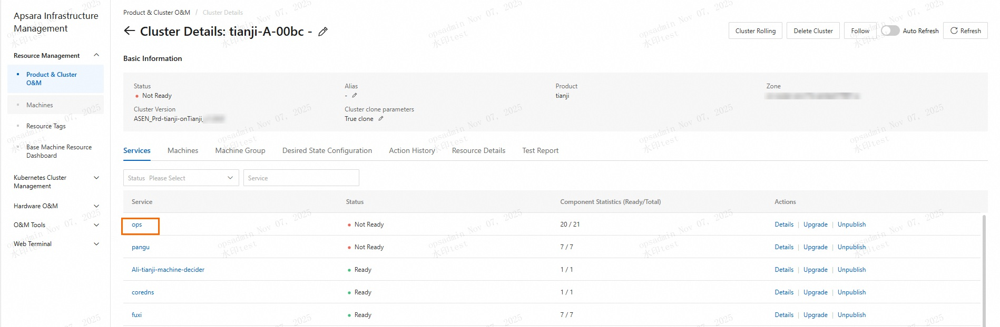

4. Open the **Terminal** for any machine.

   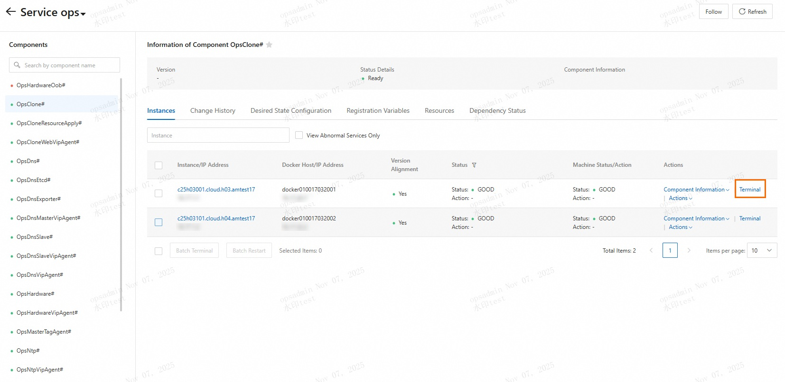

5. After you access the terminal server, log on as the root user. You can then use kubectl commands to view and manage the EDAS components that are deployed on onpaas.

   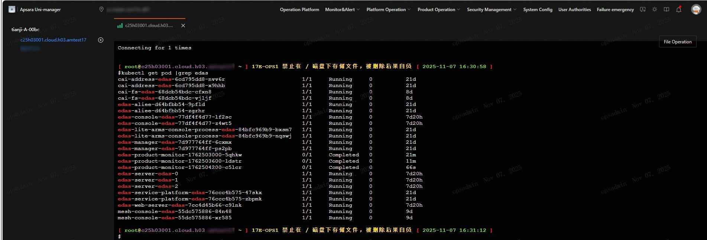

<a id="section-3-2-2"></a>

### 3.2.2. Component Descriptions

Enterprise Distributed Application Service (EDAS) is an application Platform as a Service (PaaS) platform that integrates microservices, observability, and task scheduling technologies in a single solution. It provides professional, easy-to-use features such as full lifecycle management, traffic management, and capacity administration. EDAS also combines business-centric acceptance, Resource Management, and cost optimization capabilities to help enterprises upgrade their application architectures to cloud-native.

**Product Architecture Diagram**

ASCM

POP

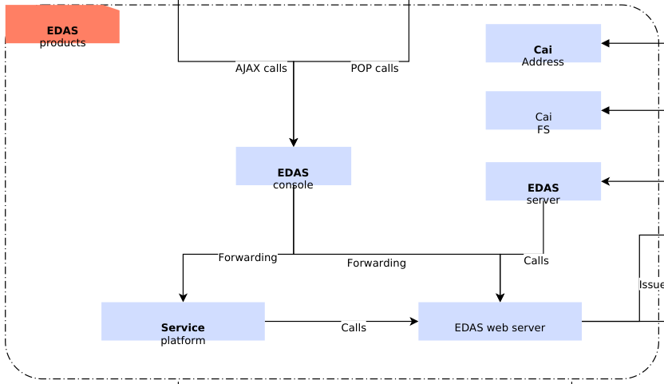

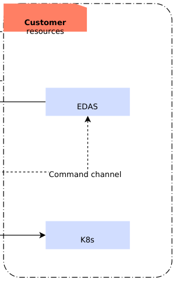

Retrieve addresses

Download files

Report status

StarAgent2

Issue commands

API server/

Mirana

Cache or

Data storage

asynchronous

- processing

Redis

minirds

**Product Component List**

| Component | Description |
| --- | --- |
| Cai Address | Address server. It provides addresses for the registry and configuration center. |
| Cai Fs | File server. It provides common file downloads for EDAS services. |
| EDAS Init | EDAS product initialization service. It includes features such as data initialization, POP registration, and runtime image push. |
| EDAS Lite Arms Console Init | EDAS provides real-time application monitoring initialization service. |
| EDAS Lite Arms Console | EDAS provides real-time application monitoring initialization service. |
| EDAS Console | EDAS service official website. It accepts requests from POP or the console. |
| EDAS Server | EDAS Agent server-side. It accepts service requests from installed EDAS Agents. |
| EDAS Service Platform | EDAS microservice feature. It provides application microservice capabilities. |
| EDAS Web Server | EDAS core service. It provides features such as user or business data queries, ECS or K8s cluster resource control, and application management or changes. |

<a id="section-3-2-3"></a>

### 3.2.3. EDAS components

<a id="section-3-2-3-1"></a>

#### 3.2.3.1. Cai Address

EDAS stores the address server component that manages the virtual IP address (VIP) for the DNCS Server. ECS and K8s applications access Cai Address using the address server's Domain Names to obtain the DNCS Server's VIP. They then use this VIP to access the DNCS Server component. Cai Address is essentially an Nginx process.

**Component Health Check**

You can log on to the container and execute the following command:

```text
sh /home/admin/bin/check_cai.sh
```

Normal output:

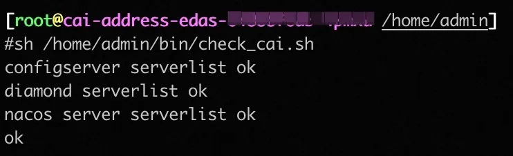

**Service Installation Directory**

Cai Address is essentially a file server that provides Service through Tengine.

- Tengine installation directory:  `/home/admin/cai/bin/nginx-proxy` .

- Configuration file:  `/home/admin/cai/conf/nginx-proxy.conf` .

- Key file paths:

  - Nacos VIP list:  `/home/admin/cai/htdocs/nacos/serverlist` .

  - VIPServer VIP list:  `/home/admin/cai/htdocs/vipserver/serverlist` .

  - ConfigServer VIP list:  `/home/admin/cai/htdocs/configserver/serverlist` .

  - Diamond VIP list:  `/home/admin/cai/htdocs/diamond-server/diamond` .

  - Diamond VIP unitization list:  `/home/admin/cai/htdocs/diamond-server/diamond-unit-${region_name}` .

**Deployment Form**

Cai Address is deployed on PaaS. The K8s workload type is deployment, and its name is cai-address-edas.

**O&M Operations**

| Operation Meaning | Command | Operation Level |
| --- | --- | --- |
| Reload Nginx configuration | Log on to the container and execute the following command with root permissions:<br><code>/home/admin/cai/bin/nginx</code><br><code>ctl reload</code><br>If you reload the configuration and the system reports that the<code>/home/admin/cai/logs/nginx</code> <code>-proxy.pid </code> file does not exist, you must first find the PID of the <code> nginx: master </code> <code>process </code> and manually write it to that file. | G3 |
| Restart Component | On the terminal server, execute the following command with root permissions:<br><code>kubectl delete pod &lt;Pod</code><br><code>name&gt;</code><br>When used, replace &lt;Pod name&gt; with the correct Cai Address pod name. | G3 |

**Core Logs**

- Directory:  `/home/admin/cai/logs/` .

  - access.log: Access log for interfaces.

<a id="section-3-2-3-2"></a>

#### 3.2.3.2. Cai Fs

Cai Fs is a component that stores scripts, tools, component packages, and configuration files for EDAS. It runs as an Nginx process. ECS instances and Kubernetes clusters use Cai Fs to download required files from its local disk or from OSS (Enterprise Edition). Cai Fs also stores container images for EDAS management components. During the EDAS Init phase, it uploads these images to the image repository.

**Component health check**

You can log on to the container and run the following command:

```text
sh /home/admin/bin/check_cai.sh
```

The normal output is as follows:

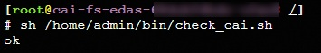

**Service installation directory**

Cai Fs is a file server powered by Tengine.

- Tengine

  - Installation directory:  `/opt/taobao/tengine/` .

  - Configuration file:  `/home/admin/cai/conf/nginx-proxy.conf` .

  - Root directory for the file server (where Cai Fs stores files, scripts, and component packages):  `/home/admin/file` .

**Deployment pattern**

Cai Fs is deployed on PAAS. Its Kubernetes workload type is Deployment, and its name is cai-fs-edas.

**O&M operations**

| Operation Description | Command | Operation Level |
| --- | --- | --- |
| Reload the NGINX configuration | Log on to the container and run the following command with root permissions:<br><code>/home/admin/cai/bin/nginx</code><br><code>ctl reload</code> | G3 |
| Restart the component | On the terminal server, run the following command with root permissions:<br><code>kubectl delete pod &lt;Pod</code><br><code>name&gt;</code><br>Replace &lt;Pod name&gt; with the actual pod name of Cai Fs. | G3 |

**Image upload**

You can run the following command in Cai Fs to verify that image upload login works:

```bash
docker login -u dauth_edas_console@aliyun.com -p test12345 $acs_registry
```

The normal output is as follows:

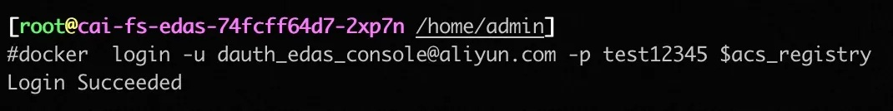

If EDAS management component images fail to pull in your environment, you can run the following command to re-upload them:

```text
sh /home/admin/bin/push_image.sh
```

The normal output is as follows:

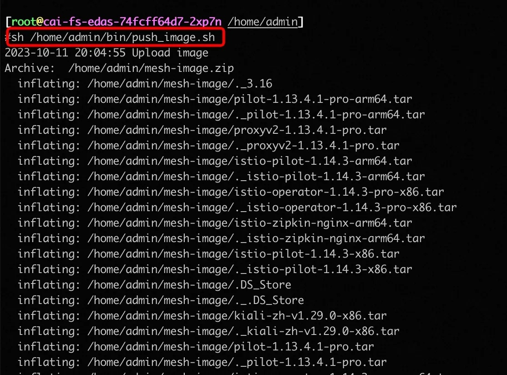

After the command finishes, check the image upload progress in the log at  `/var/log/image_push_edas_standard.log` .

**Core logs**

Cai Fs disables log output by default. The default log path is  `/opt/taobao/tengine/logs/` .

<a id="section-3-2-3-3"></a>

#### 3.2.3.3. EDAS Init

EDAS Init is the core initialization component of Alibaba Cloud Enterprise Distributed Application Service (EDAS).

**Function introduction**

The EDAS Init component includes two jobs. Their functions are as follows:

1. edas-init

- Registers the pop and asapi interfaces for EDAS.

  - You can run the  `java -jar batch.jar`  command in the  `/home/admin/pop/`  directory to register pop.

  - To register the asapi interface, use the asapiTools binary tool.

- Pushes the required EDAS images to an image repository. This operation prioritizes the Standard Edition of the image repository.

  - If both the Standard Edition and Enterprise Edition of the image repository are deployed, the images are pushed to the Standard Edition.

  - If the Standard Edition is deployed but the Enterprise Edition is not, the images are pushed to the Standard Edition.

  - If the Standard Edition is not deployed but the Enterprise Edition is, the images are pushed to the Enterprise Edition.

  - The image is not pushed if no image repositories have been deployed.

- Initializes the EDAS database table schema and data.

- Attaches EDAS domain names and virtual IP addresses (VIPs) to support multiple regions.

  - In a multi-region 1.0 deployment, attach the following domain names and VIPs in a unit region.

    ```text
     100.*.*.129 edas-internal.console.${global:intranet-domain} 

     100.*.*.130 ${staragent2_domain} 

     100.*.*.131 ${staragent2_channel1_domain} 

     100.*.*.132 ${staragent2_channel2_domain} 
    ```

  - In a single-region deployment, attach the relevant domain names to the VIPs requested from the baseline.

2. edas-product-monitor

This cronjob runs scheduled inspections for related products. If a related product is deployed after EDAS, this job detects the product and automatically modifies the EDAS database to enable the corresponding features.

**Component health check**

The EDAS Init component consists of two types of jobs.

1. EDAS Init is a one-time Kubernetes job. To perform a health check, you can check the status of the pod or the job.

   - Check that the pod status is Completed.

     ```bash
     kubectl get po | grep edas-init
     ```

     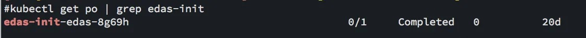

   - Check the COMPLETIONS field in the job status.

     ```bash
     kubectl get job | grep edas-init
     ```

     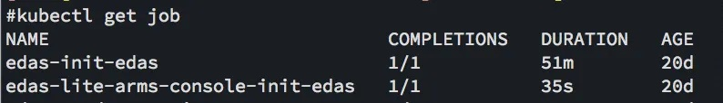

2. edas-product-monitor is a scheduled task (CronJob) in Kubernetes. To perform a health check, you can check the status of the pod or the job.

   - Check that the pod status is Completed.

     ```bash
     kubectl get po | grep edas-product-monitor
     ```

     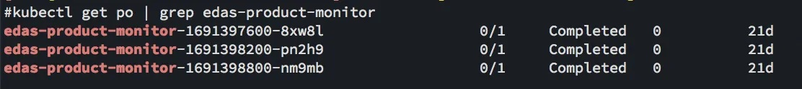

   - Check the COMPLETIONS field in the job status.

     ```bash
     kubectl get job | grep edas-product-monitor
     ```

     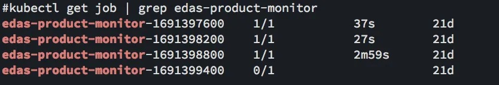

**Service installation folder**

The service scripts are located in the following directories inside the container:

- Directory:  `/usr/local/rds/`

- Startup script:  `/usr/local/rds/entry.sh`

- Database scripts:

  - `/usr/local/rds/metadb/sql/region_temp/`  (SQL scripts for a unit region in a multi-region 1.0 deployment).

  - `/usr/local/rds/metadb/sql/edas/` .

    - post-install (SQL scripts to be executed after installation).

    - region-fix (SQL scripts for fixes in a multi-region 2.0 deployment).

    ```text
     /usr/local/rds/metadb/sql/edas_quartz/ 

     /usr/local/rds/metadb/sql/service_platform/ 

     /usr/local/rds/metadb/sql/staragent2/ 
    ```

- Core script:  `/usr/local/rds/metadb/init_edas.py`

**O&M operations**

The EDAS Init component is a one-time job. After the job runs successfully, you cannot restart it directly. To run the job again, you must perform a rolling update by modifying its rollingRevision.

```bash
kubectl -nark-system edit appinstance edas.edasservice.edas-init
```

Increment the value by 1 and save the change.

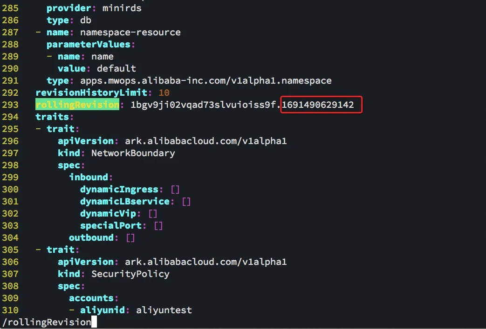

**Core logs**

- edas-init component.

  - View the logs using a Kubernetes command.

    ```bash
    kubectl logs edas-init 
    ```

  - Log file location in the container:

    ```text
    /tmp/job_result
    ```

- edas-product-monitor component.

  View the logs using a Kubernetes command.

  ```bash
  kubectl logs edas-init 
  ```

<a id="section-3-2-3-4"></a>

#### 3.2.3.4. EDAS Web Server

The EDAS Web Server is the core management component of EDAS.

**Features**

The EDAS Web Server is the core management component of EDAS. It runs several core service modules in a single process:

- **EDAS EAM**: The management component for ECS applications in EDAS. It provides core EDAS services, such as ECS application lifecycle management, ECS cluster management, and ECS instance onboarding. EAM forwards Kubernetes (K8s) cluster management requests to the EDAS KAM component. It also calls the APIs of external products, such as SLB, VPC, ECS, and Staragent.

- **EDAS KAM**: The management component for K8s applications in EDAS. It accepts K8s cluster-related requests from EAM. It then calls the K8s cluster API Server or ACK Mirana APIs to onboard clusters or manage objects within them.

- **EDAS Admin**: The internal, non-authenticated gateway of EDAS. It serves only internal components and executes or schedules scheduled tasks.

**Health check**

You can log on to the container and run the following command:

```text
sh /home/admin/bin/check_edas.sh
```

A normal output appears as follows:

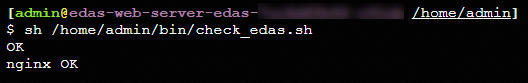

**Installation directories**

The EDAS Web Server includes two internal processes: Tengine and Tomcat. Tengine forwards traffic to the Tomcat process, where the core services are deployed. The current Tomcat version is ali-tomcat-8.5.63. For O&M, replace  `${Tomcat_version}`  in the following paths with the correct Tomcat version.

- Tomcat

  - Installation directory:  `/home/admin/${Tomcat_version}/` .

- Tengine

  - Installation directory:  `/opt/taobao/tengine/` .

  - Core configuration file:  `/home/admin/cai/.running_conf/nginx-proxy.conf` .

**Deployment**

For on-PaaS deployments, the Kubernetes workload type is a Deployment named edas-web-server-edas. For detailed logon methods, see Component Logon.

**Log on to the database**

You can log on to any EDAS Web Server component. Run the  `su - admin`  command to switch to the admin account. Then, run the  `edasdb`  command to log on to the EDAS database.

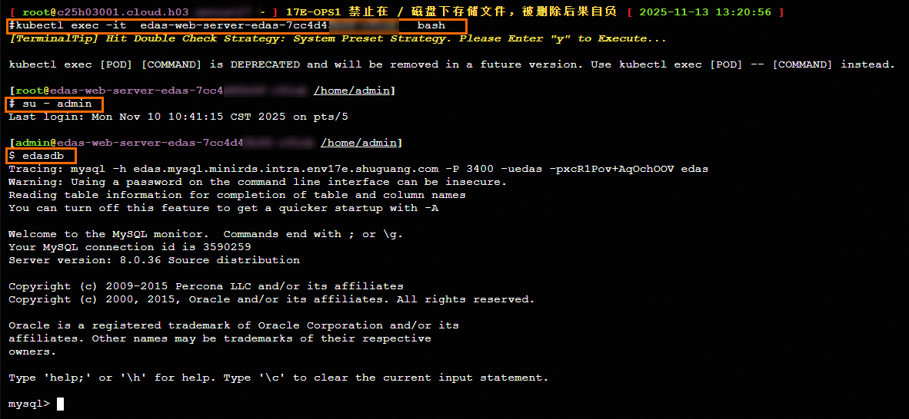

**O&M operations**

| Description | Command | Operation level |
| --- | --- | --- |
| Reload the NGINX configuration | Log on to the container and run the following command with root permissions:<br><code>/home/admin/cai/bin/nginx</code><br><code>ctl reload</code> | G3 |
| Restart the component | On the terminal server, run the following command with root permissions:<br><code>kubectl delete pod</code><br><code>&lt;pod_name&gt;</code><br>When you run the command, replace &lt;pod_name&gt; with the correct pod name of the EDAS Web Server. | G3 |

**Core logs**

Directory:  `/home/admin/edas/logs/` .

- edas-web_t.log: Records logs for EAM and KAM. This is a key log file for troubleshooting.

- changeorder_t.log: Records logs related to application change orders. Refer to this log for issues that involve change orders.

- admin-schedule_t.log: Records logs for the Admin module. These logs are related to internal scheduled tasks in EDAS.

- edas-adapter_t.log: Records logs of EDAS calls to edas-adapter.

- oam-cache_t.log: Records logs for EDAS synchronizing the OAM cluster cache.

- serviceaudit.log: Records audit logs for operations in EDAS.

- biztrace-result.log: Records logs for the application monitoring and diagnostics features of EDAS.

- debug_t.log: Records debug-level trace logs for the EDAS enhancement module.

- bak: The log archive directory.

<a id="section-3-2-3-5"></a>

#### 3.2.3.5. EDAS Console

The EDAS Console component includes the Gateway module, which handles request routing, security audit, protocol transformation, and other gateway functions.

**Component health check**

You can log on to the container and run the following command:

```text
sh /home/admin/bin/check_edas-console.sh
```

Normal output appears as follows:

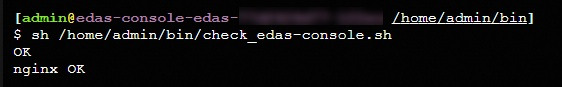

**Service installation directories**

The EDAS Console runs two processes: Tengine and Tomcat. Tengine forwards traffic to the Tomcat process, where the core service is deployed. The current Tomcat version is ali-tomcat-8.5.63. In actual O&M tasks, replace  `${Tomcat version}`  in the paths below with the correct Tomcat version.

- Tomcat

  - Installation directory:  `/home/admin/${Tomcat version}/` .

  - Request routing configuration file:  `/home/admin/${Tomcat version}/deploy/ROOT/WEB-INF/classes/uri-service-route.yaml` .

- Tengine

  - Installation directory:  `/opt/taobao/tengine/` .

  - Core configuration file:  `/home/admin/cai/conf/nginx-proxy.conf` .

**Deployment model**

The EDAS Console is deployed on PAAS as a Kubernetes deployment workload named edas-console-edas. For detailed logon instructions, see Component logon.

**Database logon**

You can log on to any EDAS Web Server component, switch to the admin account by running the  `su - admin`  command, then run the  `edasdb`  command to log on to the EDAS database.

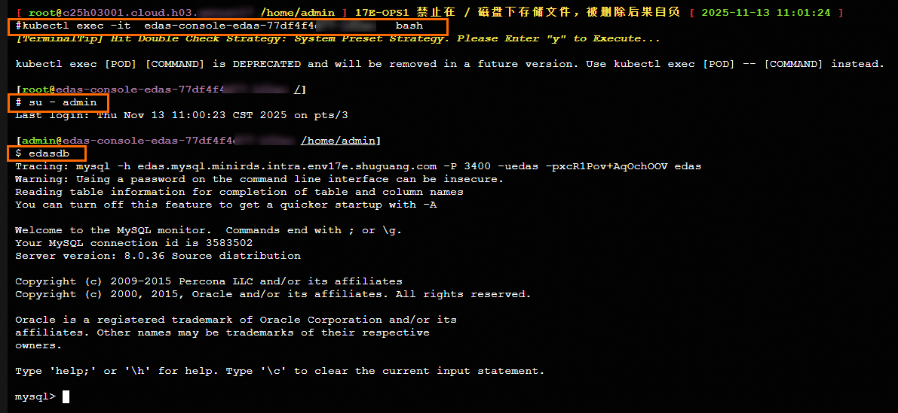

**O&M operations**

| Description | Command | Operation level |
| --- | --- | --- |
| Reload nginx configuration | Log on to the container and run the following command with root permissions:<br><code>/home/admin/cai/bin/nginx</code><br><code>ctl reload</code> | G3 |
| Restart component | On the terminal server, run the following command with root permissions:<br><code>kubectl delete pod &lt;Pod</code><br><code>name&gt;</code><br>Replace &lt;Pod name&gt; with the correct EDAS Console pod name. | G3 |

**Core logs**

- Directory:  `/home/admin/edas/logs` .

  - gateway_access.log: Records external requests to EDAS.

  - gateway_proxy_t.log: Records request parameters and responses when external requests are forwarded to the backend. This log records only abnormal cases.

  - gateway_t.log: Records logs from the EDAS Console Gateway module.

- Directory:  `/home/admin/logs/eagleeye` .

  - eagleeye.log: Records all calls involving the EDAS Console and helps troubleshoot call latency issues.

<a id="section-3-2-3-6"></a>

#### 3.2.3.6. EDAS Server

The EDAS Server is the management gateway for ECS. It accepts all requests from the EDAS Agent running on managed ECS instances, such as heartbeats, task status reports, and static configuration pulls. It collects agent and application status data and stores it in batches in the middleware-redis component. The EDAS Admin (part of the EDAS Web Server component) then pulls and processes this data. Each data center runs three EDAS Server nodes.

**Component health check**

You can log on to the container and run the following command:

```text
sh /home/admin/bin/check_edas-server.sh
```

The expected output is as follows:

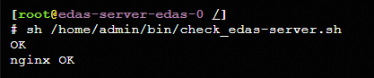

**Service installation directory**

The EDAS Server consists of two processes: Tengine and Tomcat. Tengine forwards traffic to the Tomcat process. Core services run inside Tomcat. The current Tomcat version is ali-tomcat-8.5.63. During O&M, replace  `${Tomcat version}`  in the paths below with the correct Tomcat version.

- Tomcat

  - Installation directory:  `/home/admin/${Tomcat version}/` .

- Tengine

  - Installation directory:  `/opt/taobao/tengine/` .

  - Core configuration file:  `/home/admin/cai/.running_conf/nginx-proxy.conf` .

**Deployment model**

The EDAS Server is deployed on PAAS (Platform as a Service) using a Kubernetes StatefulSet workload named edas-server-edas.

**O&M operations**

| Operation Description | Command | Operation Level |
| --- | --- | --- |
| Reload the NGINX configuration | Log on to the container and run the following command with root permissions:<br><code>/home/admin/cai/bin/nginx</code><br><code>ctl reload</code> | G3 |
| Restart the component | On the terminal server, run the following command with root permissions:<br><code>kubectl delete pod &lt;Pod</code><br><code>name&gt;</code><br>Replace &lt;Pod name&gt; with the actual EDAS Server pod name. | G3 |

**Core logs**

Directory:  `/home/admin/edas/logs` .

- agent-server.log: Logs generated by the EDAS Server itself. This is usually the key log for troubleshooting.

- heartbeat.log: Logs heartbeats sent by the EDAS Agent.

<a id="section-3-2-3-7"></a>

#### 3.2.3.7. EDAS Service Platform

The EDAS Metadata Center component provides capabilities for reporting, querying, and administering microservice metadata. For microservices that use the SpringCloud and Dubbo frameworks, the Arms Agent on ECS reports their registration and subscription information to the EDAS Service Platform, which then stores it in a database. For services that use the HSF framework, the in-application microservice framework reports their registration and subscription information to the DNCS Server component. When you query from a page, the EDAS Service Platform invokes the DNCS SDK to run the query.

**Component Health Check**

Log on to the container and execute the following command:

```text
sh /home/admin/bin/check_edas-service-platform.sh
```

The normal output is as follows:

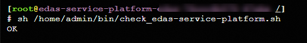

**Service Installation Directory**

The EDAS Service Platform provides services through Java processes.

- Java

  - Installation directory:  `/opt/taobao/java/bin/java` .

  - Program package path:  `/home/admin/service-platform/ali-service-platform.jar` .

**Deployment Form**

The deployment runs on onpaas as a Kubernetes Deployment named edas-service-platform-edas.

**O&M Operations**

| Operation Meaning | Command | Operation Level |
| --- | --- | --- |
| Restart component | On the terminal server, execute the following command with root permissions:<br><code>kubectl delete pod &lt;Pod</code><br><code>name&gt;</code><br>When using, replace &lt;Pod name&gt; with the correct Pod name of <code> EDAS Service </code> <code>Platform </code>. | G3 |

**Core Logs**

Directory:  `/home/admin/service-platform/logs/` .

- ali-service-platform.log: Records the logs of the EDAS Service Platform. These logs are often critical for troubleshooting.

- ali-service-platform-metadata.log: Records the metadata collected by the EDAS Service Platform.

<a id="section-3-2-3-8"></a>

#### 3.2.3.8. EDAS Lite ARMS Console Init

edas-lite-arms is a lightweight ARMS component that provides monitoring output for EDAS in regions where ARMS is unavailable. The edas-lite-arms-init is a Job task that performs this initialization.

**Function Introduction**

The edas-lite-arms-init Job task performs initialization, which includes the following steps:

1. Initialize the table schema and data for edas-lite-arms.

2. Initialize the table schema and data for ARMS TLOG collection points.

3. Call the TLOG interface to start ARMS collection points.

**Component Health Check**

A Complete status indicates that the desired state has been reached.

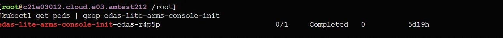

**Service Installation Directories**

Service scripts are located in the container as follows:

- Directory:  `/usr/local/rds/`

- Startup script:  `/usr/local/rds/metadb/init_arms.py`

- Database scripts:

  ```text
   /usr/local/rds/metadb/sql/arms/ 
  ```

  - `/usr/local/rds/metadb/sql/tlog/` .

- Key script:  `/usr/local/rds/metadb/init_arms.py`

**O&M Operations**

For rolling updates, refer to the edas-init component.

**Core Logs**

You can view the logs using the following K8s command:

```bash
kubectl logs edas-lite-arms-init
```

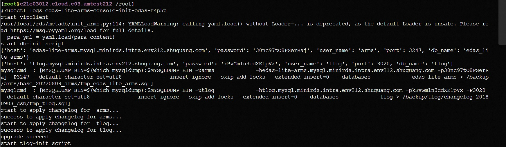

<a id="section-3-2-3-9"></a>

#### 3.2.3.9. EDAS Lite ARMS Console

The EDAS Lite ARMS Console is a lightweight ARMS console. It provides a lightweight application monitoring console. When ARMS is not deployed, EDAS application monitoring uses this component's console. After ARMS is deployed, the arms-console service maps the edas-lite-arms-console domain name to the virtual IP address (VIP) requested by arms-console.

**Component health check**

Log on to the container. Run the following command:

```text
sh /home/admin/bin/check_arms.sh
```

The expected output is as follows:

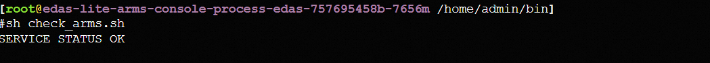

**Service installation directory**

This component runs two Tomcat processes and one Tengine process.

1. Tengine

Tengine forwards traffic to arms-console. Installation directory:  `/opt/taobao/tengine/` . The core configuration file is  `/opt/taobao/tengine/conf/nginx-proxy.conf` .

2. arms-console

This is the console service process. Its main service port is 8080. Installation directory:  `/home/admin/taobao-tomcat-production-7.0.109` . The core business configuration file is

```text
 /home/admin/taobao-tomcat-production-7.0.109/deploy/arms-console-2.0.0/WEB-
```

`INF/classes/biz.properties` . This file contains database connection settings and other service configurations.

3. arms-pop

This is the service process that provides arms-pop capabilities. By default, edas-lite-arms-console starts the arms-pop process but does not register its APIs with POP. Only arms-console registers with POP. Therefore, edas-lite-arms-console does not provide POP capabilities. Installation directory:  `/home/admin/arms-pop/taobao-tomcat-production` .

**Deployment pattern**

It is deployed on PaaS. The Kubernetes workload type is Deployment. The workload name is edas-console-edas.

**O&M operations**

You can start, stop, and hot-reload Tengine.

To start Tengine, run:  `/opt/taobao/tengine/bin/nginxctl start` .

To stop Tengine, run:  `/opt/taobao/tengine/bin/nginxctl stop` .

To hot-reload Tengine, run:  `/opt/taobao/tengine/bin/nginxctl reload` .

**Core logs**

1. Tengine log directory: `/opt/taobao/tengine/logs` .

2. ARMS-related log directories:

   `/home/admin/logs/arms/` .

3. Console business log:  `/home/admin/logs/arms/arms-console.log` .

4. arms-pop business log:  `/home/admin/logs/arms/arms-pop.log` .

<a id="section-3-2-4"></a>

### 3.2.4. Dauth Component

<a id="section-3-2-4-1"></a>

#### 3.2.4.1. Dauth Init

Dauth Init initializes the Dauth product.

**Function introduction**

The primary function of this component is to initialize the Dauth product. It provides the following features:

- For a unit region, it enables Data Transmission Service (DTS) to sync data from the central region.

- You can attach a domain name to a virtual IP address (VIP).

  - For a multi-region deployment, it attaches the dauth domain name to a  `100.*.*.*`  VIP.

    ```text
    dauth.internal.center.domain: dauth-internal.center.${global:intranet-domain}
    dauth.internal.center.vip: "100.*.*.139"
    ```

    ```text
    dauth-diamond.internal.center.domain: spasdiamond-
    internal.center.${global:intranet-domain}
    dauth-diamond.internal.center.vip: "100.*.*.140"
    ```

  - For a single-region deployment, it attaches the Dauth domain name to the VIP obtained from the baseline.

- Initializes the tables and data for the dauth and dauth_diamond databases.

**Component health check**

Verify that the exit code of the container started by the component is 0.

```bash
docker ps -a | grep -i dauthInit
```

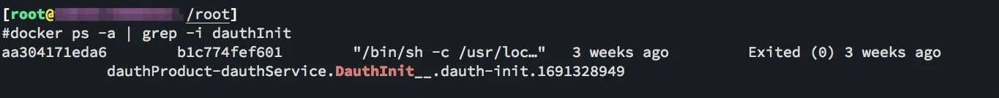

**Service installation directory**

The service scripts are located in the following directories inside the container:

- Directory:  `/usr/local/rds/`

- Startup script:  `/usr/local/rds/entrypoint_in_docker.sh`

- Database scripts:

  ```text
   /usr/local/rds/metadb/sql/dauth/ 
  ```

  - `/usr/local/rds/metadb/sql/dauth_diamond/` .

- Core script:  `/usr/local/rds/metadb/init_metadb.py`

**O&M operations**

To temporarily resolve a fault or an issue, you can copy the relevant file from the component, modify it, and then restart the component. The following steps use init_metadb.py as an example:

1. Copy the file.

   ```bash
   docker cp ******:/usr/local/rds/metadb/init_metadb.py ./
   ```

2. Modify the file.

   Run  `vi init_metadb.py`  to edit the file.

3. Copy the file into the container.

   ```bash
   docker cp init_metadb.py xxxx:/usr/local/rds/metadb/
   ```

4. Restart the container.

   ```bash
   docker restart [container_id]
   ```

**Core logs**

You can view the logs by running  `docker logs [container_id]` .

<a id="section-3-2-4-2"></a>

#### 3.2.4.2. Dauth Diamond

Stores configuration information for the Dauth Server component.

**Component health check**

Log on to the container and run the following command:

```text
sh /home/admin/bin/check_diamond.sh
```

The normal output is as follows:

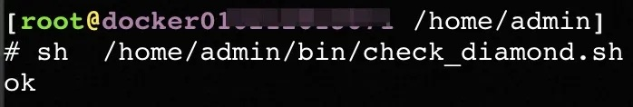

**Service installation directories**

Dauth Diamond runs two processes: Tengine and Tomcat. Tengine forwards traffic to the Tomcat process. The core service runs in Tomcat.

- Tomcat

  - Installation directory:  `/home/admin/diamond/.default/` .

- Tengine

  - Installation directory:  `/opt/taobao/tengine/` .

  - Core configuration file:  `/home/admin/cai/conf/nginx-proxy.conf` .

**Deployment model**

Deployed on Ontianji. The product name is dauthProduct.

**O&M operations**

| Operation Definitions | Command | Operation level |
| --- | --- | --- |
| Reload the NGINX configuration | Log on to the container and run the following command with root permissions:<br><code>/home/admin/cai/bin/nginx</code><br><code>ctl reload</code> | G3 |
| Restart the component | On the dauth VM, run the following command:<br><code>docker restart</code><br><code>&lt;container&gt;</code><br>Replace &lt;container&gt; with the correct Dauth Diamond container name. | G3 |

**Core logs**

Directory:  `/home/admin/diamond/logs/` .

- diamondServer.log: Service output log.

- tomcat_stdout.log: Tomcat standard output log.

<a id="section-3-2-4-3"></a>

#### 3.2.4.3. Dauth Server

Provides a platform authentication service.

**Component health check**

Log on to the container and run the following command:

```text
sh /home/admin/bin/check_dauth.sh
```

The expected output is as follows:

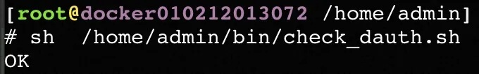

**Service installation directories**

The Dauth Server runs the Tengine and Tomcat processes. Tengine forwards traffic to the Tomcat process, which runs the core service.

- Tomcat

  - Installation directory:  `/home/admin/ali-tomcat/` .

- Tengine

  - Installation directory:  `/opt/taobao/tengine/` .

  - Core configuration file:  `/home/admin/cai/conf/nginx-proxy.conf` .

**Deployment model**

Deployed on Tianji. The product name is dauthProduct.

**O&M operations**

| Operation Description | Command | Operation level |
| --- | --- | --- |
| Reload the NGINX configuration | Log on to the container and run the following command with root permissions:<br><code>/home/admin/cai/bin/nginx</code><br><code>ctl reload</code> | G3 |
| Restart the component | On the dauth VM, run the following command:<br><code>docker restart</code><br><code>&lt;container&gt;</code><br>Replace &lt;container&gt; with the correct Dauth Server container name. | G3 |

**Core logs**

- Directory:  `/home/admin/dauth/logs/` .

  dauth.log: The service log for the Dauth Server.

<a id="section-3-2-5"></a>

### 3.2.5. DNCS Component

<a id="section-3-2-5-1"></a>

#### 3.2.5.1. DNCS Init

The DNCS Init component is used to initialize the DNCS product.

**Function Introduction**

This component initializes the DNCS product. The initialization process includes the following operations:

- Initializing the dncs_diamond database tables and data.

- Requesting an ACM bucket and setting up cross-domain access to support configuration import and export.

- Setting the Dauth authentication pattern for the Diamond component.

**Component Health Check**

Check that the exit code of the component's container is 0.

```bash
docker ps -a | grep dncsInit
```

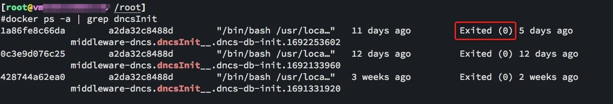

If the exit code is not 0, the component has a fault and requires troubleshooting.

**Service Installation Directories**

The service scripts are located at the following paths in the container:

- Directory:  `/usr/local/rds/` .

- Startup script:  `/usr/local/rds/metadb/run.sh` .

- Database scripts:  `/usr/local/rds/metadb/sql/dncs_diamond/` .

- Key script:  `/usr/local/rds/metadb/init_metadb.py` .

**O&M Operations**

To temporarily resolve a fault, you can copy a file from the component, modify it, and then restart the component. For example, to modify the init_metadb.py file, perform the following steps:

1. Copy the file.

   ```bash
   docker cp xxxx:/usr/local/rds/metadb/init_metadb.py ./
   ```

2. Modify the file.

   Run  `vi init_metadb.py`  to modify the file.

3. Copy the file to the container.

   ```bash
   docker cp init_metadb.py xxxx:/usr/local/rds/metadb/
   ```

4. Restart the container.

   ```bash
   docker restart [container_id]
   ```

**Core Logs**

You can view the logs by running the  `docker logs [container_id]`  command.

<a id="section-3-2-5-2"></a>

#### 3.2.5.2. DNCS Console

A console component for microservice configuration management.

**Component health check**

Log on to the container and run the following command:

```text
sh /home/admin/bin/checkHealth.sh
```

A normal output is shown below:

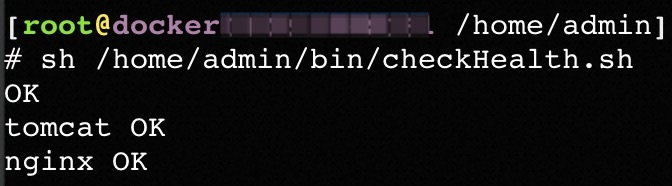

**Service installation directories**

The DNCS Console consists of two processes: Tengine and Tomcat. Tengine forwards traffic to the Tomcat process, where the core service is deployed.

- Tomcat

  - Installation directory:  `/home/admin/ali-tomcat/` .

- Tengine

  - Installation directory:  `/opt/taobao/tengine/` .

  - Core configuration file:  `/home/admin/cai/conf/nginx-proxy.conf` .

The API definitions required by the console page are stored in the following directory:

- Directory:  `/home/admin/pop/apis/` .

**Deployment model**

The component is deployed using ontianji. The product name is middleware-dncs.

**O&M operations**

| Operation definitions | Command | Operation level |
| --- | --- | --- |
| Reload the NGINX configuration | Log on to the container and run the following command with root permissions:<br><code>/home/admin/cai/bin/nginx</code><br><code>ctl reload</code> | G3 |
| Restart the component | On the dauth VM, run the following command:<br><code>docker restart</code><br><code>&lt;container&gt;</code><br>Replace &lt;container&gt; with the correct DNCS Console container name. | G3 |
| Reregister pop | Log on to the container and run the following command with root permissions:<br><code>cd /home/admin/pop</code><br><code>java -jar batch.jar</code> | G3 |

**Core logs**

- Directory:  `/home/admin/diamondops/logs/` .

  - pop-access.log: Access log for the APIs on the frontend configuration management page.

  - diamondops.log: Log for the configuration management component.

<a id="section-3-2-5-3"></a>

#### 3.2.5.3. DNCS Server

DNCS Server is a service registry and configuration center component for ECS and Kubernetes applications. It consists of Nacos, Configserver, Diamond, and VipServer. Nacos handles service registration and discovery for Spring Cloud and Dubbo frameworks. Configserver handles HSF service registration. Diamond provides configuration center capabilities, and VipServer provides an address service for internal products. A single data center deployment has 4 nodes, while a dual data center deployment has 7 nodes. In a dual data center setup, one node in the secondary data center has no running processes.

**Component health check**

Log on to the container and run the following command:

```text
sh /home/admin/bin/check_dncs.sh
```

A normal output is shown below:

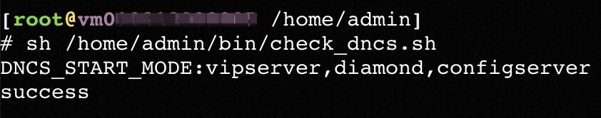

**Service installation directories**

DNCS Server has two internal processes: Tengine and Java. Tengine forwards traffic for Nacos, Diamond, and VipServer to the Java process. The Java process serves traffic for Configserver directly, bypassing Tengine.

- Java

  - Installation directory:  `/opt/taobao/java/bin/java` .

  - Path of the DNCS program package:  `/home/admin/nacos/target/nacos-dncs.jar` .

- Tengine

  - Installation directory:  `/opt/taobao/tengine/` .

  - Core configuration file:  `/home/admin/cai/conf/nginx-proxy.conf` .

The DNCS Server nodes form a cluster. The configuration files for the cluster nodes are as follows:

- `/home/admin/nacos/conf/cluster.conf` .

- `/home/admin/nacos/conf/confsrv.conf` .

**Deployment model**

DNCS Server is deployed by Ontianji. The product name is middleware-dncs.

**O&M operations**

| Operation description | Command | Operation level | Visibility |
| --- | --- | --- | --- |
| Reload the Nginx configuration | Log on to the container and run the following command with root permissions:<br><code>/home/admin/cai/bin/nginxctl reload</code> | G3 | Public |
| Restart the component | Run the following command on the dauth VM:<br><code>docker restart &lt;container&gt;</code><br>Replace &lt;container&gt; with the correct DNCS Server container name. | G3 | Public |
| Query the switch configuration | <code>curl -s</code><br><code>'http://127.0.0.1:7001/nacos/v1/ns/oper</code><br><code>ator/switches'</code> | G1 | Internal |

<table>
  <tr>
    <td>Query Dubbo service providers</td>
    <td>Example command:<br><code>curl -s</code><br><code>'http://127.0.0.1:7001/nacos/v1/ns/inst</code><br><code>ance/list?</code><br><code>serviceName=providers:com.alibaba.edas.</code><br><code>boot.EchoService:1.0.0:DUBBO&amp;namespaceI</code><br><code>d=6c39bcfe-6340-41a4-******' -H</code><br><code>'User-agent:Nacos-Server:1.1.3-xx' &#124;</code><br><code>python -m json.tool</code><br>Parameters:<br>• com.alibaba.edas.boot.EchoService: The service name.<br>• 1.0.0: The service version. If there is no version, use an empty string.<br>• DUBBO: The service group. If there is no group, use an empty string.<br>• 6c39bcfe-6340-41a4-******: The microservices namespace ID.<br>• Nacos-Server:1.1.3-xx: The management User-Agent (UA). For more information, see the authWhiteList field of the switch configuration interface.</td>
    <td>G1</td>
    <td>Internal</td>
  </tr>
  <tr>
    <td>Query Dubbo service consumers</td>
    <td>Example command:<br><code>curl -s</code><br><code>'http://127.0.0.1:7001/nacos/v1/ns/inst</code><br><code>ance/list?</code><br><code>serviceName=consumers:com.alibaba.edas.</code><br><code>boot.EchoService:1.0.0:DUBBO&amp;namespaceI</code><br><code>d=6c39bcfe-6340-41a4-a7d0-******' -H</code><br><code>'User-agent:Nacos-Server:1.1.3-xx' &#124;</code><br><code>python -m json.tool</code><br>Parameters:<br>• com.alibaba.edas.boot.EchoService: The service name.<br>• 1.0.0: The service version. If there is no version, use an empty string.<br>• DUBBO: The service group. If there is no group, use an empty string.<br>• 6c39bcfe-6340-41a4-******: The microservices namespace ID.<br>• Nacos-Server:1.1.3-xx: The management UA.For more information, see the authWhiteList field of the switch configuration interface.</td>
    <td>G1</td>
    <td>Internal</td>
  </tr>
  <tr>
    <td>Query Spring Cloud service providers</td>
    <td>Example command:<br><code>curl -s</code><br><code>'http://127.0.0.1:7001/nacos/v1/ns/inst</code><br><code>ance/list?</code><br><code>serviceName=edas.service.provider&amp;names</code><br><code>paceId=13aba4dd-da86-49b5-9ab4-</code><br><code>******' -H 'User-agent:Nacos-</code><br><code>Server:1.1.3-xx'</code><br>Parameters:<br>• edas.service.provider: The service name.<br>• 13aba4dd-da86-49b5-9ab4-******: The microservices namespace ID.<br>• Nacos-Server:1.1.3-xx: The management UA.For more information, see the authWhiteList field of the switch configuration interface.</td>
    <td>G1</td>
    <td>Internal</td>
  </tr>
  <tr>
    <td>Query HSF service providers</td>
    <td>Example command:<br><code>curl "`hostname -</code><br><code>i`:9603/queryPublisherInfoByPatternN?</code><br><code>dataId=com.edas.testcase.api.TestCase:1</code><br><code>.0.0&amp;group=aliyun&amp;tenant=6c39bcfe-</code><br><code>6340-41a4-a7d0-</code><br><code>******&amp;ip=*&amp;start=1&amp;end=100"</code><br>Parameters:<br>• com.edas.testcase.api.TestCase:1.0.0: The service name and version.<br>• group: The service group.<br>• tenant: The microservices namespace ID.</td>
    <td>G1</td>
    <td>Internal</td>
  </tr>
  <tr>
    <td>Query HSF service consumers</td>
    <td>Example command:<br><code>curl "`hostname -</code><br><code>i`:9603/querySubscriberInfoByPatternN?</code><br><code>dataId=com.edas.testcase.api.TestCase:1</code><br><code>.0.0&amp;group=aliyun&amp;tenant=6c39bcfe-</code><br><code>6340-41a4-a7d0-</code><br><code>******&amp;ip=*&amp;start=1&amp;end=100"</code><br>Parameters:<br>• com.edas.testcase.api.TestCase:1.0.0: The service name and version.<br>• group: The service group.<br>• tenant: The microservices namespace ID.</td>
    <td>G1</td>
    <td>Internal</td>
  </tr>
</table>

**Core logs**

Directory:  `/home/admin/nacos/logs/` .

- nacos.log: A general-purpose log file.

- config-client-request.log: Logs for client configuration publishing and subscriptions.

- config-dump.log: Logs for dumping configurations from the database for Diamond and Nacos Config.

- config-fatal.log: Records fatal errors in Diamond and Nacos Config.

- config-memory.log: Status logs for Diamond and Nacos Config. These logs show the number of configurations and long-lived connections.

- config-server.log: Server-side logs for Diamond and Nacos Config.

- config-trace.log: Tracing Analysis logs for Diamond and Nacos Config.

- naming-distro.log: Logs for the Distro synchronization protocol used by VipServer and Nacos Naming.

- naming-raft.log: Logs for the Raft synchronization protocol used by VipServer and Nacos Naming.

- naming-performance.log: Status logs for VipServer and Nacos Naming. These logs include the number of services and instances.

- naming-server.log: Server-side logs for VipServer and Nacos Naming. These logs contain service metadata.

- naming-event.log: Logs for service status updates from VipServer, Nacos Naming, and Configserver.

- naming-push.log: Push logs for VipServer and Nacos Naming.

- confsrv.log: Service logs for Configserver. These logs record the publishing and unpublishing of HSF services.

- http.log: HTTP request logs for Configserver.

- push.log: Push logs for Configserver.

- remoting.log: Connection logs for Configserver.

- memory.log: Status logs for Configserver.

<a id="section-3-2-6"></a>

### 3.2.6. Staragent2 component

<a id="section-3-2-6-1"></a>

#### 3.2.6.1. Staragent2 Server

The Staragent2 Server component establishes a Staragent Channel with the Staragent Client that runs on ECS instances managed by EDAS. This channel is used to deliver commands and collect logs. The EAM module in the EDAS Web Server component sends commands to the Staragent Client on an ECS instance through Staragent2. After the Staragent Client receives a command, it runs the corresponding script to deploy or update applications and collect logs.

**Component health check**

Log on to the container and run the following command:

```text
sh /home/admin/bin/check_staragent2.sh
```

The expected output is as follows:

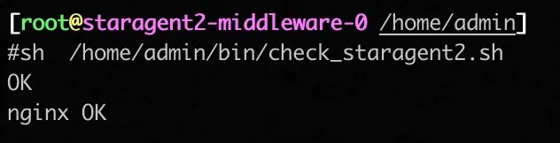

**Service installation directory**

The Staragent2 Server consists of two processes: Tengine and Java. Tengine forwards traffic to the Java process. The core service runs in the Java process.

- Java

  - Installation directory:  `/opt/taobao/java/bin/java` .

  - Package location:  `/home/admin/staragent-product/target/staragent-product.jar` .

- Tengine

  - Installation directory:  `/opt/taobao/tengine/` .

  - Core configuration file:  `/home/admin/cai/.running_conf/nginx-proxy.conf` .

**Deployment pattern**

The component is deployed on a Platform as a Service (PaaS) environment. The Kubernetes workload type is StatefulSet. The workload names are staragent2-middleware and staragent2-1-middleware.

**O&M operations**

| Meaning of Operation | Command | Operation Level |
| --- | --- | --- |
| Reload configuration | Log on to the container and run the following command with root permissions:<br><code>/home/admin/cai/bin/nginx</code><br><code>ctl reload</code> | G3 |
| Restart the component | On the terminal server, run the following command with root permissions:<br><code>kubectl delete pod &lt;Pod</code><br><code>name&gt;</code><br>Replace &lt;Pod name&gt; with the actual Pod name of the Staragent2 Server. | G3 |

**Core logs**

Directory:  `/home/admin/staragent-product/logs/` .

- Directory:  `channel/`

  - channel.log: Logs client registration and connection establishment with Staragent. You can filter the logs by ECS IP address.

  - channel-trace.log: Logs the full lifecycle events and data exchange details of Staragent Channels between the Staragent2 Server and Staragent Clients on managed ECS instances.

  - channel-transFile.log: Logs secure file transfers between the Staragent2 Server and Staragent Clients on managed ECS instances.

- Directory:  `channel-transport/`

  - channel-transport.log: Logs network data transmission between the Staragent2 Server and Staragent Clients on managed ECS instances over Staragent Channels.

- Directory:  `staragent-configservice/`

  - staragent-configservice.log: Logs the runtime status and operations of the Config Service module.

  - staragent-configservice-client.log: Logs interactions between the Staragent client and upstream configuration centers, such as ACM or Nacos.

- Directory:  `staragent-portal-api/`

  - akka.log: Logs the internal state, message processing flow, and system exceptions of the high-concurrency, asynchronous messaging module.

  - channel_listener.log: Logs the runtime status and event handling of the Channel Listener module in the Staragent2 Server.

  - error.log: Logs critical errors, exception stacks, and system failures in the staragent-portal-api module.

  - schedule-task.log: Logs the execution of scheduled tasks in the staragent-portal-api module.

  - staragent-portal-api.log: Logs the startup, API request handling, internal service calls, key business flows, and general runtime status of the staragent-portal-api module.

- Directory:  `staragent-proxy/`

  - performanceMonitor.log: Logs the performance metrics and resource usage of the Staragent2 Proxy module.

  - staragent-proxy.log: Logs the startup, communication proxy behavior, protocol handling, forwarding logic, and key runtime information for the proxy module.

  - staragent-statistics.log: Logs the business and system dimension statistics (statistics/metrics) collected by the Staragent Proxy module.

  - staragent-store.log: Logs local data storage (Store) operations in the Staragent Proxy module.

- Directory:  `staragent-scheduler/`

  - staragent-job-monitor.log: Logs the monitoring, tracking, and health checks of background job execution by the Staragent scheduler.

  - staragent-scheduler.log: Logs the scheduler startup, task scheduling logic, internal state changes, and core runtime flow.

- application.log: Logs the application startup, global configuration loading, core component initialization, and general runtime information that is not assigned to specific submodules.

- gc.log: Java garbage collection log.

- java.log: The main application log for the Staragent2 Java process. This log includes standard output and error logs.

<a id="section-3-2-7"></a>

### 3.2.7. Redis Component

<a id="section-3-2-7-1"></a>

#### 3.2.7.1. Middleware Redis

The Redis cache component is a dependency of the EDAS service.

**Component health check**

Log on to the container and run the following command:

```text
sh /home/admin/bin/check_redis.sh
```

A normal output is similar to the following:

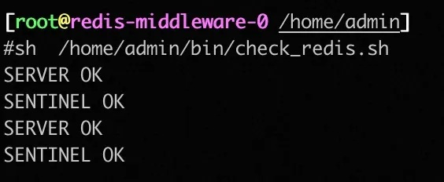

**Service installation directory**

Middleware Redis consists of two processes: Redis Server and Redis Sentinel. Redis Server provides the service, and Redis Sentinel ensures high availability (HA) for the Redis cluster. The current Redis version is 2.8.17. For O&M, you must replace ${Redis Version} in the following paths with the actual Redis version.

- Redis Server

  - Installation folder:  `/home/admin/redis-${Redis Version}/src/redis-server` .

  - Configuration file:  `/home/admin/redis-${Redis Version}/redis.conf` .

- Redis Sentinel

  - Installation folder:  `/home/admin/redis-${Redis Version}/src/redis-sentinel` .

  - Configuration file:  `/home/admin/redis-${Redis Version}/sentinel.conf` .

**Deployment type**

This component is deployed on PaaS. The Kubernetes workload is a StatefulSet named redis-middleware.

**O&M operations**

| Description | Command | Operation level |
| --- | --- | --- |
| Restart the component | On the terminal server, run the following command with root permissions:<br><code>kubectl delete pod</code><br><code>&lt;Pod_Name&gt;</code><br>When you run the command, replace &lt;Pod_Name&gt; with the correct pod name of Middleware Redis. | G3 |

**Core logs**

Folder:  `/home/admin/redis-${Redis Version}/` .

- redis.log: The output log for the Redis component.

<a id="section-3-3"></a>

## 3.3. Monitoring

Use product metrics to perform system monitoring and Business Monitoring for EDAS.

<a id="section-3-3-1"></a>

### 3.3.1. Prometheus monitoring

This topic describes the system objects that are monitored for EDAS.

**How to view system monitoring**

1. Log on to Apsara Infrastructure Management.

2. In the top navigation bar, click **Monitoring and Alerts > Monitoring Management > Cloud Platform Monitoring**.

3. In the navigation pane on the left, click **Data Dashboard > Custom Dashboard**.

4. On the **Custom Dashboard** page, search for EDAS in the **Dashboard Folder** search box, and then click the  `EDAS prometheus exporter`  dashboard name.

**System metrics**

Product

Metric (on-paas)

Description.

The success rate of publish orders in

30min_change_order_success_rate

the last 30 minutes.

The success rate of publish orders

30min_ecs_app_lifecycle_manage_change_order_s

for ECS application lifecycle

uccess_rate

management in the last 30 minutes.

The success rate of publish orders

30min_k8s_app_lifecycle_manage_change_order_s

for Kubernetes application lifecycle

uccess_rate

management in the last 30 minutes.

The success rate of publish orders

30min_ecs_app_scale_change_order_success_rate

for ECS application scaling in the last 30 minutes.

The success rate of publish orders

30min_k8s_app_scale_change_order_success_rate

for K8s application scaling in the last 30 minutes.

The success rate of publish orders

30min_ecs_app_modify_config_change_order_succ

for ECS configuration changes in the

ess_rate

last 30 minutes.

The success rate of publish orders

30min_k8s_app_modify_config_change_order_succ

for K8s configuration changes in the

ess_rate

last 30 minutes.

The request success rate of edas-

3min_oam_api_success_rate

adapter for customer clusters in the last 3 minutes.

The request response time of edas-

3min_oam_api_response_time

adapter for customer clusters in the last 3 minutes.

ECS

Number of managed ECS instances.

Pod

Number of managed pods.

Application

Number of managed applications.

Number of registered Spring Cloud

SpringCloud

microservices.

Number of registered Dubbo

Dubbo

microservices.

Number of registered HSF

HSF

microservices.

Memory Usage

Service memory usage.

CPU Usage

Service CPU usage.

Network I/O

Service network usage.

Heap used

Used heap memory.

ParNew gc

GC algorithm.

ConcurrentMarkSweep gc

GC algorithm.

Start time

Service start time.

Uptime

The startup time of the service.

Heap

JVM heap memory.

EDAS

Non Heap

JVM non-heap memory.

JVM heap memory - young

PS Eden Space

generation Eden space.

JVM heap memory - young

PS Survivor Space

generation survivor space.

JVM heap memory - old generation

PS Old Gen

space.

Metaspace

Metaspace.

Compressed Class Space

Compressed class space.

Code Cache

Code cache.

Threads used

Number of used threads.

GC count

Number of garbage collections.

Number of garbage collections per

GC time / 1 min. rate

minute.

Class loading

Class loading.

cpu_usage_cai-fs

CPU usage of cai-fs.

memory_usage_cai-fs

Memory usage of cai-fs.

Running status of the cai-fs pod.

pod_ready_cai-fs

cpu_usage_edas-console

CPU usage of edas-console.

memory_usage_edas-console

Memory usage of edas-console.

Running status of the edas-console

pod_ready_edas-console

pod.

cpu_usage_edas-server

CPU usage of edas-server.

memory_usage_edas-server

Memory usage of edas-server.

Running status of the edas-server

pod_ready_edas-server

pod.

cpu_usage_edas-service-platform-edas

CPU usage of edas-service-platform.

Memory usage of edas-service-

memory_usage_edas-service-platform

platform.

Running status of the edas-service-

pod_ready_edas-service-platform

platform pod.

cpu_usage_edas-web-server

CPU usage of edas-web-server.

memory_usage_edas-web-server

Memory usage of edas-web-server.

Running status of the edas-web-

pod_ready_edas-web-server

server pod.

The request success rate of edas-

3min_oam_api_success_rate

adapter for customer clusters in the last 3 minutes.

<a id="section-3-4"></a>

## 3.4. EDAS Health Check Guide

This topic describes common custom health check commands.

**Custom Health Check Items**

Components:  `cai-fs/cai-address/edas-console/edas-server/edas-web-server/service-platform/arms-console` .

1. **Check whether the product has reached its desired state**

**Blank screen method:**

Open the Apsara Infrastructure Management console. In the navigation pane on the left, click **Resource Management > Product Cluster O&M**.

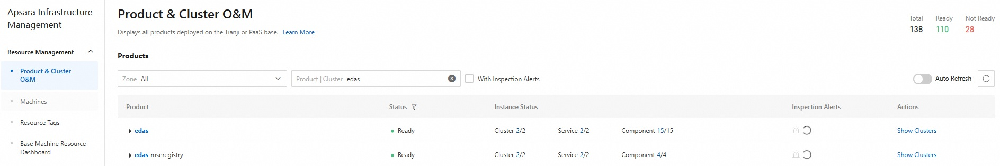

**Black screen method:**

**Log on to the ops1 machine.**

- Query product clusters.

  ```bash
  kubectl get clusterinstance | grep edas 
  ```

  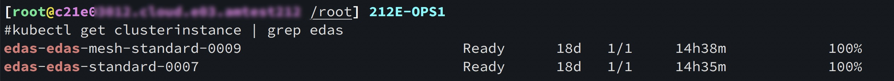

- Query products.

  ```bash
  kubectl get appset -A | grep edas 
  ```

  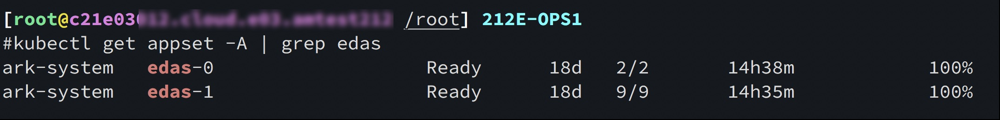

- Query product service resources (SR).

  ```bash
  kubectl get appinstance -A | grep edas 
  ```

  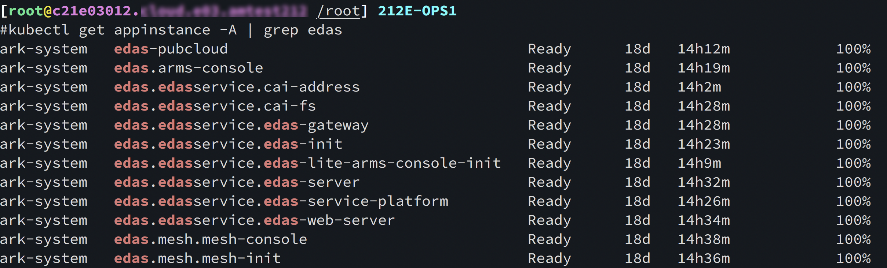

- Query Product POD

  ```bash
  kubectl get pod -A | grep edas 
  ```

  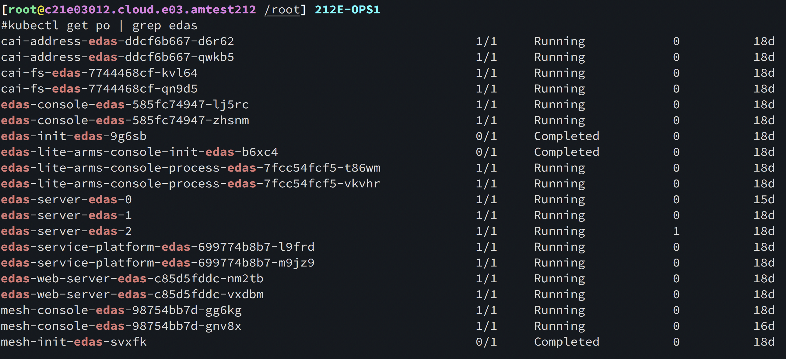

  2. **Check runtime status using built-in scripts**

Scripts are usually located in  `/home/admin/bin` . After execution, a return value of  `OK/SUCCESS`  indicates normal operation, while a return value of  `ERROR`  or similar messages indicates a problem.

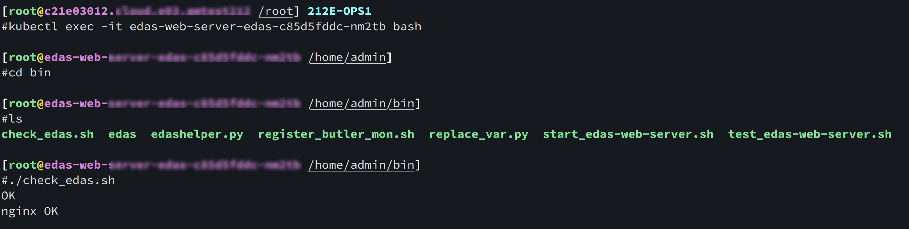

3. **Check basic metrics using the tsar command**

For information about the tsar command:

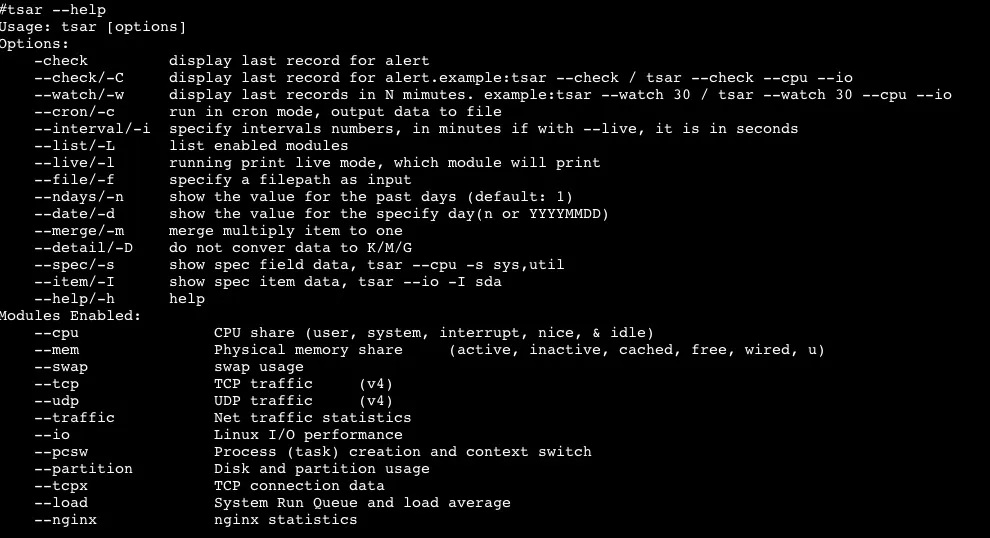

- Use tsar to check CPU, memory, I/O, network, and load metrics.

  For example:  `tsar -li 1`  prints real-time statistics once per second.

- Use tsar with parameters to check specific metrics.

  For example:  `tsar --nginx`  checks performance metrics for the ingress Nginx.

  > **Note**
  >
  > CPU usage should stay below 50%. Memory usage should stay below 70%. Load should stay below 20%. The network retransmission rate should be under 1%. If any metric exceeds these thresholds, investigate further.

  4. **Check JVM status using Java tools**

Use tools such as jstat, jmap, and jstack to diagnose and monitor the JVM.

For example: To check garbage collection (GC) status, run a command that prints output every second.


> **Note**
>
> If full GC occurs frequently, investigate the root cause.

5. **Check network connectivity using netstat or ss**

- Count active network connections.

  ```text
  netstat -n | awk '/^tcp/ {++S[$NF]} END {for(a in S) print a, S[a]}'
  ```

- You can sort network connectivity statistics.

  ```text
  netstat -nat|awk '{print$5}'|awk -F : '{print$1}'|sort|uniq -c|sort -rn
  ```


> **Note**
>
> The number of ESTABLISHED connections is typically high. If the number of TIME_WAIT or CLOSE_WAIT connections exceeds 1000, investigate and resolve the issue.

6. **Check resource usage using top, free, and df**


The top command shows host-level metrics.

> **Note**
>
> Check for CPU usage above 50%, memory usage above 80%, or disk usage above 90%.

7. **Check database status using Mini DuKang**

Log on to ASO. In the navigation pane on the left, click **Platform O&M > Control Service O&M > Cloud Database O&M · Mini DuKang** to open the Mini DuKang console.


> **Note**
>
> Monitor the I/O, Connections, and disk space metrics for values that exceed their warning thresholds.

8. **EDAS data checks**

Log on to the EDAS database.

- Verify the DNCS IP addresses. A single data center must have four IP addresses, and a disaster recovery data center must have seven IP addresses. These IP addresses must match the  `docker ip`  of the DNCS Server.

  

- Verify the Redis IP addresses. These addresses must match either the pod IP or the service IP of middleware-redis.

  

<a id="section-3-5"></a>

## 3.5. EDAS Log Descriptions

This topic describes the log paths and descriptions for EDAS components.

**Log Overview**

- EDAS component operational logs are typically in the  `/home/admin/edas/logs/`  directory.

- Because EDAS components use Tomcat, their startup logs are in the  `/home/admin/ali-tomcat/logs/`  directory.

- EDAS uses common middleware components. These are typically in the  `/home/admin/logs/`  directory.

**Component Logs**

**cai-address**

| Log Path | Log Description |
| --- | --- |
| /home/admin/cai/logs/eagleeye.log | Service access logs. |
| /home/admin/cai/logs/error.log | Nginx error logs. |

**cai-fs**

| Log Path | Log Description |
| --- | --- |
| /home/admin/cai/logs/error.log | Nginx error logs. |

**edas-init**

This component is an initialization component. Its logs are standard Pod outputs. You can view them using  `kubectl logs xxx -n xxx` .

**edas-lite-arms-console-init**

This component is an initialization component. Its logs are standard Pod outputs. You can view them using  `kubectl logs xxx -n xxx` .

**edas-lite-arms-console**

| Log Path | Log Description |
| --- | --- |
| /home/admin/logs/arms/arms-pop.log | ARMS POP logs. |
| /home/admin/logs/arms/arms-console.log | ARMS console logs. |
| /home/admin/taobao-tomcat-production-7.0.109/logs/catalina.log | Lite ARMS console Tomcat startup logs. |
| /home/admin/taobao-tomcat-production-7.0.109/logs/localhost.log | Lite ARMS console Tomcat startup logs. |
| /home/admin/arms-pop/taobao-tomcat-production/logs/catalina.log | Lite ARMS POP API Tomcat startup logs. |
| /home/admin/arms-pop/taobao-tomcat-production/logs/localhost.log | Lite ARMS POP API Tomcat startup logs. |

**edas-console**

| Log Path | Log Description |
| --- | --- |
| /home/admin/edas/logs/gateway_access.log | Access logs for received requests. |
| /home/admin/edas/logs/gateway_t.log | Component logs for the EDAS Gateway. |
| /home/admin/edas/logs/gateway_proxy_t.log | EDAS Gateway proxy request logs. |
| /home/admin/ali-tomcat/logs/catalina.log | Tomcat process startup logs. |
| /home/admin/ali-tomcat/logs/localhost.log | Tomcat process startup logs. |

**edas-server**

| Log Path | Log Description |
| --- | --- |
| /home/admin/edas/logs/agent-server.log | Operational logs for the EDAS Agent Server. |
| /home/admin/edas/logs/heartbeat.log | Heartbeat logs for the EDAS Agent. |
| /home/admin/ali-tomcat/logs/catalina.log | Tomcat process startup logs. |
| /home/admin/ali-tomcat/logs/localhost.log | Tomcat process startup logs. |

**edas-service-platform**

| Log Path | Log Description |
| --- | --- |
| /home/admin/service-platform/logs/ali-service-platform-diamondSdkLog.log | Diamond SDK utility class logs. |
| /home/admin/ali-tomcat/logs/catalina.log | Tomcat process startup logs. |
| /home/admin/ali-tomcat/logs/localhost.log | Tomcat process startup logs. |

**edas-web-server-edas**

| Log Path | Log Description |
| --- | --- |
| /home/admin/edas/logs/admin-schedule_t.log | Scheduled task operational logs for EDAS. |
| /home/admin/edas/logs/biztrace-result.log | Business result logs for EDAS. |
| /home/admin/edas/logs/changeorder_t.log | Application logs for an EDAS deployment. |
| /home/admin/edas/logs/edas-web_t.log | Operational logs for the EDAS Web Server. |
| /home/admin/edas/logs/oam-cache_t.log | Cache operational logs for K8s OAM applications. |
| /home/admin/edas/logs/serviceaudit.log | Audit logs for EDAS. |
| /home/admin/edas-k8s-apiserver/logs/startup.log | K8s component startup logs. |
| /home/admin/edas-k8s-apiserver/logs/edas-k8s-apiserver.log | K8s component operational logs. |
| /home/admin/ali-tomcat/logs/catalina.log | Tomcat process startup logs. |
| /home/admin/ali-tomcat/logs/localhost.log | Tomcat process startup logs. |

**mesh-console-edas**

| Log Path | Log Description |
| --- | --- |
| /home/admin/mesh/logs/mesh_start.out | Operational logs. |

<a id="section-4"></a>

# 4.EDAS O&M Console User Guide

<a id="section-4-1"></a>

## 4.1. Operation and Maintenance

<a id="section-4-1-1"></a>

### 4.1.1. Log on to the EDAS O&M console

This topic describes how to log on to the EDAS O&M console.

**Prerequisites**

- You have obtained the endpoint, username, and password for the Apsara Uni-manager Operations Console from the deployment personnel or an administrator.

- The endpoint for the Apsara Uni-manager Operations Console is in the format  `{region-id}.aso.{intranet-domain-id}.com` .

- Use the Chrome browser.

**Procedure**

1. Open a browser.

2. In the address bar, enter the endpoint for the Apsara Uni-manager Operations Console,  `{region-id}.aso.{intranet-domain-id}.com` , and press Enter.

   

   > **Note**
   >
   > You can switch the language by clicking the current language in the upper-right corner. The console supports Simplified Chinese, English, and Traditional Chinese.

3

Enterthecorrectusernameandpassword

3. Enter the correct username and password.

   > **Note**
   >
   > - Obtain the username and password to log on to the Apsara Uni-manager Operations Console from the deployment personnel or an administrator.
   >
   > - If you enter an incorrect password three consecutive times, the system enables the Captcha logon feature. If you enter an incorrect password five consecutive times, your account is locked. Contact an administrator to reactivate it.

   When you log on to the Apsara Uni-manager Operations Console for the first time, you are required to change your password. Follow the prompts to complete the password change.

   For security, your password must meet the following requirements:

   - Contain both uppercase and lowercase letters.

   - Contain digits (0 to 9).

   - Contain special characters, such as the exclamation point (!), at sign (@), number sign (#), dollar sign ($), and percent sign (%).

   - Be 10 to 20 characters in length.

4. Click **Account Logon**.

5. In the top menu bar of the Apsara Uni-manager Operations Console, choose **Product O&M > Middleware O&M > Enterprise Distributed Application Service · EDAS**.

<a id="section-4-1-2"></a>

### 4.1.2. Overview

This topic describes how to view application and cluster overviews and details in the EDAS console, helping you monitor deployment status and resource distribution.

**Procedure**

1. Log on to the EDAS O&M console.

2. The **Overview** page appears by default and contains the **Overview** and **Details** sections.

   | Area | Description |
   | --- | --- |
   | Overview | The <strong>Overview</strong> section displays information such as the number of <strong>ECS clusters</strong>, <strong>K8s clusters</strong>, <strong>ECS applications</strong>, <strong>K8s applications</strong>, and <strong>K8s</strong> <strong>applications (OAM applications)</strong>. |
   | Details | The <strong>Details</strong> section displays information such as the <strong>region ID</strong>, the number of <strong>ECS clusters</strong>, <strong>K8s clusters</strong>, <strong>ECS applications</strong>, <strong>K8s</strong> <strong>applications</strong>, and <strong>K8s applications (OAM</strong> <strong>applications)</strong>. |

<a id="section-4-1-3"></a>

### 4.1.3. Feature Flag Management

The EDAS platform provides various features to meet diverse customer needs. It also includes tools to query and configure these features.

**User Guide User Guide**

1. Log on to the EDAS O&M console.

2. In the navigation pane on the left, click **Feature Flag Management**.

3. In the **Feature Flags** list, click **Edit** in the **Actions** column. In the dialog box that appears, set the value of the property to true to enable the feature or false to disable it. The following table describes the keys and their descriptions:

   | Key | Description |
   | --- | --- |
   | featureSlbRemoveListenerEnable | Specifies whether an ECS instance can be removed from an SLB listener. |
   | feature.ahas.enable | Enables or disables AHAS. |
   | featureAppCompressEnable | Enables or disables deployment of applications from compressed packages. |
   | feature.ess.enable | Enables or disables ESS. This setting affects the procurement feature. |
   | featureEnterpriseACRDisable | Enables or disables support for Enterprise Edition images. Defaults to false if ACR is deployed before EDAS. |
   | feature.resources.isolation.enable | Specifies whether EDAS resources belong to an organization and a resource set. |
   | featureCreateAppUseUnimportCluster | You can use unimported clusters to create Kubernetes applications. |
   | featureBatchExportConfigurationsNew | Enables or disables export of more than 100 configuration items using the new API. |
   | featureShowAllConfigMap | Enables or disables display of ConfigMaps that were not created in EDAS. |
   | featureShowAllSecret | Display ConfigMaps (secrets) not created by EDAS. |
   | featureListAuthByRamEnable | Enables or disables list-based authentication. |
   | feature.self.build.k8s.enable | Enables or disables use of self-managed Kubernetes clusters. |
   | feature.logService.enable | Enables or disables Simple Log Service (SLS) for log collection. |
   | edas.access.resource | Enables or disables resource isolation for ECS, VPC, SLB, and ACS clusters. |
   | featureAppMigrateEnabled | Enables or disables application import and export. |
   | featureImportFromAcsEnabled | Enables or disables ACK import and export. |
   | featureStsSupportEnabled | Does it support the STS-type application publishing feature? |
   | edas.slb.create.source | If set to EDAS, EDAS creates a global SLB.Organization-level settings take precedence over this setting. |
   | feature.zone.schedule.enable | ECS Availability Zone Preference |
   | featureEcsAppRestart | ECS restart policies are supported. |
   | featureServiceGroupsTenant | Enables or disables selection of a namespace when creating service groups. |
   | featureNamespaceIsolate | Enables or disables Kubernetes namespace isolation for RAM users. |
   | featureCustomMountArmsAgent | Enables or disables optional mounting of the ARMS agent. |
   | featureMicroNamespaceLikeQuery | Supports fuzzy search for namespaces. |
   | feature.app.security.enable | Enables or disables security groups. |
   | featureClusterManageOptionEnable | Enables or disables cluster type selection during import. |
   | feature.istio.enable | Enables or disables Service Mesh. |
   | featureAppImageBuildEnable | Non-OAM clusters support application deployment from WAR or JAR packages. |
   | featureAppBatchEnabled | Enables or disables batch start and stop of applications. |
   | edas.feature.config.udVersion.support | Supports version numbers for configuration items. |
   | featureArmsSyncNamespace | ARMS synchronizes EDAS namespaces. |
   | edas.extension.resource.group | EDAS verifies quotas. |
   | feature.complement.failed.task.enabled | EDAS optimizes the compensation for failed executions of change orders. |
   | featureK8sSLSEnable | When you create an application in EDAS, you can configure SLS for log collection. |
   | feature.resources.isolation.cascade | Enables or disables cascading creation of EDAS resources. |
   | edas.vcpu.factor.edas | vCPU consumption coefficient for EDAS applications. |
   | edas.vcpu.factor.aliee | vCPU consumption coefficient for ALIEE applications. |
   | edas.vcpu.factor.mse | vCPU consumption coefficient for MSE applications. |

<a id="section-4-1-4"></a>

### 4.1.4. Query licenses

This topic describes how to query EDAS license details.

**User guide**

1. Log on to the EDAS console.

2. In the left navigation pane, click **Query License**.

3. On the **Query License** page, view the following sections: **Consumed Licenses**, **EDAS Consumption**, **ALIEE Consumption**, and **ALIEE Authorized Consumption**.

   | Metric | Unit | Description |
   | --- | --- | --- |
   | Consumed Licenses | vCPU | Purchased licenses are consumed by multiple feature modules in EDAS at different ratios. |
   | EDAS Consumption | vCPU | Consumption is measured by the vCPUs of hosted application or service pods.For example, a 4-core 8 GB node consumes 4 vCPUs. |
   | ALIEE Consumption | vCPU | Consumption is measured at four times the vCPUs of application server pods. For example, a 4-core 8 GB node consumes 16 vCPUs. |
   | ALIEE Authorized Consumption | node | Consumption is measured by the number of application server pods. One ECS instance or one pod is counted as one node. |

4. The region section displays the number of **Used Cores** for the region and cluster-level information. For each cluster, it shows the number of **Used Cores**. For applications in the cluster, it displays the following details: **Application Name**, **Application ID**, **Microservices Namespace**, **EDAS ID**, **Number of Instances**, **Actual vCPUs of Application**, **License Feature Type**, **Application Type**, and **Used Cores**.

   

<a id="section-4-1-5"></a>

### 4.1.5. Component management

<a id="section-4-1-5-1"></a>

#### 4.1.5.1. Pandora components

Pandora components provide maintenance features for the HSF application container environment.

**Create a Pandora component**

1. Log on to the EDAS O&M console.

2. In the left navigation pane, click **Component management > Pandora components**.

3. On the **Pandora** page, click **Create**.

4. In the **Create** dialog box, enter the following configuration items and click **OK**.

   | Configuration item | Description | Example value |
   | --- | --- | --- |
   | Pack version number | Enter 1 to 50 characters. | 3.6.3 |
   | Tomcat version number | Enter the Tomcat version number. | 8.5.63 |
   | Tomcat download URL | Enter the Tomcat download URL. | http://www.example.com |
   | Upload Tomcat | Click to upload a file and upload Tomcat. | None |
   | Tomcat version description | Enter a Tomcat version description. | None |
   | Pandora version | Enter 2 to 50 characters. | edas.public.sar.V3.6.3 |
   | Pandora download URL | Enter the Pandora download URL. | http://www.example.com |
   | Upload Pandora | Click to upload a file and upload Pandora. | None |
   | Pandora version description | Enter a Pandora version description. | None |
   | Plug-in information | Enter plug-in information. | None |
   | Tomcat folder path | Read-only field. The value is displayed automatically. | None |
   | Docker base image ID | Enter the Docker base image ID. | http://www.example.com |
   | Tengine standalone image ID | Enter the Tengine standalone image ID. | None |
   | tengine.sh control script download URL | Enter the tengine.sh control script download URL. | None |
   | Multi-tenant support | • Enable<br>• Disable | Enable |
   | Tengine / grayscale support | • Enable<br>• Close | Enable |
   | Execution script name | Enter the execution script name. | default |
   | Execution script version | Enter the execution script version. | 1.0.3 |
   | Features | Enter attribute information. | None |
   | Supported attributes | You must select fatjar.Otherwise, you cannot use this Pandora component in EDAS.<br>• tengine<br>• fatjar<br>• restful<br>• eip_nodeport<br>• dpath<br>• jdk11<br>• jdk17 | fatjar |

**Additional operations**

1. Log on to the EDAS O&M console.

2. In the left navigation pane, click **Component management > Pandora components**.

3. In the **Pandora** list, view the **pack version number**, **Tomcat version number**, **Tomcat download URL**, **Pandora version**, and **Pandora download URL**.

4. For the target Pandora component, click **Edit** in the Actions column. In the **Edit** dialog box, modify the component configuration items. For more configuration details, see Create a Pandora component.

5. For the target Pandora component, click **Delete** in the Actions column. In the dialog box, click **Delete** to delete the instance.

6. For the target Pandora component, click **Disable** in the Actions column. In the **Confirmation** dialog box, click **OK** to disable the instance.

7. For the target Pandora component, click **Enable** in the Actions column. In the **Confirmation** dialog box, click **OK** to enable the instance.

<a id="section-4-1-5-2"></a>

#### 4.1.5.2. Components

The Components feature manages components for Java application runtime environments.

**Create a component**

1. Log on to the EDAS O&M console.

2. You can click **Component Management > Components** in the navigation pane on the left.

3. On the **Component** page, you can click **Create**.

4. In the **Create** dialog box, you can enter the following configuration items and click **OK**.

   | Configuration item | Description | Example value |
   | --- | --- | --- |
   | Component classification | • JDK<br>• TENGINE<br>• TOMCAT<br>• TONGWEB<br>• ALIEE | JDK |
   | Keyword | Enter a keyword. | Open JDK 21 |
   | Version number | Enter a version number. | Dragonwell_21.0.8 |
   | Version number and component name | Enter the version number and component name. | Open JDK 21 (Dragonwell 21.0.8) |
   | Download URL | The download URL. | http://www.example.com |
   | Upload file (x86) | This item appears when Component classification is set to JDK. Click Upload File to upload the file. | None |
   | Upload file | First, enter the download URL.Then, click Upload File to upload the file. | None |
   | Image ID | Enter the image ID. | None |

**More operations**

1. Log on to the EDAS O&M console.

2. You can click **Component Management > Components** in the navigation pane on the left.

3. **View**: In the **Component** list, you can view information such as **Component classification**, **Keyword**, **Version number**, **Version number and component name**, and **Download URL**.

4. **Edit**: For the target component, you can click **Edit** in the Actions column. In the **Edit** dialog box, you can modify the component configuration items. For more information, see Create a component.

5. **Delete**: For the target component, you can click **Delete** in the Actions column. In the dialog box that appears, you can click **Delete**.

<a id="section-4-1-6"></a>

### 4.1.6. Dedicated Configuration Center

This topic describes the operations management features for Dedicated Configuration Center instances.

**Instance list information**

1. Log on to the Apsara Infrastructure Management platform.

2. In the top navigation bar, click **Product O&M > Middleware O&M > Enterprise Distributed Application Service EDAS**.

3. In the navigation pane on the left, click **Dedicated Registration and Configuration Center**.

4. In the instance list on the **Dedicated Registration and Configuration Center** page, view the following information: **Instance ID/Name**, **Product Type Version**, **Engine Version**, **Status**, **Access Method**, **Creation Time**, and **Organization**.

**Instance details information**

1. Log on to the Apsara Infrastructure Management platform.

2. In the top navigation bar, click **Product O&M > Middleware O&M > Enterprise Distributed Application Service EDAS**.

3. In the navigation pane on the left, click **Dedicated Registration and Configuration Center**.

4. In the instance list on the **Dedicated Registration and Configuration Center** page, click an **Instance ID** or click **Details** in the **Actions** column to open the instance details page.

5. On the instance details page, view the following information: **Basic Information**, **Runtime Information**, **Network Information**, and **Instance Nodes**.

   | Region | Description | Related Operations |
   | --- | --- | --- |
   | Basic Inform ation | Basic details about the instance. View the <strong>Instance</strong> <strong>ID</strong>, <strong>Network Connection Mode</strong>, <strong>Number of</strong> <strong>Cluster Nodes</strong>, <strong>Engine Specification</strong>, <strong>Engine</strong> <strong>Type</strong>, <strong>Engine Version</strong>, <strong>Instance Name</strong>, <strong>Edition</strong>, and <strong>Region</strong>. | Click <strong>Restart Instance</strong>. All nodes in the instance restart.In the <strong>Restart Instance</strong> dialog box, click <strong>OK</strong>. |
   | Runtim e Inform ation | Runtime details about the instance. View the <strong>Status</strong> and <strong>Creation Time</strong>. | Click <strong>Diagnose Schedule</strong> <strong>Status</strong>. In the <strong>Schedule</strong> <strong>Status</strong> dialog box, view the <strong>Schedule Duration</strong>, <strong>Cluster</strong> <strong>SLB Ready</strong> status, and <strong>Node</strong> <strong>Status</strong>. |
   | Networ k Inform ation | Network details about the instance. View the <strong>Private</strong> <strong>Network Address</strong>, <strong>Private Network Port</strong>, <strong>VPC</strong> <strong>Information</strong>, and <strong>vSwitch</strong>. | None. |
   | Instanc e Nodes | Node details about the instance. View the <strong>Node</strong> <strong>Name</strong>, <strong>Health Status</strong>, and <strong>Operation Time</strong>. | Click <strong>Restart</strong> to restart the corresponding instance node.In the <strong>Restart Node</strong> dialog box, click <strong>OK</strong>. |
