Alibaba Cloud  
Apsara Stack  
Message Queue for Apache  
Kafka  
User Guide  
Product Version: v3.18.6-2607  
Document Version: 20260828

**Table of Contents**

- [1.What is ?](#section-1)
- [2.Console operations](#section-2)
    - [2.1. Log on to the console](#section-2-1)
    - [2.2. Getting started](#section-2-2)
        - [2.2.1. Create a topic](#section-2-2-1)
        - [2.2.2. Send messages](#section-2-2-2)
        - [2.2.3. Query messages](#section-2-2-3)
    - [2.3. Instances](#section-2-3)
        - [2.3.1. Manage instances](#section-2-3-1)
        - [2.3.2. Configure instance relationships](#section-2-3-2)
        - [2.3.3. Obtain the endpoint of an instance](#section-2-3-3)
        - [2.3.4. Configure instance parameters](#section-2-3-4)
        - [2.3.5. View the instance monitoring information](#section-2-3-5)
        - [2.3.6. View the operation logs of an instance](#section-2-3-6)
    - [2.4. Topics](#section-2-4)
        - [2.4.1. Create topics](#section-2-4-1)
        - [2.4.2. View the list of topics](#section-2-4-2)
        - [2.4.3. View partition status in a topic](#section-2-4-3)
        - [2.4.4. View the subscriptions of a topic](#section-2-4-4)
        - [2.4.5. Modify topic configurations](#section-2-4-5)
        - [2.4.6. Increase the number of partitions in a topic](#section-2-4-6)
        - [2.4.7. Migrate topic partitions](#section-2-4-7)
    - [2.5. Consumer groups](#section-2-5)
        - [2.5.1. Create a consumer group](#section-2-5-1)
        - [2.5.2. View the list of consumer groups](#section-2-5-2)
        - [2.5.3. View the consumer status of a consumer group](#section-2-5-3)
        - [2.5.4. Reset the consumer offset of a consumer group](#section-2-5-4)
    - [2.6. Messages](#section-2-6)
        - [2.6.1. Send messages](#section-2-6-1)
        - [2.6.2. Query messages](#section-2-6-2)
    - [2.7. ACL](#section-2-7)
        - [2.7.1. Create SASL users](#section-2-7-1)
        - [2.7.2. Grant permissions to SASL users](#section-2-7-2)
        - [2.7.3. Configure an ACL](#section-2-7-3)
        - [2.7.4. Change the passwords of SASL users](#section-2-7-4)
        - [2.7.5. Delete SASL users](#section-2-7-5)
        - [2.7.6. Delete the permissions of SASL users](#section-2-7-6)
        - [2.7.7. Download an ACL certificate](#section-2-7-7)
    - [2.8. VIPs](#section-2-8)
        - [2.8.1. Create a VIP](#section-2-8-1)
        - [2.8.2. Delete a VIP](#section-2-8-2)
        - [2.8.3. Request a domain name](#section-2-8-3)
    - [2.9. Data integration](#section-2-9)
        - [2.9.1. Message routing](#section-2-9-1)
            - [2.9.1.1. Manage replicators](#section-2-9-1-1)
            - [2.9.1.2. Cloud information](#section-2-9-1-2)
            - [2.9.1.3. Tasks](#section-2-9-1-3)
                - [2.9.1.3.1. Remote tasks](#section-2-9-1-3-1)
                - [2.9.1.3.2. Local tasks](#section-2-9-1-3-2)
        - [2.9.2. Connect](#section-2-9-2)
            - [2.9.2.1. clickhouse-sink-connector](#section-2-9-2-1)
            - [2.9.2.2. github-source-connector](#section-2-9-2-2)
            - [2.9.2.3. hbase-sink-connector](#section-2-9-2-3)
            - [2.9.2.4. lindorm-search-sink-connector](#section-2-9-2-4)
            - [2.9.2.5. lindorm-tsdb-sink-connector](#section-2-9-2-5)
            - [2.9.2.6. lindorm-vector-sink-connector](#section-2-9-2-6)
            - [2.9.2.7. lindorm-widetable-sink-connector](#section-2-9-2-7)
            - [2.9.2.8. mariadb-sink-connector](#section-2-9-2-8)
            - [2.9.2.9. mariadb-source-connector](#section-2-9-2-9)
            - [2.9.2.10. maxcompute-sink-connector](#section-2-9-2-10)
            - [2.9.2.11. maxcompute-source-connector](#section-2-9-2-11)
            - [2.9.2.12. opensearch-sink-connector](#section-2-9-2-12)
            - [2.9.2.13. oracle-sink-connector](#section-2-9-2-13)
            - [2.9.2.14. oracle-source-connector](#section-2-9-2-14)
            - [2.9.2.15. polardb-for-oracle-sink-connector](#section-2-9-2-15)
            - [2.9.2.16. polardb-for-oracle-source-connector](#section-2-9-2-16)
            - [2.9.2.17. sqlserver-sink-connector](#section-2-9-2-17)
            - [2.9.2.18. sqlserver-source-connector](#section-2-9-2-18)
            - [2.9.2.19. tidb-sink-connector](#section-2-9-2-19)
            - [2.9.2.20. http-sink-connector](#section-2-9-2-20)
            - [2.9.2.21. http-source-connector](#section-2-9-2-21)
            - [2.9.2.22. kafka-mirror-source-connector](#section-2-9-2-22)
            - [2.9.2.23. analyticdb-for-mysql-sink-connector](#section-2-9-2-23)
            - [2.9.2.24. analyticdb-for-postgresql-sink-connector](#section-2-9-2-24)
            - [2.9.2.25. elasticsearch-sink-connector](#section-2-9-2-25)
            - [2.9.2.26. flink-job-sink-connector](#section-2-9-2-26)
            - [2.9.2.27. hologres-sink-connector](#section-2-9-2-27)
            - [2.9.2.28. hologres-source-connector](#section-2-9-2-28)
            - [2.9.2.29. localfs-sink-connector](#section-2-9-2-29)
            - [2.9.2.30. localfs-source-connector](#section-2-9-2-30)
            - [2.9.2.31. mongodb-sink-connector](#section-2-9-2-31)
            - [2.9.2.32. mongodb-source-connector](#section-2-9-2-32)
            - [2.9.2.33. mysql-sink-connector.json](#section-2-9-2-33)
            - [2.9.2.34. mysql-source-connector.json](#section-2-9-2-34)
            - [2.9.2.35. oceanbase-mysql-sink-connector](#section-2-9-2-35)
            - [2.9.2.36. oceanbase-mysql-source-connector](#section-2-9-2-36)
            - [2.9.2.37. oss-sink-connector](#section-2-9-2-37)
            - [2.9.2.38. oss-source-connector](#section-2-9-2-38)
            - [2.9.2.39. otlp-sls-sink-connector](#section-2-9-2-39)
            - [2.9.2.40. otlp-source-connector](#section-2-9-2-40)
            - [2.9.2.41. polardb-for-mysql-sink-connector](#section-2-9-2-41)
            - [2.9.2.42. polardb-for-mysql-source-connector](#section-2-9-2-42)
            - [2.9.2.43. polardb-for-postgresql-sink-connector](#section-2-9-2-43)
            - [2.9.2.44. polardb-for-postgresql-source-connector](#section-2-9-2-44)
            - [2.9.2.45. polardb-x-2.0-sink-connector](#section-2-9-2-45)
            - [2.9.2.46. polardb-x-2.0-source-connector](#section-2-9-2-46)
            - [2.9.2.47. postgresql-sink-connector.json](#section-2-9-2-47)
            - [2.9.2.48. postgresql-source-connector.json](#section-2-9-2-48)
            - [2.9.2.49. prometheus-sink-connector](#section-2-9-2-49)
            - [2.9.2.50. prometheus-source-connector](#section-2-9-2-50)
            - [2.9.2.51. redis-sink-connector](#section-2-9-2-51)
            - [2.9.2.52. redis-source-connector](#section-2-9-2-52)
            - [2.9.2.53. sls-sink-connector](#section-2-9-2-53)
            - [2.9.2.54. sls-source-connector](#section-2-9-2-54)
            - [2.9.2.55. spark-sink-connector](#section-2-9-2-55)
            - [2.9.2.56. tablestore-sink-connector](#section-2-9-2-56)
            - [2.9.2.57. tablestore-source-connector](#section-2-9-2-57)
            - [2.9.2.58. syslog-source-connector](#section-2-9-2-58)
            - [2.9.2.59. hdfs3-sink-connector](#section-2-9-2-59)
            - [2.9.2.60. hdfs3-source-connector](#section-2-9-2-60)
            - [2.9.2.61. neo4j-sink-connector](#section-2-9-2-61)
            - [2.9.2.62. neo4j-source-connector](#section-2-9-2-62)
            - [2.9.2.63. ftp-sink-connector](#section-2-9-2-63)
            - [2.9.2.64. ftp-source-connector](#section-2-9-2-64)
            - [2.9.2.65. sftp-sink-connector](#section-2-9-2-65)
            - [2.9.2.66. sftp-source-connector](#section-2-9-2-66)
            - [2.9.2.67. mqtt-sink-connector](#section-2-9-2-67)
            - [2.9.2.68. mqtt-source-connector](#section-2-9-2-68)
            - [2.9.2.69. rocketmq-sink-connector](#section-2-9-2-69)
            - [2.9.2.70. rocketmq-source-connector](#section-2-9-2-70)
            - [2.9.2.71. Transform configuration](#section-2-9-2-71)
        - [2.9.3. Ingest data to data lakes](#section-2-9-3)
    - [2.10. Zone-disaster recovery](#section-2-10)
        - [2.10.1. Solution overview](#section-2-10-1)
        - [2.10.2. Create replica clusters](#section-2-10-2)
    - [2.11. Data migration](#section-2-11)
        - [2.11.1. Cloud migration](#section-2-11-1)
            - [2.11.1.1. Migrate data of topics and groups to the cloud](#section-2-11-1-1)
        - [2.11.2. Cloud‑to‑Cloud Migration](#section-2-11-2)
            - [2.11.2.1. Use the ApsaraMQ for Kafka console to migrate services from one ApsaraMQ for Kafka instance to another](#section-2-11-2-1)
            - [2.11.2.2. Cloud‑to‑Cloud Migration using the Kafka data migration tool](#section-2-11-2-2)
    - [2.12. KSQLDB](#section-2-12)
- [3.Pod command operations](#section-3)
    - [3.1. Command verification](#section-3-1)
        - [3.1.1. Create topics](#section-3-1-1)
        - [3.1.2. Send messages](#section-3-1-2)
        - [3.1.3. Consume messages](#section-3-1-3)
    - [3.2. Topics](#section-3-2)
        - [3.2.1. Create topics](#section-3-2-1)
        - [3.2.2. View the status of a topic](#section-3-2-2)
        - [3.2.3. View the current offset of a partition](#section-3-2-3)
        - [3.2.4. View the list of topics](#section-3-2-4)
        - [3.2.5. Increase the number of partitions in a topic](#section-3-2-5)
        - [3.2.6. Modify topic configurations](#section-3-2-6)
    - [3.3. Consumer groups](#section-3-3)
        - [3.3.1. View the consumer status of a consumer group](#section-3-3-1)
        - [3.3.2. View the list of consumer groups](#section-3-3-2)
    - [3.4. Messages](#section-3-4)
        - [3.4.1. Send messages](#section-3-4-1)
        - [3.4.2. Consume messages](#section-3-4-2)

<a id="section-1"></a>

# 1.What is ?

ApsaraMQ for Kafka is a distributed, high-throughput, and scalable message queue service provided by Alibaba Cloud. Used in big data fields such as log collection, monitoring data aggregation, streaming data processing, and online and offline analytics, ApsaraMQ for Kafka is an indispensable part of the big data ecosystem.

**Benefits**

ApsaraMQ for Kafka provides fully managed services for open source Apache Kafka and helps resolve specific pain points of open source Apache Kafka. ApsaraMQ for Kafka does not require deployment or O&M. You can focus on business development. With ApsaraMQ for Kafka, you can improve your service scalability and reliability with lower service costs.

**Application ecosystem**

ApsaraMQ for Kafka provides a rich application ecosystem that covers the following fields:

- Big data: ApsaraMQ for Kafka is used in fields such as website behavior analysis, log aggregation, application monitoring, streaming data processing, and online and offline data analytics.

- Data integration: ApsaraMQ for Kafka allows you to import messages to offline data warehouses such as MaxCompute, Object Storage Service (OSS), ApsaraDB RDS, Hadoop, and HBase.

- Stream computing integration: ApsaraMQ for Kafka integrates stream computing engines such as Realtime Compute, E-MapReduce, Spark, and Storm.

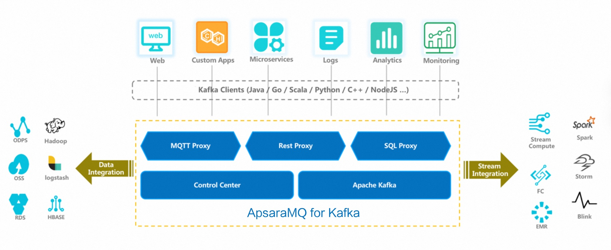

<a id="section-2"></a>

# 2.Console operations

<a id="section-2-1"></a>

## 2.1. Log on to the console

This topic describes how to log on to the ApsaraMQ for Kafka console.

**Prerequisites**

- The URL of the Apsara Uni-manager Management Console is obtained from the deployment personnel before you log on to the Apsara Uni-manager Management Console.

- A browser is available. We recommend that you use the Google Chrome browser.

**Procedure**

1. In the address bar, enter the URL of the Apsara Uni-manager Management Console. Press the Enter key.

2. Enter your username and password.

   Obtain the username and password that you can use to log on to the console from the operations administrator.

   > **Note**
   >
   > When you log on to the Apsara Uni-manager Management Console for the
   >
   > first time, you must change the password of your username. Your password must meet complexity requirements. The password must be 8 to 20 characters in length and must contain at least two of the following character types:
   >
   > - Uppercase or lowercase letters
   >
   > - Digits
   >
   > - Special characters, which include ! @ # $ %

3. Click **Login**.

4. If your account has multi-factor authentication (MFA) enabled, perform corresponding operations in the following scenarios:

   - You log on to the Apsara Uni-manager Management Console for the first time after MFA is enabled by the administrator:

     <ol type="a">

     <li>

     On the Bind Virtual MFA Device page, bind an MFA device.

     </li>

     <li>

     Enter the username and password again as in Step 2 and click **Log On**.

     </li>

     </ol>

     <ol type="i" start="100">

     <li>

     Enter a six-digit MFA verification code and click **Authenticate**.

     </li>

     </ol>

   - You have enabled MFA and bound an MFA device:

     Enter a six-digit MFA verification code and click **Authenticate**.

     > **Note**
     >
     > For more information, see the **Bind a virtual MFA device to enable**
     >
     > **MFA** topic in **Apsara Uni-manager Management Console User Guide**.

5. In the top navigation bar, choose **Products > Middleware > ApsaraMQ for Kafka**.

6. On the **ApsaraMQ for Kafka** page, select the organization and region and click **Kafka**.

<a id="section-2-2"></a>

## 2.2. Getting started

<a id="section-2-2-1"></a>

### 2.2.1. Create a topic

In ApsaraMQ for Kafka, topics are used to store messages published by producers. Before you send and receive messages, you must create a topic.

**Procedure**

1. Log on to the ApsaraMQ for Kafka console.

2. On the **Instance List** page, find the instance that you want to manage and click **Details** in the **Operation** column.

3. On the **Instance details page**, click the **Topic management** tab.

4. On the **Topic management** tab, click **Create a Topic**.

5. In the **Create a Topic** dialog box, follow the on-screen instructions to configure the parameters and click **OK**. The following table describes the parameters.

   | Parameter | Description |
   | --- | --- |
   | Topic | The topic name.<br>• The topic name can contain only letters, digits, hyphens (-), and underscores (_).<br>• The topic name must be 3 to 64 characters in length. If the name contains more than 64 characters, the name is automatically truncated.<br>• The topic name cannot be changed after the topic is created. |
   | Instance | The ID of the instance on which the topic is created. |
   | Number of partitions | The number of partitions in the topic.<br>We recommend that the number of partitions be a multiple of 6 to reduce data skew risks. Valid values: 1 to 48. |

<a id="section-2-2-2"></a>

### 2.2.2. Send messages

After you create a topic, you can send messages to the topic in the ApsaraMQ for Kafka console.

**Procedure**

1. Log on to the ApsaraMQ for Kafka console.

2. On the **Instance List** page, find the instance that you want to manage and click **Details** in the **Operation** column.

3. On the **Instance details page**, click the **Topic management** tab.

4. On the **Topic management** tab, find the topic that you want to manage and click **Send message** in the **Operation** column.

5. In the **Send message** panel, enter the ID of the partition from which you want to send a message in the **Partition** field and the message key and message value in the **Message Key** and **Message Value** fields. Then, click **OK**.

<a id="section-2-2-3"></a>

### 2.2.3. Query messages

After you send a message, you can query the message.

**Background information**

ApsaraMQ for Kafka allows you to query messages by using one of the following methods:

- By offset: If you know the partition from which the message is sent and the consumer offset of the message, you can use this method to query the message.

- By time: If you do not know the partition from which the message is sent and the consumer offset of the message but know the time when the message is sent, you can use this method to query the message.

**Usage notes**

- Up to 30 messages whose total size does not exceed 10 MB can be returned in a query result.

- A maximum of 1 KB of content can be displayed for each message. Content that exceeds 1 KB is automatically truncated. If you want to view the complete content of a message, download the message.

- Only messages that are not cleared by the broker can be queried. The following message cleanup policies are used on ApsaraMQ for Kafka brokers:

  - If the disk usage is lower than 85%, expired messages are deleted at 04:00 every day.

  - If the disk usage reaches 85%, expired messages are immediately deleted.

  - If the disk usage reaches 90%, stored messages are deleted in the order that the messages were stored in the clients.

**Query a message by offset**

1. Log on to the ApsaraMQ for Kafka console.

2. On the **Instance List** page, find the instance that you want to manage and click **Details** in the **Operation** column.

3. On the **Instance details page**, click the **Message query** tab.

4. On the **Message query** tab, click **Query by site**, enter or select the topic, partition, and consumer offset, and then click **Query**.

   The queried message is displayed on the **Message query** tab.

   | Parameter | Description |
   | --- | --- |
   | Partition | The partition in the topic from which the message is sent. |
   | Site | The consumer offset of the message. |
   | Time | The time when the message is stored on the broker. |
   | Key(size: 1B) | The message key. The key is transformed into a string. |
   | Value(size: 1B) | The message value. The value is transformed into a string. |

5. **(Optional)** If you want to download the key or value of a message, select the message and click **Download message** next to **Key** or **Value**.

**Query a message by time**

1. Log on to the ApsaraMQ for Kafka console.

2. On the **Instance List** page, find the instance that you want to manage and click **Details** in the **Operation** column.

3. On the **Instance details page**, click the **Message query** tab.

4. On the **Message query** tab, click **Query by time**, enter or select the topic, partition, and time, and then click **Query**.

   The queried message is displayed on the **Message query** tab.

   | Parameter | Description |
   | --- | --- |
   | Partition | The partition in the topic from which the message is sent. |
   | Site | The consumer offset of the message. |
   | Time | The time when the message is stored on the broker. |
   | Key(size: 1B) | The message key. The key is transformed into a string. |
   | Value(size: 1B) | The message value. The value is transformed into a string. |

5. **(Optional)** If you want to download the key or value of a message, select the message and click **Download message** next to **Key** or **Value**.

<a id="section-2-3"></a>

## 2.3. Instances

<a id="section-2-3-1"></a>

### 2.3.1. Manage instances

In ApsaraMQ for Kafka, an instance is used to store information about topics and group IDs. This topic describes how to create, scale out, and release an instance in the ApsaraMQ for Kafka console. This topic also describes how to view the details of an instance in the console.

**Prerequisites**

Sufficient physical resources are reserved to ensure the successful creation of an instance.

**Usage notes**

- To create an instance in the ApsaraMQ for Kafka console, you must upgrade ApsaraMQ for Kafka to V3.18.0.

- ApsaraMQ for Kafka V3.18.0 or later allows you to scale out an instance in the console if the instance is created in the console. The scaling method remains unchanged for instances delivered by using ApsaraMQ for Kafka of versions earlier than V3.18.0.

**Create an instance**

1. Log in to the ApsaraMQ for Kafka console.

2. In the left-side navigation pane, click **Instance List**.

3. On the **Instance List** page, click **Create an instance**.

4. On the **Create a Kafka instance** page, configure the following parameters and click **Submit**.

   > **Note**
   >
   > If Service Catalog is enabled for your environment, configure the following parameters on the **Create a Kafka instance** page and click **Confirm Order**.

   **Section**

   **Parameter**

   **Description**

   The organization to which the instance that

   **Organization**

   you want to create belongs.

   The resource set to which the instance that

   **Resource Set**

   you want to create belongs.

   The region where the instance that you

   **Geography**

   want to create resides.

   Basic

   The instance type. Single Zone is selected

   information

   **Instance Type**

   by default.

   **Primary Availability Zone**

   The primary zone.

   **Instance name**

   The instance name.

   The kernel version of the instance.

   **Kernel version**

   Valid values: **v2.8.2** and **v3.3.3**.

   The type of the chip that is used by the

   **Chip Type**

   ApsaraMQ for Kafka resource pool.

   The specification of the instance that you want to create. Valid values:

   - **Broker4C16G**

   **Specifications**

   - **Broker16C64G**

   - **Broker32C128G**

   Kafka node

   - **Broker8C32G**

   information

   **Number of brokers**

   The number of brokers. Minimum value: 3.

   The storage type. The default value is fast-disks-ssd, which specifies exclusive SSDs.

   **Storage Type**

   You cannot specify a custom value for this parameter.

   The number of disks for a single broker.

   **Number of disks per Broker**

   Default value: 1.

   The network type. Valid values:

   - **AnyTunnel**

   - **SingleTunnel**

   > **Note**

   **Network Type**

   > If you select AnyTunnel, the instance may be accessed by customer networks after networks are integrated. Make sure that the instance is protected.

   The ID of the VPC.

   > **Note**

   **VPC**

   > This parameter is required only if you set **Network Type** to **SingleTunnel**.

   The ID of the vSwitch to which the instance that you want to create belongs.

   > **Note**
   >
   > - This parameter is required only if you set **Network Type** to **SingleTunnel**.

   **VSwitch**

   > - We recommend that you select the vSwitch associated with the primary zone. You can view the zone where the vSwitch resides in the parentheses next to the vSwitch.

   Network Information

   The type of the endpoint. Valid values: **PLAINTEXT** and **SASL**. The default value is SASL.

   > **Note**

   **Access Point Type**

   > You can access an ApsaraMQ for Kafka instance by using a plaintext endpoint without authentication. Make sure that the endpoint is protected.

   - The prefix of the domain name.

     - The prefix can contain only letters,

   **Domain name prefix**

   digits, and hyphens (-).

   - It must be 3 to 20 characters in length.

   The port number of the SASL plaintext endpoint. The default port number is 8088.

   > **Note**

   **SASL plaintext access point**

   > This parameter is displayed only if you set **Access Point Type** to **SASL**.

   The port number of the encrypted SASL_SSL endpoint. The default port number is 8081.

   **SASL_SSL encrypted access**

   > **Note**

   **point**

   > This parameter is displayed only if you set **Access Point Type** to **SASL**.

   The port number of the plaintext endpoint. The default port number is 8080.

   > **Note**

   **Plaintext access point**

   > This parameter is displayed only if you set **Access Point Type** to **PLAINTEXT**.

**View an instance**

1. On the **Instance List** page, you can view **Tag**, **Instance status**, and **Expansion status** of each instance. You can click the icon in the **Monitoring** column of an instance to open the **Monitoring** window to view the monitoring information about the instance.

2. On the Instance List page, find the instance whose details you want to view and click the name of the instance, or click **Details** in the **Operation** column to open the **Instance Details** page.

3. On the **Instance Details** page, view the details of the instance on the **Basic information**, **Running status**, **Access point information**, and **Task execution record** tabs.

   <ol type="i">

   <li>

   **Basic information**: You can view the instance ID, instance name, zone, region, instance type, cluster type, major version, minor version, chip type, and specifications.

   </li>

   <li>

   **Running status**: You can view the running status, payment type, creation time, and auto-renewal status of the instance. You can also view topology information about ZooKeeper and broker nodes.

   </li>

   <li>

   **Access point information**: You can view information such as the network type, status, VPC ID, vSwitch ID, SASL_SSL, SASL_PLAINTEXT, and PLAINTEXT.

   </li>

   <li>

   **Task execution record**: You can view the task type, status, start time, and end time.

   </li>

   </ol>

**Restart an instance**

1. On the **Instance List** page, find the instance you want to restart and click **Restart** in the **Operation** column.

2. In the message that appears, click **OK**.

**Scale out an instance**

If your ApsaraMQ for Kafka instance cannot meet your business requirements, you can scale out the instance in the ApsaraMQ for Kafka console.

> **Important**
>
> After the scale-out, the number of brokers cannot be greater than the total number of exclusive nodes. ApsaraMQ for Kafka does not allow you to scale in an instance.

1. On the **Instance List** page, find the instance that you want to scale out and click **Expansion** in the **Operation** column.

2. On the **Kafka instance expansion** page, specify a value in the **Number of final state Broker nodes** and **Specifications** fields, and click **Submit**.

   > **Note**
   >
   > If Service Catalog is enabled for your environment, configure the following parameters on the **Create a Kafka instance** page and click **Confirm Order**.

**Perform load balancing**

After you scale out an instance, existing topics are not automatically distributed to new brokers. In this case, you need to perform load balancing.

1. On the **Instance List** page, find the instance that is scaled out and click the

   icon in the

   

   **Operation** column. Then, click **Load balancing**.

2. In the message that appears, read the note and click **OK**.

   > **Note**
   >
   > - After the scale-out, you can perform load balancing to evenly reallocate all partitions in the instance to all brokers.
   >
   > - Load balancing operations may affect concurrent traffic. We recommend that you perform these operations during off-peak hours.
   >
   > - Load balancing operations may affect the topics on which you have performed load balancing in the instance. Fully evaluate the impacts before you perform load balancing operations.

**Release an instance**

> **Warning**
>
> - After you release an instance, all data in the instance is deleted and cannot be restored. Proceed with caution.
>
> - Before you release an instance, make sure that the disaster recovery cluster relationship has been removed.

1. On the **Instance List** page, find the instance that you want to manage and click **Release** in the **Operation** column.

2. In the dialog box that appears, read the note, enter 

   `confirm`, and then click **OK**.

<a id="section-2-3-2"></a>

### 2.3.2. Configure instance relationships

Users in a resource group can view an ApsaraMQ for Kafka instance and perform operations on the instance only after you configure the relationships of the instance.

**Limits**

**Historical versions**

ApsaraMQ for Kafka strongly depends on the Apsara Uni-manager Management Console and OneConsole. To use the instance relationship feature, you must upgrade the three products at the same time. The following items describe the version numbers of the products after the upgrade:

- ApsaraMQ for Kafka

  - Hotfix name: v3.14.0r-paas-kafka-SP003

  - Version: ASEN_Prd-kafka_v1.14.3_archX

- Apsara Uni-manager Management Console: v3.14.0r-ascm-SP012

- OneConsole: v3.14.0r-ascm-SP012

**Current versions**

ApsaraMQ for Kafka strongly depends on the Apsara Uni-manager Management Console and OneConsole. To use the instance relationship feature, you must upgrade the three products at the same time. The following items describe the version numbers of the products after the upgrade:

- ApsaraMQ for Kafka

  - Hotfix name: v3.16.2r-paas-kafka-SP001

  - Version: ASEN_Prd-kafka_v1.14.3_archX

- Apsara Uni-manager Management Console: v3.16.2r-ascm-SP003

- OneConsole: v3.16.2r-oneConsole-SP003

After you upgrade the product versions, the resource auditor automatically has the permissions to query the instance relationship list. The organization administrator automatically has the permissions to query the instance relationship list and configure instance relationships. Other users have the permissions to query the instance relationship list and configure instance relationships only after the administrator grants the permissions to the users.

**Roles**

The organization administrator and resource auditor automatically have the permissions to query the instance relationship list or configure instance relationships.

**Configurations**

Each instance can belong only to one resource group. After you specify a resource group for an instance, you cannot change the resource group.

**Prerequisites**

The permissions to query the instance relationship list and configure instance relationships are granted to the logon user.

**Procedure**

1. Use the admin account to log on to the ApsaraMQ for Kafka console. For more information, see Log on to the ApsaraMQ for Kafka console.

2. In the left-side navigation pane, click **Instance Relationship Configuration**.

3. On the **Instance relationship configuration** page, find the instance that you want to manage and click **Home configuration** in the **Operation** column.

4. In the **Home configuration** panel, select the organization and resource set to which the instance belongs and click **OK**.

   On the **Instance relationship configuration** page, you can see the value in the **Operation** column of the corresponding instance changes to **Configured**.

<a id="section-2-3-3"></a>

### 2.3.3. Obtain the endpoint of an instance

This topic describes how to obtain the endpoint of an ApsaraMQ for Kafka instance.

**Prerequisites**

- The instance ownership is configured. For more information, see Configure instance relationships.

- A VIP is created. For more information, see Create a VIP.

**Background information**

ApsaraMQ for Kafka allows you to use endpoints to connect to the following ports:

- 8080: You can use this port when you connect to an instance in a virtual private cloud (VPC). Simple Authentication and Security Layer (SASL) authentication is not supported.

- 8081: You can use this port when you connect to an instance in a VPC. SASL authentication is supported. The PLAINTEXT mechanism is used to authenticate client identities, and the SSL encryption method is used during message transmission.

- 8088: You can use this port when you connect to an instance in a VPC. SASL authentication is supported. The PLAINTEXT mechanism is used to authenticate client identities.

**Procedure**

1. Log on to the ApsaraMQ for Kafka console.

2. In the left-side navigation pane, click **Instance List**.

3. On the **Instance List** page, find the instance that you want to manage, and click the instance name, or click **Details** in the **Operation** column.

4. On the **Instance details** page, click the **Access point information** tab to obtain the endpoint of the instance, such as SASL_SSL, PLAINTEXT, and SASL_PLAINTEXT.

<a id="section-2-3-4"></a>

### 2.3.4. Configure instance parameters

This topic describes how to configure the parameters of an ApsaraMQ for Kafka instance. After you modify the parameters of an ApsaraMQ for Kafka instance, the running of the instance is affected. Confirm before you modify instance parameters.

**Procedure**

1. Log on to the ApsaraMQ for Kafka console.

2. On the **Instances** page, find the instance whose parameters you want to modify and click **Parameter configuration** in the **Operation** column.

3. In the **Parameter configuration** panel, modify the parameters that are described in the following table.

   > **Warning**
   >
   > The default configurations are optimal configurations. We recommend that you do not modify the default configurations unless necessary. The modification of the following parameters, except for the **log.retention.bytes** parameter, causes the restart of ApsaraMQ for Kafka. We recommend that you modify the parameters when your business is idle.

   | Parameter | Description | Example |
   | --- | --- | --- |
   | message.max.bytes | The maximum size of a message that the server can receive. You must configure the same setting for this parameter on the consumer and producer clients.Otherwise, a message published by the producer may be beyond the processing capability of the consumer.Specify a proper value for this parameter based on your business requirements. | 10000000 |
   | num.partitions | The number of partitions of a topic. If you do not specify the number of partitions for a topic when you create the topic, the value of this parameter is used as the default value. | 3 |
   | auto.create.topics.enable | Specifies whether to enable the automatic topic creation feature. After you enable the feature, a topic is automatically created if the topic does not exist but is specified for a produce or fetch request. If you do not enable this feature, you need to create a topic by using the CLI. | No |
   | num.io.threads | The number of I/O threads used by a server to process requests. The value of this parameter must be greater than or equal to the number of disks. | 16 |
   | queued.max.requests | The maximum number of requests that can be queued for processing by an I/O thread before a network thread stops receiving requests. | 80 |
   | replica.fetch.wait.max.ms | The maximum period of time that the system can wait for the partition leader to respond to a request from a follower. If the request fails, the system automatically performs retries.Unit: milliseconds. | 500 |
   | replica.lag.time.max.ms | The maximum period of time within which a follower must send a request to fetch data from the partition leader. If a follower does not send requests within this period of time, the follower is removed from the ISR list and is considered unavailable. Unit: milliseconds. | 30000 |
   | num.network.threads | The number of network threads used by a server to process network requests. | 3 |
   | log.retention.bytes | The maximum size of data that can be stored in each partition of a topic. Unit: bytes.The maximum data size of each topic is calculated by multiplying the value of this parameter by the total number of partitions of a topic. If you specify both the log.retention.hours parameter and this parameter, a log file is deleted when one of the thresholds specified by the parameters is exceeded.The setting of this parameter is overwritten if you configure the corresponding setting for a topic. | 4 |
   | replica.fetch.max.bytes | The maximum size of data that can be obtained in each fetch request when the follower backs up data from the leader. Unit: bytes. | 10000000 |
   | num.replica.fetchers | The number of threads used to back up data from the partition leader. | 4 |
   | default.replication.factor | The default number of replicas for automatically created topics. | 3 |
   | offsets.retention.minutes | The retention period of a committed offset. After the retention period of an offset elapses, the offset is marked by the system and is pending to be deleted. Unit: minutes. | 10080 |
   | background.threads | The number of threads used for data processing in the background, such as deleting files. | 10 |

4. After you modify a parameter, click **Modify** in the **Operation** column of the parameter.

5. In the **Modify configuration** message, click **OK**.

<a id="section-2-3-5"></a>

### 2.3.5. View the instance monitoring information

You can view monitoring charts in the CloudMonitor console to obtain the information about ApsaraMQ for Kafka instances. This topic describes how to view the monitoring data of an ApsaraMQ for Kafka instance in the ApsaraMQ for Kafka console and the CloudMonitor console.

**Background information**

ApsaraMQ for Kafka allows you to monitor the status of your resources in real time by using CloudMonitor. For example, you can monitor the status of your brokers, topics, and groups. You can also configure alert rules for metrics. If a metric value exceeds the specified alert threshold, CloudMonitor notifies you by making a phone call or sending a text message, an email, or a DingTalk chatbot notification. This way, you can handle exceptions at the earliest opportunity. For more information, see the **Overview** topic of the **CloudMonitor User Guide** in Apsara Stack Documentation Center.

**Procedure**

1. Log on to the ApsaraMQ for Kafka console.

2. In the left-side navigation pane, click **Instance List**.

3. On the **Instance List** page, find the instance that you want to manage, and click the instance name, or click **Details** in the **Operation** column.

   > **Note**
   >
   > You can also click the  icon in the **Monitoring** column to open the monitoring panel.

4. On the **Instance details** page, click the **Monitoring** tab to view the monitoring information.

> **Note**
>
> You can also click **View more** in the upper-right corner of the Monitoring tab to go to the CloudMonitor console and view the detailed monitoring data of the instance.

| Item | Description |
| --- | --- |
| Granularity | The granularity by which the instance is monitored. Valid values: <strong>Broker</strong>, <strong>Topic</strong>, and <strong>Group</strong>. You can click the corresponding tab to view details. |
| Monitoring cycle | The period during which monitoring data is collected. Valid values:<br>• Hourly monitoring cycles: Last Hour, Last 3 hours, Last 6 hours, and Last 12 hours.<br>• Daily monitoring cycles: Last 1 day, Last 3 days, and Last 7 days.<br>• Custom: allows you to specify the start time and end time to define a monitoring cycle based on your business requirements. |
| Monitoring metric | The monitoring metrics. In this example, the granularity is set to broker.You can view the following metrics: <strong>Broker Message production</strong> <strong>traffic (BYTE)</strong>, <strong>Broker message consumption traffic (BYTE)</strong>, <strong>Broker Message production request frequency (count)</strong>, <strong>Number</strong> <strong>of Broker messages produced (count)</strong>, and <strong>Broker message</strong> <strong>consumption request frequency (count)</strong>.<br>For more information about monitoring metrics, see the supported metrics of <strong>ApsaraMQ for Kafka</strong> in the <strong>CloudMonitor User Guide</strong> in <strong>Apsara Stack Documentation Center</strong>.<br>You can also click theicon in the upper-right corner of each<br>monitoring chart to quickly create an alert rule. |

<a id="section-2-3-6"></a>

### 2.3.6. View the operation logs of an instance

This topic describes how to view the operation logs of an ApsaraMQ for Kafka instance. This helps you quickly identify the cause of exceptions that occur when you manage or use ApsaraMQ for Kafka and improve troubleshooting efficiency.

> **Note**
>
> 1. Operation logs are retained for seven days. To adjust the retention period, modify the
>
> logging configurations as an administrator.
>
> 2. If you extend the retention period by modifying the logging configurations, the log data
>
> generated before the new retention period is not backfilled.

**Procedure**

1. Log on to the ApsaraMQ for Kafka console.

2. In the left-side navigation pane, click **Instance List**.

3. On the **Instance List** page, find the instance that you want to manage, and click the instance name, or click **Details** in the **Operation** column.

4. On the **Instance details** page, click the **Operation Log** tab to view the operation log of the instance.

5. By default, the system displays all operations performed on the ApsaraMQ for Kafka instance and its related resources in the last seven days.

   You can select a filter condition from the drop-down list next to **Operator**.

   You can also click **Advanced Filter** to filter the operations by **Operator**, **Operation Name**, **Execution Status**, **Operation Source IP**, and **Operation Time**.

<a id="section-2-4"></a>

## 2.4. Topics

<a id="section-2-4-1"></a>

### 2.4.1. Create topics

In ApsaraMQ for Kafka, topics are used to store messages published by producers. Before you send and receive messages, you must create a topic.

**Procedure**

1. Log on to the ApsaraMQ for Kafka console.

2. On the **Instance List** page, find the instance that you want to manage and click **Details** in the **Operation** column.

3. On the **Instance details page**, click the **Topic management** tab.

4. On the **Topic management** tab, click **Create a Topic**.

5. In the **Create a Topic** dialog box, follow the on-screen instructions to configure the parameters and click **OK**. The following table describes the parameters.

   | Parameter | Description |
   | --- | --- |
   | Topic | The topic name.<br>• The topic name can contain only letters, digits, hyphens (-), and underscores (_).<br>• The topic name must be 3 to 64 characters in length. If the name contains more than 64 characters, the name is automatically truncated.<br>• The topic name cannot be changed after the topic is created. |
   | Instance | The ID of the instance on which the topic is created. |
   | Number of partitions | The number of partitions in the topic.<br>We recommend that the number of partitions be a multiple of 6 to reduce data skew risks. Valid values: 1 to 48. |

<a id="section-2-4-2"></a>

### 2.4.2. View the list of topics

This topic describes how to view the list of topics.

**Procedure**

1. Log in to the ApsaraMQ for Kafka console.

2. In the left-side navigation pane, click **Instance List**.

3. On the **Instance List** page, find the instance that you want to manage, and click the instance name, or click **Details** in the **Operation** column.

4. Click the **Topic management** tab.

5. On the **Topic management** tab, view the list of topics.

<a id="section-2-4-3"></a>

### 2.4.3. View partition status in a topic

After you create a topic, you can view the status of each partition in the topic.

**Procedure**

1. Log on to the ApsaraMQ for Kafka console.

2. On the **Instance List** page, find the instance that you want to manage, and click the instance name, or click **Details** in the **Operation** column.

3. On the **Instance details** page, click the **Topic management** tab.

4. On the **Topic management** tab, find the topic that you want to manage and click **Partition status** in the **Operation** column.

   In the **Partition status** panel, the status of all partitions in the topic is displayed.

   | Parameter | Description |
   | --- | --- |
   | Total Number Of Messages On The Current Server | The total number of messages in all partitions. |
   | Partition ID | The partition ID. |
   | Earliest Offset | The minimum offset in the partition. |
   | Latest Offset | The maximum offset in the partition. |
   | ISR | The in-sync replicas. |
   | Leader | The leader replica. Messages are sent to and received from the leader. |

<a id="section-2-4-4"></a>

### 2.4.4. View the subscriptions of a topic

After you create a topic, you can view the online consumer groups that subscribe to the topic.

**Procedure**

1. Log on to the ApsaraMQ for Kafka console.

2. On the **Instance List** page, find the instance that you want to manage, and click the instance name, or click **Details** in the **Operation** column.

3. On the **Instance details** page, click the **Topic management** tab.

4. On the **Topic management** tab, find the topic that you want to manage and click **Subscription relationship** in the **Operation** column.

   In the panel that appears, you can view all consumer groups that subscribe to the topic.

   | Parameter | Description |
   | --- | --- |
   | Topic | The topic name. |
   | Subscription Consumer Group | The number of consumer groups that subscribe to the topic. |
   | No. | The serial number. |
   | Consumer Group ID | The ID of the online consumer group that subscribes to the topic. If the group ID is offline, you cannot view the topic. |

<a id="section-2-4-5"></a>

### 2.4.5. Modify topic configurations

After you create a topic, you can modify the configurations of the topic.

**Procedure**

1. Log on to the ApsaraMQ for Kafka console.

2. On the **Instance List** page, find the instance that you want to manage, and click the instance name, or click **Details** in the **Operation** column.

3. On the **Instance details** page, click the **Topic management** tab.

4. On the **Topic management** tab, find the topic that you want to manage, click the

   icon

   

   in the **Operation** column, and then click **topic configuration**.

5. In the **Topic configuration** dialog box, find the configuration item that you want to modify, click **Modify**, select or enter a target value, and click **OK**.

   | Parameter | Description |
   | --- | --- |
   | min.insync.replicas(Minimum number of synchronized replicas) | The minimum number of synchronized replicas.<br>• The minimum value is 1. The maximum value is the current number of replicas. We recommend that you set this value to 1.<br>• The minimum number of synchronized replicas must be smaller than or equal to the number of replicas.<br>• The minimum number of synchronized replicas defines the minimum number of replicas from which the system receives acknowledgments to determine the successful writing of a message. This value is valid only if the producer sets message acknowledgment to <code> All </code> or <code> -1 </code>. |
   | retention.ms(Message retention time(ms)) | The period of time for which messages are retained in a topic.<br>Valid values: 3600000 ms to 864000000 ms. |
   | max.message.bytes(Maximum message size(bytes)) | The maximum size of a message that the topic can receive from a producer.<br>Valid values: 1048576 bytes to 10485760 bytes. |
   | retention.bytes(The total amount of data saved for each partition under each topic(bytes)) | The total amount of data stored in each partition in each topic.<br>Valid values: <code> -1 </code>, or 268435456 bytes to 1073741824bytes.<br>Note<br>The value <code> -1 </code> indicates that the log size of the partition has no limit. |

<a id="section-2-4-6"></a>

### 2.4.6. Increase the number of partitions in a topic

After you create a topic, you can increase the number of partitions in the topic. You cannot decrease the number of partitions in a topic in ApsaraMQ for Kafka. If you want to decrease the number of partitions in a topic, delete the topic and create another topic that has the required number of partitions.

**Procedure**

1. Log on to the ApsaraMQ for Kafka console.

2. On the **Instance List** page, find the instance that you want to manage, and click the instance name, or click **Details** in the **Operation** column.

3. On the **Instance details** page, click the **Topic management** tab.

4. On the **Topic management** page, find the topic that you want to manage, click the

   icon

   

   in the **Operation** column, and then click **Increase the number of partitions**.

5. In the **Increase the number of partitions** dialog box, configure the **Number of new partitions** parameter and click **OK**.

   > **Note**
   >
   > The number of partitions ranges from 1 to 48. To reduce the risk of data skew, we recommend that you select a multiple of 6. For special requirements, submit a ticket for consultation.

<a id="section-2-4-7"></a>

### 2.4.7. Migrate topic partitions

This topic describes how to migrate topic partitions on a scaled-out ApsaraMQ for Kafka instance.

**Prerequisites**

An ApsaraMQ for Kafka instance is deployed and its value of **Expansion status** is **Expanded**. For more information about how to scale out an instance, see the "Scale out an instance" section of the Manage instances topic.

**Procedure**

**Rebalance messages for a single topic**

1. Log in to the ApsaraMQ for Kafka console.

2. In the left-side navigation pane, click **Instance List**.

3. On the **Instance List** page, find the instance that you want to manage, and click the instance name, or click **Details** in the **Operation** column.

4. Click the **Topic management** tab.

5. In the topic list, find the topic that you want to manage, click the  icon in the **Operation**

   column, and then click **Message rebalancing**.

6. In the **Message rebalancing** dialog box, view the brokers in the **Current distribution brokers** section. In the **Rebalanced brokers** section, select all brokers or the brokers to which you want to redistribute messages.

   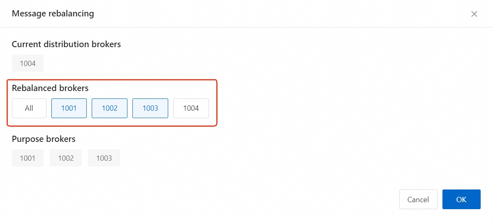

7. Confirm the selected brokers in the **Purpose brokers** section and click **OK**.

**Batch rebalance messages**

> **Note**
>
> You cannot select destination brokers for batch message rebalancing. By default, messages are load-balanced across all brokers.

1. Log in to the ApsaraMQ for Kafka console.

2. In the left-side navigation pane, click **Instance List**.

3. On the **Instance List** page, find the instance that you want to manage, and click the instance name, or click **Details** in the **Operation** column.

4. Click the **Topic management** tab.

5. In the topic list, select the topics for which you want to rebalance messages and click **Bulk Message Rebalancing** below the topic list.

6. In the **Confirm** dialog box, confirm the topics for which you want to rebalance messages and click **OK**.

<a id="section-2-5"></a>

## 2.5. Consumer groups

<a id="section-2-5-1"></a>

### 2.5.1. Create a consumer group

This topic describes how to create a consumer group.

**Background information**

Consumer groups are the core of the message parallel consumption, load balancing, and fault tolerance mechanisms. If multiple consumer instances are added to the same consumer group and subscribe to one or more the same topics, ApsaraMQ for Kafka automatically assigns partitions to members in the consumer group. This ensures that each message is consumed only once by a consumer in the group.

**Procedure**

1. Log in to the ApsaraMQ for Kafka console.

2. In the left-side navigation pane, click **Instance List**.

3. On the **Instance List** page, find the instance that you want to manage and click its name. You can also click **Details** in the **Operation** column.

4. On the **Instance Details** page, click the **Group Management** tab.

5. On the **Group Management** tab, click **Create Consumer Group**.

6. In the **Create Consumer Group** dialog box, enter a name into the **Consumer Group** parameter and click **OK**.

   > **Note**
   >
   > - The value of the **Consumer Group** parameter must be 1 to 255 characters in length, and can contain letters, digits, underscores (_), hyphens (-), and periods (.).
   >
   > - The value of the **Consumer Group** parameter cannot be modified after the consumer group is created. Proceed with caution.

**What to do next**

- View sample code: Click **Code sample** in the **Operation** column. Then, the system automatically generates connection and consumption templates for the selected mainstream programming language, including the **message sending**, **message receiving**, and **configuration file** templates. You can click **Copy** to copy the code.

- To delete a consumer group, click **Delete** in the **Operation** column of the consumer group. In the message that appears, click **OK**.

<a id="section-2-5-2"></a>

### 2.5.2. View the list of consumer groups

This topic describes how to view the list of consumer groups.

**Procedure**

1. Log on to the ApsaraMQ for Kafka console.

2. In the left-side navigation pane, click **Instance List**.

3. On the **Instance List** page, find the instance that you want to manage, and click the instance name, or click **Details** in the **Operation** column.

4. On the **Instance details** page, click the **Group management** tab.

5. On the **Group management** tab, view the list of consumer groups.

<a id="section-2-5-3"></a>

### 2.5.3. View the consumer status of a consumer group

This topic describes how to view the consumer status of a consumer group.

**Procedure**

1. Log on to the ApsaraMQ for Kafka console.

2. In the left-side navigation pane, click **Instance List**.

3. On the **Instance List** page, find the instance that you want to manage, and click the instance name, or click **Details** in the **Operation** column.

4. On the **Instance details** page, click the **Group management** tab.

5. On the **Group management** tab, find the consumer group that you want to manage and click **Consumption status** in the **Operation** column.

   In the **Consumption status** panel, the status of all consumers in the consumer group is displayed.

   | Parameter | Description |
   | --- | --- |
   | Total message accumulation | The total number of unconsumed messages in all topics to which the consumer group subscribes. |
   | Topic | The name of the topic to which the consumer group subscribes. |
   | Accumulation | The number of unconsumed messages in the topic to which the consumer group subscribes. |

6. **Optional.** If you want to view the consumption details of a specific topic, find the topic in the topic list of the **Consumption status** panel and click **Details** in the **Operation** column of the topic.

   The consumption details of the topic are displayed in the message that appears.

   | Parameter | Description |
   | --- | --- |
   | Partition ID | The partition ID. |
   | owner | The ID of the online consumer that subscribes to the topic.<br>Note<br>• The value is in the &lt;Client ID&gt;_/&lt;IP address&gt; format.<br>• You cannot view the owner information about offline consumers. |
   | Maximum site | The maximum offset from which messages can be consumed in the partition. |
   | Consumption point | The offset from which messages are consumed in the partition. |
   | Accumulation | The total number of accumulated messages in the current partition. The value is calculated by using the following formula: Total number of accumulated messages = Maximum offset - Consumer offset.<br>Note<br>This parameter is a key metric. If a large number of messages are accumulated, consumers may be blocked, or the consumption rate cannot keep up with the production rate. In this case, you need to analyze the consumer running status and improve the consumption speed. |

<a id="section-2-5-4"></a>

### 2.5.4. Reset the consumer offset of a consumer group

If you reset a consumer offset, the offset from which a consumer starts to consume messages is changed. You can reset consumer offsets to skip the accumulated or undesired messages instead of consuming them. You can also consume messages sent after a point in time regardless of whether the messages sent before this point in time are consumed.

**Prerequisites**

All consumers in the consumer group for which you want to reset the consumer offset are stopped.

> **Important**
>
> - ApsaraMQ for Kafka no longer supports the resetting of offsets during client connection.
>
> - ApsaraMQ for Kafka considers a consumer stopped only after the period of time specified by the  `ConsumerConfig.SESSION_TIMEOUT_MS_CONFIG`  parameter elapses. The default value of the parameter is 10000, in milliseconds.

**Background information**

ApsaraMQ for Kafka allows you to reset consumer offsets by using one of the following methods:

- **Clear all accumulated messages and start consumption from the latest offset:** If you no longer want to consume accumulated messages on the broker, clear the messages for the consumer. This way, the consumer offset is set to the latest offset.

  > **Important**
  >
  > This method changes only the consumer offset. The accumulated messages are not deleted.

- **Start consumption at the specified time point**: You can reset the offset of a consumer group to a previous or future time point. For example, assume "t" is the time point when a message is stored. After the reset, the consumer group subscribes to messages stored after the "t" time point.

**Procedure**

1. Log on to the ApsaraMQ for Kafka console.

2. In the left-side navigation pane, click **Instance List**.

3. On the **Instance List** page, find the instance that you want to manage, and click the instance name, or click **Details** in the **Operation** column.

4. On the **Instance details** page, click the **Group management** tab.

5. On the **Group management** tab, find the consumer group that you want to manage and click **Reset consumption point** in the **Operation** column.

6. In the **Reset consumer point** dialog box, select the topic from the **Topic** drop-down list, select a method used to reset the consumption offset, and then click **OK**.

<a id="section-2-6"></a>

## 2.6. Messages

<a id="section-2-6-1"></a>

### 2.6.1. Send messages

After you create a topic, you can send messages to the topic in the ApsaraMQ for Kafka console.

**Procedure**

1. Log on to the ApsaraMQ for Kafka console.

2. On the **Instance List** page, find the instance that you want to manage and click **Details** in the **Operation** column.

3. On the **Instance details page**, click the **Topic management** tab.

4. On the **Topic management** tab, find the topic that you want to manage and click **Send message** in the **Operation** column.

5. In the **Send message** panel, enter the ID of the partition from which you want to send a message in the **Partition** field and the message key and message value in the **Message Key** and **Message Value** fields. Then, click **OK**.

<a id="section-2-6-2"></a>

### 2.6.2. Query messages

After you send a message, you can query the message.

**Background information**

ApsaraMQ for Kafka allows you to query messages by using one of the following methods:

- By offset: If you know the partition from which the message is sent and the consumer offset of the message, you can use this method to query the message.

- By time: If you do not know the partition from which the message is sent and the consumer offset of the message but know the time when the message is sent, you can use this method to query the message.

**Usage notes**

- Up to 30 messages whose total size does not exceed 10 MB can be returned in a query result.

- A maximum of 1 KB of content can be displayed for each message. Content that exceeds 1 KB is automatically truncated. If you want to view the complete content of a message, download the message.

- Only messages that are not cleared by the broker can be queried. The following message cleanup policies are used on ApsaraMQ for Kafka brokers:

  - If the disk usage is lower than 85%, expired messages are deleted at 04:00 every day.

  - If the disk usage reaches 85%, expired messages are immediately deleted.

  - If the disk usage reaches 90%, stored messages are deleted in the order that the messages were stored in the clients.

**Query a message by offset**

1. Log on to the ApsaraMQ for Kafka console.

2. On the **Instance List** page, find the instance that you want to manage and click **Details** in the **Operation** column.

3. On the **Instance details page**, click the **Message query** tab.

4. On the **Message query** tab, click **Query by site**, enter or select the topic, partition, and consumer offset, and then click **Query**.

   The queried message is displayed on the **Message query** tab.

   | Parameter | Description |
   | --- | --- |
   | Partition | The partition in the topic from which the message is sent. |
   | Site | The consumer offset of the message. |
   | Time | The time when the message is stored on the broker. |
   | Key(size: 1B) | The message key. The key is transformed into a string. |
   | Value(size: 1B) | The message value. The value is transformed into a string. |

5. **(Optional)** If you want to download the key or value of a message, select the message and click **Download message** next to **Key** or **Value**.

**Query a message by time**

1. Log on to the ApsaraMQ for Kafka console.

2. On the **Instance List** page, find the instance that you want to manage and click **Details** in the **Operation** column.

3. On the **Instance details page**, click the **Message query** tab.

4. On the **Message query** tab, click **Query by time**, enter or select the topic, partition, and time, and then click **Query**.

   The queried message is displayed on the **Message query** tab.

   | Parameter | Description |
   | --- | --- |
   | Partition | The partition in the topic from which the message is sent. |
   | Site | The consumer offset of the message. |
   | Time | The time when the message is stored on the broker. |
   | Key(size: 1B) | The message key. The key is transformed into a string. |
   | Value(size: 1B) | The message value. The value is transformed into a string. |

5. **(Optional)** If you want to download the key or value of a message, select the message and click **Download message** next to **Key** or **Value**.

<a id="section-2-7"></a>

## 2.7. ACL

<a id="section-2-7-1"></a>

### 2.7.1. Create SASL users

This topic describes how to create a Simple Authentication and Security Layer (SASL) user.

**Prerequisites**

The ACL feature is enabled for the ApsaraMQ for Kafka instance. For more information, see Enable ACL.

**Procedure**

1. Log on to the ApsaraMQ for Kafka console.

2. In the left-side navigation pane, click **Instances**.

3. On the **Instance List** page, find the instance that you want to manage and click **Details** in the **Operation** column.

4. Click the **SASL user** tab.

5. On the **SASL User** tab, click **Create a SASL user**.

6. In the **Create a SASL user** dialog box, configure the parameters and click **OK**. The following table describes the parameters.

   | Parameter | Description |
   | --- | --- |
   | Username | The name of the SASL user. |
   | Password | The password of the SASL user. |
   | Type | The type of the SASL user. ApsaraMQ for Kafka supports the following SASL mechanism:<br>SCRAM: a username and password verification mechanism that provides higher security than PLAIN. ApsaraMQ for Kafka uses SCRAM-SHA-256. |

<a id="section-2-7-2"></a>

### 2.7.2. Grant permissions to SASL users

This topic describes how to grant permissions to a Simple Authentication and Security Layer (SASL) user.

**Prerequisites**

An SASL user is created. For more information, see Create SASL users.

**Procedure**

1. Log on to the ApsaraMQ for Kafka console.

2. In the left-side navigation pane, click **Instance List**.

3. On the **Instance List** page, find the instance that you want to manage, and click the instance name, or click **Details** in the **Operation** column.

4. On the **Instance Details** page, click **SASL Permissions**.

5. Click **Create an ACL**.

6. In the **Create an ACL** dialog box, configure the parameters and click **OK**. The following table describes the parameters.

   | Parameter | Description |
   | --- | --- |
   | Username | The name of the SASL user.<br>Note<br>ApsaraMQ for Kafka supports the use of asterisks (\*) as wildcard characters. You can use an asterisk (\*) to specify all usernames. |
   | Resource type | The resource type. Valid values:<br>• Topic: a topic.<br>• Group: a consumer group.<br>• Cluster: a cluster. |
   | Matching pattern | The mode in which resources are matched. Valid values:<br>• Full match: matches resources by literal value. In this mode, only resources with the same name are matched.<br>• Prefix matching: matches resources by prefix. In this mode, resource names that start with the specified prefix are matched. |
   | Operation type | The type of the operation that the SASL user can perform on resources.You can select multiple operation types to authorize various permissions at a time.<br>• Topic resources support the following operation types:<br>• Write: writes data.<br>• Read: reads data.<br>• Describe: describes resources.<br>• Describe_Configs: describes configurations.<br>• Alter: alters resources.<br>• Delete: deletes resources.<br>• Create: creates resources.<br>• Alter_Configs: alters configurations.<br>• All: selects all.<br>• Group resources support only the operation type Read.<br>• Cluster resources support the following operation types:<br>• Cluster_Action: cluster operations.<br>• Describe: describes resources.<br>• Alter: alters resources.<br>• Create: creates resources.<br>• Alter_Configs: alters configurations.<br>• All: selects all. |
   | Whether to customize the resource name | If you select this option, you can enter a custom group name (resource name) instead of selecting an existing group to create an ACL. To make the created ACL take effect, you must manually create a group with the same name.<br>Note<br>This option is available only when you set <strong>Resource type</strong> to <strong>Group</strong> and set <strong>Matching pattern</strong> to <strong>Full match</strong>. |
   | Resource Name | The resource name. The value can be the name of a topic or a consumer group.<br>Note<br>ApsaraMQ for Kafka supports the use of asterisks (\*) as wildcard characters. You can use an asterisk (\*) to specify all resource names. |
   | Whitelist address | The IP address that you want to add to the ACL. Only the IP addresses and ports in the ACL can access the ApsaraMQ for Kafka instance. |

<a id="section-2-7-3"></a>

### 2.7.3. Configure an ACL

This topic describes how to configure an access control list (ACL) for an ApsaraMQ for Kafka instance. After an ACL is configured for an ApsaraMQ for Kafka instance, only the IP addresses and ports in the ACL can be used to access the instance.

**Prerequisites**

An ApsaraMQ for Kafka instance is deployed and is in the **In service** state.

**Create an ACL**

1. Log on to the ApsaraMQ for Kafka console.

2. In the left-side navigation pane, click **Instance List**.

3. On the **Instance List** page, find the instance that you want to manage, and click the instance name, or click **Details** in the **Operation** column.

4. On the **Instance Details** page, click **SASL Permissions**.

5. On the SASL permissions tab, click **Create an ACL**. In the **Create an ACL** dialog box, configure the parameters that are described in the following table and click **OK**.

   | Parameter | Description |
   | --- | --- |
   | Username | The name of the SASL user.<br>Note<br>ApsaraMQ for Kafka supports the use of asterisks (\*) as wildcard characters. You can use an asterisk (\*) to specify all usernames. |
   | Resource type | The resource type. Valid values:<br>• Topic: a topic.<br>• Group: a consumer group.<br>• Cluster: a cluster. |
   | Matching pattern | The mode in which resources are matched. Valid values:<br>• Full match: matches resources by literal value. In this mode, only resources with the same name are matched.<br>• Prefix matching: matches resources by prefix. In this mode, resource names that start with the specified prefix are matched. |
   | Operation type | The type of the operation that the SASL user can perform on resources.You can select multiple operation types to authorize various permissions at a time.<br>• Topic resources support the following operation types:<br>• Write: writes data.<br>• Read: reads data.<br>• Describe: describes resources.<br>• Describe_Configs: describes configurations.<br>• Alter: alters resources.<br>• Delete: deletes resources.<br>• Create: creates resources.<br>• Alter_Configs: alters configurations.<br>• All: selects all.<br>• Group resources support only the operation type Read.<br>• Cluster resources support the following operation types:<br>• Cluster_Action: cluster operations.<br>• Describe: describes resources.<br>• Alter: alters resources.<br>• Create: creates resources.<br>• Alter_Configs: alters configurations.<br>• All: selects all. |
   | Whether to customize the resource name | If you select this option, you can enter a custom group name (resource name) instead of selecting an existing group to create an ACL. To make the created ACL take effect, you must manually create a group with the same name.<br>Note<br>This option is available only when you set <strong>Resource type</strong> to <strong>Group</strong> and set <strong>Matching pattern</strong> to <strong>Full match</strong>. |
   | Resource Name | The resource name. The value can be the name of a topic or a consumer group.<br>Note<br>ApsaraMQ for Kafka supports the use of asterisks (\*) as wildcard characters. You can use an asterisk (\*) to specify all resource names. |
   | Whitelist address | The IP address that you want to add to the ACL. Only the IP addresses and ports in the ACL can access the ApsaraMQ for Kafka instance. |

**Delete an ACL**

1. Log on to the ApsaraMQ for Kafka console.

2. In the left-side navigation pane, click **Instance List**.

3. On the **Instance List** page, find the instance that you want to manage, and click the instance name, or click **Details** in the **Operation** column.

4. On the **Instance Details** page, click **SASL Permissions**.

5. On the SASL permissions tab, find the ACL that you want to delete and click **Delete** in the **Operation** column.

6. In the **Delete ACL** dialog box, click **OK**.

<a id="section-2-7-4"></a>

### 2.7.4. Change the passwords of SASL users

This topic describes how to change the password of a Simple Authentication and Security Layer (SASL) user.

**Prerequisites**

A SASL user is created. For more information, see Create SASL users.

**Procedure**

1. Log on to the ApsaraMQ for Kafka console.

2. In the left-side navigation pane, click **Instances**.

3. On the **Instance List** page, find the instance that you want to manage and click **Details** in the **Operation** column.

4. Click the **SASL user** tab.

5. On the **SASL user** tab, find the SASL user whose password you want to change and click **Modify** in the **Operation** column.

6. In the **Modify SASL users** dialog box, enter a new password and click **OK**.

<a id="section-2-7-5"></a>

### 2.7.5. Delete SASL users

This topic describes how to delete a Simple Authentication and Security Layer (SASL) user.

**Prerequisites**

A SASL user is created. For more information, see Create SASL users.

**Procedure**

1. Log on to the ApsaraMQ for Kafka console.

2. In the left-side navigation pane, click **Instances**.

3. On the **Instance List** page, find the instance that you want to manage and click **Details** in the **Operation** column.

4. Click the **SASL user** tab.

5. On the **SASL user** tab, find the SASL user that you want to delete and click **Delete** in the **Operation** column.

6. In the **Delete SASL user** message, click **OK**.

<a id="section-2-7-6"></a>

### 2.7.6. Delete the permissions of SASL users

This topic describes how to delete the permissions that are granted to a Simple Authentication and Security Layer (SASL) user.

**Prerequisites**

Permissions are granted to the SASL user. For more information, see Grant permissions to SASL users.

**Procedure**

1. Log on to the ApsaraMQ for Kafka console.

2. In the left-side navigation pane, click **Instances**.

3. On the **Instance List** page, find the instance that you want to manage and click **Details** in the **Operation** column.

4. Click the **SASL permissions** tab.

5. On the **SASL permissions** tab, specify the query conditions to query the permissions that you want to delete and click **Query**.

6. In the query result, find the permissions that you want to delete and click **Delete** in the **Operation** column.

7. In the **Delete ACL** message, click **OK**.

<a id="section-2-7-7"></a>

### 2.7.7. Download an ACL certificate

This topic describes how to download an Access Control List (ACL) certificate.

**Prerequisites**

The endpoint type for the target instance is SASL. The endpoint information contains values for SASL_SSL and SASL_PLAINTEXT.

**Procedure**

1. Log on to the ApsaraMQ for Kafka console.

2. In the left-side navigation pane, click **Instance List**.

3. On the **Instance List** page, find the instance that you want to manage, and click the instance name, or click **Details** in the **Operation** column.

4. On the **Instance Details** page, click **SASL Permissions**.

5. On the **SASL Permissions** tab, click **Download ACL Certificate** to download the certificate to your local computer.

<a id="section-2-8"></a>

## 2.8. VIPs

<a id="section-2-8-1"></a>

### 2.8.1. Create a VIP

This topic describes how to create a virtual IP address (VIP).

**Background information Background information**

ApsaraMQ for Kafka provides the following types of VIPs:

- **SingleTunnel:** Allows access to ApsaraMQ for Kafka only from a specific VPC.

- **AnyTunnel:** Allows access to ApsaraMQ for Kafka from any VPC.

**Procedure**

1. Log on to the ApsaraMQ for Kafka console.

2. In the left-side navigation pane, click **Instance List**.

3. On the **Instance List** page, find the instance that you want to manage, and click the instance name, or click **Details** in the **Operation** column.

4. On the **Instance Details** page, click the **Endpoints** tab, and then click **Create**.

5. On the **Create VIP** page, configure the following network parameters and click **Submit**.

   | Parameter | Description |
   | --- | --- |
   | Network Type | The network type. Valid values:<br>• AnyTunnel<br>• SingleTunnel<br>Note<br>If you select AnyTunnel, the instance may be accessed by customer networks after networks are integrated. Make sure that the instance is protected. |
   | Endpoint Type | The type of the endpoint. Valid values: <strong>PLAINTEXT</strong> and <strong>SASL</strong>. The default value is SASL.<br>Note<br>You can access an ApsaraMQ for Kafka instance by using a plaintext endpoint without authentication.Make sure that the endpoint is protected. |
   | VPC ID | The ID of the VPC.<br>Note<br>This parameter is required only if you set <strong>Network</strong> <strong>Type</strong> to <strong>SingleTunnel</strong>. |
   | VSwitch ID | The ID of the vSwitch to which the instance that you want to create belongs.<br>Note<br>• This parameter is required only if you set <strong>Network Type</strong> to <strong>SingleTunnel</strong>.<br>• We recommend that you select the vSwitch associated with the primary zone. You can view the zone where the vSwitch resides in the parentheses next to the vSwitch. |
   | UID | The UID of the owner of the specified vSwitch ID.<br>Note<br>This parameter is required only when <strong>Network Type</strong> is set to <strong>SingleTunnel</strong>. |
   | Domain Name Prefix | • The prefix of the domain name.<br>• The prefix can contain only letters, digits, and hyphens (-).<br>• It must be 3 to 20 characters in length. |
   | SASL Plaintext Endpoint | The port number of the SASL plaintext endpoint. The default port number is 8088.<br>Note<br>This parameter is displayed only if you set <strong>Access</strong> <strong>Point Type</strong> to <strong>SASL</strong>. |
   | SASL_SSL Encrypted Endpoint | The port number of the encrypted SASL_SSL endpoint. The default port number is 8081.<br>Note<br>This parameter is displayed only if you set <strong>Access</strong> <strong>Point Type</strong> to <strong>SASL</strong>. |
   | Plaintext Endpoint | The port number of the plaintext endpoint. The default port number is 8080.<br>Note<br>This parameter is displayed only if you set <strong>Access</strong> <strong>Point Type</strong> to <strong>PLAINTEXT</strong>. |

   To create a VIP, you must update the ApsaraMQ for Kafka network and restart the ApsaraMQ for Kafka service. This process takes approximately 10 minutes for each ApsaraMQ for Kafka node.

<a id="section-2-8-2"></a>

### 2.8.2. Delete a VIP

This topic describes how to delete a VIP.

**Procedure**

1. Log on to the ApsaraMQ for Kafka console.

2. In the left-side navigation pane, click **Instance List**.

3. On the **Instance List** page, find the instance that you want to manage, and click the instance name, or click **Details** in the **Operation** column.

4. On the **Instance details** page, click the **Access point information** tab and click **Delete**.

5. In the **Confirm deletion** dialog box, enter 

   `confirm` and click **OK**.

   > **Important**
   >
   > After you delete a VIP, the ApsaraMQ for Kafka instance becomes unavailable. Proceed with caution.

<a id="section-2-8-3"></a>

### 2.8.3. Request a domain name

This topic describes how to request a domain name for a virtual IP address (VIP) endpoint that does not have a domain name prefix.

**Prerequisites**

The VIP endpoint does not have a domain name prefix.

**Procedure**

1. Log on to the ApsaraMQ for Kafka console.

2. In the left-side navigation pane, click **Instance List**.

3. On the **Instance List** page, find the instance that you want to manage, and click the instance name, or click **Details** in the **Operation** column.

4. On the **Instance Details** page, click the **Endpoint Information** tab, and click **Request Domain Name**.

5. In the **Request Domain Name** window, enter a domain name prefix, and click **OK**.

<a id="section-2-9"></a>

## 2.9. Data integration

<a id="section-2-9-1"></a>

### 2.9.1. Message routing

You can use the message routing feature to create and manage message synchronization clouds, remote tasks, and local tasks.

<a id="section-2-9-1-1"></a>

#### 2.9.1.1. Manage replicators

This topic describes how to create and view replicators in the ApsaraMQ for Kafka console.

**Background information**

ApsaraMQ for Kafka allows you to dynamically create and manage replicators in the ApsaraMQ for Kafka console. This eliminates the cumbersome process of planning and deploying incremental replicators in disaster recovery scenarios.

**Usage notes**

Replicators require significant resources. A replicator typically requires at least 16 vCPUs and 32 GB of memory. The current version supports only multi-zone scenarios.

**Create a replicator**

1. Log on to the ApsaraMQ for Kafka console.

2. In the left-side navigation pane, choose **Data Integration > Message Routing**.

3. On the **Replicator** tab, click **Create a Replicator**.

4. In the **Create a Replicator** dialog box, configure the following parameters and click **OK**.

   | Parameter | Description |
   | --- | --- |
   | Availability Zone | Select the zone in which you want to create the replicator. |
   | Use | Select the purpose of the replicator. |

**View replicators**

1. Log on to the ApsaraMQ for Kafka console.

2. In the left-side navigation pane, choose **Data Integration > Message Routing**.

3. On the **Replicator** tab, you can view existing replicators and their information, including **Replicator ID**, **Geography**, **Availability Zone**, **Whether to create dynamically**, **Status**, and **Use**.

4. Optional. You can enter the desired replicator ID in the search box above the list for a quick search.

5. Optional. You can click **Details** in the **Operation** column of the desired replicator to view its details.

   - **Instance Details**: displays the key values of replicators, including **cluster1**, **bootstrapServers1**, **targetCluster**, **bootstrapServers2**, **autoOffsetReset**, **cluster2**, and **timestamp**.

   - **MirrorSourceConnector Details**/**MirrorCheckpointConnector Details**/**MirrorHeartbeatConnector Details**: displays **Connector Information**, **Task Status**, and **Task Configuration**.

     Click **Restart** in the upper-right corner of the **Connector Information** module to restart the MirrorSourceConnector, MirrorCheckpointConnector, MirrorHeartbeatConnector, and all tasks.

     > **Note**
     >
     > - MirrorSourceConnector: reads data from the source cluster and writes the data to the destination cluster.
     >
     > - MirrorCheckpointConnector: records the offset of the consumer group in the source cluster and synchronizes the offset to the destination cluster.
     >
     > - MirrorHeartbeatConnector: sends heartbeats between the source and destination clusters to monitor the connection status.

     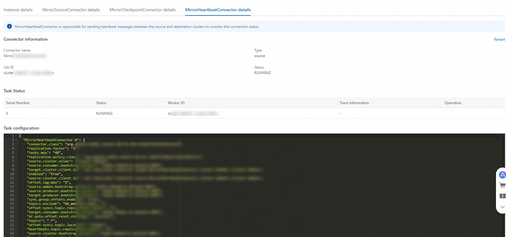

**Restart a replicator**

> **Important**
>
> During the restart of a replicator, message replication between the source and destination clusters is suspended.

1. Log on to the ApsaraMQ for Kafka console.

2. In the left-side navigation pane, choose **Data Integration > Message Routing**.

3. On the **Replicator** tab, click **Restart** in the Operation column of the desired replicator.

4. In the message that appears, click **OK**.

<a id="section-2-9-1-2"></a>

#### 2.9.1.2. Cloud information

This topic describes how to create and manage a message synchronization cloud.

**Background information**

- You can use message synchronization clouds and remote tasks to migrate data between different clouds.

- Remote tasks also provide atomic APIs for geo-disaster recovery and enable data migration between different clouds to achieve disaster recovery.

**Prerequisites**

- The ApsaraMQ for Kafka instance on one cloud is connected to the ApsaraMQ for Kafka instance on the other cloud. In addition, the domain name of the Apsara Uni-manager Management Console on one cloud is connected to the domain name of the Apsara Uni-manager Management Console on the other cloud.

- The IP addresses of the endpoints in the two clouds are mutually reachable.

**Create a message synchronization cloud**

You can perform the following steps to create a message synchronization cloud.

1. Log on to the ApsaraMQ for Kafka console.

2. In the left-side navigation pane, choose **Data Integration > Message Routing**.

3. On the **Message Routing** page, click the **Cloud Information** tab.

4. Click **Create Message synchronization cloud**.

5. In the **Create Message synchronization cloud** dialog box, configure the following parameters and click **OK**.

   | Parameter | Description |
   | --- | --- |
   | Cloud Name | Enter a name for the message synchronization cloud. |
   | AK | Enter your AccessKey ID. |
   | Geography | Enter the region in which the cloud to be synchronized resides. |
   | SK | Enter your AccessKey secret. |
   | kafka instance endpoint | Enter the domain name of the ApsaraMQ for Kafka instance. |
   | ascm Domain Names | Enter the domain name of the Apsara Uni-manager Management Console. |
   | Organization ID | Select the ID of the organization to which the destination cloud cluster belongs. |
   | Resource set ID | Select the ID of the resource set to which the destination cloud cluster belongs. |
   | Remarks | Optional. Enter a description. |

**View a message synchronization cloud**

You can perform the following steps to view the created message synchronization clouds and their basic information.

1. Log on to the ApsaraMQ for Kafka console.

2. In the left-side navigation pane, choose **Data Integration > Message Routing**.

3. On the **Message Routing** page, click the **Cloud Information** tab.

4. On the **Cloud Information** tab, you can view the created message synchronization clouds and their basic information, including **Cloud Name**, **uuid**, **Geography**, **AccessKey**, **Kafka Domain Names**, **Organization**, **Resource Set**, **Creation time**, and **Remarks**.

5. Optional. You can enter a cloud name in the search box above the list for a quick search.

**Delete a message synchronization cloud**

You can perform the following steps to delete a message synchronization cloud.

1. Log on to the ApsaraMQ for Kafka console.

2. In the left-side navigation pane, choose **Data Integration > Message Routing**.

3. On the **Message Routing** page, click the **Cloud Information** tab.

4. On the **Cloud Information** tab, find the message synchronization cloud that you want to delete and click **Delete** in the **Operation** column.

5. In the **Confirm** message, click **OK**.

<a id="section-2-9-1-3"></a>

#### 2.9.1.3. Tasks

This topic describes how to create and manage remote tasks and local tasks.

<a id="section-2-9-1-3-1"></a>

##### 2.9.1.3.1. Remote tasks

This topic describes how to create and manage remote tasks.

**Background information**

- You can use remote tasks to migrate data between different clouds.

- Remote tasks also provide atomic APIs for geo-disaster recovery and enable data migration between different clouds to achieve disaster recovery.

**Prerequisites**

- The ApsaraMQ for Kafka instance on one cloud is connected to the ApsaraMQ for Kafka instance on the other cloud. In addition, the domain name of the Apsara Uni-manager Management Console on one cloud is connected to the domain name of the Apsara Uni-manager Management Console on the other cloud.

- The IP addresses of the endpoints in the two clouds are mutually reachable.

**Create a remote task**

You can perform the following steps to create a remote task.

1. Log on to the ApsaraMQ for Kafka console.

2. In the left-side navigation pane, choose **Data Integration > Message Routing**.

3. On the **Message Routing** page, click the **Tasks** tab.

4. Click **Create Offsite Tasks**, configure the following parameters, and then click **OK**.

   | Parameter | Description |
   | --- | --- |

   Select the source ApsaraMQ for Kafka instance.

   **SOURCE instance**

   > **Note**
   >
   > The source instance is an instance within the current region.

   Select the type of the migration task. Valid values:

   **Type**

   - **Instance Migration**

   - **topic migration**

   Select the topic to be synchronized. You can select multiple topics.

   **Message Source**

   - If you do not specify this parameter, all topics in the instance are synchronized.

   - Regular expressions are supported. For example, hello.\* indicates that all topics that start with hello are synchronized.

   **Synchronous Topic**

   > **Note**
   >
   > This parameter is displayed only if you set **Type** to **topic migration**.

   Select the Simple Authentication and Security

   **sasl User**

   Layer (SASL) user.

   **Source Replicator**

   Select the source replicator.

   **Message**

   Select the destination message

   **synchronization**

   synchronization cloud.

   **cloud**

   The system automatically configures the

   **Target Region**

   destination region based on the message synchronization cloud that you select.

   **Message Destination**

   Select the destination ApsaraMQ for Kafka instance.

   **Target Instance**

   <table>
     <tr>
       <td>Synchronization Start Point</td>
       <td>Select an offset to start the data synchronization. Valid values:<br>• Earliest point<br>• Nearest Point<br>• Specified time</td>
     </tr>
     <tr>
       <td>Time point</td>
       <td>Select a date. If the offset cannot be found in the specified partition of the specified topic after you select the time, data synchronization starts from the earliest offset. An offset cannot be found if the specified time is earlier than the earliest offset or later than the latest offset.<br>Note<br>This parameter is displayed only if you set <strong>Synchronization Start Point</strong> to <strong>Specified time</strong>.</td>
     </tr>
     <tr>
       <td>Description</td>
       <td>Enter a description.</td>
     </tr>
   </table>

5. After the remote task is created, you can view its basic information and status in the task list on the **Tasks** tab.

**View remote tasks**

You can perform the following steps to view a remote task.

1. Log on to the ApsaraMQ for Kafka console.

2. In the left-side navigation pane, choose **Data Integration > Message Routing**.

3. On the **Message Routing** page, click the **Tasks** tab.

4. On the **Tasks** tab, you can view the created tasks and their basic information, including **uuid**, **Source cluster**, **Target Cluster**, **Migration Type**, **Synchronized topic**, **Status**, **Synchronization Policy**, **Current limiting**, and **Creation time**.

5. You can also click **Details** in the **Operation** column of a task to view the details of the task, including **Source Information**, **Target Information**, and **Other information**.

**Start a remote task**

You can perform the following steps to start a remote task.

1. Log on to the ApsaraMQ for Kafka console.

2. In the left-side navigation pane, choose **Data Integration > Message Routing**.

3. On the **Message Routing** page, click the **Tasks** tab.

4. On the **Tasks** tab, find the remote task that you want to start and click **Start** in the **Operation** column.

5. In the **Confirm** message, click **OK**.

6. Optional. After you click **Start** to start a remote task, you can click **Stop** to stop the task.

**Delete a remote task**

You can perform the following steps to delete a remote task.

1. Log on to the ApsaraMQ for Kafka console.

2. In the left-side navigation pane, choose **Data Integration > Message Routing**.

3. On the **Message Routing** page, click the **Tasks** tab.

4. On the **Tasks** tab, find the remote task that you want to delete and click **Delete** in the **Operation** column.

5. In the **Confirm** message, click **OK**.

<a id="section-2-9-1-3-2"></a>

##### 2.9.1.3.2. Local tasks

This topic describes how to create and manage local tasks.

**Background information**

You can use local tasks to migrate services from one ApsaraMQ for Kafka instance to another ApsaraMQ for Kafka instance. For more information, see Use the ApsaraMQ for Kafka console to migrate services from one ApsaraMQ for Kafka instance to another.

**Create a local task**

You can perform the following steps to create a local task.

1. Log on to the ApsaraMQ for Kafka console.

2. In the left-side navigation pane, choose **Data Integration > Message Routing**.

3. On the **Message Routing** page, click the **Tasks** tab.

4. Click **Create a local task**, configure the following parameters, and then click **OK**.

   **Parameter**

   **Description**

   Select the source ApsaraMQ for Kafka

   **SOURCE instance**

   instance.

   Select the type of the migration task. Valid values:

   **Type**

   - **Instance Migration**

   - **topic migration**

   Select the topic to be synchronized. You can

   **Message Source**

   select multiple topics.

   - If you do not specify this parameter, all topics in the instance are synchronized.

   - Regular expressions are supported. For example, hello.\* indicates that all topics

   **Synchronous Topic**

   that start with hello are synchronized.

   > **Note**
   >
   > This parameter is displayed only if you set **Type** to **topic migration**.

   <table>
     <tr>
       <td rowspan="2">Message Destination</td>
       <td>Target Instance</td>
       <td>Select the destination ApsaraMQ for Kafka instance.</td>
     </tr>
     <tr>
       <td>Target Replicator</td>
       <td>Select the destination replicator.</td>
     </tr>
     <tr>
       <td colspan="2">Synchronization Start Point</td>
       <td>Select an offset to start the data synchronization. Valid values:<br>• Earliest point<br>• Nearest Point<br>• Specified time</td>
     </tr>
     <tr>
       <td colspan="2">Time point</td>
       <td>Select a date. If the offset cannot be found in the specified partition of the specified topic after you select the time, data synchronization starts from the earliest offset. An offset cannot be found if the specified time is earlier than the earliest offset or later than the latest offset.<br>Note<br>This parameter is displayed only if you set <strong>Synchronization Start Point</strong> to <strong>Specified time</strong>.</td>
     </tr>
     <tr>
       <td colspan="2">Current limiting</td>
       <td>Configure the throttling rule for the data synchronization process of the disaster recovery instances. Unit: MB/s.<br>Note<br>If throttling is not required during the data synchronization of disaster recovery instances, set this parameter to 0.</td>
     </tr>
     <tr>
       <td colspan="2">Description</td>
       <td>Enter a description.</td>
     </tr>
   </table>

5. After the local task is created, you can view its basic information and status in the task list on the **Tasks** tab.

**View a local task**

You can perform the following steps to view a local task.

1. Log on to the ApsaraMQ for Kafka console.

2. In the left-side navigation pane, choose **Data Integration > Message Routing**.

3. On the **Message Routing** page, click the **Tasks** tab.

4. On the **Tasks** tab, you can view the created tasks and their basic information, including **uuid**, **Source cluster**, **Target Cluster**, **Migration Type**, **Synchronized topic**, **Status**, **Synchronization Policy**, **Current limiting**, and **Creation time**.

5. You can also click **Details** in the **Operation** column of a task to view the details of the task, including **Source Information**, **Target Information**, and **Other information**.

**Start a local task**

You can perform the following steps to start a local task.

1. Log on to the ApsaraMQ for Kafka console.

2. In the left-side navigation pane, choose **Data Integration > Message Routing**.

3. On the **Message Routing** page, click the **Tasks** tab.

4. On the **Tasks** tab, find the local task that you want to start and click **Start** in the **Operation** column.

5. In the **Confirm** message, click **OK**.

6. Optional. After you click **Start** to start a local task, you can click **Stop** to stop the task.

**Migrate a domain name**

You can perform the following steps to migrate the domain name of a source cluster to the destination cluster.

> **Note**
>
> Prerequisites:
>
> - The source instance has a domain name.
>
> - The message lag between the source and destination instances is 0. A domain name can be migrated only if the message lag between the source and destination instances is 0. You can view the message **lag** in the **Other information** section on the **Task Details** page.

1. Log on to the ApsaraMQ for Kafka console.

2. In the left-side navigation pane, choose **Data Integration > Message Routing**.

3. On the **Message Routing** page, click the **Tasks** tab.

4. On the **Tasks** tab, find the desired local task and click **Domain Migration** in the **Operation** column.

5. In the **Confirm** message, click **OK**.

**Disable write operations for a local task**

You can perform the following steps to block the traffic of the source cluster so that a local task can be performed.

> **Note**
>
> Note that write operations cannot be re-enabled within three minutes after they are disabled.

1. Log on to the ApsaraMQ for Kafka console.

2. In the left-side navigation pane, choose **Data Integration > Message Routing**.

3. On the **Message Routing** page, click the **Tasks** tab.

4. On the **Tasks** tab, find the local task for which you want to disable write operations, click

   the  icon in the **Operation** column, and then click **Forbidden to write**.

5. In the **Confirm** message, click **OK**.

**Delete a local task**

You can perform the following steps to delete a local task.

1. Log on to the ApsaraMQ for Kafka console.

2. In the left-side navigation pane, choose **Data Integration > Message Routing**.

3. On the **Message Routing** page, click the **Tasks** tab.

4. On the **Tasks** tab, find the local task that you want to delete, click the  icon in the

   **Operation** column, and then select **Delete**.

5. In the **Confirm** message, click **OK**.

<a id="section-2-9-2"></a>

### 2.9.2. Connect

This topic describes how to manage connects and connectors.

**Background information**

Kafka Connect enables reliable and scalable data streaming between ApsaraMQ for Kafka and external systems, such as databases, message queues, and file systems.

**Prerequisites**

- An ApsaraMQ for Kafka instance is created. For more information, see the Create an instance section in the Manage instances topic.

- Automatic topic creation is enabled for the ApsaraMQ for Kafka instance. This indicates that **auto.create.topics.enable** is turned on in the **Parameter configuration** panel of the ApsaraMQ for Kafka instance. For more information, see auto.create.topics.enable.

**Create a connect**

1. Log on to the ApsaraMQ for Kafka console.

2. In the left-side navigation pane, choose **Data Integration > Connect**.

3. On the **Connect** page, click **Create Connect**.

4. In the **Create Connect** dialog box, configure the following parameters and click **OK**.

   | Parameter | Description |
   | --- | --- |
   | Zone ID | The ID of the zone to which the connect belongs. |
   | Kafka instance | The ApsaraMQ for Kafka instance to which the connect is connected. |

**Manage connects View connects**

1. Log on to the ApsaraMQ for Kafka console.

2. In the left-side navigation pane, choose **Data Integration > Connect**.

3. On the **Connect** page, you can view the created connects and their basic information, including **Connect ID**, **Kafka instance ID**, **Zone**, and **Status**.

4. Optional. You can enter a connect ID in the search box above the list for an exact search.

**View the details of a connect**

1. Log on to the ApsaraMQ for Kafka console.

2. In the left-side navigation pane, choose **Data Integration > Connect**.

3. On the **Connect** page, click the ID of the connect that you want to view in the **Connect ID** column, or click **Details** in the **Operation** column. On the **Connector list** page, you can view the task list and basic information, including **Task ID**, **Type**, **Maximum number of tasks**, and **Status**.

**Delete a connect**

1. Log on to the ApsaraMQ for Kafka console.

2. In the left-side navigation pane, choose **Data Integration > Connect**.

3. On the **Connect** page, find the connect that you want to delete and click **Delete** in the **Operation** column. In the message that appears, click OK.

**Create a connector**

1. Log on to the ApsaraMQ for Kafka console.

2. In the left-side navigation pane, choose **Data Integration > Connect**.

3. On the **Connect** page, click the ID of the connect that you want to view in the **Connect ID** column, or click **Details** in the **Operation** column to open the **Connector list** page.

4. On the **Connector list** page, click **Create Connector**.

5. On the **Create Connector** page, configure the following parameters and click **Submit**.

   | Parameter | Description |
   | --- | --- |
   | Task ID | Enter the task ID. |
   | Type | Select a connector type. For more information about the supported connector types, see the Connector types section in this topic. |
   | Connector configuration | Configure the parameters of the selected connector type and click <strong>Next Step</strong>. For more information about the parameters for each connector, see the <strong>Connector</strong> <strong>configuration reference</strong> column in the Connector types section of this topic. |
   | Transform configuration | Different connector types support different predicates and converters. The actual predicates and converters displayed on the page prevail. For more information, see Transform configuration. |

**Connector types**

| Type | Description | Connector configuration reference |
| --- | --- | --- |
| analyticdb-for-mysql-sink-connector | Synchronizes data from ApsaraMQ for Kafka to AnalyticDB for MySQL in real time. | analyticdb-for-mysql-sink-connector |
| analyticdb-for-postgresql-sink-connector | Synchronizes data from ApsaraMQ for Kafka to AnalyticDB for PostgreSQL in real time. | analyticdb-for-postgresql-sink-connector |
| clickhouse-sink-connector | Synchronizes data from ApsaraMQ for Kafka to ClickHouse in real time. | clickhouse-sink-connector |
| elasticsearch-sink-connector | Synchronizes data from ApsaraMQ for Kafka to Elasticsearch in real time. | elasticsearch-sink-connector |
| flink-job-sink-connector | Synchronizes data from ApsaraMQ for Kafka to Flink in real time. | flink-job-sink-connector |
| ftp-sink-connector | Synchronizes data from ApsaraMQ for Kafka to a File Transfer Protocol Secure (FTPS) server in real time. | ftp-sink-connector |
| ftp-source-connector | Synchronizes data from an FTPS server to ApsaraMQ for Kafka in real time. | ftp-source-connector |
| github-source-connector | Synchronizes data from ApsaraMQ for Kafka to GitHub in real time. | github-source-connector |
| hbase-sink-connector | Synchronizes data from ApsaraMQ for Kafka to HBase in real time. | hbase-sink-connector |
| hdfs3-sink-connector | Synchronizes data from ApsaraMQ for Kafka to Hadoop Distributed File System (HDFS) 3 in real time. | hdfs3-sink-connector |
| hdfs3-source-connector | Synchronizes data from HDFS 3 to ApsaraMQ for Kafka in real time. | hdfs3-source-connector |
| hologres-sink-connector | Synchronizes data from ApsaraMQ for Kafka to Hologres in real time. | hologres-sink-connector |
| hologres-source-connector | Synchronizes data from Hologres to ApsaraMQ for Kafka in real time. | hologres-source-connector |
| lindorm-search-sink-connector | Synchronizes data from ApsaraMQ for Kafka to LindormSearch in real time. | lindorm-search-sink-connector |
| lindorm-tsdb-sink-connector | Synchronizes data from ApsaraMQ for Kafka to LindormTSDB in real time. | lindorm-tsdb-sink-connector |
| lindorm-vector-sink-connector | Synchronizes data from ApsaraMQ for Kafka to the Lindorm vector engine in real time. | lindorm-vector-sink-connector |
| lindorm-widetable-sink-connector | Synchronizes data from ApsaraMQ for Kafka to LindormTable in real time. | lindorm-widetable-sink-connector |
| localfs-sink-connector | Synchronizes data from ApsaraMQ for Kafka to files in real time. | localfs-sink-connector |
| localfs-source-connector | Synchronizes data from files to ApsaraMQ for Kafka in real time. | localfs-source-connector |
| mariadb-sink-connector | Synchronizes data from ApsaraMQ for Kafka to MariaDB in real time. | mariadb-sink-connector |
| mariadb-source-connector | Synchronizes data from MariaDB to ApsaraMQ for Kafka in real time. | mariadb-source-connector |
| maxcompute-sink-connector | Synchronizes data from ApsaraMQ for Kafka to MaxCompute in real time. | maxcompute-sink-connector |
| maxcompute-source-connector | Synchronizes data from MaxCompute to ApsaraMQ for Kafka in real time. | maxcompute-source-connector |
| mongodb-sink-connector | Synchronizes data from ApsaraMQ for Kafka to ApsaraDB for MongoDB in real time. | mongodb-sink-connector |
| mongodb-source-connector | Synchronizes data from ApsaraDB for MongoDB to ApsaraMQ for Kafka in real time. | mongodb-source-connector |
| mqtt-sink-connector | Synchronizes data from ApsaraMQ for Kafka to ApsaraMQ for MQTT in real time. | mqtt-sink-connector |
| mqtt-source-connector | Synchronizes data from ApsaraMQ for MQTT to ApsaraMQ for Kafka in real time. | mqtt-source-connector |
| mysql-sink-connector | Synchronizes data from ApsaraMQ for Kafka to MySQL in real time. | mysql-sink-connector.json |
| mysql-source-connector | Synchronizes data from ApsaraDB RDS for MySQL to ApsaraMQ for Kafka in real time. | mysql-source-connector.json |
| neo4j-sink-connector | Synchronizes data from ApsaraMQ for Kafka to Neo4j in real time. | neo4j-sink-connector |
| neo4j-source-connector | Synchronizes data from Neo4j to ApsaraMQ for Kafka in real time. | neo4j-source-connector |
| oceanbase-mysql-sink-connector | Synchronizes data from ApsaraMQ for Kafka to OceanBase in real time. | oceanbase-mysql-sink-connector |
| oceanbase-mysql-source-connector | Synchronizes data from OceanBase to ApsaraMQ for Kafka in real time. | oceanbase-mysql-source-connector |
| opensearch-sink-connector | Synchronizes data from ApsaraMQ for Kafka to OpenSearch in real time. | opensearch-sink-connector |
| oracle-sink-connector | Synchronizes data from ApsaraMQ for Kafka to Oracle in real time. | oracle-sink-connector |
| oracle-source-connector | Synchronizes data from Oracle to ApsaraMQ for Kafka in real time. | oracle-source-connector |
| oss-sink-connector | Synchronizes data from ApsaraMQ for Kafka to Object Storage Service (OSS) in real time. | oss-sink-connector |
| oss-source-connector | Synchronize data from OSS to ApsaraMQ for Kafka in real time. | oss-source-connector |
| otlp-sls-sink-connector | Synchronizes telemetry data (traces, metrics, and logs) in the OpenTelemetry Protocol (OTLP) format to Simple Log Service (SLS). | otlp-sls-sink-connector |
| otlp-source-connector | Receives telemetry data (traces, metrics, and logs) in the OTLP format and synchronizes the data to ApsaraMQ for Kafka. | otlp-source-connector |
| polardb-for-mysql-sink-connector | Synchronizes data from ApsaraMQ for Kafka to PolarDB for MySQL in real time. | polardb-for-mysql-sink-connector |
| polardb-for-mysql-source-connector | Synchronizes data from PolarDB for MySQL to ApsaraMQ for Kafka in real time. | polardb-for-mysql-source-connector |
| polardb-for-oracle-sink-connector | Synchronizes data from ApsaraMQ for Kafka to PolarDB for PostgreSQL (Compatible with Oracle) in real time. | polardb-for-oracle-sink-connector |
| polardb-for-oracle-source-connector | Synchronizes data from PolarDB for PostgreSQL (Compatible with Oracle) to ApsaraMQ for Kafka in real time. | polardb-for-oracle-source-connector |
| polardb-for-postgresql-sink-connector | Synchronizes data from ApsaraMQ for Kafka to PolarDB for PostgreSQL in real time. | polardb-for-postgresql-sink-connector |
| polardb-for-postgresql-source-connector | Synchronizes data from PolarDB for PostgreSQL to ApsaraMQ for Kafka in real time. | polardb-for-postgresql-source-connector |
| polardb-x-2.0-sink-connector | Synchronizes data from ApsaraMQ for Kafka to PolarDB-X V2.0 in real time. | polardb-x-2.0-sink-connector |
| polardb-x-2.0-source-connector | Synchronizes data from PolarDB-X V2.0 to ApsaraMQ for Kafka in real time. | polardb-x-2.0-source-connector |
| postgresql-sink-connector | Synchronizes data from ApsaraMQ for Kafka to ApsaraDB RDS for PostgreSQL in real time. | postgresql-sink-connector.json |
| postgresql-source-connector | Synchronizes data from ApsaraDB RDS for PostgreSQL to ApsaraMQ for Kafka in real time. | postgresql-source-connector.json |
| prometheus-sink-connector | Synchronizes data from ApsaraMQ for Kafka to Managed Service for Prometheus in real time. | prometheus-sink-connector |
| prometheus-source-connector | Synchronizes data from Managed Service for Prometheus to ApsaraMQ for Kafka in real time. | prometheus-source-connector |
| redis-sink-connector | Synchronizes data from ApsaraMQ for Kafka to ApsaraDB for Redis in real time. | redis-sink-connector |
| redis-source-connector | Synchronizes data from ApsaraDB for Redis to ApsaraMQ for Kafka in real time. | redis-source-connector |
| rocketmq-sink-connector | Synchronizes data from ApsaraMQ for Kafka to ApsaraMQ for RocketMQ in real time. | rocketmq-sink-connector |
| rocketmq-source-connector | Synchronizes data from ApsaraMQ for RocketMQ to ApsaraMQ for Kafka in real time. | rocketmq-source-connector |
| sftp-sink-connector | Synchronizes data from ApsaraMQ for Kafka to a Secure File Transfer Protocol (SFTP) server in real time. | sftp-sink-connector |
| sftp-source-connector | Synchronizes data from an SFTP server to ApsaraMQ for Kafka in real time. | sftp-source-connector |
| sls-sink-connector | Synchronizes data from ApsaraMQ for Kafka to SLS in real time. | sls-sink-connector |
| sls-source-connector | Synchronizes data from SLS to ApsaraMQ for Kafka in real time. | sls-source-connector |
| spark-sink-connector | Submits Spark tasks in real time based on the data in ApsaraMQ for Kafka. | spark-sink-connector |
| sqlserver-sink-connector | Synchronizes data from ApsaraMQ for Kafka to SQL Server in real time. | sqlserver-sink-connector |
| sqlserver-source-connector | Synchronizes data from SQL Server to ApsaraMQ for Kafka in real time. | sqlserver-source-connector |
| syslog-source-connector | Synchronizes data from Syslog to ApsaraMQ for Kafka in real time. | syslog-source-connector |
| tablestore-sink-connector | Synchronizes data from ApsaraMQ for Kafka to Tablestore in real time. | tablestore-sink-connector |
| tablestore-source-connector | Synchronizes data from Tablestore to ApsaraMQ for Kafka in real time. | tablestore-source-connector |
| tidb-sink-connector | Synchronizes data from ApsaraMQ for Kafka to TiDB in real time. | tidb-sink-connector |
| http-sink-connector | Consumes data from ApsaraMQ for Kafka and pushes the data to an HTTP API. | http-sink-connector |
| http-source-connector | Pulls data from an HTTP API and writes the data to ApsaraMQ for Kafka. | http-source-connector |
| kafka-mirror-source-connector | Replicates data across topics of an ApsaraMQ for Kafka instance. | kafka-mirror-source-connector |

**Manage connectors**

**View connectors**

1. Log on to the ApsaraMQ for Kafka console.

2. In the left-side navigation pane, choose **Data Integration > Connect**.

3. On the **Connect** page, click the ID of the connect that you want to view in the **Connect ID** column, or click **Details** in the **Operation** column to open the **Connector list** page.

4. On the **Connector list** page, you can view the created connectors and their basic information, including **Task ID**, **Type**, **Maximum number of tasks**, and **Status**.

5. Optional. You can enter a connector ID in the search box above the list for an exact search.

**View the details of a connector**

1. Log on to the ApsaraMQ for Kafka console.

2. In the left-side navigation pane, choose **Data Integration > Connect**.

3. On the **Connect** page, click the ID of the connect that you want to view in the **Connect ID** column, or click **Details** in the **Operation** column to open the **Connector list** page.

4. On the **Connector list** page, find the connector that you want to view and click **Details** in the **Operation** column to view the configuration details of the connector.

**Delete a connector**

1. Log on to the ApsaraMQ for Kafka console.

2. In the left-side navigation pane, choose **Data Integration > Connect**.

3. On the **Connect** page, click the ID of the connect that you want to view in the **Connect ID** column, or click **Details** in the **Operation** column to open the **Connector list** page.

4. On the **Connector list** page, find the connector that you want to delete and click **Delete** in the **Operation** column. In the message that appears, click OK.

**Enable or disable a connector**

1. Log on to the ApsaraMQ for Kafka console.

2. In the left-side navigation pane, choose **Data Integration > Connect**.

3. On the **Connect** page, click the ID of the connect that you want to view in the **Connect ID** column, or click **Details** in the **Operation** column to open the **Connector list** page.

4. On the **Connector list** page, click **Disable** or **Enable** in the **Operation** column of the desired connector. In the message that appears, click OK.

**Restart a connector and its tasks**

1. Log on to the ApsaraMQ for Kafka console.

2. In the left-side navigation pane, choose **Data Integration > Connect**.

3. On the **Connect** page, click the ID of the connect that you want to view in the **Connect ID** column, or click **Details** in the **Operation** column to open the **Connector list** page.

4. On the **Connector list** page, click **Details** in the **Operation** column of the desired connector.

5. On the **Connector Details** page, click **Restart All** in the upper-right corner. In the message that appears, click OK to restart the connector and all tasks.

**Restart failed tasks**

1. Log on to the ApsaraMQ for Kafka console.

2. In the left-side navigation pane, choose **Data Integration > Connect**.

3. On the **Connect** page, click the ID of the connect that you want to view in the **Connect ID** column, or click **Details** in the **Operation** column to open the **Connector list** page.

4. On the **Connector list** page, click **Details** in the **Operation** column of the desired connector.

   - Restart a failed task: On the **Connector Details** page, click **Restart** in the **Operation** column of the failed task. In the message that appears, click OK.

   - Restart all failed tasks: On the **Connector Details** page, click **Restart Failed Tasks** in the upper-right corner. In the message that appears, click OK.

<a id="section-2-9-2-1"></a>

#### 2.9.2.1. clickhouse-sink-connector

This topic describes how to configure the parameters for clickhouse-sink-connector.

**Prerequisites**

- You are creating a connector, and the connector type is set to clickhouse-sink-connector. For more information about how to create a connector, see Create a connect.

- ClickHouse is deployed.

**Parameters**

**Basic Configuration**

| Parameter | Description |
| --- | --- |
| Max Tasks | The maximum number of parallel tasks. Default value: 1.Valid values: 1 to 12. |

**Connection Configuration**

| Parameter | Description |
| --- | --- |
| Hostname | The hostname or IP address of the ClickHouse server. |
| Port | The HTTP port of the ClickHouse server. In most cases, port 8443 is used if SSL is enabled on the server and port 8123 is used if SSL is disabled. |
| Enable SSL | Specifies whether to enable SSL or HTTPS to connect to the ClickHouse server. In most cases, port 8443 is used if SSL is enabled on the server and port 8123 is used if SSL is disabled. |
| Username | The username of the ClickHouse account. |
| Password | The password of the ClickHouse account. |
| Database | The name of the destination database. The connector does not automatically create a database. A destination database must be created before you create the connector. |

**Data Configuration**

| Parameter | Description |
| --- | --- |
| Kafka Topics | The ApsaraMQ for Kafka topics from which messages are consumed. Separate multiple topics with commas (,). By default, the topic name is used as the destination table name. For more information about how to map the topic name to a different table name, see the description of <strong>Topic</strong> <strong>to Table Map</strong>. |
| Topic to Table Map | The topic-to-table mappings. Format: <code> topic1=table1,topic2=table2 </code>. If you do not configure this parameter, the default mapping rule <code> topic </code> <code>name=table name </code> is used. |
| Key Schema Enable | Specifies whether to enable the schema envelope of the key.Valid values:<br>• Enable<br>• Disable |
| Value Schema Enable | Specifies whether to enable the schema envelope of the value. Valid values:<br>• Enable<br>• Disable |

**Advanced Configuration**

| Parameter | Description |
| --- | --- |
| Exactly Once | Specifies whether to enable the exact-once semantics. After the exact-once semantics is enabled, the connector maintains a deduplication table (KeeperMap) on the ClickHouse server to record committed ApsaraMQ for Kafka offsets. When tasks are restarted, already-written records are skipped to prevent duplicates. After the exact-once semantics is disabled, the at-least-once semantics applies, where minor data duplication may occur after fault recovery and restarts. We recommend that you enable the exact-once semantics in the production environment. |

<a id="section-2-9-2-2"></a>

#### 2.9.2.2. github-source-connector

This topic describes how to configure the parameters for github-source-connector.

**Prerequisites**

- You are creating a connector, and the connector type is set to github-source-connector. For more information about how to create a connector, see Connect.

- GitHub is deployed.

**Parameters**

**Basic Configuration**

| Parameter | Description |
| --- | --- |
| Max Tasks | The maximum number of parallel tasks. The default value is 1.<br>Note<br>In multi-repository mode, the system uses a round-robin policy to evenly allocate the repositories to each task.<br>• Automatic convergence mechanism: If the <code> tasks.max </code> value is greater than the total number of repositories, the actual number of running tasks automatically converges to the number of repositories. Tasks that exceed the limit are not created.<br>• Rate limiting: The rate limit of the GitHub API is shared based on tokens. Increasing the number of tasks does not increase the total quota, but provides the following benefits:<br>• Fault isolation: A single task error does not affect the synchronization of other repositories.<br>• Load distribution: supports distributed execution across worker nodes to improve the overall throughput stability.<br>Best practice: We recommend that you set this value to <code> min{Number of repositories, 10} </code> to ensure concurrency while reducing resource overheads. |

**Authentication**

| Parameter | Description |
| --- | --- |
| Access Token | The access token that is used to access GitHub. The token must have the read permission on the destination repository.Configure the following minimum permission sets based on the token type:<br>• Classic personal access token (PAT):<br>• Public repository: Select the <code> public_repo </code> scope.<br>• Private repository: Select the <code> repo </code> scope, including all child permissions.<br>• Fine-grained PAT:<br>• You must explicitly grant read-only permissions on the following three items in resource permissions:<br><code>• Contents</code><br><code>• Issues</code><br>• <code> Pull requests </code> |

**Repository**

| Parameter | Description |
| --- | --- |
| Repositories | The list of GitHub repositories. Separate multiple repositories with commas (,) in the <code> owner/repo </code> format.<br>Isolation mechanism: The default <code> topic.name.pattern </code> template contains the built-in <code> ${owner} </code> and <code> ${repo} </code> placeholders. The system automatically generates a separate topic name for each repository. Therefore, you only need to list all destination repositories to implement automatic logical isolation for data, without additional configurations. |
| GitHub API URL | The GitHub API base URL.<br>• Use the default URL for public GitHub.com services.<br>• If you use a private GitHub Enterprise service, set the URL to <code> https://your-ghe.example.com/api/v3 </code>. |

**Subscription**

| Parameter | Description |
| --- | --- |
| Resources | The types of resources that you want to pull. Separate multiple values with commas (,).<br>Valid values: <code> issues, pull_requests, issue_comments, </code> <code>pr_comments, commits, releases </code>.<br>Mapping mechanism: Each resource type is independently mapped to a dedicated ApsaraMQ Kafka topic. Topic names are dynamically generated based on the <code> topic.name.pattern </code> template.<br>• Default template: <code> ${prefix}_${owner}_${repo}_${resourceName} </code>.<br>• Example: If you specify the <code> issues </code> resource type, the default topic name is <code> github_apache_kafka_issues </code>. |

<table>
  <tr>
    <td>Startup Mode</td>
    <td>This parameter determines the startup mode of the connector at the first startup when no offset is found.<br>The system follows the principle of "committed offset takes precedence": When a valid offset exists, the connector resumes from the checkpoint regardless of how many times it is restarted. In this case, this parameter does not take effect. If you need to forcibly reset the connector and re-pull data, you must clear the <code> connect-offsets </code> storage.<br>Supported modes:<br>• <code> latest </code>: Ignore history and capture only real-time traffic after startup. This mode is suitable for subscribing to future events.<br>• <code> since </code>: works with the <code> github.since </code> parameters to accurately trace data within the specified time window.<br>• <code> earliest </code>: performs full data initialization and pulls all historical data.<br>Important<br>For large repositories, this operation takes a long time and consumes a large amount of resources. Proceed with caution.</td>
  </tr>
  <tr>
    <td>Since Timestamp</td>
    <td>The timestamp of the start time. The timestamp follows the ISO-8601 standard. Example: 2026-05-01T00:00:00Z.<br>Note<br>This parameter takes effect only when you set <code> github.startup.mode=since </code>. It is ignored in other modes.</td>
  </tr>
  <tr>
    <td>Commits Branch</td>
    <td>The branch from which you want to pull commits.<br>Note<br>This parameter takes effect only when <code> github.resources </code> contains commits.</td>
  </tr>
</table>

**Data**

| Parameter | Description |
| --- | --- |
| Topic Prefix | The topic prefix. This prefix is used to replace the <code> ${prefix} </code> placeholder in the <code> topic.name.pattern </code> template. The default value is <code> github </code>.<br>Important<br>Separate content and delimiters. You must explicitly define delimiters, such as<code> _ </code>, in the template.Therefore, enter only the plain text prefix, and do not include the end separator, that is, enter <code> github </code> instead of <code> github_ </code>. |
| Topic Name Pattern | The topic naming template. The following placeholders are supported: <code> ${prefix} </code>, <code> ${owner} </code>, <code> ${repo} </code>, and <code> ${resourceName} </code>.<br>• The default template is <code> ${prefix}_${owner}_${repo}_${resourceName} </code>, which is suitable for multi-repository scenarios.<br>• Example: <code> github_apache_kafka_issues </code>. The repository identifier ensures that topics in multi-source scenarios are globally unique. This prevents conflicts.<br>• Concise template: <code> ${prefix}_${resourceName} </code>. This template is suitable for single-repository scenarios.<br>• Example: <code> github_issues </code>. This template supports a simpler naming pattern in scenarios where isolation is not required. |
| Key Schema Enable | Specifies whether to include the schema information in message keys. Valid values:<br>• Enable<br>• Disable<br>Note<br>This parameter takes effect only for JSON converters. |
| Value Schema Enable | Specifies whether to include the schema information in message values. Valid values:<br>• Enable<br>• Disable<br>Note<br>This parameter takes effect only for JSON converters. |

**Polling and Retry**

| Parameter | Description |
| --- | --- |
| Poll Interval (ms) | The idle interval between two consecutive polls when no new data is detected.<br>The default interval is 5 minutes.<br>We recommend that you adjust the polling interval based on the repository activity. Set the interval to 60,000 milliseconds (1 minute) for frequently updated repositories and extend the interval to 1,800,000 milliseconds (30 minutes) for inactive repositories. This helps reduce unnecessary API calls and prevents rate limiting triggered by exceeding the GitHub PAT default quota, which is 5,000 calls per hour. |
| Max Batch Size | This parameter limits the maximum cumulative number of returned ApsaraMQ Kafka connect records in a single poll.When this upper limit is reached, the current fetcher stops iteration and the remaining data is deferred to the next round of processing. This prevents memory overflow due to excessive data loaded on the worker.<br>Important<br>This is a soft upper limit. To ensure the integrity of the data batch, if the read of a data batch has been completed when the limit is triggered, the system returns the complete batch. Therefore, the actual number of records may slightly exceed the specified limit. |
| Request Timeout (ms) | The total timeout period for a single HTTP request. The timeout period includes the amount of time that is consumed for the entire process of connect establishment, data write, and data read. If the cumulative time exceeds this limit, the request is automatically terminated. |

**HTTP Proxy**

| Parameter | Description |
| --- | --- |
| Proxy Host | The hostname or IP address of the HTTP proxy.<br>If you do not need to use a proxy, leave this parameter empty and the system the direction connection mode. |
| Proxy Port | The HTTP proxy port.<br>If you enter 0, no port is specified. This setting takes effect when no host is specified. |
| Proxy User | Optional. The username of the authentication proxy. |
| Proxy Password | Optional. The password of the authentication proxy. |

<a id="section-2-9-2-3"></a>

#### 2.9.2.3. hbase-sink-connector

This topic describes how to configure the parameters for hbase-sink-connector.

**Prerequisites**

- You are creating a connector, and the connector type is set to hbase-sink-connector. For more information about how to create a connector, see Create a connect.

- An HBase database is deployed.

**Parameters**

**Basic Configuration**

| Parameter | Description |
| --- | --- |
| Max Tasks | The maximum number of parallel tasks. Default value: 12.Valid values: 1 to 12. |

**Connection Configuration**

| Parameter | Description |
| --- | --- |
| ZooKeeper Quorum | The address of the ZooKeeper cluster on which HBase relies.Separate multiple nodes with commas (,). Format: <code> host1,host2,host3 </code>. |
| ZooKeeper Client Port | The port of the ZooKeeper client. |
| HBase ZNode Parent | The root ZNode path of the HBase database in the ZooKeeper cluster. |

**Data Configuration**

| Parameter | Description |
| --- | --- |
| Kafka Topics | The ApsaraMQ for Kafka topics from which messages are consumed. Separate multiple topics with commas (,). |
| Target Table Name | The name of the HBase table to which data is written.Supported namespace format: <code> namespace:table </code>. |
| Row Key Fields | The fields that are extracted to form a rowkey. Separate multiple fields with commas (,). The rowkey is extract only from the ApsaraMQ for Kafka record key (struct or map). If you do not specify a field for this parameter, the record key is used. In this case, for a struct, all fields in the struct are extracted to form a rowkey. For a byte\[\] array, it is directly used without changes. For data of the primitive type, the data converted into a string based on String.valueOf() method. |
| Column Family | The name of the column family to which data is written. All fields are written to this column family. |
| Auto Create Tables | Specifies whether to automatically create a destination table when no destination table exists. After this feature is enabled, the table is created based on the specified column family. Valid values:<br>• Enable<br>• Disable |
| Enable Delete | • <strong>Enable</strong>: If the value of an ApsaraMQ for Kafka message is null, the message is a tombstone. In this case, the Delete command is executed in the HBase database based on the rowkey.<br>• <strong>Disable</strong>: skips such messages. |
| Key Schema Enable | Specifies whether to enable the schema of the key. |
| Value Schema Enable | Specifies whether to enable the schema of the value. |

**Advanced Configuration**

| Parameter | Description |
| --- | --- |
| Max Retries | The maximum number of retries in the event of an error. |
| Retry Backoff | The time interval between two consecutive retries. Unit: milliseconds. |

**Security Configuration**

| Parameter | Description |
| --- | --- |
| HBase Authentication | The HBase authentication mode. Valid values:<br>• <strong>Simple</strong>: no authentication.<br>• <strong>Kerberos</strong>: enables Kerberos authentication. In this case, <strong>Client Principal</strong> and <strong>Keytab File Path</strong> must be configured. |
| Hadoop Authentication | The Hadoop authentication method. We recommend that you use the same authentication method as the HBase authentication method. |
| Client Principal | The Kerberos principal used to log in to the HBase client, such as <code> user@REALM </code>. |
| Keytab File Path | The absolute path of the Kerberos keytab file on the connect node. |
| Master Principal | The Kerberos principal of the HBase Master (HMaster) server. |
| RegionServer Principal | The Kerberos principal of the HBase RegionServer. |

<a id="section-2-9-2-4"></a>

#### 2.9.2.4. lindorm-search-sink-connector

This topic describes how to configure the parameters for lindorm-search-sink-connector.

**Prerequisites**

You are creating a connector, and the connector type is set to lindorm-search-sink-connector. For more information about how to create a connector, see Connect.

**Parameters**

**Basic Configuration**

| Parameter | Description |
| --- | --- |
| Max Tasks | The maximum number of parallel tasks. The default value is 1. |
| Topic List | The ApsaraMQ Kafka topics from which messages are consumed. Separate multiple topics with commas (,). |

**Connection Configuration**

| Parameter | Description |
| --- | --- |
| Endpoint | The endpoint of the Lindorm instance. |
| Search Port | The Elasticsearch-compatible port of the search engine. |
| Username | The username of the Lindorm instance. |
| Password | The password of the Lindorm instance. |

**Write Configuration**

| Parameter | Description |
| --- | --- |
| Index Name | The name of the destination index. The <code> ${topic} </code> placeholder is supported. |
| Document ID Strategy | The generation policy of document IDs. Valid values:<br>• Record Key<br>• Auto Generate<br>• From Field |
| ID Field | The source field of the document ID.<br>Note<br>This parameter takes effect only when you set <code> id.strategy=FIELD </code>. |

**Data Configuration**

| Parameter | Description |
| --- | --- |
| Key Schema Enable | Specifies whether to enable the schema of the key. Default value: false. |
| Value Schema Enable | Specifies whether to enable the schema of the value. Default value: false. |

**Advanced Configuration**

| Parameter | Description |
| --- | --- |
| Max Retries | The maximum number of retries in the event of a transient error. |
| Retry Backoff (ms) | The time interval between two consecutive retries. Unit: milliseconds. |

<a id="section-2-9-2-5"></a>

#### 2.9.2.5. lindorm-tsdb-sink-connector

This topic describes how to configure the parameters for lindorm-tsdb-sink-connector.

**Prerequisites**

You are creating a connector, and the connector type is set to lindorm-tsdb-sink-connector. For more information about how to create a connector, see Connect.

**Parameters**

**Basic Configuration**

| Parameter | Description |
| --- | --- |
| Max Tasks | The maximum number of parallel tasks. The default value is 1. |
| Topic List | The ApsaraMQ Kafka topics from which messages are consumed. Separate multiple topics with commas (,). |

**Data Configuration**

| Parameter | Description |
| --- | --- |
| Key Schema Enable | Specifies whether to enable the schema of the key. Default value: true. The value cannot be modified. |
| Value Schema Enable | Specifies whether to enable the schema of the value. Default value: true. The value cannot be modified. |

**Connection Configuration**

| Parameter | Description |
| --- | --- |
| Endpoint | The endpoint of the Lindorm instance. |
| TSDB Port | The port of LindormTSDB. |
| Username | The username of the Lindorm instance.<br>Note<br>This parameter is required when authentication is enabled. |
| Password | The password of the Lindorm instance. |
| Database | The name of the TSDB database. |

**Field Mapping**

| Parameter | Description |
| --- | --- |
| Table Name | The name of the destination time series table. The <code> ${topic} </code> placeholder is supported. |
| Metric Field | The field that indicates the metric name in the record. If you do not specify a metric field, the static value specified in <code> metric.name </code> is used. |
| Static Metric Name | The name of the static metric.<br>Note<br>The value of this parameter applies when no value is specified for <code> metric.field </code>. |
| Timestamp Field | The name of the timestamp field. If you do not specify a value, the timestamp of the ApsaraMQ Kafka record is used. |
| Tag Fields | A list of fields that are used as TSDB tags. Separate multiple fields with commas (,). |
| Value Fields | A list of fields that are used as Time Series Database (TSDB) values. Separate multiple fields with commas (,). If you do not specify a value field, all fields except for tag and timestamp fields are used as value fields. |

**Advanced Configuration**

| Parameter | Description |
| --- | --- |
| Max Retries | The maximum number of retries in the event of a transient error. |
| Retry Backoff (ms) | The time interval between two consecutive retries. Unit: milliseconds. |

<a id="section-2-9-2-6"></a>

#### 2.9.2.6. lindorm-vector-sink-connector

This topic describes how to configure the parameters for lindorm-vector-sink-connector.

**Prerequisites**

You are creating a connector, and the connector type is set to lindorm-vector-sink-connector. For more information about how to create a connector, see Connect.

**Parameters**

**Basic Configuration**

| Parameter | Description |
| --- | --- |
| Max Tasks | The maximum number of parallel tasks. The default value is 1. |
| Topic List | The ApsaraMQ Kafka topics from which messages are consumed. Separate multiple topics with commas (,). |

**Data Configuration**

| Parameter | Description |
| --- | --- |
| Key Schema Enable | Specifies whether to enable the schema of the key. Default value: false. |
| Value Schema Enable | Specifies whether to enable the schema of the value. Default value: false. |

**Connection Configuration**

| Parameter | Description |
| --- | --- |
| Endpoint | The endpoint of the Lindorm instance. |
| Vector Port | The Elasticsearch-compatible port of the vector engine. |
| Username | The username of the Lindorm instance. |
| Password | The password of the Lindorm instance. |

**Vector Configuration**

| Parameter | Description |
| --- | --- |
| Index Name | The name of the destination index. The <code> ${topic} </code> placeholder is supported. |
| Vector Field | The field name for vector data in the ApsaraMQ Kafka record. |
| Vector Dimension | The vector dimension, such as 768 or 1536. |
| Index Algorithm | The algorithm used to create the vector index. Valid values:<br>• HNSW (High precision)<br>• IVFPQ (Large scale) |
| Auto Create Index | Specifies whether to automatically create indexes if the specified indexes do not exist. |
| Document ID Strategy | The generation policy of document IDs. Valid values:<br>• Record Key<br>• Auto Generate<br>• From Field |
| ID Field | The source field of the document ID.<br>Note<br>This parameter takes effect only when you set <code> id.strategy=FIELD </code>. |

**Advanced Configuration**

| Parameter | Description |
| --- | --- |
| Max Retries | The maximum number of retries in the event of a transient error. |
| Retry Backoff (ms) | The time interval between two consecutive retries. Unit: milliseconds. |

<a id="section-2-9-2-7"></a>

#### 2.9.2.7. lindorm-widetable-sink-connector

This topic describes how to configure the parameters for lindorm-widetable-sink-connector.

**Prerequisites**

You are creating a connector, and the connector type is set to lindorm-widetable-sink-connector. For more information about how to create a connector, see Connect.

**Parameters**

**Basic Configuration**

| Parameter | Description |
| --- | --- |
| Max Tasks | The maximum number of parallel tasks. The default value is 1. |
| Topic List | The ApsaraMQ Kafka topics from which messages are consumed. Separate multiple topics with commas (,). |

**Data Configuration**

| Parameter | Description |
| --- | --- |
| Key Schema Enable | Specifies whether to enable the schema of the key. Default value: true. The value cannot be modified. |
| Value Schema Enable | Specifies whether to enable the schema of the value. Default value: true. The value cannot be modified. |

**Connection Configuration**

| Parameter | Description |
| --- | --- |
| Endpoint | The endpoint of the Lindorm instance. |
| Port | The port of the LindormTable SQL engine. |
| Username | The username of the Lindorm instance. |
| Password | The password of the Lindorm instance. |
| Database | The name of the destination database. |

**Write Configuration**

| Parameter | Description |
| --- | --- |
| Table Name | The name of the destination table. The <code> ${topic} </code> placeholder is supported. |
| Primary Key Fields | The names of the primary key fields. Separate multiple fields with commas (,). |

**Advanced Configuration**

| Parameter | Description |
| --- | --- |
| Max Retries | The maximum number of retries in the event of a transient error. |
| Retry Backoff (ms) | The time interval between two consecutive retries. Unit: milliseconds. |

<a id="section-2-9-2-8"></a>

#### 2.9.2.8. mariadb-sink-connector

This topic describes how to configure the parameters for mariadb-sink-connector.

**Prerequisites**

- You are creating a connector, and the connector type is set to mariadb-sink-connector. For more information about how to create a connector, see Create a connect.

- A MariaDB database is deployed.

**Parameters**

**Basic Configuration**

| Parameter | Description |
| --- | --- |
| Max Tasks | The maximum number of parallel tasks. Default value: 12.Valid values: 1 to 12. |

**Connection Configuration**

| Parameter | Description |
| --- | --- |
| Database Connection URL | The Java Database Connectivity (JDBC) URL that you can use to connect to the MariaDB database, in the format of <code> jdbc:mariadb://host:port/database?parameters </code>. |
| Username | The username that is used to connect to the MariaDB database. |
| Password | The password that is used to connect to the MariaDB database. |
| Database Time Zone | The time zone of the MariaDB database. |

**Data Configuration**

| Parameter | Description |
| --- | --- |
| Kafka Topics | The ApsaraMQ for Kafka topics from which messages are consumed. Separate multiple topics with commas (,). |
| Target Table Name | The name of the MariaDB table to which data is written. The <code> ${topic} </code> placeholder is supported. |
| Insert Mode | The mode in which data is inserted. Valid values:<br>• <strong>Insert Only</strong>: Data is only inserted.<br>• <strong>Upsert</strong>: Data is inserted or updated.<br>• <strong>Update Only</strong>: Data is only updated. |
| Enable Delete | Specifies whether to synchronize DELETE events to the destination table. After this feature is enabled, the sink connector physically deletes the data. This feature must be used together with <code> insert.mode=upsert </code> and <code> primary.key.mode=record_key </code>. Valid values:<br>• Enable<br>• Disable |
| Primary Key Mode | The primary key retrieval mode. Valid values:<br>• <strong>From Record Key</strong>: retrieves primary keys from <code> record_key </code>. This mode is required for handling DELETE events.<br>• <strong>From Record Value</strong>: retrieves primary keys from <code> record_value </code>.<br>• <strong>From Kafka Coordinates</strong>: retrieves primary keys from <code> ApsaraMQ for Kafka </code>. |
| Primary Key Fields | The names of the primary key fields. Separate multiple fields with commas (,). |

**Advanced Configuration**

| Parameter | Description |
| --- | --- |
| Quote Identifiers | Specifies whether to use quotation marks ("") to enclose table names and column names. The default value is <strong>true</strong> and cannot be modified. |
| Field Include List | The list of fields to be included. Separate multiple fields with commas (,). If you leave this parameter empty, all fields are included. |

<a id="section-2-9-2-9"></a>

#### 2.9.2.9. mariadb-source-connector

This topic describes how to configure the parameters for mariadb-source-connector.

**Prerequisites**

- You are creating a connector, and the connector type is set to mariadb-source-connector. For more information about how to create a connector, see Create a connect.

- A MariaDB database is deployed.

**Parameters**

**Basic Configuration**

| Parameter | Description |
| --- | --- |
| Max Tasks | The maximum number of parallel tasks. The default value is 1 and cannot be modified. |

**Connection Configuration**

| Parameter | Description |
| --- | --- |
| Database Hostname | The IP address of the MariaDB database server. |
| Database Port | The port of the MariaDB database server. |
| Username | The username used to connect to the MariaDB database. |
| Password | The password used to connect to the MariaDB database. |
| Database Server ID | This connector acts as a numeric ID for the Binlog client and must be unique across all running clients in the MariaDB replication topology, including other connectors and real slaves. |

**Data Configuration**

| Parameter | Description |
| --- | --- |
| Database Include List | An optional list of regular expressions separated with commas (,). It is used to match the names of databases that you want to monitor. |
| Table Include List | An optional list of regular expressions separated with commas (,). It is used to match the fully qualified identifiers of tables that you want to monitor. Example: <code> &lt;database&gt;.</code><code>&lt;table&gt; </code>. |
| Topic Prefix | The prefix of the generated topics |
| Schema History Kafka Servers | The host and port pairs used by the connector to establish the initial connection to the ApsaraMQ for Kafka cluster for retrieving the database schema history. The ApsaraMQ for Kafka cluster must be the same as the one used by the ApsaraMQ for Kafka connect process. |
| Schema History Kafka Topic | The name of the ApsaraMQ for Kafka topic where the connector stores the database schema history. |
| Snapshot Mode | The snapshot policy used when the connector is started.Valid values:<br>• Initial Full Snapshot<br>• Schema Only Snapshot<br>• Never Snapshot<br>• When Needed Snapshot |
| Key Schema Enable | Specifies whether to include schema information in message keys. Valid values:<br>• Enable<br>• Disable |
| Value Schema Enable | Specifies whether to include schema information in message values. Valid values:<br>• Enable<br>• Disable |

<a id="section-2-9-2-10"></a>

#### 2.9.2.10. maxcompute-sink-connector

This topic describes how to configure the parameters for maxcompute-sink-connector.

**Prerequisites**

You are creating a connector, and the connector type is set to maxcompute-sink-connector. For more information about how to create a connector, see Create a connect.

**Parameters**

**Basic Configuration**

| Parameter | Description |
| --- | --- |
| Max Tasks | The maximum number of parallel tasks. Default value: 1.Valid values: 1 to 12. |
| Kafka Topics | The ApsaraMQ for Kafka topics from which messages are consumed. Separate multiple topics with commas (,). |

**Connection Configuration**

| Parameter | Description |
| --- | --- |
| MaxCompute Endpoint | The endpoint of the MaxCompute service. The endpoint must contains the <code> /api </code> suffix. |
| Project Name | The name of the MaxCompute project. |
| Table Name | The name of the destination MaxCompute table. |
| Account Type | The authentication method. Valid values:<br>• ALIYUN (AK/SK)<br>• STS (Temporary Credentials) |
| AccessKey ID | The AccessKey ID of your Apsara Stack tenant account. |
| AccessKey Secret | The AccessKey secret of your Apsara Stack tenant account. |

**Write Configuration**

| Parameter | Description |
| --- | --- |
| Data Format | The data format of messages. Valid values:<br>• TEXT (Plain Text)<br>• CSV<br>• JSON<br>• BINARY<br>• FLATTEN (JSON fields to columns) |
| Processing Mode | The message processing mode. Valid values:<br>• VALUE (Value Only)<br>• KEY (Key Only)<br>• DEFAULT (All Fields) |
| Partition Window | The time window based on which MaxCompute partitions are automatically created. Valid values:<br>• Daily (DAY)<br>• Hourly (HOUR)<br>• Per Minute (MINUTE) |
| Tunnel Mode | • <strong>Streaming Tunnel</strong>: supports low latency. We recommend that you select this mode.<br>• <strong>Batch Tunnel</strong>: batch write. |
| Buffer Size (KB) | The internal buffer size of each partition writer (KB). Default size: 64 MB. |
| Partition Format | The date format of the partition value. Valid values:<br>• yyyy-MM-dd (Recommended)<br>• MM-dd-yyyy (Legacy) |
| Timezone | The time zone used for partition calculation. |

**Data Configuration**

| Parameter | Description |
| --- | --- |
| Value Converter | The value converter class. The default value is <code>org.apache.kafka.connect.storage.StringConverter</code> and cannot be modified. |

<a id="section-2-9-2-11"></a>

#### 2.9.2.11. maxcompute-source-connector

This topic describes how to configure the parameters for maxcompute-source-connector.

**Prerequisites**

You are creating a connector, and the connector type is set to maxcompute-source-connector. For more information about how to create a connector, see Create a connect.

**Parameters**

**Basic Configuration**

| Parameter | Description |
| --- | --- |
| Max Tasks | The maximum number of parallel tasks. Partitions in a partitioned table are evenly distributed across all tasks.Default value: 1. Valid values: 1 to 12. |
| Target Kafka Topic | The name of the ApsaraMQ for Kafka topic to which data is written. |

**Connection Configuration**

| Parameter | Description |
| --- | --- |
| MaxCompute Endpoint | The endpoint of the MaxCompute service. The endpoint must contain the <code> /api </code> suffix. |
| Project Name | The name of the MaxCompute project. |
| Table Name | The name of the MaxCompute table. |
| Account Type | The authentication method. Valid values:<br>• ALIYUN (AK/SK)<br>• STS (Temporary Credentials) |
| AccessKey ID | The AccessKey ID of your Apsara Stack tenant account. |
| AccessKey Secret | The AccessKey secret of your Apsara Stack tenant account. |

**Read Configuration**

| Parameter | Description |
| --- | --- |
| Running Mode | • <strong>Bulk Export (BULK)</strong>: reads all data at a time and stops.<br>• <strong>Continuous Poll (POLL)</strong>: continuously listens to new partitions and appended data in partitions. |
| Output Format | The format of messages written to ApsaraMQ for Kafka. Valid values:<br>• JSON<br>• CSV |
| Batch Size | The maximum number of records returned per poll. |
| Partition Filter | The partition filter expression. Only matching partitions are read. If you do not specify a filter, all partitions are read. |
| Poll Interval (ms) | The wait time when no data is available. Unit: milliseconds. |
| Session Refresh Interval (ms) | The interval for detecting appended data in a partition. This value takes effect only in POLL mode. Unit: milliseconds. |
| Partition Discovery Interval (ms) | The interval at which new partitions are scanned. This value takes effect only in POLL mode. Unit: milliseconds. |

**Data Configuration**

| Parameter | Description |
| --- | --- |
| Value Converter | The value converter class. The default value is <code>org.apache.kafka.connect.storage.StringConverter</code> and cannot be modified. |

<a id="section-2-9-2-12"></a>

#### 2.9.2.12. opensearch-sink-connector

This topic describes how to configure the parameters for opensearch-sink-connector.

**Prerequisites**

- You are creating a connector, and the connector type is set to opensearch-sink-connector. For more information about how to create a connector, see Connect.

- OpenSearch is deployed.

**Parameters**

**Basic Configuration**

| Parameter | Description |
| --- | --- |
| Max Tasks | The maximum number of parallel tasks. Default value: 1.Valid values: 1 to 12. |

**Connection Configuration**

| Parameter | Description |
| --- | --- |
| Connection URL | The endpoint of OpenSearch, such as <code> https://es-cn-</code><code>xxx.example.com:9200 </code>. |
| Username | The username of the OpenSearch account. |
| Password | The password of the OpenSearch account. |

**Data Configuration**

| Parameter | Description |
| --- | --- |
| Kafka Topics | The ApsaraMQ for Kafka topics from which messages are consumed. Separate multiple topics with commas (,). The ApsaraMQ for Kafka topic names are used as the destination index names. |
| Document _id Source | The source field of the OpenSearch document ID. Valid values:<br>• Use Kafka Record Key, required for tombstone deletes<br>• Auto Generate |
| Schema Mapping Strategy | The OpenSearch index type. Valid values:<br>• <strong>Derive from Connect schema</strong>: infers the schema of an ApsaraMQ for Kafka connect record.<br>• <strong>OpenSearch Auto Infer</strong>: OpenSearch automatically infers the index type based on the input JSON data.<br>Note<br>The selected index inference policy applies when no schema is recorded. |
| Tombstone Behavior | The policy that is used to process ApsaraMQ for Kafka records (tombstone) whose value is null. Valid values:<br>• <strong>Skip</strong>: ignores such ApsaraMQ for Kafka records.<br>• <strong>Delete</strong>: deletes the document.<br>Note<br>This option takes effect only when you set <code> key.ignore=false </code>.<br>• <strong>Fail</strong>: The task fails. |
| Key Schema Enable | Specifies whether to enable the schema envelope of the key.Valid values:<br>• Enable<br>• Disable |
| Value Schema Enable | Specifies whether to enable the schema envelope of the value. Valid values:<br>• Enable<br>• Disable |

**Advanced Configuration**

| Parameter | Description |
| --- | --- |
| Batch Size | The maximum number of documents that can be included in each bulk request. |
| Max Retries | The maximum number of retries in the event of an error. |

<a id="section-2-9-2-13"></a>

#### 2.9.2.13. oracle-sink-connector

This topic describes how to configure the parameters for oracle-sink-connector.

**Prerequisites**

- You are creating a connector, and the connector type is set to oracle-sink-connector. For more information about how to create a connector, see Create a connect.

- An Oracle database is deployed.

**Parameters**

**Basic Configuration**

| Parameter | Description |
| --- | --- |
| Max Tasks | The maximum number of parallel tasks. Default value: 12.Valid values: 1 to 12. |

**Connection Configuration**

| Parameter | Description |
| --- | --- |
| Database Connection URL | The Java Database Connectivity (JDBC) URL that is used to connect to the Oracle database. |
| Username | The username that is used to connect to the Oracle database.<br>Note<br>This parameter is suitable if you use an Oracle Pluggable Database (PDB). In this case, you need to have INSERT, UPDATE, and DELETE permissions on the PDB. |
| Password | The password that is used to connect to the Oracle database. |
| Database Time Zone | The time zone of the Oracle database. |

**Data Configuration**

| Parameter | Description |
| --- | --- |
| Kafka Topics | The ApsaraMQ for Kafka topics from which messages are consumed. Separate multiple topics with commas (,). |
| Target Table Name | The name of the Oracle table to which data is written. By default, Oracle names are in uppercase letters. |
| Insert Mode | The mode in which data is inserted. Valid values:<br>• <strong>Insert Only</strong>: Data is only inserted.<br>• <strong>Upsert</strong>: Data is inserted or updated.<br>• <strong>Update Only</strong>: Data is only updated. |
| Enable Delete | Specifies whether to synchronize DELETE events to the destination table. After this feature is enabled, the sink connector physically deletes the data. This feature must be used together with <code> insert.mode=upsert </code> and <code> primary.key.mode=record_key </code>. Valid values:<br>• Enable<br>• Disable |
| Primary Key Mode | The primary key retrieval mode. Valid values:<br>• <strong>From Record Key</strong>: retrieves primary keys from <code> record_key </code>. This mode is required for handling DELETE events.<br>• <strong>From Record Value</strong>: retrieves primary keys from <code> record_value </code>.<br>• <strong>From Kafka Coordinates</strong>: retrieves primary keys from <code> ApsaraMQ for Kafka </code>. |
| Primary Key Fields | The names of the primary key fields. Separate multiple fields with commas (,). By default, Oracle fields are in uppercase letters. |

**Advanced Configuration**

| Parameter | Description |
| --- | --- |
| Field Include List | The list of fields to be included. Separate multiple fields with commas (,). If you leave this parameter empty, all fields are included. |

<a id="section-2-9-2-14"></a>

#### 2.9.2.14. oracle-source-connector

This topic describes how to configure the parameters for oracle-source-connector.

**Prerequisites**

- You are creating a connector, and the connector type is set to oracle-source-connector. For more information about how to create a connector, see Create a connect.

- An Oracle database is deployed.

**Parameters**

**Basic Configuration**

| Parameter | Description |
| --- | --- |
| Max Tasks | The maximum number of parallel tasks. The default value is 1 and cannot be modified. |

**Connection Configuration**

| Parameter | Description |
| --- | --- |
| Database Hostname | The hostname of the Oracle database server. |
| Database Port | The port of the Oracle database server. |
| Username | The username used to connect to the Oracle database.<br>If you use an Oracle Container Database (CDB), you must use a public user with the <code> c## </code> prefix and must have the permissions required by LogMiner, such as LOGMINING, EXECUTE_CATALOG_ROLE, and SELECT ANY TRANSACTION. |
| Password | The password used to connect to the Oracle database. |
| CDB Name | The name of the Oracle CDB, which is used as the service name during connection. |
| PDB Name | The name of the Oracle PDB.<br>This parameter is required for an Oracle CDB and optional for other Oracle databases. |

**Data Configuration**

| Parameter | Description |
| --- | --- |
| Schema Include List | An optional list of regular expressions separated with commas (,). It is used to match the names of schemas that you want to monitor. By default, Oracle names are in uppercase letters. |
| Table Include List | An optional list of regular expressions separated with commas (,). It is used to match the fully-qualified identifiers of tables that you want to monitor. Example: <code> &lt;schema&gt;.</code><code>&lt;table&gt; </code>. By default, Oracle names are in uppercase letters. |
| Topic Prefix | The prefix of the generated topics. |
| Schema History Kafka Servers | The host and port pairs used by the connector to establish the initial connection to the ApsaraMQ for Kafka cluster for retrieving the database schema history. The ApsaraMQ for Kafka cluster must be the same as the one used by the ApsaraMQ for Kafka connect process. |
| Schema History Kafka Topic | The name of the ApsaraMQ for Kafka topic where the connector stores the database schema history. |
| Snapshot Mode | The snapshot policy used when the connector is started.Valid values:<br>• Initial Full Snapshot<br>• Schema Only Snapshot<br>• Initial Only Snapshot<br>• When Needed Snapshot |
| Snapshot Locking Mode | Specifies whether to lock tables during the snapshot phase.Valid values:<br>• <strong>None</strong>: Tables are not locked. Make sure that no Data Definition Language (DDL) operations are performed during data capturing.<br>• <strong>Shared</strong>: Tables are locked. You must have the LOCK ANY TABLE permission. |
| Log Mining Strategy | The LogMiner dictionary strategy. Valid values:<br>• <strong>Online Catalog</strong>: uses an online dictionary. It supports a faster speed but requires no schema changes during data capturing.<br>• <strong>Redo Log Catalog</strong>: The dictionary is written to the redo log. It allows DDL operations but supports a lower speed. |
| Key Schema Enable | Specifies whether to include schema information in message keys. Valid values:<br>• Enable<br>• Disable |
| Value Schema Enable | Specifies whether to include schema information in message values. Valid values:<br>• Enable<br>• Disable |

<a id="section-2-9-2-15"></a>

#### 2.9.2.15. polardb-for-oracle-sink-connector

This topic describes how to configure the parameters for polardb-for-oracle-sink-connector.

**Prerequisites**

You are creating a connector, and the connector type is set to polardb-for-oracle-sink-connector. For more information about how to create a connector, see Create a connector.

**Parameters**

**Basic Configuration**

| Parameter | Description |
| --- | --- |
| Max Tasks | The maximum number of parallel tasks. Valid values: 1 to 12. |

**Connection Configuration**

| Parameter | Description |
| --- | --- |
| Database Connection URL | The Java Database Connectivity (JDBC) connection URL for the PolarDB for PostgreSQL database. Example: <code> jdbc:postgresql://&lt;host&gt;:&lt;port&gt;/&lt;database&gt; </code>. |
| Username | The username that is used to connect to the PolarDB for PostgreSQL (Compatible with Oracle) database. |
| Password | The password that is used to connect to the PolarDB for PostgreSQL (Compatible with Oracle) database. |
| Database Time Zone | The time zone used by the database. Example: <code> Asia/Shanghai </code>. |

**Data Configuration**

| Parameter | Description |
| --- | --- |
| Kafka Topics | The ApsaraMQ for Kafka topics from which messages are consumed. Separate multiple topics with commas (,). |
| Target Table Name | The name of the PolarDB for PostgreSQL (Compatible with Oracle) table to which data is written. It must be a fully-qualified identifier. Example: <code> &lt;schema&gt;.&lt;table&gt; </code>. |
| Insert Mode | The insert mode of input data. Valid values:<br>• insert: only inserts data.<br>• upsert: inserts or updates data.<br>• update: only updates data. |
| Enable Delete | Specifies whether to synchronize DELETE events to the destination table. After this feature is enabled, the sink connector physically deletes the data. This feature must be used together with <code> insert.mode=upsert </code> and <code> primary.key.mode=record_key </code>.<br>• Enable<br>• Disable |
| Primary Key Mode | The method for retrieving the primary key. Valid values:<br>• <strong>From Record Key</strong>: retrieves primary keys from record_key. This mode is required for handling DELETE events.<br>• <strong>From Record Value</strong>: retrieves primary keys from record_value.<br>• <strong>From Kafka Coordinates</strong>: retrieves primary keys from ApsaraMQ for Kafka. |
| Primary Key Fields | The names of the primary key fields. Separate multiple fields with commas (,). |

**Advanced Configuration**

| Parameter | Description |
| --- | --- |
| Quote Identifiers | Specifies whether to use quotation marks ("") to enclose table names and column names. The default value is <code> true </code> and cannot be modified. |
| Field Include List | The list of fields to be included. Separate multiple fields with commas (,). If you leave this parameter empty, all fields are included. |

<a id="section-2-9-2-16"></a>

#### 2.9.2.16. polardb-for-oracle-source-connector

This topic describes how to configure the parameters for polardb-for-oracle-source-connector.

**Prerequisites**

You are creating a connector, and the connector type is set to polardb-for-oracle-source-connector. For more information about how to create a connector, see Create a connect.

**Parameters**

**Basic Configuration**

| Parameter | Description |
| --- | --- |
| Max Tasks | The maximum number of parallel tasks. The default value is 1 and cannot be modified. |

**Connection Configuration**

| Parameter | Description |
| --- | --- |
| Database Hostname | The resolvable hostname or IP address of the PolarDB for PostgreSQL (Compatible with Oracle) database server. |
| Database Port | The port number the PolarDB for PostgreSQL (Compatible with Oracle) database server. |
| Username | The username used to connect to the PolarDB for PostgreSQL (Compatible with Oracle) database. |
| Password | The password used to connect to the PolarDB for PostgreSQL (Compatible with Oracle) database. |
| Database Name | The name of the PolarDB for PostgreSQL (Compatible with Oracle) database that you want to monitor. |

**Data Configuration**

| Parameter | Description |
| --- | --- |
| Table Include List | The tables to be monitored in the <code> schema.table </code> format.Separate multiple tables with commas (,). |
| Topic Prefix | The name prefix of the generated ApsaraMQ for Kafka topics.It must not be duplicated with the prefixes of topics specified for other connectors. The prefix must not contain periods (.). |
| Snapshot Mode | The snapshot policy used when the connector is started.Valid values:<br>• Initial Full Snapshot<br>• Always Snapshot<br>• Never Snapshot<br>• Exported Snapshot |
| Key Schema Enable | Specifies whether to include schema information in message keys. Valid values:<br>• Enable<br>• Disable |
| Value Schema Enable | Specifies whether to include schema information in message values. Valid values:<br>• Enable<br>• Disable |

**Advanced Configuration**

| Parameter | Description |
| --- | --- |
| Topic Connector Replacement Rule | The topic name replacement rule, which cannot be changed. |

<a id="section-2-9-2-17"></a>

#### 2.9.2.17. sqlserver-sink-connector

This topic describes how to configure the parameters for sqlserver-sink-connector.

**Prerequisites**

- You are creating a connector, and the connector type is set to sqlserver-sink-connector. For more information about how to create a connector, see Create a connect.

- An SQL Server database is deployed.

**Parameters**

**Basic Configuration**

| Parameter | Description |
| --- | --- |
| Max Tasks | The maximum number of parallel tasks. Default value: 12.Valid values: 1 to 12. |

**Connection Configuration**

| Parameter | Description |
| --- | --- |
| Database Connection URL | The Java Database Connectivity (JDBC) URL that is used to connect to the SQL Server database. |
| Username | The username that is used to connect to the SQL Server database. |
| Password | The password that is used to connect to the SQL Server database. |
| Database Time Zone | The time zone of the SQL Server database. |

**Data Configuration**

| Parameter | Description |
| --- | --- |
| Kafka Topics | The ApsaraMQ for Kafka topics from which messages are consumed. Separate multiple topics with commas (,). |
| Target Table Name | The name of the SQL Server table to which data is written.We recommend that you use a fully qualified name, such as <code> dbo.tablename </code>. |
| Insert Mode | The mode in which data is inserted. Valid values:<br>• <strong>Insert Only</strong>: Data is only inserted.<br>• <strong>Upsert</strong>: Data is inserted or updated. |
| Enable Delete | Specifies whether to synchronize DELETE events to the destination table. After this feature is enabled, the sink connector physically deletes the data. This feature must be used together with <code> insert.mode=upsert </code> and <code> primary.key.mode=record_key </code>. Valid values:<br>• Enable<br>• Disable |
| Primary Key Mode | The primary key retrieval mode. Valid values:<br>• <strong>From Record Key</strong>: retrieves primary keys from <code> record_key </code>. This mode is required for handling DELETE events.<br>• <strong>From Record Value</strong>: retrieves primary keys from <code> record_value </code>.<br>• <strong>From Kafka Coordinates</strong>: retrieves primary keys from <code> ApsaraMQ for Kafka </code>. |
| Primary Key Fields | The names of the primary key fields. Separate multiple fields with commas (,). |

**Advanced Configuration**

| Parameter | Description |
| --- | --- |
| Quote Identifiers | Specifies whether to use quotation marks ("") to enclose table names and column names. The default value is <strong>true</strong>. |
| Field Include List | The list of fields to be included. Separate multiple fields with commas (,). If you leave this parameter empty, all fields are included. |

<a id="section-2-9-2-18"></a>

#### 2.9.2.18. sqlserver-source-connector

This topic describes how to configure the parameters for sqlserver-source-connector.

**Prerequisites**

- You are creating a connector, and the connector type is set to sqlserver-source-connector. For more information about how to create a connector, see Create a connect.

- An SQL Server database is deployed.

**Parameters**

**Basic Configuration**

| Parameter | Description |
| --- | --- |
| Max Tasks | The maximum number of parallel tasks. Default value: 1.Valid values: 1 to 12. |

**Connection Configuration**

| Parameter | Description |
| --- | --- |
| Database Hostname | The resolvable hostname or IP address of the SQL Server database server. |
| Database Port | The port number of the SQL Server database server. |
| Username | The username used to connect to the database. You must have the db_owner or sysadmin permission to read data from Change Data Capture (CDC) tables. |
| Password | The password used to connect to the Oracle database. |
| Database Names | The names of the SQL Server databases from you want to collect data. Separate multiple database names with commas (,).<br>Important<br>You must enable CDC for the database in advance. |
| Encrypt Connection | Specifies whether to enable TLS encryption for JDBC connections. Valid values:<br>• Enable<br>• Disable |

**Data Configuration**

| Parameter | Description |
| --- | --- |
| Table Include List | The tables that you want to monitor. Specify the tables in the <code> schema.table </code> format. Separate multiple tables with commas (,). |
| Topic Prefix | The prefix of the generated topics. The prefix cannot be the same as other connectors or contain a period (.). |
| Schema History Kafka Servers | The host and port pairs used by the connector to establish the initial connection to the ApsaraMQ for Kafka cluster for retrieving the database schema history. The ApsaraMQ for Kafka cluster must be the same as the one used by the ApsaraMQ for Kafka connect process. |
| Schema History Kafka Topic | The name of the ApsaraMQ for Kafka topic where the connector stores the database schema history. |
| Snapshot Mode | The snapshot policy used when the connector is started.Valid values:<br>• Initial Full Snapshot<br>• Schema Only Snapshot<br>• Initial Only Snapshot<br>• When Needed Snapshot |
| Key Schema Enable | Specifies whether to include schema information in message keys. Valid values:<br>• Enable<br>• Disable |
| Value Schema Enable | Specifies whether to include schema information in message values. Valid values:<br>• Enable<br>• Disable |

<a id="section-2-9-2-19"></a>

#### 2.9.2.19. tidb-sink-connector

This topic describes how to configure the parameters for tidb-sink-connector.

**Prerequisites**

You are creating a connector, and the connector type is set to tidb-sink-connector. For more information about how to create a connector, see Create a connect.

**Parameters**

**Basic Configuration**

| Parameter | Description |
| --- | --- |
| Max Tasks | The maximum number of parallel tasks. Default value: 1.Valid values: 1 to 12. |

**Connection Configuration**

| Parameter | Description |
| --- | --- |
| Database Connection URL | The Java Database Connectivity (JDBC) URL that is used to connect to the TiDB database. |
| Username | The username that is used to connect to the TiDB database. |
| Password | The password that is used to connect to the TiDB database. |
| Database Time Zone | The time zone of the database. |

**Data Configuration**

| Parameter | Description |
| --- | --- |
| Kafka Topics | The ApsaraMQ Kafka topics from which messages are consumed. Separate multiple topics with commas (,). |
| Target Table Name | The name of the TiDB table to which data is written. |
| Insert Mode | The mode in which data is inserted. Valid values:<br>• <strong>Insert Only</strong>: Data is only inserted.<br>• <strong>Upsert</strong>: Data is inserted or updated.<br>• <strong>Update Only</strong>: Data is only updated. |
| Enable Delete | Specifies whether to synchronize DELETE events to the destination table. After this feature is enabled, the sink connector physically deletes the data. This feature must be used together with <code> insert.mode=upsert </code> and <code> primary.key.mode=record_key </code>. Valid values:<br>• Enable<br>• Disable |
| Primary Key Mode | The primary key retrieval mode. Valid values:<br>• <strong>From Record Key</strong>: retrieves primary keys from <code> record_key </code>. This mode is required for handling DELETE events.<br>• <strong>From Record Value</strong>: retrieves primary keys from <code> record_value </code>.<br>• <strong>From Kafka Coordinates</strong>: retrieves primary keys from <code> ApsaraMQ Kafka </code>. |
| Primary Key Fields | The names of the primary key fields. Separate multiple fields with commas (,). |

**Advanced Configuration**

| Parameter | Description |
| --- | --- |
| Quote Identifiers | Specifies whether to use quotation marks ("") to enclose table names and column names. The default value is <strong>true</strong> and cannot be modified. |
| Field Include List | The list of fields to be included. Separate multiple fields with commas (,). If you leave this parameter empty, all fields are included. |

<a id="section-2-9-2-20"></a>

#### 2.9.2.20. http-sink-connector

This topic describes how to configure the parameters for http-sink-connector.

**Prerequisites**

You are creating a connector, and the connector type is set to http-sink-connector. For more information about how to create a connector, see Create a connect.

**Parameters**

**Basic Configuration**

| Parameter | Description |
| --- | --- |
| Max Tasks | The maximum number of parallel tasks. Default value: 1. |
| Kafka Topics | The ApsaraMQ for Kafka topics from which messages are consumed. Separate multiple topics with commas (,). |

**HTTP Global Configuration**

| Parameter | Description |
| --- | --- |
| Default Target URL | The default HTTP API URL. When you configure multiple endpoints, the messages of topics that do not match the endpoints are sent to this URL. |
| HTTP Method | The HTTP request method. Valid values:<br>• POST<br>• PUT<br>• PATCH |
| Content-Type | The <code> Content-Type </code> header of the HTTP request. |
| Custom Headers | The custom HTTP request headers. Format: <code> Header1:Value1,Header2:Value2 </code>. |

**Batch & Retry**

| Parameter | Description |
| --- | --- |
| Batch Size | The number of messages sent per HTTP request.<br>A value of 1 indicates that messages are sent one by one.<br>Valid values: 1 to 1000. |
| Batch as JSON Array | Specifies whether to package multiple messages into a JSON array when multiple messages are sent in a batch. If you disable this feature, the Newline Delimited JSON (NDSON) format is used. In this case, each line contains only one message. |
| Max Retries | The maximum number of retries when an HTTP request fails.Retries are supported only for 5xx and 429 errors.<br>Valid values: 0 to 10. |
| Retry Backoff (ms) | The initial wait time of the retry. The subsequent wait time increases exponentially, with a maximum of 60 seconds.Unit: milliseconds.<br>Valid values: 100 to 60000. |
| Connection Timeout (ms) | The HTTP connection timeout period. Unit: milliseconds.<br>Valid values: 1000 to 120000. |
| Read Timeout (ms) | The HTTP read timeout period. Unit: milliseconds.<br>Valid values: 1000 to 120000. |

**Error Handling**

| Parameter | Description |
| --- | --- |
| Error Handling Strategy | The method for handling messages that are failed to be sent.Valid values:<br>• <strong>Fail (stop task)</strong>: The task is stopped.<br>• <strong>Ignore (skip)</strong>: skips failed messages.<br>• <strong>Dead Letter Queue (dlq)</strong>: sends messages to the dead-letter queue. |
| DLQ Topic | The name of the dead-letter queue (DLQ) topic. Failed messages are sent to this topic.<br>Note<br>This parameter is displayed only when the Error Handling Strategy parameter is set to <strong>Dead Letter</strong> <strong>Queue (dlq)</strong>. |
| DLQ Bootstrap Servers | The address of the DLQ Kafka broker. If you do not specify a broker address, the broker of the connect worker is used.<br>Note<br>This parameter is displayed only when the Error Handling Strategy parameter is set to <strong>Dead Letter</strong> <strong>Queue (dlq)</strong>. |

**Global Authentication**

| Parameter | Description |
| --- | --- |
| Authentication Type | The global default authentication method. Valid values:<br>• None<br>• BasicAuth<br>• <strong>Basic Auth</strong>: Enter the username of the basic authentication account.<br>• <strong>Password</strong>: Enter the password of the basic authentication account.<br>• Custom Header (API Key)<br>• <strong>Header Name</strong>: the name of the custom authentication header.<br>• <strong>Header Value</strong>: the value of the custom authentication header.<br>• OAuth2 Client Credentials<br>• <strong>Token URL</strong>: the endpoint of the OAuth2 token.<br>• <strong>Client ID</strong>: the OAuth2 client ID.<br>• <strong>Client Secret</strong>: the OAuth2 client secret. |

**Endpoint Configuration**

Configure multiple HTTP push destinations. You can specify a separate URL and a separate authentication method for each endpoint. Messages of different topics are routed to the corresponding endpoints. Click **Add Endpoint Configuration** to configure multiple endpoints.

| Parameter | Description |
| --- | --- |
| Endpoint Name | The custom name that is used to configure key prefixes, such as orders,payments, and alerts. |
| Associated Topics | The names of the topics that are processed by the endpoint.Separate multiple topics with commas (,). |
| Target URL | The HTTP push destination, such as <code> https://api.example.com/webhook </code>. |
| HTTP Method | The HTTP method of the endpoint. If you do not specify an HTTP method, the HTTP method specified in the global configurations is used.<br>• POST<br>• PUT<br>• PATCH |
| Custom Headers | The custom headers of the endpoint. If you do not specify a header, the headers specified in the global configurations are used. |
| Authentication Type | The authentication method of this endpoint.<br>• None<br>• BasicAuth<br>• <strong>Basic Auth</strong>: Enter the username of the basic authentication account.<br>• <strong>Password</strong>: Enter the password of the basic authentication account.<br>• Custom Header (API Key)<br>• <strong>Header Name</strong>: the name of the custom authentication header.<br>• <strong>Header Value</strong>: the value of the custom authentication header.<br>• OAuth2 Client Credentials<br>• <strong>Token URL</strong>: the endpoint of the OAuth2 token.<br>• <strong>Client ID</strong>: the OAuth2 client ID.<br>• <strong>Client Secret</strong>: the OAuth2 client secret. |

<a id="section-2-9-2-21"></a>

#### 2.9.2.21. http-source-connector

This topic describes how to configure the parameters for http-source-connector.

**Prerequisites**

You are creating a connector, and the connector type is set to http-source-connector. For more information about how to create a connector, see Create a connect.

**Parameters**

**Basic Configuration**

| Parameter | Description |
| --- | --- |
| Max Tasks | The maximum number of parallel tasks. In multi-endpoint mode, we recommend that you set this value to the number of endpoints. Each task is responsible for one endpoint.<br>Valid values: 1 to 12.<br>Default value: 1. |

**HTTP Global Configuration**

| Parameter | Description |
| --- | --- |
| API URL | The HTTP API URL to be polled. You must specify a URL in single-endpoint mode. The URL is optional in multi-endpoint mode. |
| Kafka Topics | The name of the destination ApsaraMQ for Kafka topic to which data is written. You must specify a topic in single-endpoint mode. The topic is optional in multi-endpoint mode. |
| HTTP Method | The HTTP request method. Valid values:<br>• POST<br>• GET |
| Custom Headers | The custom HTTP request headers. Format: <code> Header1:Value1,Header2:Value2 </code>. |
| Query Parameters | The fixed query parameters in the URL. Format: <code> key1=value1&amp;key2=value2 </code>. |

**Polling & Offset**

| Parameter | Description |
| --- | --- |
| Poll Interval (ms) | The time interval between two consecutive HTTP requests.Minimum value: 1000. Unit: milliseconds. |
| Response List Field | The field names, such as data and results, of the data arrays in the JSON response. If no field name is included in the response, it indicates that the response itself is an array or a single object. |
| Offset Field | The field names, such as id and updated_at, used to track the location in the response record to implement incremental pull. |
| Initial Offset | The initial offset value at the time of first startup, such as 0 or 2024-01-01T00:00:00Z. |
| Offset Request Parameter | The name of the query parameter in the HTTP request to which the offset value is injected, such as since_id, offset, and since. |
| Split Array into Multiple Messages | Specifies whether to split multiple ApsaraMQ for Kafka messages when the response is a JSON array. By default, this feature is enabled. In this case, each element in the array generates one message. If this feature is disabled, the entire array is written as one message. |

**Retry & Timeout**

| Parameter | Description |
| --- | --- |
| Max Retries | The maximum number of retries for a failed HTTP request.<br>Valid values: 0 to 10. |
| Retry Backoff (ms) | The initial wait time for the retry, which increases exponentially. Unit: milliseconds.<br>Valid values: 100 to 60000. |
| Connection Timeout (ms) | The HTTP connection timeout period. Unit: milliseconds.<br>Valid values: 1000 to 120000. |
| Read Timeout (ms) | The HTTP read timeout period. Unit: milliseconds.<br>Valid values: 1000 to 120000. |

**Error Handling**

| Parameter | Description |
| --- | --- |
| Error Handling Strategy | The method for handling messages that are failed to be sent.Valid values:<br>• <strong>Fail (stop task)</strong>: The task is stopped.<br>• <strong>Ignore (skip)</strong>: skips failed messages. |

**Global Authentication**

| Parameter | Description |
| --- | --- |
| Authentication Type | The global default authentication method. Valid values:<br>• None<br>• BasicAuth<br>• <strong>Basic Auth</strong>: Enter the username of the basic authentication account.<br>• <strong>Password</strong>: Enter the password of the basic authentication account.<br>• Custom Header (API Key)<br>• <strong>Header Name</strong>: the name of the custom authentication header.<br>• <strong>Header Value</strong>: the value of the custom authentication header.<br>• OAuth2 Client Credentials<br>• <strong>Token URL</strong>: the endpoint of the OAuth2 token.<br>• <strong>Client ID</strong>: the OAuth2 client ID.<br>• <strong>Client Secret</strong>: the OAuth2 client secret. |

**Endpoint Configuration**

Configure multiple HTTP push destinations. You can specify a separate URL and a separate authentication method for each endpoint. Messages of different topics are routed to the corresponding endpoints. Click **Add Endpoint Configuration** to configure multiple endpoints.

| Parameter | Description |
| --- | --- |
| Endpoint Name | The custom name that is used to configure key prefixes, such as orders,payments, and alerts. |
| API URL | The HTTP API URL of the endpoint to be polled. |
| Target Topic | The name of the ApsaraMQ for Kafka topic to which data from the endpoint is written. |
| HTTP Method | The HTTP method of the endpoint. If you do not specify an HTTP method, the HTTP method specified in the global configurations is used.<br>• POST<br>• GET |
| Poll Interval (ms) | The poll interval of the endpoint. If you do not specify an interval, the interval specified in the global configurations is used.<br>Valid values: 1000 to 3600000. |
| Response List Field | The field names in the data array in the endpoint response. |
| Offset Field | The field name used for incremental data tracking in the endpoint request. |
| Offset Request Parameter | The parameter name in the endpoint request to which the offset is injected. |
| Custom Headers | The custom request headers of the endpoint. |
| Authentication Type | The authentication method of this endpoint.<br>• None<br>• BasicAuth<br>• <strong>Basic Auth</strong>: Enter the username of the basic authentication account.<br>• <strong>Password</strong>: Enter the password of the basic authentication account.<br>• Custom Header (API Key)<br>• <strong>Header Name</strong>: the name of the custom authentication header.<br>• <strong>Header Value</strong>: the value of the custom authentication header.<br>• OAuth2 Client Credentials<br>• <strong>Token URL</strong>: the endpoint of the OAuth2 token.<br>• <strong>Client ID</strong>: the OAuth2 client ID.<br>• <strong>Client Secret</strong>: the OAuth2 client secret. |

<a id="section-2-9-2-22"></a>

#### 2.9.2.22. kafka-mirror-source-connector

This topic describes how to configure the parameters for kafka-mirror-source-connector.

**Prerequisites**

You are creating a connector, and the connector type is set to kafka-mirror-source-connector. For more information about how to create a connector, see Create a connect.

**Parameters**

**Basic Configuration**

| Parameter | Description |
| --- | --- |
| Max Tasks | The maximum number of parallel tasks. We recommend that you set this parameter to the total number of partitions in the topics to be replicated.<br>Valid values: 1 to 12. |
| Topics to Replicate | The ApsaraMQ for Kafka topics that you want to replicate.Separate multiple topics with commas (,). Regular expressions are supported. Example: such as "topic-.\*. |

**Source Cluster Connection**

| Parameter | Description |
| --- | --- |
| Source Cluster Bootstrap Servers | The addresses of bootstrap servers in the source ApsaraMQ for Kafka cluster. Separate multiple addresses with commas (,). Example: <code> broker1:9092,broker2:9092 </code>. |
| Source Cluster Security Protocol | The security protocol of the source ApsaraMQ for Kafka cluster. Valid values:<br>• No Auth (PLAINTEXT)<br>• SASL Plaintext (SASL_PLAINTEXT)<br>• SASL SSL (SASL_SSL)<br>• SSL |
| Source Cluster SASL Mechanism | The Simple Authentication and Security Layer (SASL) authentication method of the source ApsaraMQ for Kafka cluster.<br>• PLAIN<br>• SCRAM-SHA-256<br>• SCRAM-SHA-512<br>Note<br>This parameter is displayed only when you select <strong>SASL</strong> <strong>Plaintext (SASL_PLAINTEXT)</strong> or <strong>SASL SSL</strong> <strong>(SASL_SSL)</strong>. |
| Source Cluster SASL JAAS Config | The SASL Java Authentication and Authorization Service (JAAS) authentication configurations of the source ApsaraMQ for Kafka cluster. Example: <code>org.apache.kafka.common.security.plain.PlainLoginMod</code> <code>ule required username="user" password="pass"; </code>.<br>Note<br>This parameter is displayed only when you select <strong>SASL</strong> <strong>Plaintext (SASL_PLAINTEXT)</strong> or <strong>SASL SSL</strong> <strong>(SASL_SSL)</strong>. |

**Target Cluster Configuration**

| Parameter | Description |
| --- | --- |
| Target Cluster Bootstrap Servers | The addresses of bootstrap servers in the destination ApsaraMQ for Kafka cluster. Separate multiple addresses with commas (,). If the destination cluster is an ApsaraMQ for Kafka cluster connected to the current connect cluster, you can leave this parameter empty. |
| Target Cluster Security Protocol | The security protocol of the destination ApsaraMQ for Kafka cluster. Valid values:<br>• No Auth (PLAINTEXT)<br>• SASL Plaintext (SASL_PLAINTEXT)<br>• SASL SSL (SASL_SSL)<br>• SSL |
| Source Cluster SASL Mechanism | The Simple Authentication and Security Layer (SASL) authentication method of the source ApsaraMQ for Kafka cluster.<br>• PLAIN<br>• SCRAM-SHA-256<br>• SCRAM-SHA-512<br>Note<br>This parameter is displayed only when you select <strong>SASL</strong> <strong>Plaintext (SASL_PLAINTEXT)</strong> or <strong>SASL SSL</strong> <strong>(SASL_SSL)</strong>. |
| Source Cluster SASL JAAS Config | The SASL Java Authentication and Authorization Service (JAAS) authentication configurations of the source ApsaraMQ for Kafka cluster. Example: <code>org.apache.kafka.common.security.plain.PlainLoginMod</code> <code>ule required username="user" password="pass"; </code>.<br>Note<br>This parameter is displayed only when you select <strong>SASL</strong> <strong>Plaintext (SASL_PLAINTEXT)</strong> or <strong>SASL SSL</strong> <strong>(SASL_SSL)</strong>. |

**Replication Configuration**

| Parameter | Description |
| --- | --- |
| Source Cluster Alias | The alias of the source ApsaraMQ for Kafka cluster. It is used as the name prefix of the destination topic.<br>Note<br>Naming is not affected when <code> IdentityReplicationPolicy </code> is used. |
| Target Cluster Alias | The alias of the destination ApsaraMQ for Kafka cluster. |
| Topic Naming Policy | The naming convention of the destination topic.<br>• <strong>Keep Original Name (ldentityReplicationPolicy)</strong>: keeps the original topic name.<br>• <strong>Add Prefix (DefaultReplicationPolicy)</strong>: adds the source cluster alias as the name prefix. |
| Target Topic Replication Factor | The number of replicas when the topic is automatically created in the destination cluster. |
| Sync Topic Configs | Specifies whether to synchronize the configurations of the source topic, such as retention.ms, to the destination topic. |
| Sync Topic ACLs | Specifies whether to synchronize the access control list (ACL) of the source topic to the destination cluster. |

**Advanced Configuration**

| Parameter | Description |
| --- | --- |
| Excluded Topics | The topics that you want to exclude. Separate multiple topics with commas (,). By default, internal topics are excluded. |
| Topic Refresh Interval (seconds) | The time interval at which new topics in the source cluster are periodically checked for. |
| Consumer Auto Offset Reset | The starting position of the first consumption.<br>• From Earliest<br>• From Latest |

<a id="section-2-9-2-23"></a>

#### 2.9.2.23. analyticdb-for-mysql-sink-connector

This topic describes how to configure the parameters for analyticdb-for-mysql-sink-connector.

**Prerequisites**

You are creating a connector, and the connector type is set to analyticdb-for-mysql-sink-connector. For more information about how to create a connector, see the Create a connector section in the Connect topic.

**Parameters**

**Basic Configuration**

| Parameter | Description |
| --- | --- |
| Max Tasks | The maximum number of tasks that can be created for the connector.<br>Default value: 12.<br>Valid values: 1 to 12. |

**Connection Configuration**

| Parameter | Description |
| --- | --- |
| Database Connection URL | The Java Database Connectivity (JDBC) URL that you can use to connect to the AnalyticDB for MySQL database, in the format of <code> jdbc:mysql://host:port/database?</code> <code>parameters </code>. |
| Username | The username used to connect to the AnalyticDB for MySQL database. |
| Password | The password used to connect to the AnalyticDB for MySQL database. |
| Database Time Zone | The time zone of the AnalyticDB for MySQL database. |

**Data Configuration**

| Parameter | Description |
| --- | --- |
| Kafka Topics | The Kafka topics from which messages are consumed.Separate multiple topics with commas (,). |
| Target Table Name | The name of the table to which data is written. It must be a fully-qualified identifier. Example: <code> &lt;database&gt;.&lt;table&gt; </code>. |
| Insert Mode | The mode in which data is inserted. Valid values:<br>• <strong>insert</strong>: Data is only inserted.<br>• <strong>upsert</strong>: Data is inserted or updated.<br>• <strong>update</strong>: Data is only updated. |
| Enable Delete | Specify whether to synchronize DELETE events to the destination table. After this feature is enabled, the sink connector physically deletes the data. This feature must be used together with <code> insert.mode=upsert </code> and <code> primary.key.mode=record_key </code>. |
| Primary Key Mode | The primary key retrieval mode. Valid values:<br>• <strong>From Record Key</strong>: retrieves primary keys from <code> record_key </code>. This mode is required for handling DELETE events.<br>• <strong>From Record Value</strong>: retrieves primary keys from <code> record_value </code>.<br>• <strong>From Kafka Coordinates</strong>: retrieves primary keys from <code> kafka </code>. |
| Primary Key Fields | The names of the primary key fields. Separate multiple fields with commas (,). |

**Advanced Configuration**

| Parameter | Description |
| --- | --- |
| Quote Identifiers | Specify whether to use quotation marks ("") to enclose table names and column names. The default value is true and cannot be modified. |
| Field Include List | The list of fields to be included. Separate multiple fields with commas (,). If you leave this parameter empty, all fields are included. |

<a id="section-2-9-2-24"></a>

#### 2.9.2.24. analyticdb-for-postgresql-sink-connector

This topic describes how to configure the parameters for analyticdb-for-postgresql-sink-connector.

**Prerequisites**

You are creating a connector, and the connector type is set to analyticdb-for-postgresql-sink-connector. For more information about how to create a connector, see the Create a connector section in the Connect topic.

**Parameters**

**Basic Configuration**

| Parameter | Description |
| --- | --- |
| Max Tasks | The maximum number of tasks that can be created for the connector.<br>Default value: 12.<br>Valid values: 1 to 12. |

**Connection Configuration**

| Parameter | Description |
| --- | --- |
| Database Connection URL | The Java Database Connectivity (JDBC) connection URL of the AnalyticDB for PostgreSQL database. Example: <code> jdbc:postgresql://&lt;host&gt;:&lt;port&gt;/&lt;database&gt; </code>. |
| Username | The username used to connect to the AnalyticDB for PostgreSQL database. |
| Password | The password used to connect to the AnalyticDB for PostgreSQL database. |
| Database Time Zone | The time zone of the AnalyticDB for PostgreSQL database. |

**Data Configuration**

| Parameter | Description |
| --- | --- |
| Kafka Topics | The Kafka topics from which messages are consumed.Separate multiple topics with commas (,). |
| Target Table Name | The name of the AnalyticDB for PostgreSQL table to which data is written. It must be a fully-qualified identifier.Example: <code> &lt;schema&gt;.&lt;table&gt; </code>. |
| Insert Mode | The mode in which data is inserted. Valid values:<br>• <strong>insert</strong>: Data is only inserted.<br>• <strong>upsert</strong>: Data is inserted or updated.<br>• <strong>update</strong>: Data is only updated. |
| Enable Delete | Specify whether to synchronize DELETE events to the destination table. After this feature is enabled, the sink connector physically deletes the data. This feature must be used together with <code> insert.mode=upsert </code> and <code> primary.key.mode=record_key </code>. Valid values:<br>• Disable<br>• Enable |
| Primary Key Mode | The primary key retrieval mode. Valid values:<br>• <strong>From Record Key</strong>: retrieves primary keys from <code> record_key </code>. This mode is required for handling DELETE events.<br>• <strong>From Record Value</strong>: retrieves primary keys from <code> record_value </code>.<br>• <strong>From Kafka Coordinates</strong>: retrieves primary keys from <code> kafka </code>. |
| Primary Key Fields | The names of the primary key fields. Separate multiple fields with commas (,). |

**Advanced Configuration**

| Parameter | Description |
| --- | --- |
| Quote Identifiers | Specify whether to use quotation marks ("") to enclose table names and column names. The default value is true and cannot be modified. |
| Field Include List | The list of fields to be included. Separate multiple fields with commas (,). If you leave this parameter empty, all fields are included. |

<a id="section-2-9-2-25"></a>

#### 2.9.2.25. elasticsearch-sink-connector

This topic describes how to configure the parameters for Elasticsearch-sink-connector.

**Prerequisites**

You are creating a connector, and the connector type is set to Elasticsearch-sink-connector. For more information about how to create a connector, see Create a connector.

**Configuration description**

**Basic Configuration**

| Parameter | Description |
| --- | --- |
| Max Tasks | The maximum number of tasks for parallel processing. The number of tasks must be between 1 and 12. |

**Connection Configuration**

| Parameter | Description |
| --- | --- |
| Elasticsearch Connection URL | The endpoint of the Elasticsearch cluster. |
| Elasticsearch Username | The username that is used to log in to the Elasticsearch cluster. |
| Elasticsearch Password | The password that is used to log in to the Elasticsearch cluster. |
| Elasticsearch Index | The name of the index that is created in the Elasticsearch cluster. |

**Data Configuration**

| Parameter | Description |
| --- | --- |
| Kafka Topics | The Kafka topics from which messages will be consumed. |

<a id="section-2-9-2-26"></a>

#### 2.9.2.26. flink-job-sink-connector

This topic describes how to configure the parameters for flink-job-sink-connector.

**Prerequisites**

You are creating a connector, and the connector type is set to flink-job-sink-connector. For more information about how to create a connector, see the Create a connector section in the Connect topic.

**Parameters**

**Basic Configuration**

| Parameter | Description |
| --- | --- |
| Max Tasks | The job manager uses only one task to avoid duplicate commands. The value cannot be modified. |
| Command Topic | The name of the Kafka topic that receives Flink job management commands in JSON format. The commands contain the <code> action, jobId, and sql </code> fields. |

**Flink VVP Connection**

| Parameter | Description |
| --- | --- |
| VVP Endpoint | The endpoint of the Ververica Platform (VVP) API. Example: <code> ververica.cn-*****.cloud.***-env.com </code>. |
| Region | The region where the VVP resides. Example: <code> cn-</code><code>hangzhou </code>. |
| AccessKey ID | The AccessKey ID of your Apsara Stack tenant account. We recommend that you use a Resource Access Management (RAM) user. |
| AccessKey Secret | The AccessKey secret of your Apsara Stack tenant account. |
| Namespace | The name of the VVP namespace. |
| Workspace | The name of the VVP workspace. Default value: default. |
| Job Folder | The name of the directory where VVP jobs are stored. You need to create the directory in the VVP console first. |

**Job Default Configuration**

| Parameter | Description |
| --- | --- |
| Default Parallelism | The default concurrency level of Flink jobs.<br>Default value: 1.<br>Valid values: 1 to 128. |
| JobManager CPU | The default number of CPU cores assigned to the job manager.<br>Default value: 0.5. |
| JobManager Memory | The default amount of memory assigned to the job manager.Examples: 1Gi and 2Gi.<br>Default value: 1Gi. |
| TaskManager CPU | The default number of CPU cores assigned to the task manager.<br>Default value: 0.5. |
| TaskManager Memory | The default amount of memory assigned to the task manager. Examples: 1Gi and 2Gi.<br>Default value: 1Gi. |

**Retry Configuration**

| Parameter | Description |
| --- | --- |
| Max Retries | The maximum number of attempts to retry a failed VVP API call.<br>Default value: 3.<br>Valid values: 0 to 10. |
| Retry Backoff (ms) | The retry backoff in milliseconds. Actual interval = Backoff x Number of retry attempts.<br>Default value: 3000. |

**Data Configuration**

| Parameter | Description |
| --- | --- |
| Value Converter | The value converter class. The default value is <code> org.apache.kafka.connect.json.JsonConverter </code> and cannot be modified. |

<a id="section-2-9-2-27"></a>

#### 2.9.2.27. hologres-sink-connector

This topic describes how to configure the parameters for hologres-sink-connector.

**Prerequisites**

You are creating a connector, and the connector type is set to hologres-sink-connector. For more information about how to create a connector, see the Create a connector section in the Connect topic.

**Parameters**

**Basic Configuration**

| Parameter | Description |
| --- | --- |
| Max Tasks | The maximum number of parallel tasks.<br>Default value: 12.<br>Valid values: 1 to 12. |

**Connection Configuration**

| Parameter | Description |
| --- | --- |
| Database Connection URL | The Java Database Connectivity (JDBC) connection URL of the Hologres database. Example: <code> jdbc:postgresql://&lt;host&gt;:</code> <code>&lt;port&gt;/&lt;database&gt; </code>. |
| Username | The username used to connect to the Hologres database. |
| Password | The password used to connect to the Hologres database. |
| Database Time Zone | The time zone of the Hologres database. |

**Data Configuration**

| Parameter | Description |
| --- | --- |
| Kafka Topics | The Kafka topics from which messages are consumed.Separate multiple topics with commas (,). |
| Target Table Name | The name of the Hologres table to which data is written. It must be a fully-qualified identifier. Example: <code> &lt;schema&gt;.</code><code>&lt;table&gt; </code>. |
| Insert Mode | The mode in which data is inserted. Valid values:<br>• <strong>insert</strong>: Data is only inserted.<br>• <strong>upsert</strong>: Data is inserted or updated.<br>• <strong>update</strong>: Data is only updated. |
| Enable Delete | Specify whether to synchronize DELETE events to the destination table. After this feature is enabled, the sink connector physically deletes the data. This feature must be used together with <code> insert.mode=upsert </code> and <code> primary.key.mode=record_key </code>. Valid values:<br>• Disable<br>• Enable |
| Primary Key Mode | The primary key retrieval mode. Valid values:<br>• <strong>From Record Key</strong>: retrieves primary keys from <code> record_key </code>. This mode is required for handling DELETE events.<br>• <strong>From Record Value</strong>: retrieves primary keys from <code> record_value </code>.<br>• <strong>From Kafka Coordinates</strong>: retrieves primary keys from <code> kafka </code>. |
| Primary Key Fields | The names of the primary key fields. Separate multiple fields with commas (,). |

**Advanced Configuration**

| Parameter | Description |
| --- | --- |
| Quote Identifiers | Specify whether to use quotation marks ("") to enclose table names and column names. The default value is true and cannot be modified. |
| Field Include List | The list of fields to be included. Separate multiple fields with commas (,). If you leave this parameter empty, all fields are included. |

<a id="section-2-9-2-28"></a>

#### 2.9.2.28. hologres-source-connector

This topic describes how to configure the parameters for hologres-source-connector.

**Prerequisites**

You are creating a connector, and the connector type is set to hologres-source-connector. For more information about how to create a connector, see the Create a connector section in the Connect topic.

**Parameters**

**Basic Configuration**

| Parameter | Description |
| --- | --- |
| Max Tasks | The maximum number of tasks that can be created for the connector. Default value: 1. Valid values: 1 to 12. |

**Connection Configuration**

| Parameter | Description |
| --- | --- |
| Database Hostname | The hostname of the Hologres instance endpoint. |
| Database Port | The port of the Hologres instance. |
| Username | The username used to connect to the Hologres database. |
| Password | The password used to connect to the Hologres database. |
| Database Name | The name of the Hologres database to which you want to connect. |

**Subscription Configuration**

| Parameter | Description |
| --- | --- |
| Table Include List | The tables to be monitored in the <code> schema.table </code> format.Separate multiple tables with commas (,). |
| Binlog Slot Mapping | Slot mappings in the <code> schema.table:slot name </code> format for multi-table subscription. Separate multiple slot mappings with commas (,). |
| Snapshot Mode | The snapshot policy used when the connector is started.Valid values:<br>• Snapshot Only<br>• Snapshot and CDC, downstream consumers MUST use upsert semantics to handle duplicate records correctly<br>• CDC Only |

**Data Configuration**

| Parameter | Description |
| --- | --- |
| Topic Prefix | The name prefix of the generated Kafka topics. |
| Key Schema Enable | Specify whether to include schema information in message keys. Valid values:<br>• Enable<br>• Disable |
| Value Schema Enable | Specify whether to include schema information in message values. Valid values:<br>• Enable<br>• Disable |

<a id="section-2-9-2-29"></a>

#### 2.9.2.29. localfs-sink-connector

This topic describes how to configure the parameters for localfs-sink-connector.

**Prerequisites**

You are creating a connector, and the connector type is set to localfs-sink-connector. For more information about how to create a connector, see the Create a connector section in the Connect topic.

**Parameters**

**Basic Configuration**

| Parameter | Description |
| --- | --- |
| Max Tasks | The maximum number of parallel tasks. The default value is 1 and cannot be modified. |

**Output Configuration**

| Parameter | Description |
| --- | --- |
| Output Directory Template | The output directory path template, which supports the following variables: <code> ${topic} </code>, <code> ${partition} </code>, <code> ${year} </code>, <code> ${month} </code>, <code> ${day} </code>, and <code> ${hour} </code>. |
| Output Format | The file output format. Valid values:<br>• json<br>• csv<br>• text |
| Compression Type | The file compression algorithms. Valid values:<br>• none<br>• gzip |

**File Rotation Configuration**

| Parameter | Description |
| --- | --- |
| Rotation Policy | The file rotation policy. Valid values:<br>• <strong>size</strong>: rotate by size.<br>• <strong>time</strong>: rotate by time.<br>• <strong>count</strong>: rotate by number of records. |
| Rotation Size Threshold (bytes) | The file size threshold for file rotation by size. Default value: 64 MB. |
| Rotation Time Interval (ms) | The interval at which files are rotated by time. Default value: 1 hour. |
| Rotation Record Count Threshold | The record threshold for file rotation by number of records. |
| File Name Prefix | The name prefix of the output files. |

**Data Configuration**

| Parameter | Description |
| --- | --- |
| Kafka Topics | The Kafka topics from which messages will be consumed.Separate multiple topics with commas (,). |

<a id="section-2-9-2-30"></a>

#### 2.9.2.30. localfs-source-connector

This topic describes how to configure the parameters for localfs-source-connector.

**Prerequisites**

You are creating a connector, and the connector type is set to localfs-source-connector. For more information about how to create a connector, see the Create a connector section in the Connect topic.

**Parameters**

**Basic Configuration**

| Parameter | Description |
| --- | --- |
| Max Tasks | The maximum number of parallel tasks. The default value is 1 and cannot be modified. |

**Filesystem Configuration**

| Parameter | Description |
| --- | --- |
| Scan Directory Path | The local directory path (a path in a container) to be scanned. Example: <code> /mnt/nas/input/ </code>. |
| Recursive Scan | Specify whether to scan subdirectories recursively. |

**Data Configuration**

| Parameter | Description |
| --- | --- |
| Target Kafka Topic | The Kafka topic to which data is written. |
| Scan Interval (ms) | The file scan interval in milliseconds.<br>Default value: 10000. |
| Skip Headers | The number of rows to skip in the file header, such as the CSV header.<br>Default value: 0. |

**File Cleanup Configuration**

| Parameter | Description |
| --- | --- |
| Cleanup Policy | The file cleanup policy.<br>The default value is <code>io.streamthoughts.kafka.connect.filepulse.fs.clean.L</code> <code>ogCleanupPolicy </code>, which indicates that files are only logged. They are not moved or deleted. |

**Status Storage Configuration**

| Parameter | Description |
| --- | --- |
| Kafka Broker Address | The address of the Kafka broker used to store status. |
| Status Topic | The name of the topic for tracing the file processing status. |

<a id="section-2-9-2-31"></a>

#### 2.9.2.31. mongodb-sink-connector

This topic describes how to configure the parameters for mongodb-sink-connector.

**Prerequisites**

You are creating a connector, and the connector type is set to mongodb-sink-connector. For more information about how to create a connector, see the Create a connector section in the Connect topic.

**Parameters**

**Basic Configuration**

| Parameter | Description |
| --- | --- |
| Max Tasks | The maximum number of tasks that can be created for the connector.<br>Default value: 1.<br>Valid values: 1 to 12. |
| Topic List | The Kafka topics from which messages are consumed.Separate multiple topics with commas (,). |

**Connection Configuration**

| Parameter | Description |
| --- | --- |
| Connection URI | The connection URI of the ApsaraDB for MongoDB database, in the format of <code>mongodb://[username:password@]host1[:port1]</code><br><code>[,host2[:port2],...[,hostN[:portN]]][/[database][?</code> <code>options]] </code>. |
| Database Name | The name of the ApsaraDB for MongoDB database. |
| Collection Name | The name of the collection in the ApsaraDB for MongoDB database. If you leave this parameter empty, the topic names are used. |

**Advanced Configuration**

| Parameter | Description |
| --- | --- |
| CDC Handler | Valid values:<br>• No CDC Processing<br>• MongoDB Change Stream |
| ID Strategy | The document_id field generation policy. Valid values:<br>• Extract_id from Value<br>• Auto Generate ObjectId |
| Write Strategy | The mode in which data is written to ApsaraDB for MongoDB.Valid values:<br>• Upsert Mode<br>• Insert Only |

<a id="section-2-9-2-32"></a>

#### 2.9.2.32. mongodb-source-connector

This topic describes how to configure the parameters for mongodb-source-connector.

**Prerequisites**

You are creating a connector, and the connector type is set to mongodb-source-connector. For more information about how to create a connector, see the Create a connector section in the Connect topic.

**Parameters**

**Basic Configuration**

| Parameter | Description |
| --- | --- |
| Max Tasks | The maximum number of parallel tasks. The default value is 1. |

**Connection Configuration**

| Parameter | Description |
| --- | --- |
| Connection URI | The connection URI of the ApsaraDB for MongoDB database, in the format of <code>mongodb://[username:password@]host1[:port1]</code><br><code>[,host2[:port2],...[,hostN[:portN]]][/[database][?</code> <code>options]] </code>. |
| Database Name | The name of the ApsaraDB for MongoDB database that you want to monitor. |
| Collection Name | The name of the collection that you want to monitor. If you leave the parameter empty, the entire database is monitored. |

**Topic Configuration**

| Parameter | Description |
| --- | --- |
| Topic Prefix | The name prefix of the generated Kafka topics. |

**Advanced Configuration**

| Parameter | Description |
| --- | --- |
| Full Document Mode | Specify whether an update operation returns the entire document. Valid values:<br>• Full Document<br>• Changed Fields Only |
| Startup Mode | The startup mode of the connector. Valid values:<br>• Start from Latest<br>• Copy Existing then CDC |

<a id="section-2-9-2-33"></a>

#### 2.9.2.33. mysql-sink-connector.json

This topic describes how to configure the parameters for mysql-sink-connector.

**Prerequisites**

You are creating a connector, and the connector type is set to mysql-sink-connector. For more information about how to create a connector, see Create a connector.

**Configuration description**

**Basic Configuration**

| Parameter | Description |
| --- | --- |
| Max Tasks | The maximum number of tasks for parallel processing. The number of tasks must be between 1 and 12. |

**Connection Configuration**

| Parameter | Description |
| --- | --- |
| Database Connection URL | The JDBC URL that you can use to connect to the MySQL database, in the format of <code> jdbc:mysql://host:port/database?Parameters </code>. |
| Username | The username that is used to connect to the MySQL database. |
| Password | The password that is used to connect to the MySQL database. |
| Database Time Zone | The time zone used by the database. Example: Asia/Shanghai. |

**Data Configuration**

| Parameter | Description |
| --- | --- |
| Kafka Topics | The Kafka topics from which messages will be consumed.Separate multiple topics with commas (,). |
| Target Table Name | The name of the MySQL table to which you want to write data. |
| Insert Mode | Insert mode of input data:<br>• insert: inserts data only.<br>• upsert: inserts or updates data.<br>• update: updates data only. |
| Primary Key Mode | The retrieval mode of the primary key:<br>• record_value: obtains the primary key from record values. |
| Primary Key Fields | The name of the primary key field. Separate multiple fields with commas (,). |

**Advanced Configuration**

| Parameter | Description |
| --- | --- |
| Quote Identifiers | Specifies whether to use quotation marks for table and column names. Default value: <code> true </code>. |
| Field Include List | The field that you want to include. Separate multiple fields with commas (,). If you leave this parameter empty, all fields are included. |

<a id="section-2-9-2-34"></a>

#### 2.9.2.34. mysql-source-connector.json

This topic describes how to configure the parameters for mysql-source-connector.

**Prerequisites**

You are creating a connector, and the connector type is set to mysql-source-connector. For more information about how to create a connector, see Create a connector.

**Configuration description**

**Basic Configuration**

| Parameter | Description |
| --- | --- |
| Max Tasks | The maximum number of tasks for parallel processing. The number of tasks must be 1. |

**Connection Configuration**

| Parameter | Description |
| --- | --- |
| Database Hostname | The IP address of the MySQL database server. |
| Database Port | The port number of the MySQL database server. |
| Username | The username that is used to connect to the MySQL database server. |
| Password | The password that is used to connect to the MySQL database server. |
| Database Server ID | The numeric ID of the database client.<br>Note<br>This ID must be unique across all currently running database processes in the MySQL cluster. |

**Data Configuration**

| Parameter | Description |
| --- | --- |
| Database Include List | The names of the databases that you want to monitor.Separate multiple databases with commas (,). |
| Table Include List | The fully qualified table identifiers used to match the tables to be monitored. Separate multiple tables with commas (,). |
| Topic Prefix | The topic prefix. |
| Schema History Kafka Servers | The host and port pairs used by the connector to establish the initial connection to the Kafka cluster for retrieving the previously stored database schema history. The Kafka cluster should be the one used by the Kafka connect process. |
| Schema History Kafka Topic | The name of the Kafka topic where the connector stores the database schema history. |

<a id="section-2-9-2-35"></a>

#### 2.9.2.35. oceanbase-mysql-sink-connector

This topic describes how to configure the parameters for oceanbase-mysql-sink-connector.

**Prerequisites**

You are creating a connector, and the connector type is set to oceanbase-mysql-sink-connector. For more information about how to create a connector, see the Create a connector section in the Connect topic.

**Parameters**

**Basic Configuration**

| Parameter | Description |
| --- | --- |
| Max Tasks | The maximum number of parallel tasks.<br>Default value: 12.<br>Valid values: 1 to 12. |

**Connection Configuration**

| Parameter | Description |
| --- | --- |
| Database Connection URL | The Java Database Connectivity (JDBC) URL that you can use to connect to the OceanBase database, in the format of <code> jdbc:mysql://host:port/database?parameters </code>. |
| Username | The username used to connect to the OceanBase database. |
| Password | The password used to connect to the OceanBase database. |
| Database Time Zone | The time zone of the OceanBase database. |

**Data Configuration**

| Parameter | Description |
| --- | --- |
| Kafka Topics | The Kafka topics from which messages are consumed.Separate multiple topics with commas (,). |
| Target Table Name | The name of the MySQL table to which data is written. |
| Insert Mode | The mode in which data is inserted. Valid values:<br>• <strong>insert</strong>: Data is only inserted.<br>• <strong>upsert</strong>: Data is inserted or updated.<br>• <strong>update</strong>: Data is only updated. |
| Enable Delete | Specify whether to synchronize DELETE events to the destination table. After this feature is enabled, the sink connector physically deletes the data. This feature must be used together with <code> insert.mode=upsert </code> and <code> primary.key.mode=record_key </code>. Valid values:<br>• Disable<br>• Enable |
| Primary Key Mode | The primary key retrieval mode. Valid values:<br>• <strong>From Record Key</strong>: retrieves primary keys from <code> record_key </code>. This mode is required for handling DELETE events.<br>• <strong>From Record Value</strong>: retrieves primary keys from <code> record_value </code>.<br>• <strong>From Kafka Coordinates</strong>: retrieves primary keys from <code> kafka </code>. |
| Primary Key Fields | The names of the primary key fields. Separate multiple fields with commas (,). |

**Advanced Configuration**

| Parameter | Description |
| --- | --- |
| Quote Identifiers | Specify whether to use quotation marks ("") to enclose table names and column names. The default value is true and cannot be modified. |
| Field Include List | The list of fields to be included. Separate multiple fields with commas (,). If you leave this parameter empty, all fields are included. |

<a id="section-2-9-2-36"></a>

#### 2.9.2.36. oceanbase-mysql-source-connector

This topic describes how to configure the parameters for oceanbase-mysql-source-connector.

**Prerequisites**

You are creating a connector, and the connector type is set to oceanbase-mysql-source-connector. For more information about how to create a connector, see the Create a connector section in the Connect topic.

**Parameters**

**Basic Configuration**

| Parameter | Description |
| --- | --- |
| Max Tasks | The maximum number of parallel tasks. The value is fixed to 1. |

**Connection Configuration**

| Parameter | Description |
| --- | --- |
| Database Hostname | The IP address of the OceanBase database server. Only OceanBase databases that have the binlog service deployed are supported. |
| Database Port | The port of the OceanBase database server. |
| Username | The username used to connect to the OceanBase database. |
| Password | The password used to connect to the OceanBase database. |
| Database Server ID | The numeric ID of the database client. The ID must be unique among all running database processes in the OceanBase cluster. |

**Data Configuration**

| Parameter | Description |
| --- | --- |
| Database Include List | An optional list of regular expressions separated by commas (,). It is used to match the names of databases that you want to monitor. |
| Table Include List | An optional list of regular expressions separated by commas (,). It is used to match the fully-qualified identifiers of tables that you want to monitor. Example: <code> &lt;database&gt;.</code><code>&lt;table&gt; </code>. |
| Topic Prefix | The prefix of the generated topics. |
| Schema History Kafka Servers | The host and port pairs used by the connector to establish the initial connection to the Kafka cluster for retrieving the database schema history. The Kafka cluster must be the same as the one used by the Kafka connect process. |
| Schema History Kafka Topic | The name of the Kafka topic where the connector stores the database schema history. |
| Snapshot Mode | The snapshot policy used when the connector is started.Valid values:<br>• Initial Full Snapshot (downstream recommended to use upsert mode for duplicate keys)<br>• Schema Only Snapshot<br>• Never Snapshot |
| Key Schema Enable | Specify whether to include schema information in message keys. Valid values:<br>• Enable<br>• Disable |
| Value Schema Enable | Specify whether to include schema information in message values. Valid values:<br>• Enable<br>• Disable |

<a id="section-2-9-2-37"></a>

#### 2.9.2.37. oss-sink-connector

This topic describes how to configure the parameters for oss-sink-connector.

**Prerequisites**

You are creating a connector, and the connector type is set to oss-sink-connector. For more information about how to create a connector, see the Create a connector section in the Connect topic.

**Parameters**

**Basic Configuration**

| Parameter | Description |
| --- | --- |
| Max Tasks | The maximum number of parallel tasks. The default value is 1 and cannot be modified. |

**Connection Configuration**

| Parameter | Description |
| --- | --- |
| Access Key ID | The AccessKey ID of the Apsara Stack tenant account. |
| Access Key Secret | The AccessKey secret of the Apsara Stack tenant account. |
| Bucket Name | The name of the Object Storage Service (OSS) bucket. |
| OSS Endpoint | The Simple Storage Service (S3)-compatible OSS endpoint. |

**Data Configuration**

| Parameter | Description |
| --- | --- |
| Kafka Topics | The Kafka topics from which messages are consumed. |
| Output Format | The file output format. Valid values:<br>• json<br>• csv<br>• avro<br>• parquet |
| File Name Template | The OSS file name template. Example: <code>filename/{{topic}}-{{partition}}-</code><code>{{start_offset}} </code>. |
| Compression Type | The file compression algorithm. Valid values:<br>• none<br>• gzip<br>• snapp<br>• zstd |

<a id="section-2-9-2-38"></a>

#### 2.9.2.38. oss-source-connector

This topic describes how to configure the parameters for oss-source-connector.

**Prerequisites**

You are creating a connector, and the connector type is set to oss-source-connector. For more information about how to create a connector, see the Create a connector section in the Connect topic.

**Parameters**

**Basic Configuration**

| Parameter | Description |
| --- | --- |
| Max Tasks | The maximum number of parallel tasks. The default value is 1 and cannot be modified. |

**OSS Connection Configuration**

| Parameter | Description |
| --- | --- |
| OSS Endpoint | The endpoint of Object Storage Service (OSS). Example: <code> http://oss-cn-xxx.cloud.xxx.com </code>. |
| Bucket Name | The name of the OSS bucket. |
| Object Prefix | Only files with the specified prefix are scanned. Example: <code> data/csv/ </code>. |
| AccessKey ID | The AccessKey ID used for OSS authentication. |
| AccessKey Secret | The AccessKey secret used for OSS authentication. |

**Data Configuration**

| Parameter | Description |
| --- | --- |
| Target Kafka Topic | The Kafka topic to which data is written. |
| Scan Interval (ms) | The file scan interval in milliseconds.<br>Default value: 10000. |
| Skip Headers | The number of rows to skip in the file header.<br>Default value: 0. |

**File Cleanup Configuration**

| Parameter | Description |
| --- | --- |
| Cleanup Policy | The file cleanup policy.<br>The default value is <code>io.streamthoughts.kafka.connect.filepulse.fs.clean.L</code> <code>ogCleanupPolicy </code>, which indicates that files are only logged. They are not moved or deleted. |
| Success File Target Prefix | The OSS path prefix of files that are successfully processed. |
| Failure File Target Prefix | The OSS path prefix of files that failed to be processed. |

**Status Storage Configuration**

| Parameter | Description |
| --- | --- |
| Kafka Broker Address | The address of the Kafka broker used to store status. |
| Status Topic | The name of the topic for tracing the file processing status. |

<a id="section-2-9-2-39"></a>

#### 2.9.2.39. otlp-sls-sink-connector

This topic describes how to configure the parameters for otlp-sls-sink-connector.

**Prerequisites**

You are creating a connector, and the connector type is set to otlp-sls-sink-connector. For more information about how to create a connector, see the Create a connector section in the Connect topic.

**Parameters**

**Basic Configuration**

| Parameter | Description |
| --- | --- |
| Max Tasks | The maximum number of parallel tasks. Default value: 1.Valid values: 1 to 12. |
| Kafka Topics | The Kafka topics from which messages are consumed. In most cases, an OpenTelemetry Protocol (OTLP) source connector outputs three topics. Separate multiple topics with commas (,). |

**SLS Connection Configuration**

| Parameter | Description |
| --- | --- |
| SLS Endpoint | The endpoint of Simple Log Service (SLS). The endpoint does not contain the project prefix. The project prefix is automatically added by the SDK. Example: <code> data.cn-</code><code>hangzhou.log.aliyuncs.com </code>. |
| SLS Project | The name of the SLS project. |
| AccessKey ID | The AccessKey ID of the Apsara Stack tenant account, which must have permissions (<code> log:PostLogStoreLogs </code>) to write data to SLS. |
| AccessKey Secret | The AccessKey secret of the Apsara Stack tenant account. |

**Logstore Configuration**

| Parameter | Description |
| --- | --- |
| Traces Logstore | The name of the SLS Logstore to which trace data is written. |
| Metrics Logstore | The name of the SLS Logstore to which metric data is written. |
| Logs Logstore | The name of the SLS Logstore to which log data is written. |

**Write Configuration**

| Parameter | Description |
| --- | --- |
| Batch Size | The maximum number of log entries that can be written to SLS per batch.<br>Default value: 2000.<br>Valid values: 1 to 10000. |

**Data Configuration**

| Parameter | Description |
| --- | --- |
| Value Converter | The value converter class. The <code> StringConverter </code> is used to process OTLP data and cannot be changed. |

<a id="section-2-9-2-40"></a>

#### 2.9.2.40. otlp-source-connector

This topic describes how to configure the parameters for otlp-source-connector.

**Prerequisites**

You are creating a connector, and the connector type is set to otlp-source-connector. For more information about how to create a connector, see the Create a connector section in the Connect topic.

**Parameters**

**Basic Configuration**

| Parameter | Description |
| --- | --- |
| Max Tasks | Only one task is allowed because the OpenTelemetry Protocol (OTLP) receiver is a single-threaded server. |

**Receiver Configuration**

| Parameter | Description |
| --- | --- |
| Enable gRPC Receiver | Specify whether to enable the OTLP gRPC receiver. |
| gRPC Port | The port on which the gRPC receiver listens. Default value: 4317. |
| Enable HTTP Receiver | Specify whether to enable the OTLP HTTP receiver. |
| HTTP Port | The port on which the HTTP receiver listens. Default value: 4318. |
| Bind Address | The IP address bound to the OTLP receiver. The default value is <code> 0.0.0.0 </code>, which indicates that the receiver listens on all network interface controllers (NICs). |

**TLS Configuration**

| Parameter | Description |
| --- | --- |
| Enable TLS | Specify whether to enable TLS encryption. The default value is false and cannot be modified. |

**Kafka Topic Configuration**

| Parameter | Description |
| --- | --- |
| Traces Topic | The name of the Kafka topic to which trace data is written. |
| Metrics Topic | The name of the Kafka topic to which metric data is written. |
| Logs Topic | The name of the Kafka topic to which log data is written. |

**Message Format Configuration**

| Parameter | Description |
| --- | --- |
| Message Queue Size | The size of the internal message queue for each signal type.New messages are discarded when the queue is full.<br>Default value: 10000.<br>Valid values: 100 to 1000000. |

<a id="section-2-9-2-41"></a>

#### 2.9.2.41. polardb-for-mysql-sink-connector

This topic describes how to configure the parameters for polardb-for-mysql-sink-connector.

**Prerequisites**

You are creating a connector, and the connector type is set to polardb-for-mysql-sink-connector. For more information about how to create a connector, see the Create a connector section in the Connect topic.

**Parameters**

**Basic Configuration**

| Parameter | Description |
| --- | --- |
| Max Tasks | The maximum number of parallel tasks. Default value: 12.Valid values: 1 to 12. |

**Connection Configuration**

| Parameter | Description |
| --- | --- |
| Database Connection URL | The Java Database Connectivity (JDBC) URL that you can use to connect to the PolarDB for MySQL database, in the format of <code> jdbc:mysql://host:port/database?parameters </code>. |
| Username | The username used to connect to the PolarDB for MySQL database. |
| Password | The password used to connect to the PolarDB for MySQL database. |
| Database Time Zone | The time zone of the PolarDB for MySQL database. |

**Data Configuration**

| Parameter | Description |
| --- | --- |
| Kafka Topics | The Kafka topics from which messages will be consumed.Separate multiple topics with commas (,). |
| Target Table Name | The name of the MySQL table to which data is written. |
| Insert Mode | The mode in which data is inserted. Valid values:<br>• <strong>insert</strong>: Data is only inserted.<br>• <strong>upsert</strong>: Data is inserted or updated.<br>• <strong>update</strong>: Data is only updated. |
| Enable Delete | Specify whether to synchronize DELETE events to the destination table. After this feature is enabled, the sink connector physically deletes the data. This feature must be used together with <code> insert.mode=upsert and </code> <code>primary.key.mode=record_key </code>. Valid values:<br>• Enable<br>• Disable |
| Primary Key Mode | The primary key retrieval mode. Valid values:<br>• <strong>From Record Key</strong>: retrieves primary keys from <code> record_key </code>. This mode is required for handling DELETE events.<br>• <strong>From Record Value</strong>: retrieves primary keys from <code> record_value </code>.<br>• <strong>From Kafka Coordinates</strong>: retrieves primary keys from <code> kafka </code>. |
| Primary Key Fields | The names of the primary key fields. Separate multiple fields with commas (,). |

**Advanced Configuration**

| Parameter | Description |
| --- | --- |
| Quote Identifiers | Specify whether to use quotation marks ("") to enclose table names and column names. The default value is <strong>true</strong> and cannot be modified. |
| Field Include List | The list of fields to be included. Separate multiple fields with commas (,). If you leave this parameter empty, all fields are included. |

<a id="section-2-9-2-42"></a>

#### 2.9.2.42. polardb-for-mysql-source-connector

This topic describes how to configure the parameters for polardb-for-mysql-source-connector.

**Prerequisites**

You are creating a connector, and the connector type is set to polardb-for-mysql-source-connector. For more information about how to create a connector, see the Create a connector section in the Connect topic.

**Parameters**

**Basic Configuration**

| Parameter | Description |
| --- | --- |
| Max Tasks | The maximum number of parallel tasks. The default value is 1 and cannot be modified. |

**Connection Configuration**

| Parameter | Description |
| --- | --- |
| Database Hostname | The IP address of the PolarDB for MySQL database server. |
| Database Port | The port of the PolarDB for MySQL database server. |
| Username | The username used to connect to the PolarDB for MySQL database. |
| Password | The password used to connect to the PolarDB for MySQL database. |
| Database Server ID | The numeric ID of the database client. The ID must be unique among all running database processes in the PolarDB for MySQL cluster. |

**Data Configuration**

| Parameter | Description |
| --- | --- |
| Database Include List | An optional list of regular expressions separated with commas (,). It is used to match the names of databases that you want to monitor. |
| Table Include List | An optional list of regular expressions separated with commas (,). It is used to match the fully-qualified identifiers of tables that you want to monitor. Example: <code> &lt;database&gt;.</code><code>&lt;table&gt; </code>. |
| Topic Prefix | The prefix of the generated topics |
| Schema History Kafka Servers | The host and port pairs used by the connector to establish the initial connection to the Kafka cluster for retrieving the database schema history. The Kafka cluster must be the same as the one used by the Kafka connect process. |
| Schema History Kafka Topic | The name of the Kafka topic where the connector stores the database schema history. |
| Snapshot Mode | The snapshot policy used when the connector is started.Valid values:<br>• Initial Full Snapshot<br>• Schema Only Snapshot<br>• Never Snapshot<br>• When Needed Snapshot |
| Key Schema Enable | Specify whether to include schema information in message keys. Valid values:<br>• Enable<br>• Disable |
| Value Schema Enable | Specify whether to include schema information in message values. Valid values:<br>• Enable<br>• Disable |

<a id="section-2-9-2-43"></a>

#### 2.9.2.43. polardb-for-postgresql-sink-connector

This topic describes how to configure the parameters for polardb-for-postgresql-sink-connector.

**Prerequisites**

You are creating a connector, and the connector type is set to polardb-for-postgresql-sink-connector. For more information about how to create a connector, see the Create a connector section in the Connect topic.

**Parameters**

**Basic Configuration**

| Parameter | Description |
| --- | --- |
| Max Tasks | The maximum number of parallel tasks. Default value: 12.Valid values: 1 to 12. |

**Connection Configuration**

| Parameter | Description |
| --- | --- |
| Database Connection URL | The Java Database Connectivity (JDBC) connection URL of the PolarDB for PostgreSQL database. Example: <code> jdbc:postgresql://&lt;host&gt;:&lt;port&gt;/&lt;database&gt; </code>. |
| Username | The username used to connect to the PolarDB for PostgreSQL database. |
| Password | The password used to connect to the PolarDB for PostgreSQL database. |
| Database Time Zone | The time zone of the PolarDB for PostgreSQL database. |

**Data Configuration**

| Parameter | Description |
| --- | --- |
| Kafka Topics | The Kafka topics from which messages will be consumed.Separate multiple topics with commas (,). |
| Target Table Name | The name of the PolarDB for PostgreSQL table to which data is written. It must be a fully-qualified identifier. Example: <code> &lt;schema&gt;.&lt;table&gt; </code>. |
| Insert Mode | The mode in which data is inserted. Valid values:<br>• <strong>insert</strong>: Data is only inserted.<br>• <strong>upsert</strong>: Data is inserted or updated.<br>• <strong>update</strong>: Data is only updated. |
| Enable Delete | Specify whether to synchronize DELETE events to the destination table. After this feature is enabled, the sink connector physically deletes the data. This feature must be used together with <code> insert.mode=upsert and </code> <code>primary.key.mode=record_key </code>. Valid values:<br>• Enable<br>• Disable |
| Primary Key Mode | The primary key retrieval mode. Valid values:<br>• <strong>From Record Key</strong>: retrieves primary keys from <code> record_key </code>. This mode is required for handling DELETE events.<br>• <strong>From Record Value</strong>: retrieves primary keys from <code> record_value </code>.<br>• <strong>From Kafka Coordinates</strong>: retrieves primary keys from <code> kafka </code>. |
| Primary Key Fields | The names of the primary key fields. Separate multiple fields with commas (,). |

**Advanced Configuration**

| Parameter | Description |
| --- | --- |
| Quote Identifiers | Specify whether to use quotation marks ("") to enclose table names and column names. The default value is <strong>true</strong> and cannot be modified. |
| Field Include List | The list of fields to be included. Separate multiple fields with commas (,). If you leave this parameter empty, all fields are included. |

<a id="section-2-9-2-44"></a>

#### 2.9.2.44. polardb-for-postgresql-source-connector

This topic describes how to configure the parameters for polardb-for-postgresql-source-connector.

**Prerequisites**

You are creating a connector, and the connector type is set to polardb-for-postgresql-source-connector. For more information about how to create a connector, see the Create a connector section in the Connect topic.

**Parameters**

**Basic Configuration**

| Parameter | Description |
| --- | --- |
| Max Tasks | The maximum number of parallel tasks. The default value is 1 and cannot be modified. |

**Connection Configuration**

| Parameter | Description |
| --- | --- |
| Database Hostname | The resolvable hostname or IP address of the PolarDB for PostgreSQL database server. |
| Database Port | The port of the PolarDB for PostgreSQL database server. |
| Username | The username used to connect to the PolarDB for PostgreSQL database. |
| Password | The password used to connect to the PolarDB for PostgreSQL database. |
| Database Name | The name of the PolarDB for PostgreSQL database that you want to monitor. |

**Data Configuration**

| Parameter | Description |
| --- | --- |
| Table Include List | The tables to be monitored in the <code> schema.table </code> format.Separate multiple tables with commas (,). |
| Topic Prefix | The name prefix of the generated Kafka topics. It must not be duplicated with the prefixes of topics specified for other connectors. The prefix must not contain periods (.). |
| Snapshot Mode | The snapshot policy used when the connector is started.Valid values:<br>• Initial Full Snapshot<br>• Always Snapshot<br>• Never Snapshot<br>• Exported Snapshot |
| Key Schema Enable | Specify whether to include schema information in message keys. Valid values:<br>• Enable<br>• Disable |
| Value Schema Enable | Specify whether to include schema information in message values. Valid values:<br>• Enable<br>• Disable |

**Advanced Configuration**

| Parameter | Description |
| --- | --- |
| Topic Connector Replacement Rule | The topic name replacement rule, which cannot be changed. |

<a id="section-2-9-2-45"></a>

#### 2.9.2.45. polardb-x-2.0-sink-connector

This topic describes how to configure the parameters for polardb-x-2.0-sink-connector.

**Prerequisites**

You are creating a connector, and the connector type is set to polardb-x-2.0-sink-connector. For more information about how to create a connector, see the Create a connector section in the Connect topic.

**Parameters**

**Basic Configuration**

| Parameter | Description |
| --- | --- |
| Max Tasks | The maximum number of parallel tasks. Default value: 12.Valid values: 1 to 12. |

**Connection Configuration**

| Parameter | Description |
| --- | --- |
| Database Connection URL | The Java Database Connectivity (JDBC) URL that you can use to connect to the PolarDB-X database, in the format of <code> jdbc:mysql://host:port/database?parameters </code>. |
| Username | The username used to connect to the PolarDB-X database. |
| Password | The password used to connect to the PolarDB-X database. |
| Database Time Zone | The time zone of the PolarDB-X database. |

**Data Configuration**

| Parameter | Description |
| --- | --- |
| Kafka Topics | The Kafka topics from which messages will be consumed.Separate multiple topics with commas (,). |
| Target Table Name | The name of the MySQL table to which data is written. |
| Insert Mode | The mode in which data is inserted. Valid values:<br>• <strong>insert</strong>: Data is only inserted.<br>• <strong>upsert</strong>: Data is inserted or updated.<br>• <strong>update</strong>: Data is only updated. |
| Enable Delete | Specify whether to synchronize DELETE events to the destination table. After this feature is enabled, the sink connector physically deletes the data. This feature must be used together with <code> insert.mode=upsert and </code> <code>primary.key.mode=record_key </code>. Valid values:<br>• Enable<br>• Disable |
| Primary Key Mode | The primary key retrieval mode. Valid values:<br>• <strong>From Record Key</strong>: retrieves primary keys from <code> record_key </code>. This mode is required for handling DELETE events.<br>• <strong>From Record Value</strong>: retrieves primary keys from <code> record_value </code>.<br>• <strong>From Kafka Coordinates</strong>: retrieves primary keys from <code> kafka </code>. |
| Primary Key Fields | The names of the primary key fields. Separate multiple fields with commas (,). |

**Advanced Configuration**

| Parameter | Description |
| --- | --- |
| Quote Identifiers | Specify whether to use quotation marks ("") to enclose table names and column names. The default value is <strong>true</strong> and cannot be modified. |
| Field Include List | The list of fields to be included. Separate multiple fields with commas (,). If you leave this parameter empty, all fields are included. |

<a id="section-2-9-2-46"></a>

#### 2.9.2.46. polardb-x-2.0-source-connector

This topic describes how to configure the parameters for polardb-x-2.0-source-connector.

**Prerequisites**

You are creating a connector, and the connector type is set to polardb-x-2.0-source-connector. For more information about how to create a connector, see the Create a connector section in the Connect topic.

**Parameters**

**Basic Configuration**

| Parameter | Description |
| --- | --- |
| Max Tasks | The maximum number of parallel tasks. The default value is 1 and cannot be modified. |

**Connection Configuration**

| Parameter | Description |
| --- | --- |
| Database Hostname | The IP address of the PolarDB-X database server. |
| Database Port | The port of the PolarDB-X database server. |
| Username | The username used to connect to the PolarDB-X database. |
| Password | The password used to connect to the PolarDB-X database. |
| Database Server ID | The numeric ID of the database client. The ID must be unique among all running database processes in the PolarDB-X cluster. |

**Data Configuration**

| Parameter | Description |
| --- | --- |
| Database Include List | An optional list of regular expressions separated by commas (,). It is used to match the names of databases that you want to monitor. |
| Table Include List | An optional list of regular expressions separated by commas (,). It is used to match the fully-qualified identifiers of tables that you want to monitor. Example: <code> &lt;database&gt;.</code><code>&lt;table&gt; </code>. |
| Topic Prefix | The prefix of the generated topics. |
| Schema History Kafka Servers | The host and port pairs used by the connector to establish the initial connection to the Kafka cluster for retrieving the database schema history. The Kafka cluster must be the same as the one used by the Kafka connect process. |
| Schema History Kafka Topic | The name of the Kafka topic where the connector stores the database schema history. |
| Snapshot Mode | The snapshot policy used when the connector is started.Valid values:<br>• Initial Full Snapshot<br>• Schema Only Snapshot<br>• Never Snapshot<br>• When Needed Snapshot |
| Key Schema Enable | Specify whether to include schema information in message keys. Valid values:<br>• Enable<br>• Disable |
| Value Schema Enable | Specify whether to include schema information in message values. Valid values:<br>• Enable<br>• Disable |

<a id="section-2-9-2-47"></a>

#### 2.9.2.47. postgresql-sink-connector.json

This topic describes how to configure the parameters for postgresql-sink-connector.

**Prerequisites**

You are creating a connector, and the connector type is set to postgresql-sink-connector. For more information about how to create a connector, see Create a connector.

**Configuration description**

**Basic Configuration**

| Parameter | Description |
| --- | --- |
| Max Tasks | The maximum number of tasks for parallel processing. The number of tasks must be between 1 and 12. |

**Connection Configuration**

| Parameter | Description |
| --- | --- |
| Database Connection URL | The JDBC URL that you can use to connect to the PostgreSQL database. |
| Username | The username that is used to connect to the PostgreSQL database. |
| Password | The password that is used to connect to the PostgreSQL database. |
| Database Time Zone | The time zone used by the database. Example: Asia/Shanghai. |

**Data Configuration**

| Parameter | Description |
| --- | --- |
| Kafka Topics | The Kafka topics from which messages will be consumed.Separate multiple topics with commas (,). |
| Target Table Name | The name of the PostgreSQL table to which you want to write data. |
| Insert Mode | Insert mode of input data:<br>• insert: inserts data only.<br>• upsert: inserts or updates data.<br>• update: updates data only. |
| Primary Key Mode | The retrieval mode of the primary key:<br>• record_value: obtains the primary key from record values. |
| Primary Key Fields | The name of the primary key field. Separate multiple fields with commas (,). |

**Advanced Configuration**

| Parameter | Description |
| --- | --- |
| Quote Identifiers | Specifies whether to use quotation marks for table and column names. Default value: <code> true </code>. |
| Field Include List | The fields that you want to include. Separate multiple fields with commas (,). If you leave this parameter empty, all fields are included. |

<a id="section-2-9-2-48"></a>

#### 2.9.2.48. postgresql-source-connector.json

This topic describes how to configure the parameters for postgresql-source-connector.

**Prerequisites**

You are creating a connector, and the connector type is set to postgresql-source-connector. For more information about how to create a connector, see Create a connector.

**Configuration description**

**Basic Configuration**

| Parameter | Description |
| --- | --- |
| Max Tasks | The maximum number of tasks for parallel processing. The number of tasks must be 1. |

**Connection Configuration**

| Parameter | Description |
| --- | --- |
| Database Hostname | The resolvable hostname or IP address of the PostgreSQL database server. |
| Database Port | The port number of the PostgreSQL database server. |
| Username | The username that is used to connect to the PostgreSQL database server. |
| Password | The password that is used to connect to the PostgreSQL database server. |
| Database Name | The name of the PostgreSQL database that you want to monitor. |

**Data Configuration**

| Parameter | Description |
| --- | --- |
| Table Include List | The tables to be monitored in the <code> schema.table </code> format.Separate multiple tables with commas (,). |
| Topic Prefix | The prefix of the Kafka topic name.<br>Note<br>Note that the topic prefix of a connector must not duplicate or contain the topic prefix of any other connector. |

**Advanced Configuration**

| Parameter | Description |
| --- | --- |
| Topic Connector Replacement Rule | The replacement rule for topic names, which defaults to <code> $1_$2_$3 </code>. Underscores (<code> _ </code>) are used to replace the default dot (<code> . </code>) separators. |

<a id="section-2-9-2-49"></a>

#### 2.9.2.49. prometheus-sink-connector

This topic describes how to configure the parameters for prometheus-sink-connector.

**Prerequisites**

You are creating a connector, and the connector type is set to prometheus-sink-connector. For more information about how to create a connector, see the Create a connector section in the Connect topic.

**Parameters**

**Basic Configuration**

| Parameter | Description |
| --- | --- |
| Max Tasks | The maximum number of parallel tasks. Valid values: 1 to 12. |
| Kafka Topics | The Kafka topics from which messages are consumed.Separate multiple topics with commas (,). |

**Connection Configuration**

| Parameter | Description |
| --- | --- |
| Prometheus URL | The endpoint of the HTTP API of Managed Service for Prometheus. Example: <code> https://prometheus:9090 </code>. |
| Remote Write URL | The remote write endpoint of Managed Service for Prometheus. Example: <code> https://prometheus:9090/api/v1/write </code>. |
| Username | The username used to authenticate to Managed Service for Prometheus. |
| Password | The password used to authenticate to Managed Service for Prometheus. |
| Skip SSL Verification | Specify whether to skip SSL certificate verification. This setting is suitable for environments using self-signed certificates. |
| Connection Timeout (ms) | The timeout period of HTTP connections in milliseconds. |

**Write Configuration**

| Parameter | Description |
| --- | --- |
| Batch Size | The maximum number of records that can be written per batch. When the upper limit is reached, remote write is triggered. |
| Batch Flush Interval (ms) | The batch flush interval in milliseconds. Remote write is triggered when the interval ends even if the <code> batch.size </code> upper limit is not reached. |
| Remote Write Timeout (ms) | The timeout period of HTTP requests for remote write. Unit: milliseconds. |
| Extra Labels | Additional labels added to all metrics. Format: <code> key1=value1,key2=value2 </code>. |

**Dead Letter Queue Configuration**

| Parameter | Description |
| --- | --- |
| Enable DLQ | Specify whether to enable the dead letter queue feature.Valid values: <strong>true</strong> and <strong>false</strong>. After this feature is enabled, messages that cannot be processed are sent to the specified topic. |
| DLQ Topic | The name of the Kafka topic used by the dead letter queue.<br>Note<br>This parameter is required when <strong>Enable DLQ</strong> is set to <strong>true</strong>. |
| DLQ Bootstrap Servers | The Kafka bootstrap servers used by the dead letter queue.<br>Note<br>This parameter is required when <strong>Enable DLQ</strong> is set to <strong>true</strong>. |

**Retry Configuration**

| Parameter | Description |
| --- | --- |
| Max Retries | The maximum number of attempts to retry a failed request. |
| Retry Backoff (ms) | The initial backoff in milliseconds. It increases exponentially after each retry attempt. |

<a id="section-2-9-2-50"></a>

#### 2.9.2.50. prometheus-source-connector

This topic describes how to configure the parameters for prometheus-source-connector.

**Prerequisites**

You are creating a connector, and the connector type is set to prometheus-source-connector. For more information about how to create a connector, see the Create a connector section in the Connect topic.

**Parameters**

**Basic Configuration**

| Parameter | Description |
| --- | --- |
| Max Tasks | The maximum number of parallel tasks. Valid values: 1 to 12.We recommend that you keep the number of tasks same as the number of PromQL queries. |

**Connection Configuration**

| Parameter | Description |
| --- | --- |
| Prometheus URL | The endpoint of the HTTP API of Managed Service for Prometheus. Example: <code> https://prometheus:9090 </code>. |
| Username | The username used to authenticate to Managed Service for Prometheus. |
| Password | The password used to authenticate to Managed Service for Prometheus. |
| Skip SSL Verification | Specify whether to skip SSL certificate verification. This setting is suitable for environments using self-signed certificates. |
| Connection Timeout (ms) | The timeout period of HTTP connections in milliseconds. |

**Query Configuration**

| Parameter | Description |
| --- | --- |
| PromQL Queries | PromQL queries separated by commas (,). Example: <code> up,http_requests_total </code>. |
| Kafka Topic | The name of the Kafka topic to which metric data is written. |
| Poll Interval (ms) | The interval between two PromQL queries, in milliseconds.Minimum value: 1000. |
| Query Timeout (s) | The timeout period of a PromQL query, in seconds. |

**Retry Configuration**

| Parameter | Description |
| --- | --- |
| Max Retries | The maximum number of attempts to retry a failed request. |
| Retry Backoff (ms) | The initial backoff in milliseconds. It increases exponentially after each retry attempt. |

<a id="section-2-9-2-51"></a>

#### 2.9.2.51. redis-sink-connector

This topic describes how to configure the parameters for redis-sink-connector.

**Prerequisites**

You are creating a connector, and the connector type is set to redis-sink-connector. For more information about how to create a connector, see the Create a connector section in the Connect topic.

**Parameters**

**Basic Configuration**

| Parameter | Description |
| --- | --- |
| Max Tasks | The maximum number of tasks that can be created for the connector.<br>Default value: 1.<br>Valid values: 1 to 10. |
| Topics | The Kafka topics from which messages are consumed.Separate multiple topics with commas (,). |

**Connection Configuration**

| Parameter | Description |
| --- | --- |
| Redis Hosts | The addresses of ApsaraDB for Redis servers, in the <code> host:port </code> format. Separate multiple addresses with commas (,). |
| Password | The password used to connect to the ApsaraDB for Redis database. |
| Database Index | The index to be used in the ApsaraDB for Redis database.<br>Default value: 0.<br>Valid values: 0 to 15. |

**Data Configuration**

| Parameter | Description |
| --- | --- |
| Redis Command | The command used to write data to the ApsaraDB for Redis database. Valid values:<br><code>• SET</code><br><code>• HSET</code><br><code>• LPUSH</code><br><code>• RPUSH</code><br><code>• SADD</code><br><code>• ZADD</code> |
| Key Strategy | The key generation policy. Valid values:<br><code>• TOPIC</code><br><code>• TOPIC_PARTITION</code><br><code>• KAFKA_KEY</code><br><code>• CUSTOM</code> |
| Key Prefix | The key prefix. |
| Key Separator | The delimiter used to separate keys and values. |
| Batch Size | The maximum number of records that can be written to ApsaraDB for Redis per batch.<br>Default value: 100.<br>Valid values: 1 to 10000. |
| TTL (Seconds) | The TTL of keys in seconds. A value of 0 indicates that keys never expire.<br>Default value: 0. |

**Advanced Configuration**

| Parameter | Description |
| --- | --- |
| Max Retries | The maximum number of attempts to retry a write failure.<br>Default value: 3.<br>Valid values: 0 to 10. |
| Null Value Behavior | The policy used to handle null values. Valid values:<br><code>• IGNORE</code><br><code>• DELETE</code><br><code>• FAIL</code> |

<a id="section-2-9-2-52"></a>

#### 2.9.2.52. redis-source-connector

This topic describes how to configure the parameters for redis-source-connector.

**Prerequisites**

You are creating a connector, and the connector type is set to redis-source-connector. For more information about how to create a connector, see the Create a connector section in the Connect topic.

**Parameters**

**Basic Configuration**

| Parameter | Description |
| --- | --- |
| Max Tasks | The maximum number of parallel tasks. The value is fixed to 1. |
| Target Topic | The name of the Kafka topic to which you want to send data. |

**Connection Configuration**

| Parameter | Description |
| --- | --- |
| Redis Hosts | The addresses of ApsaraDB for Redis servers, in the <code> host:port </code> format. Separate multiple addresses with commas (,). |
| Password | The password used to connect to the ApsaraDB for Redis database. |
| Database Index | The index to be used in the ApsaraDB for Redis database.<br>Default value: 0.<br>Valid values: 0 to 15. |

**Data Configuration**

| Parameter | Description |
| --- | --- |
| Source Mode | The data source capture mode. Valid values:<br><code>• PUBSUB</code><br><code>• KEYSPACE</code><br><code>• STREAM</code><br><code>• POLL</code> |
| Subscribe Channels | The channels to which you want to subscribe in <strong>PUBSUB</strong> mode. Separate multiple channels with commas (,). |
| Subscribe Patterns | The modes of the channels to which you want to subscribe in <strong>PUBSUB</strong> mode. Wildcard characters are supported. Separate multiple modes with commas (,). |
| Keyspace Events | The types of events for which you want to listen in <strong>KEYSPACE</strong> mode. Valid values;<br><code>• set</code><br><code>• del</code><br><code>• expired</code><br><code>• evicted</code><br><code>• all</code> |
| Keyspace Pattern | The key modes for which you want to listen in <strong>KEYSPACE</strong> mode. Wildcard characters are supported. |
| Stream Keys | The Stream keys to read in <strong>STREAM</strong> mode. Separate multiple keys with commas (,). |
| Poll Pattern | The key modes to be scanned in <strong>POLL</strong> mode. |
| Poll Interval (ms) | The scan interval in <strong>POLL</strong> mode. Unit: milliseconds.<br>Default value: 5000. |

**Advanced Configuration**

| Parameter | Description |
| --- | --- |
| Batch Size | The maximum number of messages that can be sent to ApsaraMQ for Kafka per batch.<br>Default value: 100.<br>Valid values: 1 to 10000. |
| Batch Timeout (ms) | The timeout period for sending messages in batches. Unit: milliseconds.<br>Default value: 1000. |
| Max Retries | The maximum number of attempts to retry a write failure.<br>Default value: 3.<br>Valid values: 0 to 10. |

<a id="section-2-9-2-53"></a>

#### 2.9.2.53. sls-sink-connector

This topic describes how to configure the parameters for sls-sink-connector.

**Prerequisites**

You are creating a connector, and the connector type is set to sls-sink-connector. For more information about how to create a connector, see the Create a connector section in the Connect topic.

**Parameters**

**Basic Configuration**

| Parameter | Description |
| --- | --- |
| Max Tasks | The maximum number of parallel tasks. Valid values: 1 to 12. |
| Kafka Topics | The Kafka topics from which messages are consumed.Separate multiple topics with commas (,). |

**SLS Connection Configuration**

| Parameter | Description |
| --- | --- |
| SLS Endpoint | The endpoint of Simple Log Service (SLS). |
| AccessKey ID | The AccessKey ID of the Apsara Stack tenant account that has permissions to write data to the Logstore. |
| AccessKey Secret | The AccessKey secret of the Apsara Stack tenant account that has permissions to write data to the Logstore. |
| SLS Project | The name of the SLS project. |
| Logstore Name | The name of the Logstore to which data is written. |

**Write Configuration**

| Parameter | Description |
| --- | --- |
| Data Format | The format in which data is written to SLS. Valid values:<br>• JSON Format (json)<br>• Raw String (raw) |
| Batch Size | The maximum number of log entries that can be written to SLS per batch.<br>Default value: 2000.<br>Value values: 1 to 10000. |

**Data Configuration**

| Parameter | Description |
| --- | --- |
| Value Converter | The serialization format of message values, which is automatically selected based on <strong>Data Format</strong>.<br>• <strong>JSON Format (json)</strong>: The JSON converter is used.<br>• <strong>Raw String (raw)</strong>: The string converter is used.<br>Note<br>The value cannot be modified. |

<a id="section-2-9-2-54"></a>

#### 2.9.2.54. sls-source-connector

This topic describes how to configure the parameters for sls-source-connector.

**Prerequisites**

You are creating a connector, and the connector type is set to sls-source-connector. For more information about how to create a connector, see the Create a connector section in the Connect topic.

**Parameters**

**Basic Configuration**

| Parameter | Description |
| --- | --- |
| Kafka Topic | The name of the Kafka topic to which log data is written. |

**SLS Connection Configuration**

| Parameter | Description |
| --- | --- |
| SLS Endpoint | The endpoint of Simple Log Service (SLS). |
| AccessKey ID | The AccessKey ID of the Apsara Stack tenant account that has permissions to write data to the Logstore. |
| AccessKey Secret | The AccessKey secret of the Apsara Stack tenant account that has permissions to write data to the Logstore. |
| SLS Project | The name of the SLS project. |
| Logstore Name | The name of the Logstore to which data is written. |

**Consume Configuration**

| Parameter | Description |
| --- | --- |
| Consume Start Position | The initial position where logs are consumed. Valid values:<br>• From Beginning (begin)<br>• From Latest (end)<br>• Specific Time (specific_time) |
| Consume Start Timestamp | Enter a timestamp accurate to seconds in the Unix format.Example: 1700000000.<br>Note<br>This parameter is available when <strong>Consume Start</strong> <strong>Position</strong> is set to <strong>Specific Time (specific_time)</strong>. |
| Consumer Group Name | The name of the SLS consumer group, which is used for resumable upload. We recommend that you use a unique name in case of name conflicts. |
| Consumer Group Password | The password of the SLS consumer group. This parameter is optional. |

**Batch Configuration**

| Parameter | Description |
| --- | --- |
| Batch Size | The maximum number of log entries that can be pulled from SLS each time.<br>Default value: 100.<br>Value values: 1 to 10000. |
| Poll Interval (ms) | The polling interval when no new data is available. Unit: milliseconds.<br>Default value: 1000.<br>Valid values: 100 to 60000. |

**Data Configuration**

| Parameter | Description |
| --- | --- |
| Value Converter | The serialization format of message values. The JSON converter is used and cannot be changed. |

<a id="section-2-9-2-55"></a>

#### 2.9.2.55. spark-sink-connector

This topic describes how to configure the parameters for spark-sink-connector.

**Prerequisites**

You are creating a connector, and the connector type is set to spark-sink-connector. For more information about how to create a connector, see the Create a connector section in the Connect topic.

**Parameters**

**Basic Configuration**

| Parameter | Description |
| --- | --- |
| Max Tasks | The maximum number of parallel tasks. Valid values: 1 to 12. |
| Command Topic | The name of the Kafka topic that receives commands submitted by Spark jobs. The commands use the JSON format. |

**Livy Connection**

| Parameter | Description |
| --- | --- |
| Livy URL | The endpoint of the Livy REST API. Example: <code> http://emr-</code><code>header-1:8998 </code>. |
| Auth Type | The type of Livy authentication. |
| Username | The username used for Livy authentication. |
| Password | The password used for Livy authentication. |

**Job Configuration**

| Parameter | Description |
| --- | --- |
| Max Concurrent Jobs | The maximum number of concurrent Spark jobs supported by a task. |
| Job Timeout (min) | The timeout period of Spark jobs in minutes. A Spark job is terminated when the timeout period ends. |
| Poll Interval (ms) | The interval for querying the status of Livy jobs, in milliseconds. |
| Status Topic | The name of the Kafka topic to which job status is written. |

**Retry Configuration**

| Parameter | Description |
| --- | --- |
| Max Retries | The maximum number of attempts to retry a failed Livy API call. |
| Retry Backoff (ms) | The initial retry backoff in milliseconds. The actual interval increases exponentially. |

**Data Configuration**

| Parameter | Description |
| --- | --- |
| Value Converter | The value converter class. The default value is <code> org.apache.kafka.connect.json.JsonConverter </code> and cannot be modified. |

<a id="section-2-9-2-56"></a>

#### 2.9.2.56. tablestore-sink-connector

This topic describes how to configure the parameters for tablestore-sink-connector.

**Prerequisites**

You are creating a connector, and the connector type is set to tablestore-sink-connector. For more information about how to create a connector, see the Create a connector section in the Connect topic.

**Parameters**

**Basic Configuration**

| Parameter | Description |
| --- | --- |
| Max Tasks | The maximum number of parallel tasks. Default value: 1. We recommend that you keep the number of tasks same as the number of topic partitions. |

**Connection Configuration**

| Parameter | Description |
| --- | --- |
| TableStore Endpoint | The endpoint of the Tablestore instance. Example: <code> http://xxxx </code>. |
| Instance Name | The name of the Tablestore instance. |
| Access Key ID | The AccessKey ID of the Apsara Stack tenant account. |
| Access Key Secret | The AccessKey secret of the Apsara Stack tenant account. |

**Table Mapping Configuration**

| Parameter | Description |
| --- | --- |
| Kafka Topics | The Kafka topics from which messages are consumed.Separate multiple topics with commas (,). |
| Topic to Table Mapping | The explicit topic-to-table mappings in Tablestore. Format: <code> topic1:table1,topic2:table2 </code>. |

**Primary Key Configuration**

| Parameter | Description |
| --- | --- |
| Primary Key Mode | The source of primary keys is fixed to <strong>kafka</strong> (Kafka metadata: topic + partition + offset). |

**Write Configuration**

| Parameter | Description |
| --- | --- |
| Insert Mode | Valid values:<br>• Overwrite (put)<br>• Incremental Update (update) |
| Delete Mode | Valid values:<br>• No Deletion<br>• Row Deletion<br>• Column Deletion (update mode only)<br>Note<br>Column deletion is available only when the insert mode is set to <strong>Incremental Update (update)</strong>. |
| Auto Create Table | Specify whether to automatically create the destination table. After this feature is enabled, if the destination does not exist, the system automatically creates one. If the table already exists but the primary keys do not match, an error is thrown. Valid values:<br>• Yes<br>• No |
| Buffer Size | The size of the buffer queue in memory. Unit: messages.Default value: 1024. |
| Max Concurrency | The maximum number of concurrent requests. Default value: 10. |

**Data Configuration**

| Parameter | Description |
| --- | --- |
| Value Converter | The value converter class. The default value is <code> org.apache.kafka.connect.json.JsonConverter </code> and cannot be modified. |

<a id="section-2-9-2-57"></a>

#### 2.9.2.57. tablestore-source-connector

This topic describes how to configure the parameters for tablestore-source-connector.

**Prerequisites**

You are creating a connector, and the connector type is set to tablestore-source-connector. For more information about how to create a connector, see the Create a connector section in the Connect topic.

**Parameters**

**Basic Configuration**

| Parameter | Description |
| --- | --- |
| Max Tasks | The maximum number of parallel tasks. The default value is 1 and cannot be modified. |

**Connection Configuration**

| Parameter | Description |
| --- | --- |
| TableStore Endpoint | The endpoint of the Tablestore instance. Example: <code> http://xxxx </code>. |
| Instance Name | The name of the Tablestore instance. |
| Access Key ID | The AccessKey ID of the Apsara Stack tenant account. |
| Access Key Secret | The AccessKey secret of the Apsara Stack tenant account. |

**Source Configuration**

| Parameter | Description |
| --- | --- |
| Source Table Name | The name of the Tablestore table to read. The table must have the Stream feature enabled. |
| Target Kafka Topic | The name of the Kafka topic to which change data is written. |
| Start Mode | The initial position where data is read during the first-time startup. Valid values:<br>• Latest (LATEST)<br>• Earliest (TRIM_HORIZON) |

**Performance Configuration**

| Parameter | Description |
| --- | --- |
| Poll Interval (ms) | The polling interval when no new data is available. Unit: milliseconds.<br>Minimum value: 100.<br>Default value: 1000. |
| Batch Size | The maximum number of records that can be read from the Stream each time.<br>Default value: 100.<br>Suggested values: 10 to 500. |

**Data Configuration**

| Parameter | Description |
| --- | --- |
| Value Converter | The value converter class. The default value is <code> org.apache.kafka.connect.json.JsonConverter </code>. |

<a id="section-2-9-2-58"></a>

#### 2.9.2.58. syslog-source-connector

This topic describes how to configure the parameters for syslog-source-connector.

**Prerequisites**

You are creating a connector, and the connector type is set to syslog-source-connector. For more information about how to create a connector, see Create a connect.

**Parameters**

**Basic Configuration**

| Parameter | Description |
| --- | --- |
| Max Tasks | The maximum number of parallel tasks. The default value is 1 and cannot be modified. |
| Target Kafka Topic | Parsed Syslog records are written to this topic. |

**Protocol Configuration**

| Parameter | Description |
| --- | --- |
| Transport Protocol | • <strong>UDP</strong>: supports high performance but relatively low reliability.<br>• <strong>TCP</strong>: supports high reliable.<br>• <strong>TLS</strong>: supports high security. It is recommended for enterprise compliance scenarios. |
| Message Format (RFC) | • <strong>Auto (Recommended)</strong>: intelligent recognition.<br>• <strong>RFC 3164 (BSD)</strong>: the BSD legacy format.<br>• <strong>RFC5424</strong>: the modern format (with structured data). |
| Character Set | The character set used for decoding syslog messages.Common character sets: UTF-8, GBK, and ISO-8859-1. |

**Network Configuration**

| Parameter | Description |
| --- | --- |
| Listen Host | Specify a network interface. A value of <code> 0.0.0.0 </code> enables listening on all interfaces. |
| Listen Port | The TCP, UDP, or TLS port number on which the Syslog service listens.<br>Port 514 is the standard Syslog port. To use this port, you need to have root user permissions. Port 5514 is a common non-privileged port if you do not have root user permissions. |
| TCP Backlog | Note<br>This parameter takes effect only when the TCP or TLS protocol is used.<br>It is the maximum length of semi-connected queues and fully-connected queues maintained by the operating system kernel for each listening port. |
| TCP Framing | Defines how separate Syslog messages are distinguished in a TCP stream. Valid values:<br>• <strong>octet-counting (RFC6587)</strong>: the length prefix.<br>• <strong>Line-delimited</strong>: The <code> \n </code> line break is used as the message delimiter. |
| Max Message Size | The maximum number of bytes in a single Syslog message. |

**TLS Configuration**

| Parameter | Description |
| --- | --- |
| Keystore Path | The absolute path of the Java KeyStore (JKS) on the connect worker, including the server certificate. |
| Keystore Password | The password of the JKS file. |
| Client Auth Mode | • None<br>• Optional<br>• Required (mTLS) |
| Truststore Path | The Truststore path that is used to verify the client certificate.<br>Note<br>This parameter is required when you set <code> client.auth=optional/require </code>. |
| Truststore Password | The password for unlocking the Truststore. |

**Performance & Buffering**

| Parameter | Description |
| --- | --- |
| Netty Boss Threads | The number of threads that are used to handle new connection establishment events. It does not need to be modified. |
| Netty Worker Threads | The size of the thread pool that is used to process tasks for established connections, such as I/O reads and writes, protocol decoding, and business logic callbacks. |
| Internal Queue Size | The bounded queue capacity between Netty and SourceTask.New messages are dropped and alerted when the queue is full. |
| Batch Size | The maximum number of records returned per poll() call. |
| Poll Timeout (ms) | The maximum amount of time that a poll is blocked when the queue is empty. |

**Advanced Configuration**

| Parameter | Description |
| --- | --- |
| Enable Reverse DNS | Specifies whether to resolve the sender IP address back to the host name based on the Least Recently Used (LRU) cache algorithm. Data is not affected when DNS is unavailable. |
| DNS Cache Size | The maximum number of entries in the Caffeine LRU cache. |
| DNS Cache TTL (ms) | The time-to-live (TTL) of DNS cache entries. |
| Partition Routing Field | The field that is used as the ApsaraMQ for Kafka message key. If you select <strong>None (round-robin)</strong>, ApsaraMQ for Kafka polls the partition.<br>• None (round-robin)<br>• Hostname<br>• Severity<br>• Facility |
| On Malformed Records | • <strong>Skip</strong>: skips such records and records a warning.<br>• <strong>Dead Letter Queue</strong>: sends data to the dead-letter queue.You need to set <code> errors.deadletterqueue.topic.name </code>.<br>• <strong>Fail</strong>: immediately stops the task. |

**Data Format**

| Parameter | Description |
| --- | --- |
| Key Converter | The message key serializer. |
| Value Converter | The message value serializer. |
| Include Schema | Specifies whether the JSON output includes schema wrapping. Apsara Stack does not provide a schema registry.Therefore, we recommend that you disable this feature. |

<a id="section-2-9-2-59"></a>

#### 2.9.2.59. hdfs3-sink-connector

This topic describes how to configure the parameters for connectors of the type hdfs3-sink-connector.

**Prerequisites**

You are creating a connector, and the connector type is hdfs3-sink-connector. For more information about how to create a connector, see the Create a connector section in the Connect topic.

**Parameters**

**Basic configuration**

| Parameter | Description |
| --- | --- |
| Max Tasks | The maximum number of parallel tasks. Default value: 1.Valid values: 1 to 12. |
| Kafka Topics | The Kafka topics from which messages are consumed.Separate multiple topics with commas (,). |

**HDFS connection configuration**

| Parameter | Description |
| --- | --- |
| HDFS NameNode URI | The HDFS NameNode connection URI, in the format of <code> hdfs://namenode:9000 </code>. In HA mode, use the <code> nameservice </code> name <code> hdfs://nameservice </code>. |
| Hadoop User | The username used for HDFS authentication. This parameter is ignored when Kerberos is enabled. |
| Enable Kerberos | Specifies whether to enable Kerberos for authentication during connection to HDFS.<br>If enabled, configure a <strong>Kerberos principal</strong> and <strong>keytab file</strong> <strong>path</strong>.<br>• <strong>Kerberos Principal</strong>: Enter a Kerberos principal name.Example: <code> kafka/_HOST@EXAMPLE.COM </code>.<br>• <strong>Keytab File Path</strong>: Specify the absolute path on the Connect Worker for keytab files. |

**Output configuration**

| Parameter | Description |
| --- | --- |
| Topics Directory | The root path of the topic subdirectories in HDFS. The final file path is <code> {topics.dir}/{topic}/{topic}+</code> <code>{partition}+{startOffset}+{endOffset}.json </code>. |
| Format Class | The output file format.<br>The current Minimum Viable Product (MVP) version supports only JSON Lines. |

**File rotation configuration**

| Parameter | Description |
| --- | --- |
| Flush Size | The file is committed and rotated when the buffer reaches this number of records. |
| Rotate Interval (ms) | The file is committed and rotated forcibly when the buffer is open longer than this interval.<br><code> -1 </code> indicates that time-based rotation is disabled. |

**Retry configuration**

| Parameter | Description |
| --- | --- |
| Max Retries | The maximum number of retries for retriable errors. |
| Retry Backoff (ms) | The initial retry backoff (exponential). |

<a id="section-2-9-2-60"></a>

#### 2.9.2.60. hdfs3-source-connector

This topic describes how to configure the parameters for connectors of the type hdfs3-source-connector.

**Prerequisites**

You are creating a connector, and the connector type is hdfs3-source-connector. For more information about how to create a connector, see the Create a connector section in the Connect topic.

**Parameters**

**Basic configuration**

| Parameter | Description |
| --- | --- |
| Max Tasks | The maximum number of parallel tasks. The value is 1 by default and cannot be modified. |
| Target Kafka Topic | The Kafka topic to which the parsed data is written. |

**HDFS connection configuration**

| Parameter | Description |
| --- | --- |
| HDFS NameNode URI | The HDFS NameNode connection URI, in the format of <code> hdfs://namenode:9000 </code>. In HA mode, use the <code> nameservice </code> name <code> hdfs://nameservice </code>. |
| Hadoop User | The username used for HDFS authentication. This parameter is ignored when Kerberos is enabled. |
| Enable Kerberos | Specifies whether to enable Kerberos for authentication during connection to HDFS.<br>If enabled, configure a <strong>Kerberos principal</strong> and <strong>keytab file</strong> <strong>path</strong>.<br>• <strong>Kerberos Principal</strong>: Enter a Kerberos principal name.Example: <code> kafka/_HOST@EXAMPLE.COM </code>.<br>• <strong>Keytab File Path</strong>: Specify the absolute path on the Connect Worker for keytab files. |

**Retry configuration**

| Parameter | Description |
| --- | --- |
| Scan Directory | The absolute path of the HDFS directory to be scanned, typically the subdirectory <code> {topics.dir}/{topic} </code> of the upstream sink. |
| File Suffix | Only files with this suffix are processed. Temporary files with suffixes such as <code> .inprogress </code> are filtered out. |
| Poll Interval (ms) | The wait time between scans when no new files are found. |
| Batch Size | The maximum number of records returned per poll operation. |
| On Malformed Records | • <strong>Skip</strong>: Skip JSON lines that cannot be parsed and generate a log.<br>• <strong>Fail</strong>: Report an error of parsing failure and stop the task. |

<a id="section-2-9-2-61"></a>

#### 2.9.2.61. neo4j-sink-connector

This topic describes how to configure the parameters for connectors of the type neo4j-sink-connector.

**Prerequisites**

You are creating a connector, and the connector type is neo4j-sink-connector. For more information about how to create a connector, see the Create a connector section in the Connect topic.

**Parameters**

**Basic configuration**

| Parameter | Description |
| --- | --- |
| Max Tasks | The maximum number of parallel tasks. Default value: 1.Valid values: 1 to 12. |
| Kafka Topics | The Kafka topics from which messages are consumed.Separate multiple topics with commas (,). |

**Neo4j connection configuration**

| Parameter | Description |
| --- | --- |
| Neo4j URI | The Neo4j Bolt connection URI, in the format of <code> bolt://host:7687 or neo4j://host:7687 </code> (multi-node routing). |
| Database Name | The target database name. Community Edition supports only the default name neo4j. |
| Authentication Type | The Neo4j authentication type.<br>• <strong>Basic</strong>: The username and password are used for authentication. You need to configure the following parameters:<br>• <strong>Username</strong>: The Neo4j username for login.<br>• <strong>Password</strong>: The Neo4j password for login.<br>• None<br>• <strong>Bearer Token</strong>: You need to configure the following parameters:<br><strong>Bearer Token</strong>: The Neo4j bearer token. |
| Connection Timeout | The Bolt connection timeout, specified as a duration.Example: 30s or 1m. |

**Write strategy configuration**

| Parameter | Description |
| --- | --- |
| Cypher Template (per Topic) | The cypher template for each topic. Replace <code> ${topic} </code> with the actual topic name.<br>Use <code> __value </code>, <code> __key </code>, or <code> __header </code> to reference message fields in the template. Example: <code> MERGE </code> <code>(p:Person {id: __value.id}) SET p.name =</code> <code>__value.name </code>. |
| Pattern Expression (per Topic) | The pattern expression for each topic. Replace <code> ${topic} </code> with the actual topic name. For example, <code> (:Person{!id,name,age}) </code> indicates that Person nodes are merged by the primary key id. |
| Timestamp Bind Name | The name of the variable that references the message timestamp in the cypher template. |
| Header Bind Name | The name of the variable that references message headers in the cypher template. |
| Key Bind Name | The name of the variable that references the message key in the cypher template. |
| Value Bind Name | The name of the variable that references the message value in the cypher template. |
| Batch Size | The maximum number of records that are batch written in a single transaction. |

**Retry and error handling**

| Parameter | Description |
| --- | --- |
| Max Retry Attempts | The maximum number of retries for retriable errors (such as temporary transaction conflicts). |
| Retry Time | The maximum cumulative retry duration. Example: 30s or 5m. |
| Error Tolerance | • <strong>Fail (none)</strong>: Report a failure when a error occurs.<br>• <strong>All</strong>: Skip error records. It is recommended that you use this policy with the dead-letter queue (DLQ) feature.<br><strong>DLQ Topic</strong>: Send records that cannot be written to Neo4j to this topic. You must create this topic in advance. |

<a id="section-2-9-2-62"></a>

#### 2.9.2.62. neo4j-source-connector

This topic describes how to configure the parameters for connectors of the type neo4j-source-connector.

**Prerequisites**

You are creating a connector, and the connector type is neo4j-source-connector. For more information about how to create a connector, see the Create a connector section in the Connect topic.

**Parameters**

**Basic configuration**

| Parameter | Description |
| --- | --- |
| Max Tasks | The maximum number of parallel tasks. The value is 1 by default and cannot be modified. |
| Target Kafka Topic | The name of the Kafka topic for writing the query results. |

**Neo4j connection configuration**

| Parameter | Description |
| --- | --- |
| Neo4j URI | The Neo4j Bolt connection URI, in the format of <code> bolt://host:7687 or neo4j://host:7687 </code> (multi-node routing). |
| Database Name | The target database name. Community Edition supports only the default name neo4j. |
| Authentication Type | The Neo4j authentication type.<br>• <strong>Basic</strong>: The username and password are used for authentication. You need to configure the following parameters:<br>• <strong>Username</strong>: The Neo4j username for login.<br>• <strong>Password</strong>: The Neo4j password for login.<br>• None<br>• <strong>Bearer Token</strong>: You need to configure the following parameters:<br><strong>Bearer Token</strong>: The Neo4j bearer token. |
| Connection Timeout | The Bolt connection timeout, specified as a duration.Example: 30s or 1m. |

**Query configuration**

| Parameter | Description |
| --- | --- |
| Cypher Query | The cypher statement for incremental queries. It must contain the <code> $lastCheck </code> parameter and the <code> streaming-</code><code>property </code> field. Example: <code> MATCH (p:Person) WHERE p.ts </code> <code>&gt; $lastCheck RETURN p.id AS id, p.name AS name,</code> <code>p.ts AS ts ORDER BY p.ts </code>. |
| Streaming Property | The field name used as the offset in the query result. It must be monotonically increasing. Example: timestamp or auto-increment ID. |
| Poll Interval | The wait time between queries, specified as a duration.Example: 10s or 1m. |
| Batch Size | The maximum number of records returned per query. |
| Query Timeout | The maximum execution time of a single query, specified as a duration. Example: 1s or 30s. |
| Start From | The initial start position.<br>• <strong>Now</strong>: Start from the new data after startup.<br>• <strong>Earliest</strong>: Start from all historical data.<br>• <strong>User Provided</strong>:<br><strong>Start From Value</strong>: Example: timestamp value 1700000000000. |
| Payload Mode | • <strong>Compact</strong>: Output compact JSON results (recommended for downstream consumption).<br>• <strong>Extended</strong>: Retain the type information (nested structure) on each field. |

<a id="section-2-9-2-63"></a>

#### 2.9.2.63. ftp-sink-connector

This topic describes how to configure the parameters for connectors of the type ftp-sink-connector.

**Prerequisites**

You are creating a connector, and the connector type is ftp-sink-connector. For more information about how to create a connector, see the Create a connector section in the Connect topic.

**Parameters**

**Basic configuration**

| Parameter | Description |
| --- | --- |
| Protocol | • FTP (Plain)<br>• FTPS (TLS ) |
| Max Tasks | The maximum number of parallel tasks. Valid values: 1 to 12. |
| Kafka Topics | The Kafka topics from which messages are consumed.Separate multiple topics with commas (,). |

**FTP connection configuration**

| Parameter | Description |
| --- | --- |
| Server Host | The hostname or IP address of the FTP server. |
| Port | The port of the FTP server. Default value: 21. |
| Username | The login username. |
| Password | The login password. |
| Passive Mode | Indicates whether to use the FTP passive mode. We recommend that you enable this mode in the production environment.<br>• Passive<br>• Active |

**Output configuration**

| Parameter | Description |
| --- | --- |
| Output Path | The remote directory path for file output. |
| Output Format | The output file format.<br>• JSON Lines<br>• CSV<br>• <strong>CSV Separator</strong>: The CSV field separator.<br>• <strong>Include CSV Header</strong>: Indicates whether to write field names to the header row. |
| File Name Prefix | The output file name prefix. |

**File rotation configuration**

| Parameter | Description |
| --- | --- |
| Flush Size | Files are written and rotated when this threshold is reached. |
| Rotate Interval (ms) | Files are rotated forcibly after this interval, which is 1 hour by default. |
| Rotate Size (bytes) | A file is rotated forcibly if its size reaches this threshold, which is 100 MB by default. |
| Connection Timeout (ms) | The server connection timeout. |
| Max Retries | The maximum number of retries upon a failure. |
| Retry Backoff (ms) | The retry backoff time. |

<a id="section-2-9-2-64"></a>

#### 2.9.2.64. ftp-source-connector

This topic describes how to configure the parameters for connectors of the type ftp-source-connector.

**Prerequisites**

You are creating a connector, and the connector type is ftp-source-connector. For more information about how to create a connector, see the Create a connector section in the Connect topic.

**Parameters**

**Basic configuration**

| Parameter | Description |
| --- | --- |
| Protocol | • FTP (Plain)<br>• FTPS (TLS) |
| Max Tasks | The maximum number of parallel tasks. Valid values: 1 to 12. |
| Kafka Topic | The Kafka topics from which messages are consumed.Separate multiple topics with commas (,). |

**FTP connection configuration**

| Parameter | Description |
| --- | --- |
| Server Host | The hostname or IP address of the FTP server. |
| Port | The port of the FTP server. Default value: 21. |
| Username | The login username. |
| Password | The login password. |
| Passive Mode | Indicates whether to use the FTP passive mode. We recommend that you enable this mode in the production environment.<br>• Passive Mode<br>• Active |

**Directory configuration**

| Parameter | Description |
| --- | --- |
| Input Path | The remote directory path of the connector, which needs to be monitored. Example: <code> /upload </code>. |
| Finished Path | The path for storing files that are successfully processed. |
| Error Path | The path for storing files that fail to be processed. |
| File Pattern | Glob pattern for file matching. Example: <code> *.csv </code>. |
| Cleanup Policy | The policy executed after files are processed.<br>• Move to Finished<br>• Delete<br>• Keep in place |

**File format configuration**

| Parameter | Description |
| --- | --- |
| File Format | The source file format.<br>• CSV<br>• <strong>CSV Separator</strong>: The CSV field separator.<br>• <strong>First Row As Header:</strong> Indicates whether to use the first row of the CSV file as the field name to generate a schema<strong>.</strong><br>• JSON Lines<br>• Binary<br>• <strong>Binary Chunk Size (bytes)</strong>: The binary file chunk size, which is 900 KB by default. |

**Poll configuration**

| Parameter | Description |
| --- | --- |
| Batch Size | The maximum number of records returned per poll operation. |
| Poll Interval (ms) | The poll interval when no new files are available. |
| File Minimum Age (ms) | This parameter avoids reading files that are being written. |
| Connection Timeout (ms) | The server connection timeout. |
| Max Retries | The maximum number of retries upon a failure. |
| Retry Backoff (ms) | The retry backoff time. |

<a id="section-2-9-2-65"></a>

#### 2.9.2.65. sftp-sink-connector

This topic describes how to configure the parameters for connectors of the type sftp-sink-connector.

**Prerequisites**

You are creating a connector, and the connector type is sftp-sink-connector. For more information about how to create a connector, see the Create a connector section in the Connect topic.

**Parameters**

**Basic configuration**

| Parameter | Description |
| --- | --- |
| Max Tasks | The maximum number of parallel tasks. Valid values: 1 to 12. |
| Kafka Topics | The Kafka topics from which messages are consumed.Separate multiple topics with commas (,). |

**SFTP connection configuration**

| Parameter | Description |
| --- | --- |
| Server Host | The hostname or IP address of the SFTP server. |
| Port | The port of the SFTP server. Default value: 22. |
| Username | The login username. |
| Password | The login password. It is optional if an SSH private key is used for authentication. |
| SSH Private Key Path | The absolute path of the SSH private key file. |
| SSH Private Key Passphrase | The decryption password of the SSH private key. |

**Output configuration**

| Parameter | Description |
| --- | --- |
| Output Path | The remote directory path for file output. |
| Output Format | The output file format.<br>• JSON Lines<br>• CSV<br>• <strong>CSV Separator</strong>: The CSV field separator.<br>• <strong>Include CSV Header</strong>: Indicates whether to write field names to the header row. |
| File Name Prefix | The output file name prefix. |

**File rotation configuration**

| Parameter | Description |
| --- | --- |
| Flush Size | Files are written and rotated when this threshold is reached. |
| Rotate Interval (ms) | Files are rotated forcibly after this interval, which is 1 hour by default. |
| Rotate Size (bytes) | A file is rotated forcibly if its size reaches this threshold, which is 100 MB by default. |
| Connection Timeout (ms) | The server connection timeout. |
| Max Retries | The maximum number of retries upon a failure. |
| Retry Backoff (ms) | The retry backoff time. |

<a id="section-2-9-2-66"></a>

#### 2.9.2.66. sftp-source-connector

This topic describes how to configure the parameters for connectors of the type sftp-source-connector.

**Prerequisites**

You are creating a connector, and the connector type is sftp-source-connector. For more information about how to create a connector, see the Create a connector section in the Connect topic.

**Parameters**

**Basic configuration**

| Parameter | Description |
| --- | --- |
| Max Tasks | The maximum number of parallel tasks. Valid values: 1 to 12. |
| Kafka Topics | The Kafka topics from which messages are consumed.Separate multiple topics with commas (,). |

**SFTP connection configuration**

| Parameter | Description |
| --- | --- |
| Server Host | The hostname or IP address of the SFTP server. |
| Port | The port of the SFTP server. Default value: 22. |
| Username | The login username. |
| Password | The login password. (It is optional if an SSH private key is used for authentication.) |
| SSH Private Key Path | The absolute path of the SSH private key file. Either this path or the decryption password must be specified. |
| SSH Private Key Passphrase | The decryption password of the SSH private key. |

**Directory configuration**

| Parameter | Description |
| --- | --- |
| Input Path | The remote directory path of the connector, which needs to be monitored. Example: <code> /upload </code>. |
| Finished Path | The path for storing files that are successfully processed. |
| Error Path | The path for storing files that fail to be processed. |
| File Pattern | Glob pattern for file matching. Example: <code> *.csv </code>. |
| Cleanup Policy | The policy executed after files are processed.<br>• Move to Finished<br>• Delete<br>• Keep in place |

**File format configuration**

| Parameter | Description |
| --- | --- |
| File Format | The source file format.<br>• CSV<br>• <strong>CSV Separator</strong>: The CSV field separator.<br>• <strong>First Row As Header:</strong> Indicates whether to use the first row of the CSV file as the field name to generate a schema<strong>.</strong><br>• JSON Lines<br>• Binary<br>• <strong>Binary Chunk Size (bytes)</strong>: The binary file chunk size, which is 900 KB by default. |

**Poll configuration**

| Parameter | Description |
| --- | --- |
| Batch Size | The maximum number of records returned per poll operation. |
| Poll Interval (ms) | The poll interval when no new files are available. |
| File Minimum Age (ms) | This parameter avoids reading files that are being written. |
| Connection Timeout (ms) | The server connection timeout. |
| Max Retries | The maximum number of retries upon a failure. |
| Retry Backoff (ms) | The retry backoff time. |

<a id="section-2-9-2-67"></a>

#### 2.9.2.67. mqtt-sink-connector

This topic describes how to configure the parameters for mqtt-sink-connector.

**Prerequisites**

You are creating a connector, and the connector type is set to mqtt-sink-connector. For more information about how to create a connector, see Connect.

**Parameters**

**Basic Configuration**

| Parameter | Description |
| --- | --- |
| Max Tasks | The maximum number of parallel tasks. The default value is 1 and cannot be modified. |
| Kafka Source Topics | The ApsaraMQ for Kafka topics from which messages are consumed. Separate multiple topics with commas (,). |

**Broker Connection**

| Parameter | Description |
| --- | --- |
| Broker URL | The URL of the ApsaraMQ for MQTT broker. Example: <code> tcp://host:1883 </code>. Separate multiple brokers with commas (,). |
| Client ID Prefix | The prefix of the ApsaraMQ for MQTT client ID.<br>Set different prefixes for different connectors. |
| QoS Level | The quality of service (QoS) level. Valid values:<br>• 0 - At most once<br>• 1 - At least one time (recommended) |
| Clean Session | • <strong>false - Persistent (recommended)</strong>: The broker replays offline messages after reconnection.<br>• <strong>true - Clear</strong>: clears the session every time. |

**Authentication**

| Parameter | Description |
| --- | --- |
| AccessKey | Enter the AccessKey ID. |
| SecretKey | Enter the AccessKey secret. |

**Target Topic**

| Parameter | Description |
| --- | --- |
| MQTT Topic Template | The name of the destination ApsaraMQ for MQTT topic. The <code> ${kafkaTopic} </code> placeholder is supported. |

**MQTT Instance**

| Parameter | Description |
| --- | --- |
| Instance ID | The ID of the ApsaraMQ for MQTT instance. You can obtain the instance ID in the ApsaraMQ for MQTT console. |
| Group ID | The ID of the ApsaraMQ for MQTT consumer group. In most cases, the ID starts with GID_. |

**Data**

| Parameter | Description |
| --- | --- |
| Value Converter | The message value serializer.<br>• <strong>ByteArray Converter (recommended</strong>: Bytes are directly passed.<br>• <strong>JSON Converter</strong>: outputs JSON data with schemas.<br>• <strong>String Converter</strong>: Output UTF-8 text. |
| Value Schema Enable | Specifies whether the JSON converter requires the message value to carry a schema. This parameter takes effect only for JSON Converter. Valid values:<br>• Enable<br>• Disable |

<a id="section-2-9-2-68"></a>

#### 2.9.2.68. mqtt-source-connector

This topic describes how to configure the parameters for mqtt-source-connector.

**Prerequisites**

You are creating a connector, and the connector type is set to mqtt-source-connector. For more information about how to create a connector, see Connect.

**Parameters**

**Basic Configuration**

| Parameter | Description |
| --- | --- |
| Max Tasks | The maximum number of parallel tasks. The default value is 1 and cannot be modified. |

**Broker Connection**

| Parameter | Description |
| --- | --- |
| Broker URL | The URL of the ApsaraMQ for MQTT broker. Example: <code> tcp://host:1883 </code>. Separate multiple brokers with commas (,). |
| Client ID Prefix | The prefix of the ApsaraMQ for MQTT client ID.<br>Set different prefixes for different connectors. |
| QoS Level | The quality of service (QoS) level. Valid values:<br>• 0 - At most once<br>• 1 - At least one time (recommended) |
| Clean Session | • <strong>false - Persistent (recommended)</strong>: The broker replays offline messages after reconnection.<br>• <strong>true - Clear</strong>: clears the session every time. |

**Authentication**

| Parameter | Description |
| --- | --- |
| AccessKey | Enter the AccessKey ID. |
| SecretKey | Enter the AccessKey secret. |

**Subscription**

| Parameter | Description |
| --- | --- |
| MQTT Topics | The ApsaraMQ for MQTT topics to which you want to subscribe. Separate multiple topics with commas (,). |
| Target Kafka Topic | The ApsaraMQ for Kafka topic to which all subscribed messages are delivered. |
| Message format | • <strong>BYTES - raw bytes</strong>: The value is displayed in Base64.<br>• <strong>STRING - UTF-8 text</strong>: The value is displayed in plaintext, which is suitable for JSON and plain text payloads. |

**MQTT Instance**

| Parameter | Description |
| --- | --- |
| Instance ID | The ID of the ApsaraMQ for MQTT instance. You can obtain the instance ID in the ApsaraMQ for MQTT console. |
| Group ID | The ID of the ApsaraMQ for MQTT consumer group. In most cases, the ID starts with GID_. |

**Data**

| Parameter | Description |
| --- | --- |
| Value Converter | The message value serializer.<br>• <strong>ByteArray Converter (recommended</strong>: Bytes are directly passed.<br>• <strong>JSON Converter</strong>: outputs JSON data with schemas.<br>• <strong>String Converter</strong>: outputs UTF-8 text. |
| Value Schema Enable | Specifies whether the JSON converter requires the message value to carry a schema. This parameter takes effect only for JSON Converter. Valid values:<br>• Enable<br>• Disable |

<a id="section-2-9-2-69"></a>

#### 2.9.2.69. rocketmq-sink-connector

This topic describes how to configure the parameters for rocketmq-sink-connector.

**Prerequisites**

You are creating a connector, and the connector type is set to rocketmq-sink-connector. For more information about how to create a connector, see Connect.

**Parameters**

**Basic Configuration**

| Parameter | Description |
| --- | --- |
| Max Tasks | The maximum number of parallel tasks. Default value: 1.Valid values: 1 to 12. Actual parallelism of the sink = min{tasks.max, Number of partitions in the ApsaraMQ for Kafka topic}. |
| Kafka Topics | The ApsaraMQ for Kafka topics from which messages are consumed. Separate multiple topics with commas (,). |

**RocketMQ Connection Configuration**

| Parameter | Description |
| --- | --- |
| NameServer Endpoint | The TCP endpoint of the ApsaraMQ for RocketMQ instance.Format: <code> http://host:port </code>. |
| Cluster ID | The ID of the ApsaraMQ for RocketMQ instance. Format: <code> MQ_INST_xxxxxxxxxx_xxxxxxxx </code>. |
| AccessKey | Enter the AccessKey ID. |
| SecretKey | Enter the AccessKey secret. |
| RocketMQ Topic | The name of the destination ApsaraMQ for RocketMQ topic. |
| Producer Group ID | Enter the producer group ID. |
| Message Tag | The tags of the sent messages. |

**Write Configuration**

| Parameter | Description |
| --- | --- |
| Send Timeout (ms) | The timeout period for sending messages. Unit: milliseconds. |
| Batch Size | The number of messages to be sent in batches. Flush is triggered immediately when the number of messages reaches this value. |
| Batch Flush Interval (ms) | The forced flush interval when the batch size is not reached.Unit: milliseconds. |
| Max Retries | The maximum number of retries when a message failed to be sent. |
| Retry Backoff (ms) | The initial retry backoff time, which increases exponentially.Unit: milliseconds. |

**Dead Letter Queue Configuration**

| Parameter | Description |
| --- | --- |
| Enable DLQ | Specifies whether to enable the dead-letter queue.<br>• Enable<br>• Disable |

<a id="section-2-9-2-70"></a>

#### 2.9.2.70. rocketmq-source-connector

This topic describes how to configure the parameters for rocketmq-source-connector.

**Prerequisites**

You are creating a connector, and the connector type is set to rocketmq-source-connector. For more information about how to create a connector, see Connect.

**Parameters**

**Basic Configuration**

| Parameter | Description |
| --- | --- |
| Max Tasks | The maximum number of parallel tasks. Default value: 1.Valid values: 1 to 12. If all tasks are added to the same consumer group, the broker automatically rebalances the queues. |
| Kafka Topic | The name of the destination ApsaraMQ for Kafka topic to which data is written. |

**RocketMQ Connection Configuration**

| Parameter | Description |
| --- | --- |
| NameServer Endpoint | The TCP endpoint of the ApsaraMQ for RocketMQ instance.Format: <code> http://host:port </code>. |
| Cluster ID | The ID of the ApsaraMQ for RocketMQ instance. Format: <code> MQ_INST_xxxxxxxxxx_xxxxxxxx </code>. |
| AccessKey | Enter the AccessKey ID. |
| SecretKey | Enter the AccessKey secret. |
| RocketMQ Topic | The name of the ApsaraMQ for RocketMQ topic to which you want to subscribe. |
| Consumer Group ID | Enter the consumer group ID. |
| Tag Filter Expression | The tag filter expression. <code> * </code> indicates that all tags are subscribed to. Separate multiple tags with <code> &#124;&#124; </code>, such as <code> tagA&#124;&#124;tagB </code>. |

**Pull Configuration**

| Parameter | Description |
| --- | --- |
| Poll Interval (ms) | The polling interval when no new data is available. Unit: milliseconds. |
| Poll Batch Size | The maximum number of messages returned per poll. |
| Kafka Key Field | The name of the ApsaraMQ for RocketMQ message attribute that is used as the ApsaraMQ for Kafka message key.<br>If you do not specify a field, <code> msgId </code> is used. |
| Max Retries | The maximum number of retries for a failed request. |
| Retry Backoff (ms) | The initial retry backoff time, which increases exponentially.Unit: milliseconds. |

<a id="section-2-9-2-71"></a>

#### 2.9.2.71. Transform configuration

This article describes how to configure conditional predicates and converters.

**Configure conditional predicates**

> **Note**
>
> - You can click **Add Predicate** to add at most 10 conditional predicates.
>
> - A conditional predicate can be referenced by multiple converters.

| Parameter | Description |
| --- | --- |
| Predicate Type | • <strong>HasHeaderKey</strong>: checks whether the specified key exists in the headers of records.<br>• <strong>RecordIsTombstone</strong>: checks whether records are tombstone records. The value of a tombstone record is null.<br>• <strong>TopicNameMatches</strong>: checks whether topic names match the specified regular expression. |
| Predicate Name | The name of the predicate. Predicate names must be unique. |
| Regex Pattern | Note<br>This parameter is available only when <strong>TopicNameMatches</strong> is selected as the predicate type.<br>The regular expression used to match topic names. |
| Header Key Name | Note<br>This parameter is available only when <strong>HasHeaderKey</strong> is selected as the predicate type.<br>The header key to be checked. |

**Configure converters**

> **Note**
>
> You can click **Add converter** to add at most 10 converters.

| Parameter | Description |
| --- | --- |

<table>
  <tr>
    <td>Converter type</td>
    <td>Valid values:<br>• <strong>Cast</strong>: converts a field, key, or value to a specific type. For example, forcefully convert an integer field to a field with smaller width.<br>• <strong>DropHeaders</strong>: removes one or more headers from each record.<br>• <strong>ExtractField</strong>: extracts a specific field from a Struct or Map as a new record value.<br>• <strong>Filter</strong>: discards records so that the records will not be converted. It is commonly used with predicates to filter out records that match specific conditions.<br>• <strong>Flatten</strong>: a flat nested data structure that generates field names by connecting field names of each level with a configurable delimiter.<br>• <strong>HeaderFrom</strong>: moves or replicates fields in the key or value of a record to the header of the record.<br>• <strong>HoistField</strong>: wraps data in a Struct or Map by using the specified field name.<br>• <strong>InsertField</strong>: inserts a field by using a property of the record metadata or a static value.<br>• <strong>InsertHeader</strong>: inserts a header to each record.<br>• <strong>MaskField</strong>: uses a valid null value, such as 0, false, or empty string, to mask the specified field.<br>• <strong>RegexRouter</strong>: uses a regular expression and a replacement string to update the recorded topics.<br>• <strong>ReplaceField</strong>: filters out or renames fields.<br>• <strong>TimestampConverter</strong>: converts timestamps between different formats, such as Unix epoch, string, connect date, and timestamp.<br>• <strong>ValueToKey</strong>: replaces the record key with a subset of fields in the record value.<br>• <strong>ExtractNewRecordState</strong>: folds the Change Data Capture (CDC) events of Debezium into a simple structure and extracts the after part as the message value. This method is suitable for scenarios where the downstream node does not support Debezium.<br>Note<br>Click <strong>Description</strong> to view the usage notes for the converter.</td>
  </tr>
  <tr>
    <td>Converter name</td>
    <td>The name of the converter. Converter names must be unique.</td>
  </tr>
  <tr>
    <td>Configuration related to the selected converter type</td>
    <td>Complete the converter configuration based on the selected <strong>converter type</strong>. The following tables describe the configuration for each converter type.</td>
  </tr>
  <tr>
    <td>Predicate (Optional)</td>
    <td>If predicates are used, the converter is triggered only when the specified conditions are met.Select Negate to trigger the converter when the specified conditions are not met.</td>
  </tr>
</table>

**Cast**

| Parameter | Description |
| --- | --- |
| Apply To | Specify whether to convert the record key or record value.<br>• Record Value<br>• Record Key |
| Cast Specification (spec) | A list of fields and field types in the format of <code> field1:type,field2:type </code>.<br>The following field types are supported: int8, int16, int32, int64, float32, float64, boolean, and string. |

**DropHeaders**

| Parameter | Description |
| --- | --- |
| Headers to Remove (headers) | The list of headers to remove in the format of <code> header1,header2 </code>. Multiple headers are separated with commas (,). |

**ExtractField**

| Parameter | Description |
| --- | --- |
| Apply To | Specify whether to convert the record key or record value.<br>• Record Value<br>• Record Key |
| Field Name to Extract (field) | The name of the field to be extracted from the record. |

**Filter**

None

**Flatten**

| Parameter | Description |
| --- | --- |
| Apply To | Specify whether to convert the record key or record value.<br>• Record Value<br>• Record Key |
| Field Name Delimiter (delimiter) | The delimiter used to connect the input record field names during the generation of output record field names. |

**HeaderFrom**

| Parameter | Description |
| --- | --- |
| Apply To | Specify whether to convert the record key or record value.<br>• Record Value<br>• Record Key |
| Source Field Names (fields) | The names of the fields to be replicated or moved to the record header. Separate multiple field names with commas (,). Format: <code> field1,field2 </code>. |
| Target Header Names (headers) | Header names corresponding to the specified field names. Separate multiple header names with commas (,). Format: <code> header1,header2 </code>. |
| Operation Type (operation) | Valid values:<br>• <strong>move</strong>: moves the fields to the headers. The fields are removed from the key or value.<br>• <strong>Copy</strong>: copies the fields to the headers. The fields are retained in the key or value. |

**HoistField**

| Parameter | Description |
| --- | --- |
| Apply To | Specify whether to convert the record key or record value.<br>• Record Value<br>• Record Key |
| Wrapper Field Name (field) | The name of the field created in the result Struct or Map. |

**InsertField**

| Parameter | Description |
| --- | --- |
| Apply To | Specify whether to convert the record key or record value.<br>• Record Value<br>• Record Key |
| Topic Field Name (topic.field) | The field name of the Kafka topic. This parameter applies only to sink connectors.<br>Note<br>• If the suffix of the field name is <code> ! </code>, the field is a required field. In this case, the value of the field must not be null.<br>• If the suffix of the field name is <code> ? </code>, the field is optional. The value of the field can be null.<br>• By default, the<code> ? </code> or<code> ! </code> parameter is not specified. If the suffix is<code> ? </code>, the suffix is optional. |

<table>
  <tr>
    <td>Partition Field Name (partition.field)</td>
    <td>The field name of the Kafka partition. This parameter applies only to sink connectors.<br>Note<br>• If the suffix of the field name is <code> ! </code>, the field is a required field. In this case, the value of the field must not be null.<br>• If the suffix of the field name is <code> ? </code>, the field is optional. The value of the field can be null.<br>• By default, the<code> ? </code> or<code> ! </code> parameter is not specified. If the suffix is<code> ? </code>, the suffix is optional.</td>
  </tr>
  <tr>
    <td>Offset Field Name (offset.field)</td>
    <td>The field name of the Kafka offset. This parameter applies only to sink connectors.<br>Note<br>• If the suffix of the field name is <code> ! </code>, the field is a required field. In this case, the value of the field must not be null.<br>• If the suffix of the field name is <code> ? </code>, the field is optional. The value of the field can be null.<br>• By default, the<code> ? </code> or<code> ! </code> parameter is not specified. If the suffix is<code> ? </code>, the suffix is optional.</td>
  </tr>
  <tr>
    <td>Timestamp Field Name (timestamp.field)</td>
    <td>The field name of the record timestamp. This parameter applies only to sink connectors.<br>Note<br>• If the suffix of the field name is <code> ! </code>, the field is a required field. In this case, the value of the field must not be null.<br>• If the suffix of the field name is <code> ? </code>, the field is optional. The value of the field can be null.<br>• By default, the<code> ? </code> or<code> ! </code> parameter is not specified. If the suffix is<code> ? </code>, the suffix is optional.</td>
  </tr>
  <tr>
    <td>Static Field Name (static.field)</td>
    <td>The name of the static field.<br>Note<br>• If the suffix of the field name is <code> ! </code>, the field is a required field. In this case, the value of the field must not be null.<br>• If the suffix of the field name is <code> ? </code>, the field is optional. The value of the field can be null.<br>• By default, the<code> ? </code> or<code> ! </code> parameter is not specified. If the suffix is<code> ? </code>, the suffix is optional.</td>
  </tr>
  <tr>
    <td>Static Field Value (static.value)</td>
    <td>The value of the static field. The value is required if the name of the static field is specified.</td>
  </tr>
</table>

**InsertHeader**

| Parameter | Description |
| --- | --- |
| Header Name (header) | The name of the header to be added. |
| Header Value (value.literal) | The value of the header to be added to all records. |

**MaskField**

| Parameter | Description |
| --- | --- |
| Apply To | Specify whether to convert the record key or record value.<br>• Record Value<br>• Record Key |
| Fields to Mask (fields) | The names of the fields to be masked. Separate multiple field names with commas (,). Format: <code> field1,field2 </code>. |
| Custom Replacement Value (replacement) | The custom value to replace the values of all fields.<br>Note<br>The value can be a number or a non-empty string. If you leave this parameter empty, a null value is used. |

**RegexRouter**

| Parameter | Description |
| --- | --- |
| Regular Expression (regex) | The regular expression to be used. |
| Replacement String (replacement) | The string for replacement. Use <code> java.util.regex.Matcher#replaceFirst() </code>. |

**ReplaceField**

| Parameter | Description |
| --- | --- |
| Apply To | Specify whether to convert the record key or record value.<br>• Record Value<br>• Record Key |
| Fields to Include (include) | The list of fields to include. If you specify this parameter, only the specified fields are used.Separate multiple fields with commas (,). Format: <code> field1,field2 </code>. |
| Fields to Exclude (exclude) | The list of fields to exclude. The parameter has a higher priority than <strong>Fields to Include (include)</strong>.Separate multiple fields with commas (,). Format: <code> field1,field2 </code>. |
| Field Rename Mappings (renames) | The list of field renaming mappings. Separate multiple mappings with commas (,). Separate the old name and new name in each mapping with a colon (:). Format: <code> oldName1:newName1,oldName2:newName2 </code>. |

**TimestampConverter**

| Parameter | Description |
| --- | --- |
| Apply To | Specify whether to convert the record key or record value.<br>• Record Value<br>• Record Key |
| Timestamp Field (field) | The name of the field that contains the timestamp. If you leave this parameter empty, the value is a timestamp. |
| Target Type (target.type) | The expected format of the timestamp. Valid values:<br>• String<br>• Unix<br>• Date<br>• Time<br>• Timestamp |
| Time Format (format) | The timestamp format compatible with <code> SimpleDateFormat </code>. It is used to generate output when <code> type=string </code> or used to parse the input content when the input content is a string. |

**ValueToKey**

| Parameter | Description |
| --- | --- |
| Fields to Extract as Key (fields) | The names of the fields to be extracted from the record value as the record key. Separate multiple field names with commas (,). Format: <code> field1,field2 </code>. |

**ExtractNewRecordState**

| Parameter | Description |
| --- | --- |
| Delete Handling Mode (delete.handling.mode) | Specify how DELETE events are handled. Valid values:<br>• <strong>Drop delete events (drop)</strong>: discards DELETE events.<br>• <strong>Keep as null record (none)</strong>: sets the values of DELETE events to null.<br>• <strong>Rewrite with delete marker (rewrite)</strong>: extracts the value of the before field and adds the <code> __deleted </code> field. |
| Drop Tombstones (drop.tombstones) | Specify whether to discard tombstone records.Tombstone records are messages whose values are null. Tombstone records are used to record keys that are deleted during Kafka log compression. Valid values:<br>• Drop tombstone messages<br>• Keep tombstone messages |
| Metadata Fields to Add to Value (add.fields) | A list of metadata fields separated by commas (,). These fields are added to message values.The following fields are available:<br>• <code> op </code>: operation type<br>• <code> table </code>: table name<br>• <code> db </code>: database name<br>• <code> schema </code>: schema name<br>• <code> ts_ms </code>: event timestamp<br>• <code> ts_us </code>: timestamp in microseconds<br>• <code> ts_ns </code>: timestamp in nanoseconds<br>• <code> source.ts_ms </code>: timestamp of the source database<br>• <code> lsn </code>: log sequence number<br>• <code> name </code>: connector name |
| Value Metadata Field Prefix (add.fields.prefix) | The prefix of the metadata fields added to message values. The default prefix is two underscores (__). For example, after the default prefix is added to the <code> op </code> field, the field changes to <code> __op </code>. |
| Metadata Fields to Add to Headers (add.headers) | A list of metadata fields separated by commas (,). These fields are added to Kafka message headers. The following fields are available:<br>• <code> op </code>: operation type<br>• <code> tables </code>: table name<br>• <code> db </code>: database name<br>• <code> schema </code>: schema name<br>• <code> ts_ms </code>: event timestamp<br>• <code> ts_us </code>: timestamp in microseconds<br>• <code> ts_ns </code>: timestamp in nanoseconds<br>• <code> source.ts_ms </code>: the timestamp of the source database<br>• <code> lsn </code>: log sequence number<br>• <code> name </code>: connector name |
| Header Metadata Field Prefix (add.headers.prefix) | The prefix of the metadata fields added to message headers. The default prefix is two underscores (__). For example, after the default prefix is added to the <code> op </code> field, the field changes to <code> __op </code>. |
| Route By Field (route.by.field) | A message field whose value is used as the name of the specified topic. You can specify this parameter to route messages to different topics based on field values. |

**TimestampRouter**

| Parameter | Description |
| --- | --- |
| Regular Expression (regex) | The regular expression to be used. |
| Replacement String (replacement) | The string for replacement. Use <code> java.util.regex.Matcher#replaceFirst() </code>. |

<a id="section-2-9-3"></a>

### 2.9.3. Ingest data to data lakes

Ingesting data to data lakes is a process of persisting real-time or offline data from a Kafka message queue to a data lake after data cleansing and conversion.

**Background information**

Ingesting data to data lakes is a process of persisting raw data from different business systems to a data lake after automated collection, cleansing, and conversion. You can persist real-time logs from message queues, transaction records from databases, and sensor data from IoT devices.

In Apsara Stack and modern big data architectures, a data lake is usually built on top of object storage, such as Object Storage Service (OSS). It supports a wide array of data formats, such as Parquet, ORC, and JSON, and is compatible with various computing engines, such as MaxCompute, Flink, Spark, and Hive.

**Prerequisites**

- A connect is created. For more information, see the Create a connect section in the Connect topic.

- AI Data Lake (ADL) is deployed.

**Create a data ingestion task**

1. Log in to the ApsaraMQ for Kafka console.

2. In the left-side navigation pane, choose **Data Integration > Data Lake Ingestion**.

3. On the **Data Lake Ingest** page, click **Create Ingest Task**.

4. In the **Create Ingest Task** dialog box, perform the following steps and click **OK**.

   <ol type="i">

   <li>

   Select a connect.

   Select a connect from the **Please select a Connect cluster** drop-down list and click **Next**.

   </li>

   <li>

   Select a data source.

   </li>

   </ol>

   Select a connector from the **Connector** drop-down list, configure the relevant parameters, and click **Next**.

   > **Note**
   >
   > For more information about the supported connector types and the configuration for each connector type, see Connector types.

   <ol type="i" start="3">

   <li>

   Specify the destination table.

   </li>

   </ol>

   In the **Configure Target Table** step, configure the following parameters, confirm other information, and click **Next**.

   | Parameter | Description |
   | --- | --- |
   | Task Name | Enter a task name. |
   | User AK | Enter the AccessKey ID used to access the data lake. |
   | User SK | Enter the AccessKey secret used to access the data lake. |
   | Target Catalog | Select the catalog created on the ADL platform. |

   <ol type="i" start="4">

   <li>

   Preview the configuration.

   In the **Configuration Preview** step, confirm **Connect Cluster**, **Data Source**, and **Target Table** and click **Create**.

   </li>

   </ol>

**View the details of a data ingestion task**

1. Optional. On the **Data Lake Ingest** page, you can filter tasks by task name, status, and data format.

2. In the task list, you can view the following information about data ingestion tasks: **Task Name**, **Status**, **Source > Target**, **Data Format**, and **Created At**.

3. Find the desired task and click **Details** in the **Operation** column.

4. In the message that appears, you can view **Basic Information**, **Sync Configuration**, **Associated Connector**, and **Operation History** of the data ingestion task.

   - **Basic Information**: displays **Task Name**, **Task ID**, **Status**, **Created At**, **Source Kafka Cluster**, **Source Topic**, **Connect Cluster**, and **Connect Zone**.

   - **Sync Configuration**: displays **Target Catalog**, **Data Format**, **Warehouse Path**, **Storage Endpoint**, **Access Key**, and **Secret Key**.

   - **Associated Connector**: displays the two key components of the task. Both connectors must be in the RUNNING state before the task can synchronize data as normal.

     > **Note**
     >
     > - Click **Pause** to stop pulling data from the database.
     >
     > - Click **Resume** to resume consumption from the offset.
     >
     > - Click **Restart** to reinitialize the connection. Perform this operation after the configuration is updated.

   - **Operation History**: displays the logs of key events in descending chronological order.

**Pause or resume a data ingestion task**

When you pause a data ingestion task, the Kafka connect stops the task thread of the connector. When you resume a data ingestion task, the connector attempts to resume from the previous offset.

1. On the **Data Lake Ingest** page, find the desired data ingestion task and click **Pause** or **Resume** in the **Operation** column.

2. Click **OK**.

**Delete a data ingestion task**

> **Important**
>
> You cannot restore a data ingestion task after you delete it. Make sure that important configurations are backed up or metadata is exported before you start.

1. On the **Data Lake Ingest** page, find the desired data ingestion task and click **Delete** in the **Operation** column.

2. Click **OK**.

<a id="section-2-10"></a>

## 2.10. Zone-disaster recovery

<a id="section-2-10-1"></a>

### 2.10.1. Solution overview

ApsaraMQ for Kafka provides zone-disaster recovery capabilities for financial business that requires high data stability and regulatory compliance.

**Description**

In the zone-disaster recovery solution provided by ApsaraMQ for Kafka, a primary cluster and a secondary cluster are deployed in two data centers that reside in the same zone. The primary cluster provides external services, and the KafkaReplicator component synchronizes data from the primary cluster to the secondary cluster. If both clusters run as expected, all data in the primary cluster, including messages and consumer offsets, is backed up to the secondary cluster. If the primary cluster fails, you can use the ApsaraMQ for Kafka console or the Application Service Registration (ASR) mechanism to switch business from the primary cluster to the secondary cluster. Failure scenarios include a disruption of the hardware or software environment that prevents timely service recovery, or a catastrophic event such as a fire or natural disaster that results in a full data center rebuild. The secondary cluster then handles service requests. Once the primary cluster is restored, you can switch business back to the primary cluster.

**Architecture**

The following figure shows the zone-disaster recovery architecture in which two ApsaraMQ for Kafka clusters are deployed.

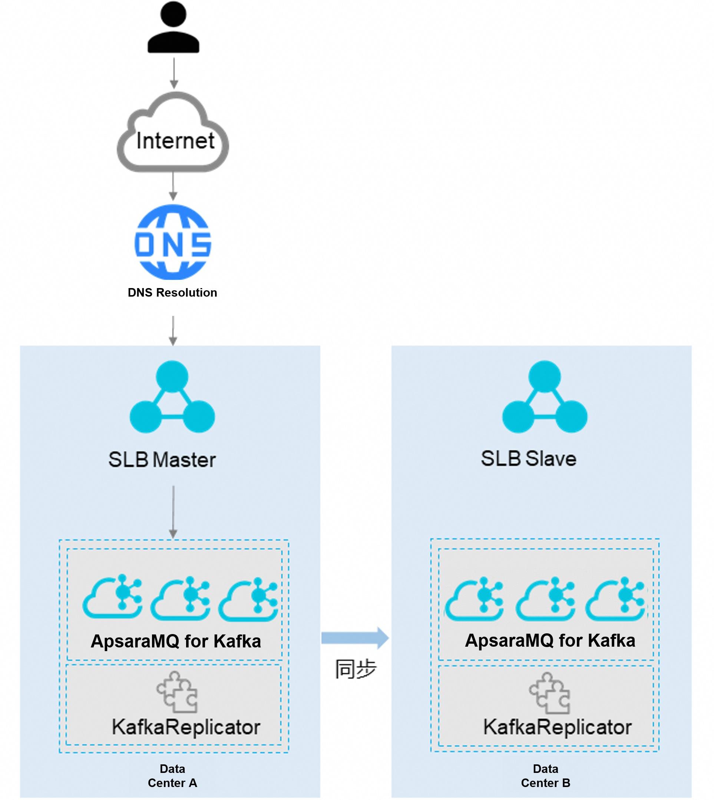

Architecture description:

- An ApsaraMQ for Kafka cluster and a KafkaReplicator database cluster are deployed in both Data Center A and Data Center B.

- The KafkaReplicator component synchronizes data from Data Center A to Data Center B to ensure data consistency.

- When a fault occurs in Data Center A, the business of Data Center A is switched to Data Center B. In this case, the domain name used to access the business remains unchanged.

**Limits**

After you implement a zone-disaster recovery solution, you must change the connection endpoint of the application client from the virtual IP address (VIP) of the primary ApsaraMQ for Kafka cluster to the domain name of the secondary ApsaraMQ for Kafka cluster. Otherwise, you cannot connect to the secondary ApsaraMQ for Kafka cluster during a disaster recovery switchover.

<a id="section-2-10-2"></a>

### 2.10.2. Create replica clusters

This topic describes how to create a replica cluster and establish a replication relationship to provide disaster recovery capabilities by using ApsaraMQ for Kafka instances.

**Prerequisites**

Two ApsaraMQ for Kafka instances are deployed. One of the instances is used in production environments and the other is used in zone-disaster recovery environments. Make sure that KafkaReplicator is deployed in the clusters to which the instances belong. If KafkaReplicator is not deployed, contact ApsaraMQ for Kafka technical support to deploy it.

1. Log on to the ApsaraMQ for Kafka console.

2. In the left-side navigation pane, click **Replica Clusters**.

3. On the **Disaster Recovery** page, click **Create a disaster recovery cluster**.

4. Perform the following operations to complete the wizard.

   <ol type="i">

   <li>

   In the **Configure Basic information** step, configure the following parameters and click **Next**.

   | Parameter | Description |
   | --- | --- |
   | Disaster recovery cluster name | The name of the replica cluster.<br>Note<br>The name of the replica cluster must meet the following rules:<br>• It can only contain letters, digits, and hyphens (-).<br>• It must be 3 to 20 characters in length. If the name is longer than 20 characters, it is automatically truncated.<br>• You cannot change the name of the replica cluster after the replica cluster is created. |

   </li>

   <li>

   In the **Configure Source Service** step, specify the following parameters of the source

   </li>

   </ol>

   instances and click **Next**.

   | Parameter | Description |
   | --- | --- |
   | SOURCE Kafka instance | The source Kafka instance. |
   | Source KafkaReplicator instance | The source Kafka replicator. |
   | Synchronization Start Point | The offset to start the data synchronization. You can select <strong>Earliest point</strong>, <strong>Nearest Point</strong>, or <strong>Specified time</strong>. |
   | Time point | The date and time.<br>Note<br>This option is available only when you set <strong>Synchronization Start Point</strong> to <strong>Specified time</strong>. |
   | Synchronous current limiting | If you do not need to perform current limiting during the data synchronization of disaster recovery instances, enter <code> 0 </code> in the field. Unit: MB/s. |

   <ol type="i" start="3">

   <li>

   In the **Configure Target Services** step, specify the information about the target

   </li>

   </ol>

   instances and click Next. In the Confirmation step, confirm the information and click **Create**.

   After a replica cluster is created, you can view the replica cluster on the **Disaster Recovery** page.

   > **Note**
   >
   > You cannot use instances that are used to create a replica cluster as the source or destination instances to create another replica cluster.

**Switch to the secondary cluster**

When faults occur in the primary cluster, you can switch business in the primary cluster to the secondary cluster to prevent business interruption.

> **Important**
>
> During the switchover, the network is switched. As a result, temporary disconnection can occur on the client. Confirm before you perform the switchover.

1. Log on to the ApsaraMQ for Kafka console.

2. In the left-side navigation pane, click **Replica Clusters**.

3. On the **Disaster Recovery** page, find the replica cluster that you want to manage and click **Disaster recovery switchover** in the **Operation** column.

4. In the **Disaster recovery switchover** dialog box, select the primary cluster that you want to switch and click **OK**.

**Delete a replica cluster**

If you no longer require disaster recovery capabilities, you can delete the replica cluster.

> **Important**
>
> After you delete a replica cluster, synchronization tasks that are running are stopped and deleted. The primary and secondary clusters no longer provide disaster recovery capabilities. Deleted clusters cannot be recovered. Proceed with caution.

1. Log on to the ApsaraMQ for Kafka console.

2. In the left-side navigation pane, click **Replica Clusters**.

3. On the **Disaster Recovery** page, find the replica cluster that you want to manage and click **Delete** in the **Operation** column.

4. In the **Delete a cluster** dialog box, click **OK**.

<a id="section-2-11"></a>

## 2.11. Data migration

<a id="section-2-11-1"></a>

### 2.11.1. Cloud migration

<a id="section-2-11-1-1"></a>

#### 2.11.1.1. Migrate data of topics and groups to the cloud

This topic describes how to use the data migration tool provided by Apsara Stack to migrate data of topics and groups from a self-managed open source Apache Kafka cluster to an ApsaraMQ for Kafka instance.

**Migrate data to the cloud by using a metadata file**

You can use the  `kafka-migration.jar`  tool and the metadata file exported from a self-managed Apache Kafka cluster to enable ApsaraMQ for Kafka to automatically create topics and groups in an ApsaraMQ for Kafka instance.

**Prerequisites**

- The following tool is downloaded to the self-managed Apache Kafka cluster from which you want to migrate data:

  - kafka-migration.jar

- The metadata file of the self-managed Apache Kafka cluster is exported.

**Start the migration**

**Migrate topic data**

1. Run the  `env |grep kafka`  command in the kafka console pod of the destination ApsaraMQ for Kafka instance to obtain the point of presence (POP) domain name of the instance. The  `kafka_pop_domain`  parameter indicates the POP domain name of the instance.

   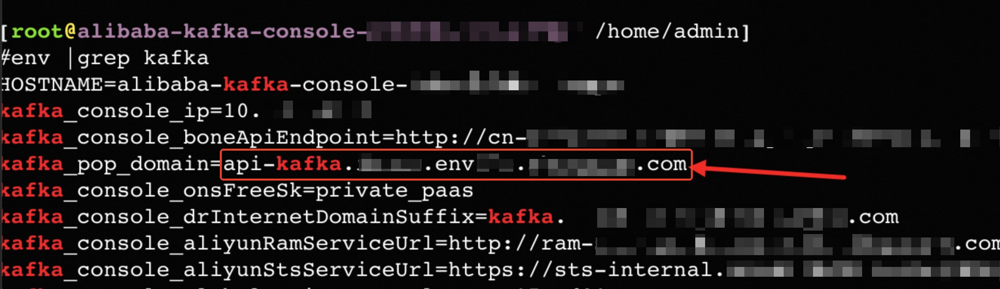

2. Run the following code in your self-managed Apache Kafka cluster to start the migration. Before you run the code, modify the relevant parameters described in the following table based on your business requirements.

   ```text
   java -jar kafka-migration.jar TopicMigrationFromMetadata \
   --fileName metadata.json \
   --endpoint ggggg \
   --destAk hhhh \
   --destSk kkkk \
   --destRegionId llll \
   --destInstanceId iiii \
   --commit
   ```

   | Parameter | Description | Example |
   | --- | --- | --- |
   | <code>--fileName</code> | The name of the metadata file. If you do not specify the parameter, the parameter is set to <code> kafka-metadata-</code><code>export.json </code> by default. | <code>metadata.json</code> |
   | <code>--endpoint</code> | The POP domain name of the destination ApsaraMQ for Kafka instance. | <code>api-</code><br><code>kafka.inter.env1.shuguang.</code><br><code>com</code> |
   | <code>--destAk</code> | The AccessKey ID of the Apsara Stack account to which the destination ApsaraMQ for Kafka instance belongs. | <code>zNYXZmCqIchtIKr</code> |
   | <code>--destSk</code> | The AccessKey secret of the Apsara Stack account to which the destination ApsaraMQ for Kafka instance belongs. | <code>HwMYEcd1j3EqSiLkSGV6Bu8dM</code><br><code>cK</code> |
   | <code>--destRegionId</code> | The ID of the region in which the destination ApsaraMQ for Kafka instance resides. | <code>cn-hangzhou</code> |
   | <code>--destInstanceId</code> | The ID of the destination ApsaraMQ for Kafka instance. | <code>cluster-snje0r</code> |
   | <code>--commit</code> | Commits and runs the code. | <code>commit</code> |

**Migrate group data**

1. Connect to any server within the cluster of the destination ApsaraMQ for Kafka instance and run the  `hostname -i`  command to obtain the endpoint of the topic from which you want to consume data in the destination ApsaraMQ for Kafka instance. The value of the  `bootstrapServers`  parameter is in the  `IP address obtained from the hostname -i command:9092`  format.

   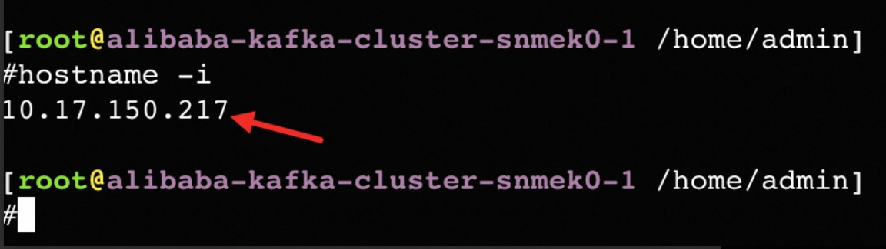

2. Run the following code in your self-managed Apache Kafka cluster to start the migration. Before you run the code, modify the relevant parameters described in the following table based on your business requirements.

   ```text
   java -jar kafka-migration.jar ConsumerGroupMigrationFromMetadata \
   --fileName metadata.json \
   --bootstrapServers ggggg \
   --commit
   ```

   | Parameter | Description | Example |
   | --- | --- | --- |
   | <code>--fileName</code> | The name of the metadata file. If you do not specify the parameter, the parameter is set to <code> kafka-</code><code>metadata-export.json </code> by default. | <code>metadata.json</code> |
   | <code>--</code><br><code>bootstrapServers</code> | The endpoint of the topic from which you want to consume data in the destination ApsaraMQ for Kafka instance. | <code>10.17.150.217:9092</code> |
   | <code>--commit</code> | Commits and runs the code. | <code>commit</code> |

**View the migration progress**

**View the migration progress of topic data**

After you run the code to start the migration, you can view the migration progress of each topic in the section shown in the following figure.

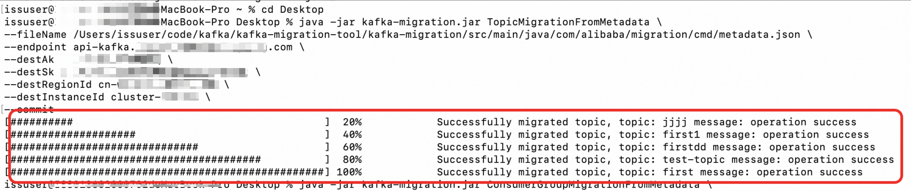

**View the migration progress of group data**

After you run the code to start the migration, you can view the migration progress of each group in the section shown in the following figure.

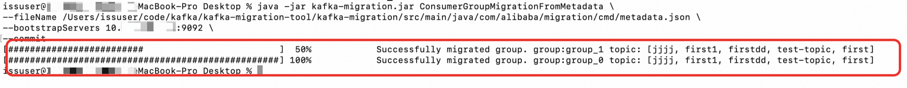

**Verify migration results**

1. Log in to the ApsaraMQ for Kafka console.

2. In the left-side navigation pane, click **Instance List**.

3. On the **Instance List** page, find the instance that you want to manage, and click the instance name, or click **Details** in the **Operation** column.

4. On the details page of the instance, click the **Topic management** or **Group management** tab. On the **Topic management** or **Group management** tab, view the created topics or groups.

**FAQ**

**Q1: What happens if a topic already exists in the destination ApsaraMQ for Kafka instance when I migrate the topic?**

The topic fails to be migrated, and an error shown in the following figure is reported, which indicates that the topic already exists in the destination ApsaraMQ for Kafka instance.

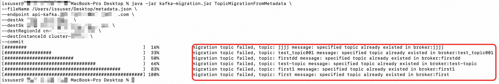

**Q2: What happens if the value of the endpoint parameter is invalid when I migrate a topic?**

The topic fails to be migrated, and an error shown in the following figure is reported.

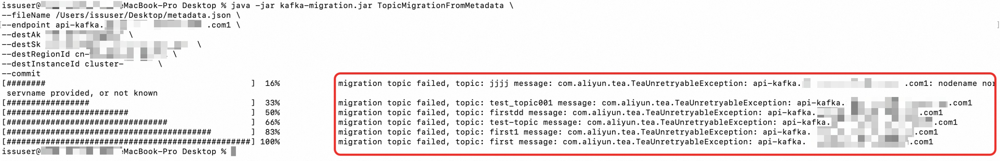

**Q3: What happens if the values of the destAk and DestSk parameters are invalid when I migrate a topic?**

The topic fails to be migrated, and an error shown in the following figure is reported.

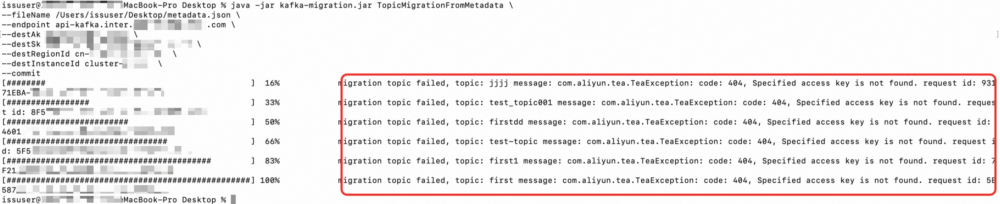

**Q4: What happens if the value of the destRegionId or destInstanceId parameter is invalid when I migrate a topic?**

The topic fails to be migrated, and an error shown in the following figure is reported, which indicates that the destination ApsaraMQ for Kafka instance is not found or not running.


**Q5: What happens if the metadata.json file does not exist when I migrate a topic?**

The topic fails to be migrated, and an error shown in the following figure is reported, which indicates that the file fails to be read.

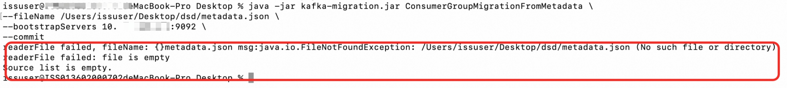

**Q6: What happens if the value of the bootstrapServers parameter is invalid when I migrate a group?**

The group fails to be migrated, and an error shown in the following figure is reported, which indicates that the value of the bootstrapServers parameter is invalid.

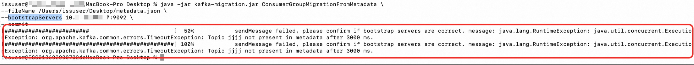

<a id="section-2-11-2"></a>

### 2.11.2. Cloud‑to‑Cloud Migration

<a id="section-2-11-2-1"></a>

#### 2.11.2.1. Use the ApsaraMQ for Kafka console to migrate services from one ApsaraMQ for Kafka instance to another

This topic describes how to use the ApsaraMQ for Kafka console to migrate services from one ApsaraMQ for Kafka instance to another ApsaraMQ for Kafka instance.

**Procedure**

1. Log on to the ApsaraMQ for Kafka console.

2. In the left-side navigation pane, choose **Data Integration > Message Routing**.

3. On the **Message Routing** page, click the **Tasks** tab.

4. Click **Create a local task**, configure the following parameters, and then click **OK**.

   <table>
     <tr>
       <th colspan="2">Parameter</th>
       <th>Description</th>
     </tr>
     <tr>
       <td rowspan="3">Message Source</td>
       <td>SOURCE instance</td>
       <td>Select the source ApsaraMQ for Kafka instance.</td>
     </tr>
     <tr>
       <td>Type</td>
       <td>Select the type of the migration task. Valid values:<br>• Instance Migration<br>• topic migration</td>
     </tr>
     <tr>
       <td>Synchronous Topic</td>
       <td>Select the topic to be synchronized. You can select multiple topics.<br>• If you do not specify this parameter, all topics in the instance are synchronized.<br>• Regular expressions are supported. For example, hello.* indicates that all topics that start with hello are synchronized.<br>Note<br>This parameter is displayed only if you set <strong>Type</strong> to <strong>topic migration</strong>.</td>
     </tr>
     <tr>
       <td rowspan="2">Message Destination</td>
       <td>Target Instance</td>
       <td>Select the destination ApsaraMQ for Kafka instance.</td>
     </tr>
     <tr>
       <td>Target Replicator</td>
       <td>Select the destination replicator.</td>
     </tr>
     <tr>
       <td colspan="2">Synchronization Start Point</td>
       <td>Select an offset to start the data synchronization. Valid values:<br>• Earliest point<br>• Nearest Point<br>• Specified time</td>
     </tr>
   </table>

   <table>
     <tr>
       <td>Time point</td>
       <td>Select a date. If the offset cannot be found in the specified partition of the specified topic after you select the time, data synchronization starts from the earliest offset. An offset cannot be found if the specified time is earlier than the earliest offset or later than the latest offset.<br>Note<br>This parameter is displayed only if you set <strong>Synchronization Start Point</strong> to <strong>Specified time</strong>.</td>
     </tr>
     <tr>
       <td>Current limiting</td>
       <td>Configure the throttling rule for the data synchronization process of the disaster recovery instances. Unit: MB/s.<br>Note<br>If throttling is not required during the data synchronization of disaster recovery instances, set this parameter to 0.</td>
     </tr>
     <tr>
       <td>Description</td>
       <td>Enter a description.</td>
     </tr>
   </table>

5. After the local task is created, you can view its basic information and status in the task list on the **Tasks** tab.

<a id="section-2-11-2-2"></a>

#### 2.11.2.2. Cloud‑to‑Cloud Migration using the Kafka data migration tool

This topic describes how to use the Kafka data migration tool from Alibaba Cloud to migrate your services from one ApsaraMQ for Kafka instance to another.

**Migrate Kafka metadata and data in the cloud**

You can use the provided  `kafka-migration-assessment.jar`  tool and the  `kafka-mirror-maker.sh`  tool, which is included with the ApsaraMQ for Kafka instance, to migrate metadata and data.

**Prerequisites**

- Download the  `kafka-migration-assessment.jar`  tool to the target ApsaraMQ for Kafka cluster.

  - kafka-migration-assessment.jar

**Start the migration**

**Metadata migration (topics and groups)**

1. Upload the downloaded migration tool to the **target** ApsaraMQ for Kafka **cluster**.

```bash
# Upload the migration tool to the main container of the ApsaraMQ for Kafka instance.
kubectl cp /apsarapangu/disk4/tmp/xtermupload/kafka-migration-assessment.jar alibaba-kafka-cluster-s****-0:/home/admin -c main
# Access the main container of the target ApsaraMQ for Kafka instance.
kubectl exec -it alibaba-kafka-cluster-s****-0 -c main -- bash
```

2. In the directory that contains the migration tool, run the following command to grant executable permissions to the JAR file.

```bash
chmod 777 kafka-migration-assessment.jar
```

3. Parameter descriptions:

| Parameter | Description | Example |
| --- | --- | --- |
| <code>--</code><br><code>sourceAk</code> | The AccessKey ID of the Alibaba Cloud account that owns the source ApsaraMQ for Kafka instance. | <code>0J*********</code> |
| <code>--</code><br><code>sourceSk</code> | The AccessKey secret of the Alibaba Cloud account that owns the source ApsaraMQ for Kafka instance. | <code>h7*****************</code> |
| <code>--</code><br><code>sourceRegio</code><br><code>nId</code> | The region ID of the source ApsaraMQ for Kafka instance. | <code>cn-hangzhou</code> |
| <code>--</code><br><code>sourceInsta</code><br><code>nceId</code> | The ID of the source ApsaraMQ for Kafka instance. | <code>cluster-s***qu</code> |
| <code>--</code><br><code>sourceEndpo</code><br><code>int</code> | The <code> kafka_pop_domain </code> environment variable of the \`kafka-console\` container. | <code>api-</code><br><code>kafka.inter.env**.sh****.com</code> |
| <code>--</code><br><code>destAk</code> | The AccessKey ID of the Alibaba Cloud account that owns the target ApsaraMQ for Kafka instance. | <code>ER*********</code> |
| <code>--</code><br><code>destSk</code> | The AccessKey secret of the Alibaba Cloud account that owns the target ApsaraMQ for Kafka instance. | <code>Ut*****************</code> |
| <code>--</code><br><code>destRegionI</code><br><code>d</code> | The region ID of the target ApsaraMQ for Kafka instance. | <code>cn-hangzhou</code> |
| <code>--</code><br><code>destInstanc</code><br><code>eId</code> | The ID of the target ApsaraMQ for Kafka instance. | <code>cluster-s***ty</code> |
| <code>--</code><br><code>destEndpoin</code><br><code>t</code> | The <code> kafka_pop_domain </code> environment variable of the \`kafka-console\` container. | <code>api-</code><br><code>kafka.inter.env**.sh****.com</code> |
| <code>--</code><br><code>search</code> | Specifies the topics or groups to migrate. | <code>topic1,topic2,topic3</code> |
| <code>--</code><br><code>commit</code> | Commits the execution. | <code>commit</code> |
| <code>--</code><br><code>destBootstr</code><br><code>apServers</code> | The endpoint of the corresponding topic in the target ApsaraMQ for Kafka instance. | <code>localhost:9092</code> |

**Migrate topics in the cloud**

**Step 1: Run a topic migration evaluation**

```text
java -jar kafka-migration-assessment.jar TopicMigrationFromAliyun \
--sourceAk 0J********* \
--sourceSk h7***************** \
--sourceRegionId cn-w****-env**-d01 \
--sourceInstanceId cluster-s**** \
--sourceEndpoint api-kafka.inter.env**.sh****.com \
--destAk ER********* \
--destSk Ut***************** \
--destRegionId cn-w****-env**-d01 \
--destInstanceId cluster-s**** \
--destEndpoint api-kafka.inter.env**.sh****.com
```

You can use the  `--search`  parameter to specify the topics for the migration evaluation. If you do not include this parameter, the tool evaluates all topics by default.

```text
java -jar kafka-migration-assessment.jar TopicMigrationFromAliyun \
--sourceAk 0J********* \
--sourceSk h7***************** \
--sourceRegionId cn-w****-env**-d01 \
--sourceInstanceId cluster-s**** \
--sourceEndpoint api-kafka.inter.env**.sh****.com \
--destAk ER********* \
--destSk Ut***************** \
--destRegionId cn-w****-env**-d01 \
--destInstanceId cluster-s**** \
--destEndpoint api-kafka.inter.env**.sh****.com \
--search topic1,topic2,topic3,topic4
```

The following output shows the evaluation result:

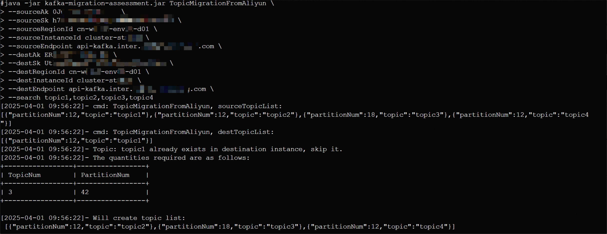

After you confirm the evaluation results, run the topic migration command.

**Step 2: Run the topic migration**

You can use the  `--search`  parameter to specify the topics to migrate.

```text
java -jar kafka-migration-assessment.jar TopicMigrationFromAliyun \
--sourceAk 0J********* \
--sourceSk h7***************** \
--sourceRegionId cn-w****-env**-d01 \
--sourceInstanceId cluster-s**** \
--sourceEndpoint api-kafka.inter.env**.sh****.com \
--destAk ER********* \
--destSk Ut***************** \
--destRegionId cn-w****-env**-d01 \
--destInstanceId cluster-s**** \
--destEndpoint api-kafka.inter.env**.sh****.com \
--search topic1,topic2,topic3,topic4 \
--commit
```

The following output shows the migration result:

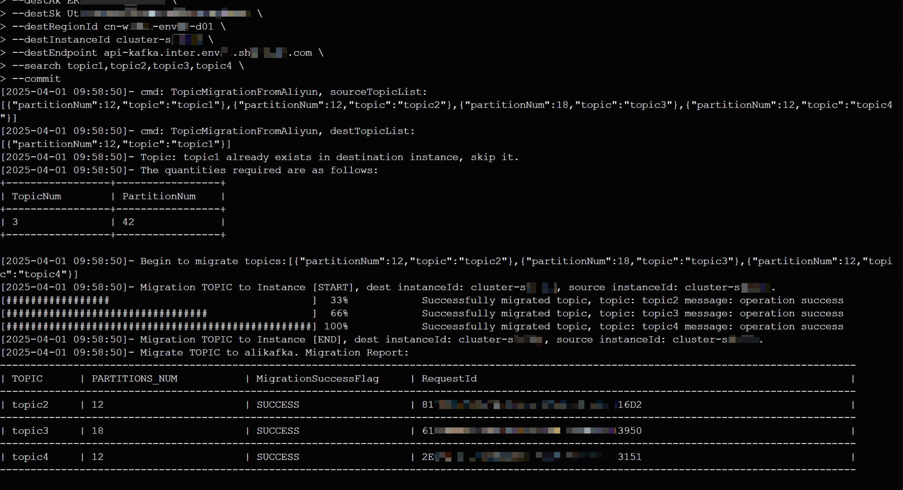

**Step 3: Verify the migration result**

After the migration is complete, go to the Topic Management tab of the target instance to view the created topics in the topic list.

1. Log in to the ApsaraMQ for Kafka console.

2. In the left-side navigation pane, click **Instance List**.

3. On the **Instance List** page, find the instance that you want to manage, and click the instance name, or click **Details** in the **Operation** column.

4. Click the **Topic management** tab.

5. On the **Topic management** tab, view the list of topics.

**FAQ**

**Q1: If a topic from the source instance already exists in the target instance, is it skipped during migration?**

Yes, it is.

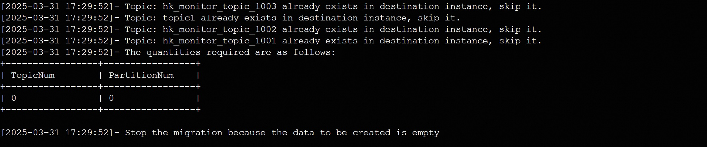

**Migrate consumer groups in the cloud**

**Step 1: Run a group migration evaluation**

```text
java -jar kafka-migration-assessment.jar ConsumerGroupMigrationFromAliyun \
--sourceAk 0J********* \
--sourceSk h7***************** \
--sourceRegionId cn-w****-env**-d01 \
--sourceInstanceId cluster-s**** \
--sourceEndpoint api-kafka.inter.env**.sh****.com \
--destAk ER********* \
--destSk Ut***************** \
--destRegionId cn-w****-env**-d01 \
--destInstanceId cluster-s**** \
--destEndpoint api-kafka.inter.env**.sh****.com \
--destBootstrapServers localhost:9092 \
--search group1,group2,group3
```

The following output shows the evaluation result:

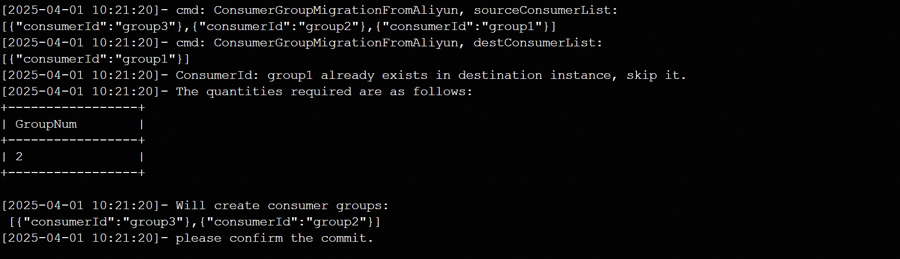

After you confirm the evaluation results, run the group migration command.

**Step 2: Run the group migration**

```text
java -jar kafka-migration-assessment.jar ConsumerGroupMigrationFromAliyun \
--sourceAk 0J********* \
--sourceSk h7***************** \
--sourceRegionId cn-w****-env**-d01 \
--sourceInstanceId cluster-s**** \
--sourceEndpoint api-kafka.inter.env**.sh****.com \
--destAk ER********* \
--destSk Ut***************** \
--destRegionId cn-wulan-env82-d01 \
--destInstanceId cluster-s**** \
--destEndpoint api-kafka.inter.env**.sh****.com \
--destBootstrapServers localhost:9092 \
--search group1,group2,group3 \
--commit
```

The following output shows the migration result:

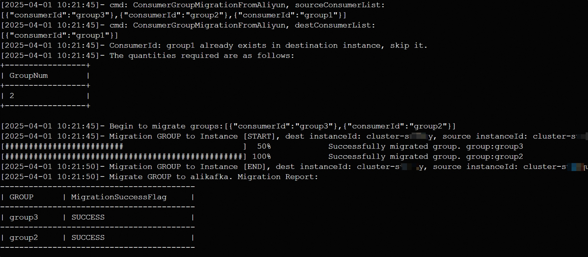

**Step 3: Verify the migration result**

After the migration is complete, go to the Group Management tab of the target instance to view the created groups in the group list.

1. Log on to the ApsaraMQ for Kafka console.

2. In the left-side navigation pane, click **Instance List**.

3. On the **Instance List** page, find the instance that you want to manage, and click the instance name, or click **Details** in the **Operation** column.

4. On the **Instance details** page, click the **Group management** tab.

5. On the **Group management** tab, view the list of consumer groups.

**Migrate data in the cloud**

The \`kafka-mirror-maker\` tool uses a consumer to pull data from the source ApsaraMQ for Kafka instance and a producer to efficiently and reliably transfer the data to the target ApsaraMQ for Kafka instance.

**Prepare the data migration configuration files**

On the target ApsaraMQ for Kafka cluster, prepare the \`migrationProducer.properties\` and \`migrationConsumer.properties\` configuration files.

- Contents of the \`migrationProducer.properties\` file:

```text
## The PLAINTEXT endpoint of the target Kafka cluster.
bootstrap.servers=ip:port

## Data compression type.
compression.type=none
```

- Contents of the \`migrationConsumer.properties\` file:

```text
## The PLAINTEXT endpoint of the source Kafka cluster.
bootstrap.servers=ip:port

## The partition assignment strategy for the consumer.
partition.assignment.strategy=org.apache.kafka.clients.consumer.RoundRobinAssignor

## The name of the group. Use a new group for the data migration.
group.id=test-consumer-group

# If no offset is committed, synchronization starts from the earliest data.
auto.offset.reset=earliest
```

**Use the data migration tool**

- The tool is located in the  `/home/admin/KafkaProxy/bin`  directory inside the ApsaraMQ for Kafka container.

- **After you migrate the topics**, run the following command to start the data migration.

```text
./kafka-mirror-maker.sh --consumer.config ../config/migrationConsumer.properties --producer.config ../config/migrationProducer.properties --whitelist 'topic1|topic2|topic3'
```

| Parameter | Description | Example |
| --- | --- | --- |
| <code>--</code><br><code>consumer.config</code> | Specifies the consumer configuration file, which contains the connection information for the source cluster. | ../config/migrationConsumer.properties |
| <code>--</code><br><code>producer.config</code> | Specifies the producer configuration file, which contains the connection information for the target cluster. | ../config/migrationProducer.properties |
| <code>--whitelist</code> | A whitelist. Use a regular expression to specify the topics to replicate. | <code>"topic1&#124;topic2&#124;topic3"</code> |

**Verify the data migration result**

1. On the Group Management tab of the target ApsaraMQ for Kafka instance, check if the configured  `group.id`  exists.

2. Check the consumption status of the group and the consumption details of the topic. For more information, see View the consumption status of a consumer group.

3. In the ApsaraMQ for Kafka console, check the partition status of the topic and confirm that the number of messages is correct. For more information, see View the partition status of a topic.

**FAQ**

**Q1: How do I stop a running migration script?**

- If you are in the command-line interface where the script is running, press Ctrl+C to stop the script.

- If you are not in the command-line interface where the script is running, find and kill the process as follows:

```text
ps -ef | grep "kafka.tools.MirrorMaker"
```

Kill the process:

```text
kill -9  xxx
```

<a id="section-2-12"></a>

## 2.12. KSQLDB

This topic describes how to manage an Apache Kafka KSQL cluster.

**Background information**

KSQL is an open source stream processing SQL engine designed for Apache Kafka. It supports SQL-like syntax to enable low-code, real-time processing and analysis of Kafka data streams.

**Prerequisites**

An ApsaraMQ for Kafka instance and a connect are created. For more information, see Create an instance and Create a connect.

**Create a KSQL cluster**

1. Log in to the ApsaraMQ for Kafka console.

2. In the left-side navigation pane, choose **Data Integration > KSQLDB**.

3. On the **KSQL** page, click **Create KSQL Cluster**.

4. In the **Create KSQL Cluster** dialog box, configure the following parameters and click **OK**.

   | Parameter | Description |
   | --- | --- |
   | Cluster Name | Enter a name for the KSQL cluster. The name is used to identify and manage the cluster.<br>This parameter is optional. If you do not specify a name, the system automatically generates a unique name. |
   | Zone | Select a zone in which you want to deploy the KSQL cluster. |
   | Kafka Instance | Select the source ApsaraMQ for Kafka instance to be connected to the KSQL cluster. |
   | Connect Instance | Select the ApsaraMQ for Kafka connect to be associated with the KSQL cluster. |

**View KSQL cluster details**

1. On the **KSQL** page, you can perform an exact search by KSQL ID.

2. In the KSQL cluster list, you can view the following information: **KSQL Name**, **Kafka Instance ID**, **Zone**, **Status**, and **Create Time**.

3. Find the KSQL cluster that you want to view and click its name or **Details** in the **Operation** column to go to the **KSQL Cluster Details** page.

4. On the **KSQL Cluster Details** page, you can manage different types of KSQL objects on the following tabs:

   - **Streams**: defines a real-time data stream, which is usually mapped to an ApsaraMQ for Kafka topic.

     - View the details of a stream: On the **Streams** tab, you can view the **name**, **type**, **Kafka topic**, and **data format** of the stream. Click **Details** in the **Operation** column. In the dialog box that appears, you can view the complete structure definition<strong>, including the column name</strong>, **type**, and **key**.

     - Delete a stream: On the **Streams** tab, click **Delete** in the **Operation** column. In the dialog box that appears, click **OK**.

   - **Tables**: displays stateful aggregation results or materialized views that are commonly used in JOIN or GROUP BY operations.

     - View the details of a table: On the **Tables** tab, you can view the **name**, **type**, **Kafka topic**, and **data format** of the table. Click **Details** in the **Operation** column. In the dialog box that appears, you can view the complete structure definition<strong>, including the column name</strong>, **type**, and **key**.

     - Delete a table: On the **Tables** tab, click **Delete** in the **Operation** column. In the dialog box that appears, click **OK**.

   - **Queries**: displays in-progress queries, query status, and output destinations.

     - View the details of a query: On the **Queries** tab, you can view the **query ID**, **sink**, **SQL**, **status**, and **type** of the query.

     - Terminate a query: On the **Queries** tab, click **Terminate** in the **Operation** column. In the dialog box that appears, click **OK**.

   - **SQL Editor**: allows you to write and execute KSQL statements to create streams, tables, and query statements.

     Execute a KSQL statement: Enter the KSQL statement in the **SQL Editor** or select a template and click **Execute**. After the KSQL statement is executed, the execution result is displayed in a table at the bottom of the page.

**Delete a KSQL cluster**

1. On the **KSQL** page, find the KSQL cluster that you want to delete and click **Delete** in the **Operation** column.

2. In the message that appears, click **OK**.

   > **Important**
   >
   > Deleted KSQL clusters cannot be restored. Proceed with caution.

<a id="section-3"></a>

# 3.Pod command operations

<a id="section-3-1"></a>

## 3.1. Command verification

<a id="section-3-1-1"></a>

### 3.1.1. Create topics

This topic describes how to create a topic.

**Prerequisites**

The information about the master node in ApsaraMQ for Kafka is obtained.

**Procedure**

1. Connect to the master node in ApsaraMQ for Kafka.

2. Run the  `kubectl exec -it <pod> bash`  to connect to the pod in ApsaraMQ for Kafka.

   For example, if the name of the pod is  `alibaba-kafka-cluster-private-paas-default-0` , run the  `kubectl exec -it alibaba-kafka-cluster-private-paas-default-0 bash`  command.

3. Run the  `sudo su admin`  command to switch to the administrator account.

4. Run the  ``sh /home/admin/KafkaProxy/bin/kafka-topics.sh --create --bootstrap-server `hostname -i`:9092 --topic test --replication-factor 3 --partitions 12``  command to create a topic.

**Execution result**

Run the  ``sh /home/admin/KafkaProxy/bin/kafka-topics.sh --list --bootstrap-server `hostname -i`:9092``  command to view the list of topics.

Sample output:

```text
__consumer_offsets
test
```

> **Note**
>
> The ___consumer_offsets topic is automatically created by the system. The topic is used to store offsets committed by each topic.

<a id="section-3-1-2"></a>

### 3.1.2. Send messages

This topic describes how to send messages to a topic.

**Prerequisites**

The information about the master node in ApsaraMQ for Kafka is obtained.

**Background information**

ApsaraMQ for Kafka allows you to send messages by using the PLAINTEXT protocol.

**PLAINTEXT**

1. Connect to the master node in ApsaraMQ for Kafka.

2. Run the  `kubectl exec -it <pod> bash`  to connect to the pod in ApsaraMQ for Kafka.

   For example, if the name of the pod is  `alibaba-kafka-cluster-private-paas-default-0` , run the  `kubectl exec -it alibaba-kafka-cluster-private-paas-default-0 bash`  command.

3. Run the  `sudo su admin`  command to switch to the administrator account.

4. Send messages on port 9092 by using PLAINTEXT.

   - Run the  ``java -jar /home/admin/kafka-pkgs/KafkaChecker.jar send -s `hostname -i`:9092 -t test``  command to directly send messages.

   - Run the  ``java -Dlog4j.configuration=file:/home/admin/kafka-pkgs/log4j.properties -jar /home/admin/kafka-pkgs/KafkaChecker.jar send -s `hostname -i`:9092 -t test``  command to send messages by enabling logging for debugging.

<a id="section-3-1-3"></a>

### 3.1.3. Consume messages

This topic describes how to consume messages from a topic.

**Prerequisites**

The information about the master node in ApsaraMQ for Kafka is obtained.

**Background information**

ApsaraMQ for Kafka allows you to consume messages by using PLAINTEXT protocol.

**PLAINTEXT**

1. Connect to the master node in ApsaraMQ for Kafka.

2. Run the  `kubectl exec -it <pod> bash`  to connect to the pod in ApsaraMQ for Kafka.

   For example, if the name of the pod is  `alibaba-kafka-cluster-private-paas-default-0` , run the  `kubectl exec -it alibaba-kafka-cluster-private-paas-default-0 bash`  command.

3. Run the  `sudo su admin`  command to switch to the administrator account.

4. Consume messages on port 9092 by using PLAINTEXT.

   - Run the  ``sh /home/admin/KafkaProxy/bin/kafka-console-consumer.sh --from-beginning --topic test --group CID_test --bootstrap-server `hostname -i`:9092``  command to consume messages by using scripts.

   - Run the  ``java -jar /home/admin/kafka-pkgs/KafkaChecker.jar consume -s `hostname -i`:9092 --offsetReset earliest --printAll true``  command to consume messages by using the JAR tool.

   - Run the  `java -Dlog4j.configuration=file:/home/admin/kafka-pkgs/log4j.properties -jar`

```text
/home/admin/kafka-pkgs/KafkaChecker.jar consume -s `hostname -i`:9092 --offsetReset 
```

`earliest --printAll true`  command to consume messages by enabling logging for debugging.

<a id="section-3-2"></a>

## 3.2. Topics

<a id="section-3-2-1"></a>

### 3.2.1. Create topics

This topic describes how to create a topic.

**Prerequisites**

The information about the master node in ApsaraMQ for Kafka is obtained.

**Procedure**

1. Connect to the master node in ApsaraMQ for Kafka.

2. Run the  `kubectl exec -it <pod> bash`  to connect to the pod in ApsaraMQ for Kafka.

   For example, if the name of the pod is  `alibaba-kafka-cluster-private-paas-default-0` , run the  `kubectl exec -it alibaba-kafka-cluster-private-paas-default-0 bash`  command.

3. Run the  `sudo su admin`  command to switch to the administrator account.

4. Run the  ``sh /home/admin/KafkaProxy/bin/kafka-topics.sh --create --bootstrap-server `hostname -i`:9092 --topic test --replication-factor 3 --partitions 12``  command to create a topic.

**Execution result**

Run the  ``sh /home/admin/KafkaProxy/bin/kafka-topics.sh --list --bootstrap-server `hostname -i`:9092``  command to view the list of topics.

Sample output:

```text
__consumer_offsets
test
```

> **Note**
>
> The ___consumer_offsets topic is automatically created by the system. The topic is used to store offsets committed by each topic.

<a id="section-3-2-2"></a>

### 3.2.2. View the status of a topic

This topic describes how to view the status of a topic.

**Prerequisites**

The information about the master node in ApsaraMQ for Kafka is obtained.

**Procedure**

1. Connect to the master node in ApsaraMQ for Kafka.

2. Run the  `kubectl exec -it <pod> bash`  to connect to the pod in ApsaraMQ for Kafka.

   For example, if the name of the pod is  `alibaba-kafka-cluster-private-paas-default-0` , run the  `kubectl exec -it alibaba-kafka-cluster-private-paas-default-0 bash`  command.

3. Run the  `sudo su admin`  command to switch to the administrator account.

4. Run the  ``sh /home/admin/KafkaProxy/bin/kafka-topics.sh --describe --bootstrap-server `hostname -i`:9092 --topic test``  command to view the status of the topic.

   Sample output:

   ```text
   Topic:test      PartitionCount:12       ReplicationFactor:3     
   Configs:min.insync.replicas=1,flush.ms=1000,segment.bytes=268435456,retention.ms=864000
   ,flush.messages=10000,max.message.bytes=10000000,unclean.leader.election.enable=false
           Topic: test     Partition: 0    Leader: 1003    Replicas: 1003,1002,1001      
   Isr: 1001,1003,1002
           Topic: test     Partition: 1    Leader: 1002    Replicas: 1002,1001,1003      
   Isr: 1003,1002,1001
           Topic: test     Partition: 2    Leader: 1001    Replicas: 1001,1003,1002      
   Isr: 1003,1002,1001
           Topic: test     Partition: 3    Leader: 1003    Replicas: 1003,1001,1002      
   Isr: 1001,1003,1002
           Topic: test     Partition: 4    Leader: 1002    Replicas: 1002,1003,1001      
   Isr: 1003,1002,1001
           Topic: test     Partition: 5    Leader: 1001    Replicas: 1001,1002,1003      
   Isr: 1003,1002,1001
           Topic: test     Partition: 6    Leader: 1003    Replicas: 1003,1002,1001      
   Isr: 1001,1003,1002
           Topic: test     Partition: 7    Leader: 1002    Replicas: 1002,1001,1003      
   Isr: 1003,1002,1001
           Topic: test     Partition: 8    Leader: 1001    Replicas: 1001,1003,1002      
   Isr: 1003,1002,1001
           Topic: test     Partition: 9    Leader: 1003    Replicas: 1003,1001,1002      
   Isr: 1001,1003,1002
           Topic: test     Partition: 10   Leader: 1002    Replicas: 1002,1003,1001      
   Isr: 1003,1002,1001
           Topic: test     Partition: 11   Leader: 1001    Replicas: 1001,1002,1003      
   Isr: 1003,1002,1001
   ```

<a id="section-3-2-3"></a>

### 3.2.3. View the current offset of a partition

The current offset of a partition is the latest message that is sent to the consumer by the ApsaraMQ for Kafka broker. This topic describes how to view the current offset of a partition.

**Prerequisites**

The information about the master node in ApsaraMQ for Kafka is obtained.

**Procedure**

1. Connect to the master node in ApsaraMQ for Kafka.

2. Run the  `kubectl exec -it <pod> bash`  to connect to the pod in ApsaraMQ for Kafka.

   For example, if the name of the pod is  `alibaba-kafka-cluster-private-paas-default-0` , run the  `kubectl exec -it alibaba-kafka-cluster-private-paas-default-0 bash`  command.

3. Run the  `sudo su admin`  command to switch to the administrator account.

4. Run the  `java -jar /home/admin/kafka-pkgs/KafkaMetricChecker.jar object -o kafka.log:name=LogEndOffset,partition=<partition id>,topic=<topic>,type=Log`  command to view the current offset of the partition.

   For example, if the name of the topic is  `test` , the ID of the partition is  `9` , run the  `java`

```text
-jar /home/admin/kafka-pkgs/KafkaMetricChecker.jar object -o 
```

`kafka.log:name=LogEndOffset,partition=9,topic=test,type=Lo`  command.

Sample output:

```text
Value                                                            16761
```

<a id="section-3-2-4"></a>

### 3.2.4. View the list of topics

This topic describes how to view the list of topics.

**Prerequisites**

The information about the master node in ApsaraMQ for Kafka is obtained.

**Procedure**

1. Connect to the master node in ApsaraMQ for Kafka.

2. Run the  `kubectl exec -it <pod> bash`  to connect to the pod in ApsaraMQ for Kafka.

   For example, if the name of the pod is  `alibaba-kafka-cluster-private-paas-default-0` , run the  `kubectl exec -it alibaba-kafka-cluster-private-paas-default-0 bash`  command.

3. Run the  `sudo su admin`  command to switch to the administrator account.

4. Run the  ``sh /home/admin/KafkaProxy/bin/kafka-topics.sh --list --bootstrap-server `hostname -i`:9092``  command to view the list of topics.

   Sample output:

   ```text
   CMDTest
   __consumer_offsets
   demo
   test
   test1
   test2
   ```

<a id="section-3-2-5"></a>

### 3.2.5. Increase the number of partitions in a topic

After you create a topic, you can increase the number of partitions in the topic. ApsaraMQ for Kafka does not allow you to decrease the number of partitions in a topic. If you want to decrease the number of partitions in a topic, you can delete the topic and create another topic that has the required number of partitions.

**Prerequisites**

The information about the master node in ApsaraMQ for Kafka is obtained.

**Procedure**

1. Connect to the master node in ApsaraMQ for Kafka.

2. Run the  `kubectl exec -it <pod> bash`  to connect to the pod in ApsaraMQ for Kafka.

   For example, if the name of the pod is  `alibaba-kafka-cluster-private-paas-default-0` , run the  `kubectl exec -it alibaba-kafka-cluster-private-paas-default-0 bash`  command.

3. Run the  `sudo su admin`  command to switch to the administrator account.

4. Run the  ``sh /home/admin/KafkaProxy/bin/kafka-topics.sh -alter --bootstrap-server `hostname -i`:9092 --topic <topic> --partitions <total partition number>``  command to increase the number of partitions in a topic.

   For example, if you want to increase the number of partitions by 6 for the test topic that has 12 partitions, run the  ``sh /home/admin/KafkaProxy/bin/kafka-topics.sh -alter --bootstrap-server `hostname -i`:9092 --topic test --partitions 18``  command.

   Sample output:

   ```text
   Topic:test      PartitionCount:18       ReplicationFactor:3     
   Configs:min.insync.replicas=1,flush.ms=1000,segment.bytes=268435456,retention.ms=864000
   ,flush.messages=10000,max.message.bytes=10000000,unclean.leader.election.enable=false
           Topic: test     Partition: 0    Leader: 1003    Replicas: 1003,1002,1001      
   Isr: 1001,1003,1002
           Topic: test     Partition: 1    Leader: 1002    Replicas: 1002,1001,1003      
   Isr: 1003,1002,1001
           Topic: test     Partition: 2    Leader: 1001    Replicas: 1001,1003,1002      
   Isr: 1003,1002,1001
           Topic: test     Partition: 3    Leader: 1003    Replicas: 1003,1001,1002      
   Isr: 1001,1003,1002
           Topic: test     Partition: 4    Leader: 1002    Replicas: 1002,1003,1001      
   Isr: 1003,1002,1001
           Topic: test     Partition: 5    Leader: 1001    Replicas: 1001,1002,1003      
   Isr: 1003,1002,1001
           Topic: test     Partition: 6    Leader: 1003    Replicas: 1003,1002,1001      
   Isr: 1001,1003,1002
           Topic: test     Partition: 7    Leader: 1002    Replicas: 1002,1001,1003      
   Isr: 1003,1002,1001
           Topic: test     Partition: 8    Leader: 1001    Replicas: 1001,1003,1002      
   Isr: 1003,1002,1001
           Topic: test     Partition: 9    Leader: 1003    Replicas: 1003,1001,1002      
   Isr: 1001,1003,1002
           Topic: test     Partition: 10   Leader: 1002    Replicas: 1002,1003,1001      
   Isr: 1003,1002,1001
           Topic: test     Partition: 11   Leader: 1001    Replicas: 1001,1002,1003      
   Isr: 1003,1002,1001
           Topic: test     Partition: 12   Leader: 1003    Replicas: 1003,1002,1001      
   Isr: 1003,1002,1001
           Topic: test     Partition: 13   Leader: 1001    Replicas: 1001,1003,1002      
   Isr: 1001,1003,1002
           Topic: test     Partition: 14   Leader: 1002    Replicas: 1002,1001,1003      
   Isr: 1002,1001,1003
           Topic: test     Partition: 15   Leader: 1003    Replicas: 1003,1001,1002      
   Isr: 1003,1001,1002
           Topic: test     Partition: 16   Leader: 1001    Replicas: 1001,1002,1003      
   Isr: 1001,1002,1003
           Topic: test     Partition: 17   Leader: 1002    Replicas: 1002,1003,1001      
   Isr: 1002,1003,1001
   ```

<a id="section-3-2-6"></a>

### 3.2.6. Modify topic configurations

If the configurations of a topic do not meet your business requirements, you can modify the configurations of the topic.

**Prerequisites**

The information about the master node in ApsaraMQ for Kafka is obtained.

**Procedure**

1. Connect to the master node in ApsaraMQ for Kafka.

2. Run the  `kubectl exec -it <pod> bash`  to connect to the pod in ApsaraMQ for Kafka.

   For example, if the name of the pod is  `alibaba-kafka-cluster-private-paas-default-0` , run the  `kubectl exec -it alibaba-kafka-cluster-private-paas-default-0 bash`  command.

3. Run the  `sudo su admin`  command to switch to the administrator account.

4. Run the  `cat /home/admin/kafka-config/server.properties | grep zookeeper.connect` command to view the connection information about ZooKeeper.

   Sample output:

   ```text
   zookeeper.connect=10.XX.XX.145:2188,10.XX.XX.143:2188,10.XX.XX.181:2188/kafka-private-clusters/cluster-private-paas-default
   zookeeper.connection.timeout.ms=36000
   ```

5. Run the  `sh /home/admin/KafkaProxy/bin/kafka-configs.sh --zookeeper <zk connect> --describe --entity-name <topic> --entity-type topics`  command to view the configurations of the topic.

   For example, if the URL of a ZooKeeper connection is

   ```text
    10.XX.XX.183:2188,10.XX.XX.182:2188,10.XX.XX.181:2188/kafka-private-clusters/cluster-
   ```

   `private-paas-default`  and the name of the topic is  `test` , run the  `sh`

```text
/home/admin/KafkaProxy/bin/kafka-configs.sh --zookeeper 
```

```text
10.XX.XX.183:2188,10.XX.XX.182:2188,10.XX.XX.181:2188/kafka-private-clusters/cluster-
```

`private-paas-default --describe --entity-name test --entity-type topics`  command.

Sample output:

```text
Configs for topic 'test' are 
retention.ms=86400000,min.insync.replicas=1,max.message.bytes=1000000
```

6. Run the  `sh /home/admin/KafkaProxy/bin/kafka-configs.sh -zookeeper <zk connect> --alter --add-config <config kv> --entity-name <topic> --entity-type topics`  command to modify the configurations of the topic.

   For example, if the URL of a ZooKeeper connection is

   ```text
    10.XX.XX.183:2188,10.XX.XX.182:2188,10.XX.XX.181:2188/kafka-private-clusters/cluster-
   ```

   `private-paas-default` , the name of the topic is  `test` , and the maximum message size is  `1000000` , run the  `sh /home/admin/KafkaProxy/bin/kafka-configs.sh -zookeeper`

```text
10.XX.XX.183:2188,10.XX.XX.182:2188,10.XX.XX.181:2188/kafka-private-clusters/cluster-
```

```text
private-paas-default --alter --add-config max.message.bytes=10000000 --entity-name test 
```

`--entity-type topics`  command to change the maximum message size to  `10000000` .

Sample output:

```text
Completed Updating config for entity: topic 'test'.
```

| Parameter | Description |
| --- | --- |
| min.insync.replicas | The minimum number of synchronized replicas.<br>• Valid values: 1 to 3. Recommended value: 1.<br>• The minimum number of synchronized replicas must be smaller than or equal to the number of replicas.<br>• The minimum number of synchronized replicas defines the minimum number of replicas from which the system receives acknowledgments to determine the successful writing of a message. The minimum number of replicas is valid only if the producer sets message acknowledgment to All or -1. |
| retention.ms | The period of time for which messages are retained in a topic.<br>Valid values: 1 to 168. Unit: hours. |
| max.message.bytes | The maximum size of a message that the topic can receive from a producer.<br>Valid values: 1 to 10. Unit: MB. |

<a id="section-3-3"></a>

## 3.3. Consumer groups

<a id="section-3-3-1"></a>

### 3.3.1. View the consumer status of a consumer group

This topic describes how to view the consumer status of a consumer group.

**Prerequisites**

The information about the master node in ApsaraMQ for Kafka is obtained.

**Procedure**

1. Connect to the master node in ApsaraMQ for Kafka.

2. Run the  `kubectl exec -it <pod> bash`  to connect to the pod in ApsaraMQ for Kafka.

   For example, if the name of the pod is  `alibaba-kafka-cluster-private-paas-default-0` , run the  `kubectl exec -it alibaba-kafka-cluster-private-paas-default-0 bash`  command.

3. Run the  `sudo su admin`  command to switch to the administrator account.

4. Run the  ``sh /home/admin/KafkaProxy/bin/kafka-consumer-groups.sh --bootstrap-server `hostname -i`:9092 --group <group> --describe``  command to view the consumer status of the consumer group.

   For example, if you want to view the consumer status of a consumer group named  `CID_test` , run the  ``sh /home/admin/KafkaProxy/bin/kafka-consumer-groups.sh --bootstrap-server `hostname -i`:9092 --group CID_test --describe``  command.

   Sample output:

   ```text
   Consumer group 'CID_test' has no active members.

   TOPIC           PARTITION  CURRENT-OFFSET  LOG-END-OFFSET  LAG             CONSUMER-ID
   HOST            CLIENT-ID
   test            6          16653           16653           0               -           
   -               -
   test            11         16740           16740           0               -           
   -               -
   test            10         16608           16608           0               -           
   -               -
   test            0          16735           16735           0               -           
   -               -
   test            7          16603           16603           0               -           
   -               -
   test            5          16772           16772           0               -           
   -               -
   test            8          16816           16816           0               -           
   -               -
   test            1          16712           16712           0               -           
   -               -
   test            4          16797           16797           0               -           
   -               -
   test            9          16761           16761           0               -           
   -               -
   test            3          16670           16670           0               -           
   -               -
   test            2          16516           16516           0               -           
   -               -
   ```

<a id="section-3-3-2"></a>

### 3.3.2. View the list of consumer groups

This topic describes how to view the list of consumer groups.

**Prerequisites**

The information about the master node in ApsaraMQ for Kafka is obtained.

**Procedure**

1. Connect to the master node in ApsaraMQ for Kafka.

2. Run the  `kubectl exec -it <pod> bash`  to connect to the pod in ApsaraMQ for Kafka.

   For example, if the name of the pod is  `alibaba-kafka-cluster-private-paas-default-0` , run the  `kubectl exec -it alibaba-kafka-cluster-private-paas-default-0 bash`  command.

3. Run the  `sudo su admin`  command to switch to the administrator account.

4. Run the  ``sh /home/admin/KafkaProxy/bin/kafka-consumer-groups.sh --list --bootstrap-server `hostname -i`:9092``  command to view the list of consumer groups.

   Sample output:

   ```text
   CID_test
   ```

<a id="section-3-4"></a>

## 3.4. Messages

<a id="section-3-4-1"></a>

### 3.4.1. Send messages

This topic describes how to send messages to a topic.

**Prerequisites**

The information about the master node in ApsaraMQ for Kafka is obtained.

**Background information**

ApsaraMQ for Kafka allows you to send messages by using the PLAINTEXT protocol.

**PLAINTEXT**

1. Connect to the master node in ApsaraMQ for Kafka.

2. Run the  `kubectl exec -it <pod> bash`  to connect to the pod in ApsaraMQ for Kafka.

   For example, if the name of the pod is  `alibaba-kafka-cluster-private-paas-default-0` , run the  `kubectl exec -it alibaba-kafka-cluster-private-paas-default-0 bash`  command.

3. Run the  `sudo su admin`  command to switch to the administrator account.

4. Send messages on port 9092 by using PLAINTEXT.

   - Run the  ``java -jar /home/admin/kafka-pkgs/KafkaChecker.jar send -s `hostname -i`:9092 -t test``  command to directly send messages.

   - Run the  ``java -Dlog4j.configuration=file:/home/admin/kafka-pkgs/log4j.properties -jar /home/admin/kafka-pkgs/KafkaChecker.jar send -s `hostname -i`:9092 -t test``  command to send messages by enabling logging for debugging.

<a id="section-3-4-2"></a>

### 3.4.2. Consume messages

This topic describes how to consume messages from a topic.

**Prerequisites**

The information about the master node in ApsaraMQ for Kafka is obtained.

**Background information**

ApsaraMQ for Kafka allows you to consume messages by using PLAINTEXT protocol.

**PLAINTEXT**

1. Connect to the master node in ApsaraMQ for Kafka.

2. Run the  `kubectl exec -it <pod> bash`  to connect to the pod in ApsaraMQ for Kafka.

   For example, if the name of the pod is  `alibaba-kafka-cluster-private-paas-default-0` , run the  `kubectl exec -it alibaba-kafka-cluster-private-paas-default-0 bash`  command.

3. Run the  `sudo su admin`  command to switch to the administrator account.

4. Consume messages on port 9092 by using PLAINTEXT.

   - Run the  ``sh /home/admin/KafkaProxy/bin/kafka-console-consumer.sh --from-beginning --topic test --group CID_test --bootstrap-server `hostname -i`:9092``  command to consume messages by using scripts.

   - Run the  ``java -jar /home/admin/kafka-pkgs/KafkaChecker.jar consume -s `hostname -i`:9092 --offsetReset earliest --printAll true``  command to consume messages by using the JAR tool.

   - Run the  `java -Dlog4j.configuration=file:/home/admin/kafka-pkgs/log4j.properties -jar`

```text
/home/admin/kafka-pkgs/KafkaChecker.jar consume -s `hostname -i`:9092 --offsetReset 
```

`earliest --printAll true`  command to consume messages by enabling logging for debugging.
