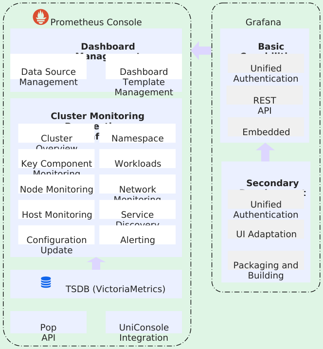
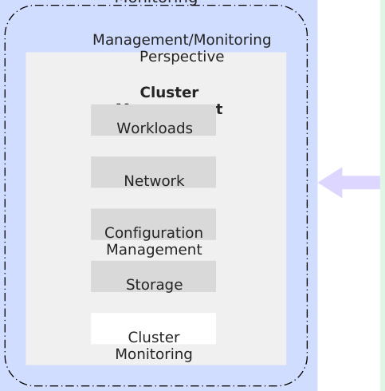
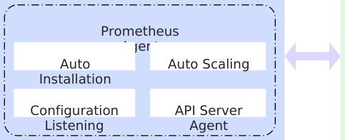
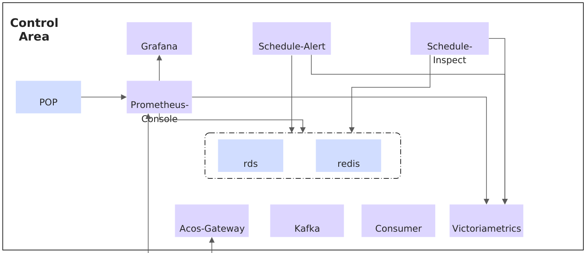
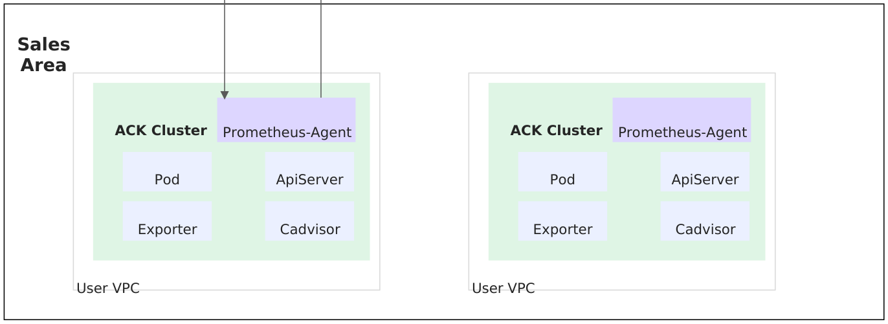
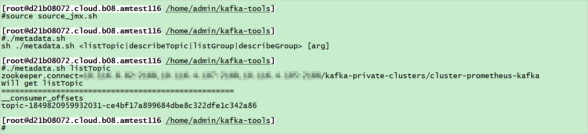
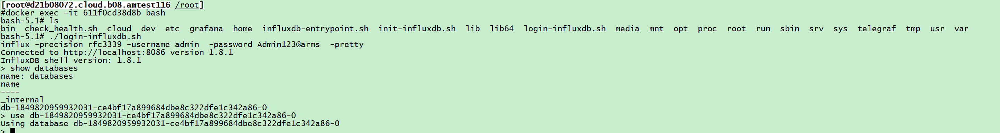

Alibaba Cloud  
Apsara Stack  
Prometheus Service  
Operations and Maintenance  
Guide  
Product Version: v3.18.6-2607  
Document Version: 20260828

**Table of Contents**

- [1.O&M overview](#section-1)
- [2.Architectures](#section-2)
    - [2.1. System architecture](#section-2-1)
    - [2.2. Deployment architecture](#section-2-2)
    - [2.3. Component architecture](#section-2-3)
    - [2.4. Server roles](#section-2-4)
- [3.System inspection](#section-3)
- [4.Log audit](#section-4)
- [5.Common O&M commands](#section-5)

# 1.O&M overview

This guide helps O&M engineers perform preventive maintenance on the Apsara Stack system to ensure the long-term stable operation of the system.

O&M engineers can follow the instructions in this guide to handle system issues that are identified during maintenance. For system issues that are not covered in this guide, O&M engineers can contact Apsara Stack engineers for technical support.

**Requirements**

O&M personnel must acquire IT skills, including knowledge for computer networks, knowledge for computer operations, issue analysis, and troubleshooting.

In addition, O&M engineers must pass the pre-job training and learn the knowledge for the Apsara Stack system. The required knowledge for the system includes system principles, networking, features, and the usage of maintenance tools.

During the maintenance, O&M engineers must comply with operation procedures to ensure personal safety and system security. No part of user data may be copied or disseminated in any form or by any means without prior written consent from users.

**Usage notes**

To ensure a stable system and prevent unexpected events, O&M engineers must comply with the following guidelines:

- Hierarchical permission management

  Permissions on networks, devices, systems, and data are granted based on the services and roles of the O&M personnel. This prevents system faults that are caused by unauthorized operations.

- System security

  - Before O&M personnel perform operations on the system, they must be clearly aware of the impacts of the operations. This ensures that the running of the system is not affected by high-risk operations.

  - O&M engineers must clearly record the details about the issues that are encountered during the operations. This helps troubleshoot the issues.

- Personal safety and data security

  - The O&M personnel must take measures to ensure safety based on device manuals when electrical equipment is used.

  - O&M engineers must use secure devices to access the business network.

  - Unauthorized data replication and dissemination are prohibited.

**Technical support**

O&M engineers can contact Apsara Stack technical support for help during the maintenance.

# 2.Architectures

## 2.1. System architecture

This topic describes the system architecture of Managed Service for Prometheus.

Figure 1. System architecture of Managed Service for Prometheus

ACK

Prometheus 2.0

Monitoring

Enterprise Base/Basic

Services

- Managed Service for Prometheus agent: collects metrics from Container Service for Kubernetes (ACK) clusters, and is compatible with the capabilities of the open source Prometheus agent.

- Acos-Gateway: receives metrics sent from the Managed Service for Prometheus agent and sends the metric data to ApsaraMQ for Kafka for caching.

- ApsaraMQ for Kafka: caches the metric data.

- Consumers: persist metric data cached by ApsaraMQ for Kafka to VictoriaMetrics.

- VictoriaMetrics: a time series database used to store metric data.

- Prometheus-Console: queries data in VictoriaMetrics, performs PromQL computing, and returns the result to Grafana.

- Grafana: receives query results returned by Prometheus-Console and displays the results.

- Schedule-Alert: an alerting service that queries data in VictoriaMetrics, triggers alerts, and sends alert notifications.

- Schedule-Inspect: an inspection service that queries data in VictoriaMetrics and generates inspection reports.

## 2.2. Deployment architecture

This topic describes the deployment architecture of Managed Service for Prometheus.

| Component | Description |
| --- | --- |
| Prometheus-agent | Deployed in Container Service for Kubernetes (ACK) clusters. It supports node scale-out. |
| Acos-Gateway | Deployed in ACK clusters. You can scale it out based on your business requirements. |
| Kafka | Deployed in ACK clusters. It is usually deployed across three nodes. You can scale out the number of nodes based on your business requirements. |
| jlogvictoriametrics | Deployed in ACK clusters. It is usually deployed across two nodes. You can scale out the number of nodes based on your business requirements. |
| VictoriaMetrics | Deployed in ACK clusters. It is usually deployed across two nodes. You can scale out the number of nodes based on your business requirements. |
| Prometheus-Console | Deployed in ACK clusters. It is usually deployed across two nodes. You can scale out the number of nodes based on your business requirements. |
| Grafana | Deployed in ACK clusters. It is usually deployed across two nodes. You can scale out the number of nodes based on your business requirements. |
| Schedule-Inspect | Deployed in ACK clusters. It is usually deployed across two nodes. You can scale out the number of nodes based on your business requirements. |
| Schedule-Alert | Deployed in ACK clusters. It is usually deployed across two nodes. You can scale out the number of nodes based on your business requirements. |

## 2.3. Component architecture

This topic describes the component architecture of Managed Service for Prometheus.

| Component | Description |
| --- | --- |
| Gateway | Receives metrics sent from the Managed Service for Prometheus agent and sends the metric data to ApsaraMQ for Kafka for caching. |
| Kafka | Caches metric data. |
| jlogvictoriametrics | Persists metric data cached by ApsaraMQ for Kafka to VictoriaMetrics. |
| VictoriaMetrics | A time series database used to store metric data. |
| Prometheus-Console | Queries data in VictoriaMetrics, performs PromQL computing, and returns the result to Grafana. |
| Schedule-Alert | An alerting service that queries data in VictoriaMetrics, triggers alerts, and sends alert notifications. |
| Schedule-Inspect | An inspection service that queries data in VictoriaMetrics and generates inspection reports. |
| POP | Calls other cloud services (currently ACS) through the management API of Managed Service for Prometheus. |
| Prometheus Agent | Collects metrics from Container Service for Kubernetes (ACK) clsuters and is compatible with the capabilities of the open source Prometheus agent. |
| Grafana | Visualizes monitoring data. |

## 2.4. Server roles

This topic describes the service roles of Managed Service for Prometheus.

<table>
  <tr>
    <th>Cluster</th>
    <th>Service</th>
    <th>Description</th>
  </tr>
  <tr>
    <td rowspan="8">BasicCluster</td>
    <td>Prometheus2-console</td>
    <td>Queries data in VictoriaMetrics, performs PromQL computing, and returns the result to Grafana.</td>
  </tr>
  <tr>
    <td>Prometheus2-dtlogux</td>
    <td>Provides Grafana capabilities.</td>
  </tr>
  <tr>
    <td>Prometheus2-kafka</td>
    <td>Caches metric data collected by the agent.</td>
  </tr>
  <tr>
    <td>Prometheus2-jlogvictoriametrics</td>
    <td>Consumes messages in ApsaraMQ for Kafka and persists the data to the VictoriaMetrics.</td>
  </tr>
  <tr>
    <td>Prometheus2-victoriametrics</td>
    <td>Persists metric data.</td>
  </tr>
  <tr>
    <td>Prometheus2-gateway</td>
    <td>Receives metrics sent from the Managed Service for Prometheus agent and sends the metric data to ApsaraMQ for Kafka for caching.</td>
  </tr>
  <tr>
    <td>Prometheus2-schedule-alert</td>
    <td>An alerting service that queries data in VictoriaMetrics, triggers alerts, and sends alert notifications.</td>
  </tr>
  <tr>
    <td>Prometheus2-Schedule-Inspect</td>
    <td>An inspection service that queries data in VictoriaMetrics and generates inspection reports.</td>
  </tr>
</table>

# 3.System inspection

This topic describes commonly used system inspection methods for Managed Service for Prometheus.

- Check the disk utilization of the system to which the component belongs. If the utilization exceeds 80%, contact the technical support of Apsara Stack.

- Check the peak CPU utilization of the system to which the component belongs. If the utilization exceeds 40%, contact the technical support of Apsara Stack.

- Check the memory utilization of the system to which the component belongs. If the utilization exceeds 90%, contact the technical support of Apsara Stack.

# 4.Log audit

This topic describes log audit for Managed Service for Prometheus.

**Component**

**File**

**Description**

/home/admin/logs/arms/arms-

Console system logs.

console.log

Logs related to Managed Service for

/home/admin/logs/arms/arms-prom.log

Prometheus and access to Container Service for Kubernetes (ACK).

console

/home/admin/logs/arms/statistic/arms-

Logs generated during ACK cluster

prom-register-cluster.log

registration.

/home/admin/logs/arms-pop/arms-

System logs of the POP API.

pop.log

/home/admin/logs/arms-pop/arms-pop-

Logs related to POP API calls.

api.log

Prometheus-

docker logs prometheus-server

System logs of the Managed Service

server

instance ID

for Prometheus server.

grafana

/home/admin/logs/grafana/grafana.log

System logs of Grafana.

Prometheus-

kubectl logs agent instance ID -n arms-

System logs of the Managed Service

agent

prom

for Prometheus agent.

/home/admin/logs/arms/arms-

collector

System logs of the collector.

collector.log

/home/admin/logs/alikafka/kafka-

Request logs of ApsaraMQ for Kafka.

request.log

kafka

/home/admin/logs/alikafka/server.log

System logs of ApsaraMQ for Kafka.

/home/admin/logs/arms-prometheus-

consumer

System logs of consumers.

streaming.log

/var/lib/influxdb/log/influxdb.log

System logs of InfluxDB.

influxdb

/var/lib/influxdb/log/access.log

Access logs of InfluxDB.

# 5.Common O&M commands

This topic describes commonly used O&M commands for Managed Service for Prometheus.

**View information about ApsaraMQ for Kafka**

In the /home/admin/kafka-tools directory of the ApsaraMQ for Kafka Docker container, run the `source source_jmx.sh`  command and then run the  `./metadata.sh`  command to view the information about ApsaraMQ for Kafka.

**View information about InfluxDB**

In the InfluxDB Docker container, run the  `/login-influxdb.sh`  command to log on to the InfluxDB CLI and run InfluxDB-relevant commands.

