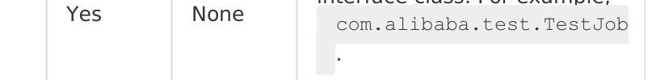

Alibaba Cloud  
Apsara Stack  
SchedulerX 2.0 Developer  
Guide  
Product Version: V3.18.6  
Document Version: 20260701

**Table of Contents**

- [1.Java API integration guide](#section-1)
- [2.Python API integration guide](#section-2)
- [3.HTTP API connection guide](#section-3)
- [4.API list](#section-4)
    - [4.1. Namespaces](#section-4-1)
        - [4.1.1. Create a namespace](#section-4-1-1)
        - [4.1.2. Query the list of namespaces](#section-4-1-2)
    - [4.2. Application](#section-4-2)
        - [4.2.1. Create an application](#section-4-2-1)
        - [4.2.2. Update an application group](#section-4-2-2)
        - [4.2.3. Query a specified application](#section-4-2-3)
        - [4.2.4. Query application groups](#section-4-2-4)
        - [4.2.5. Query the worker list](#section-4-2-5)
    - [4.3. Tasks](#section-4-3)
        - [4.3.1. Create a Java job](#section-4-3-1)
        - [4.3.2. Create a script job](#section-4-3-2)
        - [4.3.3. Create an HTTP job](#section-4-3-3)
        - [4.3.4. Update a job](#section-4-3-4)
        - [4.3.5. Get a task](#section-4-3-5)
        - [4.3.6. Query a job list](#section-4-3-6)
        - [4.3.7. Delete a job](#section-4-3-7)
        - [4.3.8. Enable a job](#section-4-3-8)
        - [4.3.9. Disable a job](#section-4-3-9)
        - [4.3.10. Run a job](#section-4-3-10)
        - [4.3.11. Specify Machines](#section-4-3-11)
    - [4.4. Task instances](#section-4-4)
        - [4.4.1. Stop a running task instance](#section-4-4-1)
        - [4.4.2. Retry a failed task instance](#section-4-4-2)
        - [4.4.3. Mark a task instance as successful](#section-4-4-3)
        - [4.4.4. Query job instance details](#section-4-4-4)
        - [4.4.5. Query task instances](#section-4-4-5)
    - [4.5. Workflow](#section-4-5)
        - [4.5.1. Create a workflow](#section-4-5-1)
        - [4.5.2. Update basic workflow information](#section-4-5-2)
        - [4.5.3. Update a workflow DAG](#section-4-5-3)
        - [4.5.4. Enable workflow](#section-4-5-4)
        - [4.5.5. Disable a workflow](#section-4-5-5)
        - [4.5.6. Delete a workflow](#section-4-5-6)
        - [4.5.7. Query workflow details and DAG](#section-4-5-7)
        - [4.5.8. Run a workflow](#section-4-5-8)
    - [4.6. Workflow instances](#section-4-6)
        - [4.6.1. Query a specified workflow instance](#section-4-6-1)
        - [4.6.2. Query the list of workflow instances](#section-4-6-2)
        - [4.6.3. Stop a running workflow instance](#section-4-6-3)
        - [4.6.4. Retry a failed workflow instance](#section-4-6-4)
        - [4.6.5. Mark a failed workflow instance as successful](#section-4-6-5)
        - [4.6.6. Pause a running workflow instance](#section-4-6-6)
        - [4.6.7. Cancel a paused workflow instance](#section-4-6-7)
        - [4.6.8. Skip a workflow instance node](#section-4-6-8)
        - [4.6.9. Cancel a skipped workflow instance node](#section-4-6-9)

<a id="section-1"></a>

# 1.Java API integration guide

You can use the Software Development Kit (SDK) to call the SchedulerX 2.0 APIs for daily management operations. This document describes the steps and important considerations for Java API integration. It covers how to obtain the SDK, explains the initialization parameters, and provides a specific API call example.

**Maven dependency**

```xml
<dependency>
  <groupId>com.aliyun.schedulerx</groupId>
  <artifactId>schedulerx2-worker</artifactId>
  <version>${schedulerx.version}</version>
</dependency>
```

**Common request parameters**

| Parameter | Required | Description |
| --- | --- | --- |
| groupId | Yes | The ID of the application group. Find this ID on the <strong>Application Management</strong> page in the console. |
| appKey | Yes | The AppKey for the application group. Find this key on the <strong>Application Management</strong> page in the console. |
| domain | Yes | The domain name used to access SchedulerX 2.0. For more information, see Domain name list. |
| user | No | The default value is \`openapi\`. For all write operations, specify this parameter to make queries easier. The format is: "Username UserID". |

**Domain name list**

SchedulerX 2.0 has different deployments for different environments. You must configure the domain name based on the environment that you want to access. The following table lists the available domain names. For more information about connection types, see Connect a client to SchedulerX.

| Environment | Domain name |
| --- | --- |
| Daily environment | schedulerx2.taobao.net |
| Staging environment | pre.schedulerx2.alibaba-inc.com |
| Production environment | center.schedulerx2.alibaba-inc.com |

<a id="section-2"></a>

# 2.Python API integration guide

This topic describes how to connect to an application using the Python API. The provided example shows how to trigger a task.

**Sample code**

```python
#!/usr/bin/python
# -*- coding: utf-8 -*-

import json
import sys
import requests
import time
from datetime import datetime
import calendar
import hashlib
import hmac
import base64


def sign(groupId, timestamp, appKey):
    rawText = groupId + str(timestamp)
    print(rawText)
    # Generate a signature
    # hashing=hmac.new(bytes(secretKey,encoding='utf-8'),bytes(rawText,encoding='utf-8'
),hashlib.sha1).hexdigest()
    sha1Text = hmac.new(bytes(secretKey, encoding='utf-8'), bytes(rawText, 
encoding='utf-8'), hashlib.sha1).digest()
    # b64Bytes=base64.b64encode(bytes(sha1Text,encoding='utf-8'))
    b64Bytes = base64.b64encode(sha1Text)
    b64Text = b64Bytes.decode("utf-8").replace("+", "").replace("=", "").replace("/", "
")
    return b64Text


if __name__ == '__main__':

    domainName = "schedulerx2.taobao.net"
    groupId = 'xxxxx'
    jobId = 12096
    secretKey = 'xxxxx'

    nowTime = datetime.now()
    print(nowTime)

    userId = 144153

    url = "http://" + domainName + "/openapi/v1/job/execute"
    instanceParameters = {
        "threadNum": 16,
        "readRowCountUpperLimit": 6700,
        "batchSize": 10000,
        "tableTotalCountUpperLimit": 6500000,
    }

    requestData = {
        "jobId": jobId,
        "groupId": groupId,
        "instanceParameters": json.dumps(instanceParameters)
    }

    timestamp = calendar.timegm(time.gmtime()) * 1000
    # timestamp = time.time()
    print(timestamp)

    signature = sign(groupId, timestamp, secretKey)
    print('signature : ' + signature)

    headers = {
        'Content-Type': 'application/x-www-form-urlencoded',
        'userId': str(userId),
        'openapi-groupid': groupId,
        'openapi-timestamp': str(timestamp),
        'openapi-signature': signature
    }

    try:
        ret = requests.post(url, data=requestData, headers=headers, timeout=5)
        print(ret.url)
        print(ret.status_code)
        print(ret.text)
        # print(json.dumps(ret))
        if ret.status_code == 200:
            schResult = json.loads(ret.text)
            if schResult['success']:
                print("Job triggered successfully.")
                print(schResult['data'])
            else:
                print("Failed to trigger the job: " + schResult['message'])
                exit(-1)
        else:
            print("HTTP status error.")
            exit(-1)
    except requests.exceptions.ReadTimeout as e:
        print("Failed to trigger the job: ")
```

<a id="section-3"></a>

# 3.HTTP API connection guide

This topic uses an example of enabling a job to demonstrate how to connect to an HTTP API.

**Sample code**

The following is a Shell code sample:

```bash
curl --location --request POST 'http://schedulerx2.taobao.net/openapi/v1/job/enable' \
--header 'Content-Type: application/x-www-form-urlencoded' \
--header 'userId: 144153' \
--header 'schedulerx-namespace:xxxxxxx' \
--header 'openapi-groupid: dts-demo' \
--header 'openapi-timestamp: 1615454963805' \
--header 'openapi-signature: MxrjjcXrozKf69xKQvSGpsMR2g' \
--data-urlencode 'jobId=295816' \
--data-urlencode 'groupId=dts-demo' \
--data-urlencode 'user=XXX 144153'
```

- `"openapi-timestamp"` : UNIX timestamp.

- `"openapi-signature"` : For the algorithm, see  `com.alibaba.schedulerx.common.util.SignatureUtil` .

The following is a Java code sample:

```java
import java.nio.charset.Charset;
import javax.crypto.Mac;
import javax.crypto.spec.SecretKeySpec;
import org.apache.commons.codec.binary.Base64;

public class SignatureUtil {
    /**
     * Generate a signature for an OpenAPI call.
     *
     */
    public static String geneHmacSHA1Encrypt(String timeStamp, String appGroupId, String secretKey) throws Exception{
        String encryptText = appGroupId + timeStamp;
        Mac mac = Mac.getInstance("HmacSHA1");
        if (secretKey == null) {
            throw new RuntimeException("accesskey not exist");
        }
        mac.init(new SecretKeySpec(secretKey.getBytes(Charset.forName("UTF-8")), 
"HmacSHA1"));
        byte[] bytes = mac.doFinal(encryptText.getBytes(Charset.forName("UTF-8")));
        return new String(Base64.encodeBase64(bytes),
            Charset.forName("UTF-8")).replace("+", "").replace("=", "").replace("/", ""
);
    }
    
    public static void main(String[] args) throws Exception {
        String timeNow = Long.toString(System.currentTimeMillis());
        System.out.println(timeNow);
        System.out.println(geneHmacSHA1Encrypt(timeNow, "dts-demo", "xxxxxxxx"));
    }
}
```

<a id="section-4"></a>

# 4.API list

<a id="section-4-1"></a>

## 4.1. Namespaces

<a id="section-4-1-1"></a>

### 4.1.1. Create a namespace

Creates a namespace.

**HTTP request URL**

```text
 /openapi/v1/namespace/create 
```

**Request parameters**

CreateNamespaceRequest

| Name | Type | Required | Description |
| --- | --- | --- | --- |
| name | String | Yes | The name of the namespace. Examples: development and test. |
| description | String | No | The description of the namespace. |

**Response data**

SchedulerXResult&lt;CreateNamespaceResponse>

| Name | Type | Description |
| --- | --- | --- |
| code | Int | The return code. |
| success | Boolean | Indicates whether the request was successful. |
| message | String | The error message. |
| requestId | String | The unique ID of the request. |
| data | GetJobInfoResponse | The information about the specified job. |

CreateNamespaceResponse

| Name | Type | Description |
| --- | --- | --- |
| namespaceUid | String | The unique ID of the namespace. |

Sample response:

```json
{
  "data": {
    "namespaceUid": "3f3e1513-fc61-419c-b808-241a9ff5****"
  },
  "code": 200,
  "success": true,
  "message": "create namespace successfully"
}
```

**Code example**

```java
public void testCreateNamespace() throws Exception {
    OpenApiClient client = new OpenApiClient("schedulerx2.test.taobao.net", "144153");
    CreateNamespaceRequest request = new CreateNamespaceRequest();
    request.setName("namespace.api.1");
    request.setDescription("test api create namespace");
    // Send the request.
    SchedulerXResult<CreateNamespaceResponse> result = client.getResponse(request);
    System.out.println(result);
}
```

<a id="section-4-1-2"></a>

### 4.1.2. Query the list of namespaces

Queries a list of namespaces.

**HTTP request URL**

```text
 /openapi/v1/namespace/list 
```

**Request parameters**

GetNamespaceListRequest

**Return data**

SchedulerXResult&lt;GetNamespaceListResponse>

| Name | Type | Description |
| --- | --- | --- |
| code | Int | The return code. |
| success | Boolean | Indicates whether the request was successful. |
| message | String | The error message. |
| requestId | String | The unique ID of the request. |
| data | GetJobInfoResponse | The information about the specified job. |

GetNamespaceListResponse

| Name | Type | Description |
| --- | --- | --- |
| namespaceInfos | List&lt;NamespaceInfo&gt; | The list of namespaces. |

Sample response

```json
{
  "data": {
    "namespaceInfos": [
      {
        "name": "Default Namespace",
        "uId": "system_namespace",
        "description": ""
      },
      {
        "name": "Development and Test",
        "uId": "7636af5b-4763-4fe9-8aa5-038d492****",
        "description": "Development and Test"
      },
      {
        "name": "xxx Test",
        "uId": "6abc550b-b616-46f5-919b-55931ab5****"
      },
      {
        "name": "xxx Dedicated",
        "uId": "f227f143-0adc-409a-9e02-213f84cc****",
        "description": "For xxx test only"
      },
      {
        "name": "Production Environment",
        "uId": "655a892e-940e-414d-a000-fcacdc2****",
        "description": "Production Environment"  
      }
    ]
  },
  "code": 200,
  "success": true,
  "message": ""
}
```

**Sample code**

```java
public class TestNamespaceOpenApi {

    @Test
    public void testGetNamespaceList() throws Exception {
        OpenApiClient client = new OpenApiClient("schedulerx2.test.taobao.net", 
"xxxxx");
        GetNamespaceListRequest request = new GetNamespaceListRequest();
        // Send the request.
        SchedulerXResult<GetNamespaceListResponse> result = 
client.getResponse(request);
        System.out.println(JsonUtil.toJson(result));
    }

}
```

<a id="section-4-2"></a>

## 4.2. Application

<a id="section-4-2-1"></a>

### 4.2.1. Create an application

This topic describes how to create an application group.

**HTTP request URL**

```text
 /openapi/v1/group/create 
```

**Request parameters**

CreateAppGroupRequest

| Name | Type | Required | Description |
| --- | --- | --- | --- |
| groupID | String | Yes | The ID of the application group. This ID has business significance. |
| namespace | String | No | The UID of the namespace. |
| appName | String | Yes | The name of the application. |
| description | String | No | None |

**Response data**

SchedulerXResult&lt;CreateAppGroupResponse>

| Name | Type | Description |
| --- | --- | --- |
| code | Int | The return code. |
| success | Boolean | Indicates whether the request was successful. |
| message | String | The error message. |
| requestId | String | The unique ID of the request. |
| data | CreateAppGroupResponse | The response information for the application group. |

CreateAppGroupResponse

| Name | Type | Description |
| --- | --- | --- |
| appGroupID | Long | The ID of the application group.You can ignore this ID. |
| appKey | String | The AppKey from the application management console. It is used for authentication. |

**Sample code**

```java
public class TestAppGroupOpenApi {
    private static OpenApiClient client = new OpenApiClient("schedulerx2.taobao.net", "xxx 144153");

    @Test
    public void testCreate() throws Exception {
        CreateAppGroupRequest request = new CreateAppGroupRequest();
        // Create a group in the default system namespace.
        request.setGroupId("hxm-test.api6");
        request.setAppName("dts-all");
        request.setDescription("test api create appgroup");
        // Send the request.
        SchedulerXResult<CreateAppGroupResponse> result = client.getResponse(request);
        System.out.println(result);
    }
    
    @Test
    public void testCreateWithNamespace() throws Exception {
        CreateAppGroupRequest request = new CreateAppGroupRequest();
        client.setNamespace("4a06d5ea-f576-4326-842c-fb14ea04xxxx");
        // Create an application group in the namespace 9b6624c6-7a2c-4b04-9545-
93054dfexxxx.
        request.setGroupId("hxm-test.api10");
        request.setAppName("dts-all");
        request.setDescription("test api create appgroup");
        // Send the request.
        SchedulerXResult<CreateAppGroupResponse> result = client.getResponse(request);
        System.out.println(result);
    }
}
```

<a id="section-4-2-2"></a>

### 4.2.2. Update an application group

Create an application group.

**HTTP request URL**

```text
 /openapi/v1/group/update 
```

**Request parameters**

UpdateAppGroupRequest

| Name | Type | Required | Description |
| --- | --- | --- | --- |
| groupId | String | Yes | The ID of the application group.This ID has business significance. |
| namespace | String | No | The UID of the namespace. |
| description | String | No | None. |
| monitorConfig | String | No | The alert settings. |
| contact | String | No | The alert contact. |

**Response data**

SchedulerXResult&lt;UpdateAppGroupResponse>

| Name | Type | Description |
| --- | --- | --- |
| code | Int | The return code. |
| success | Boolean | Indicates whether the request was successful. |
| message | String | The error message. |
| requestId | String | The unique ID of the request. |
| data | UpdateAppGroupResponse | The response information for the application group. |

UpdateAppGroupResponse

| Name | Type | Description |
| --- | --- | --- |
| appGroupId | Long | The ID of the application group that was updated. |

**Sample code**

```java
public class TestAppGroupOpenApi {
    // Obtain the configurations from the console. The domain corresponds to the environment address.
    private static OpenApiClient client = new OpenApiClient("Your_AppKey", 
"Your_Application_Group_ID", "schedulerx2.taobao.net");

    @Test
    public void updateAppGroup(){
        try {
            // The default namespace is optional.
            // client.setNamespace("xxxxxxx-82f3-4155-b04d-5f43f4143fbe");

            // Get the details of the application group.
            GetAppGroupRequest request = new GetAppGroupRequest();
            // Get the information of an existing application group.
            SchedulerXResult<GetAppGroupResponse> result = client.getResponse(request);
            if (result.isSuccess()) {
                GetAppGroupResponse response = result.getData();
                System.out.println(response);
                // Update the application group.
                UpdateAppGroupRequest updateAppGroupRequest = new 
UpdateAppGroupRequest();
                // updateAppGroupRequest.setAppGroupId(response.getAppGroupId());
                updateAppGroupRequest.setGroupId(response.getGroupId());
                updateAppGroupRequest.setDescription(response.getDescription());
                updateAppGroupRequest.setAlarmJson(response.getAlarmJson());
                updateAppGroupRequest.setMaxConcurrency(response.getMaxConcurrency());
                updateAppGroupRequest.setMaxJobs(response.getMaxJobs());
                
updateAppGroupRequest.setMetricsThresholdJson(response.getMetricsThresholdJson());
                // Configure monitoring for the application group.
                MonitorConfig monitorConfig = new MonitorConfig();
                // Select a notification channel as needed.
                monitorConfig.setSendChannel("ding"); // Use "ding" to specify DingTalk.
                updateAppGroupRequest.setMonitorConfig(monitorConfig);

                List<ContactInfo> contacts = new ArrayList<>();
                // Add a DingTalk group contact. Only one is allowed.
                ContactInfo c1 = new ContactInfo();
                c1.setDing("The AccessToken of the DingTalk chatbot. Provide only the 
token value.");
                c1.setUserName("ding-group");
                contacts.add(c1);

                // Add a specific employee as a contact.
                ContactInfo c2 = new ContactInfo();
                c2.setEmpId("Employee_ID");
                c2.setUserName("Employee_Name");
                contacts.add(c2);
                updateAppGroupRequest.setContact(contacts);

                try {
                    SchedulerXResult<UpdateAppGroupResponse> res = 
client.getResponse(updateAppGroupRequest);
                    if(res.isSuccess()) {
                        System.out.println(res.getData());
                    }
                } catch (Exception e) {
                    e.printStackTrace();
                }
            }

        } catch (Exception e) {
            e.printStackTrace();
        }
    }
}
```

<a id="section-4-2-3"></a>

### 4.2.3. Query a specified application

Retrieves information about an application group.

**HTTP request URL**

```text
 /openapi/v1/group/get 
```

**Request parameters**

GetAppGroupRequest

**Response data**

SchedulerXResult&lt;CreateAppGroupResponse>

| Name | Type | Description |
| --- | --- | --- |
| code | Int | The return code. |
| success | Boolean | Indicates whether the request was successful. |
| message | String | The error message. |
| requestId | String | The unique ID of the request. |
| data | GetAppGroupResponse | The information returned for the application group. |

GetAppGroupResponse

| Name | Type | Description |
| --- | --- | --- |
| appName | Long | The name of the application. |
| groupId | String | The ID of the application. |
| description | String | The description of the application group. |
| appKey | String | The AppKey from the management console. It is used for authentication. |
| maxJobs | Int | The maximum number of tasks that can be configured. |
| curJobs | Int | The current number of tasks. |
| alarmJson | String | The alert information. |
| metricsThresholdJson | String | The threshold information for application monitoring. |
| maxConcurrency | Int | The maximum number of task instances that can run.A value of -1 indicates no limit. |
| runningInstanceNum | Int | The current number of running task instances. |
| readyInstanceNum | Int | The current number of task instances in the pool. |

**Sample code**

```java
OpenApiClient client = new OpenApiClient("xxxxxxxx", "dts-demo", 
"schedulerx2.taobao.net");
// If you use a custom namespace, set the namespace UID in the client.
//client.setNamespace("xxxx-xxx-xxx-xxx-xxxxx");
GetAppGroupRequest request = new GetAppGroupRequest();
// Send the request.
SchedulerXResult<GetAppGroupResponse> result = client.getResponse(request);
System.out.println(result);
```

<a id="section-4-2-4"></a>

### 4.2.4. Query application groups

Retrieve a list of all application groups that you have permission to access in a specific namespace.

**Request URL**

```text
 /openapi/v1/group/list 
```

**Request parameters**

GetJobInstanceListRequest

**Return data**

SchedulerXResult&lt;GetAppGroupListResponse>

| Name | Type | Description |
| --- | --- | --- |
| code | Int | The return code. |
| success | Boolean | Indicates whether the request was successful. |
| message | String | The error message. |
| requestId | String | The unique ID of the request. |
| data | List&lt;AppGroupInfo&gt; | No content to parse. |

AppGroupInfo

| Name | Type | Description |
| --- | --- | --- |
| appName | String | The application name. |
| groupId | String | The application ID in the console. |
| appKey | String | The application key in the console. |
| description | String | The application description. |

**Sample code**

```java
OpenApiClient client = new OpenApiClient("schedulerx2.taobao.net", "xx 144153");
//client.setNamespace("4a06d5ea-f576-4326-842c-fb14ea04****");
GetAppGroupListRequest request = new GetAppGroupListRequest();
// Send the request
SchedulerXResult<GetAppGroupListResponse> result = client.getResponse(request);
System.out.println(result);
List<AppGroupInfo> appGroupInfos = result.getData().getAppGroupInfos();
for (AppGroupInfo appGroupInfo : appGroupInfos) {
    System.out.println(appGroupInfo);
}
```

For calls not made in Java, add the following header and request parameters.

```text
--header 'openapi-list-groups: true'
--data-urlencode 'userId=employee ID' \
--data-urlencode 'userName=alias'
```

<a id="section-4-2-5"></a>

### 4.2.5. Query the worker list

Query the list of workers for a specific application. You can use this list to specify machines for a task or dynamically assign machines when a task runs.

**Request URL**

/openapi/v1/group/getWorkerList

**Request parameters**

GetWorkerListRequest

**Response data**

SchedulerXResult&lt;GetWorkerListResponse>

| Name | Type | Description |
| --- | --- | --- |
| code | int | The return code. |
| success | Boolean | Indicates whether the request was successful. |
| message | String | The fault message. |
| requestId | String | The unique ID of the request. |
| data | List&lt;AppGroupInfo&gt; | No content to parse. |

Workers

| Name | Type | Description |
| --- | --- | --- |
| ip | String | The IP address of the worker. |
| port | int | The port of the worker. |
| workerId | String | workerId |
| workerAddr | String | The format is {workerId}@{ip}:{port}.Specify this address to assign a machine. |
| akkaPath | String | The Akka path of the worker. |
| metrics | String | The monitoring metrics of the worker. |
| version | String | The version number. |
| starter | String | The startup method of the worker. |

**Sample code**

```java
OpenApiClient client = new OpenApiClient("xxxxx", "ram-access-advisor", 
"schedulerx2.taobao.net");
GetWorkerListRequest request = new GetWorkerListRequest();       
SchedulerXResult<GetWorkerListResponse> response = client.getResponse(request);
System.out.println(JsonUtil.toJson(response));
```

Sample response

```json
{
  "data": {
    "workers": [{
      "ip": "11.xxx.xxx.xxx",
      "port": 40219,
      "workerId": "011159226222_647755_26517",
      "workerAddr": "011159226222_647755_26517@11.xxx.xxx.xxx:40219",
      "akkaPath": 
"akka.tcp://011159226222_647755_26517@11.xxx.xxx.xxx:40219/user/job_instance_routing",
      "metrics": {
        "cpuLoad1": 0.2,
        "cpuLoad5": 0.254,
        "cpuProcessors": 4,
        "heap1Usage": 0.46337890625,
        "heap5Usage": 0.4593424479166666,
        "heap1Used": 2847,
        "heapMax": 6144,
        "diskUsage": 0.8069994365747735,
        "diskUsed": 161851,
        "diskMax": 200559,
        "sharePoolQueueSize": 0,
        "sharePoolAvailableSize": 0,
        "execCount": 0
      },
      "version": "1.10.10",
      "starter": "springboot",
      "label": "",
      "rpcPort": 40219,
      "busyStatus": "FREE"
    }, {
      "ip": "11.xxx.xxx.xxx",
      "port": 42541,
      "workerId": "011159223172_647755_66848",
      "workerAddr": "011159223172_647755_66848@11.xxx.xxx.xxx:42541",
      "akkaPath": 
"akka.tcp://011159223172_647755_66848@11.xxx.xxx.xxx:42541/user/job_instance_routing",
      "metrics": {
        "cpuLoad1": 0.19,
        "cpuLoad5": 0.182,
        "cpuProcessors": 4,
        "heap1Usage": 0.08772786458333333,
        "heap5Usage": 0.08382161458333333,
        "heap1Used": 539,
        "heapMax": 6144,
        "diskUsage": 0.8189310876101297,
        "diskUsed": 164244,
        "diskMax": 200559,
        "sharePoolQueueSize": 0,
        "sharePoolAvailableSize": 0,
        "execCount": 0
      },
      "version": "1.10.10",
      "starter": "springboot",
      "label": "",
      "rpcPort": 42541,
      "busyStatus": "FREE"
    }]
  },
  "code": 200,
  "success": true,
  "message": ""
}
```

<a id="section-4-3"></a>

## 4.3. Tasks

<a id="section-4-3-1"></a>

### 4.3.1. Create a Java job

This topic describes how to create a Java job.

**Request URL**

```text
 /openapi/v1/job/create 
```

**Request parameters**

- CreateJavaJobRequest: The request parameters.

  | Name | Type | Require d | Description |
  | --- | --- | --- | --- |
  | javaJobConfig | JavaJobConfig | Yes | The job configuration. |

- JavaJobConfig: The job parameters.

  | Name | Type | Requir ed | Default | Description |
  | --- | --- | --- | --- | --- |
  | className | String | Yes | None | The full path of the job interface class. For example, <code>com.alibaba.test.TestJob</code><code> </code>. |
  | jarUrl | String | No | None | The full path of the package uploaded to OSS. |
  | name | String | Yes | None | The job name. |
  | description | String | No | None | The job description. |
  | status | Int | No | 1 | 1. Get started.<br>• 0: Disables the job. |
  | executeMode | String | Yes | None | Select a value from the following options:<br>• Standalone: standalone<br>• Broadcast: broadcast<br>• Parallel computing: parallel<br>• Memory grid: grid<br>• Grid computing: batch |
  | parameters | String | No | None | Custom parameters that can be obtained at runtime. |
  | maxConcurrency | Int | No | 1 | The maximum number of concurrent instances.<br>The default value is 1. This means that if a triggered instance is still running, the next trigger is skipped. |
  | maxAttempt | Int | No | 0 | The maximum number of retries after a fault. Specify this parameter as needed. |
  | attemptInterval | Int | No | 30 | The retry interval after a fault. Unit: seconds. |
  | mapTaskXAttrs | MapTaskXAttrs | No | None | The advanced configuration.This parameter is applicable only to parallel computing, memory grid, and grid computing jobs. |

  

  <table>
    <tr>
      <td>timeConfig</td>
      <td>TimeConfig</td>
      <td>Yes</td>
      <td>None</td>
      <td>The time configuration parameters. For more information, see the parameter description.</td>
    </tr>
    <tr>
      <td>jobMonitorInfo</td>
      <td>JobMonitorInfo</td>
      <td>Yes</td>
      <td>None</td>
      <td>The monitoring and alert configuration. For more information, see the parameter description.</td>
    </tr>
  </table>

- MapTaskXAttrs: The advanced configuration for parallel and grid execution modes.

  | Name | Type | Requir ed | Default | Description |
  | --- | --- | --- | --- | --- |
  | consumerSize | Int | No | 5 | The number of threads for a single trigger on a single machine. |
  | dispatcherSize | Int | No | 5 | The number of threads for dispatching sub-tasks. |
  | taskMaxAttempt | Int | No | 0 | The maximum number of retries for a failed sub-task. |
  | taskAttemptInterval | Int | No | 0 | The retry interval for a failed sub-task. Unit: seconds. |

- TimeConfig: The time configuration.

  | Name | Type | Require d | Description |
  | --- | --- | --- | --- |
  | timeType | Int | Yes | The type of time configuration.Valid values:<br>• cron: 1<br>• fix_rate (fixed frequency): 3<br>• second_delay (second-level): 4<br>• one_time (one-time task): 5<br>• api: 100 |
  | timeExpression | String | No | • api: Leave this parameter empty.<br>• fix_rate: Specify a fixed frequency. Unit: seconds. For example, a value of 30 indicates that the job is triggered every 30 seconds.<br>• cron: Specify a standard cron expression. The system validates the expression.<br>• second_delay: Specify a value in seconds. For example, set the value to 15.<br>• one_time: Specify the point in time to run the job. The format is <strong>yyyy-MM-dd HH:mm:ss</strong>. |
  | calendar | String | No | • Workday<br>• Financial Trading Day (finance)<br>• If you do not set this parameter, the job runs every day by default. |
  | dataOffset | Int | No | For cron jobs, you can specify a time offset. Unit: seconds. |

- JobMonitorInfo: The monitoring configuration.

  | Name | Type | Require d | Description |
  | --- | --- | --- | --- |
  | monitorConfig | MonitorConfig | Yes | The alert switch and threshold configuration. |
  | contactInfo | List&lt;ContactInfo&gt; | No | The alert contacts. If you do not specify this parameter, alerts are sent to all users who have permissions on the group. |

- MonitorConfig: The configuration for the alert switch and thresholds.

  | Name | Type | Requir ed | Default | Description |
  | --- | --- | --- | --- | --- |
  | timeoutEnable | Boolean | No | true | The switch to enable timeout alerts. This feature is enabled by default. |
  | timeout | Long | No | 7200 | The timeout threshold. Unit: seconds. |
  | timeoutKillEnable | Boolean | No | false | The switch to stop a job when it times out. This feature is disabled by default. |
  | failEnable | Boolean | No | true | The switch to enable alerts for failed jobs. This feature is enabled by default. |

  <table>
    <tr>
      <td>sendChannel</td>
      <td>String</td>
      <td>No</td>
      <td>ding</td>
      <td>The channel to send alerts.Valid values:<br>• ding: DingTalk<br>• sms: Text message<br>• mail: Email<br>• phone: Phone call<br>By default, alerts are sent through DingTalk.<br>Note<br>• To use multiple alert notification methods, separate them with commas. For example<br>To use multiple channels, separate them with commas. For example, <code>sms,ding</code> indicates that alerts are sent through text messages and DingTalk.<br>• default: The alert contacts of the application.</td>
    </tr>
  </table>

- ContactInfo: The alert contact configuration.

  | Name | Type | Require d | Description |
  | --- | --- | --- | --- |
  | empId | String | Yes | The employee ID. |
  | userName | String | No | The user's nickname. |

**Return data**

SchedulerXResult&lt;CreateJobResponse>

| Name | Type | Description |
| --- | --- | --- |
| code | Integer | The return code. |
| success | Boolean | Indicates whether the request was successful. |
| message | String | The error message. |
| requestId | String | The unique ID of the request. |
| data | CreateJobResponse | The ID of the job that was created. |

**Code examples**

HTTP

Java

```java
// Query the appkey and groupId on the Group Management page. For information about thedomain, see the integration document. The domain varies based on the environment.
OpenApiClient client = new OpenApiClient(${appKey},${groupId},${domain})
// If you use a custom namespace, set the namespace UID in the client.
//client.setNamespace("xxxx-xxx-xxx-xxx-xxxxx");
// Populate the request class for creating a job.
CreateJavaJobRequest createJobRequest = new CreateJavaJobRequest();
// Basic job information
JavaJobConfig jobConfig = new 
JavaJobConfig("com.apache.armon.test.schedulerx.processor.MySimpleJob_A");
jobConfig.setName("openapi");
jobConfig.setDescription("test");
jobConfig.setParameters("123");
// Parallel job
jobConfig.setExecuteMode("parallel");
// Advanced configuration. Do not change the default settings unless necessary.
jobConfig.setMaxAttempt(2);
// Attributes specific to grid and parallel jobs
MapTaskXAttrs mapTaskXAttrs = new MapTaskXAttrs();
mapTaskXAttrs.setConsumerSize(10);
jobConfig.setMapTaskXAttrs(mapTaskXAttrs);
// Time configuration for a cron job
TimeConfig timeConfig = new TimeConfig(TimeConfig.CRORN_TYPE);
timeConfig.setTimeExpression("0 0/1 * * * ?");
jobConfig.setTimeConfig(timeConfig);
// Alert configuration
JobMonitorInfo jobMonitorConfig = new JobMonitorInfo();
MonitorConfig monitorConfig = new MonitorConfig();
monitorConfig.setTimeout(120);
monitorConfig.setSendChannel("default");
jobMonitorConfig.setMonitorConfig(monitorConfig);
jobConfig.setJobMonitorInfo(jobMonitorConfig);
createJobRequest.setJavaJobConfig(jobConfig);
// Send the request
try {
    SchedulerXResult<CreateJobResponse> createJobResponseResult = 
client.getResponse(createJobRequest);
    // Parse the request
    if (createJobResponseResult.isSuccess()) {
        System.out.println(createJobResponseResult.getData().getJobId());
    } else {
        logger.error("createJobRequest error code: {} message: {}, requestId: {}", 
createJobResponseResult.getCode(),
        createJobResponseResult.getMessage(), createJobResponseResult.getRequestId());
    }
} catch (Exception e) {
  logger.error("createJobRequest error.", e);
}
```

<a id="section-4-3-2"></a>

### 4.3.2. Create a script job

Create a script job. Supported script types include Go, Python, and Shell.

**Request URL**

```text
 /openapi/v1/job/create 
```

**Request parameters**

- CreateScriptJobRequest: The request object for creating a script job.

  | Name | Type | Require d | Description |
  | --- | --- | --- | --- |
  | scriptJobConfig | ScriptJobConfig | Yes | The job configuration information. |

- ScriptJobConfig: The configuration of the script job.

  | Name | Type | Requir ed | Default value | Description |
  | --- | --- | --- | --- | --- |
  | jobType | String | Yes | None | The valid values are <code> go </code>, <code> python </code>, and <code> shell </code>. |
  | content | String | Yes | None | The code to execute. |
  | name | String | Yes | None | The job name. |
  | description | String | No | None | The job description. |
  | executeMode | String | Yes | None | You can select a value from the following:<br>• Run Mode: Standalone<br>• Operation: Broadcast |
  | parameters | String | No | None | Custom parameters that can be obtained at runtime. |
  | maxConcurrency | Int | No | 1 | The maximum number of concurrent instances.<br>The default value is 1. This means that if a previously triggered instance is still running, the next scheduled run is not triggered. |
  | maxAttempt | Int | No | 0 | The maximum number of retries after a fault. Set this parameter as needed. The default value is 0. |
  | attemptInterval | Int | No | 30 | The retry interval after a fault. Unit: seconds. The default value is 30s. |
  | timeConfig | TimeConfig | Yes | None | The time configuration parameters. For more information, see the definition. |
  | jobMonitorInfo | JobMonitorInfo | Yes | None | The monitoring and alert configuration. For more information, see the definition. |

- TimeConfig: The time-based configuration.

  | Name | Type | Require d | Description |
  | --- | --- | --- | --- |
  | timeType | Int | Yes | The type of time configuration.Valid values:<br>• cron: 1<br>• 3: fix_rate (fixed frequency)<br>• API: 100 |
  | timeExpression | String | No | • api type: Leave this parameter empty.<br>• fix_rate type: Specify a fixed frequency. Unit: seconds. For example, a value of 30 indicates that the job is triggered every 30 seconds.<br>• cron type: Specify a standard cron expression. The system validates the expression. |
  | calendar | String | No | For the cron type, you can specify a custom calendar. |
  | dataOffset | Int | No | For the cron type, you can specify a time offset. Unit: seconds. |

- JobMonitorInfo: The monitoring configuration.

  | Name | Type | Require d | Description |
  | --- | --- | --- | --- |
  | monitorConfig | MonitorConfig | Yes | The alert switch and threshold settings. |
  | contactInfo | List&lt;ContactInfo&gt; | No | The alert contacts. If you do not specify this parameter, alerts are sent to all users who have permissions on the group. |

- MonitorConfig: The configuration for alert switches and thresholds.

  | Name | Type | Requir ed | Default value | Description |
  | --- | --- | --- | --- | --- |
  | timeoutEnable | Boolean | No | true | The switch for timeout alerts. This feature is enabled by default. |
  | timeout | Long | No | 7200 | The timeout threshold. Unit: seconds. |
  | timeoutKillEna ble | Boolean | No | false | The switch to stop the current triggered instance upon timeout. This feature is disabled by default. |
  | failEnable | Boolean | No | true | The switch for failure alerts. This feature is enabled by default. |
  | sendChannel | String | No | ding | The channel to send alerts. The default channel is DingTalk. Valid values:<br>• ding: DingTalk<br>• sms: text message<br>• mail: email<br>• <code> phone </code>: phone call<br>Note<br>Separate multiple alarm notification methods with a comma. For example:<br><code> sms,ding </code> sends alarms by text message and DingTalk. |

- ContactInfo: The configuration for alert contacts.

  | Name | Type | Require d | Description |
  | --- | --- | --- | --- |
  | empId | String | Yes | The employee ID. |
  | userName | String | No | The username. We recommend that you specify this parameter. |

**Return data**

SchedulerXResult&lt;CreateJobResponse>

| Name | Type | Description |
| --- | --- | --- |
| code | Int | The return code. |
| success | Boolean | Indicates whether the request was successful. |
| message | String | The error message. |
| requestId | String | The unique ID of the request. |
| data | CreateJobResponse | The ID of the job that was created. |

**Example code**

HTTP

Java

```java
// You can find the appKey and groupId on the Group Management page in the console. Forthe domain, see the integration document. The domain varies by environment.
OpenApiClient client = new OpenApiClient(${appKey},${groupId},${domain})
// If you use a custom namespace, set the namespace UID in the client.
//client.setNamespace("xxxx-xxx-xxx-xxx-xxxxx");
CreateScriptJobRequest createJobRequest = new CreateScriptJobRequest();
// Basic job information
String content = "echo hello";
ScriptJobConfig scriptJobConfig = new ScriptJobConfig("shell",content);
scriptJobConfig.setName("openapi");
scriptJobConfig.setDescription("test");
scriptJobConfig.setParameters("123");
scriptJobConfig.setExecuteMode("standalone");
TimeConfig timeConfig = new TimeConfig(TimeConfig.CRORN_TYPE);
timeConfig.setTimeExpression("0 0/1 * * * ?");
scriptJobConfig.setTimeConfig(timeConfig);
// Alert configuration
JobMonitorInfo jobMonitorConfig = new JobMonitorInfo();
MonitorConfig monitorConfig = new MonitorConfig();
monitorConfig.setTimeout(123);
monitorConfig.setTimeoutKillEnable(true);
monitorConfig.setSendChannel("ding,sms");
jobMonitorConfig.setMonitorConfig(monitorConfig);
List<ContactInfo> contactInfos = new ArrayList<>();
ContactInfo contactInfo = new ContactInfo();
contactInfo.setEmpId("xxxx");
contactInfos.add(contactInfo);
jobMonitorConfig.setContactInfo(contactInfos);
scriptJobConfig.setJobMonitorInfo(jobMonitorConfig);
createJobRequest.setScriptJobConfig(scriptJobConfig);
// Send the request
try {
    SchedulerXResult<CreateJobResponse> createJobResponseResult = 
client.getResponse(createJobRequest);
    // Parse the request
    if (createJobResponseResult.isSuccess()) {
        System.out.println(createJobResponseResult.getData().getJobId());
    } else {
        logger.error("createJobRequest error code: {} message: {}, requestId: {}", 
createJobResponseResult.getCode(),
        createJobResponseResult.getMessage(), createJobResponseResult.getRequestId());
    }
} catch (Exception e) {
  logger.error("createJobRequest error.", e);
}
```

<a id="section-4-3-3"></a>

### 4.3.3. Create an HTTP job

This topic describes how to create an HTTP job.

**Request URL**

```text
 /openapi/v1/job/create 
```

**Request parameters**

**HTTP parameters**

Request body

| Name | Type | Require d | Description |
| --- | --- | --- | --- |
| name | String | Yes | The name of the job. |
| jobType | String | Yes | For HTTP jobs, set this parameter to \`http\`. |
| contentType | int | Yes | For HTTP jobs, set this parameter to \`1\`. |
| description | String | No | The description of the job. |
| executeMode | String | Yes | For HTTP jobs, set this parameter to \`standalone\`. |
| content | JSON string | Yes | The HTTP property configuration.For more information, see the definition. |
| monitorConfig | JSON string | Yes | The monitoring and alert configuration. For more information, see the definition. |
| timeType |  |  | The time configuration type. Valid values:<br>• cron: 1<br>• \`3\`: \`fix_rate\` (fixed frequency)<br>• \`5\`: \`one_time\` (one-time job)<br>• API: 100<br>HTTP jobs do not support second-level scheduling. |
| timeExpression | String | Yes | \`api\`: Leave this parameter empty.<br>\`fix_rate\`: The fixed frequency in seconds. For example, a value of \`30\` indicates that the job is triggered every 30 seconds.<br>\`cron\`: A standard cron expression.The backend validates the expression.<br>\`second_delay\`: A number in seconds. For example, \`15\`.<br>\`one_time\`: The time to run the job. The format is \`yyyy-MM-dd HH:mm:ss\`. |
| calendar | String | No | Optional:<br>• \`workday\`: Workdays<br>• \`finance\`: Finance days |
| dataOffset | Integer | No | The time offset. |
| contact | JSON string | No | The alert contacts for the job. This parameter is valid only when \`monitorConfig.sendChannel\` is not set to \`default\`. |
| parameters | String | No | The parameter information for the HTTP job. The value must match the format specified by \`content.contentType\`. |

HTTP property configuration: content

| Name | Type | Required | Description |
| --- | --- | --- | --- |
| url | String | Yes | The full request URL, including \`http://\`. |
| method | String | Yes | Only GET and POST are supported.The default is GET. |
| respParseMode | int | Yes | The HTTP response parsing mode.Options:<br>• \`1\`: HTTP response code<br>• \`2\`: Custom JSON (default)<br>• \`3\`: Custom string |
| respKey | String | No | Required when \`respParseMode\` is \`2\`. The key used to check the return value for a successful request. |
| respValue | String | No | Required when \`respParseMode\` is \`2\`. The value used to check the return value for a successful request. |
| respCode | int | No | Required when \`respParseMode\` is \`1\`. The HTTP response code that indicates a successful request.Example: \`200\`. |
| respStr | String | No | Required when \`respParseMode\` is \`3\`. The string in the HTTP response that indicates a successful request. Example: \`success\`. |
| timeout | int | Yes | The request timeout period. The value must be between 1 and 15 seconds. |
| contentType | String | No | The parameter type for the HTTP job. This specifies the format for submitting the \`parameters\` in the request body. Option:<br>• application/x-www-form-urlencoded |
| httpJobExecutionMode | int |  | The execution mode of the HTTP job. Options:<br>• 0: Serverless<br>• 1: Agent |
| cookie | String | No | The cookie content for the HTTP request. |

Monitoring and alerting configuration: monitorConfig

| Name | Type | Require d | Default | Description |
| --- | --- | --- | --- | --- |
| failEnable | boolean | No | true | The switch to enable alerts for failed jobs. This is enabled by default. |
| successNotice | boolean | No | false | Specifies whether to enable notifications for successful jobs. |
| failLimitTimes | int | No | 1 | The number of consecutive failures. An alert is sent only if the number of consecutive failures exceeds this value. |
| sendChannel | String | No | ding | The following channels are available for sending alerts (the default is DingTalk):<br>ding: DingTalk.<br>Short Message Service (SMS): A text message.<br>\`sms\`: Text message<br>\`mail\`: Email<br>Separate multiple values with commas. For example:<br>To specify multiple methods, separate them with commas.For example, \`sms,ding\` indicates that alerts are sent by text message and DingTalk.<br>\`default\`: The alert contacts for the application. This is the recommended setting. |

**Java SDK parameters**

- CreateHttpJobRequest: Request parameters

  | Name | Type | Require d | Description |
  | --- | --- | --- | --- |
  | httpJobConfig | HttpJobConfig | Yes | The job configuration information. |

- HttpJobConfig: Job parameters

  | Name | Type | Require d | Description |
  | --- | --- | --- | --- |
  | name | String | Yes | The name of the job. |
  | description | String | No | The description of the job. |
  | httpAttribute | HttpAttribute | Yes | The HTTP property configuration.For more information, see the definition. |
  | timeConfig | TimeConfig | Yes | The time configuration parameters. For more information, see the definition. |
  | jobMonitorInfo | JobMonitorInfo | Yes | The monitoring and alert configuration. For more information, see the definition. |

- HttpAttribute: HTTP property definition

  | Name | Type | Require d | Description |
  | --- | --- | --- | --- |
  | url | String | Yes | The full request URL, including <code> http:// </code>. |
  | method | String | Yes | Only GET and POST are supported. The default is GET. |
  | respKey | String | Yes | The key used to check the return value for a successful request. |
  | respValue | String | Yes | The value used to check the return value for a successful request. |
  | timeout | Int | Yes | The request timeout period. The value must be between 1 and 15 seconds. |
  | cookie | String | No | None. |

- TimeConfig: Time configuration

  | Name | Type | Required | Description |
  | --- | --- | --- | --- |
  | timeType | Int | Yes | The time configuration type. Valid values:<br>• cron: 1<br>• fix_rate: 3 (Fixed frequency)<br>• API: 100<br>Note<br>HTTP jobs do not support second-level scheduling. |
  | timeExpressi on | String | No | • \`api\`: Leave this parameter empty.<br>• \`fix_rate\`: The fixed frequency in seconds. For example, a value of \`30\` indicates that the job is triggered every 30 seconds.<br>• \`cron\`: A standard cron expression. The backend validates the expression. |

- JobMonitorInfo: Monitoring configuration

  | Name | Type | Require d | Description |
  | --- | --- | --- | --- |
  | monitorConfig | MonitorConfig | Yes | The alert switch and threshold configuration. |
  | contactInfo | List&lt;ContactInfo&gt; | No | The alert contacts. If you leave this empty, alerts are sent to all users who have permissions on the group. |

- MonitorConfig: Configuration for alert switches and thresholds

  | Name | Type | Req uire d | Defa ult | Description |
  | --- | --- | --- | --- | --- |
  | failEnable | Boolea n | No | true | The switch to enable alerts for failed jobs. This is enabled by default. |

  <table>
    <tr>
      <td>sendChanne l</td>
      <td>String</td>
      <td>No</td>
      <td>ding</td>
      <td>The method to send alerts. The default is DingTalk.Valid values:<br>• `ding`: DingTalk<br>• `sms`: Text message<br>• `mail`: Email<br>• `phone`: Phone call<br>Note<br>To specify multiple methods, separate them with a comma (,). For example, <code> sms,ding </code> indicates that alerts are sent by text message and DingTalk.</td>
    </tr>
  </table>

- ContactInfo: Configuration for alert contacts

  | Name | Type | Require d | Description |
  | --- | --- | --- | --- |
  | empId | String | Yes | The employee ID. |
  | userName | String | No | The username. Setting this parameter is recommended. |

**Return data**

SchedulerXResult&lt;CreateJobResponse>

| Name | Type | Description |
| --- | --- | --- |
| code | Int | The return code. |
| success | Boolean | Indicates whether the request was successful. |
| message | String | The error message. |
| requestId | String | The unique ID of the request. |
| data | CreateJobResponse | If the job is created, the job ID is returned. |

**Sample code**

```java
// Find the appkey and groupId on the Group Management page. For information about the domain, see the access guide. The domain varies by environment.
OpenApiClient client = new OpenApiClient(${appKey},${groupId},${domain})
// If you use a custom namespace, set the namespace UID in the client.
//client.setNamespace("xxxx-xxx-xxx-xxx-xxxxx");
// HTTP configuration
HttpAttribute attribute = new HttpAttribute();
attribute.setRespValue("true");
attribute.setRespKey("success");
attribute.setTimeout(5);
attribute.setMethod("GET");
attribute.setUrl("http://pre.schedulerx2.alibaba-
inc.com/tool/checkConsoleStatus.json");
HttpJobConfig httpJobConfig = new HttpJobConfig(attribute);
// Basic information
httpJobConfig.setName("http");
// Time configuration for a cron job
TimeConfig timeConfig = new TimeConfig(TimeConfig.CRORN_TYPE);
timeConfig.setTimeExpression("0 0/1 * * * ?");
httpJobConfig.setTimeConfig(timeConfig);
// Alert configuration
JobMonitorInfo jobMonitorConfig = new JobMonitorInfo();
MonitorConfig monitorConfig = new MonitorConfig();
monitorConfig.setFailEnable(true);
monitorConfig.setSendChannel("ding,sms");
jobMonitorConfig.setMonitorConfig(monitorConfig);
// Alert contacts
List<ContactInfo> contactInfos = new ArrayList<>();
ContactInfo contactInfo = new ContactInfo();
contactInfo.setEmpId("xxxxx");
contactInfos.add(contactInfo);
jobMonitorConfig.setContactInfo(contactInfos);
httpJobConfig.setJobMonitorInfo(jobMonitorConfig);
CreateHttpJobRequest request = new CreateHttpJobRequest(httpJobConfig);
// Send the request
try {
    SchedulerXResult<CreateJobResponse> createJobResponseResult = 
client.getResponse(request);
    // Parse the request
    if (createJobResponseResult.isSuccess()) {
        System.out.println(createJobResponseResult.getData().getJobId());
    } else {
        logger.error("createJobRequest error code: {} message: {}, requestId: {}", 
createJobResponseResult.getCode(),
        createJobResponseResult.getMessage(), createJobResponseResult.getRequestId());
    }
} catch (Exception e) {
  logger.error("createJobRequest error.", e);
}
```

<a id="section-4-3-4"></a>

### 4.3.4. Update a job

This operation updates parts of a job's configuration. We recommend that you first call the Get Job API operation to retrieve the job's configuration and then modify the required fields.

**Request URL**

```text
 /openapi/v1/job/update 
```

**Request parameters**

- UpdateJobRequest: The request parameters.

  | Name | Type | Require d | Description |
  | --- | --- | --- | --- |
  | jobConfigInfo | JobConfigInfo | Yes | The job configuration information. |

- JobConfigInfo: The job parameters.

  | Name | Type | Requir ed | Defau lt value | Description |
  | --- | --- | --- | --- | --- |
  | className | String | Yes | None | The full path of the job interface class.Example: <code> com.alibaba.test.TestJob </code>. |
  | jarUrl | String | No | None | The full path of the package uploaded to OSS. |
  | content | String | Yes | None | Required for script jobs. This is the script code to be executed. Do not specify this parameter for Java jobs. |
  | name | String | Yes | None | The job name. |
  | description | String | No | None | The job description. |

  <table>
    <tr>
      <td>executeMode</td>
      <td>String</td>
      <td>Yes</td>
      <td>None</td>
      <td>Select one of the following values:<br>• Standalone mode<br>• Broadcast: broadcast<br>• Parallel computing: parallel<br>• In-memory grid: grid<br>• Grid computing: batch<br>Note<br>Parallel computing, in-memory grid, and grid computing are supported only for Java jobs.</td>
    </tr>
    <tr>
      <td>parameters</td>
      <td>String</td>
      <td>No</td>
      <td>None</td>
      <td>Custom parameters that can be obtained at runtime.</td>
    </tr>
    <tr>
      <td>maxConcurre ncy</td>
      <td>Int</td>
      <td>No</td>
      <td>1</td>
      <td>The maximum number of concurrent instances.<br>The default value is 1. This means that if a previously triggered job instance is still running, the next scheduled instance will not be triggered.</td>
    </tr>
    <tr>
      <td>maxAttempt</td>
      <td>Int</td>
      <td>No</td>
      <td>0</td>
      <td>The maximum number of retries after a fault.Specify this parameter as needed.</td>
    </tr>
    <tr>
      <td>attemptInterv al</td>
      <td>Int</td>
      <td>No</td>
      <td>30</td>
      <td>The retry interval for faults. Unit: seconds.</td>
    </tr>
    <tr>
      <td>mapTaskXAttr s</td>
      <td>MapTaskX Attrs</td>
      <td>No</td>
      <td>None</td>
      <td>Advanced configuration. This parameter is used only for parallel computing, in-memory grid, and grid computing.</td>
    </tr>
    <tr>
      <td>timeConfig</td>
      <td>TimeConfi g</td>
      <td>Yes</td>
      <td>None</td>
      <td>The time configuration parameters. For more information, see the parameter description.</td>
    </tr>
    <tr>
      <td>jobMonitorInf o</td>
      <td>JobMonito rInfo</td>
      <td>Yes</td>
      <td>None</td>
      <td>The monitoring and alert configuration. For more information, see the parameter description.</td>
    </tr>
  </table>

- MapTaskXAttrs: The advanced configuration for parallel and grid execution modes.

  | Name | Type | Requir ed | Default value | Description |
  | --- | --- | --- | --- | --- |
  | pageSize | Int | No | 100 | The number of subtasks to pull at a time for a parallel job. |
  | consumerSize | Int | No | 5 | The number of threads for a single job instance on a single machine. |
  | queueSize | Int | No | 10000 | The upper limit of the subtask queue cache. |
  | dispatcherSize | Int | No | 5 | The number of threads for subtask distribution. |

- TimeConfig: The time configuration.

  | Name | Type | Required | Description |
  | --- | --- | --- | --- |
  | timeType | Int | Yes | The type of time configuration. Valid values:<br>• cron: 1<br>• fix_rate (fixed frequency): 3<br>• second_delay (second-level): 4<br>• api: 100 |
  | timeExpressio n | String | No | • API type: Optional.<br>• If you set timeType to fix_rate, specify a fixed frequency value. Unit: seconds. For example, a value of 30 means the job is triggered every 30 seconds.<br>• If you set timeType to cron, specify a standard cron expression. The system validates the expression. |
  | calendar | String | No | If you set timeType to cron, you can specify a custom calendar. |
  | dataOffset | Int | No | If you set timeType to cron, you can specify a time offset. Unit: seconds. |

- JobMonitorInfo: The monitoring configuration.

  | Name | Type | Require d | Description |
  | --- | --- | --- | --- |
  | monitorConfig | MonitorConfig | Yes | The alert switch and threshold configuration. |
  | contactInfo | List&lt;ContactInfo&gt; | No | The alert contacts. If you do not specify this parameter, alerts are sent to all users who have permissions on the group. |

- MonitorConfig: The configuration for alert notifications and thresholds.

  | Name | Type | Req uire d | Default value | Description |
  | --- | --- | --- | --- | --- |
  | timeoutEnab le | Boolean | No | true | The switch for timeout alerts. This is enabled by default. |
  | timeout | Long | No | 7200 | The timeout threshold. Unit: seconds. |
  | timeoutKillE nable | Boolean | No | false | The switch to stop a job instance when it times out. This is disabled by default. |
  | failEnable | Boolean | No | true | The switch for failure alerts. This is enabled by default. |
  | sendChanne l | String | No | ding | The channel for sending alerts. The default is DingTalk. Valid values:<br>• ding: DingTalk<br>• sms: text message<br>• mail: email<br>• phone: Phone number<br>Note<br>If you want to use multiple alert notification methods, separate them with a comma (,).For example:<br>To use multiple channels, separate them with a comma (,). For example, <code> sms,ding </code> indicates that alerts are sent through text messages and DingTalk. |

- ContactInfo: The configuration for alert contacts.

  | Name | Type | Require d | Description |
  | --- | --- | --- | --- |
  | empId | String | Yes | The employee ID. |
  | userName | String | No | The alias. Specifying this parameter is recommended. |

**Response data**

| Name | Type | Description |
| --- | --- | --- |
| code | Int | The return code. |
| success | Boolean | Indicates whether the request was successful. |
| message | String | The error message. |
| requestId | String | The unique ID of the request. |
| data | UpdateJobResponse | The job ID is returned on successful update. |

**Examples**

HTTP

Java

```java
// You can find the appkey and groupId on the Group Management page. The domain varies by environment. For more information, see the integration document.
OpenApiClient client = new OpenApiClient(${appKey},${groupId},${domain})
// Get the information of the job to modify.
GetJobInfoRequest getJobInfoRequest = new GetJobInfoRequest();
getJobInfoRequest.setJobId(530);
// Send the request.
try {
    SchedulerXResult<GetJobInfoResponse> getJobInfoResponseResult = 
client.getResponse(getJobInfoRequest);
    // Parse the request.
    if (getJobInfoResponseResult.isSuccess()) {
        GetJobInfoResponse jobInfoResponse = getJobInfoResponseResult.getData();
        JobConfigInfo jobConfigInfo = jobInfoResponse.getJobConfigInfo();
        if (jobConfigInfo != null) {
          // Modify the content.
            
jobConfigInfo.setClassName("com.alibaba.schedulerx.worker.openapi.OpenApiTest");
            // Construct the request.
            UpdateJobRequest updateJobRequest = new UpdateJobRequest();
      updateJobRequest.setJobConfigInfo(jobConfigInfo);
      SchedulerXResult<UpdateJobResponse> response = 
client.getResponse(updateJobRequest);
            if (response.isSuccess()) {
              System.out.println(response);
            } else {
              // Print the log.
            }
        }
    } else {
        logger.error("getJobInfoRequest error code: {} message: {}, requestId: {}", get
JobInfoResponseResult.getCode(),
        getJobInfoResponseResult.getMessage(), 
getJobInfoResponseResult.getRequestId());
    }
} catch (Exception e) {
  logger.error("updateJobRequest error.", e);
}
```

<a id="section-4-3-5"></a>

### 4.3.5. Get a task

Retrieves the details of a task by its job ID. This operation is typically used to update tasks.

**Request URL**

```text
 /openapi/v1/job/get 
```

**Request parameters**

GetJobInfoRequest: Request parameters

| Name | Type | Required | Description |
| --- | --- | --- | --- |
| jobID | Long | Yes | The task ID. |

**Response data**

- SchedulerXResult&lt;GetJobInfoResponse>

  | Name | Type | Description |
  | --- | --- | --- |
  | code | Int | The return code. |
  | success | Boolean | Indicates whether the request was successful. |
  | message | String | The error message. |
  | requestId | String | The unique ID of the request. |
  | data | GetJobInfoResponse | The information about the specified task. |

- JobConfigInfo: The task configuration object in GetJobInfoResponse

  | Name | Type | Description |
  | --- | --- | --- |
  | className | String | The full path of the task interface class. For example, <code> com.alibaba.test.TestJob </code>. |
  | jarUrl | String | The full path of the file uploaded through OSS. |
  | content | String | For script tasks, this is the code to be executed. |
  | name | String | The task name. |
  | description | String | The task description. |
  | status | Int | • 1: Enabled. The task can be triggered normally.<br>• 0: Disabled. The task will not be triggered. |
  | executeMode | String | Select one of the following input values:<br>• Mode: Standalone<br>• Run mode: broadcast<br>• Parallel computing<br>• Memory Grid: grid<br>• batch: Grid computing. |
  | parameters | String | Custom parameters that can be retrieved at runtime. |
  | maxConcurrency | Int | The maximum number of concurrent instances. The default value is 1. If a previous run has not finished, the next scheduled run is not triggered. |
  | maxAttempt | Int | The maximum number of retries after a fault. Set this parameter as needed. The default value is 0. |
  | attemptInterval | Int | The retry interval after a fault. Unit: seconds. The default value is 30. |
  | mapTaskXAttrs | MapTaskXAttrs | Alert configuration. This is only for parallel computing, in-memory grid, and grid computing modes. |
  | timeConfig | TimeConfig | Time configuration parameters. See the definition for details. |
  | jobMonitorInfo | JobMonitorInfo | Monitoring and alert configuration. See the definition for details. |

- MapTaskXAttrs: Advanced configuration for parallel and grid execution modes

  | Name | Type | Default value | Description |
  | --- | --- | --- | --- |
  | pageSize | Int | 100 | The number of sub-tasks to pull at a time for a parallel task. |
  | consumerSize | Int | 5 | The number of execution threads for a single trigger on a single machine. |
  | queueSize | Int | 10000 | The maximum size of the sub-task queue cache. |
  | dispatcherSize | Int | 5 | The number of threads for dispatching sub-tasks. |

- TimeConfig: Time-based scheduling configuration

  | Name | Type | Description |
  | --- | --- | --- |
  | timeType | Int | The type of time configuration. Valid values:<br>• cron: 1<br>• 3: fix_rate (fixed frequency)<br>• API: 100 |
  | timeExpression | String | • api type: Leave this empty.<br>• fix_rate type: Enter a fixed frequency value. Unit: seconds. For example, 30 means the task is triggered every 30 seconds.<br>• cron type: Enter a standard cron expression. The system validates the expression. |
  | calendar | String | For the \`cron\` type, you can specify a custom calendar. |
  | dataOffset | Int | For the \`cron\` type, you can specify a time offset.Unit: seconds. |

- JobMonitorInfo: Job monitoring configuration

  | Name | Type | Description |
  | --- | --- | --- |
  | monitorConfig | MonitorConfig | The alert switch and threshold configuration. |
  | contactInfo | List&lt;ContactInfo&gt; | The alert contacts. If you leave this empty, alerts are sent to all users who have permissions on the group. |

- MonitorConfig: Alert and threshold configuration

  | Name | Type | Description |
  | --- | --- | --- |
  | timeoutEnable | Boolean | The switch for timeout alerts. Enabled by default. |
  | timeout | Long | The timeout threshold. Unit: seconds. The default value is 2 hours. |
  | timeoutKillEnable | Boolean | The switch to stop the current run on timeout.Disabled by default. |
  | failEnable | Boolean | The switch for failure alerts. Enabled by default. |
  | sendChannel | String | The channel to send alerts. DingTalk is used by default. Valid values:<br>• ding: DingTalk<br>• sms: Text message<br>• mail: Email<br>• phone: Phone call<br>Note<br>To use multiple alert channels, separate them with a comma (,). For example:<br><code> sms,ding </code> sends alerts through both text message and DingTalk. |

- ContactInfo: Alert contact configuration

  | Name | Type | Description |
  | --- | --- | --- |
  | empId | String | The employee ID. |
  | userName | String | The username. We recommend that you set this parameter. |

**Sample code**

HTTP

Java

```java
// You can find the appKey and groupId on the Group Management page. For the domain, see the integration document. The domain varies by environment.
OpenApiClient client = new OpenApiClient(${appKey},${groupId},${domain})
// Create and populate the request object.
GetJobInfoRequest getJobInfoRequest = new GetJobInfoRequest();
getJobInfoRequest.setJobId(530);
// Send the request.
try {
    SchedulerXResult<GetJobInfoResponse> getJobInfoResponseResult = 
client.getResponse(getJobInfoRequest);
    // Parse the response.
    if (getJobInfoResponseResult.isSuccess()) {
        System.out.println(getJobInfoResponseResult.getData());
    } else {
        logger.error("getJobInfoRequest error code: {} message: {}, requestId: {}", get
JobInfoResponseResult.getCode(),
        getJobInfoResponseResult.getMessage(), 
getJobInfoResponseResult.getRequestId());
    }
} catch (Exception e) {
  logger.error("getJobInfoRequest error.", e);
}
```

<a id="section-4-3-6"></a>

### 4.3.6. Query a job list

Retrieves a list of all application groups in a specified namespace for which you have permissions.

**Request URL**

```text
 /openapi/v1/job/list 
```

**Request parameters**

```text
 GetJobInfoListRequest 
```

| Name | Type | Requir ed | Description |
| --- | --- | --- | --- |
| status | Int | No | You can query tasks by status.<br>• 1: Enabled.<br>• 0: Disabled.<br>If no value is specified, all tasks are returned. |
| keyword | String | No | A keyword for a fuzzy search on the job name and description. This parameter takes effect only if pageNum is set. This parameter is available in version 1.8.10 and later. |
| className | String | No | A keyword for a fuzzy search on the class name for Java jobs. This parameter takes effect only if pageNum is set.This parameter is available in version 1.8.10 and later. |
| pageSize | Int | No | The number of entries to return on each page. The default value is 10. This parameter takes effect only if pageNum is set. This parameter is available in version 1.8.10 and later. |
| pageNum | Int | No | The page number to return. If you do not set this parameter, all jobs are returned, and the keyword, className, and pageSize parameters are ignored. This parameter is available in version 1.8.10 and later. |

**Returned data**

```text
 SchedulerXResult<GetJobInfoListResponse> 
```

| Name | Type | Description |
| --- | --- | --- |
| code | Int | The return code. |
| success | Boolean | Indicates whether the request was successful. |
| message | String | The error message. |
| requestId | String | The unique ID of the request. |
| data | GetJobInfoListResponse | The content was not parsed. |

```text
 GetJobInfoListResponse 
```

| Name | Type | Description |
| --- | --- | --- |
| jobConfigInfos | List&lt;JobConfigInfo&gt; | The name of the application. |

**Example code**

```java
public void testListJobs() {
    OpenApiClient client = new OpenApiClient("${appKey}", "${groupId}", "${domain}");
    GetJobInfoListRequest request = new GetJobInfoListRequest();
    // Set the job status. 1: enabled, 0: disabled. If you do not set this parameter, jobs in all statuses are returned.
    request.setStatus(1);
    // Set a keyword for a fuzzy search on the job name.
    request.setJobName("TradeOrder");
    request.setPageSize(5);
    request.setPageNum(1);
    try {
        SchedulerXResult<GetJobInfoListResponse> response = 
client.getResponse(request);
        if (response.isSuccess()) {
            GetJobInfoListResponse jobInfoListResponse = response.getData();
            System.out.println(jobInfoListResponse);
            List<JobConfigInfo> list = jobInfoListResponse.getJobConfigInfos();
            for (JobConfigInfo jobConfigInfo : list) {
                System.out.println("jobid:" + jobConfigInfo.getJobId() + ", name:" + 
jobConfigInfo.getName()
                                   + ", jobType:" + jobConfigInfo.getJobType());
            }
        }
    } catch (Exception e) {
        e.printStackTrace();
    }
}
```

<a id="section-4-3-7"></a>

### 4.3.7. Delete a job

This operation deletes a specified job.

**Request URL**

```text
 /openapi/v1/job/delete 
```

**Request parameters**

DeleteJobRequest parameters

| Name | Type | Required | Description |
| --- | --- | --- | --- |
| jobId | Long | Yes | The job ID. |

**Response data**

SchedulerXResult&lt;DeleteJobResponse>

| Name | Type | Description |
| --- | --- | --- |
| code | Int | The return code. |
| success | Boolean | Indicates whether the request was successful. |
| message | String | The error message. |
| requestId | String | The unique ID of the request. |
| data | DeleteJobResponse | Object parsing is not supported. |

**Sample code**

```java
// Find the appKey and groupId on the Group Management page. The domain varies by environment. For more information, see the integration document.
OpenApiClient client = new OpenApiClient(${appKey},${groupId},${domain});
// If you use a custom namespace, set the namespace UID in the client.
//client.setNamespace("xxxx-xxx-xxx-xxx-xxxxx");
// Populate the DeleteJobRequest object.
DeleteJobRequest deleteJobRequest = new DeleteJobRequest();
deleteJobRequest.setJobId(530);
try {
    SchedulerXResult<DeleteJobResponse> deleteJobResponseResult = 
client.getResponse(deleteJobRequest);
    if (deleteJobResponseResult.isSuccess()) {
        System.out.println(deleteJobResponseResult);
    } else {
        logger.error("deleteJobRequest error code: {} message: {}, requestId: {}", 
deleteJobResponseResult.getCode(),
            deleteJobResponseResult.getMessage(), 
deleteJobResponseResult.getRequestId());
    }
} catch (Exception e) {
    logger.error("deleteJobRequest error.", e);
}   
```

<a id="section-4-3-8"></a>

### 4.3.8. Enable a job

Enables a specified Job. Jobs are enabled by default after they are created. This feature is used in conjunction with the API for disabling Jobs.

**Request URL**

```text
 /openapi/v1/job/enable 
```

**Request parameters**

The request parameters are contained in the EnableJobRequest object.

| Name | Type | Required | Description |
| --- | --- | --- | --- |
| jobID | Long | Yes | The job ID. |

**Response data**

SchedulerXResult&lt;EnableJobResponse>

| Name | Type | Description |
| --- | --- | --- |
| code | Int | The return code. |
| success | Boolean | Indicates whether the request was successful. |
| message | String | The error message. |
| requestId | String | The unique ID of the request. |
| data | EnableJobResponse | No objects were parsed. |

**Sample code**

```java
// Find the appKey and groupId on the group management page. The domain varies by environment. For more information, see the integration document.
OpenApiClient client = new OpenApiClient(${appKey},${groupId},${domain})
// If you use a custom namespace, set the namespace UID in the client.
//client.setNamespace("xxxx-xxx-xxx-xxx-xxxxx");
// Configure the EnableJobRequest object.
EnableJobRequest enableJobRequest = new EnableJobRequest();
enableJobRequest.setJobId(529);
try {
    SchedulerXResult<EnableJobResponse> enableJobResponseResult = 
client.getResponse(enableJobRequest);
    if (enableJobResponseResult.isSuccess()) {
        System.out.println(enableJobResponseResult);
    } else {
        logger.error("enableJobRequest error code: {} message: {}, requestId: {}", 
enableJobResponseResult.getCode(),
            enableJobResponseResult.getMessage(), 
enableJobResponseResult.getRequestId());
    }
} catch (Exception e) {
    logger.error("enableJobRequest error.", e);
}
```

<a id="section-4-3-9"></a>

### 4.3.9. Disable a job

Disables a specified job. A disabled job will not be triggered.

**Request URL**

```text
 /openapi/v1/job/disable 
```

**Request parameters**

The request parameters are included in the  `DisableJobRequest`  object.

| Name | Type | Required | Description |
| --- | --- | --- | --- |
| jobId | Long | Yes | The job ID. |

**Return value**

```text
 SchedulerXResult<DisableJobResponse> 
```

| Name | Type | Description |
| --- | --- | --- |
| code | Int | The return code. |
| success | Boolean | Indicates whether the request was successful. |
| message | String | The error message. |
| requestId | String | The unique ID of the request. |
| data | DisableJobResponse | Object parsing is not supported. |

**Sample code**

```java
// Query the appkey and groupId on the Group Management page. For information about thedomain, see the integration document. The domain varies based on the environment.
OpenApiClient client = new OpenApiClient(${appKey},${groupId},${domain})
// If a custom namespace is used, set the namespace UID in the client.
//client.setNamespace("xxxx-xxx-xxx-xxx-xxxxx");
// Create and populate the job request object.
DisableJobRequest disableJobRequest = new DisableJobRequest();
disableJobRequest.setJobId(529);
try {
    SchedulerXResult<DisableJobResponse> disableJobResponseResult = 
client.getResponse(disableJobRequest);
    if (disableJobResponseResult.isSuccess()) {
        System.out.println(disableJobResponseResult);
    } else {
        logger.error("disableJobRequest error code: {} message: {}, requestId: {}", disableJobResponseResult.getCode(),
            disableJobResponseResult.getMessage(), 
disableJobResponseResult.getRequestId());
    }
} catch (Exception e) {
    logger.error("disableJobRequest error.", e);
}
```

<a id="section-4-3-10"></a>

### 4.3.10. Run a job

Triggers a job. This method is required for API-type jobs but can also be called for other job types.

**Request URL**

```text
 /openapi/v1/job/execute 
```

**Request parameters**

The request parameters are described in the ExecuteJobRequest object.

| Name | Type | Requir ed | Description |
| --- | --- | --- | --- |
| jobId | Long | Yes | The ID of the job. |
| instanceParamet ers | String | No | The parameters for this specific trigger. This can be any string. The processor code retrieves these parameters by calling <code> context.getInstanceParameters() </code>. These parameters are different from the custom parameters defined when the job was created. |
| designateType | int | No | 1: Specify the worker address.<br>2: Specify the label. |
| worker | String | No | The address of the worker. You can obtain the worker address by calling the API operation that queries the list of workers. Example:<br>011159226222_647755_26517@11.xxx.xxx.xxx:40219 |
| label | String | No | gray |

**Response data**

SchedulerXResult&lt;ExecuteJobResponse>

| Name | Type | Description |
| --- | --- | --- |
| code | Int | The return code. |
| success | Boolean | Indicates whether the request is successful. |
| message | String | The error message. |
| requestId | String | The unique ID of the request. |
| data | ExecuteJobResponse | The instance ID is returned if the request is successful. |

**Sample code**

```java
OpenApiClient client = new OpenApiClient("xxxxxx", "ram-access-advisor", 
"schedulerx2.taobao.net");
ExecuteJobRequest request = new ExecuteJobRequest();   
request.setJobId(492708L);
request.setDesignateType(1);
request.setWorker("011159226222_647755_26517@11.xxx.xxx.xxx:40219");
SchedulerXResult<ExecuteJobResponse> response = client.getResponse(request);
System.out.println(JsonUtil.toJson(response));
```

<a id="section-4-3-11"></a>

### 4.3.11. Specify Machines

After you designate a worker, wait 10 seconds before you call the execute API.

**Request URL**

```text
 /openapi/v1/job/designateWorkers 
```

**Request parameters**

DesignateWorkersConsoleRequest parameters

| Name | Type | Required | Description |
| --- | --- | --- | --- |
| jobId | Long | Yes | The ID of the job. |
| transferable | Boolean | Yes | Specifies whether to enable failover. |
| designateType | Int | Yes | • 1: Worker<br>• 2: Label |
| workers | String | No | A list of IP addresses for the designated workers. Separate the IP addresses with commas (,). |
| labels | String | No | A list of designated labels.Separate the labels with commas (,). |

**Returned data**

SchedulerXResult&lt;DesignateWorkersResponse>

| Name | Type | Description |
| --- | --- | --- |
| code | Int | The return code. |
| success | Boolean | Indicates whether the request was successful. |
| message | String | The error message. |
| requestId | String | The unique ID of the request. |
| data | DesignateWorkersRes ponse | Object parsing is not performed. |

**Example code**

```text
// You can find the appKey and groupId on the Group Management page. 
// The domain varies based on the environment. For more information, see the integration guide.
OpenApiClient client = new OpenApiClient(${appKey},${groupId},${domain})

DesignateWorkersRequest request = new DesignateWorkersRequest();
request.setJobId(jobId);
request.setTransferable(false);
request.setDesignateType(DesignateType.WORKER.getValue());
request.setWorkers(JsonUtils.objectToJson(Lists.newArrayList(workerIp)));
request.setLabels("");
request.setGroupId(config.getGroupId());
try {
    SchedulerXResult<DesignateWorkersResponse> designateJobResponseResult =
            getOpenApiClient().getResponse(request);
    if (designateJobResponseResult.isSuccess()) {
        logger.info(designateJobResponseResult);
    } else {
        logger.error(
                "designateWorkersRequest error code: {} message: {}, requestId: {}",
                executeJobResponseResult.getCode(),
                executeJobResponseResult.getMessage(),
                executeJobResponseResult.getRequestId());
    }
} catch (Exception e) {
    logger.error("executeJobRequest error.", e);
}
```

<a id="section-4-4"></a>

## 4.4. Task instances

<a id="section-4-4-1"></a>

### 4.4.1. Stop a running task instance

This operation stops a running task instance.

**Request URL**

```text
 /openapi/v1/instance/kill 
```

**Request parameters**

KillInstanceRequest

| Name | Type | Required | Description |
| --- | --- | --- | --- |
| instanceId | Long | Yes | The ID of the running instance. |
| jobId | Long | Yes | The job ID. |

**Response data**

SchedulerXResult&lt;KillInstanceResponse>

| Name | Type | Description |
| --- | --- | --- |
| code | Int | The return code. |
| success | Boolean | Indicates whether the request was successful. |
| message | String | The error message. |
| requestId | String | The unique ID of the request. |
| data | KillInstanceResponse | No content is parsed. |

**Sample code**

```java
// Find the appKey and groupId on the Group Management page. The domain varies by environment. For more information, see the integration document.
OpenApiClient client = new OpenApiClient(${appKey},${groupId},${domain});
// Create and configure the KillInstanceRequest object.
KillInstanceRequest killInstanceRequest = new KillInstanceRequest();
killInstanceRequest.setInstanceId(52932);
killInstanceRequest.jobId(123);
try {
    SchedulerXResult<KillInstanceResponse> killInstanceResponseResult = 
client.getResponse(killInstanceRequest);
    if (killInstanceResponseResult.isSuccess()) {
        System.out.println(killInstanceResponseResult);
    } else {
        logger.error("killInstanceRequest error code: {} message: {}, requestId: {}", killInstanceResponseResult.getCode(),
            killInstanceResponseResult.getMessage(), 
killInstanceResponseResult.getRequestId());
    }
} catch (Exception e) {
    logger.error("killInstanceRequest error.", e);
}
```

<a id="section-4-4-2"></a>

### 4.4.2. Retry a failed task instance

This operation retries a failed task instance.

**Request URL**

```text
 /openapi/v1/instance/retry 
```

**Request parameters**

RetryJobInstanceRequest

| Name | Type | Required | Description |
| --- | --- | --- | --- |
| instanceId | Long | Yes | The ID of the running instance. |
| jobId | Long | Yes | The job ID. |

**Return data**

SchedulerXResult&lt;RetryInstanceResponse>

| Name | Type | Description |
| --- | --- | --- |
| code | Int | The return code. |
| success | Boolean | Indicates whether the request was successful. |
| message | String | The error message. |
| requestId | String | The unique ID of the request. |
| data | RetryInstanceResponse | There is no content to parse. |

**Sample code**

```java
// Find the appKey and groupId on the Group Management page. The domain varies by environment. For more information about the domain, see the integration document.
OpenApiClient client = new OpenApiClient(${appKey},${groupId},${domain})
// Create and populate the request object.
RetryJobInstanceRequest retryJobInstanceRequest = new RetryJobInstanceRequest();
retryJobInstanceRequest.setInstanceId(52932);
retryJobInstanceRequest.jobId(123);
try {
    SchedulerXResult<RetryInstanceResponse> retryJobInstanceResponseResult = 
client.getResponse(retryJobInstanceRequest);
    if (retryJobInstanceResponseResult.isSuccess()) {
        System.out.println(retryJobInstanceResponseResult);
    } else {
        logger.error("retryJobInstanceResponseResult error code: {} message: {}, 
requestId: {}", retryJobInstanceResponseResult.getCode(),
            retryJobInstanceResponseResult.getMessage(), 
retryJobInstanceResponseResult.getRequestId());
    }
} catch (Exception e) {
    logger.error("retryJobInstanceRequest error.", e);
}
```

<a id="section-4-4-3"></a>

### 4.4.3. Mark a task instance as successful

Sets the status of a failed task instance to successful.

**Request URL**

```text
 /openapi/v1/instance/setSuccess 
```

**Request parameters**

SetJobInstanceSuccessRequest

| Name | Type | Required | Description |
| --- | --- | --- | --- |
| id | Long | Yes | The task instance ID. |
| jobId | Long | Yes | The job ID. |

**Return data**

SchedulerXResult&lt;SetJobInstanceSuccessResponse>

| Name | Type | Description |
| --- | --- | --- |
| code | Int | The return code. |
| success | Boolean | Indicates whether the call is successful. |
| message | String | The error message. |
| requestId | String | The unique ID of the request. |
| data | SetJobInstanceSuccessResponse | No content is parsed. |

**Sample code**

```java
// Query the appkey and groupId on the Group Management page in the console. For information about the domain, see the integration document. The domain varies by environment.
OpenApiClient client = new OpenApiClient(${appKey},${groupId},${domain})
// Create and populate the request object.
SetJobInstanceSuccessRequest request = new SetJobInstanceSuccessRequest();
request.setId(52932);
request.jobId(123);
try {
    SchedulerXResult<SetJobInstanceSuccessResponse> result = 
client.getResponse(request);
    if (result.isSuccess()) {
        System.out.println(result);
    } else {
        logger.error("result error code: {} message: {}, requestId: {}", 
result.getCode(),
            result.getMessage(), result.getRequestId());
    }
} catch (Exception e) {
    logger.error("SetJobInstanceSuccessRequest error.", e);
}
```

<a id="section-4-4-4"></a>

### 4.4.4. Query job instance details

Retrieves the details of a specified job instance.

**Request URL**

```text
 /openapi/v1/instance/get 
```

**Request parameters**

GetJobInstanceRequest

| Name | Type | Required | Description |
| --- | --- | --- | --- |
| jobId | Long | Yes | The job ID. |
| jobInstanceId | Long | Yes | The instance ID. |

**Response data**

SchedulerXResult&lt;GetJobInstanceResponse>

| Name | Type | Description |
| --- | --- | --- |
| code | Int | The return code. |
| success | Boolean | Indicates whether the request was successful. |
| message | String | The error message. |
| requestId | String | The unique ID of the request. |
| data | GetJobInstanceResponse | No content has been parsed. |

- GetJobInstanceResponse

  | Property | Type | Description |
  | --- | --- | --- |
  | jobInstanceDetail | JobInstanceDetail | None |

- JobInstanceDetail

  | Property | Type | Description |
  | --- | --- | --- |
  | instanceId | Long | The instance ID. |
  | jobId | Long | The job ID. |
  | status | Int | • 1: Waiting<br>• 3: Running<br>• 4: Succeeded<br>• 5: Failed<br>• 9: Rejected<br>The corresponding enumeration class is <code>com.alibaba.schedulerx.common.domain.InstanceSt</code> <code>atus </code>. |
  | startTime | Date | The time when the client started to execute the task. |
  | endTime | Date | The time when the client finished executing the task. |
  | scheduleTime | Date | The time when the service scheduled the task. |
  | dataTime | Date | The data timestamp. |
  | executor | String | The executor. |
  | workAddr | String | The IP address of the client that was triggered. |
  | result | String | The execution result of the instance or the reason for the failure. |
  | progress | String | The execution details of the instance. |
  | timeType | Int | The scheduling time type of the instance.<br>The corresponding enumeration class is <code>com.alibaba.schedulerx.common.domain.TimeType</code><code> </code>. |
  | triggerType | Int | The trigger type.<br>The corresponding enumeration class is <code>com.alibaba.schedulerx.common.domain.TriggerTyp</code> <code>e </code>. |
  | attempt | Int | The number of retries for the task instance. |
  | parameters | String | The parameters of the task instance. |


**Code example**

```java
// You can find the appKey and groupId on the Group Management page. For information about the domain, see the integration document. The domain varies by environment.
OpenApiClient client = new OpenApiClient(${appKey},${groupId},${domain})
// Create and populate the GetJobInstanceRequest object.
GetJobInstanceRequest request = new GetJobInstanceRequest();
request.setJobId(119);
request.setJobInstanceId(99490);
try {
    SchedulerXResult<GetJobInstanceResponse> result = client.getResponse(request);
    if (result.isSuccess()) {
        System.out.println(result);
    } else {
        logger.error("GetJobInstanceRequest error code: {} message: {}, requestId: {}", 
result.getCode(),
            result.getMessage(), result.getRequestId());
    }
} catch (Exception e) {
    logger.error("GetJobInstanceRequest error.", e);
}
```

<a id="section-4-4-5"></a>

### 4.4.5. Query task instances

Retrieves a list of Job instances for a specified Job ID. This operation returns information about the 10 most recent running instances.

**Request URL**

```text
 /openapi/v1/instance/getList 
```

**Request parameters**

GetJobInstanceListRequest

| Name | Type | Required | Description |
| --- | --- | --- | --- |
| jobId | Long | Yes | The job ID. |

**Response data**

SchedulerXResult&lt;GetJobInstanceListResponse>

| Name | Type | Description |
| --- | --- | --- |
| code | Int | The return code. |
| success | Boolean | Indicates whether the request was successful. |
| message | String | The error message. |
| requestId | String | The unique ID of the request. |
| data | GetJobInstanceListResponse | There is no content to parse. |

- GetJobInstanceListResponse

  | Property | Type | Description |
  | --- | --- | --- |
  | jobInstanceDetails | List&lt;JobInstanceDetail&gt; | A list of the 10 most recent instances. |

- jobInstanceDetails

  | Property | Type | Description |
  | --- | --- | --- |
  | instanceId | Long | The instance ID. |
  | jobId | Long | The job ID. |
  | status | Int | • 1: Waiting<br>• 3: Running<br>• 4: Succeeded<br>• 5: Failed<br>• 9: Rejected<br>Corresponds to the <code>com.alibaba.schedulerx.common.domain.InstanceStatus</code> <code> </code> enumeration class. |
  | startTime | Date | The time when the client started the execution. |
  | endTime | Date | The time when the client finished the execution. |
  | scheduleTime | Date | The time when the service scheduled the instance. |
  | dataTime | Date | The data timestamp. |
  | executor | String | The executor. |
  | workAddr | String | The IP address of the triggered client. |
  | result | String | The execution result of the instance. |
  | progress | String | The execution details of the instance. |
  | timeType | Int | The scheduling time type of the instance.<br>Corresponds to the <code>com.alibaba.schedulerx.common.domain.TimeType</code> enumeration class. |
  | triggerType | Int | The trigger type.<br>Corresponds to the <code>com.alibaba.schedulerx.common.domain.TriggerType</code> enumeration class. |

**Sample code**

```java
// Find the appKey and groupId on the Group Management page. The domain varies by environment. For more information, see the integration document.
OpenApiClient client = new OpenApiClient(${appKey},${groupId},${domain})
// Populate the request object.
GetJobInstanceListRequest request = new GetJobInstanceListRequest();
request.setJobId(119);
try {
    SchedulerXResult<GetJobInstanceListResponse> result = client.getResponse(request);
    if (result.isSuccess()) {
        System.out.println(result);
    } else {
        logger.error("GetJobInstanceListRequest error code: {} message: {}, requestId: 
{}", result.getCode(),
            result.getMessage(), result.getRequestId());
    }
} catch (Exception e) {
    logger.error("GetJobInstanceListRequest error.", e);
}
```

<a id="section-4-5"></a>

## 4.5. Workflow

<a id="section-4-5-1"></a>

### 4.5.1. Create a workflow

Create a workflow and define its basic information.

**Request URL**

```text
 /openapi/v1/workflow/create 
```

**Request parameters**

CreateWorkflowRequest

| Name | Type | Require d | Default value | Description |
| --- | --- | --- | --- | --- |
| name | String | Yes | None | The name of the workflow. |
| desc | String | No | None | The description of the workflow. |
| timeType | Integer | Yes | None | • 1: cron<br>• 100: api |
| timeExpression | String | No | None | • If <code> timeType </code> is 1, this parameter is required.<br>• If <code> timeType </code> is 100, this parameter is not required. |
| status | Integer | No | 0 | • 0: Disabled.<br>• 1: Enabled. |
| maxConcurrency | Integer | No | 1 | The maximum number of concurrent executions for the workflow. |

**Response data**

SchedulerXResult&lt;CreateWorkflowResponse>

| Name | Type | Description |
| --- | --- | --- |
| code | Int | The return code. |
| success | Boolean | Indicates whether the request was successful. |
| message | String | The error message. |
| requestId | String | The unique ID of the request. |
| data | CreateWorkflowResponse | If the request is successful, the workflow ID is returned. |

Response example:

```json
{
  "data": {
    "workflowId": 8253
  },
  "code": 200,
  "success": true,
  "message": ""
}
```

**Code example**

```java
public void testCreate() throws Exception {
    OpenApiClient client = new OpenApiClient("xxxxxx","wftest1", 
"schedulerx2.test.taobao.net");
    // If you have a custom namespace
    client.setNamespace("9b6624c6-7a2c-4b04-9545-93054dfe****");
    CreateWorkflowRequest request = new CreateWorkflowRequest();
    request.setName("wf_api_test");
    request.setDesc("api create workflow test");
    request.setTimeType(TimeType.CRON.getValue());
    request.setTimeExpression("0 0 12 * * ?");
    request.setStatus(1);
    SchedulerXResult<CreateWorkflowResponse> response = client.getResponse(request);
    System.out.println(JsonUtil.toJson(response));
}
```

<a id="section-4-5-2"></a>

### 4.5.2. Update basic workflow information

Updates the basic information of a workflow.

**Request URL**

```text
 /openapi/v1/workflow/update 
```

**Request parameters**

UpdateWorkflowRequest

| Name | Type | Required | Description |
| --- | --- | --- | --- |
| workflowId | Long | Yes | The ID of the workflow. |
| name | String | No | The name of the workflow. |
| description | String | No | The description of the workflow. |
| timeType | Integer | No | • 1: cron<br>• 100: api |
| timeExpression | String | No | • This parameter is required if you set <code> timeType </code> to 1.<br>• This parameter is not required if you set <code> timeType </code> to 100. |
| maxConcurrency | Integer | No | The maximum number of concurrent workflow instances. |

**Response data**

SchedulerXResult&lt;UpdateWorkflowResponse>

| Name | Type | Description |
| --- | --- | --- |
| code | Int | The return code. |
| success | Boolean | Indicates whether the request is successful. |
| message | String | The error message. |
| requestId | String | The unique ID of the request. |
| data | UpdateWorkflowResponse | The ID of the workflow. This parameter is returned if the request is successful. |

**Sample code**

```java
@Test
public void testUpdate() throws Exception {
    OpenApiClient client = new OpenApiClient("xxxxxx","wftest1", 
"schedulerx2.test.taobao.net");
    // If you use a custom namespace.
    client.setNamespace("9b6624c6-7a2c-4b04-9545-93054dfe****");
    UpdateWorkflowRequest request = new UpdateWorkflowRequest();
    request.setWorkflowId(8253L);
    request.setName("wf_api_test2");
    request.setDescription("api update workflow test");
    request.setTimeType(TimeType.CRON.getValue());
    request.setTimeExpression("0 0 15 * * ?");
    SchedulerXResult<UpdateWorkflowResponse> response = client.getResponse(request);
    System.out.println(JsonUtil.toJson(response));
}
```

<a id="section-4-5-3"></a>

### 4.5.3. Update a workflow DAG

Define the basic information for the workflow.

**Request URL**

```text
 /openapi/v1/workflow/updateDag 
```

**Request parameters**

UpdateWorkflowDagRequest

| Name | Type | Req uire d | Description |
| --- | --- | --- | --- |
| workflo wId | Long | Yes | The ID of the workflow. |

<table>
  <tr>
    <td>dagJson</td>
    <td>String</td>
    <td>Yes</td>
    <td>The DAG information for the workflow. The value is a JSON string that contains node and edge information.<br>Example:<br><code>{</code><br><code>"nodes": [</code><br><code>{</code><br><code>"id": 1060973</code><br><code>},</code><br><code>{</code><br><code>"id": 1060974</code><br><code>},</code><br><code>{</code><br><code>"id": 1060975</code><br><code>},</code><br><code>{</code><br><code>"id": 1060976</code><br><code>}</code><br><code>],</code><br><code>"edges": [</code><br><code>{</code><br><code>"source": 1060973,</code><br><code>"target": 1060974</code><br><code>},</code><br><code>{</code><br><code>"source": 1060973,</code><br><code>"target": 1060975</code><br><code>},</code><br><code>{</code><br><code>"source": 1060974,</code><br><code>"target": 1060976</code><br><code>},</code><br><code>{</code><br><code>"source": 1060975,</code><br><code>"target": 1060976</code><br><code>}</code><br><code>]</code><br><code>}</code></td>
  </tr>
</table>

**Data returned**

SchedulerXResult&lt;UpdateWorkflowDagResponse>

| Name | Type | Description |
| --- | --- | --- |
| code | Int | The return code. |
| success | Boolean | Indicates whether the request was successful. |
| message | String | The error message. |
| requestId | String | The unique ID of the request. |
| data | UpdateWorkflowDagResponse | The ID of the workflow is returned if the request is successful. |

**Sample code**

```java
@Test
public void testUpdateDAG() throws Exception {
    OpenApiClient client = new OpenApiClient("xxxxxxxx","wftest1", 
"schedulerx2.test.taobao.net");
    // If you use a custom namespace.
    client.setNamespace("9b6624c6-7a2c-4b04-9545-93054dfe****");
    UpdateWorkflowDagRequest request = new UpdateWorkflowDagRequest();
    request.setWorkflowId(8253L);
    request.setDagJson("{\"nodes\":[{\"id\":1060973},{\"id\":1060974},{\"id\":1060975},
{\"id\":1060976}],\"edges\":[{\"source\":1060973,\"target\":1060974},
{\"source\":1060973,\"target\":1060975},{\"source\":1060974,\"target\":1060976},{\"source\":1060975,\"target\":1060976}]}");
    SchedulerXResult<UpdateWorkflowDagResponse> response = client.getResponse(request);
    System.out.println(JsonUtil.toJson(response));
}
```

<a id="section-4-5-4"></a>

### 4.5.4. Enable workflow

Enables a specified workflow.

**Request URL**

```text
 /openapi/v1/workflow/enable 
```

**Request parameters**

EnableWorkflowRequest

| Name | Type | Required | Description |
| --- | --- | --- | --- |
| WorkflowId | Long | Yes | The workflow ID. |

**Return data**

SchedulerXResult&lt;EnableWorkflowResponse>

| Name | Type | Description |
| --- | --- | --- |
| Code | Integer | The return code. |
| Success | Boolean | Indicates whether the request was successful. |
| Message | String | The error message. |
| RequestId | String | The unique ID of the request. |

**Example code**

```java
// You can find the appKey and groupId on the Group Management page. The domain varies by environment. For more information, see the integration document.
OpenApiClient client = new OpenApiClient(${appKey},${groupId},${domain})
EnableWorkflowRequest request = new EnableWorkflowRequest();
request.setWorkflowId(${workflowId});
try {
    SchedulerXResult<EnableWorkflowResponse> result = client.getResponse(request);
    if (result.isSuccess()) {
        System.out.println(result);
    } else {
        logger.error("error code: {}, message: {}, requestId: {}", request.getCode(),
            request.getMessage(), request.getRequestId());
    }
} catch (Exception e) {
    logger.error("", e);
}
```

<a id="section-4-5-5"></a>

### 4.5.5. Disable a workflow

This operation disables a specified workflow.

**Request URL**

```text
 /openapi/v1/workflow/disable 
```

**Request parameters**

DisableWorkflowRequest

| Name | Type | Required | Description |
| --- | --- | --- | --- |
| WorkflowId | Long | Yes | The ID of the workflow. |

**Response data**

SchedulerXResult&lt;DisableWorkflowResponse>

| Name | Type | Description |
| --- | --- | --- |
| Code | Integer | The return code. |
| Success | Boolean | Indicates whether the request is successful. |
| Message | String | The error message. |
| RequestId | String | The unique ID of the request. |

**Sample code**

```java
// Find the appkey and groupId on the Group Management page. The domain varies by environment. For more information, see the integration document.
OpenApiClient client = new OpenApiClient(${appKey},${groupId},${domain})
DisableWorkflowRequest request = new DisableWorkflowRequest();
request.setWorkflowId(${workflowId});
try {
    SchedulerXResult<DisableWorkflowResponse> result = client.getResponse(request);
    if (result.isSuccess()) {
        System.out.println(result);
    } else {
        logger.error("error code: {}, message: {}, requestId: {}", request.getCode(),
            request.getMessage(), request.getRequestId());
    }
} catch (Exception e) {
    logger.error("", e);
}
```

<a id="section-4-5-6"></a>

### 4.5.6. Delete a workflow

This operation deletes a specified workflow.

**Request URL**

```text
 /openapi/v1/workflow/delete 
```

**Request parameters**

DeleteWorkflowRequest

| Name | Type | Required | Description |
| --- | --- | --- | --- |
| WorkflowId | Long | Yes | The ID of the workflow. |

**Response data**

SchedulerXResult&lt;DeleteWorkflowResponse>

| Name | Type | Description |
| --- | --- | --- |
| Code | Integer | The return code. |
| Success | Boolean | Indicates whether the request was successful. |
| Message | String | The error message. |
| RequestId | String | The unique ID of the request. |

**Sample code**

```java
// Find the appkey and groupId on the group management page. The domain varies by environment. For more information, see the integration document.
OpenApiClient client = new OpenApiClient(${appKey},${groupId},${domain})
DeleteWorkflowRequest request = new DeleteWorkflowRequest();
request.setWorkflowId(${workflowId});
try {
    SchedulerXResult<DeleteWorkflowResponse> result = client.getResponse(request);
    if (result.isSuccess()) {
        System.out.println(result);
    } else {
        logger.error("error code: {}, message: {}, requestId: {}", request.getCode(),
            request.getMessage(), request.getRequestId());
    }
} catch (Exception e) {
    logger.error("", e);
}
```

<a id="section-4-5-7"></a>

### 4.5.7. Query workflow details and DAG

This operation returns the details and dependencies of a workflow.

**Request URL**

```text
 /openapi/v1/workflow/get 
```

**Request parameters**

GetWorkFlowRequest

| Name | Type | Required | Description |
| --- | --- | --- | --- |
| workflowId | Long | Yes | The workflow ID. |

**Returned data**

GetWorkFlowResponse

| Name | Type | Description |
| --- | --- | --- |
| code | Int | The return code. |
| success | Boolean | Indicates whether the request was successful. |
| message | String | The error message. |
| requestId | String | The unique ID of the request. |
| data | Data | The returned data. |
| data.workFlowInfo | WorkFlowInfo | The returned workflow information. This includes the name, description, and scheduling expression. |
| data.workFlowNodeInfo | WorkFlowNodeInfo | The returned workflow node information. This includes the node list and dependencies. |

Sample response:

```json
{
  "data": {
    "workFlowInfo": {
      "workflowId": 8253,
      "appGroupId": 14415,
      "creator": "",
      "updater": "",
      "statusType": {
        "code": "enable",
        "name": "enable",
        "tips": {}
      },
      "status": "enable",
      "timeType": "cron",
      "name": "wf_api_test2",
      "description": "api update workflow test",
      "timeExpression": "0 0 15 * * ?",
      "maxConcurrency": 1
    },
    "workFlowNodeInfo": {
      "nodes": [
        {
          "id": 1060973,
          "label": "1,060,973(wf1_http1)",
          "status": 1,
          "jobId": 1060973,
          "appGroupId": 14415,
          "jobName": "wf1_http1",
          "description": "",
          "jobType": "http",
          "executeModeType": {
            "code": "standalone",
            "name": "Standalone",
            "tips": {}
          },
          "contentType": 1,
          "content": "
{\"url\":\"http://www.baidu.com\",\"method\":\"GET\",\"respParseMode\":1,\"respCode\":200
"timeout\":5,\"httpJobExecutionMode\":0}",
          "jobXAtrrs": ""
        },
        {
          "id": 1060974,
          "label": "1,060,974(wf1_http2)",
          "status": 1,
          "jobId": 1060974,
          "appGroupId": 14415,
          "jobName": "wf1_http2",
          "description": "",
          "jobType": "http",
          "executeModeType": {
            "code": "standalone",
            "name": "Standalone",
            "tips": {}
          },
          "contentType": 1,
          "content": "
{\"url\":\"http://www.baidu.com\",\"method\":\"GET\",\"respParseMode\":1,\"respCode\":200
"timeout\":5,\"httpJobExecutionMode\":0}",
          "jobXAtrrs": ""
        },
        {
          "id": 1060975,
          "label": "1,060,975(wf1_http3)",
          "status": 1,
          "jobId": 1060975,
          "appGroupId": 14415,
          "jobName": "wf1_http3",
          "description": "",
          "jobType": "http",
          "executeModeType": {
            "code": "standalone",
            "name": "Standalone",
            "tips": {}
          },
          "contentType": 1,
          "content": "
{\"url\":\"http://www.baidu.com\",\"method\":\"GET\",\"respParseMode\":1,\"respCode\":200
"timeout\":5,\"httpJobExecutionMode\":0}",
          "jobXAtrrs": ""
        },
        {
          "id": 1060976,
                    "label": "1,060,976(wf1_http4)",
                    "status": 1,
                    "jobId": 1060976,
                    "appGroupId": 14415,
                    "jobName": "wf1_http4",
                    "description": "",
                    "jobType": "http",
                    "executeModeType": {
                        "code": "standalone",
                        "name": "Standalone",
                        "tips": {}
                    },
                    "contentType": 1,
                    "content": "
{\"url\":\"http://www.baidu.com\",\"method\":\"GET\",\"respParseMode\":1,\"respCode\":200
"timeout\":5,\"httpJobExecutionMode\":0}",
                    "jobXAtrrs": ""
                }
            ],
            "edges": [
                {
                    "source": 1060973,
                    "target": 1060974
                },
                {
                    "source": 1060975,
                    "target": 1060976
                },
                {
                    "source": 1060973,
                    "target": 1060975
                },
                {
                    "source": 1060974,
                    "target": 1060976
                }
            ]
        }
    },
    "code": 200,
    "success": true,
    "message": ""
}
```

**Sample code**

```java
public void testGetWorkFlow() throws Exception {
    OpenApiClient client = new OpenApiClient("127.0.0.1:8080", "hxm.test", 
"9AqOGlUp4xmx3Dfn21BM****");
    GetWorkflowRequest request = new GetWorkflowRequest();
    request.setWorkflowId(3);
    SchedulerXResult<GetWorkflowResponse> result = client.getResponse(request);
    System.out.println("Basic information:" + 
JsonUtil.toJson(result.getData().getWorkFlowInfo()));
    System.out.println("Node information:" + 
JsonUtil.toJson(result.getData().getWorkFlowNodeInfo()));
}
```

<a id="section-4-5-8"></a>

### 4.5.8. Run a workflow

This operation triggers a workflow. You must invoke a method for API-based workflows. You can also use this operation to invoke non-API-based workflows.

**Request URL**

```text
 /openapi/v1/workflow/execute 
```

**Request parameters**

ExecuteWorkflowRequest

| Name | Type | Require d | Description |
| --- | --- | --- | --- |
| WorkflowId | Long | Yes | The workflow ID. |
| InstanceParameters | String | No | The dynamic parameters for the workflow instance. The size cannot exceed 1000 bytes.<br>All tasks in the workflow can get these parameters by calling <code> JobContext.getInstanceParameters </code>. |

**Response data**

SchedulerXResult&lt;ExecuteWorkflowResponse>

| Name | Type | Description |
| --- | --- | --- |
| Code | Int | The return code. |
| Success | Boolean | Indicates whether the request was successful. |
| Message | String | The error message. |
| RequestId | String | The unique ID of the request. |
| Data | ExecuteJobResponse | The ID of the workflow instance (wfInstanceId) is returned if the request is successful. |

**Sample code**

```java
// Find the appkey and groupId on the group management page. For the domain, see the integration documentation. The domain varies by environment.
OpenApiClient client = new OpenApiClient(${appKey},${groupId},${domain})
ExecuteWorkflowRequest request = new ExecuteWorkflowRequest();
request.setWorkflowId(${workflowId});
try {
    SchedulerXResult<ExecuteWorkflowResponse> result = client.getResponse(request);
    if (result.isSuccess()) {
        System.out.println("wfInstanceId=" + result.getData().getWfInstanceId());
    } else {
        logger.error("error code: {}, message: {}, requestId: {}", result.getCode(),
            result.getMessage(), result.getRequestId());
    }
} catch (Exception e) {
    logger.error("", e);
}
```

<a id="section-4-6"></a>

## 4.6. Workflow instances

<a id="section-4-6-1"></a>

### 4.6.1. Query a specified workflow instance

This operation queries a specified workflow instance and returns the instance status and its node topology.

**Request URL**

```text
 /openapi/v1/wfInstance/get 
```

**Request parameters**

GetWorkflowInstanceRequest

| Name | Type | Required | Description |
| --- | --- | --- | --- |
| workflowId | Long | Yes | The workflow ID. |
| wfInstanceId | Long | Yes | The workflow instance ID. |

**Return values**

GetWorkflowInstanceResponse

| Name | Type | Description |
| --- | --- | --- |
| code | Int | The return code. |
| success | Boolean | Indicates whether the request was successful. |
| message | String | The error message. |
| requestId | String | The unique ID of the request. |
| data | Data | The returned data. |
| data.wfInstanceInfo | WfInstanceInfo | The information about the workflow instance. This includes the scheduling type, start and end times, and status. |
| data.wfInstanceDag | WfInstanceDag | The information about the workflow nodes. This includes the node status and dependencies. |

**Demo**

```json
{
    "data": {
        "status": 0,
        "wfInstanceInfo": {
            "instanceId": 4776975,
            "workflowId": 8239,
            "triggerType": 3,
            "timeType": 100,
            "scheduleTime": "Oct 25, 2023 4:13:54 PM",
            "dataTime": "Oct 25, 2023 4:13:54 PM",
            "startTime": "Oct 25, 2023 4:13:56 PM",
            "endTime": "Oct 25, 2023 4:15:13 PM",
            "executor": "Xue X (144153)",
            "startDate": "2023-10-25 16:13:56",
            "endDate": "2023-10-25 16:15:13",
            "scheduleDate": "2023-10-25 16:13:54",
            "dataDate": "2023-10-25 16:13:54",
            "status": 4
        },
        "wfInstanceDag": {
            "nodes": [
                {
                    "instanceId": 574995027,
                    "jobId": 1061320,
                    "jobName": "Send image to DingTalk Robot",
                    "status": 4,
                    "startTime": "Oct 25, 2023 4:14:44 PM",
                    "endTime": "Oct 25, 2023 4:15:13 PM",
                    "scheduleTime": "Oct 25, 2023 4:14:43 PM",
                    "dataTime": "Oct 25, 2023 4:13:54 PM",
                    "startDate": "2023-10-25 16:14:44",
                    "endDate": "2023-10-25 16:15:13",
                    "scheduleDate": "2023-10-25 16:14:43",
                    "dataDate": "2023-10-25 16:13:54",
                    "executor": "Xue X (144153)",
                    "workAddr": "cn-hangzhou/detail/eci-bp1gw0qp8hb26fbe****",
                    "result": "",
                    "timeType": -1,
                    "triggerType": 3,
                    "attempt": 0
                },
                {
                    "instanceId": 574995028,
                    "jobId": 1061275,
                    "jobName": "Beauty model prompt template",
                    "status": 4,
                    "endTime": "Oct 25, 2023 4:13:55 PM",
                    "scheduleTime": "Oct 25, 2023 4:13:55 PM",
                    "dataTime": "Oct 25, 2023 4:13:54 PM",
                    "startDate": "",
                    "endDate": "2023-10-25 16:13:55",
                    "scheduleDate": "2023-10-25 16:13:55",
                    "dataDate": "2023-10-25 16:13:54",
                    "executor": "Xue X (144153)",
                    "result": "",
                    "timeType": -1,
                    "triggerType": 3,
                    "attempt": 0
                },
                {
                    "instanceId": 574995029,
                    "jobId": 1061276,
                    "jobName": "Wan image generation model",
                    "status": 4,
                    "endTime": "Oct 25, 2023 4:13:55 PM",
                    "scheduleTime": "Oct 25, 2023 4:13:55 PM",
                    "dataTime": "Oct 25, 2023 4:13:54 PM",
                    "startDate": "",
                    "endDate": "2023-10-25 16:13:55",
                    "scheduleDate": "2023-10-25 16:13:55",
                    "dataDate": "2023-10-25 16:13:54",
                    "executor": "Xue X (144153)",
                    "result": "",
                    "timeType": -1,
                    "triggerType": 3,
                    "attempt": 0
                },
                {
                    "instanceId": 574995030,
                    "jobId": 1061278,
                    "jobName": "Beauty model chain",
                    "status": 4,
                    "startTime": "Oct 25, 2023 4:13:57 PM",
                    "endTime": "Oct 25, 2023 4:14:43 PM",
                    "scheduleTime": "Oct 25, 2023 4:13:56 PM",
                    "dataTime": "Oct 25, 2023 4:13:54 PM",
                    "startDate": "2023-10-25 16:13:57",
                    "endDate": "2023-10-25 16:14:43",
                    "scheduleDate": "2023-10-25 16:13:56",
                    "dataDate": "2023-10-25 16:13:54",
                    "executor": "Xue X (144153)",
                    "workAddr": "cn-hangzhou/detail/eci-bp1homffnth8xng6****",
                    "result": "",
                    "timeType": -1,
                    "triggerType": 3,
                    "attempt": 0
                }
            ],
            "edges": [
                {
                    "source": 574995030,
                    "target": 574995027
                },
                {
                    "source": 0,
                    "target": 574995028
                },
                {
                    "source": 0,
                    "target": 574995029
                },
                {
                    "source": 574995028,
                    "target": 574995030
                },
                {
                    "source": 574995029,
                    "target": 574995030
                }
            ]
        }
    },
    "code": 200,
    "success": true,
    "message": ""
}
```

**Sample code**

```java
public void testGetWfInstance() throws Exception {
    OpenApiClient client = new OpenApiClient("xxxxxxx","dts-all.hxm", 
"schedulerx2.test.taobao.net");
    // If you use a custom namespace, specify it.
    client.setNamespace("9b6624c6-7a2c-4b04-9545-93054dfe****");
    GetWorkflowInstanceRequest request =  new GetWorkflowInstanceRequest();
    request.setWorkflowId(8239L);
    request.setWfInstanceId(4776975L);
    SchedulerXResult<GetWorkflowInstanceResponse> response = 
client.getResponse(request);
    System.out.println(JsonUtil.toJson(response));
}
```

<a id="section-4-6-2"></a>

### 4.6.2. Query the list of workflow instances

Queries a list of workflow instances.

**Request URL**

```text
 /openapi/v1/wfInstance/list 
```

**Request parameters**

GetWorkflowInstanceListRequest

| Name | Type | Required | Description |
| --- | --- | --- | --- |
| workflowId | Long | Yes | The workflow ID. |

**Return values**

GetWorkflowInstanceListResponse

| Name | Type | Description |
| --- | --- | --- |
| code | Int | The return code. |
| success | Boolean | Indicates whether the request was successful. |
| message | String | The error message. |
| requestId | String | The unique ID of the request. |
| data | Data | The returned data. |
| data.wfInstanceInfos | List&lt;WfInstanceInfo&gt; | The returned list of workflow instances. |

**Demo**

```json
{
 "data": {
  "wfInstanceInfos": [{
   "instanceId": 4776975,
   "workflowId": 8239,
   "triggerType": 3,
   "timeType": 100,
   "scheduleTime": "Oct 25, 2023 4:13:54 PM",
   "dataTime": "Oct 25, 2023 4:13:54 PM",
   "startTime": "Oct 25, 2023 4:13:56 PM",
   "endTime": "Oct 25, 2023 4:15:13 PM",
   "executor": "Student x(144153)",
   "startDate": "2023-10-25 16:13:56",
   "endDate": "2023-10-25 16:15:13",
   "scheduleDate": "2023-10-25 16:13:54",
   "dataDate": "2023-10-25 16:13:54",
   "status": 4
  }, {
   "instanceId": 4776974,
   "workflowId": 8239,
   "triggerType": 3,
   "timeType": 100,
   "scheduleTime": "Oct 25, 2023 4:09:30 PM",
   "dataTime": "Oct 25, 2023 4:09:30 PM",
   "startTime": "Oct 25, 2023 4:09:32 PM",
   "endTime": "Oct 25, 2023 4:11:43 PM",
   "executor": "Student x(144153)",
   "startDate": "2023-10-25 16:09:32",
   "endDate": "2023-10-25 16:11:43",
   "scheduleDate": "2023-10-25 16:09:30",
   "dataDate": "2023-10-25 16:09:30",
   "status": 5
  }, {
   "instanceId": 4776973,
   "workflowId": 8239,
   "triggerType": 3,
   "timeType": 100,
   "scheduleTime": "Oct 25, 2023 4:00:46 PM",
   "dataTime": "Oct 25, 2023 4:00:46 PM",
   "startTime": "Oct 25, 2023 4:00:47 PM",
   "endTime": "Oct 25, 2023 4:03:13 PM",
   "executor": "Student x(144153)",
   "startDate": "2023-10-25 16:00:47",
   "endDate": "2023-10-25 16:03:13",
   "scheduleDate": "2023-10-25 16:00:46",
   "dataDate": "2023-10-25 16:00:46",
   "status": 5
  }, {
   "instanceId": 4776972,
   "workflowId": 8239,
   "triggerType": 3,
   "timeType": 100,
   "scheduleTime": "Oct 25, 2023 3:45:17 PM",
   "dataTime": "Oct 25, 2023 3:45:17 PM",
   "startTime": "Oct 25, 2023 3:45:19 PM",
   "endTime": "Oct 25, 2023 4:00:38 PM",
   "executor": "Student x(144153)",
   "startDate": "2023-10-25 15:45:19",
   "endDate": "2023-10-25 16:00:38",
   "scheduleDate": "2023-10-25 15:45:17",
   "dataDate": "2023-10-25 15:45:17",
   "status": 5
  }, {
   "instanceId": 4776968,
   "workflowId": 8239,
   "triggerType": 3,
   "timeType": 100,
   "scheduleTime": "Oct 14, 2023 11:34:08 AM",
   "dataTime": "Oct 14, 2023 11:34:08 AM",
   "startTime": "Oct 14, 2023 11:34:09 AM",
   "endTime": "Oct 14, 2023 11:35:44 AM",
   "executor": "Student x(144153)",
   "startDate": "2023-10-14 11:34:09",
   "endDate": "2023-10-14 11:35:44",
   "scheduleDate": "2023-10-14 11:34:08",
   "dataDate": "2023-10-14 11:34:08",
   "status": 4
  }, {
   "instanceId": 4776967,
   "workflowId": 8239,
   "triggerType": 3,
   "timeType": 100,
   "scheduleTime": "Oct 14, 2023 11:27:39 AM",
   "dataTime": "Oct 14, 2023 11:27:39 AM",
   "startTime": "Oct 14, 2023 11:27:40 AM",
   "endTime": "Oct 14, 2023 11:28:44 AM",
   "executor": "Student x(144153)",
   "startDate": "2023-10-14 11:27:40",
   "endDate": "2023-10-14 11:28:44",
   "scheduleDate": "2023-10-14 11:27:39",
   "dataDate": "2023-10-14 11:27:39",
   "status": 4
  }, {
   "instanceId": 4776966,
   "workflowId": 8239,
   "triggerType": 3,
   "timeType": 100,
   "scheduleTime": "Oct 14, 2023 11:25:29 AM",
   "dataTime": "Oct 14, 2023 11:25:29 AM",
   "startTime": "Oct 14, 2023 11:25:30 AM",
   "endTime": "Oct 14, 2023 11:26:44 AM",
   "executor": "Student x(144153)",
   "startDate": "2023-10-14 11:25:30",
   "endDate": "2023-10-14 11:26:44",
   "scheduleDate": "2023-10-14 11:25:29",
   "dataDate": "2023-10-14 11:25:29",
   "status": 4
  }, {
   "instanceId": 4776965,
   "workflowId": 8239,
   "triggerType": 3,
   "timeType": 100,
   "scheduleTime": "Oct 14, 2023 11:24:08 AM",
   "dataTime": "Oct 14, 2023 11:24:08 AM",
   "startTime": "Oct 14, 2023 11:24:09 AM",
   "endTime": "Oct 14, 2023 11:25:14 AM",
   "executor": "Student x(144153)",
   "startDate": "2023-10-14 11:24:09",
   "endDate": "2023-10-14 11:25:14",
   "scheduleDate": "2023-10-14 11:24:08",
   "dataDate": "2023-10-14 11:24:08",
   "status": 5
  }, {
   "instanceId": 4776964,
   "workflowId": 8239,
   "triggerType": 3,
   "timeType": 100,
   "scheduleTime": "Oct 14, 2023 11:21:42 AM",
   "dataTime": "Oct 14, 2023 11:21:42 AM",
   "startTime": "Oct 14, 2023 11:21:44 AM",
   "endTime": "Oct 14, 2023 11:23:14 AM",
   "executor": "Student x(144153)",
   "startDate": "2023-10-14 11:21:44",
   "endDate": "2023-10-14 11:23:14",
   "scheduleDate": "2023-10-14 11:21:42",
   "dataDate": "2023-10-14 11:21:42",
   "status": 5
  }, {
   "instanceId": 4776963,
   "workflowId": 8239,
   "triggerType": 3,
   "timeType": 100,
   "scheduleTime": "Oct 14, 2023 11:19:13 AM",
   "dataTime": "Oct 14, 2023 11:19:13 AM",
   "startTime": "Oct 14, 2023 11:19:14 AM",
   "endTime": "Oct 14, 2023 11:19:44 AM",
   "executor": "Student x(144153)",
   "startDate": "2023-10-14 11:19:14",
   "endDate": "2023-10-14 11:19:44",
   "scheduleDate": "2023-10-14 11:19:13",
   "dataDate": "2023-10-14 11:19:13",
   "status": 5
  }]
 },
 "code": 200,
 "success": true,
 "message": ""
}
```

**Sample code**

```java
public void testListWfInstances() throws Exception {
    OpenApiClient client = new OpenApiClient("xxxxxxx","dts-all.hxm", 
"schedulerx2.test.taobao.net");
    // If you use a custom namespace
    client.setNamespace("9b6624c6-7a2c-4b04-9545-93054dfe****");
    GetWorkflowInstanceListRequest request =  new GetWorkflowInstanceListRequest();
    request.setWorkflowId(8239L);
    SchedulerXResult<GetWorkflowInstanceListResponse> response = 
client.getResponse(request);
    System.out.println(JsonUtil.toJson(response));
}
```

<a id="section-4-6-3"></a>

### 4.6.3. Stop a running workflow instance

Stopping a running workflow instance also stops all of its running nodes.

**Request URL**

```text
 /openapi/v1/wfInstance/stop 
```

**Request parameters**

StopWfInstanceRequest

| Name | Type | Required | Description |
| --- | --- | --- | --- |
| workflowId | Long | Yes | The workflow ID. |
| wfInstanceId | Long | Yes | The workflow instance ID. |

**Return values**

StopWfInstanceResponse

| Name | Type | Description |
| --- | --- | --- |
| code | Int | The return code. |
| success | Boolean | Indicates whether the request was successful. |
| message | String | The error message. |
| requestId | String | The unique ID of the request. |

**Sample code**

```java
public void testStopWfInstance() throws Exception {
    OpenApiClient client = new OpenApiClient("gRnoQKoUUoUvWjgPHNit****", "group1", "127.0.0.1:8080");
    StopWfInstanceRequest request =  new StopWfInstanceRequest();
    request.setWorkflowId(45L);
    request.setWfInstanceId(2670L);
    SchedulerXResult<StopWfInstanceResponse> response = client.getResponse(request);
    System.out.println(JsonUtil.toJson(response));
}
```

<a id="section-4-6-4"></a>

### 4.6.4. Retry a failed workflow instance

When you retry a failed workflow instance, all failed nodes in the workflow are rerun.

**Request URL**

```text
 /openapi/v1/wfInstance/retry 
```

**Request parameters**

RetryWfInstanceRequest

| Name | Type | Required | Description |
| --- | --- | --- | --- |
| workflowId | Long | Yes | The ID of the workflow. |
| wfInstanceId | Long | Yes | The ID of the workflow instance. |

**Return values**

RetryWfInstanceResponse

| Name | Type | Description |
| --- | --- | --- |
| code | Int | The return code. |
| success | Boolean | Indicates whether the request was successful. |
| message | String | The error message. |
| requestId | String | The unique ID of the request. |

**Sample code**

```java
public void testRetryWfInstance() throws Exception {
    OpenApiClient client = new OpenApiClient("gRnoQKoUUoUvWjgPHNit****", "group1", "127.0.0.1:8080");
    RetryWfInstanceRequest request =  new RetryWfInstanceRequest();
    request.setWorkflowId(45L);
    request.setWfInstanceId(2670L);
    SchedulerXResult<RetryWfInstanceResponse> response = client.getResponse(request);
    System.out.println(JsonUtil.toJson(response));
}
```

<a id="section-4-6-5"></a>

### 4.6.5. Mark a failed workflow instance as successful

Marking a failed workflow instance as successful also marks all its failed and pending nodes as successful and stops the workflow execution.

**Request URL**

```text
 /openapi/v1/wfInstance/setSuccess 
```

**Request parameters**

SetWfInstanceSuccessRequest

| Name | Type | Required | Description |
| --- | --- | --- | --- |
| workflowId | Long | Yes | The workflow ID. |
| wfInstanceId | Long | Yes | The workflow instance ID. |

**Return values**

SetWfInstanceSuccessResponse

| Name | Type | Description |
| --- | --- | --- |
| code | Int | The return code. |
| success | Boolean | Indicates whether the request was successful. |
| message | String | The error message. |
| requestId | String | The unique ID of the request. |

**Sample code**

```java
public void testSetWfInstanceSuccess() throws Exception {
    OpenApiClient client = new OpenApiClient("gRnoQKoUUoUvWjgPHNit****", "group1", "127.0.0.1:8080");
    SetWfInstanceSuccessRequest request =  new SetWfInstanceSuccessRequest();
    request.setWorkflowId(45L);
    request.setWfInstanceId(2670L);
    SchedulerXResult<SetWfInstanceSuccessResponse> response = 
client.getResponse(request);
    System.out.println(JsonUtil.toJson(response));
}
```

<a id="section-4-6-6"></a>

### 4.6.6. Pause a running workflow instance

Pausing a running workflow allows currently running nodes to complete, but prevents new nodes from starting.

**Request URL**

```text
 /openapi/v1/wfInstance/suspend 
```

**Request parameters**

SuspendWfInstanceRequest

| Name | Type | Required | Description |
| --- | --- | --- | --- |
| workflowId | Long | Yes | The workflow ID. |
| wfInstanceId | Long | Yes | The workflow instance ID. |

**Return value**

SuspendWfInstanceResponse

| Name | Type | Description |
| --- | --- | --- |
| code | Int | The return code. |
| success | Boolean | Indicates whether the request was successful. |
| message | String | The error message. |
| requestId | String | The unique ID of the request. |

**Sample code**

```java
public void testSuspendWfInstance() throws Exception {
    OpenApiClient client = new OpenApiClient("gRnoQKoUUoUvWjgPHNit****", "group1", "127.0.0.1:8080");
    SuspendWfInstanceRequest request =  new SuspendWfInstanceRequest();
    request.setWorkflowId(45L);
    request.setWfInstanceId(2669L);
    SchedulerXResult<SuspendWfInstanceResponse> response = client.getResponse(request);
    System.out.println(JsonUtil.toJson(response));
}
```

<a id="section-4-6-7"></a>

### 4.6.7. Cancel a paused workflow instance

You can resume a paused workflow instance.

**Request URL**

```text
 /openapi/v1/wfInstance/cancelSuspend 
```

**Request parameters**

CancelSuspendWfInstanceRequest

| Name | Type | Required | Description |
| --- | --- | --- | --- |
| workflowId | Long | Yes | The workflow ID. |
| wfInstanceId | Long | Yes | The workflow instance ID. |

**Return values**

CancelSuspendWfInstanceResponse

| Name | Type | Description |
| --- | --- | --- |
| code | Int | The return code. |
| success | Boolean | Indicates whether the request was successful. |
| message | String | The fault message. |
| requestId | String | The unique ID of the request. |

**Sample code**

```java
public void testCancelSuspendWfInstance() throws Exception {
    OpenApiClient client = new OpenApiClient("gRnoQKoUUoUvWjgPHNit****", "group1", "127.0.0.1:8080");
    CancelSuspendWfInstanceRequest request =  new CancelSuspendWfInstanceRequest();
    request.setWorkflowId(45L);
    request.setWfInstanceId(2669L);
    SchedulerXResult<CancelSuspendWfInstanceResponse> response = 
client.getResponse(request);
    System.out.println(JsonUtil.toJson(response));
}
```

<a id="section-4-6-8"></a>

### 4.6.8. Skip a workflow instance node

You can skip a node in a workflow instance that has not yet run.

**Request URL**

```text
 /openapi/v1/wfInstance/skip 
```

**Request parameters**

SkipWfInstanceNodeRequest

| Name | Type | Required | Description |
| --- | --- | --- | --- |
| workflowId | Long | Yes | The ID of the workflow. |
| wfInstanceId | Long | Yes | The ID of the workflow instance. |
| jobInstanceId | Long | Yes | The ID of the job instance. |

**Return values**

SkipWfInstanceNodeResponse

| Name | Type | Description |
| --- | --- | --- |
| code | Int | The return code. |
| success | Boolean | Indicates whether the request was successful. |
| message | String | The error message. |
| requestId | String | The unique ID of the request. |

**Sample code**

```java
public void testSkipWfInstanceNode() throws Exception {
    OpenApiClient client = new OpenApiClient("gRnoQKoUUoUvWjgPHNit****", "group1", "127.0.0.1:8080");
    SkipWfInstanceNodeRequest request =  new SkipWfInstanceNodeRequest();
    request.setWorkflowId(45L);
    request.setWfInstanceId(2671L);
    request.setJobInstanceId(14078L);
    SchedulerXResult<SkipWfInstanceNodeResponse> response = 
client.getResponse(request);
    System.out.println(JsonUtil.toJson(response));
}
```

<a id="section-4-6-9"></a>

### 4.6.9. Cancel a skipped workflow instance node

If a workflow node is set to be skipped, you can cancel this setting. The node then resumes execution.

**Request URL**

```text
 /openapi/v1/wfInstance/cancelSkip 
```

**Request parameters**

CancelSkipWfInstanceNodeRequest

| Name | Type | Required | Description |
| --- | --- | --- | --- |
| workflowId | Long | Yes | The workflow ID. |
| wfInstanceId | Long | Yes | The workflow instance ID. |
| jobInstanceId | Long | Yes | The job instance ID. |

**Return value**

CancelSkipWfInstanceNodeResponse

| Name | Type | Description |
| --- | --- | --- |
| code | Int | The return code. |
| success | Boolean | Indicates whether the request was successful. |
| message | String | The error message. |
| requestId | String | The unique ID of the request. |

**Example code**

```java
public void testCancelSkipWfInstanceNode() throws Exception {
    OpenApiClient client = new OpenApiClient("gRnoQKoUUoUvWjgPHNit****", "group1", "127.0.0.1:8080");
    CancelSkipWfInstanceNodeRequest request =  new CancelSkipWfInstanceNodeRequest();
    request.setWorkflowId(45L);
    request.setWfInstanceId(2668L);
    request.setJobInstanceId(14063L);
    SchedulerXResult<CancelSkipWfInstanceNodeResponse> response = 
client.getResponse(request);
    System.out.println(JsonUtil.toJson(response));
}
```
