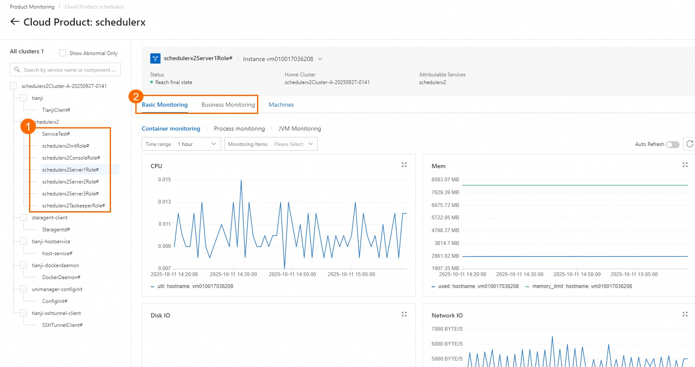
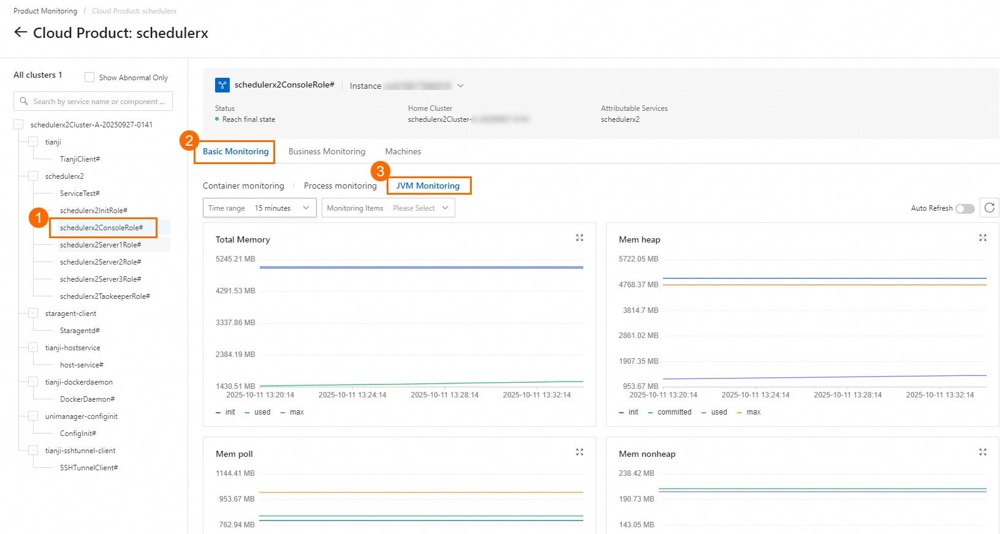
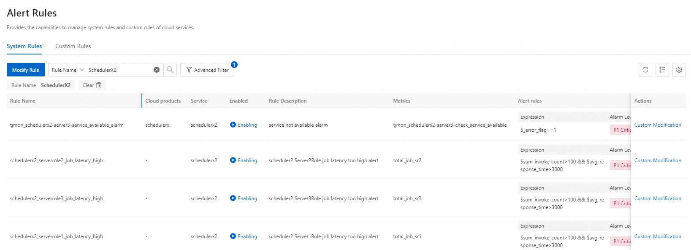
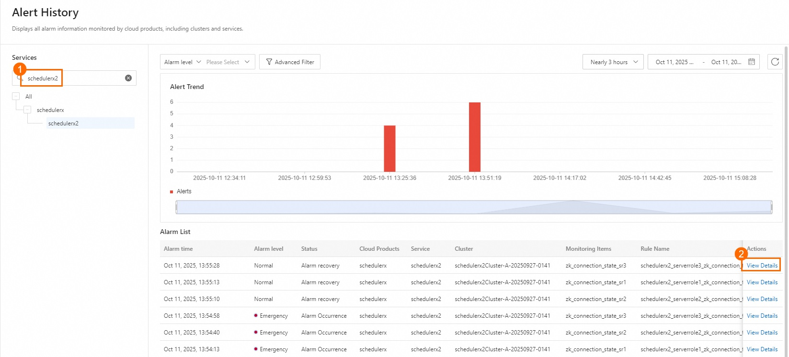

Alibaba Cloud  
Apsara Stack  
Enterprise Distributed  
Application Service (EDAS)  
SchedulerX 2.0 Operations  
and Maintenance Guide  
Product Version: v3.18.6-2607  
Document Version: 20260828

**Table of Contents**

- [1.Service architecture](#section-1)
    - [1.1. System architecture](#section-1-1)
    - [1.2. Components and their functions](#section-1-2)
- [2.Routine maintenance](#section-2)
    - [2.1. Central scheduling cluster inspection](#section-2-1)
    - [2.2. Control platform health check](#section-2-2)
    - [2.3. Health checks for basic components](#section-2-3)
        - [2.3.1. MySQL health check](#section-2-3-1)
        - [2.3.2. ZooKeeper health check](#section-2-3-2)
        - [2.3.3. DAuth health check](#section-2-3-3)
    - [2.4. Security maintenance](#section-2-4)
- [3.Troubleshooting](#section-3)
    - [3.1. Incident response mechanism](#section-3-1)
    - [3.2. Troubleshooting methods](#section-3-2)
    - [3.3. Troubleshooting and O&M](#section-3-3)
        - [3.3.1. SchedulerX console](#section-3-3-1)
        - [3.3.2. Central scheduling cluster (SchedulerX-Server)](#section-3-3-2)
        - [3.3.3. Common basic components: ZooKeeper cluster](#section-3-3-3)
    - [3.4. Connect SchedulerX2 to Monitoring and Alerts](#section-3-4)

<a id="section-1"></a>

# 1.Service architecture

<a id="section-1-1"></a>

## 1.1. System architecture

SchedulerX consists of a scheduling cluster, a control system, clients, ZooKeeper, MySQL, and a monitoring and alerting system. The following figure shows the system architecture.

Figure 1. SchedulerX service architecture

SchedulerX-Console

Netty

MySQL

Quartz

ZooKeeper

SchedulerX-Server

Netty

SchedulerX-Client

<a id="section-1-2"></a>

## 1.2. Components and their functions

SchedulerX includes the central scheduling cluster (SchedulerX-Server), the web console (SchedulerX-Console), MySQL, and ZooKeeper.

The following table describes the functions of SchedulerX and its dependencies.

Table 1. SchedulerX components and their functions

**Component group**

**Component**

**Function description**

Central scheduling cluster

SchedulerX-Server

Schedules all jobs.

The management console for

Management platform

SchedulerX-Console

job maintenance and other management operations.

Stores job configurations and

MySQL

runtime data.

Commoncomponents Common components

Provides distributed locking and

ZooKeeper

service discovery.

DAuth

Authentication center

<a id="section-2"></a>

# 2.Routine maintenance

After deployment, SchedulerX requires ongoing operations and maintenance (O&M) to ensure its stability and availability. This maintenance includes managing the middleware components that SchedulerX depends on. The main daily O&M checks are as follows.

<a id="section-2-1"></a>

## 2.1. Central scheduling cluster inspection

**Process checks**

The SchedulerX runtime is a Java process. You can use the ps command to check if the process is running normally.

Check the service port. Run the  `netstat –ano |grep 52014`  command to check if the port is listening.

| Port | Description |
| --- | --- |
| 52014 | The listener port for SchedulerX-Server. All network traffic passes through this port. |

To check the runtime status, view the logs in the default path: /home/admin/logs/dts-all-52014/dts.log.

To check the process startup method, log on as the admin user, go to the /home/admin/dts-all/bin folder, and run the  `appctl.sh start`  command.

**Disk space check**

Check if the disk is full of logs. A large log volume can prevent SchedulerX from responding to service registration requests.

```text
df -lh
df -lh /home/admin/logs
```

SchedulerX uses a log rolling mechanism. However, you should perform this check as a precaution. Delete old logs if necessary.

**Address server check**

Ensure that you can connect to the address server and that the latency is low. On an internal network, the latency must be less than 10 ms.

```text
ping jmenv.tbsite.net
```

<a id="section-2-2"></a>

## 2.2. Control platform health check

The SchedulerX Console is a web application that runs in an AliTomcat container. The default HTTP port is 7001.

To perform a health check on the control platform, follow these steps:

1. Verify that the Tomcat process is running and that port 7001 is open.

2. Check the logs for any obvious errors and clear unnecessary log files. The default path is:

   /home/admin/logs/dts-console/

3. Log on to the target machine and run  `curl                http://127.0.0.1:7001/dts-console/checkpreload.htm`  to check the health status.

4. As the admin user, go to the /home/admin/dts-console/bin directory and run **./appctl.sh start**.

<a id="section-2-3"></a>

## 2.3. Health checks for basic components

This topic describes the health checks for basic components, such as MySQL, ZooKeeper, and Dauth.

<a id="section-2-3-1"></a>

### 2.3.1. MySQL health check

SchedulerX depends on the MySQL database service.

Run the following command:  `telnet ${db_domainName} 3306` .

In this command, *db_domainName* is the domain name of the database.

A successful connection indicates that the database service is running correctly.

<a id="section-2-3-2"></a>

### 2.3.2. ZooKeeper health check

1. Check the disk space.

   ZooKeeper writes data to the disk. If the disk is full, data cannot be added or modified.

   ```text
   df -lh
   df -lh /home/admin/
   ```

2. Run  `top`  to ensure that system memory and CPU usage are normal.

3. Run  `sh zkServer.sh status`  to check the ZooKeeper status.

<a id="section-2-3-3"></a>

### 2.3.3. DAuth health check

DAuth is a web system that is deployed on Tomcat.

Perform the following checks.

1. Check if the Tomcat process is running and port 8080 is open.

2. Check if the Nginx process is running and port 80 can forward requests to port 8080.

3. /home/admin/dauth/logs/\*.log for any obvious abnormalities.

4. /home/admin/dauth/logs directory.

   5. `curl 'localhost:8080'|grep Unsupported`  command. The service is running normally if the

   output contains "Unsupported".

6. /home/admin directory has sufficient disk space.

Because DAuth is also a Diamond client, perform the following checks:

1. /home/admin/logs/diamond-client/diamond-client.log for any obvious abnormalities.

2. Run the command  `curl 'http://jmenv.tbsite.net:8080/diamond-server/diamond-unit-spas'`  to retrieve a list of servers for the Diamond SPAS unit. Ping each server and ensure the latency is below 10 ms.

<a id="section-2-4"></a>

## 2.4. Security maintenance

- Regularly change account passwords and use strong passwords to ensure account security. This is especially important for SchedulerX administrator accounts.

- As needed, configure an Intrusion Detection and Prevention System (IDPS) to monitor internal and external network traffic in real time to prevent abnormal activity and attacks.

<a id="section-3"></a>

# 3.Troubleshooting

<a id="section-3-1"></a>

## 3.1. Incident response mechanism

A maintenance team should establish an incident response mechanism to promptly resolve failures or security incidents and resume production.

<a id="section-3-2"></a>

## 3.2. Troubleshooting methods

If you find a system fault during routine maintenance, use the O&M features of Scheduler and the system logs to obtain detailed information, analyze the cause, and resolve the fault. If you cannot resolve the fault, collect relevant information, such as system info and fault symptoms, and contact an Alibaba Cloud technical support engineer for assistance.

After you resolve a fault, review the issue, summarize your findings, and implement improvements.

<a id="section-3-3"></a>

## 3.3. Troubleshooting and O&M

<a id="section-3-3-1"></a>

### 3.3.1. SchedulerX console

**The console starts but is inaccessible**

You can run the  `systemctl status iptables.service`  command to check the network channel, firewall rules, and local iptables rules.

**A security prompt appears after you log on to the console**

When you first access the console, the page automatically redirects to the DAuth secure single sign-on (SSO) interface. Your browser might block the page and show a security warning because of an issue with the certificate that DAuth uses. In this case, you can proceed past the warning. You are then redirected to DAuth to confirm your identity. The page then automatically redirects back to the console.

**The console reports a memory overflow**

The Tomcat startup parameters use a standard configuration, so memory issues are uncommon. If a memory overflow or crash occurs, collect detailed information and contact the helpdesk. After you collect the information, you can restart the Tomcat service to restore operations.

**The console log reports a ZooKeeper connection error**

This error likely indicates a problem with the ZooKeeper cluster. You can log on to the ZooKeeper machine and check the status of the ZooKeeper service.

1. Check if the disk on the ZooKeeper machine is full. If it is, clear the logs, check whether automatic log cleanup is configured, and then restart ZooKeeper. For configuration details, see the official ZooKeeper documentation.

2. Check if the ZooKeeper process is shut down. If it is, restart ZooKeeper.

3. Restart the console.

<a id="section-3-3-2"></a>

### 3.3.2. Central scheduling cluster (SchedulerX-Server)

**ZooKeeper connection issues**

This issue is likely caused by a problem with the ZooKeeper cluster. Log on to the ZooKeeper machine and check the status of the ZooKeeper service.

1. Check if the disk on the ZooKeeper machine is full. If the disk is full, clear the logs and check if the automatic log cleanup parameter is configured. Then, restart ZooKeeper. For more information about this configuration, see the ZooKeeper documentation.

2. Check if the process has shut down. If it has, restart ZooKeeper.

3. Restart the central scheduling cluster.

**Jobs fail to trigger**

If your application is working correctly, this issue is likely caused by a server error. There are two main reasons for this.

1. A ZooKeeper connection issue. For more information, see ZooKeeper connection issues.

2. The server process is not running. If the ZooKeeper connection is normal, check the status of the server process. If the process is not running, restart the server.

<a id="section-3-3-3"></a>

### 3.3.3. Common basic components: ZooKeeper cluster

- Insufficient disk space

  A full disk is often caused by log files. Check the ZooKeeper log file usage and verify that automatic log cleanup is configured as follows:

  <ol type="i">

  <li>

  *autopurge.purgeInterval* This parameter specifies the cleanup frequency in hours. The value must be an integer of 1 or greater. The default value is 0, which disables the automatic cleanup feature. Set the value to 24.

  </li>

  <li>

  *autopurge.snapRetainCount* This parameter is used with the *autopurge.purgeInterval* parameter. It specifies the number of files to retain. The default value is 3. Set the value to 7.

  </li>

  </ol>

- Missing process

  Restart the process.

<a id="section-3-4"></a>

## 3.4. Connect SchedulerX2 to Monitoring and Alerts

SchedulerX2 integrates container monitoring, process monitoring, and JVM monitoring by connecting to the monitoring and alert system.

**View container and process monitoring data**

1. Log on to the Apsara Uni-manager Management Console.

2. In the top navigation bar, click **Monitoring and Alerts > Cloud Platform Monitoring**.

3. In the **Cloud Platform Monitoring** console, click **Business Monitoring > Cloud Service Monitoring** in the navigation pane on the left.

4. On the **Cloud Service Monitoring** page, enter  `SchedulerX`  in the search box and click Search. Click the cloud product in the search results.

5. In the service list, click a service component under **schedulerx2**. On the **Infrastructure Monitoring** tab, click **Container Monitoring** and **Process Monitoring** to view the data.

   

**View JVM monitoring information**

1. Log on to the Apsara Uni-manager Management Console.

2. In the top navigation bar, click **Monitoring and Alerts > Cloud Platform Monitoring**.

3. In the **Cloud Platform Monitoring** console, click **Business Monitoring > Cloud Service Monitoring** in the navigation pane on the left.

4. On the **Cloud Service Monitoring** page, enter  `SchedulerX`  in the search box and click Search. Click the cloud product in the search results.

5. In the service list, find **schedulerx2 > schedulerx2ConsoleRole#**. On the **Infrastructure Monitoring** tab, click **JVM Monitoring**.

   

**Alert rules**

1. In the **Cloud Platform Monitoring** console, click **Business Monitoring > Alert Rules** in the navigation pane on the left.

2. On the **Alert Rules** page, enter  `SchedulerX2`  in the **Rule Name** search box and click Search. You can then view and edit the rules.

   

3. In the **Cloud Platform Monitoring** console, click **Business Monitoring > Alert History** in the navigation pane on the left to view alert information.

4. On the **Alert History** page, enter  `schedulerx2`  in the Service Catalog search box and click Search. You can view the alert information in the alert list.

   
