Alibaba Cloud  
Apsara Stack  
Enterprise Distributed  
Application Service (EDAS)  
SchedulerX 2.0 User Guide  
Product Version: v3.18.6-2607  
Document Version: 20260828

**Table of Contents**

- [1.Distributed Task Scheduling Platform SchedulerX 2.0](#section-1)
- [2.Quick Start](#section-2)
    - [2.1. Log on to the Apsara Uni-manager Management Console](#section-2-1)
    - [2.2. Log on to the SchedulerX console](#section-2-2)
    - [2.3. Get the domainName for SchedulerX](#section-2-3)
    - [2.4. Connect clients to SchedulerX](#section-2-4)
        - [2.4.1. Integrate a Java application with SchedulerX 2.0](#section-2-4-1)
        - [2.4.2. Integrate a Spring application with SchedulerX 2.0](#section-2-4-2)
        - [2.4.3. Integrate a Spring Boot application with SchedulerX 2.0](#section-2-4-3)
    - [2.5. Create standalone script tasks using an agent](#section-2-5)
    - [2.6. Adapt to IPv6 access](#section-2-6)
    - [2.7. Client release history](#section-2-7)
        - [2.7.1. Java SDK](#section-2-7-1)
- [3.Scheduling and triggers](#section-3)
    - [3.1. Timed scheduling](#section-3-1)
    - [3.2. Workflow scheduling](#section-3-2)
    - [3.3. API trigger](#section-3-3)
    - [3.4. Backfill data](#section-3-4)
    - [3.5. Second-level scheduling](#section-3-5)
- [4.Task types](#section-4)
    - [4.1. Java tasks](#section-4-1)
    - [4.2. Script tasks](#section-4-2)
    - [4.3. HTTP tasks](#section-4-3)
- [5.Distributed programming model](#section-5)
    - [5.1. Standalone](#section-5-1)
    - [5.2. Broadcast](#section-5-2)
    - [5.3. Map model](#section-5-3)
    - [5.4. MapReduce model](#section-5-4)
    - [5.5. Multi-language sharding models](#section-5-5)
- [6.Console user guide](#section-6)
    - [6.1. Overview](#section-6-1)
    - [6.2. Execution List](#section-6-2)
    - [6.3. Task List](#section-6-3)
    - [6.4. Workflow Management](#section-6-4)
    - [6.5. Application Management](#section-6-5)
    - [6.6. Operation records](#section-6-6)
- [7.Advanced features](#section-7)
    - [7.1. Create a second-level scheduling task](#section-7-1)
    - [7.2. Create a new account](#section-7-2)
    - [7.3. How to pass data between upstream and downstream nodes in a workflow](#section-7-3)
- [8.Configuration reference](#section-8)
    - [8.1. JobContext parameters](#section-8-1)
    - [8.2. Advanced configuration parameters for task management](#section-8-2)
    - [8.3. SchedulerxWorker configuration parameters](#section-8-3)
- [9.Permission management](#section-9)
    - [9.1. Overview of permission management](#section-9-1)
    - [9.2. Create users and user groups](#section-9-2)
    - [9.3. Create a role and attach permissions](#section-9-3)
    - [9.4. Verify logon permissions](#section-9-4)
    - [9.5. Verify application-level permissions](#section-9-5)
- [10.FAQ](#section-10)
    - [10.1. FAQ](#section-10-1)
    - [10.2. Alert FAQ](#section-10-2)

<a id="section-1"></a>

# 1.Distributed Task Scheduling Platform SchedulerX 2.0

SchedulerX 2.0 is Alibaba Group's next-generation Distributed Task Scheduling Platform, built on the Akka architecture. It supports timed scheduling, workflow task orchestration, and distributed batch scheduling. It delivers high reliability, manages massive task volumes, and schedules tasks in seconds. You configure and manage your timed scheduling tasks in the console. You query task execution records and operational logs. You orchestrate tasks and pass data using workflows. SchedulerX 2.0 provides a simple, easy-to-use distributed programming model. With just a few lines of code, you can distribute large data volumes across multiple machines for execution.

<a id="section-2"></a>

# 2.Quick Start

<a id="section-2-1"></a>

## 2.1. Log on to the Apsara Uni-manager Management Console

This topic describes how to log on to the Apsara Uni-manager Management Console.

**Prerequisites**

- You have obtained the service domain name for the Apsara Uni-manager Management Console from the deployment personnel.

- Use the Google Chrome browser.

**Procedure**

1. In the address bar of your browser, enter the service domain name for the Apsara Uni-manager Management Console and press Enter.

   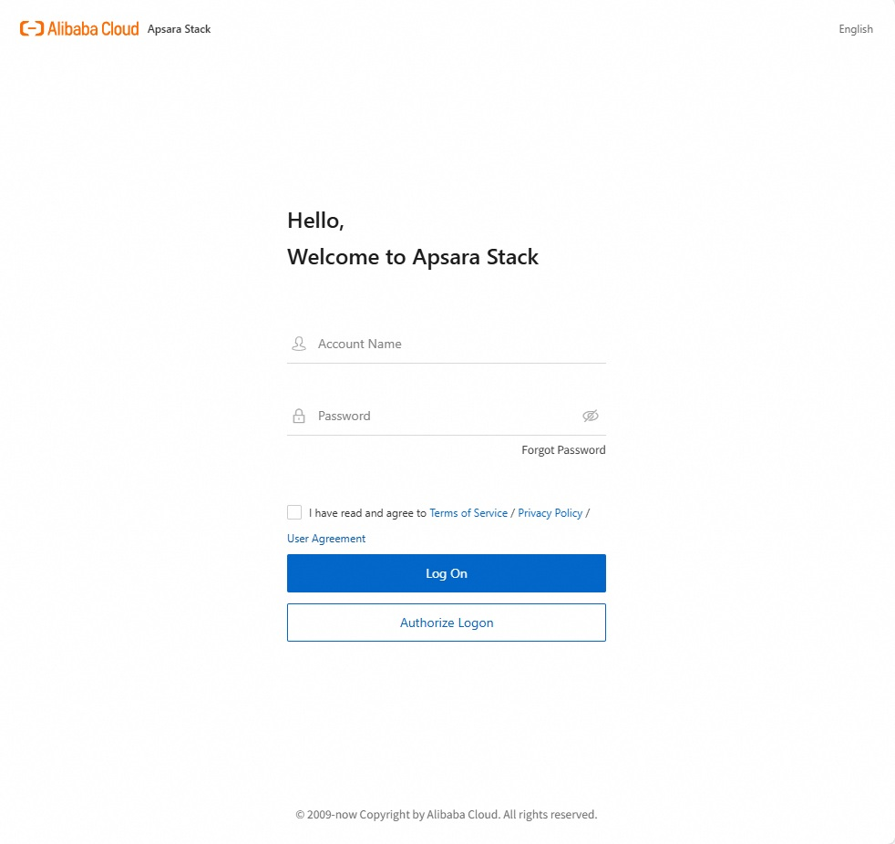

   > **Note**
   >
   > - You can click the current language in the upper-right corner to switch to another language.
   >
   > - 由于浏览器证书过期或环境开启HTTPS认证等出现多次单击继续访问或无Apsara Uni-manager运营控制台地址入口等现象，此时需要安装证书才能正常访问。单击页面右上角的**浏览器证书安装**，可打开浏览器证书安装指南。

2. Enter your username and password.

   > **Note**
   >
   > - You can obtain the username and logon password from an operations administrator.
   >
   > - If this is your first time logging on to the Apsara Uni-manager Management Console, you must change your password. For security, the password must be 10 to 32 characters long and contain uppercase letters, lowercase letters, digits, and special characters. The supported special characters are: !, @, #, $, and %.

3. Select **I Have Read And Agree To The Product Service Agreement, Privacy Agreement, And User Agreement**.

   > **Note**
   >
   > - The link text on the logon page is the title of the agreement document. You can click the link to view the details of the agreement.
   >
   > - The **Product Service Agreement**, **Privacy Agreement**, and **User Agreement** are displayed only if they have been published. If none of these agreements are published, you can skip this step.

4. Click **Account Logon** or **Authorized Logon**.

   > **Note**
   >
   > The Authorized Logon button is displayed only if the global IdP setting for third-party authentication is enabled. This display name can be customized. The default name is "Authorized Logon".

5. If multi-factor authentication (MFA) is enabled for your account, follow the steps for one of the following scenarios:

   > **Note**
   >
   > When you log on from the Internet, multi-factor authentication (MFA) is mandatory by default.

   - **First logon after MFA is enabled**

     <ol type="a">

     <li>

     After you log on with your username and password, the Bind Virtual MFA Device page appears.

     </li>

     <li>

     On the Bind Virtual MFA Device page, follow the on-screen instructions to bind a virtual MFA device.

     </li>

     </ol>

     <ol type="i" start="100">

     <li>

     You have logged in to the console.

     </li>

     </ol>

   - **MFA is already enabled and a device is bound**

     Enter the six-digit MFA code and click **Authenticate**.

**Related operations**

**Forgot password**

1. If you forget your logon password, click **Forgot Password** below the password field.

2. On the Forgot Password page, enter your **Account Name** and **Email Address**, complete the Captcha, and then click **Confirm**.

   

   > **Note**
   >
   > - For Account Name, enter your username. For Email Address, enter the email address that you used to create the account.
   >
   > - A password reset link is sent to your email address. Open the link to reset your password.

<a id="section-2-2"></a>

## 2.2. Log on to the SchedulerX console

This topic describes how to log on to the Distributed Task Scheduling Platform.

**Prerequisites**

- You have obtained the service domain name for the Apsara Uni-manager Management Console from the deployment personnel.

- Use the Google Chrome browser.

**Procedure**

1. In the address bar of your browser, enter the service domain name for the Apsara Uni-manager Management Console and press Enter.

   

   > **Note**
   >
   > - You can click the current language in the upper-right corner to switch to another language.
   >
   > - 由于浏览器证书过期或环境开启HTTPS认证等出现多次单击继续访问或无Apsara Uni-manager运营控制台地址入口等现象，此时需要安装证书才能正常访问。单击页面右上角的**浏览器证书安装**，可打开浏览器证书安装指南。

2. Enter your username and password.

   > **Note**
   >
   > - You can obtain the username and logon password from an operations administrator.
   >
   > - If this is your first time logging on to the Apsara Uni-manager Management Console, you must change your password. For security, the password must be 10 to 32 characters long and contain uppercase letters, lowercase letters, digits, and special characters. The supported special characters are: !, @, #, $, and %.

3. Select **I Have Read And Agree To The Product Service Agreement, Privacy Agreement, And User Agreement**.

   > **Note**
   >
   > - The link text on the logon page is the title of the agreement document. You can click the link to view the details of the agreement.
   >
   > - The **Product Service Agreement**, **Privacy Agreement**, and **User Agreement** are displayed only if they have been published. If none of these agreements are published, you can skip this step.

4. Click **Account Logon** or **Authorized Logon**.

   > **Note**
   >
   > The Authorized Logon button is displayed only if the global IdP setting for third-party authentication is enabled. This display name can be customized. The default name is "Authorized Logon".

5. If multi-factor authentication (MFA) is enabled for your account, follow the steps for one of the following scenarios:

   > **Note**
   >
   > When you log on from the Internet, multi-factor authentication (MFA) is mandatory by default.

   - **First logon after MFA is enabled**

     <ol type="a">

     <li>

     After you log on with your username and password, the Bind Virtual MFA Device page appears.

     </li>

     <li>

     On the Bind Virtual MFA Device page, follow the on-screen instructions to bind a virtual MFA device.

     </li>

     </ol>

     <ol type="i" start="100">

     <li>

     You have logged in to the console.

     </li>

     </ol>

   - **MFA is already enabled and a device is bound**

     Enter the six-digit MFA code and click **Authenticate**.

6. In the top navigation bar, choose **Products > Middleware > Microservice Tools And Platforms > SchedulerX** to open the SchedulerX console.

7. Click the floating **Switch Account** icon in the lower-right corner, and then select **Organization Settings** and **Region Settings**.

8. Click **Access With Administrator Permissions** or **Access With Role-based Authorization** to open the **Overview** page.

   > **Note**
   >
   > If you are an administrator, click **Access With Administrator Permissions**. If you are not an administrator, click **Access With Role-based Authorization**.

<a id="section-2-3"></a>

## 2.3. Get the domainName for SchedulerX

The domainName is required when connecting a client or an agent to SchedulerX. This topic describes how to obtain the domainName for SchedulerX from the console.

**Procedure**

**Apsara Basic O&M console (new)**

1. Log on to the Apsara Basic O&M console.

2. In the navigation pane on the left, click **Resource Management > Product & Cluster O&M**.

3. On the **Product & Cluster O&M** page, enter  `schedulerx2Cluster`  in the **Product|Cluster** search box. In the Action column of the target cluster, click **Cluster Details**.

   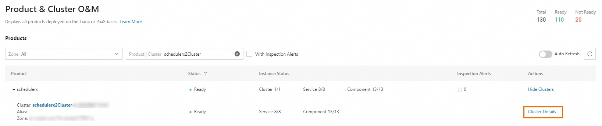

4. On the **Resource Details** tab of the **Cluster Details** page, find the **Resource** whose **Name** is **schedulerx2_console_domain**, and click the link in the **Resource Request Result** column.

   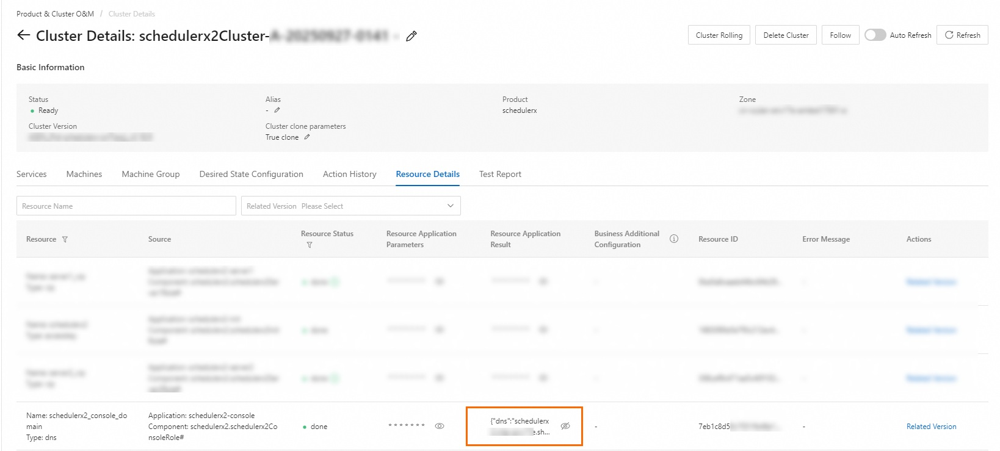

5. In the **Resource Request Result** dialog box, obtain the domainName for SchedulerX 2.0 and record it.

   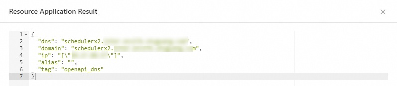

**Apsara Basic O&M console (old)**

1. Log on to the Apsara Basic O&M console.

   

2. In the left navigation pane, under **Cluster**, enter

   `schedulerX2Cluster` and click the

   search

   

   icon. Hover over the

   icon to the right of the target cluster, and then click **Dashboard**.

   

   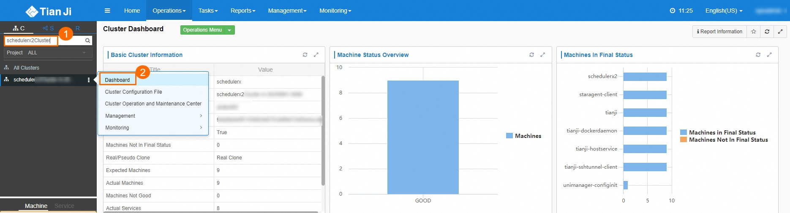

3. In the **Cluster Resources** section of the **Cluster Dashboard** page, find the App whose **Name** is **schedulerx2_console_domain**, right-click the value in its **Result** column, and select **Show More**.

   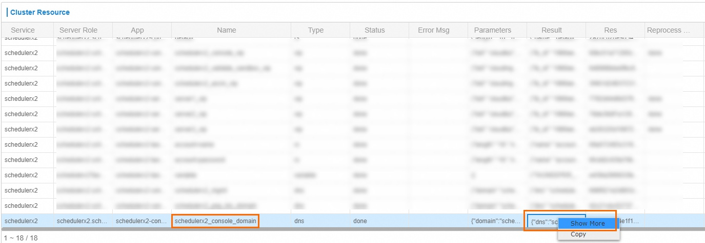

4. In the **Details** dialog box, obtain the domainName for SchedulerX 2.0 and record it.

   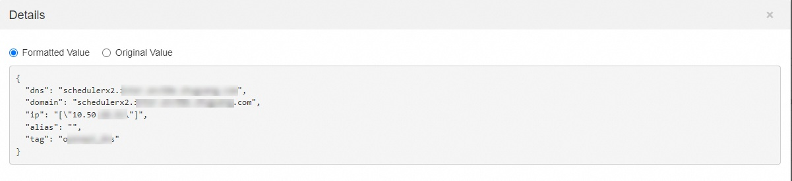

   The **domain** value is the domainName for SchedulerX 2.0.

<a id="section-2-4"></a>

## 2.4. Connect clients to SchedulerX

<a id="section-2-4-1"></a>

### 2.4.1. Integrate a Java application with SchedulerX 2.0

Integrate SchedulerX 2.0 with your Java application to enable distributed task scheduling.

**Prerequisites**

You have created a resource. For more information, see Application management.

**Procedure**

The process of integrating task scheduling capabilities into an application involves the following steps:

1. Create an application group.

2. Integrate the client with SchedulerX 2.0.

> **Note**
>
> SchedulerX uses at-least-once scheduling semantics. You must implement idempotence as needed. For example, if a worker for a distributed task goes down or is disconnected from the network, a failover is triggered. The tasks that were running on that worker might be executed again.

**Step 1: Create an application group**

SchedulerX 2.0 uses application groups to isolate resources and manage task scheduling. You must create an application group and use its **GroupID** and **AppKey** as configuration parameters to integrate your application with the task scheduler.

> **Note**
>
> To prevent resource waste, a group in SchedulerX 2.0 supports a maximum of 1,000 tasks (Jobs) by default.

1. Log on to the SchedulerX console.

2. In the navigation pane on the left, choose **Application Management**.

3. On the **Application Management** page, click **Create**.

4. In the **Create Application** panel, on the **Basic Configurations** tab, configure the following parameters and click **Next**.

   | Parameter | Description | Default value |
   | --- | --- | --- |
   | Applicatio n Name | A custom name for the application. | None |
   | Group ID | The Group ID for the application. The value must be unique in the system. Otherwise, the creation fails. | None |
   | Descriptio n | A custom description. | None |
   | Load5 Threshold | The value cannot exceed the number of available CPU cores on the client machine. | 0 |
   | Memory Usage | The average memory usage of the process in the last 5 minutes cannot be greater than this threshold. Otherwise, the client machine is considered busy. | 90% |
   | Disk Usage | The disk usage cannot be greater than this value. Otherwise, the client machine is considered unhealthy and busy. | 95% |
   | Trigger Busy Machines | Specifies whether to continue triggering client execution when a machine is busy. | Open |
   | Throttling | Specifies whether to enable throttling. If you enable this feature, you must set <strong>Concurrent Task Instances</strong>. | Off |
   | Concurren t Task Instances | If throttling is enabled, this is the maximum number of task instances that can run concurrently for an application. Task instances that exceed this limit are not discarded. They are placed in an application-level task queue to wait for execution. | None |
   | Maximum Tasks | The maximum number of tasks that a group can have. The value cannot exceed 1,000. | None |
   | Calendar | Import a custom calendar. You can set scheduled tasks to run on specified dates to meet specific business requirements. | None |

5. In the **Create Application** panel, on the **Notifications** tab, select an **Alert Method**, add **Alert Contacts**, and then click **Submit**.

   | Configuration Item | Description | Example |
   | --- | --- | --- |
   | Alert Method | • DingTalk<br>• Email | DingTalk |
   | Add Alert Contact | Enter the <strong>Nickname</strong>, <strong>Email</strong>, and <strong>DingTalk Access_token</strong>. | None |

   After the application group is created, you are redirected to the **Application Management** page. Verify that the application group exists and obtain its **Group ID** and **AppKey**.

**Step 2: Integrate the Java application with SchedulerX 2.0**

Integrate task scheduling into your application by performing the following steps:

1. Initialize SchedulerxWorker.

2. Create a new class to implement task scheduling.

3. Add the SchedulerxWorker dependency to the pom.xml file of your application.

   ```xml
     <dependency>
       <groupId>com.aliyun.schedulerx</groupId>
       <artifactId>schedulerx2-worker</artifactId>
       <version>${schedulerx2.version}</version>
           <!-- If you use logback, you must exclude log4j and log4j2. -->
           <exclusions>
             <exclusion>
               <groupId>org.apache.logging.log4j</groupId>
               <artifactId>log4j-api</artifactId>
             </exclusion>
             <exclusion>
               <groupId>org.apache.logging.log4j</groupId>
           <artifactId>log4j-core</artifactId>
             </exclusion>
             <exclusion>
               <groupId>log4j</groupId>
               <artifactId>log4j</artifactId>
             </exclusion>
       </exclusions>
     </dependency>
   ```

   > **Note**
   >
   > To obtain the latest version of the SchedulerX 2.0 client, see Client release history.

4. Initialize SchedulerxWorker in the main function.

   ```text
   /**
       * Initializes the SchedulerX client.
       * @throws Exception if the initialization fails.
       */
      private static void initSchedulerxWorker() throws Exception {
        String groupId = "schedulerx-server.defaultGroup"; 
        String appKey = "jdslfjsdkflka****=="; 
        SchedulerxWorker schedulerxWorker = new SchedulerxWorker();
        // Set the domain name.
        schedulerxWorker.setDomainName(${domainName});
        // If your application is deployed in EDAS, you need to configure the namespace.
        schedulerxWorker.setNamespace("system_namespace");
        schedulerxWorker.setGroupId(groupId);
        // For versions later than 1.1.0, you must set the AppKey.
        schedulerxWorker.setAppKey(appKey);
        schedulerxWorker.init();
        LOGGER.info("SchedulerxWorker init success. groupId={}", groupId);
      }                  
   ```

   > **Note**
   >
   > For additional configuration options when initializing the SchedulerxWorker client, see SchedulerxWorker configuration parameters.

5. Create a new class to implement the scheduled task.

   In your application, add a class named  `JobProcessor`  to implement task scheduling. This example implements a simple task that periodically prints "hello world". The following code shows the \`JobProcessor\` class:

   ```java
   package com.alibaba.armon.test.processor.demo;

   import com.alibaba.schedulerx.worker.domain.JobContext;
   import com.alibaba.schedulerx.worker.processor.JavaProcessor;
   import com.alibaba.schedulerx.worker.processor.ProcessResult;

   import org.springframework.stereotype.Component;

   @Component
   public class HelloWorldProcessor extends JavaProcessor {

       @Override
       public ProcessResult process(JobContext context) throws Exception {
           System.out.println("hello world");
           return new ProcessResult(true);
       }

   }                     
   ```

**Verify the result**

After you complete the integration, you can verify it in the console.

1. Log on to the SchedulerX console.

2. In the navigation pane on the left, choose **Application Management**.

3. On the **Application Management** page, find the group that you created and click **Connected Machines** in the **Actions** column.

   - If the integration is successful, a list of machines is displayed.

   - If the integration fails, a message that indicates no active machines are available is displayed.

   Java application

   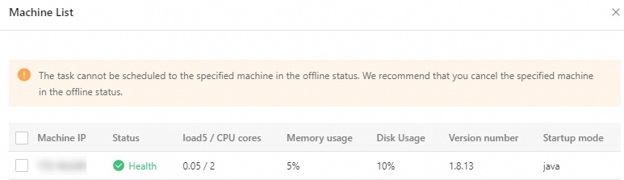

   > **Note**
   >
   > You can also check the SchedulerX client logs in the ${user.home}/logs/schedulerx directory. The worker.log file contains the core runtime logs of the SchedulerX client, which include records of exceptions and other runtime events.

**What to do next**

Based on the hello world example in Integrate a Java application with SchedulerX 2.0, create a scheduled task in the console. For the **Processor Class Name** parameter, enter the full path of the JobProcessor, for example,  `com.alibaba.armon.test.processor.demo.HelloWorldProcessor` . For more information, see Create a scheduling task.

> **Note**
>
> Cron expressions do not support second-level granularity. To schedule tasks at the second level, use second_delay.

<a id="section-2-4-2"></a>

### 2.4.2. Integrate a Spring application with SchedulerX 2.0

You can use SchedulerX 2.0 to add distributed task scheduling capabilities to standalone Spring applications.

**Prerequisites**

The resource has been created. For more information, see Application Management.

**Procedure**

The procedure to add task scheduling capabilities to an application is as follows:

1. Create an application group.

2. Integrate the client with SchedulerX 2.0.

> **Note**
>
> SchedulerX provides at-least-once scheduling semantics. You must implement idempotence in your application. For example, if a worker for a distributed task goes down or loses its network connection, a failover is triggered. Tasks that were running on that worker may be executed again.

**Step 1: Create an application group**

SchedulerX 2.0 uses application groups to isolate resources and manage task scheduling. You must create an application group and use its **GroupID** and **AppKey** as configuration parameters to integrate your application with the task scheduler.

> **Note**
>
> To prevent resource waste, a group in SchedulerX 2.0 supports a maximum of 1,000 tasks (Jobs) by default.

1. Log on to the SchedulerX console.

2. In the navigation pane on the left, choose **Application Management**.

3. On the **Application Management** page, click **Create**.

4. In the **Create Application** panel, on the **Basic Configurations** tab, configure the following parameters and click **Next**.

   | Parameter | Description | Default value |
   | --- | --- | --- |
   | Applicatio n Name | A custom name for the application. | None |
   | Group ID | The Group ID for the application. The value must be unique in the system. Otherwise, the creation fails. | None |
   | Descriptio n | A custom description. | None |
   | Load5 Threshold | The value cannot exceed the number of available CPU cores on the client machine. | 0 |
   | Memory Usage | The average memory usage of the process in the last 5 minutes cannot be greater than this threshold. Otherwise, the client machine is considered busy. | 90% |
   | Disk Usage | The disk usage cannot be greater than this value. Otherwise, the client machine is considered unhealthy and busy. | 95% |
   | Trigger Busy Machines | Specifies whether to continue triggering client execution when a machine is busy. | Open |
   | Throttling | Specifies whether to enable throttling. If you enable this feature, you must set <strong>Concurrent Task Instances</strong>. | Off |
   | Concurren t Task Instances | If throttling is enabled, this is the maximum number of task instances that can run concurrently for an application. Task instances that exceed this limit are not discarded. They are placed in an application-level task queue to wait for execution. | None |
   | Maximum Tasks | The maximum number of tasks that a group can have. The value cannot exceed 1,000. | None |
   | Calendar | Import a custom calendar. You can set scheduled tasks to run on specified dates to meet specific business requirements. | None |

5. In the **Create Application** panel, on the **Notifications** tab, select an **Alert Method**, add **Alert Contacts**, and then click **Submit**.

   | Configuration Item | Description | Example |
   | --- | --- | --- |
   | Alert Method | • DingTalk<br>• Email | DingTalk |
   | Add Alert Contact | Enter the <strong>Nickname</strong>, <strong>Email</strong>, and <strong>DingTalk Access_token</strong>. | None |

   After the application group is created, you are redirected to the **Application Management** page. Verify that the application group exists and obtain its **Group ID** and **AppKey**.

**Step 2: Integrate a Spring application with SchedulerX 2.0**

To integrate task scheduling into your application, complete the following steps:

1. Initialize SchedulerxWorker.

2. Create a class to implement task scheduling.

3. Add the SchedulerxWorker dependency to the application's pom.xml file.

   ```xml
     <dependency>
       <groupId>com.aliyun.schedulerx</groupId>
       <artifactId>schedulerx2-worker</artifactId>
       <version>${schedulerx2.version}</version>
           <!-- If you use logback, exclude log4j and log4j2. -->
           <exclusions>
             <exclusion>
               <groupId>org.apache.logging.log4j</groupId>
               <artifactId>log4j-api</artifactId>
             </exclusion>
             <exclusion>
               <groupId>org.apache.logging.log4j</groupId>
           <artifactId>log4j-core</artifactId>
             </exclusion>
             <exclusion>
               <groupId>log4j</groupId>
               <artifactId>log4j</artifactId>
             </exclusion>
       </exclusions>
     </dependency>
   ```

   > **Note**
   >
   > To obtain the latest version of the SchedulerX 2.0 client, see Client release notes.

4. Initialize SchedulerxWorker in the XML configuration file by injecting the bean.

   ```xml
     <bean id="schedulerxWorker" class="com.alibaba.schedulerx.worker.SchedulerxWorker" init-method="init">
       <!-- Set the domainName. -->
       <property name="domainName">
         <value>${domainName}</value>
       </property>
       <!-- If the application is deployed in EDAS, you must configure the namespace.-->
       <property name="namespace">
         <value>system_namespace</value>
       </property>
       <property name="groupId">
         <value>${groupId}</value>
       </property>
       <!-- For versions 1.1.0 and later, you must set the AppKey. -->
       <property name="appKey">
          <value>${appKey}</value>
       </property>
     </bean>       
   ```

   > **Note**
   >
   > All JobProcessors must be configured as beans. For example, add the @Component annotation.

5. Create a class to implement the scheduling task.

   Add a  `JobProcessor`  class to the application to implement task scheduling. This section describes how to implement a simple timed task that prints "hello world". The following code shows the JobProcessor:

   ```java
   package com.alibaba.armon.test.processor.demo;

   import com.alibaba.schedulerx.worker.domain.JobContext;
   import com.alibaba.schedulerx.worker.processor.JavaProcessor;
   import com.alibaba.schedulerx.worker.processor.ProcessResult;

   import org.springframework.stereotype.Component;

   @Component
   public class HelloWorldProcessor extends JavaProcessor {

       @Override
       public ProcessResult process(JobContext context) throws Exception {
           System.out.println("hello world");
           return new ProcessResult(true);
       }

   }                     
   ```

**Verify the result**

After you complete the integration, you can verify it in the console.

1. Log on to the SchedulerX console.

2. In the navigation pane on the left, choose **Application Management**.

3. On the **Application Management** page, find the group that you created and click **Connected Machines** in the **Actions** column.

   - If the integration is successful, a list of machines is displayed.

   - If the integration fails, a message that indicates no active machines are available is displayed.

   Java application

   

   > **Note**
   >
   > You can also check the SchedulerX client logs in the ${user.home}/logs/schedulerx directory. The worker.log file contains the core runtime logs of the SchedulerX client, which include records of exceptions and other runtime events.

**What to do next**

Based on the "hello world" example in Integrate a Spring application with SchedulerX 2.0, create a timed scheduling task in the console. For the **Processor Class Name** parameter, enter the full path of the JobProcessor class, such as  `com.alibaba.armon.test.processor.demo.HelloWorldProcessor` . For more information, see Create a scheduling task.

> **Note**
>
> Cron expressions do not support second-level precision. To schedule tasks by the second, use second_delay.

<a id="section-2-4-3"></a>

### 2.4.3. Integrate a Spring Boot application with SchedulerX 2.0

Use SchedulerX 2.0 to add distributed task scheduling capabilities to a standalone Spring Boot application.

**Prerequisites**

An existing Spring Boot project.

**Procedure**

The workflow to integrate task scheduling capabilities into an application consists of the following steps:

1. Create an application group.

2. Integrate the client with SchedulerX.

> **Note**
>
> SchedulerX uses at-least-once scheduling semantics. Make your tasks idempotent to handle repeated executions. For example, if a worker goes down or is disconnected, a failover is triggered. Tasks that were running on the worker might be executed again.

**Step 1: Create an application group**

SchedulerX 2.0 uses application groups to isolate resources and manage task scheduling. You must create an application group and use its **GroupID** and **AppKey** as configuration parameters to integrate your application with the task scheduler.

> **Note**
>
> To prevent resource waste, a group in SchedulerX 2.0 supports a maximum of 1,000 tasks (Jobs) by default.

1. Log on to the SchedulerX console.

2. In the navigation pane on the left, choose **Application Management**.

3. On the **Application Management** page, click **Create**.

4. In the **Create Application** panel, on the **Basic Configurations** tab, configure the following parameters and click **Next**.

   | Parameter | Description | Default value |
   | --- | --- | --- |
   | Applicatio n Name | A custom name for the application. | None |
   | Group ID | The Group ID for the application. The value must be unique in the system. Otherwise, the creation fails. | None |
   | Descriptio n | A custom description. | None |
   | Load5 Threshold | The value cannot exceed the number of available CPU cores on the client machine. | 0 |
   | Memory Usage | The average memory usage of the process in the last 5 minutes cannot be greater than this threshold. Otherwise, the client machine is considered busy. | 90% |
   | Disk Usage | The disk usage cannot be greater than this value. Otherwise, the client machine is considered unhealthy and busy. | 95% |
   | Trigger Busy Machines | Specifies whether to continue triggering client execution when a machine is busy. | Open |
   | Throttling | Specifies whether to enable throttling. If you enable this feature, you must set <strong>Concurrent Task Instances</strong>. | Off |
   | Concurren t Task Instances | If throttling is enabled, this is the maximum number of task instances that can run concurrently for an application. Task instances that exceed this limit are not discarded. They are placed in an application-level task queue to wait for execution. | None |
   | Maximum Tasks | The maximum number of tasks that a group can have. The value cannot exceed 1,000. | None |
   | Calendar | Import a custom calendar. You can set scheduled tasks to run on specified dates to meet specific business requirements. | None |

5. In the **Create Application** panel, on the **Notifications** tab, select an **Alert Method**, add **Alert Contacts**, and then click **Submit**.

   | Configuration Item | Description | Example |
   | --- | --- | --- |
   | Alert Method | • DingTalk<br>• Email | DingTalk |
   | Add Alert Contact | Enter the <strong>Nickname</strong>, <strong>Email</strong>, and <strong>DingTalk Access_token</strong>. | None |

   After the application group is created, you are redirected to the **Application Management** page. Verify that the application group exists and obtain its **Group ID** and **AppKey**.

**Integrate the Spring Boot application with SchedulerX 2.0**

To integrate task scheduling into your application, follow these steps:

1. You can initialize SchedulerxWorker.

2. You can create a class to implement the scheduling task.

3. Add the SchedulerxWorker dependency to the pom.xml file of your application.

   ```xml
   <dependency>
       <groupId>com.aliyun.schedulerx</groupId>
       <artifactId>schedulerx2-spring-boot-starter</artifactId>
       <version>${schedulerx2.version}</version>
       <!-- If you use logback, exclude log4j and log4j2. -->
       <exclusions>
         <exclusion>
           <groupId>org.apache.logging.log4j</groupId>
             <artifactId>log4j-api</artifactId>
         </exclusion>
         <exclusion>
           <groupId>org.apache.logging.log4j</groupId>
             <artifactId>log4j-core</artifactId>
         </exclusion>
         <exclusion>
           <groupId>log4j</groupId>
           <artifactId>log4j</artifactId>
         </exclusion>
         </exclusions>
   </dependency>                
   ```

   > **Note**
   >
   > To obtain the latest version of the SchedulerX 2.0 client, see Client release notes.

4. Add the **GroupID** and **AppKey** of your group to the  `application.properties`  file.

   ```text
   # Specify the domain name without http://.
   spring.schedulerx2.domainName=xxx.xxx.xxx
   # If the application is deployed in EDAS, configure the namespace.
   spring.schedulerx2.namespace=system_namespace
   # Find the GroupID in Application Management.
   spring.schedulerx2.groupId=app1.defaultGroup
   # For versions 1.1.0 and later, set the AppKey. Find the AppKey in Application Management.
   spring.schedulerx2.appKey=sfhdsfhdjshdgf****==              
   ```

   > **Note**
   >
   > All JobProcessors must be set as beans. For example, add the  `@Component`  annotation.

   Parameter descriptions:

   | Key | Description | Value | Supp orted from versi on |
   | --- | --- | --- | --- |
   | spring.schedulerx2.enabled | Specifies whether to enable the SchedulerX 2.0 starter. It is enabled by default and does not need to be configured. | \`true\` or \`false\`.Default value: \`true\`. | 0.1.7 |
   | spring.schedulerx2.groupId | The group ID. | None | 0.1.7 |
   | spring.schedulerx2.domain Name | The domain name of the environment. | None | All |
   | spring.schedulerx2.enable Units | The whitelist for unit isolation.Separate multiple units with commas (,). Do not include spaces.<br><code>SchedulerxWorker worker = new</code><br><code>SchedulerxWorker();</code><br><code>// Enable only in the center</code><br><code>and zbyun units.</code><br><code>worker.setEnableUnites("center</code><br><code>,zbyun");</code> | None | 0.1.7 |
   | spring.schedulerx2.disable Units | The blacklist for unit isolation.Separate multiple units with commas (,). Do not include spaces. If a whitelist is set, the whitelist takes precedence and the blacklist is ignored.<br><code>SchedulerxWorker worker = new</code><br><code>SchedulerxWorker();</code><br><code>// Isolate the center unit.</code><br><code>worker.setDisableUnites("cente</code><br><code>r");</code> | None | 0.1.7 |
   | spring.schedulerx2.enableS ites | The whitelist for data center isolation.Separate multiple data centers with commas (,). Do not include spaces.<br><code>SchedulerxWorker worker = new</code><br><code>SchedulerxWorker();</code><br><code>// Enable only in the na61</code><br><code>and na62 data centers of the</code><br><code>center unit.</code><br><code>worker.setEnableSites("center.</code><br><code>na61,center.na62");</code> | None | 0.1.7 |
   | spring.schedulerx2.disable Sites | The blacklist for data center isolation.Separate multiple data centers with commas (,). Do not include spaces. If a whitelist is set, the whitelist takes precedence and the blacklist is ignored.<br><code>SchedulerxWorker worker = new</code><br><code>SchedulerxWorker();</code><br><code>// Isolate the na61 data</code><br><code>center of the center unit.</code><br><code>worker.setDisableUnites("cente</code><br><code>r.na61");</code> | None | 0.1.7 |
   | spring.schedulerx2.enableB atchWork | Specifies whether to enable grid computing. This parameter is enabled by default.<br>• If you do not use grid computing, do not configure this parameter.<br>• If you use grid computing, enable this parameter. Otherwise, the first trigger on each machine is delayed by at least 20 seconds. | \`true\` or \`false\`.Default value: \`true\`. | 0.1.7 |
   | spring.schedulerx2.host | If the client has multiple network interface cards (NICs) or is in a VPN environment, the automatically obtained local IP address might be incorrect. Use this parameter to specify the correct IP address. | None | 0.1.7 |
   | spring.schedulerx2.port | The custom listener port for the SchedulerX client. If not set, a random available port is selected by default. | None | 0.1.7 |
   | spring.schedulerx2.appKey | The <strong>AppKey</strong> that corresponds to the <strong>GroupID</strong>. You can obtain it from the <strong>Application Management</strong> page in the console. | None | 1.1.0 |
   | spring.schedulerx2.blockAp pStart | Specifies whether to block the application from starting if SchedulerX fails to initialize. | \`true\` or \`false\`.Default value: \`true\`. | 1.1.0 |
   | spring.schedulerx2.shareCo ntainerPool | Specifies whether all task executions on the client share a thread pool. | \`true\` or \`false\`.Default value: \`false\`. | 1.2.1.3 |
   | spring.schedulerx2.sharePo olSize | If you enable a shared thread pool, you can customize its size. | Default value: 64. | 1.2.1.3 |
   | spring.schedulerx2.label | Set labels for different clients. In Task Management, you can specify labels for task execution. Common scenarios include grayscale releases and stress testing. | None | 1.2.2.4 |
   | spring.schedulerx2.enableC groupMetrics | Specifies whether to use cgroups to collect metrics for client instances.You must manually enable this in container environments such as Kubernetes (K8s). | \`true\` or \`false\`.Default value: \`false\`. | 1.2.2.4 |
   | spring.schedulerx2.cgroupP athPrefix | The cgroup path within the container. | The default path is/sys/fs/cgroup/cp u/. If this path exists, you do not need to set this parameter. | 1.2.2.4 |
   | spring.schedulerx2.enable HeartbeatLog | Specifies whether to print heartbeat logs to ${user.home}/logs/schedulerx/heartb eat.log. | \`true\` or \`false\`.Default value: \`true\`. | 1.2.4.3 |
   | spring.schedulerx2.mapMa sterStatusCheckInterval | The frequency in milliseconds at which the Map model checks whether all subtasks are complete. You can set this parameter to increase the scheduling frequency for second-level tasks. | 3000 | 1.2.5 |
   | spring.schedulerx2.enableS econdDealyCycleIntervalMs | Sets the unit of the \`second_delay\` to milliseconds. If you set this parameter to \`true\`, the second-level delay configured in the console becomes a millisecond-level delay. This can increase the scheduling frequency. | \`true\` or \`false\`.Default value: \`false\`. | 1.2.5 |

5. Create a class that implements the scheduling task.

   Add a class that implements  `JobProcessor`  to your application. The following example shows a simple \`JobProcessor\` that prints "hello world" at a scheduled time:

   ```java
   package com.alibaba.armon.test.processor.demo;

   import com.alibaba.schedulerx.worker.domain.JobContext;
   import com.alibaba.schedulerx.worker.processor.JavaProcessor;
   import com.alibaba.schedulerx.worker.processor.ProcessResult;

   import org.springframework.stereotype.Component;

   @Component
   public class HelloWorldProcessor extends JavaProcessor {

       @Override
       public ProcessResult process(JobContext context) throws Exception {
           System.out.println("hello world");
           return new ProcessResult(true);
       }

   }                     
   ```

**Verify the result**

After you complete the integration, you can verify it in the console.

1. Log on to the SchedulerX console.

2. In the navigation pane on the left, choose **Application Management**.

3. On the **Application Management** page, find the group that you created and click **Connected Machines** in the **Actions** column.

   - If the integration is successful, a list of machines is displayed.

   - If the integration fails, a message that indicates no active machines are available is displayed.

   Java application

   

   > **Note**
   >
   > You can also check the SchedulerX client logs in the ${user.home}/logs/schedulerx directory. The worker.log file contains the core runtime logs of the SchedulerX client, which include records of exceptions and other runtime events.

**What to do next**

Create a timed scheduling task in the console based on the "hello world" example in Integrate a Spring Boot application with SchedulerX 2.0. For the **Processor Class** parameter, enter the full path of the JobProcessor, such as  `com.alibaba.armon.test.processor.demo.HelloWorldProcessor` . For more information, see Create a scheduling task.

> **Note**
>
> Cron expressions do not support second-level precision. To schedule tasks at the second level, use the second_delay parameter.

<a id="section-2-5"></a>

## 2.5. Create standalone script tasks using an agent

You can use an agent to create standalone Shell, Python, and Go script tasks.

**Prerequisites**

Ensure that the Java Runtime Environment (JRE) is version 1.8 or later.

**Background information**

To run only script tasks, such as Shell, Python, and Go tasks, you can download the SchedulerX agent and start it on your client. Then, you can create a script task in the console and add the script content. The agent automatically schedules the script to run on the client.

**Download the agent**

You can download the agent in two ways:

- Enter the agent download URL in the address bar of your browser.

- Run the **wget** command on the client machine to download the agent.

If your machine has a public IP address, run the following command to download the agent:

> **Note**
>
> X.X.X is a placeholder for the version number. Replace this placeholder with the required version number, such as 1.12.5.

```bash
wget https://schedulerx2.oss-cn-hangzhou.aliyuncs.com/agent/schedulerxAgent-X.X.X.tar
```

| Version | Download URL | Release notes |
| --- | --- | --- |
| Agent 1.12.5 | https://schedulerx2.oss-cn-hangzhou.aliyuncs.com/age nt/schedulerxAgent-1.12.5.tar | New features:<br>• Supports obtaining task system variables using placeholders.<br>• Supports custom thread pool sizes for HTTP tasks.<br>• Allows script tasks to return the last line of standard output as the execution result. |
| Agent 1.11.5 | https://schedulerx2.oss-cn-hangzhou.aliyuncs.com/age nt/schedulerxAgent-1.11.5.tar | Fixed issues:<br>• Fixed security vulnerabilities in Netty and Logback.<br>• Fixed the "too old resource version" issue for Kubernetes (K8s) tasks. |
| Agent 1.10.13 | https://schedulerx2.oss-cn-hangzhou.aliyuncs.com/age nt/schedulerxAgent-1.10.13.tar | New features:<br>• Supports deploying multiple agents on one machine.<br>• Supports responses larger than 1,000 bytes for HTTP agent tasks.<br>• Optimized logs to reduce historical log storage. |
| Agent 1.10.5 | https://schedulerx2.oss-cn-hangzhou.aliyuncs.com/age nt/schedulerxAgent-1.10.5.tar | New features:<br>• Supports graceful shutdown.<br>• Simple Log Service supports isolation by application group. |
| Agent 1.9.8 | https://schedulerx2.oss-cn-hangzhou.aliyuncs.com/age nt/schedulerxAgent-1.9.8.tar | New features:<br>• Supports HTTP tasks in agent mode.<br>• Supports returning the last line of the log after a script task fails.<br>• Supports K8s tasks. |
| Agent 1.7.10 | https://schedulerx2.oss-cn-hangzhou.aliyuncs.com/age nt/schedulerxAgent-1.7.10.tar.gz | Fixed issues:<br>• Fixed the issue where second-level tasks run slowly.<br>• Fixed an issue where Simple Log Service might cause an out-of-memory (OOM) error. |
| Agent 1.4.2 | https://schedulerx2.oss-cn-hangzhou.aliyuncs.com/age nt/schedulerxAgent-1.4.2.tar.gz | New feature: Supports Simple Log Service. |

**Run the agent**

1. Decompress the downloaded package.

2. Go to the schedulerxAgent/conf directory, edit the agent.properties file, and configure the **GroupID** and **AppKey** parameters.

   ```text
   # The domain name. Do not add the http:// prefix.
   domainName=

   # The ID of the application group.
   groupId=

   # The AppKey of the application group.
   appKey=
   ```

3. Go to the schedulerxAgent/bin directory and run **start-1g.sh**.

   You can also run **start-2g.sh**, **start-4g.sh**, or **start-8g.sh**, depending on the task payload and machine configuration.

   > **Note**
   >
   > You can also view the SchedulerX client logs. The log path is ${user.home}/logs/schedulerx. The worker.log file is the core runtime log for the SchedulerX client. It records all runtime activities, including exceptions.

**Verify the result**

After you start the agent, check the ${user.home}/schedulerx/worker.log file. The agent has started successfully if the log contains the message Schedulerx Worker started.

**Stop the agent**

To stop the agent, go to the schedulerxAgent/bin directory and run **stop.sh**.

<a id="section-2-6"></a>

## 2.6. Adapt to IPv6 access

SchedulerX 2.0 supports IPv4/IPv6 dual-stack communication for the console, server, and worker components.

**Operation Guide**

**Prepare Client Programs**

For example, in a Spring Boot project, import the following POM dependencies:

```xml
<dependency>
     <groupId>com.aliyun.schedulerx</groupId>
     <artifactId>schedulerx2-spring-boot-starter</artifactId>
     <version>${verison}</version>
</dependency>
```

> **Note**
>
> The version used in this document is 1.13.1-ipv6-SNAPSHOT, published to the EDAS Maven repository.

**Upgrade SchedulerX2 Server-side**

1. Log on to the Apsara Infrastructure Management console.

2. In the Apsara Uni-manager Operations Console, from the top menu bar, select **Platform O&M > Apsara Infrastructure Management > Resource Management**.

3. In the navigation pane on the left, click **Resource Management > Product Cluster O&M**. In the **Product | Cluster** search box, enter Schedulerx to search.

4. In the list of search results, click **Cluster Details** next to the destination cluster.

5. On the Cluster Details page, click the **Desired State Configuration** tab. To enable the IPv6 feature, configure kv.conf and tag.conf as follows:  `"vip_protocols": "ipv4+ipv6"` .

   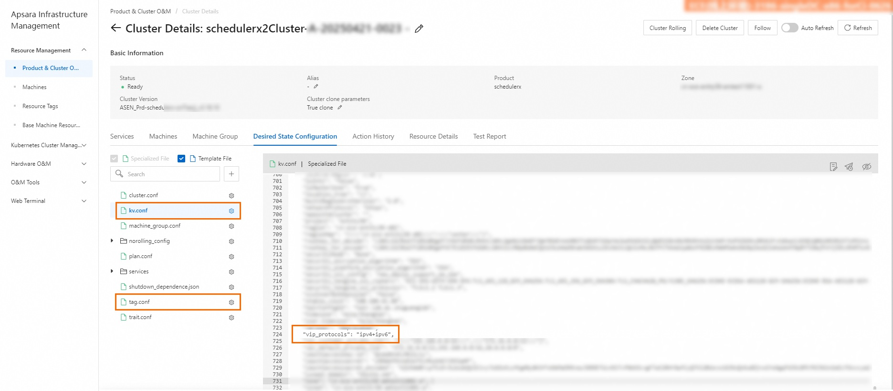

**Worker IPv6 Access**

1. You have created an application. For more information, see Application Management.

2. Package and upload the Worker program to an IPv6-enabled machine. Configure the Worker's  `application.yaml`  file and place it in the same directory as the program. For information about obtaining the  `domainName`  in the configuration, see Obtain SchedulerX DomainName.

   On the **Application Management** page, obtain the values for  `groupId`  and  `appKey` . For more information, see Application Management.

   ```text
   spring:
     schedulerx2:
       domainName: <your domainName>
       groupId: <your groupId>
       appKey: <your appKey>
   ```

   > **Note**
   >
   > By default, Spring Boot applications read the application.yaml file in the current program directory as the configuration file.

3. Start the program. To enable IPv6 networking, add  `-Djava.net.preferIPv6Addresses=true` to the command line parameters. Replace \`demo.jar\` with your actual program name.

   ```text
   java -Djava.net.preferIPv6Addresses=true -jar  demo.jar
   ```

   After startup, the logs in the log directory display IPv6 addresses.

   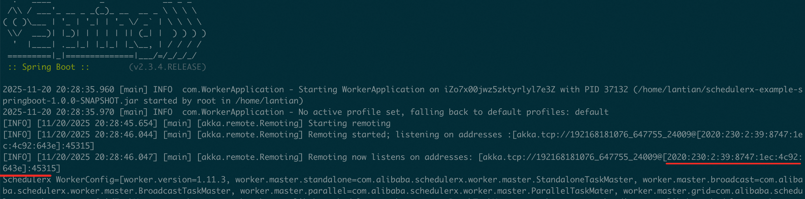

**Validate Results**

1. Log on to the SchedulerX console.

2. In the navigation pane on the left, click **Application Management**.

3. On the **Application Management** page, in the **Actions** column, click **Connect Machine** to query machine IP information.

   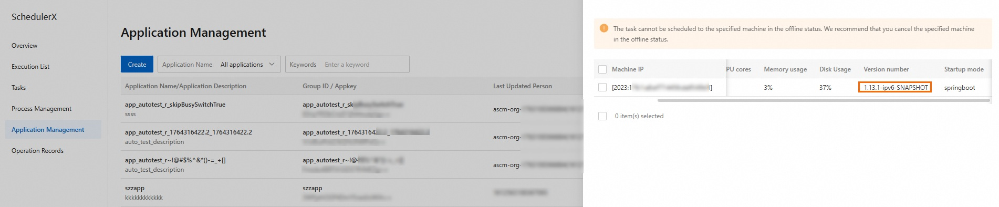

<a id="section-2-7"></a>

## 2.7. Client release history

This topic provides the release notes for the SchedulerX client SDK.

<a id="section-2-7-1"></a>

### 2.7.1. Java SDK

This topic describes the updates for the SchedulerX Java software development kit (SDK), which include new features, optimizations, and important bug fixes for each release.

**2025**

<table>
  <tr>
    <th>Version</th>
    <th>Change type</th>
    <th>Feature description</th>
    <th>Release date</th>
    <th>References</th>
  </tr>
  <tr>
    <td>1.13.1</td>
    <td>Bug fix</td>
    <td>• Fixed an issue where heartbeats were registered and reported prematurely in scenarios with Spring parent-child containers.<br>• Fixed an issue where Map tasks would stop abnormally during an upgrade from an earlier version to the new SDK.</td>
    <td>July 28, 2025</td>
    <td>None</td>
  </tr>
  <tr>
    <td>1.13.0</td>
    <td>New feature</td>
    <td>Added support for link encryption. For applications in the Professional Edition, sensitive data is encrypted during communication between the server and the client.</td>
    <td>June 18, 2025</td>
    <td>None</td>
  </tr>
  <tr>
    <td rowspan="2">1.12.7</td>
    <td>Optimiz ation</td>
    <td>• Refactored the placeholder logic for script tasks to resolve placeholder replacement failures caused by Spring conflicts.<br>• Upgraded the Spring version to 5.3.31 to fix security vulnerabilities.</td>
    <td rowspan="2">May 29, 2025</td>
    <td>None</td>
  </tr>
  <tr>
    <td>Bug fix</td>
    <td>• Fixed an issue where automatic retries for failed subtasks were not supported for shard 0 in broadcast tasks and sharded tasks.<br>• Fixed an issue where <code> context </code> retrieved an incorrect <code> triggerType </code> when a visualized MapReduce task was manually rerun.</td>
    <td>None</td>
  </tr>
  <tr>
    <td>1.12.5</td>
    <td>Optimiz ation</td>
    <td>Optimized Spring tasks to be compatible with scenarios where other components implement TaskScheduler.</td>
    <td>February 8, 2025</td>
    <td>None</td>
  </tr>
</table>

<table>
  <tr>
    <td rowspan="2">1.12.3</td>
    <td>New feature</td>
    <td>• Added support for configuring the SDK log directory.<br>• Add the startup command -Dschedulerx.log.path=log_root_p ath. The final path is <code>{schedulerx.log.path}/logs/s</code> <code>chedulerx </code>.<br>• Added support for overwriting the default Logback configuration for SDK framework logs. You can also output logs to your own Simple Log Service (SLS) repository.<br>• You can write to your own Logstore using SLS configurations.</td>
    <td rowspan="2">January 3, 2025</td>
    <td rowspan="2">None</td>
  </tr>
  <tr>
    <td>Optimiz ation</td>
    <td>• Optimized Spring tasks to be compatible with Spring 6.x.<br>• Fixed an H2 `DriverClass Not Found` exception that occurred when the driver class was not configured for the application Java Database Connectivity (JDBC).<br>• Fixed an issue where Map tasks failed due to concurrency problems during status checks.</td>
  </tr>
</table>

**2024**

**Chang**

**Version**

**Feature description**

**Release date**

**References**

**e type**

- Fixed security vulnerabilities in visualized MapReduce tasks.

Optimiz

November 20,

1.12.2

None

ation

2024

- Fixed security vulnerabilities in some Akka interfaces.

- Added support for custom thread pool sizes for HTTP agent tasks.

- Added support for custom loggers for SchedulerX logs.

New

None

feature

- Added the @SchedulerX annotation. This annotation can work with the Spring @Scheduled annotation to

1.12.1

October 12, 2024

take over some of the Spring scheduled tasks.

Optimiz

- Removed the fastjson package to fix

  None

ation

security vulnerabilities.

- Optimized the log output of SLS.

- Fixed an issue where heartbeat reporting was affected when

Optimiz

multiple application groups failed to

1.11.5

June 17, 2024

None

ation

read configurations.

- Reduced the number of fault-tolerant retries for heartbeat timeout exceptions.

  For more information,

New

JobContext can now get the workflow

see

feature

ID.

JobContext parameter description.

1.11.4

March 20, 2024

- Reduced the SDK size by removing unused dependencies.

Optimiz

None

- Removed the unused Log4j2.xml file

ation

from the SDK to prevent log configuration conflicts.

Added support for getting task

New

parameters from environment

None

feature

variables.

New

Added support for application-level

None

feature

isolation.

February 20,

1.11.1

2024

- Fixed Netty security vulnerabilities.

- Fixed Logback security vulnerabilities.

Bug fix

None

- Fixed an issue where SchedulerX framework logs were not displayed due to log conflicts.

Added support for graceful shutdown. Before an application stops, it waits for

New

all running tasks to complete. This

None

feature

ensures that no services are interrupted during release and restart.

New

Added support for configuring the

None

feature

distribution rate of subtasks.

Added support for configuring a user and password.

For more information,

```text
 spring.schedulerx2.h2DatabaseU
```

see Connect

`ser` : Sets the user for the built-in

New

a Spring Boot

feature

H2 database.

application to SchedulerX

```text
 spring.schedulerx2.h2DatabaseP
```

2.0.

`assword` : Sets the password for the built-in H2 database.

Optimiz

Added support for isolation by

None

ation

application group.

Optimiz

Added support for distribution sorted

None

ation

by worker IP address.

- Added support for earlier versions of Spring 4.

Optimiz

None

ation

- The timed method for Spring tasks now supports any return value.

- Prevents the creation of duplicate heartbeat threads when the Spring container is reinitialized.

Optimiz

None

ation

- Added support for automatic restarts when an Akka Actor terminates unexpectedly.

1.10.14

January 2, 2024

- Fixed an issue where an exception was returned immediately after Spring failed to read a processor bean.

- Fixed an issue introduced in version 1.10.x where Map tasks would get stuck.

- Fixed an issue where a task instance could not be terminated after the  `preProcess`  method of a broadcast task failed to execute.

- Fixed an issue where a task timeout alert was triggered by residual

Bug fix

None

threads when a task instance terminated abnormally.

- Fixed an issue where task status could be lost and tasks could get stuck after an application started in shared thread pool mode.

- Fixed a configuration loading exception that occurred when multiple application groups or appKeys contained special characters.

- Fixed an issue where Professional Edition features for visualized Map tasks could not be used.

**2023**

**Chang**

**Version**

**Feature description**

**Release date**

**References**

**e type**

Added support for standard and custom templates.

- Standard template: You can modify the image and image pull policy.

- Custom template: Compatible with

New

None

native Kubernetes content. The

feature

schedulerx2-plugin-kubernetes must be version 1.0.5 or later.

Map tasks now support starting

1.9.6

July 4, 2023

distribution from a random position. To enable this, set the

New

None

spring.schedulerx2.mapMasterDispatc

feature

hRandom parameter to  `true` . The default value is \`false\`.

Shell tasks now support common built-in system parameters.

New

- \`schedule.timestamp\`: The time

  None

feature

when the task is scheduled.

- \`data.timestamp\`: The data timestamp for the scheduling.

Adjusted the execution thread model.

- The model is switched to the non-shared thread pool mode.

- Parameters for the shared thread pool model.

  ```text
   spring.schedulerx2.shareCont
  ```

  `ainerPool=true` : Enables the

New

shared thread pool.

None

feature

```text
 spring.schedulerx2.sharePool
```

`Size=32` : The global size of the shared thread pool. Default: 64.

```text
 spring.schedulerx2.sharePool
```

`QueueSize=20480` : The queue size of the shared thread pool. Default: \`Integer.MAX_VALUE\`.

The following parameters are added.

```text
 spring.schedulerx2.broadcastMa
```

`sterExecEnable=false` : Specifies whether the master node

New

participates in broadcast task

None

feature

execution. Default: true.

```text
 spring.schedulerx2.broadcastDi
```

`spatchRetryTimes=5` : The number of retry attempts for broadcast distribution.

Optimized the performance of Map

Optimiz

tasks during large-scale application

None

ation

publishing and scale-in.

Optimized the timing of heartbeat reporting at application startup to

Optimiz

prevent long task processing times

None

ation

caused by slow application container startup.

September 8,

1.8.13

2023

- Fixed an issue where tasks were rejected after running for a long time in shared thread pool mode.

- Fixed an issue where null pointer logs occasionally appeared during task status reporting.

- Fixed an issue where the number of threads for broadcast tasks continuously increased in versions later than 1.7.x.

- Fixed a memory leak in shared thread pool mode.

- Fixed an issue where dynamic proxy objects could not execute the Reduce method.

- Fixed an issue where acknowledgements for second-level tasks were lost during merging.

- Fixed an exception that occurred

Bug fix

None

when Diamond read environment addresses.

- Fixed an issue with long heartbeat timeouts when connecting to the public cloud.

- Fixed alerts related to the log4j log format.

- Fixed an issue where standalone tasks would get stuck if a distribution exception occurred.

- Fixed an issue where new versions were not compatible with the \`ClassName:BeanId\` configuration mode.

- Modified the maximum file size limit for Logback standalone logs.

**2022**

**Chang**

**Version**

**Feature description**

**Release date**

**References**

**e type**

- Added support for integrating native Spring scheduled tasks.

New

None

feature

- Added support for integrating Tracing Analysis.

Optimiz

Enabled fast responses for client

None

ation

shutdown and offline operations.

1.7.10

August 30, 2022

- Fixed an out-of-memory issue caused by many SLS log outputs for high-frequency tasks.

Bug fix

None

- Fixed a delay issue that occurred when many second-level tasks ran concurrently.

Fixed an issue of high CPU usage by

1.6.1

Bug fix

the detection thread for second-level

August 3, 2022

None

broadcast tasks.

New

Added support for integrating

None

feature

Kubernetes Job scheduling.

- Processor classes are now compatible with Spring AOP proxy configurations.

1.6.0

June 24, 2022

- Optimized the content of ERROR log

Optimiz

messages that occasionally

None

ation

appeared in the monitoring timer for active workers.

- Added support for log collection for \`second_delay\` tasks.

Added support for dynamically

New

enabling or disabling Simple Log

feature

Service.

- Fixed an issue where version 1.5.0.x

1.5.1.1

April 19, 2022

None

was not compatible with Spring Boot 2.0.3.

Bug fix

- Fixed a potential JobSyncService bean initialization error in version 1.5.0.x.

Added support for declarative task definitions in Spring Boot. You can declare namespaces, applications, tasks, and alerts in configuration files

None

to manage tasks within an application. The file declarations can be modified, which lets you start applications in any environment with a single click.

New

1.5.0.2

April 1, 2022

feature

Visualized MapReduce tasks, formerly parallel computing, now support subtask-level lists, logs, and reruns.

None

You can also define custom tags for subtasks and search for subtasks by tag.

With the log service for SchedulerX 2.0, you can view the application logs for each task scheduling, including distributed tasks, in the console by

None

adding a Log4j or Logback configuration. No code changes are required.

New

1.4.2

March 7, 2022

feature

You can now view the stack of running tasks directly in the console to troubleshoot stuck tasks. To use this feature, upgrade your client to version

None

1.4.0 or later.

Added support for connecting to executors developed with ElasticJob.

- Added support for DataWorks tasks.

New

- Added  `schedulerx2-plugin-`

1.3.4

January 6, 2022

None

feature

`xxljob`  to be compatible with Xxl-job interfaces.

**2021**

**Chang**

**Version**

**Feature description**

**Release date**

**References**

**e type**

Optimized an issue by upgrading the

Optimiz

December 15,

1.3.2

default log4j2 dependency to version

None

ation

2021

2.15.0.

Enhanced second-level standalone tasks: Second-level standalone loops now support distribution and switching between different instances. For

New

Spring Boot applications, set the

feature

following parameter:

None

```text
 spring.schedulerx2.enableSecondD
```

`elayStandaloneDispatch=true` . The default value is  `false` .

Optimiz

Enabled fast responses for client

None

ation

shutdown and offline operations.

- Fixed an issue where instance heartbeats were reported only to the specified scheduling service when the client was connected to

  November 26,

1.3.0.3

multiple application groups.

2021

- Fixed issues with occasional thread interruptions and null pointer exceptions in second-level tasks.

- Fixed a compatibility issue where tasks would lock up and time out when the SchedulerX client was integrated with Spring Cloud.

- Fixed an issue where broadcast tasks were interrupted under

Bug fix

None

concurrent conditions.

- Fixed an issue where the worker instance list was not regularly refreshed during the execution of second-level tasks.

- Fixed an issue where the scan thread did not terminate after a stop instruction was executed for a second-level broadcast task.

- Fixed an issue where tasks had a probability of getting stuck during batch releases of many workers in second-level broadcast task scenarios.

Fixed an issue where tasks would lock

1.2.9.1

Bug fix

up and time out when the worker was

August 30, 2021

None

integrated with Spring Cloud.

Enhanced second-level standalone tasks: Second-level standalone loops now support distribution and switching between different instances. Set the

New

None

parameter

feature

```text
 spring.schedulerx2.enableSecondD
```

`elayStandaloneDispatch=true` . The default value is  `false` .

1.2.9

August 27, 2021

Fixed an issue where broadcast tasks received an interrupt signal under

Bug fix

None

concurrent conditions and the worker instance list was not updated.

Fixed an issue where the scan thread did not terminate after a stop

1.2.8.3

Bug fix

August 13, 2021

None

instruction was executed for a second-level broadcast task.

Fixed an issue where tasks had a probability of getting stuck during

1.2.8.2

Bug fix

August 6, 2021

None

batch releases of many workers in second-level broadcast task scenarios.

- Enhanced broadcast tasks: The postProcess method can now get the execution status of all machines from

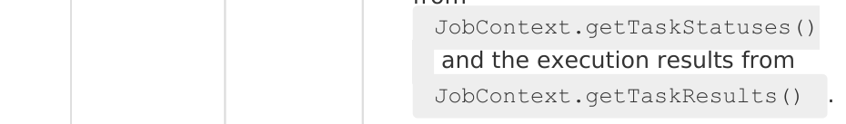

New

- Broadcast sharding model:

1.2.8

June 23, 2021

None

feature

Broadcast tasks can get  `shardingNum`  and  `sharingId` from JobContext to perform distributed data processing based on the machine's index.

- Enhanced sharding model: JobContext can get the total number of shards from  `shardingNum` .

New

Added a switch to disable the failover

None

feature

feature.

- Fixed a potential socket leak caused

1.2.7

April 28, 2021

by heartbeat check failures.

- Fixed an issue where the MapTask

Bug fix

None

Master might frequently trigger false failovers when there were many subtasks.

New

The interval for second-level tasks now

None

feature

supports millisecond-level precision.

- In the MapReduce model, the root task is now fixed to run on the master node to simplify

Optimiz

troubleshooting.

ation

None

1.2.5.2

April 8, 2021

- Removed the strong dependency on log4j2. If you use Logback, you can remove the log4j and log4j2 dependencies.

<table>
  <tr>
    <td rowspan="2">1.2.4.3</td>
    <td>New feature</td>
    <td>• Added support for progress reporting for running broadcast tasks.<br>• Heartbeat logs can now be disabled with a switch.</td>
    <td rowspan="2">January 21, 2021</td>
    <td>None</td>
  </tr>
  <tr>
    <td>Bug fix</td>
    <td>• The heartbeat interval is adjusted to 10 seconds.<br>• Fixed a critical issue where broadcast tasks could get stuck.</td>
    <td>None</td>
  </tr>
</table>

**2020**

**Chang**

**Version**

**Feature description**

**Release date**

**References**

**e type**

Fixed an issue where high client load

Optimiz

could cause the persistent connection

December 16,

1.2.3.1

None

ation

for task scheduling to fail, preventing

2020

further task scheduling.

- Added support for collecting the actual CPU usage of a container. You need to add configurations. For example, for a starter, add spring.schedulerx2.enableCgroupMe trics=true and

  ```text
   spring.schedulerx2.cgroupPathP
  ```

  `refix=/sys/fs/cgroup/cpu/` . The \`cgroupPathPrefix\` parameter is optional. If the container has the \` `/sys/fs/cgroup/cpu/` \` path,

New

you do not need to configure it.

None

feature

Otherwise, change it to the actual cgroup path.

- Added support for tags. You can add custom tags when the client starts.

  December 10,

1.2.2.2

For example, for a starter, add

2020

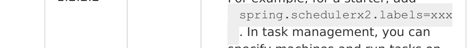

specify machines and run tasks on instances with a specific tag. This is useful for scenarios such as grayscale releases and unitization.

- Separated the client heartbeat thread and the Akka core thread to ensure that high application load

Optimiz

does not affect heartbeat checks.

None

ation

- Removed h2 from the shade. Shading h2 might cause MySQL driver loading to fail.

- Added support for a shared ContainerPool. All tasks on the client can share the same thread pool, which greatly improves client performance and stability when scheduling many tasks with high concurrency.

- Shaded Scala to resolve Scala conflicts.

- Added support for appKey authentication for the public cloud.

New

None

feature

- Enhanced the MapReduce model to support configuring whether the Reduce method is executed only after all subtasks succeed.

- The client now supports setting the

1.2.1.2

`appKey`  using  `-`

October 20, 2020

`Dschedulerx.appKey` .

Optimiz

Optimized the client Netty thread pool.

None

ation

- Fixed an issue where broadcast tasks could get stuck.

Bug fix

None

- Fixed an issue where the AccessKey ID or AccessKey secret for the SLS feature could be leaked.

- An application now supports more than 100,000 tasks. This feature is available only on the public cloud.

- Added a switch for client logs. It is enabled by default.

New

None

feature

- You can now set the status when creating a task using OpenAPI.

- Removed dependencies on diamond-client, logger.API, and log4j.

1.2.0.2

August 19, 2020

- Fixed an issue where the client would lose connection with the server during network disconnection

Bug fix

None

drills.

- EDAS applications could not read the AccessKey secret.

<table>
  <tr>
    <td rowspan="2">1.1.4.REL EASE</td>
    <td>New feature</td>
    <td>• Added support for custom namespaces.<br>• Added support for initializing multiple SchedulerxWorker instances.<br>• Enhanced the MapReduce model.<br>• The Reduce method can be executed even if a subtask fails.<br><code>• JobContext.getTaskStatuses</code> can determine the status of each task. In the <code> Map&lt;Long, </code> <code>TaskStatus&gt; </code> struct, the key is the task ID and the value is the task status.</td>
    <td rowspan="2">May 15, 2020</td>
    <td>None</td>
  </tr>
  <tr>
    <td>Bug fix</td>
    <td>• A null pointer exception occurred if the result in <code> ProcessResult </code> was empty.<br>• Tasks would get stuck if <code> thread-</code><code>dispatcher-delivery </code> was suspended.</td>
    <td>None</td>
  </tr>
  <tr>
    <td rowspan="2">1.1.2.REL EASE</td>
    <td>New feature</td>
    <td><code>shade protobuf and netty from</code> <code>AccessKey IDka </code>, which resolves over 90% of JAR package conflicts.</td>
    <td rowspan="2">February 10, 2020</td>
    <td>None</td>
  </tr>
  <tr>
    <td>Optimiz ation</td>
    <td>AppKeys do not support multiple groups.</td>
    <td>None</td>
  </tr>
</table>

**2019**

**Chang**

**Version**

**Feature description**

**Release date**

**References**

**e type**

- Added support for a multi-language sharding model similar to  `elastic-job` . For more information, see Multi-language sharding model.

New

- When you create a group using

  None

feature

OpenAPI, an AppKey can be returned.

- Added support for rerunning tasks with a successful status. Rerunning a task instance in a workflow also reruns its downstream tasks.

- Optimized server performance by changing the communication with the client from synchronous to

  December 17,

1.1.0

asynchronous and optimizing the

2019

default Akka  `dispatcher` configuration.

Optimiz

None

ation

- Using client version 1.1.0 improves heartbeat performance by three times.

- Redesigned the task management list on the frontend to display more information.

- Fixed an issue where global subtasks might not work in the distributed pull model.

Bug fix

None

- Fixed an issue where startup might fail in an isolated environment if a domain was not configured.

- Added the  `BlockAppStart` configuration. It specifies whether to block the application startup if SchedulerX fails to start. The default value is  `true` .

New

- Added an API operation to query the

  None

feature

running status of a workflow. The API operation is  `GetWorkflowInstanceRequest` .

- Added the \`jobName\` field to the JobContext context. This lets users get the task name during runtime.

- Deserializing  `BigDecimal`  using Hessian returned 0.

- An error occurred when deserializing `LocalDateTime`  using Hessian.

- Fixed an issue with the specify machines feature. If a task ran for a certain period, subtasks were sent to unspecified machines.

  November 28,

- The client's

1.0.9

2019

`springContext.getBean`  call throws the

```text
 AnnotationConfigApplicationCon
```

```text
text has not been refreshed 
```

`yet`  exception.

- Fixed an issue where an incorrect task implementation class configuration would trigger the Spring Boot ServletWebServer to stop. This caused the application process to continue running but the web service to be shut down.

Bug fix

- Fixed an issue where tasks would

  None

  get stuck if the system startup variable was  `user.dir='/'` .

- The client call to  `springContext.getBean`  reports an

  ```text
    AnnotationConfigApplicationCon
  text has been closed already 
  ```

  exception.

- Fixed a low-probability issue where duplicate worker IDs were generated by the client, causing tasks to be triggered on machines of other applications.

- Spring applications could not use a custom  `class loader` .

- The counter for second-level broadcast tasks was displayed incorrectly.

- For second-level tasks,

  ```text
   jobContext.getScheduleTime 
  ```

  was not updated with the loop.

- 【Important】Refactored the

  ```text
   JobProcessor.postProcess 
  ```

  interface and added the  `ProcessResult`  return value. If you used the  `postProcess` interface before, you need to modify your code.

- Enhanced broadcast execution.  `BroadcastJobProcessor`  now supports  `preProcess`  and  `postProcess` . The  `preProcess`  method is executed once before all machines execute the  `process`  method. The

New

`postProcess`  method is

None

feature

executed once after all machines execute the process method.

```text
 JobContext.getTaskAttempt 
```

can now get the current number of retries for a subtask.

- The client now supports custom listener ports, such as  `SchedulerxWorker.setPort` .

- Java tasks can now implement  `JobProcessor`  and do not have to inherit  `JavaProcessor` .

1.0.8

August 6, 2019

- Fixed a bug where subtasks with  `TaskId=1`  did not support automatic retries.

- If the root task of a distributed task

Bug fix

None

failed, the failure reason could not be viewed.

- Subtasks could not be retried from the subtask list of a parallel task.

This is a compatible version for the  `schedulerx1.0(DTS)`  interface. It does not support depending on both the  `schedulerx-client`  and  `schedulerx-worker`  packages at the same time. You can only depend on the  `schedulerx-worker`

1.0.6-

package. This means you need to

Optimiz

compatib

migrate all DTS tasks to SchedulerX

July 2, 2019

None

ation

le

2.0.

- Added shade for some packages:

  ```text
   aliyun-log, commons-
  ```

```text
validator, gson, fastjson, 
```

`guava, commons-collections` .

- If you return

  ```text
   ProcessResult(false, 
  ```

  `errorMsg)` , the  `errorMsg`  can also be seen in the frontend logs.

New feature

Optimization

- Optimized the performance of  `at-`

  > 

  `least-once-delivery` .

  > **Note**
  >
  > The

- In high-load scenarios, repeated

  > version

  message sending would cause

  > number

  second-level tasks to get stuck or

  > displaye

  application threads to be

  > d in the

  interrupted.

  > console for this

1.0.6

July 2, 2019

> release

- Broadcast tasks become stuck.

  > is 1.0.4, which is

- Fixed an issue where second-level

  > different

  tasks would get stuck.

  > from the

- `at-least-once-delivery`  could

  > Maven version

  cause infinite retries of subtask

  > number.

  statuses.

- If  `logcollector`  failed to

Bug fix

initialize, an exception was thrown and the startup failed.

- Fixed an issue where cleaning up workflow task instances from the DB caused the workflow to fail to resume scheduling.

- The kill command was not supported for Spring-based startups.

- The MapReduce model now supports returning the results of all subtasks to be processed by the Reduce method.

- The distributed model now supports a pull model. This resolves the bottleneck effect caused by single-machine performance and supports dynamic scale-out to pull subtasks.

- The pull model supports global subtask concurrency for rate limiting.

- Added  `wfInstanceId`  to

New

JobContext.

None

feature

- If the client fails to start, it throws an exception and blocks the JVM startup. This helps you identify problems early.

- When the client starts, it prints the versions and paths of Maven dependency JAR files to help you troubleshoot JAR package conflicts.

- The subtask details of the distributed model now include a queue dimension, which lets you see the cached subtask queue on each machine.

1.0.3

June 6, 2019

- If a worker was mistakenly quarantined due to high server load, it can now recover automatically without restarting the client.

- The subtask details of the distributed model can now show the actual number of running subtasks

Bug fix

None

on each machine.

- If a master node fails, the server cleans up the resources on the slave nodes to prevent memory leaks.

<table>
  <tr>
    <td>1.0.0</td>
    <td>New feature</td>
    <td>• Supports periodic timed scheduling using <code> crontab </code> and <code> fixed_rate </code> expressions.<br>• Supports workflow scheduling for flow orchestration.<br>• Supports second-level scheduling using the <code> second_delay </code> expression.<br>• Supports Java, Shell, Python, and Go task types.<br>• Supports standalone execution, broadcast execution, parallel computing, in-memory grid, and grid computing.<br>• Supports Map and MapReduce distributed programming models.<br>• Supports automatic retries for failed task instances and subtasks. Retries are disabled by default.<br>• Supports data timestamps and data refresh.</td>
    <td>April 30, 2019</td>
    <td>None</td>
  </tr>
</table>

<a id="section-3"></a>

# 3.Scheduling and triggers

<a id="section-3-1"></a>

## 3.1. Timed scheduling

Timed scheduling includes methods such as Cron, Second delay, and Fixed rate.

**Cron**

Cron is a time-based task management system for Unix-like operating systems. You can use Cron to run scheduled tasks, such as commands and scripts, at fixed times and intervals.

The expression format is **Second** **Minute** **Hour** **Day Of Month** **Month** **Day Of Week [Year]**.

The following are examples of common Cron expressions:

| Cron example | Description |
| --- | --- |
| <code>0 */1 * * * ?</code> | Triggers once every minute. |
| <code>0 0 5-15 * * ?</code> | Triggers on the hour from 5:00 to 15:00 every day. |
| <code>0 0/3 * * * ?</code> | Triggers every 3 minutes. |
| <code>0 0-5 14 * * ?</code> | Triggers every minute from 14:00 to 14:05 every day. |
| <code>0 0/5 14 * * ?</code> | Triggers every 5 minutes from 14:00 to 14:55 every day. |
| <code>0 0/5 14,18 * * ?</code> | Triggers every 5 minutes from 14:00 to 14:55 and from 18:00 to 18:55 every day. |
| <code>0 0/30 9-17 * * ?</code> | Triggers every half hour from 9:00 to 17:00 every day. |
| <code>0 0 10,14,16 * * ?</code> | Triggers at 10:00, 14:00, and 16:00 every day. |
| <code>0 0 12 ? * WED</code> | Triggers at 12:00 every Wednesday. |
| <code>0 0 17 ? * TUES,THUR,SAT</code> | Triggers at 17:00 every Tuesday, Thursday, and Saturday. |
| <code>0 10,44 14 ? 3 WED</code> | Triggers at 14:10 and 14:44 every Wednesday in March. |
| <code>0 15 10 ? * MON-FRI</code> | Triggers at 10:15 every weekday from Monday to Friday. |
| <code>0 0 23 L * ?</code> | Triggers at 23:00 on the last day of every month. |
| <code>0 15 10 L * ?</code> | Triggers at 10:15 on the last day of every month. |
| <code>0 15 10 ? * 6L</code> | Triggers at 10:15 on the last Friday of every month. |
| <code>0 15 10 * * ? 2005</code> | Triggers at 10:15 every day in 2005. |
| <code>0 15 10 ? * 6L 2002-2005</code> | Triggers at 10:15 on the last Friday of every month from 2002 to 2005. |
| <code>0 15 10 ? * 6#3</code> | Triggers at 10:15 on the third Friday of every month. |

**Second delay**

Second delay scheduling is designed for services that require high real-time performance. It schedules the next task to run after a delay of 1 to 60 seconds from the completion of the previous task. For example, you can configure a scheduled task to run 10 seconds after the previous execution completes.

**Fixed rate**

This method schedules tasks at a fixed frequency. The frequency is measured in seconds and must be 60 seconds or longer.

<a id="section-3-2"></a>

## 3.2. Workflow scheduling

Orchestrate tasks using visual workflows. You can trigger these workflows using cron expressions or APIs.

Jobs in a workflow do not have independent schedules. Instead, they follow the schedule of the workflow.

You can transfer data between upstream and downstream nodes in a workflow. For more information, see How to pass data between upstream and downstream nodes in a workflow.

To schedule a workflow, it must contain at least two Jobs with a dependency. If you have only one Job, use task management instead.

<a id="section-3-3"></a>

## 3.3. API trigger

You can use an API to trigger job scheduling.

For information on using the API trigger, see the **Integration Guide** section of the **SchedulerX Developer Guide**.

<a id="section-3-4"></a>

## 3.4. Backfill data

You can use the data backfill feature to re-trigger instances for a specific time range to backfill business data.

For instructions and examples, see Backfill data for scheduling tasks.

<a id="section-3-5"></a>

## 3.5. Second-level scheduling

Second-level tasks are ideal for services that require high real-time performance, such as near-real-time services that perform continuous polling. A memory grid and second-level scheduling enable you to continuously process massive amounts of data. Second-level tasks in SchedulerX are a type of timed scheduling. They support simple Java tasks, distributed Java tasks, script tasks, and various execution methods.

For more information, see How to create a second-level scheduling task.

<a id="section-4"></a>

# 4.Task types

<a id="section-4-1"></a>

## 4.1. Java tasks

You can run Java scheduled tasks in your application process. This topic describes how to manage Java tasks.

**Create a Java scheduled task**

For more information about how to create a scheduled task, see Create a scheduled task. This topic describes only the configurations that are specific to Java tasks.

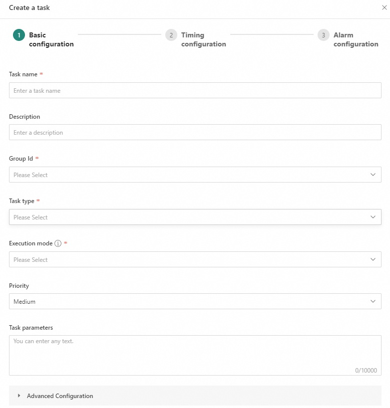

- **Task Type**: **java**.

- **Processor Class Name**: The fully qualified name of the implementation class, for example,  `com.apache.armon.test.schedulerx.processor.MySimpleJob` .

- **Execution Mode**: The Java job type supports six execution modes: **Standalone Execution**, **Broadcast** **Execution**, **Parallel Computing**, **In-memory Grid**, **Grid Computing**, and **Sharded Execution**. **Standalone Execution** and **Broadcast Execution** require you to implement JavaProcessor, while **Parallel Computing**, **In-memory Grid**, **Grid Computing**, and **Sharded Execution** require you to implement MapJobProcessor.

  - **Standalone**: A random machine with the same  `groupId`  executes the task.

  - **Broadcast**: All machines with the same  `groupId`  execute the task at the same time.

  - **Parallel Computing**: Supports fewer than 300 subtasks and provides a subtask list.

  - **In-memory Grid**: Performs memory-based computing. It supports fewer than 50,000 subtasks and offers high execution speeds.

  - **Grid Computing**: Performs file-based computing. It supports fewer than 1,000,000 subtasks.

  - **Sharding**: Distributes shards evenly across multiple clients for execution based on sharding parameters.

**Programming model**

Java tasks support two programming models: JavaProcessor and MapJobProcessor.

- JavaProcessor

  - **Optional:**  `public void preProcess(JobContext context)`

  - **Required:**  `public ProcessResult process(JobContext context) throws Exception`

  - **Optional:**  `public void preProcess(JobContext context)`

  - **Optional:**  `public void kill(JobContext context)`

- MapJobProcessor

  - **Required:**  `public ProcessResult process(JobContext context) throws Exception`

  - **Optional:**  `public void postProcess(JobContext context)`

  - **Required method:**  `public ProcessResult process(JobContext context) throws`

    ```text
    Exception 
    ```

  - **Optional:**  `public void kill(JobContext context)`

  - **Required:**  `public ProcessResult map(List<? extends Object> taskList, String`

    ```text
    taskName) 
    ```

**ProcessResult**

Each process method must return a ProcessResult object. This object indicates the status, result, and error message of the task execution.

- Task succeeded:  `return new ProcessResult(true)` .

- Task failed:  `return new ProcessResult(false, ErrorMsg)`  or throw an exception.

- Task succeeded and returns a result:  `return new ProcessResult(true, result)` . The  `result`  is a string that cannot exceed 1,000 bytes.

**Example of a HelloSchedulerx2.0 task**

```java
@Component
public class MyProcessor1 extends JavaProcessor {

    @Override
    public ProcessResult process(JobContext context) throws Exception {
        // TODO
        System.out.println("Hello, schedulerx2.0!");
        return new ProcessResult(true);
    }
}            
```

**Example of a task that supports the kill feature**

```java
@Component
public class MyProcessor2 extends JavaProcessor {
    private volatile boolean stop = false;

    @Override
    public ProcessResult process(JobContext context) throws Exception {
        int N = 10000;
        while (!stop && N >= 0) {
            // TODO
            N--;
        }
        return new ProcessResult(true);
    }

    @Override
    public void kill(JobContext context) {
        stop = true;
    }

    @Override
    public void preProcess(JobContext context) {
        stop = false;  // If you use Spring to start the application, the bean is a singleton. You must use preProcess to reset the flag.
    }
}          
```

**Example of a batch processing task that uses the Map model**

```java
/**
 * Performs distributed batch processing on a single table:
 * 1. The root task queries a table to obtain the minimum and maximum IDs.
 * 2. The root task creates PageTask objects and distributes them using the map method.
 * 3. If a sub-node receives a PageTask object, it processes the data.
 *
 */
@Component
public class ScanSingleTableJobProcessor extends MapJobProcessor {
    private static final int pageSize = 100;

    static class PageTask {
        private int startId;
        private int endId;
        public PageTask(int startId, int endId) {
             this.startId = startId;
             this.endId = endId;
        }
        public int getStartId() {
              return startId;
        }
        public int getEndId() {
              return endId;
        }
    }

    @Override
    public ProcessResult process(JobContext context) {
        String taskName = context.getTaskName();
        Object task = context.getTask();
        if (isRootTask(context)) {
            System.out.println("start root task");
            Pair<Integer, Integer> idPair = queryMinAndMaxId();
            int minId = idPair.getFirst();
            int maxId = idPair.getSecond();
            List<PageTask> taskList = Lists.newArrayList();
            int step = (int) ((maxId - minId) / pageSize); // Calculate the number of pages.
            for (int i = minId; i < maxId; i+=step) {
                taskList.add(new PageTask(i, (i+step > maxId ? maxId : i+step)));
            }
            return map(taskList, "Level1Dispatch");
        } else if (taskName.equals("Level1Dispatch")) {
            PageTask record = (PageTask)task;
            long startId = record.getStartId();
            long endId = record.getEndId();
            // TODO
            return new ProcessResult(true);
        }

        return new ProcessResult(true);
    }

    @Override
    public void postProcess(JobContext context) {
        // TODO
        System.out.println("all tasks is finished.");
    }

    private Pair<Integer, Integer> queryMinAndMaxId() {
        // TODO: select min(id),max(id) from xxx
        return null;
    }

}
```

<a id="section-4-2"></a>

## 4.2. Script tasks

You can create a script task by writing a Shell, Python, or Go script.

**Connection types**

Script tasks support two connection types:

- Embedded in the application process

- A standalone agent installed from schedulerxAgent-1.1.0.tar.gz

**Creation method**

You can create a script task by writing a script when you create a scheduling task. For more information, see Create a scheduling task.

**Shell task example without parameters**

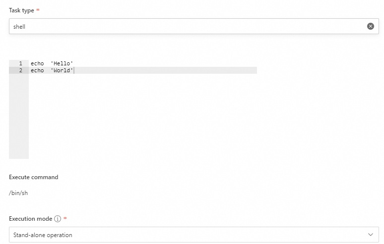

**Shell task example with parameters**

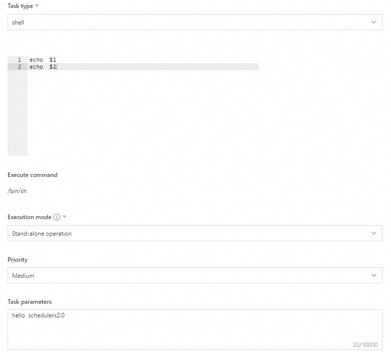

**Python task example**

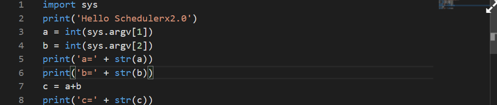

**Go task example**

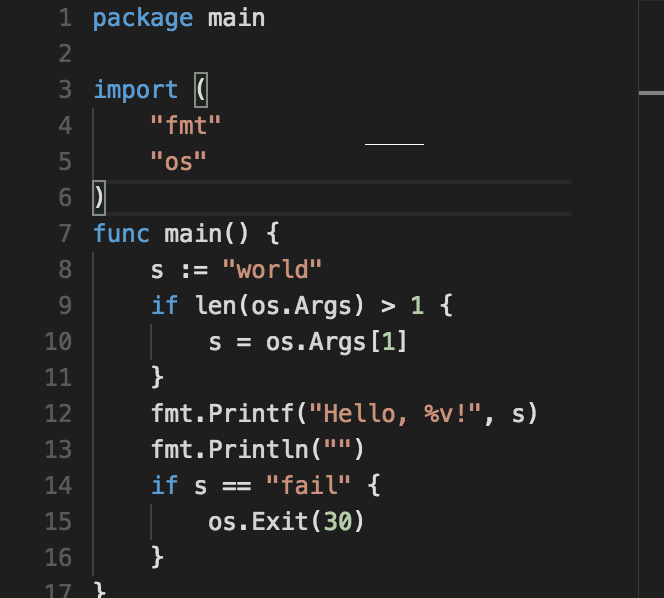

<a id="section-4-3"></a>

## 4.3. HTTP tasks

SchedulerX 2.0 supports HTTP tasks. You do not need a client. You can configure the task in the console.

**Limits**

- Only GET and POST requests are supported.

- The HTTP request must return a result in JSON format. The service parses a specified key to check whether the request is successful.

- Second-level tasks are not supported. The minimum supported interval is one minute.

**Task configuration**

For information about how to create a scheduling task, see Create a Scheduling Task. This topic describes only the configurations for HTTP tasks.

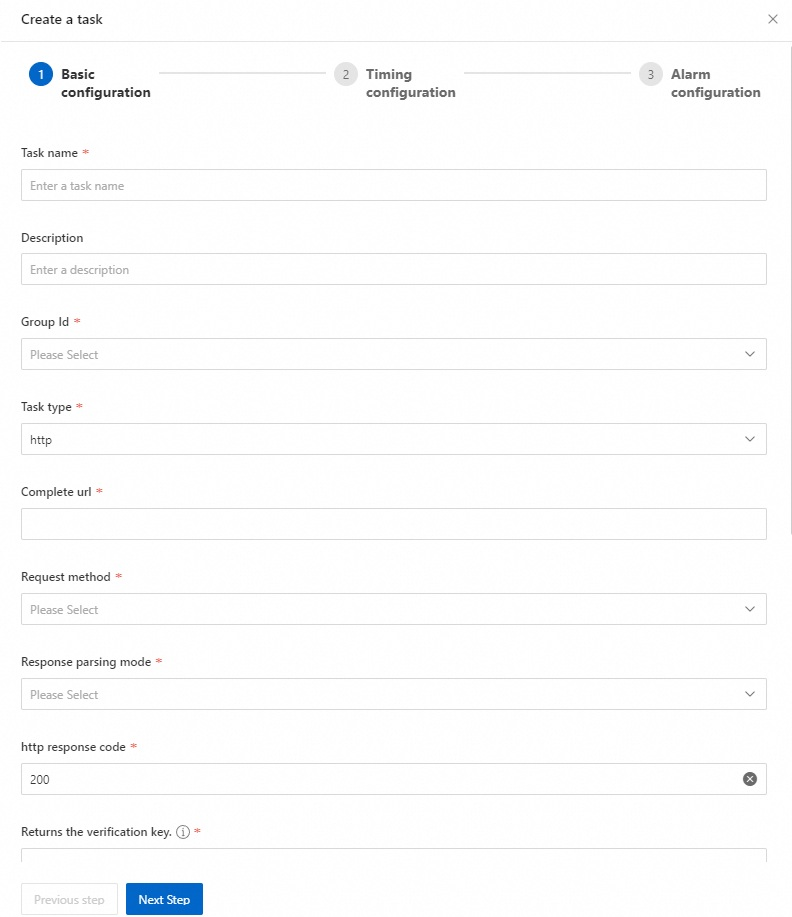

- **Tasktype**: Select http.

- **Full URL**: Enter the full URL, including  `http://` .

- **Response Validation Key** and **Response Validation Value**: By default, the service expects the HTTP request to return a result in JSON format. The service validates the success of the request based on the key and value that you enter. For example, you can validate that the value of the \`success\` key is \`true\` or that the value of the \`code\` key is \`200\`.

  ```text
  {
    code: 200,
    data: "true",
    message: "",
    requestId: "446655068791923614103381232971",
    success: true
  }
  ```

- **Execution Timeout**: The value can be from 0 to 30 seconds.

- **Cookie**: For example,  `key1=val1;key2=val2` . Use semicolons (;) to separate multiple values. The maximum length is 300 bytes.

**Code configuration**

The code configuration is different for GET and POST methods.

- GET

  ```text
  @GET
  @Path("hi")
  @Produces(MediaType.APPLICATION_JSON)
  public RestResult hi(@QueryParam("user") String user) {
      TestVo vo = new TestVo();
      vo.setName(user);
      RestResult result = new RestResult();
      result.setCode(200);
      result.setData(vo);
      return result;
  }
  ```

- POST

  ```java
  import com.alibaba.schedulerx.common.constants.CommonConstants;

  @POST
  @Path("createUser")
  @Produces(MediaType.APPLICATION_JSON)
  public RestResult createUser(@FormParam("userId") String userId, 
          @FormParam("userName") String userName) {
      TestVo vo = new TestVo();
      System.out.println("userId=" + userId + ", userName=" + userName);
      vo.setName(userName);
      RestResult result = new RestResult();
      result.setCode(200);
      result.setData(vo);
      return result;
  }
  ```

**Obtain task information**

HTTP tasks record basic task information in the HTTP header. To obtain this information, add the required dependency and code to your project.

1. Add the dependency to the pom.xml file.

   ```xml
   <dependency>
       <groupId>com.aliyun.schedulerx</groupId>
       <artifactId>schedulerx2-common</artifactId>
       <version>1.1.5-SNAPSHOT</version>
   </dependency>
   ```

2. Add the code to obtain task information.

   The following example shows how to obtain basic task information for a GET method.

   ```java
   import com.alibaba.schedulerx.common.constants.CommonConstants;

   @GET
   @Path("hi")
   @Produces(MediaType.APPLICATION_JSON)
   public RestResult hi(@QueryParam("user") String user,
           @HeaderParam(CommonConstants.JOB_ID_HEADER) String jobId,
           @HeaderParam(CommonConstants.JOB_NAME_HEADER) String jobName) {
       TestVo vo = new TestVo();
       vo.setName("armon");
       System.out.println("user=" + user + ", jobId=" + jobId + ", jobName=" + jobName);
       RestResult result = new RestResult();
       result.setCode(200);
       result.setData(vo);
       return result;
   }
   ```

   The following table lists the basic task information that you can obtain.

   | CommonConstants constant | Key | Value description |
   | --- | --- | --- |
   | JOB_ID_HEADER | schedulerx-jobId | The task ID. |
   | JOB_NAME_HEADER | schedulerx-jobName | The task name. The name must be in English because the header does not support Chinese characters. |
   | SCHEDULE_TIMESTAMP_HEADE R | schedulerx-scheduleTimestamp | The timestamp of the scheduling time. |
   | DATA_TIMESTAMP_HEADER | schedulerx-dataTimestamp | The data timestamp. |
   | GROUP_ID_HEADER | schedulerx-groupId | The application ID. |
   | USER_HEADER | schedulerx-user | The username. |
   | MAX_ATTEMPT_HEADER | schedulerx-maxAttempt | The maximum number of retries for the instance. |
   | ATTEMPT_HEADER | schedulerx-attempt | The current number of retries for the instance. |
   | JOB_PARAMETERS_HEADER | schedulerx-jobParameters | The task parameters. |
   | INSTANCE_PARAMETERS_HEAD ER | schedulerx-instanceParameters | The task instance parameters.This requires an API trigger. |

**Verify results**

On the **Execution List** page, you can query the execution results of the HTTP task.

If a task fails, click **Details** to view the cause of the failure. This topic describes possible failure scenarios:

- The return value does not match the expected value. The error message is:  `Unexpected return value val:{"code":-1,"data":{},"success":false,******}` .

- The execution timed out. Error message:  `Service request error: Read timed out` .

**Error alerts**

HTTP tasks support error alerts. You can configure alerts for exceptions, such as unexpected return values and execution timeouts, when you create a task.

<a id="section-5"></a>

# 5.Distributed programming model

<a id="section-5-1"></a>

## 5.1. Standalone

Standalone execution is a mode where a task instance is triggered on a single, randomly selected Worker. This mode supports all task types.

<a id="section-5-2"></a>

## 5.2. Broadcast

In a broadcast execution, a task instance is sent to all Workers in a group. The task is considered complete only after all Workers finish executing. If any Worker fails, the entire task fails.

**Scenarios**

- Batch operations

  - Periodically broadcast a script to execute on all machines.

  - Periodically broadcast a command to clear the cache on all machines.

- Data aggregation

  - You can use a JavaProcessor to reset the database count to 0 during the preProcess phase.

  - When each machine executes the process method, it increments the count in the database based on its memory or log values.

  - During the postProcess phase, you can read the count value from the database and pass it to a downstream task.

**Task types**

Various task types are available, such as script and Java tasks. Java tasks support advanced attributes, such as preProcess and postProcess.

To use a Java task, inherit from the JavaProcessor class (version 1.0.7 or later). The interface is as follows:

- **Required:** `public ProcessResult process(JobContext context) throws Exception`

- **Optional:** `public void preProcess(JobContext context)`

- **Optional:** `public ProcessResult postProcess(JobContext context)`

preProcess executes once before any machine executes the process method.

postProcess executes once after all machines have successfully executed the process method. It can return a result to pass data within a workflow.

**Demo**

```java
@Component
public class TestBroadcastJobProcessor extends JavaProcessor {

    @Override
    public ProcessResult process(JobContext context) throws Exception {
        System.out.println("this is process");
        return new ProcessResult(true);
    }

    @Override
    public void preProcess(JobContext context) {
        System.out.println("this is preProcess");
    }

    @Override
    public ProcessResult postProcess(JobContext context) {
        System.out.println("this is postProcess");
        return new ProcessResult(true, "hello broadcast");
    }

}
```

If you start three machines, the execution results are as follows:

- Worker 1

  ```text
  this is preProcess
  this is process
  this is postProcess
  ```

- Worker 2

  ```text
  this is process
  ```

- Worker 3

  ```text
  this is process
  ```

<a id="section-5-3"></a>

## 5.3. Map model

You can use the \`MapJobProcessor\` and call the \`map\` method to run distributed batch jobs for big data.

**Notes**

- Scheduler X does not guarantee that sub-tasks are executed only once. A failover can cause sub-tasks to run multiple times. You must implement idempotence in your service logic.

- Scheduler X uses the Hessian serialization framework. This framework does not support the **LocalDateTime** or **BigDecimal** data structures. If your sub-tasks use these data structures, you must replace them. For **BigDecimal**, serialization does not cause an error, but the value becomes 0 after it is deserialized.

**Interfaces**

| Interface | Description | Required |
| --- | --- | --- |
| <code>ProcessResult</code><br><code>process(JobContext</code><br><code>context)</code> | The entry point for the business logic of each sub-task. Get the taskName from the context to identify the sub-task and process its logic. After the task is executed, return a \`ProcessResult\`. For more information about the \`ProcessResult\` interface, see ProcessResult. | Yes |
| <code>ProcessResult map(List&lt;?</code><br><code>extends Object&gt; taskList,</code><br><code>String taskName)</code> | The \`map\` method distributes a batch of sub-tasks across multiple machines for execution. You can call the \`map\` method multiple times.If \`taskList\` is empty, the method fails. After the task is executed, return a \`ProcessResult\`. For more information about the \`ProcessResult\` interface, see ProcessResult. | Yes |
| <code>void kill(JobContext</code><br><code>context)</code> | This method is triggered when a task is killed from the console. You must implement the logic to break the business process. | No |

**Execution modes**

- Parallel computing: Supports up to 300 tasks and requires a list of sub-tasks.

  > **Important**
  >
  > Do not use parallel computing for tasks that complete within
  >
  > seconds.

- Memory grid: An in-memory computing mode. It supports fewer than 50,000 sub-tasks and provides high performance.

- Grid computing: A file-based computing mode. It supports up to 1,000,000 sub-tasks.

**Advanced configuration**

For more information about advanced configurations, see Advanced configuration parameters for task management.

**Demo: Send 50 messages (for Map model)**

```java
@Component
public class TestMapJobProcessor extends MapJobProcessor {

    @Override
    public ProcessResult process(JobContext context) throws Exception {
        String taskName = context.getTaskName();
        int dispatchNum = 50;
        if (isRootTask(context)) {
            System.out.println("start root task");
            List<String> msgList = Lists.newArrayList();
            for (int i = 0; i <= dispatchNum; i++) {
                msgList.add("msg_" + i);
            }
            return map(msgList, "Level1Dispatch");
        } else if (taskName.equals("Level1Dispatch")) {
            String task = (String)context.getTask();
            System.out.println(task);
            return new ProcessResult(true);
        }

        return new ProcessResult(false);
    }

}            
```

**Demo: Process data from a single table (for Map or MapReduce models)**

```java
@Component
public class ScanSingleTableJobProcessor extends MapJobProcessor {

    @Service
    private XXXService xxxService;

    private final int PAGE_SIZE = 500;

    static class PageTask {
        private long startId;
        private long endId;

        public PageTask(long startId, long endId) {
            this.startId = startId;
            this.endId = endId;
        }

        public long getStartId() {
            return startId;
        }

        public long getEndId() {
            return endId;
        }
    }

    @Override
    public ProcessResult process(JobContext context) throws Exception {
        // The backend code can be the same for multiple jobs. Configure the job parameter in the console to specify the table name.
        String tableName = context.getJobParameters(); 
        String taskName = context.getTaskName();
        Object task = context.getTask();
        if (isRootTask(context)) {
            Pair<Long, Long> idPair = queryMinAndMaxId(tableName);
            long minId = idPair.getFirst();
            long maxId = idPair.getSecond();
            List<PageTask> tasks = Lists.newArrayList();
            // Calculate the number of pages.
            int step = (int) ((maxId - minId) / PAGE_SIZE); 
            for (long i = minId; i < maxId; i+=step) {
                tasks.add(new PageTask(i, (i+step > maxId ? maxId : i+step)));
            }
            return map(tasks, "PageTask");
        } else if (taskName.equals("PageTask")) {
            PageTask pageTask = (PageTask)task;
            long startId = pageTask.getStartId();
            long endId = pageTask.getEndId();
            List<Record> records = queryRecord(tableName, startId, endId);
            // TODO: Handle records.
            return new ProcessResult(true);
        }

        return new ProcessResult(false);
    }

    private Pair<Long, Long> queryMinAndMaxId(String tableName) {
        // TODO: select min(id), max(id) from [tableName]
        return new Pair<Long, Long>(1L, 10000L);
    }

    private List<Record> queryRecord(String tableName, long startId, long endId) {
        List<Record> records = Lists.newArrayList();
        // TODO: select * from [tableName] where id >= [startId] and id < [endId]
        return records;
    }

}            
```

**Demo: Process sharded database and table data (for Map or MapReduce models)**

```java
@Component
public class ScanShardingTableJobProcessor extends MapJobProcessor {

    @Service
    private XXXService xxxService;

    private final int PAGE_SIZE = 500;

    static class PageTask {
        private String tableName;
        private long startId;
        private long endId;

        public PageTask(String tableName, long startId, long endId) {
            this.tableName = tableName;
            this.startId = startId;
            this.endId = endId;
        }

        public String getTableName() {
            return tableName;
        }

        public long getStartId() {
            return startId;
        }

        public long getEndId() {
            return endId;
        }
    }

    @Override
    public ProcessResult process(JobContext context) throws Exception {
        String taskName = context.getTaskName();
        Object task = context.getTask();
        if (isRootTask(context)) {
            // First, shard the databases.
            List<String> dbList = getDbList();
            return map(dbList, "DbTask");
        } else if (taskName.equals("DbTask")) {
            // Then, shard the tables based on the sharded databases.
            String dbName = (String)task;
            List<String> tableList = getTableList(dbName);
            return map(tableList, "TableTask");
        } else if (taskName.equals("TableTask")) {
            // If a sharded table is also large, perform paging.
            String tableName = (String)task;
            Pair<Long, Long> idPair = queryMinAndMaxId(tableName);
            long minId = idPair.getFirst();
            long maxId = idPair.getSecond();
            List<PageTask> tasks = Lists.newArrayList();
            // Calculate the number of pages.
            int step = (int) ((maxId - minId) / PAGE_SIZE); 
            for (long i = minId; i < maxId; i+=step) {
                tasks.add(new PageTask(tableName, i, (i+step > maxId ? maxId : i+step)))
;
            }
            return map(tasks, "PageTask");
        } else if (taskName.equals("PageTask")) {
            PageTask pageTask  (PageTask)task;
            String tableName = pageTask.getTableName();
            long startId = pageTask.getStartId();
            long endId = pageTask.getEndId();
            List<Record> records = queryRecord(tableName, startId, endId);
            // TODO: Handle records.
            return new ProcessResult(true);
        }

        return new ProcessResult(false);
    }

    private List<String> getDbList() {
        List<String> dbList = Lists.newArrayList();
        // TODO: Return the list of sharded databases.
        return dbList;
    }

    private List<String> getTableList(String dbName) {
        List<String> tableList = Lists.newArrayList();
        // TODO: Return the list of sharded tables.
        return tableList;
    }

    private Pair<Long, Long> queryMinAndMaxId(String tableName) {
        // TODO: select min(id), max(id) from [tableName]
        return new Pair<Long, Long>(1L, 10000L);
    }

    private List<Record> queryRecord(String tableName, long startId, long endId) {
        List<Record> records = Lists.newArrayList();
        // TODO: select * from [tableName] where id >= [startId] and id < [endId]
        return records;
    }

}            
```

<a id="section-5-4"></a>

## 5.4. MapReduce model

The MapReduce model is an extension of the Map model. It adds a Reduce interface and requires the implementation of \`MapReduceJobProcessor\`.

**Notes**

- The MapReduce model has a single Reduce method that runs after all subtasks are complete. You can use this method to return the execution result of the task instance, which is then passed as output data in the workflow. The Reduce method does not run if a subtask fails. If the Reduce method fails, the entire task instance fails.

- Scheduler X does not guarantee that a subtask runs only once. A failover can occur under certain conditions, which may cause the subtask to run multiple times. Therefore, you must implement idempotence for your services.

- Scheduler X uses the Hessian serialization framework. This framework does not support **LocalDateTime** or **BigDecimal**. If a subtask contains these data structures, you must replace them. For **BigDecimal**, serialization does not cause an error, but its value becomes 0 after deserialization.

**Interfaces**

| Interface | Description | Required |
| --- | --- | --- |
| <code>ProcessResult</code><br><code>process(JobContext</code><br><code>context)</code> | The entry point for the business logic of each subtask. Get the taskName from the context to identify the subtask and process its logic. After the task runs, return a \`ProcessResult\`.For more information about the \`ProcessResult\` interface, see ProcessResult. | Yes |
| <code>ProcessResult map(List&lt;?</code><br><code>extends Object&gt; taskList,</code><br><code>String taskName)</code> | Run the \`map\` method to distribute a batch of subtasks across multiple machines. You can run the \`map\` method multiple times. If \`taskList\` is empty, the method fails. After the method runs, return a \`ProcessResult\`. For more information about the \`ProcessResult\` interface, see ProcessResult. | Yes |
| <code>void kill(JobContext</code><br><code>context)</code> | Killing a task in the frontend triggers this method. You must implement the logic to break your business process. | No |

**Execution modes**

- Parallel computing: Supports up to 300 tasks and includes a subtask list.

  > **Important**
  >
  > Do not use parallel computing for tasks that run in seconds.

- Memory grid: Performs high-speed, in-memory computing and supports fewer than 50,000 subtasks.

- Grid computing: Performs file-based computing and supports up to 1,000,000 subtasks.

**Advanced configuration**

For more information about advanced configurations, see Advanced configuration parameters for task management.

**Demo: Send 500 messages (for the MapReduce model)**

```java
@Component
public class TestMapReduceJobProcessor extends MapReduceJobProcessor {

    @Override
    public ProcessResult process(JobContext context) throws Exception {
        String taskName = context.getTaskName();
        int dispatchNum=500;
        if (isRootTask(context)) {
            System.out.println("start root task");
            List<String> msgList = Lists.newArrayList();
            for (int i = 0; i <= dispatchNum; i++) {
                msgList.add("msg_" + i);
            }
            return map(msgList, "Level1Dispatch");
        } else if (taskName.equals("Level1Dispatch")) {
            String task = (String)context.getTask();
            System.out.println(task);
            return new ProcessResult(true);
        }

        return new ProcessResult(false);
    }

    @Override
    public ProcessResult reduce(JobContext context) throws Exception {
        return new ProcessResult(true, "TestMapReduceJobProcessor.reduce");
    }

}           
```

**Demo: Process data from a single table (for Map or MapReduce models)**

```java
@Component
public class ScanSingleTableJobProcessor extends MapJobProcessor {

    @Service
    private XXXService xxxService;

    private final int PAGE_SIZE = 500;

    static class PageTask {
        private long startId;
        private long endId;

        public PageTask(long startId, long endId) {
            this.startId = startId;
            this.endId = endId;
        }

        public long getStartId() {
            return startId;
        }

        public long getEndId() {
            return endId;
        }
    }

    @Override
    public ProcessResult process(JobContext context) throws Exception {
        // The backend code can be the same for multiple jobs. Use the console to configure the job parameter that specifies the table name.
        String tableName = context.getJobParameters(); 
        String taskName = context.getTaskName();
        Object task = context.getTask();
        if (isRootTask(context)) {
            Pair<Long, Long> idPair = queryMinAndMaxId(tableName);
            long minId = idPair.getFirst();
            long maxId = idPair.getSecond();
            List<PageTask> tasks = Lists.newArrayList();
            // Calculate the number of pages.
            int step = (int) ((maxId - minId) / PAGE_SIZE); 
            for (long i = minId; i < maxId; i+=step) {
                tasks.add(new PageTask(i, (i+step > maxId ? maxId : i+step)));
            }
            return map(tasks, "PageTask");
        } else if (taskName.equals("PageTask")) {
            PageTask pageTask = (PageTask)task;
            long startId = pageTask.getStartId();
            long endId = pageTask.getEndId();
            List<Record> records = queryRecord(tableName, startId, endId);
            //TODO: handle records
            return new ProcessResult(true);
        }

        return new ProcessResult(false);
    }

    private Pair<Long, Long> queryMinAndMaxId(String tableName) {
        //TODO: select min(id),max(id) from [tableName]
        return new Pair<Long, Long>(1L, 10000L);
    }

    private List<Record> queryRecord(String tableName, long startId, long endId) {
        List<Record> records = Lists.newArrayList();
        //TODO: select * from [tableName] where id>=[startId] and id<[endId]
        return records;
    }

}            
```

**Demo: Process sharded data (for Map or MapReduce models)**

```java
@Component
public class ScanShardingTableJobProcessor extends MapJobProcessor {

    @Service
    private XXXService xxxService;

    private final int PAGE_SIZE = 500;

    static class PageTask {
        private String tableName;
        private long startId;
        private long endId;

        public PageTask(String tableName, long startId, long endId) {
            this.tableName = tableName;
            this.startId = startId;
            this.endId = endId;
        }

        public String getTableName() {
            return tableName;
        }

        public long getStartId() {
            return startId;
        }

        public long getEndId() {
            return endId;
        }
    }

    @Override
    public ProcessResult process(JobContext context) throws Exception {
        String taskName = context.getTaskName();
        Object task = context.getTask();
        if (isRootTask(context)) {
            // First, perform database sharding.
            List<String> dbList = getDbList();
            return map(dbList, "DbTask");
        } else if (taskName.equals("DbTask")) {
            // Then, perform table sharding based on the database shards.
            String dbName = (String)task;
            List<String> tableList = getTableList(dbName);
            return map(tableList, "TableTask");
        } else if (taskName.equals("TableTask")) {
            // If a sharded table is also large, perform paging.
            String tableName = (String)task;
            Pair<Long, Long> idPair = queryMinAndMaxId(tableName);
            long minId = idPair.getFirst();
            long maxId = idPair.getSecond();
            List<PageTask> tasks = Lists.newArrayList();
            // Calculate the number of pages.
            int step = (int) ((maxId - minId) / PAGE_SIZE); 
            for (long i = minId; i < maxId; i+=step) {
                tasks.add(new PageTask(tableName, i, (i+step > maxId ? maxId : i+step)))
;
            }
            return map(tasks, "PageTask");
        } else if (taskName.equals("PageTask")) {
            PageTask pageTask = (PageTask)task;
            String tableName = pageTask.getTableName();
            long startId = pageTask.getStartId();
            long endId = pageTask.getEndId();
            List<Record> records = queryRecord(tableName, startId, endId);
            //TODO: handle records
            return new ProcessResult(true);
        }

        return new ProcessResult(false);
    }

    private List<String> getDbList() {
        List<String> dbList = Lists.newArrayList();
        //TODO: Return the list of database shards.
        return dbList;
    }

    private List<String> getTableList(String dbName) {
        List<String> tableList = Lists.newArrayList();
        //TODO: Return the list of table shards.
        return tableList;
    }

    private Pair<Long, Long> queryMinAndMaxId(String tableName) {
        //TODO: select min(id),max(id) from [tableName]
        return new Pair<Long, Long>(1L, 10000L);
    }

    private List<Record> queryRecord(String tableName, long startId, long endId) {
        List<Record> records = Lists.newArrayList();
        //TODO: select * from [tableName] where id>=[startId] and id<[endId]
        return records;
    }

}            
```

**Demo: Process 50 messages and have Reduce aggregate the subtask results (for the MapReduce model)**

```java
@Component
public class TestMapReduceJobProcessor extends MapReduceJobProcessor {

    @Override
    public ProcessResult process(JobContext context) throws Exception {
        String taskName = context.getTaskName();
        int dispatchNum = 50;
        if (context.getJobParameters() != null) {
            dispatchNum = Integer.valueOf(context.getJobParameters());
        }
        if (isRootTask(context)) {
            System.out.println("start root task");
            List<String> msgList = Lists.newArrayList();
            for (int i = 0; i <= dispatchNum; i++) {
                msgList.add("msg_" + i);
            }
            return map(msgList, "Level1Dispatch");
        } else if (taskName.equals("Level1Dispatch")) {
            String task = (String)context.getTask();
            Thread.sleep(2000);
            return new ProcessResult(true, task);
        }

        return new ProcessResult(false);
    }

    @Override
    public ProcessResult reduce(JobContext context) throws Exception {
        for (Entry<Long, String> result : context.getTaskResults().entrySet()) {
            System.out.println("taskId:" + result.getKey() + ", result:" + 
result.getValue());
        }
        return new ProcessResult(true, "TestMapReduceJobProcessor.reduce");
    }
}            
```

<a id="section-5-5"></a>

## 5.5. Multi-language sharding models

SchedulerX can schedule various tasks, such as timed scheduling, orchestration, and historical data reprocessing. To handle big data requirements, it provides multi-language sharding models for Java, Python, Shell, and Go.

**Background information**

Sharding models include static sharding and dynamic sharding.

- Static sharding: Processes a fixed number of shards. For example, you can use multiple machines to process 1,024 fixed tables in a sharded database.

- Dynamic sharding: Processes data of an unknown volume in a distributed manner. For example, you can run distributed batch jobs on a large, constantly changing table. The mainstream framework for this is the MapReduce model in SchedulerX 2.0, which is not yet open source.

**Features**

The multi-language sharding models have the following features.

- Compatible with the static sharding model of Elastic-Job.

- Supports four languages: Java, Python, Shell, and Go.

- High availability: The sharding model is based on the Map model and inherits its high availability (HA) features. If an exception occurs on a worker, the master worker fails the shard over to another slave node for execution.

- Traffic shaping: The sharding model is based on the Map model and inherits its traffic shaping features. This lets you control the concurrency of subtasks on a single machine. For example, if you have 1,000 shards and 10 machines, you can limit concurrent execution to a maximum of 5 shards. The remaining shards wait in a queue.

- Automatic retry on shard failure: The sharding model is based on the Map model and inherits its automatic retry feature for failed subtasks.

You can set availability and traffic shaping in the advanced configuration when you create a task. For more information, see Create a scheduling task and Advanced configuration parameters for task management.

> **Note**
>
> Only client versions 1.1.0 and later support the multi-language sharding models.

**Java sharding task**

1. Log on to the SchedulerX console.

2. In the left navigation pane, click **Task List**.

3. On the **Task List** page, click **Create**.

4. On the **Basic Information** page, set **Execution Mode** to **Shard** and configure the **Shard Parameters**.

   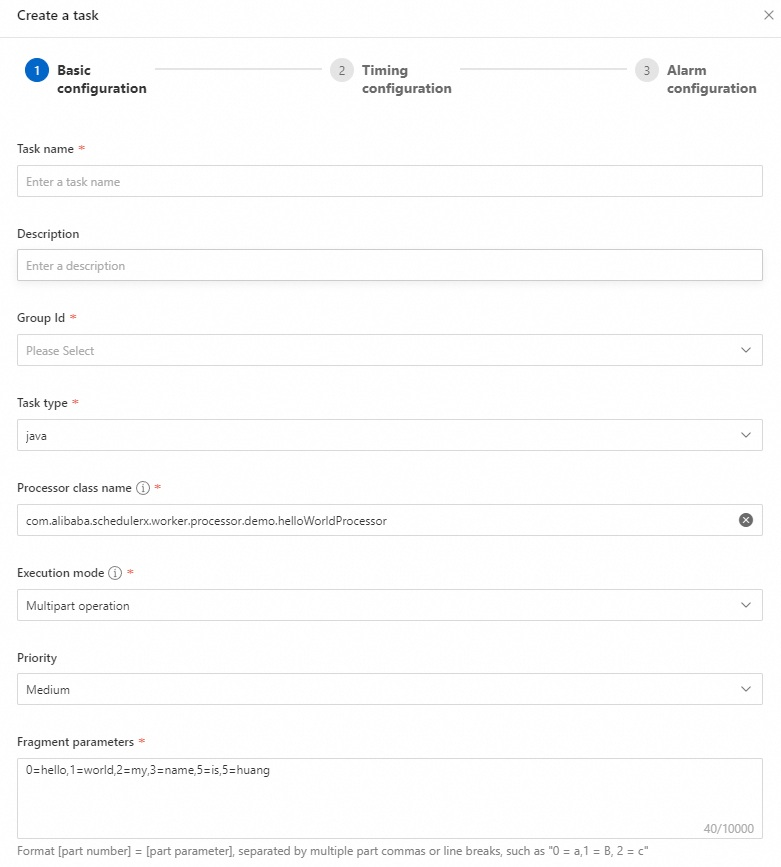

   The following table describes the parameters.

   | Parameter | Description |
   | --- | --- |
   | Task Name | A custom name for the task. |
   | Description | A custom description of the task. |
   | Group ID | The group to which the task belongs. Select one from the drop-down list. |
   | Task Type | The language of the task. For this scenario, select <strong>java</strong>. |
   | Processor Class Name | The full path of the JobProcessor class, for example, xxx.xxx.xxx.HelloProcessor. |
   | Execution Mode | The execution mode of the task. For this scenario, select <strong>Shard</strong>. |
   | Priority | The priority of the task. For this scenario, select the default value <strong>Medium</strong>. |
   | Shard Parameters | Set shard parameters to distribute shards evenly across multiple clients for execution.<br>Separate shard parameters with commas (,) or line breaks. For example, <code> shard ID 1=shard </code> <code>parameter 1,shard ID 2=shard parameter</code> <code>2,... </code>. |

5. In your application code, inherit  `JavaProcessor` . Use  `JobContext.getShardingId()`  to retrieve the shard ID and  `JobContext.getShardingParameter()`  to retrieve the shard parameter.

   Example:

   ```java
   @Component
   public class HelloWorldProcessor extends JavaProcessor {
       @Override
       public ProcessResult process(JobContext context) throws Exception {
           System.out.println("shardId=" + context.getShardingId() + ", 
   shardingParameter=" + context.getShardingParameter());
           return new ProcessResult(true);
       }
   }
   ```

6. View shard details.

   <ol type="i">

   <li>

   In the navigation pane on the left, click **Execution List**.

   </li>

   <li>

   On the **Execution List** page, click **Shard Details**.

   </li>

   </ol>

**Python sharding task**

To run distributed batch jobs for a Python application, install the agent. This allows SchedulerX 2.0 to maintain the scripts.

1. Download the SchedulerX agent and use it to deploy the script task. For more information, see Create a standalone script task using an agent.

2. Create a Python sharding task in SchedulerX 2.0. For more information, see Create a scheduling task.

   The script receives the shard ID as  `sys.argv[1]`  and the shard parameter as  `sys.argv[2]` .

   In the console, you can define the parameters for multiple shards by separating them with commas (,) or line breaks. For example:  `shard ID 1=shard parameter 1,shard ID 2=shard parameter 2,...` .

   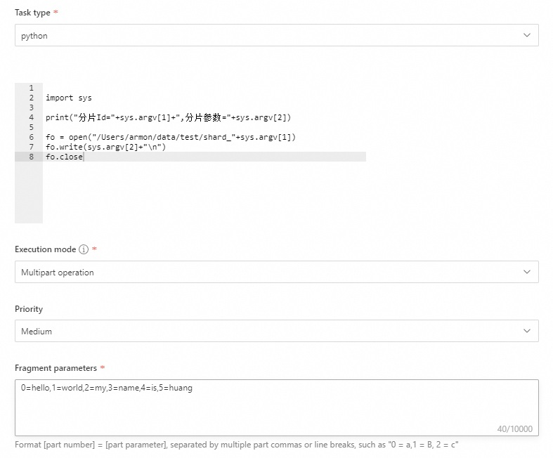

3. View shard details.

   <ol type="i">

   <li>

   In the navigation pane on the left, click **Execution List**.

   </li>

   <li>

   On the **Execution List** page, click **Shard Details**.

   </li>

   </ol>

**Shell and Go sharding tasks**

Shell and Go sharding tasks are similar to Python sharding tasks. For the creation steps, see Python sharding task.

<a id="section-6"></a>

# 6.Console user guide

<a id="section-6-1"></a>

## 6.1. Overview

The Overview page displays a summary of Jobs, task instances, and a list of failed instances.

**View Job Summary**

1. Log on to the SchedulerX console.

2. In the navigation pane on the left, click **Overview**.

3. On the **Overview** page, in the **Job Summary** area, view **Total Jobs**, **Enabled Jobs**, and **Disabled Jobs**.

**View Task Instance Summary**

1. Log on to the SchedulerX console.

2. In the navigation pane on the left, click **Overview**.

3. On the **Overview** page, in the **Task Instance Summary** area, select a **Time Range** to view **Total Task Instances**, **Running Task Instances**, **Failed Task Instances**, **Successful Task Instances**, **Pending Task Instances**, and **Task Instances in Pool**.

**View Failed Instance List**

1. Log on to the SchedulerX console.

2. In the navigation pane on the left, click **Overview**.

3. On the **Overview** page, in the **Failed Instance List** area, view **ID**, **Job Name**, **Job ID**, **Flow Instance ID**, **Group ID**, **Status**, **Start Time**, **End Time**, and **Operator**.

4. In the failed instance list, click **Details** in the \*\*Operation\*\* column for the target failed instance. In the **Basic Information** panel, view **Instance ID**, **Retries**, **Job ID**, **Job Name**, **Start Time**, **End Time**, **Scheduled Time**, **Data Timestamp**, **Server IP**, **Worker Address**, and **Result or Error Message**.

<a id="section-6-2"></a>

## 6.2. Execution List

Use the Execution List to view today’s task execution status. The list includes two tabs: Task Instances and Workflow Instances.

**View the Execution List**

> **Note**
>
> By default, SchedulerX retains the most recent 60 records for each task and workflow.

1. Log on to the SchedulerX console.

2. In the navigation pane on the left, click **Execution List**.

3. On the **Execution List** page, click the **Task Instances** tab or the **Workflow Instances** tab.

   By default, the page displays all execution records under **All Groups** and **All**.

   To filter records, select a specific task group and then filter by status: **All**, **Succeeded**, **Failed**, **Running**, **In Pool**, or **Waiting**. You can also search by task ID and time range. Enter the task ID in the text box next to **Task ID**, and select a time range.

**View Task Instance Details**

1. On the **Execution List** page, go to the **Task Instances** tab. Find the task you want to view. In the **Operation** column, click **Details**.

2. On the **Basic Information** page, view the following details: **Instance ID**, **Retry Count**, **Task ID**, **Task Name**, **Start Time**, **End Time**, **Scheduled Time**, **Data Timestamp**, **serverIp**, **workAddr**, and **Result or Error Message**.

3. On the **Basic Information** page, click **View Details** next to **Task ID** to view the task details. For more information, see Create a Scheduling Task.

4. On the **Task Instances** tab, perform actions based on the task status.

   - **Waiting**: Mark as succeeded.

   - **Failed**: Rerun or mark as succeeded.

   - **Running**: Stop or mark as succeeded.

   - **In Pool**: No action available.

   - **Succeeded**: Rerun.

**View Workflow Instance Details**

1. On the **Execution List** page, go to the **Workflow Instances** tab. Find the workflow you want to view. In the **Workflow Instance Graph** column, click the workflow instance ID link.

2. On the **Workflow Instance Details** page, view the workflow details in the **Workflow Canvas**.

   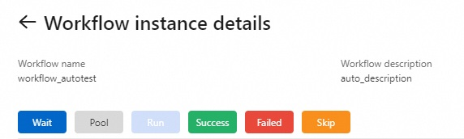

   Each task is color-coded by its execution status. For example, red indicates failure. Tasks that depend on it remain in the waiting state (blue).

3. Right-click a failed task. In the shortcut menu, click **Details** to view the failure reason.

4. After making changes, right-click the task again. In the shortcut menu, click **Rerun** to re-execute it.

   - If the task succeeds, downstream tasks run.

   - If you do not want to rerun the task, click **Mark as Succeeded** in the shortcut menu. This forces the task into the succeeded state, and downstream tasks start running.

<a id="section-6-3"></a>

## 6.3. Task List

On the Task Management page, you can create, edit, run, copy, enable, disable, import, export, and delete scheduling tasks. You can also refresh task data and assign specific machines to a task.

**Create a Scheduling Task**

> **Important**
>
> Before creating a task, make sure you have created a task group. For more information, see Create an Application Group.

1. Log on to the Distributed Task Scheduler console.

2. In the navigation pane on the left, click **Task List**.

3. On the **Task List** page, click **Create**.

4. On the **Basic Configuration** tab, set basic parameters for the scheduling task and optional **Advanced Configuration**. Then click **Next**.

   Parameter descriptions for basic configuration:

   | Configuration Name | Meaning | Default Value |
   | --- | --- | --- |
   | Task Name | The name of the task. | None |
   | Description | A brief description of the business logic. This helps with later searches. | None |
   | Group ID | The group that the task belongs to. Select from the drop-down list. | None |
   | Task Type | The implementation language of the task. The following five languages are supported:<br>• Java<br>• Shell<br>• Python<br>• Go<br>• HTTP<br>For Shell, Python, and Go, an editor appears. Write your task script in the editor. | None |
   | Processor Class Name | Appears only when you select <strong>Task Type</strong> as <strong>Java</strong>. Enter the full path of the JobProcessor class, such as xxx.xxx.xxx.HelloProcessor. | None |
   | Execution Mode | The mode used to execute the task. The following modes are supported:<br>• <strong>Standalone</strong>: Run on one randomly selected machine.<br>• <strong>Broadcast</strong>: Run on all machines at once and wait for all to finish.<br>• <strong>Parallel Computing</strong>: Map model. Supports up to 300 subtasks. Shows a subtask list.<br>• <strong>In-Memory Grid</strong>: Map model. Supports up to 50,000 subtasks. No subtask list. Fast execution.<br>• <strong>Grid Computing</strong>: Map model. Supports up to 1,000,000 subtasks. No subtask list.<br>• <strong>Sharding</strong>: Similar to Elastic-Job. Configure sharding parameters to distribute shards evenly across multiple clients. Supports multi-language versions.<br>Note<br>Advanced settings change based on the execution mode you select. | None |
   | Full URL | Enter the full URL, including <code> http:// </code>.<br>Note<br>Appears only when you select <strong>Task Type</strong> as <strong>HTTP</strong>. | None |
   | Request Method | Select <strong>GET</strong> or <strong>POST</strong>.<br>Note<br>Appears only when you select <strong>Task Type</strong> as <strong>HTTP</strong>. | None |
   | Response Parsing Mode | Select <strong>HTTP Status Code</strong>, <strong>Custom JSON</strong>, or <strong>Custom</strong> <strong>String</strong>.<br>Note<br>Appears only when you select <strong>Task Type</strong> as <strong>HTTP</strong>. | None |
   | HTTP Status Code | Set the HTTP status code that indicates success.<br>Note<br>Appears when you select Response Parsing <strong>Mode</strong> as <strong>HTTP Status</strong> <strong>Code</strong>. | 200 |
   | Return Verification Key | Supports only JSON-formatted return values. Enter the key that indicates success.<br>Note<br>Appears when you select Response Parsing <strong>Mode</strong> as <strong>Custom JSON</strong>. | None |
   | Return Verification Value | Return values are supported only in JSON format. If the request succeeds, the validated value is returned.<br>Note<br>Appears when you select Response Parsing <strong>Mode</strong> as <strong>Custom JSON</strong>. | None |
   | Custom String | Enter a keyword or phrase that indicates success.<br>Note<br>Appears when you select Response Parsing <strong>Mode</strong> as <strong>Custom String</strong>. | None |
   | Execution Timeout | Set the maximum time to wait for task execution. Valid values: 0 seconds to 30 seconds. | None |
   | Cookie | Add cookies to the request header. Separate multiple values with semicolons (;).Maximum length: 300 bytes. | None |
   | Execution Method | <strong>Agent</strong>: Deploy schedulerxAgent first. The client initiates the request and supports internal URLs.<br>Note<br>Supported only for client versions 1.8.2 and later. | agent |
   | Priority | • Low<br>• Chinese<br>• High<br>• Very High | Medium |
   | Task Parameters | Any string. Retrieve it at runtime from the context. | None |

   If advanced configuration is needed for your business, see Advanced Configuration Parameters for Task Management.

5. On the **Schedule Configuration** tab, set schedule parameters and optional advanced configuration. Then click **Next**.

   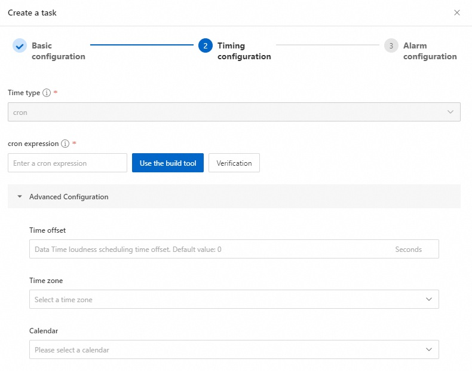

   Schedule parameter descriptions:

   | Configuration Name | Significance | Default Value |
   | --- | --- | --- |
   | Time Type | • <strong>None</strong>: No scheduling.Usually triggered by workflows.<br>• <strong>Cron</strong>: Cron expression.<br>• <strong>API</strong>: Triggered by API calls.<br>• <strong>Fixed Rate</strong>: Fixed frequency.<br>• <strong>Second Delay</strong>: Fixed delay in seconds. | cron |

   <table>
     <tr>
       <td>Time Expression</td>
       <td>Enter the time expression based on the time type:<br>• <strong>None</strong>: Not required.<br>• <strong>Cron</strong>: Enter a cron expression. Use standard cron syntax or generate and validate it using a tool.<br>• <strong>API</strong>: Not required.<br>• <strong>Fixed Rate</strong>: Enter the interval in seconds. For example, 65 runs the task every 65 seconds.<br>• <strong>Second Delay</strong>: Enter the delay in seconds. Valid range: 1 to 60 seconds. For example, 5 triggers the task after a 5-second delay.</td>
       <td>None</td>
     </tr>
   </table>

   When you select Cron as the time type, advanced configuration options appear. Advanced configuration parameter descriptions:

   | Configuration Name | Significance | Default Value |
   | --- | --- | --- |
   | Time Offset | The offset of the data timestamp relative to the scheduled time. Retrieve this value from the context during scheduling. | None |
   | Time Zone | Select a time zone based on your needs. Options include common countries and regions, and standard GMT formats. | None |
   | Calendar | Examples: custom scheduling calendar, skip weekends, skip specific dates. | None |

6. On the **Alert Configuration** tab, set alert parameters. Then click **Submit**.

   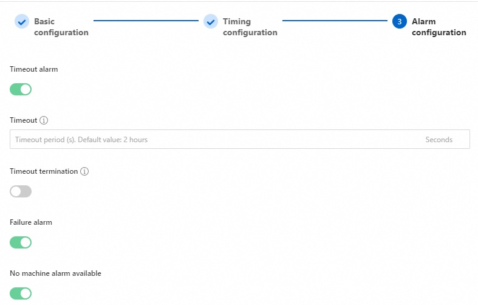

   Alert parameter descriptions:

   | Configuration Name | Meaning | Default Value |
   | --- | --- | --- |
   | Timeout Alert | • Open<br>• Shut down | Open |
   | Timeout Duration | Displays when timeout alerts are enabled. Set the duration in seconds before triggering an alert. | 2 hours |
   | Terminate on Timeout | Displays when timeout alerts are enabled. Automatically kills the task if it runs longer than the specified time.<br>• Open<br>• Shut down | Shut down |
   | Failure Alert | • Open<br>• Shut down | Open |
   | No Available Machine Alert | • Open<br>• Shut down | Open |

7. Return to the **Task Management** page. Check whether the task you just created appears and whether its parameters match your configuration.

   > **Note**
   >
   > After creation, a scheduling task is enabled by default. You can disable or re-enable it as needed. For more information, see Enable and Disable Scheduling Tasks.

**Edit a Scheduling Task**

1. On the **Task List** page, click **Edit** in the **Actions** column.

2. On the **Edit Task** page, configure parameters for **Basic Configuration**, **Schedule Configuration**, and **Alert Configuration**.

   > **Note**
   >
   > You cannot change the task group or task type while editing. For other parameters, refer to Create a Scheduling Task.

**Run a Scheduling Task Once**

On the **Task List** page, click **Run Once** in the **Actions** column to run the task immediately.

**Enable and Disable Scheduling Tasks**

- Enable or disable a single task

  <ol type="i">

  <li>

  On the **Task List** page, click **Actions**, then click **Enable/Disable** to enable or disable the scheduling task.

  </li>

  <li>

  In the **Confirm** dialog box, click **OK**.

  </li>

  </ol>

- Enable or disable multiple tasks

  - On the **Task List** page, select the target tasks.

  - Click **Batch Enable** or **Batch Disable** below the list. In the **Confirm** dialog box, click **OK**.

**Copy a Scheduling Task**

On the **Task Progress** page, click  in the Actions column, and then click **Copy** in the pop-

up menu. This copies the configuration of the scheduling task, and you can edit the copied task to create a new scheduling task.

**Refresh Scheduling Task Data**

If your business changes—for example, you add a field to your database or find errors in last month’s data—you can refresh task data to rerun tasks for a past time period.

> **Note**
>
> Both tasks and workflows support data refresh. Only day-level scheduling cycles are supported.

If data from a previous task run contains drift or gaps, reset the runtime parameters and run the task again to retrieve correct data.

1. On the **Task Management** page, click

   in the Actions column of the task list, and in the

   

   pop-up menu, click **Refresh Data**.

2. On the **Refresh Task** page, set **Start and End Time** and **Data Timestamp**. Then click **OK**.

   - **Start and End Date**: The time range for data refresh.

   - **Data Timestamp**: The timestamp used for each refresh within the time range.

   Example

   - Start and End Date: 2025-08-01 to 2025-08-03. Runs from 00:00:00 on August 1, 2025, to 23:59:59 on August 3, 2025.

   - Data Timestamp: 10:10:10

   The task runs three times, with these data timestamps:

   - 2025-08-01 10:10:10

   - 2025-08-02 10:10:10

   - 2025-08-03 10:10:10

**View Execution and Management Records**

- View execution records: On the **Task Progress** page, click  in the **Actions** column, and

  then click **History** in the pop-up menu to view the execution records of this scheduling task.

- View operation records: On the **Task List** page, click  in the **Actions** column, and then

  click **Operation Records** to view the management operation records for the scheduled task.

**Delete a Scheduling Task**

- Delete a single task

  <ol type="i">

  <li>

  On the **Task Progress** page, click

  in the **Actions** column. In the pop-up menu, click

  

  **Delete**.

  </li>

  <li>

  In the **Confirm** dialog box, click **OK**.

  </li>

  </ol>

- Delete multiple tasks

  - On the **Task List** page, select the target tasks.

  - Click **Batch Delete** below the list. In the **Confirm** dialog box, click **OK**.

**Import Tasks**

1. On the **Task List** page, click **Import** above the list.

2. In the **Import Task** dialog box, configure the following parameters. Then click **OK**.

   | Parameter | Description |
   | --- | --- |
   | Select Application ID | Select the application to import the task into. |
   | Same Task | • <strong>Overwrite</strong>: Replace an existing task with the same name or ID.<br>• <strong>Skip</strong>: Skip importing a duplicate task and keep the existing one. |
   | Import Task | Click theicon. Select the local file. Click<br><strong>Open</strong>. |

**Export task**

1. On the **Task List** page, click **Export** above the list.

2. In the **Export Task** dialog box, select an application ID. Then click **OK**.

   > **Note**
   >
   > By default, all tasks are exported.

3. In the dialog box that appears, click **Download**. View the downloaded tasks locally.

**Assign Machines to a Task**

1. On the **Task List** page, in the **Actions** column, click  , and in the pop-up menu, click

   **Specify Machine**.

2. In the **Machine List**, select machines. Then click **OK**.

   > **Note**
   >
   > If machine transfer is enabled, the task runs on non-assigned machines when all assigned machines go offline.

<a id="section-6-4"></a>

## 6.4. Workflow Management

SchedulerX supports cross-application task orchestration. You can orchestrate tasks from the same or different applications into a single workflow based on their execution logic.

**Create Workflow**

You can create workflow Scheduling Tasks.

> **Note**
>
> Currently, workflow scheduling supports only Cron expressions and API scheduling.

1. Log on to the SchedulerX console.

2. In the navigation pane on the left, click **Workflow Management**.

3. On the **Workflow Management** page, click **Create**.

4. On the **Create Workflow** page, set the following parameters and click **OK**.

   | Parameter | Description |
   | --- | --- |
   | Name | Customize the workflow name. |
   | Description | The description of the workflow. |
   | Group ID | Select an application group. If no application groups are available, refer to Application Management to create an application group. |
   | Time Type | Select <strong>Cron</strong> or <strong>API</strong>. |
   | Cron Expression | Note<br>This field appears when <strong>Time Type</strong> is set to <strong>Cron</strong>.<br>Enter a cron expression. You can also click to use the generation tool to automatically generate one. For more information, see Cron. |
   | Time Zone | Select a time zone as needed. Options include common countries or regions and standard GMT expressions. |
   | Instance Concurrency | The maximum number of instances a workflow supports. The default value is 1, and the maximum is 100,000,000. |
   | Calendar | Import a custom calendar. This lets you schedule tasks to run on specific dates, meeting particular business needs. |

5. In the workflow list, click the name of the workflow that you created, or click **Edit** in the **Actions** column.

6. On the **Workflow Details** page, click **Create Job** or **Import Job** to add scheduling tasks.

   - **Create Job**: The steps are the same as those for creating a scheduling task. For more information, see Create Scheduling Tasks.

   - **Import Job**: Import an existing Job into the workflow.

     > **Note**
     >
     > When you import a Job, a prompt appears: "Importing this Job will remove its scheduled configuration." Click **OK**. The Job will no longer be scheduled independently and will instead follow the workflow's scheduling cycle.

7. After you add the scheduling tasks, connect them with lines to define their dependencies and complete the workflow.

   In a workflow, you can pass data from upstream Jobs to downstream Jobs. For more information, see Passing data between upstream and downstream Jobs in a workflow.

   To delete a dependency between two tasks, select the connecting line, right-click it, and select **Remove**. To delete a task, right-click the scheduling task and click **Remove** in the shortcut menu. You can also click a task name and select **Edit** to modify the task.

   An example workflow is shown below:

   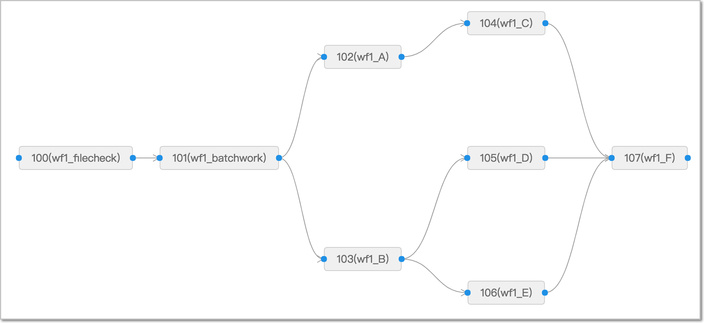

   In this workflow, after Job 101 finishes executing, Jobs 102 and 103 start executing simultaneously. After Jobs 104, 105, and 106 all execute successfully, Job 107 starts executing.

8. After you configure the workflow, click **Save Changes** and return to the **Workflow Management** page. In the **Actions** column for the target workflow, click **Run Once** to test it. After you confirm that it works correctly, click **Enable**. The workflow is then enabled and scheduled automatically.

**Enable/Disable Workflows**

1. On the **Workflow Management** page, click **Enable/Disable** in the **Actions** column to enable or disable the workflow.

2. In the **Confirm** dialog box, click **OK**.

**Modify Workflow**

1. On the **Workflow Management** page, click **Edit** in the **Actions** column.

2. On the **Workflow Details** page, click **Edit Workflow**.

3. In the **Edit Workflow** panel, modify the workflow parameters and click **OK**.

**Delete Workflow**

1. On the **Workflow Management** page, click the  icon in the **Actions** column and select

   **Delete**.

2. In the **Confirm** dialog box, click **OK**.

**View Workflow History and Operation Records**

- View execution records: On the **Workflow Management** page, click the  icon in the

  **Actions** column and select **History** to view the execution records of the workflow. For more information, see Execution list.

- View operation records: On the **Workflow Management** page, click the  icon in the

  **Actions** column and select **Operation Records** to view the management operation records for the workflow. For more information, see Operation records.

**Refresh Workflow Data**

If your business requirements change, such as adding a field to a database or discovering incorrect data from a previous month, you can re-run a workflow's tasks for a past period by refreshing the workflow data.

> **Note**
>
> Only day-level scheduling cycles are supported.

1. On the **Workflow Management** page, click the

   icon in the **Actions** column and select

   

   **Flush Data**.

2. On the **Refresh Data** page, set **Start and End Time** and **Data Timestamp**, and click **OK**.

   - **Start and End Date**: The time range for the data refresh.

   - **Data Timestamp**: The specific time for the data refresh within the specified time range.

   Example

   - Start and End Date: 2025-08-01 to 2025-08-03. By default, this specifies the period from 00:00:00 on August 1, 2025, to 23:59:59 on August 3, 2025.

   - Data Timestamp: 10:10:10

   The tasks in this workflow will be re-run three times, with the following data timestamps:

   - 2025-08-1 10:10:10

   - 2025-08-2 10:10:10

   - 2025-08-3 10:10:10

**Import Workflow**

1. On the **Workflow Management** page, click **Import** above the list.

2. In the **Import Workflow** dialog box, set the following parameters and click **OK**.

   | Parameter | Description |
   | --- | --- |

   <table>
     <tr>
       <td>Select Application ID</td>
       <td>Select the target application to import the workflow into.<br>Note<br>The application ID of the original workflow and the application IDs of tasks within the workflow must match the application ID of the new environment.</td>
     </tr>
     <tr>
       <td>Identical Tasks</td>
       <td>• <strong>Overwrite</strong>: If the target environment already has tasks with the same name or ID, the imported tasks will replace the existing tasks.<br>• <strong>Skip</strong>: If duplicate tasks are found, skip importing them and keep the existing tasks.</td>
     </tr>
     <tr>
       <td>Import Workflow</td>
       <td>Click theicon, select the local object file,<br>then click <strong>Open</strong>.</td>
     </tr>
   </table>

**Export Workflow**

1. On the **Workflow Management** page, click **Export** above the list.

2. In the **Export Workflow** dialog box, select the application ID and click **OK**.

3. In the pop-up dialog box, click **Download** to save the workflow file to your local machine.

<a id="section-6-5"></a>

## 6.5. Application Management

The Application Management page lets you create application groups, test machine connections, authorize RAM users, and delete unneeded groups.

**Create Application Group**

You can create an application group. The Group ID and AppKey for this group are configuration parameters that applications use to access task scheduling.

1. Log on to the SchedulerX console.

2. In the left navigation pane, select **Application Management**.

3. On the **Application Management** page, click **Create**.

4. On the **Create Application** panel, configure the following parameters on the **Basic Configuration** tab, and then click **Next**.

   | Parameter | Description | Default |
   | --- | --- | --- |
   | Applicatio n Name | Customize the application name. | None |
   | Group ID | The Group ID for application access. This value must be unique in the system; otherwise, creation fails. | None |
   | Descriptio n | Custom description. | None |
   | Load5 Threshold | Cannot exceed the number of available CPU cores on the client machine. | 0 |
   | Memory Usage | The average memory usage of the process over the last 5 minutes cannot exceed this threshold. If it does, the client machine is considered busy. | 90% |
   | Disk Usage | Disk usage cannot exceed this value. If it does, the client machine is considered unhealthy and busy. | 95% |
   | Allow triggers on busy machines? | Continue triggering client execution when the machine is busy. | Open |
   | Throttle | Select whether to enable throttling. If enabled, set the <strong>Task</strong> <strong>Instance Concurrency</strong>. | Disabled |
   | Task Instance Concurren cy | If throttling is enabled, this is the maximum number of task instances an application can run concurrently. Task instances exceeding this concurrency are not discarded; they wait in an application-level task queue for execution. | None |
   | Maximum Number of Tasks | The maximum number of tasks a group supports. The maximum task count cannot exceed 1000. | None |
   | Calendar | Import a custom calendar. Set scheduled tasks to run on specific dates to meet specific business needs. | None |

5. On the **Create Application** panel, select the **Alert Method** and add **Alert Contacts** on the **Notification Configuration** tab. Then, click **Submit**.

   | Configuration Item | Description | Example Value |
   | --- | --- | --- |
   | Alert Method | • DingTalk<br>• Email | DingTalk |
   | Add Alert Contact | Enter the <strong>Nickname</strong>, <strong>Email</strong>, and <strong>DingTalk access_token</strong>. | None |

   After the application group is created, you are automatically returned to the **Application Management** page. Find the application group and obtain its **Group ID** and **AppKey**.

**View Application Group Details**

After you create an application group, you can view its details.

1. On the **Application Management** page, in the group list, click **Details** in the **Actions** column.

2. You can view the application group's **Basic Configuration** and **Notification Configuration** on the **Details** panel.

**Connect Machines**

After an application connects to task scheduling, you can check if the scheduling task is successfully connected by connecting machines. To do this, follow these steps:

1. On the **Application Management** page, in the **Actions** column of the group list, click **Connect Machines**.

   > **Note**
   >
   > If the message "No available machines" appears and you are not directed to the **Connect Machines** page, the application's task scheduling connection failed.

2. On the **Connect Machines** page, view the list of client machines in this task group and the status of each client machine.

   - The number in parentheses after the client machine's IP address indicates how many SchedulerX clients are on that machine. Typically, there is one client, but a single machine supports multiple clients.

   - Client machines have two statuses: healthy and busy. By default, tasks are not sent to busy machines. This can cause tasks to fail if all connected machines are busy. To force tasks to be sent to busy machines, you can set the **Filter Busy Machines** switch to disabled in the alert configuration.

   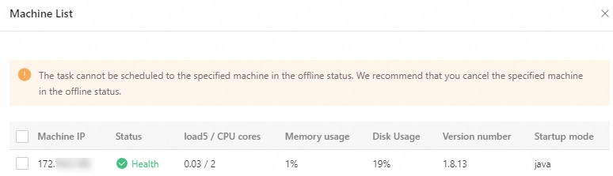

**Authorization**

An Alibaba Cloud account can authorize RAM users based on application groups. To do this, follow these steps:

1. On the **Application Management** page, in the group list, click

   in the **Actions** column.

   

   In the menu, click **Authorize**.

2. In the **Authorization Management** dialog box, select the RAM users to authorize from the left list. Click **>>** to add the RAM users to the right list. Then, click **Authorize**.

**Delete Application Group**

You can delete an application group after confirming that you will no longer create scheduling tasks through it. After deletion, all scheduling tasks associated with that group will no longer execute.

1. On the **Application Management** page, click **Delete** in the **Actions** column of the group list.

2. In the delete confirmation dialog box, click **OK**.

**Modify Application Group**

1. On the **Application Management** page, in the **Actions** column of the group list, click  .

   Then, click **Edit**.

2. On the **Edit Application** panel, you can modify the task group information.

**View Application Group Operation Records**

1. On the **Application Management** page, in the **Actions** column of the group list, click 

   and then select **Operation Records**.

2. You can view the application group's operation details on the **Operation Records** page. For more information, see the referenced document.

<a id="section-6-6"></a>

## 6.6. Operation records

The Operation records page lists the operation records for application groups, jobs, and flows.

**Procedure**

1. Log on to the SchedulerX console.

2. In the navigation pane on the left, click **Operation Records**.

3. On the **Operation Records** page, set **Type** to **Application Group**, **Task**, or **Flow**, enter the corresponding ID in the text box, and then click Search.

4. In the search results, view the operation records for the corresponding group, task, or flow.

<a id="section-7"></a>

# 7.Advanced features

<a id="section-7-1"></a>

## 7.1. Create a second-level scheduling task

Second-level tasks are ideal for services with high real-time requirements, such as near-real-time services that perform continuous polling. Memory grid and second-level scheduling allow you to continuously process large volumes of data. This topic provides an example of how to create a second-level scheduling task.

In SchedulerX 2.0, second-level tasks are a type of timed scheduling. They apply to simple Java tasks, distributed Java tasks, and script tasks, and support all execution methods.

Because second-level scheduling is a type of timed scheduling, set the **Time Type** to *second_delay* and the **Fixed Delay** to *50* seconds in the scheduling configuration step. For more information, see Create a scheduling task.

**View second-level scheduling task details**

To view the details of a task instance, see Execution list.

The details page of a second-level task instance includes a **Second-level Task Statistics** tab. This tab provides the following information:

- The total number of executions, successes, and failures for the current day.

- The total number of executions, successes, and failures for the previous day.

- The results of the 10 most recent executions.

- Details for subtasks in each loop, including the total number of subtasks and the number of successes and failures for each distribution level.

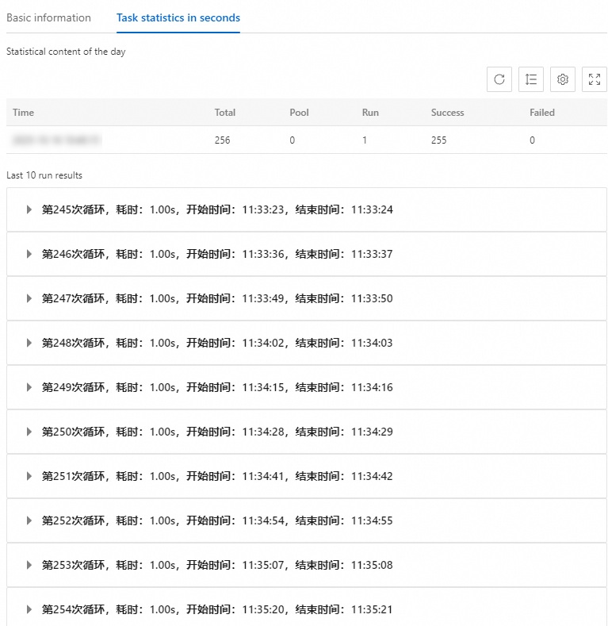

**Set alerts for second-level scheduling tasks**

- A task execution failure alert is triggered if the initial execution fails. After a successful initial execution, subsequent failures do not trigger this alert.

- A consecutive failure alert is triggered if a task fails more than 10 times consecutively after a successful initial execution.

To receive these two alerts, enable the failure alert switch in the task's alert configuration.

<a id="section-7-2"></a>

## 7.2. Create a new account

This topic explains how to create a new account for SchedulerX.

**Prerequisites**

Contact the operations administrator to request an account.

**Verify the result**

Log on to the console with your username and password to verify that the account was created successfully.

**Log out**

Click the profile picture in the upper-right corner, and then click **Log Out**.

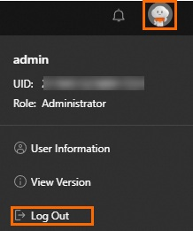

<a id="section-7-3"></a>

## 7.3. How to pass data between upstream and downstream nodes in a workflow

The workflow feature in SchedulerX 2.0 enables you to orchestrate multiple nodes. It also supports passing data between upstream and downstream nodes to simplify your business processes. This topic demonstrates how to pass data between nodes in a workflow using three scheduled jobs as an example.

**Background information**

Currently, data passing is supported only for simple Java tasks. For distributed Java tasks, use the MapReduce model to pass data. For more information, see MapReduce model.

**Usage**

Data passing is currently supported only for Java tasks. For distributed Java tasks, you must use the MapReduce model.

- Return an execution result

  ```text
  /**
   *
   * @param status
   * @param result The size must be less than 1000 bytes.
   * @throws Exception
   */
  public ProcessResult(boolean status, String result) throws Exception;
  ```

  Use this method at the end of the processor to return the execution result.

  > **Important**
  >
  > The size of  `result`  cannot exceed 1000 bytes. This limit is based on the byte size, not the number of characters in the string. A string that contains multi-byte characters can exceed this limit. If the size exceeds 1000 bytes, the task fails.

- Obtain input data

  ```text
  List<JobInstanceData> upstreamDatas = JobContext.getUpstreamData();
  ```

  In a processor, you can use this interface to obtain input data from JobContext. The input data is a list because a node can have multiple parent nodes. The JobInstanceData object has two properties: **jobName** and **data** (String).

**Procedure**

The following procedure demonstrates how to pass data between upstream and downstream nodes in a workflow.

1. Implement the job processor classes JobProcessor A, JobProcessor B, and JobProcessor C in three separate applications.

   - JobProcessor A

     ```java
     public class TestSimpleJobA extends JavaProcessor {
         @Override
         public ProcessResult process(JobContext context) throws Exception {
             System.out.println("TestSimpleJobA " + DateTime.now().toString("yyyy-MM-dd 
     HH:mm:ss"));
             return new ProcessResult(true, String.valueOf(1));
         }
     }                            
     ```

   - JobProcessor B

     ```java
     public class TestSimpleJobB extends JavaProcessor {
         @Override
         public ProcessResult process(JobContext context) throws Exception {
             System.out.println("TestSimpleJobB " + DateTime.now().toString("yyyy-MM-dd 
     HH:mm:ss"));
             return new ProcessResult(true, String.valueOf(2));
         }
     }                           
     ```

   - JobProcessor C

     ```java
     public class TestSimpleJobC extends JavaProcessor {
         @Override
         public ProcessResult process(JobContext context) throws Exception {
             List<JobInstanceData> upstreamDatas = context.getUpstreamData();
             int sum = 0;
             for (JobInstanceData jobInstanceData : upstreamDatas) {
                 System.out.println("jobName=" + jobInstanceData.getJobName() 
                         + ", data=" + jobInstanceData.getData());
                 sum += Integer.valueOf(jobInstanceData.getData());
             }
             System.out.println("TestSimpleJobC sum=" + sum);
             return new ProcessResult(true, String.valueOf(sum));
         }
     }                          
     ```

2. Create an application group and a scheduled job for each of the three applications: jobA, jobB, and jobC. For more information, see Create an application group and Create a scheduled job.

3. Create a workflow and import the three scheduled jobs. For more information, see Create a workflow.

   The created workflow is shown in the following figure.

   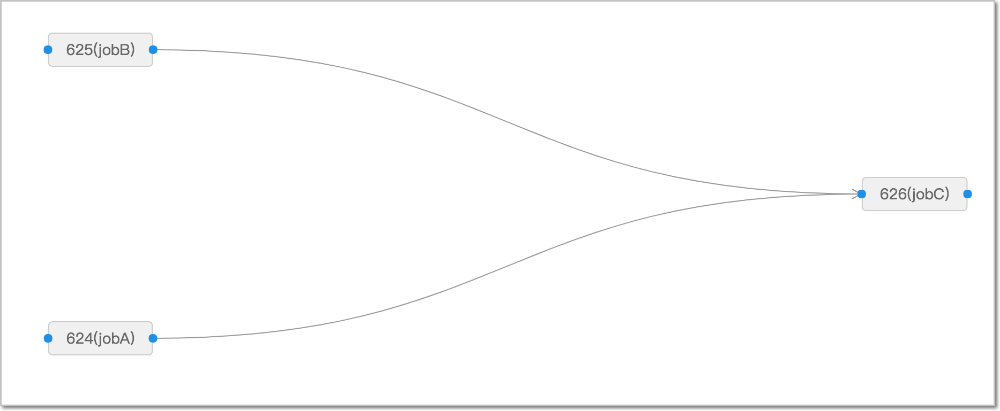

4. On the **Flow Management** page, find the workflow and click **Run Once** in the **Actions** column.

**Execution result**

Go to the **Workflow Details** page. To view the details for the task instances, right-click jobA, jobB, and jobC, and select **Details** from the shortcut menu.

The **Result or Error Message** for Job A is 1, which matches the output of JobProcessor A.

Similarly, the result for jobB is 2, which matches the output of JobProcessor B. The result for jobC is 3 (1+2). This shows that the upstream nodes jobA and jobB passed their data to jobC. This behavior matches the code in JobProcessor C.

The console displays the same output.

```text
jobName=jobB, data=2
jobName=jobA, data=1
TestSimpleJobC sum=3
```

<a id="section-8"></a>

# 8.Configuration reference

<a id="section-8-1"></a>

## 8.1. JobContext parameters

This topic describes the JobContext parameters.

The following table describes the JobContext parameters.

| Parameter | Description |
| --- | --- |
| long jobId | The Job ID. |
| long jobInstanceId | The job instance ID. |
| long wfInstanceId | The workflow instance ID. |
| long taskId | The subtask ID of a distributed task. The ID of the root task is 0. |
| DateTime scheduleTime | The scheduled time of the instance. |
| DateTime dataTime | The data timestamp of the instance. |
| String jobType | The job type. |
| String taskName | The subtask name. |
| Object task | The body of the subtask. |
| String jobParameters | The static job parameters configured in the console. |
| String instanceParameters | The dynamic instance parameters triggered by an API call. |
| int maxAttempt | The maximum number of retries for the instance. |
| int attempt | The current number of retries for the instance. |
| int taskMaxAttempt | The maximum number of retries for the subtask. |
| int taskAttempt | The current number of retries for the subtask. |
| <code>List&lt;JobInstanceData&gt; upstreamData</code> | The upstream data of the workflow instance. A workflow instance can have multiple upstream sources. The data is in the <code> List&lt;JobInstanceData&gt; </code> format. |

<a id="section-8-2"></a>

## 8.2. Advanced configuration parameters for task management

This topic describes the advanced configuration parameters for task management.

The following table describes the advanced configuration parameters for task management.

| Parameter | Applicable execution modes | Description | Default value |
| --- | --- | --- | --- |
| Instance retries on failure | All | The number of times a task automatically retries if it fails. | 0 |
| Instance retry interval on failure | General | The interval between retries if a task fails.Unit: seconds. | 30 |
| Instance concurrency | General | The number of instances of the same Job that can run concurrently. A value of 1 means that concurrent execution is not allowed. | 1 |
| Sub-task concurrency per machine | • Parallel computing<br>• Memory grid<br>• Grid computing | In a distributed model, this is the number of sub-tasks that a single machine can concurrently process. | 5 |
| Sub-task retries on failure | • Parallel computing<br>• Memory grid<br>• Grid computing | In a distributed model, this is the number of times a sub-task automatically retries if it fails. | 0 |
| Sub-task retry interval on failure | • Parallel computing<br>• Memory grid<br>• Grid computing | In a distributed model, this is the interval between automatic retries if a sub-task fails. Unit: seconds. | 0 |
| Sub-task dispatch method | • Parallel computing<br>• Memory grid<br>• Grid computing | Push model: Sub-tasks are evenly assigned to each machine. Pull model: Each machine actively pulls sub-tasks. This prevents the slowest machine from creating a bottleneck. During the pull process, all sub-tasks are cached on the Master node, which consumes memory. The number of sub-tasks should not exceed 10,000. | None |
| Number of sub-tasks per pull (pull model only) | • Parallel computing<br>• Memory grid<br>• Grid computing | The number of sub-tasks that a slave node pulls from the Master node in a single attempt. | 5 |
| Sub-task queue capacity (pull model only) | • Parallel computing<br>• Memory grid<br>• Grid computing | The size of the queue on a slave node that caches sub-tasks. | 10 |
| Global sub-task concurrency (pull model only) | • Parallel computing<br>• Memory grid<br>• Grid computing | The distributed pull model supports global sub-task concurrency, which can be used for rate limiting. | 0 |

<a id="section-8-3"></a>

## 8.3. SchedulerxWorker configuration parameters

This topic describes the parameters for configuring SchedulerxWorker.

The following table lists each parameter and its description.

| Parameter | Description | Default value |
| --- | --- | --- |
| <code>setGroupId(String</code><br><code>groupId)</code> | Specifies the ID of the task group. Before you connect a client, create a task group and obtain its <strong>groupId</strong>. | None |
| <code>setAppKey(String</code><br><code>appKey)</code> | The <strong>appKey</strong> that corresponds to the <strong>groupId</strong>. You can obtain the appKey from the Application Management page in the console. | None |
| <code>setEndpoint(String</code><br><code>endpoint)</code> | The server endpoint for each region. | None |
| <code>setNamespace(String</code><br><code>namespace)</code> | The ID of the namespace. | None |
| <code>setEnableBatchWork(boolean</code><br><code>enableBatchWork)</code> | Specifies whether to enable grid computing. This feature is enabled by default.<br>• If you do not use grid computing, do not configure this parameter.<br>• If you use grid computing, enable this parameter.Otherwise, the first trigger on each machine is delayed by at least 20 seconds. | true |
| <code>setHost(String host)</code> | If a client has multiple network interface cards (NICs) or is in a VPN environment, the automatically obtained local IP address might be incorrect. Use this parameter to specify the correct IP address. | None |
| <code>setPort(int port)</code> | Lets you specify a custom listener port for the client. | None |
| <code>setClassLoader(ClassLoader</code><br><code>userClassLoader)</code> | For non-Spring applications that use other third-party frameworks, you may need to set a <strong>custom class loader</strong>. | None |
| <code>setBlockAppStart(boolean</code><br><code>block)</code> | Specifies whether to block the application process from starting if SchedulerX initialization fails. | true |

<a id="section-9"></a>

# 9.Permission management

<a id="section-9-1"></a>

## 9.1. Overview of permission management

This topic describes the key permission management capabilities of SchedulerX when integrated with Resource Access Management (RAM).

**Support for Alibaba Cloud accounts and RAM users**

SchedulerX uses the authentication system for Alibaba Cloud accounts and RAM users. An Alibaba Cloud account has full permissions on all its resources and for all operations in SchedulerX. The Alibaba Cloud account creates RAM users and grants them permissions.

Currently, the only permission that SchedulerX manages through RAM is the logon permission. After an Alibaba Cloud account grants the logon permission to a RAM user, the RAM user has full permissions for all operations in SchedulerX.

Resources created by a RAM user are not visible to other RAM users. The Alibaba Cloud account can view all resources created by its RAM users.

**Logon permission control**

A RAM user cannot directly log on to SchedulerX. To log on, the RAM user must meet the following two conditions:

- The RAM user must have the **Resource User** role.

- The Alibaba Cloud account must grant the RAM user the permission to log on to SchedulerX. The access policy for this permission is:

  ```json
  {
    "Version": "1",
    "Statement": [
      {
        "Action": "schedulerx:ManageMenu",
        "Resource": "acs:schedulerx:*:*:*",
        "Effect": "Allow"
      }
    ]
  }
  ```

**Application-level permission management**

Different RAM users are typically responsible for different applications. An application created by a RAM user is not visible to other RAM users, but is visible to the Alibaba Cloud account. Both the Alibaba Cloud account and the RAM user who created the application can grant permissions on it to other RAM users.

<a id="section-9-2"></a>

## 9.2. Create users and user groups

You can use an Alibaba Cloud account to create users and assign roles to them to manage system access.

**Create an organization**

An organization is required to create users and user groups.

1. Log on to the Apsara Uni-manager Management Console.

2. In the top navigation bar, click **Enterprise**.

3. In the left-side navigation pane, choose **Resources** > **Organizations**.

4. In the left-side Organization Structure pane of the **Organizations** page, select a parent organization and click **Create Organization** in the upper-right corner of the page.

   > **Note**
   >
   > - If you select the root organization, a level-1 organization is created.
   >
   > - If you want to create a level-2 organization, you must select a level-1 organization. The same method applies to subordinate organizations. You can create up to five levels of organizations.
   >
   > - An operations administrator can create level-1 to level-5 organizations. An organization administrator can create only subordinate organizations under the organization to which the organization administrator belongs.

5. In the **Add Organization** dialog box, configure the parameters that are described in the following table.

   | Parameter | Description |
   | --- | --- |
   | Name | The name of the organization. The name must be 2 to 128 characters in length.The name cannot start or end with a space.<br>Note<br>The organization name must be unique in the organizational architecture. |
   | Description | The description of the organization. |
   | Associate Third-party Authenticatio n | If no global identity provider (IdP) is configured in the Apsara Uni-manager Management Console, you can select <strong>Set Now</strong> or <strong>Set Later</strong>.<br>• If you select <strong>Set Now</strong>, you must select a local IdP name from the <strong>IdP Name</strong> drop-down list. You can associate only one IdP with the organization.<br>• If you select <strong>Set Later</strong>, third-party authentication is not associated.<br>Important<br>• The <strong>Associate Third-party Authentication</strong> parameter is displayed only when you create a level-1 organization.<br>• If a global IdP has been configured in the Apsara Uni-manager Management Console, third-party authentication cannot be associated with level-1 organizations. In this case, <strong>Set Now</strong> and <strong>Set</strong> <strong>Later</strong> are dimmed. |

6. Click **OK**.

**Create a user group**

Roles cannot be attached directly to users. Instead, roles are attached to user groups. Users in a group inherit the permissions of the roles attached to that group.

1. In the top navigation bar, click **Enterprise**.

2. In the left-side navigation pane, choose **Users** > **User Groups**.

3. On the **User Groups** page, click **Create User Group**.

4. In the **Create User Group** dialog box, configure the parameters that are described in the following table.

   | Parameter | Description |
   | --- | --- |
   | User Group Name | The name of the user group. The name must be 3 to 255 characters in length, and can contain letters, digits, underscores (_), hyphens (-), periods (.), and at signs (@). |
   | Organization | The organization to which the user group belongs. |
   | Role authorized | The roles that are assigned to the user group. |

   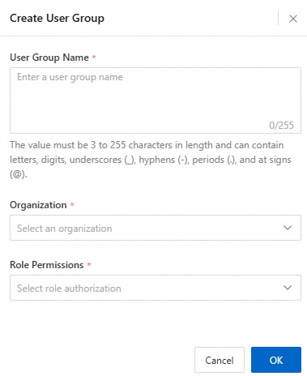

5. Click **OK**.

**Create a user**

You can create users as needed.

1. In the top navigation bar, click **Enterprise**.

2. In the left-side navigation pane, choose **Users** > **Users.**

3. On the **System Users** tab, click **Create User**.

4. In the **Create User** dialog box, configure the parameters. The following table describes the parameters.

   | Parameter | Description |
   | --- | --- |
   | User Name | The name of the user. The name must be 2 to 64 characters in length and can contain letters, digits, underscores (_), periods (.), hyphens (-), and at signs (@). |
   | Display Name | The display name of the user. The name must be 1 to 128 characters in length and can contain letters, digits, periods (.), hyphens (-), spaces, and at signs (@). |
   | Role | The roles that you want to assign to the user. |
   | Organization | The organization to which the user belongs. |
   | Logon Policy | The logon policy that limits the logon time and IP address of the user. Default value: Default Policies. |
   | Phone | The mobile number of the user. This mobile number is used to receive system notifications about resource applications and usage. Make sure that the mobile number is valid.<br>Note<br>Make sure that you select the correct country code for the mobile number. |
   | Landline | The landline number of the user. The landline number must be 4 to 20 characters in length and can contain only digits and hyphens (-). |
   | Email | The email address of the user. This email address is used to receive system notifications about resource applications and usage. Make sure that the email address is valid. |
   | DingTalk Key | The key of the chatbot for the DingTalk group to which the user belongs. For more information about how to configure the key, see DingTalk development documentation. |

   <table>
     <tr>
       <td>Message</td>
       <td>• <strong>Notify User by Email</strong>: If the user is configured as an alert contact, the Apsara Uni-manager Management Console notifies the user by email when an alert is generated.<br>Note<br>• If you enable email notifications, you must configure an email server. For more information, contact on-site O&amp;M engineers.<br>• If you enable email notifications, you can select <strong>After creation,</strong> the user is notified of information such as the username and password by email.<br>• <strong>Notify User by DingTalk</strong>: If the user is configured as an alert contact, the Apsara Uni-manager Management Console notifies the user by DingTalk when an alert is generated.</td>
     </tr>
   </table>

   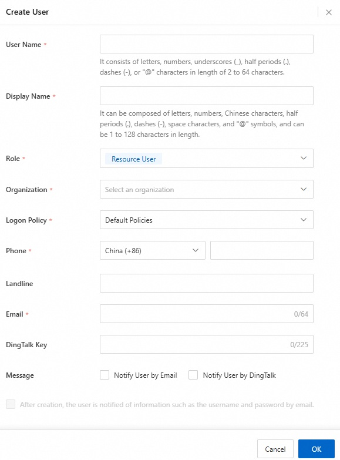

5. Click **OK**.

**Add a user to a user group**

When a user is added to a user group, the user inherits the permissions of the roles attached to the group.

1. In the top navigation bar, click **Enterprise**.

2. In the left-side navigation pane, choose **Users > User Groups**.

3. On the User Groups page, select a condition from the drop-down list and then enter a keyword in the search box to search for a user group. Alternatively, specify advanced filter conditions above the user group list to search for a user group.

4. Find the user group that you want to manage and click **Add User** in the **Actions** column.

   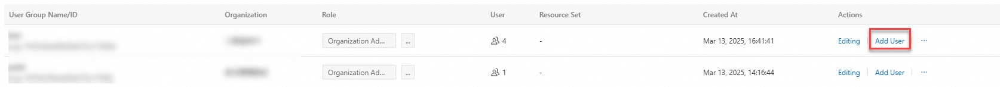

5. In the **Add User** dialog box, add users. You can manually add users or upload multiple users at a time.

   | Adding Method | Description |
   | --- | --- |
   | Manually Add | i. Set the <strong>Adding Method</strong> parameter to <strong>Manually Add</strong><br>ii. Select one or more users that you want to add from the left-side section and<br>click the<br><br>icon to add the selected users to the right-side section.<br>Note<br>• You can manually add up to five users at a time. To add more than five users at a time, we recommend that you use the batch upload method.<br>• You can also select one or more users added to the right-side section and click the icon to remove the users from the<br><br>right-side section.<br>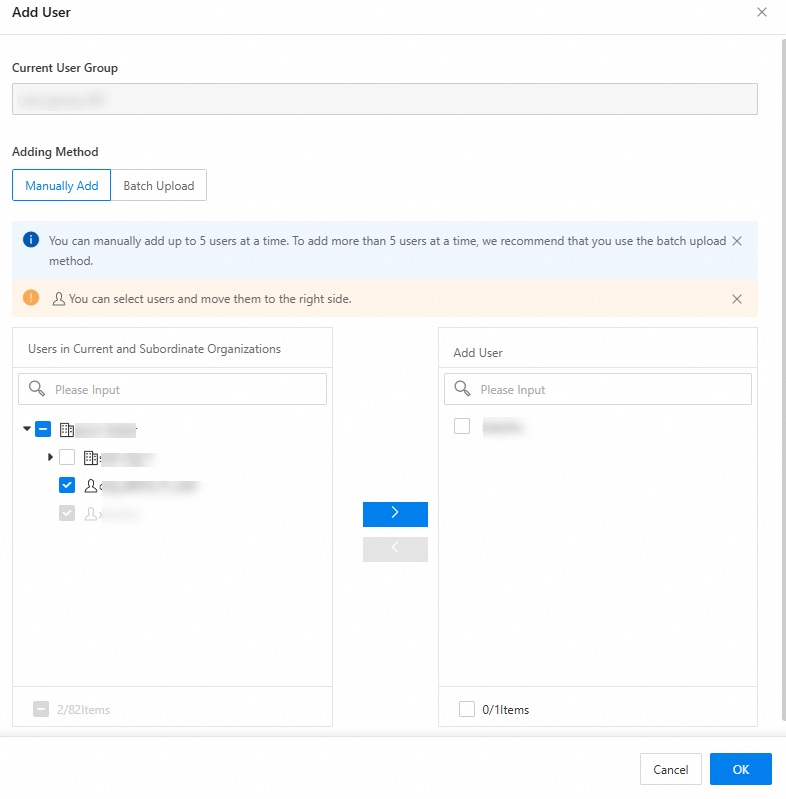<br>iii. Click <strong>OK</strong>. |
   |  |  |
   | Batch Upload | i. Set the <strong>Adding Method</strong> parameter to <strong>Batch Upload</strong><br>ii. Click <strong>Download Batch Operation Template</strong> to download the template file in the <strong>XLSX</strong> format to your local computer.<br>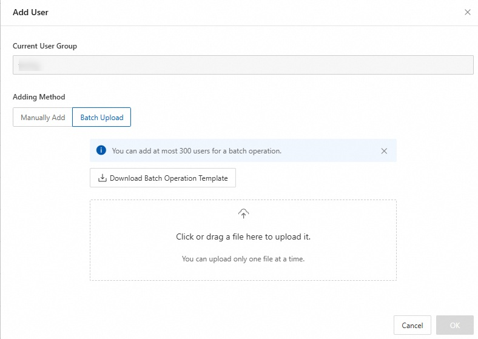<br>iii. Fill the template file with the names of the users to be added in the template file and save the file.<br>Note<br>You can add up to 300 users by using a template file and upload only one template file at a time.<br>iv. In the file upload section, upload the template file that you filled in.<br>v. Click <strong>OK</strong>. |

<a id="section-9-3"></a>

## 9.3. Create a role and attach permissions

SchedulerX uses the authentication system for Alibaba Cloud accounts and RAM (Resource Access Management) users. It also supports RAM authorization. You can create custom roles and attach access policies. Then, assign these roles to users to manage permissions. This topic describes how to create a role and attach user groups and access policies.

**Create a role**

1. Log on to the Apsara Uni-manager Management Console.

2. In the top menu bar, click **Enterprise**.

3. In the navigation pane on the left, choose **Permission Management** > **Role Authorization**.

4. Click **Create Custom Role** to go to the **Create Custom Role** page.

5. On the **Create Custom Role** page, expand **Advanced Create** at the bottom of the page, and then click **Create RAM Authorization**.

6. Enter the **Basic Information**.

   | Paramete r | Description |
   | --- | --- |
   | Role Name | The name of the role. |
   | Descripti on | (Optional) The description of the role. |
   | Sharing Scope | The visibility of the role. When an operations administrator creates a role, only <strong>Global</strong> is supported.<br>• <strong>Global</strong>: The role is shared across all organizations.<br>• <strong>This organization</strong>: The role is shared only within the current organization.<br>• <strong>Subordinate organizations</strong>: The role is shared with the current organization and its subordinate organizations. |

7. Click **Create RAM Authorization and Configure**. On the **Role Authorization** page, configure the role authorization.

   - Attach a user group to the role.

     > **Note**
     >
     > You can choose not to attach a user group when you create the role. Instead, you can attach the role on the user group page. For more information, see Attach a role to a user group.

     <ol type="a">

     <li>

     On the **Role Authorization** page, click the **User Group Management** tab, and then click **Add User Group**.

     </li>

     <li>

     In the **Add User Group** dialog box, select the target user group, and then click **OK**.

     </li>

     </ol>

   - Attach a custom policy to the role.

     <ol type="a">

     <li>

     On the **Role Authorization** page, click the **Permission Management** tab, and then click **Add Access Policy**.

     </li>

     <li>

     In the **Add Access Policy** dialog box, click **Create Access Policy**. In the **Create Access Policy** dialog box, set the basic information for the policy, and then click **OK**.

     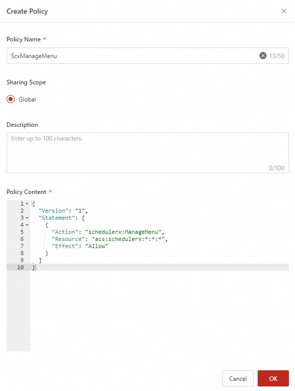

     | Parameter | Description |
     | --- | --- |
     | Policy Name | Enter a custom policy name. The name can be up to 50<br><br>characters in length. For example, <code>ScxManageMenu</code>. |
     | Remarks | The description of the policy. This is often used to describe the permissions that the policy grants. |
     | Policy Document | The custom policy document is as follows:<br><code>{</code><br><code>"Version": "1",</code><br><code>"Statement": [</code><br><code>{</code><br><code>"Action": "schedulerx:ManageMenu",</code><br><code>"Resource": "acs:schedulerx:*:*:*",</code><br><code>"Effect": "Allow"</code><br><code>}</code><br><code>]</code><br><code>}</code><br>The action in this policy, <strong>schedulerx:ManageMenu</strong>, grants the <strong>logon permission for SchedulerX</strong>. The resource is the wildcard character <strong>\*</strong>, which represents all SchedulerX resources.<br>Note<br>Currently, only the logon permission for SchedulerX uses RAM authorization. Other permissions still use the authentication system for Alibaba Cloud accounts and RAM users. |

     </li>

     </ol>

8. After you complete the configuration, click **OK**.

**Attach a role to a user group**

After you attach a role to a user group, all users in the group gain the permissions of that role. You can attach only one role to a user group.

1. In the top menu bar, click **Enterprise**.

2. In the navigation pane on the left, choose **Personnel Management > User Group Management**.

3. On the **User Group Management** page, select the target user group, click the  in its

   **Actions** column, and select **Grant Permissions**.

4. In the **Authorize** dialog box, select the target role from the **Role Authorization** drop-down list, and then click **OK**.

5. In the **Add Role** dialog box, select the target role, and then click **OK**.

<a id="section-9-4"></a>

## 9.4. Verify logon permissions

This topic describes how to verify logon permissions after SchedulerX is integrated with Resource Access Management (RAM).

**Prerequisites**

A user with the **Resource User** role has been created. For more information, see Create a user.

**Log on to SchedulerX as a new user**

1. Log on to the Apsara Uni-manager Management Console.

2. In the top navigation bar, choose **Products > Middleware > Microservice Tools And Platforms > SchedulerX** to open the SchedulerX console.

3. On the **Distributed Task Scheduling Platform** page, click the **Switch Account** floating button in the lower-right corner. Select **Organization Settings** and **Region Settings**. Then, click **Administrator Access**.

   If the user you created does not have the permissions to log on to SchedulerX, the following error message is returned:

   ```json
   {"errMsg":"please grant ram policy to this user","policy": { "Version": "1", "Statement": [ { "Action": "schedulerx:ManageMenu", "Resource": "acs:schedulerx:*:*:*", "Effect": "Allow" } ] } }
   ```

**Grant logon permissions to the user**

You cannot use an Alibaba Cloud account to directly grant permissions to a user. Instead, you must create a role, grant the role the permissions to log on to SchedulerX, and then attach the role to a user group. Users in the user group will then have the permissions to log on to SchedulerX.

1. Create a role and grant it the permissions to log on to SchedulerX.

   For more information, see:

   - Create a role and attach permissions

   - Attach SchedulerX permissions to a role

2. Attach the role to a user group.

   For more information, see Attach a role to a user group.

3. <strong>Optional:</strong>Add the user to the user group.

   If the user is already in the user group, skip this step. For more information about how to add a user to a user group, see Add a user to a user group.

**Log on to SchedulerX again**

When a user with the required permissions logs on to SchedulerX, no error message is displayed.

1. Log on to the Apsara Uni-manager Management Console.

2. In the top navigation bar, choose **Products > Middleware > Microservice Tools And Platforms > SchedulerX** to open the SchedulerX console.

3. On the **Distributed Task Scheduling Platform** page, click the **Switch Account** floating button in the lower-right corner. Select **Organization Settings** and **Region Settings**. Then, click **Role-based Access**.

   The user successfully logs on to the SchedulerX console.

<a id="section-9-5"></a>

## 9.5. Verify application-level permissions

This topic describes how to verify application-level permissions after SchedulerX is integrated with Resource Access Management (RAM).

**Background information Background information**

Different RAM users are typically responsible for different applications. Applications created by a RAM user are visible to the Alibaba Cloud account but not to other RAM users. The Alibaba Cloud account can grant permissions for an application to other RAM users. A RAM user can also grant permissions for an application to other RAM users.

**Grant application permissions to a RAM user**

1. Log on to the SchedulerX console as the Alibaba Cloud account.

2. In the navigation pane on the left, click **Application Management**.

   > **Note**
   >
   > The Alibaba Cloud account can view applications created by all RAM users.

3. On the **Application Management** page, select the application you want to authorize, click

    in the **Actions** column, and select **Authorization**.

4. In the **Authorization Management** dialog box, enter the ID of the RAM user in the **User ID** search box, click **Add**, and then click **Grant**.

   You can add multiple RAM user IDs to grant permissions in a batch.

   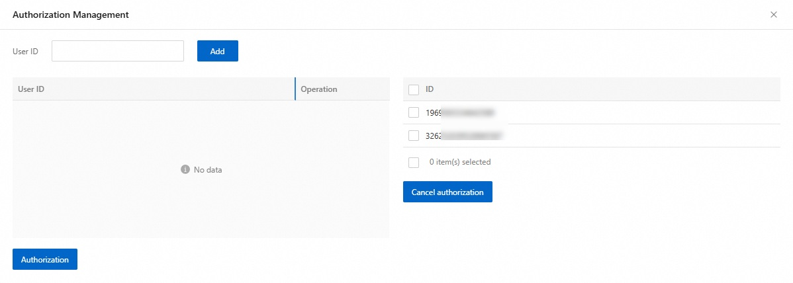

   > **Note**
   >
   > To revoke permissions for a user, select the user ID in the lower-right corner and click **Revoke Authorization**.

**Grant application permissions to another RAM user**

1. Log on to the SchedulerX console as a RAM user.

2. In the navigation pane on the left, click **Application Management**.

   > **Note**
   >
   > By default, a RAM user can view only the applications that they created and cannot view applications created by other RAM users.

3. On the **Application Management** page, select the application you want to authorize, click

    in the **Actions** column, and select **Authorization**.

4. In the **Authorization Management** dialog box, enter the ID of the RAM user in the **User ID** search box, click **Add**, and then click **Grant**.

   You can add multiple RAM user IDs to grant permissions in a batch.

   

   > **Note**
   >
   > To revoke permissions for a user, select the user ID in the lower-right corner and click **Revoke Authorization**.

<a id="section-10"></a>

# 10.FAQ

<a id="section-10-1"></a>

## 10.1. FAQ

You might encounter issues when you use SchedulerX. This topic describes how to resolve common issues.

**Machine is busy**

- Symptom

  In the console, go to the **Application Management** page. In the **Operation** column for a group, click **Connected Machines**. In the **Machine List** panel, the machine's **Status** is Busy.

- Possible causes

  - The **load5** on the machine exceeds the threshold set for the task group.

  - The machine's **Memory Usage** exceeds the task group threshold.

  - The machine's **Disk Usage** exceeds the task group threshold.

- Impact

  If a machine is busy, scheduling tasks cannot be triggered.

- Solution

  <ol type="i">

  <li>

  In the **Connected Instances** panel, hover over **Busy** to view the machine's **Load**, **Memory Usage**, and **Disk Usage**.

  </li>

  <li>

  Based on the values of **load5**, **Memory Usage**, and **Disk Usage**, identify the cause and

  </li>

  </ol>

  take appropriate action, such as clearing the disk, releasing memory, or reducing the load.

  If the machine is still busy, you can upgrade its configuration.

  To trigger tasks on a busy machine for testing purposes, go to the **Application**

  **Management** page. In the **Operation** column, click the  icon and select **Edit**. In the

  **Edit Application** panel, modify the advanced configuration and enable **Trigger On Busy Machine**.

  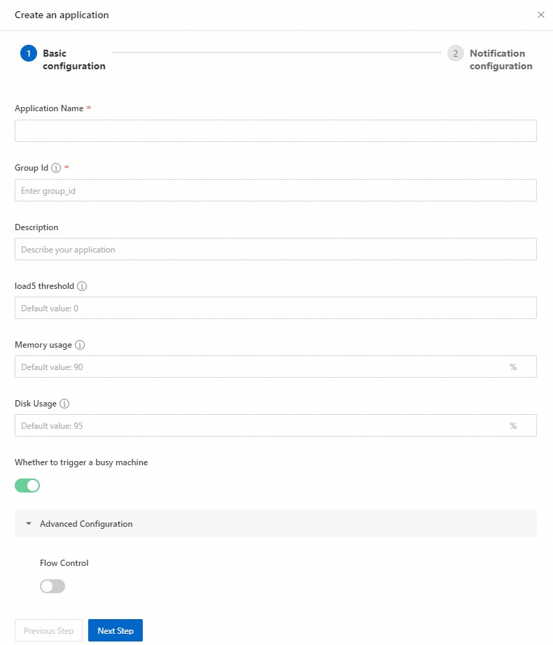

**No available machines**

- Symptom

  When you connect an application to SchedulerX and try to verify the connection, the message No available machines is displayed.

- Possible causes

  - The application failed to connect to SchedulerX.

  - There were conflicts between JAR packages.

  - The SchedulerXWorker was configured incorrectly.

- Solution

  <ol type="i">

  <li>

  Log on to the ECS instance where the application is deployed and check if the log directory /home/${user.home}/logs/schedulerx/worker.log exists.

  > **Note**
  >
  > - If the process is started by the root account, the log is located at /root/logs/schedulerx/worker.log.
  >
  > - If the process is started by the admin account, the log is located at /home/admin/schedulerx/worker.log.

  - If the directory does not exist, the ECS instance is not connected to the SchedulerX client. Connect the client again. For more information, see Connect a client to SchedulerX.

  - If the directory exists, proceed to the next step.

  </li>

  <li>

  Check the  `worker.log`  file for abnormal logs.

  - If the log contains groupId is not existed, it indicates a configuration issue. Search for

    

    `Schedulerx WorkerConfig` in worker.log to view the current configuration, and then compare it with the configuration on the console to confirm that it is correct.

    > **Important**
    >
    > Obtain the namespace ID from the **Namespace ID** on the **Namespace** page.

  - If there are abnormal logs, check for JAR package conflicts. For more information, see JAR package conflicts.

  - If there are no abnormal logs, search for "started" and check if the SchedulerXWorker configuration is correct.

  </li>

  </ol>

**JAR package conflicts**

- Symptom

  When you deploy a scheduling task, the message JAR package conflict is displayed.

- Possible cause

  A JAR package conflict can be caused by conflicts between specific sub-packages. You can search for **maven dependencies** in the log to view the version and path of each JAR package. This helps you quickly locate and resolve the conflict, as shown in the following figure:

  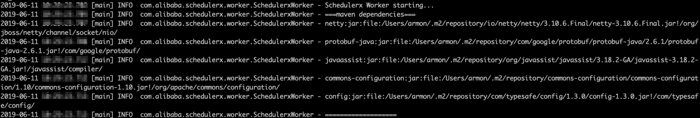

- Solution

  Upgrade the packages that have earlier versions, as specified in the following table.

  | JAR package | Version |
  | --- | --- |
  | guava | 20.0 |
  | com.typesafe.config | 1.3.0 |
  | protobuf-java | 2.6.1 |
  | io.netty | 3.10.6.Final |
  | javaassist | 3.21.0-GA |
  | hessian | 4.0.51 |
  | commons-configuration | 1.10 |
  | commons-validator | 1.4.0 |

- Examples

  The following list describes typical JAR conflict symptoms:

  - guava conflict

    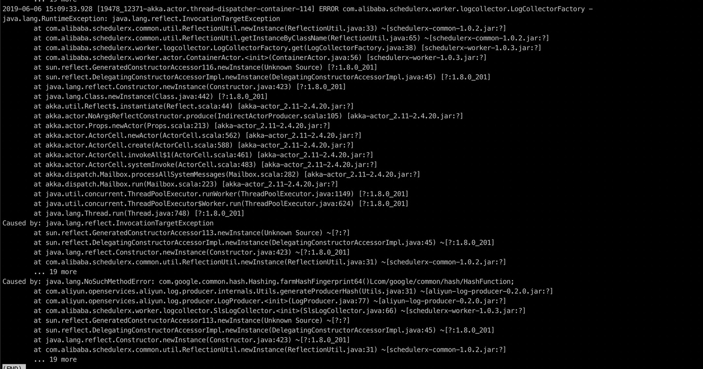

  - com.typesafe.config package conflict

    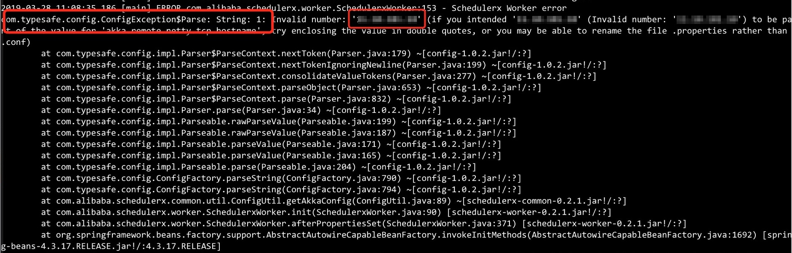

  - protobuf conflict

    ```text
    2019-03-20  14:49:41.742  [33471_69216-akka.actor.default-dispatcher-4]  WARN    com.alibaba.schedulerx.worker.SchedulerxWorker:315  -  heartbeat  error
    java.lang.VerifyError:  class  
    com.alibaba.schedulerx.protocol.Worker$WorkerHeartBeatRequest  overrides  final  method  getUnknownFields.()Lcom/google/protobuf/UnknownFieldSet;
    at  java.lang.ClassLoader.defineClass1(Native  Method)  ~[?:1.8.0_181]
    at  java.lang.ClassLoader.defineClass(ClassLoader.java:763)  ~[?:1.8.0_181]
    at  java.security.SecureClassLoader.defineClass(SecureClassLoader.java:142)  ~[?:1.8.0_181]
    ```

    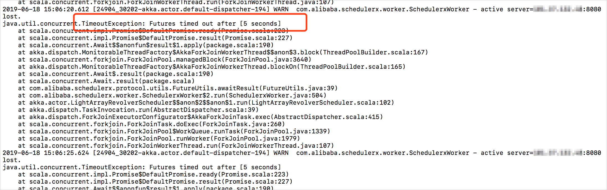

  - A Netty conflict causes the ActorSystem.create method to time out, which prevents the system from starting.

    ```text
    2019-03-20  11:52:48.030  [main]  ERROR  
    com.alibaba.schedulerx.worker.SchedulerxWorker:142  -  Schedulerx  Worker  error
    java.util.concurrent.TimeoutException:  Futures  timed  out  after  [10000  
    milliseconds]
    at  scala.concurrent.impl.Promise$DefaultPromise.ready(Promise.scala:223)  ~[scala-library-2.11.11.jar:?]
    at  scala.concurrent.impl.Promise$DefaultPromise.result(Promise.scala:227)  ~[scala-library-2.11.11.jar:?]
    at  scala.concurrent.Await$$anonfun$result$1.apply(package.scala:190)  ~[scala-library-2.11.11.jar:?]
    at  
    scala.concurrent.BlockContext$DefaultBlockContext$.blockOn(BlockContext.scala:53)  
    ~[scala-library-2.11.11.jar:?]
    at  scala.concurrent.Await$.result(package.scala:190)  ~[scala-library-2.11.11.jar:?]
    at  akka.remote.Remoting.start(Remoting.scala:189)  ~[akka-remote_2.11-
    2.4.20.jar:?]
    at  akka.remote.RemoteActorRefProvider.init(RemoteActorRefProvider.scala:212)  ~[akka-remote_2.11-2.4.20.jar:?]
    at  akka.actor.ActorSystemImpl.liftedTree2$1(ActorSystem.scala:828)  ~[akka-actor_2.11-2.4.20.jar:?]
    at  akka.actor.ActorSystemImpl._start$lzycompute(ActorSystem.scala:825)  ~[akka-actor_2.11-2.4.20.jar:?]
    at  akka.actor.ActorSystemImpl._start(ActorSystem.scala:825)  ~[akka-actor_2.11-2.4.20.jar:?]
    at  akka.actor.ActorSystemImpl.start(ActorSystem.scala:841)  ~[akka-actor_2.11-2.4.20.jar:?]
    at  akka.actor.ActorSystem$.apply(ActorSystem.scala:245)  ~[akka-actor_2.11-2.4.20.jar:?]
    at  akka.actor.ActorSystem$.apply(ActorSystem.scala:288)  ~[akka-actor_2.11-2.4.20.jar:?]
    at  akka.actor.ActorSystem$.apply(ActorSystem.scala:263)  ~[akka-actor_2.11-2.4.20.jar:?]
    at  akka.actor.ActorSystem$.create(ActorSystem.scala:191)  ~[akka-actor_2.11-2.4.20.jar:?]
    at  akka.actor.ActorSystem.create(ActorSystem.scala)  ~[akka-actor_2.11-
    2.4.20.jar:?]
    at  com.alibaba.schedulerx.worker.SchedulerxWorker.init(SchedulerxWorker.java:119) 
    [schedulerx-worker-0.2.0.jar:?]
    ```

  - Hessian conflict

    ```text
    java.lang.NoSuchMethodError: 
    com.caucho.hessian.io.SerializerFactory.createDefault()Lcom/caucho/hessian/io/Seriali
    rFactory;
    ```

  - commons-validator conflict

    ```text
    Caused by: java.lang.NoClassDefFoundError: 
    org/apache/commons/validator/routines/InetAddressValidator
        at 
    com.aliyun.openservices.log.util.NetworkUtils.getLocalMachineIP(NetworkUtils.java:33)
    ~[aliyun-log-0.6.31.jar:?]
        at com.aliyun.openservices.log.Client.<init>(Client.java:250) ~[aliyun-log-0.6.31.jar:?]
        at 
    com.aliyun.openservices.aliyun.log.producer.ProjectConfigs.buildClient(ProjectConfigs
    ava:34) ~[aliyun-log-producer-0.2.0.jar:?]
        at 
    com.aliyun.openservices.aliyun.log.producer.ProjectConfigs.put(ProjectConfigs.java:13
    ~[aliyun-log-producer-0.2.0.jar:?]
        at com.alibaba.schedulerx.worker.logcollector.SlsLogCollector.<init>
    (SlsLogCollector.java:64) ~[schedulerx-worker-1.0.3.jar:?]
        at sun.reflect.GeneratedConstructorAccessor156.newInstance(Unknown Source) ~[?:?]
        at 
    sun.reflect.DelegatingConstructorAccessorImpl.newInstance(DelegatingConstructorAccess
    Impl.java:45) ~[?:1.8.0_161]
        at java.lang.reflect.Constructor.newInstance(Constructor.java:423) ~
    [?:1.8.0_161]
        at 
    com.alibaba.schedulerx.common.util.ReflectionUtil.newInstance(ReflectionUtil.java:31)
    ~[schedulerx-common-1.0.2.jar:?]
    ```

  - javaassist conflict

    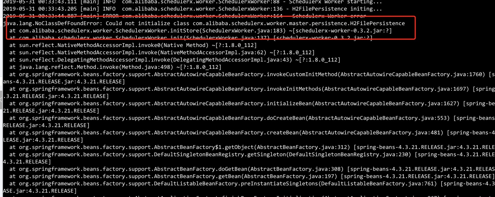

  - httpclient conflict

    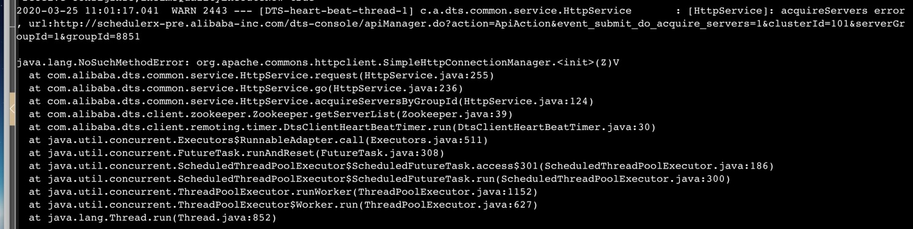

**Incompatibility between tablestore protobuf-2.4.1 and SchedulerX**

For more information, see Protobuf library conflict when using Java SDK.

**Spring application cannot find a bean**

- Symptom

  The Spring application cannot find the corresponding bean.

- Possible causes

  - Incorrect connection type.

  - A bean is not injected into the JobProcessor.

  - The  `spring-boot-devtools`  dependency is added to the pom.xml file.

  - Transaction annotations are added to the JobProcessor and the process method.

  - The bean is proxied by other aspects.

  - Inconsistent classLoaders.

- Solution

  - On the **Application Management** page in the console, click **Connected Machines** in the **Operation** column of the target group. In the **Connected Machines** panel, check that the startup mode is Spring or Spring Boot.

    If the startup mode is not Spring or Spring Boot, check your application.

  - Check whether the JobProcessor is injected as a bean in the application code, for example, by adding the @Component annotation.

    If the JobProcessor is not injected as a bean, inject it as a bean.

  - Check whether  `spring-boot-devtools`  is added to the pom.xml file.

    If  `spring-boot-devtools`  is added to the pom.xml file, delete the  `spring-boot-devtools`  dependency.

  - Check whether transaction annotations are added to the JobProcessor and the process method.

    If transaction annotations are added to the JobProcessor and the process method, delete the annotations.

  - Check whether the bean list is proxied by other aspects.

    Set a breakpoint in the *DefaultListableBeanFactory* class. Check whether the *beanDefiniti onNames* member list, which is the list of beans registered with Spring, is proxied by other aspects.

    If the bean list is proxied by other aspects, delete the proxy.

  - Debug *ThreadContainer.start* and check for a class.forName error.

    If a class.forName error occurs but the class exists, the issue is with the classLoader. This might be because a framework you are using causes classLoader inconsistency. You can use SchedulerxWorker.setClassLoader to resolve this issue.

  If none of these methods resolve the issue, contact the SchedulerX helpdesk.

**Incompatibility between tablestore protobuf-2.4.1 and SchedulerX**

For more information, see Protobuf or HttpClient library conflict when using Java SDK.

**submit jobInstanceId to worker timeout**

- Symptom

  ```text
  submit jobInstanceId=28384771 to worker=WorkerInfo [ip=192.168.32.166, 
  port=41114, workerId=30574_7365, metrics=Metrics(cpuLoad1=0.01, 
  cpuLoad5=0.05600000000000001, 
  cpuProcessors=2, heap1Usage=0.20147679324894516, heap5Usage=0.20379746835443036,
  heap1Used=191, heapMax=948, diskUsage=0.24241670191853087, diskUsed=9742, 
  diskMax=40187)] timeout, cost=5004ms
  ```

- Possible causes

  - JAR package conflicts.

  - High machine load or machine restart.

- Solution

  Check the worker.log file for abnormal logs.

  - If abnormal logs exist, the cause might be JAR package conflicts. For more information, see JAR package conflicts.

  - If no abnormal logs exist, the cause might be a high machine load or a machine restart. You can check the machine.

**Task gets stuck after application restart**

- Symptom

  The application is published without issues. However, when you restart the application using Aone, tasks get stuck.

- Possible cause

  If the system environment variable for starting the process is  `user.dir="/"`  but the process is not started by the root account, the underlying message notifications of SchedulerX fail. This occurs because the account does not have the permissions to write to the akka.persistence.snapshot directory.

- Solution

  Upgrade SchedulerX to version 1.0.9-hotfix-v3 or later.

**Task gets stuck during execution**

- Symptom

  A scheduling task is always in the running state and does not end.

- Possible causes

  - A business logic issue.

  - A SchedulerX issue.

- Solution

  When  `schedulerx-worker`  executes each processor, it adds the task instance ID to the thread name to help you view the thread stack. This section uses a stuck sub-task of a distributed task as an example. The solution for a standalone task or a broadcast task is similar.

  <ol type="i">

  <li>

  On the **Execution List** page in the console, view the details of the stuck task instance to retrieve its instance ID.

  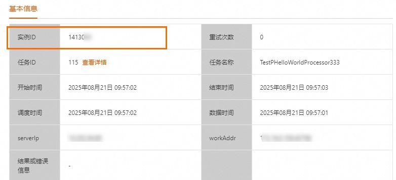

  </li>

  <li>

  Log on to the stuck machine and run **jstack [pid] | grep [instance id] -A 20** to view

  </li>

  </ol>

  the thread stack.

  - If the execution result is similar to the one shown in the following figure, the cause is a business logic issue.

    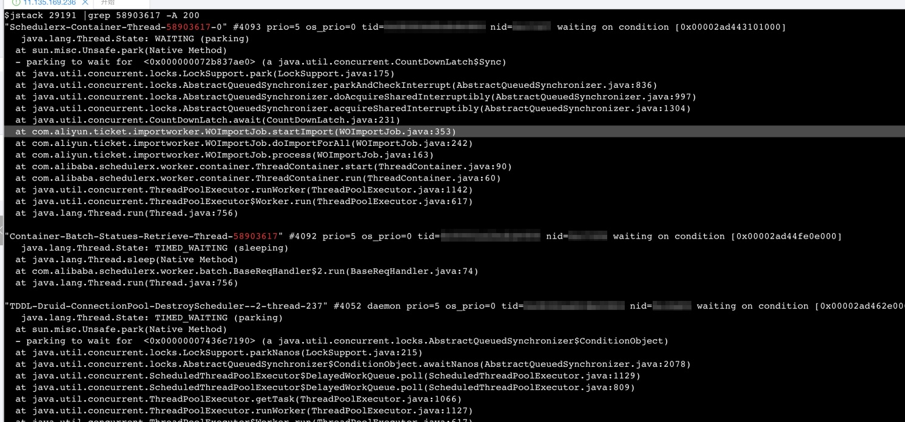

  - Otherwise, contact the SchedulerX helpdesk.

<a id="section-10-2"></a>

## 10.2. Alert FAQ

This topic describes how to handle the alerts that you may receive when using SchedulerX.

**killed from server**

- Alert message

  The timed scheduling task in your \*\*\*\*\*\* environment, namespace: default space, jobid:\*\*\*\*\*\*, trigger instance id:\*\*\*\*\*\*, failed at 2025-10-15 07:40:57. The task ran on machine \*\*\*\*\*\*. The reason may be 'killed from server'. Please monitor the task. [SchedulerX access \*\*\*\*\*\*.com].

- Description

  This alert indicates that a task was automatically purged because it timed out.

**don't update progress more than 30s**

- Alert message

  The timed scheduling task in your \*\*\*\*\*\* environment, namespace: default space, jobid:\*\*\*\*\*\*check_if_complete_BACKIP1), trigger instance id:\*\*\*\*\*\*, failed at 2025-10-15 07:40:57. The task ran on machine \*\*\*\*\*\*. The reason may be 'jobInstance=\*\*\* don't update progress more than 30s, maybe worker=\*\*\*\*\*\* is down'. Please monitor the task. [SchedulerX access \*\*\*\*\*\*.com].

- Description

  The connection between the client and the server was lost because no heartbeat was sent for more than 30 s. This issue is typically caused by a client deployment or high load. If the issue is caused by a deployment or restart, you can configure automatic retries for failed tasks.
