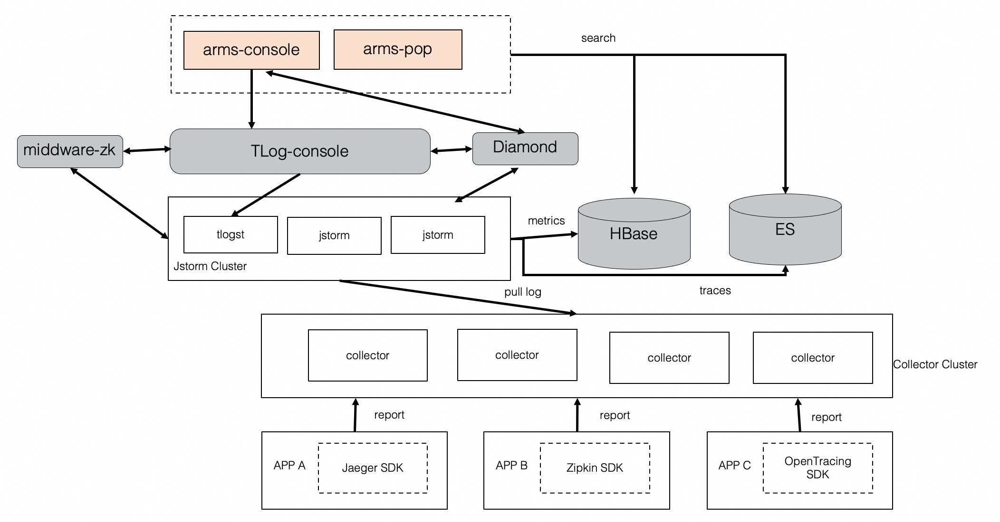
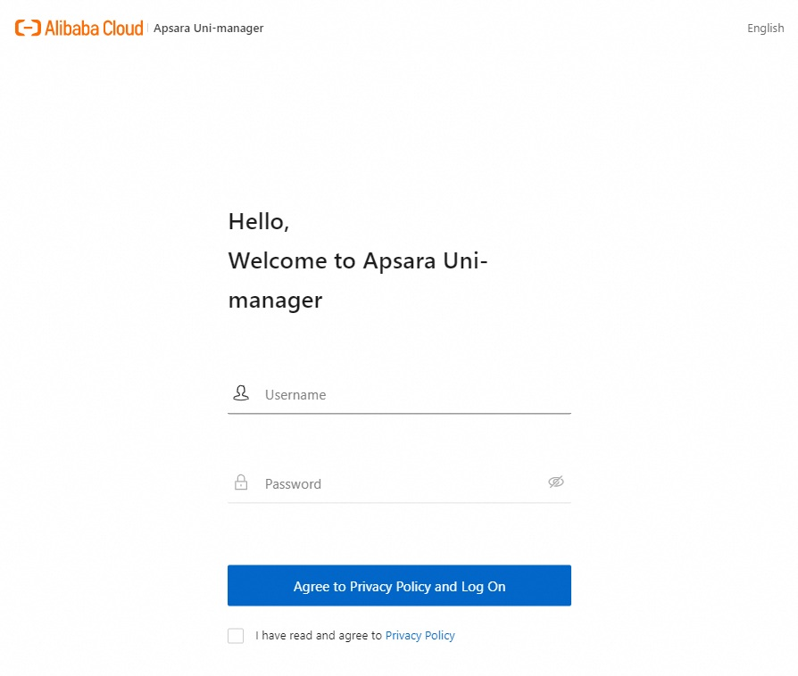
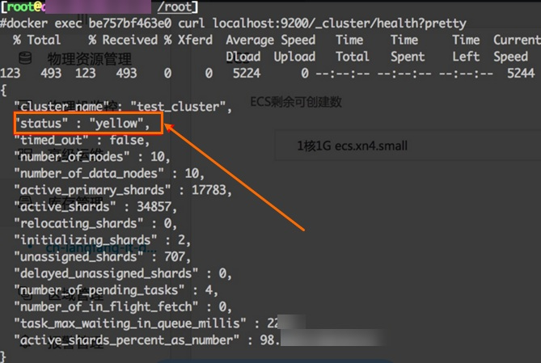
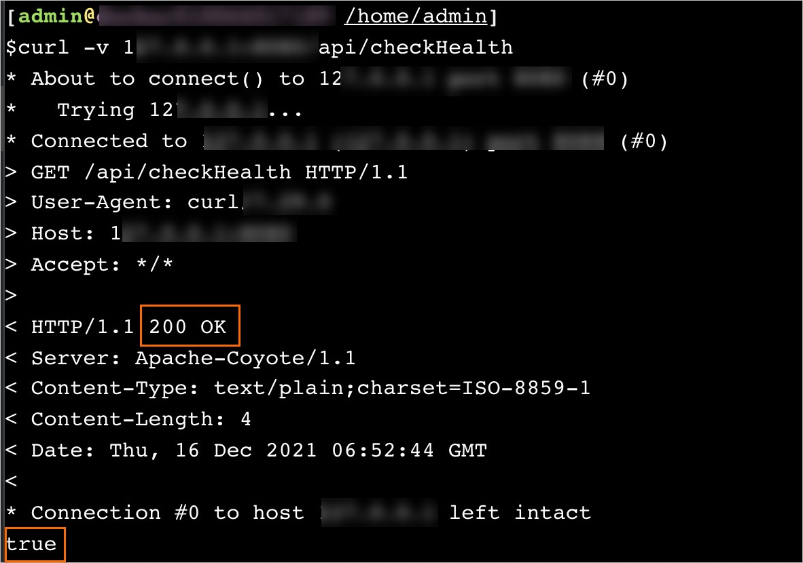

Alibaba Cloud  
Apsara Stack  
Tracing Analysis  
Operations and Maintenance  
Guide  
Product Version: v3.18.6-2607  
Document Version: 20260828

**Table of Contents**

- [1.O&M overview](#section-1)
- [2.Service architecture](#section-2)
    - [2.1. System architecture](#section-2-1)
    - [2.2. Deployment architecture](#section-2-2)
    - [2.3. Server roles](#section-2-3)
- [3.System inspection](#section-3)
    - [3.1. Log on to the Apsara Uni-manager Operations Console](#section-3-1)
    - [3.2. Log on to the Apsara Infrastructure Management console](#section-3-2)
    - [3.3. Inspect Diamond](#section-3-3)
    - [3.4. Inspect HBase](#section-3-4)
    - [3.5. Inspect JStorm](#section-3-5)
    - [3.6. Inspect ESDB](#section-3-6)
    - [3.7. Inspect Collector](#section-3-7)
    - [3.8. Inspect the Tracing Analysis console](#section-3-8)
- [4.Security maintenance](#section-4)
    - [4.1. Account and password maintenance](#section-4-1)
    - [4.2. Log audit](#section-4-2)

<a id="section-1"></a>

# 1.O&M overview

This guide helps O&M engineers perform preventive maintenance on Apsara Stack Tracing Analysis to ensure the long-term stable operation of the system.

O&M engineers can follow the instructions in this guide to handle the system issues that are identified during maintenance. If O&M engineers encounter system issues that are not covered in this guide, they can contact Apsara Stack technical support.

**Requirements**

O&M engineers must possess IT skills, including the knowledge of computer networks, computer operations, and troubleshooting.

In addition, O&M engineers must pass the pre-job training and learn the knowledge for the Apsara Stack system. The required knowledge for the system includes system principles, networking, features, and the usage of maintenance tools.

During the maintenance, O&M engineers must comply with operation procedures to ensure personal safety and system security. No part of user data may be copied or disseminated in any form or by any means without prior written consent from users.

**Usage notes**

To ensure a stable system and prevent unexpected events, O&M engineers must comply with the following guidelines:

- Hierarchical permission management

  Permissions on networks, devices, systems, and data are granted based on the services and roles of O&M engineers. This prevents system faults that are caused by unauthorized operations.

- System security

  - Before O&M engineers perform system operations, they must be aware of the impacts of the operations. This prevents the system from being affected by risky operations.

  - O&M engineers must clearly record the details about the issues that are encountered during the operations. This helps O&M engineers troubleshoot the issues.

- Personal safety and data security

  - O&M engineers must take measures to ensure safety based on device manuals when they use electrical equipment.

  - O&M engineers must use secure devices to access the business network.

  - Unauthorized data replication and dissemination are prohibited.

**Contact us**

O&M engineers can contact Apsara Stack technical support for help during the maintenance.

<a id="section-2"></a>

# 2.Service architecture

<a id="section-2-1"></a>

## 2.1. System architecture

This topic describes the system architecture of Tracing Analysis.



In Apsara Stack, Tracing Analysis consists of the console and API service. Other services such as core computing and storage are dependent on TLog. For more information, see Deployment architecture.

<a id="section-2-2"></a>

## 2.2. Deployment architecture

This topic describes the deployment architecture of Tracing Analysis.

| Category | Component | Description |
| --- | --- | --- |

The Tracing Analysis console displays a list of applications, provides the query and diagnostics of distributed traces, collects application performance data in real time,

Tracing

dynamically

Tracing

Analysis

discovers

Analysis

console

distributed topologies, and supports application-related settings. The API service provides services by using API operations. The console and API service are deployed in the same container.

This component belongs to TLog. After applications integrate the client SDKs of Tracing

ARMS-

Analysis to

Collector

report service call data, the Collector cluster collects the reported service call data.

This component belongs to TLog. The JStorm cluster consists of the TLogst and JStorm components.

JStorm

The JStorm cluster is

TLog

responsible for log collection, cleansing, computing, and writing to storage.

This component belongs to TLog. The HBase cluster

HBase

is responsible for storing the statistics of Tracing Analysis.

This component belongs to TLog. The ESDB cluster

ESDB

is responsible for storing the detailed data of Tracing Analysis.

This component belongs to TLog and is responsible

TLog-Console

for managing collection points and distributing collection rules.

<a id="section-2-3"></a>

## 2.3. Server roles

This topic describes the server roles of Tracing Analysis.

| Project | Cluster | Service | Server role | Description |
| --- | --- | --- | --- | --- |

This server role is used to initialize

arms-arms-

databases for the

console.ArmsCon

Tracing Analysis

soleInit#

console, which is shared between Tracing Analysis

arms-arms-

and ARMS.

BasicCluster

console

Application Real-

This server role

Time Monitoring

is the Tracing

Service (ARMS)

arms-arms-

Analysis console,

console.ArmsCon

which is shared

soleProcess#

between Tracing Analysis and ARMS.

This server role

arms-

is used to

XtraceCluster

arms-xtrac

xtrace.ArmsXtrac

initialize Tracing

eInit#

Analysis resources.

This server role

arms-arms-

is used to receive

arms-arms-

collector.ArmsCol

the trace data

collector

lectorProcess#

reported by Tracing Analysis.

This server role is the ESDB

tlog-

cluster, which is

tlog-tlogEsdb

tlogEsdb.TlogEsd

used to store the

b#

detailed data of Tracing Analysis.

This server role is the HBase

tlog-

cluster, which is

tlog-tlogHbase

tlogHbase.TlogHb

used to store the

ase#

statistics of Tracing Analysis.

This server role

tlog-

is the node on

TLog

BasicCluster

tlogService.Tlogs

which Nimbus

t#

runs in the JStorm cluster.

This server role

tlog-

is the node on

tlogService.Jstor

which Supervisor

m#

runs in the JStorm cluster.

tlog-tlogService

This server role

tlog-

is used to

tlogService.TlogI

initialize TLog

nit#

database resources.

tlog-

This server role

tlogService.TlogC

is the TLog

onsole#

console.

<a id="section-3"></a>

# 3.System inspection

<a id="section-3-1"></a>

## 3.1. Log on to the Apsara Uni-manager Operations Console

This topic describes how to log on to the Apsara Uni-manager Operations Console.

**Prerequisites**

- The endpoint of the Apsara Uni-manager Operations Console and the username and password that are used to log in to the console are obtained from a deployment engineer or an administrator.

  The endpoint of the Apsara Uni-manager Operations Console is in the following format: *regi on-id*.ops.console.*intranet-domain-id*.

- A supported browser is used. We recommend that you use Google Chrome.

**Procedure**

1. Open a web browser.

2. In the address bar, enter the endpoint of the Apsara Uni-manager Operations Console. Press the ENTER key.

   

   > **Note**
   >
   > You can click the current language in the upper-right corner to switch to another language. Simplified Chinese, English, and traditional Chinese are supported.

3. Enter the correct username and password.

   > **Note**
   >
   > - Obtain the username and password that are used to log in to the Apsara Uni-manager Operations Console from a deployment engineer or an administrator.
   >
   > - If you enter an invalid password three consecutive times, the system enables the image verification login feature. If you enter an invalid password five consecutive times, the system locks your account. In this case, you can contact the administrator to unlock your account.
   >
   > - The first time that you log in to the Apsara Uni-manager Operations Console, change the password for your account as prompted.
   >
   >   To enhance security, make sure that your password meets the following requirements:
   >
   >   - The password contains uppercase and lowercase letters.
   >
   >   - The password contains digits.
   >
   >   - The password contains at least one of the following special characters: ! @ # $ %
   >
   >   - The password is 10 to 20 characters in length.

4. Click **Agree to Private Policy and Log On**.

<a id="section-3-2"></a>

## 3.2. Log on to the Apsara Infrastructure Management console

This topic describes how to log on to the Apsara Infrastructure Management console.

**Prerequisites**

- The endpoint of the Apsara Uni-manager Operations Console and the username and password that are used to log in to the console are obtained from a deployment engineer or an administrator.

  The endpoint of the Apsara Uni-manager Operations Console is in the following format: *regi on-id*.ops.console.*intranet-domain-id*.

- A supported browser is used. We recommend that you use Google Chrome.

**Procedure**

1. Open a web browser.

2. In the address bar, enter the endpoint of the Apsara Uni-manager Operations Console. Press the ENTER key.

   

   > **Note**
   >
   > You can click the current language in the upper-right corner to switch to another language. Simplified Chinese, English, and traditional Chinese are supported.

3. Enter the correct username and password.

   > **Note**
   >
   > - Obtain the username and password that are used to log in to the Apsara Uni-manager Operations Console from a deployment engineer or an administrator.
   >
   > - If you enter an invalid password three consecutive times, the system enables the image verification login feature. If you enter an invalid password five consecutive times, the system locks your account. In this case, you can contact the administrator to unlock your account.
   >
   > - The first time that you log in to the Apsara Uni-manager Operations Console, change the password for your account as prompted.
   >
   >   To enhance security, make sure that your password meets the following requirements:
   >
   >   - The password contains uppercase and lowercase letters.
   >
   >   - The password contains digits.
   >
   >   - The password contains at least one of the following special characters: ! @ # $ %
   >
   >   - The password is 10 to 20 characters in length.

4. Click **Agree to Private Policy and Log On**.

5. In the top navigation bar of the Apsara Uni-manager Operations Console, choose **Platform Operation > Apsara Infrastructure Management > Resources** .

<a id="section-3-3"></a>

## 3.3. Inspect Diamond

This topic describes how to inspect Diamond.

**Procedure**

1. Log on to the Apsara Infrastructure Management console.

2. In the left-side navigation pane, choose **O&M Tools > Service Management**.

3. In the upper part of the **Service Management** page, search for and select  `middleWare-jmenv`  from the **Service** drop-down list. On the **Service Instances** tab, click **Instance Details** in the **Actions** column to check whether the instances of  `middleWare-jmenv`  are in a normal state.

   - If so, the  `middleWare-jmenv`  service is normal.

   - If not, contact on-site technical support.

<a id="section-3-4"></a>

## 3.4. Inspect HBase

This topic describes how to inspect HBase.

**Procedure**

1. Log on to the Apsara Infrastructure Management console.

2. In the left-side navigation pane, choose **O&M Tools > Service Management**.

3. In the upper part of the **Service Management** page, search for and select  `tlog-tlogHbase`  from the **Service** drop-down list. On the **Service Instances** tab, click **Instance Details** in the **Actions** column.

4. On the **Component Details** page, click  `TlogHbase#`  in the **Components** pane.

5. On the **Instances** tab, click **Terminal** in the **Actions** column of an instance. In the left-side pane of the page that appears, click the machine name to log on to the machine. Run the following command to log on to the container:

   ```bash
   sudo docker ps | grep hbase
   sudo docker exec -it <HBase container ID> bash
   ```

6. Run the following command to switch to the hadoop user:

   ```text
   su hadoop
   ```

7. Run the following commands to check whether the  `tlog-biz`  table exists:

   ```bash
   cd ~/hbase-current/bin
   list
   ```

   - If so, continue with Step 8.

   - If not, contact on-site technical support.

8. Run the following command to check whether  `coprocessor`  is loaded for the  `tlog-biz` table:

   ```text
   describe 'tlog-biz'
   ```

   - If so, continue with Step 9.

   - If not, contact on-site technical support.

9. Run the following command to check whether data can be read as expected:

   ```text
   scan 'tlog-biz',LIMIT=>10
   ```

   - If so, the service is normal.

   - If not, contact on-site technical support.

<a id="section-3-5"></a>

## 3.5. Inspect JStorm

This topic describes how to inspect JStorm.

**Procedure**

1. Log on to the Apsara Infrastructure Management console.

2. In the left-side navigation pane, choose **O&M Tools > Service Management**.

3. In the upper part of the **Service Management** page, search for and select  `tlog-tlogService`  from the **Service** drop-down list. On the **Service Instances** tab, click **Instance Details** in the **Actions** column.

4. On the **Component Details** page, click  `Tlogst#`  in the **Components** pane.

5. On the **Instances** tab, click **Terminal** in the **Actions** column of an instance. In the left-side pane of the page that appears, click the machine name to log on to the machine. Run the following commands to log on to the container:

   ```bash
   sudo docker ps | grep tlogst
   sudo docker exec -it <tlogst container ID> bash    // The tlogst container ID is returned in the output of the sudo docker ps | grep tlogst command.
   ```

6. Run the following command and enter the password of the admin user to switch to the admin user:

   ```text
   su admin
   ```

7. Run the following command to check whether the  `topologies`  and related nodes are running as expected:

   ```text
   jstorm list
   ```

   - If so, the service is normal.

   - If not, contact on-site technical support.

<a id="section-3-6"></a>

## 3.6. Inspect ESDB

This topic describes how to inspect ESDB.

**Procedure**

1. Log on to the Apsara Infrastructure Management console.

2. In the left-side navigation pane, choose **O&M Tools > Service Management**.

3. In the upper part of the **Service Management** page, search for and select  `tlog-tlogEsdb`  from the **Service** drop-down list. On the **Service Instances** tab, click **Instance Details** in the **Actions** column.

4. On the **Component Details** page, click  `TlogEsdb#`  in the **Components** pane.

5. On the **Instances** tab, click **Terminal** in the **Actions** column of an instance. In the left-side pane of the page that appears, click the machine name to log on to the machine. Run the following commands to log on to the container:

   ```bash
   sudo docker ps | grep esdb
   sudo docker exec -it <esdb container ID> bash      // The esdb container ID is returned in the output of the sudo docker ps | grep esdb command.
   ```

6. Run the following command and enter the password of the hadoop user to switch to the hadoop user:

   ```text
   su hadoop
   ```

7. Run the following command to check whether the cluster is in a normal state:

   ```bash
   curl --user arms_admin:arms_admin -POST "IP:9200/_cluster/health?pretty"       // Replace IP with the actual IP address.
   ```

   - If so, continue with Step 9.

   - If not, contact on-site technical support.

   

   The preceding figure shows a sample output. The status parameter in the output indicates the status of the ESDB cluster. In the preceding figure, the cluster is in the yellow state. Valid values of the status parameter:

   - **green**: All primary and replica shards are assigned. The cluster is 100% available.

   - **yellow**: All primary shards are assigned but one or more replica shards are missing. In this case, no data is lost and search results remain intact. However, the high availability of the cluster is weakened. If more shards are missing, data is lost. If the cluster is in the yellow state, troubleshoot the issue at the earliest opportunity.

   - **red**: One or more primary shards and all of their replica shards are missing. In this case, data is lost and only partial data is returned to search requests. An exception is returned to the write requests sent to the missing shards. You can run the following command to resolve the issue:

     ```bash
     curl --user arms_admin:arms_admin -POST 'ip:9200/_cat/indices?v'
     ```

     > **Note**
     >
     > You can run this command to view the information of all indexes. Find the indexes in the red state. If the cluster has a large number of indexes, you can copy the index information to a file and search for indexes and shards by using the keyword red. If the indexes in red are not required, you can delete the indexes. Then, the cluster enters the green state. You can also run reroute commands to forcibly assign the shards. This operation may be risky. Proceed with caution.

8. Run the following command to check whether the cluster has abnormal indexes:

   ```bash
   curl --user arms_admin:arms_admin -POST 'ip:9200/_cat/indices?v'
   ```

   Determine whether an index is abnormal based on its name. Except for system indexes, each index name uses a valid date as the suffix in the following format: Year-Month-Day or Year-Month. If a large number of index names contain an invalid date, the cluster has abnormal indexes. You can delete the abnormal indexes. Examples of abnormal index names:

   ```text
   arms_trace_armsmg_7042-04-13
   arms_trace_armsmg_2476-02-17 
   arms_trace_armsmg_7040-03-06
   arms_trace_armsmg_7034-12-25
   arms_trace_armsmg_7035-08-19
   arms_trace_armsmg_2496-01-08
   ```

   If the cluster does not have abnormal indexes, the service is normal.

<a id="section-3-7"></a>

## 3.7. Inspect Collector

This topic describes how to inspect Collector.

**Procedure**

1. Log on to the Apsara Infrastructure Management console.

2. In the left-side navigation pane, choose **O&M Tools > Service Management**.

3. In the upper part of the **Service Management** page, search for and select  `arms-arms-collector`  from the **Service** drop-down list. On the **Service Instances** tab, click **Instance Details** in the **Actions** column.

4. On the **Component Details** page, click  `ArmsCollectorProcess#`  in the **Components** pane.

5. On the **Instances** tab, click **Terminal** in the **Actions** column of an instance. In the left-side pane of the page that appears, click the machine name to log on to the machine. Run the following command to log on to the container:

   ```bash
   sudo docker ps | grep collector
   sudo docker exec -it <collector container ID> bash
   ```

6. Run the following command and enter the password of the admin user to switch to the admin user:

   ```text
   su admin
   ```

7. Run the following command to check whether the service is normal:

   ```bash
   curl -v 127.0.0.1:8080
   ```

   

   As shown in the preceding figure, if the command output contains  `200 OK`  and  `true` , the service is normal. Otherwise, contact on-site support.

<a id="section-3-8"></a>

## 3.8. Inspect the Tracing Analysis console

Log on to the user-side environment. If you can open the Tracing Analysis console, the service is normal. Otherwise, contact on-site support.

<a id="section-4"></a>

# 4.Security maintenance

<a id="section-4-1"></a>

## 4.1. Account and password maintenance

The accounts and passwords of Tracing Analysis are the same as those of the Apsara Uni-manager Management Console. The accounts and passwords of TLog are the same as those of the Apsara Uni-manager Operations Console.

<a id="section-4-2"></a>

## 4.2. Log audit

This topic describes the logs of Tracing Analysis.

Table 1. Tracing Analysis console

| Log path | Description |
| --- | --- |
| /home/admin/logs/arms/arms-console.log | The business logs of ARMS-Console. |
| /home/admin/taobao-tomcat-production-7.0.85/logs/catalina.out | The catalina logs of Tomcat. |
| /home/admin/taobao-tomcat-production-7.0.85/logs/localhost.log | The localhost logs of Tomcat. |

Table 2. Tracing Analysis API service

| Log path | Description |
| --- | --- |
| /home/admin/logs/arms/arms-pop.log | The business logs of ARMS-Pop. |
| /home/admin/arms-pop/taobao-tomcat-production/logs/catalina.out | The catalina logs of Tomcat. |
| /home/admin/arms-pop/taobao-tomcat-production/logs/localhost.log | The localhost logs of Tomcat. |

Table 3. ARMS-Collector

| Log path | Description |
| --- | --- |
| /home/admin/logs/arms/arms-collector.log | The service logs of ARMS-Collector. |
| /home/admin/logs/arms/tracelogs | The business logs reported by Tracing Analysis SDKs. Do not delete these logs. |
| /home/admin/taobao-tomcat-production-7.0.85/logs/catalina.out | The catalina logs of Tomcat. |
| /home/admin/taobao-tomcat-production-7.0.85/logs/localhost.log | The localhost logs of Tomcat. |

Table 4. TLog-Console

| Log path | Description |
| --- | --- |
| /home/admin/tlogconsole/logs/tlog-console.log | The business logs of TLog-Console. |
| /home/admin/taobao-tomcat-production-7.0.85/logs/catalina.out | The catalina logs of Tomcat. |
| /home/admin/taobao-tomcat-production-7.0.85/logs/localhost.log | The localhost logs of Tomcat. |

Table 5. JStorm cluster (the TLogst component and Nimbus in the JStorm cluster)

| Log path | Description |
| --- | --- |
| /home/admin/logs/nimbus.log | The business logs of Nimbus in the JStorm cluster. |
| /home/admin/logs/supervisor.log | The logs of Supervisor in the JStorm cluster. |
| /home/admin/logs/check.log | The status check logs of Nimbus and Supervisor. |
| /home/admin/logs/xxxx-worker-&lt;Port&gt;.log | The logs of workers of collection points. |

Table 6. JStorm cluster (the JStorm component and Supervisor in the JStorm cluster)

| Log path | Description |
| --- | --- |
| /home/admin/logs/supervisor.log | The logs of Supervisor in the JStorm cluster. |
| /home/admin/logs/check.log | The status check logs of Supervisor. |
| /home/admin/logs/xxxx-worker-&lt;Port&gt;.log | The logs of workers of collection points. |

Table 7. HBase cluster

| Log path | Description |
| --- | --- |
| /home/hadoop/cluster-data/logs/hbase_health.log | The health check logs of HBase. |
| /home/hadoop/cluster-data/hbase/logs/hbase-hadoop-master-xxx.log | The Master logs. |
| /home/hadoop/cluster-data/logs/hadoop-xxx-namenode-xxx.log | The NameNode logs. |
| /home/hadoop/cluster-data/hbase/logs/hbase-xxx-regionserver-xxx.log | The Region Server logs. |
| /home/hadoop/cluster-data/hbase/logs/hbase-xxx-zookeeper-xxx.log | The ZooKeeper logs. |

Table 8. ESDB cluster

| Log path | Description |
| --- | --- |
| /disk1/test_cluster.log | The runtime logs of ESDB. |
