Alibaba Cloud  
Apsara Stack  
Application Real-time  
Monitoring Service  
User Guide  
Product Version: v3.18.6-2607  
Document Version: 20260828

**Table of Contents**

- [1.What is Application Real-Time Monitoring Service ARMS](#section-1)
- [2.Glossary](#section-2)
- [3.Quick Start](#section-3)
    - [3.1. Log in to the ARMS console](#section-3-1)
    - [3.2. Create a template-based monitoring task](#section-3-2)
    - [3.3. ARMS supports IPv6](#section-3-3)
- [4.Application Monitoring](#section-4)
    - [4.1. What is Application Monitoring?](#section-4-1)
    - [4.2. Quick Start](#section-4-2)
        - [4.2.1. Overview](#section-4-2-1)
        - [4.2.2. Manually install the ARMS agent for a Java application](#section-4-2-2)
        - [4.2.3. Connect an application deployed in EDAS to ARMS](#section-4-2-3)
        - [4.2.4. Install the ARMS agent for a Java application deployed in Docker](#section-4-2-4)
    - [4.3. User Guide](#section-4-3)
        - [4.3.1. Application list](#section-4-3-1)
        - [4.3.2. Application overview](#section-4-3-2)
        - [4.3.3. Application details](#section-4-3-3)
            - [4.3.3.1. Overview](#section-4-3-3-1)
            - [4.3.3.2. JVM monitoring](#section-4-3-3-2)
            - [4.3.3.3. Thread pool monitoring](#section-4-3-3-3)
            - [4.3.3.4. Host monitoring](#section-4-3-3-4)
            - [4.3.3.5. SQL analysis](#section-4-3-3-5)
            - [4.3.3.6. NoSQL analysis](#section-4-3-3-6)
            - [4.3.3.7. Exception analysis](#section-4-3-3-7)
            - [4.3.3.8. Error analysis](#section-4-3-3-8)
            - [4.3.3.9. Upstream applications](#section-4-3-3-9)
            - [4.3.3.10. API call snapshots](#section-4-3-3-10)
        - [4.3.4. Scheduled tasks](#section-4-3-4)
        - [4.3.5. API calls](#section-4-3-5)
        - [4.3.6. Database calls](#section-4-3-6)
        - [4.3.7. NoSQL calls](#section-4-3-7)
        - [4.3.8. External calls](#section-4-3-8)
        - [4.3.9. MQ monitoring](#section-4-3-9)
        - [4.3.10. Continuous performance profiling](#section-4-3-10)
        - [4.3.11. Application diagnosis](#section-4-3-11)
            - [4.3.11.1. Exception analysis](#section-4-3-11-1)
            - [4.3.11.2. Thread profiling](#section-4-3-11-2)
            - [4.3.11.3. Arthas diagnostics](#section-4-3-11-3)
        - [4.3.12. Application environment](#section-4-3-12)
        - [4.3.13. Application settings](#section-4-3-13)
            - [4.3.13.1. Custom Configurations](#section-4-3-13-1)
            - [4.3.13.2. Manage tags](#section-4-3-13-2)
            - [4.3.13.3. Configure tags for ARMS by using RAM permissions](#section-4-3-13-3)
            - [4.3.13.4. Add custom methods for monitoring](#section-4-3-13-4)
            - [4.3.13.5. Delete an application](#section-4-3-13-5)
        - [4.3.14. Global topology](#section-4-3-14)
        - [4.3.15. Trace query](#section-4-3-15)
        - [4.3.16. Usage statistics](#section-4-3-16)
        - [4.3.17. Agents](#section-4-3-17)
    - [4.4. Best practices](#section-4-4)
        - [4.4.1. Use trace sampling policies](#section-4-4-1)
        - [4.4.2. Diagnose errors on the server](#section-4-4-2)
        - [4.4.3. Diagnose application freezing](#section-4-4-3)
        - [4.4.4. Associate trace IDs with business logs](#section-4-4-4)
        - [4.4.5. Connect applications in a self-managed cloud to ARMS](#section-4-4-5)
        - [4.4.6. Manage the ARMS agent based on configured alert rules](#section-4-4-6)
    - [4.5. References](#section-4-5)
        - [4.5.1. Java components and frameworks supported by ARMS](#section-4-5-1)
        - [4.5.2. Key statistical metrics](#section-4-5-2)
        - [4.5.3. ARMS SDKs](#section-4-5-3)
    - [4.6. Agent upgrade](#section-4-6)
- [5.LLM Application Monitoring](#section-5)
    - [5.1. Overview](#section-5-1)
    - [5.2. Connect LLM applications to ARMS](#section-5-2)
    - [5.3. Connect OpenClaw to ARMS](#section-5-3)
    - [5.4. Overview](#section-5-4)
    - [5.5. Application list](#section-5-5)
        - [5.5.1. Application overview](#section-5-5-1)
        - [5.5.2. App Performance Analytics](#section-5-5-2)
        - [5.5.3. Token Analysis](#section-5-5-3)
        - [5.5.4. LLM operations](#section-5-5-4)
        - [5.5.5. Trace analysis](#section-5-5-5)
        - [5.5.6. Application Settings](#section-5-5-6)
    - [5.6. LLM trace analysis](#section-5-6)
- [6.Dashboard](#section-6)
    - [6.1. Dashboard overview](#section-6-1)
    - [6.2. Create a dashboard](#section-6-2)
    - [6.3. Manage a dashboard](#section-6-3)
- [7.Alerts](#section-7)
    - [7.1. Create an alert rule](#section-7-1)
    - [7.2. Manage alert rules](#section-7-2)
    - [7.3. Manage alert templates](#section-7-3)
    - [7.4. Manage contacts](#section-7-4)
    - [7.5. Manage contact groups](#section-7-5)
- [8.Integration scenario description](#section-8)
    - [8.1. Connect AgentRuntime to ARMS](#section-8-1)
- [9.Permission Management](#section-9)
    - [9.1. Log in to the Apsara Uni-manager Management Console](#section-9-1)
    - [9.2. Create users and user groups](#section-9-2)
    - [9.3. Create custom roles](#section-9-3)
    - [9.4. Create a RAM role](#section-9-4)
    - [9.5. Permission policy examples](#section-9-5)
- [10.FAQ](#section-10)
    - [10.1. General FAQ](#section-10-1)
    - [10.2. FAQ about application monitoring](#section-10-2)

<a id="section-1"></a>

# 1.What is Application Real-Time Monitoring Service ARMS

Application Real-Time Monitoring Service (ARMS) is an Application Performance Management (APM) product that enables comprehensive monitoring of applications without requiring code modifications. By installing an agent, ARMS can identify error interfaces, slow APIs, reconstruct call parameters, and detect system bottlenecks, significantly improving the efficiency of online troubleshooting.

**Automatic detection of application topologies**

The ARMS Application Monitoring agent automatically detects the upstream and downstream dependencies of applications. Specifically, the agent effectively captures, intelligently computes, and automatically displays the call chains between different applications through Remote Procedure Call (RPC) frameworks such as Dubbo, HTTP, and HSF protocols. You can identify performance bottlenecks and abnormal calls in the system through application topologies.

**Capture of abnormal and slow transactions**

You can further obtain stack analysis reports of slow SQL queries, accumulated Message Queue (MQ) messages, or abnormal classification reports to conduct more detailed analysis of common issues such as errors and slow responses.

**Automatic detection and monitoring of interfaces**

ARMS Application Monitoring automatically detects and monitors common Web frameworks and RPC frameworks in application code. It automatically collects metrics such as the number of calls, response time, and number of errors for Web interfaces and RPC interfaces.

**Multidimensional troubleshooting**

You can view the details of distributed and local method stacks, and perform multidimensional analysis by application, IP address, time consumption, and other dimensions. You can also use the holistic troubleshooting feature in ARMS custom monitoring to exclude complete business order transactions.

<a id="section-2"></a>

# 2.Glossary

This topic explains the meanings of common terms in ARMS.

- ***Alert rule***

  - It refer to how to generate alerts based on datasets and how to send alert notifications. Alert priorities are classified as warning, error, or critical.

- ***Collection rule***

  - It refers to how to collect data from different data source instances in a monitoring task. Collection rules must be defined in monitoring tasks.

- ***Monitoring task***

  - It refers to a monitoring instance that spans the entire process from data collection, data processing, data storage, to result display and export.

- ***Dashboards***

  - It refers to a custom interactive report that displays one or more datasets within a specified time period by using different types of charts.

- ***Time granularity***

  - It refers to the minimum time interval at which data needs to be returned when querying data. For example, it can be 1 day, 2 hours, or 5 minutes.

- ***Dataset***

  - It refers to the definition of aggregation calculation, persistent storage, and Open API access output methods for collected data.

- ***Log cleansing***

  - It refers to the process of transforming log data into standard Key-Value (KV) format through operations such as splitting and static Join.

- ***Data source***

  - It refer to the source from which ARMS obtains data, such as server logs or MQ.

<a id="section-3"></a>

# 3.Quick Start

<a id="section-3-1"></a>

## 3.1. Log in to the ARMS console

This topic describes how to log in to the Application Real-Time Monitoring Service (ARMS) console.

**Prerequisites**

- The URL of the Apsara Uni-manager Management Console is obtained from the deployment engineer.

- A web browser is available. We recommend that you use Google Chrome.

**Procedure**

1. Enter the URL of the Apsara Uni-manager Management Console in the address bar and press the Enter key.

   

   > **Note**
   >
   > - You can click the current language in the upper-right corner to switch to another language.
   >
   > - The Authorized Login button is displayed only when a global identity provider (IdP) is configured in third-party authentication. You can specify a name for the Authorized Login button.
   >
   > - If you need to click Continue multiple times or cannot find the entry to the Apsara Uni-manager Management Console because the browser certificate has expired or HTTPS authentication is enabled in your environment, you must install a valid certificate. Click **Browser certificate installation** in the upper-right corner to open the browser certificate installation guide.

2. Enter your username and password.

   > **Note**
   >
   > - Obtain the username and password from an operations administrator.
   >
   > - The first time you log in to the Apsara Uni-manager Management Console, you must change the password of your account as prompted. For security purposes, the password must be 10 to 32 characters in length. It must contain all of the following character types: uppercase letters, lowercase letters, digits, and special characters. The following special characters are supported: ! @ # $ %

3. Click **Log On**.

4. If multi-factor authentication (MFA) is enabled for your account, perform the corresponding operations in the following scenarios:

   - **This is your first time logging in to the Apsara Uni-manager Management Console after MFA is enabled by the administrator:**

     <ol type="a">

     <li>

     On the Bind Virtual MFA Device page, follow the instructions to bind an MFA device.

     </li>

     <li>

     Enter the username and password again as in Step 2 and click **Log On**.

     </li>

     </ol>

     <ol type="i" start="100">

     <li>

     Enter the 6-digit MFA verification code and click **Authenticate**.

     </li>

     </ol>

   - **You have enabled MFA and bound an MFA device:**

     Enter the 6-digit MFA verification code and click **Authenticate**.

     > **Note**
     >
     > For more information about how to enable MFA and bind an MFA device, see the **Manage MFA** topic in Apsara Uni-manager Management Console User Guide.

5. In the top navigation bar, choose **Products > Middleware > Cloud-native Observability > Application Real-Time Monitoring Service** to go to the ARMS console.

6. In the lower-right corner of the page, click **Switch Account** and configure the **Organization** and **Region** parameters.

7. Click **Access as Administrator** or **Access with Authorized Role** to go to the **Overview** page.

   > **Note**
   >
   > If you use an administrator account, click **Access as Administrator**. If you use a non-administrator account, click **Access with Authorized Role**.

<a id="section-3-2"></a>

## 3.2. Create a template-based monitoring task

This topic describes how to create a template-based monitoring task. In this example, an Enterprise Distributed Application Service (EDAS) application is used.

**Obtain the appId and appName**

When you create a mapping table, you must enter the appId and appName. To obtain the appId and appName of an application in the EDAS console, perform the following steps:

1. Log on to the EDAS console. In the left-side navigation pane, click **Applications**.

2. On the **Applications** page, find the required application and obtain the value in the **Application Name** column. This value is the appName of the application.

3. Click the name of the application to go to the **Basic Information** tab. Obtain the appId in the **Application Information** section.

**Create a mapping table**

1. Log in to the ARMS console.

2. In the left-side navigation pane, choose **Custom Monitoring > Mapping Tables**. On the **Instance List** page, click **Create Mapping Table**.

3. In the **Create Mapping Table** dialog box, configure all the required parameters, and click **OK**.

   <ol type="i">

   <li>

   Set the **Resource Region** parameter to the region in which you want to create a mapping table.

   </li>

   <li>

   Enter a custom resource name in the **Resource Name** field.

   </li>

   <li>

   Enter the 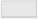

   `appId` and 

   `appName` in the **Schema** field.

   </li>

   <li>

   Set the **Resource Type** parameter to **TEXT**.

   </li>

   <li>

   Enter text content in the appId=appName format in the **Text Content** field.

   > **Note**
   >
   > - The mapping between the appId and appName is the application relationship of the user that you configured in EDAS. You can log on to the EDAS console in Apsara Stack to query the information. For more information, see Obtain the appId and appName.
   >
   > - The text content of the ARMS mapping table is in the JSON array format.

   </li>

   </ol>

   The mapping table is created. The mapping table appears in the list on the **Mapping Tables** page.

   > **Note**
   >
   > Record the resource ID of the mapping table. This resource ID is required in subsequent operations.

**Create a monitoring task**

1. Perform one of the following operations based on your operating system:

   - Windows: Obtain the template file in the JSON format from relevant personnel.

   - Linux: Run the **wget** command.

2. In the left-side navigation pane, choose **Custom Monitoring > Monitoring Jobs**. In the upper-right corner of the page, choose **Create Monitoring Job > Import Custom Template**. In the **Create Export Template Task** dialog box, enter a custom name for the monitoring task, paste the template content in the JSON format to the **Template Configuration** field, and then click **Create and Configure**.

**Configure collection points**

In the **Data Source Configuration** step that appears after you create a monitoring task, configure the following parameters and then click **Save** and **Next**.

1. Select **StarAgent** from the **Log Source Type** drop-down list.

2. Set the **Log Path** parameter to the path of the eagleeye.log file on the monitored Elastic Compute Service (ECS) instances.

3. Paste the IP addresses of the ECS instances obtained from the EDAS IP URL to the **Collection Target** field.

   > **Note**
   >
   > Enter the IP addresses of the monitored instances. If multiple Apsara Stack environments exist, such as the staging and production environments, you can edit the IP addresses based on the actual situation. If only one environment exists, you can access http://{TLog domain name of EDAS in the actual environment}/api/EdasIp, such as http://tlog-internal.console.xxx.cn/api/EdasIp, and copy the page content to obtain all IP addresses. For the domain name of EDAS TLog, consult the on-site staff of the Apsara Stack environment or the EDAS team.

4. Select **Auto-Detect** from the **Encoding** drop-down list.

**Configure the mapping table**

1. In the **Log Cleansing** step, scroll down to find the **ARMS Mapping Table Resource** block, set the **Mapping Table ID** parameter to the resource ID recorded when you create a mapping table, and then click **Save** and **Next**.

2. In the **Dataset and Alarm Configuration** step, click **Save** and **Finish Configuration**.

3. In the **Start Task** dialog box, select a consumption location, and click **OK**.

   The monitoring task is started.

**What to do next**

1. After the task runs for a period of time, click **View** to go to the details page of the task. Click **Task run details** in the left-side navigation pane and check for data inflows in the **Data Pulling** section. Click **Dataset Details** in the left-side navigation pane and check whether data is available.

2. Create a dashboard. For more information, see Create a dashboard.

<a id="section-3-3"></a>

## 3.3. ARMS supports IPv6

Alibaba Cloud Application Real-Time Monitoring Service (ARMS) supports IPv6.

**Prerequisites**

You have created an application monitoring job. For more information, see Application Monitoring Onboarding Overview.

**Operation Guide**

**ARMS Server-side Upgrade**

1. Log on to the Apsara Infrastructure Management console.

2. In the top menu bar of the Apsara Uni-manager Operations Console, choose **Platform O&M > Apsara Infrastructure Management > Resource Management**.

3. In the navigation pane on the left, choose **Resource Management > Product Cluster O&M**. In the **Product|Cluster** search box, search for  `ARMS` .

4. In the product list, click **Cluster Details** for the destination cluster.

5. On the cluster details page, click the **Desired State Configuration** tab. To enable the IPv6 feature, set  `"vip_protocols": "ipv4+ipv6"`  in kv.conf and tag.conf.

   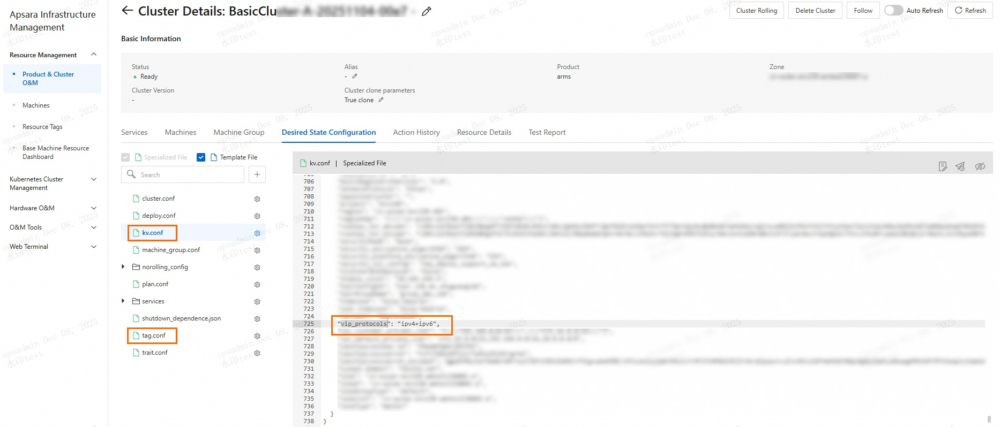

6. On the **Cluster Details** page, click the **Resource Details** tab. Click **Resource Application Result** to view the IP address information. Then, test the connectivity by running the  `ping6 <IPv6 address or domain name>`  command.

   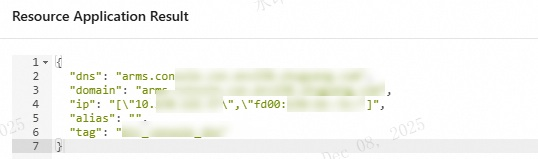

**Enable IPv6 for ArmsAgent**

1. Log on to the Application Real-Time Monitoring Service console.

2. In the navigation pane on the left, choose **Application Monitoring > Application List**.

3. On the **Application List** page, click the name of the application.

4. In the navigation pane on the left, click **Application Settings**. On the page that appears, click the **Custom Configuration** tab.

5. In the **Custom Configuration** tab, in the **Advanced Settings** section, click the **Enable IPv6** toggle.

   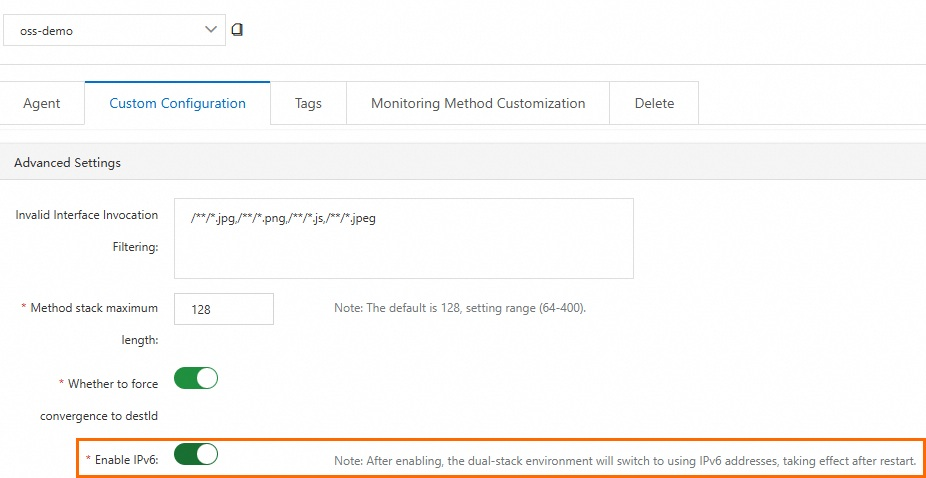

**Globally Enable IPv6**

Log on to the ARMS container.

```bash
env |grep arms_pop_domain
curl -v http://arms_pop_domain/trace/Ipv6ConfigService -dregionId="" -dipv6Status=""
```

> **Note**
>
> Set dipv6Status to true to enable IPv6, or false to disable it.

**Page Validation**

1. Log on to the Application Real-Time Monitoring Service console.

2. In the navigation pane on the left, choose **Application Monitoring > Application List**.

3. On the **Application List** page, click the name of the application.

4. In the navigation pane on the left, click **Application Details**.

   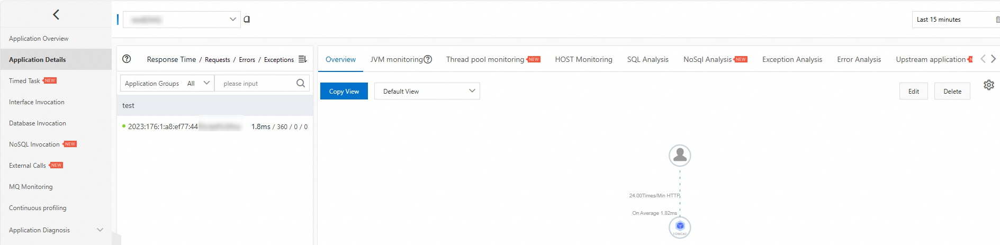

<a id="section-4"></a>

# 4.Application Monitoring

<a id="section-4-1"></a>

## 4.1. What is Application Monitoring?

Application Monitoring helps you identify abnormal and slow API calls, view request parameters, and detect system bottlenecks. This improves the efficiency of online troubleshooting.

**Automatically discovery of the application topology**

The Application Real-Time Monitoring Service (ARMS) agent can automatically identify the upstream and downstream dependencies of applications. The ARMS agent can capture, compute, and display the traces that are formed by different applications in a remote procedure call (RPC) framework, such as Dubbo, HTTP, or High-speed Service Framework (HSF). You can identify performance bottlenecks and abnormal calls in the system by using the application topology.

**Drill-down analysis on metrics in common diagnostics scenarios**

ARMS can perform drill-down analysis on metrics such as the application response time, request count, and error rate, and display the analysis data by application, event, or database.

**Capture of abnormal and slow transactions**

You can obtain the stack analysis reports of slow SQL queries, accumulated Message Queue (MQ) messages, or exceptions, and conduct more detailed analysis.

**Automatically discovery and monitoring of API requests**

ARMS can automatically discover and monitor common web frameworks and RPC frameworks in application code. ARMS can also automatically collect statistics on metrics such as the number of calls, response time, and error count of web API requests and RPC API requests.

**Trace-based transaction snapshot query**

ARMS intelligently collects problematic transactions based on traces and identifies the sources of exceptions or errors based on detailed data.

**Multi-dimensional troubleshooting**

You can view the details of distributed and local call stacks, and perform analysis based on multiple dimensions, such as application, IP address, and time consumption. You can also use the comprehensive troubleshooting feature of ARMS Custom Monitoring to troubleshoot issues with transactions and tickets.

**Integration with the Apsara Stack PaaS platform**

Through integration with Apsara Stack Enterprise Distributed Application Service (EDAS), ARMS improves the effectiveness of Application Monitoring that runs on the Apsara Stack distributed middleware platform.

<a id="section-4-2"></a>

## 4.2. Quick Start

<a id="section-4-2-1"></a>

### 4.2.1. Overview

Before you use the Application Monitoring feature of Application Real-Time Monitoring Service (ARMS) to monitor applications, you must install the ARMS agent. Then, you can view a wide variety of metrics in the ARMS console. You can install the ARMS agent by using any of the following methods:

- Manually install the ARMS agent for a Java application

- Connect an application deployed in EDAS to ARMS

- Install the ARMS agent for a Java application deployed in Docker

<a id="section-4-2-2"></a>

### 4.2.2. Manually install the ARMS agent for a Java application

After you install the Application Real-Time Monitoring Service (ARMS) agent for a Java application, ARMS starts to monitor the Java application. Then, you can view the monitoring data of the Java application, such as the application topology, traces, abnormal transactions, slow transactions, and SQL analysis. This topic describes how to manually install the ARMS agent for a Java application.

**Prerequisites**

- The third-party components or frameworks that your application uses are supported by ARMS. For more information, see Java components and frameworks supported by ARMS.

- If the JDK version is 1.8.0_25 or 1.8.0_31, the agent may not be installed. Upgrade the JDK to the latest version of 1.8.X.

**Procedure**

1. Log in to the ARMS console.

2. In the left-side navigation pane, choose **Application Monitoring > Applications**.

3. On the **Applications** page, click **Add Application**.

4. On the **Add Application** page, select **Java**.

5. Download the ARMS agent and click **Next** in the **Download Agent** step on the **Add Application** page. You can download the ARMS agent by using either of the following methods:

   - Method 1: Manually download the ARMS agent. In the **Download Agent** step, click **Download Agent**.

   - Method 2: Run the **wget** command.

6. Go to the directory of the installation package, and run the following command to decompress the installation package to a working directory:

   ```text
   unzip ArmsAgent.zip -d /{user.workspace}/ 
   ```

   > **Note**
   >
   > {user.workspace} is a sample directory. Replace the sample directory with the actual directory.

7. Copy the license key in the upper part of the **Add Application** page.

8. Add the **AppName** and **LicenseKey** parameters by using either of the following methods, and then click **Next**.

   > **Note**
   >
   > Replace  `{LicenseKey}`  in the sample code with your license key. Replace  `{AppName}`  with your application name, which cannot contain Chinese characters. Replace  `{user.workspace}`  with the directory to which the installation package of the ARMS agent is decompressed. Replace demoApp.jar with the address of the JAR package.

   - Method 1: Modify the Java Virtual Machine (JVM) parameters based on the runtime environment of your application.

     | Runtime environmen t | Procedure |
     | --- | --- |
     | Tomcat on Linux or macOS | Append the following configurations to the {TOMCAT_HOME}/bin/setenv.sh file:<br><code>JAVA_OPTS="$JAVA_OPTS -</code><br><code>javaagent:/{user.workspace}/ArmsAgent/arms-bootstrap-1.7.0-</code><br><code>SNAPSHOT.jar -Darms.licenseKey={LicenseKey} -Darms.appName=</code><br><code>{AppName}"</code><br>If your Tomcat does not contain the setenv.sh configuration file, open the {TOMCAT_HOME}/bin/catalina.sh file and append the preceding configurations to the <strong>JAVA_OPTS</strong> parameter. For more information, see Line 256 in the catalina.sh file. |
     | Tomcat on Windows | Append the following configurations to the {TOMCAT_HOME}/bin/catalina.bat file:<br><code>set "JAVA_OPTS=%JAVA_OPTS% -</code><br><code>javaagent:/{user.workspace}/ArmsAgent/arms-bootstrap-1.7.0-</code><br><code>SNAPSHOT.jar -Darms.licenseKey={LicenseKey} -Darms.appName=</code><br><code>{AppName}"</code><br>If the preceding configurations do not take effect, append the following configurations to the {TOMCAT_HOME}/bin/catalina.bat file:<br><code>set "CATALINA_OPTS=-javaagent:/{user.workspace}/arms-bootstrap-</code><br><code>1.7.0-SNAPSHOT.jar -Darms.licenseKey={LicenseKey} -Darms.appName=</code><br><code>{AppName}"</code> |
     | Jetty | Append the following configurations to the {JETTY_HOME}/start.ini configuration file:<br><code>--exec</code><br><code>-javaagent:/{user.workspace}/ArmsAgent/arms-bootstrap-1.7.0-</code><br><code>SNAPSHOT.jar</code><br><code>-Darms.licenseKey={LicenseKey}</code><br><code>-Darms.appName={AppName}</code> |
     | Spring Boot | When you start the Spring Boot process, append the <strong>-javaagent</strong> parameter to the startup command.<br><code>java -javaagent:/{user.workspace}/ArmsAgent/arms-bootstrap-1.7.0-</code><br><code>SNAPSHOT.jar -Darms.licenseKey={LicenseKey} -Darms.appName=</code><br><code>{AppName} -jar demoApp.jar</code> |
     | Resin | When you start the Resin process, append the following tags to the conf/resion.xml configuration file:<br><code>&lt;server-default&gt;</code><br><code>&lt;jvm-arg&gt;-javaagent:{user.workspace}/ArmsAgent/arms-</code><br><code>bootstrap-1.7.0-SNAPSHOT.jar&lt;/jvm-arg&gt;</code><br><code>&lt;jvm-arg&gt;-Darms.licenseKey={LicenseKey}&lt;/jvm-arg&gt;</code><br><code>&lt;jvm-arg&gt;-Darms.appName={AppName}&lt;/jvm-arg&gt;</code><br><code>&lt;/server-default&gt;</code><br>Append the following tag to the conf/app-default.xml file:<br><code>&lt;library-loader path="{user.workspace}/ArmsAgent/plugin"/&gt;</code> |
     | Windows | When you run a CMD command to start the Java process, use a backslash (\\) as the delimiter in the mount path of the ARMS agent.<br><code>java -javaagent:\{user.workspace}\ArmsAgent\arms-bootstrap-1.7.0-</code><br><code>SNAPSHOT.jar -Darms.licenseKey={LicenseKey} -Darms.appName=</code><br><code>{AppName} -jar {user.workspace}\demoApp.jar</code> |

     To deploy multiple instances of the same application on a server, set the **-Darms.agentId** parameter to a logical number to differentiate the JVM processes. Example:

     ```text
     java -javaagent:/{user.workspace}/ArmsAgent/arms-bootstrap-1.7.0-SNAPSHOT.jar -Darms.licenseKey={LicenseKey} -Darms.appName={AppName} -Darms.agentId=001 -jar demoApp.jar
     ```

   - Method 2:

     <ol type="a">

     <li>

     Append the following configurations to the arms-agent.config file:

     ```text
     arms.licenseKey={LicenseKey} arms.appName={AppName}
     ```

     </li>

     <li>

     Append the following parameter to the startup script of the Java application:

     ```text
     -javaagent:/{user.workspace}/ArmsAgent/arms-bootstrap-1.7.0-SNAPSHOT.jar 
     ```

     </li>

     </ol>

9. Restart your Java application.

**Verify the result**

After about one minute, if your application is displayed in the application list and some data records are sent, your application is monitored by ARMS.

> **Note**
>
> The **Applications** page displays all the monitored applications in multiple pages, with each page displaying at most 20 applications.

**Uninstall the ARMS agent**

If you no longer need to monitor your Java application by using ARMS, perform the following steps to uninstall the ARMS agent.

1. Delete all parameters that you added, such as **{AppName}** and **{LicenseKey}**. For more information about the parameters, see Step 8.

2. Restart your Java application.

**Change the application name**

If you forget to change the sample name Java-Demo to a custom name, you can change the application name without restarting the application or reinstalling the ARMS agent. For more information, see the "How do I change the name of a common Java application on which an ARMS agent is manually installed?" section of the Application Monitoring FAQ topic.

**References**

FAQ about application monitoring

<a id="section-4-2-3"></a>

### 4.2.3. Connect an application deployed in EDAS to ARMS

You can use the Application Monitoring feature of Application Real-Time Monitoring Service (ARMS) to monitor the topology, API calls, abnormal transactions, and slow transactions of applications deployed in Enterprise Distributed Application Service (EDAS), and conduct SQL analysis on the applications. ARMS is integrated with EDAS. You can connect an EDAS application to ARMS Application Monitoring from the EDAS console.

**Prerequisites**

If the JDK version is 1.8.0_25 or 1.8.0_31, the agent may not be installed. Upgrade the JDK to the latest version of 1.8.X.

**Connect an application to ARMS Application Monitoring from the EDAS console**

1. Log on to the EDAS console.

2. In the left-side navigation pane, click **Applications**.

3. On the **Applications** page, click the name of the application for which you want to enable ARMS Application Monitoring.

4. In the left-side navigation pane, choose **Application Monitoring > Advanced Monitoring** and click **Enable Advanced Application Monitoring**.

5. In the **Note** message, click **OK**.

**View the monitoring data of the EDAS application in ARMS**

After you enable ARMS Application Monitoring for the application, click **Go to ARMS Application Monitoring** to go to the **Applications** page of the Application Monitoring module in the ARMS console. On the **Applications** page, click the name of the application to view its detailed monitoring data.

After you connect an EDAS application to the Application Monitoring feature of ARMS, you can make full use of the application monitoring capabilities of ARMS. Examples:

- Automatic discovery of the application topology

  The ARMS agent can automatically detect upstream and downstream dependencies to efficiently capture, intelligently calculate, and automatically display the traces generated when different applications communicate through the Remote Procedure Call (RPC) framework.

- Automatic detection and monitoring of API operations

  The Application Monitoring feature of ARMS can automatically discover and monitor common web frameworks and RPC frameworks in application code, and automatically collect statistics on metrics such as the number of calls, response time, and number of errors.

For more information about the Application Monitoring feature of ARMS, see What is Application Monitoring?

<a id="section-4-2-4"></a>

### 4.2.4. Install the ARMS agent for a Java application deployed in Docker

After you install the Application Real-Time Monitoring Service (ARMS) agent for a Java application that is deployed in Docker, ARMS starts to monitor the Java application. ARMS automatically adapts to the environment where the application runs. You do not need to set up the runtime environment for Tomcat, Jetty, or Spring Boot applications. This topic describes how to install the ARMS agent for a Java application that is deployed in Docker.

**Prerequisites**

- A Java application is deployed in Docker.

- If the JDK version is 1.8.0_25 or 1.8.0_31, the agent may not be installed. Upgrade the JDK to the latest version of 1.8.X.

**Background information**

ARMS Application Monitoring allows you to monitor Java applications by using the {original-docker-image:tag} image. To do so, edit the Dockerfile file to integrate an existing image. Then, build and start a new image.

**Step 1: Obtain the license key**

1. Log in to the ARMS console.

2. In the left-side navigation pane, choose **Application Monitoring > Applications**.

3. On the **Applications** page, click **Add Application** in the upper-left corner.

4. Copy the license key in the upper part of the **Add Application** page.

**Step 2: Integrate an existing image**

Edit the Dockerfile file to integrate the {original-docker-image:tag} image. Sample Dockerfile:

```text
###################################
##                              ###
##      ARMS APM DEMO Docker    ###
##          For Java            ###
##      withAgent   V0.1        ###
##                              ###
###################################
# Replace {original-docker-image:tag} with your image address. 
FROM {original-docker-image:tag}
WORKDIR /root/
# Replace ****** with your ARMS domain name. 
RUN wget "http://******/download/ArmsAgent.zip" -O ArmsAgent.zip
RUN unzip ArmsAgent.zip -d /root/
# Obtain the license key, as described in Step 1. 
# {AppName} is the name of the application that is monitored by ARMS. The application name cannot contain Chinese characters. 
# If all images are connected to the same application monitoring task, you need to specify only the arms_licenseKey and arms_appName parameters. 
ENV arms_licenseKey={LicenseKey}
ENV arms_appName={AppName}
ENV JAVA_TOOL_OPTIONS ${JAVA_TOOL_OPTIONS} '-javaagent:/root/ArmsAgent/arms-bootstrap-1.7.0-SNAPSHOT.jar -Darms.licenseKey='${arms_licenseKey}' -
Darms.appName='${arms_appName}
### for check the args
RUN env | grep JAVA_TOOL_OPTIONS
### Add custom Dockerfile logic. 
### ......
```

Replace the sample values in the preceding configuration file based on the following instructions.

- Replace  `{original-docker-image:tag}`  with your image address. If you do not have a custom image, use a system image instead.

- Replace  `{LicenseKey}`  with your license key. Replace  `{AppName}`  with the name of your application. The application name cannot contain Chinese characters.

**Step 3: Build and start a new image**

1. Run the  `docker build`  command to build an image.

   ```bash
   docker build -t registry.cn-hangzhou.aliyuncs.com/arms-docker-repo/arms-springboot-demo:v0.1 -f /{workspace}/Dockerfile /{workspace}/
   ```

   > **Note**
   >
   > Replace  `registry.cn-hangzhou.aliyuncs.com/arms-docker-repo/arms-springboot-demo:v0.1`  with the actual image name.

2. Run the  `docker run`  command to start the image.

   ```bash
   docker run -d -p 8081:8080 registry.cn-hangzhou.aliyuncs.com/arms-docker-repo/arms-springboot-demo:v0.1
   ```

   > **Note**
   >
   > Replace  `registry.cn-hangzhou.aliyuncs.com/arms-docker-repo/arms-springboot-demo:v0.1`  with the actual image name.

**Verify the result**

After about one minute, if your application is displayed in the application list and some data records are sent, your application is monitored by ARMS.

**Uninstall the ARMS agent**

If you no longer need to monitor the Java application deployed in Docker, perform the following steps to uninstall the ARMS agent:

1. Delete the content added to the Dockerfile file in Step 2: Integrate an existing image.

2. Run the  `docker build`  command to build an image.

3. Run the  `docker run`  command to start the image.

**References**

FAQ about application monitoring

<a id="section-4-3"></a>

## 4.3. User Guide

<a id="section-4-3-1"></a>

### 4.3.1. Application list

On the **Applications** page, you can view the applications connected to Application Real-Time Monitoring Service (ARMS).

1. Log in to the ARMS console.

2. In the left-side navigation pane, choose **Application Monitoring > Applications**.

3. On the **Applications** page, view the applications connected to ARMS.

   | Parameter or UI element | Description |
   | --- | --- |
   | Add Application | Connect an application to ARMS. For more information, see Overview. |
   | Application Name | The name of the application. |
   | Tags | You can filter applications by tag. For more information about how to add tags to an application, see Manage tags. |
   | Metrics | The data for the following metrics after an application is connected:<br>• Health Rate<br>• Requests<br>• Errors<br>• Response Time<br>• Exceptions<br>• Response Time (Last 10 Minutes) |
   | Actions | <strong>Settings</strong>: Click this option to go to the Application Settings page.<br>On the Application Settings page, you can perform the following operations:<br>• Specify custom monitoring parameters. For more information, see Customize application settings.<br>• Add a custom method for monitoring. For more information, see Add custom methods for monitoring.<br>• Delete an application. For more information, see Delete an application. |
   | Pagination | You can specify the number of applications displayed on each page. |

<a id="section-4-3-2"></a>

### 4.3.2. Application overview

The Application Overview page of an application in the Application Real-Time Monitoring Service (ARMS) console displays the key metrics and upstream and downstream dependent components of the application. You can learn about the overall health status of the application based on the information.

**Entry point**

1. Log in to the ARMS console.

2. In the left-side navigation pane, choose **Application Monitoring > Applications**.

3. On the **Applications** page, click the name of the application that you want to view. The **Application Overview** page appears.

   On the **Application Overview** page, click the **Overview** or **Topology** tab in the upper part to view corresponding information.

**Overview tab**

On the **Overview** tab, you can view the following performance metrics:

- Total Requests, Average Response Time, Errors, Real Time Instance Count, Full GC, Slow SQL, Exceptions, and Thread Profiling. You can also check how the values of these metrics have changed since the last week or last day on this tab.

- Application Support Services: displays the data generated when users access the application, such as the data generated when a user accesses the application in a browser. This section displays the following two metrics: Application Service Request and Application Service Average Response Time.

- Application Dependent Services: displays the data generated when the application accesses other services, such as a database. This section displays the following three metrics: Application Dependent Service Request, Application Dependent Service Average Response Time, and App Instance Count.

- System Info: displays time series curves for CPU utilization, memory usage, and load.

- Statistical Analysis: displays the slow calls and exception types.

**Topology tab**

On the **Topology** tab, you can view the upstream and downstream components of your application and the call relationship between the components and the application in the topology. The topology helps you identify the bottlenecks of your application.

**Copy a view**

You can use the Copy View feature to create a custom topology.

1. Click **Copy View**. In the dialog box that appears, configure the **View Name** parameter and specify whether to set the view as the default view.

2. Click **Edit Topology** and perform the following operations to adjust the topology:

   <ol type="i">

   <li>

   Right-click a node to view the upstream nodes, downstream nodes, and details of the node, copy the node information, or remove the node.

   </li>

   <li>

   Double-click a node to view its downstream nodes.

   </li>

   <li>

   Move the pointer over a node or a dot on a line between nodes to view the following

   </li>

   </ol>

   information:

   <ol type="a">

   <li>

   Service name

   </li>

   <li>

   QPS: the number of queries per second

   </li>

   </ol>

   <ol type="i" start="100">

   <li>

   RT: the response time in milliseconds

   </li>

   <li value="500">

   ERROR: the number of failed queries per second

   </li>

   </ol>

3. Click **OK**.

**Edit or delete a view**

You can edit or delete a custom topology.

1. Select a view from the drop-down list on the right of **Copy View** and click **Edit**.

2. In the dialog box that appears, change the view name.

3. Click **Edit Topology** to modify the view, and then click **OK**.

4. If the current topology is no longer needed, click **Delete** in the upper-right corner to delete it.

<a id="section-4-3-3"></a>

### 4.3.3. Application details

<a id="section-4-3-3-1"></a>

#### 4.3.3.1. Overview

This topic describes how to obtain an overview of an application. On the Overview tab of the application, you can view the application topology, request count, response time, and error count.

**Entry point**

1. Log on to the Application Real-Time Monitoring Service (ARMS) console.

2. In the left-side navigation pane, choose **Application Monitoring > Applications**.

3. On the **Applications** page, click the name of your application.

4. In the left-side navigation pane, click **Application Details**.

5. On the **Application Details** page, select an instance where the application is deployed and configure a time period. The **Overview** tab appears by default.

**Topology**

The application topology section displays the topology of call relationships between internal services of the application in the specified time period.

**Optional:** In the application topology section, you can perform the following operations:

- Click the plus icon or scroll the mouse wheel forward to zoom in the topology.

- Click the minus icon or scroll the mouse wheel backward to zoom out the topology.

- Click the RESET icon to restore the topology to the default size.

- Click a node to highlight the topology that is associated with the node.

**Copy a view**

You can use the Copy View feature to create a custom topology.

1. Click **Copy View**. In the dialog box that appears, configure the **View Name** parameter and specify whether to set the view as the default view.

2. Click **Edit Topology** and perform the following operations to adjust the topology:

   <ol type="i">

   <li>

   Right-click a node to view the upstream nodes, downstream nodes, and details of the node, copy the node information, or remove the node.

   </li>

   <li>

   Double-click a node to view its downstream nodes.

   </li>

   <li>

   Move the pointer over a node or a dot on a line between nodes to view the following

   </li>

   </ol>

   information:

   <ol type="a">

   <li>

   Service name

   </li>

   <li>

   QPS: the number of queries per second

   </li>

   </ol>

   <ol type="i" start="100">

   <li>

   RT: the response time in milliseconds

   </li>

   <li value="500">

   ERROR: the number of failed queries per second

   </li>

   </ol>

3. Click **OK**.

**Edit or delete a view**

You can edit or delete a custom topology.

1. Select a view from the drop-down list on the right of **Copy View** and click **Edit**.

2. In the dialog box that appears, change the view name.

3. Click **Edit Topology** to modify the view, and then click **OK**.

4. If the current topology is no longer needed, click **Delete** in the upper-right corner to delete it.

**Number of requests**

The **Requests** section displays the time series curve that indicates the number of requests of the application in the specified time period.

**Optional:** In the **Requests** section, you can perform the following operations:

- Move the pointer over a chart to view the detailed statistics.

- Select a time range to view the statistics in the specified time range.

- Click the  icon to view the statistics of the metric in a specific time range, or compare the

  statistics in the same period on different days.

- Click the  icon to create an alert for the metric. For more information, see Create an alert

  rule.

**Response time**

The **Response Time** section displays the time series curve that indicates the response time of the application in the specified time period.

**Optional:** In the **Response Time** section, you can perform the following operations:

- Move the pointer over a chart to view the detailed statistics.

- Select a time range to view the statistics in the specified time range.

- Click the  icon to view the statistics of the metric in a specific time range, or compare the

  statistics in the same period on different days.

- Click the  icon to create an alert for the metric. For more information, see Create an alert

  rule.

**Number of errors**

The **Errors** section displays the time series curve that indicates the number of errors of the application in the specified time period.

**Optional:** In the **Errors** section, you can perform the following operations:

- Move the pointer over a chart to view the detailed statistics.

- Select a time range to view the statistics in the specified time range.

- Click the  icon to view the statistics of the metric in a specific time range, or compare the

  statistics in the same period on different days.

- Click the  icon to create an alert for the metric. For more information, see Create an alert

  rule.

**HTTP status codes**

The **HTTP - Status Code** section displays the time series curve that shows statistics on the HTTP status codes of the application in the specified time period.

**Optional:** In the **HTTP - Status Code** section, you can perform the following operations:

- Move the pointer over a chart to view the detailed statistics.

- Select a time range to view the statistics in the specified time range.

- Click a legend to hide or show the data.

- Click the  icon to view the statistics of the metric in a specific time range, or compare the

  statistics in the same period on different days.

<a id="section-4-3-3-2"></a>

#### 4.3.3.2. JVM monitoring

The Java Virtual Machine (JVM) monitoring feature allows you to monitor key JVM metrics, including the metrics related to the cumulative garbage collection (GC) details, heap memory details, metaspace details, non-heap memory details, direct buffer details, and JVM thread count. This topic describes the JVM monitoring feature and shows you how to view the JVM metrics.

**Entry point**

1. Log on to the Application Real-time Monitoring Service (ARMS) console.

2. In the left-side navigation pane, choose **Application Monitoring > Applications**.

3. On the **Applications** page, click the name of the application that you want to view.

4. In the left-side navigation pane, click **Application Details**.

5. On the **Application Details** page, click the instance that you want to view in the left-side pane, and then click the **JVM monitoring** tab on the right side.

**View the JVM metrics**

On the **JVM monitoring** tab, you can view the time series curves for the instantaneous GC count, instantaneous GC time consumption, heap memory details, metaspace details, non-heap memory details, direct buffer details, and JVM thread count.

- You can click **Instantaneous** or **Accumulated** in the upper-right corner of the **Instantaneous Count** and **Instantaneous Duration** charts to switch between different curves. You can view the time series curves for the instantaneous GC count, accumulated GC count, instantaneous GC time consumption, and accumulated GC time consumption.

- You can click the name of a metric such as FullGC Count on a chart to show or hide the metric.

  > **Note**
  >
  > Each chart must contain at least one visible metric. If only one metric is displayed in a chart, you cannot hide the metric.

**Metrics**

The JVM monitoring feature can be used to monitor the following metrics:

- Instantaneous and accumulated GC details

  - Number of full heap GCs (full GCs)

  - Number of GCs in the young generation

  - Time consumed for full GCs

  - Time consumed for GCs in the young generation

- Heap memory details

  - Total heap memory

  - Size of the heap memory in the old generation in bytes

  - Size of the heap memory in the young generation (survivor space) in bytes

  - Size of heap memory in the young generation (eden space) in bytes

- Metaspace details

  Size of metaspace in bytes

- Non-heap memory details

  - Size of the committed non-heap memory in bytes

  - Initial size of the non-heap memory in bytes

  - Maximum size of the non-heap memory in bytes

- Direct buffer details

  - Total direct buffer size in bytes

  - Used direct buffer size in bytes

- JVM thread details

  - Total number of threads

  - Number of deadlocked threads

  - Number of new threads

  - Number of blocked threads

  - Number of runnable threads

  - Number of terminated threads

  - Number of threads in the timed waiting state

  - Number of waiting threads

<a id="section-4-3-3-3"></a>

#### 4.3.3.3. Thread pool monitoring

You can use the thread pool monitoring feature to monitor the metrics of the thread pool used by an application. The metrics include the number of core threads, current number of threads, maximum number of threads allowed, number of active threads, and maximum number of tasks allowed in the task queue.

**Enable thread pool monitoring**

1. Log on to the Application Real-time Monitoring Service (ARMS) console.

2. In the left-side navigation pane, choose **Application Monitoring > Applications**.

3. On the **Applications** page, click the name of your application.

4. In the left-side navigation pane, click **Application Settings**. On the page that appears, click the **Custom Configuration** tab.

5. On the **Custom Configuration** tab, turn on **Thread pool monitoring** in the **Advanced Settings** section.

   > **Important**
   >
   > You can use the thread pool monitoring feature to monitor the thread pools in frameworks such as Apache Tomcat, Apache Dubbo, and High-speed Service Framework (HSF). To enable this feature, you must update the ARMS agent to the latest version. This feature takes effect after you restart your application.

**View metrics for thread pool monitoring**

After you enable the thread pool monitoring feature, you can view the metrics on the **Thread pool monitoring** tab of the **Application Details** page. The **Thread pool monitoring** tab displays the time series curves of the following metrics: the number of core threads, current number of threads, maximum number of threads allowed, number of active threads, and maximum number of tasks allowed in the task queue.

| Metric | Description |
| --- | --- |
| Number of core threads | The number of core threads in the thread pool. |
| Current number of threads | The number of existing threads in the thread pool. |
| Maximum number of threads | The maximum number of threads allowed in the thread pool. |
| Number of active threads | The number of active threads that are processing tasks. |
| Queue size | The maximum number of tasks allowed in the task queue. |

> **Note**
>
> A thread is created to process a newly submitted task in the following scenarios: 1. The number of existing threads in a thread pool is less than that of core threads. In this case, a thread is created even if idle threads exist. 2. The number of existing threads in a thread pool is greater than that of core threads but less than the maximum number allowed. The number of tasks in the task queue reaches the upper limit. The number of existing threads in a thread pool cannot exceed the maximum number of threads allowed in the thread pool.

On the **Thread pool monitoring** tab, you can perform the following operations:

- Move the pointer over a chart to view the detailed statistics.

- Click the name of a metric, such as the number of core threads, on a chart to show or hide the metric.

  > **Note**
  >
  > Each chart must contain at least one visible metric. Therefore, if only one metric is displayed in a chart, you cannot hide this metric.

<a id="section-4-3-3-4"></a>

#### 4.3.3.4. Host monitoring

You can use the host monitoring feature to collect the metrics related to the CPU, memory, disks, load, network traffic, and network packets. This topic describes the host monitoring feature and how to view host monitoring metrics.

**Entry point**

1. Log on to the Application Real-Time Monitoring Service (ARMS) console.

2. In the left-side navigation pane, choose **Application Monitoring > Applications**.

3. On the **Applications** page, click the name of the application that you want to view.

4. In the left-side navigation pane, click **Application Details**.

5. On the **Application Details** page, click the instance that you want to view in the left-side pane, and then click the **HOST Monitoring** tab on the right side.

**View host monitoring metrics**

On the **HOST Monitoring** tab, you can view the time series curves of metrics that are related to the CPU, memory, disks, load, network traffic, and network packets.

- You can click the name of a metric, such as the system CPU utilization, in a chart to show or hide the metric.

  > **Note**
  >
  > Each chart must contain at least one visible metric. If only one metric is displayed in a chart, you cannot hide the metric.

- You can click the line chart icon in the upper-right corner of a chart to view the metric trend in a specific time range, or compare metric trends in two time ranges.

- Click the  icon to create an alert for the metric. For more information, see Create an alert

  rule.

**Metrics**

You can use the host monitoring feature to monitor the following metrics:

- CPU

  - Total CPU utilization

  - System CPU utilization

  - User CPU utilization

  - CPU utilization for I/O waiting

- Memory

  - Total memory

  - Free memory

  - Used memory

  - Memory in PageCache

  - Memory in BufferCache

- Disk

  - Total system disk space (bytes)

  - Free system disk space (bytes)

  - Used system disk space (bytes)

- Load

  System load

- Network traffic

  - Received network traffic (bytes)

  - Sent network traffic (bytes)

- Network packet

  - Number of received network packets

  - Number of sent network packets

  - Number of errors that have occurred when network packets were received

  - Number of discarded network packets

<a id="section-4-3-3-5"></a>

#### 4.3.3.5. SQL analysis

This topic describes how to view the SQL analysis of an application.

**Entry point**

1. Log on to the Application Real-time Monitoring Service (ARMS) console.

2. In the left-side navigation pane, choose **Application Monitoring > Applications**.

3. On the **Applications** page, click the name of your application.

4. In the left-side navigation pane, click **Application Details**.

5. On the Application Details page, select an instance where the application is deployed, configure a time period, and then click the **SQL Analysis** tab.

**SQL statistics**

The **SQL Calls** section displays the time series curve that indicates the SQL call statistics of the application in the specified time period.

**Optional:** In the **SQL Calls** section, you can perform the following operations:

- Move the pointer over a chart to view the detailed statistics.

- Select a time range to view the statistics in the specified time range.

- Click the  icon to view the statistics of the metric in a specific time range, or compare the

  statistics in the same period on different days.

**SQL statement list**

The SQL statement list displays all SQL statements that are executed in the application in the specified time period.

**Optional:** In the SQL statement list, you can perform the following operations:

- Click **Invocation Statistics** in the **Actions** column of an SQL statement to view the time series curve of the SQL call statistics of the SQL statement.

- Click **Interface Snapshot** in the **Actions** column of an SQL statement to view the snapshots of the operations that are called by the SQL statement.

  For more information, see API call snapshots.

<a id="section-4-3-3-6"></a>

#### 4.3.3.6. NoSQL analysis

This topic describes how to view the NoSQL analysis of an application.

**Entry point**

1. Log on to the Application Real-time Monitoring Service (ARMS) console.

2. In the left-side navigation pane, choose **Application Monitoring > Applications**.

3. On the **Applications** page, click the name of the application that you want to view.

4. In the left-side navigation pane, click **Application Details**.

5. On the **Application Details** page, select an instance where the application is deployed, configure a time period, and then click the **NoSql Analysis** tab.

**NoSQL statistics**

The **Call statistics** section displays the time series curve that indicates the NoSQL call statistics of the application in the specified time period.

**Optional:** In the **Call statistics** section, you can perform the following operations:

- Move the pointer over a chart to view the detailed statistics.

- Select a time range to view the statistics in the specified time range.

- Click the  icon to view the statistics of the metric in a specific time range, or compare the

  statistics in the same period on different days.

**Operation command list**

The operation command list displays all operation commands that are run in NoSQL calls of the application in the specified time period.

**Optional:** In the operation command list, you can perform the following operations:

- Click **Invocation Statistics** in the **Actions** column of an operation command to view the NoSQL statistics of the operation command.

- Click **Interface Snapshot** in the **Actions** column of an operation command to view the snapshots of the operations that are called by the operation command.

  For more information, see API call snapshots.

<a id="section-4-3-3-7"></a>

#### 4.3.3.7. Exception analysis

This topic describes how to view the exception analysis details of an application.

**Entry point**

1. Log on to the Application Real-time Monitoring Service (ARMS) console.

2. In the left-side navigation pane, choose **Application Monitoring > Applications**.

3. On the **Applications** page, click the name of your application.

4. In the left-side navigation pane, click **Application Details**.

5. On the **Application Details** page, select an application instance, configure a time period, and then click the **Exception Analysis** tab.

**Exception statistics**

The **Exceptions** section displays the stacked chart of the exception data of the application in the specified time period and the exception list.

**Optional:** In the **Exceptions** section, you can perform the following operations:

- Move the pointer over a chart to view the detailed statistics.

- Select a time range to view the statistics in the specified time range.

- Click the  icon to view the statistics of the metric in a specific time range, or compare the

  statistics in the same period on different days.

**Exception list**

The exception list displays all exceptions of the application in the specified time period.

> **Note**
>
> To filter exceptions, perform the following steps: In the left-side navigation pane, click **Application Settings**. On the page that appears, click the **Custom Configuration** tab. In the **Advanced Settings** section, configure the **Whitelist** field.

**Optional:** In the exception list, you can perform the following operations:

- Click **Invocation Statistics** in the **Actions** column of an exception to view the stacked column chart of the exception.

- Click **Interface Snapshot** in the **Actions** column of an exception to view the snapshots of the operations that are called when the exception occurs.

  For more information, see API call snapshots.

- Click **Details** in the **Actions** column of an exception to view the details of the exception.

<a id="section-4-3-3-8"></a>

#### 4.3.3.8. Error analysis

This topic describes how to view the error analysis details of an application.

**Procedure**

1. Log in to the Application Real-time Monitoring Service (ARMS) console.

2. In the left-side navigation pane, choose **Application Monitoring > Applications**.

3. On the **Applications** page, click the name of the application that you want to view.

4. In the left-side navigation pane, click **Application Details**.

5. On the **Application Details** page, select an instance where the application is deployed, configure a time period, and then click the **Error Analysis** tab.

**Errors**

The **Errors** section displays the time series curve that indicates the number of errors of the application in the specified time period.

**Optional.** In the **Errors** section, you can perform the following operations:

- Move the pointer over a chart to view the detailed statistics.

- Select a time range to view the statistics in the specified time range.

- Click the  icon to view the statistics of the metric in a specific time range, or compare the

  statistics in the same period on different days.

**HTTP Status Code**

The **HTTP - Status Code** section displays the time series curve that indicates the HTTP status code statistics of the application within the specified time period.

**Optional.** In the **HTTP - Status Code** section, you can perform the following operations:

- Move the pointer over a chart to view the detailed statistics.

- Select a time range to view the statistics in the specified time range.

- Click a legend to hide or show the data.

- Click the  icon to view the statistics of the metric in a specific time range, or compare the

  statistics in the same period on different days.

**Error list**

The error list displays all errors of the application in the specified time period.

**Optional.** In the error list, you can perform the following operation:

To view a trace of an error and the business, click the trace ID in the **TraceId** column.

<a id="section-4-3-3-9"></a>

#### 4.3.3.9. Upstream applications

An upstream application of a specific application is an application that sends data to the specific application. This topic describes how to view the information about upstream applications, including the response time, number of requests, and number of errors.

**Entry point**

1. Log on to the Application Real-time Monitoring Service (ARMS) console.

2. In the left-side navigation pane, choose **Application Monitoring > Applications**.

3. On the **Applications** page, click the name of the application that you want to view.

4. In the left-side navigation pane, click **Application Details**.

5. On the **Application Details** page, select an instance where the application is deployed, configure a time period, and then click the **Upstream application** tab.

**Response time**

The **Response Time** section displays the time series curve that indicates the response time of the upstream applications of the application in the specified time period.

In the **Response Time** section, you can perform the following operations:

- Move the pointer over a chart to view the detailed statistics.

- Select a time range to view the statistics in the specified time range.

**Number of requests**

The **Requests** section displays the time series curve that indicates the number of requests of the upstream applications of the application in the specified time period.

In the **Requests** section, you can perform the following operations:

- Move the pointer over a chart to view the detailed statistics.

- Select a time range to view the statistics in the specified time range.

**Number of errors**

The **Errors** section displays a time series curve that indicates the number of errors of the upstream applications of the application in the specified time period.

In the **Errors** section, you can perform the following operations:

- Move the pointer over a chart to view the detailed statistics.

- Select a time range to view the statistics in the specified time range.

<a id="section-4-3-3-10"></a>

#### 4.3.3.10. API call snapshots

This topic describes how to view the snapshots of all API operations that are called in an application. You can view the time when snapshots are created, the time that is consumed for calling each operation, and the status of each operation.

**Procedure**

1. Log in to the Application Real-time Monitoring Service (ARMS) console.

2. In the left-side navigation pane, choose **Application Monitoring > Applications**.

3. On the **Applications** page, click the name of the application that you want to view.

4. In the left-side navigation pane, click **Application Details**.

5. On the **Application Details** page, select an instance where the application is deployed, configure the time period, and then click the **Interface Snapshot** tab.

**View API call snapshots**

The **Interface Snapshot** tab displays all the API operations that are called in the application within the specified time period.

**Optional.** On the **Interface Snapshot** tab, you can perform the following operations:

- Enter the operation name in the search box and click the  icon to view the snapshots of

  the operation.

- To view a trace of an API and the business, find the API and click the trace ID in the **TraceId** column.

<a id="section-4-3-4"></a>

### 4.3.4. Scheduled tasks

A scheduled task can be created to automatically run a program or command on a one-time or recurring basis. You can query the details of a scheduled application monitoring task in the Application Real-Time Monitoring Service (ARMS) console. The details include the task overview, SQL and NoSQL analysis, exception analysis, error analysis, downstream services, and traces.

> **Note**
>
> Application Monitoring of ARMS supports only scheduled tasks of the XXL-JOB type.

**Procedure**

1. Log in to the ARMS console.

2. In the left-side navigation pane, choose **Application Monitoring > Applications**.

3. On the **Applications** page, click the name of the application that you want to view.

4. In the left-side navigation pane, click **Timed Task**.

   The scheduled tasks of the application are displayed in the left-side list on the Timed Task page.

5. Click a scheduled task to view its details.

**View the task overview**

On the **Overview** tab, you can view the detailed call topology of the scheduled task and the time series curves for the number of runs, average running time, number of exceptions, and scheduling latency.

**View SQL and NoSQL analysis**

On the **SQL Analysis** and **NoSql Analysis** tabs, you can view the SQL and NoSQL requests that are initiated by the selected scheduled task. On these tabs, you can locate slow SQL statements or NoSQL statements that hinder the scheduled task.

In the SQL or NoSQL statement list, you can perform the following operations:

- Move the pointer over a chart to view the detailed statistics.

- Select a time range to view the statistics in the specified time range.

- Click the  icon to view the statistics of the metric in a specific time range, or compare the

  statistics in the same period on different days.

- Click **Invocation Statistics** in the **Actions** column of an SQL or NoSQL statement to view the time series curve of the SQL or NoSQL call statistics.

- Click **Interface Snapshot** in the **Actions** column of an SQL or NoSQL statement to view its trace. For more information, see View API call snapshots.

**View exception analysis**

On the **Exception Analysis** tab, you can view the Java exceptions that are thrown from the code of the scheduled task.

In the exception list, you can perform the following operations:

- Move the pointer over a chart to view the detailed statistics.

- Select a time range to view the statistics in the specified time range.

- Click the  icon to view the statistics of the metric in a specific time range, or compare the

  statistics in the same period on different days.

- Click **Invocation Statistics** in the **Actions** column of an exception to view the time series curve of the exception.

- Click **Interface Snapshot** in the **Actions** column of an exception to view the trace of the exception. For more information, see View API call snapshots.

- Click **Details** in the **Actions** column to view the details of the exception.

**View error analysis**

On the **Error Analysis** tab, you can view the error statistics of the scheduled task.

In the error list, you can perform the following operations:

- Move the pointer over a chart to view the detailed statistics.

- Select a time range to view the statistics in the specified time range.

- Click the  icon to view the statistics of the metric in a specific time range, or compare the

  statistics in the same period on different days.

- To view a trace of an error and the business, click the trace ID in the **TraceId** column. For more information, see Trace query.

**View downstream services**

On the **Downstream Services** tab, you can view the API operations and performance metrics of the downstream services that are called by the application. The performance metrics include the response time, number of requests, and number of errors.

On the **Downstream Services** tab, you can perform the following operations:

- Click **Collapse/Expand All** at the top to show or hide all API operations.

- Enter a keyword of the application name or the API operation name in the search box and click the Search icon to search for the API operations whose names contain the keyword.

- If you want to show or hide the information about the performance metrics of an API operation, find the API operation and click the collapse panel or click the upward arrow or downward arrow at the end of the row.

**View API call snapshots**

The **Interface Snapshot** tab displays the trace details of the scheduled task.

On the **Interface Snapshot** tab, you can perform the following operations:

- Enter an operation name in the search box and click the  icon to view the traces of the

  operation.

- Click the trace ID in the **TraceId** column of an operation to view the traces of the operation and business.

<a id="section-4-3-5"></a>

### 4.3.5. API calls

The API call monitoring feature is used to monitor the details of API calls of an application. This feature allows you to view information such as SQL analysis, NoSQL analysis, exception analysis, error analysis, upstream and downstream services, and API call snapshots.

**Procedure**

Perform the following steps to go to the Interface Invocation page:

1. Log in to the Application Real-Time Monitoring Service (ARMS) console.

2. In the left-side navigation pane, choose **Application Monitoring > Applications**.

3. On the **Applications** page, click the name of the application that you want to view.

4. In the left-side navigation pane, click **Interface Invocation**.

**Supported frameworks**

This feature can automatically detect and monitor the APIs provided in the following web frameworks and remote procedure call (RPC) frameworks:

- Tomcat 7+

- Jetty 8+

- Resin 3.0+

- Undertow 1.3+

- WebLogic 11.0+

- SpringBoot 1.3.0+

- HSF 2.0+

- Dubbo 2.5+

- SOFABoot 3.2.0+

**View the details of an API operation**

On the **Overview** tab, you can view the specific call topology of an API operation, and the time series curves for the number of requests, response time, number of errors, and HTTP status codes.

**View SQL and NoSQL analysis**

On the **SQL Analysis** and **NoSql Analysis** tabs, you can view the SQL and NoSQL requests that are initiated within the code of the selected API operation in the left-side pane. On these tabs, you can locate slow SQL statements or NoSQL statements that cause slow responses of an API operation.

In the SQL or NoSQL statement list, you can perform the following operations:

- Move the pointer over a chart to view the detailed statistics.

- Select a time range to view the statistics in the specified time range.

- Click the  icon to view the statistics of the metric in a specific time range, or compare the

  statistics in the same period on different days.

- Click **Invocation Statistics** in the **Actions** column of an SQL or NoSQL statement to view the time series curve of the SQL or NoSQL call statistics.

- Click **Interface Snapshot** in the **Actions** column to view the trace of an SQL or NoSQL statement.

**View exception analysis**

The **Exception Analysis** tab displays the Java exceptions that are thrown from the code of the selected API operation in the left-side pane.

In the exception list, you can perform the following operations:

- Move the pointer over a chart to view the detailed statistics.

- Select a time range to view the statistics in the specified time range.

- Click the  icon to view the statistics of the metric in a specific time range, or compare the

  statistics in the same period on different days.

- Click **Invocation Statistics** in the **Actions** column of an exception to view the time series curve of the exception.

- Click **Interface Snapshot** in the **Actions** column to view the trace of an error stack.

- Click **Details** in the **Actions** column to view the details of the error.

**View error analysis**

On the **Error Analysis** tab, you can view the errors and HTTP status codes of the application. You can also click a value in the TraceId column to view the trace and business information on a new page.

**View the details of API calls for upstream and downstream services**

On the **Upstream Services** and **Downstream Services** tabs, you can view the API operations and performance metrics of the upstream services that call the application and downstream services that are called by the application. The performance metrics include the response time, number of requests, and number of errors.

On the **Upstream Services** and **Downstream Services** tabs, you can perform the following operations based on your business requirements:

- Click **Expand/Collapse All** in the upper part of the tab to show or hide all API operations.

- Enter a keyword of the application name or the API operation name in the search box and click the Search icon to search for the API operations whose names contain the keyword.

- If you want to show or hide the information about the performance metrics of an API operation, find the API operation and click the collapse panel or click the upward arrow or downward arrow at the end of the row.

**View API call snapshots**

The **Interface Snapshot** tab displays the parameter details of API calls.

The parameter details table provides the detailed information about the parameters of the selected API operation. You can click a value in the TraceId column to view the trace information and business information.

<a id="section-4-3-6"></a>

### 4.3.6. Database calls

This topic describes how to view the information about database calls of an application. You can obtain an overview of the database calls of the application and view the information about SQL calls, exceptions, call sources, and API call snapshots.

**Supported SQL databases**

- MySQL

- Oracle

- PostgreSQL

- PPAS

- SQLServer

- MariaDB

- DMDB

**Procedure**

1. Log in to the Application Real-time Monitoring Service (ARMS) console.

2. In the left-side navigation pane, choose **Application Monitoring > Applications**.

3. On the **Applications** page, click the name of the application that you want to manage.

4. In the left-side navigation pane, click **Database Invocation**.

5. On the page that appears, select a database and configure a time period.

6. After you complete the settings, perform the following operations:

   - Click the **Overview** tab to view the general information about the database calls of the application.

   - Click the **SQL Analysis** tab to view the SQL analysis of the application.

   - Click the **Exception Analysis** tab to view the database call exceptions of the application.

   - Click the **Call source** tab to view the information about the applications that call the database of the application.

   - Click the **Interface Snapshot** tab to view the snapshots of the database operations that are called in the application.

**Overview**

The **Overview** tab displays the information about the database of the application. You can view the call topology and time series curves for the number of requests, response time, and number of errors.

**Optional.** On the **Overview** tab, you can perform the following operations:

- Click the  icon to configure the display settings of the topology.

  > **Note**
  >
  > The settings are stored in the browser and remain effective the next time you go to the Overview tab.

- Click the plus icon or scroll the mouse wheel forward to zoom in the topology.

- Click the minus icon or scroll the mouse wheel backward to zoom out the topology.

- Click the RESET icon to restore the topology to the default size.

- Move the pointer over a chart to view the detailed statistics.

- Select a time range to view the statistics in the specified time range.

- Click the  icon to view the statistics of the metric in a specific time range, or compare the

  statistics in the same period on different days.

- Click the  icon to create an alert for the metric. For more information, see Create an

  alert.

**SQL analysis**

The **SQL Analysis** tab displays the column chart for the number of SQL calls, the time series curve for the response time, and a list of SQL statements that are executed in the database.

**Optional.** On the **SQL Analysis** tab, you can perform the following operations:

- Move the pointer over a chart to view the detailed statistics.

- Select a time range to view the statistics in the specified time range.

- Click the  icon to view the statistics of the metric in a specific time range, or compare the

  statistics in the same period on different days.

- Click **Invocation Statistics** in the **Actions** column of an SQL statement to view the SQL call statistics of the SQL statement.

- To view the snapshots of the API that is called by an SQL statement, click **Interface Snapshot** in the **Actions** column of the SQL statement.

**Exception analysis**

The **Exception Analysis** tab displays information about the exceptions of the database.

**Optional.** On the **Exception Analysis** tab, you can perform the following operations:

> **Note**
>
> To filter exceptions, perform the following steps: In the left-side navigation pane, click **Application Settings**. On the page that appears, click the **Custom Configuration** tab. In the **Advanced Settings** section, configure the **Whitelist** field.

- Move the pointer over a chart to view the detailed statistics.

- Select a time range to view the statistics in the specified time range.

- Click the  icon to view the statistics of the metric in a specific time range, or compare the

  statistics in the same period on different days.

- Click **Invocation Statistics** in the **Actions** column of an exception to view the statistics of the exception.

- To view the details of an exception, click **Details** in the **Actions** column of the exception.

**Call sources**

The **Call source** tab displays the information about the call sources of the database.

**Optional.** On the **Call source** tab, you can perform the following operations:

- Enter an application or operation name in the search box and click the  icon to view the

  information about the application that calls the database or the information about the operation that is called.

- Click **view details** next to an operation to view the snapshots of the operation that is called by a call source.

- Move the pointer over a chart to view the detailed statistics.

- Click the  icon to view the statistics of the metric in a specific time range, or compare the

  statistics in the same period on different days.

**View API call snapshots**

The **Interface Snapshot** tab displays the snapshots of all the operations that are called in the database.

**Optional.** On the **Interface Snapshot** tab, you can perform the following operations:

- Enter the operation name in the search box and click the  icon to view the snapshots of

  the operation.

- To view a trace of an API and the business, find the API and click the trace ID in the **TraceId** column.

<a id="section-4-3-7"></a>

### 4.3.7. NoSQL calls

This topic describes how to view the details about NoSQL calls, including the overview, NoSQL analysis, exception analysis, and API call snapshots.

**Supported NoSQL databases**

- Redis

- Memcached

- MongoDB

- Elasticsearch

**Procedure**

1. Log in to the Application Real-Time Monitoring Service (ARMS) console.

2. In the left-side navigation pane, choose **Application Monitoring > Applications**.

3. On the **Applications** page, click the name of the application that you want to view.

4. In the left-side navigation pane, click **NoSQL Invocation**.

5. On the page that appears, select a NoSQL database and specify a time period.

6. After you complete the settings, perform the following operations:

   - Click the **Overview** tab to view the general information about NoSQL calls of the application.

   - Click the **Analysis of Sentence** tab to view the NoSQL calls of the application.

   - Click the **Exception Analysis** tab to view the NoSQL call exceptions of the application.

   - Click the **Interface Snapshot** tab to view the snapshots of the operations that are called during NoSQL calls in the application.

**Overview**

The **Overview** tab displays the information about the NoSQL database of the application. You can view the call topology and time series curves for the number of requests, response time, and number of errors.

**Optional.** On the **Overview** tab, you can perform the following operations:

- Move the pointer over the  icon to configure the display settings of the topology.

  > **Note**
  >
  > The settings are stored in the browser and remain effective the next time you go to the Overview tab.

- Click the plus icon or scroll the mouse wheel forward to zoom in the topology.

- Click the minus icon or scroll the mouse wheel backward to zoom out the topology.

- Click the Reset icon to restore the topology to the default size.

- Move the pointer over a chart to view the detailed statistics.

- Select a time range to view the statistics in the specified time range.

- Click a legend to hide or show the data.

- Click the  icon to view the statistics of the metric in a specific time range, or compare the

  statistics in the same period on different days.

- Click the  icon to create an alert for the metric. For more information, see Create an

  alert.

**NoSQL analysis**

The **Analysis of Sentences** tab displays the column chart for the number of NoSQL calls in the NoSQL database and the list of SQL statements that are executed.

**Optional.** On the **Analysis of Sentences** tab, you can perform the following operations:

- Move the pointer over a chart to view the detailed statistics.

- Select a time range to view the statistics in the specified time range.

- Click the  icon to view the statistics of the metric in a specific time range, or compare the

  statistics in the same period on different days.

- Click **Invocation Statistics** in the **Actions** column of an operation command to view the call statistics of the operation command.

- Click **Interface Snapshot** in the **Actions** column of an operation command to view the snapshots of the operations that are called by the operation command.

**Exception analysis**

The **Exception Analysis** tab displays the exceptions of NoSQL calls.

**Optional.** On the **Exception Analysis** tab, you can perform the following operations:

> **Note**
>
> To filter exceptions, perform the following operations: In the left-side navigation pane, click **Application Settings**. On the page that appears, click the **Custom Configuration** tab, and configure the **Whitelist** field in the Advanced Settings section. For more information, see Customize application settings.

- Move the pointer over a chart to view the detailed statistics.

- Select a time range to view the statistics in the specified time range.

- Click the  icon to view the statistics of the metric in a specific time range, or compare the

  statistics in the same period on different days.

- Click **Invocation Statistics** in the **Actions** column of an exception to view the statistics of the exception.

- Click **Interface Snapshot** in the **Actions** column of an exception to view the snapshots of the operations that are called when the exception occurs.

- Click **Details** in the **Actions** column of an exception to view the details of the exception.

**API call snapshots**

The **Interface Snapshot** tab displays the parameter details of API call snapshots of all NoSQL calls.

**Optional.** On the **Interface Snapshot** tab, you can perform the following operations:

- Enter the operation name in the search box and click the  icon to view the snapshots of

  the operation.

- To view a trace of an API operation and the business, find the API operation and click the trace ID in the **TraceId** column.

<a id="section-4-3-8"></a>

### 4.3.8. External calls

You can use the external call monitoring feature of Application Real-Time Monitoring Service (ARMS) to locate slow calls or errors during the external calls of an application.

**Entry point**

1. Log in to the ARMS console.

2. In the left-side navigation pane, choose **Application Monitoring > Applications**.

3. On the **Applications** page, click the name of the application that you want to view.

4. In the left-side navigation pane, click **External Calls**.

   All external calls of the application are listed in the left-side pane of the **External Calls** page. You can sort the external calls by the response time, request count, error count, or exception count.

**Overview**

Select an external call in the left-side list, and view the number of requests, response time, error count, and HTTP status code of the external call on the **Overview** tab.

**Call sources**

You can click an external call in the left-side pane to view the time series curves for the response time, request count, and error count of all API operations related to the external call on the **Call source** tab.

On the **Call source** tab, you can perform the following operations:

- Click **Expand/Collapse All** in the upper part of the tab to show or hide all API operations.

- Enter a keyword of the application name or the API operation name in the search box and click the Search icon to search for the API operations whose names contain the keyword.

- If you want to show or hide the information about the performance metrics of an API operation, find the API operation and click the collapse panel or click the upward arrow or downward arrow at the end of the row.

- Click **view details** next to an operation to view the snapshots of the operation that is called by a call source.

<a id="section-4-3-9"></a>

### 4.3.9. MQ monitoring

The MQ Monitoring page in Application Real-Time Monitoring Service (ARMS) Application Monitoring displays the message publishing and subscription of Message Queue (MQ) platforms such as RocketMQ, Kafka, RabbitMQ, and AliwareMQ.

**Entry point**

1. Log in to the ARMS console.

2. In the left-side navigation pane, choose **Application Monitoring > Applications**.

3. On the **Applications** page, click the name of your application.

4. In the left-side navigation pane, click **MQ Monitoring**.

5. Click a search result link on the right of the page.

**Tabs**

- On the **Overview** tab, the message publishing and subscription relationship between your application and the MQ data source is displayed in the topology.

- On the **Publishing Statistics** tab, the statistics of message publishing are displayed. The statistics include the request count, response time, and error count.

- On the **Subscription Statistics** tab, the statistics of subscription are displayed. The statistics include the request count, response time, and error count.

- On the **Interface Snapshot** tab, the API call snapshots of message publishing and subscription are provided. You can view the complete trace by using the trace ID and diagnose the issues.

<a id="section-4-3-10"></a>

### 4.3.10. Continuous performance profiling

The continuous performance profiling feature of Application Real-Time Monitoring Service (ARMS) can effectively identify bottlenecks caused by CPU, memory, or I/O in Java programs, and display statistics data by method name, class name, and line number. This helps developers optimize programs, reduce latency, increase throughput, and save costs. This topic describes how to enable the continuous performance profiling feature, and how to view the performance profiling data.

A performance test has been performed for the continuous performance profiling feature. When all features of a mainstream Spring Web application are enabled, the CPU utilization increases by about 5%, the off-heap memory usage increases by about 50 MB, and the garbage collection (GC) and request latency barely increase.

**Prerequisites**

> **Important**
>
> Continuous performance profiling data can be retained for only seven days.

- Your application is monitored by ARMS. For more information, see Overview.

- An Object Storage Service (OSS) bucket is specified in the access control policy of the virtual private cloud (VPC) where the application resides. The OSS bucket is used to store profiling data. If the bucket is not specified in the policy, the data cannot be collected. The name of the OSS bucket is in the format of arms-profiling-&lt;regionId>. Replace &lt;regionId> with the actual region ID. For example, if your application is deployed in the China (Hangzhou) region, the bucket name is arms-profiling-cn-hangzhou.

- The continuous performance profiling feature supports only OpenJDK and Oracle JDK. IBM OpenJ9 and Oracle GraalVM JDK are not supported.

**Limits**

**Operating system kernel**

The operating system kernel must be Linux 2.6.32-431.23.3.el6.x86_64 or later.

> **Note**
>
> You can run the  `uname -r`  command to query the kernel version.

**JDK version**

The continuous performance profiling feature uses the Java Virtual Machine Tool Interface (JVM TI) to obtain the method stacks of an application. This allows you to obtain the CPU utilization and memory usage details during application runtime. JVM TI may cause application crashes. The following JDK versions have fixed this issue: OpenJDK 8u352, 11.0.17, and 17.0.5, and Oracle JDK 11.0.21 and 17.0.9. For more information, see AsyncGetCallTrace may crash JVM on guarantee. For other JDK versions, the ARMS team has implemented various tests and found that application crashes happen only in a minority of scenarios. ARMS does not forcibly disable the continuous performance profiling feature. You can use the feature for specific application IP addresses when necessary. Nevertheless, to ensure the stability of your application, we recommend that you use a JDK version that meets the requirements.

The continuous performance profiling feature mainly depends on the debug symbols in JDKs. However, Alpine base images remove the debug symbols from JDKs to control memory usage. This way, the continuous profiling feature cannot be used as expected. We recommend that you do not use Alpine base images.

**The following table lists the recommended JDK versions.**

| JDK | Version |
| --- | --- |
| OpenJDK | • OpenJDK 8u352+<br>• OpenJDK 11.0.17+<br>• OpenJDK 17.0.5+ |
| Oracle JDK | • Oracle JDK 11.0.21+<br>• Oracle JDK 17.0.9+ |

**Enable continuous performance profiling in the ARMS console**

1. Log in to the ARMS console.

2. In the left-side navigation pane, choose **Application Monitoring > Applications**, and click the name of your application on the **Applications** page.

3. In the left-side navigation pane, click **Application Settings**. On the page that appears, click the **Custom Configuration** tab.

4. In the **Continuous profiling** section of the **Custom Configuration** tab, turn on the Main switch, and configure the **Effective real-time IP** parameter.

   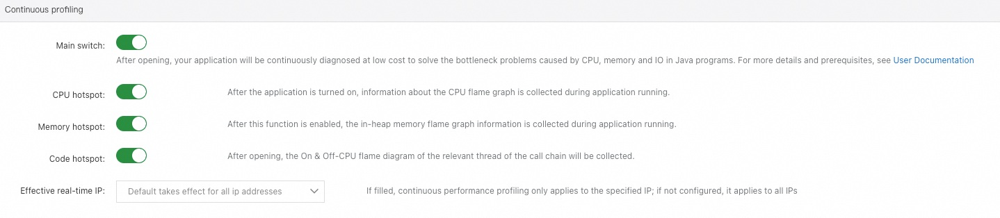

5. In the lower-left corner of the **Custom Configuration** tab, click **Save**.

**View performance profiling data**

1. Log in to the ARMS console.

2. In the left-side navigation pane, choose **Application Monitoring > Applications**, and click the name of your application on the **Applications** page.

3. In the left-side navigation pane, click **Continuous profiling**.

4. In the application instance list, select the application. On the right side of the page, specify a time period.

5. On the **Single View** tab, perform the following operations to filter data and view aggregate analysis:

   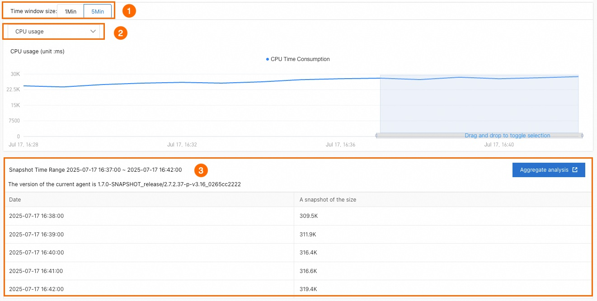

   <ol type="i">

   <li>

   In the **Time window size** section (icon 1), select a snapshot duration, and drag on the line chart to select a time period.

   </li>

   <li>

   From the drop-down list (icon 2), select the data that you want to view, including data

   </li>

   </ol>

   about CPU, JVM heap, and JVM GC.

   <ol type="i" start="3">

   <li>

   As shown in the figure, data within the time period (icon 3) is displayed. You can click

   </li>

   </ol>

   **Aggregate analysis** to view the snapshot details.

   **Performance analysis**

   The following performance analysis types are available:

   - **CPU Time**: the number of CPU cores requested.

   - **Allocated Memory**: the size of memory requested.

   - **Allocations**: the number of memory requests. Based on the number of memory requests, you can view the methods that frequently request memory.

   - **Wall Clock**: The overall execution time of the code.

   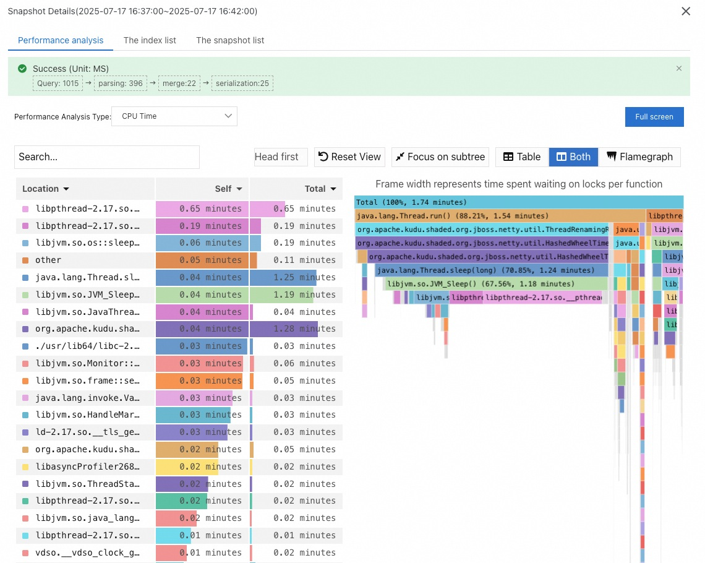

   - The **Self** column displays the time or resources that each method consumes within the stack, excluding the time or resources that their child methods consume. The data can be used to identify methods that spend excessive time or resources for their own.

   - The **Total** column displays the time or resources consumed by each method, including the time or resources consumed by all of its child methods. The data can be used to identify methods that contribute the most time or resources.

   When you analyze hotspot code, you can locate the time-consuming methods by focusing on the **Self** column or the wide flame at the bottom of the right-side flame graph. Generally, wide flame indicates a system performance bottleneck.

   **Metrics**

   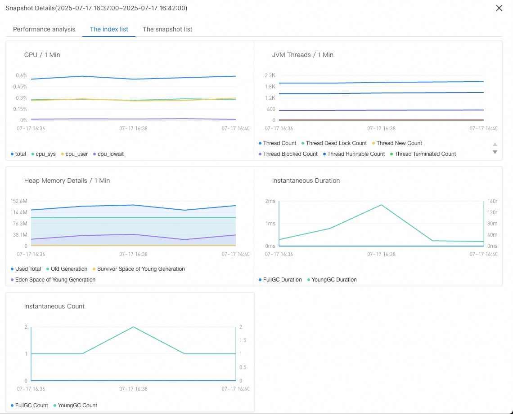

   **Snapshots**

   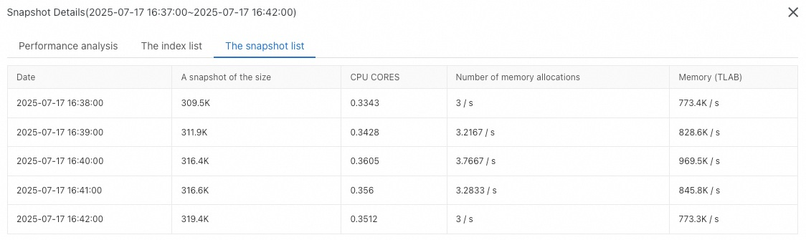

6. On the **Comparison View** tab, you can compare and analyze data generated in two time periods.

**Flame graph description**

The continuous performance profiling feature of ARMS uses the flame graph visualization technology to visualize the performance profiling data of applications. When an online application has high CPU and memory resource usage or a large number of slow calls, the root cause can be located by using the flame graph generated by this feature. This helps developers optimize programs, reduce latency, increase throughput, and save costs.

The following figure shows a flame graph with high resource usage. Perform the following steps to discover performance bottlenecks.

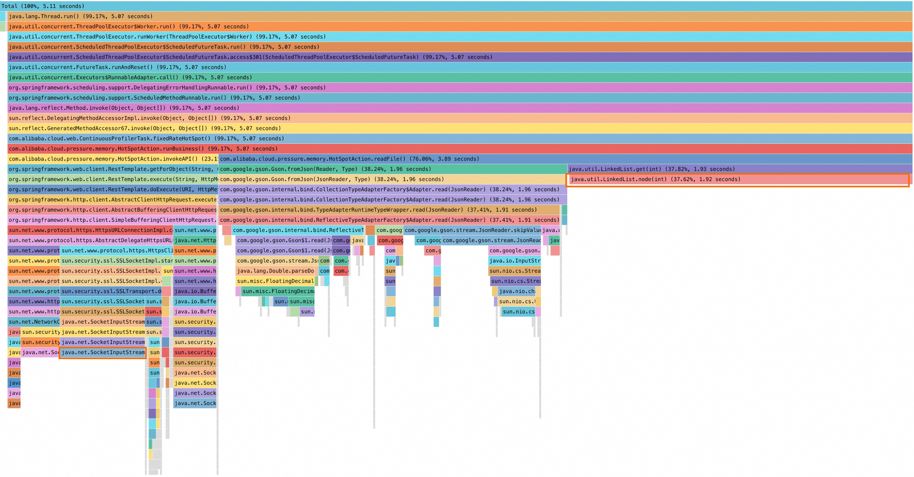

1. As it is an icicle graph with the stack top at the bottom and the stack bottom at the top, you need to analyze it from the bottom up.

2. The **java.util.LinkedList.node(int)** function on the right side of the stack top has a wide box.

3. Because the **java.util.LinkedList.node(int)** function is a library function of JDK, you need to search up further, and you can find the **java.util.LinkedList.get(int)** function and its parent function **com.alibaba.cloud.pressure.memory.HotSpotAction.readFile()**. As the first service function defined by the application, the **com.alibaba.cloud.pressure.memory.HotSpotAction.readFile()** function consumes 3.89 seconds, accounting for 76.06% of the stack. Therefore, a conclusion can be drawn that the **com.alibaba.cloud.pressure.memory.HotSpotAction.readFile()** function consumes a large amount of resources in the specified time period. You can use the function to analyze the logic of relevant functions and check whether they can be optimized.

   In addition, based on the **java.net.SocketInputStream** function in the lower-left corner of the flame graph, you can find that the first parent function defined by the application is **com.alibaba.cloud.pressure.memory.HotSpotAction.invokeAPI**, accounting for about 23% of the stack.

<a id="section-4-3-11"></a>

### 4.3.11. Application diagnosis

<a id="section-4-3-11-1"></a>

#### 4.3.11.1. Exception analysis

This topic describes how to view the exception analysis details of an application.

**Procedure**

1. Log in to the Application Real-time Monitoring Service (ARMS) console.

2. In the left-side navigation pane, choose **Application Monitoring > Applications**.

3. On the **Applications** page, click the name of the application that you want to view.

4. In the left-side navigation pane, choose **Application Diagnosis > Exceptions Diagnosis**.

5. In the upper-right corner of the Exceptions Diagnosis page, specify a time range and click the exception that you want to view.

**Exception occurrences**

In the **Exceptions** section, you can view the trend of the number of times the exception has been thrown during the specified time range.

In the **Exceptions** section, you can perform the following operations:

- Move the pointer over a chart to view the detailed statistics.

- Select a time range to view the statistics in the specified time range.

**List of API operations that throw exceptions**

This list displays the information about the API operations that throw exceptions, including the API operation name, summary, and number of occurrences of each exception and the proportion of the exception within each API operation.

In the list, you can perform the following operations:

- In the **Exception Name** column, click the name of an exception to view the exception details.

  - On the **Exception Stack** tab of the **Exception Detail** panel, you can view the information about the exception stack.

  - On the **Related Trace** tab of the **Exception Detail** panel, you can view the information about the exceptions that were captured within the selected API operation.

    You can click a trace ID in the **TraceId** column to view the trace of the exception and business.

    For information about how to analyze a trace, see Trace query.

- In the **Interface** column, click the name of an API operation to view the information about API calls.

  For more information, see API calls.

- Move the pointer over a chart to view the detailed statistics.

- Select a time range to view the statistics in the specified time range.

<a id="section-4-3-11-2"></a>

#### 4.3.11.2. Thread profiling

The thread profiling feature provides statistics on the CPU time consumption at the thread level and the number of threads per type. ARMS records and aggregates the method stacks of threads every 5 minutes. This helps you review the code execution process and identify thread issues. If the CPU utilization of a cluster is high or a large number of slow methods are detected, the thread profiling feature can be used to locate the threads or methods that consume the most CPU resources.

**Entry point**

1. Log on to the Application Real-time Monitoring Service (ARMS) console.

2. In the left-side navigation pane, choose **Application Monitoring > Application List**.

3. On the **Application List** page, click the name of your application.

4. In the left-side navigation pane, choose **Application Diagnosis > Threads Profiling**.

**Perform thread profiling**

The **Threads Profiling** page displays all threads of the application in the left-side pane. You can detect abnormal threads based on statistics in the **CPU Time Consumption (ms)** section. Select an abnormal thread and analyze the changes of the graphs for **CPU Time Consumption (ms)** and **Thread Count**. For example, you can analyze whether the total number of threads per minute is overlarge.

You can also click **Method Stack** of an abnormal thread to view the method stack that is running within a specified period of time. For example, by viewing the methods in the BLOCKED state of the thread, you can optimize the specified code block to reduce CPU utilization.

> **Note**
>
> If no data is displayed after you click **Method Stack**, click **Application Settings** in the left-side navigation pane, click the **Custom Configuration** tab, and check whether **Thread Profiling Method Stack** is enabled in the **Thread settings** section. If Thread Profiling Method Stack is disabled, method stack information cannot be recorded. After Thread Profiling Method Stack is enabled, method stack information is collected every 5 minutes.

<a id="section-4-3-11-3"></a>

#### 4.3.11.3. Arthas diagnostics

Arthas helps developers diagnose issues in the production environments of Java applications. It adopts the bytecode enhancement technology and allows developers to troubleshoot applications without restarting running Java virtual machine (JVM) processes.

Application Real-Time Monitoring Service (ARMS) is completely integrated with all the capabilities of Arthas. Compared with mounting Arthas, the integrated Arthas capabilities of ARMS have the following advantages:

- The Arthas capabilities do not depend on a Java Development Kit (JDK) environment. You do not need to download and install Arthas. You can enable or disable the capabilities at a time based on your business requirements.

- The main features are accessible by browser. You do not need to specify commands or expressions.

- The Arthas capabilities are connected to the ARMS context. You can run the tracert command to view the trace IDs of ARMS.

**Prerequisites**

> **Note**
>
> We recommend that you enable the Arthas diagnostic feature only for troubleshooting and disable the Arthas diagnostic feature during routine operations.

Your application is monitored by ARMS. For more information, see Overview.

**Background information**

ARMS is integrated with the following real-time diagnostics capabilities of Arthas:

- JVM overview: allows you to view the real-time memory usage, system information, system variables, and environment variables of a JVM process.

- Thread analysis: allows you to view the time consumption of threads and the real-time method stack of a specified thread in a JVM process.

- Method execution analysis: captures an execution record of any non-JDK method that meets specified conditions, and records the parameters, exceptions, returned values, and execution duration of each internal method.

- Object viewer: allows you to view the real-time property values of an instance of any class.

- Real-time dashboard: allows you to view the real-time information about common components. For example, you can view the configurations, usage, and the time consumption of SQL queries in a Druid connection pool.

- Arthas Shell: allows you to perform Arthas diagnostics by using a command-line interface (CLI).

**Enable Arthas**

1. Log in to the ARMS console.

2. In the left-side navigation pane, choose **Application Monitoring > Applications**, and click the name of your application on the **Applications** page.

3. In the left-side navigation pane, click **Application Settings**. On the page that appears, click the **Custom Configuration** tab.

4. In the **Arthas monitoring** section of the **Custom Configuration** tab, turn on the **Arthas switch**. You can also specify the IP addresses on which you want to perform Arthas diagnostics. If you do not specify IP addresses, Arthas diagnostics is performed on all IP addresses.

   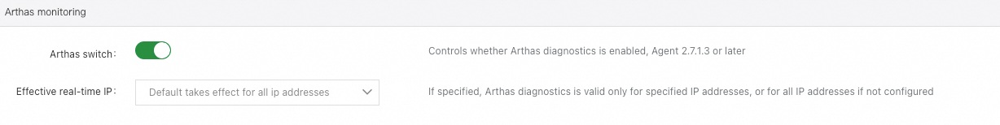

5. In the lower-left corner of the **Custom Configuration** tab, click **Save**.

**View diagnostics results**

1. Log in to the ARMS console.

2. In the left-side navigation pane, choose **Application Monitoring > Applications**, and click the name of your application on the **Applications** page.

3. In the left-side navigation pane, choose **Application Diagnosis > Arthas Diagnosis**.

4. On the Arthas Diagnosis page, select the application on which you want to perform diagnostics from the drop-down list at the top of the page.

   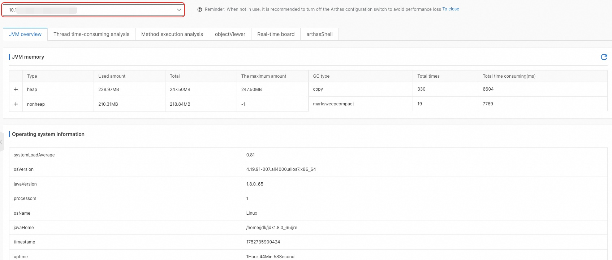

**JVM overview**

On the JVM overview tab, you can view the JVM information about the application, including the statistics on JVM memory and the information about the operating system and variables.

- JVM memory: displays information about JVM memory, such as the usage of heap memory and non-heap memory, and the information about garbage collection (GC).

  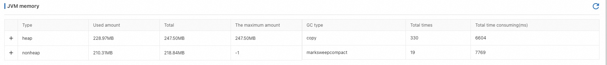

- Operating system information: displays information about the operating system, such as the average system load, the name and version of the operating system, and the Java version.

  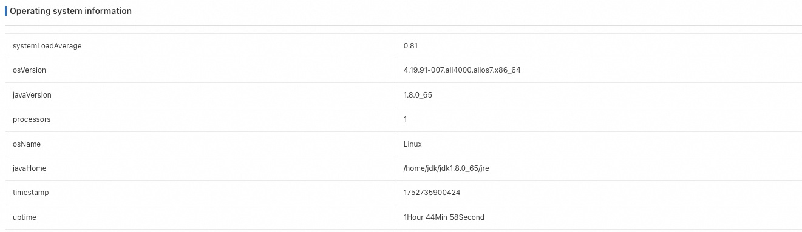

- Variable information: displays information about system variables and environment variables.

  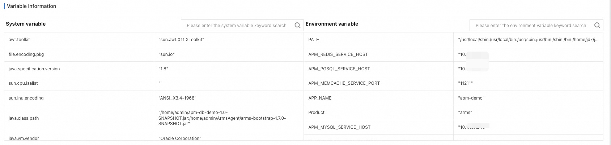

**Thread time-consuming analysis**

On the Thread time-consuming analysis tab, you can view all the threads of the application and the stack information about each thread. The information on this tab helps you easily identify time-consuming threads.

You can view the time consumption of threads in a JVM process on the **Thread time-consuming analysis** tab. Similar threads are displayed in one row as a category.

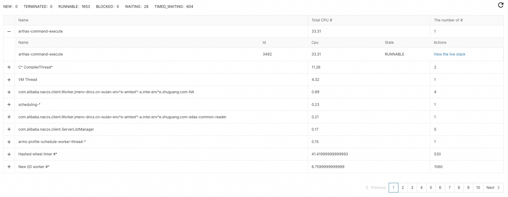

1. Click the **+** icon on the left side of a thread category name to view the details of all threads under this category, including the thread ID, CPU usage, and status.

2. Click **View the live stack** in the **Actions** column of a thread to view the stack information about the thread.

   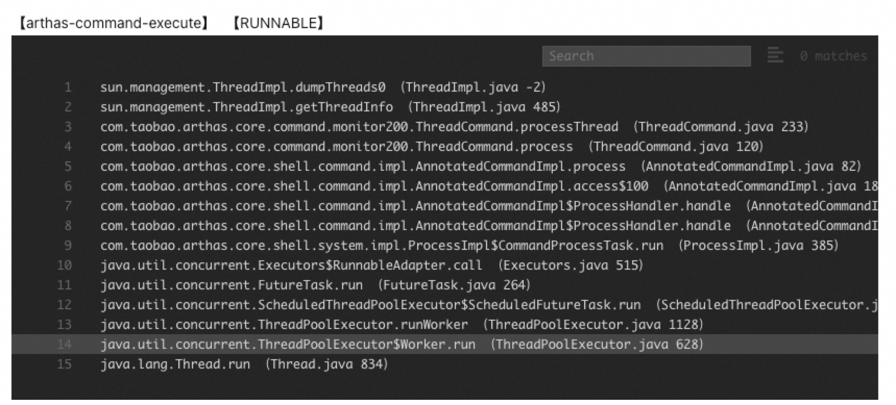

**Method execution analysis**

On the Method execution analysis tab, you can view the information such as time consumption, input parameters, and returned values of a method, and even drill down to an internal method. You can use this information to locate the root causes of slow calls and missing logs, or troubleshoot non-reproducible issues.

1. On the Method execution analysis tab, enter a keyword in the search box and click the 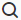

   icon.

2. Find the class on which you want to perform diagnostics from the displayed classes. Select a method of the class in the drop-down list on the right side and then click **OK**.

   ARMS captures a random execution record of the method. The execution information is displayed.

   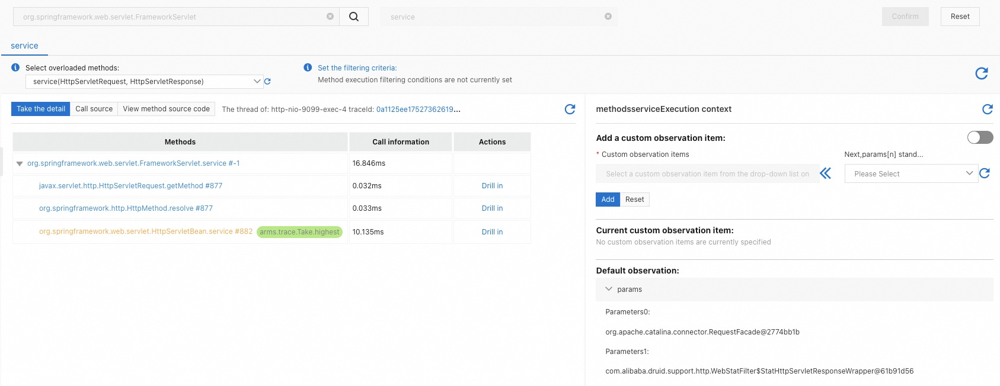

   Perform the following steps to set conditions for capturing a method execution record:

   <ol type="i">

   <li>

   Select an overloaded method and click **Set the filtering criteria**.

   </li>

   <li>

   Select a key type from the **Set the initial filtering condition** and click the  icon.

   </li>

   </ol>

   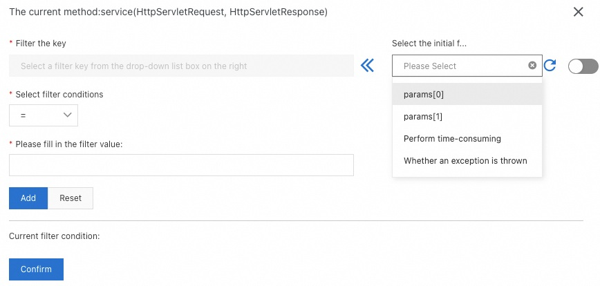

   Key types:

   - params[n]: the nth parameter of the method.

   - returnObj: the returned value of the method.

   - Perform time-consuming: the duration of the method.

   - Whether an exception is thrown: specifies whether an exception is thrown during the method execution.

   > **Note**
   >
   > If a nested key is selected, you need to continue specifying the field of the nested key until a base field is selected.

   <ol type="i" start="3">

   <li>

   Select a filter condition.

   </li>

   <li>

   Enter a filter value.

   </li>

   <li>

   Click **Add**.

   The conditions for selecting the method execution records are displayed in the **Current filter condition** section.

   </li>

   <li>

   Click **OK**, and then click the  icon on the right. The system crawls the method again

   based on the specified conditions.

   </li>

   </ol>

   The following table describes the execution of the queried method.

   - The internal execution records of the method that you select are displayed in the **Time-consuming details** section on the left side.

     To drill down to an internal method, find the internal method and click **Drill in** in the **Actions** column.

   - The call source of the current method is displayed in the **Call source** section.

   - The execution duration of each internal method is displayed in the **Method source code** section.

     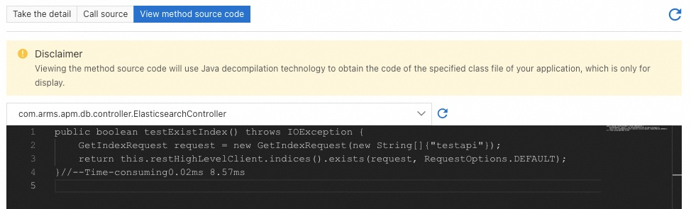

   - You can add custom observations in the **Add a custom observation item** section.

     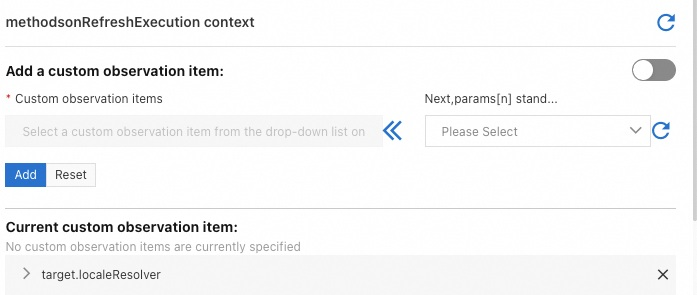

     <ol type="a">

     <li>

     Select a key type from the **Please select the initial item to be observed** drop-down

     list and click the  icon.

     Key types:

     - params[n]: the nth input parameter of the method.

     - returnObj: the returned value of the method.

     - target: the instance of the class that executes the method. This field is empty for static methods.

     > **Note**
     >
     > If a nested key is selected, you need to continue specifying the field of the nested key until a base field is selected.

     </li>

     <li>

     Click **Add**.

     The added filter conditions are displayed in the **Current custom observation item**

     section. You click the  icon to delete the conditions.

     </li>

     </ol>

     <ol type="i" start="100">

     <li>

     In the **Default observation item** section, you can view the observations of the current method, including params, returnObj, throwExp, and target.

     </li>

     </ol>

**Object viewer**

On the objectViewer tab, you can view information of some singleton objects to troubleshoot application exceptions, such as configuration errors, improper items in blacklists or whitelists, and abnormal status of member variables.

1. On the objectViewer tab, enter a keyword the class name that you want to view and click

   the  icon.

2. Select the class on which you want to perform diagnostics from the displayed classes, select an instance of the class in the right-side pane, and then click **OK**.

   The real-time field values of the instance are displayed.

   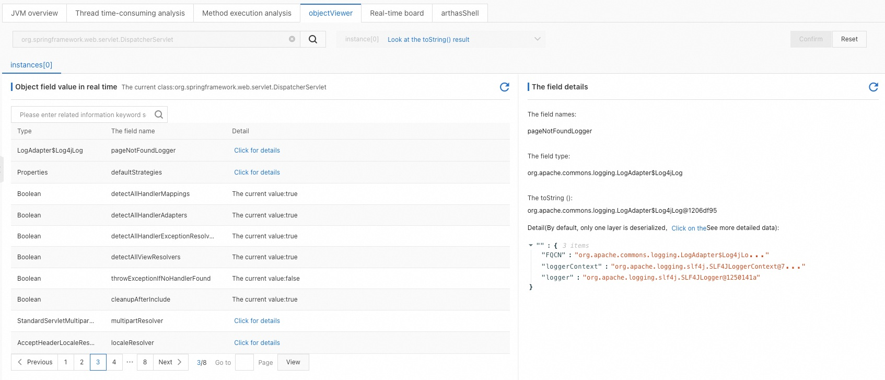

   - The value of a simple field is displayed in the **Detail** column in the **Object field value in real time** section on the left.

   - To view the value of a complex field, click **Click for details** in the **Detail** column of the **Object field value in real time** section on the left side. The detailed field value is displayed in the **The field details** section on the right side.

     Only part of the complex field value can be deserialized and displayed in the **The field details** section. To view more data, click the **Click on the** hyperlink in the parentheses next to Details.

**Real-time dashboard**

On the Real-time board tab, you can view the real-time information about key components in use, such as the usage of the database connection pool and the usage of the HTTP connection pool. The information helps you locate resource issues.

On the Real-time board tab, select a dashboard from the drop-down list, select an instance of the dashboard, and click **Add to board**.

The real-time data is displayed. The following figure shows the real-time information about a Druid connection pool, including the basic configurations, connection pool status, and execution duration.

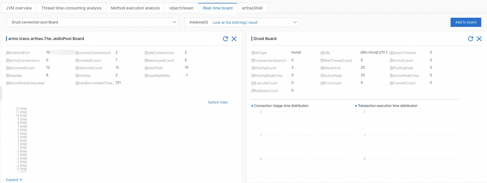

**Arthas Shell**

You can use the CLI to customize Arthas diagnostics. For more information, visit the Arthas website.

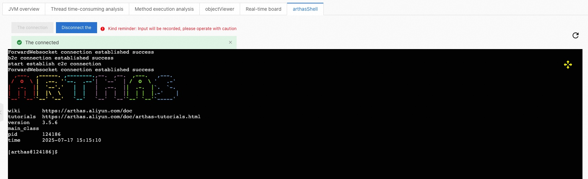

<a id="section-4-3-12"></a>

### 4.3.12. Application environment

This topic describes how to view the environment information of an application, such as the IP address of the instance, execution duration, process ID, and Java Virtual Machine (JVM) version.

**Procedure**

1. Log on to the Application Real-time Monitoring Service (ARMS) console.

2. In the left-side navigation pane, choose **Application Monitoring > Applications**.

3. On the **Applications** page, click the name of the application that you want to view.

4. In the left-side navigation pane, click **Application Environment**.

   On the **Application Environment** page, view the environment information of the application.

   | Parameter | Description |
   | --- | --- |
   | Instance IP | The IP address of the instance on which the application is deployed. |
   | Running Duration | The time elapsed since the application was started. |
   | Process ID | The unique identifier of the application process. |
   | JVM Version | The version of the JVM that is used by the application. |
   | ARMS version probe | The version of the ARMS agent that is installed for the application. |
   | JVM Args | The parameter configuration for the JVM of the application. |
   | Boot time | The time when the application was started. |
   | Hostname | The name of the instance on which the application is deployed. |

<a id="section-4-3-13"></a>

### 4.3.13. Application settings

<a id="section-4-3-13-1"></a>

#### 4.3.13.1. Custom Configurations

Configure common Application Monitoring settings—such as call chain sampling rate, Agent switch, and slow SQL statement threshold—directly on the **Custom Configurations** tab.

**Prerequisites**

You have created an Application Monitoring job. For more information, see Application Monitoring Onboarding Overview.

**Feature access**

1. Log on to the Application Real-time Monitoring Console.

2. In the navigation pane on the left, choose **Application Monitoring > Application List**.

3. On the **Application List** page, click the name of the target application.

4. In the navigation pane on the left, click **Application Settings**. Then, on the right-side page, click the **Custom Configurations** tab.

5. Set custom configuration parameters. Then, click **Save** at the bottom of the page.

**Configure Call Chain Sampling Settings**

In the **Call Chain Sampling Settings** area, enable or disable the call chain sampling switch and set the sampling rate. In the **Sampling Rate Setting** field, enter the percentage as a number. For example, enter 

`10` for 10% sampling.

> **Important**
>
> Changes take effect immediately. You do not need to restart the application. If you disable sampling, the system will not collect call chain data. Proceed with caution.

**Configure Agent (Probe) Switch and Log Level**

In the **Agent Switch Configuration** area, enable or disable the probe master switch and individual plugin switches. Configure the log level.

> **Important**
>
> Changes to the probe master switch and log level take effect immediately. You do not need to restart the application. If you disable the probe master switch, the system cannot monitor your application. Proceed with caution. To apply changes to individual plugin switches, manually restart the application.

**Configure Threshold Settings**

In the **Threshold Settings** area, set the slow SQL query threshold, interface response time threshold, and rate limiting threshold.

**Configure Advanced Settings**

In the **Advanced Settings** area, set parameters such as interfaces to filter and maximum method stack depth.

- **Invalid Interface Call Filtering**: Enter interfaces whose call status you do not want to view. This hides them from the **Interface Calls** page.

- **Maximum Method Stack Depth**: The default value is 128. The maximum value is 400.

- **Force destId Convergence**: Specifies whether to force destId convergence.

- **Stack Depth for Same Type Exception Differentiation**: For exceptions of the same type, this value defines the stack depth used to differentiate between them. Set it to the depth of the first differing call.

- **Maximum SQL Collection Length**: The default value is 1024 characters. The minimum value is 256, and the maximum value is 4096.

- **Collect SQL Binding Values**: Capture variable values bound by **PrepareStatement** parameters. This takes effect without an application restart.

- **Original SQL**: Only truncate SQL. No additional processing.

- **Exception Filtering**: Exceptions entered here will not appear in the charts on the application details and exception analysis pages.

- **Error Count Filtering**: By default, status codes greater than 400 count as errors. Customize HTTP status codes greater than 400 that should not count as errors.

- **New Call Chain Format**: Use a new storage format that supports call chain time sorting (enabled by default).

- **Call Chain Compression**: Simplify duplicate calls, such as for loops. This takes effect without an application restart.

- **Maximum Request Input Parameter Length**: The default value is 512 characters. The maximum supported length is 2048 characters.

- **Quantile Statistics**: Specifies whether to enable quantile statistics.

- **Application Emergency Event Alarms**: Supports emergency alarms such as thread deadlock and out-of-memory (OOM). The probe version must be 2.5.8 or later.

- **Pooling Monitoring**: Supports thread pool metric monitoring for frameworks such as Tomcat, Dubbo, and HSF. Upgrade the Agent probe to the latest version. This setting takes effect after restarting the application.

- **RabbitMQ Custom Consumer**: Set the class name of a custom consumer or a class name that contains an anonymous inner consumer to view its call chain. Separate multiple consumers with a comma (,).

- **Kafka Custom Consumer**: Set the class name of a custom consumer or a class name that contains an anonymous inner consumer to view its call chain. Separate multiple consumers with a comma (,).

- **404 Request Convergence Switch**: Converge 404 requests to /error.

**Configure Thread Settings**

In the **Thread Settings** area, enable or disable the thread profiling master switch and thread diagnosis method stack switch. Set the slow call listener trigger threshold.

**Associate Business Logs with TraceId**

In the **Business Log Association Settings** section, you can configure whether to associate TraceId information from call chains with the application's business logs. For more information, see Associate TraceId Information from Call Chains with Business Logs.

**Configure URL Convergence Rules**

In the **URL Convergence Settings** area, enable or disable the convergence feature. Set the convergence threshold, convergence rules, and exclusion rules. URL convergence displays a series of similar URLs as a single entity. For example, it groups URLs that all start with \`/service/demo/\`. The convergence threshold is the minimum number of URLs required for convergence. For example, if the threshold is 100, URLs matching the regular expression converge only when their count reaches 100.

**Set Arthas Monitoring**

In the **Arthas Monitoring** area, set the following configuration items. Click **Save**.

| Configuration Item | Description | Example Value |
| --- | --- | --- |
| Arthas Switch | Controls whether to enable the Arthas diagnostic feature.Upgrade the Agent to the latest version.<br>• Enable<br>• Shut down | Enable |
| Effective Real-time IP | Select the effective real-time IP address.<br>• Do not select: Arthas diagnostics apply to all IP addresses by default.<br>• Select IP: Arthas diagnostics apply only to the specified IP address. | 127.0.0.1 |

**Continuous Performance Profiling**

In the **Continuous Performance Profiling** area, set the following configuration items. Click **Save**.

| Configuration Item | Description | Example Value |
| --- | --- | --- |
| Master Switch | After you enable this feature, it performs continuous low-overhead diagnostics on your applications to resolve bottlenecks caused by CPU, memory, and I/O in Java applications. For more information about usage details and prerequisites, see Continuous Performance Profiling.<br>• Enable<br>• Disable | Enable |
| CPU Hotspots | Enable this to collect CPU flame graph information during application runtime.<br>• Enable<br>• Shut down | Enable |
| Memory Hotspots | Enable this to collect heap memory flame graph information during application runtime.<br>• Enable<br>• Disable | Enable |
| Code Hotspots | Enable this to collect call chain-related thread <code> On &amp; Off-</code><code>CPU </code> flame graph information.<br>• Enable<br>• Shut down | Enable |
| Effective Real-time IP | Select the effective real-time IP address.<br>• Do not select: Continuous performance profiling applies to all IP addresses by default.<br>• Select IP: Continuous performance profiling applies only to the specified IP address. | 127.0.0.1 |

**Copy Configurations to Other Applications**

To synchronize the same configurations for other applications, copy the configurations to them.

1. At the bottom of the page, click **Bulk copy to other applications**.

2. In the dialog box that appears, select the applications, then click **OK**.

   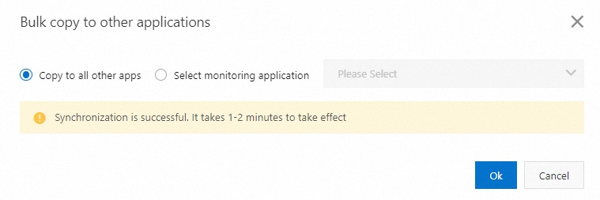

**References**

- Trace Query

- API call

<a id="section-4-3-13-2"></a>

#### 4.3.13.2. Manage tags

You can add custom tags to your application and manage the tags on the Application Settings page in the Application Real-time Monitoring Service (ARMS) console.

**Add tags**

1. Log in to the ARMS console.

2. In the left-side navigation pane, choose **Application Monitoring > Applications**.

3. On the **Applications** page, click the name of the application that you want to manage.

4. In the left-side navigation pane, click **Application Settings**. On the page that appears, click the **Tags** tab.

5. In the **Application Tags** section, click **Manage Tags**.

6. In the **Manage Tags** dialog box, click the  icon, enter a custom tag, and then click

   **Confirm**.

7. In the **Success** message, click **Confirm**. Then, click **Save** on the Tags tab.

**Enable or disable tags**

1. On the **Application Settings** page, click the **Tags** tab.

2. In the **Application Tags** section, select the tags to be enabled for the application, and clear the tags to be disabled for the application.

3. In the lower part of the tab, click **Save**.

**Modify or delete tags**

1. On the **Application Settings** page, click the **Tags** tab.

2. In the **Application Tags** section, click **Manage Tags**.

3. In the **Manage Tags** dialog box, move the pointer over the tag that you want to modify or delete.

   - To modify a tag, click the  icon on the right side of the tag and enter a new tag name.

   - To delete a tag, click the  icon on the left side of the tag.

     > **Important**
     >
     > If you delete a tag in the **Manage Tags** dialog box, the tag is deleted for all applications to which this tag is added.

4. In the message that appears, click **Confirm**.

5. In the **Success** message, click **Confirm**. Then, click **Save** on the Tags tab.

<a id="section-4-3-13-3"></a>

#### 4.3.13.3. Configure tags for ARMS by using RAM permissions

This topic describes how to configure tags for Application Real-Time Monitoring Service (ARMS) by using Resource Access Management (RAM) permissions.

**Step 1: Grant related permissions to a RAM role**

1. Log on to the Apsara Uni-manager Management Console.

2. In the top navigation bar, click **Enterprise**. In the left-side navigation pane, choose Permissions > **Role Permissions**. On the page that appears, click the RAM role for which you want to configure permissions.

3. Click **Add Policy**, and click **Create Policy**.

4. In the dialog box that appears, enter the policy name and the following policy document.

   In the following example, applications that contain tag1, tag2, and tag3 are filtered out, and the tag permissions are in an OR relationship.

   ```json
   {
     "Version": "1",
     "Statement": [
       {
         "Action": "arms:*",
         "Resource": "*",
         "Effect": "Allow",
         "condition":{
           "StringLike":{
             "arms:tag":[
               "tag1",
               "tag2",
               "tag3"
               ]
           }
         }
       },
       {
     "Action":"arms:ReadContactMember",
     "Resource":"*",
     "Effect": "Allow",
     "condition":{
           "StringLike":{
             "arms:tag":"arms:*"
           }
         }
   }
     ]
   }
   ```

   If you need to find only applications that contain a single tag, you can modify the permission configuration. The following example filters out applications that contain only the tag1 tag.

   ```text
   "StringLike":{
    "arms:tag": "tag1"
    }
   ```

   **Parameters**

   | Parameter | Description |
   | --- | --- |
   | arms:tag:"tag1" | <code> tag1 </code> indicates an application tag. |
   | arms:tag:"arms:\*" | <code> arms:* </code> indicates the permission to view the related feature. |
   | arms:ReadContactMember | The permission to view alert contacts. You can configure the permissions as needed. |

**Step 2: Enable the tag permission configuration**

After you configure the permissions for a RAM role, you must enable the tag permission configuration for the permissions of the RAM role to take effect. To enable the tag permission configuration, contact O&M engineers.

<a id="section-4-3-13-4"></a>

#### 4.3.13.4. Add custom methods for monitoring

To monitor methods or API operations that are not detected by the Application Real-Time Monitoring Service (ARMS) agent, you can add custom methods for monitoring in ARMS Application Monitoring.

**Prerequisites**

An application monitoring task is created. For more information, see Overview.

**Procedure**

1. Log in to the ARMS console.

2. In the left-side navigation pane, choose **Application Monitoring > Applications**.

3. On the **Applications** page, click the name of the application that you want to configure.

4. In the left-side navigation pane, click **Application Settings**. On the page that appears, click the **Monitoring Method Customization** tab.

**Add a custom method for monitoring**

1. On the **Monitoring Method Customization** tab, click **Add Method**.

2. In the **Add Custom Method** dialog box, configure the following parameters and click **OK**.

   | Parameter | Description |
   | --- | --- |
   | Method | The name of the method to be monitored. It must be unique. |
   | Enable | After you enable this feature, you can monitor this method, and the method is displayed in the local method stack. For more information, see Trace query. By default, this switch is turned on.<br>Note<br>This feature can be dynamically enabled or disabled without the need to restart the application. |
   | Call Entrance | After this feature is enabled, you can query business by traces. Then, corresponding interfaces are displayed on the <strong>Interface</strong> <strong>Invocation</strong> page. For more information, see Interface call monitoring. By default, this switch is turned off. |

   After a custom method is added for monitoring, it is automatically displayed in the method list. To modify or delete the method, click **Edit** or **Delete** in the **Actions** column.

**References**

Trace query

<a id="section-4-3-13-5"></a>

#### 4.3.13.5. Delete an application

If you no longer use Application Real-Time Monitoring Service (ARMS) to monitor your application, you can delete the application on the Application Settings page.

> **Note**
>
> ARMS automatically deletes applications that have no data reported in the last 60 days.

**Procedure**

1. Log in to the ARMS console.

2. In the left-side navigation pane, choose **Application Monitoring > Applications**.

3. On the **Applications** page, click the name of the application that you want to delete.

4. In the left-side navigation pane, click **Application Settings**. On the page that appears, click the **Custom Configuration** tab.

5. On the **Custom Configuration** tab, turn off **Probe Master Switch** in the **Agent Switch Settings** section. Then, click **Save** in the lower-left corner of the tab.

   > **Important**
   >
   > The modification takes effect immediately without the need to restart the application. After you turn off Probe Master Switch, your application is no longer monitored by ARMS, and no fees are incurred. Proceed with caution when you perform this operation.

6. Uninstall the ARMS agent. For more information, see FAQ about application monitoring.

7. After the ARMS agent is uninstalled, click the **Delete** tab on the **Application Settings** page.

   > **Warning**
   >
   > This operation clears all monitoring data of the application, and the monitoring data cannot be restored.

8. On the **Delete** tab, click **Delete Application**. In the message that appears, click **Confirm**.

**Result**

You can find that the deleted application is no longer displayed on the **Applications** page.

**References**

FAQ about application monitoring

<a id="section-4-3-14"></a>

### 4.3.14. Global topology

The global topology provided by the Application Monitoring feature of Application Real-Time Monitoring Service (ARMS) displays the upstream and downstream dependencies of applications.

**View the global topology**

1. Log in to the ARMS console.

2. In the left-side navigation pane, choose **Application Monitoring > Global Topology**.

You can perform the following operations on the Global Topology page:

- Click the plus icon or scroll the mouse wheel forward to zoom in the topology.

- Click the minus icon or scroll the mouse wheel backward to zoom out the topology.

- Click the RESET icon to restore the topology to the default size.

- Click a node to highlight the topology that is associated with the node.

- Move the pointer over a node or a dot on a line between nodes to view the following information:

  - Service name

  - QPS: the number of queries per second

  - RT: the response time in milliseconds

  - ERROR: the number of failed queries per second

**Create a view**

You can create a custom topology by creating a view.

1. Log in to the ARMS console.

2. In the left-side navigation pane, choose **Application Monitoring > Global Topology**.

3. Click **Create View**. In the dialog box that appears, configure the **View Name** parameter and select a core application from the Choose Core Application drop-down list.

4. Click **Edit Topology** and perform the following operations to adjust the topology:

   <ol type="i">

   <li>

   Right-click a node to view the upstream nodes, downstream nodes, and details of the node, copy the node information, or remove the node.

   </li>

   <li>

   Double-click a node to view its downstream nodes.

   </li>

   <li>

   Move the pointer over a node or a dot on a line between nodes to view the following

   </li>

   </ol>

   information:

   <ol type="a">

   <li>

   Service name

   </li>

   <li>

   QPS: the number of queries per second

   </li>

   </ol>

   <ol type="i" start="100">

   <li>

   RT: the response time in milliseconds

   </li>

   <li value="500">

   ERROR: the number of failed queries per second

   </li>

   </ol>

5. Click **OK**.

**Edit or delete a view**

You can edit or delete a custom topology.

> **Note**
>
> The default view cannot be modified or deleted.

1. Log in to the ARMS console.

2. In the left-side navigation pane, choose **Application Monitoring > Global Topology**.

3. Select the view that you want to edit from the drop-down list on the right of **Create View**, and click **Editing**.

4. In the dialog box that appears, change the view name.

5. Click **Edit Topology** to modify the view, and then click **OK**.

6. If the current topology is no longer needed, click **Delete** in the upper-right corner to delete it.

<a id="section-4-3-15"></a>

### 4.3.15. Trace query

On the **Trace Query** page of the Application Real-Time Monitoring Service (ARMS) console, you can query traces based on multiple filter conditions or query a specific trace based on the trace ID.

**Query traces**

1. Log in to the ARMS console.

2. In the left-side navigation pane, choose **Application Monitoring > Multidimensional Query**.

3. On the **Call link query** page, select a parameter from the **Parameter type** drop-down list, specify a custom value in the **Parameter value** field, and then click **Add to query criteria**.

   You can set the Parameter type parameter to **TraceId** to query a specific trace.

   Table 1. Parameters

   | Parameter | Description |
   | --- | --- |
   | TraceId | Enter a trace ID. |
   | Interface name | Enter the name of an API operation. Fuzzy match is not supported. |
   | Client application name | Enter the name of an application on the client. |
   | Server application name | Enter the name of an application on the server. |
   | Time-consuming greater | Specify the call duration. Unit: milliseconds. |
   | Call type | Select a call type. |
   | Abnormal call | Set this parameter to true to search for all traces related to abnormal calls. |
   | Only thread profiling snapshots are included | Set this parameter to true to search for all traces that contain thread profiling snapshots. |
   | Client IP | Enter the IP address of the application that initiates a call. |
   | Server IP | Enter the IP address of the application that is called. |
   | Business primary key | Enter a business primary key to search for business events. |
   | Response Code | Enter a response code. |

4. Click the ID of the trace that you want to view. You are navigated to the **Traces** tab.

   The **Traces** tab provides the following information:

   - Application: the name of the application to which the trace belongs.

   - Log Generated At: the time when the log was generated.

   - Status: the status of the trace. Red indicates that an exception exists in the local trace related to the service. Green indicates that the trace is normal.

   - IP Address: the IP address of the application.

   - Call Type: the type of the call, which corresponds to the call type of the ad hoc query.

   - Service: the name of the service API that is called.

   - Timeline (ms): the time consumed by each service and the proportion of time consumed by each service in the duration of the entire trace.

**What to do next**

On the **Traces** tab, click the line chart in the **Indicator monitoring** column to view the number of requests, response time, and number of errors during different periods of time.

On the **Traces** tab, click the 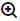 icon in the **Method Stack** column. The **Method Stack** pane

appears.

The following section describes the parameters in the Method Stack pane:

- Methods: the method used to call the on-premises method stack. After the call method is expanded, the next-layer calls of the method are displayed.

- Line: the line where the code of the method used to call the on-premises method stack is located.

- Expanded Info:

  - Parameter: the input parameters of the call.

  - SQL: the SQL statements to access data in the database.

  - Exception: the details of the exception.

- Timeline (ms): the distribution of time consumed by each method call of the on-premises trace.

<a id="section-4-3-16"></a>

### 4.3.16. Usage statistics

On the Usage statistics page, you can view the statistics on resource consumption. You can also specify filter conditions to view the resource consumption details of an application within the specified time range.

1. Log on to the Application Real-Time Monitoring Service (ARMS) console.

2. In the left-side navigation pane, choose **Application Monitoring > Usage statistics**.

3. In the upper-right corner of the **Usage statistics** page, specify the time range to query.

4. On the **Self-developed probe report** or **Self-developed probe report (global)** tab, view the number of online applications, number of application performance monitoring (APM) instances, and corresponding usage trends.

   - The Self-developed probe report tab displays the usage data of the current user.

   - The **Self-developed probe report (global)** tab displays the usage data of all users. Only the administrator can view the information on this tab.

<a id="section-4-3-17"></a>

### 4.3.17. Agents

This topic describes how to view the information about the agent that is installed in an application.

**Procedure**

1. Log in to the ARMS console.

2. In the left-side navigation pane, choose **Application Monitoring > Agent List**.

3. Optional. On the **Agent List** page, you can filter agents by **application name**, **host IP address**, **agent status**, and **agent version**.

4. On the **Agent List** page, you can view information about the agents installed in the applications in the following columns: **Agent running status**, **Last startup time**, **Run Length**, and **Agent version**.

   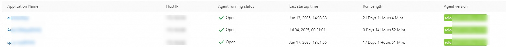

<a id="section-4-4"></a>

## 4.4. Best practices

<a id="section-4-4-1"></a>

### 4.4.1. Use trace sampling policies

This topic describes a variety of trace sampling policies that are supported by Application Real-Time Monitoring Service (ARMS). You can select appropriate trace sampling policies based on your scenarios so that you can obtain the trace data that you want at a low cost.

Trace sampling is suitable for high-traffic applications that have a large number of visits. Trace sampling can help you record the most valuable trace data at a low cost and a low performance overhead. The basic principle of trace sampling is to preferentially record the traces that you are most concerned about and most likely to access. ARMS provides the following trace sampling policies:

**Trace feature-based sampling**

Trace feature-based sampling refers to sampling based on the attributes of traces, such as time consumption and status. ARMS supports fixed-rate sampling and sampling based on thread profiling for slow calls.

**Fixed-rate sampling** Fixed-rate sampling records a specific proportion of trace data based on the sequence numbers of trace IDs. For example, if the fixed rate is 10%, one out of every 10 pieces of trace data is recorded. Fixed-rate sampling prevents incomplete trace data. The data of an entire trace is retained or discarded.

Fixed-rate sampling applies to the following scenarios:

- During the peak hours of stress testing or big promotions, the traffic volume is high. If full trace logs are reported, the client performance may be degraded. To prevent this situation, we recommend that you reduce the fixed sampling rate to a value between 1% and 10%.

- On regular days, the cost of network bandwidth is high because full trace logs are reported. In this case, you can consider adjusting the fixed sampling rate as needed.

The following figure shows how fixed-rate sampling works.

Keep all traces of TraceId A

Discard all traces of TraceId B

Discard all traces of TraceId C

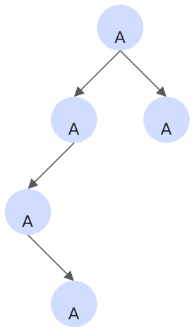

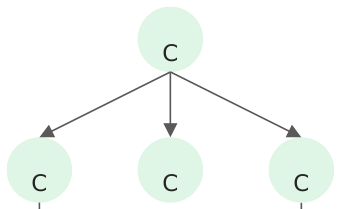

B

B

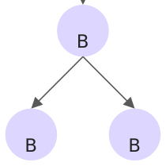

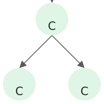

C

You can perform the following steps to configure fixed-rate sampling:

1. Log in to the ARMS console.

2. In the left-side navigation pane, choose **Application Monitoring > Applications**.

3. On the **Applications** page, click the name of the application that you want to configure.

4. In the left-side navigation pane, click **Application Settings**. On the page that appears, click the **Custom Configuration** tab.

5. In the **Invocation Trace Sampling Settings** section, turn on Enable Sampling and specify a sampling rate. In the **Sampling Rate Settings** field, enter a value, which is in percent. For example, if you enter 

   `10`, the sampling rate is 10%.

**Sampling based on thread profiling for slow calls**

Sampling based on thread profiling for slow calls records data of traces in which thread profiling is triggered to listen on slow calls. After thread profiling is enabled, ARMS transfers a sampling mark to the downstream at the same time when ARMS records a slow call. ARMS also retains the downstream traces of this slow call. However, the number of listening threads of thread profiling is limited to prevent compromising client performance. If multiple slow calls occur at the same time, only some slow calls that meet the conditions and their downstream traces are recorded.

Sampling based on thread profiling for slow calls applies to the following scenarios:

- The system encounters occasional slow calls. For example, the response time of services surges from 0.5s to 10s at night. Assume that you enable thread profiling in advance (the default trigger threshold is 2s). ARMS automatically records the native method stacks of slow calls that are complete within 2s to 10s in the request and the downstream traces of the slow calls.

- The system responds at a slow speed during the peak hours of flash sales or periodic big promotions. In this case, thread profiling records the native method stacks of slow calls that reach the trigger threshold and the downstream traces of the slow calls.

The following figure shows how sampling based on thread profiling for slow calls works.

The call duration of Service A exceeds 2s, triggering thread profiling to listen on slow calls. The local method stack is recorded, and a sampling mark (sample=1) is transferred to the downstream to record the trace.

2 s

8s

Service A

(sample=1)

Service B

Service C

(sample=1)

Service D

(sample=1)

You can perform the following steps to configure sampling based on thread profiling for slow calls:

1. Log in to the ARMS console.

2. In the left-side navigation pane, choose **Application Monitoring > Applications**.

3. On the **Applications** page, click the name of the application that you want to configure.

4. In the left-side navigation pane, click **Application Settings**. On the page that appears, click the **Custom Configuration** tab.

5. In the **Thread settings** section, turn on or off Thread profiling total control switch and configure the Slow call listen trigger threshold parameter.

<a id="section-4-4-2"></a>

### 4.4.2. Diagnose errors on the server

It is challenging to analyze the causes of web page errors, which are one of the most common issues of Internet applications. After the Application Real-Time Monitoring Service (ARMS) agent is installed for an application, the ARMS agent can automatically capture, collect, count, and track exceptions without the need to modify the application code. You can use the ARMS agent to accurately locate all exceptions in the application and perform online diagnostics.

**Symptoms**

Web page errors, particularly those that take the form of a 5xx error, are one of the most common issues of Internet applications. 5xx errors usually occur on the server side. The server side has the most complex business logic and is the most error-prone part of the entire network-request link. Errors on the server side prove to be the most challenging for cause analysis. O&M engineers or R&D engineers often need to log on to the server to view logs and find the causes.

Figure 1. Sample error logs of a Java application

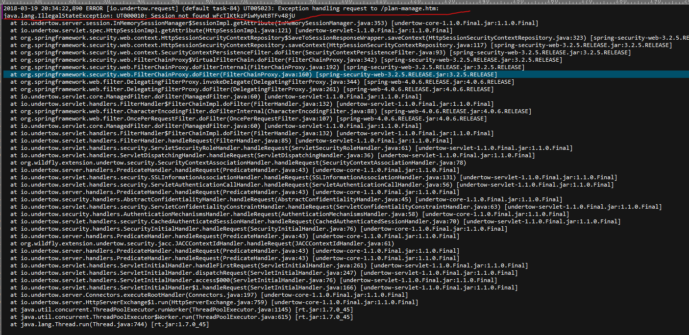

For applications that have less complex logic and short uptimes, troubleshooting based on logs on the server can resolve most of these issues. However, this traditional method is often useless in the following scenarios:

- You want to know the time and frequency of a specific type of error in a distributed application cluster.

- A system has been running for a long time, but you do not care about the residual exceptions. You want to know only about new exceptions today compared with yesterday, and new exceptions after the release of the system compared with the period before the release of the system.

- You want to view the web requests and relevant parameters associated with an exception.

- The customer service provides the number of an order that a user fails to place for cause analysis of the failure.

**Solution**

Install the ARMS agent for the application. The ARMS agent can automatically capture, collect, count, and track exceptions without the need to modify the application code. The ARMS agent presents a clear picture of various errors.

**Step 1: Install the ARMS agent**

You can use ARMS Application Monitoring to monitor your application in all aspects only after you install the ARMS agent. Use one of the following methods to install the ARMS agent:

- Install the ARMS agent for a Java application. For more information, see Manually install the ARMS agent for a Java application.

- Install the ARMS agent for an application deployed in Enterprise Distributed Application Service (EDAS). For more information, see Connect an application deployed in EDAS to ARMS.

- Install the ARMS agent for an application deployed in Docker. For more information, see Install the ARMS agent for a Java application deployed in Docker.

**Step 2: View statistics of application exceptions**

The installed ARMS agent collects and displays the average response time and number of requests, errors, real-time instances, full garbage collection (GC) events, slow SQL queries, exceptions, and slow calls of the application within the selected period of time. The ARMS agent also displays how these metrics change on a day-over-day and week-over-week basis. Perform the following steps to view the statistics of application exceptions:

1. Log in to the ARMS console.

2. In the left-side navigation pane, choose **Application Monitoring > Applications**.

3. On the **Applications** page, click the name of your application.

4. On the **Application Overview** page, click the **Overview** tab. The Overview tab displays the total number of exceptions and how the number changes from the previous day and previous week in the upper part.

5. Scroll to the **Statistics Analysis** section at the bottom of the **Overview** tab. Here you can view the occurrences of each type of exception.

6. In the left-side navigation pane, click **Application Details**. On the page that appears, click the **Exception Analysis** tab in the right-side pane to view information such as the exception statistics curve, number of errors, and exception stack.

**Step 3: Diagnose causes of an exception**

The statistics of application exceptions are insufficient for locating the causes of exceptions. The exception stack in the log contains the code snippet for the related call. However, it does not contain the complete upstream and downstream information and request parameters of this call. The bytecode enhancement technology of the ARMS agent allows you to capture complete upstream and downstream call snapshots for exceptions, without significantly compromising the performance. This enables you to identify the specific causes of exceptions.

1. On the **Exception Analysis** tab, find the type of exception that you want to diagnose, and click **Interface Snapshot** in the **Actions** column.

   On the **Interface Snapshot** tab, the call trace information related to this exception type is displayed.

2. On the **Interface Snapshot** tab, click the trace ID of a problematic call.

   > **Note**
   >
   > For information about how to query a trace, see Trace query.

3. On the page that appears, view the trace information related to the exception. In the **Method Stack** column, click the magnifier icon to view the method stack that is called. This way, you can obtain the context information about the exception.

   At this point, the causes of the exception are found. This effectively helps you with the subsequent code optimization. You can also return to the **Interface Invocation** tab to view other exceptions in the list and resolve them one by one.

**What to do next**

To prevent passive diagnostics after an exception occurs, you can use the alerting feature of ARMS to create an alert for a specific API operation or all API operations. This ensures that the O&M team receives a notification immediately after an exception occurs. For more information, see Create an alert rule.

**References**

- Overview

- Trace query

- Create an alert rule

<a id="section-4-4-3"></a>

### 4.4.3. Diagnose application freezing

It is difficult to locate and troubleshoot the causes of application freezing. Application Monitoring of Application Real-Time Monitoring Service (ARMS) provides a set of solutions, such as thread profiling, trace diagnostics, and API call monitoring. These solutions help you locate all slow calls in an application and resolve application freezing issues.

**Causes**

Website freezing and slow web page loading are among the most common issues of applications. Troubleshooting is complex and time-consuming due to the following reasons:

- Long application traces

  - Application freezing can happen anywhere from the frontend web page to the backend gateway, or from the web application server to the backend database.

  - Applications that use microservices architecture have even more complex traces, and components are maintained by different teams and personnel. This makes troubleshooting even more difficult.

- Incomplete or low-quality logs

  Troubleshooting production environment issues relies on application logs. However, the locations of issues are usually unpredictable, and slow responses frequently occur. To troubleshoot slow responses, you need to print logs where errors may occur and record each call. However, this incurs huge costs.

- Insufficient monitoring

  Rapid business development and fast application iteration lead to frequent API changes of applications and increased dependencies. This further deteriorates the quality of code. Applications need a comprehensive monitoring system that automatically monitors every API operation and records abnormal calls.

**Solution**

After the ARMS agent is installed, you can monitor all slow calls of your application by using features such as thread profiling, trace diagnostics, and API call monitoring of ARMS Application Monitoring. Also, you do not need to modify the application code.

**Step 1: Install the ARMS agent**

You can use ARMS Application Monitoring to monitor your application in all aspects only after you install the ARMS agent. Use one of the following methods to install the ARMS agent:

- Install the ARMS agent for a Java application. For more information, see Manually install the ARMS agent for a Java application.

- Install the ARMS agent for an application deployed in Enterprise Distributed Application Service (EDAS). For more information, see Connect an application deployed in EDAS to ARMS.

- Install the ARMS agent for an application deployed in Docker. For more information, see Install the ARMS agent for a Java application deployed in Docker.

**Step 2: Query slow SQL queries**

The ARMS agent collects and displays the average response time, total number of requests, number of errors, number of real-time instances, full garbage collection (GC) occurrences, number of slow SQL queries, number of exceptions, and number of slow calls of an application within the specified time period. The ARMS agent also displays how these metrics change on a day-over-day and week-over-week basis. Perform the following steps to query slow SQL queries:

1. Log in to the ARMS console.

2. In the left-side navigation pane, choose **Application Monitoring > Applications**.

3. On the **Applications** page, click the name of your application.

4. On the **Application Overview** page, click the **Overview** tab. On the Overview tab, view the total number of slow SQL queries and how the number changes on a day-over-day and week-over-week basis.

**Step 3: Find and locate slow API operations**

On the **Interface Invocation** page, all API operations provided by the monitored application, and the number of calls and consumed time on each operation are displayed. Slow operations are marked to help you find and locate them.

1. In the left-side navigation pane, click **Interface Invocation**.

2. In the left-side navigation pane of the **Interface Invocation** page, click a slow operation to view its details.

**Step 4: Locate the faulty code**

After you locate a slow API operation, you must locate the faulty code to fix the API operation. A snapshot is a complete record of an entire trace, including the code and duration of each call, and helps you precisely locate the faulty code.

1. On the **Interface Invocation** page, click the **Interface Snapshot** tab.

   On the **Interface Snapshot** tab, all snapshots of the API operation are displayed.

2. On the **Interface Snapshot** tab, click the trace ID of a problematic call.

3. On the page that appears, view the trace information related to the exception. In the **Method Stack** column, click the magnifier icon to view the method stack that is called. This way, you can obtain the context information about the exception.

   > **Note**
   >
   > For information about how to query a trace, see Trace query.

   At this point, the causes of a specific slow call are revealed. This way, you can optimize the code later. You can also return to the **Interface Invocation** page to view other slow calls in the list and resolve them one by one.

**What to do next**

To prevent passive diagnostics after an exception occurs, you can use the alerting feature of ARMS to create an alert for a specific API operation or all API operations. This ensures that the O&M team receives a notification immediately after an exception occurs. For more information, see Create an alert rule.

**References**

- Overview

- Trace query

- Create an alert rule

<a id="section-4-4-4"></a>

### 4.4.4. Associate trace IDs with business logs

You can associate trace IDs with the business logs of an application. This way, when an error occurs in the application, you can access the business logs associated with trace IDs to locate and troubleshoot the error.

**Prerequisites**

The Application Real-Time Monitoring Service (ARMS) agent is upgraded to V2.6.1.2 or later. For more information, see Agent upgrade.

**Background information**

In ARMS, trace IDs can be associated with the business logs of an application based on the Mapped Diagnostic Context (MDC) mechanism. Mainstream log frameworks such as Log4j, Log4j 2, and Logback are supported.

**Procedure**

1. Log in to the ARMS console.

2. In the left-side navigation pane, choose **Application Monitoring > Applications**, and click the name of your application on the **Applications** page.

3. In the left-side navigation pane, click **Application Settings**. On the page that appears, click the **Custom Configuration** tab.

4. On the **Custom Configuration** tab, turn on **Link Business Logs with TraceId** in the **Business Log Linking Settings** section.

   > **Note**
   >
   > If you enable Link Business Logs with TraceId, trace IDs are automatically generated in the business logs.

5. Add  `%X{EagleEye-TraceID}`  to the pattern property of the business log layout. The following figure shows how to add this configuration for the Logback component.

   > **Note**
   >
   > For information about how to obtain {EagleEye-TraceID} in the code, see ARMS SDKs.

   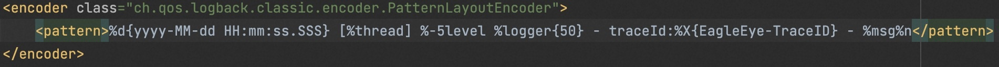

6. Restart the application.

   If trace IDs are displayed in the business logs of the application, the business logs are associated with the trace IDs, as shown in the following figure.

   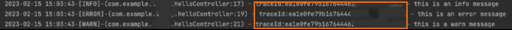

<a id="section-4-4-5"></a>

### 4.4.5. Connect applications in a self-managed cloud to ARMS

This topic describes how to use Gateway to connect applications on a user network to Application Real-Time Monitoring Service (ARMS) on Alibaba Cloud.

**Scenario**

ARMS on Alibaba Cloud cannot directly monitor applications on a user network due to a network connection issue. In this case, you can deploy Gateway on the classic network or a virtual private cloud (VPC) of Alibaba Cloud and use Gateway as a proxy to connect the applications to ARMS.

**Deployment principles**

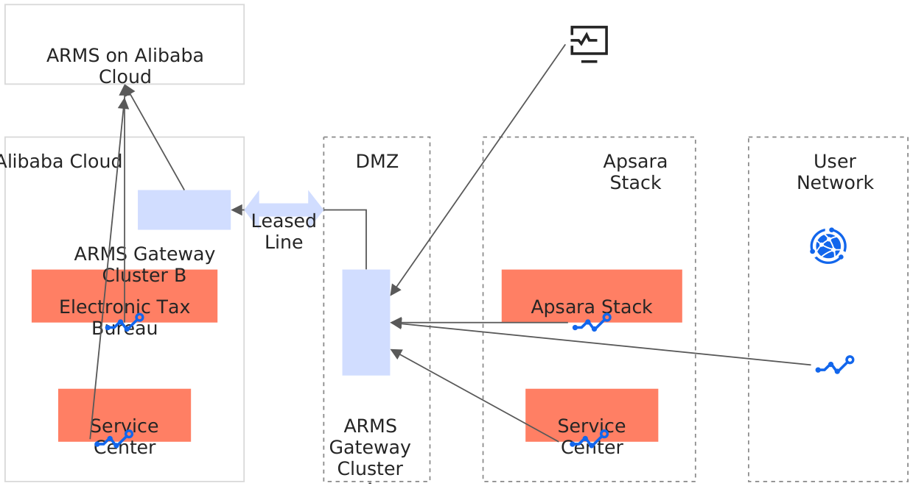

Alibaba Cloud

A

1. ARMS Gateway cluster A deployed in the demilitarized zone (DMZ) exposes the internal endpoint to Apsara Stack and the user network. The ARMS agents deployed in Apsara Stack and WebLogic send the collected monitoring data to the Gateway cluster.

2. The DMZ is connected to Alibaba Cloud by using a leased line. ARMS Gateway cluster B deployed in a VPC on Alibaba Cloud is connected to ARMS Gateway cluster A by using the leased line and acts as a bridge.

3. ARMS Gateway cluster B sends the collected monitoring data to the ARMS server on Alibaba Cloud.

4. ARMS agents installed on Alibaba Cloud, including frontend agents deployed on pages, send data to the ARMS server on Alibaba Cloud.

**Requirements on hybrid cloud deployment of ARMS**

- Assume that you need to collect data from 500 nodes in Apsara Stack and the user network. You must prepare six VMs to deploy two Gateway clusters. Each VM is allocated 2 CPU cores and 8 GB of memory. Each Gateway cluster contains three VMs on which Gateway is deployed.

- The monitoring data that is sent from Gateway to Alibaba Cloud is small in size and occupies less than 1 Mbit/s bandwidth. You can use the bandwidth of the existing leased line and install ARMS agents in Enterprise Distributed Application Service (EDAS) of Apsara Stack and WebLogic to monitor applications, without the need to modify application code.

**Connect an application to ARMS**

1. Download the Gateway package. In this example, Gateway connects to the ARMS service in the China (Hangzhou) region.

2. Deploy Gateway on a proxy server and run the following command to start Gateway:

   ```text
   java -jar arms-gateway-1.7.0.jar
   ```

   > **Note**
   >
   > The version of Java Development Kit (JDK) must be later than JDK 1.7.

   By default, Gateway connects to the ARMS service in the China (Hangzhou) region. To connect Gateway to the ARMS service in another region, you can specify the region by using the -D parameter in the following way:

   ```text
   java -jar -Darms.server.endpoint=arms-dc-bj.aliyuncs.com arms-gateway-1.7.0.jar
   ```

   - China (Hangzhou): arms-dc-hz.aliyuncs.com

   - China (Beijing): arms-dc-bj.aliyuncs.com

   - China (Shanghai): arms-dc-sh.aliyuncs.com

   - China (Qingdao): arms-dc-qd.aliyuncs.com

   - China (Shenzhen): arms-dc-sz.aliyuncs.com

3. Download the ARMS agent.

   Download the ARMS agent on the **Add Application** page of the ARMS console. For more information, see Manually install the ARMS agent for a Java application.

4. Decompress the agent installation package.

5. In the arms-agent.config file, change the value of the **profiler.collector.ip** parameter to the IP address of the proxy server.

   ```text
   profiler.collector.ip={IP address of the proxy server}
   ```

6. Start the application. In the left-side navigation pane of the ARMS console, choose **Application Monitoring > Applications**. Check whether monitoring data is reported. If yes, the application is connected to ARMS.

<a id="section-4-4-6"></a>

### 4.4.6. Manage the ARMS agent based on configured alert rules

To prevent the Application Real-Time Monitoring Service (ARMS) agent from contending for resources with your business under extreme performance pressure, you can configure an alert threshold for a metric of your application, such as 80% for CPU utilization. This way, when an alert is triggered for this metric, you can manually stop the ARMS agent.

**Step 1: Configure an alert threshold for a metric**

1. Log in to the ARMS console. In the left-side navigation pane, choose **Alerts > Alert Policies**. On the **Alarm Policies** page, choose **Create Alarm** > **Application Monitoring Alarm** in the upper-right corner.

2. Select the application for which you want to configure an alert threshold.

   Select **JVM_Monitoring** or **Host_Monitoring** for Type.

3. Configure the Notification Mode and Notification Receiver parameters, and click **Save**.

**Step 2: Stop the ARMS agent**

When an alert is triggered for the monitored application, you can perform the following steps to stop the ARMS agent:

1. Log in to the ARMS console.

2. In the left-side navigation pane, choose **Application Monitoring > Applications**.

3. On the **Applications** page, click the name of the application for which you want to stop the ARMS agent.

4. In the left-side navigation pane, click **Application Settings**. On the page that appears, click the **Custom Configuration** tab.

5. On the **Custom Configuration** tab, turn off **Probe Master Switch** in the **Agent Switch Settings** section, and click **Save** at the bottom of the page.

   > **Important**
   >
   > The modification takes effect immediately without the need to restart the application. After you turn off Probe Master Switch, your application is not monitored anymore, and no fees are incurred. Proceed with caution when you perform this operation.

6. Click **Save** at the bottom of the page.

   If you want to turn off Probe Master Switch for multiple applications, you can click **Bulk copy to other applications**.

<a id="section-4-5"></a>

## 4.5. References

<a id="section-4-5-1"></a>

### 4.5.1. Java components and frameworks supported by ARMS

This topic describes the third-party Java components and frameworks supported by Application Real-Time Monitoring Service (ARMS). If the components or frameworks used by the application that you want to monitor are not supported by ARMS, you must configure a universal filter to collect monitoring data.

**Java components and frameworks supported by ARMS**

| Component | JDK 1.7 | JDK 1.8 | JDK 11 |
| --- | --- | --- | --- |
| Aliware MQ | 4.1.X+ | 4.1.X+ | 4.1.X+ |
| Druid | 1.0.0+ | 1.2.4+ | 1.2.4+ |
| Daojia Service Framework (DSF) | Not supported | 2.1.X+ | 2.1.X+ |
| Dubbo | 2.5.X+ | 2.5.X+ | 2.5.X+ |
| Elasticsearch Rest Client | 5.X+ | 7.X+ | 7.X+ |
| Elasticsearch Rest High Level Client | 5.X+ | 7.X+ | 7.X+ |
| Feign | Not supported | 9.X+ | 9.X+ |
| Google HTTP Client | 1.10.X+ | 1.10.X+ | 1.10.X+ |
| gRPC-Java | 1.15+ | 1.15+ | 1.15+ |
| HikariCP | 2.3.0+ | 2.3.13+ | 2.3.13+ |
| High-speed Service Framework of Alibaba Cloud (Ali-HSF) | 2.2.4.6-TLS+ | 2.2.4.6-TLS+ | 2.3.13+ |
| HttpClient 3 | 3.X+ | 3.X+ | 3.X+ |
| HttpClient 4 | 4.X+ | 4.X+ | 4.X+ |
| Hystrix | 1.5.X+ | 1.5.X+ | 1.5.X+ |
| JDK HTTP | 1.7.X+ | 1.7.X+ | 1.7.X+ |
| Jedis | 2.X+ | 2.X+ | 2.X+ |
| Jetty | 8.X+ | 8.X+ | 8.X+ |
| Kafka | 2.4.0+ | 2.4.0+ | 2.4.0+ |
| Lettuce | Not supported | 4.0+ | 4.0+ |
| MariaDB | 1.3+ | 1.3+ | 1.3+ |
| Memcached | 2.8+ | 2.8+ | 2.8+ |
| MongoDB | 3.7+ | 3.7+ | 3.7+ |
| MyBatis | 3.X+ | 3.X+ | 3.X+ |
| MySQL JDBC | 5.0.X+ | 5.0.X+ | 5.0.X+ |
| OKkHttp | 2.X+ | 2.X+ | 2.X+ |
| Oracle JDBC | 10.2.X+ | 10.2.X+ | 10.2.X+ |
| Play Framework | Not supported | 1.4.X | 1.4.X |
| PostgreSQL JDBC | 9.4+ | 9.4+ | 9.4+ |
| RabbitMQ | Not supported | 2.1.X+ | 2.1.X+ |
| Reactor | Not supported | 3.X+ | 3.X+ |
| Reactor Netty | Not supported | 0.9+ | 0.9+ |
| Redisson | Not supported | 3.10.0+ | 3.10.0+ |
| Resin | 3.0+ | 3.0+ | 3.0+ |
| RxJava | 2.X+ | 2.X+ | 2.X+ |
| SOFABoot | 3.2.0+ | 3.2.0+ | 3.2.0+ |
| SOFARPC | 5.4.X+ | 5.4.X+ | 5.4.X+ |
| Spring | 4.X+ | 4.X+ | 4.X+ |
| Spring Boot | 1.3.X+ | 1.3.X+ | 1.3.X+ |
| Spring Cloud Gateway | Not supported | 2.1.0.RELEASE+ | 2.1.0.RELEASE+ |
| Spring WebMVC | Not supported | 5.0.6.RELEASE+ | 5.0.6.RELEASE+ |
| Spring WebFlux | Not supported | 5.0.0.RELEASE+ | 5.0.0.RELEASE+ |
| SQLServer JDBC | 6.4+ | 6.4+ | 6.4+ |
| Thrift | 0.8+ | 0.8+ | 0.8+ |
| Tomcat | 7.X+ | 7.X+ | 7.X+ |
| Undertow | 1.3X+ | 1.3X+ | 1.3X+ |
| WebLogic | 12.X+ | 12.X+ | 12.X+ |

**Configure a universal filter to collect data**

If the components or frameworks of an application are not supported by ARMS, you can configure a universal filter to collect monitoring data from the application. To configure a universal filter, perform the following steps:

1. Import arms-sdk-1.7.1.jar to the pom.xml file.

   ```xml
   <dependency>
       <groupId>com.alibaba.arms.apm</groupId>
       <artifactId>arms-sdk</artifactId>
       <version>1.7.1</version>
   </dependency>
   ```

   > **Note**
   >
   > If you cannot obtain pom.xml, download arms-sdk-1.7.1.jar.

2. Configure the filter of ARMS in the web.xml file.

   ```xml
   <filter>
       <filter-name>EagleEyeFilter</filter-name>
       <filter-class>com.alibaba.arms.filter.EagleEyeFilter</filter-class>
   </filter>
   <filter-mapping>
       <filter-name>EagleEyeFilter</filter-name>
       <url-pattern>/*</url-pattern>
   </filter-mapping>
   ```

3. Log in to the ARMS console.

4. Install the ARMS agent for the Java application For more information, see Manually install the ARMS agent for a Java application.

5. Restart the application for the configuration to take effect.

<a id="section-4-5-2"></a>

### 4.5.2. Key statistical metrics

This topic describes the key statistical metrics displayed on each page of Application Real-Time Monitoring Service (ARMS) Application Monitoring.

**Terms**

The following terms are used in this topic:

- Apdex Application Performance Index (Apdex) is an internationally accepted standard for evaluating application performance. In Apdex, the user experience of an application can be classified into three levels:

  - Satisfied (0 to T)

  - Tolerating (T to 4T)

  - Frustrated (greater than 4T)

  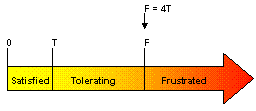

  Image source: apdex.org

  Calculation formula:

  ```text
  Apdex score = (Number of satisfied samples + Number of tolerating samples/2)/Number of total samples
  ```

  ARMS uses the average response time of an application in calculation, and defines T at 500 ms.

- Instance

  An instance is a machine where the monitored application is deployed. The granularity of an instance is Java Virtual Machine (JVM).

**Statistics pages**

- **Applications** page

  In the left-side navigation pane, choose **Application Monitoring > Applications** to view the information about each application in the following columns: Health Rate, Requests, Errors, Response Time, Exceptions, and Response Time (Last 10 Minutes).

- **Application Overview** page

  On the Applications page, click the name of an application to go to the **Application Overview** page. You can select menus in the upper part of the page to view statistics in other dimensions.

  - **Overview** tab

    - Application Support Services: displays the data generated when users access the application, such as the data generated when a user accesses the application in a browser. This section displays the following two metrics: Application Service Request and Application Service Average Response Time.

    - Application Dependent Services: displays the data generated when the application accesses other services, such as a database. This section displays the following three metrics: Application Dependent Service Request, Application Dependent Service Average Response Time, and App Instance Count.

    - System Info: displays the CPU utilization, memory usage, and load.

    - Statistical Analysis: displays the slow calls, average response time, exceptions, and occurrences.

  - **Topology** tab

    - Application topology

    - Instance Health: Green indicates **Normal**, yellow indicates **Alerting**, and red indicates **Severe**.

    - Call types

      | Call type | Description | Remarks |
      | --- | --- | --- |
      | MySQL call | Calls initiated for operating on MySQL | Database call |
      | HTTP call | HTTP calls initiated by this application to other services | Inter-service call |
      | Local API call | Local API operation calls | API call |
      | HTTP portal | Entry point of the application called by the client by using HTTP | Service entry call |

    - Instance IP: the IP addresses of all instances where the application is deployed.

    - Requests, Response Time, and Errors

- **Application Details** page

  This page displays details of calling the current application. Click different tabs to view the detailed analysis of different dimensions, such as the instance response time, number of requests, number of errors, instance overview, SQL analysis, exception analysis, and API call snapshots.

- **Interface Invocation** page

  This page displays the statistical information of API operations provided by the current application. Click different tabs to view the detailed analysis of different dimensions, such as the instance response time, number of requests, number of errors, instance overview, SQL analysis, exception analysis, and API call snapshots.

- **Database Invocation** page

  This page displays application-related database call information. Click different tabs to view the detailed analysis of different dimensions, such as the instance response time, number of requests, number of errors, instance overview, SQL analysis, and exception analysis.

**Key statistical metrics on related tabs**

- Response Time: the average response time of application and instance calls, or the average execution response time of database operations.

- Requests: the number of requests to call applications or instances, or the number of times database operations performed.

- Errors: the number of incorrect application or instance calls, or the number of abnormal executions in database operations.

- **Overview** tab

  | Reported field | Description |
  | --- | --- |
  | Requests | The number of requests to call applications or instances, or the number of times database operations performed. |
  | Response Time | The average response time of application and instance calls, or the average execution response time of database operations |
  | Error rate | The percentage of the number of abnormal application or instance calls or the number of abnormal executions in database operations to the total number of requests. |

- **SQL Analysis** tab

  | Reported field | Description |
  | --- | --- |
  | SQL Calls | The column chart and the left-side Y axis display the number of database requests. The line chart and the right-side Y axis display the database response time. |
  | Average Time Consumption | The average amount of time consumed for this database call. |
  | Number of Calls | The number of times this type of database is called. |

- **Exception Analysis** tab

  | Reported field | Description |
  | --- | --- |
  | Exceptions | The column chart displays the number of exceptions of the application, instance, and database. |
  | Exception types | The types of collected exceptions. |
  | Exception Details | The detailed information of exceptions. |
  | Average Time Consumption | The average amount of time consumed by this incorrect call |
  | Errors | The number of times this exception type has occurred |

- **Interface Snapshot** tab

  | Reported field | Description |
  | --- | --- |
  | Time Consumption | The amount of time consumed to call the API of an application or instance. |
  | Status | The return status of the API call of an application or instance. Green indicates a success response, and red indicates an exception. |
  | TraceId | The index ID of an application or instance call. You can click the ID to go to the details page of this trace. |

<a id="section-4-5-3"></a>

### 4.5.3. ARMS SDKs

This topic describes how to use Application Real-Time Monitoring Service (ARMS) SDKs to dynamically obtain a trace ID and the properties of the trace from the service code.

**Prerequisites**

- Your Java application is connected to ARMS. The ARMS agent for Application Monitoring is installed and started for the application. For more information, see Manually install the ARMS agent for a Java application.

- The arms-sdk-1.7.3.jar dependency is imported to the application.

  ```xml
  <dependency>
      <groupId>com.alibaba.arms.apm</groupId>
      <artifactId>arms-sdk</artifactId>
      <version>1.7.3</version>
  </dependency>
  ```

  > **Note**
  >
  > If you cannot obtain the dependency from the pom.xml file, directly download arms-sdk-1.7.3.jar.

**Obtain a trace ID and an RPC ID**

You can run the following code to obtain a trace ID and a remote procedure call (RPC) ID:

```text
Span span = Tracer.builder().getSpan();
String traceId = span.getTraceId();
String rpcId = span.getRpcId();
```

**Pass through custom baggage items**

To pass through custom baggage items, you must perform the following steps to add the items to and obtain the items from the service code:

1. Add **baggage** items to the service code.

   ```text
   Map<String, String> baggage = new HashMap<String, String>();
   baggage.put("key-01", "value-01");
   baggage.put("key-02", "value-02");
   baggage.put("key-03", "value-03");
   Span span = Tracer.builder().getSpan();
   span.withBaggage(baggage);
   ```

2. Obtain the **baggage** items from the service code.

   ```text
   Span span = Tracer.builder().getSpan();
   Map<String, String> baggage = span.baggageItems();
   ```

**Add custom tags to a span**

You can add a custom tag only to the current span. You cannot pass a custom tag to other spans. To add custom tags to a span, perform the following steps to add the tags to and obtain the tags from the service code:

1. Add **tags** to a span in the service code. You can specify multiple tags.

   ```text
   Span span = Tracer.builder().getSpan();
   // Add a tag to the Span.
   span.setTag("tag-key1", "tag-value1");
   span.setTag("tag-key2", "tag-value2");
   ```

2. Obtain the **tags** from the service code.

   ```text
   Span span = Tracer.builder().getSpan();
   // Inspect the Span's tags.
   Map<String, String> tags = span.tags();
   ```

**Query traces based on baggage items and tags**

You can use **baggage** items and **tags** that are added to a span to query traces.

- A **baggage** item can be passed to the downstream and is generally used to color business data. We recommend that you do not specify a large number of baggage items.

- A **tag** applies only to the current span. You can add multiple tags to a span.

1. Log in to the ARMS console.

2. In the left-side navigation pane of the console, choose **Application Monitoring > Multidimensional Query**.

3. On the **Call link query** page, select a parameter type, enter a parameter value, and click **Add to query criteria**.

4. In the return result on the **Call link query** page, click the value in the **TraceID** column of the trace that you want to view.

5. On the **Traces** tab, move the pointer over a value in the **Service** column to view the tags and **baggage** items of the current span.

<a id="section-4-6"></a>

## 4.6. Agent upgrade

This topic describes how to upgrade the Application Real-Time Monitoring Service (ARMS) agent for Java applications in Enterprise Distributed Application Service (EDAS) and other environments.

**Upgrade the ARMS agent for a Java application in EDAS**

To upgrade the ARMS agent for a Java application in EDAS, redeploy the application.

**Upgrade the ARMS agent for Java applications in other environments**

To upgrade the ARMS agent for Java applications in environments other than EDAS, uninstall the agent and install it again.

For more information about how to uninstall the agent, see FAQ about application monitoring.

<a id="section-5"></a>

# 5.LLM Application Monitoring

<a id="section-5-1"></a>

## 5.1. Overview

An LLM application is an application built on a large language model (LLM). Large language models are trained on massive datasets and billions of parameters. They answer questions in natural language in a human-like manner. These models are widely used in natural language processing, text generation, and intelligent dialogue systems.

LLM outputs are often unpredictable. This can be caused by several factors, such as bias in training or production, data distribution drift that degrades performance, stale data, and unreliable external data dependencies. These issues can degrade the overall performance of an LLM application. Therefore, it is critical to detect degradation in output quality as early as possible.

ARMS supports automatic instrumentation of LLM applications using a Python probe. After you integrate your LLM application with ARMS, you can view the call trace. This view helps you analyze inputs and outputs by operation type, token consumption, and more—all at a glance.

**Monitoring views**

LLM application monitoring provides the following views:

- Application Overview

- App Performance Analytics

- Token Analysis

- LLM Operations

- LLM Call Trace Analysis

**Licensing**

You can monitor LLM applications using the Python probe provided by ARMS. Each probe that you attach consumes one license. In ARMS, an LLM application is treated as a Tracing Analysis application. Log on to the ARMS console and navigate to **Tracing Analysis > Usage Analysis** to view your current Tracing Analysis license usage.

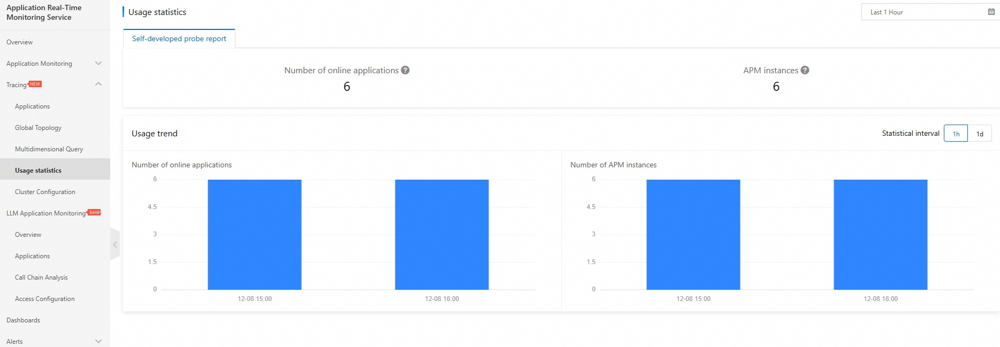

The Tracing Analysis license packages are as follows:

- Base package: software_arms_xtrace_cn_enterprisev2.

- Expansion package: software_arms_xtrace_cn_enterprisev2_expansion.

<a id="section-5-2"></a>

## 5.2. Connect LLM applications to ARMS

The Python agent is a Python-based observability instrumentation tool developed by Alibaba Cloud. It follows the OpenTelemetry standard and provides automatic instrumentation for tracing LLM applications.

**Prerequisites**

Check your Python version and framework versions. For specific requirements, see Components supported by the Python agent.

**Important notes**

- If your application uses uvicorn, use one of the following methods to configure it.

  - Method 1: Add the following statement on the first line of your uvicorn entry file to import the Python agent.

    ```python
    from aliyun.opentelemetry.instrumentation.auto_instrumentation import sitecustomize
    ```

  - Method 2: Replace uvicorn with gunicorn and add the  `aliyun-instrument`  prefix before the gunicorn command.

    For example:

    ```text
    uvicorn app:app --workers 4 --port=9090 --host 0.0.0.0
    ```

    Becomes:

    ```text
    aliyun-instrument gunicorn -w 4 -k uvicorn.workers.UvicornWorker -b 0.0.0.0:8000 app:app
    ```

    > **Note**
    >
    > The aliyun-instrument command initializes the ARMS Python agent and enables non-intrusive instrumentation.

- If your application uses uWSGI, follow the instructions in Connect Django or Flask projects launched with uWSGI to the Python agent.

- If your application uses gevent coroutines, set the environment variable  `GEVENT_ENABLE=true` .

  For example, if your code includes:

  ```python
  from gevent import monkey
  monkey.patch_all()
  ```

  Set the environment variable as follows:

  ```text
  GEVENT_ENABLE=true
  ```

**Step 1: Download the Python agent**

```bash
wget https://<ARMS console domain name>/download/aliyun-python-agent.zip -O aliyun-python-agent.zip --no-check-certificate
```

**Step 2: Install the Python agent**

Go to the directory where the agent ZIP file is located and extract it to any working directory.

```text
unzip aliyun-python-agent.zip -d /{user.workspace}/
```

> **Important**
>
> "{user.workspace}" is an example path. Replace it with the correct path for your environment.

After extracting the agent, go to the target/ directory. Then, choose an installation method based on whether your environment has Internet access:

- Internet access available:

  <ol type="i">

  <li>

  Run the following command to configure a PyPI mirror for faster installation:

  ```bash
  pip3 config set global.index-url https://mirrors.aliyun.com/pypi/simple/ && pip config set install.trusted-host mirrors.aliyun.com
  ```

  </li>

  <li>

  You can install the probe.

  </li>

  </ol>

  ```bash
  pip3 install ./*
  ```

- No Internet access:

  <ol type="i">

  <li>

  Ensure your Python environment already has the following dependencies:

  ```text
  asgiref~=3.0
  bytecode>=0.16.2
  certifi>=2017.4.17
  chardet
  charset-normalizer<4,>=2
  cramjam==2.10.0
  crcmod==1.7
  deprecated>=1.2.6
  googleapis-common-protos~=1.52
  idna<4,>=2.5
  importlib-metadata<=8.5.0,>=6.0
  jsonpath
  opentelemetry-api<=1.35.0
  opentelemetry-instrumentation==0.51b0
  opentelemetry-semantic-conventions==0.51b0
  packaging>=20.0
  protobuf<6.0,>=3.20.0
  python-snappy
  requests~=2.7
  setuptools>=16.0
  typing-extensions
  urllib3<3,>=1.21.1
  wrapt
  zipp>=3.20
  ```

  </li>

  <li>

  You can install the probe.

  </li>

  </ol>

  ```bash
  pip3 install ./*
  ```

**Step 3: Configure environment variables**

Add the following environment variables to your Python application:

```bash
export ARMS_APP_NAME=my-service  # Your app name. Change it before use.
export ARMS_REGION_ID=<REGION ID>
export ARMS_LICENSE_KEY=<License Key>
export ARMS_ENDPOINT=<Xtrace Endpoint>
```

> **Note**
>
> You can find these variables in the ARMS console. Go to **LLM Application Monitoring > Integration Settings**.

**Step 4: Launch your application using the ARMS Python agent**

- Launch your application using the Python agent:

  ```text
  aliyun-instrument python app.py
  ```

- (Optional) You can also launch your application without the Python agent. Instead, import the Python agent in your main application file, and then start your application. For example, import it in main.py or app.py.

  ```python
  from aliyun.opentelemetry.instrumentation.auto_instrumentation import sitecustomize
  ```

**Result Verification**

After your application starts successfully, send some requests. Wait about one minute. If your Python application appears in the ARMS console on the **Tracing Analysis > Application List** page and reports data, the integration succeeded.

**Components supported by the Python agent**

**Supported Python versions**

Python version requirement: 3.8 ≤ Python ≤ 3.12

**Supported Protobuf versions**

The Python agent uses Protobuf to encode data before reporting. This may conflict with Protobuf versions used by your application. The Python agent supports the following Protobuf version range:

```text
protobuf>=3.20.0, <6.0
```

**Supported OpenTelemetry API versions**

The Python agent implements the OpenTelemetry API specification. Because different OpenTelemetry API versions may vary slightly, the Python agent supports the following OpenTelemetry API version range:

```text
opentelemetry-api<=1.35.0
```

**Supported plugins**

| Component | PyPI repository URL | Minimum version | Higher Version |
| --- | --- | --- | --- |
| OpenAI | https://pypi.org/project/openai/ | v1.0.0 | v1.109.1 |
| Dashscope | https://pypi.org/project/dashscope/ | v1.0.0 | v1.2.1 |
| Llama-index | https://pypi.org/project/llama-index/ | v0.10.5 | v0.10.43 |
| Langchain | https://pypi.org/project/langchain/ | v0.1.0 | v0.3.27 |
| Dify | https://github.com/lan ggenius/dify | v0.12.8 | v1.4.3 |
| MCP | https://pypi.org/project/mcp/ | v1.3.0 | v1.12.4 |
| Google ADK | https://pypi.org/project/google-adk/ | v1.2.1 | No limit |

**Large language model (LLM) services**

<table>
  <tr>
    <th>Component</th>
    <th>PyPI repository URL</th>
    <th>Minimum version</th>
    <th>Higher Version</th>
  </tr>
  <tr>
    <td>vLLM V0</td>
    <td rowspan="2">https://pypi.org/project/vllm/</td>
    <td>v0.5.0</td>
    <td>v0.8.4</td>
  </tr>
  <tr>
    <td>vLLM V1</td>
    <td>v0.8.2</td>
    <td>v0.8.4</td>
  </tr>
  <tr>
    <td>SGLang</td>
    <td>https://pypi.org/project/sglang/</td>
    <td>v0.4.6</td>
    <td>v0.4.9.post6</td>
  </tr>
</table>

**HTTP/RPC frameworks**

| Component | PyPI repository URL | Minimum version | Later versions |
| --- | --- | --- | --- |
| FastAPI | https://pypi.org/project/fastapi/ | v0.58 | No limit |
| asgiref | https://pypi.org/project/asgiref/ | v3.0 | No limit |
| aiohttp | https://pypi.org/project/aiohttp/ | v3.0 | No limit |
| Django | https://pypi.org/project/Django/ | v1.10 | No limit |
| WSGI | None | No limit | No limit |
| Flask | https://pypi.org/project/Flask/ | v1.0 | No limit |
| Requests | https://pypi.org/project/requests/ | v2.0 | No limit |
| gRPC | https://pypi.org/project/grpcio/ | v1.42.0 | No limit |
| Jinja2 | https://pypi.org/project/jinja2/ | v2.7 | &lt; 4.0 |
| Click | https://pypi.org/project/click/ | v8.1.3 | &lt; 9.0.0 |
| Tornado | https://pypi.org/project/tornado/ | v5.1.1 | No limit |

**Database frameworks**

| Component | PyPI repository URL | Minimum version | Later version |
| --- | --- | --- | --- |
| SQLAlchemy | https://pypi.org/project/sqlalchemy/ | v1.0.0 | &lt; 2.1.0 |
| AsyncPG | https://pypi.org/project/asyncpg/ | v0.12.0 | No limit |
| aiopg | https://pypi.org/project/aiopg/ | v0.13.0 | &lt; 2.0.0 |
| PyMySQL | https://pypi.org/project/pymysql/ | No version requirement | &lt; 2 |
| PyMSSQL | https://pypi.org/project/pymssql/ | v2.1.5 | &lt; 3 |
| psycopg | https://pypi.org/project/psycopg/ | v3.1.0 | No limit |
| psycopg2 | https://pypi.org/project/psycopg2/ | v2.7.3.1 | No limit |
| MySQL | https://pypi.org/project/mysql-connector-python/ | v8.0 | &lt; 10.0 |
| MySQLClient | https://pypi.org/project/mysqlclient/ | No version requirement | &lt; 3 |
| PyMongo | https://pypi.org/project/pymongo/ | v3.1 | &lt; 5.0 |
| TortoiseORM | https://pypi.org/project/tortoise-orm/ | v0.17.0 | No limit |
| Pydantic | https://pypi.org/project/pydantic/ | v1.10.2 | No limit |
| DBAPI | No dependency required | No version requirement | No limit |
| SQLite3 | No dependency required | No version requirement | No limit |

**Cache plugins**

| Component | PyPI repository URL | Minimum version | Later versions |
| --- | --- | --- | --- |
| Redis | https://pypi.org/project/redis/ | v2.6 | No limit |
| PyMemcache | https://pypi.org/project/pymemcache/ | v1.3.5 | &lt; 5 |
| Elasticsearch | https://pypi.org/project/elasticsearch/ | v6.0 | No limit |
| Cassandra | https://pypi.org/project/cassandra-driver/ | v3.25 | No limit |
| Scylla | https://pypi.org/project/scylla-driver/ | v3.25 | No limit |

**Message queue plugins**

| Component | PyPI repository URL | Minimum version | Higher versions |
| --- | --- | --- | --- |
| Confluent Kafka | https://pypi.org/project/confluent-kafka/ | v1.8.2 | v2.7.0 |
| Kafka Python | https://pypi.org/project/kafka-python/ | No version requirement | No limit |
| aiokafka | https://pypi.org/project/aiokafka/ | No version requirement | No limit |
| Pika | https://pypi.org/project/pika/ | No version requirement | No limit |
| aio-pika | https://pypi.org/project/aio-pika/ | No version requirement | No limit |
| Celery | https://pypi.org/project/celery/ | v4.0 | &lt; 6.0 |
| Remoulade | https://pypi.org/project/remoulade/ | v0.50 | No limit |

**Other plugins**

| Component | PyPI repository URL | Minimum version | Higher versions |
| --- | --- | --- | --- |
| Threading | No dependency required | No version requirement | No limit |
| Logging | No dependency required | No version requirement | No limit |
| asyncio | No dependency required | No version requirement | No limit |

**Connect Django or Flask projects launched with uWSGI to the Python agent**

If your Python application uses Django or Flask and runs on uWSGI, import the Python agent in your main application file and start your application. Also add the  `lazy-apps`  parameter to your uWSGI configuration file.

1. Add the following statement on the first line of your uWSGI entry file to import the Python agent.

   ```python
   from aliyun.opentelemetry.instrumentation.auto_instrumentation import sitecustomize
   ```

2. Change how uWSGI loads your application. Use the lazy-apps option. Run the following command. Do not add the aliyun-instrument prefix.

   ```text
   uwsgi --http :8000 --wsgi-file app.py --callable application --master --enable-threads --threads 2 --processes 4 --lazy-apps
   ```

An example configuration file is:

```ini
[uwsgi]
http = :8000
wsgi-file = /python-demo/django-demo/myproject/myproject/wsgi.py
callable = application
# Specify the socket file location
socket = /python-demo/django-demo/myproject/wsgi.sock
# Set socket file permissions
chmod-socket = 660

# Process settings
master = true
enable-threads = true
threads = 4
processes = 4
# Enable lazy-apps
lazy-apps = true
```

The  `lazy-apps`  option controls how uWSGI loads your application module. When  `lazy-apps`  is set to  `true` , uWSGI loads your application after each worker process starts. By default, uWSGI loads your application when the master process starts.

Effects of enabling  `lazy-apps` :

- Memory isolation: Each worker process loads your application in its own context. This ensures that state does not interfere across processes.

- Dynamic reload: In development mode, you can update code more easily. Each worker process reloads the application at startup without restarting the entire master process.

- Avoiding global state: If global variables are used in the application, enabling  `lazy-apps` ensures each worker process has its own state, thereby reducing issues caused by state sharing.

Effects of disabling  `lazy-apps` :

- Global state sharing: If your application uses global variables, those variables are shared across all worker processes. This may cause unpredictable behavior.

- Faster startup: Because all worker processes load the application when the master process starts, overall startup time can be faster. This is especially true when you start many workers.

- Code changes require full restart: Without  `lazy-apps` , changing code requires restarting the entire uWSGI process—not just a single worker.

<a id="section-5-3"></a>

## 5.3. Connect OpenClaw to ARMS

This topic describes how to connect the OpenClaw service to Application Real-Time Monitoring Service (ARMS). You can run a one-click installation script to quickly connect OpenClaw to the OpenTelemetry Protocol (OTLP) endpoint and automatically collect and report key metrics such as application performance, traces, and token usage. This helps you monitor and analyze the running status of large model applications in the ARMS console in real time.

**Obtain endpoint information**

1. Log in to the ARMS console.

2. In the left-side navigation pane, choose **Tracing > Cluster Configuration**.

3. In the **Cluster Information** section of the **Access point information** tab, turn on **Show Token**.

4. In the **Client** section, click the **OpenTelemetry** tab.

   View the information in the Related Information column. The details displayed to the right of the access points are the endpoint information.

   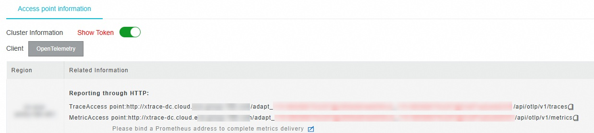

**Connect a service to ARMS**

On the host where the application resides, run curl commands to securely download and immediately execute the remote ARMS installation script, and connect OpenClaw to the specified OTLP endpoint to monitor application performance.

```bash
curl -fsSLk https://<arms-console-domain>/download/openclaw/install.sh | bash -s -- \
  --endpoint "http://xtrace-dc.cloud.{region}/******/api/otlp/" \
  --serviceName "my-openclaw"
```

> **Note**
>
> The endpoint URL is derived from the access point in the console by removing **v1/traces**. In addition, you need to replace serviceName and &lt;arms-console-domain> with the actual values.

The following figure shows a successful installation.

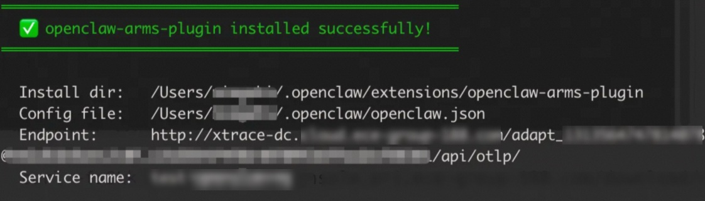

**Verify the installation**

Run the following command to verify whether the installation is successful:

```text
openclaw plugins list
```

Expected output:

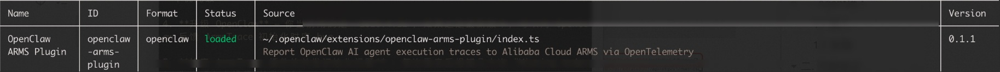

**View monitoring data**

After the installation is complete, send several messages to OpenClaw to trigger agent execution. Then, you can view the monitoring data reported by OpenClaw in the ARMS console.

1. Log in to the ARMS console.

2. In the left-side navigation pane, choose **LLM Application Monitoring > Applications**. On the page that appears, click the name of the application that you want to view.

3. In the left-side navigation pane, you can view Performance Analysis, Token Analysis, LLM Operation, and Call Chain Analysis.

**Uninstall OpenClaw**

Run the following command to uninstall OpenClaw:

```bash
curl -fsSLk https://<arms-console-domain>/download/openclaw/uninstall.sh | bash
```

> **Note**
>
> You need to replace &lt;arms-console-domain> with the actual value.

The following figure shows a successful uninstallation.

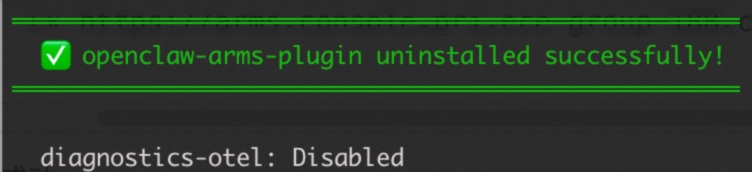

<a id="section-5-4"></a>

## 5.4. Overview

After you install the Python agent for your Large Language Model (LLM) application, ARMS starts monitoring it. On the Overview page, you can view key metrics such as the number of online LLM applications, model invocation latency, and token consumption.

**Prerequisites**

You have installed the agent for your LLM application. For more information, see Integrate LLM applications with ARMS.

**View application overview**

1. Log on to the Application Real-Time Monitoring Service console.

2. In the navigation pane on the left, choose **LLM Application Monitoring > Overview**.

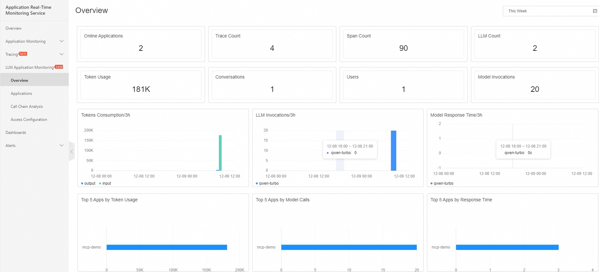

| Panel | Description |
| --- | --- |
| Online applications | The number of applications invoked within the specified time period. |
| Trace Count | The number of traces generated by applications during the specified time period. |
| Span Count | The number of spans generated by applications during the specified time period. |
| LLM Count | The number of unique large language models invoked by applications during the specified time period. |
| Token usage | The total number of tokens used by applications during the specified time period. |
| Conversations | The number of sessions generated by applications during the specified time period. You must configure sessions in your LLM framework to track this metric. |
| Users | The number of users interacting with applications during the specified time period. You must configure user tracking in your LLM framework to track this metric. |
| Model Invocations | The number of times large language models were invoked by applications during the specified time period. |
| Tokens Consumption/3h | The total number of tokens consumed by all model invocations in the last 3 hours. |
| Model invocations/3h | The number of times large language models were invoked by applications in the last 3 hours. |
| Model Response Time/3h | Latency of Application 3's calls to the large language model. |
| Top 5 Apps by Token Usage | Shows the top 5 applications ranked by total token consumption, from highest to lowest. |
| Top 5 Apps by Model Calls | Shows the top 5 applications ranked by invocation count, from highest to lowest. |
| Top 5 Apps by Response Time | Shows the top 5 applications ranked by average invocation latency, from highest to lowest. |

<a id="section-5-5"></a>

## 5.5. Application list

After you install the Python agent for your LLM (Large Language Model) application, Application Real-Time Monitoring Service (ARMS) begins monitoring the application.

**Prerequisites**

A probe is installed on the LLM application. For more information, see Onboard an LLM application to ARMS.

**View the application list**

1. Log on to the Application Real-Time Monitoring Service console.

2. In the left navigation pane, choose **LLM application monitoring > Application list**.

3. On the **Application list** page, view the following information: **Name**, **Label**, **Requests**, **Errors**, **Response time**, and **Response time in the last 30 minutes**.

4. Click the name of the target application to view the following details.

   - Application overview

   - App Performance Analytics

   - Token analytics

   - LLM operations

   - Trace analysis

   - Application settings

5. In the **Actions** column, click **Set** for the target application to manage application labels. For more actions, see Application settings.

<a id="section-5-5-1"></a>

### 5.5.1. Application overview

After you install the Python agent for your LLM (Large Language Model) application, Application Real-Time Monitoring Service (ARMS) begins monitoring it. On this overview page, you can view metrics such as the number of LLM calls, token usage, traces, and sessions.

**Prerequisites**

A probe is installed for the LLM application. For more information, see Integrate LLM Applications with ARMS.

**View the application overview**

1. You can log on to the Application Real-Time Monitoring Service console.

2. In the navigation pane on the left, choose **LLM Application Monitoring > Application List**. Then, click the name of the target application.

3. After you enter the application, click **Application Overview** in the navigation pane on the left.

**Dashboard description**

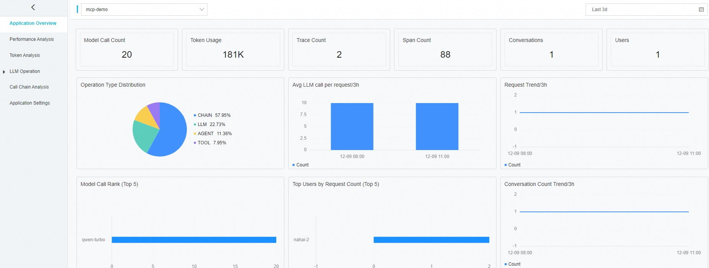

| Panel | Description |
| --- | --- |
| Model Calls | The number of times the large language model was called by the application during the specified time range. |
| Token Usage | The number of times Tokens were used by the application during the specified time range. |
| Trace Count | The number of traces generated by the application during the specified time range. |
| Span Count | The number of spans generated by the application during the specified time range. |
| Conversations | The number of sessions generated by the application during the specified time range. To track this metric, configure sessions in your LLM framework. |
| Users | The number of users of the application during the specified time range. To track this metric, configure users in your LLM framework. |
| Operation Type Distribution | • <strong>CHAIN</strong>: A tool that connects an LLM with multiple components to complete complex tasks. It may include retrieval, embedding, and LLM calls—and even nested chains.<br>• <strong>EMBEDDING</strong>: Embedding operations, such as using a large model to embed text. These help improve question relevance and accuracy through similarity search.<br>• <strong>RETRIEVER</strong>: Retrieves data from vector stores or databases to enrich context. This improves the accuracy and efficiency of LLM responses.<br>• <strong>RERANKER</strong>: Reranks multiple input documents based on relevance to the query. It may return the top K documents for the LLM.<br>• <strong>LLM</strong>: An LLM call—for example, using an SDK or OpenAPI to invoke different large language models for inference or text generation.<br>• <strong>TOOL</strong>: A call to an external tool—for example, calling a calculator or a weather API to get current weather data.<br>• <strong>AGENT</strong>: An agent scenario—a complex chain where the LLM’s inference result determines the next step. It may involve multiple LLM and tool calls to reach a final answer.<br>• <strong>TASK</strong>: A custom internal method—for example, calling a local function to run custom logic. |
| Avg LLM Call per Request | The average number of LLM calls per request. This equals the number of <strong>Model Calls</strong> divided by the number of <strong>Traces</strong>. |
| Request Trend | A trend chart showing the number of traces per minute for the LLM application. |
| Top Models by Call Count | The top five large language models most frequently called by the LLM application. |
| Top Users by Request Count | The top five users who sent the most requests to the LLM application. |
| Session Trend | A trend chart showing the number of sessions per minute for the LLM application. |

<a id="section-5-5-2"></a>

### 5.5.2. App Performance Analytics

After you install the Python agent for your LLM (Large Language Model) application, Application Real-Time Monitoring Service (ARMS) begins monitoring it. On the App Performance Analytics page, you can view metrics such as the number of LLM calls, average latency, and number of failed calls.

**Prerequisites**

A probe has been installed for the LLM application. For specific operations, see Integrate LLM Applications with ARMS.

**View app performance analytics**

1. Log on to the Application Real-Time Monitoring Service console.

2. In the navigation pane on the left, choose **LLM Application Monitoring > Application List**. Then click the name of your target application.

3. After you enter the application page, click **Performance Analytics** in the navigation pane on the left.

   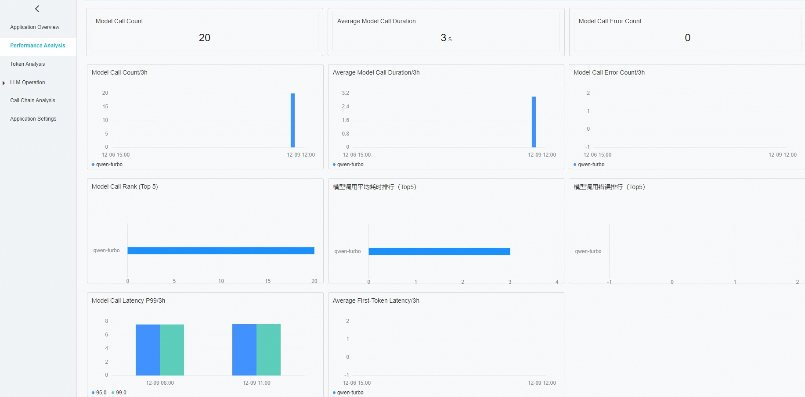

   > **Note**
   >
   > The App Performance Analytics page does not include metrics for EMBEDDING or RERANKER model calls. To view EMBEDDING model call metrics, go to the **LLM Operations > Embedding Analytics** page. RERANKER model call metrics are not available yet.

   | Panel | Description |
   | --- | --- |
   | Model Call Count | The number of LLM calls made by the application during the selected time range. |
   | Average Model Call Latency | The average latency of LLM calls made by the application during the selected time range. |
   | Failed Model Call Count | The number of failed LLM calls made by the application during the selected time range. |
   | Model Call Count per Minute | The number of LLM calls made by the application per minute. |
   | Average Model Call Latency per Minute | The average latency of LLM calls made by the application per minute. |
   | Failed Model Calls per Minute | The number of failed LLM calls made by the application per minute. |
   | Top 5 Models by Call Count | The top five models ranked by call count, from highest to lowest. |
   | Top 5 Models by Average Latency | The top five models ranked by average latency, from longest to shortest. |
   | Top 5 Models by Failed Call Count | The top five models ranked by failed call count, from highest to lowest. |
   | Model Latency P99 per Minute | The P99 latency value for LLM calls. Ninety-nine percent of calls complete faster than this value. |
   | Average First-Byte Latency per Minute | The average time, per minute, for the application to receive the first byte of response data from LLM calls.<br>Important<br>This metric is available only for streaming Large Language Model (LLM) calls. |

<a id="section-5-5-3"></a>

### 5.5.3. Token Analysis

Install the Python probe for your LLM application. ARMS monitors the application and displays token usage metrics on the App Performance Analytics page, such as the number of large language model calls, average call duration, and call faults.

**Prerequisites**

Install the probe for your LLM application. For more information, see LLM application access to ARMS.

**View Token Analysis**

1. Log on to the Application Real-Time Monitoring Service console.

2. In the left navigation pane, choose **LLM Application Monitoring > Application List**. Then click the name of the target application.

3. On the application page, click **Token Analysis** in the left navigation pane.

   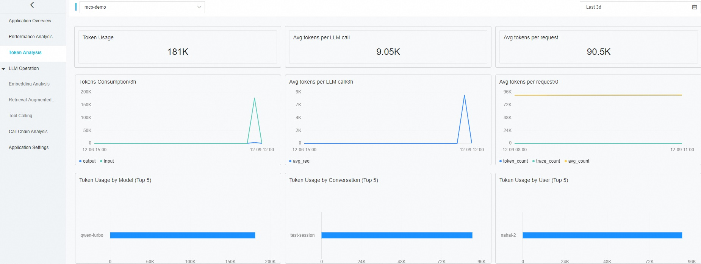

   > **Note**
   >
   > The Token Analysis page does not currently support token consumption statistics for EMBEDDING and RERANKER model calls.

   | Panel | Description |
   | --- | --- |
   | Token Usage | The total number of tokens consumed by all model calls during the specified time period. |
   | Avg tokens per LLM call | The average number of tokens consumed per large language model call. |
   | Avg tokens per request | The average number of tokens consumed per user request. |
   | Tokens Consumed/1m | The total number of tokens consumed by all model calls per minute. |
   | Avg tokens per LLM call/1m | The average number of tokens consumed per large language model call per minute. |
   | Avg tokens per request: 0 | The average number of tokens consumed per user request per minute. |
   | Top 5 Models by Token Usage | The top five models ranked by token consumption, sorted in descending order. |
   | Top 5 Sessions by Token Usage | The top five sessions ranked by token consumption, sorted in descending order. |
   | Top 5 Users by Token Usage | The top five users ranked by token consumption, sorted in descending order. |

<a id="section-5-5-4"></a>

### 5.5.4. LLM operations

After you install the Python agent for a Large Language Model (LLM) application, Application Real-Time Monitoring Service (ARMS) monitors the application. The LLM operations page displays information about the number of calls, duration, and errors for embedding analysis, retrieval augmentation, tool calling, and method calls.

**Prerequisites**

The Python agent is installed for your LLM application. For more information, see Connect an LLM application to ARMS.

**View LLM operations**

1. Log on to the Application Real-Time Monitoring Service console.

2. In the navigation pane on the left, choose **LLM Application Monitoring > Applications**, and then click the name of the target application.

3. In the navigation pane on the left, click **LLM Operations**.

**Embedding analysis**

In LLM applications, embedding is a technique that converts data, such as text or images, into low-dimensional vectors. These vectors capture the semantic information of the data. They are used for tasks such as similarity calculation, retrieval, and classification.

Embedding analysis lets you monitor the performance, stability, and effectiveness of the embedding feature. This provides data to support the optimization and maintenance of your LLM application.

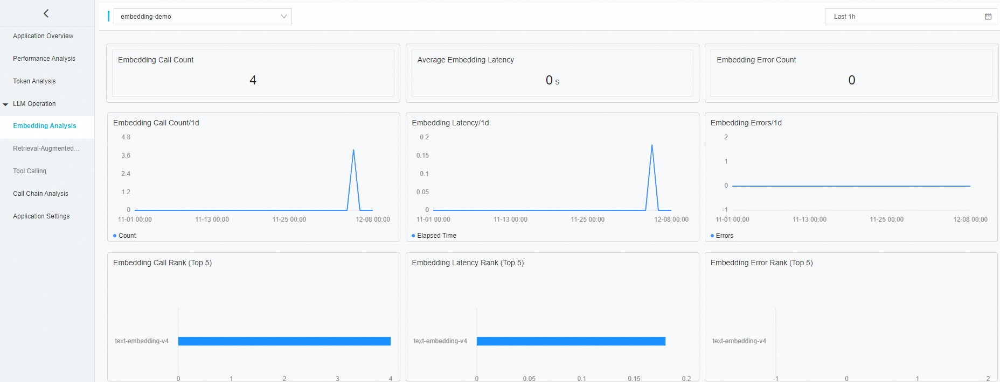

| Panel | Description |
| --- | --- |
| Embedding calls | The total number of embedding calls within the specified time period. |
| Average embedding duration | The average duration of all embedding calls within the specified time period. |
| Embedding errors | The number of failed embedding calls within the specified time period. |
| Embedding calls/min | The total number of embedding calls per minute. |
| Embedding duration/min | The average duration of all embedding calls per minute. |
| Embedding errors/min | The number of failed embedding calls per minute. |
| Top 5 embedding calls | The top five embedding features or models, sorted by the number of calls in descending order. |
| Top 5 embedding durations | The top five embedding features or models, sorted by the average duration in descending order. |
| Top 5 embedding errors | The top five embedding features or models, sorted by the number of call errors in descending order. |

**Retrieval augmentation**

In LLM applications, retrieval-augmented generation (RAG) is a technique that combines retrieval and reranking to improve the relevance and accuracy of content that the LLM generates.

Monitoring retrieval metrics lets you evaluate the performance, stability, and effectiveness of the retrieval augmentation feature. This provides data to support the optimization of your LLM application.

> **Note**
>
> Reranking metrics are not supported.

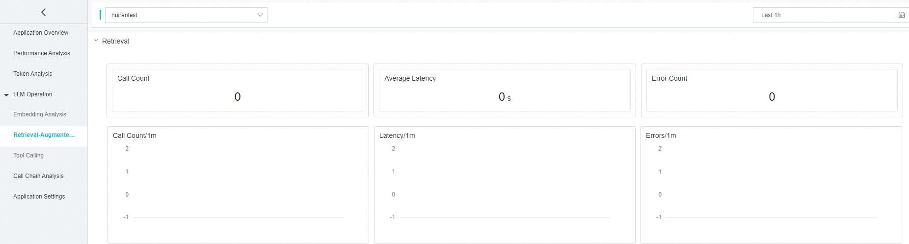

<table>
  <tr>
    <th>Panel</th>
    <th>Description</th>
  </tr>
  <tr>
    <td colspan="2">Retrieval</td>
  </tr>
  <tr>
    <td>Calls</td>
    <td>The total number of retrieval calls within the specified time period.</td>
  </tr>
  <tr>
    <td>Average call duration</td>
    <td>The average duration of all retrieval calls within the specified time period.</td>
  </tr>
  <tr>
    <td>Errors</td>
    <td>The number of failed retrieval calls within the specified time period.</td>
  </tr>
  <tr>
    <td>Calls/min</td>
    <td>The total number of retrieval calls per minute.</td>
  </tr>
  <tr>
    <td>Call duration/min</td>
    <td>The average duration of all retrieval calls per minute.</td>
  </tr>
  <tr>
    <td>Errors/min</td>
    <td>The number of failed retrieval calls per minute.</td>
  </tr>
</table>

**Tool calling**

In LLM applications, tool calling is the process where an LLM invokes external tools or APIs to perform specific functions. These tools can be services such as calculators, database query interfaces, search engines, and translation services. Tool calling extends the capabilities of the LLM, which lets it handle more complex or specific tasks.

The monitoring data for tool calling lets you evaluate the interactions between your LLM application and external tools. This provides data to support optimization and maintenance.

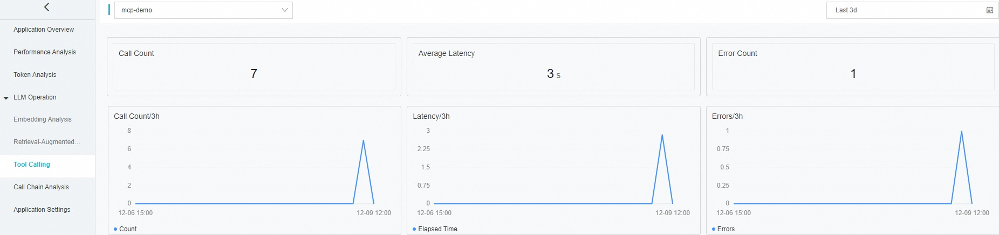

| Panel | Description |
| --- | --- |
| Calls | The total number of tool calls within the specified time period. |
| Average call duration | The average duration of all tool calls within the specified time period. |
| Errors | The number of failed tool calls within the specified time period. |
| Calls/min | The total number of tool calls per minute. |
| Call duration/min | The average duration of all tool calls per minute. |
| Errors/min | The number of failed tool calls per minute. |

<a id="section-5-5-5"></a>

### 5.5.5. Trace analysis

After you install the Python agent for a Large Language Model (LLM) application, the trace analysis feature processes the application’s trace data. The **Trace Analysis** page displays the time consumed by different span types in the LLM trace and associated information, such as input, output, and token consumption.

**Prerequisites**

You have installed an agent for the LLM application. For more information, see Connect an LLM application to ARMS.

**Filter traces**

1. Log on to the Application Real-Time Monitoring Service console.

2. In the navigation pane on the left, choose **LLM Application Monitoring > Application List**, and then click the name of the target application.

3. On the application page, click **Trace Analysis** in the navigation pane on the left.

4. On the **Trace Analysis** page, set the time range for your query in the upper-right corner.

5. Filter traces by metrics such as **Response Time**, **Requests**, and **Errors**, or by call type such as **All**, **Client**, **Server-side**, or **Local Call**.

6. Click a target trace. On the **Trace** tab, use the **Duration Greater Than** and **Errors** filters to search for spans.


**Trace details**

In the trace list, click the target **TraceId** to open the trace details page.

In the trace details panel, you can view the timeline, start time, total duration, and expand individual spans to see more information.


For spans labeled with tags such as CHAIN, AGENT, or LLM, click the tag to view additional AI-related invocation details.


<a id="section-5-5-6"></a>

### 5.5.6. Application Settings

This topic describes how to manage tags for your monitored LLM applications and purge application monitoring data.

**View application settings**

1. Log on to the Application Real-Time Monitoring Service console.

2. In the navigation pane on the left, choose **LLM Application Monitoring > Application List**. Then click the name of the target application.

3. On the page that appears, click **Application Settings** in the navigation pane on the left.

4. On the **Application Settings** page, click the **Tags** tab to manage application tags. Click the **Delete** tab to purge application monitoring data.

   | Tab | Purpose | Action |
   | --- | --- | --- |
   | Tags | Manage application tags. | • <strong>Manage application tags</strong>:<br>• Add a tag: On the <strong>Tags</strong> tab, click <strong>Manage</strong> <strong>application tags</strong>. In the Manage application<br><strong>tags</strong> dialog box, click,<br>enter a tag name, and add the new tag.<br>• Edit a tag: On the <strong>Tags</strong> tab, click <strong>Manage</strong> <strong>application tags</strong>. In the Manage application <strong>tags</strong> dialog box, hover<br>over the tag, click, and<br>edit the tag name.<br>• Remove a tag: On the <strong>Tags</strong> tab, click <strong>Manage</strong> <strong>application tags</strong>. In the Manage application <strong>tags</strong> dialog box, hover<br>over the tag, click, and<br>remove the tag.<br>• <strong>Associate tags</strong>: On the <strong>Tags</strong> tab, select the target tags in the check boxes next to <strong>Associate tags</strong>. Then click <strong>Save</strong>.<br> |
   | Delete | Purge all monitoring data for the application. | <strong>Delete</strong>: On the <strong>Delete</strong> tab, click <strong>Delete</strong>. In the <strong>Delete</strong> <strong>application</strong> dialog box, click <strong>Delete</strong>.<br>Important<br>This action purges all monitoring data for the application. <strong>You cannot</strong> recover the data after deletion! |

<a id="section-5-6"></a>

## 5.6. LLM trace analysis

After you install the Python agent for your Large Language Model (LLM) application, the trace analysis feature processes trace data from your LLM application. On the **Trace Analysis** page, you can view the duration and associated details for different span types in the LLM trace, such as input, output, and token consumption.

**Prerequisites**

Install an agent for your LLM application. For more information, see Integrate LLM applications with ARMS.

**Filter traces**

1. Log on to the Application Real-Time Monitoring Service console.

2. In the left navigation pane, choose **LLM Application Monitoring > Call Chain Analysis**.

3. On the **Call Chain Analysis** page, set the time range using the time selector in the upper-right corner.

4. Filter traces by dimensions such as **TraceId**, **Takes Longer Than (ms)**, **Application name**, **Span name**, or **Tag**.

5. After you apply the filters, the Trace Analysis page displays the filtered LLM trace data.


**Trace details**

In the trace list, click the target **TraceId** to open the trace details page.

In the trace details panel, you can view the timeline, start time, total duration, and expand individual spans to see more information.


For spans labeled with tags such as CHAIN, AGENT, or LLM, click the tag to view additional AI-related invocation details.


<a id="section-6"></a>

# 6.Dashboard

<a id="section-6-1"></a>

## 6.1. Dashboard overview

This topic describes the user interface of the interactive dashboard.

In the left-side navigation pane of the console, select **Dashboard** to go to the **Dashboard Management** page, where you can view all dashboards.

A dashboard consists of four modules: the control operation area, the tag bar operation area, the navigation tree operation area, and the data display area.

- Control operation area: You can operate controls (navigation tree, image, text editing, etc.) and select time in this area.

- Tag bar operation area: You can add different tabs to classify charts. For example, if you want to count the PV and UV operations of Nginx pages, and also count the error return codes of Nginx pages, you can include these two types of statistics in different tabs.

- Navigation tree operation area: You can configure up to three layers of navigation tree. You can drill down to select query dimensions level by level, and then click to view the corresponding data in the dataset display module on the right. The navigation tree is automatically generated by ARMS based on user data. Additionally, you can manually import the navigation tree according to the corresponding JSON format.

- Data display area: This is the core module of the dashboard. It displays all data charts under the selected tab based on the selected navigation tree dimension and time range. You can add multiple different tags.

<a id="section-6-2"></a>

## 6.2. Create a dashboard

This topic describes how to create a dashboard and configure data for it.

**Procedure**

1. Log in to the ARMS console.

2. In the left-side navigation pane of the console, click **Dashboards**.

3. On the **Dashboards** page, choose **Create Dashboard > Custom market** in the upper-right corner.

4. In the **Create Dashboard** dialog box, enter a dashboard name in the Dashboard Name field and click **OK**.

   The system automatically creates a blank tab for this interactive dashboard. You can click the Pencil icon at the top of the tab to name the tab. The new dashboard is displayed on the **Dashboards** page but the dashboard does not contain any data. You must configure data for the dashboard.

5. Add a dataset.

   <ol type="i">

   <li>

   On the **Dashboards** page, find the dashboard and click **Edit** in the **Actions** column.

   </li>

   <li>

   In the upper-right corner of the page, choose **Interactive Control > APM Monitoring**

   </li>

   </ol>

   **Graph**.

   > **Note**
   >
   > - To display the application topology, select **APM Monitoring Topology**.
   >
   > - To add custom monitoring data, select **Custom Monitoring Graph**.
   >
   > - To add texts, select **Add Text**.

   <ol type="i" start="3">

   <li>

   In the **New Interactive Chart** dialog box, enter a **chart name**, select an **application**

   </li>

   </ol>

   and **metrics**, select a **chart type**, and configure other parameters as needed. Then, click **OK**.

6. Add a navigation tree.

   <ol type="i">

   <li>

   On the edit page of the dashboard, choose **Interactive Control > Navigation Tree Components** in the upper-right corner of the page.

   </li>

   <li>

   In the **Navigation Tree** dialog box, configure the **Name**, **Dataset Type**, and **Dataset**

   </li>

   </ol>

   parameters.

   ARMS automatically imports the multi-dimensional traversal values of the selected dataset into the **Data** field.

   <ol type="i" start="3">

   <li>

   Click **OK**.

   </li>

   </ol>

   The navigation tree is displayed on the left side of the page.

7. Associate the dataset with the navigation tree.

   <ol type="i">

   <li>

   In the data display section, find the chart that you want to manage and click the Settings icon in the upper-right corner of the chart.

   </li>

   <li>

   In the **Dataset** section of the dialog box, select **Navigation Tree** from the **Dimension**

   </li>

   </ol>

   drop-down list, and click **OK**.

   The dataset is associated with the navigation tree.

8. View the data display of the dataset.

   You can select different dimensions in the navigation tree to view the data of the dataset.

9. In the time module, select **Today**, **This Week**, or **This Month** to view data within the specified time period. You can also specify the start time and end time to view data.

0. After the dashboard is configured, click **Save** in the upper-right corner to save the configuration. ARMS automatically saves the configuration every 10 seconds to prevent data loss during editing.

   > **Note**
   >
   > To prevent data loss during editing, ARMS automatically saves the configuration every 10 seconds.

   > **Note**
   >
   > The size and position of the chart in the dashboard can be adjusted.
   >
   > - Adjust the size of a chart
   >
   >   In edit mode, drag the handle in the lower-right corner of a chart to adjust the size.
   >
   > - Adjust the position of a chart element In edit mode, drag a chart to change its position.

<a id="section-6-3"></a>

## 6.3. Manage a dashboard

This topic describes how to edit and delete a dashboard, and how to configure full-screen playback for a dashboard.

**Procedure**

1. Log in to the ARMS console.

   <ol type="A">

   <li>

   Browse, modify, delete, rename, and copy

   </li>

   </ol>

2. In the left-side navigation pane of the console, click **Dashboards**.

3. On the **Dashboards** page, enter a dashboard name in the search bar and click **Search**.

4. Perform the following operations on the dashboard:

   - To view the dashboard, click **View** and view the dashboard data in playback mode.

   - To modify the dashboard, click **Edit**, edit the dashboard in edit mode, and click **Save**.

   - To delete the dashboard, click **Delete**, and then click **Delete** in the **Delete** dialog box.

   - To rename the dashboard, click **Rename**, enter a new dashboard name in the **Edit** dialog box, and click **OK**.

   - To copy the dashboard, choose **More > Copy**, enter a dashboard name in the **Create Dashboard** dialog box, and click **OK**. Then, you can find the new dashboard on the **Dashboards** page and continue to edit the dashboard.

   <ol type="A" start="2">

   <li>

   Configure full-screen playback

   </li>

   </ol>

5. Click the name of the dashboard that you want to manage and click **Full-screen** in the upper-right corner.

6. In the **Full-screen Settings** dialog box, select the tab to view in full screen mode and click **OK**.

   The dashboard is played back in full screen mode.

   > **Note**
   >
   > By default, the data is refreshed once every minute. If you have specific requirements, please contact Apsara Stack.

<a id="section-7"></a>

# 7.Alerts

<a id="section-7-1"></a>

## 7.1. Create an alert rule

Application Real-Time Monitoring Service (ARMS) allows you to create alert rules. When alert rules are met, you can receive alerts by email, text message, DingTalk notification, and webhook in real time. This helps you detect errors in a proactive manner.

**Prerequisites**

- A contact group is created. Only contact groups can be specified as alert recipients. For more information, see Manage contact groups.

- An application monitoring task or a custom monitoring task is created.

- If a monitoring task has been created and is running, pause or stop the task first.

**Background information**

Default alert conditions:

- To avoid alert notification flooding, the same alert is sent only twice within half an hour.

- If no repeated alerts are generated within 5 minutes, the system sends a recovery email to notify you that the alert is cleared.

- After a recovery email is sent, the system resets the alert status. If this alert is triggered again, it is treated as a new one.

An alert control is a method to display data in datasets. When you create an alert control, a dataset is also created to store the underlying data of the alert control.

> **Note**
>
> Alerts support integration with ANS. If you need to use the ANS channel, contact the administrator to activate it.

**Create an application monitoring alert rule**

1. 

2. In the left-side navigation pane, choose **Alerts > Alert Policies**.

3. On the **Alarm Policies** page, choose **Create Alarm > Application Monitoring Alarm** in the upper-right corner.

4. In the **Create Alarm** dialog box, configure the required parameters and click **Save**.

   <ol type="i">

   <li>

   Enter a name for the alert rule, such as JVM-GC comparison.

   </li>

   <li>

   Select an application from the **Application Site** drop-down list. Select an application

   </li>

   </ol>

   group from the **Application Group** drop-down list.

   <ol type="i" start="3">

   <li>

   Select a metric type from the **Type** drop-down list, such as **JVM_Monitoring**.

   </li>

   <li>

   Set the Dimension parameter to **Traverse**.

   </li>

   <li>

   Configure the alert rule.

   <ol type="a">

   <li>

   Select **Meet All of the Following Criteria** or **Meet Any of the Following Criteria**.

   </li>

   <li>

   Edit the alert rule. For example, the alert is triggered when the value of N is 5 and the average value of JVM_FullGC increases by 100% compared with that in the previous hour.

   > **Note**
   >
   > To add more alert rules, click the plus sign on the right of the first alert rule.

   </li>

   </ol>

   </li>

   <li>

   Select one or more notification methods. For example, select **Email**.

   </li>

   <li>

   Select the alert recipient. In the **Contact Groups** list, click the name of a contact group.

   </li>

   </ol>

   If the contact group appears in the **Selected Groups** list, the contact group is selected.

**Basic fields**

The following table describes the common basic fields.

| Field | Description | Procedure |
| --- | --- | --- |
| Application site | The monitoring task that is created. | Select a monitoring task from the drop-down list. |
| Type | The type of the alert metric. | The two types of alerts have different alert metric types:<br>• Application monitoring alert: application invocation statistics, application invocation type statistics, database metrics, JVM monitoring, host monitoring, error interface call, and MQ metrics.<br>• Custom monitoring alert: This metric type can be customized based on existing drilled-down datasets and general datasets. |
| Dimension | The dimension of the alert metric (dataset). Available options: <strong>None</strong>, <strong>=</strong>, <strong>Traverse</strong>, and <strong>in</strong> (supported by custom monitoring). | • If you select <strong>None</strong>, the alert content shows the sum of all the values of this dimension.<br>• If you select <strong>=</strong>, you must enter a specific value.<br>• If you select <strong>Traverse</strong>, the alert content shows the dimension content that actually triggers the alert. |
| Last N minutes | The system checks whether the metric value in the last N minutes meets the trigger condition. | Range of N:<br>• Application monitoring: 1 to 60 minutes.<br>• Custom monitoring: 1 to 3,600 minutes. |
| Notification method | Alerts can be sent through emails, text messages, DingTalk chatbots, and webhooks. | You can select multiple notification methods. |
| Alarm Quiet Period | You can turn on or turn off Alarm Quiet Period. By default, Alarm Quiet Period is turned on. | • Turn on Alarm Quiet Period: If data remains in the triggered state, the second alert notification is sent 24 hours after the first alert is triggered. If the data is recovered, the system sends a data recovery notification and clears the alert. If the data triggers the alert one more time, the system sends the alert notification again.<br>• Turn off Alarm Quiet Period: If the alert is continuously triggered, the system sends the alert notification every minute. |
| Alert Level | Valid values: Warn, Error, and Fatal. | None. |
| Effective At | The time when the alert takes effect. | The alert is triggered only during the effective time period. |
| Notification time | The time range during which alert notifications can be sent. No alert notifications are sent outside of this time range, but alert events are recorded. | For more information about alert event history, see Manage alerts. |
| Notification content | The custom content of the alert notification. | You can edit the default template. In the template, you must specify the $AlarmName, $AlarmFilter, $AlarmTime, and $AlarmContent variables. The rest of the content can be customized. Other variables are not supported. |

**Complex fields**

**Period-over-period Comparison**

- Period-over-period increase/decrease%: If β represents the data in the last N minutes (you can select average, sum, maximum, or minimum), and α represents the data from the previous 2N minutes to the previous N minutes, the period-over-period comparison compares β with α.

- Increase/decrease% compared with the previous hour: If β represents the data in the last N minutes (you can select average, sum, maximum, or minimum), and α represents the data in the last N minutes of the previous hour, the comparison with the previous hour compares β with α.

- Increase/decrease% compared with the previous day: If β represents the data in the last N minutes (you can select average, sum, maximum, or minimum), and α represents the data in the last N minutes at the same time of the previous day, the comparison with the previous day compares β with α.

**Alert Data Revision Policy**

You can set the Alarm Data Revision parameter to Set 0, Set 1, or Set Null (Won't Trigger) (default). This parameter allows you to fix data anomalies, such as absent data, abnormal composite metrics, and abnormal period-over-period comparisons.

- Set 0: fixes the checked value to 0.

- Set 1: fixes the checked value to 1.

- Set Null (Won't Trigger): does not trigger the alert

Applicable scenarios

- Anomaly 1: Compound indicator anomaly

  User B wants to use the alerting feature to monitor the real-time unit price of a commodity. When User B creates an alert, User B selects custom monitoring alert, sets the dataset of variable a to current total price, sets the dataset of variable b to current total number of items, and specifies that an alert is triggered when N is 3 and the minimum value of (current total price)/(current total number of items) is less than or equal to 10. If the current total number of items is 0, the value of the composite metric, which is the current total price divided by the current total number of items, does not exist. No alert notification is sent. To resolve this issue, you can set Alarm Data Revision to Set 0. This way, the value of the composite metric (current total price)/(current total number of items) is considered 0, which meets the alert rule. An alert notification is sent.

- Anomaly 2: Metric period-over-period comparison anomaly

  User C wants to use the alerting feature to monitor the CPU utilization of a node. When User C creates an alert rule in Application Monitoring, User C specifies that an alert is triggered when N is 3, and the average CPU utilization of the node decreases by 100% compared with that in the previous monitoring period. If the CPU fails in the last N minutes, the system cannot obtain α, which is used to calculate the period-over-period comparison result. In this case, the comparison result does not exist. No alert notification is sent. To resolve this issue, you can set Alarm Data Revision to Set 1. This way, the comparison result is considered a 100% decrease, which meets the alert rule. An alert notification is sent.

**What to do next**

Click the **Alert History** tab to view all alert records. You can also use the search box to query alert records.

<a id="section-7-2"></a>

## 7.2. Manage alert rules

In the Application Real-Time Monitoring Service (ARMS) console, you can manage the alert rules configured in monitoring tasks and view the alert history.

**Manage alert rules**

1. Log in to the ARMS console.

2. In the left-side navigation pane, choose **Alerts > Alert Policies**.

   The **Alarm Policies** page is displayed. By default, the **Alert Rules** tab is displayed.

3. On the **Alert Rules** tab, enter an alert rule name in the search box and click **Search**.

   The query results are displayed in the list.

4. You can perform the following operations on an alert rule in the Actions column based on your business requirements:

   - To modify an alert rule, click **Edit** in the **Actions** column. In the **Edit Alarm** dialog box, modify the configurations of the alert rule and click **Save**.

   - To delete an alert rule, click **Delete** in the **Actions** column. In the **Delete** message, click **Delete**.

   - To enable an alert rule, click **Start** in the **Actions** column. In the **OK** message, click **Start**.

   - To disable an alert rule, click **Stop** in the **Actions** column. In the **Stop** message, click **OK**.

   - To view the alert history, click **Alert History** in the **Actions** column. On the **Alert History** tab, view the alert history.

5. To export, enable, disable, or delete multiple alert rules at the same time, select the alert rules and click the corresponding button below the list.

6. To import alert rules, click **Import Rules** in the upper-right corner of the tab and configure the parameters based on the instructions.

**Query alert history**

1. Log in to the ARMS console.

2. In the left-side navigation pane, choose **Alerts > Alert Policies**.

3. Click the **Alert History** tab, select an alert type, event trigger status, alert name, and application PID or host IP address, and then click **Search**.

   The alert history is displayed in the list.

<a id="section-7-3"></a>

## 7.3. Manage alert templates

Application Real-Time Monitoring Service (ARMS) provides alert templates that allow you to create alerts in batches, improving efficiency in configuring alert rules.

**Background information**

ARMS comes with the following alert templates:

- DefaultAPM-DB-Alert: This template is used to generate alerts for long database response time and database call errors.

- DefaultAPM-Exception-Alert: This template is used to generate alerts for call timeout and call errors.

- DefaultAPM-Host-Alert: This template is used to generate alerts for high CPU usage and insufficient disk space.

- DefaultAPM-Process-Alert: This template is used to generate alerts for process status.

- DefaultAPM-GC-Alert: This template is used to generate alerts for excessive full garbage collection (GC) events, long full GC duration, and long young GC duration.

**Create an alert template**

In addition to the default alert templates provided by ARMS, you can create custom alert templates as needed.

1. 

2. In the left-side navigation pane, choose **Alerts > Alarm Template Management**.

3. On the **Alarm Template Management** page, click **Create Alert Template** in the upper-right corner and select **Application Monitoring Alarm Template**.

   In the **Create Alarm Template** dialog box, configure the required parameters and click **Save**. For more information about the parameters, see the **Basic fields** section in the Create an alert rule topic.

4. **Optional**. Find the alert template in the alert template list and click **Create Alarm** in the **Actions** column. In the **Create Alarm** dialog box, configure the required parameters and click **Save**.

   Choose **Alerts > Alert Policies**. On the **Alert Policies** page, click the **Alert Rules** tab. If the alert rule you created is in the alert list, the alert rule has been created from the alert template.

5. **Optional**. Find the alert template in the alert template list and click **Batch Create Alerts** in the **Actions** column.

6. **Optional**. In the **Batch Create Alerts** dialog box, click the desired applications in the left-side list to add them to the right-side list. Click **Save**. In the **Note** message, click **OK**.

   Choose **Alerts > Alert Policies**. On the **Alert Policies** page, click the **Alert Rules** tab. If the alert rules are in the alert list, the alert rules have been created from the alert template.

**Manage alert templates**

You can enable or disable automatic generation of alert templates and modify, delete, or copy alert templates.

1. 

2. In the left-side navigation pane, choose **Alerts > Alarm Template Management**.

3. In the alert template list, find the alert template that you want to manage and click an option in the **Actions** column based on the operation that you want to perform.

   - To modify an alert template, click **Edit**. In the **Edit Alarm Template** dialog box, modify the configurations of the alert template and click **Save**.

   - To delete an alert template, click **Delete**. In the **Delete** message, click **Delete**.

   - To copy an alert template, click **Copy**. In the **Edit Alarm Template** dialog box, modify the configurations of the alert template that you want to copy and click **Save**.

<a id="section-7-4"></a>

## 7.4. Manage contacts

When you configure an alert rule, you can select only contact groups as alert contacts. You must add contacts before you can add a contact group.

**Add a contact**

1. Log in to the ARMS console.

2. In the left-side navigation pane, choose **Alerts > Contact Management**.

3. On the **Contact** tab, click **New contact** in the upper-right corner.

4. In the **New contact** dialog box, enter the contact name, phone number, and email address, and click OK. To allow the contact to receive system notifications, select **Whether to receive system notifications**. By default, this check box is not selected. Click **OK**.

   > **Note**
   >
   > Each mobile phone number or email address can be used for only one contact. You can add a maximum of 100 contacts.

**Create a webhook**

1. Log in to the ARMS console.

2. In the left-side navigation pane, choose **Alerts > Contact Management**.

3. On the **Contact** tab, click **Create a webhook**.

4. In the dialog box that appears, configure the Webhook Name, Post, Header, and Body parameters. Click **Create**.

   | Parameter | Description |
   | --- | --- |
   | Webhook Name | Required. Enter a name for the webhook. |
   | <strong>Post</strong> and Get | Required. Specify a request method and enter a URL. The URL cannot exceed 256 characters in length. |
   | <strong>Header</strong> and Param | Optional. Specify a request header. The request header cannot exceed 200 characters in length. Click <strong>+ Add</strong> to add more headers or parameters. The default request header is <strong>Content-Type: text/plain; charset=UTF-8</strong>. The total number of headers and parameters cannot exceed 6.<br>In this example, the following <strong>headers</strong> are added:<br>• Arms-Content-Type : json<br>• Content-Type : application/json |
   | Body | Optional. This parameter is displayed in the POST method. The $content placeholder can be used in the Body string to output alert content. The length cannot exceed 500 characters. |

**What to do next**

- To search for contacts, on the **Contact** tab, select **Name**, **Cell phone number**, or **Email** from the drop-down list, enter the entire or a keyword of the contact name, phone number, or email in the search box, and then click the Search icon.

- To modify a contact, find the contact that you want to modify and click **Edit** in the **Actions** column. In the **Edit Contact** dialog box, modify the contact information and click **OK**.

- To delete a contact, find the contact that you want to delete and click **Delete** in the **Actions** column. In the message that appears, click **OK**.

- To delete multiple contacts at the same time, select the contacts that you want to delete and click **Batch delete** in the lower part of the Contact tab. In the message that appears, click **OK**.

<a id="section-7-5"></a>

## 7.5. Manage contact groups

This topic describes how to manage contact groups.

**Procedure**

1. Log in to the ARMS console.

2. In the left-side navigation pane, choose **Alerts > Contact Management**.

3. On the **Contact Management** page, click the **Contact Group** tab.

4. On the **Contact Group** tab, click **Create a contact group** in the upper-right corner. Enter a **group name**, select a **contact**, and then click **OK**.

**What to do next**

- To search for a contact group, enter the contact group name or keywords of the name in the search box, and then click the Search icon.

  > **Note**
  >
  > The keywords are case-sensitive.

- To modify a contact group, click the Edit icon on the right side of the contact group name. In the **Edit Contact Group** dialog box, modify the parameters and click OK.

- To view the contacts in a contact group, click the downwards arrow on the left side of the contact group name to display the contacts.

  > **Note**
  >
  > You can remove one or more contacts from a contact group.

- To delete a contact group, click the Delete icon on the right side of the contact group name.

  > **Warning**
  >
  > Proceed with caution when you delete a contact group. Before you delete a contact group, make sure that no task is running. Otherwise, the alerting feature may fail.

<a id="section-8"></a>

# 8.Integration scenario description

<a id="section-8-1"></a>

## 8.1. Connect AgentRuntime to ARMS

AgentRuntime is a PaaS platform designed for enterprise-grade AI agent applications. With built-in end-to-end observability capabilities, the platform automatically collects and visualizes key metrics, including agent call traces, token consumption, and tool usage. This empowers enterprises to achieve transparent O&M, accurate cost accounting, and regulatory compliance.

**Introduction to AgentRuntime**

**AgentRuntime** is a PaaS platform designed for enterprise-grade AI agent applications and deployed in the enterprise-owned cloud environment. It is used to address the core challenges of the entire lifecycle of agents in production environments, from code debugging, deployment, to O&M. It supports **centralized agent runtime management, tool or MCP lifecycle management, and fine-grained elastic scheduling of underlying heterogeneous resources**, and provides multi-level security isolation capabilities. For more information, see **AgentRuntime Product Introduction**.

**Background**

- **Opaque runtime status**: Critical information, such as call traces, token consumption, and tool usage, within agents is usually a black box, making troubleshooting and root cause analysis extremely difficult when issues arise.

- **Difficulty in cost accounting**: Due to the lack of fine-grained measurement tools, enterprises cannot accurately calculate the actual cost of individual agent tasks, posing significant challenges to cost control and budget management.

- **Lack of governance mechanisms**: Enterprises generally lack effective measures to audit, track, and manage the behavior of agents in production environments, which makes it difficult to meet compliance and governance requirements.

**Benefits**

- **Built-in enterprise-grade observability**: AgentRuntime integrates an end-to-end tracing and monitoring system proven in large-scale production environments. Extended specifically for agent scenarios, this system automatically correlates call traces, logs, and underlying metrics while measuring token consumption in LLM calls, without requiring complex code instrumentation or component integration.

- **Trace transparency**: AgentRuntime visualizes the complete decision-making path of agents, enabling rapid identification of abnormal nodes.

- **Performance insights**: AgentRuntime monitors the latency at each step based on metrics to precisely pinpoint performance bottlenecks.

- **O&M efficiency**: AgentRuntime integrates alerting with diagnostics to significantly reduce mean time to repair (MTTR).

**Feature description**

- **Data collection**: AgentRuntime automatically instruments and collects trace data, including model calls, tool execution, and inference steps. For more information, see **AgentRuntime User Guide > Tool Management**.

- **Trace visualization**: AgentRuntime visualizes agent decision paths and latency distribution through interactive trace diagrams. For more information, see **AgentRuntime User Guide > Agent Management**.

- **Metric monitoring**: AgentRuntime provides core metrics including request volume, latency, error rate, and token consumption.

- **Alerting and diagnostics**: AgentRuntime automatically generates alerts based on thresholds and associates them with trace data to assist in root cause analysis.

<a id="section-9"></a>

# 9.Permission Management

<a id="section-9-1"></a>

## 9.1. Log in to the Apsara Uni-manager Management Console

This topic describes how to log in to the Apsara Uni-manager Management Console.

**Prerequisites**

- The URL of the Apsara Uni-manager Management Console is obtained from the deployment engineer.

- A web browser is available. We recommend that you use Google Chrome.

**Procedure**

1. Enter the URL of the Apsara Uni-manager Management Console in the address bar and press the Enter key.

   

   > **Note**
   >
   > - You can click the current language in the upper-right corner to switch to another language.
   >
   > - The Authorized Login button is displayed only when a global identity provider (IdP) is configured in third-party authentication. You can specify a name for the Authorized Login button.
   >
   > - If you need to click Continue multiple times or cannot find the entry to the Apsara Uni-manager Management Console because the browser certificate has expired or HTTPS authentication is enabled in your environment, you must install a valid certificate. Click **Browser certificate installation** in the upper-right corner to open the browser certificate installation guide.

2. Enter your username and password.

   > **Note**
   >
   > - Obtain the username and password from an operations administrator.
   >
   > - The first time you log in to the Apsara Uni-manager Management Console, you must change the password of your account as prompted. For security purposes, the password must be 10 to 32 characters in length. It must contain all of the following character types: uppercase letters, lowercase letters, digits, and special characters. The following special characters are supported: ! @ # $ %

3. Click **Log On**.

4. If multi-factor authentication (MFA) is enabled for your account, perform the corresponding operations in the following scenarios:

   - **This is your first time logging in to the Apsara Uni-manager Management Console after MFA is enabled by the administrator:**

     <ol type="a">

     <li>

     On the Bind Virtual MFA Device page, follow the instructions to bind an MFA device.

     </li>

     <li>

     Enter the username and password again as in Step 2 and click **Log On**.

     </li>

     </ol>

     <ol type="i" start="100">

     <li>

     Enter the 6-digit MFA verification code and click **Authenticate**.

     </li>

     </ol>

   - **You have enabled MFA and bound an MFA device:**

     Enter the 6-digit MFA verification code and click **Authenticate**.

     > **Note**
     >
     > For more information about how to enable MFA and bind an MFA device, see the **Manage MFA** topic in Apsara Uni-manager Management Console User Guide.

**What to do next**

**Forget password**

1. If you forget the login password, click **Forgot Password** below the Password field.

2. On the Forgot Password page, configure the **Account Name** and **Email Address** parameters, enter the verification code, and then click **Confirm**.

   

   > **Note**
   >
   > - Enter the username of your account in the Account Name field and the email address that was used to create the account in the Email Address field.
   >
   > - The system sends a link for resetting the password to the email address that you specify.

<a id="section-9-2"></a>

## 9.2. Create users and user groups

In the Apsara Uni-manager Management Console, you can create users and assign different roles to the users to meet different requirements for system access control as an administrator.

**Create an organization**

Before you can create a user or a user group, you must create an organization.

1. Log in to the Apsara Uni-manager Management Console as an administrator.

2. In the top navigation bar, click **Enterprise**.

3. In the left-side navigation pane, choose **Resources > Organizations**.

4. In the left-side organization tree of the **Organizations** page, click **root** and then click **Create Organization** in the upper-right corner of the page.

5. In the **Add Organization** dialog box, specify a name for the organization and click **OK**.

**Create a user**

1. In the left-side navigation pane, choose **Users > Users**.

2. On the **Users** page, click **Create User**.

3. In the **Create User** panel, configure the parameters and click **OK**. The following table describes the parameters.

   | Parameter | Description |
   | --- | --- |
   | User Name | Enter a name for the user. The name must be 2 to 64 characters in length, and can contain letters, digits, hyphens (-), underscores (_), and periods (.). |
   | Display Name | Enter a display name for the user. The name must be 1 to 128 characters in length, and can contain letters, digits, hyphens (-), underscores (_), periods (.), and at signs (@). |
   | Role | Select a role for the user. |
   | Organization | Select an organization for the user. |
   | Logon Policy | Select Default Policies. |
   | Phone | Enter the mobile number of the user. The phone number is used to notify users of resource application and usage. Make sure that the mobile number is valid.<br>Note<br>If the mobile phone number of the user changes, update it in the system in a timely manner. |
   | Landline | Enter the landline number of the user. The landline number must be 4 to 20 characters in length, and can contain only digits and hyphens (-). |
   | Email | Enter the email address of the user. The email address is used to receive system notifications about resource applications and usage.Make sure that the email address is valid.<br>Note<br>If the email address changes, update it in the system in a timely manner. |
   | DingTalk Key | Enter the key of the DingTalk chatbot. |
   | Notify User by Email | After this option is selected, the Apsara Uni-manager Management Console informs the alert contact by email whenever an alert is generated.<br>Note<br>You must configure an email server if you enable notification by email. For more information, contact on-site O&amp;M engineers. |
   | Notify User by DingTalk | After this option is selected, the Apsara Uni-manager Management Console informs the alert contact by DingTalk whenever an alert is generated. |

4. **Optional.** Add a role.

   <ol type="i">

   <li>

   On the **Users** page, find the user that you want to manage, click the  icon, and then

   click **Role authorized**.

   </li>

   <li>

   In the **Role authorized** dialog box, select or clear roles to grant permissions to or revoke

   </li>

   </ol>

   permissions from the user, and then click **OK**.

**Create a user group**

1. In the left-side navigation pane, choose **Users > User Groups**.

2. On the **User Groups** page, click **Create User Group**.

3. In the **Create User Group** dialog box, configure the **User Group Name** parameter, select an organization from the **Organization** drop-down list, and then click **OK**.

   | Parameter | Description |
   | --- | --- |
   | User Group Name | Enter a name for the user group. The name must be 3 to 255 characters in length, and can contain letters, digits, underscores (_),<br><br>hyphens (-), periods (.), and at signs (@). Example: <code>ARMS_group</code>. |
   | Organization | Select an organization from the drop-down list. |
   | Role authorized | Select the role that you want to assign to the users in the user group.For more information about how to create a role, see Create a role. |

4. **Optional.** Add a user.

   <ol type="i">

   <li>

   On the **Users** page, find the user group to which you want to add a user and click **Add User** in the Actions column.

   </li>

   <li>

   In the **Add User** dialog box, select the user that you want to add and click the right

   </li>

   </ol>

   arrow to move the user to the Add User list on the right.

   <ol type="i" start="3">

   <li>

   Click **OK**.

   </li>

   </ol>

5. Add a role.

   <ol type="i">

   <li>

   On the **User Groups** page, find the user group that you want to manage, click the 

   icon, and then click **Authorize**.

   </li>

   <li>

   In the **Authorize** dialog box, select a role from the **Role authorized** drop-down list.

   </li>

   <li>

   In the drop-down list, you can select or clear a role to grant permissions to or revoke

   </li>

   </ol>

   permissions from the user group. Then, click **OK**.

<a id="section-9-3"></a>

## 9.3. Create custom roles

You can create custom roles in the Apsara Uni-manager Management Console to efficiently grant permissions to users so that different personnel can work with different features.

**Background information**

A role is a collection of access permissions, and each role has a corresponding permission scope. A user can have multiple roles, which means that the user is granted all the permissions defined for these roles. You can use a role to grant the same set of permissions to a group of users.

The total number of custom and default roles cannot exceed 20.

**Procedure**

1. The administrator logs on to the Apsara Uni-manager Management Console.

2. In the top menu bar, click **Enterprise**.

3. In the left-side navigation pane, choose **Permission > Role Permissions**.

4. Click **Create Custom Role** in the upper-left corner of the page.

5. On the **Create Custom Role** page, set the name, sharing scope, and management scope. Click **Next**.

   The following table describes the role parameters.

   Table 1. Role parameter description

   | Name | Description |
   | --- | --- |
   | Role Name | The name of the role. The name can contain only Chinese characters, uppercase and lowercase letters (A to Z and a to z), and digits (0 to 9). The name can be up to 64 characters in length. |
   | Descripti on | Optional. The description of the role. The description can be up to 500 characters in length and can contain Chinese characters, uppercase and lowercase letters (A to Z and a to z), digits (0 to 9), commas (,), semicolons (;), and underscores (_). |
   | Sharing Scope | <strong>Global</strong>: The role can be viewed and used by all organizations. |
   | Manage ment Permissi ons | • All Organizations<br>These permissions apply to all organizations involved.<br>• Specified Organization and Subordinate Organizations<br>These permissions apply to the organization to which the user belongs and its subordinate organizations.<br>• Resource Sets<br>These permissions apply to the resource sets that are assigned to the user. |

6. On the **Management Permissions** page, select the operation permissions that the role has on the Apsara Uni-manager Management Console. Click **Next**.

   You can click permission categories on the left side to filter permissions.

7. On the **Application Permissions** page, select the operation permissions that the role has on **Application Real-Time Monitoring Service**. Click **Next**.

   You can click application names on the left side to filter application permissions.

8. On the **Menu Permissions** page, select the operation permissions that the role has on each menu and the dashboard template for the role's homepage. Click **Create** to complete the creation process.

   You can click the parent menu on the left side to filter permissions on cascading menus.

**Result**

After the role is created, you can click **Authorize Now** to authorize users or user groups, or you can authorize them later in the role details.

<a id="section-9-4"></a>

## 9.4. Create a RAM role

The Apsara Uni-manager Management Console allows you to create custom RAM roles and grant permissions to users for more granular permission management. This topic describes how to create a RAM role and attach permission policies.

**Create a RAM role**

1. The administrator logs on to the Apsara Uni-manager Management Console.

2. In the top navigation bar, click **Enterprise**.

3. In the left-side navigation pane, choose **Permissions > Role Permissions**, and then click **Create Custom Role** on the right side of the page.

4. On the **Create Custom Role** page, expand the **Advanced Settings** tab, and click **Create RAM Authorization**.

5. On the **Create RAM Authorization** page, set the role information, and then click **Create and Configure RAM Authorization**.

   | Parameter | Description |
   | --- | --- |
   | Role Name | The custom role name, such as<br><br><code>Namespace</code><br><code>Management</code><br><code>Permission</code>. |
   | Description | The remarks for the role, typically used to describe the permissions of the role. |
   | Sharing Scope | Select the sharing scope of the role based on your business requirements.Valid values:<br>• Global <strong>Sharing</strong>: This is the default option. The role can be viewed and used by all organizations.<br>• Share Within Organization: The role can be viewed and used by the organization to which the user belongs.<br>• Share With Subordinate Organization <strong>s</strong>: The role can be viewed and used by the organization to which the user belongs and its subordinate organizations.<br>Note<br>When you log on with the admin account, the sharing scope is set to <strong>Global</strong> <strong>Sharing</strong> by default and cannot be changed. If you use another account to log on to the Apsara Uni-manager Managemen t Console, the preceding three options are displayed for the Sharing Scope parameter. |

6. <strong>Optional:</strong>Add authorized user groups to the RAM role.

   After you add authorized user groups, all users in these groups are granted the permissions of the role.

   <ol type="i">

   <li>

   On the **User Groups** tab, click **Create User Group**.

   </li>

   <li>

   In the **Create User Group** dialog box, select the target user group, and then click **OK**.

   </li>

   </ol>

   You need to create a user group in advance. For more information, see Create users and user groups.

7. Attach a custom policy to the RAM role.

   <ol type="i">

   <li>

   Click the **Permission** tab, and then click **Add Permission Policy**.

   </li>

   <li>

   In the **Add New Permission Policy** dialog box, click **Create Permission Policy**.

   </li>

   <li>

   In the **Create Permission Policy** dialog box, set the basic information for the

   </li>

   </ol>

   permission, and then click **OK**.

   | Parameter | Description |
   | --- | --- |
   | Policy Name | The custom policy name, which cannot exceed 50 characters, such<br><br>as <code>TraceApp</code>. |
   | Sharing Scope | Select the sharing scope of the role based on your business requirements. Valid values:<br>• <strong>Global Sharing</strong>: This is the default option. The role can be viewed and used by all organizations.<br>• <strong>Share Within Organization</strong>: The role can be viewed and used by the organization to which the user belongs.<br>• <strong>Share With Subordinate Organizations</strong>: The role can be viewed and used by the organization to which the user belongs and its subordinate organizations.<br>Note<br>When you log on with the admin account, the sharing scope is set to <strong>Global Sharing</strong> by default and cannot be changed. If you use another account to log on to the Apsara Uni-manager Management Console, the preceding three options are displayed for the Sharing Scope parameter. |
   | Remarks | The description of the policy, typically used to describe the capabilities of the policy. |
   | Policy Content | The custom policy content is as follows:<br><code>{</code><br><code>"Version": "1",</code><br><code>"Statement": [</code><br><code>{</code><br><code>"Action": [</code><br><code>"arms:ReadTraceApp",</code><br><code>"arms:EditTraceApp"</code><br><code>],</code><br><code>"Resource": "acs:arms:cn-qingdao-env66-</code><br><code>d01:*:armsapp/arms-console-1",</code><br><code>"Effect": "Allow"</code><br><code>},</code><br><code>{</code><br><code>"Action": [</code><br><code>"arms:ReadTraceApp"</code><br><code>],</code><br><code>"Resource": "acs:arms:cn-qingdao-env66-</code><br><code>d01:*:armsapp/arms-console-2",</code><br><code>"Effect": "Allow"</code><br><code>}</code><br><code>]</code><br><code>}</code><br>The permission actions in this policy represent the read and write permissions granted for the specified application.<br>Note<br>This example only demonstrates the read and write permissions for Application Monitoring. If you need to customize other permission policies, see Permission policy examples.<br>If you need to set multiple permission actions at the same time, separate them with commas (,). |

   <ol type="i" start="4">

   <li>

   In the **Add New Permission Policy** dialog box, select the target permission policy, and then click **OK**.

   </li>

   </ol>

<a id="section-9-5"></a>

## 9.5. Permission policy examples

This document describes the permission rules and access policies related to ARMS that can be authorized in RAM.

**Permission rules**

This section describes the mapping between ARMS built-in permissions and RAM access policies.

Table 1. Application Monitoring

| Description | Action | Resource |
| --- | --- | --- |
| Application Monitoring read-only permission | arms:ReadTraceApp | acs:arms:\*:\*:armsapp/\* |
| Application Monitoring edit permission | arms:EditTraceApp | acs:arms:\*:\*:armsapp/\* |
| Application Monitoring delete permission | arms:DeleteTraceApp | acs:arms:\*:\*:armsapp/\* |

Table 2. Custom monitoring

| Description | Action | Resource |
| --- | --- | --- |
| Custom monitoring read-only permission | arms:ReadTask | acs:arms:\*:\*:armscustom/\* |
| Custom monitoring edit permission | arms:EditTask | acs:arms:\*:\*:armscustom/\* |
| Custom monitoring delete permission | arms:DeleteTask | acs:arms:\*:\*:armscustom/\* |

Table 3. Dashboard

| Description | Action | Resource |
| --- | --- | --- |
| Custom monitoring read-only permission | arms:ReadInteractiveDashboar d | acs:arms:\*:\*:interactive/\* |
| Custom monitoring edit permission | arms:EditInteractiveDashboard | acs:arms:\*:\*:interactive/\* |
| Custom monitoring delete permission | arms:DeleteInteractiveDashboa rd | acs:arms:\*:\*:interactive/\* |

**Examples**

**Application Monitoring**

- View and edit Application Monitoring Authorized users can view and edit all Application Monitoring in the cn-qingdao-env66-d01 environment, but are not allowed to delete them.

  ```json
  {
    "Version": "1",
    "Statement": [
      {
        "Action": [
          "arms:ReadTraceApp",
          "arms:EditTraceApp"
        ],
        "Resource": "acs:arms:cn-qingdao-env66-d01:*:armsapp/*",
        "Effect": "Allow"
      }
    ]
  }
  ```

- Delete Application Monitoring

  Authorized users can delete the Application Monitoring named arms-console-2 in the cn-qingdao-env66-d01 environment.

  > **Important**
  >
  > When deleting Application Monitoring, you also need to grant the permission to view monitoring so that you can find the monitoring that needs to be deleted.

  ```json
  {
    "Version": "1",
    "Statement": [
      {
        "Action": [
          "arms:ReadTraceApp",
          "arms:DeleteTraceApp"
        ],
        "Resource": "acs:arms:cn-qingdao-env66-d01:*:armsapp/arms-console-2",
        "Effect": "Allow"
      }
    ]
  }
  ```

**Custom Monitoring**

- View and edit custom monitoring

  Authorized users can view and edit all custom monitoring in the cn-qingdao-env66-d01 environment, but are not allowed to delete them.

  ```json
  {
    "Version": "1",
    "Statement": [
      {
        "Action": [
          "arms:ReadTask",
          "arms:EditTask"
        ],
        "Resource": "acs:arms:cn-qingdao-env66-d01:*:armscustom/*",
        "Effect": "Allow"
      }
    ]
  }
  ```

- Delete custom monitoring

  Authorized users can delete custom monitoring with the prefix "test" in the cn-qingdao-env66-d01 environment.

  > **Important**
  >
  > When deleting custom monitoring, you also need to grant the permission to view monitoring so that you can find the monitoring that needs to be deleted.

  ```json
  {
    "Version": "1",
    "Statement": [
      {
        "Action": [
          "arms:ReadTask",
          "arms:DeleteTask"
        ],
        "Resource": "acs:arms:cn-qingdao-env66-d01:*:armscustom/test*",
        "Effect": "Allow"
      }
    ]
  }
  ```

**Dashboard**

- View and edit dashboard

  Authorized users can view and edit dashboards with the prefix "test" in all environments, but are not allowed to delete them.

  ```json
  {
    "Version": "1",
    "Statement": [
      {
        "Action": [
          "arms:ReadInteractiveDashboard",
          "arms:EditInteractiveDashboard"
        ],
        "Resource": "acs:arms:*:*:interactive/test*",
        "Effect": "Allow"
      }
    ]
  }
  ```

- Delete dashboard

  Authorized users can delete dashboards with the prefix "arms" in all environments.

  > **Important**
  >
  > When deleting dashboards, you also need to grant the permission to view dashboards so that you can find the dashboard that needs to be deleted.

  ```json
  {
    "Version": "1",
    "Statement": [
      {
        "Action": [
          "arms:ReadInteractiveDashboard",
          "arms:DeleteInteractiveDashboard"
        ],
        "Resource": "acs:arms:*:*:interactive/arms*",
        "Effect": "Allow"
      }
    ]
  }
  ```

<a id="section-10"></a>

# 10.FAQ

<a id="section-10-1"></a>

## 10.1. General FAQ

This topic answers general FAQs about ARMS.

1. How long is ARMS report data stored on the server?

   Data is stored for 7 days by default.

2. Does ARMS support monitoring data sources other than logs?

   Currently, ARMS not only provides logs as data sources but also supports MQ as a data source.

3. What is the latency of ARMS business monitoring report data?

   When there is no delay in the log channel, the statistical calculation latency is within 10 seconds. This means that if you customize a report in ARMS to count the number of occurrences of a certain field in logs, we will calculate the data before UTC+8 12:10:00 by UTC+8 12:10:10.

4. Besides viewing reports in the ARMS console, can I obtain the data corresponding to a specific report through API?

   Yes, you can.

5. Will ARMS modify or shift my log files on my machine?

   No, it will not. The StarAgent client used by ARMS to collect logs will only read files on your machine according to your configuration. It will not perform any form of modification operations on them.

6. Can ARMS real-time computing engine JStorm be made available for users to use directly?

   We currently do not support opening JStorm directly to customers. The main reason is that ARMS has made many performance and Quality of Service optimizations based on JStorm. However, we do not rule out the possibility of exposing the JStorm interface directly to you after optimization in the future.

7. Can ARMS columnar storage be exposed directly to users?

   No, it cannot. Currently, we only support retrieving data through RESTful API. The main reason is that our storage method has undergone specific optimization.

<a id="section-10-2"></a>

## 10.2. FAQ about application monitoring

This topic provides answers to some frequently asked questions (FAQ) about Application Real-time Management Service (ARMS) Application Monitoring.

**Overview**

- FAQ about manually installing an ARMS agent for Java applications

  - Is the ARMS agent compatible with the agents of other APM services, such as Pinpoint?

  - What do I do if the "OutOfMemoryError" error is reported when I start an application after the ARMS agent is installed?

  - How do I test network connectivity?

  - How do I check whether the ARMS agent is installed?

  - Why is monitoring data not displayed in the ARMS console after I install the ARMS agent?

  - What do I do if no IP address or an invalid IP address is displayed after the ARMS agent is installed?

  - How do I troubleshoot errors included in the logs of the ARMS agent that are stored in the ArmsAgent/log directory?

  - How do I deploy multiple instances on a single host?

- FAQ about renaming Java applications without reinstalling the ARMS agent

  - How do I rename a common Java application on which the ARMS agent is manually installed?

  - How do I rename a Java application deployed in EDAS?

- FAQ about uninstalling the ARMS agent

  - How do I uninstall the ARMS agent that is manually installed?

  - How do I uninstall the ARMS agent that is installed on a Java application deployed in a Docker cluster?

- Other questions

  - Why is the data of my application that uses the OpenFeign component incomplete in ARMS?

**Is the ARMS agent compatible with the agents of other APM services, such as Pinpoint?**

The ARMS agent is incompatible with the agents of other application performance management (APM) services. APM is implemented by using bytecode instrumentation based on the ASM framework. If you install two agents, bytecode instrumentation is performed twice on the code. Agents developed by different vendors use different code to implement bytecode instrumentation. Performance issues may occur due to code conflicts if you install multiple agents. Therefore, we recommend that you do not install the agents of other APM services.

[Back to Top]

**What do I do if the "OutOfMemoryError" error is reported when I start an application after the ARMS agent is installed?**

Add the corresponding heap memory parameters to the start command to increase the memory of the Java virtual machine (JVM). In the following example, the initial size (Xms) of the heap memory is 512 MB, and the maximum size (Xmx) of the heap memory is 2 GB.

> **Note**
>
> You can adjust the sizes based on your actual requirement. In other environments such as Tomcat, add this parameter to **JAVA_OPTS** in the configuration file.

```text
   -Xms512M
   -Xmx2048M
```

If the  `OutOfMemoryError: PermGen space`  error is reported, add the following parameters to the start command:

```text
   -XX:PermSize=256M 
   -XX:MaxPermSize=512M
```

If the  `OutOfMemoryError: metaspace`  error is reported, append the following parameters to the start command:

```text
   -XX:MetaspaceSize=256M 
   -XX:MaxMetaspaceSize=512M
```

[Back to Top]

**How do I test network connectivity?**

Before you install the ARMS agent, make sure that ports 9994, 9995, and 9996 are accessible. You can run the **Telnet** command to check whether the host on which your application is deployed is connected to the ARMS server. For example, if you want to test the accessibility of port 9994, log in to the host on which the application is deployed and run the following commands:

> **Note**
>
> In the following example, \*\*\*\*\*\* indicates the domain name or virtual IP address (VIP) of the collector in the current environment.

```text
telnet ****** 9994
```

The following result indicates that network communication is established:

```text
telnet ****** 9994
Trying 119.23.XX.XX
Connected to ******.
Escape character is '^]'.
```

[Back to Top]

**How do I check whether the ARMS agent has been installed?**

Run the following **ps** command to check whether the ARMS agent is installed based on the parameters in the start command.

```text
ps -ef | grep 'arms-bootstrap'
```

The results shown in the following figure indicate that the ARMS agent has been installed.


The value of the **Darms.licenseKey** parameter in the command must be the same as the license key displayed on the **Add Application** page in the ARMS console.

[Back to Top]

**Why is monitoring data not displayed in the ARMS console after I install the ARMS agent?**

1. If the log of the ARMS agent contains  `send agent metrics. no metrics.` , check whether your application is continuously accessed by external requests and whether the development framework is supported by the ARMS agent. The external requests include HTTP requests, High-Speed Service Framework (HSF) requests, and Dubbo requests. For information about the third-party components and frameworks supported by ARMS, see Java components and frameworks supported by ARMS.

2. Check whether the specified time range for query is valid. Set the query time range to the last 15 minutes and check whether monitoring data is displayed.

3. If you start the ARMS agent by running the  `-jar`  command, check the command configuration and make sure that the **-javaagent** parameter is specified before  `-jar` . The following sample code provides an example on how to add parameters to the start command:

   ```text
   java -javaagent:/{user.workspace}/ArmsAgent/arms-bootstrap-1.7.0-SNAPSHOT.jar -Darms.licenseKey=xxx -Darms.appName=xxx -jar demoApp.jar
   ```

4. If the logs stored in ArmsAgent/log/ include the "LicenseKey is invalid." error, check whether the region to which the application belongs is consistent with the region to which the agent belongs.

5. After your application is started, if the log folder does not exist in the ArmsAgent folder, the arms-bootstrap-1.7.0-SNAPSHOT.jar package fails to be loaded. Check whether you are granted the required permissions on the ArmsAgent folder.

6. If the following error is reported when your application is started, check whether the arms-bootstrap-1.7.0-SNAPSHOT.jar package and the corresponding permissions are valid.

   ```text
   Error opening zip file or JAR manifest missing: /root/ArmsAgent/arms-bootstrap-1.7.0-
   SNAPSHOT.jar
   Error occurred during initialization of VM
   agent library failed to init: instrument
   ```

7. If no monitoring data is displayed, compress the logs of the ARMS agent for Java applications in the ArmsAgent/log directory into a compressed file, and contact the DingTalk account  `arms160804`  for support.

8. Check the Java Development Kit (JDK) version. If the JDK version is 1.8.0_25 or 1.8.0_31, the agent may fail to be installed. We recommend that you update the JDK or contact the DingTalk account  `arms160804` .

[Back to Top]

**What do I do if no IP address or invalid IP address is displayed after the ARMS agent is installed?**

1. Run the **ifconfig -a** command to check the network configuration of the current host. If the host uses multiple network interface controllers (NICs), the IP address obtained by the ARMS agent may be inconsistent with the actual IP address due to network configurations.

2. You can resolve the error by using one of the following methods:

   - Configure the  `-DEAGLEEYE.LOCAL.IP=10.XX.XX.XX`  parameter of the JVM.

     > **Note**
     >
     > Replace  `10.XX.XX.XX`  with the actual IP address.

   - Configure the ARMS agent to obtain the value of the  `-DNETWORK.INTERFACE=eth0` parameter, in which  `eth0`  indicates the NIC name.

[Back to Top]

**How do I troubleshoot errors included in the logs of the ARMS agent that are stored in the ArmsAgent/log directory?**

If the "LicenseKey is invalid" error is included in the logs, perform the following operations to troubleshoot the error:

1. Make sure that the application is created in ARMS and the license key that you specified when the ARMS agent is installed is valid.

2. ARMS supports multiple regions. Therefore, check whether the download URL of the ARMS agent is in the same region as your application.

[Back to Top]

**How do I deploy multiple instances on a single host?**

To deploy multiple instances of an application on a single host, set the **-Darms.agentId** parameter to specify the JVM process to connect to. This parameter indicates a logical number such as 001 and 002. The following command provides an example on how to deploy multiple instances on a single host:

```text
java -javaagent:/{user.workspace}/ArmsAgent/arms-bootstrap-1.7.0-SNAPSHOT.jar -Darms.licenseKey=<LicenseKey> -Darms.appName=<AppName> -Darms.agentId=001 -jar demoApp.jar
```

[Back to Top]

**How do I rename a common Java application on which the ARMS agent is manually installed?**

Common Java applications refer to the Java applications that are not deployed on ECS instances. If you manually install the ARMS agent on the application, the directory of the agent is specified by you during the installation.

You can check the version of the ARMS agent by viewing the version file in the directory of the agent. For example,  `2.5.8_cf020486_20190816150025`  indicates that the agent version is 2.5.8.

- If the version of the ARMS agent is earlier than 2.5.8.1, uninstall the agent and install it again. You can specify a new application name when you re-install the agent.

  - For more information about how to uninstall the ARMS agent that is manually installed, see How do I uninstall the ARMS agent that is manually installed?

- If the version of the ARMS agent is 2.5.8.1 or later, you can perform the following steps to modify the name of the Java application without reinstalling the ARMS agent.

  > **Note**
  >
  > By default, all agents that are downloaded after August 20, 2019 support the feature.

1. Run one of the following commands to download and decompress Supervisor from the Internet or a VPC.

   - Download URL over the Internet

     ```bash
     wget http://arms-apm-hangzhou.oss-cn-hangzhou.aliyuncs.com/ArmsSupervisor.zip -O ArmsSupervisor.zip
     unzip ArmsSupervisor.zip
     ```

   - Download URL from a VPC (when the download URL over the Internet is unavailable)

     ```bash
     wget http://arms-apm-hangzhou.oss-cn-hangzhou-
     internal.aliyuncs.com/ArmsSupervisor.zip -O ArmsSupervisor.zip
     unzip ArmsSupervisor.zip
     ```

2. Run the following command to rename the Java application:

   ```bash
   cd ArmsSupervisor
   ./attach.sh </path/to/ArmsAgent/arms-bootstrap-1.7.0-SNAPSHOT.jar> <PID> <NewAppName> 
   <LicenseKey>
   ```

   - *&lt;/path/to/ArmsAgent/arms-bootstrap-1.7.0-SNAPSHOT.jar>*: the path of the arms-bootstrap-1.7.0-SNAPSHOT.jar file.

   - *&lt;PID>*: the PID of the application. You can run the  `jps/ps`  command to obtain the PID.

   - *&lt;NewAppName>*: the new application name.

   - *&lt;LicenseKey>*: the license key of the application monitored by ARMS. You can obtain the license key in the ARMS console.

If the standard output shown in the following figure is displayed, it indicates that the application name is modified.


[Back to Top]

**How do I rename a Java application deployed in EDAS?**

The names of Java applications deployed in Enterprise Distributed Application Service (EDAS) cannot be modified.

[Back to Top]

**How do I uninstall the ARMS agent that is manually installed?**

Manually installing the ARMS agent refers to installing the ARMS agent for a Java application by using the manual method. For more information, see Manually install the ARMS agent for a Java application. You can perform the following steps to uninstall the ARMS agent that is manually installed:

1. If you no longer want to use ARMS to monitor your Java applications, delete all parameters related to the **AppName** and **LicenseKey** parameters. These parameters are described in the Manually install the ARMS agent for a Java application topic.

2. Restart your Java application.

[Back to Top]

**How do I uninstall the ARMS agent that is installed on a Java application deployed in a Docker cluster?**

1. If you no longer want to use ARMS to monitor a Java application deployed in a Docker cluster, delete the content of the Dockerfile that you modified based on the Install the ARMS agent for a Java application deployed in a Docker cluster topic.

2. Run the **docker build** command to build an image.

3. Run the **docker run** command to start the image.

[Back to Top]

**Why is the data of my application that uses the OpenFeign component incomplete in ARMS?**

After your application that uses the OpenFeign component is connected to ARMS Application Monitoring, the application data may be incomplete, and the data of downstream applications may fail to be displayed. This issue may occur because the OpenFeign component enables Hystrix that uses the RxJava asynchronous framework by default. However, ARMS does not support asynchronous frameworks.

> **Note**
>
> This topic applies to scenarios in which the version of the ARMS agent for Java applications is earlier than 2.6.0. The ARMS agent of version 2.6.0 or later that is provided for Java applications supports asynchronous frameworks.

You can disable Hystrix and enable the OkHttp request class to resolve this issue.

1. Add the following dependency to the pom.xml file:

   ```xml
   <!-- OKHttp supports Feign -->
   <dependency>
       <groupId>io.github.openfeign</groupId>
       <artifactId>feign-okhttp</artifactId>
   </dependency>                
   ```

2. Add the following content to the SpringCloud configuration file:

   ```text
   feign.okhttp.enabled: true
   feign.hystrix.enabled: false                 
   ```

3. Configure the OkHttp request class:

   ```java
   @Configuration
   @ConditionalOnClass(Feign.class)
   @AutoConfigureBefore(FeignAutoConfiguration.class)
   public class FeignClientOkHttpConfiguration {

       @Bean
       public OkHttpClient okHttpClient() {
           return new OkHttpClient.Builder()
                   // The connection times out.
                   .connectTimeout(20, TimeUnit.SECONDS)
                   // The response times out.
                   .readTimeout(20, TimeUnit.SECONDS)
                   // The write request times out.
                   .writeTimeout(20, TimeUnit.SECONDS)
                   // Indicates whether to enable automatic reconnection.
                   .retryOnConnectionFailure(true)
                   // The connection pool.
                   .connectionPool(new ConnectionPool())
                   .build();
       }                
   ```

[Back to Top]
