Alibaba Cloud  
Apsara Stack Enterprise  
apsara base  
Apsara Uni-manager  
Operations Console User Guide  
Product Version: V3.14.0  
Document Version: 20221008

**Table of Contents**

- [1.Overview](#section-1)
- [2.Get started](#section-2)
    - [2.1. Prepare an operations account](#section-2-1)
    - [2.2. Log on to the Apsara Uni-manager Operations Console](#section-2-2)
    - [2.3. Apsara Uni-manager Operations Console homepage](#section-2-3)
    - [2.4. Instructions for the homepage](#section-2-4)
- [3.Settings](#section-3)
    - [3.1. Default operations roles](#section-3-1)
    - [3.2. Security policies](#section-3-2)
        - [3.2.1. Logon policies](#section-3-2-1)
        - [3.2.2. Physical server passwords](#section-3-2-2)
    - [3.3. Offline backup](#section-3-3)
        - [3.3.1. Add a backup product](#section-3-3-1)
        - [3.3.2. Configure backup](#section-3-3-2)
        - [3.3.3. View the backup details](#section-3-3-3)
        - [3.3.4. Configure a backup server](#section-3-3-4)
        - [3.3.5. Use cases](#section-3-3-5)
            - [3.3.5.1. Preparations](#section-3-3-5-1)
            - [3.3.5.2. Collect the Apsara Distributed File System information of each product](#section-3-3-5-2)
            - [3.3.5.3. Configure a backup server](#section-3-3-5-3)
            - [3.3.5.4. Add a backup product](#section-3-3-5-4)
            - [3.3.5.5. Configure backup parameters](#section-3-3-5-5)
            - [3.3.5.6. View the backup details](#section-3-3-5-6)
    - [3.4. Log cleanup](#section-3-4)
        - [3.4.1. Import container or physical server log cleanup rules](#section-3-4-1)
        - [3.4.2. Export container or physical server log cleanup rules](#section-3-4-2)
        - [3.4.3. Modify a log cleanup rule](#section-3-4-3)
        - [3.4.4. Delete a log cleanup rule](#section-3-4-4)
        - [3.4.5. Obtain the usage information of containers or physical servers](#section-3-4-5)
        - [3.4.6. Clean up the logs of containers or physical servers](#section-3-4-6)
        - [3.4.7. Configure automatic cleanups for container or physical server logs](#section-3-4-7)
        - [3.4.8. View cleanup records](#section-3-4-8)
    - [3.5. System settings](#section-3-5)
        - [3.5.1. User management](#section-3-5-1)
        - [3.5.2. User group management](#section-3-5-2)
        - [3.5.3. Manage roles](#section-3-5-3)
        - [3.5.4. Menu management](#section-3-5-4)
            - [3.5.4.1. Add a level-1 menu](#section-3-5-4-1)
            - [3.5.4.2. Add a submenu](#section-3-5-4-2)
            - [3.5.4.3. Hide a menu](#section-3-5-4-3)
            - [3.5.4.4. Modify a menu](#section-3-5-4-4)
            - [3.5.4.5. Delete a menu](#section-3-5-4-5)
        - [3.5.5. Two-factor authentication](#section-3-5-5)
        - [3.5.6. Department management](#section-3-5-6)
        - [3.5.7. Region management](#section-3-5-7)
        - [3.5.8. Operating system logs](#section-3-5-8)
        - [3.5.9. Operation logs](#section-3-5-9)
        - [3.5.10. View authorization information](#section-3-5-10)
        - [3.5.11. Multi-cloud management](#section-3-5-11)
            - [3.5.11.1. Add multi-cloud configurations](#section-3-5-11-1)
            - [3.5.11.2. Modify the name of a data center](#section-3-5-11-2)
    - [3.6. Personal Settings](#section-3-6)
        - [3.6.1. Change the logon password](#section-3-6-1)
        - [3.6.2. Modify logon settings](#section-3-6-2)
- [4.Resources](#section-4)
    - [4.1. Products](#section-4-1)
        - [4.1.1. Product overview](#section-4-1-1)
        - [4.1.2. Clusters](#section-4-1-2)
        - [4.1.3. Server roles](#section-4-1-3)
    - [4.2. Network](#section-4-2)
        - [4.2.1. Cloud service interconnection](#section-4-2-1)
            - [4.2.1.1. Dynamic VIP](#section-4-2-1-1)
            - [4.2.1.2. Dynamic DNS](#section-4-2-1-2)
            - [4.2.1.3. Cross-cloud access](#section-4-2-1-3)
        - [4.2.2. Hybrid cloud resources](#section-4-2-2)
            - [4.2.2.1. Physical topology](#section-4-2-2-1)
            - [4.2.2.2. Network element management](#section-4-2-2-2)
            - [4.2.2.3. IP address pools](#section-4-2-2-3)
        - [4.2.3. Network service provider](#section-4-2-3)
            - [4.2.3.1. View access gateway instances](#section-4-2-3-1)
            - [4.2.3.2. View operation logs](#section-4-2-3-2)
            - [4.2.3.3. View network information of bare metal instances in a VPC](#section-4-2-3-3)
            - [4.2.3.4. O&M configurations](#section-4-2-3-4)
                - [4.2.3.4.1. Apply for a bare metal instance in the VPC](#section-4-2-3-4-1)
                - [4.2.3.4.2. Release a bare metal instance in the VPC](#section-4-2-3-4-2)
                - [4.2.3.4.3. Delete a VPC route table entry](#section-4-2-3-4-3)
                - [4.2.3.4.4. Delete a VBR route table entry](#section-4-2-3-4-4)
                - [4.2.3.4.5. Delete a VPC router interface](#section-4-2-3-4-5)
                - [4.2.3.4.6. Delete a VBR router interface](#section-4-2-3-4-6)
                - [4.2.3.4.7. Delete a VBR](#section-4-2-3-4-7)
                - [4.2.3.4.8. Delete a physical connection](#section-4-2-3-4-8)
                - [4.2.3.4.9. Delete all resources](#section-4-2-3-4-9)
                - [4.2.3.4.10. View the physical connection bandwidth](#section-4-2-3-4-10)
                - [4.2.3.4.11. Modify the physical connection bandwidth](#section-4-2-3-4-11)
                - [4.2.3.4.12. View BD usage](#section-4-2-3-4-12)
                - [4.2.3.4.13. View BM VPN usage](#section-4-2-3-4-13)
                - [4.2.3.4.14. View trunk usage](#section-4-2-3-4-14)
    - [4.3. Data centers](#section-4-3)
        - [4.3.1. View physical server information](#section-4-3-1)
        - [4.3.2. Export physical server information](#section-4-3-2)
        - [4.3.3. Security operations](#section-4-3-3)
    - [4.4. Full stack](#section-4-4)
        - [4.4.1. SLA](#section-4-4-1)
            - [4.4.1.1. View the current status of a cloud service](#section-4-4-1-1)
            - [4.4.1.2. View the history data of a cloud service](#section-4-4-1-2)
            - [4.4.1.3. View the availability of an instance](#section-4-4-1-3)
            - [4.4.1.4. View the availability of a service](#section-4-4-1-4)
        - [4.4.2. Full stack log monitoring](#section-4-4-2)
- [5.Alerts](#section-5)
    - [5.1. Dashboard](#section-5-1)
    - [5.2. View alerts](#section-5-2)
    - [5.3. Alert settings](#section-5-3)
        - [5.3.1. Policy management](#section-5-3-1)
            - [5.3.1.1. Alert contacts](#section-5-3-1-1)
            - [5.3.1.2. Alert contact groups](#section-5-3-1-2)
            - [5.3.1.3. Configure static parameters](#section-5-3-1-3)
        - [5.3.2. Alert templates](#section-5-3-2)
        - [5.3.3. Notification management](#section-5-3-3)
        - [5.3.4. Alert masking](#section-5-3-4)
            - [5.3.4.1. Add a masking rule](#section-5-3-4-1)
            - [5.3.4.2. Disable masking](#section-5-3-4-2)
- [6.O&M](#section-6)
    - [6.1. Automated O&M](#section-6-1)
        - [6.1.1. View host resources](#section-6-1-1)
        - [6.1.2. View Docker resources](#section-6-1-2)
        - [6.1.3. Manage scripts](#section-6-1-3)
            - [6.1.3.1. Create a script](#section-6-1-3-1)
            - [6.1.3.2. Import a script](#section-6-1-3-2)
            - [6.1.3.3. View scripts](#section-6-1-3-3)
            - [6.1.3.4. Modify a script](#section-6-1-3-4)
            - [6.1.3.5. Export a script](#section-6-1-3-5)
            - [6.1.3.6. Delete a script](#section-6-1-3-6)
        - [6.1.4. Manage software](#section-6-1-4)
            - [6.1.4.1. Upload software](#section-6-1-4-1)
            - [6.1.4.2. View software](#section-6-1-4-2)
            - [6.1.4.3. Download software](#section-6-1-4-3)
            - [6.1.4.4. Delete software](#section-6-1-4-4)
        - [6.1.5. Manage processes](#section-6-1-5)
            - [6.1.5.1. Create a process](#section-6-1-5-1)
            - [6.1.5.2. Import a process](#section-6-1-5-2)
            - [6.1.5.3. View processes](#section-6-1-5-3)
            - [6.1.5.4. Export a process](#section-6-1-5-4)
            - [6.1.5.5. Modify a process](#section-6-1-5-5)
            - [6.1.5.6. Run a process](#section-6-1-5-6)
            - [6.1.5.7. Delete a process](#section-6-1-5-7)
        - [6.1.6. Manage O&M jobs](#section-6-1-6)
            - [6.1.6.1. Create an O&M job](#section-6-1-6-1)
            - [6.1.6.2. Import an O&M job](#section-6-1-6-2)
            - [6.1.6.3. View O&M jobs](#section-6-1-6-3)
            - [6.1.6.4. Export an O&M job](#section-6-1-6-4)
            - [6.1.6.5. Modify an O&M job](#section-6-1-6-5)
            - [6.1.6.6. Execute an O&M job](#section-6-1-6-6)
            - [6.1.6.7. Delete an O&M job](#section-6-1-6-7)
        - [6.1.7. Review jobs](#section-6-1-7)
        - [6.1.8. Review processes](#section-6-1-8)
        - [6.1.9. View O&M logs](#section-6-1-9)
    - [6.2. Network Operation Center](#section-6-2)
        - [6.2.1. Dashboard](#section-6-2-1)
            - [6.2.1.1. View the dashboard](#section-6-2-1-1)
            - [6.2.1.2. View the network topology](#section-6-2-1-2)
            - [6.2.1.3. Manage custom views](#section-6-2-1-3)
        - [6.2.2. Network element management](#section-6-2-2)
            - [6.2.2.1. Device management](#section-6-2-2-1)
                - [6.2.2.1.1. View network monitoring information](#section-6-2-2-1-1)
                - [6.2.2.1.2. View logs](#section-6-2-2-1-2)
                - [6.2.2.1.3. Collection settings](#section-6-2-2-1-3)
                    - [6.2.2.1.3.1. Configure the collection interval](#section-6-2-2-1-3-1)
                    - [6.2.2.1.3.2. Modify the collection interval](#section-6-2-2-1-3-2)
                    - [6.2.2.1.3.3. Add an OOB network segment](#section-6-2-2-1-3-3)
                    - [6.2.2.1.3.4. View the OOB network segment information](#section-6-2-2-1-3-4)
            - [6.2.2.2. Modify the device password](#section-6-2-2-2)
            - [6.2.2.3. Compare device configurations](#section-6-2-2-3)
        - [6.2.3. SLB management](#section-6-2-3)
            - [6.2.3.1. View cluster monitoring information](#section-6-2-3-1)
            - [6.2.3.2. View the instance monitoring information](#section-6-2-3-2)
        - [6.2.4. Collect IP addresses](#section-6-2-4)
        - [6.2.5. IP address range management](#section-6-2-5)
            - [6.2.5.1. Import the planning file](#section-6-2-5-1)
            - [6.2.5.2. Manually add the IP address pool information](#section-6-2-5-2)
            - [6.2.5.3. Modify the IP address pool information](#section-6-2-5-3)
            - [6.2.5.4. Export the IP address pool information](#section-6-2-5-4)
            - [6.2.5.5. Delete an IP address pool](#section-6-2-5-5)
        - [6.2.6. View Anytunnel information](#section-6-2-6)
        - [6.2.7. XGW management](#section-6-2-7)
            - [6.2.7.1. View node information](#section-6-2-7-1)
            - [6.2.7.2. View the instance monitoring information](#section-6-2-7-2)
        - [6.2.8. Firewall management](#section-6-2-8)
        - [6.2.9. Alerts](#section-6-2-9)
            - [6.2.9.1. View and process current alerts](#section-6-2-9-1)
            - [6.2.9.2. View historical alerts](#section-6-2-9-2)
        - [6.2.10. Alert settings](#section-6-2-10)
            - [6.2.10.1. Add a trap](#section-6-2-10-1)
            - [6.2.10.2. View traps](#section-6-2-10-2)
        - [6.2.11. Physical network integration](#section-6-2-11)
        - [6.2.12. ASW scale-up](#section-6-2-12)
        - [6.2.13. Push IPv6 configurations](#section-6-2-13)
        - [6.2.14. Check IP address conflicts](#section-6-2-14)
        - [6.2.15. Leased line discovery](#section-6-2-15)
        - [6.2.16. Baseline configuration audit](#section-6-2-16)
        - [6.2.17. Inspection dashboard](#section-6-2-17)
        - [6.2.18. Inspection history](#section-6-2-18)
        - [6.2.19. Inspection management](#section-6-2-19)
            - [6.2.19.1. Create a one-time task](#section-6-2-19-1)
            - [6.2.19.2. Create a scheduled task](#section-6-2-19-2)
            - [6.2.19.3. Manage scheduled inspection tasks](#section-6-2-19-3)
        - [6.2.20. Inspection templates](#section-6-2-20)
            - [6.2.20.1. Create a template](#section-6-2-20-1)
            - [6.2.20.2. View template details](#section-6-2-20-2)
            - [6.2.20.3. Modify a template](#section-6-2-20-3)
            - [6.2.20.4. Delete a template](#section-6-2-20-4)
            - [6.2.20.5. View inspection items](#section-6-2-20-5)
        - [6.2.21. Use cases](#section-6-2-21)
            - [6.2.21.1. Troubleshoot network failures](#section-6-2-21-1)
    - [6.3. Products](#section-6-3)
        - [6.3.1. Product list](#section-6-3-1)
        - [6.3.2. SRS](#section-6-3-2)
            - [6.3.2.1. SRS management](#section-6-3-2-1)
            - [6.3.2.2. Isolation configuration management](#section-6-3-2-2)
            - [6.3.2.3. Client status](#section-6-3-2-3)
        - [6.3.3. ISV access settings](#section-6-3-3)
            - [6.3.3.1. Configure the ISV access information](#section-6-3-3-1)
            - [6.3.3.2. Modify the access information of an ISV](#section-6-3-3-2)
            - [6.3.3.3. Delete the access information of an ISV](#section-6-3-3-3)
    - [6.4. Apsara Distributed File System Management](#section-6-4)
        - [6.4.1. View ECS disk size rankings](#section-6-4-1)
        - [6.4.2. Dashboard](#section-6-4-2)
        - [6.4.3. Clusters](#section-6-4-3)
        - [6.4.4. Nodes](#section-6-4-4)
        - [6.4.5. Operations and maintenance](#section-6-4-5)
        - [6.4.6. Modify cluster thresholds](#section-6-4-6)
        - [6.4.7. Load information](#section-6-4-7)
            - [6.4.7.1. View NC information](#section-6-4-7-1)
            - [6.4.7.2. View virtual machine information](#section-6-4-7-2)
            - [6.4.7.3. View block device information](#section-6-4-7-3)
        - [6.4.8. EBS dashboard](#section-6-4-8)
        - [6.4.9. Block master operations](#section-6-4-9)
        - [6.4.10. Block server operations](#section-6-4-10)
        - [6.4.11. Snapshot server operations](#section-6-4-11)
        - [6.4.12. Block gcworker operations](#section-6-4-12)
        - [6.4.13. Device operations](#section-6-4-13)
        - [6.4.14. Enable or disable Rebalance](#section-6-4-14)
        - [6.4.15. I/O hang fault analysis](#section-6-4-15)
        - [6.4.16. Slow IO analysis](#section-6-4-16)
        - [6.4.17. Product settings](#section-6-4-17)
    - [6.5. Task Management](#section-6-5)
        - [6.5.1. Overview](#section-6-5-1)
        - [6.5.2. View task overview](#section-6-5-2)
        - [6.5.3. Create a task](#section-6-5-3)
        - [6.5.4. View the execution status of a task](#section-6-5-4)
        - [6.5.5. Start a task](#section-6-5-5)
        - [6.5.6. Delete a task](#section-6-5-6)
        - [6.5.7. Process tasks to be intervened](#section-6-5-7)
    - [6.6. Security operations](#section-6-6)
        - [6.6.1. Fast arrival](#section-6-6-1)
            - [6.6.1.1. Log on to the host where a server role is deployed](#section-6-6-1-1)
            - [6.6.1.2. Log on to the virtual machine where a server role group is deployed](#section-6-6-1-2)
            - [6.6.1.3. Query environment metadata](#section-6-6-1-3)
            - [6.6.1.4. Query OOB information](#section-6-6-1-4)
            - [6.6.1.5. Query cluster configurations](#section-6-6-1-5)
            - [6.6.1.6. Log on to a metadatabase](#section-6-6-1-6)
        - [6.6.2. Auditing](#section-6-6-2)
            - [6.6.2.1. View command records](#section-6-6-2-1)
            - [6.6.2.2. View file upload and download records](#section-6-6-2-2)
            - [6.6.2.3. View authorization information](#section-6-6-2-3)
            - [6.6.2.4. View command videos](#section-6-6-2-4)
        - [6.6.3. Rules](#section-6-6-3)
            - [6.6.3.1. View rules](#section-6-6-3-1)
            - [6.6.3.2. Create a rule](#section-6-6-3-2)
            - [6.6.3.3. Batch import rules](#section-6-6-3-3)
            - [6.6.3.4. Batch export rules](#section-6-6-3-4)
            - [6.6.3.5. Modify a rule](#section-6-6-3-5)
            - [6.6.3.6. Delete a rule](#section-6-6-3-6)
        - [6.6.4. Settings](#section-6-6-4)
    - [6.7. Apsara Infrastructure Management Framework O&M](#section-6-7)
        - [6.7.1. Old console](#section-6-7-1)
            - [6.7.1.1. Apsara Infrastructure Management 1.0](#section-6-7-1-1)
                - [6.7.1.1.1. What is Apsara Infrastructure Management Framework?](#section-6-7-1-1-1)
                    - [6.7.1.1.1.1. Overview](#section-6-7-1-1-1-1)
                    - [6.7.1.1.1.2. Basic concepts](#section-6-7-1-1-1-2)
                - [6.7.1.1.2. Log on to the Apsara Infrastructure Management Framework console](#section-6-7-1-1-2)
                - [6.7.1.1.3. Web page introduction](#section-6-7-1-1-3)
                    - [6.7.1.1.3.1. Instructions for the homepage](#section-6-7-1-1-3-1)
                    - [6.7.1.1.3.2. Instructions for the left-side navigation pane](#section-6-7-1-1-3-2)
                - [6.7.1.1.4. Cluster operations](#section-6-7-1-1-4)
                    - [6.7.1.1.4.1. View configuration information of a cluster](#section-6-7-1-1-4-1)
                    - [6.7.1.1.4.2. View dashboard information of a cluster](#section-6-7-1-1-4-2)
                    - [6.7.1.1.4.3. View information of the cluster O&M center](#section-6-7-1-1-4-3)
                    - [6.7.1.1.4.4. View the desired state of a service](#section-6-7-1-1-4-4)
                    - [6.7.1.1.4.5. View operations logs](#section-6-7-1-1-4-5)
                - [6.7.1.1.5. Service operations](#section-6-7-1-1-5)
                    - [6.7.1.1.5.1. View the service list](#section-6-7-1-1-5-1)
                    - [6.7.1.1.5.2. View dashboard information of a service instance](#section-6-7-1-1-5-2)
                    - [6.7.1.1.5.3. View the server role dashboard](#section-6-7-1-1-5-3)
                - [6.7.1.1.6. Machine operations](#section-6-7-1-1-6)
                    - [6.7.1.1.6.1. View the machine dashboard](#section-6-7-1-1-6-1)
                - [6.7.1.1.7. Monitoring center](#section-6-7-1-1-7)
                    - [6.7.1.1.7.1. Modify an alert rule](#section-6-7-1-1-7-1)
                    - [6.7.1.1.7.2. View the status of a monitoring instance](#section-6-7-1-1-7-2)
                    - [6.7.1.1.7.3. View the alert status](#section-6-7-1-1-7-3)
                    - [6.7.1.1.7.4. View alert rules](#section-6-7-1-1-7-4)
                    - [6.7.1.1.7.5. View the alert history](#section-6-7-1-1-7-5)
                - [6.7.1.1.8. Tasks and deployment summary](#section-6-7-1-1-8)
                    - [6.7.1.1.8.1. View rolling tasks](#section-6-7-1-1-8-1)
                    - [6.7.1.1.8.2. View running tasks](#section-6-7-1-1-8-2)
                    - [6.7.1.1.8.3. View historical tasks](#section-6-7-1-1-8-3)
                    - [6.7.1.1.8.4. View the deployment summary](#section-6-7-1-1-8-4)
                - [6.7.1.1.9. Reports](#section-6-7-1-1-9)
                    - [6.7.1.1.9.1. View reports](#section-6-7-1-1-9-1)
                    - [6.7.1.1.9.2. Add a report to favorites](#section-6-7-1-1-9-2)
                - [6.7.1.1.10. Appendix](#section-6-7-1-1-10)
                    - [6.7.1.1.10.1. Project component info report](#section-6-7-1-1-10-1)
                    - [6.7.1.1.10.2. IP list](#section-6-7-1-1-10-2)
                    - [6.7.1.1.10.3. Machine info report](#section-6-7-1-1-10-3)
                    - [6.7.1.1.10.4. Rolling info report](#section-6-7-1-1-10-4)
                    - [6.7.1.1.10.5. Machine RMA approval pending list](#section-6-7-1-1-10-5)
                    - [6.7.1.1.10.6. Registration vars of services](#section-6-7-1-1-10-6)
                    - [6.7.1.1.10.7. Virtual machine mappings](#section-6-7-1-1-10-7)
                    - [6.7.1.1.10.8. Service inspector report](#section-6-7-1-1-10-8)
                    - [6.7.1.1.10.9. Resource application report](#section-6-7-1-1-10-9)
                    - [6.7.1.1.10.10. Statuses of project components](#section-6-7-1-1-10-10)
                    - [6.7.1.1.10.11. Relationship of service dependency](#section-6-7-1-1-10-11)
                    - [6.7.1.1.10.12. Check report of network topology](#section-6-7-1-1-10-12)
                    - [6.7.1.1.10.13. Clone report of machines](#section-6-7-1-1-10-13)
                    - [6.7.1.1.10.14. Auto healing/install approval pending report](#section-6-7-1-1-10-14)
                    - [6.7.1.1.10.15. Machine power on or off statuses of clusters](#section-6-7-1-1-10-15)
        - [6.7.2. New console](#section-6-7-2)
            - [6.7.2.1. Apsara Infrastructure Management 2.0](#section-6-7-2-1)
                - [6.7.2.1.1. Introduction to Apsara Infrastructure Management Framework](#section-6-7-2-1-1)
                    - [6.7.2.1.1.1. What is Apsara Infrastructure Management Framework?](#section-6-7-2-1-1-1)
                    - [6.7.2.1.1.2. Features](#section-6-7-2-1-1-2)
                    - [6.7.2.1.1.3. Terms](#section-6-7-2-1-1-3)
                - [6.7.2.1.2. Log on to the Apsara Infrastructure Management Framework console](#section-6-7-2-1-2)
                - [6.7.2.1.3. Instructions for the homepage](#section-6-7-2-1-3)
                - [6.7.2.1.4. Operations](#section-6-7-2-1-4)
                    - [6.7.2.1.4.1. Project operations](#section-6-7-2-1-4-1)
                    - [6.7.2.1.4.2. Cluster operations](#section-6-7-2-1-4-2)
                    - [6.7.2.1.4.3. Service operations](#section-6-7-2-1-4-3)
                    - [6.7.2.1.4.4. Machine operations](#section-6-7-2-1-4-4)
                - [6.7.2.1.5. View tasks](#section-6-7-2-1-5)
                - [6.7.2.1.6. Reports](#section-6-7-2-1-6)
                    - [6.7.2.1.6.1. View reports](#section-6-7-2-1-6-1)
                    - [6.7.2.1.6.2. Add a report to favorites](#section-6-7-2-1-6-2)
                - [6.7.2.1.7. Monitoring center](#section-6-7-2-1-7)
                    - [6.7.2.1.7.1. View the status of a metric](#section-6-7-2-1-7-1)
                    - [6.7.2.1.7.2. View the alert status](#section-6-7-2-1-7-2)
                    - [6.7.2.1.7.3. View alert rules](#section-6-7-2-1-7-3)
                    - [6.7.2.1.7.4. View the alert history](#section-6-7-2-1-7-4)
                - [6.7.2.1.8. Tools](#section-6-7-2-1-8)
                    - [6.7.2.1.8.1. Use machine operations tools](#section-6-7-2-1-8-1)
                    - [6.7.2.1.8.2. Shut down a data center](#section-6-7-2-1-8-2)
                    - [6.7.2.1.8.3. View the clone progress](#section-6-7-2-1-8-3)
                - [6.7.2.1.9. Appendix](#section-6-7-2-1-9)
                    - [6.7.2.1.9.1. Project component info report](#section-6-7-2-1-9-1)
                    - [6.7.2.1.9.2. IP list](#section-6-7-2-1-9-2)
                    - [6.7.2.1.9.3. Machine info report](#section-6-7-2-1-9-3)
                    - [6.7.2.1.9.4. Rolling info report](#section-6-7-2-1-9-4)
                    - [6.7.2.1.9.5. Machine RMA approval pending list](#section-6-7-2-1-9-5)
                    - [6.7.2.1.9.6. Registration vars of services](#section-6-7-2-1-9-6)
                    - [6.7.2.1.9.7. Virtual machine mappings](#section-6-7-2-1-9-7)
                    - [6.7.2.1.9.8. Service inspector report](#section-6-7-2-1-9-8)
                    - [6.7.2.1.9.9. Resource application report](#section-6-7-2-1-9-9)
                    - [6.7.2.1.9.10. Statuses of project components](#section-6-7-2-1-9-10)
                    - [6.7.2.1.9.11. Relationship of service dependency](#section-6-7-2-1-9-11)
                    - [6.7.2.1.9.12. Check report of network topology](#section-6-7-2-1-9-12)
                    - [6.7.2.1.9.13. Clone report of machines](#section-6-7-2-1-9-13)
                    - [6.7.2.1.9.14. Auto healing/install approval pending report](#section-6-7-2-1-9-14)
                    - [6.7.2.1.9.15. Machine power on or off statuses of clusters](#section-6-7-2-1-9-15)
- [7.Analysis](#section-7)
    - [7.1. Inventory analysis](#section-7-1)
    - [7.2. View the ECS inventory](#section-7-2)
    - [7.3. View the SLB inventory](#section-7-3)
    - [7.4. View the RDS inventory](#section-7-4)
    - [7.5. View the OSS inventory](#section-7-5)
    - [7.6. View the Tablestore inventory](#section-7-6)
    - [7.7. View the Log Service inventory](#section-7-7)
    - [7.8. View the EBS inventory](#section-7-8)
    - [7.9. View the NAS inventory](#section-7-9)
    - [7.10. View the DFS inventory](#section-7-10)

<a id="section-1"></a>

# 1.Overview

This topic describes the management system of the Apsara Uni-manager Operations service.

In accordance with the Information Technology Infrastructure Library (ITIL) and IT Service Management (ITSM) standards, the operations processes and requirements must be abstract, and automation is implemented by using intelligent operations tools. For customized operations, interfaces and multi-level approval must be used to reduce risks.

Alibaba Cloud Apsara Stack adopts the ISO 20000 standard and references the methods regulated by the Information Technology Service Standards (ITSS) and ITIL frameworks to build the management framework of the Apsara Uni-manager Operations service. The following figure shows the management framework of the Apsara Uni-manager Operations system.

Apsara Uni-manager Operations System

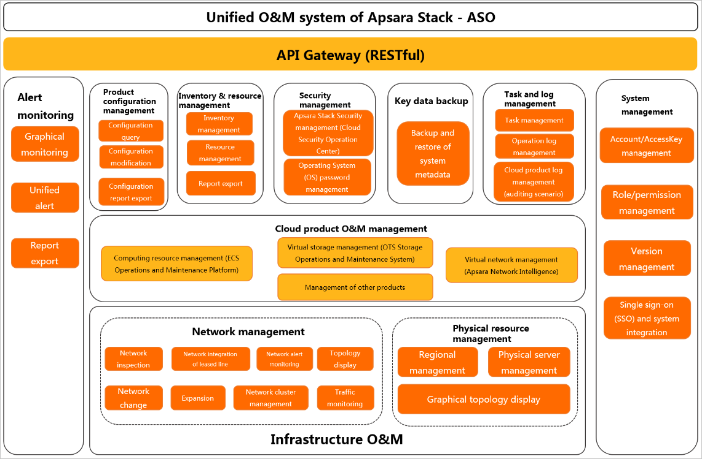

The Apsara Uni-manager Operations Console is a unified and intelligent O&M platform. In the Apsara Uni-manager Operations system, cloud operations is classified into the following layers: infrastructure, cloud service, and business operations. The management framework of the Apsara Uni-manager Operations service provides the full lifecycle management methods, management standards, management modes, management supporting tools, management objects, and process-based management methods of IT operations services.

The Apsara Uni-manager Operations Console provides a centralized operations portal that allows you to have a consistent operations experience. The Apsara Uni-manager Operations Console supports interconnections with third-party platforms and provides centralized API operations capabilities to deliver data to third-party systems by using APIs.

The Apsara Uni-manager Operations Console performs centralized operations management, such as automated deployments, upgrades, changes, and configurations, on physical devices, operating systems, computing resources, network, storage, databases, middleware, and business applications in the cloud computing environment. The Apsara Uni-manager Operations Console also provides the features of alert monitoring and automatic analysis, diagnosis, and troubleshooting for faults, performance, and configurations. By analyzing, processing, and evaluating the running status and quality of cloud platforms, the Apsara Uni-manager Operations Console guarantees the continuous and stable running of cloud computing business applications and provides services and support for operations processes to build an improved operations service management platform.

Based on ITIL and ISO 20000, the management framework of the Apsara Uni-manager Operations system uses management supporting tools to adapt to various management modes in a process-oriented, normalized, and standardized manner. This has implemented the systematic management of the overall process of operations services.

Based on the operations experience and data accumulated and collected from three layers, Alibaba Cloud Apsara Stack aggregates data collected by the operations platform to the Configuration Management Database (CMDB) of the platform. The Apsara Uni-manager Operations Console consolidates, analyzes, and comprehensively processes the data and integrates rich practical experience and operations capabilities to the platform operations tools. The Apsara Uni-manager Operations Console is designed to be desired state-oriented and uses unified operations tools for the fault discovery and tracking, link display, ITIL process, and self-repaired faults of the platform to realize the ultimate goal of artificial intelligence for IT operations (AIOps).

In addition to tools, process assurance and personnel management are essential to ensure the integrity of operations. Apsara Stack provides on-site development supporting services for major problems, on-site services, expert escort services, business consulting services, and business optimization services. Apsara Stack provides the first-line, second-line, and third-line supporting systems to support platform problems of customers and provides upgrade channels to support urgent problems of customers. As an autonomous and controllable platform, the Apsara Uni-manager Operations Console ensures that technical problems can be effectively solved in a timely manner.

The Apsara Uni-manager Operations system defines various entities involved in operations activities and relationships between these entities. Relevant entities are well organized and coordinated based on the Apsara Uni-manager Operations service management system and can provide different levels of operations services based on the service agreements.

<a id="section-2"></a>

# 2.Get started

<a id="section-2-1"></a>

## 2.1. Prepare an operations account

Before you perform O&M operations in the Apsara Uni-manager Operations Console, make sure that you have obtained an operations account that have corresponding permissions from an administrator.

Perform the following steps to create an operations account and grant permissions to the account:

1. Log on to the Apsara Uni-manager Operations Console as an administrator.

2. Create a role. For more information, see Manage roles.

3. Create an operations account and assign the created role to the account. For more information, see User management.

   Note

   For a more fine-grained division of the operations role, you can create a basic role as

specified in Appendix > OAM, grant permissions to the role, and then grant the role to the corresponding operations account as an administrator.

<a id="section-2-2"></a>

## 2.2. Log on to the Apsara Uni-manager Operations Console

This topic describes how to log on to the Apsara Uni-manager Operations Console.

Prerequisites

- The endpoint of the Apsara Uni-manager Operations Console and the username and password used to log on to the console are obtained from the deployment personnel or an administrator.

  The endpoint of the Apsara Uni-manager Operations Console is in the following format: *region-id*.ops.console.*intranet-domain-id*.

- A browser is available. We recommend that you use Google Chrome.

Procedure

1. Open your browser.

2. In the address bar, enter the endpoint of the Apsara Uni-manager Operations Console. Press the Enter key.

   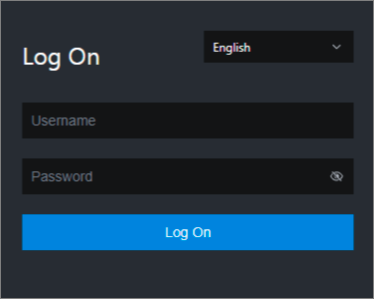

   Note

   You can select a language from the drop-down list in the upper-right corner of the

   page.

3. Enter your username and password.

   Note

   Obtain the username and password used to log on to the Apsara Uni-manager

   Operations Console from the deployment personnel or an administrator.

   When you log on to the Apsara Uni-manager Operations Console for the first time, you must change the password of your username.

   For security reasons, your password must meet the following requirements:

   - The password contains uppercase and lowercase letters.

   - The password contains digits.

   - The password contains special characters such as exclamation points (!), at signs (@), number signs (#), dollar signs ($), and percent signs (%).

   - The password must be 10 to 20 characters in length.

4. Click Log On.

<a id="section-2-3"></a>

## 2.3. Apsara Uni-manager Operations Console homepage

This topic describes the basic operations on and features of the Apsara Uni-manager Operations Console.

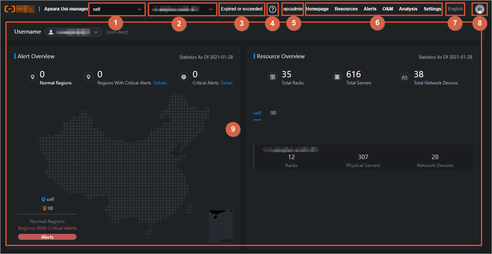

The following table describes the sections on the homepage of the console.

| NO. | Functional area | Description |
| --- | --- | --- |
| ① | Cloud | Switch the cloud from the drop-down list. |
| ② | Region | Switch the region from the drop-down list and centrally manage each region. |
| ③ | Authorization information | Click this section to go to the Authorization page and then view the authorization conditions of services. |
| ④ | Help center | View the alert knowledge base and upload other relevant HTML documents. |
| ⑤ | Current user | Show the name of the current logon user. |
| ⑥ | Top navigation bar | Select an O&amp;M operation. |
| ⑦ | Language | Move the pointer over this section and select a language. |
| ⑧ | Current user information | Move the pointer over this section and select an item to view the personal information of the current user, modify the password, configure logon parameters, or log off from the console. |
| ⑨ | Operation | View information and perform operations. |

<a id="section-2-4"></a>

## 2.4. Instructions for the homepage

The homepage allows you to view the statistics and summary data of Apsara Stack alerts, physical devices, and cloud service inventory.

Procedure

1. Log on to the Apsara Uni-manager Operations Console.

2. In the top navigation bar, click Homepage.

3. View the homepage. The homepage consists of the opsadmin, Alert Overview, Resource Overview, and Resource Quotas and Usage sections.

   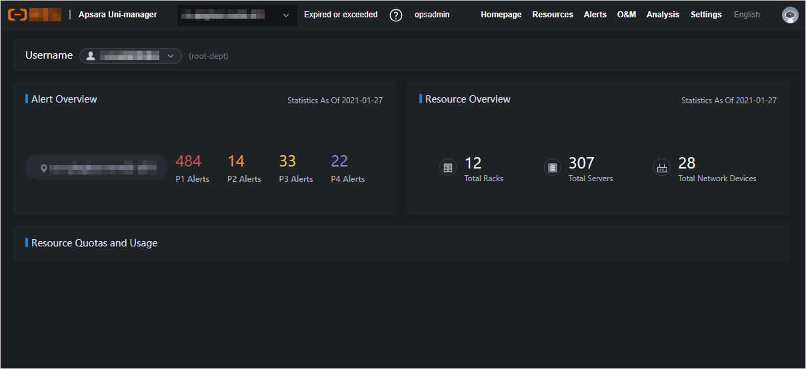

   - In the opsadmin section, select a user. The department to which the user belongs is displayed on the right.

   - In the Alert Overview section, view the total number of alerts at the P1, P2, P3, and P4 levels.

   - In the Resource Overview section, view the total number of racks, servers, and network devices.

   - In the Resource Quotas and Usage section, view the resource quotas and usage related to cloud services.

     Cloud service-related metrics are displayed in the following dimensions: total, used and available resources, and their usage.

     Alibaba Cloud service

     Statistical metric

     CPU (Core)

     EBS (GB)

     ECS

     Memory (GB)

     Alibaba Cloud service

     Statistical metric

     CPU (Core)

     RDS

     Disk (GB)

     Memory (GB)

     Internal IP Address

     SLB

     Public IP Address

     OSS

     Storage Capacity (GB)

     DFS

     Memory (GB)

     SLS-INNER

     SLS

     SLS-PUBLIC

     OTS

     Memory (GB)

     NAS

     Memory (GB)

<a id="section-3"></a>

# 3.Settings

<a id="section-3-1"></a>

## 3.1. Default operations roles

This topic describes the default roles for the Apsara Uni-manager Operations Console and their responsibilities.

For quick reference, the following roles are preset in the Apsara Uni-manager Operations Console: Operation Administrator Manager (OAM) super administrator, system administrator, security officer, security auditor, and multi-cloud configuration administrator. The following table describes these roles and their responsibilities.

| Role | Responsibility |
| --- | --- |
| OAM super administrator | The administrator of OAM, with the root permissions of the system. By default, this role is not displayed in the role list. |
| System administrator | Manages platform nodes, physical devices, and virtual resources, backs up, restores, and migrates product data, as well as searches for and backs up system logs. |
| Security officer | Manages permissions, security policies, and network security, and reviews and analyzes security logs and activities of auditor officers. |
| Security auditor | Audits, tracks, and analyzes operations of the system administrator and the security officer. |
| Multi-cloud configuration administrator | Manages multi-cloud operations, and adds, deletes, and modifies multi-cloud configurations. |

<a id="section-3-2"></a>

## 3.2. Security policies

<a id="section-3-2-1"></a>

### 3.2.1. Logon policies

As an administrator, you can configure logon policies to control what times and IP addresses are valid for logon.

Context

The system provides a default policy. You can configure logon policies based on your needs to better control the read and write permissions of users and improve the system security.

Procedure

1. Log on to the Apsara Uni-manager Operations Console.

2. In the top navigation bar, click Settings.

3. In the left-side navigation pane, choose Security Policies > Logon Policy.

4. On the Logon Policies page, perform the following operations:

   - Query policies In the upper-left corner of the page, enter a policy name in the Policy Name search box and click Search to view the policy information in the list. You can also click Reset to clear the previous search conditions.

   - Add a policy

     Click Add Policy. In the Add Policy dialog box, set the policy name, start time, end time, and allowed or prohibited logon IP addresses. Click OK.

     Note

     On the Logon Settings page:

     - If you select Blacklist for the Logon Policies field, the Prohibited Logon IP Addresses field is displayed in the Add Policy dialog box.

     - If you select Whitelist for the Logon Policies field, the Allowed Logon IP Addresses field is displayed in the Add Policy dialog box.

     You can specify the value accordingly. For more information, see Modify logon settings.

   - Modify a policy

     Find the policy that you want to modify and click Modify in the Actions column. In the Modify Policy dialog box, modify the parameters and click OK.

   - Delete a policy

     Find the policy that you want to delete and click Delete in the Actions column. In the message that appears, click OK.

     Notice

     A logon policy that is bound to a user cannot be deleted. You must unbind the

     policy before you can delete it.

<a id="section-3-2-2"></a>

### 3.2.2. Physical server passwords

The Server Password module allows you to configure and manage passwords, as well as query the historical passwords of all physical servers in the Apsara Stack environment.

Context

Server password management covers passwords of all the servers in the Apsara Stack environment.

- The system automatically collects information of all the servers in the Apsara Stack environment.

- The server password is periodically updated.

- You can configure the expiration period and length of passwords.

- You can manually update the passwords of one or more servers at a time.

- The system records the history of server password updates.

- You can search for server passwords by product, hostname, or IP address.

Procedure

1. Log on to the Apsara Uni-manager Operations Console.

2. In the top navigation bar, click Settings.

3. In the left-side navigation pane, choose Security > Server Password.

   The Manage Passwords tab appears. The Manage Passwords tab shows the passwords of all servers in the current Apsara Stack environment.

4. Perform the following operations:

   - Query servers

     On the Manage Passwords tab, select a product or hostname, or enter an IP address, and then click Search. You can also click Reset to clear the previous filter conditions.

   - Query a password

     <ol type="a">

     <li>

     On the Manage Passwords tab, find the server whose password you want to query.

     </li>

     <li>

     Click the  icon in the Password column. The server password in plaintext is displayed and is

     converted into cipher text after 10 seconds. Alternatively, click the  icon to show the

     password in cipher text.

     </li>

     </ol>

   - Update a password

     <ol type="a">

     <li>

     On the Manage Passwords tab, find the server for which you want to update the password.

     </li>

     <li>

     Click Update Password in the Actions column.

     </li>

     </ol>

     <ol type="i" start="100">

     <li>

     In the dialog box that appears, specify Password and Confirm Password and click OK.

     The password of the server is updated.

     </li>

     </ol>

   - Batch update passwords

     <ol type="a">

     <li>

     On the Manage Passwords tab, select multiple servers.

     </li>

     <li>

     Click Batch Update in the lower part of the tab.

     </li>

     </ol>

     <ol type="i" start="100">

     <li>

     In the dialog box that appears, specify Password and Confirm Password and click OK.

     The passwords of the selected servers are updated.

     </li>

     </ol>

   - Configure the password expiration period

     <ol type="a">

     <li>

     On the Manage Passwords tab, select one or more servers.

     </li>

     <li>

     Click Configure in the upper part of the tab.

     </li>

     </ol>

     <ol type="i" start="100">

     <li>

     In the Configuration Items dialog box, specify Password Expiration Period and Unit and click OK.

     Server passwords are immediately updated and are updated again after the expiration period.

     </li>

     </ol>

   - Query the update history of server passwords

     Click the History Password tab. Select a product, hostname, or IP address, and then click Search to view the update history of server passwords in the search results.

   - Query historical passwords of a server

     <ol type="a">

     <li>

     On the History Password tab, find the server whose historical passwords you want to query.

     </li>

     <li>

     Click the  icon in the Password column. The server password in plaintext is displayed and is

     converted into cipher text after 10 seconds. Alternatively, click the  icon to show the

     password in cipher text.

     </li>

     </ol>

   - Query and modify the password configuration policy

     <ol type="a">

     <li>

     Click the Configuration tab and view the metadata of server password management, including the initial password, password length, and retry times. Take note of the following items:

     - Initial Password indicates the password assigned when server password management is deployed in the Apsara Stack environment. This parameter is required to modify the password of a server in the Apsara Stack environment.

     - Password Length indicates the length of passwords updated by the system.

     - Retry Times indicates a limit of how many times a password can fail to be updated before the system stops trying.

     - Status indicates whether the configuration takes effect. By default, the switch is turned

       off. To show the status, turn on  .

     </li>

     <li>

     Click Save.

     </li>

     </ol>

<a id="section-3-3"></a>

## 3.3. Offline backup

Offline Backup is used to back up the key metadata of Apsara Stack. Only the metadata of Apsara Distributed File System can be backed up. The backup metadata information is used for quick recovery from Apsara Stack failures.

<a id="section-3-3-1"></a>

### 3.3.1. Add a backup product

The Product Management module allows you to add product backup information. Only the metadata of Apsara Distributed File System can be backed up.

Procedure

1. Log on to the Apsara Uni-manager Operations Console.

2. In the top navigation bar, click Settings.

3. In the left-side navigation pane, choose Offline Backup > Product Management.

4. Click Add Product.

5. In the Add Product dialog box, add information of a product as described in the following table and click OK.

   | Parameter | Description | Example |
   | --- | --- | --- |
   | Product | The product name. You can select a service from the drop-down list. | pangu |
   | Backup Item | The name of the backup item. Set this parameter based on the information of the cloud service to be backed up. | ecs_pangu |
   | Script | The backup script name. | metadata_backup.py |
   | Retry Times | The number of retry attempts after an error occurs. Typically, set this parameter to 3. | 3 |

6. To add more product backup items, repeatedly perform the preceding steps.

   Note

   You can click Modify or Delete in the Actions column to modify or delete a

   product backup item.

Result

You can view the added product on the Backup Configurations page.

<a id="section-3-3-2"></a>

### 3.3.2. Configure backup

After you add a product backup item, you must configure the backup in the Apsara Uni-manager Operations Console.

Prerequisites

A product backup item is added. For more information about how to add a product backup item, see Add a backup product.

Context

The backup item is the minimum unit for backup. You can back up the metadata of Apsara Distributed File System for different services, such as ecs pangu, ots pangu, oss pangu, and ads pangu.

Procedure

1. Log on to the Apsara Uni-manager Operations Console.

2. In the top navigation bar, click Settings.

3. In the left-side navigation pane, choose Offline Backup > Backup Configurations.

   In the left side of the Backup Configurations page, the current backup configurations is displayed in a hierarchical tree-like structure. The root node is a product list and shows the products whose data can be backed up in the current backup system. Only the metadata of Apsara Distributed File System and OPS DNS can be backed up.

4. Click a product backup item on the left and then configure the parameters on the right.

   Note

   If the #FTPMaster server is deployed in the cluster of the service, the system will

   automatically enter the backup information of ecs pangu.

   | Parameter | Description |
   | --- | --- |
   | Product Cluster IP Address | The IP address of the actual transfer server. |
   | Backup File Folder | A folder on the transfer server. You are required only to enter a folder path in the field without manually creating a folder to store backup files.<br>Examples:<br>• pangu: /apsarapangu/disk8/pangu_master_bak/<em>product</em> <em>name</em>_pangu/bak<br>• opsdns: /apsarapangu/disk8/opsdns_bak/opsdns/bak |
   | Script Execution Folder | A folder on the transfer server. You are required only to enter a folder path in the field without manually creating a folder to store script executions.<br>Examples:<br>• pangu: /apsarapangu/disk8/pangu_master_bak/<em>product</em> <em>name</em>_pangu/bin<br>• opsdns: /apsarapangu/disk8/opsdns_bak/opsdns/bak |
   | Script Parameters | Required. The execution parameters for the script. You must enter the value in the <code> --ip=xxx.xxx.xxx.xxx </code> format.<br>• pangu: The IP address is one of the IP addresses of the pangu master.<br>• opsdns: We recommend that you enter <code> --ip=127.0.0.1 </code>. |
   | Backup Schedule | The execution period of recurring executions. In this example, a value of 1 is entered to specify that the backup is performed only once. |
   | Backup Schedule Unit | The unit of the execution period. Valid values: Day, Hour, and Minute. In this example, Hour is selected to specify that the backup is performed by hour. |
   | Timeout Period | The timeout period, in seconds. In this example, set the value to 3600. |

5. Click Modify to complete the configurations and trigger the backup.

6. Perform the preceding steps to configure all the product backup items.

<a id="section-3-3-3"></a>

### 3.3.3. View the backup details

During the backup, you can view the backup details of each backup item on the Apsara Uni-manager Operations Console.

Procedure

1. Log on to the Apsara Uni-manager Operations Console.

2. In the top navigation bar, click O&M.

3. In the left-side navigation pane, choose Offline Backup > Backup Details.

4. On the Backup Details page, enter the service and backup item, select the start date, and then click Search.

5. View the backup details of a backup item, including the product, backup item, the name of the file to be backed up, start time, and status.

   The backup status includes Not started, In transmission, Complete, Time-out, and Failed.

6. (Optional) click Reset to clear the previous search conditions.

<a id="section-3-3-4"></a>

### 3.3.4. Configure a backup server

You can configure a backup server for the subsequent storage of backup files.

Procedure

1. Log on to the Apsara Uni-manager Operations Console.

2. In the top navigation bar, click Settings.

3. In the left-side navigation pane, choose Offline Backup > Backup Server Configurations.

   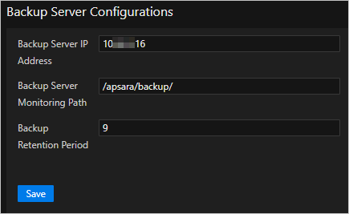

4. Configure the backup server parameters.

   Note

   If the #FTPMaster server is deployed in the cluster of the service, the system will

   automatically enter the backup server information of ecs pangu.

   The following table describes the parameters.

   | Parameter | Description |
   | --- | --- |
   | Backup Server IP Address | The IP address of the backup server.<br>The backup server must meet the following requirements:<br>• The backup server is an independent physical server.<br>• The backup server is managed and controlled by Apsara Infrastructure Management Framework.<br>• The network of the backup server is connected to other servers in Apsara Stack.<br>• Apsara Distributed File System cannot be deployed on the server or on the disk where backup metadata is stored. |
   | Backup Service Monitoring Path | The storage path of backup files on the backup server.<br>The backup service detects new backup files by monitoring the specified folder on the backup server and determines whether the backup is successful by comparing the MD5 value of the backup file with that of the original file. |
   | Backup Retention Period | The maximum time period in days that backup files are stored.Backup files whose retention periods exceed the specified time period are deleted. |

5. Click Save.

<a id="section-3-3-5"></a>

### 3.3.5. Use cases

To ensure the availability of services, you can back up the data of different services stored on Apsara Distributed File System.

<a id="section-3-3-5-1"></a>

#### 3.3.5.1. Preparations

This topic describes preparations to make before you perform backup operations.

Before the backup, take note of the following items:

- A buffer server is required as the backup server.

  If no buffer servers are available, select a physical server that has a large disk capacity and good network performance. Otherwise, the security of the backup data cannot be ensured.

  Note

  Offline backup files cannot be stored on objects to be backed up. If no more physical

  servers are available and if disk capacity is insufficient in the on-site environment, the system is unable to perform offline backup. In this case, you must add physical servers or increase disk capacity before the offline backup.

- A transfer server is required to store one-time backup data and backup scripts of each product.

  No other requirements are needed for transfer servers.

- The network of the backup server must be connected with that of the Docker container where the offline backup service is located. This ensures that backup containers in the clusters of the Apsara Uni-manager Operations Console can log on to the transfer server and backup server by using SSH key pairs, without the need to provide the username and password.

<a id="section-3-3-5-2"></a>

#### 3.3.5.2. Collect the Apsara Distributed File System information of each product

The Products module allows you to collect the Apsara Distributed File System information of products to be backed up, which helps add the backup product information to the Apsara Uni-manager Operations Console.

Context

In this topic, product names are customized as oss, ecs, ads, and ots, and the information of these products are collected. The products for which you are about to collect Apsara Distributed File System information are subject to the on-site environment.

Procedure

1. Log on to the Apsara Infrastructure Management Framework console.

   <ol type="i">

   <li>

   Log on to the Apsara Uni-manager Operations Console.

   <ol type="i" start="2">

   <li>

   In the top navigation bar, click O&M.

   </li>

   <li>

   In the left-side navigation pane, choose Product Management > Products.

   </li>

   <li>

   In the Apsara Stack O&M section, choose Basic O&M > Apsara Infrastructure

   </li>

   </ol>

   Management Framework.

   Note

   In this topic, operations are performed in the new Apsara Infrastructure

   </li>

   </ol>

   Management Framework console.

2. In the left-side navigation pane, choose Operations > Service Operations.

3. Enter pangu in the Servicesearch box to search for the Apsara Distributed File System service.

4. Click Operations in the Actions column corresponding to pangu to go to the service details page.

5. Click the Clustes tab.

6. Click the name of a cluster.

7. On the Services tab, click pangu.PanguMaster#.

   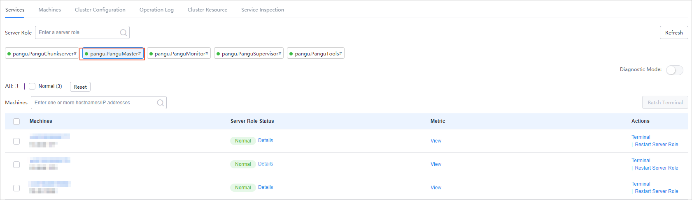

8. View and record the IP addresses of Apsara Distributed File System master in the server list.

   Record one of the three IP addresses of PanguMaster#.

9. Repeat Steps 6 to 8 to view and record the Apsara Distributed File System information of each product. The recorded results are similar to those in the following table.

   | Cluster name | pangumaster IP | Product name |
   | --- | --- | --- |
   | AdvanceOssCluster-A-xx | 10.10.10.1 | oss |
   | ECS-IO7-A-xx | 10.10.10.2 | ecs |
   | ads-A-xx | 10.10.10.3 | ads |
   | otsv3_p-A-xx | 10.10.10.4 | ots |

   Note

   You can customize the product name. Make sure that the product name is unique

   and recognizable.

<a id="section-3-3-5-3"></a>

#### 3.3.5.3. Configure a backup server

The Backup Server Configurations module allows you to configure parameters related to a backup server.

Procedure

1. Log on to the Apsara Uni-manager Operations Console.

2. In the top navigation bar, click Settings.

3. In the left-side navigation pane, choose Offline Backup > Backup Server Configurations.

   The Backup Service Configurations page appears.

   

4. Configure the backup server parameters.

   Note

   If the #FTPMaster server is deployed in the cluster of the service, the system will

   automatically enter the backup server information of ecs pangu.

   The following table describes the parameters.

   | Parameter | Description |
   | --- | --- |
   | Backup Server IP Address | The IP address of the backup server.<br>The backup server must meet the following requirements:<br>• The backup server is an independent physical server.<br>• The backup server is managed and controlled by Apsara Infrastructure Management Framework.<br>• The network of the backup server is connected to other servers in Apsara Stack.<br>• Apsara Distributed File System cannot be deployed on the server or on the disk where backup metadata is stored. |
   | Backup Service Monitoring Path | The storage path of backup files on the backup server.<br>The backup service detects new backup files by monitoring the specified folder on the backup server and determines whether the backup is successful by comparing the MD5 value of the backup file with that of the original file. |
   | Backup Retention Period | The maximum time period in days that backup files are stored. Backup files whose retention periods exceed the specified time period are deleted. |

5. Click Save.

<a id="section-3-3-5-4"></a>

#### 3.3.5.4. Add a backup product

The Product Management module allows you to add backup product information.

Procedure

1. Log on to the Apsara Uni-manager Operations Console.

2. In the top navigation bar, click Settings.

3. In the left-side navigation pane, choose Offline Backup > Product Management.

4. Click Add Product.

5. In the Add Product dialog box, add information of a product as described in the following table and click OK.

   | Parameter | Description | Example |
   | --- | --- | --- |
   | Product | The product name. You can select a service from the drop-down list. | pangu |
   | Backup Item | The name of the backup item. Set this parameter based on the product information described in the Collect the Apsara Distributed File System information of each product topic. | ecs_pangu |
   | Script | The name of the backup script. | metadata_backup.py |
   | Retry Times | The number of retry attempts after an error occurs. Typically, set this parameter to 3. | 3 |

6. Repeat the preceding steps to add all the backup items.

Result

You can view the added product on the Backup Configurations page.

<a id="section-3-3-5-5"></a>

#### 3.3.5.5. Configure backup parameters

After you add backup items, you must configure the backup in the Apsara Uni-manager Operations Console.

Procedure

1. Log on to the Apsara Uni-manager Operations Console.

2. In the top navigation bar, click Settings.

3. In the left-side navigation pane, choose Offline Backup > Backup Configurations.

4. Click a product backup item on the left and then configure the parameters on the right.

   | Parameter | Description |
   | --- | --- |
   | Product Cluster IP Address | The IP address of the actual transfer server. |
   | Backup File Folder | A folder on the transfer server. You are required only to enter a folder path in the field without manually creating a folder to store backup files.<br>Example: /apsarapangu/disk8/pangu_master_bak/<em>product</em> <em>name</em>_pangu/bak |
   | Script Execution Folder | A folder on the transfer server. You are required only to enter a folder path in the field without manually creating a folder to store backup files.<br>Example: /apsarapangu/disk8/pangu_master_bak/<em>product</em> <em>name</em>_pangu/bin |
   | Script Parameters | The execution parameters for the script. You must enter the value in the <code> --ip=xxx.xxx.xxx.xxx </code> format, in which the IP address is one of the IP addresses of the pangu master described in the Collect the Apsara Distributed File System information of each product topic. |
   | Backup Schedule | The execution period of recurring executions. In this example, a value of 1 is entered to specify that the backup is performed only once. |
   | Backup Schedule Unit | The unit of the execution period. Valid values: Day, Hour, and Minute. In this example, Hour is selected to specify that the backup is performed by hour. |
   | Timeout Period | The timeout period, in seconds. In this example, set the value to 3600. |

5. Click Modify to complete the configurations and trigger the backup.

6. Perform the preceding steps to configure all the product backup items.

<a id="section-3-3-5-6"></a>

#### 3.3.5.6. View the backup details

After you configure backup items, you can check whether the backup items function normally in the Apsara Uni-manager Operations Console.

Procedure

1. Log on to the Apsara Uni-manager Operations Console.

2. In the top navigation bar, click Settings.

3. In the left-side navigation pane, choose Offline Backup > Backup Details.

4. On the Backup Details page, specify the product and backup item, select the start date and end date, and then click Search.

   If the status of a backup item is Complete, the backup item functions normally.

   Note

   When a backup task is complete, you must check whether the MD5 values of the

   offline backup service and the backup server are consistent with each other. If yes, the backup was successful.

<a id="section-3-4"></a>

## 3.4. Log cleanup

The Log Cleanup module allows you to clean up logs from specified log files in the specified containers (Docker) or physical machines (virtual machines or bare metal machines) in the system.

<a id="section-3-4-1"></a>

### 3.4.1. Import container or physical server log cleanup rules

If you have configured log cleanup rules on your computer, you can batch import multiple cleanup rules for containers or physical servers.

Context

Before you import a cleanup rule, take note of the following items:

- Imported rules are incrementally added.

- You must check the values of Product, Service, ServerRole, SrcPath, MatchFile, Threshold, and Method to determine whether a cleanup rule already exists. If all values in the environment are the same as the values specified in the rule to be imported, the rule already exists. If a rule already exists, it is not imported.

- Before you import a rule, you must contact technical support to obtain the encryption sequence.

- After you have imported a rule, special characters such as spaces, carriage returns, line feeds, and tabs in the rule are automatically deleted.

- The maximum disk usage range specified by a rule is [0%,100%], and the value before the percent sign (%) must be an integer. Otherwise, the rule is automatically filtered out when you import it. We recommend that you set the maximum disk usage to 75%.

- Make sure that the cleanup methods specified by rules are tested and can be normally executed. Otherwise, exceptions may occur when you use these methods to clean up logs.

Procedure

1. Log on to the Apsara Uni-manager Operations Console.

2. In the top navigation bar, click Settings.

3. In the left-side navigation pane, choose Log Cleanup > Rules.

4. Click the Container or Physical Machines tab.

5. Click Import.

6. Select the XLS or XLSX files that you want to import and click Open. You can import multiple log cleanup rules.

   After you import the rules, corresponding execution plans are asynchronously generated.

<a id="section-3-4-2"></a>

### 3.4.2. Export container or physical server log cleanup rules

You can batch export multiple container or physical server log cleanup rules.

Procedure

1. Log on to the Apsara Uni-manager Operations Console.

2. In the top navigation bar, click Settings.

3. In the left-side navigation pane, choose Log Cleanup > Rules.

4. Click the Containers or Physical Machines tab.

5. Perform the following operations to export the log cleanup rules of containers or physical servers:

   - Click Export to export all cleanup rules.

   - In the upper part of the page, select a product, service, and server role, and click Search. In the search result, select the cleanup rules that you want to export and click Export.

     Note

     By default, the product, service, and server role parameters on the tab do

     not have options in their drop-down lists. When you specify these parameters for the first time, you must enter the product, service, and server role in the list and select the corresponding search result. In subsequent queries, the system shows all available options in the drop-down list.

<a id="section-3-4-3"></a>

### 3.4.3. Modify a log cleanup rule

You can modify log cleanup rules to suit your business needs.

Procedure

1. Log on to the Apsara Uni-manager Operations Console.

2. In the top navigation bar, click Settings.

3. In the left-side navigation pane, choose Log Cleanup > Rules.

4. Click the Containers or Physical Machines tab.

5. (Optional)In the upper part of the tab, select the product, service, and server role, and then click Search to query the cleanup rules that meet the filter conditions.

   Note

   By default, the product, service, and server role parameters on the tab do not

   have options in their drop-down lists. When you specify these parameters for the first time, you must enter the product, service, and server role in the list and select the corresponding search result. In subsequent queries, the system loads all available data in the list.

6. Find the cleanup rule that you want to modify and click Modify in the Actions column.

7. In the panel that appears, modify the maximum disk usage and specify whether to automatically clean up logs that match the cleanup rule.

   Note

   The maximum disk usage range specified by a rule is [0%,100%], and the value

   before the percent sign (%) must be an integer. We recommend that you set the maximum disk usage to 75%.

8. Click OK.

<a id="section-3-4-4"></a>

### 3.4.4. Delete a log cleanup rule

You can delete log cleanup rules that are no longer needed.

Procedure

1. Log on to the Apsara Uni-manager Operations Console.

2. In the top navigation bar, click Settings.

3. In the left-side navigation pane, choose Log Cleanup > Rules.

4. Click the Containers or Physical Machines tab.

5. (Optional)In the upper part of the tab, select the product, service, and server role, and click Search to query cleanup rules that meet the filter conditions.

   Note

   By default, the product, service, and server role parameters on the tab do not

   have options in their drop-down lists. When you specify these parameters for the first time, you must enter the product, service, and server role in the list and select the corresponding search result. In subsequent queries, the system shows all available data in the drop-down list.

6. Find the cleanup rule that you want to delete and click Delete in the Actions column.

7. In the message that appears, click OK.

   Note

   The execution plan corresponding to a cleanup rule is not deleted when you

   delete the rule. At 02:00 every day, the system cleans up existing execution plans and generates new execution plans based on the current cleanup rules.

<a id="section-3-4-5"></a>

### 3.4.5. Obtain the usage information of containers or physical servers

This topic describes how to query the disk usage information of containers or physical servers.

Method 1

1. Log on to the Apsara Uni-manager Operations Console.

2. In the top navigation bar, click Settings.

3. In the left-side navigation pane, choose Log Cleanup > Plans.

4. Click the Containers or Physical Machines tab.

5. Perform the following operations to obtain the disk usage information of a container or physical server:

   - In the upper part of the page, select a product, service, and server role, and click Search. In the search results, find the container or physical server for which you want to query disk usage information. Click Query Usage in the Actions column to obtain the disk usage information of the container or physical server.

     Note

     By default, the product, service, and server role parameters on the tab do

     not have options in their drop-down lists. When you specify these parameters for the first time, you must enter the product, service, and server role in the list and select the corresponding search result. In subsequent queries, the system shows all available options in the drop-down list.

   - Select multiple containers or physical servers and click Batch Query Usage to obtain the disk usage information of multiple containers or physical servers.

     Note

     The operation used to obtain the usage information is asynchronous. You must

     refresh the page to view the results. If the current usage of the disk is higher than the specified maximum disk usage, the value is displayed in red.

Method 2

1. Log on to the Apsara Uni-manager Operations Console.

2. In the top navigation bar, click Settings.

3. In the left-side navigation pane, choose Log Cleanup > Rules.

4. Click the Containers or Physical Machines tab.

5. (Optional)In the upper part of the tab, select a product, service, and server role, and click Search.

   Note

   By default, the product, service, and server role parameters on the tab do not

   have options in their drop-down lists. When you specify these parameters for the first time, you must enter the product, service, and server role in the list and select the corresponding search result. In subsequent queries, the system shows all available options in the drop-down list.

6. In the search results, select the cleanup rule of the container or physical server in which you want to obtain the disk usage information and click Execution Plans in the Actions column. The Execution Plans page appears.

7. Perform the following operations to obtain the disk usage information of a container or physical server:

   - Find the container or physical server for which you want to obtain disk usage information and click Query Usage in the Actions column.

   - Select multiple containers or physical servers and click Batch Query Usage to obtain the disk usage information of multiple containers or physical servers.

     Note

     The operation used to obtain the usage information is asynchronous. You must

     refresh the page to view the results. If the current usage of the disk is higher than the specified maximum disk usage, the value is displayed in red.

<a id="section-3-4-6"></a>

### 3.4.6. Clean up the logs of containers or physical servers

You can clean up the logs of containers or physical servers in a timely manner based on disk usage information of the containers or physical servers.

Method 1

1. Log on to the Apsara Uni-manager Operations Console.

2. In the top navigation bar, click Settings.

3. In the left-side navigation pane, choose Log Cleanup > Plans.

4. Click the Containers or Physical Machines tab.

5. Perform the following operations to clean up logs of containers or physical servers:

   - In the upper part of the tab, select a product, service, and server role, and click Search. In the search results, find the container or physical server for which you want to clean up logs and click Execute Clearance in the Actions column.

     Note

     By default, the product, service, and server role parameters on the tab do

     not have options in their drop-down lists. When you specify these parameters for the first time, you must enter the product, service, and server role in the list and select the corresponding search result. In subsequent queries, the system shows all available options in the drop-down list.

   - Select multiple containers or physical servers and click Batch Clear in the upper part of the tab to clean up the log information of multiple containers or physical servers at a time.

     Note

     The log cleanup operation is asynchronous, and you must view the log cleanup

     results on the Records page.

Method 2

1. Log on to the Apsara Uni-manager Operations Console.

2. In the top navigation bar, click Settings.

3. In the left-side navigation pane, choose Log Cleanup > Rules.

4. Click the Containers or Physical Machines tab.

5. (Optional)In the upper part of the tab, select a product, service, and server role, and click Search.

   Note

   By default, the product, service, and server role parameters on the tab do not

   have options in their drop-down lists. When you specify these parameters for the first time, you must enter the product, service, and server role in the list and select the corresponding search result. In subsequent queries, the system shows all available options in the drop-down list.

6. In the search result, find the cleanup rule of the container or physical servers for which you want to clean up logs and click Execution Plans in the Actions column. The Execution Plans page appears.

7. Perform the following operations to clean up logs of containers or physical servers:

   - Find the container or physical server for which you want to clean up logs and click Execute Clearance in the Actions column to clean up the logs of a single container or physical server.

   - Select multiple containers or physical servers and click Batch Clear in the upper part of the tab to clean up the logs of multiple containers or physical servers at a time.

     Note

     The log cleanup operation is asynchronous, and you must view the log cleanup

     results on the Records page.

<a id="section-3-4-7"></a>

### 3.4.7. Configure automatic cleanups for container or physical server logs

You can configure automatic cleanups for container or physical server logs that meet the specified cleanup rules.

Context

Existing execution plans are cleaned up at 02:00 every day and new execution plans are generated based on the current cleanup rules. If you turn on Automatic Deletion or enable automatic cleanup, the system cleans up the container or physical server logs that meet the cleanup rules based on execution plans at 02:30 every day.

Procedure

1. Log on to the Apsara Uni-manager Operations Console.

2. In the top navigation bar, click Settings.

3. In the left-side navigation pane, choose Log Cleanup > Rules.

4. Click the Containers or Physical Machines tab.

5. Perform the following operations to configure automatic cleanups for container or physical server logs that meet the specified cleanup rules:

   - In the upper part of the page, select a product, service, and server role, and click Search. In the search results, find the cleanup rule for which you want to set automatic cleanups and turn on Automatic Deletion. The system cleans up the container or physical server logs that meet the cleanup rule.

     Note

     By default, the product, service, and server role parameters on the tab do

     not have options in their drop-down lists. When you specify these parameters for the first time, you must enter the product, service, and server role in the list and select the corresponding search result. In subsequent queries, the system shows all available options in the drop-down list.

     If you want to disable the automatic cleanup feature, you can turn off Automatic Deletion.

   - Select multiple cleanup rules and click Enable Automatic Clearance. The system cleans up the container or physical server logs that meet the selected cleanup rules.

     To disable the automatic cleanup feature, click Disable Automatic Clearance.

<a id="section-3-4-8"></a>

### 3.4.8. View cleanup records

After you clean up logs, you can view detailed cleanup records.

Context

When you perform operations on the Records page, take note of the following items:

- Each time you perform a log cleanup operation, the numbers of cleanup executions, SR, and machines are increased by one.

- Number of cleanup log files shows the number of log files that match all the available rules and can be cleaned up, rather than the number of log files that have been cleaned up.

- Clean up space shows the accumulated available space after you clean up logs.

Method 1

1. Log on to the Apsara Uni-manager Operations Console.

2. In the top navigation bar, click Settings.

3. In the left-side navigation pane, choose Log Cleanup > Records.

4. (Optional)In the upper part of the tab, select a product, service, and server role, and click Search.

   Note

   By default, the product, service, and server role parameters on the tab do not

   have options in their drop-down lists. When you specify these parameters for the first time, you must enter the product, service, and server role in the list and select the corresponding search result. In subsequent queries, the system shows all available options in the drop-down list.

5. Find the cleanup record that you want to view and click View Details in the View Details column to view the detailed cleanup information.

Method 2

1. Log on to the Apsara Uni-manager Operations Console.

2. In the top navigation bar, click Settings.

3. In the left-side navigation pane, choose Log Cleanup > Plans.

4. Click the Containers or Physical Machines tab.

5. (Optional)In the upper part of the tab, select a product, service, and server role, and click Search.

   Note

   By default, the product, service, and server role parameters on the tab do not

   have options in their drop-down lists. When you specify these parameters for the first time, you must enter the product, service, and server role in the list and select the corresponding search result. In subsequent queries, the system shows all available options in the drop-down list.

6. In the search result, find the execution plan for which you want to view the cleanup records and click Clear Records in the Actions column. The Records page appears.

7. Find the cleanup record that you want to view and click View Details in the View Details column to view the detailed cleanup information.

<a id="section-3-5"></a>

## 3.5. System settings

The System Settings module allows you to manage departments, roles, and users involved in the Apsara Uni-manager Operations Console in a centralized manner. This makes it easy to grant different resource access permissions to different users. The System Settings module is a core module in managing permissions. It integrates the features such as department management, role management, logon policy management, user management, and password management.

<a id="section-3-5-1"></a>

### 3.5.1. User management

You can create users and assign different user roles to meet different requirements for system access control as an administrator.

Prerequisites

Before you create a user, make sure that the following requirements are met:

- A department is created. For more information, see Department management.

- A custom role is created if needed. For more information, see Role management.

Procedure

1. Log on to the Apsara Uni-manager Operations Console.

2. In the top navigation bar, click Settings.

3. In the left-side navigation pane, choose System Settings > User Management.

   The Users tab appears.

4. On the Users tab, perform the following operations:

   - Query users

     Note

     To search for users in the Apsara Uni-manager Operations Console, you must

     have the security officer role or system administrator role.

     In the upper part of the page, set Username, Role, and Department, and click Search to view the information about the user in the list.

     (Optional) Click Reset to clear the filter conditions.

   - Add a user

     Note

     To add a user in the Apsara Uni-manager Operations Console, you must have the

     security officer role.

     Click Add in the upper part of the tab. In the Add User dialog box, set Username and Password and click OK.

     The added user is displayed in the user list. The value in the Primary Key Value column corresponding to the added user is used to call API operations of applications. When you want to call applications in the Apsara Uni-manager Operations Console for other applications, you must use the primary key value for authentication.

   - Modify a user

     Note

     To modify a user in the Apsara Uni-manager Operations Console, you must have

     the security officer role.

     In the user list, find the user that you want to modify and click Modify in the Actions column. In the Modify User dialog box, modify the parameters and click OK.

   - Delete a user

     In the user list, find the user that you want to delete and click Delete in the Actions column. In the message that appears, click OK.

     Note

     Deleted users are displayed on the Recycle Bin tab. To restore a deleted user,

     click the Recycle Bin tab. Find the user that you want to restore and click Recover in the Actions column. In the message that appears, click OK.

   - Attach a logon policy

     In the user list, find the user to which you want to bind a logon policy and click Bind Logon Policy in the upper part of the page. In the Bind Logon Policy dialog box, select the logon policy to attach and click OK.

   - Query the personal information of the current user Move the pointer over the profile picture in the upper-right corner of the page and click Personal Information. On the User Profile page, view the personal information of the current user, such as the Username and Department.

     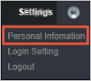

     On the User Profile page, you can also change the password that the current user uses to log on to the Apsara Uni-manager Operations Console. For more information about how to change the logon password, see Change the logon password.

   - Configure logon settings

     Move the pointer over the profile picture in the upper-right corner of the page and click Login Setting. On the Logon Settings page, you can modify the logon timeout period, maximum allowed password retries, logon policies, and validity period of the current account, and specify whether to allow multi-terminal logon. For more information about how to modify logon settings, see Modify logon settings.

<a id="section-3-5-2"></a>

### 3.5.2. User group management

You can add multiple users to a user group and add the same roles to them as an administrator for centralized management.

Create a user group

1. Log on to the Apsara Uni-manager Operations Console.

2. In the top navigation bar, click Settings.

3. In the left-side navigation pane, choose System Settings > User Group Management.

4. In the upper part of the page, click Add.

5. In the Add User Group dialog box, enter a user group name, select a department, and then click OK.

Modify the name of a user group

1. Log on to the Apsara Uni-manager Operations Console.

2. In the top navigation bar, click Settings.

3. In the left-side navigation pane, choose System Settings > User Group Management.

4. (Optional)Select a department name, enter a user group name and username, and then click Search.

   You can also click Advanced, select a department name and role name, enter a user group name and username, and then click Search. If you have specified filter conditions, you can click Reset to remove the conditions.

5. In the user group list, find the user group that you want to modify and click Edit User Group in the Actions column.

6. In the dialog box that appears, modify the user group name.

7. Click OK.

Manage users in a user group

1. Log on to the Apsara Uni-manager Operations Console.

2. In the top navigation bar, click Settings.

3. In the left-side navigation pane, choose System Settings > User Group Management.

4. (Optional)Select a department name, enter a user group name and username, and then click Search.

   You can also click Advanced, select a department name and role name, enter a user group name and username, and then click Search. If you have specified filter conditions, you can click Reset to remove the conditions.

5. In the user group list, find the user group for which you want to manage users and click Manage Users in the Actions column.

6. In the dialog box that appears, you can add or delete users in the user group.

   - Click Add. In the Add dialog box, select one or more users and click OK.

   - Click the  icon to delete the user.

   - Click OK.

     Added users are displayed in the Users column corresponding to the user group.

     Deleted users are no longer displayed in the Users column corresponding to the user group.

Add a role to a user group

You can add only a single role to a user group.

1. Log on to the Apsara Uni-manager Operations Console.

2. In the top navigation bar, click Settings.

3. In the left-side navigation pane, choose System Settings > User Group Management.

4. (Optional)Select a department name, enter a user group name and username, and then click Search.

   You can also click Advanced, select a department name and role name, enter a user group name and username, and then click Search. If you have specified filter conditions, you can click Reset to remove the conditions.

5. In the user group list, find the user group to which you want to add a role and click Add Role in the Actions column.

6. Select a role from the Role drop-down list.

7. Click OK.

   The added role is displayed in the Role column corresponding to the user group. All users in the user group are granted the permissions of this role.

Delete a role

1. Log on to the Apsara Uni-manager Operations Console.

2. In the top navigation bar, click Settings.

3. In the left-side navigation pane, choose System Settings > User Group Management.

4. (Optional)Select a department name, enter a user group name and username, and then click Search.

   You can also click Advanced, select a department name and role name, enter a user group name and username, and then click Search. If you have specified filter conditions, you can click Reset to remove the conditions.

5. In the user group list, find the user group from which you want to delete a role and click Delete Role in the Actions column.

6. In the message that appears, click OK.

   The deleted role is no longer displayed in the Role column corresponding to the user group. The permissions of the role are rescinded from all users in the group.

Delete a user group

Notice

Before you delete a user group, make sure that no users or roles are bound to the

user group.

1. Log on to the Apsara Uni-manager Operations Console.

2. In the top navigation bar, click Settings.

3. In the left-side navigation pane, choose System Settings > User Group Management.

4. (Optional)Select a department name, enter a user group name and username, and then click Search.

   You can also click Advanced, select a department name and role name, enter a user group name and username, and then click Search. If you have specified filter conditions, you can click Reset to remove the conditions.

5. In the user group list, find the user group that you want to delete and click Delete User Group in the Actions column.

6. In the message that appears, click OK.

<a id="section-3-5-3"></a>

### 3.5.3. Manage roles

You can customize roles in the Apsara Uni-manager Operations Console to implement more flexible and efficient permission control.

Context

A role is a collection of access permissions. You can assign different roles to different users to meet requirements for system access control. Roles are classified into basic roles and custom roles. Basic roles, also known as atomic roles, are preset by the Open Application Model (OAM) system. You cannot modify or delete these roles. Custom roles can be modified and deleted.

Procedure

1. Log on to the Apsara Uni-manager Operations Console.

2. In the top navigation bar, click Settings.

3. In the left-side navigation pane, choose System Settings > Role Management.

4. On the Role Management page, perform the following operations:

   - Query roles

     Note

     To query roles in the Apsara Uni-manager Operations Console, you must have

     the security officer role or system administrator role.

     In the upper-left corner of the page, enter a role name in the Role search box and click Search to view the role information in the list.

   - Add a role

     Note

     Only users that have security officer roles of the Apsara Uni-manager Operations

     Console can add a role in the console.

     Click Add in the upper part of the tab. In the Add Role dialog box, set Role Name, Role Description, and Base Role, and click OK.

   - Modify a role

     Note

     Only users that have security officer roles of the Apsara Uni-manager Operations

     Console can modify a role in the console.

     Find the role that you want to modify in the role list and click Edit in the Actions column. In the Edit Role dialog box, modify Role Name and Role Description, select a basic role, and then set menu permissions. Click OK.

   - Delete a role

     Notice

     Before you delete a role, make sure that the role is not bound to a user.

     Otherwise, the role cannot be deleted.

     Find the role that you want to delete in the role list and click Delete in the Actions column. In the message that appears, click OK.

<a id="section-3-5-4"></a>

### 3.5.4. Menu management

The Menu Settings module allows you to add, hide, modify, or delete a menu based on your business needs.

<a id="section-3-5-4-1"></a>

#### 3.5.4.1. Add a level-1 menu

This topic describes how to add a level-1 menu.

Procedure

1. Log on to the Apsara Uni-manager Operations Console.

2. In the top navigation bar, click Settings.

3. In the left-side navigation pane, choose System Settings > Menu Settings.

4. In the upper part of the page, click Add Menu Data.

5. In the Add Menu panel, configure the parameters for the menu.

   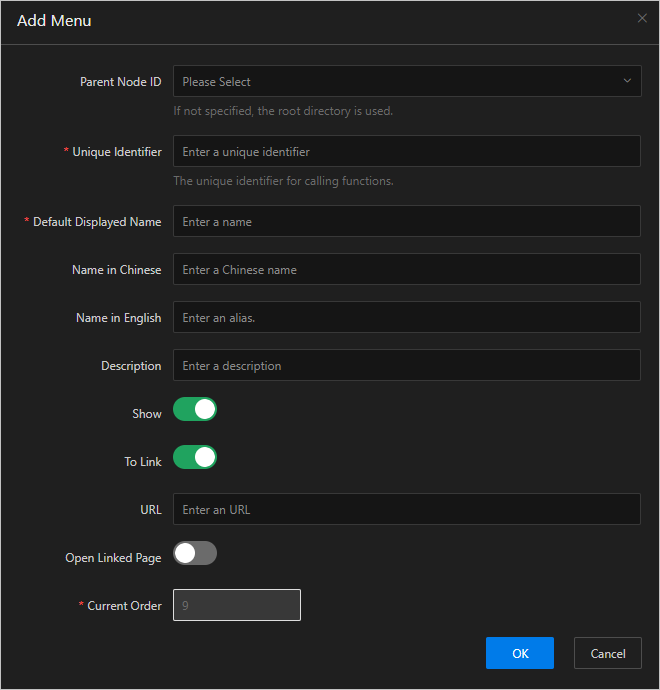

   The following table describes the parameters.

   | Parameter | Description |
   | --- | --- |
   | Parent Node ID | The parent menu. This parameter does not need to specified when you add a level-1 menu. |
   | Unique Identifier | The unique identifier used to call functions. It can consist of only letters and can be 5 to 20 characters in length. |
   | Default Display Name | The default display name of the menu. |
   | Name in Chinese | The menu name in Chinese. In the Chinese language environment, if the Chinese name of the menu is specified, the default display name of the menu is the specified Chinese name. |
   | Name in English | The menu name in English. In the English language environment, if the English name of the menu is specified, the default display name of the menu is the specified English name. |
   | Description | The description of the menu. |
   | Show | Specifies whether to show the menu after it is added. You can turn on or off Show. By default, Show is turned on. |
   | To Link | Specifies whether to go to another page when you click the menu.You can turn on or off To Link. By default, To Link is turned off. |
   | URL | This parameter appears only when To Link is turned on. Set this parameter to the URL to go to when you click the menu.<br>• If the URL of a page within the current system is used, enter the absolute path or a relative path of the page. Example: /aso/aso-alarm/dashboard.<br>• If the URL of a third-party system is used, enter the absolute path of the page. Example: http://example.com/TaskManageTool/#/taskView. |
   | Open Linked Page | Specifies whether to open a new page for the URL to go to after you click the menu. You can turn on or off Open Linked Page. By default, Open Linked Page is turned off. |
   | Current Order | The order of the menu among all level-1 menus. You cannot configure the order in the panel. You can modify the configuration on the Menu Settings page after you create the menu. |

6. Click OK.

Result

After you have added a level-1 menu, you can view the menu in the menu list and the top navigation bar.

<a id="section-3-5-4-2"></a>

#### 3.5.4.2. Add a submenu

This topic describes how to add a submenu.

Procedure

1. Log on to the Apsara Uni-manager Operations Console.

2. In the top navigation bar, click Settings.

3. In the left-side navigation pane, choose System Settings > Menu Settings.

4. Add a submenu.

   <ol type="i">

   <li>

   Find the menu to which you want to add a submenu and click Add Submenu in the Actions

   </li>

   </ol>

   column.

   <ol type="i" start="2">

   <li>

   In the Add Menu panel, configure the parameters for the submenu.

   </li>

   </ol>

   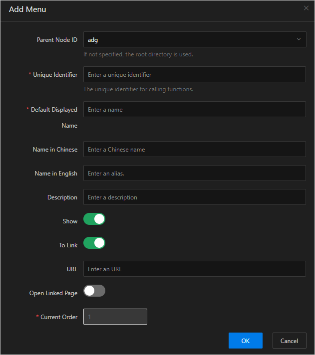

   The following table describes the parameters.

   | Parameter | Description |
   | --- | --- |
   | Parent Node ID | The menu to which the submenu belongs. |
   | Unique Identifier | The unique identifier used to call functions. It can consist only of letters and can be 5 to 20 characters in length. |
   | Default Display Name | The default display name of the submenu. |
   | Name in Chinese | The submenu name in Chinese. In the Chinese language environment, if the Chinese name of the submenu is specified, the default display name of the submenu is the specified Chinese name. |
   | Name in English | The submenu name in English. In the English language environment, if the English name of the submenu is specified, the default display name of the submenu is the specified English name. |
   | Description | The description of the submenu. |
   | Show | Specifies whether to show the submenu after it is added. You can turn on or off Show. By default, Show is turned on. |
   | To Link | Specifies whether to go to another page when you click the submenu. You can turn on or off To Link. By default, To Link is turned off. |
   | URL | This parameter appears only when To Link is turned on. Set this parameter to the URL to go to when you click the submenu.<br>• If the URL of a page within the current system is used, enter the absolute path or a relative path of the page. Example:/aso/aso-alarm/dashboard.<br>• If the URL of a third-party system is used, enter the absolute path of the page. Example: http://example.com/TaskManageTool/#/taskView. |
   | Open Linked Page | Specifies whether to open a new page for the URL to go to after you click the submenu. You can turn on or off Open Linked Page. By default, the switch is off. |
   | Menu Type | The type of the menu. When you create a submenu, you do not need to configure this parameter. |
   | Current Order | The order of the submenu under the selected menu. You cannot configure the order in the panel. You can modify the configuration on the Menu Settings page after you create the submenu. |

   <ol type="i" start="3">

   <li>

   Click OK.

   </li>

   </ol>

   After you add a submenu, you can view it under the corresponding parent menu in the menu list and in the left-side navigation pane.

   Note

   We recommend that you create a menu hierarchy of no more than five levels.

<a id="section-3-5-4-3"></a>

#### 3.5.4.3. Hide a menu

This topic describes how to hide a menu.

Prerequisites

Notice

Only custom menus and submenus can be hidden. After a menu or submenu is hidden,

submenus beneath it are also hidden.

Procedure

1. Log on to the Apsara Uni-manager Operations Console.

2. In the top navigation bar, click Settings.

3. In the left-side navigation pane, choose System Settings > Menu Settings.

4. In the menu list, find the menu or submenu that you want to hide and click Modify in the Actions column.

5. In the Modify Menu panel, turn off Show and click OK.

<a id="section-3-5-4-4"></a>

#### 3.5.4.4. Modify a menu

After you add a menu or submenu, you can modify its configurations and sorting.

Prerequisites

Notice

Only custom menus and submenus can be modified. Built-in menus and submenus can

only be sorted.

Procedure

1. Log on to the Apsara Uni-manager Operations Console.

2. In the top navigation bar, click Settings.

3. In the left-side navigation pane, choose System Settings > Menu Settings.

4. In the menu list, find the menu or submenu that you want to modify and click Modify in the Actions column.

5. In the Modify Menu panel, modify the configurations and click OK.

6. In the Actions column, click Move Up or Move Down to change the order of the menu.

<a id="section-3-5-4-5"></a>

#### 3.5.4.5. Delete a menu

This topic describes how to delete menus or submenus that are no longer needed.

Prerequisites

Notice

Only custom menus and submenus can be deleted.

Procedure

1. Log on to the Apsara Uni-manager Operations Console.

2. In the top navigation bar, click Settings.

3. In the left-side navigation pane, choose System Settings > Menu Settings.

4. In the menu list, find the menu or submenu that you want to delete and click Delete in the Actions column.

5. In the message that appears, click OK.

<a id="section-3-5-5"></a>

### 3.5.5. Two-factor authentication

To make user logons more secure, you can configure two-factor authentication for users.

Context

The Apsara Uni-manager Operations Console supports only Google two-factor authentication.

This authentication method is 2-step verification and uses a password and mobile app to provide a two-layer protection for accounts. You can obtain the logon key after you configure users in the Apsara Uni-manager Operations Console, and then enter the key in the Google Authenticator app on your mobile phone. The app generates a verification code for your logon based on the time and key.

Procedure

1. Log on to the Apsara Uni-manager Operations Console.

2. In the top navigation bar, click Settings.

3. In the left-side navigation pane, choose System Settings > Two-factor Authentication.

4. On the Two Factor Authentication page, perform the following operations:

   - Google two-factor authentication

     <ol type="a">

     <li>

     Set Current Authentication Method to Google Two-Factor Authentication.

     </li>

     <li>

     In the upper-right corner of the page, click Add User. In the Add User dialog box, enter a username and click OK. The added user is displayed in the user list.

     </li>

     </ol>

     <ol type="i" start="100">

     <li>

     Find the username for which you want to enable Google two-factor authentication and click Create Key in the Actions column. When the Added message appears, the Show Key button appears in the Actions column. Click Show Key. The key is displayed in plaintext in the Key column.

     </li>

     <li value="500">

     Enter the key in the Google Authenticator app on your mobile phone. The app dynamically generates a verification code for your logon based on the time and key. While two-factor authentication is enabled, you are required to enter the verification code on your app whenever you log on to the system.

     Note

     The Google Authenticator app and server generate the verification code by

     using public algorithms based on the time and key. They can work offline without connecting to the Internet or Google server. Therefore, you must keep your key confidential.

     </li>

     </ol>

     <ol type="a" start="5">

     <li>

     To disable two-factor authentication, click Delete Key in the Actions column.

     </li>

     </ol>

   - No authentication

     Set Current Authentication Method to No Authentication. Two-factor authentication is then disabled and all two-factor authentication methods become invalid.

<a id="section-3-5-6"></a>

### 3.5.6. Department management

The Department Management module allows administrators to create, modify, delete, and search for departments, as well as create users or user groups for departments.

Context

After the Apsara Uni-manager Operations Console is deployed, a root department is automatically generated. You can create other departments under the root department.

Departments are displayed in a hierarchy, and you can create sub-departments under each level of departments. Up to five levels of departments can be created.

Procedure

1. Log on to the Apsara Uni-manager Operations Console.

2. In the top navigation bar, click Settings.

3. In the left-side navigation pane, choose System Settings > Department Management.

   On the Department Management page, you can view the tree structure of all created departments and the information about all users in each department.

4. (Optional)In the upper-left corner of the page, enter a department name in the search box and click the search icon to find the department that you want to manage.

5. Perform the following operations:

   - Add a department

     In the left catalog tree, select the department to which you want to add sub-departments and click Add Department. In the Add Department dialog box, set Department Name and Role, and then click OK. Then, you can view the created department in the left catalog tree.

   - Modify a department

     In the left catalog tree, select the department that you want to modify and click Modify Department. In the Modify Department dialog box, set Department Name, Department Administrator, and Role, and click OK.

   - Delete a department

     Notice

     Before you delete a department, make sure that no users exist in the

     department. Otherwise, the department cannot be deleted.

     In the left catalog tree, select the department that you want to delete and click Delete Department. In the message that appears, click OK.

   - Add a user to a department

     In the left catalog tree, select the department to which you want to add a user. In the Users section on the right, click Create User. In the Add User dialog box, set Username, Password, Confirm Password, and optional parameters such as Display Name. Click OK.

     Then, you can choose System Settings > User Management to view the added user on the Users tab.

   - Add a user group to a department

     In the left catalog tree, select the department to which you want to add a user group. In the User Group section on the right, click Create User Group. In the Create User Group dialog box, enter a user group name and click OK.

     Then, you can choose System Settings > User Group Management to view the added user group.

<a id="section-3-5-7"></a>

### 3.5.7. Region management

In multi-region scenarios, the system administrator can bind a department to a region. After you bind a department to a region, users in the department can manage and view resources in the region.

Context

In multi-region scenarios, a region is managed by its own administrator. After administrators log on to the Apsara Uni-manager Operations Console, each administrator can manage only resources in the region that they are authorized to manage.

Relationship between departments and regions:

- A department can be bound to multiple regions.

- A region can be bound to multiple departments.

Procedure

1. Log on to the Apsara Uni-manager Operations Console.

2. In the top navigation bar, click Settings.

3. In the left-side navigation pane, choose System Settings > Region Management.

4. (Optional)In the upper-left corner of the page, enter a department name in the search box and click the search icon to find the department that you want to bind.

5. In the left catalog tree, click a department and select one or more regions in the Regions list on the right.

6. Click Update Association.

<a id="section-3-5-8"></a>

### 3.5.8. Operating system logs

The Operating System Logs module allows you to collect statistics on the number of logs and identify events related to the operating system.

Procedure

1. Log on to the Apsara Uni-manager Operations Console.

2. In the top navigation bar, click Settings.

3. In the left-side navigation pane, choose System Settings > Operating System Logs.

4. On the Operating System Logs page, select Time and set Range by specifying IP, HostName, or MachineGroup. Select the Search by Keyword check box, enter Keyword, and then click Search. View the number of logs, the number of events, and the logs generated around the time point when the event occurred.

   Specify EventType, DataSource, and LogLevel to further filter information. The default value of each parameter is Total.

   | Parameter | Description |
   | --- | --- |
   | EventType | The exception category, which can be kernel, security, or system. |
   | DataSource | The system application from which logs are generated. It mainly is used to indicate a system application. |
   | LogLevel | The log error level, which can be debug, info, notice, warning, err, or crit. |

5. In the section below the graphs, click the  icon and select an event. Click the  icon before the

   event to show the detailed log information around the time point when the event occurred.

   Click Export to export the full log information within the specified time range.

<a id="section-3-5-9"></a>

### 3.5.9. Operation logs

You can view logs to view the resource usage and running status of all modules on the platform.

Context

The Operation Logs page allows you to view all the records of backend API calls, including audit operations. The auditor can filter logs by username and time, view call details, and export selected logs.

Procedure

1. Log on to the Apsara Uni-manager Operations Console.

2. In the top navigation bar, click Settings.

3. In the left-side navigation pane, choose System Settings > Operation Logs.

4. On the Log Management page, perform the following operations:

   - Manage logs

     In the upper part of the page, enter User Name and select a period of time for Time Period. Click Search to view related logs in the list below.

   - Delete logs

     Select the logs that you want to delete and click Delete. In the message that appears, click OK.

   - Export logs

     Select the logs that you want to export and click the  icon. If you do not select logs, when

     you click the  icon, all displayed logs are exported.

     Note

     If the number of logs to be exported is greater than 10,000, only the first 10,000

     logs are exported.

<a id="section-3-5-10"></a>

### 3.5.10. View authorization information

The Authorization module allows customers, field engineers, and operations engineers to query services that are experiencing authorization problems and troubleshoot the problems.

Prerequisites

The logon user has the administrator permissions. You can view the trial authorization information or enter the authorization code to view the formal authorization information on the Authorization Details tab only when you have the administrator permissions.

If you are not granted the administrator permissions, a message appears indicating that you have insufficient permissions when you access this tab.

Procedure

1. Log on to the Apsara Uni-manager Operations Console.

2. In the top navigation bar, click Settings.

3. In the left-side navigation pane, choose System Settings > Authorization.

   The Authorization Details tab appears.

   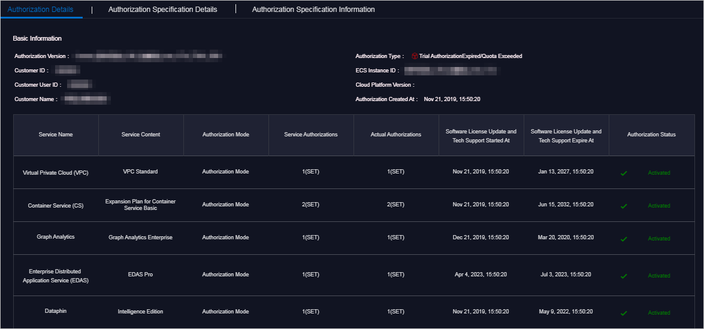

4. Perform the following operations to view the authorization information.

   Note

   For formal authorization, you must enter the authorization code to view the

   authorization information. You can obtain the authorization code from the authorization letter appended to the project contract or by contacting the business manager (CBM) of your project.

   - On the Authorization Details tab, view the authorization information.

     You can view authorization information including the authorization version, customer information, authorization type, Elastic Compute Service (ECS) instance ID, cloud platform version, the creation time of authorization, and the authorization information of all cloud services in different data centers.

     The following table describes the detailed authorization information.

     | Item | Description |
     | --- | --- |
     | Authorized Version | You can use the BP number in the version to associate a project or contract.<br>Take note of the following items:<br>• TRIAL in the version indicates that the authorization is trial authorization. The trial authorization is valid within 90 days from the date of deployment.<br>• FORMAL in the version indicates that the authorization is formal authorization. The authorization information of the service comes from the signed contract. |
     | Authorization Type | Indicates the current authorization type and authorization status.<br>• The following authorization types are available:<br>• Trial Authorization<br>• Formal Authorization<br>• The following authorization statuses are available:<br>• Not Activated<br>• Expire Soon<br>• Activated<br>• Expired<br>• Expired/Quota Exceeded |
     | Customer information | The information about the customer, including the username, UID, and user ID. |
     | Instance ID | The ECS instance ID in the deployment planner of the field environment. |
     | Cloud Platform Version | The Apsara Stack version of the current cloud platform. |
     | Authorization Created At | The start time of the authorization. |
     | Apsara Stack Product Authorization Details (Data Center) | The authorization information of cloud services within different regions, including the service name, service content, current authorization mode, service authorization quantity, actual authorization quantity, software license update and technical support start time, software license update and technical support end time, and real-time product authorization status.<br>If the following information appears in the Authorization Status column of a service, take note of the following items:<br>• RENEW Service Expired<br>Indicates that the customer must renew the subscription as soon as possible. Otherwise, field operations services (including ticket processing) are terminated.<br>• Specification Quota Exceeded<br>Indicates that the specifications deployed for a service have exceeded the contract quota, and the customer must scale up the service as soon as possible. |

   - Click the Authorization Specifications Details tab to view the authorization specification information of services across different data centers or regions.

     The following table describes the authorization specification information.

     | Item | Description |
     | --- | --- |
     | Service Name | The name of an authorized service. |
     | Authorization Specification Name | The specification name of an authorized service. |
     | Authorized Specifications | The total number of current authorizations of a specification for a service. |
     | Service Authorizations | The authorization quota of a specification for a service. |
     | Authorization Specification Status | The current authorization status of a specification for a service. |

   - Click the Authorization Specification Information tab to view the authorization specification information and the authorization specification excess information of services.

     Set Licensing Specification Level, Region ID or Data Center ID, Service Name, and time range, and then click Search. You can view the authorization specification information of a service in the current environment. Such information includes the maximum and minimum number of specifications and their occurrence time as well as the average number of specifications within the specified time range.

     In the Authorization Specification Information or Excess Authorization Specification Information section, click the + icon to the left of a service to view the specifications, specification quota, and recorded time of authorization specifications on the latest day of the specified time range for the specification of the service. Click View More to view the authorization specification information of the service within the specified time range by date.

<a id="section-3-5-11"></a>

### 3.5.11. Multi-cloud management

The Multi-cloud Management module provides the function of multi-cloud configurations. By using the multi-cloud configurations, you can perform Operations & Maintenance (O&M) operations on different data centers on an operations and maintenance platform.

<a id="section-3-5-11-1"></a>

#### 3.5.11.1. Add multi-cloud configurations

When a multi-cloud environment is used, you can add multi-cloud configurations as a multi-cloud configuration administrator or super administrator. After you add multi-cloud configurations, you can switch to different data centers in the same console and view or perform related operations.

Prerequisites

Before you add multi-cloud configurations, make sure that the following requirements are met:

- Data centers are connected and share accounts that have the same usernames and passwords with each other.

- You are granted the permissions of a multi-cloud configuration administrator or super administrator.

Procedure

1. Log on to the Apsara Uni-manager Operations Console.

2. In the top navigation bar, click Settings.

3. In the left-side navigation pane, choose System Settings > Multi-cloud Management.

4. In the upper part of the page, click Add.

5. In the dialog box that appears, add the console link of another data center and click OK.

   | Parameter | Description |
   | --- | --- |
   | Cloud Name | The name of another data center. |
   | Central Region Console URL | The console URL of another data center. Make sure that the console URL is valid. Otherwise, an error message is returned. |

   After you add multi-cloud configurations, you can log on to the Apsara Uni-manager Operations Console by using a shared account to switch to different data centers and perform related operations.

<a id="section-3-5-11-2"></a>

#### 3.5.11.2. Modify the name of a data center

After you add multi-cloud configurations, you can modify the name of a data center as a multi-cloud configuration administrator or super administrator.

Procedure

1. Log on to the Apsara Uni-manager Operations Console.

2. In the top navigation bar, click Settings.

3. In the left-side navigation pane, choose System Settings > Multi-cloud Management.

4. (Optional)In the Cloud Name field, enter the name of the data center that you want to modify and click Search.

5. Find the data center that you want to modify and click Modify in the Actions column.

6. In the dialog box that appears, modify the name of the data center and click OK.

<a id="section-3-6"></a>

## 3.6. Personal Settings

The Personal Settings module allows you to modify the logon password and logon settings of the current account.

<a id="section-3-6-1"></a>

### 3.6.1. Change the logon password

The Logon Settings module allows you to change the password that you use to log on to the Apsara Uni-manager Operations Console.

Context

For security reasons, we recommend that you change your logon password on a regular basis.

Procedure

1. Log on to the Apsara Uni-manager Operations Console.

2. In the top navigation bar, click Settings.

3. In the left-side navigation pane, choose Personal Settings > Personal Information.

4. View the personal information of the current user, such as Username and Department.

5. Click Change Password to change the password that you use to log on to the Apsara Uni-manager Operations Console.

6. In the Change Password dialog box, specify Current Password, New Password, and Confirm Password, and then click OK.

<a id="section-3-6-2"></a>

### 3.6.2. Modify logon settings

The Logon Settings module allows you to configure whether to allow multi-terminal logon and modify the logon timeout period, maximum allowed password retries, logon policy, and validity period of the account you are using.

Context

To make your system more secure, you can modify the logon settings based on your scenario.

Procedure

1. Log on to the Apsara Uni-manager Operations Console.

2. In the top navigation bar, click Settings.

3. In the left-side navigation pane, choose Personal Settings > Logon Settings.

4. On the Logon Settings tab, modify the following parameters.

   - Timeout Period (Minutes): Set the logon timeout period of the current account. If the logon time exceeds the specified time period, the system prompts you that the logon timed out and you can try to log on again.

   - Multi-Terminal Logon Settings: Set whether to allow multi-terminal logon on the current account. You can select Multi-Terminal Logon Allowed, Forbid Multi-Terminal Logon in ASO, or Forbid Multi-Terminal Logon in O&M.

     - Multi-Terminal Logon Allowed: The current account is allowed to log on to the Apsara Uni-manager Operations Console from multiple terminals at the same time.

     - Forbid Multi-Terminal Logon in ASO: The current account is not allowed to log on to the Apsara Uni-manager Operations Console from multiple terminals at the same time. The current account is allowed to go to another console from the Apsara Uni-manager Operations Console.

       For example, User A uses the current account to go to another console from the Apsara Uni-manager Operations Console. At the same time, User B uses the current account to log on to the Apsara Uni-manager Operations Console. The system disables the logon of User A only after User A returns to the Apsara Uni-manager Operations Console.

     - Forbid Multi-Terminal Logon in O&M: The current account is not allowed to log on to the Apsara Uni-manager Operations Console or the console redirected from the Apsara Uni-manager Operations Console from multiple terminals.

   - Maximum Allowed Password Retries: Set the maximum number of password retries before the account may be locked. When the number of retries reaches the specified number, the account is locked. After the account is locked, you must use the system administrator account to unlock it.

   - Logon Policies: Set the logon policy of the current account. You can select Blacklist or Whitelist. For more information about how to create logon policies, see Logon policies.

     - Blacklist: If this option is selected, you cannot use the IP addresses configured in logon policies to log on to the Apsara Uni-manager Operations Console.

     - Whitelist: If this option is selected, you can use the IP addresses configured in logon policies to log on to the Apsara Uni-manager Operations Console.

5. Click Save.

6. Click the Account Validity Period tab and set Account Validity (Days).

   Note

   When your account expires, you must use the system administrator account to

   unlock it.

7. Click Save.

<a id="section-4"></a>

# 4.Resources

<a id="section-4-1"></a>

## 4.1. Products

<a id="section-4-1-1"></a>

### 4.1.1. Product overview

On the Product Overview page, you can view information about each product and its clusters, server roles, machines, alerts, and final-state status.

Procedure

1. Log on to the Apsara Uni-manager Operations Console.

2. In the top navigation bar, choose Resources > Products.

3. On the Product Overview page, view the information about clusters, server roles, machines, alerts, and final-state statuses.

   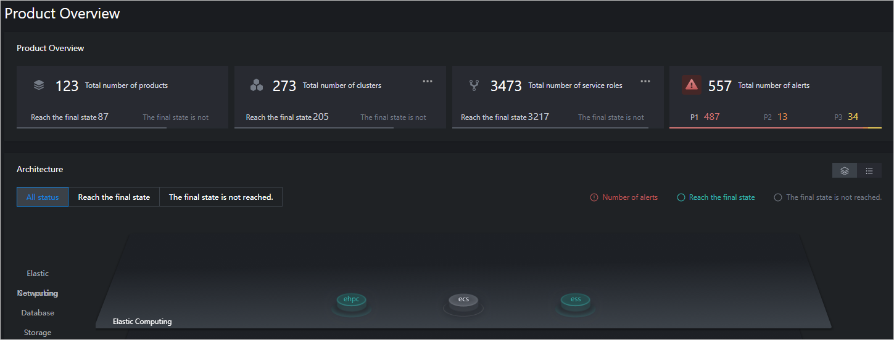

   - In the Product Overview section, view the total numbers of products, clusters, server roles, and alerts as well as the final-state status of these products, clusters, and server roles.

     - Click the  icon next to Total Clusters and view the information about the clusters on the

       Clusters page.

     - Click the  icon next to Total Server Roles and view the information about the server roles

       on the Server Roles page.

   - In the Architecture section, view the product information.

     - Click All status, Desired State, or Not Desired State to view the information about the products in the corresponding state.

     - Click a product type in the left-side product type list to view the final-state status and alerts of the products of that type.

     - Click the  icon in the upper-right corner to view the cluster status and the numbers of

       clusters, server roles, machines, and alerts in a list form.

       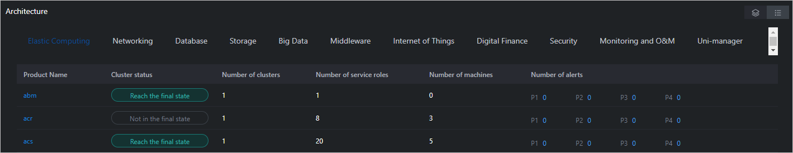

       - Click a product type in the upper product type list to view the information about the products of that type.

       - Click a product name in the Product Name column to view the details of the product on the Product Details page.

         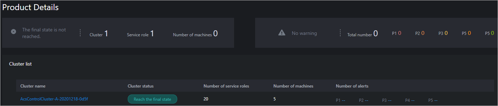

         <ol type="a">

         <li>

         Click a cluster name in the Cluster Name column to view the details of the cluster on the Cluster Details page.

         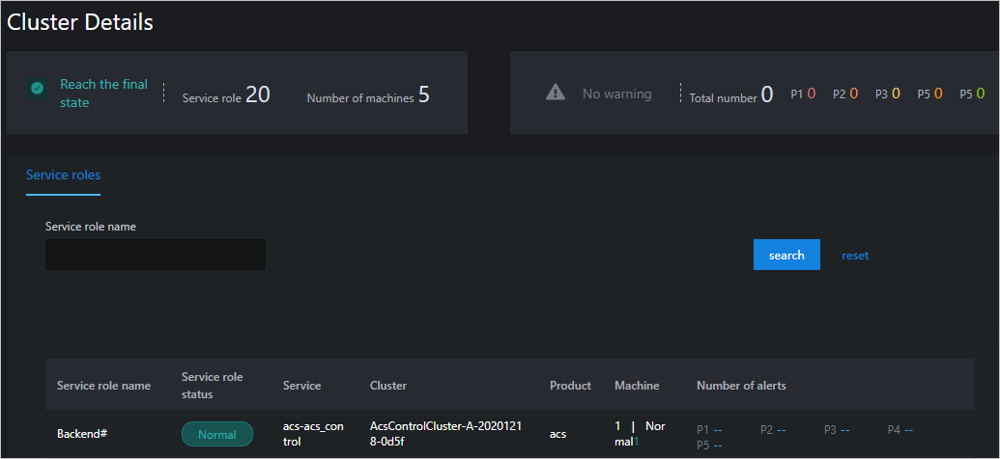

         </li>

         <li>

         Enter a server role name in the Server Role Name search box and click Search to view the details about the server role.

         </li>

         </ol>

         <ol type="i" start="100">

         <li>

         (Optional) Click Reset to clear the search conditions.

         </li>

         </ol>

     - Click the  icon in the upper-right corner to view the information about the products in a

       graphical form.

<a id="section-4-1-2"></a>

### 4.1.2. Clusters

You can view the status and alerts of all the deployed clusters and their server roles on the Cluster list page.

Procedure

1. Log on to the Apsara Uni-manager Operations Console.

2. In the top navigation bar, choose Resources > Products.

3. In the left-side navigation pane, click Clusters.

4. On the Cluster list page, select a product from the Product Name drop-down list, select a cluster from the Cluster Name drop-down list, and then select a state from the Cluster Status drop-down list. Then, click Search to view the search results.

   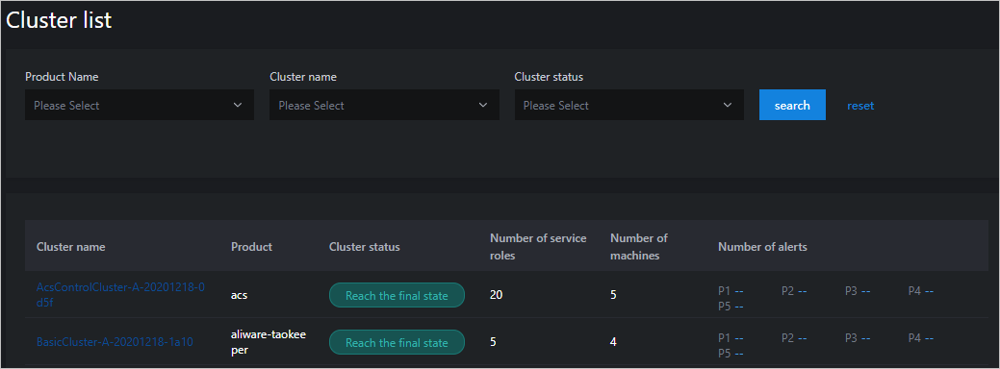

5. (Optional) Click Reset to clear the filter conditions.

6. Click a cluster name in the Cluster Name column to view the details of the cluster on the Cluster Details page.

   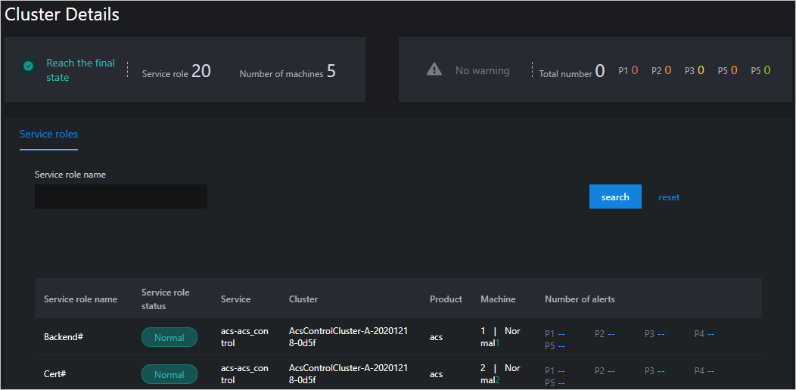

7. Enter a server role name in the Server Role Name search box and click Search to view the details about the server role.

8. (Optional) Click Reset to clear the filter conditions.

<a id="section-4-1-3"></a>

### 4.1.3. Server roles

On the Server Roles page, you can view the server role of a specific product or cluster and the status and alerts of the cluster.

Procedure

1. Log on to the Apsara Uni-manager Operations Console.

2. In the top navigation bar, choose Resources > Products.

3. In the left-side navigation pane, click Server Roles.

4. On the Server Roles page, select a product from the Product Name drop-down list, select a cluster from the Cluster Name drop-down list, and then select a state from the Server Role Status drop-down list. Then, click Search and view the search results displayed below.

   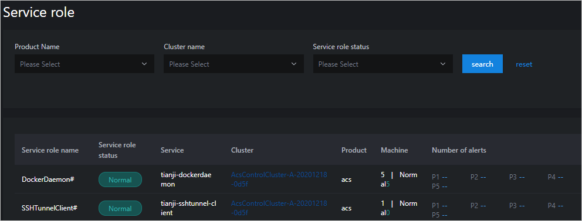

5. (Optional) Click Reset to clear the search conditions.

6. Find a server role and click the number next to Normal or Exception in the Machine column. In the dialog box that appears, find a virtual machine and click Security Operations on the right side to go to the CLI window of the virtual machine. For more information, see Log on to the host where a server role is deployed.

7. Click a cluster name in the Cluster column to view the details of the cluster on the Cluster Details page.

   

8. Enter a server role name in the Server Role Name search box and click Search to view the details about the server role.

9. (Optional) Click Reset to clear the search conditions.

<a id="section-4-2"></a>

## 4.2. Network

The network module provides the cloud service interconnection and network resource management features for the hybrid cloud network. The user is the network administrator of Apsara Stack.

<a id="section-4-2-1"></a>

### 4.2.1. Cloud service interconnection

The cloud service interconnection feature provides network access to cloud services, configuration of VIPs and DNS, and mutual access between cloud services in multiple clouds, IDCs, and Apsara Stack.

<a id="section-4-2-1-1"></a>

#### 4.2.1.1. Dynamic VIP

The dynamic VIP feature expands the network capabilities of cloud service interconnection. It allows you to create dynamic VIPs by using VIP resources applied for by the cloud services in Apsara Infrastructure Management Framework as templates. You can modify the type, tunnel_type, and ipprotocol properties when you create a dynamic VIP. Other properties are the same as those in the template VIP resources defined by the cloud products. During scaling, upgrades, and downgrades of products, dynamic VIP resources and template VIP resources can be simultaneously updated by linking with Apsara Infrastructure Management Framework.

Context

- In scenarios that require large storage capacities, the dynamic VIP feature can be used to scale out multiple OSS Intranet VIP resources to bypass the single-VIP network speed of 5 Gbit/s.

- In hybrid cloud scenarios, you must access the Apsara Uni-manager Operations Console over the Internet and use the dynamic VIP feature to create Internet VIP resources for the Apsara Uni-manager Operations Console.

- The dynamic VIP tunnel type can be set only to classic_to_any_tunnel.

Procedure

1. Log on to the Apsara Uni-manager Operations Console.

2. In the top navigation bar, choose Resources > Network.

3. On the Dynamic VIP page, view the dynamic VIPs.

   - Enter a VIP name in the VIP Address search box, enter a template VIP name in the Template VIP Name search box, and then select a type from the SLB Instance Type drop-down list. Then, click Search to view the dynamic VIPs. Click Details in the Actions column corresponding to a dynamic VIP to view the details of the dynamic VIP.

     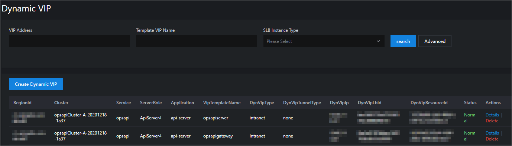

   - Use more filter conditions to view the information of dynamic VIPs.

     <ol type="a">

     <li>

     Click Advanced, select a type from the Tunnel Type drop-down list (you can select multiple types), and enter a region name in the Region search box. Then, click Search to view the dynamic VIPs.

     </li>

     <li>

     (Optional) Click Reset to clear the filter conditions.

     </li>

     </ol>

     <ol type="i" start="100">

     <li>

     (Optional) Click Collapse to hide the Tunnel Type and Region options.

     </li>

     </ol>

4. Create, update, and delete dynamic VIPs.

   - Click Create Dynamic VIP above the dynamic VIP list. In the Create Dynamic VIP dialog box, configure the parameters. Then, click OK to create a dynamic VIP.

     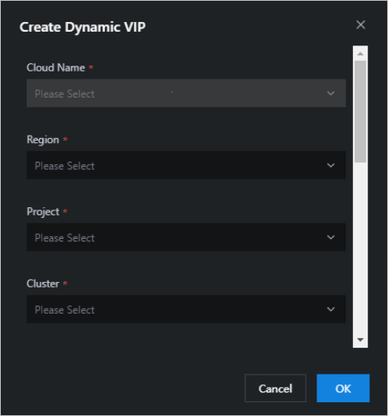

     The parameters of a dynamic VIP:

     - Cloud Name: the name of the cloud instance.

     - Region: the ID of the region.

     - Project: the name of the product.

     - Cluster: the name of the cluster.

     - Service: the name of the service.

     - ServerRole: the name of the server role.

     - Application: the name of the application.

     - Template VIP Name: the name of the template VIP.

     - DynVipType: the type of the instance.

     - DynVipTunnelType: the type of the tunnel.

     - Ipprotocol: the type of the dynamic VIP.

   - Update a dynamic VIP.

     If the basic properties of a dynamic VIP are inconsistent with those of a template VIP, or if an operation on the dynamic VIP fails, Abnormal is displayed in the Status column corresponding to the dynamic VIP. When the system detects an exception in the dynamic VIP status, the system automatically checks and deletes DNS records associated with the abnormal dynamic VIP to reduce the impact on your business.

     The O&M personnel must check whether the abnormal dynamic VIP status is caused by resource changes during product upgrades or scaling and perform the following operations accordingly:

     - If the abnormal dynamic VIP status is caused by resource changes during product upgrades or scaling, click Update in the Actions column corresponding to the dynamic VIP. The system queries the template VIP parameters through calls to Apsara Infrastructure Management Framework API operations and combine these parameters with the variable properties of the dynamic VIP to update the dynamic VIP.

     - If the abnormal dynamic VIP status is not caused by resource changes during product upgrades or scaling, submit a ticket to contact Apsara Stack technical support.

   - To delete a dynamic VIP, click Delete in the Actions column corresponding to the dynamic VIP. In the message that appears, click OK.

     Notice

     Risks may arise if you delete dynamic VIPs. Proceed with caution. Before you

     delete a dynamic VIP, make sure that the VIP does not have sessions and that DNS records can no longer be resolved to the dynamic VIP.

<a id="section-4-2-1-2"></a>

#### 4.2.1.2. Dynamic DNS

Dynamic DNS works with the dynamic VIP feature. It allows you to implement horizontal network expansion by resolving DNS resources in cloud services to multiple VIPs (one static VIP and multiple dynamic VIPs).

Context

Dynamic DNS is applicable to scenarios such as multi-cloud geo-disaster recovery and hybrid clouds. The following features are supported:

- Adds domain names for zones corresponding to ops-dns intranet-domain and internet-domain. By default, ops-dns returns the resolution records in rotation mode.

- Adds the forwarding records of a tenant DNS to forward domain name resolution requests in a specified zone to external DNS servers such as DNS servers in Apsara Stack, heterogeneous clouds, and Alibaba Cloud.

  Warning

  Before you resolve DNS domain names in the Apsara Infrastructure Management

  Framework console, make sure that the parameters of the dynamic VIPs and the static VIP are exactly the same, and VIP listening on access is normal. Otherwise, network exceptions may occur.

Procedure

1. Log on to the Apsara Uni-manager Operations Console.

2. In the top navigation bar, choose Resources > Network.

3. In the left-side navigation pane, click Dynamic DNS. On the Dynamic DNS page, view the information about dynamic DNS.

   - Select a type from the DNS Type drop-down list, select a cloud ID from the Remote Cloud ID drop-down list, and then enter a domain name in the ZoneName search box. Then, click Search to view the dynamic DNS records.

     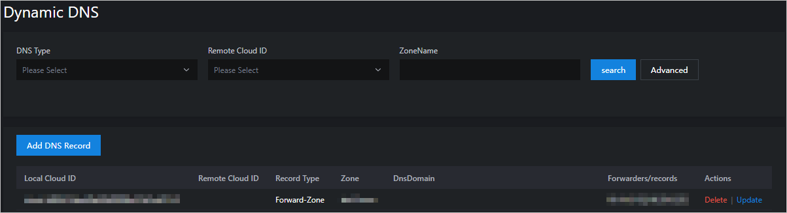

   - Use more filter conditions to search for the dynamic DNS records.

     <ol type="a">

     <li>

     Click Advanced, enter a domain name in the DnsDomain search box, and then enter a DNS record in the DNS Record search box. Then, click Search to view the dynamic DNS records.

     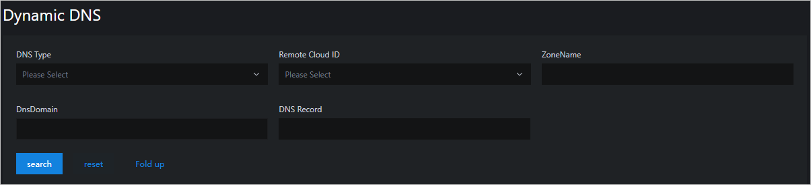

     </li>

     <li>

     (Optional) Click Reset to clear the filter conditions.

     </li>

     </ol>

     <ol type="i" start="100">

     <li>

     (Optional) Click Collapse to hide the DnsDomain and DNS Record options.

     </li>

     </ol>

4. Update and delete the dynamic DNS records or create new dynamic DNS records.

   - Click Add DNS Record above the dynamic DNS record list. In the Add DNS Record dialog box, configure the parameters. Then, click OK to create a dynamic DNS record.

     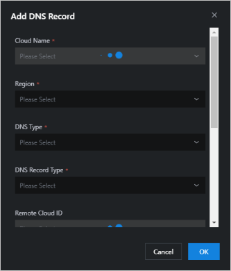

     The parameters of a DNS record:

     - Cloud Name: the name of the cloud instance.

     - Region: the ID of the region.

     - DNS Type: the DNS type. Valid values: dns product and ops dns.

     - DNS Record Type: the type of the DNS record. Valid values: Forward-Zone and A.

     - Remote Cloud ID: the ID of the cloud instance in the current cloud.

     - DnsZone: the DNS zone. Separate multiple zones with commas (,).

     - Forwarders: the forwarding IP addresses. Separate multiple IP addresses with commas (,).

     - DnsDomain: the DNS endpoint.

     - DnsRecord: the IP address of the DNS record.

   - Click Update in the Actions column corresponding to the DNS record. In the dialog box that appears, modify the Remote Cloud ID and DnsRecord parameters. Then, click OK.

   - To delete a DNS record, click Delete in the Actions column corresponding to the DNS record. In the message that appears, click OK.

     Warning

     Risks may arise if you delete DNS records. Proceed with caution. Before you

     delete a DNS record, make sure that an alternate DNS record is available for the domain name or that no other clients have access to this domain name.

<a id="section-4-2-1-3"></a>

#### 4.2.1.3. Cross-cloud access

Cross-cloud access allows you to manage data for network access of cloud services in hybrid clouds.

Context

Before you enable cross-cloud access, you must configure IP network routing based on the access matrix data and grant the network access permissions.

Cross-cloud access is applicable to the following scenarios:

- Connection between Apsara Stack Enterprise and public cloud VPCs through dedicated lines: Public cloud VPCs and Apsara Stack VPCs can be connected by using dedicated lines.

- Connection between Apsara Stack Enterprise and public cloud VPCs over the Internet: Apsara Stack provides Internet egresses, so that public cloud VPCs and Apsara Stack VPCs can be connected over the Internet.

- Connection between Apsara Stack Agility ZStack and public cloud VPCs over the Internet: Apsara Stack Agility is connected to the Internet and ZStack VPCs are connected to public cloud VPCs over the Internet by using the IPSec VPN.

- Connection between Apsara Stack Enterprise and public cloud services through dedicated lines: Apsara Stack is connected to the public cloud by using dedicated lines to implement cloud management and network connection.

- Connection between Apsara Stack Enterprise, Apsara Stack Agility, and all-in-one cloud services (management) over the Internet: Apsara Stack Enterprise, Apsara Stack Agility, and all-in-one cloud services provide Internet egresses and can access cloud services on the Internet based on the NAT capabilities provided by user-managed firewalls.

- Hybrid clouds for multi-cloud remote disaster recovery: Hybrid clouds are connected to implement remote disaster recovery across regions.

Procedure

1. Log on to the Apsara Uni-manager Operations Console.

2. In the top navigation bar, choose Resources > Network.

3. In the left-side navigation pane, click Cross-cloud Access. On the Cross-cloud Access page, view the information about access matrices.

   <ol type="i">

   <li>

   Enter a product name in the Product Name search box and click search. The access matrices

   </li>

   </ol>

   are displayed in the lower part of the page.

   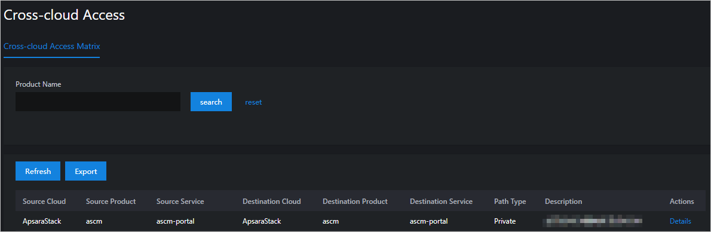

   <ol type="i" start="2">

   <li>

   Click Details in the Actions column corresponding to an access matrix to view the details of

   </li>

   </ol>

   the access matrix.

   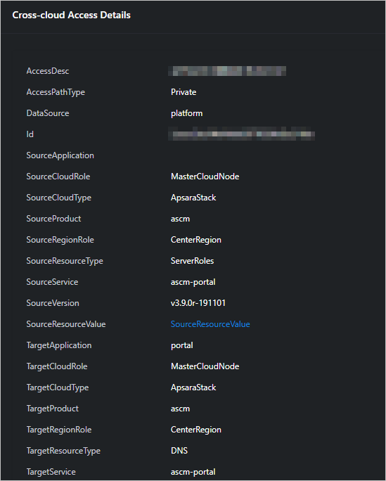

   Note

   If the cloud instance has multiple product clusters deployed or manages

   multiple lower-level cloud instances, each of the SourceResourceValue and TargetResourceValue parameters has multiple values. You must configure the network based on the source to the destination full mash.

   <ol type="i" start="3">

   <li>

   (Optional) Click reset to clear the filter conditions.

   </li>

   </ol>

4. Click Refresh. Apsara Infrastructure Management Framework API is called to query the VIP, DNS, and SR resource values to refresh the SourceResourceValue and TargetResourceValue values.

5. Click Export to download the access matrix to your computer.

<a id="section-4-2-2"></a>

### 4.2.2. Hybrid cloud resources

You can manage hybrid cloud network resources such as physical network devices, network topology, and IP addresses in a centralized manner.

<a id="section-4-2-2-1"></a>

#### 4.2.2.1. Physical topology

You can view the physical network topologies of hybrid clouds from multiple perspectives on the Physical Topology page.

Context

You can view the following types of physical network topologies:

- Standard topology: the physical network topology of the Apsara Stack data center. The initial data comes from Deployment Planner.

- IDC topology: the physical network topology of a self-managed IDC. The data comes from user-defined network devices or links.

- Global topology: the physical network topology of multiple data centers, including the standard topology and all IDC topologies. Data of interconnection links across data centers comes from user-defined links.

Procedure

1. Log on to the Apsara Uni-manager Operations Console.

2. In the top navigation bar, choose Resources > Network.

3. In the left-side navigation pane, choose Hybrid Cloud Resources > Physical Topology. On the Physical Topologies page, view the physical topologies.

   <ol type="i">

   <li>

   Select the required options from the Topology Type and Data Center drop-down lists and

   </li>

   </ol>

   click Search to view the physical topologies.

   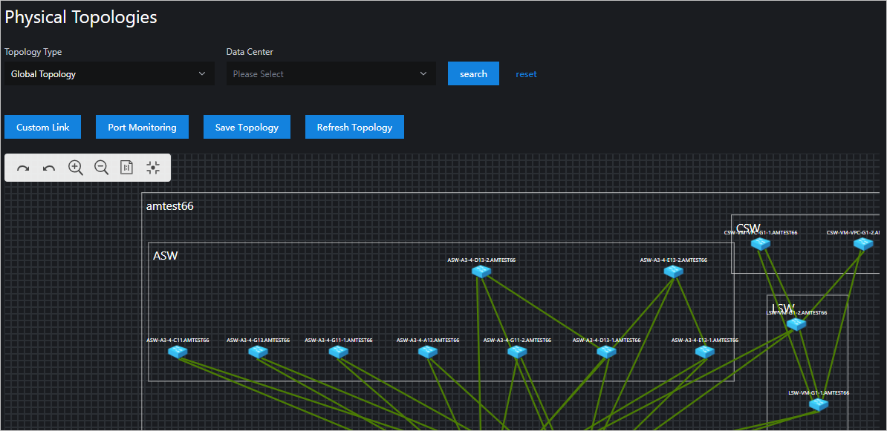

   Note

   Action icons:

   : proceeds with the next step.

   

   : goes back to the previous step.

   

   : zooms in.

   

   : zooms out.

   

   : scales in proportion to the original aspect ratio.

   

   : scales to fit canvas.

   

   <ol type="i" start="2">

   <li>

   Click a node in the physical topology graph and the network device information of the node

   </li>

   </ol>

   appears on the right side of the page.

   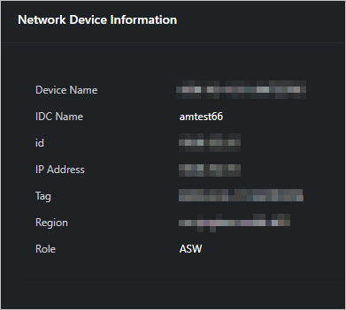

   <ol type="i" start="3">

   <li>

   (Optional) Click Reset to clear the filter conditions.

   </li>

   </ol>

4. On the Physical Topologies page, click Custom Link. In the Custom Link dialog box, configure the parameters and click OK to set the link.

5. On the Physical Topologies page, click Port Monitoring to view the status of the ports.

   <ol type="i">

   <li>

   On the Port Monitoring page, configure the parameters and click Search to view the port

   </li>

   </ol>

   status trend chart.

   Note

   You can select multiple options for Monitoring Metric at a time.

   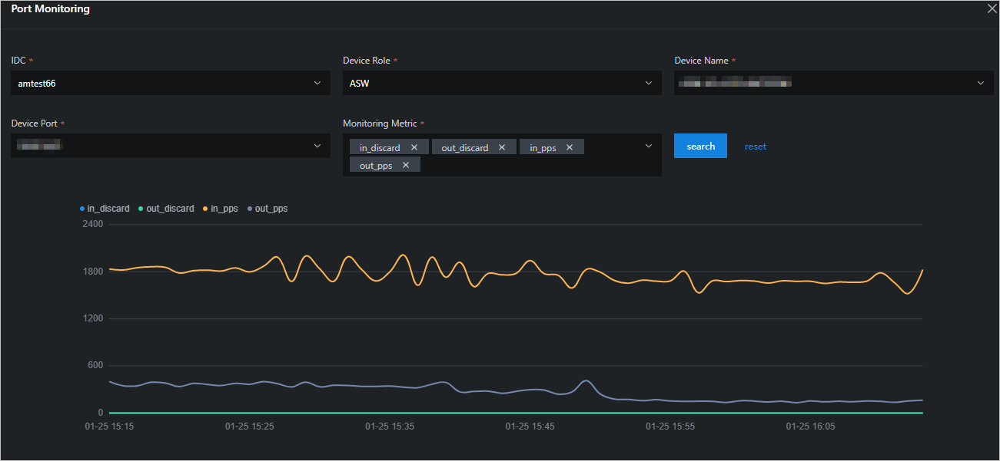

   Monitoring metrics:

   - in_discard: the inbound packet loss rate

   - out_discard: the outbound packet loss rate

   - in_pps: the inbound packet rate

   - out_pps: the outbound packet rate

   - in_bps: the inbound byte rate

   - out_bps: the outbound byte rate

   - in_error: the inbound packet error rate

   - out_error: the outbound packet error rate

   <ol type="i" start="2">

   <li>

   (Optional) Click Reset to clear the filter conditions.

   </li>

   </ol>

6. If you move a node, click Save Topology to save the new coordinates of the node.

7. Click Refresh Topology to generate coordinates for the nodes in the background.

<a id="section-4-2-2-2"></a>

#### 4.2.2.2. Network element management

You can manage Apsara Stack data centers and user-managed data centers as well as their network element devices on the Network Element Management page.

Procedure

1. Log on to the Apsara Uni-manager Operations Console.

2. In the top navigation bar, choose Resources > Network.

3. In the left-side navigation pane, choose Hybrid Cloud Resources > Network Element Management. On the Network Element Management page, view the details of the network element devices.

   <ol type="i">

   <li>

   Enter a keyword in the Device Name/Management IP Address search box and click Search

   </li>

   </ol>

   to view the information about the network element device.

   Note

   The current Apsara Stack version supports status monitoring only for network

   elements in the Apsara Stack data center.

   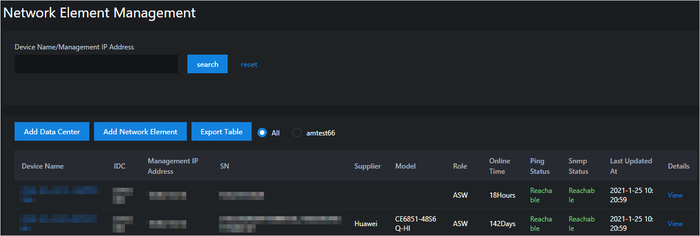

   <ol type="i" start="2">

   <li>

   Click View in the Details column corresponding to a network element device. On the Network

   </li>

   </ol>

   element details page, enter a port name in the Port Name search box and click Search to view the port information. Click View in the Actions column to view the details of the port.

   Note

   The current Apsara Stack version supports management and monitoring only

   for network element ports in the Apsara Stack data center.

   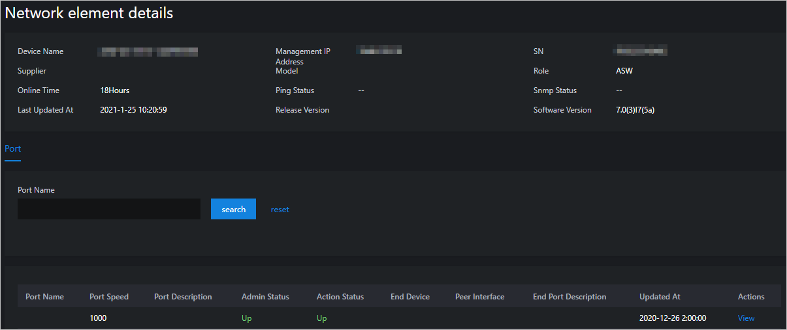

   <ol type="i" start="3">

   <li>

   (Optional) Go back to the Network Element Management page and click Reset to clear the

   </li>

   </ol>

   filter conditions.

4. Click Add Data Center. In the Add Data Center dialog box, configure the parameters and click OK to add a data center.

   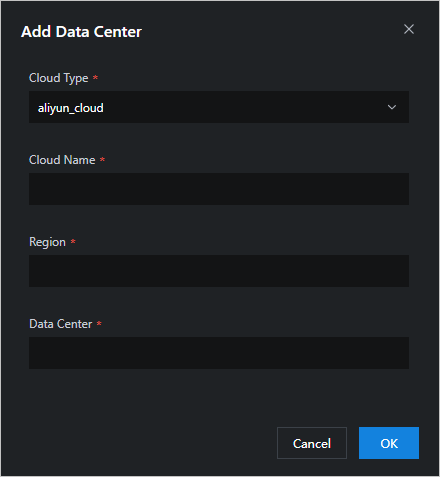

   | Parameter | Description | Example |
   | --- | --- | --- |
   | Cloud Type | The type of the cloud instance. | apasara_stack |
   | Cloud Name | The name of the cloud instance. | gddgzwy |
   | Region | The region where the cloud instance is deployed. | cn-qingdao-envxxx |
   | Data Center | The name of the data center. | amtestxx |

5. Add a network element.

   <ol type="i">

   <li>

   Click Add Network Element. In the Add Network Element panel, configure the parameters.

   </li>

   </ol>

   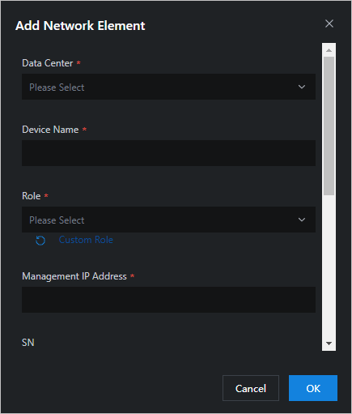

   | Parameter | Description | Example |
   | --- | --- | --- |
   | Data Center | The name of the data center where the network element device is located. | amtest11 |
   | Device Name | The name of the network element device. | DSW-VM-G1-P-1.xxxx |
   | Role | The role of the network element device. | ASW |
   | Management IP Address | The management IP address of the network element device. | 10.66.1.1 |
   | SN | The serial number of the network element device. | FDO23511111 |
   | Software Version | The version number of the software run by the network element device. | 7.1.070 |
   | Release Version | The release version of the network element device. | V200R002C50SPC800 |
   | Supplier | The supplier of the network element device. | Ruijie |
   | Model | The model of the network element device. | S6510-48VS8CQ |

   <ol type="i" start="2">

   <li>

   Click Custom Role next to Role. On the Add a custom role page, enter a device role name in

   </li>

   </ol>

   the Device Role search box and click Add.

   <ol type="i" start="3">

   <li>

   In the Add Network Element panel, click OK to add the network element.

   </li>

   </ol>

6. Click Export Table to download the information about the network element device to your computer.

<a id="section-4-2-2-3"></a>

#### 4.2.2.3. IP address pools

Multiple cloud services may be deployed on a single cloud instance and you may need to view the IP addresses of the cloud services in scenarios such as network changes and security audits. You can view the IP address pool of each cloud service on a cloud instance on the IP Address Pools page.

Procedure

1. Log on to the Apsara Uni-manager Operations Console.

2. In the top navigation bar, choose Resources > Network.

3. In the left-side navigation pane, choose Hybrid Cloud Resources > IP Address Pools to view the IP address pools.

   - Select the required options from the IP Address Pool ID, Cloud Name, and Product Name drop-down lists, and click search to view the information about the IP address pool.

     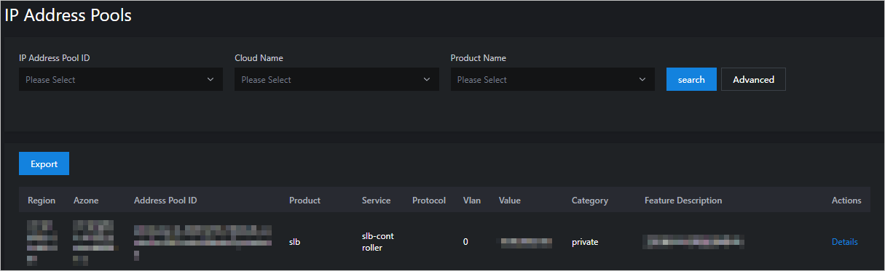

   - Use more filter conditions to view the information about the IP address pool.

     <ol type="a">

     <li>

     Click Advanced. Select the required options from the additional IP Resource Name, IP Address Type, CIDR Block of the IP Address Pool, Protocol, and Data Source drop-down lists, and click search to view the information of the IP address pool.

     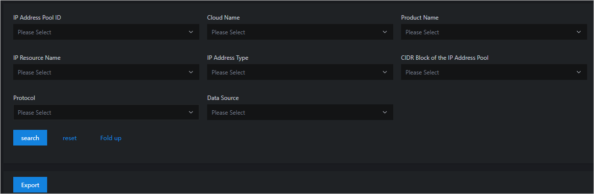

     </li>

     <li>

     (Optional) Click reset to clear the filter conditions.

     </li>

     </ol>

     <ol type="i" start="100">

     <li>

     (Optional) Click Fold up to hide the advanced filter options.

     </li>

     </ol>

4. Click Details in the Actions column to view the details of the IP address pool.

   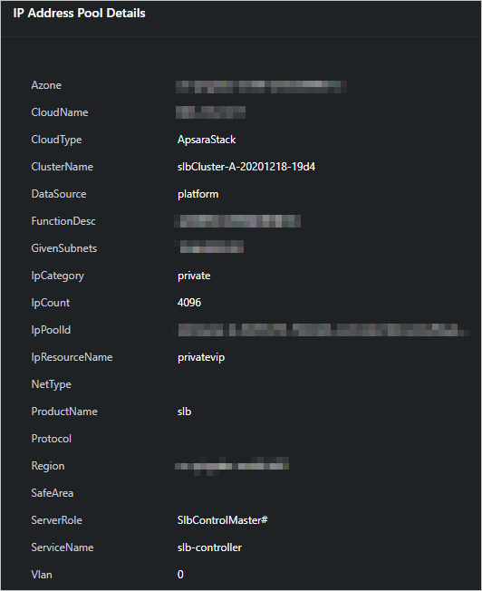

5. Click Export to download the information of the IP address pool to your computer.

<a id="section-4-2-3"></a>

### 4.2.3. Network service provider

<a id="section-4-2-3-1"></a>

#### 4.2.3.1. View access gateway instances

You can view information of access gateway instances, such as the access gateway name, IBGP role, and creation time, on the Instance Management tab.

Procedure

1. Log on to the Apsara Uni-manager Operations Console.

2. In the top navigation bar, choose Resources > Network.

3. In the left-side navigation pane, click Network Service Provider.

4. Click the Instance Management tab.

5. Enter the region ID in the upper-left corner.

   Note

   To view the instances in other regions, click Reset in the upper-right corner and

   enter the ID of another region.

6. Click Display Device List to view the list of access gateway devices in the current environment.

   Note

   If new devices are added, click Scan for New Devices and then click Display

   Device List.

   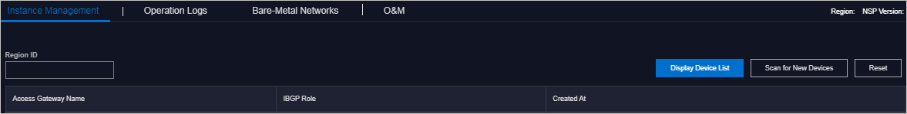

   | Column | Description |
   | --- | --- |
   | Access Gateway Name | The access gateway name in the current system. |
   | IBGP Role | The role of the access gateway in the environment.<br>Take note of the following items:<br>• RR-Active: indicates that the role of the current gateway device is RR active device.<br>• Client: indicates that the role of the current gateway is not RR active device. |
   | Management IP Address | The management IP address of the current HSW vSwitch. |
   | Created At | The time when the current vSwitch began to act as an access gateway instance. |
   | Authorization Status | Indicates whether the access gateway instance is authorized. |

<a id="section-4-2-3-2"></a>

#### 4.2.3.2. View operation logs

You can view the API operation logs of bare metal instances based on your O&M needs.

Procedure

1. Log on to the Apsara Uni-manager Operations Console.

2. In the top navigation bar, choose Resources > Network.

3. In the left-side navigation pane, click Network Service Provider.

4. Click the Operation Logs tab.

5. Set filter conditions such as vSwitch ID, bare metal instance name, access gateway name, and time range, and click Search to search for the operation logs that meet the filter conditions.

   The following table describes some of the filter conditions.

   | Parameter | Description |
   | --- | --- |
   | VSwitch ID | The ID of the vSwitch when the bare metal instance is applied for or released in the VPC. |
   | Bare Metal Name | The name of the bare metal that was applied for or released in the VPC. The serial number is used to identify the bare metal instance as a unique one in the region. |
   | Access Gateway Name | The name of the access gateway to query. |
   | Created At | The time range of the API operation to query. |

   Note

   To modify the filter conditions, click Clear in the upper-right corner of the tab and

   set the filter conditions again.

   The following table describes the fields in the query result.

   | Column | Description |
   | --- | --- |
   | ID | The index of the operation log. |
   | Created At | The time when the operation was performed. |
   | API Operation | The category of the API operation, such as applying for or releasing a bare metal instance in the VPC.<br>• add indicates that a bare metal instance is applied for in the VPC.<br>• del indicates that a bare metal instance is released in the VPC.<br>• del_pc indicates that a physical connection is deleted.<br>• del_vbr indicates that a Virtual Border Router (VBR) is deleted.<br>• del_router_intf indicates that a router interface is deleted.<br>• del_route_entry indicates that a route table entry is deleted. |
   | VSwitch ID | The ID of the vSwitch when the bare metal instance is applied for or released in the VPC. |
   | Access Gateway Name | The name of the access gateway involved with the current operation. |
   | Port | The port to which the bare metal instance belongs. |
   | Bare Metal Name | The name of the bare metal instance that is applied for or released in the VPC. To identify the bare metal instance as a unique one in the region, the serial number of the bare metal instance is displayed. |
   | Status | The status of the API operation.<br>success indicates that the operation was successful. If the API operation is in progress, the value indicates the real-time status of the API operation. If the API operation is complete but the value is not success, you can view the failure information in this column. |

6. Find an operation log in the search results and click View Details in the Detail column to view the details of the API operation.

<a id="section-4-2-3-3"></a>

#### 4.2.3.3. View network information of bare metal instances in a VPC

You can view the information of bare metal instances that are added to a VPC on the Bare-Metal Networks tab.

Procedure

1. Log on to the Apsara Uni-manager Operations Console.

2. In the top navigation bar, choose Resources > Network.

3. In the left-side navigation pane, click Network Service Provider.

4. Click the Bare-Metal Networks tab.

   By default, the network information of bare metal instances in the current system are displayed by page.

5. Configure the filters such as bare metal name, VPC ID, vSwitch ID, VBR ID, BD ID, access gateway name, and time range, and click Search to search for the bare metal instances that meet the filter conditions.

   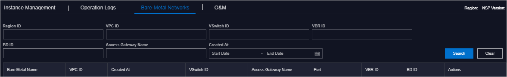

   | Filter | Description |
   | --- | --- |
   | Bare Metal Name | The name of the bare metal instance that was applied for or released in the VPC. The serial number of the is used to identify the bare metal instances as a unique one in the region. |
   | VPC ID | The ID of the VPC to which the bare metal instances belongs. |
   | Vswitch ID | The ID of the vSwitch to which the bare metal instances belongs. |
   | VBR ID | The VBR ID of the physical connection created on HSW by the VPC to which the bare metal instances belongs. |
   | BD ID | The value of the hardware bridge-domain (BD) to which the bare metal instances is added. |
   | Access Gateway Name | The name of the access gateway to which the bare metal instances belongs. |
   | Created At | The time range within which the bare metal instances is allocated to the VPC. |

   Note

   To modify the filter conditions, click Clear in the upper-right corner of the tab and

   configure the filters again.

6. Find a bare metal instances in the search result and click View Details in the Detail column to view the details of the bare metal instances.

<a id="section-4-2-3-4"></a>

#### 4.2.3.4. O&M configurations

<a id="section-4-2-3-4-1"></a>

##### 4.2.3.4.1. Apply for a bare metal instance in the VPC

In O&M emergency scenarios, you can use this feature to add the physical port of the access gateway associated with a bare metal instance to the VPC.

Prerequisites

Notice

This operation is only for emergency situations and must be performed under the

guidance of technical personnel. Otherwise, normal business operations will be affected.

Before you use this feature, take note of the following items:

- Typically, you cannot use this feature to apply for a bare metal instance in the VPC. You can use the bare metal controller to call an API operation to activate the bare metal network.

- This feature can only be used to connect the bare metal instance to the access gateway port but cannot be used to perform operations on the bare metal instance. To configure the network port IP address and routing information of the bare metal instance, contact the corresponding product team for guidance.

Procedure

1. Log on to the Apsara Uni-manager Operations Console.

2. In the top navigation bar, choose Resources > Network.

3. In the left-side navigation pane, click Network Service Provider.

4. Click the O&M tab.

5. Select Apply for Bare Metal in VPC from the drop-down list in the upper-left corner of the tab.

   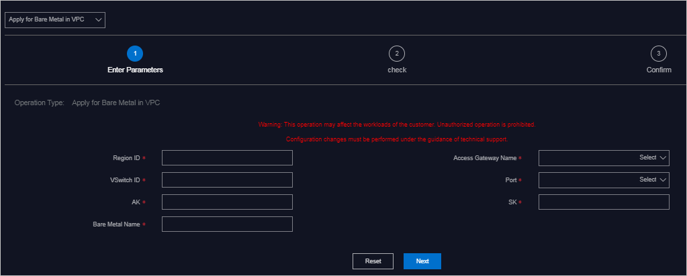

6. Configure the parameters. The following table describes the parameters.

   | Parameter | Description |
   | --- | --- |
   | Region ID | The name of the region in the current environment. |
   | Access Gateway Name | The name of the access gateway to which the bare metal instance is connected. |
   | Vswitch ID | The ID of the vSwitch to which the bare metal instance is to be added. You can obtain the vSwitch ID from the VPC console. |
   | Port | The port of the access gateway to which the bare metal instance is connected. |
   | AK and SK | The organization AccessKey ID and AccessKey secret, which can be obtained from the Organizations page of the Apsara Uni-manager Management Console based on the organization to which the VPC belongs. |
   | Bare Metal Name | The name of the bare metal instance. In this case, enter the serial number of the bare metal instance. |

   Note

   If the specified values are incorrect, click Reset in the lower part of the tab and set

   the parameters again.

7. Click Next.

8. Check the information. If the information is correct, click Confirm.

   The system starts to push the configurations. After the configurations are pushed, the  `Result: Successful`  message appears.

   After the configurations are pushed, you can search for the bare metal instance based on the bare metal instance name on the Bare-Metal Networks tab. If the bare metal instance is displayed, it is added to the VPC.

<a id="section-4-2-3-4-2"></a>

##### 4.2.3.4.2. Release a bare metal instance in the VPC

In O&M emergency scenarios, you can use this feature to disconnect the physical port of the bare metal instance from the VPC.

Prerequisites

Before you use this feature, take note of the following items:

- Typically, you cannot use this feature to release a bare metal in the VPC. You can use the bare metal controller to call an API operation to delete the bare metal network.

- This feature can be used only to disconnect the bare metal instance from the access gateway port but cannot be used to perform operations on the bare metal instance. To configure the network port IP address and routing information of the bare metal instance, contact the corresponding product team for guidance.

Context

Warning

This operation is only for emergency situations and must be performed under the

guidance of technical personnel. Otherwise, normal business operations may be affected.

Procedure

1. Log on to the Apsara Uni-manager Operations Console.

2. In the top navigation bar, choose Resources > Network.

3. In the left-side navigation pane, click Network Service Provider.

4. Click the O&M tab.

5. Select Release Bare Metal in VPC from the drop-down list in the upper-left corner of the tab.

   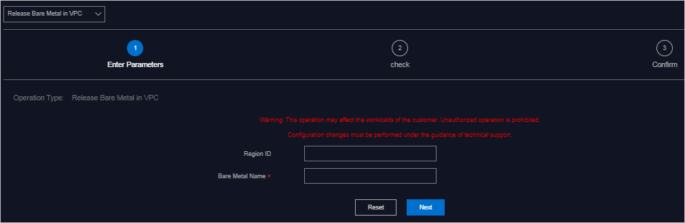

6. Configure the parameters described in the following table.

   | Parameter | Description |
   | --- | --- |
   | Region ID | The name of the region in the current environment. |
   | Bare Metal Name | The name of the bare metal instance that you want to release.Enter the serial number of the bare metal instance. |

   Note

   If the specified values are incorrect, click Reset in the lower part of the tab and set

   the parameters again.

7. Click Next.

8. Check the information. If the information is correct, click Confirm.

   The system starts to push the configurations. After the configurations are pushed, the  `Result: Successful`  message appears.

   After the configurations are pushed, you can search for the bare metal instance based on the bare metal instance name on the Bare-Metal Networks tab. If the bare metal instance is not displayed, it is released.

<a id="section-4-2-3-4-3"></a>

##### 4.2.3.4.3. Delete a VPC route table entry

In O&M emergency scenarios, you can use the VPC route table entry deletion feature to delete route table entries that point to the bare metal subnet in the VPC.

Prerequisites

Before you use this feature, take note of the following items:

- Typically, you cannot use this feature to delete a VPC route table entry. This operation is only used for emergency situations.

- You can perform this operation to delete only a single route table entry at a time. To delete multiple route table entries, you must perform this operation multiple times.

Context

Warning

This operation is used only in emergency situations and must be performed under

the guidance of technical personnel. Otherwise, normal business operations may be affected.

Procedure

1. Log on to the Apsara Uni-manager Operations Console.

2. In the top navigation bar, choose Resources > Network.

3. In the left-side navigation pane, click Network Service Provider.

4. Click the O&M tab.

5. Select Delete Route Table Entry from the drop-down list in the upper-left corner of the tab.

   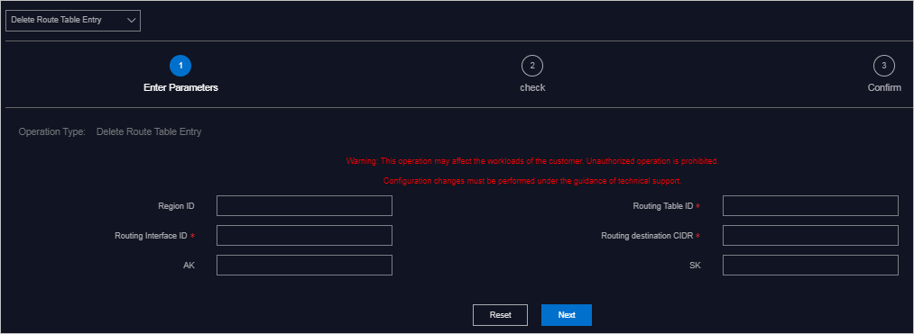

6. Configure the parameters described in the following table.

   | Parameter | Description |
   | --- | --- |
   | Region ID | The name of the region in the current environment. |
   | Routing Table ID | The VPC route table ID, which can be obtained from the VPC console. For more information about how to obtain the route table ID, see the <em>VPC User Guide</em>. |
   | Routing Interface ID | The VPC router interface ID, which can be obtained from the VPC console. For more information about how to obtain the router interface ID, see the <em>VPC User Guide</em>. |
   | Routing destination CIDR | The destination CIDR block to which the VPC points, which can be obtained from the VPC console. For more information about how to obtain the routing destination CIDR block, see the <em>VPC User Guide</em>. |
   | AK and SK | The organization AccessKey ID and AccessKey secret, which can be obtained from the Organizations page of the Apsara Uni-manager Management Console based on the organization to which the VPC belongs. |

   Note

   If the specified values are not correct, click Reset in the lower part of the tab and

   set the parameters again.

7. Click Next.

8. Check the information. If the information is correct, click Confirm.

   The system begins to push the configurations. After the configurations have been pushed, the  `Result: Successful`  message appears.

   After the configurations are pushed, you can log on to the VPC console and view the route table entry of the specified destination CIDR block. If the route table entry is not displayed, it is deleted.

9. (Optional)In actual fault scenarios, if multiple route table entries exist in the VPC route table, repeat Step 3 to Step 6 to delete other route table entries.

<a id="section-4-2-3-4-4"></a>

##### 4.2.3.4.4. Delete a VBR route table entry

In O&M emergency scenarios, you can use this feature to delete the default route table entry of a VBR.

Context

Warning

This operation is used only in emergency situations and must be performed under

the guidance of technical personnel. Otherwise, normal business operations may be affected.

Procedure

1. Log on to the Apsara Uni-manager Operations Console.

2. In the top navigation bar, choose Resources > Network.

3. In the left-side navigation pane, click Network Service Provider.

4. Click the O&M tab.

5. Select Delete Route Table Entry from the drop-down list in the upper-left corner of the tab.

6. Configure the parameters described in the following table.

   | Parameter | Description |
   | --- | --- |
   | Region ID | The name of the region in the current environment. |
   | Routing Table ID | The VBR route table ID.<br>If the bare metal instance involved with the VBR has already been added to the VPC, you can search for the bare metal on the Bare-Metal Networks tab based on the bare metal instance name, and then click View Details. The VBR Route Table ID in the details is the value of this parameter.<br>If the bare metal instance involved with the VBR is not added to the VPC, specify the bare metal instance name and creation time to search for the operation logs and find an operation log whose API Operation is Add on the Operation Logs tab. Click View Details and the VBR Route Table ID in the details is the value of this parameter. |
   | Routing Interface ID | The VBR router interface ID.<br>If the bare metal instance involved with the VBR has already been added to the VPC, you can search for the bare metal on the Bare-Metal Networks tab based on the bare metal instance name, and then click View Details. The VBR RI in the details is the value of this parameter.<br>If the bare metal instance involved with the VBR is not added to VPC, specify the bare metal instance name and creation time to search for the operation logs and find an operation log whose API Operation is Add on the Operation Logs tab. Click View Details and the VBR RI in the details is the value of this parameter. |
   | Routing destination CIDR | Set the value to 0.0.0.0/0. |
   | AK and SK | The organization AccessKey ID and AccessKey secret, which can be obtained on the Organizations page of the Apsara Uni-manager Management Console based on the organization to which the VBR belongs. |

   Note

   If the specified values are incorrect, click Reset in the lower part of the tab and

   configure the parameters again.

7. Click Next.

8. Check the information. If the information is correct, click Confirm.

   The system begins to push the configurations. After the configurations are pushed, the  `Result: Successful`  message appears.

   After the configurations are pushed, you can choose Products > Product List in the left-side navigation pane and click Apsara Network Intelligence. On the homepage of Apsara Network Intelligence, enter the VBR route table ID and search for the VBR route table. If the route table entry 0.0.0.0/0 does not exist in the VBR route table, the route table entry is deleted.

<a id="section-4-2-3-4-5"></a>

##### 4.2.3.4.5. Delete a VPC router interface

In O&M emergency scenarios, you can use this feature to delete a VPC router interface.

Context

Warning

This operation is used only in emergency situations and must be performed under

the guidance of technical personnel. Otherwise, normal business operations may be affected.

Procedure

1. Log on to the Apsara Uni-manager Operations Console.

2. In the top navigation bar, choose Resources > Network.

3. In the left-side navigation pane, click Network Service Provider.

4. Click the O&M tab.

5. Select Delete Router Interface from the drop-down list in the upper-left corner of the tab.

   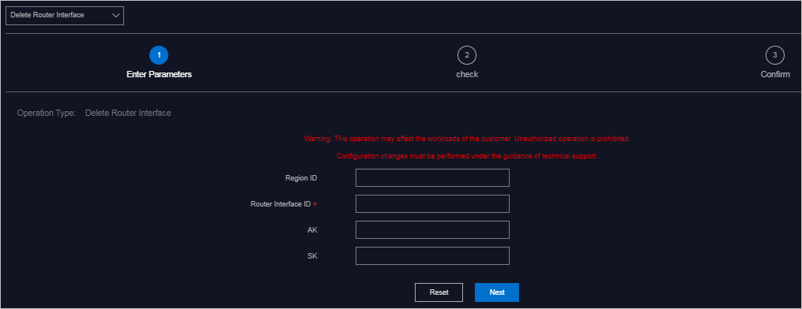

6. Configure the parameters described in the following table.

   | Parameter | Description |
   | --- | --- |
   | Region ID | The name of the region in the current environment. |
   | Router Interface ID | The VPC router interface ID. On the Operation Logs tab, specify the bare metal instance name and creation time to search for the operation logs and find an operation log whose API Operation is add. Click View Details and the VPC RI in the details is the value of this parameter. |
   | AK and SK | The organization AccessKey ID and AccessKey secret, which can be obtained from the Organizations page of the Apsara Uni-manager Management Console based on the organization to which the VPC belongs. |

   Note

   If the specified values are not correct, click Reset in the lower part of the tab and

   set the parameters again.

7. Click Next.

8. Check the information. If the information is correct, click Confirm.

   The system begins to push the configurations. After the configurations are pushed, the  `Result: Successful`  message appears.

   After the configurations are pushed, you can choose Products > Product List in the left-side navigation pane and click Apsara Network Intelligence. On the homepage of Apsara Network Intelligence, enter the VPC router interface ID to search for the router interface. If no search result appears, the router interface is deleted.

<a id="section-4-2-3-4-6"></a>

##### 4.2.3.4.6. Delete a VBR router interface

In O&M emergency scenarios, you can use this feature to delete a VBR router interface.

Context

Warning

This operation is used only in emergency situations and must be performed under

the guidance of technical personnel. Otherwise, normal business operations may be affected.

Procedure

1. Log on to the Apsara Uni-manager Operations Console.

2. In the top navigation bar, choose Resources > Network.

3. In the left-side navigation pane, click Network Service Provider.

4. Click the O&M tab.

5. Select Delete Router Interface from the drop-down list in the upper-left corner of the tab.

6. Configure the parameters described in the following table.

   | Parameter | Description |
   | --- | --- |
   | Region ID | The name of the region in the current environment. |
   | Router Interface ID | The VBR router interface ID.<br>If the bare metal instance involved with the VBR is added to VPC, you can search for the bare metal instance on the Bare-Metal Networks tab based on the bare metal instance name, and then click View Details. The VBR RI in the details is the VBR router interface ID.<br>If the bare metal instance involved with the VBR is not added to VPC, specify the bare metal instance name and creation time to search for the operation logs and find an operation log whose API Operation is Add on the Operation Logs tab. Click View Details and the VBR RI in the details is the value of this parameter. |
   | AK and SK | The organization AccessKey ID and AccessKey secret, which can be obtained from the Organizations page of the Apsara Uni-manager Management Console based on the organization to which the VPC belongs. |

   Note

   If the specified values are not correct, click Reset in the lower part of the tab and

   set the parameters again.

7. Click Next.

8. Check the information. If the information is correct, click Confirm.

   The system starts to push the configurations. After the configurations have been pushed, the  `Result: Successful`  message appears.

   After the configurations are pushed, you can choose Products > Product List in the left-side navigation pane and click Apsara Network Intelligence. On the homepage of Apsara Network Intelligence, enter the VBR router interface ID to search for the router interface. If no search result appears, the router interface is deleted.

<a id="section-4-2-3-4-7"></a>

##### 4.2.3.4.7. Delete a VBR

In O&M emergency scenarios, you can use this feature to delete a VBR.

Context

Warning

This operation is used only in emergency situations and must be performed under

the guidance of technical personnel. Otherwise, normal business operations may be affected.

Procedure

1. Log on to the Apsara Uni-manager Operations Console.

2. In the top navigation bar, choose Resources > Network.

3. In the left-side navigation pane, click Network Service Provider.

4. Click the O&M tab.

5. Select Delete VBR from the drop-down list in the upper-left corner of the tab.

   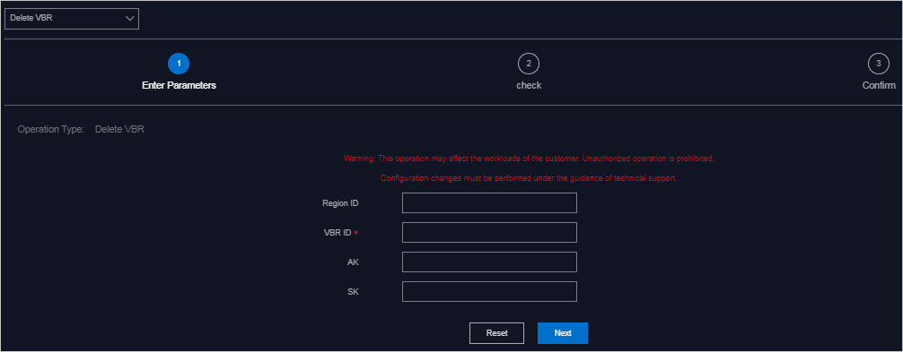

6. Configure the parameters described in the following table.

   | Parameter | Description |
   | --- | --- |
   | Region ID | The name of the region in the current environment. |
   | VBR ID | The ID of the VBR to be deleted. On the Operation Logs tab, specify the bare metal instance name and creation time to search for the operation logs and find an operation log whose API Operation is add. Click View Details and the VBR ID in the details is the value of this parameter. |
   | AK and SK | The organization AccessKey ID and AccessKey secret, which can be obtained on the Organizations page of the Apsara Uni-manager Management Console based on the organization to which the VBR belongs. |

   Note

   If the specified values are incorrect, click Reset in the lower part of the tab and

   configure the parameters again.

7. Click Next.

8. Check the information. If the information is correct, click Confirm.

   The system begins to push the configurations. After the configurations are pushed, the  `Result: Successful`  message appears.

   After the configurations are pushed, you can choose Products > Product List in the left-side navigation pane and click Apsara Network Intelligence. On the homepage of Apsara Network Intelligence, enter the VBR ID to search for the VBR. If no search result appears, the VBR is deleted.

<a id="section-4-2-3-4-8"></a>

##### 4.2.3.4.8. Delete a physical connection

In O&M emergency scenarios, you can use this feature to delete a physical connection.

Context

Warning

This operation is used only in emergency situations and must be performed under

the guidance of technical personnel. Otherwise, normal business operations may be affected.

Procedure

1. Log on to the Apsara Uni-manager Operations Console.

2. In the top navigation bar, choose Resources > Network.

3. In the left-side navigation pane, click Network Service Provider.

4. Click the O&M tab.

5. Select Delete Express Connect Circuit from the drop-down list in the upper-left corner of the tab.

   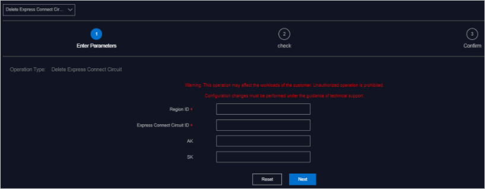

6. Configure the parameters described in the following table.

   | Parameter | Description |
   | --- | --- |
   | Region ID | The name of the region in the current environment. |
   | Express Connect Circuit ID | The ID of the physical connection to be deleted. On the Operation Logs tab, specify the bare metal instance name and creation time to search for the operation logs and find an operation log whose API Operation is add. Click View Details and the Express Connect Circuit ID in the details is the value of this parameter. |
   | AK and SK | The organization AccessKey ID and AccessKey secret, which can be obtained on the Organizations page of the Apsara Uni-manager Management Console based on the organization to which the VBR belongs. |

   Note

   If the specified values are incorrect, click Reset in the lower part of the tab and

   configure the parameters again.

7. Click Next.

8. Check the information. If the information is correct, click Confirm.

   The system begins to push the configurations. After the configurations are pushed, the  `Result: Successful`  message appears.

   After the configurations are pushed, you can choose Products > Product List in the left-side navigation pane and click Apsara Network Intelligence. On the homepage of Apsara Network Intelligence, enter the physical connection ID to search for the physical connection. If no search result appears, the physical connection is deleted.

<a id="section-4-2-3-4-9"></a>

##### 4.2.3.4.9. Delete all resources

In O&M emergency scenarios, you can use this feature to delete all resources, including the VPC route table entries, VBR route table entries, VPC router interfaces, VBR router interfaces, VBRs, and physical connections.

Context

Warning

This operation is only for emergency situations and must be performed under the

guidance of technical personnel. Otherwise, normal business operations may be affected.

Procedure

1. Log on to the Apsara Uni-manager Operations Console.

2. In the top navigation bar, choose Resources > Network.

3. In the left-side navigation pane, click Network Service Provider.

4. Click the O&M tab.

5. Select Delete ALL Resources from the drop-down list in the upper-left corner of the tab.

   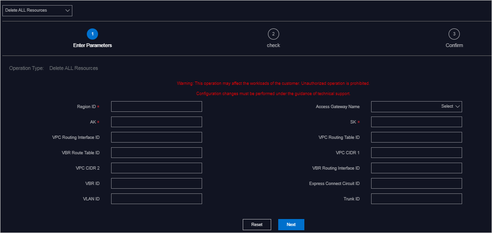

6. Configure the parameters described in the following table.

   | Parameter | Description |
   | --- | --- |
   | Region ID | The name of the region in the current environment. |
   | Access Gateway Name | The name of the access gateway to which the bare metal instance is connected. |
   | AK and SK | The organization AccessKey ID and AccessKey secret, which can be obtained from the Organizations page of the Apsara Uni-manager Management Console based on the organization to which the VBR belongs. |
   | VPC Routing Interface ID | The VPC router interface ID, which can be obtained from the VPC console. For more information about how to obtain the VPC router interface ID, see the <em>VPC User Guide</em>. |
   | VPC Routing Table ID | The VPC route table ID, which can be obtained from the VPC console. For more information about how to obtain the VPC route table ID, see the <em>VPC User Guide</em>. |
   | VBR Route Table ID | The VBR route table ID.<br>If the bare metal instance involved with the VBR has already been added to the VPC, you can search for the bare metal instance on the Bare-Metal Networks tab based on the bare metal instance name, and click View Details. The VBR Route Table ID in the details is the value of this parameter.<br>If the bare metal instance involved with the VBR is not added to VPC, specify the bare metal instance name and creation time to search for the operation logs and find an operation log whose API Operation is Add on the Operation Logs tab. Click View Details and the VBR Route Table ID in the details is the value of this parameter. |
   | CPC CIDR1 | The destination CIDR block 1 to which the VPC points, which can be obtained from the VPC console. For more information about how to obtain the VPC CIDR block 1, see the <em>VPC User Guide</em>. |
   | VPC CIDR2 | The destination CIDR block 2 to which the VPC points, which can be obtained from the VPC console. For more information about how to obtain the VPC CIDR block 2, see the <em>VPC User Guide</em>. |
   | VBR Routing Interface ID | The VBR router interface ID.<br>If the bare metal instance involved with the VBR has already been added to the VPC, you can search for the bare metal instance on the Bare-Metal Networks tab based on the bare metal instance name, and then click View Details. The VBR RI in the details is the value of this parameter.<br>If the bare metal instance involved with the VBR is not added to VPC, specify the bare metal instance name and creation time to search for the operation logs and find an operation log whose API Operation is Add on the Operation Logs tab. Click View Details and the VBR RI in the details is the value of this parameter. |
   | VBR ID | The ID of the VBR to be deleted. On the Operation Logs tab, specify the bare metal instance name and creation time to search for the operation logs and find an operation log whose API Operation is Add. Click View Details and the VBR ID in the details is the value of this parameter. |
   | Express Connect Circuit ID | The ID of the physical connection to be deleted. On the Operation Logs tab, specify the bare metal instance name and creation time to search for the operation logs and find an operation log whose API Operation is Add. Click View Details and the Express Connect Circuit ID in the details is the value of this parameter. |
   | Trunk ID | This parameter is not required. |

   Note

   If the specified values are incorrect, click Reset in the lower part of the tab and

   configure the parameters again.

7. Click Next.

8. Check the information. If the information is correct, click Confirm.

   The system starts to push the configurations. After the configurations are pushed, the  `Result: Successful`  message appears.

   After the configurations are pushed, use the methods provided in Delete a VPC route table entry, Delete a VBR route table entry, Delete a VPC router interface, Delete a VBR router interface, Delete a VBR, and Delete a physical connection to check whether the VPC route table entries, VBR route table entries, VPC router interfaces, VBR router interfaces, VBRs, and physical connections are deleted.

<a id="section-4-2-3-4-10"></a>

##### 4.2.3.4.10. View the physical connection bandwidth

You can view the physical connection bandwidth when the access gateway is connected to a VPC in the system based on your O&M needs.

Procedure

1. Log on to the Apsara Uni-manager Operations Console.

2. In the top navigation bar, choose Resources > Network.

3. In the left-side navigation pane, click Network Service Provider.

4. Click the O&M tab.

5. Select View Express Connect Bandwidth from the drop-down list in the upper-left corner.

   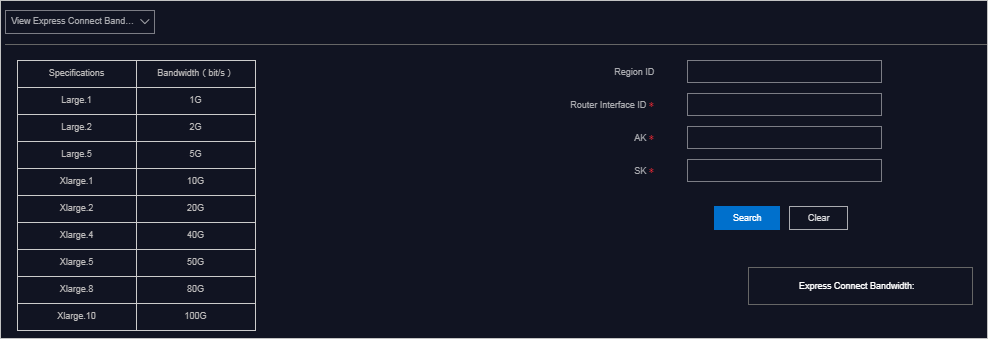

6. Configure the filter conditions and click Search.

   | Parameter | Description |
   | --- | --- |
   | Region ID | The name of the region in the current environment. |
   | Router Interface ID | The VBR router interface ID. On the Bare-Metal Networks tab, specify the VPC ID and access gateway name, and click View Details.VBR RI is the value of this parameter. |
   | AK and SK | The organization AccessKey ID and AccessKey secret, which can be obtained on the Organizations page of the Apsara Uni-manager Management Console based on the organization to which the VBR belongs. |

   The information about the physical connection bandwidth that meets the filter conditions is displayed.

   The bandwidth information describes the specifications of the physical connection bandwidth on the HSW of the current VPC. View the table on the left and obtain the bandwidth (bit/s) based on the specification.

<a id="section-4-2-3-4-11"></a>

##### 4.2.3.4.11. Modify the physical connection bandwidth

In O&M emergency scenarios, you can use this feature to modify the physical connection bandwidth.

Context

Warning

This operation is used only in emergency situations and must be performed under

the guidance of technical personnel. Otherwise, normal business operations may be affected.

Procedure

1. Log on to the Apsara Uni-manager Operations Console.

2. In the top navigation bar, choose Resources > Network.

3. In the left-side navigation pane, click Network Service Provider.

4. Click the O&M tab.

5. Select Change Express Connect from the drop-down list in the upper-left corner.

   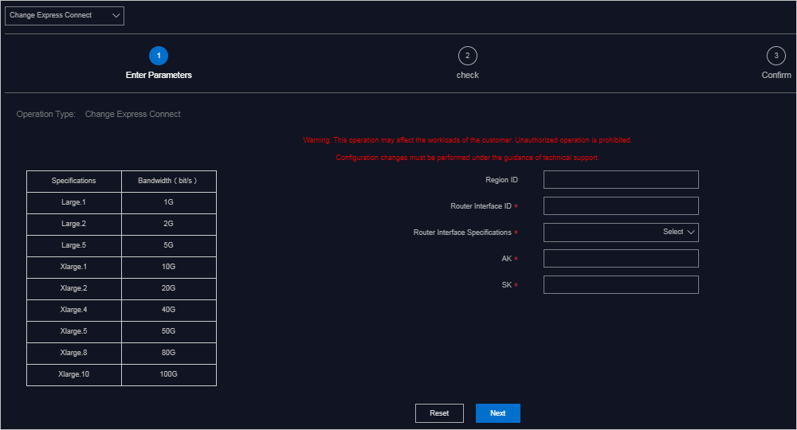

6. Configure the parameters described in the following table.

   | Parameter | Description |
   | --- | --- |
   | Region ID | The name of the region in the current environment. |
   | Router Interface ID | The ID of the router interface to which the physical connection bandwidth to be modified corresponds. On the Bare-Metal Networks tab, specify the VPC ID and access gateway name to search for the bare metal instance. Click View Details and the VBR RI in the details is the value of this parameter. |
   | Router Interface Specifications | The specification of the physical connection bandwidth. |
   | AK and SK | The organization AccessKey ID and AccessKey secret, which can be obtained from the Organizations page of the Apsara Uni-manager Management Console based on the organization to which the VPC belongs. |

   Note

   If the specified values are incorrect, click Reset in the lower part of the tab and

   configure the parameters again.

7. Click Next.

8. Check the information. If the information is correct, click Confirm.

   The system starts to push the configurations. After the configurations have been pushed, the  `Result: Successful`  message appears.

   After the configurations are pushed, check whether the physical connection bandwidth has been modified. For more information, see View the physical connection bandwidth.

<a id="section-4-2-3-4-12"></a>

##### 4.2.3.4.12. View BD usage

You can view BD usage to learn about the BD configuration distribution in a timely manner.

Procedure

1. Log on to the Apsara Uni-manager Operations Console.

2. In the top navigation bar, choose Resources > Network.

3. In the left-side navigation pane, click Network Service Provider.

4. Click the O&M tab.

5. Select View BD Usage from the drop-down list in the upper-left corner.

6. Configure the filter conditions and click Search.

<a id="section-4-2-3-4-13"></a>

##### 4.2.3.4.13. View BM VPN usage

You can view the information of the BM VPN that is assigned to the access gateway instance.

Procedure

1. Log on to the Apsara Uni-manager Operations Console.

2. In the top navigation bar, choose Resources > Network.

3. In the left-side navigation pane, click Network Service Provider.

4. Click the O&M tab.

5. Specify Access Gateway Name, vxlan id, and BM VPN Name, select a state from the Status drop-down list, and then click Search to view the BM VPNs assigned to all the HSW vSwitches.

<a id="section-4-2-3-4-14"></a>

##### 4.2.3.4.14. View trunk usage

You can view trunk usage to learn about the usage of hardware ports in a timely manner.

Procedure

1. Log on to the Apsara Uni-manager Operations Console.

2. In the top navigation bar, choose Resources > Network.

3. In the left-side navigation pane, click Network Service Provider.

4. Click the O&M tab.

5. Select View Trunk Usage from the drop-down list in the upper-left corner.

   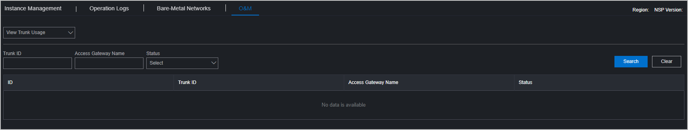

6. Specify the trunk ID and access gateway name, select a trunk state, and then click Search. The Trunk Status options include Idle, Used, Creating, and Deleting.

   Set Trunk ID to the last integer of the Port value that is obtained from the Bare-Metal Networks tab. For example, if the port number is 10GE1/0/40, set Trunk ID to 40.

   Note

   To modify the filter conditions, click Clear in the upper-right corner and set the

   filter conditions again.

<a id="section-4-3"></a>

## 4.3. Data centers

Operations personnel can monitor and view the physical servers where products are located.

<a id="section-4-3-1"></a>

### 4.3.1. View physical server information

This topic describes how to view the physical server list and the details of physical servers.

Go to the Data Centers page

1. Log on to the Apsara Uni-manager Operations Console.

2. In the top navigation bar, choose Resources > Data Centers.

   The Product tab appears. In the upper-right corner of the tab, the numbers of existing physical servers, servers with alerts, and alerts are displayed.

Product tab

1. On the Product tab, perform the following operations to view physical server information:

   - Expand the left-side hierarchy tree by selecting a region, a product, and a cluster in sequence to view the list of physical servers where a cluster of a service is located.

   - In the left-side search box, enter a product name, cluster name, group name, or hostname to search for the corresponding node.

   - In the right-side search box, search for physical servers by product, cluster, group, or hostname, and view the details of a physical server.

   - Find a product and click Details in the Operation column. On the Physical Server Details page, you can view the basic information, monitoring details, and alert information of the physical server to which the product belongs.

     You can switch between the tabs to view the monitoring details and alert information.

     Monitoring details include the CPU utilization, system load, disk usage, memory usage, network throughput, and disk I/O. When you view the monitoring details, you can select a monitoring item in the upper-right corner of each monitoring graph and then select a time range to view the monitoring value within the time range.

     In the upper-right corner of the CPU utilization, system load, disk usage, memory usage, network throughput, and disk I/O sections, you can perform the following operations:

     - Click the  icon to view the monitoring graph in full screen.

     - Click the  icon to download the monitoring graph to your computer.

     - Click the  icon to manually refresh the monitoring data.

     - Click the  icon. The icon turns green. The system refreshes the monitoring data at 10-

       second intervals. To disable the auto-refresh feature, click the icon again.

Server tab

1. Click the Server tab.

2. On the Server tab, perform the following operations to view the physical server list:

   - Expand the left-side hierarchy tree by selecting an IDC and a rack in sequence to view the physical server list in a rack.

   - Enter a rack name in the left-side search box and press the Enter key or click the  icon to

     search for and view the list of all physical servers in the rack.

   - To view the details of a physical server, enter the hostname, IP address, device role, or serial number (SN) in the right-side search box and press the Enter key.

   - Find the physical server that you want to view and click Details in the Operation column. On the Physical Server Details page, view the basic information, monitoring details, and alert information of the physical server.

     You can switch between the tabs to view the monitoring details and alert information.

     Monitoring details include the CPU utilization, system load, disk usage, memory usage, network throughput, and disk I/O. When you view the monitoring details, you can select a monitoring item in the upper-right corner of each monitoring graph and then select a time range to view the monitoring value within the time range.

     In the upper-right corner of the CPU utilization, system load, disk usage, memory usage, network throughput, and disk I/O sections, you can perform the following operations:

     - Click the  icon to view the monitoring graph in full screen.

     - Click the  icon to download the monitoring graph to your computer.

     - Click the  icon to manually refresh the monitoring data.

     - Click the  icon. The icon turns green. The system refreshes the monitoring data at 10-

       second intervals. To disable the auto-refresh feature, click the icon again.

Physical View of Device tab

1. Click the Physical View of Device tab.

2. On the Physical View of Device tab, expand the left-side hierarchy tree by selecting an IDC and a rack in sequence to view the corresponding rack information on the right. In addition, the rack details panel appears on the right side of the tab and shows the server information of the rack.

   Racks and servers are displayed in different colors to indicate the alert condition of servers:

   - Red indicates a critical alert.

   - Orange indicates a moderate alert.

   - Blue indicates that the physical server is running normally.

   In the upper-right corner, you can view the alert legend. By default, the check box on the left of the legend is selected, indicating that the information of racks or servers of this alert type is displayed on the rack graph or in the rack details panel. Clear the check box on the left of a legend to hide the information of racks or servers of this alert type on the rack graph or in the rack details panel.

3. To view the details of a physical server, perform the following operations:

   <ol type="i">

   <li>

   Find the physical server that you want to view in the left-side hierarchy tree or right-side rack

   </li>

   </ol>

   graph of the tab.

   <ol type="i" start="2">

   <li>

   In the rack details panel that appears, click the color block corresponding to a server to view

   </li>

   </ol>

   the basic information of the server.

   <ol type="i" start="3">

   <li>

   Click Details in the Operation row of the basic information.

   </li>

   </ol>

   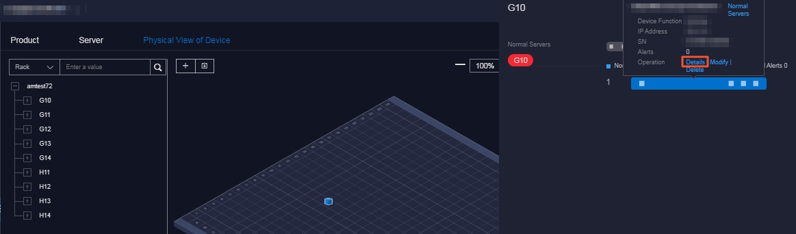

   <ol type="i" start="4">

   <li>

   On the Physical Server Details page, view the basic information, monitoring details, and alert

   </li>

   </ol>

   information of the physical server.

   You can switch between the tabs to view the monitoring details and alert information.

   Monitoring details include the CPU utilization, system load, disk usage, memory usage, network throughput, and disk I/O. When you view the monitoring details, you can select a monitoring item in the upper-right corner of each monitoring graph and then select a time range to view the monitoring value within the time range.

   In the upper-right corner of the CPU utilization, system load, disk usage, memory usage, network throughput, and disk I/O sections, you can perform the following operations:

   - Click the  icon to view the monitoring graph in full screen.

   - Click the  icon to download the monitoring graph to your computer.

   - Click the  icon to manually refresh the monitoring data.

   - Click the  icon. The icon turns green. The system refreshes the monitoring data at 10-

     second intervals. To disable the auto-refresh feature, click the icon again.

<a id="section-4-3-2"></a>

### 4.3.2. Export physical server information

You can export the information of all physical servers within the system for offline viewing.

Go to the Data Centers page

1. Log on to the Apsara Uni-manager Operations Console.

2. In the top navigation bar, choose Resources > Data Centers.

Product tab

The physical server information exported from the Product tab includes the zone, hostname, disk size, number of CPU cores, memory size, information about the data center (data center, rack, room, and rack group), model, device role, serial number, operating system template, IP address, out-of-band IP address, CPU architecture, host server, alerts, region, product, cluster, service role group, and capacity and performance usage (CPU utilization, system load, disk usage, memory utilization, network throughput, and disk I/O).

1. In the upper-right corner of the tab, click the  icon to export the information of all the physical

   servers of all services to your computer.

Server or Physical View of Device tab

The physical server information exported from the Server or Physical View of Device tab includes the zone, hostname, disk size, number of CPU cores, memory size, information about the data center (data center, rack, room, and rack group), model, device role, serial number, operating system template, IP address, out-of-band IP address, CPU architecture, alerts, and capacity and performance usage (CPU utilization, system load, disk usage, memory utilization, network throughput, and disk I/O).

1. Click the Server or the Physical View of Device tab.

2. In the upper-right corner of the Server tab, click the  icon to export all the information of physical servers to your computer.

3. In the upper part of the Physical View of Device tab, click the  icon to export all the

   information of physical servers to your computer.

<a id="section-4-3-3"></a>

### 4.3.3. Security operations

You can log on to a virtual machine and perform remote operations.

Procedure

1. Log on to the Apsara Uni-manager Operations Console.

2. In the top navigation bar, choose Resources > Data Centers.

   The Product tab appears.

3. Find a virtual machine and click Safe operation and maintenance in the Operation column to log on to the virtual machine.

4. Perform remote operations on the virtual machine.

   <ol type="i">

   <li>

   Enter Linux commands in the CLI window to perform related operations.

   </li>

   </ol>

   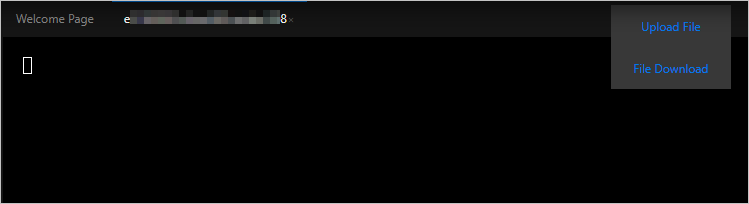

   <ol type="i" start="2">

   <li>

   Click Upload File in the CLI window. The Upload File dialog box appears. You can upload an

   </li>

   </ol>

   object in one of the following ways:

   - Click the dotted box. In the dialog box that appears, select the file to be uploaded, click Open. Click Upload in the Upload File dialog box.

   - Drag the file to the dotted box and then click Upload.

   <ol type="i" start="3">

   <li>

   Click File Download. The File Download dialog box appears. Set File Name and File

   </li>

   </ol>

   Directory and then click Download to download the file to the default download directory of the local browser.

   Note

   The uploaded and downloaded files cannot exceed 200 MB in size.

<a id="section-4-4"></a>

## 4.4. Full stack

The Full Stack Monitoring module allows you to perform aggregate queries for system alert events. You can query all end-to-end alert data by host IP address, instance ID, and time range, as well as view the end-to-end topology.

<a id="section-4-4-1"></a>

### 4.4.1. SLA

The SLA module allows you to view the current state, historical data, instance availability, and product availability of each cloud product. You can view the current status and historical data of a product to obtain the SLA values and unavailability events of product instances for a period of time.

<a id="section-4-4-1-1"></a>

#### 4.4.1.1. View the current status of a cloud service

You can view the current status of a cloud service and the details of exception events on the Current State tab.

Procedure

1. Log on to the Apsara Uni-manager Operations Console.

2. In the top navigation bar, choose Resources > Full Stack.

3. The Current State tab appears.

   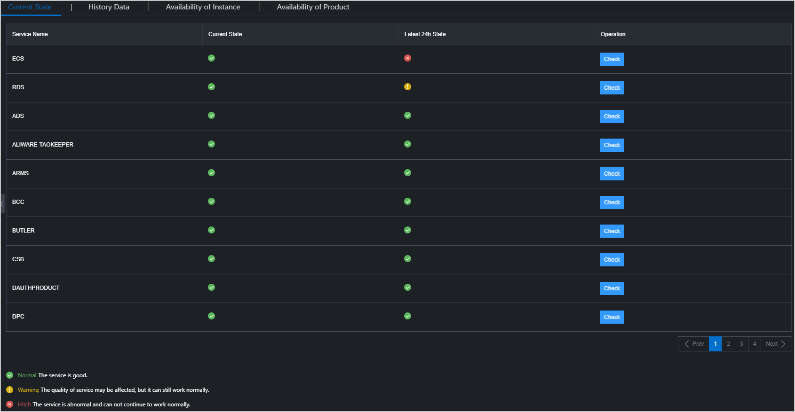

   The current status and the statuses within the last 24 hours of each cloud service are displayed on this tab. Services in different states are displayed in different colors:

   - Green: normal. The service is running normally.

   - Yellow: warning. The service has some latency, but can still run normally.

   - Red: faulty. The service is temporarily interrupted and cannot run normally.

4. Find the service whose running status you want to view, and click Check in the Operation column.

   - The Overall Availability section shows the availability of the service. You can view the availability by minute, hour, or day.

   - The Related Events section shows the current exception events. Click Show Details corresponding to an event to view the event details.

<a id="section-4-4-1-2"></a>

#### 4.4.1.2. View the history data of a cloud service

On the History Data tab, you can view the history status of a cloud service and the details of exception events.

Procedure

1. Log on to the Apsara Uni-manager Operations Console.

2. In the top navigation bar, choose Resources > Full Stack.

3. Click the History Data tab.

   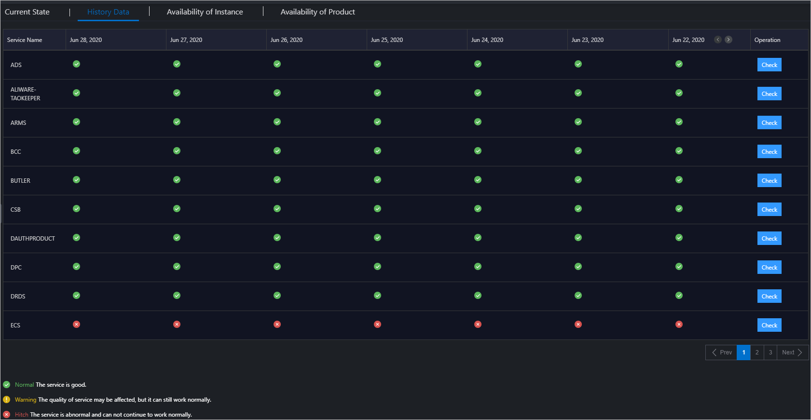

   The service availability of each service in the last two weeks is displayed on this tab. Services in different states are displayed in different colors:

   - Green: normal. The service is running normally.

   - Yellow: warning. The service has some latency, but still can work normally.

   - Red: faulty. The service is temporarily interrupted and cannot work normally.

4. Find the service whose history status you want to view and click Check in the Operation column.

   - The Overall Availability section shows the historical availability of the service. You can view the availability by minute, hour, or day.

   - The Related Events section shows the historical exception events. Click Show Details corresponding to an event to view the event details.

<a id="section-4-4-1-3"></a>

#### 4.4.1.3. View the availability of an instance

You can view the instance availability ratio of a cloud service to know the instance damages.

Procedure

1. Log on to the Apsara Uni-manager Operations Console.

2. In the top navigation bar, choose Resources > Full Stack.

3. Click the Availability of Instance tab.

   

4. Specify Instance ID, Belonged to User, or Time Range. Then, click Search.

5. Click an Instance ID to view the following information of the instance:

   - Basic Information: the instance ID and the user to whom the instance belongs.

   - Availability: the availability ratio of the instance.

   - Damage Event: the exception event list.

<a id="section-4-4-1-4"></a>

#### 4.4.1.4. View the availability of a service

You can view the availability ratio of a cloud service to understand its monthly availability.

Procedure

1. Log on to the Apsara Uni-manager Operations Console.

2. In the top navigation bar, choose Resources > Full Stack.

3. Click the Availability of Product tab.

4. Specify Product and Time Range, and click Search to view the availability ratio of the product.

   For example, if the availability ratio of Elastic Compute Service (ECS) is 100.00%, ECS runs normally this month without faults.

   

<a id="section-4-4-2"></a>

### 4.4.2. Full stack log monitoring

The Full Stack Log Monitoring module allows you to search for logs of ECS-, SLB-, and All in ECS-related applications.

Context

- You can search for the logs of a variety of product components on the ECS tab, such as pop, OpenAPI, pync, and OpsApi.

- If the ilogtail reporting feature is enabled on each SLB service node, you can search for logs of pop, slb-yaochi, and slb-control-master on the SLB tab.

- You can search for vm_adapter logs, all in ECS-Apsara Infrastructure Management Framework adaption layer logs, and all the other ECS operations logs on the All in ECS tab.

Procedure

1. Log on to the Apsara Uni-manager Operations Console.

2. In the top navigation bar, choose Resources > Full Stack.

3. In the left-side navigation pane, click Full Stack Log Monitoring.

4. Click the ECS, SLB, or All in ECS tab.

5. Enter a keyword in the Query search box, select a time range in Time, and then click Search.

   Note

   You can enter a string in the Query search box as the filter condition, such as the

   instance ID, request ID, or the keyword error.

6. The search results are displayed. Click an application log.

   

7. Select Abnormal logs only to view only the exceptional logs.

   If  `code != 200` ,  `success=false` , or  `error`  exists in a log, the log is an abnormal log.

8. Enter a keyword in the search box to search for the related information in the search results.

9. (Optional)After the search is complete, click Export Log to export the search results to your computer.

<a id="section-5"></a>

# 5.Alerts

<a id="section-5-1"></a>

## 5.1. Dashboard

This topic describes how to view alerts within each region of a multi-region scenario.

Procedure

1. Log on to the Apsara Uni-manager Operations Console.

2. In the top navigation bar, click Alerts.

3. In the Alerts for Regions section, view the distribution of alerts in different regions.

   Move the pointer over a region with alerts, and the specific number of alerts is displayed.

   

   Note

   P1, P2, P3, and P4 have the following meanings:

   - P1: urgent alerts

   - P2: major alerts

   - P3: minor alerts

   - P4: reminder alerts

4. In the Alert Statistics section, view the statistical data of alerts in the region.

   

   - Click Last 7 Days, Last 30 Days, or specify Start Date and End Date to view the statistical data of alert handling within the period.

   - Move the pointer over a column chart, and the corresponding statistical data is displayed.

   - Select the region and priority level, and then click Search to view the alert details.

   - Specify more filter conditions to query alerts.

     - Click Advanced. Select the required options from the Status and Resource drop-down lists, and click Search to view the alert details.

     - (Optional) Click Reset to clear the filter conditions.

     - (Optional) Click Collapse to hide the Status and Resource options.

5. Click Export Report to download the alert details to your computer.

<a id="section-5-2"></a>

## 5.2. View alerts

This topic describes how to view the alerts for each cloud service, basic service, and hardware in the system.

Procedure

1. Log on to the Apsara Uni-manager Operations Console.

2. In the top navigation bar, click Alerts.

3. In the left-side navigation pane, click Alerts to view the distribution of alerts in the services.

   - Click the Critical Alerts, Existing Alerts, and Alert History tabs to view the information about different types of alerts.

   - The different colors of alerts indicate different ranges of quantities.

   - Drag the scroll bar to view more alerts.

   - Move the pointer over a color block, and alerts of the corresponding service are displayed.

   

4. View alerts.

   - Enter an alert resource ID in the Resource With Alerts search box, select the required options from the Resource Owner and Alert Status drop-down lists, and then click Search to view the alerts.

     Move the pointer over an alert resource or a piece of alert information, and the full description of the alert information is displayed.

     

   - Specify more filter conditions to view the alerts.

     <ol type="a">

     <li>

     Click Advanced. Enter an alert resource ID in the Resource With Alerts search box, select the required options from the Resource Owner, Alert Status, and Alert Level drop-down lists, and then select a start date and an end date to specify Time Range. Then, click Search to view the alert information.

     

     </li>

     <li>

     (Optional) Click Reset to clear the filter conditions.

     </li>

     </ol>

     <ol type="i" start="100">

     <li>

     (Optional) Click Collapse to hide the Alert Level and Time Range options.

     </li>

     </ol>

5. Analyze the alert information.

   <ol type="i">

   <li>

   Click Analyze in the Actions column corresponding to the alert information. On the Alert

   </li>

   </ol>

   Analysis page, view the service role to which the alert belongs, the dependency link diagram of the service, or the logical topology of the server.

   

   Note

   Icons:

   : indicates the server.

   

   : indicates the cluster.

   

   : Indicates the service.

   

   : indicates the service role.

   

   <ol type="i" start="2">

   <li>

   Click a node in the topology. The details panel of the node appears on the right.

   </li>

   </ol>

   The panel shows the elements related to this node. You can search for the elements by entering a keyword in the search box.

   

   <ol type="i" start="3">

   <li>

   Click View Details in the upper-right corner to view the details of the node.

   </li>

   </ol>

   Select a start time and an end time to view the monitoring details within the time range.

   

   <ol type="i" start="4">

   <li>

   In the node details panel, click an element related to this node to view the details of this

   </li>

   </ol>

   element.

   Note

   In this example, the node is a server, and the element related to the node is

   service role.

   

6. Click Process in the Actions column corresponding to the alert information. In the message that appears, click OK to mark the alert as being processed.

7. Click Processed in the Actions column corresponding to the alert information. In the message that appears, click OK to mark the alert as processed.

<a id="section-5-3"></a>

## 5.3. Alert settings

<a id="section-5-3-1"></a>

### 5.3.1. Policy management

The Policy Management module allows you to manage contacts and contact groups, and configure static parameters.

<a id="section-5-3-1-1"></a>

#### 5.3.1.1. Alert contacts

You can query, add, modify, or delete alert contacts based on your business needs.

Procedure

1. Log on to the Apsara Uni-manager Operations Console.

2. In the top navigation bar, click Alerts.

3. In the left-side navigation pane, choose Alert Settings > Policy Management.

4. On the Contacts tab, perform the following operations:

   - Query alert contacts

     In the upper-left corner of the tab, specify the product name, contact name, and phone number, and click Search. The alert contacts that meet the filter conditions are displayed in the list.

   - Add an alert contact

     In the upper-left corner of the tab, click Add. In the Add Contact panel, configure the parameters. Then, click OK.

   - Modify an alert contact

     Find the alert contact whose information you want to modify and click Modify in the Actions column. In the Modify Contact panel, modify the relevant information and click OK.

   - Delete an alert contact

     Find the alert contact that you want to delete and click Delete in the Actions column. In the message that appears, click OK.

<a id="section-5-3-1-2"></a>

#### 5.3.1.2. Alert contact groups

You can query, add, modify, or delete alert contact groups based on your business needs.

Procedure

1. Log on to the Apsara Uni-manager Operations Console.

2. In the top navigation bar, click Alerts.

3. In the left-side navigation pane, choose Alert Settings > Policy Management.

4. Click the Contact Groups tab.

5. Perform the following operations:

   - Query an alert contact group

     In the upper-left corner of the tab, enter a group name in the search box and click Search. The information about the alert contact group that meets the filter condition is displayed.

   - Add an alert contact group

     In the upper-left corner of the tab, click Add. In the Add Contact Group panel, enter a group name and select the contacts to be added to the contact group. Then, click OK.

   - Modify an alert contact group

     Find the contact group that you want to modify and click Modify in the Actions column. In the Modify Contact Group panel, modify the group name, description, contacts, and notification method. Then, click OK.

   - Delete one or more alert contact groups

     Find the contact group that you want to delete and click Delete in the Actions column. In the message that appears, click OK.

     Select one or more contact groups that you want to delete and click Delete All in the upper part of the tab. In the message that appears, click OK.

<a id="section-5-3-1-3"></a>

#### 5.3.1.3. Configure static parameters

You can configure alert-related static parameters to suit your business needs. Only parameters related to timeout alerts can be configured.

Context

You cannot add new alert configurations in the current version. You can modify the default parameter configurations for timeout alerts.

Procedure

1. Log on to the Apsara Uni-manager Operations Console.

2. In the top navigation bar, click Alerts.

3. In the left-side navigation pane, choose Alert Settings > Policy Management.

4. Click the Static Parameter Settings tab.

5. (Optional)In the upper-left corner of the tab, enter a parameter name in the search box and click Search to query static parameter configurations.

6. Find the static parameter that you want to modify and click Modify in the Actions column.

7. In the Modify Static Parameter panel, modify the parameters described in the following table.

   

   | Parameter | Description |
   | --- | --- |
   | Parameter Name | Enter a parameter name related to the configuration. |
   | Parameter Value | Enter a parameter value. The default value is 5, indicating five days.<br>After you complete the configurations, you can choose Alert Monitoring &gt; Alert Events and then click the Timeout Alert tab to view the alert events that meet the condition specified by this parameter value.<br>For example, if the parameter value is 5, you can choose Alert Monitoring &gt; Alert Events and then click the Timeout Alert tab to view the alert events that are retained for more than five days. |
   | Description | Enter a description for the configuration. |

8. Click OK.

<a id="section-5-3-2"></a>

### 5.3.2. Alert templates

For Ant Financial Service products deployed on the PaaS platform, you can upload alert templates to configure or modify the rules that trigger alerts.

Procedure

1. Log on to the Apsara Uni-manager Operations Console.

2. In the top navigation bar, click Alerts.

3. In the left-side navigation pane, choose Alert Settings > Alert Template.

4. On the Alert Template page, select the required options from the Product, Cluster, and Service drop-down lists, and click Search to view the details of the service.

   

5. (Optional) Click Reset to clear the filter conditions.

6. Download Alert Templates.

   Note

   : For Ant Financial Service products deployed on the PaaS platform, use the

   simple_template.json template.

7. Click Import in the Actions column corresponding to an entry. In the Import Template dialog box, click Upload and Parse File. Select the template and click Open. After the template is uploaded, click OK.

   

<a id="section-5-3-3"></a>

### 5.3.3. Notification management

The notification management feature allows you to configure alert notification channels and then push alerts to O&M engineers.

Procedure

1. Log on to the Apsara Uni-manager Operations Console.

2. In the top navigation bar, click Alerts.

3. In the left-side navigation pane, choose Alert Settings > Notification Management.

   

4. On the Subscribe tab, click Add Channel.

5. In the Add Subscription panel, configure the parameters described in the following table.

   | Parameter | Description |
   | --- | --- |
   | Channel Name | The name of the subscription channel. |
   | Subscribed Language | The subscription language. Valid values: Chinese and English. |
   | Subscription Region | The region where the subscription is located. |
   | Filter Condition | The filter conditions used to filter alerts. Valid values:<br>• Basic<br>• Critical<br>• Important<br>• Minor<br>• Custom filter |
   | Protocol | The protocol used to push alerts. Only HTTP is supported. |
   | Push Interface Address | The IP address of the push interface. |
   | Port Number | The port number of the push interface. |
   | URI | The URI of the push interface. |
   | HTTP Method | The request method used to push alerts. Only the POST method is supported. |
   | Push Cycle (Minutes) | The interval at which to push alerts. Unit: minutes. |
   | Pushed Alerts | The number of alerts pushed each time. |
   | Push Mode | The mode used to push alerts. Valid values:<br>• ALL: All alerts are pushed in each push cycle.<br>• TOP: Only high priority alerts are pushed in each push cycle. |
   | Push Template | The template used to push alerts. Valid values:<br>• ASO: the default template.<br>• ANS: Select this template to push alerts by DingTalk, short messages, or emails. You can configure only one channel of this type.<br>Note A preset ANS template exists if the system is already connected to ANS.To restore the initial configurations of the template, click Reset in the Actions column corresponding to the channel. |
   | Custom JSON Fields | The push receiver can use this field to customize an identifier. The field must be in the JSON format. |
   | Push Switch | Specifies whether to push alerts.<br>If the switch in this panel is not turned on, you can enable the push feature in the Push Switch column after you configure the subscription channel. |

6. Click OK.

   To modify or delete a channel, click Modify or Delete in the Actions column corresponding to the channel.

7. (Optional)The newly added channel is displayed in the list. Click Test in the Actions column to test the connectivity of the push channel.

   Note

   For an ANS push channel, you must enter the mobile phone number, email address,

   or DingTalk to which the alerts are pushed after you click Test in the Actions column.

8. After you configure the push channel and turn on Push Switch, you can click the Push tab to view the push records.

<a id="section-5-3-4"></a>

### 5.3.4. Alert masking

The Alert Masking module allows you to mask a type of alerts and remove masking as needed.

<a id="section-5-3-4-1"></a>

#### 5.3.4.1. Add a masking rule

Masking rules allow you to mask alerts that are no longer needed.

Procedure

1. Log on to the Apsara Uni-manager Operations Console.

2. In the top navigation bar, click Alerts.

3. In the left-side navigation pane, choose Alert Settings > Alert Masking.

4. In the upper part of the page, click Add.

5. In the Add panel, configure the parameters to filter the alerts to be masked.

   

   | Parameter | Description |
   | --- | --- |
   | Product | Optional. The product to which the alerts to be masked belong. |
   | Cluster | Optional. The cluster to which the alerts to be masked belong. |
   | Service | Optional. The service to which the alerts to be masked belong. |
   | Alert Item | Optional. The name of the alerts to be masked.<br>Note It may take an extended period of time if the number of alerts is large when you configure Alert Item. |
   | Monitoring Metric | Optional. The monitoring metric to which the alerts to be masked belong. |
   | Alert Plan | Optional. Details about the alerts to be masked.<br>Example:<br><code>{"serverrole":"ecs-</code><br><code>yaochi.ServiceTest#","machine":"vm01001******","level</code><br><code>":"error"}</code> |
   | Severity | Optional. The severity level of the alerts. Valid values:<br>• P0: indicates the alerts that have been cleared. The Alert Level of these alerts is Restored in Monitoring &gt; Alert History of Apsara Infrastructure Management Framework.<br>• P1: indicates critical alerts. The Alert Level of these alerts is P1 in Monitoring &gt; Alert History of Apsara Infrastructure Management Framework.<br>• P2: indicates major alerts. The Alert Level of these alerts is P2 in Monitoring &gt; Alert History of Apsara Infrastructure Management Framework.<br>• P3: indicates minor alerts. The Alert Level of these alerts is P3 in Monitoring &gt; Alert History of Apsara Infrastructure Management Framework.<br>• P4: indicates reminder alerts. The Alert Level of these alerts is P4 in Monitoring &gt; Alert History of Apsara Infrastructure Management Framework.<br>• P5: indicates system alerts. |

6. Click OK.

Result

The added masking rule is displayed in the alert masking list.

After a masking rule is added, alerts that meet the conditions in the masking rule are not displayed in Alerts > Alerts.

<a id="section-5-3-4-2"></a>

#### 5.3.4.2. Disable masking

You can disable masking for masked alerts.

Procedure

1. Log on to the Apsara Uni-manager Operations Console.

2. In the top navigation bar, click Alerts.

3. In the left-side navigation pane, choose Alert Settings > Alert Masking.

4. (Optional)Specify a product, service, or an alert item, and click Search.

5. Find the alert masking rule that you want to disable and click Delete in the Actions column.

   

6. In the message that appears, click OK.

Result

After masking is disabled, the unmasked alerts are displayed in Alerts > Alerts.

<a id="section-6"></a>

# 6.O&M

<a id="section-6-1"></a>

## 6.1. Automated O&M

The automated O&M feature automates O&M for data centers. A web-based method is provided to implement O&M operations for resources at scale, simplify O&M management of IT resources, and support full-stack automated O&M of the infrastructure, the Apsara Stack environment, operating systems, and the application layer.

<a id="section-6-1-1"></a>

### 6.1.1. View host resources

You can view the information about hosts such as physical machines or Docker virtual machines.

Context

Before you execute a script or an O&M job on a host, you can view the specific information about the host to ensure that the script or job can be effectively executed.

Procedure

1. Log on to the Apsara Uni-manager Operations Console.

2. In the top navigation bar, click O&M.

3. In the left-side navigation pane, choose Automated O&M > O&M Resources > Host Resources.

4. On the Host Resources page, enter a hostname, project name, or cluster name in the upper-left search box and click search. Fuzzy match is supported.

   You can view the information about the hosts that meet the filter condition, including the hostname, IP address, project name, cluster name, operating system, and IDC.

5. (Optional) Click reset to clear the filter conditions.

<a id="section-6-1-2"></a>

### 6.1.2. View Docker resources

You can view the information about Docker containers.

Context

Before you execute a script or an O&M job on a Docker container, you can view the specific information about the Docker container to ensure that the script or job can be effectively executed.

Procedure

1. Log on to the Apsara Uni-manager Operations Console.

2. In the top navigation bar, click O&M.

3. In the left-side navigation pane, choose Automated O&M > O&M Resources > Docker Resources.

4. On the Docker Resources page, enter a server role name, project name, cluster name, or service name in the upper-left search box and click search. Fuzzy match is supported.

   You can view the information about the Docker containers that meet the filter conditions, including the server role name, type, hostname, host IP address, project name, cluster name, and service name.

5. (Optional) Click reset to clear the filter conditions.

<a id="section-6-1-3"></a>

### 6.1.3. Manage scripts

The script library is used to store scripts for implementing various features and is the basis for automated O&M. All O&M commands are run by using scripts. The system provides some common built-in default scripts and supports custom scripting. You can create, import, view, modify, export, and delete scripts.

<a id="section-6-1-3-1"></a>

#### 6.1.3.1. Create a script

You can create a script and test whether it can be properly executed.

Procedure

1. Log on to the Apsara Uni-manager Operations Console.

2. In the top navigation bar, click O&M.

3. In the left-side navigation pane, choose Automated O&M > O&M Resources > Script Library.

4. Click Create Script.

5. Configure the parameters for the script.

   

   The following table describes the parameters.

   | Parameter | Description |
   | --- | --- |
   | Script Name | The name of the script. |
   | Scenario | The application scenario of the script. Valid values: Check for Linux, Run Command, and Install Software. |
   | Script Type | The type of the script. Valid values: Shell and Python. |
   | Script Parameter | The parameters passed in when the script is executed. Separate multiple parameters with spaces. |
   | Timeout (Seconds) | The timeout period for script execution. After the specified number of seconds, the script stops executing and the execution timeout result is returned. |
   | Description | The description of the script. |
   | Script Content | The content of the script. When you write a script, you must add a script interpreter. For example, for a Shell script, you must enter <code> #!/bin/bash</code><code> </code>. For a Python script, you must enter <code> #!/usr/b</code> <code>in/python </code>. The path of the interpreter may vary with the execution resources and environments. |

   

6. Click Test to test whether the script can be properly executed. If you confirm that the script can be executed, you can directly click Save.

   <ol type="i">

   <li>

   After you click Save or Test, the system checks the script content. If the The script has

   </li>

   </ol>

   high-risk commands. Do you want to continue? message appears, check whether the script content is correct.

   - Correct: Click OK.

   - Incorrect: Modify the script and test again.

   <ol type="i" start="2">

   <li>

   After you click Test, click Host Resources or Docker Resources in the Script Test dialog

   </li>

   </ol>

   box, select one or more host resources or Docker resources, and then click Execute.

   Note

   The SSH protocol is used to copy files to the host or Docker container.

   Therefore, the test execution process may be slow.

   <ol type="i" start="3">

   <li>

   In the Test Results dialog box, view the test result of the script.

   </li>

   </ol>

   - Click OK to exit the dialog box and click Save to save the script.

   - Click Re-select Resources to select another host or Docker container to test the script.

<a id="section-6-1-3-2"></a>

#### 6.1.3.2. Import a script

You can import a script on your computer to the script library.

Procedure

1. Log on to the Apsara Uni-manager Operations Console.

2. In the top navigation bar, click O&M.

3. In the left-side navigation pane, choose Automated O&M > O&M Resources > Script Library.

4. Click Import Script.

5. In the Upload Script File dialog box, click Click Here to Upload to upload a script on your computer to the script library.

   Note

   Only JSON files can be uploaded. The file to be uploaded cannot exceed 500 KB in

   size.

<a id="section-6-1-3-3"></a>

#### 6.1.3.3. View scripts

You can view scripts in the script library.

Procedure

1. Log on to the Apsara Uni-manager Operations Console.

2. In the top navigation bar, click O&M.

3. In the left-side navigation pane, choose Automated O&M > O&M Resources > Script Library.

4. In the Script Name search box, enter the name of the script that you want to view and click search. Fuzzy match is supported.

   You can view the information about the scripts that meet the filter conditions, including the script name, script type, scenario, parameter, modification time, description, user who updates the script, and whether the script is a default script.

5. (Optional) Click reset to clear the filter conditions.

<a id="section-6-1-3-4"></a>

#### 6.1.3.4. Modify a script

After a script is created or imported, you can modify the script to suit your requirements.

Procedure

1. Log on to the Apsara Uni-manager Operations Console.

2. In the top navigation bar, click O&M.

3. In the left-side navigation pane, choose Automated O&M > O&M Resources > Script Library.

4. Find the script that you want to modify and click Edit in the Actions column.

5. Modify the parameters and click Test to test whether the script can be executed. If you confirm that the script can be executed, you can click Save.

   <ol type="i">

   <li>

   After you click Save or Test, the system checks the script content. If the The script has

   </li>

   </ol>

   high-risk commands. Do you want to continue? message appears, check whether the content of the script is correct.

   - Correct: Click OK.

   - Incorrect: Modify the script and test again.

   <ol type="i" start="2">

   <li>

   After you click Test, click Host Resources or Docker Resources in the Script Test dialog

   </li>

   </ol>

   box, select one or more host resources or Docker resources, and then click Execute.

   Note

   The SSH protocol is used to copy files to the host or Docker container, which

   may result in slow execution speeds.

   <ol type="i" start="3">

   <li>

   In the Test Results dialog box, view the test result of the script.

   </li>

   </ol>

   - Click OK to exit the dialog box and click Save to save the script.

   - Click Re-select Resources to select another host or Docker container to test the script.

<a id="section-6-1-3-5"></a>

#### 6.1.3.5. Export a script

You can export a script to your computer.

Procedure

1. Log on to the Apsara Uni-manager Operations Console.

2. In the top navigation bar, click O&M.

3. In the left-side navigation pane, choose Automated O&M > O&M Resources > Script Library.

4. Select one or more scripts that you want to export and click Export Script to export the scripts to your computer.

   Note

   If you export multiple scripts at a time, the content of the scripts is stored as a

   single JSON file.

<a id="section-6-1-3-6"></a>

#### 6.1.3.6. Delete a script

You can delete scripts that are no longer needed.

Procedure

1. Log on to the Apsara Uni-manager Operations Console.

2. In the top navigation bar, click O&M.

3. In the left-side navigation pane, choose Automated O&M > O&M Resources > Script Library.

4. Select one or more scripts that you want to delete and click Delete Script in the lower part of the page, or click Delete in the Actions column.

5. In the message that appears, click OK.

<a id="section-6-1-4"></a>

### 6.1.4. Manage software

The software repository is used to manage software, including uploading, viewing, downloading, and deleting software. The term software used in this topic is in its broad sense, including compressed packages, JAR packages, images, and files. Only software uploaded to the software repository can be used in subsequent jobs.

<a id="section-6-1-4-1"></a>

#### 6.1.4.1. Upload software

You can upload software to the software repository.

Context

When an O&M job is executed in an on-site environment, software is downloaded from the software repository and deployed on the host or Docker container. You must upload the software to the software repository before you can use it in subsequent jobs.

Note

Delete software that is no longer needed to free up storage space.

Procedure

1. Log on to the Apsara Uni-manager Operations Console.

2. In the top navigation bar, click O&M.

3. In the left-side navigation pane, choose Automated O&M > O&M Resources > Software Repository.

4. Click Upload Software.

5. In the Upload Software dialog box, enter a software name in the Software Name field and click Click Here to Upload to upload an on-premises file. If you do not enter a software name, the software name is the same as the file name.

   Note

   The file to be uploaded cannot exceed 500 MB in size.

<a id="section-6-1-4-2"></a>

#### 6.1.4.2. View software

You can view software in the software repository.

Procedure

1. Log on to the Apsara Uni-manager Operations Console.

2. In the top navigation bar, click O&M.

3. In the left-side navigation pane, choose Automated O&M > O&M Resources > Software Repository.

4. In the Software Name search box, enter the name of the software that you want to view and click search. Fuzzy match is supported.

   You can view information about software that meets the filter conditions, including the software name, file name, file size, upload time, and upload user.

5. (Optional) Click reset to clear the filter conditions.

<a id="section-6-1-4-3"></a>

#### 6.1.4.3. Download software

You can download software from the software repository to your computer.

Procedure

1. Log on to the Apsara Uni-manager Operations Console.

2. In the top navigation bar, click O&M.

3. In the left-side navigation pane, choose Automated O&M > O&M Resources > Software Repository.

4. Select the software that you want to download and click Download in the Actions column.

<a id="section-6-1-4-4"></a>

#### 6.1.4.4. Delete software

To save storage space, you can delete software that is no longer needed after O&M jobs are executed.

Procedure

1. Log on to the Apsara Uni-manager Operations Console.

2. In the top navigation bar, click O&M.

3. In the left-side navigation pane, choose Automated O&M > O&M Resources > Software Repository.

4. Select one or more software that you want to delete and click Delete Software in the lower part of the page, or click Delete in the Actions column.

5. In the message that appears, click OK.

<a id="section-6-1-5"></a>

### 6.1.5. Manage processes

Process orchestration is one of the core features of automated O&M. It is used to manage processes, including creating, importing, viewing, exporting, modifying, running, and deleting processes. You can define a process to combine a series of logical actions into a task and automate O&M.

<a id="section-6-1-5-1"></a>

#### 6.1.5.1. Create a process

You can create a process to visually orchestrate the O&M process and automate O&M.

Procedure

1. Log on to the Apsara Uni-manager Operations Console.

2. In the top navigation bar, click O&M.

3. In the left-side navigation pane, choose Automated O&M > O&M Resources > Process Orchestration.

4. Click Create Process.

5. On the Create Process page, click Process Settings.

6. In the Process Settings dialog box, configure the following parameters:

   - Process Name: Enter a name for the process.

   - Process Description: Enter a description for the process.

   - Trigger Method: Select Manual or Scheduled.

     - Manual: The process must be manually triggered.

     - Scheduled: The process is triggered at the specified time.

   - Timing Rule: This parameter is available only when Trigger Method is set to Scheduled. Set the time to trigger the process.

     - Once: The process is triggered only once at the specified time. Select a date and time to trigger the process.

     - Daily: The process is triggered once at the specified time every day. Select a time to trigger the process every day.

     - Monthly: The process is triggered at the specified date and time every month. Select a date and time to trigger the process. For example, if you set Days to 10 and Time to 09:00:00, the process is triggered at 09:00:00 on the tenth day of every month.

7. Click OK.

8. Drag nodes on the left side to the right side and add lines between the nodes. The nodes that can be added to a process include the Start, Task, Judgement, Manual, Wait, and Notification nodes.

    : the Start node. Each process has only one Start node, which represents the start of the

   process. The Start node has no parameters and can have only one line to connect to another node.

    : the Task node. The Task node is the major node for process execution and can execute one

   script or job. Click the Task node and configure the following parameters in the Node Properties dialog box.

   Tab

   Parameter

   Description

   Node Name

   The name of the node.

   Specify Node

   Description

   The description of the node.

   Input parameters are the output parameters of the previous node. If a previous node has no output parameters, the node has no input parameters. Input parameters follow a script in sequence when the script is executed. Example:  `./test.`

   Input Parameters

   `sh params1 params2` .

   Note

   If you set

   Operation to Execute Job on the Select Operation tab, you do not need to specify the input parameters.

   Tab

   Parameter

   Description

   Specify Parameters

   Output parameters take effect when only one script and execution resource is selected for the node.

   Output parameters come from the execution result of the script. Therefore, the script must return a fixed result. For example, if the execution result is  `echo "CPU=22,MEM=`

   `30"` , click Add to configure

   Output Parameters

   the output parameters. Specify Output Parameter Name and enter CPU and MEM in the Parsed Key Value field.

   Note

   If you set

   Operation to Execute Job on the Select Operation tab, you do not need to specify the output parameters.

   Select Script or Execute Job and select a script from the

   Select Operation

   Operation

   Script drop-down list, or select an execute job from the Execute Job drop-down list.

   <table>
     <tr>
       <th>Tab</th>
       <th>Parameter</th>
       <th>Description</th>
     </tr>
     <tr>
       <td rowspan="2"></td>
       <td>Resource Type</td>
       <td>Select Host or Docker.<br>• Host: Click Select Host. In the Select Host dialog box, select one or more hosts and click OK. You can also enter a hostname, project name, or cluster name in the Host search box and press the Enter key to search for the hosts that you want to select. Fuzzy matching is supported.<br>• Docker: Click Select Docker. In the Select Docker dialog box, select one or more Docker containers and click OK. You can also enter a server role name, project name, or cluster name in the Docker search box and press the Enter key to search for the Docker containers that you want to select. Fuzzy matching is supported.<br>You can click theicon to<br>delete the specified host or Docker container.</td>
     </tr>
     <tr>
       <td></td>
       <td>Select None, Automatically Executed, or Stop Waiting.<br>• None: The scripts or jobs are executed on all the selected hosts or Docker containers in one batch.</td>
     </tr>
     <tr>
       <td></td>
       <td></td>
       <td></td>
     </tr>
     <tr>
       <td>Tab Select Execution Resources</td>
       <td>Parameter</td>
       <td>• Automatically Executed: Description The scripts or jobs are</td>
     </tr>
     <tr>
       <td></td>
       <td>Phased Execution Settings</td>
       <td>executed in two batches on the selected hosts or Docker containers. One batch is executed at a time. After the first batch is executed, the second batch starts to be executed. If the first batch fails to be executed, the second batch is not executed.<br>Note If you set Resource Type to Docker, the selected Docker containers are automatically divided into batches based on the server role name such that Docker containers with the same server role are in different batches.<br>• Stop Waiting: The scripts or jobs are executed in two batches on the selected hosts or Docker containers.The first batch is executed first. After the first batch is executed, a process approval is sent. The approver can click Passed or Stop in Process Review. When the approval is passed, the second batch starts to be executed. If the first batch fails to be executed, the execution stops and no process approval is sent.<br>Note If you set Resource Type to Docker, the selected Docker containers are automatically divided into batches based on the server role name such that Docker containers with the same server role are in different batches.</td>
     </tr>
     <tr>
       <td></td>
       <td></td>
       <td></td>
     </tr>
     <tr>
       <td></td>
       <td></td>
       <td></td>
     </tr>
     <tr>
       <td>Tab</td>
       <td>Parameter</td>
       <td>Description</td>
     </tr>
   </table>

    : the Judgement node, which is used to judge the process routes of different directions. The

   previous node of the Judgement node must be a Task node that has output. Otherwise, the Judgement node is of no use. Click the Judgement node. In the Node Properties dialog box, configure the following parameters.

   - Node Name: Enter a name for the node.

   - Description: Enter a description for the node.

   - Judgement Condition: Click Add. In the Add dialog box, set Output Parameter Name of the previous node and set the judgement condition by specifying Judge and Value. Click OK to save the judgement condition.

   - Judgement Type: If you set multiple judgement conditions, you must select Or or And.

     - Or: The judgement result is yes if one judgement condition is met. The judgement result is no if no judgement conditions are met.

     - And: The judgement result is no if one judgement condition is not met. The judgement result is yes if all the judgement conditions are met.

   You must click the lines coming out from the Judgement node and set Yes or No to define the execution of the subsequent process.

    : the Manual node. When the process is executed to this node, the process is suspended for

   manual approval. If the approval is passed, the process continues execution. If the approval is not passed, the subsequent process is not executed. If a timeout period is specified and manual approval is not performed after this period expires, the subsequent process is automatically stopped.

    : the Wait node. When the process is executed to this node, the process waits a specified

   period of time before the subsequent process is executed. For example, the previous node executed the script for service startup, but usually the service startup takes some time. In this case, you can wait 1 minute and then check whether the service is normal in the next node.

    : the Notification node. Notifications are sent by email. Select Email from the Notification

   Type drop-down list. Then, set Recipient, Notification Title, and Notification Content. Separate multiple email addresses with commas (,).

9. Click Save in the upper-right corner.

   

<a id="section-6-1-5-2"></a>

#### 6.1.5.2. Import a process

You can import existing processes.

Procedure

1. Log on to the Apsara Uni-manager Operations Console.

2. In the top navigation bar, click O&M.

3. In the left-side navigation pane, choose Automated O&M > O&M Resources > Process Orchestration.

4. Click Import Process.

5. In the Upload Process dialog box, click Click Here to Upload to upload an existing process.

   Note

   Only JSON files can be uploaded. The file to be uploaded cannot exceed 500 KB in

   size.

<a id="section-6-1-5-3"></a>

#### 6.1.5.3. View processes

You can view existing processes.

Procedure

1. Log on to the Apsara Uni-manager Operations Console.

2. In the top navigation bar, click O&M.

3. In the left-side navigation pane, choose Automated O&M > O&M Resources > Process Orchestration.

4. In the Name search box, enter the name of the process that you want to view and click search. Fuzzy match is supported.

   You can view the information of processes that meet the filter conditions, including the process name, description, execution method, modification time, execution history, latest execution time, and latest execution status.

5. (Optional) Click reset to clear the filter conditions.

6. Click the process name to go to the Process Details page.

   On the Process Details page, you can perform the following operations:

   - Click the Process Details tab to view the structure of the process.

   - Click the Execution History tab to view the execution history of the process. You can also click View Details to view the details of the execution history, including the node name, node type, start time, end time, task status, and execution information.

   - Click Run in the upper-right corner to manually run the process.

   - Click Modify in the upper-right corner to modify the process.

   - Click Delete in the upper-right corner to delete the process.

<a id="section-6-1-5-4"></a>

#### 6.1.5.4. Export a process

You can export processes to your computer.

Procedure

1. Log on to the Apsara Uni-manager Operations Console.

2. In the top navigation bar, click O&M.

3. In the left-side navigation pane, choose Automated O&M > O&M Resources > Process Orchestration.

4. Select one or more processes that you want to export and click Export Process to export the processes to your computer.

   Note

   If you export multiple processes at a time, the content of the processes is stored in

   one JSON file.

<a id="section-6-1-5-5"></a>

#### 6.1.5.5. Modify a process

After you have created or imported a process, you can modify the process to suit your requirements.

Procedure

1. Log on to the Apsara Uni-manager Operations Console.

2. In the top navigation bar, click O&M.

3. In the left-side navigation pane, choose Automated O&M > O&M Resources > Process Orchestration.

4. Select the process that you want to modify and click Modify in the Actions column.

5. Modify the process and click Save in the upper-right corner.

<a id="section-6-1-5-6"></a>

#### 6.1.5.6. Run a process

You can manually trigger processes.

Procedure

1. Log on to the Apsara Uni-manager Operations Console.

2. In the top navigation bar, click O&M.

3. In the left-side navigation pane, choose Automated O&M > O&M Resources > Process Orchestration.

4. Select the process that you want to run and click Run in the Actions column.

5. In the message that appears, click OK.

<a id="section-6-1-5-7"></a>

#### 6.1.5.7. Delete a process

You can delete processes that are no longer needed.

Procedure

1. Log on to the Apsara Uni-manager Operations Console.

2. In the top navigation bar, click O&M.

3. In the left-side navigation pane, choose Automated O&M > O&M Resources > Process Orchestration.

4. Select the process that you want to delete and click Delete in the Actions column.

5. In the message that appears, click OK.

<a id="section-6-1-6"></a>

### 6.1.6. Manage O&M jobs

O&M jobs is one of the core features of automated O&M and can be used to independently complete O&M tasks such as software distribution, patch upgrade, and program update. You can create, import, view, export, modify, run, and delete O&M jobs.

Each O&M job is a collection of features for O&M resources, software, and scripts. Scripts are used to implement features and are executed on different hosts or Docker instances in a specified order to reduce the workloads of O&M personnel.

<a id="section-6-1-6-1"></a>

#### 6.1.6.1. Create an O&M job

You can create an O&M job to independently complete an O&M task to implement automated O&M.

Procedure

1. Log on to the Apsara Uni-manager Operations Console.

2. In the top navigation bar, click O&M.

3. In the left-side navigation pane, choose Automated O&M > O&M Resources > O&M Jobs.

4. Click Create O&M Job.

5. On the Create O&M Job page, configure the parameters described in the following table.

   

   | Parameter | Description |
   | --- | --- |
   | Job Name | The name of the O&amp;M job. |
   | O&amp;M Scenario | The scenario of the O&amp;M job. You can select Check for Linux, Run Command, or Install Software. |
   | Execution Method | Select Manual or Scheduled.<br>• Manual: The O&amp;M job must be manually executed.<br>• Scheduled: The O&amp;M job is executed at the specified time. |
   | Timing Rule | This option is available only when Execution Method is set to Scheduled. Set the time to execute the O&amp;M job.<br>• Once: The O&amp;M job is executed only once at the specified time. Select a date and time to execute the O&amp;M job.<br>• Daily: The O&amp;M job is executed once at the specified time every day. Select a time to execute the O&amp;M job every day.<br>• Monthly: The O&amp;M job is executed at the specified date and time every month. Select a date and time to execute the O&amp;M job. For example, if you set Days to 10 and Time to 09:00:00, the O&amp;M job is executed at 09:00:00 on the tenth day of every month. |
   | Description | The description of the O&amp;M job. |
   | File Transfer | Click Add File. In the Add File dialog box, select the file that you want to transmit to the host or Docker container, enter an absolute path in the Transmission Path field, and then click OK.<br>You can add multiple files or click theicon to<br>delete the files that are no longer needed.<br>Note The files that you can select all come from the software repository. |
   | Executable Scripts | Add one or more scripts that you want to execute on the host or Docker container, and the system executes them in sequence.<br>Click Add Executable Script and select a script from the script library, or click Add Script to create a script.<br>You can click theicon to modify the script. The<br>modification does not change the original script content in the script library.<br>You can click theoricon to change the order<br>of execution of the script. You can also click the<br>icon to delete the scripts that are no longer<br>needed. |
   | Executable Hosts | Set Resource Type to Host or docker. Click Add Host resources or Add Docker Resources to add one or more hosts or Docker containers. These hosts or Docker containers are where all files are transferred to and where the scripts are executed.<br>Note You can specify only one resource type. You cannot add both host and Docker resources at the same time. |
   |  | You can select the following options to set the phased execution rules:<br>• None (You do not need to specify this parameter, and all target hosts are executed directly): The script is executed on all the selected hosts or Docker containers in a single batch. You can select this option if you are selecting only a few hosts or Docker containers, or if you have confirmed that you |
   |  |  |
   | Parameter | do not have problem with script execution.Description<br>• Automatically Execute (You do not need |
   | Phased Execution Rules | to specify batches. The system executes jobs in two batches. After the execution of the first batch is complete, the second batch is automatically executed): The script is executed in two batches on the selected hosts or Docker containers. The first batch is executed first. If the first batch is executed, the second batch start to be executed. If the first batch fails to be executed, the second batch is not executed.<br>Note If you set Resource Type to docker, the selected Docker containers are automatically divided into batches based on the service role name so that Docker containers with the same service role are in different batches.<br>• Stop Waiting (You do not need to specify batches. The system executes jobs in two batches. After the execution of the first batch is complete, the process suspends. The second batch is executed after confirmation): The script is executed in two batches on the selected hosts or Docker containers. The first batch is executed first. If the first batch is executed, a job approval is sent. The approver clicks Passed or Stop in Job Review. When the approval is passed, the second batch is executed. If the first batch fails to be executed, the execution is stopped and no job approval is sent.<br>Note If you set Resource Type to docker, the selected Docker containers are automatically divided into batches based on the service role name such that Docker containers with the same service role are in different batches.<br>• Phased execution rules apply to physical servers by default but are not applicable to VMs or Docker containers (The default phased execution rule is a cluster-based algorithm and is executed automatically on multiple hosts in parallel): This option is applicable only to physical machines, but not to VMs or Docker containers. The script is executed in batches based on the phased execution rules provided in Apsara Infrastructure Management Framework. After a batch is executed, a job approval is sent. The approver clicks Passed or Stop in Job |
   |  |  |
   | Parameter | Review. When the approval is passed, the next Description batch is executed. If the batch fails to be |
   |  | executed, the execution is stopped and no job approval is sent. Jobs are executed by cluster based on the following rules on the machines in each cluster:<br>• For clusters in SLB, VPC, Apsara Infrastructure Management Framework, ApsaraDB RDS, MiniRDS, OSS, and Blink, the job is executed machine by machine.<br>• For clusters other than the preceding ones and that contain 10 or fewer machines, the job is executed on the machines in the following order: 1 machine, 1 machine, 2 machines, 3 machines, and then the remaining machines.<br>• For clusters other than the preceding ones and that contain more than 10 machines, the job is executed on the machines in the following order: 1 machine, 3 machines, 5 machines, N/3-1 (rounded down) machines, and N/3-1 machines until the job is executed on all the machines. N is the number of machines in the cluster.<br>Note If a cluster contains both physical machines and VMs, the job is executed on all the VMs in the last batch.<br>• Custom: You can set the batches on your own to execute the job.<br>In the Batch Settings drop-down list, select the hosts or Docker containers to add. You can click theicon to add batches or click the<br>icon to delete batches. You can add up to three batches.<br>Set Phased Execution Condition to Automatic Execution per Batch or Waiting for Review and Confirmation.<br>• Automatic Execution per Batch: A batch is executed first. If the batch is executed, the next batch start to be executed. If the batch fails to be executed, the next batch stops execution.<br>• Waiting for Review and Confirmation: A batch is executed first. If the batch is executed, a job approval is sent. The approver clicks Passed or Stop in Job Review. When the approval is passed, the next batch starts execution. If the batch fails to be executed, the execution is stopped and no job approval is sent. |
   |  |  |
   | Parameter | Description |
   |  |  |

6. Click Create.

<a id="section-6-1-6-2"></a>

#### 6.1.6.2. Import an O&M job

You can import existing O&M jobs.

Procedure

1. Log on to the Apsara Uni-manager Operations Console.

2. In the top navigation bar, click O&M.

3. In the left-side navigation pane, choose Automated O&M > O&M Resources > O&M Jobs.

4. Click Import O&M Job.

5. In the Upload O&M Job dialog box, click Click Here to Upload to upload an existing O&M Job.

   Note

   - Only JSON files can be uploaded. The file to be uploaded cannot exceed 500 KB in size.

   - An imported O&M job cannot be directly executed. You must select a host before you can execute the job.

<a id="section-6-1-6-3"></a>

#### 6.1.6.3. View O&M jobs

You can view existing O&M jobs.

Procedure

1. Log on to the Apsara Uni-manager Operations Console.

2. In the top navigation bar, click O&M.

3. In the left-side navigation pane, choose Automated O&M > O&M Resources > O&M Jobs.

4. In the O&M Job Name search box, enter the name of the O&M job that you want to view and click search. Fuzzy match is supported.

   You can view information of the O&M job that meets the filter conditions, including the job name, O&M scenario, description, execution method, modification time, execution history, latest execution time, latest execution status, update user, and whether the job is set to default.

5. (Optional) Click reset to clear the filter conditions.

6. Click the number in the Execution History column to view the execution history of the job, including the start time, end time, execution method, execution result, and job information.

7. On the Execution History page, you can perform the following operations:

   - Click View in the Details column to view the execution details of each step on each host or Docker container.

   - Click Snapshot Records in the Details column to view the job history snapshot.

   - Click Proceed in the Details column to continue to execute the job.

     Note

     If an O&M job is executed based on the phased execution rules and if you want

     to execute a subsequent batch when the previous batch fails to be executed, you can click Proceed.

   - Select one or more execution history entries and click Delete Execution History above the list, or click Delete in the Details column corresponding to the entries. In the message that appears, click OK.

<a id="section-6-1-6-4"></a>

#### 6.1.6.4. Export an O&M job

You can export existing O&M jobs to your computer.

Procedure

1. Log on to the Apsara Uni-manager Operations Console.

2. In the top navigation bar, click O&M.

3. In the left-side navigation pane, choose Automated O&M > O&M Resources > O&M Jobs.

4. Select one or more O&M jobs that you want to export and click Export O&M Job to export the O&M jobs to your computer.

   Note

   If you export multiple O&M jobs at a time, the content of the jobs is stored in a

   single JSON file.

<a id="section-6-1-6-5"></a>

#### 6.1.6.5. Modify an O&M job

After an O&M job is created or imported, you can modify the O&M job to suit your needs.

Procedure

1. Log on to the Apsara Uni-manager Operations Console.

2. In the top navigation bar, click O&M.

3. In the left-side navigation pane, choose Automated O&M > O&M Resources > O&M Jobs.

4. Find the O&M job that you want to modify and click Modify in the Actions column.

5. On the Modify O&M Job page, modify the settings and click Save.

<a id="section-6-1-6-6"></a>

#### 6.1.6.6. Execute an O&M job

You can manually execute O&M jobs.

Procedure

1. Log on to the Apsara Uni-manager Operations Console.

2. In the top navigation bar, click O&M.

3. In the left-side navigation pane, choose Automated O&M > O&M Resources > O&M Jobs.

4. Select the O&M job that you want to execute and click Execute in the Actions column.

5. In the Execute O&M Job message, click OK.

<a id="section-6-1-6-7"></a>

#### 6.1.6.7. Delete an O&M job

You can delete O&M jobs that are no longer needed.

Procedure

1. Log on to the Apsara Uni-manager Operations Console.

2. In the top navigation bar, click O&M.

3. In the left-side navigation pane, choose Automated O&M > O&M Resources > O&M Jobs.

4. Select one or more O&M jobs that you want to delete and click Delete Job in the lower part of the page, or click Delete in the Actions column.

5. In the message that appears, click OK.

<a id="section-6-1-7"></a>

### 6.1.7. Review jobs

If an O&M job is executed based on the phased execution rules, the system enables job review. After a batch is executed, the next batch does not start to be executed until the previous batch passes the review. You can pass or stop an O&M job.

Context

During the execution of an O&M job, the system can only judge whether the O&M job is executed, but cannot know the execution result. If the O&M personnel want to confirm the execution results of one batch before they execute the next batch, the O&M personnel can set Phased Execution Rules to Stop Waiting (You do not need to specify batches. The system executes jobs in two batches. After the execution of the first batch is complete, the process suspends. The second batch is executed after confirmation.) to review the O&M jobs.

Procedure

1. Log on to the Apsara Uni-manager Operations Console.

2. In the top navigation bar, click O&M.

3. In the left-side navigation pane, choose Automated O&M > Audit Management > Job Review.

4. Select the O&M job that you want to review and click Passed in the Actions column to execute the next batch, or click Stop to stop the execution of the next batch.

5. In the message that appears, click OK.

<a id="section-6-1-8"></a>

### 6.1.8. Review processes

If a Manual node or a Task node for which Phased Execution Settings is set to Stop Waiting is available when a process is running, the system initiates process review. You can pass or stop the process.

Context

When a process is running, the system can judge whether the task is complete but cannot determine whether the task is correctly executed. If a Manual node or a Task node for which Phased Execution Settings is set to Stop Waiting is available in a process, the O&M personnel can view the task execution result to determine whether to pass or stop the process.

Procedure

1. Log on to the Apsara Uni-manager Operations Console.

2. In the top navigation bar, click O&M.

3. In the left-side navigation pane, choose Automated O&M > Audit Management > Process Review.

4. Select the process that you want to review and perform the following operations in the Actions column:

   - Click Passed to pass the process or run the next batch.

   - Click Stop to stop the process or stop the execution of the next batch.

5. In the message that appears, click OK.

<a id="section-6-1-9"></a>

### 6.1.9. View O&M logs

You can view the logs of various automated O&M operations.

Context

You can view the type, time, user, and details of automated O&M operations to help you perform subsequent audits.

Procedure

1. Log on to the Apsara Uni-manager Operations Console.

2. In the top navigation bar, click O&M.

3. In the left-side navigation pane, choose Automated O&M > Audit Management > Operations Logs.

4. Select an O&M operation type from the Type drop-down list, select the start time and end time of the O&M operation, and then click Search.

   You can view the operation logs that meet the filter conditions, including the type, time, user, and details of the operation.

5. (Optional) Click Reset to clear the filter conditions.

<a id="section-6-2"></a>

## 6.2. Network Operation Center

The Network Operation Center (NOC) is a comprehensive operations tool platform that covers the entire network (virtual and physical).

NOC provides operations capabilities such as the visualization of network-wide monitoring, automated implementation, automated fault location, and network traffic analysis to enhance the efficiency of network operations engineers, reduce operations risks, and improve the quality of Apsara Stack services.

<a id="section-6-2-1"></a>

### 6.2.1. Dashboard

<a id="section-6-2-1-1"></a>

#### 6.2.1.1. View the dashboard

You can view the status of the current devices, network, and traffic on the Dashboard tab.

Procedure

1. Log on to the Apsara Uni-manager Operations Console.

2. In the top navigation bar, click O&M.

3. In the left-side navigation pane, choose Network Operations Center > Dashboard.

4. On the Dashboard tab, view the dashboard information.

   <table>
     <tr>
       <th colspan="2">Item</th>
       <th>Description</th>
     </tr>
     <tr>
       <td rowspan="3">Device Managemen t</td>
       <td>Device Overview</td>
       <td>The model distribution of the network devices in use.</td>
     </tr>
     <tr>
       <td>Ports Usage</td>
       <td>• Ports Utilization: the proportion of the number of ports in use to the total number of ports in the network devices.<br>• Error Packets by Port Top 5: the total number of error packets generated by the device ports within a specified time range, of which the top 5 are displayed.</td>
     </tr>
     <tr>
       <td>Configuration Management</td>
       <td>• Automatic Backup: shows the proportions of Backup Completed, Connection Failed, and Out-of-Scope data sources. Move the pointer over the corresponding section and the details are displayed.<br>• Configuration Sync: shows the proportions of Configuration Synchronized, Connection Failed, and Out-of-Scope data sources. Move the pointer over the corresponding section and the details are displayed.</td>
     </tr>
     <tr>
       <td rowspan="3">Network Monitoring</td>
       <td>Alerts</td>
       <td>The total number of alerts generated by network devices.</td>
     </tr>
     <tr>
       <td>Alerting Devices</td>
       <td>The number of network devices that generate alerts and the total number of network devices.</td>
     </tr>
     <tr>
       <td>Alarm Details</td>
       <td>The details of the alert.</td>
     </tr>
     <tr>
       <td rowspan="2">Traffic Dashboard</td>
       <td>SLB Overview</td>
       <td>The bandwidth usage of SLB clusters.</td>
     </tr>
     <tr>
       <td>XGW Overview</td>
       <td>The bandwidth usage of XGW clusters.</td>
     </tr>
   </table>

<a id="section-6-2-1-2"></a>

#### 6.2.1.2. View the network topology

You can view the physical network topology on the Network Topology tab.

Procedure

1. Log on to the Apsara Uni-manager Operations Console.

2. In the top navigation bar, click O&M.

3. In the left-side navigation pane, choose Network Operations Center > Dashboard.

4. Click the Network Topology tab.

5. On the Network Topology tab, view the physical network topology of a physical data center.

   You can set Topology Type to Standard Topology or Dynamic Topology.

   If an offset exists between the dynamic topology and the standard topology, a message appears when you go to the Network Topology tab in the upper-right corner of the tab and disappears after a few seconds. You can click Update Topology to update the standard topology.

   Note

   The colors of connections between network devices indicate the connectivity between the network devices:

   - Green: The connection works normally.

   - Red: The connection has an error.

   - Grey: The connection is inactive.

   By default, if Topology Type is set to Standard Topology, the Refresh Alert switch is turned on. You can turn off Refresh Alert to stop receiving new alerts that are triggered for the devices or connection statuses within the topology.

   If Topology Type is set to Dynamic Topology, Refresh Alert is turned off.

   

6. In the topology, double-click a connection between two devices to view the connection and alerts between the two devices.

7. In the topology, double-click a physical network device to view the basic information and node alerts of the device on the right.

<a id="section-6-2-1-3"></a>

#### 6.2.1.3. Manage custom views

You can create a custom view to configure how to show the independent monitoring data set. You can configure the content and rules to display in the view to summarize and demonstrate the monitoring data and graph information you are interested in.

Go to the Dashboard page

1. Log on to the Apsara Uni-manager Operations Console.

2. In the top navigation bar, click O&M.

3. In the left-side navigation pane, choose Network Operations Center > Dashboard.

Create a view

1. Click the Custom View tab.

2. Create a view.

   <ol type="i">

   <li>

   In the upper part of the tab, click Create View.

   </li>

   </ol>

   

   <ol type="i" start="2">

   <li>

   In the dialog box that appears, set View Name and Description and click OK.

   </li>

   </ol>

   The view name cannot be the same as the name of an existing view. If the A view with the same name already exists message appears, you must change the view name to a unique one and then click OK.

3. Add a subview.

   By default, no subviews exist in a view after you create the view.

   <ol type="i">

   <li>

   Select the created view from the drop-down list in the upper part of the page, select a start

   </li>

   </ol>

   time and an end time, and then click Search.

   

   <ol type="i" start="2">

   <li>

   Click the  icon.

   </li>

   <li>

   In the panel that appears, configure the parameters described in the following table.

   </li>

   </ol>

   

   | Parameter | Description |
   | --- | --- |
   | Device | Required. Select the device to be monitored from the drop-down list. |
   | Monitoring Object | Required. Select the monitoring object from the drop-down list.<br>• interface: the switch interface, including the water level, packet error, and packet loss of the interface.<br>• hardware: the switch hardware, including the memory usage and CPU usage.<br>• capacity: others, which is not supported. |
   | Monitoring Metric | Required. Select the corresponding monitoring metric from the drop-down list. |
   | Monitoring Submetric | Optional. Select the corresponding monitoring submetric from the drop-down list. |

   <ol type="i" start="4">

   <li>

   Click OK.

   </li>

   </ol>

   After the subview is added, the system automatically shows the subview on the view to which the subview belongs.

   

   <ol type="i" start="5">

   <li>

   You can add other subviews.

   </li>

   </ol>

Delete a subview

1. Click the Custom View tab.

2. Select the view to which the subview that you want to delete belongs from the drop-down list in the upper part of the page, select a start time and an end time, and then click Search.

3. Click the x icon in the upper-right corner of the subview.

   

4. In the message that appears, click OK.

Delete a view

Notice

If you delete a view, all subviews of the view are also deleted. Proceed with caution.

1. Click the Custom View tab.

2. Select the view that you want to delete from the drop-down list in the upper part of the page, select a start time and an end time, and then click Search.

3. Click Delete View in the upper part of the tab.

4. In the message that appears, click OK.

<a id="section-6-2-2"></a>

### 6.2.2. Network element management

Network elements are network devices such as vSwitches and routers. The Network Element Management module shows the basic information and running status of physical network devices. The module also provides configuration management operations for physical network devices, including device management, password management, and configuration comparsion.

<a id="section-6-2-2-1"></a>

#### 6.2.2.1. Device management

The Device Management module shows the basic information, running status, traffic monitoring information, and logs of physical network element devices. The module also allows you to configure the collection settings of network devices.

<a id="section-6-2-2-1-1"></a>

##### 6.2.2.1.1. View network monitoring information

The Network Monitoring tab allows you to view the basic information, running status, and traffic monitoring information of Apsara Stack physical network devices and check the health status of network devices in a timely manner.

Procedure

1. Log on to the Apsara Uni-manager Operations Console.

2. In the top navigation bar, click O&M.

3. In the left-side navigation pane, choose Network Operations Center > Network Element Management.

4. On the Device Management tab, click the Network Monitoring tab.

5. In the upper part of the tab, select an IDC and perform the following operations:

   - View the basic information, ping status, and SNMP status of Apsara Stack physical network devices.

     Note

     You can also click Export to CSV to export network device information to your

     computer.

     If a device has a business connectivity or gateway connectivity problem, the value in the Ping Status or SNMP Status column turns from green to red. The O&M personnel must troubleshoot the problem.

   - In the upper-right corner of the tab, enter the device name or IP address in the search box to search for the monitoring information of a specific device.

   - View the port information, CPU utilization, memory usage, aggregation port information, and alert information of a device.

     <ol type="a">

     <li>

     Click a device name, or click View in the Details column corresponding to a device.

     </li>

     <li>

     On the Port tab, view the ports, port operation status, and link information of the device.

     <ol type="a">

     <li>

     In the upper-right corner of the Port tab, search for the port that you are about to view by using the search box. Click View in the Details column corresponding to the port.

     </li>

     <li>

     Select a time range on the right and click Search to view the traffic in the selected time range.

     You can select 5MIN, 30MIN, 1H, 6H for Quick Query to view the traffic within the last 5 minutes, 30 minutes, 1 hour, or 6 hours.

     

     </li>

     </ol>

     </li>

     </ol>

     <ol type="i" start="100">

     <li>

     On the CPU Utilization tab, view all the CPU utilization information of the device.

     </li>

     <li value="500">

     On the Memory Usage tab, view all the memory usage information of the device.

     </li>

     </ol>

     <ol type="a" start="5">

     <li>

     On the Aggregation Port Management tab, view all the aggregation port information of the device. You can click View in the Operation column corresponding to a port to view the usage of the aggregation port.

     </li>

     <li>

     On the Alert Info tab, view the alert information of the device.

     During routine O&M, you must closely monitor the alert list of the device. Typically, if no data is displayed on the Alert Info tab, the device is operating normally.

     If alert events occur, unrecovered alert events are displayed in the list. You must handle these exceptions in a timely manner. When exceptions are handled, their corresponding alerts are automatically cleared from the list.

     

     </li>

     </ol>

<a id="section-6-2-2-1-2"></a>

##### 6.2.2.1.2. View logs

The Syslogs tab allows you to view logs of physical network element devices and provides necessary data for fault location and diagnosis information collection.

Context

During the daily inspection, you can search for logs generated by a specific network device during a specific time range on the Syslogs tab.

Procedure

1. Log on to the Apsara Uni-manager Operations Console.

2. In the top navigation bar, click O&M.

3. In the left-side navigation pane, choose Network Operations Center > Network Element Management.

4. On the Device Management tab, click the Syslogs tab.

5. In the upper-right corner of the tab, select a device name from the drop-down list, select a time range, and then click Search to check for system logs generated by the device within the specified time range.

   If the device has a configuration exception or does not have any generated logs for the specified time range, no search results are returned.

   

6. (Optional)You can filter the search results based on log keywords.

7. (Optional)Click Export to CSV in the upper-right corner to export the search results to your computer.

<a id="section-6-2-2-1-3"></a>

##### 6.2.2.1.3. Collection settings

The Collection Settings tab allows you to set the collection interval of physical network element devices and manage OOB network segments.

<a id="section-6-2-2-1-3-1"></a>

###### 6.2.2.1.3.1. Configure the collection interval

Before you collect network device information, you must configure a collection interval.

Procedure

1. Log on to the Apsara Uni-manager Operations Console.

2. In the top navigation bar, click O&M.

3. In the left-side navigation pane, choose Network Operations Center > Network Element Management.

4. On the Device Management tab, click the Collection Settings tab.

5. In the Collection Interval Settings section, configure the auto scan interval, device scan interval, port scan interval, and link scan interval.

   If you have no special requirements, we recommend that you use the initial default value.

6. Click Submit.

   Then, the system collects the device information based on your configurations.

<a id="section-6-2-2-1-3-2"></a>

###### 6.2.2.1.3.2. Modify the collection interval

This topic describes how to modify the interval at which network device information is collected.

Procedure

1. Log on to the Apsara Uni-manager Operations Console.

2. In the top navigation bar, click O&M.

3. In the left-side navigation pane, choose Network Operations Center > Network Element Management.

4. On the Device Management tab, click the Collection Settings tab.

5. In the Collection Interval Settings section, modify the parameter values.

   Note

   To cancel your modification before you submit it, click Reset in the upper-right

   corner to reset the collection interval to the previous version.

6. Click Submit.

   The modified collection interval of the network device information takes effect after 1 minute.

<a id="section-6-2-2-1-3-3"></a>

###### 6.2.2.1.3.3. Add an OOB network segment

If this is the first time you are using the Network Elements feature of Network Operations Center (NOC), you must add the device loopback network segment planned by the current Apsara Stack network device, which is typically the network segment of the netdev.loopback field in the IP address planning list.

Context

The OOB Network Segments section is used to configure the management scope of a physical network element device. Typically, O&M engineers must add the loopback network segment in which the network device to be managed resides.

In the Apsara Stack scenario, a loopback network segment is used to configure the management scope of a physical network element device. To expand the network and the loopback network segment, you must add the network segment involved in the expansion to the management scope. The procedure to add an expanded network segment is the same as that used to add the loopback network segment for the first time. Then, you can search for the network segment of the managed device on this page.

Procedure

1. Log on to the Apsara Uni-manager Operations Console.

2. In the left-side navigation pane, click O&M.

3. In the left-side navigation pane, choose Network Operations Center > Network Element Management.

4. On the Device Management tab, click the Collection Settings tab.

5. In the lower part of the OOB Network Segments section, click Add Network Segment.

6. In the Add Network Segment dialog box, enter the network segment that contains the mask information and a subnet mask and select an IDC.

   

7. Click Submit.

   The initial data entry is complete.

   To modify or delete an OOB network segment, find it in the list and click Edit or Delete in the Actions column.

<a id="section-6-2-2-1-3-4"></a>

###### 6.2.2.1.3.4. View the OOB network segment information

You can search for and view the network segment information of your managed devices.

Procedure

1. Log on to the Apsara Uni-manager Operations Console.

2. In the top navigation bar, click O&M.

3. In the left-side navigation pane, choose Network Operations Center > Network Element Management.

4. On the Device Management tab, click the Collection Settings tab.

5. In the OOB Network Management section, click Refresh in the upper-right corner of the section.

   

6. In the list, view the network segment information of your managed devices.

   Note

   You can search for the information of a specific network segment by entering

   keywords in the search box.

<a id="section-6-2-2-2"></a>

#### 6.2.2.2. Modify the device password

You can modify the passwords of physical network devices.

Procedure

1. Log on to the Apsara Uni-manager Operations Console.

2. In the top navigation bar, click O&M.

3. In the left-side navigation pane, choose Network Operations Center > Network Element Management.

4. Click the Password Management tab.

5. (Optional)Enter the name of the device for which you want to modify the password in the search box of the Devices on Live Network section and click Search.

   To search for another device, you can click Reset to reset the previous search conditions.

6. Select one or more devices and click Add.

   The selected devices are displayed in the Target Devices section on the right.

   Note

   To remove a device from the Target Devices section, choose Manage > Delete

   in the Actions column corresponding to the device. You can also click Clear in the upper-right corner to remove all the devices from the Target Devices section.

7. The system must verify the old password before you modify it. Enter Username and Old Password in the lower-right corner and click Verify.

   You must verify the old passwords for all the devices in the Target Devices section.

8. After the verification is passed, you can modify the password for one or more devices.

   - Modify the password of a device

     Choose Manage > Set Username and Password in the Actions column corresponding to a device. In the dialog box that appears, enter the username and password and click OK.

   - Modify the passwords of all devices

     <ol type="a">

     <li>

     In the lower part of the Target Devices section, click Modify.

     </li>

     <li>

     In the dialog box that appears, enter and confirm the new password, and then click OK. The passwords of all the devices that are added to the Target Devices section are modified.

     </li>

     </ol>

<a id="section-6-2-2-3"></a>

#### 6.2.2.3. Compare device configurations

You can compare the current configuration of a device with its configuration on startup and check whether they are consistent.

Procedure

1. Log on to the Apsara Uni-manager Operations Console.

2. In the top navigation bar, click O&M.

3. In the left-side navigation pane, choose Network Operations Center > Network Element Management.

4. Click the Config Comparison tab.

5. (Optional)Enter the name of the device whose configurations you want to compare in the Device Name search box and click Search.

   To search for more devices, you can click Reset to reset the configured search condition.

6. Select devices and click Compare Configuration.

   After you compare the configurations, click Refresh and click Export Results.

<a id="section-6-2-3"></a>

### 6.2.3. SLB management

The SLB Management module contains the Cluster Monitoring and Instance Monitoring tabs and shows the basic information, running status, and usage of SLB network products.

<a id="section-6-2-3-1"></a>

#### 6.2.3.1. View cluster monitoring information

The Cluster Monitoring tab allows you to view the basic information, inbound limit (bit/s), outbound limit (bit/s), inbound limit (PPS), outbound limit (PPS), active connection limit, inactive connection limit, and usage of a single device node in a cluster.

Procedure

1. Log on to the Apsara Uni-manager Operations Console.

2. In the top navigation bar, click O&M.

3. In the left-side navigation pane, choose Network Operations Center > SLB Management.

4. The Cluster Monitoring tab appears.

5. Select the cluster that you want to view from the drop-down list and click Search.

   Information of all the device nodes in the cluster is displayed.

   

6. Find a device node and click View in the Details column.

7. On the Node Message page, view the basic information, inbound limit (bit/s), outbound limit (bit/s), inbound limit (PPS), outbound limit (PPS), active connection limit, and inactive connection limit of the device node.

   

8. On the Node Message page, view the usage information of the device node.

   

   - In the upper-right corner, you can set the start and end time and click Search to view the usage data within the specified time range.

   - You can also click 5MIN, 30MIN, 1H, or 6H in the upper-left corner to query the usage data within the corresponding time range.

   - Click a metric in the lower part of the chart, and the curve corresponding to the metric disappears from the chart. Click the metric again, the curve appears.

   - Move the pointer over a point in time to display the values of all metrics for that point in time.

   | Metric | Description | Example |
   | --- | --- | --- |
   | actConnsPS | The number of active connections. | 0 |
   | connsPS | The number of new connections. | 1 |
   | dropConnsPS | The number of connections dropped per second. | 0 |
   | failConnPS | The number of connections failed per second. | 0 |
   | inActConnPS | The number of inactive connections. | 1 |
   | inBitsPS | The amount of inbound data per second. | 248 |
   | inDBitesPS | The amount of inbound data dropped per second. | 0 |
   | inDPktsPS | The number of inbound packets dropped per second. | 0 |
   | inPktsPS | The number of inbound packets per second. | 1 |
   | maxConnsPs | The total number of connections. | 1 |
   | outBitsPS | The amount of outbound data per second. | 208 |
   | outDBitesPS | The amount of outbound data dropped per second. | 0 |
   | outDPktsPS | The number of outbound packets dropped per second. | 0 |
   | outPktsPS | The number of outbound packets per second. | 1 |

<a id="section-6-2-3-2"></a>

#### 6.2.3.2. View the instance monitoring information

The Instance Monitoring tab allows you to view the basic information and usage of an instance, including the BPS and PPS.

Procedure

1. Log on to the Apsara Uni-manager Operations Console.

2. In the top navigation bar, click O&M.

3. In the left-side navigation pane, choose Network Operations Center > SLB Management.

4. Click the Instance Monitoring tab.

5. Select the cluster where the instance that you want to view is located from the Cluster drop-down list. Enter the ID or VIP address of the instance that you want to query in the search box and click Search.

6. In the query result, view the monitoring information of the instance.

   - The first section shows the basic information of the SLB instance, which allows O&M engineers to troubleshoot problems and confirm the owner of a device.

   - The second section shows the operating graph of the instance. Select a time range and click Search, or select 5MIM, 30MIN, 1H, or 6H in the Quick Query section to view the operating graph of the instance in a specific time range, including the detailed BPS and PPS.

<a id="section-6-2-4"></a>

### 6.2.4. Collect IP addresses

The system routinely collects the IP addresses of all physical networks within the current Apsara Stack environment at a specified collection interval. You can use a CIDR block or IP address, and subnet mask to search for the information of corresponding devices and ports.

Procedure

1. Log on to the Apsara Uni-manager Operations Console.

2. In the top navigation bar, click O&M.

3. In the left-side navigation pane, choose Network Operations Center > IP Address Collection.

4. Enter the CIDR block or IP address and subnet mask in the corresponding search boxes, and then click Search.

   If the CIDR block you are searching for belongs to a CIDR block in the current Apsara Stack environment, the system shows the information of devices and ports to which the specified CIDR block belongs.

   Note

   If you enter an IP address in the search box and then click Search, the system

   calculates the corresponding CIDR block based on the IP address and subnet mask.

   

<a id="section-6-2-5"></a>

### 6.2.5. IP address range management

The IP Address Ranges module allows you to manage planning information in the Apsara Stack environment, including the network architecture and address planning. You can modify, import, and export the planning information.

<a id="section-6-2-5-1"></a>

#### 6.2.5.1. Import the planning file

No data is imported at the time the system is initialized. You must import the planning file to obtain the IP address allocation information of the current Apsara Stack environment. You can also import a new planning file for a change in the environment.

Prerequisites

The IP address allocation table is obtained from the Apsara Stack deployment planner. If you have not obtained the allocation table, contact your account manager or submit a Apsara Stack ticket.

Procedure

1. Log on to the Apsara Uni-manager Operations Console.

2. In the top navigation bar, click O&M.

3. In the left-side navigation pane, choose Network Operations Center > IP Address Ranges.

4. Click Import in the upper-right corner.

5. In the dialog box that appears, click Select a file to upload or Browse and select the IP address allocation list.

6. Click Import.

<a id="section-6-2-5-2"></a>

#### 6.2.5.2. Manually add the IP address pool information

You can also manually add new IP address pool information to the Apsara Uni-manager Operations Console for centralized management.

Procedure

1. Log on to the Apsara Uni-manager Operations Console.

2. In the top navigation bar, click O&M.

3. In the left-side navigation pane, choose Network Operations Console > IP Address Ranges.

4. Click Add.

5. In the dialog box that appears, configure the IP address pool information.

   

6. Click Add.

<a id="section-6-2-5-3"></a>

#### 6.2.5.3. Modify the IP address pool information

If an IP address range is changed, you can modify the IP address pool information.

Procedure

1. Log on to the Apsara Uni-manager Operations Console.

2. In the top navigation bar, click O&M.

3. In the left-side navigation pane, choose Network Operations Center > IP Address Ranges.

4. (Optional)On the IP Address Ranges page, configure the search conditions and click Search.

   Note

   To reset the search conditions, you can click Reset to clear your configurations

   with one click.

5. Find the IP address pool for which you want to modify the configurations and choose Manage > Modify in the Actions column.

6. In the dialog box that appears, modify the network architecture and IP address planning.

7. Click Edit.

<a id="section-6-2-5-4"></a>

#### 6.2.5.4. Export the IP address pool information

You can export the IP address pool information to your computer and then view the information offline.

Procedure

1. Log on to the Apsara Uni-manager Operations Console.

2. In the top navigation bar, click O&M.

3. In the left-side navigation pane, choose Network Operations Center > IP Address Ranges.

4. Select IP address pools that you want to export and click Export.

<a id="section-6-2-5-5"></a>

#### 6.2.5.5. Delete an IP address pool

You can delete IP address pools that are no longer needed.

Procedure

1. Log on to the Apsara Uni-manager Operations Console.

2. In the top navigation bar, click O&M.

3. In the left-side navigation pane, choose Network Operations Center > IP Address Ranges.

4. Find the IP address pool that you want to delete and choose Manage > Delete in the Actions column.

<a id="section-6-2-6"></a>

### 6.2.6. View Anytunnel information

You can view the Anytunnel information to see the Anytunnel resources registered by projects within the current environment or whether a project has Anytunnel registered. The system allows you to query the registration information of Anytunnel resources based on the project, cluster, service instance, and server role. You can use the global query feature to query the usage of all the Anytunnel resources in the current environment.

Procedure

1. Log on to the Apsara Uni-manager Operations Console.

2. In the top navigation bar, click O&M.

3. In the left-side navigation pane, choose Network Operations Center > Anytunnel Management.

4. Query all information or specific information. Perform the following steps:

   - In the upper part of the page, click Query Details to view all the Anytunnel information in the environment.

     

   - In the upper part of the page, select the project, cluster, service instance, or service role, and then click Query AnyTunnel Information to view the AnyTunnel information that meets the search conditions.

     Note

     You can click Clear Conditions and modify the search conditions.

<a id="section-6-2-7"></a>

### 6.2.7. XGW management

The XGW Management module allows you to manage VPC gateways and view the usage information of device nodes and service instances.

<a id="section-6-2-7-1"></a>

#### 6.2.7.1. View node information

The XGW Management module allows you to view the basic information, running status, aggregated traffic, and usage of each device node of XGW network products.

Procedure

1. Log on to the Apsara Uni-manager Operations Console.

2. In the top navigation bar, click O&M.

3. In the left-side navigation pane, choose Network Operations Center > XGW Management.

4. Select the cluster that you want to view from the drop-down list and click Search.

   The system shows the basic information and usage information of aggregated traffic of all device nodes within the selected cluster. By default, the usage information of the last one hour is displayed. You can select 1 hour, 3 hours, 6 hours, or one day as the time range, or customize the time range to search for the usage information.

   

5. Find a device node and click View in the Details column.

6. On the page that appears, view the traffic usage information of the device node.

   

<a id="section-6-2-7-2"></a>

#### 6.2.7.2. View the instance monitoring information

The Instance Monitoring tab allows you to view information such as bps, pps, drop_speed, fin_speed, ratelimit_drop_speed, rst_speed, and syn_ack_speed.

Procedure

1. Log on to the Apsara Uni-manager Operations Console.

2. In the top navigation bar, click O&M.

3. In the left-side navigation pane, choose Network Operations Center > XGW Management.

4. Click the Instance Monitoring tab.

5. Select the cluster where the instance you want to view is located from the drop-down list, enter the instance ID (EIP address) in the search box, and then click Search.

   By default, the data information within the last one hour is displayed. You can select a time range such as 5 minutes, 30 minutes, 1 hour, or 6 hours.

   | Metric | Description |
   | --- | --- |
   | in_bps | The data receiving rate. Unit: bit/s. |
   | in_drop_speed | The inbound packet loss rate. Unit: PPS. |
   | in_fin_speed | The inbound Fin packet forwarding rate. Unit: PPS. |
   | in_pps | The inbound packet forwarding rate. Unit: PPS. |
   | in_ratelimit_drop_spee d | The inbound throttling packet loss rate. Unit: PPS. |
   | in_rst_speed | The inbound RST packet forwarding rate. Unit: PPS. |
   | in_syn_ack_speed | The inbound SYN/ACK packet forwarding rate. Unit: PPS. |
   | out_bps | The data transmission rate. Unit: bit/s. |
   | out_drop_speed | The outbound packet loss rate. Unit: PPS. |
   | out_fin_speed | The outbound FIN packet forwarding rate. Unit: PPS. |
   | out_pps | The outbound packet forwarding rate. Unit: PPS. |
   | out_ratelimit_drop_spe ed | The outbound throttling packet loss rate. Unit: PPS. |
   | out_rst_speed | The outbound RST packet forwarding rate. Unit: PPS. |
   | out_syn_ack_speed | The outbound SYN/ACK packet forwarding rate. Unit: PPS. |

<a id="section-6-2-8"></a>

### 6.2.8. Firewall management

If the cloud firewall is deployed in your environment, you can use the firewall feature to isolate or restore the firewall.

Prerequisites

Notice

Confirm with the administrator that the cloud firewall is deployed in your

environment. Otherwise, you cannot use the firewall feature to isolate or restore the firewall.

Procedure

1. Log on to the Apsara Uni-manager Operations Console.

2. In the top navigation bar, click O&M.

3. In the left-side navigation pane, choose Network Operations Center > Cloud Firewall Management.

4. Select the operation type, firewall type, and data center from the corresponding drop-down list and click Confirm.

   Supported operations:

   - Isolate Firewall: physically isolates the firewall from the network structure. If an exception occurs on the cloud firewall service, the system removes the firewall device from the network forwarding path to ensure that the normal business traffic forwarding is not affected.

   - Restore Firewall: restores the firewall from the network isolated state to the normal state. After the exception on the cloud firewall is resolved, the system restores the firewall device back to the network forwarding path to ensure that the firewall is restored to the initial online status.

   

5. In the Select Device step, select devices and click Next.

6. In the Configuration Check step, check the selected devices and template information. If the information is correct, click Confirm.

   

7. In the message that appears, click OK.

   Then, the system automatically isolates or restores the firewall in the selected devices based on the configuration template.

   The results are automatically displayed in the Result Check step.

8. In the Result Check step, click Details in the Details column corresponding to each device to view the corresponding result.

   

9. Click Complete.

<a id="section-6-2-9"></a>

### 6.2.9. Alerts

<a id="section-6-2-9-1"></a>

#### 6.2.9.1. View and process current alerts

You can view and process current alerts on the Current Alerts tab.

Procedure

1. Log on to the Apsara Uni-manager Operations Console.

2. In the top navigation bar, click O&M.

3. In the left-side navigation pane, choose Network Operations Center > Alert Dashboard.

4. Click the Current Alerts tab.

5. In the upper-right corner, enter a keyword in the search box and click Search.

   Alerts that meet the search conditions are displayed.

   

6. (Optional)Filter the search results by the device name, device IP address, or alert name.

7. Find an alert and move the pointer over Details in the Details column to view the detailed alert information.

8. Find the reason why the alert is triggered and then process the alert.

   - If the alert does not affect the operation of the system, you can click Ignore in the Actions column corresponding to the alert. In the Confirm Operation message, click OK to ignore the alert.

   - If the alert is no longer significant, you can click Delete in the Actions column corresponding to the alert. In the Confirm Operation message, click OK to delete the alert.

     After the alert is deleted, you can query it on the History Alerts tab.

   - (Optional)Click Export to CSV to export the alert information to your computer.

<a id="section-6-2-9-2"></a>

#### 6.2.9.2. View historical alerts

You can view historical alerts on the History Alerts tab.

Procedure

1. Log on to the Apsara Uni-manager Operations Console.

2. In the top navigation bar, click O&M.

3. In the left-side navigation pane, choose Network Operations Center > Alert Dashboard.

4. Click the History Alerts tab.

5. Select Alert Source, Alerting IP Address, Alerting Device, Alert Name, Alert Item, or Alerting Instance from the drop-down list, and then enter a keyword in the field. Select a time range and click Search.

   Alerts that meet the search conditions are displayed.

6. Click Details in the Details column corresponding to an alert to view detailed information about the alert.

7. (Optional)Click Export to CSV to export the alert information to your computer.

<a id="section-6-2-10"></a>

### 6.2.10. Alert settings

<a id="section-6-2-10-1"></a>

#### 6.2.10.1. Add a trap

If the initially configured trap subscription does not meet the monitoring requirements, you can add a trap for monitoring match.

Context

Simple Network Management Protocol (SNMP) traps are used in this topic. SNMP trap is a part of SNMP and a mechanism that enables devices being managed (here refers to network devices such as switches and routers) to send SNMP messages to NOC monitoring servers. If an exception occurs on the device being monitored or the switch monitoring metrics have an exception, the SNMP agent running in the switch sends an alert event to the NOC monitoring server.

Procedure

1. Log on to the Apsara Uni-manager Operations Console.

2. In the top navigation bar, click O&M.

3. In the left-side navigation pane, choose Network Operations Center > Alert Settings.

4. On the Alert Settings page, click Configure Trap.

5. In the Configure Trap dialog box, configure the parameters.

   

   The following table describes the parameters.

   | Parameter | Description | Example |
   | --- | --- | --- |
   | Trap Name | The name of the alert event. | linkdown or BGPneighbor down.You can customize the value. |
   | Trap OID | The OID of the alert event. | .1.3.6.1.4.1.25506.8.35.12.1.12<br>The value must be configured based on the device document and cannot be customized. |
   | Trap Type | The type of the alert event. | N/A |
   | Trap Index | The index ID of the alert item.<br>The KV information in trap messages, which is used to identify alert objects. Typically, the value of this parameter can be an API name, protocol ID, or index ID.<br>You can configure multiple values for this parameter.<br>The value must be configured based on the device document and cannot be customized. | N/A |
   | Trap Msg | The message of the alert item.<br>The KV information in trap messages, which is used to identify the alert data. Typically, the value of this parameter can be the additional information of the alert item, such as a system message or a message indicating the location of the state machine or the current status.<br>You can configure multiple values for this parameter.<br>The value must be configured based on the device document and cannot be customized. | N/A |
   | Alert Type | Specifies whether the alert is of the fault type or the event type. | N/A |
   | Association | Specifies whether the alert has an event alert.<br>Note If Event is selected, you must enter the associated alert trap configurations. | N/A |

6. Click Submit.

   After the configuration is submitted, the system checks whether the values of Trap OID and Trap Name are the same as the existing ones. If not, the trap is configured.

   After the trap is added, the alert events of the configured Trap OID are monitored and are displayed on the Current Alerts and Alert History tabs of the Alert Management module.

<a id="section-6-2-10-2"></a>

#### 6.2.10.2. View traps

You can view traps configured in the current system.

Procedure

1. Log on to the Apsara Uni-manager Operations Console.

2. In the top navigation bar, click O&M.

3. In the left-side navigation pane, choose Network Operations Center > Alert Settings.

4. Enter a keyword in the search box in the upper-right corner and click Search.

   Note

   You can click Export to CSV in the upper-right corner of the list to export the trap

   information to your computer.

   

5. (Optional)Filter the search results by trap name, trap type, or OID.

6. Move the pointer over Details in the Actions column corresponding to a trap to view detailed information about the trap.

   Note

   If a trap is no longer needed, you can click Delete in the Actions column.

<a id="section-6-2-11"></a>

### 6.2.11. Physical network integration

The Physical Network Integration module allows network operations engineers to automate the integration of physical networks in the Apsara Uni-manager Operations Console by specifying the integration parameters. Network Operations Center (NOC) automatically generates and issues the configurations to specified devices and then performs the network integration test.

Procedure

1. Log on to the Apsara Uni-manager Operations Console.

2. In the top navigation bar, click O&M.

3. In the left-side navigation pane, choose Network Operations Center > Physical Network Integration.

4. Enter a project name and click Create.

   You must create a project file for this change to store the parameters related to the change. In the History section, you can choose Manage > Import in the Actions column.

5. In the upper-right corner, click Save Project to save the project details. Click Next.

6. Select a device.

   <ol type="i">

   <li>

   In the Select Device step, enter a device name in the search box of the Devices on Live

   </li>

   </ol>

   Network section and click Search.

   After you add a device, you can click Reset to clear the search condition and search for other devices to add to the list.

   <ol type="i" start="2">

   <li>

   Find a device and click Add in the Actions column to add it to the Target Device section on the

   </li>

   </ol>

   right.

   To remove a device from the Target Device section, choose Manage > Delete in the Actions column corresponding to the device. You can also choose Manage > Set the username and password in the Actions column to modify the logon username and password of the device.

   <ol type="i" start="3">

   <li>

   In the upper-right corner, click Save Project to save the information of devices added to the

   </li>

   </ol>

   Target Device section.

   <ol type="i" start="4">

   <li>

   Click Next.

   </li>

   </ol>

7. Configure the interface parameters.

   <ol type="i">

   <li>

   In the Configure Interfaces step, click Edit in the Actions column. The Configure Interfaces

   </li>

   </ol>

   section appears.

   <ol type="i" start="2">

   <li>

   In the Configure Interfaces section, configure the parameters and click Add.

   </li>

   </ol>

   You can choose Manage > Edit or Manage > Delete to modify or delete the added interface.

   <ol type="i" start="3">

   <li>

   In the upper-right corner, click Save Project to save the configurations.

   </li>

   <li>

   Click Next.

   </li>

   </ol>

8. Configure the route parameters.

   <ol type="i">

   <li>

   In the Configure Routes step, click Edit in the Actions column. The Configure Routes

   </li>

   </ol>

   section appears.

   <ol type="i" start="2">

   <li>

   In the Configure Routes dialog box that appears, configure the parameters and click Add.

   </li>

   </ol>

   You can choose Manage > Edit or Manage > Delete to modify or delete the added route.

   <ol type="i" start="3">

   <li>

   In the upper-right corner, click Save Project to save the information.

   </li>

   <li>

   Click Next.

   </li>

   </ol>

9. Configure the route policies.

   <ol type="i">

   <li>

   In the Configure Route Policies step, click Edit in the Actions column. The Configure Route

   </li>

   </ol>

   Policies section appears.

   <ol type="i" start="2">

   <li>

   In the Configure Route Policies section, configure the parameters and click Add.

   </li>

   </ol>

   You can choose Manage > Delete or Manage > Delete in the Actions column to modify or delete the added route policy.

   <ol type="i" start="3">

   <li>

   In the upper-right corner, click Save Project to save the information.

   </li>

   <li>

   Click Next.

   </li>

   </ol>

10. In the Generate Integration Configuration step, click Generate.

    The system generates the integration configuration commands and rollback commands for all of the devices that have parameters configured.

    O&M engineers can generate configurations for each device based on the configured parameters. After the configurations are generated, click View in the Actions column. The corresponding commands are displayed on the left.

    You can also select one or more devices and click Export to export the files that contain configuration and rollback commands of discovery devices to your computer.

<a id="section-6-2-12"></a>

### 6.2.12. ASW scale-up

This topic describes how to use NOC to automatically scale up ASW devices. After network operations engineers configure the scale-up parameters, NOC automatically generates the configuration and pushes the configuration to a specific device for automatic scale-up.

Prerequisites

Before you scale up ASW devices in the ASO console, you must plan the IP addresses and configure the ASW.

Procedure

1. Log on to the Apsara Uni-manager Operations Console.

2. In the top navigation bar, click O&M.

3. In the left-side navigation pane, choose Network Operations Center > ASW Scale-up.

4. Select devices.

   <ol type="i">

   <li>

   In the Select Device step, enter a device name in the search box of the Devices on Live

   </li>

   </ol>

   Network section and click Search.

   After you add a device, you can click Reset to clear the search condition and search for other devices to add to the list.

   <ol type="i" start="2">

   <li>

   Find a device and click Add in the Actions column to add it to the Target Device section on the

   </li>

   </ol>

   right.

   To remove a device from the Target Device section, choose Manage > Delete in the corresponding column. You can also modify the logon username and password of a device by choosing Manage > Set the username and password in the Actions column.

5. Click Next.

6. Disable the DSW port.

   <ol type="i">

   <li>

   In the Disable DSW Port step, find the device for which you want to disable the DSW port

   </li>

   </ol>

   and click Port Settings.

   <ol type="i" start="2">

   <li>

   Disable the port and click Implement.

   </li>

   <li>

   In the message that appears, click OK to run the script.

   </li>

   </ol>

7. Click Next.

8. Configure the DSW port.

   <ol type="i">

   <li>

   In the Configure DSW Port step, find the device for which you want to configure the DSW

   </li>

   </ol>

   port and click Edit in the Actions column. The Interface Parameter Configuration section appears.

   <ol type="i" start="2">

   <li>

   In the Interface Parameter Configuration section, set Display Ports, Port Description, IP

   </li>

   </ol>

   Address, and Subnet Mask, and then click Add.

   You can choose Manage > Edit or Manage > Delete to modify or delete the added interface.

   <ol type="i" start="3">

   <li>

   After you add the interface, click Implement in the Actions column corresponding to the

   </li>

   </ol>

   device.

   <ol type="i" start="4">

   <li>

   In the message that appears, click OK to run the script command.

   </li>

   </ol>

   If an exception occurs after the implementation, you can click Back to roll back to the previous version.

9. Click Next.

10. Configure BGP.

    <ol type="i">

    <li>

    In the Configure BGP step, find the device for which you want to configure BGP and click Edit

    </li>

    </ol>

    in the Actions column. The Interface Parameter Configuration section appears.

    <ol type="i" start="2">

    <li>

    In the Interface Parameter Configuration section, set Group Name, Peer ASN, Peer IP

    </li>

    </ol>

    Address, and Local Port Name, and then click Add.

    You can choose Manage > Edit or Manage > Delete in the Actions column to modify or delete the added interface.

    <ol type="i" start="3">

    <li>

    After you add the interface, click Implement in the Actions column corresponding to the

    </li>

    </ol>

    device.

    <ol type="i" start="4">

    <li>

    In the message that appears, click OK to run the script.

    </li>

    </ol>

    If an exception occurs after the implementation, you can click Back to roll back to the previous version.

11. Click Next.

12. In the Upload ASW Configurations step, upload the new ASW configurations.

13. Click Next.

14. Enable the DSW ports.

    <ol type="i">

    <li>

    In the Enable DSW Port step, find the device for which you want to enable the DSW port and

    </li>

    </ol>

    click Port Settings in the Actions column.

    <ol type="i" start="2">

    <li>

    Enable the port and click Implement in the Actions column.

    </li>

    <li>

    In the message that appears, click OK to run the script command.

    </li>

    </ol>

15. Click Next.

16. Perform the scale-up test.

    <ol type="i">

    <li>

    In the Test Scale-up step, find the device for which you want to perform the scale-up test

    </li>

    </ol>

    and click Select in the Actions column. The route table is displayed on the right.

    <ol type="i" start="2">

    <li>

    In the ASW IP Address search box, enter the IP address to be tested and then click Add.

    </li>

    <li>

    Click Test. The system returns the test result.

    </li>

    </ol>

<a id="section-6-2-13"></a>

### 6.2.13. Push IPv6 configurations

The system can automatically push IPv6 configurations. After network operations engineers configure the IPv6 parameters in the IPV6 Configuration module, the system generates the IPv6 configurations and pushes the configurations to specified devices.

Procedure

1. Log on to the Apsara Uni-manager Operations Console.

2. In the top navigation bar, click O&M.

3. In the left-side navigation pane, choose Network Operations Center > IPV6 Configuration.

4. In the Initialize Device step, select one or more devices and configure the parameters to complete the initialization.

   <ol type="i">

   <li>

   In the device list, find a device and click Check in the Check column to check whether the

   </li>

   </ol>

   device is accessible.

   You can check multiple devices at a time.

   <ol type="i" start="2">

   <li>

   Select one or more devices whose Status is Accessible.

   </li>

   <li>

   Configure the parameters on the right.

   </li>

   </ol>

   

   | Parameter | Description |
   | --- | --- |
   | Select Cluster Type | The type of the cluster. Valid values: 10G and 40G. Select a value based on the planned cluster type. |
   | CIDR Block Pool (IPv6) for VPC | The VPC CIDR block pool in the IPv6 format. |
   | SLB Internet VIP (IPv6) | The SLB public VIP address in the IPv6 format. |
   | IPv4 VIP Range for IPv6 XGW | The XGW VIP CIDR block in the IPv4 format. |
   | Internally Used IPv4 Range for IPv6 VGW | The internally used CIDR block for VGW in the IPv4 format. |
   | Internally Used IPv4 Range for IPv6 IGW | The internally used CIDR block for IGW in the IPv4 format. |

5. Click Next.

6. In the Configure Check step, check the configurations.

   During the configuration check, the system checks the current configurations of the selected devices and generates the IPv6 configuration script based on the check results. Click View on the right of the script file to view the generated configuration script, or click Download to download the configuration script to your computer.

   Note

   If you select multiple devices in the Initialize Device step, you can click Batch

   Download to download multiple configuration scripts to your computer at a time.

   One of the following results may occur during the configuration check:

   - The configuration is generated. Pending Pushing

   - Failed to check the configuration. No BGP processes have been found.

   - Failed to check the configuration. Failed to generate the configuration.

   - Failed to check the configuration. The IPv6 configuration already exists.

7. Click Next.

   The system checks whether the configuration pushing feature is enabled. If not, the  `Contact the onsite manager to enable the feature before you continue`  message appears. If yes, check whether the pushing condition is met based on the configuration check results and generation conditions of IPv6 configuration scripts.

   - If the configuration check is successful and the IPv6 configuration scripts are generated in the previous step, a dialog box appears. Click Continue to automatically push the configuration scripts to the selected devices.

   - If the configuration check result is Failed to check the configuration. No BGP processes have been found., Failed to check the configuration., or Failed to check the configuration. The IPv6 configuration already exists. in the previous step, a dialog box appears and the system does not push the configurations.

8. After the configurations are pushed, view the pushing results in the Push Configuration step.

   If the system indicates that it is pushing the configurations, click Refresh to refresh the pushing results.

   After the configurations are pushed, click View to view the current running configurations of the selected devices to check whether the IPv6 configurations are pushed.

<a id="section-6-2-14"></a>

### 6.2.14. Check IP address conflicts

The IP Address Conflicts module allows you to check whether the current Apsara Stack environment contains conflicting IP addresses.

Procedure

1. Log on to the Apsara Uni-manager Operations Console.

2. In the top navigation bar, click O&M.

3. In the left-side navigation pane, choose Network Operations Center > IP Address Conflicts.

   After the IP Address Conflict Check page appears, the system checks whether the current Apsara Stack environment contains conflicting IP addresses. If it does, the conflicting IP addresses are displayed in the list. You can also view the port information, device name, and corresponding logon IP address of each conflicting IP address.

<a id="section-6-2-15"></a>

### 6.2.15. Leased line discovery

You can automate the leased line discovery for devices in the ASO console. After network operations engineers configure the discovery parameters, Network Operations Center (NOC) automatically generates the discovery configuration, pushes the configuration to a specific device, and then automatically performs the discovery test.

Procedure

1. Log on to the Apsara Uni-manager Operations Console.

2. In the top navigation bar, click O&M.

3. In the left-side navigation pane, choose Network Operations Center > Leased Line Discovery.

4. Select a discovery source.

   <ol type="i">

   <li>

   In the Select Sources step, enter a device name in the search box of the Devices on Live

   </li>

   </ol>

   Network section and click Search.

   After you add a device, you can click Reset to clear the search condition, and then search for another device and add it to the Devices for Discovery list.

   

   <ol type="i" start="2">

   <li>

   Click Add for Discovery in the Actions column corresponding to a device to add the device on

   </li>

   </ol>

   the live network to the Devices for Discovery list on the right.

   To remove a device from the Devices for Discovery list, choose Manage > Delete in the Actions column corresponding to the device. You can also modify the logon username and password of the device by choosing Manage > Set the username and password in the Actions column.

   <ol type="i" start="3">

   <li>

   Click Next.

   </li>

   </ol>

5. Configure the discovery parameters.

   <ol type="i">

   <li>

   In the Configure Parameters step, click Edit. The Configure Parameters section is

   </li>

   </ol>

   displayed.

   <ol type="i" start="2">

   <li>

   Set Link Name, Destination IP Address, Source IP, Discovery Interval, Discoveries, and

   </li>

   </ol>

   Discovery Timeout, and then click Add to add the information to the list.

   You can choose Manage > Edit or Manage > Delete in the Actions column to modify or delete the discovery parameters.

   <ol type="i" start="3">

   <li>

   Click Next.

   </li>

   </ol>

6. In the Generate Discovery Configuration step, click Generate to generate the discovery configuration and roll back commands of all devices that have discovery parameters configured.

   <ol type="i">

   <li>

   Click View in the Actions column. The corresponding commands are displayed on the left.

   </li>

   <li>

   You can also select one or more devices and click Export to export the files that contain

   </li>

   </ol>

   configuration and rollback commands of discovery devices to your computer.

   <ol type="i" start="3">

   <li>

   Click Next.

   </li>

   </ol>

7. In the Push Configuration step, click Push Configurations.

   <ol type="i">

   <li>

   In the message that appears, click Continue to push the discovery configuration commands to

   </li>

   </ol>

   the corresponding device.

   <ol type="i" start="2">

   <li>

   After the configuration is pushed, you can click View Logs to view detailed push logs.

   </li>

   <li>

   Click Next.

   </li>

   </ol>

8. In the Start Discovery step, click Started in the Actions column corresponding to a device to perform the leased line discovery test.

   After the test is complete, click Next.

9. In the Roll Back Discovery step, click Roll Back in the Actions column corresponding to the device on which you have performed the leased line test to roll back the corresponding NQA configurations in the device.

   <ol type="i">

   <li>

   After the rollback is complete, you can click View Logs to view detailed rollback logs.

   </li>

   <li>

   Click Completed.

   </li>

   </ol>

<a id="section-6-2-16"></a>

### 6.2.16. Baseline configuration audit

The Baseline Configuration Audit module allows you to compare the baseline and the current running configurations of devices.

Procedure

1. Log on to the Apsara Uni-manager Operations Console.

2. In the top navigation bar, click O&M.

3. In the left-side navigation pane, choose Network Operations Center > Baseline Configuration Audit.

4. Select one or more devices in the device list and click Audit. The system begins to audit the baseline configurations of the selected devices.

   

   The following table describes the audit status.

   | Status | Description |
   | --- | --- |
   | Pending | The initial status. |
   | Auditing | The baseline configurations of the device are being audited in the background. |
   | Pass | The current configuration is consistent with the baseline configuration. |
   | Fail | The current configuration is not consistent with the baseline configuration. |
   | Disconnected | The system cannot connect to the device. |
   | No Data | The system cannot obtain the baseline configurations of the device. |

5. After the audit is complete, click Refresh to update the audit results.

6. Click View the result in the Actions column of the device. The audit result is displayed on the right.

<a id="section-6-2-17"></a>

### 6.2.17. Inspection dashboard

The Inspection Dashboard module allows you to view the inspection data and the last 10 inspection records.

Procedure

1. Log on to the Apsara Uni-manager Operations Console.

2. In the top navigation bar, click O&M.

3. In the left-side navigation pane, choose Network Operations Center > Inspection Dashboard.

4. Perform the following operations:

   - View the inspection statistics of the current day and the last 10 inspection records. The inspection statistics include the number of successful tasks, failed tasks, and scheduled tasks for the current day, as well as the progress.

   - View inspection records

     In the Recent Inspection Tasks section, click Details in the Result column corresponding to a task. The following information about the task is displayed: inspection time, inspection template, execution progress, inspection health status, task type, task status, task name, and inspection details of each subtask.

     

     In the Inspection Details section, move the pointer over Details in the Rollback column corresponding to a subtask. The inspection result of the inspection subtask is displayed.

     

   - Click Show More Tasks to go to the Inspection History page to view the inspection history.

<a id="section-6-2-18"></a>

### 6.2.18. Inspection history

You can query the inspection history and view detailed inspection records by task type and time range.

Context

Inspection tasks can be divided into one-time tasks and scheduled tasks. A one-time task can be executed only once. You can set an execution interval for a scheduled task.

Procedure

1. Log on to the Apsara Uni-manager Operations Console.

2. In the top navigation bar, click O&M.

3. In the left-side navigation pane, choose Network Operations Center > Inspection History.

   By default, all inspection records in the last 24 hours are displayed.

4. Select the inspection type (All, One-time Task, or Scheduled Task), specify the time range, and then click Search.

5. View inspection records that meet the query conditions.

6. Click Details in the Result column corresponding to an inspection record. The following information is displayed: inspection time, inspection template, execution progress, inspection health status, task type, task status, task name, and inspection details of each subtask.

7. In the Inspection Details section, move the pointer over Details in the Rollback column corresponding to a subtask. The inspection result of the inspection subtask is displayed.

<a id="section-6-2-19"></a>

### 6.2.19. Inspection management

The Inspection Management module allows you to create, view, modify, start, suspend, and delete inspection tasks.

<a id="section-6-2-19-1"></a>

#### 6.2.19.1. Create a one-time task

This topic describes how to create a one-time task.

Context

By default, a one-time task can be executed only once after it is created. After a one-time task is executed once, the task automatically enters the Suspended state. The task can be manually started and then executed again.

Procedure

1. Log on to the Apsara Uni-manager Operations Console.

2. In the top navigation bar, click O&M.

3. In the left-side navigation pane, choose Network Operations Center > Inspection Management.

4. Click the One-time Task icon.

   The configuration wizard for the inspection task appears.

5. In the Specify Inspection Task Name step, enter the inspection task name and click Next.

6. In the Add Device for Inspection step, select one or more devices from the drop-down list and click Next.

   

7. In the Select Inspection Template step, select an existing template from the drop-down list or click Create Temporary Inspection Template.

   To create a temporary inspection template, click Create Temporary Inspection Template. In the dialog box that appears, select the inspection items that you want to associate with the temporary inspection template and click OK.

   Note

   Some inspection items are provisioned by manufacturers. You must select proper

   inspection templates or inspection items based on devices. For more information about inspection templates and items in the system, see View template details and View inspection items.

8. Click Next.

9. In the Inspection Task Preview step, confirm the inspection task information and click Next.

   

10. Click Finish.

    The message Created is displayed. You can choose Network Operations Center > Inspection Management to view the created one-time inspection task on the Scheduled Inspection Tasks tab.

<a id="section-6-2-19-2"></a>

#### 6.2.19.2. Create a scheduled task

This topic describes how to create a scheduled task based on routine inspection requirements. You can set an execution interval for the scheduled task.

Procedure

1. Log on to the Apsara Uni-manager Operations Console.

2. In the top navigation bar, click O&M.

3. In the left-side navigation pane, choose Network Operations Center > Inspection Management.

4. Click the Scheduled Task icon.

   The configuration wizard for the inspection task appears.

5. In the Specify Inspection Task Name step, enter the inspection task name and click Next.

6. In the Add Device for Inspection step, select one or more devices from the drop-down list and click Next.

7. In the Select Inspection Template step, select an existing template from the drop-down list or click Create Temporary Inspection Template.

   To create a temporary inspection template, click Create Temporary Inspection Template. In the dialog box that appears, select the inspection items that you want to associate with the temporary inspection template and click OK.

8. Click Next.

9. Specify the inspection cycle and the time point when the task is triggered and click Next.

   

10. In the Inspection Task Preview step, confirm the inspection task information and click Next.

11. Click Finish.

    The message Created is displayed. You can choose Network Operations Center > Inspection Tasks to view the newly created scheduled task on the Scheduled Inspection Tasks tab.

<a id="section-6-2-19-3"></a>

#### 6.2.19.3. Manage scheduled inspection tasks

After an inspection task is created, you can view, modify, start, suspend, or delete the task.

Go to the scheduled inspection task management page

1. Log on to the Apsara Uni-manager Operations Console.

2. In the top navigation bar, click O&M.

3. In the left-side navigation pane, choose Network Operations Center > Inspection Management.

4. Click the Scheduled Inspection Tasks tab.

View tasks

1. View the information of all the created inspection tasks in the system, including the task ID, task name, task type, associated template, creation time, and running status.

Modify task parameters

1. In the task list, find the task that you want to modify and click Modify in the Actions column.

2. In the dialog box that appears, modify the task parameters.

   - For a one-time task, you can modify the inspection name, inspection type, inspection template, and inspection device.

   - For a scheduled task, you can modify the inspection name, inspection type, inspection template, inspection device, and inspection cycle.

3. Click OK.

Start or suspend a task

You can start a suspended task or suspend a running task based on O&M requirements.

1. In the task list, find a task and click Start or Suspend in the Actions column.

   Note

   After a one-time task is executed, it automatically enters the Suspended state.

   You can click Start to execute it again.

2. In the message that appears, click OK.

Delete a task

1. In the task list, find the task that you want to delete and click Delete in the Actions column.

2. In the message that appears, click OK.

<a id="section-6-2-20"></a>

### 6.2.20. Inspection templates

The Inspection Templates module allows you to manage, create, view, modify, and delete inspection templates.

<a id="section-6-2-20-1"></a>

#### 6.2.20.1. Create a template

You can create a common inspection template to facilitate routine inspection task creation.

Procedure

1. Log on to the Apsara Uni-manager Operations Console.

2. In the top navigation bar, click O&M.

3. In the left-side navigation pane, choose Network Operations Center > Inspection Templates.

4. Click Create Template.

5. In the dialog box that appears, enter the template name and template tag, and select a manufacturer and a template inspection item collection for the device.

   | Parameter | Description |
   | --- | --- |
   | Template Name | The name of the inspection template. The name must be unique. |
   | Associated Manufacturer | The manufacturer of the device. |
   | Template Tag | The tag added to the template to make it easier to differentiate. |
   | Template Inspection Item Collection | The collection of inspection items associated with the template. |

6. Click OK.

   After the template is created, you can view the new template in the template list.

<a id="section-6-2-20-2"></a>

#### 6.2.20.2. View template details

Before you use an inspection template, you can view its details to determine whether it meets your requirements.

Procedure

1. Log on to the Apsara Uni-manager Operations Console.

2. In the top navigation bar, click O&M.

3. In the left-side navigation pane, choose Network Operations Center > Inspection Templates.

4. In the template list, find the template that you want to view and click Details in the Details column.

   

5. View the basic information about the template and the inspection items related to the template.

6. (Optional)To manage an inspection item in the template, click Go in the Inspection Item Link column to go to the inspection item management page.

   For other management operations that can be performed on inspection items, see Network operations > Network management and operations > Network automation > Configure templates in *Apsara Stack Enterprise Operations and Maintenance Guide*.

   Note

   Typically, no other management operations are required for inspection items.

<a id="section-6-2-20-3"></a>

#### 6.2.20.3. Modify a template

After you create a template, you can modify its information based on your needs.

Procedure

1. Log on to the Apsara Uni-manager Operations Console.

2. In the top navigation bar, click O&M.

3. In the left-side navigation pane, choose Network Operations Center > Inspection Templates.

4. In the template list, find the template that you want to modify and click Modify in the Actions column.

5. In the dialog box that appears, modify the template name, associated manufacturer, template tag, and template inspection item collection.

6. Click OK.

<a id="section-6-2-20-4"></a>

#### 6.2.20.4. Delete a template

You can delete inspection templates that are no longer needed for routine O&M.

Procedure

1. Log on to the Apsara Uni-manager Operations Console.

2. In the top navigation bar, click O&M.

3. In the left-side navigation pane, choose Network Operations Center > Inspection Templates.

4. In the template list, find the template that you want to delete and click Delete in the Actions column.

   Notice

   When you delete a template, its associated inspection tasks and records are also

   deleted. Exercise caution when you delete templates.

5. In the message that appears, click OK.

<a id="section-6-2-20-5"></a>

#### 6.2.20.5. View inspection items

You can view the details of all inspection items in the system, including the item ID, category, name, tag, and description.

Procedure

1. Log on to the Apsara Uni-manager Operations Console. For more information, see Log on to the Apsara Uni-manager Operations Console.

2. In the top navigation bar, click O&M.

3. In the left-side navigation pane, click Network Operations Center > Inspection Templates.

4. Click the Inspection Items tab.

5. View the information of all inspection items in the system.

6. To perform other management operations on an inspection item, click Go in the Inspection Item Link column to go to the inspection item management page.

   For other management operations that can be performed on inspection items, see Network operations > Network management and operations > Network automation > Configure templates in *Apsara Stack Enterprise Operations and Maintenance Guide*.

   Note

   Typically, no other management operations are required for inspection items.

<a id="section-6-2-21"></a>

### 6.2.21. Use cases

<a id="section-6-2-21-1"></a>

#### 6.2.21.1. Troubleshoot network failures

This topic uses a typical case to describe how to use the Network Operations Network module to troubleshoot network failures.

Scenario

If the visit latency and retransmission time of a cloud service increase, you must determine whether this is caused by network failures.

Procedure

1. Log on to the Apsara Uni-manager Operations Console.

2. In the top navigation bar, click O&M.

3. In the left-side navigation pane, choose Network Operations Center > Dashboard.

4. Click the Network Topology tab.

5. On the tab that appears, click Topology Type and select Standard Topology.

   Wait five seconds. After the page loads, the system shows the network-wide topology and device connections of the AZ in the current environment.

   If device alerts are not triggered in the network, device icons are blue, links between devices are green, and device names are white in the topology. If device alerts are triggered in the network, the topology updates the alert information in the current network every five seconds and shows the updated alert information.

   

6. If a device name or link in the topology becomes red, alerts are detected in the network device or link port. Double-click the icon of a red device name. In the panel that appears, you can view the basic information of the device and the network alert information related to the device.

   

   In the preceding figure, the port that is connected to the DSW has a linkDown alert and a bgp peer alert. An ASW is identified based on the IP address of the BGP peer. This allows you to determine that a problem in a link between DSW and ASW exists, which caused the port to go down and triggered the alerts.

7. Click the red link in the topology. In the panel that appears, you can view one or more physical links contained in the logical link and the alert information of the link between devices.

   

   In the preceding figure, the logical link that connects the two devices contains four physical end-to-end links. The port 0/0/2:2 has a port linkDown alert. Then, you can proceed to log on to the device and check whether this is caused by the low optical power or damaged modules.

8. When the problem corresponding to the previous alerts is solved, the system updates the alert information. When the fault is repaired, the alerts automatically disappear, the topology is restored to the normal state, and no device names or links remain red.

Use the Alert Management module as a supplement to troubleshoot problems

If a device name or link in the topology becomes red, alerts are detected in the network device or link. You can choose Network Operations Center > Alerts and view the current alerts that are not recovered in the network on the Current Alerts tab.

The Current Alerts tab shows more detailed alert information.

If an alert is for test or generated because of a cutover, you can click Ignore or Delete in the Actions column corresponding to the alert to ignore or delete the alert.

Use the syslog log query tool as a supplement to troubleshoot problems

If a device name or link in the topology becomes red and you have confirmed that the device alert is not caused by expected changes or because of a cutover by using the alert management feature, you must view the detailed exception logs. You can use the syslog log query tool of vSwitches to search for logs.

1. Log on to the Apsara Uni-manager Operations Console.

2. In the top navigation bar, click O&M.

3. In the left-side navigation pane, choose Network Operations Center > Network Element Management.

4. Click the Syslogs tab.

5. In the upper-right corner, select the device that you want to query, specify the time range, and then click Search. Logs generated within the specified time range are displayed.

   By default, you can query a maximum of 1,000 logs.

6. In the upper-left corner, enter a keyword in the search box and click Search.

7. After the query is complete, if you want to export logs to submit a ticket or submit logs to device vendors for troubleshooting, click Export to CSV in the upper-right corner. Logs are stored in your computer as a .csv file.

<a id="section-6-3"></a>

## 6.3. Products

The Products module allows you to click operations and maintenance services of other products on the cloud platform and ISV access configurations to go to the corresponding page.

<a id="section-6-3-1"></a>

### 6.3.1. Product list

On the Product List page, you can go to the O&M page or ISV page corresponding to a product by using single sign-on (SSO) and redirection.

Prerequisites

To access the ISV page, make sure that the ISV access information is configured on the ISV Access Configurations page. For more information about how to configure the ISV access information, see Configure the ISV access information.

Context

When you use accounts that have different permissions to log on to the Apsara Uni-manager Operations Console, the product O&M icons and ISV icons on the Product List page are displayed in different ways. An operations system administrator can view all the O&M components of the cloud platform.

The read and write permissions for product O&M are separate for each product to allow the system to dynamically assign different permissions based on different roles.

Procedure

1. Log on to the Apsara Uni-manager Operations Console.

2. In the top navigation bar, click O&M.

3. In the left-side navigation pane, choose Product Management > Products.

   

4. On the Product List page, you can view the O&M icons of different products and ISV icons based on your permissions.

<a id="section-6-3-2"></a>

### 6.3.2. SRS

Security Reinforce Service (SRS) is a security hardening component for internal access of cloud services. The Apsara Uni-manager Operations Console provides an entry point for SRS.

SRS provides security isolation and allows you to view the IP address whitelist information, SRS VIPS information, information about the services deployed on a host, SRS security isolation status configurations, SRS IP address whitelist configurations, and SRS isolated and isolation-free product configurations.

<a id="section-6-3-2-1"></a>

#### 6.3.2.1. SRS management

You can configure SRS security isolation status, SRS IP whitelists, and SRS isolation-free products. You can also view SRS IP address whitelists and SRS VIPS information.

Prerequisites

SRS has reached the desired state.

Context

To perform operations involving IP address changes, you must first manage the SRS switch.

Procedure

1. Log on to the Apsara Uni-manager Operations Console.

2. In the top navigation bar, click O&M.

3. In the left-side navigation pane, choose Product Management > SRS > SRS Management.

   The Configuration Management tab appears.

4. In the SRS Security Isolation Status Configuration section, you can view and configure the SRS security isolation status.

   

   - View the SRS security isolation status: The Current Status field shows the current SRS security isolation status. Click All Region Status to view the SRS security isolation status of all nodes in the window that appears.

   - Configure the SRS security isolation status: Select a parameter from the Change Status TO drop-down list and then click Submit to change the SRS security isolation status.

     - Close: disables SRS security isolation.

       Warning

       After SRS security isolation is disabled, the cloud service ports that are

       originally protected by SRS may be detected and scanned by devices outside the cloud.

     - Enable: enables SRS security isolation.

       Warning

       - Strict conditions are required for enabling SRS security isolation. Contact Alibaba Cloud O&M engineers for evaluation first. Otherwise, the business traffic may be interrupted.

       - SRS depends on whether topology and IP address information of services is properly synchronized. Therefore, you must first contact Alibaba Cloud O&M engineers to confirm that the services and data collection are normal. Otherwise, access to the services may fail.

       - When you perform operations such as scale-out and upgrade, you must first disable SRS. Otherwise, the topology and IP address information cannot be synchronized to SRS during such operations. This may cause unexpected failure to access services.

     - DEBUG mode: This mode is used in special scenarios. It is equivalent to the half-enabled state. The involved traffic is recorded, but not actually isolated.

5. In the SRS IP Address Whitelist Configuration section, you can add or delete an SRS IP whitelist.

   Note

   SRS only trusts internal IP addresses. After SRS is enabled, public IP addresses

   cannot access the servers on the cloud. You can add the public IP addresses that are allowed to access the services to an SRS IP whitelist.

   - Add an SRS IP whitelist: Click Add. In the dialog box that appears, enter one or more IP addresses and click OK.

   - Delete an SRS IP whitelist: In the Actions column, click Delete. In the message that appears, click OK.

6. In the SRS Isolation-free Product Configuration section, you can add or delete an isolation-free product.

   Note

   If you do not want a product to be protected by SRS, you can add an isolation-

   free product.

   - Add an isolation-free product: Click Add. In the dialog box that appears, enter a product name and click OK.

   - Delete an isolation-free product: In the Actions column, click Delete. In the message that appears, click OK.

7. You can click the Data Management tab to view the configured IP address whitelist and SRS VIPS information.

   Warning

   After you click Clear Data, the configured isolation data will be cleared. This

   operation will invalidate security isolation. Do not perform this operation unless necessary. The system will restore the cleared data after 30 minutes.

<a id="section-6-3-2-2"></a>

#### 6.3.2.2. Isolation configuration management

You can view the security isolation information of cloud services registered with SRS. You can also add security isolation configurations for cloud services if they have special security isolation requirements.

Prerequisites

SRS has reached the desired state.

Procedure

1. Log on to the Apsara Uni-manager Operations Console.

2. In the top navigation bar, click O&M.

3. In the left-side navigation pane, choose Product Management > SRS > Isolation Configuration Management.

4. You can add, view, and delete product security isolation configurations.

   Warning

   Adding and deleting security isolation configurations are high-risk operations.

   You must careful evaluate their impacts. Do not perform the operations unless necessary.

   - Add security isolation configurations: Click Add Product Configurations. In the dialog box that appears, enter the product name and security isolation configurations, and then click OK.

     Note

     If the new product name is the same as an existing one, the original security

     isolation configurations are overwritten.

   - View security isolation configurations: Click View Details in the Actions column corresponding to the service to view the security isolation configurations.

   - Delete security isolation configurations: click Delete in the Actions column corresponding to the service. In the dialog box that appears, click OK.

5. (Optional)Click Restore Products to Factory Settings to restore factory settings. In the message that appears, click OK.

<a id="section-6-3-2-3"></a>

#### 6.3.2.3. Client status

You can view the host information, last heartbeat time, drop logs (including the packet information intercepted by SRS), and status of the SRS client node. You can also view information about the services deployed on a host.

Prerequisites

SRS has reached the desired state.

Procedure

1. Log on to the Apsara Uni-manager Operations Console.

2. In the top navigation bar, click O&M.

3. In the left-side navigation pane, choose Product Management > SRS > Client Status.

4. View the host information, last heartbeat time, and status of the SRS client node.

5. Find a host and click the  icon in the Drop Logs column to view SRS-intercepted packet

   information in a new window.

6. Find a host and click Details in the Actions column to view information about the services deployed on the host in a new window.

<a id="section-6-3-3"></a>

### 6.3.3. ISV access settings

The ISV Access Settings module allows you to configure, modify, and delete the ISV access information.

<a id="section-6-3-3-1"></a>

#### 6.3.3.1. Configure the ISV access information

This topic describes how to configure the ISV access information in the system to suit your business needs. Then, you can click an icon on the Product List page to access the corresponding ISV page.

Procedure

1. Log on to the Apsara Uni-manager Operations Console.

2. In the top navigation bar, click O&M.

3. In the left-side navigation pane, choose Product Management > ISV Access Settings.

4. Click Add.

5. In the Add panel, configure the ISV access information.

   

   The following table describes the parameters.

   | Parameter | Description |
   | --- | --- |
   | Name | The name of the ISV to access. |
   | Key | Set the value to an identifier related to the ISV business. |
   | Icon | The icon displayed on the Product List page for the ISV to access. |
   | Level-one Category and Level-two Category | The category to which the ISV to be accessed belongs on the Product List page. |
   | Usage | The feature of the ISV to access. |
   | Access Link | The address of the ISV to access. |
   | Description | The description related to the ISV to access. |

6. Click Add.

Result

You can view the added ISV icon on the Product List page by choosing Product Management > Products. Click the icon and then you can go to the corresponding page.

<a id="section-6-3-3-2"></a>

#### 6.3.3.2. Modify the access information of an ISV

If the information of a third-party independent software vendor (ISV) is changed, you can modify the access information of the ISV.

Procedure

1. Log on to the Apsara Uni-manager Operations Console.

2. In the top navigation bar, click O&M.

3. In the left-side navigation pane, choose Product Management > ISV Access Settings.

4. (Optional)Enter the ISV name in the search box and click Query. Fuzzy search is supported.

5. Find the ISV for which you want to modify the access information and click Modify in the Actions column.

6. In the Modify panel, modify the name, key, icon, level-one category, level-two category, usage, access link, or description of the ISV.

7. Click Edit.

<a id="section-6-3-3-3"></a>

#### 6.3.3.3. Delete the access information of an ISV

You can delete the access information of a third-party independent software vendor (ISV) from the system based on your business needs.

Procedure

1. Log on to the Apsara Uni-manager Operations Console.

2. In the top navigation bar, click O&M.

3. In the left-side navigation pane, choose Product Management > ISV Access Settings.

4. (Optional)Enter the ISV name in the search box and click Query. Fuzzy search is supported.

5. Find the ISV for which you want to delete the access information and click Delete in the Actions column.

6. In the message that appears, click OK.

Result

In the left-side navigation pane, choose Product Management > Products, and the deleted ISV is no longer displayed on the Product List page.

<a id="section-6-4"></a>

## 6.4. Apsara Distributed File System Management

<a id="section-6-4-1"></a>

### 6.4.1. View ECS disk size rankings

The ECS Disk Size Ranking module allows you to view the amount of space occupied by all disks within the elastic block storage attached to an ECS cluster in Apsara Distributed File System.

Context

When an ECS cluster occupies a large amount of space in Apsara Distributed File System, the on-site O&M personnel must check the space occupied by each disk in the elastic block storage attached to the ECS clusters. Then, they must contact the business side to migrate data and release disks. The ECS disk size ranking feature helps O&M personnel easily identify which disks occupy a large space in Apsara Distributed File System so that they can perform targeted cleaning and quickly lower the space usage.

Procedure

1. Log on to the Apsara Uni-manager Operations Console.

2. In the top navigation bar, click O&M.

3. In the left-side navigation pane, choose Apsara Distributed File System Management > ECS Disk Size Ranking.

4. Select the ECS cluster that you want to query from the Cluster drop-down list and click Search.

   All disks attached to the elastic block storage of the selected ECS cluster are listed from large to small based on the actual size of the space they occupy in Apsara Distributed File System. You can view the cluster name, cluster ID, and zone of the selected cluster, as well as the storage type, size, and identifier of each disk.

5. (Optional) you can click Reset to clear the preceding search conditions.

<a id="section-6-4-2"></a>

### 6.4.2. Dashboard

The Dashboard module allows you to view the overview information, health heatmap, and data of the top five clusters of a service.

Procedure

1. Log on to the Apsara Uni-manager Operations Console.

2. In the top navigation bar, click O&M.

3. In the left-side navigation pane, choose Apsara Distributed File System Management > Dashboard.

4. Select the service that you want to view from the Service drop-down list.

   The Apsara Distributed File System module shows the overview information, health heatmap, and data of top five clusters of a service for the current date.

   - Overview

     The Overview section shows the storage space, server information, and health information of the service. In the Health column, values that are greater than 0 are displayed in red.

     

   - Heatmap of Health

     The Heatmap of Health section shows the health information of all clusters within the specified service. Clusters in different health states are displayed in different colors:

     - Green indicates that the cluster is working normally.

     - Yellow indicates that the cluster has an alert.

     - Red indicates that the cluster has an exception.

     - Dark red indicates that the cluster has a fatal error.

     - Grey indicates that the cluster is disabled.

     Click the name of an enabled cluster to go to the Cluster Details page.

     Move the pointer over the color block of each cluster to view the corresponding service name, server name, and IP address.

     

   - Data of Top 5 Services

     The Data of Top 5 Services section shows the data of the top five healthiest clusters of the specified service for the current date over the time range from 00:00 to the current time.

     This section shows the top five clusters in terms of abnormal disk usage, abnormal masters, abnormal disks, and abnormal chunk servers. Click the name of a cluster to go to the Cluster Details page.

     

<a id="section-6-4-3"></a>

### 6.4.3. Clusters

The Clusters module allows you to view the overview information, alert monitoring information, replica information, trend charts, and rack information of a cluster.

Procedure

1. Log on to the Apsara Uni-manager Operations Console.

2. In the top navigation bar, click O&M.

3. In the left-side navigation pane, choose Apsara Distributed File System Management > Clusters.

   On the page that appears, the data of the first cluster in the Cluster Name drop-down list is displayed.

4. Select the cluster that you want to view from the Cluster Name drop-down list. The following information is displayed:

   Note

   All the enabled clusters in the current environment are displayed in the Cluster

   Name drop-down list.

   - Overview This section shows the storage space, device information, and health information of the specified cluster. In the Health column, values that are greater than 0 are displayed in red.

     

   - Alarm Monitor

     This section shows the alert information of the specified cluster. You can query data by keywords.

     

   - Replica

     This section shows the replica information of the specified cluster.

   - Run Chart of Clusters

     This section shows the charts of historical usage, predicted usage, number of files, number of chunk servers, and number of disks for the specified cluster.

     Predicted disk usage shows the run chart of the next seven days.

     Note

     The disk usage can be predicted only when historical disk usage data exist. Some

     clusters may not have predicted disk usage data.

     

   - Rack Information

     This section contains Storage and Servers in Rack.

     - Servers in Rack shows the number of machines in each rack in the specified cluster.

       

     - Storage shows the total and used storage of each rack in the specified cluster.

       

<a id="section-6-4-4"></a>

### 6.4.4. Nodes

The Nodes module allows you to view the information about master and chunk servers within a cluster.

Procedure

1. Log on to the Apsara Uni-manager Operations Console.

2. In the top navigation bar, click O&M.

3. In the left-side navigation pane, choose Apsara Distributed File System Management > Nodes.

   On the page that appears, the data of the first cluster in the Cluster Name drop-down list is displayed, including the information about master and chunk servers.

4. Select the name of the cluster that you want to view from the Cluster Name drop-down list. The following information is displayed.

   Note

   All the enabled clusters in the current environment are displayed in the Cluster

   Name drop-down list.

   - Master Info

     This section shows the master node information of the specified cluster. You can click Refresh in the upper-right corner of the section to refresh the master node information of the cluster.

     

   - Chunk Server Info

     This section shows the chunk server information of the specified cluster. You can click Refresh in the upper-right corner of the section to refresh the chunk server information of the specified

     cluster. You can click the  icon in front of a server to view the disk and SSD cache information

     of the server. Fuzzy search is supported in this section.

     

<a id="section-6-4-5"></a>

### 6.4.5. Operations and maintenance

The Operations and Maintenance module allows you to view the status of each cluster.

Procedure

1. Log on to the Apsara Uni-manager Operations Console.

2. In the top navigation bar, click O&M.

3. In the left-side navigation pane, choose Apsara Distributed File System Management > Operations and Maintenance.

4. Select a service from the Service drop-down list to view the cluster status of the service.

   Clusters are displayed in different colors based on their health status.

   - Green indicates that the cluster is running normally.

   - Yellow indicates that the cluster has a warning.

   - Red indicates that the cluster has an exception.

   - Dark red indicates that the cluster has a fatal error.

   - Grey indicates that the cluster is disabled.

   

5. Move the pointer over a cluster name to view the service name, server name, and IP address of the cluster.

<a id="section-6-4-6"></a>

### 6.4.6. Modify cluster thresholds

By default, the thresholds for all clusters are configured by the system. You can modify these thresholds for storage usage, chunk server, and disk of each cluster based on your needs.

Procedure

1. Log on to the Apsara Uni-manager Operations Console.

2. In the top navigation bar, click O&M.

3. In the left-side navigation pane, choose Apsara Distributed File System Management > Settings.

4. In the Cluster Name drop-down list, select a cluster for which you want to modify the thresholds.

5. In the lower part of the page, click Modify and configure the parameters.

   

   The following table describes the parameters.

   | Parameter | Description |
   | --- | --- |

   Parameter

   Description

   When the storage usage of the cluster is greater than or equal to this value, a warning alert is triggered and the health heatmap of the cluster is displayed in yellow. Value range: (0,100].

   The default threshold for the cluster storage

   Warn Threshold

   usage is 65%.

   Note: The fatal error threshold value must be greater than the error threshold value, and the error threshold value must be greater than the warning threshold value.

   When the storage usage of the cluster is greater than or equal to this value, an error alert is triggered and the health heatmap of the cluster is displayed in red. Value range: (0,100].

   The default threshold for the cluster storage

   Cluster Water Level

   Error Threshold

   usage is 85%.

   Note: The fatal error threshold value must be greater than the error threshold value, and the error threshold value must be greater than the warning threshold value.

   When the storage usage of the cluster is greater than or equal to this value, a fatal-error alert is triggered and the health heatmap of the cluster is displayed in dark red. Value range: (0,100].

   The default threshold for the cluster storage

   Fatal Error

   usage is 92%.

   Threshold

   Note: The fatal error threshold value must be greater than the error threshold value, and the error threshold value must be greater than the warning threshold value.

   When the number of abnormal chunk servers is greater than or equal to this value, a warning

   Warn Threshold

   alert is triggered and the health heatmap of the

   (Abnormal Chunk

   cluster is displayed in yellow.

   Server Quantity)

   The default threshold for the number of abnormal chunk servers is 1.

   If the ratio of abnormal chunk servers to all the

   Chunk Server

   chunk servers is greater than this value, an error

   Error Threshold

   alert is triggered and the health heatmap of the

   (Abnormal Chunk

   cluster is displayed in red.

   Server Ratio)

   The default threshold for the ratio of abnormal chunk servers to all the chunk servers is 10%.

   Parameter

   Description

   When the number of abnormal disks is greater than or equal to this value, a warning alert is

   Warn Threshold

   triggered and the health heatmap of the cluster is

   (Abnormal Disk

   displayed in yellow.

   Quantity)

   The default threshold for the number of abnormal disks is 1.

   Disk

   When the ratio of abnormal disks to all the disks is greater than this value, an error alert is

   Error Threshold

   triggered and the health heatmap of the cluster is

   (Abnormal Disk

   displayed in red.

   Ratio)

   The default threshold for the ratio of abnormal disks to all the disks is 10%.

   Note

   To reset the configurations, you can click Cancel to cancel the current

   configurations.

6. Click Save.

<a id="section-6-4-7"></a>

### 6.4.7. Load information

The Load Information module allows you to view the NC information, VM information, and block device information.

<a id="section-6-4-7-1"></a>

#### 6.4.7.1. View NC information

The Load Information module allows you to view the data overview information for each NC and real-time data such as the load, CPU utilization, memory information, sda usage, traffic, TCP information, network exception metrics, read and write rate, BPS, kernel status, IOPS, and latency.

Procedure

1. Log on to the Apsara Uni-manager Operations Console.

2. In the top navigation bar, click O&M.

3. In the left-side navigation pane, choose Apsara Distributed File System Management > Load Information.

   The NC Info tab appears.

4. Select a cluster from the Cluster Name drop-down list and specify Time Frame. You can select One Hour, Three Hours, Six Hours, or One Day, or you can customize a time range. Click Search and view the following information:

   - Survey

     The Survey section shows all NCs in the current cluster. You can click the IP address of an NC to view the trend charts of real-time data of the NC in the current cluster.

     

   - Real-time load

     In the Survey section, click the IP address of an NC. In the Real Time Load section, the load trend chart of the NC within the specified time range is displayed. By default, the real-time load trend chart corresponding to the NC in the first row of the Data Overview section is displayed.

     The following information is displayed in the real-time load trend chart:

     - load_1: the average load of the NC within the last minute.

     - load_5: the average load of the NC within the last 5 minutes.

     - load_15: the average load of the NC within the last 15 minutes.

     You can drag the slider below the chart to zoom in or out the chart.

   - Real-time CPU utilization

     In the Survey section, click the IP address of an NC. In the Real-time CPU utilization section, the CPU utilization trend chart of the NC within the specified time range is displayed.

     The following information is displayed in the real-time CPU utilization trend chart:

     - cpu_iowait: the amount of time spent waiting for an I/O response.

     - cpu_guest: the run time duration of vCPUs in a guest OS.

     - cpu_idle: the duration for which vCPUs are available.

     - cpu_hardirp: the amount of time spent handling hardware interrupts.

     - cpu_user: the CPU time in user mode.

     - cpu_softirp: the amount of time spent handling software interrupts.

     - cpu_steal: the duration for which vCPUs are occupied by other VMs.

     - cpu_sys: the CPU time in system mode.

     - cpu_nice: the amount of CPU time consumed to process data for low-priority programs in user mode.

     You can drag the slider below the chart to zoom in or out the chart.

     

   - Real-time memory information

     In the Survey section, click the IP address of an NC. In the Real-time mem info section, the memory usage trend chart of the NC within the specified time range is displayed.

     The following information is displayed in the real-time memory usage trend chart:

     - mem_sunreclaim: the amount of slab capacity in which the object is active and cannot be reclaimed.

     - mem_cached: the amount of physical memory that has been cached.

     - mem_slab: the total amount of the memory allocated by the slab allocator.

     - mem_free: the amount of available physical memory and swap space.

     - mem_shmem: the memory usage.

     - mem_used: the amount of physical memory and swap space that is occupied.

     - mem_total: the total amount of the physical memory and swap space of the system.

     - mem_buffer: the physical memory that has been buffered.

     - mem_dirty: the amount of dirty data, which is the data that is stored in the buffer zone but has not been written to physical disks.

     You can drag the slider below the chart to zoom in or out the chart.

     

   - Real-time sda usage In the Survey section, click the IP address of an NC. In the Real-time SDA utilization section, the disk usage trend chart of the NC within the specified time range is displayed.

     In the real-time sda usage trend chart, sda_until indicates the sda usage.

     You can drag the slider below the chart to zoom in or out the chart.

     

   - Real-time traffic

     In the Survey section, click the IP address of an NC. In the Real-time traffic section, the traffic trend chart of the NC within the specified time range is displayed.

     The following information is displayed in the real-time traffic trend chart:

     - traffic_pkterr: the number of errors for transmission packets.

     - traffic_pktdrp: the number of transmission packets that are lost.

     - traffic_pktin: the number of input bytes during the traffic peak.

     - traffic_bytesout: the number of output bytes.

     - traffic_bytesin: the number of input bytes.

     - traffic_pktout: the number of output bytes during the traffic peak.

     You can drag the slider below the chart to zoom in or out the chart.

     

   - Real-time TCP information In the Survey section, click the IP address of an NC. In the Real-time tcp Info section, the TCP connection trend chart of the NC within the specified time range is displayed.

     The following information is displayed in the real-time TCP connection trend chart:

     - tcp_outseqs: the number of TCP packets that have been sent.

     - tcp_estab_resets: the number of retry attempts of TCP connections that are in the ESTABLISHED state.

     - tcp_opens: the number of open TCP connections.

     - tcp_inseqs: the number of received TCP packets.

     - tcp_attempt_fails: the number of failed connection attempts.

     - tcp_curr_estab: the number of TCP connections that are in the ESTABLISHED state.

     You can drag the slider below the chart to zoom in or out the chart.

     

   - Real-time network exception index

     In the Survey section, click the IP address of an NC. In the Real-time network anomaly index section, the trend chart of the network exception index of the NC within the specified time range is displayed.

     The following information is displayed in the trend chart of the real-time network exception index:

     - traffic_pktdrp: the number of transmission packets that are lost.

     - traffic_pkterr: the number of errors for transmission packets.

     - traffic_retrans_ratio: the number of retry attempts of transmission packets.

     You can drag the slider below the chart to zoom in or out the chart.

     

   - Reading and writing B/S

     In the Survey section, click the IP address of an NC. In the Reading and Writing B/S section, the trend chart of the reading and writing rate of the NC within the specified time range is displayed.

     The following information is displayed in the trend chart of the read and write rate :

     - bs_w: the write rate in byte/s.

     - bs_r: the read rate in byte/s.

     You can drag the slider below the chart to zoom in or out the chart.

   - Real-time BPS

     In the Survey section, click the IP address of an NC. In the Real-time BPS section, the BPS trend chart of the NC within the specified time range is displayed.

     The following information is displayed in the real-time BPS trend chart:

     - bps_w: the writing rate in bps.

     - bps_r: the reading rate in bps.

     You can drag the slider below the chart to zoom in or out the chart.

   - Real-time kernel status

     In the Survey section, click the IP address of an NC. In the Real-time Kernel State section, the kernel status trend chart of the NC within the specified time range is displayed.

     In the real-time kernel status trend chart, kernel_status indicates the real-time kernel status.

     You can drag the slider below the chart to zoom in or out the chart.

   - Real-time IOPS

     In the Survey section, click the IP address of an NC. In the Real-time iops section, the IOPS trend chart of the NC within the specified time range is displayed.

     The following information is displayed in the real-time IOPS trend chart:

     - iops_w: the number of input operations per second.

     - iops_r: the number of output operations per second.

     You can drag the slider below the chart to zoom in or out the chart.

   - Real-time latency In the Survey section, click the IP address of an NC. In the Real-time latency section, the latency trend chart of the NC within the specified time range is displayed.

     The following information is displayed in the real-time latency trend chart:

     - latency_w: the real-time latency of data writes

     - latency_r: the real-time latency of data reads

     - latency_w_qos: the QoS intelligent adjustment for real-time latency of data writes

     - latency_r_qos: the QoS intelligent adjustment for real-time latency of data reads

     You can drag the slider below the chart to zoom in or out the chart.

<a id="section-6-4-7-2"></a>

#### 6.4.7.2. View virtual machine information

The Load Information module allows you to view the data overview information and trend charts of read and write rate, real-time BPS, real-time IOPS, and real-time latency of all virtual machines (VMs).

Procedure

1. Log on to the Apsara Uni-manager Operations Console.

2. In the top navigation bar, click O&M.

3. In the left-side navigation pane, choose Apsara Distributed File System Management > Load Information.

   The NC Info tab appears.

4. Click the Virtual Machine Information tab.

5. Select a cluster from the Cluster Name drop-down list, select an NC IP address from the nc_Ip drop-down list, and then set Time Frame to One Hour, Three Hours, Six Hours, One Day, or a customized time range. Click Search and view the following information:

   - Survey

     The Survey section shows a list of all VMs under an NC of the selected cluster. Click a VM name to view the trend charts of the real-time data of the VM.

   - Reading and Writing B/S

     Click a VM name in the Survey section. In the Reading and Writing B/S section, the trend chart of the reading and writing rate of the current VM within the specified time range is displayed.

     You can drag the slider below the chart to zoom in or out the chart.

     - bs_w: the instance writing rate

     - bs_r: the instance reading rate

   - Real-time BPS

     Click a VM name in the Survey section. In the Real-time BPS section, the BPS trend of the current VM within the specified time range is displayed.

     You can drag the slider below the chart to zoom in or out the chart.

     - bps_w: the amount of data written per unit time

     - bps_r: the amount of data read per unit time

   - Real-time IOPS Click a VM name in the Survey section. In the Real-time iops section, the IOPS trend chart of the current VM within the specified time range is displayed.

     You can drag the slider below the chart to zoom in or out the chart.

     - iops_w: the number of times per second data is written to the disk

     - iops_r: the number of times per second data is read from the disk

   - Real-time latency

     Click a VM name in the Survey section. In the Real-time latency section, the latency trend of the current VM within the specified time range is displayed.

     You can drag the slider below the chart to zoom in or out the chart.

     - latency_w: the real-time latency of data writes

     - latency_r: the real-time latency of data reads

     - latency_w_qos: the intelligent QoS adjustment of real-time data writing latency

     - latency_r_qos: the intelligent QoS adjustment of real-time delay in reading data

<a id="section-6-4-7-3"></a>

#### 6.4.7.3. View block device information

The Load Information module allows you to view the overview information and the trend charts of the data read/write rate, real-time BPS, real-time IOPS, and real-time latency for each device.

Procedure

1. Log on to the Apsara Uni-manager Operations Console.

2. In the top navigation bar, click O&M.

3. In the left-side navigation pane, choose Apsara Distributed File System Management > Load Information.

   The NC Info tab appears.

4. Click the Block Device Information tab.

5. Select a cluster from the Cluster Name drop-down list, select an NC IP from the nc_Ip drop-down list, select an instance name from the vmName drop-down list, and then specify Time Range (1 Hour, 3 Hours, 6 Hours, One Day or a customized time range). Click Search. View the following information:

   - Survey

     The Survey section shows the information about all block devices in each VM of an NC in the current cluster. You can click a disk ID to view the real-time data trend charts for the device.

   - Reading and Writing B/S

     In the Survey section, click a disk ID. In the Reading and Writing B/S section, the read/write rate trend chart of the current block device within the specified time range appears.

     You can drag the slider below the chart to zoom in or out the chart.

     - bs_w: the instance writing rate

     - bs_r: the instance reading rate

   - Real-time BPS In the Survey section, click a disk ID. In the Real-time BPS section, the BPS trend chart of the current block device within the specified time range appears.

     You can drag the slider below the chart to zoom in or out the chart.

     - bps_w: the volume of data written per unit time

     - bps_r: the volume of data read per unit time

   - Real-time IOPS

     In the Survey section, click a disk ID. In the Real-time iops section, the IOPS trend chart of the current block device within the specified time range appears.

     You can drag the slider below the chart to zoom in or out the chart.

     - iops_w: the number of times that data is written to the disk per second

     - iops_r: the number of times that data is read from the disk per second

   - Real-time latency

     In the Survey section, click a disk ID. In the Real-time latency section, the latency trend chart of the current block device with the specified time range appears.

     You can drag the slider below the chart to zoom in or out the chart.

     - latency_w: the real-time latency of data writes

     - latency_r: the real-time latency of data reads

     - latency_w_qos: the QoS intelligent adjustment for real-time latency of data writes

     - latency_r_qos: the QoS intelligent adjustment for real-time latency of data reads

<a id="section-6-4-8"></a>

### 6.4.8. EBS dashboard

The EBS Dashboard module allows you to view the overview information and cluster usage trend charts of EBS clusters.

Procedure

1. Log on to the Apsara Uni-manager Operations Console.

2. In the top navigation bar, click O&M.

3. In the left-side navigation pane, choose Apsara Distributed File System Management > EBS Dashboard.

   On the page that appears, cluster overview information and cluster usage trend charts of all EBS clusters are displayed.

4. Select a cluster from the Cluster Name drop-down list.

5. View the following information:

   - The Overview section shows data overview information of the selected cluster, including the storage space, server information, and health information.

     In the Health section, when the value of Abnormal Disks, Abnormal Masters, Abnormal Block GcWorker, or Abnormal Block Servers is greater than 0, the corresponding value is displayed in red.

   - The Trend Chart of Cluster Usage section shows the storage usage curve of the cluster for the last 30 days.

<a id="section-6-4-9"></a>

### 6.4.9. Block master operations

The Block Master Operations module shows the block master node information of Elastic Block Storage (EBS) clusters, including the IP addresses and roles. The module also allows you to switch the role of a node to leader as well as query and configure flags.

Procedure

1. Log on to the Apsara Uni-manager Operations Console.

2. In the top navigation bar, click O&M.

3. In the left-side navigation pane, choose Apsara Distributed File System Management > Block Master Operations.

   On the page that appears, the master node list and cluster information of the first cluster in the Cluster Name drop-down list are displayed.

4. Select a cluster from the Cluster Name drop-down list.

5. In the Master List section, perform the following operations:

   - View the master node list

     You can view the master node information of the selected cluster, including the IP address, role, log ID, and status.

     

   - Switch to leader

     A leader role for a master node has the same features as a follower role, including controlling and scheduling resources, as well as controlling deployment and service configurations.

     If a node in the master node list assumes a follower role, you must switch its role to leader. Click Switch to LEADER in the Actions column. In the message that appears, click OK.

   - Query a flag

     In the master node list, click Query Flag in the Actions column corresponding to a node. In the dialog box that appears, set flag_key and click Submit. The deployment and service configurations of the block master node are displayed.

     Perform the following steps to query the flag_key value:

     <ol type="a">

     <li>

     In the left-side navigation pane of the Apsara Infrastructure Management Framework console, choose Operations > Cluster Operations.

     </li>

     <li>

     Enter EBS in the Cluster search box.

     </li>

     </ol>

     <ol type="i" start="100">

     <li>

     Find the EBS cluster and click the cluster name.

     </li>

     <li value="500">

     Click the Configure tab.

     </li>

     </ol>

     <ol type="a" start="5">

     <li>

     Find the *pangu_blockmaster_flag.json* file in */services/EbsBlockMaster/user/pangu_blockma ster*.

     The flag_key values of all block master nodes are stored in the *pangu_blockmaster_flag.json* file.

     </li>

     </ol>

   - Configure a flag

     If you want to modify the deployment and service configurations of a block master node, you can configure a flag and assign it to the node.

     In the master list, find a node that assumes the leader role and click Configure Flag in the Actions column. In the dialog box that appears, configure the parameters and click OK.

     The following table describes the parameters.

     | Parameter | Description |
     | --- | --- |
     | flag_key | The flag key. The value of this parameter is obtained from the service template of the EBS cluster that is stored in the <em>pangu_blockmaster_</em><em>flag.json</em> file. |
     | flag_value | The custom flag value. |
     | flag_type | The flag type. Valid values:<br>• int<br>• bool<br>• string<br>• double |

   - Check the maser node status

     In the master node list, choose More > Check Master Status in the Actions column corresponding to a node.

   - Query the version information

     In the master node list, choose More > Query Version Information in the Actions column corresponding to a node.

6. In the Cluster Overview section, you can query the disk size, number of segments, total storage size, and storage usage of the cluster.

<a id="section-6-4-10"></a>

### 6.4.10. Block server operations

The Block Server Operations module shows the block server node information of Elastic Block Storage (EBS) clusters, including the IP address, status, and real-time server load. The module also allows you to query and modify flags, configure server node status, as well as add nodes to and delete nodes from blacklists.

Procedure

1. Log on to the Apsara Uni-manager Operations Console.

2. In the top navigation bar, click O&M.

3. In the left-side navigation pane, choose Apsara Distributed File System Management > Block Master Operations.

   On the page that appears, the information of the first cluster in the Cluster Name drop-down list is displayed.

4. Select a cluster from the Cluster Name drop-down list.

5. In the Server List section, perform the following operations:

   - View the server node list

     You can view the server node information of the cluster, including the IP addresses, status, number of segments, and real-time load (read IOPS, write IOPS, read bandwidth, write bandwidth, read latency, and write latency).

   - Query a flag

     In the server list, find a node and click Query Flag in the Actions column. In the dialog box that appears, set flag_key and click Submit. The deployment and service configurations of the block server node are displayed.

     Perform the following steps to query the flag_key value:

     <ol type="a">

     <li>

     In the left-side navigation pane of the Apsara Infrastructure Management Framework console, choose Operations > Cluster Operations.

     </li>

     <li>

     Enter EBS in the Cluster search box.

     </li>

     </ol>

     <ol type="i" start="100">

     <li>

     Find the EBS cluster and click the cluster name.

     </li>

     <li value="500">

     Click the Configure tab.

     </li>

     </ol>

     <ol type="a" start="5">

     <li>

     Find the *pangu_blockserver_flag.json* file in */services/EbsBlockServer/user/pangu_blockserve r*.

     The flag_key values of all block server nodes are stored in the *pangu_blockserver_flag.json* file.

     </li>

     </ol>

   - Configure a flag

     In the server list, find a node and click Configure Flag in the Actions column. In the dialog box that appears, set flag_key and flag_value, select flag_type, and then click OK.

     The following table describes the parameters.

     | Parameter | Description |
     | --- | --- |
     | flag_key | The flag key. The value of this parameter is obtained from the service template of the EBS cluster that is stored in the <em>pangu_blockserver_fl</em> <em>ag.json</em> file. |
     | flag_value | The custom flag value. |
     | flag_type | The flag type. Valid values:<br>• int<br>• bool<br>• string<br>• double |

   - Configure the server node status

     In the server list, find a node and choose More > Set Server Status in the Actions column. In the dialog box that appears, specify the server node status and click OK.

     The following table describes the server node status.

     | Status | Description |
     | --- | --- |
     | NORMAL | The node is running normally. |
     | DISCONNECTED | The node is disconnected. |
     | OFFLOADING | The node is being disabled. |
     | OFFLOADED | The node is disabled. |
     | UPGRADE | The node is upgraded. |
     | RECOVERY | The node is restored. |

   - Query the version information

     In the server list, find a node and choose More > Query Version Information in the Actions column. In the dialog box that appears, view the version information of the block server node.

6. In the Block Server Blacklist section, perform the following operations:

   - Add a block server node to the blacklist

     In the upper-right corner of the Block Server Blacklist section, click Add. In the dialog box that appears, select the IP address of the block server node that you want to add to the blacklist and click OK.

     The block server node that is added to the blacklist is disabled and no longer provides services.

   - View the block server blacklist

     In the Block Server Blacklist section, you can view all block server nodes that are added to the blacklist.

   - Remove a block server node from the blacklist

     In the Block Server Blacklist section, find the block server node that you want to remove from the blacklist and click Delete in the Actions column. In the message that appears, click OK.

     The block server node that is removed from the blacklist can continue to provide services.

<a id="section-6-4-11"></a>

### 6.4.11. Snapshot server operations

The SnapShotServer module shows the snapshot server node information of Elastic Block Storage (EBS) clusters, including the IP address, status, and performance parameters. The module also allows you to query and modify flags and configure snapshot server node status.

Procedure

1. Log on to the Apsara Uni-manager Operations Console.

2. In the top navigation bar, click O&M.

3. In the left-side navigation pane, choose Apsara Distributed File System Management > SnapShotServer.

   On the page that appears, the information of the first cluster in the Cluster Name drop-down list is displayed.

4. Select a cluster from the Cluster Name drop-down list.

5. Perform the following operations:

   - View the snapshot server node list

     You can view snapshot server node information of the cluster, including the IP address, status, loading rate, and the number of uploads, replicas, and delayed loadings.

     

   - Query a flag

     In the snapshot server node list, find a node and click Query Flag in the Actions column. In the dialog box that appears, set flag_key and click Submit. The deployment and service configurations of the snapshot server node are displayed.

     Perform the following steps to query the flag_key value:

     <ol type="a">

     <li>

     In the left-side navigation pane of the Apsara Infrastructure Management Framework console, choose Operations > Cluster Operations.

     </li>

     <li>

     Enter EBS in the Cluster search box.

     </li>

     </ol>

     <ol type="i" start="100">

     <li>

     Find the EBS cluster and click the cluster name.

     </li>

     <li value="500">

     Click the Configure tab.

     </li>

     </ol>

     <ol type="a" start="5">

     <li>

     Find the *pangu_snapshotserver_flag.json* file in */services/EbsSnapshotServer/user/pangu_sn apshotserver*.

     The flag_key values of all snapshot server nodes are stored in the *pangu_snapshotserver_fla g.json* file.

     </li>

     </ol>

   - Configure a flag

     In the snapshot server node list, find a node and click Configure Flag in the Actions column. In the dialog box that appears, set flag_key, flag_value, and flag_type, and click OK.

     The following table describes the parameters.

     | Parameter | Description |
     | --- | --- |
     | flag_key | The flag key. The value of this parameter is obtained from the service template of the EBS cluster that is stored in the <em>pangu_snapshotserv</em> <em>er_flag.json</em> file. |
     | flag_value | The custom flag value. |
     | flag_type | The flag type. Valid values:<br>• int<br>• bool<br>• string<br>• double |

   - Configure the snapshot server node status

     In the snapshot server node list, find a node and choose More > Set snapshotserver Status in the Actions column. In the dialog box that appears, select the snapshot server node status and click OK.

     The following table describes the snapshot server node status.

     | Status | Description |
     | --- | --- |
     | NORMAL | The node is running normally. |
     | DISCONNECTED | The node is disconnected. |
     | OFFLOADING | The node is being disabled. |
     | OFFLOADED | The node is disabled. |

   - Query the version information

     In the snapshot server node list, find a node and choose More > Version in the Actions column. In the dialog box that appears, view the version information of the node.

<a id="section-6-4-12"></a>

### 6.4.12. Block gcworker operations

The Block Gcworker Operations module allows you to view the IP addresses and status of block gcworker nodes in Elastic Block Storage (EBS) clusters. You can also query and modify flags, configure the gcworker node status, and query version information.

Procedure

1. Log on to the Apsara Uni-manager Operations Console.

2. In the top navigation bar, click O&M.

3. In the left-side navigation pane, choose Apsara Distributed File System Management > Block Gcworker Operations.

   On the page that appears, the information of the first cluster in the Cluster Name drop-down list is displayed.

4. Select a cluster from the Cluster Name drop-down list.

5. Perform the following operations:

   - View the gcworker node list

     You can view the IP addresses and status of the block gcworker nodes in the selected cluster.

     

   - Query a flag

     In the gcworker node list, find a node and click Query Flag in the Actions column. In the dialog box that appears, set flag_key and click Submit. The deployment and service configurations of the block gcworker node are displayed.

     Perform the following steps to query the flag_key value:

     <ol type="a">

     <li>

     In the left-side navigation pane of the Apsara Infrastructure Management Framework console, choose Operations > Cluster Operations.

     </li>

     <li>

     Enter EBS in the Cluster search box.

     </li>

     </ol>

     <ol type="i" start="100">

     <li>

     Find the EBS cluster and click the cluster name.

     </li>

     <li value="500">

     Click the Configure tab.

     </li>

     </ol>

     <ol type="a" start="5">

     <li>

     Find the *pangu_blockgcworker_flag.json* file in */services/EbsBlockGCWorker/user/pangu_blo ckgcworker*.

     The flag_key values of all block server nodes are stored in the *pangu_blockgcworker_flag.jso n* file.

     </li>

     </ol>

   - Configure a flag

     In the gcworker node list, find a node and click Configure Flag in the Actions column. In the dialog box that appears, set flag_key, flag_value, and flag_type, and click OK.

     The following table describes the parameters.

     | Parameter | Description |
     | --- | --- |
     | flag_key | The flag key. The value of this parameter is obtained from the service template of the EBS cluster that is stored in the <em>pangu_blockgcworke</em> <em>r_flag.json</em> file. |
     | flag_value | The custom flag value. |
     | flag_type | The flag type. Valid values:<br>• int<br>• bool<br>• string<br>• double |

   - Configure the gcworker node status

     In gcworker node list, find a node and choose More > Set GcWorker Status in the Actions column. In the dialog box that appears, specify the gcworket node status and click OK.

     The following table describes the gcworker status.

     | Status | Description |
     | --- | --- |
     | NORMAL | The node is running normally. |
     | DISCONNECTED | The node is disconnected. |
     | OFFLOADING | The node is being disabled. |
     | OFFLOADED | The node is disabled. |

   - Query the version information

     In the gcworker node list, find a node and choose More > Query Version Information in the Actions column. In the dialog box that appears, view the version information of the block gcworker node.

<a id="section-6-4-13"></a>

### 6.4.13. Device operations

The Device Operations module allows you to view disk information in Elastic Block Storage (EBS) clusters such as the disk ID, status, capacity, and type. You can also perform flush operations, modify disk configurations, query segment information, and open, close, delete, and restore devices.

Procedure

1. Log on to the Apsara Uni-manager Operations Console.

2. In the top navigation bar, click O&M.

3. In the left-side navigation pane, choose Apsara Distributed File System Management > Device Operations.

   On the page that appears, the information of the first cluster in the Cluster Name drop-down list is displayed.

4. Select a cluster from the Cluster Name drop-down list.

5. Perform the following operations:

   - View the device list

     You can view the total number of devices, the total logical space of devices, and information about each device in the cluster, including the device ID, status, logical capacity, number of segments, mode, and flags.

     

   - Check global segments

     In the upper-right corner of the Device List section, click Global Check Segment. You can view all the segments in the selected cluster and their indexes and status.

   - Check disk status

     In the upper-right corner of the Device List section, click Check Cloud Disk Status. You can view the number of invalid disks in the selected cluster.

   - Query device information

     In the device list, click Query Device Information in the Actions column corresponding to a device. In the dialog box that appears, view the disk information such as the disk ID, status, and capacity.

   - Delete a device

     In the device list, click Delete in the Actions column corresponding to a device.

     After you delete the device, its status becomes DELETING, and the device is unavailable. You are not allowed to perform operations such as enabling the device or modifying the configurations.

   - Restore a device

     In the device list, find a deleted device that is in the DELETING state and click Restore in the Actions column. In the message that appears, click OK to restore the deleted device to its normal state.

     After you restore the device, it becomes available. You can perform operations such as enabling the device and modifying the configurations.

   - Enable a device

     In the device list, find a device and choose More > Enable in the Actions column. In the dialog box that appears, configure the required parameters and click Submit.

     Note

     You can perform read and write operations on a disk only after the disk is

     enabled.

     The following table describes the parameters for enabling a device.

     | Parameter | Description |
     | --- | --- |
     | client_ip | Optional. Specifies the client on which the disk is enabled. The client IP address is the IP address of the block server. If the client IP address is not specified, the IP address of the local server is used. |
     | token | Specifies a string as a token to be used to disable the device. |
     | mode | Specifies the disk mode. Valid values:<br>• ro: read-only<br>• rw: read and write<br>Default value: rw. |

   - Disable a device

     Notice

     After a disk is disabled, data can no longer be read from or written to the disk.

     Proceed with caution.

     In the device list, find a device and choose More > Disable in the Actions column corresponding to the device. In the dialog box that appears, configure the parameters and click Submit.

     The following table describes the parameters for disabling a device.

     | Parameter | Description |
     | --- | --- |
     | client_ip | Specifies the client IP address of the disk to be disabled. If the client IP address is not specified, the IP address of the local server is used. |
     | token | Specifies the token used to disable the device.The token is configured when the device is enabled.<br>You can query the token by running the dev -query command on a server in the EBS cluster. |
     | open_ver | Specifies the current openversion of the device if the client IP address is not specified. If a client IP address is specified, you do not need to specify the openversion.<br>You can query the openversion by running the dev -query command on a server in the EBS cluster. |

   - Flush

     In the device list, find a device and choose More > Flush in the Actions column corresponding to the device. In the dialog box that appears, configure the parameters and click Submit.

     The following table describes the parameters.

     | Parameter | Description |
     | --- | --- |
     | segment | Select the segment to be flushed.<br>If you do not specify this parameter, all segments are flushed. |
     | ifnsw | Specifies whether to flush the index file. Valid values:<br>• 0: specifies to flush the index file.<br>• 1: specifies not to flush the index file. |
     | dfnsw | Specifies whether to flush the data files. Valid values:<br>• 0: specifies to flush the data files.<br>• 1: specifies not to flush the data files. |

   - Global flush

     You can perform the flush operation to clear the transaction logs of disks or segments.

     On the right of the Device List section, click Global Flush. In the dialog box that appears, select ifnsw and dfnsw, and click OK. Then, the transaction logs of all the disks or segments in the current cluster are flushed.

   - Query the configuration status

     In the device list, find a device and choose More > Query Configuration Status in the Actions column corresponding to the device. In the dialog box that appears, enter config_ver and click OK. You can determine whether the disk is configurable based on the check result.

     config_ver is the config_version parameter of the queried device information.

   - Modify device configurations

     You can modify the configurations of a disk, such as the compression algorithms, storage modes, and whether to enable data compression.

     In the device list, find a device and choose More > Modify Device Configurations in the Actions column corresponding to the device. In the dialog box that appears, modify the parameters and click OK.

     The following table describes the parameters.

     | Parameter | Description |
     | --- | --- |
     | compress | Specifies whether to enable data compression. Valid values:<br>• enable<br>• disable |
     | algorithm | Specifies a data compression algorithm. Valid values:<br>• 0: specifies not to use data compression algorithms.<br>• 1: specifies to use the snappy data compression algorithm.<br>• 2: specifies to use the lz4 data compression algorithm. |
     | ec | Specifies whether to enable the EC storage mode. Default value: disable. Valid values:<br>• enable<br>• disable |
     | data_chunks | Specifies the number of data chunks. Default value: 8. |
     | parity_chunks | Specifies the number of parity chunks. Default value: 3. |
     | packet_bits | Specifies the size of a single data block in ec mode. Default value: 15. |
     | copy | Specifies the number of data replicas. Default value: 3. |
     | storage_mode | Specifies the storage mode of the disk. |
     | cache | Specifies whether to enable the cache mode. Default value: 0.Valid values:<br>• 0: disables the cache mode.<br>• 1: enables the cache mode. |
     | storage_app_name | Specifies the data storage name. |
     | simsuppress | Specifies whether to enable the delay simulation feature. Default value: disable. Valid values:<br>• enable<br>• disable |
     | baselatency | Specifies the basic latency. Default value: 300. |
     | consumespeed | Specifies the processing speed. Default value: 256 bit/µs. |
     | lat80th | Specifies the quantile jitter control of the latency as 80%. |
     | lat90th | Specifies the quantile jitter control of the latency as 90%. |
     | lat99th | Specifies the quantile jitter control of the latency as 99%. |

   - Query segment information In the device list, find a device and choose More > Segment Information in the Actions column corresponding to the device. In the dialog box that appears, view the information about the segments, such as the index and status.

   - Check a segment

     In the device list, find a device and choose More > Check Segment in the Actions column corresponding to the device. In the dialog box that appears, select the segment to be checked and click Submit.

<a id="section-6-4-14"></a>

### 6.4.14. Enable or disable Rebalance

When segments are unevenly distributed in a block server, you can enable the Rebalance feature to redistribute the segments. After you redistribute the segments, you can disable Rebalance.

Procedure

1. Log on to the Apsara Uni-manager Operations Console.

2. In the top navigation bar, click O&M.

3. In the left-side navigation pane, choose Apsara Distributed File System Management > Rebalance.

4. Click Enable Rebalance or Disable Rebalance.

   After you click Enable Rebalance, the status of Rebalance changes to running.

   After you click Disable Rebalance, the status of Rebalance changes to stopped.

   

<a id="section-6-4-15"></a>

### 6.4.15. I/O hang fault analysis

The IO HANG module allows you to view the affected virtual machine (VM) list, VM cluster statistics, and device cluster statistics.

Procedure

1. Log on to the Apsara Uni-manager Operations Console.

2. In the top navigation bar, click O&M.

3. In the left-side navigation pane, choose Apsara Distributed File System Management > IO HANG.

   By default, the system shows the affected VM list, VM cluster statistics, and device cluster statistics for the last 24 hours.

4. Select a time range (One Hour, Three Hours, Six Hours, One Day, or a customized time range) and click Search. View the following information:

   - Affected VM List

     The Affected VM List section shows the I/O hang start time and recovery time of all the VMs, as well as the cluster name and user ID of the cluster to which these VMs belong.

     To view the information of a cluster, a user, or a VM, enter the cluster name, user ID, or VM name in the search box to perform a fuzzy search.

     

   - VM Cluster Statistics

     The VM Cluster Statistics section shows the number of affected VMs in a cluster.

     To view the VM statistics of a cluster, enter the cluster name in the search box to perform a fuzzy search.

     

   - Device Cluster Statistics

     The Device Cluster Statistics section shows the number of affected devices in a cluster.

     To view the device statistics of a cluster, enter the cluster name in the search box to perform a fuzzy search.

     

<a id="section-6-4-16"></a>

### 6.4.16. Slow IO analysis

The Slow IO Analysis page allows you to view the slow IO list, top ten NCs, cluster statistics, top five cluster statistics, and reasons.

Procedure

1. Log on to the Apsara Uni-manager Operations Console.

2. In the top navigation bar, click O&M.

3. In the left-side navigation pane, choose Apsara Distributed File System Management > SLOW IO.

   By default, the system shows the slow IO list, top ten NCs, cluster statistics, top five cluster statistics, and reasons in the last 24 hours.

4. Select the time range (One Hour, Three Hours, Six Hours, One Day, or customize the time range) and click Search. View the following information:

   - Slow IO List

     The Slow IO List section shows the slow IO-related cluster name, NC IP address, virtual machine, device ID, storage type, start time, recovery time, number of slow IOs, and causes.

     To view the information of a cluster, an NC, or a block device, you can enter the cluster name, NC IP address, or device ID in the search box to perform a fuzzy search.

     You can also sort data by Cluster Name, NC IP, Virtual Machine, Device ID, Storage Type, Start Time, Recovery Time, Number of Slow IO, or Reason.

   - Top10 NC

     The system shows the information of the top ten NCs on a graph and table.

     Notes:

     - The Graphical Analysis section shows the proportion for the number of slow IO in each cluster of the top ten NCs by using a pie chart.

     - The Top10 NC section shows the NC IP address, cluster name, number of slow IOs, percentage, and primary cause of slow IOs on the top ten NCs.

       To view the information of a cluster or NC, enter the NC IP address or cluster name in the search box to perform a fuzzy search.

       You can also sort data by NC IP, Cluster Name, Slow IO, and Major Reason.

   - Cluster Statistics

     The Cluster Statistics section shows the cluster name, number of devices, number of slow IOs, percentage, and primary cause of slow IOs on clusters.

     To view the information of a cluster, enter the cluster name in the search box to perform a fuzzy search.

     You can also sort data by Cluster Name, Number of Device, Number of Slow IO, and Major Reason.

   - Top Five Cluster Statistics

     The system shows the statistics of top five clusters by using a graph and a table.

     Notes:

     - The Graphical Analysis section shows the proportion for the number of slow IOs on each of the top five clusters on a pie chart.

     - The Top Five Cluster Statistics section shows the cluster name, number of devices, number of slow IOs, percentage, and primary cause of slow IOs on the top five clusters on a table.

       To view the information of a cluster, enter the cluster name in the search box to perform a fuzzy search.

       You can also sort data by Top Five Cluster, Number of Device, Number of Slow IO, and Major Problem.

   - Reason

     The system shows the primary cause on a graph and table.

     Notes:

     - The Graphical Analysis section shows the proportion of reasons by using a pie chart.

     - The Reason section shows the number of slow IO from the dimension of reasons.

       To query the information of a reason, enter the reason information in the search box to perform a fuzzy search.

       You can also sort data by Reason and Number of Slow IO.

<a id="section-6-4-17"></a>

### 6.4.17. Product settings

The Product Settings module allows you to view the sales status of a cluster, configure the overcommit ratio of a cluster, and specify whether a cluster is available for sale.

Procedure

1. Log on to the Apsara Uni-manager Operations Console.

2. In the top navigation bar, click O&M.

3. In the left-side navigation pane, choose Apsara Distributed File System Management > Product Settings.

   By default, the system shows the data of each cluster within the current environment, including the cluster name, overcommit ratio, and sales status.

   

   Note

   An overcommit ratio is the ratio of the marketable capacity of a storage device to

   the physical capacity. For example, if the physical storage capacity of a storage device is 1 TB and marketabe capacity is 2.5 TB, and the overcommit ratio is 2.5.

4. Perform the following operations:

   - Select a cluster, enter a number in the Adjust Setting Oversell Ratio field, and then click Confirm to set the oversold ratio of the cluster.

   - Select a cluster and turn on or off Adjustment of sales status to enable or disable the cluster for sale.

<a id="section-6-5"></a>

## 6.5. Task Management

The system allows you to run operations scripts on the cloud platform, which reduces your actions by using command lines, lowers misoperations, and improves the security and stability of the cloud platform.

<a id="section-6-5-1"></a>

### 6.5.1. Overview

This topic describes the features of the Task Management module.

The Task Management module has the following features:

- Supports task overview and allows you to create tasks in a quick manner.

- Supports four task execution modes: manual, scheduled, regular, and advanced.

- Supports the breakpoint feature for scripts, which allows a task to be paused between two scripts to wait for manual intervention.

- Allows you to query tasks by name, status, and creation time.

- Allows you to upload scripts by using .tar packages.

<a id="section-6-5-2"></a>

### 6.5.2. View task overview

The Task Overview page shows the overall running conditions of tasks in the system. You can also create tasks on this page.

Procedure

1. Log on to the Apsara Uni-manager Operations Console.

2. In the top navigation bar, click O&M.

3. In the left-side navigation pane, choose Task Management > Overview.

   The Task Overview page appears.

   

4. Perform the following operations:

   - In the Dashboard section, view the number of tasks that are in the Pending for Intervention, Running, Failed, or Completed state.

     Click a state or number to view tasks in the corresponding state.

   - In the Create Task section, click Create Task to create an operations task.

     For more information about how to create a task, see Create a task.

   - If a task has a breakpoint and reaches the breakpoint, the task stops and waits for manual confirmation to proceed. You can view and process tasks that require manual intervention in the Tasks To Be Intervened section.

   - In the Running Status in Last 7 Days section, view the run trend and success information of tasks within the last seven days.

   - In the Running Tasks (Running time more than 1 day) section, view the running status of tasks within the last 24 hours.

<a id="section-6-5-3"></a>

### 6.5.3. Create a task

You can make regular modifications as tasks and run tasks in the Apsara Uni-manger Operations Console.

Procedure

1. Log on to the Apsara Uni-manager Operations Console.

2. In the top navigation bar, click O&M.

3. In the left-side navigation pane, choose Task Management > Tasks.

4. Click Create.

5. In the dialog box that appears, configure the parameters.

   

   | Parameter | Description |
   | --- | --- |
   | Task Name | The name of the O&amp;M task. |
   | Task Description | The description of the O&amp;M task. |
   | Target Group | The task target. You can use one of the following methods to configure the target group:<br>• Select a product. Enter the VM or physical machine in the field and press the Enter key. You can enter multiple VMs or physical machines in sequence.<br>• Click theicon next to Target Group. In the dialog box that<br>appears, enter the target group, with one VM or physical machine in one line. Click OK. |
   | Execution Batch | Optional. This option appears after you specify the target group.<br>If Execution Batch is not specified, Target Group is displayed in the Target Group column, which can be viewed by choosing Task Management &gt; Tasks. If Execution Batch is specified, Batch Execution Policy is displayed in the Target Group column.<br>You can set Execution Batch to one of the following values:<br>• Default Order<br>By default, if the number of machines is less than or equal to 10, the machines are allocated to different batches, with one machine in batch 1, one machine in batch 2, two machines in batch 3, three machines in batch 4, and the remaining machines in batch 5. You can adjust the batch for machines based on your needs.<br>By default, if the number of machines is greater than 10, the machines are allocated to different batches, with one machine in batch 1, three machines in batch 2, five machines in batch 3, N/3-1 (an integer) machines in batch 4, N/3-1 (an integer) machines in batch 5. You can change the number of machines in each batch.<br>• Single-Machine Order: By default, each batch has one machine.You can adjust the batch for machines based on your actual needs. |
   | Execution Method | If Execution Batch is specified, Execution Method can be set only to Manual Execution.<br>If Execution Batch is not enabled, you can select one of the following execution methods:<br>• Manual Execution: Start the task manually. When Manual Execution is selected, you must click Start in the Actions column to run the task after the task is created.<br>• Scheduled Execution: Select the execution time. The task automatically starts when the execution time is reached.<br>• Regular Execution: Select the time interval and times to run the task. If the execution condition is met, the task starts again.<br>• Advanced: Configure the command to periodically run the task. |
   | Add Script | Click Add Script. Select one or more .tar packages to upload the script file. After you upload a script, you can delete and re-upload the script.<br>After you upload a script, if Execution Method is set to Manual Execution, you must specify whether to enable Intervention Required. If manual intervention is enabled, when you run the script, the task is suspended and waits for manual intervention. |

6. Click Create.

Result

The created task is displayed in the task list.

<a id="section-6-5-4"></a>

### 6.5.4. View the execution status of a task

After a task starts, you can view its execution status.

Procedure

1. Log on to the Apsara Uni-manager Operations Console.

2. In the top navigation bar, click O&M.

3. In the left-side navigation pane, choose Task Management > Tasks.

4. (Optional)Enter the task name, select the task status, start date, and end date, and then click Search to search for tasks.

5. Find the task that you want to view and click Target Group or Batch Execution Policy in the Target Group column.

   Note

   If Execution Batch is not selected when you create a task, Target Group is

   displayed in the Target Group column. If Execution Batch is selected when you create a task, Batch Execution Policy is displayed in the Target Group column.

   

6. In the dialog box that appears, view the task execution status based on the machine color. Click a machine name to view the task execution results on it.

   

<a id="section-6-5-5"></a>

### 6.5.5. Start a task

If you select Manual Execution when you create a task, you must manually start the task after it is created.

Procedure

1. Log on to the Apsara Uni-manager Operations Console.

2. In the top navigation bar, click O&M.

3. In the left-side navigation pane, choose Task Management > Tasks.

4. (Optional)On the Tasks page, enter the task name, select the task status, start date, and end date, and then click Query.

5. Find the task that you want to start and click Start in the Actions column.

6. In the dialog box that appears, select the batches to start and click Start.

   For a new task, after you click Start for the first time, the system prompts you that the task is started. The virtual machines (VMs) or physical machines in batch 1 start to run the task. Click Start again. You can select VMs or physical machines in one or more batches to run the task.

   If the task has enabled Intervention Required, you must intervene the script after you click Start. The value of Task Status is changed to Pending for Intervention, and the task can be resumed only by clicking Continue in the Actions column.

   

<a id="section-6-5-6"></a>

### 6.5.6. Delete a task

You can delete tasks that are no longer needed.

Procedure

1. Log on to the Apsara Uni-manager Operations Console.

2. In the top navigation bar, click O&M.

3. In the left-side navigation pane, choose Task Management > Tasks.

4. (Optional)Enter a task name, select a task status, start date, and end date, and then click Query to search for tasks.

5. Find the task that you want to delete and click Delete in the Actions column.

6. In the message that appears, click OK.

<a id="section-6-5-7"></a>

### 6.5.7. Process tasks to be intervened

If a task reaches a breakpoint, the task stops and waits for manual confirmation. The task proceeds only after you provide confirmation.

Procedure

1. Log on to the Apsara Uni-manager Operations Console.

2. In the top navigation bar, click O&M.

3. In the left-side navigation pane, choose Task Management > Overview.

4. In the Tasks To Be Intervened section, find the task to be intervened and click Details in the Actions column.

   

5. On the Task Details tab, check the information and click Continue for the task to continue.

<a id="section-6-6"></a>

## 6.6. Security operations

The security operations feature provides CLI logon and remote O&M, supports blocking and approval of high-risk operations, and can audit all operations.

The security operations feature provides a web terminal that can be used to:

- Log on to user machines such as virtual machines, hosts, and containers.

- View the environment metadata, OOB information, and cluster configurations of the current user.

- Upload and download files.

- Audit all operations.

- Deliver blocking, secondary verification prompt, and execution after approval for high-risk operations.

- Implement security control configurations for projects to be connected to Apsara Stack Online.

<a id="section-6-6-1"></a>

### 6.6.1. Fast arrival

You can log on to machines in the Apsara Stack environment such as virtual machines, hosts, and containers and run Linux commands to perform operations. You can also view environment metadata, OOB information, and cluster configurations.

<a id="section-6-6-1-1"></a>

#### 6.6.1.1. Log on to the host where a server role is deployed

You can log on to the virtual machine, host, or container where a server role is deployed and upload or download files.

Procedure

1. Log on to the Apsara Uni-manager Operations Console.

2. In the top navigation bar, click O&M.

3. In the left-side navigation pane, choose Security Operations > Fast Arrival.

   By default, the Server Role Logon tab appears.

4. Select a server role name from the Server Role drop-down list.

   Note

   The drop-down list also supports fuzzy search. You can move the pointer to and

   click the drop-down list, enter a keyword, and select a name from the fuzzy search results.

5. In the Host column, find a host and click Log On to log on to the virtual machine or host where the server role is deployed.

   Note

   If two links appear in the Host column, the first one is used to log on to the virtual

   machine and the second one is used to log on to the host of the virtual machine.

   <ol type="i">

   <li>

   After you log on to the virtual machine or host where a server role is deployed, enter Linux

   </li>

   </ol>

   commands in the CLI window to perform related operations.

   

   <ol type="i" start="2">

   <li>

   Click Upload File in the CLI window. The Upload File dialog box appears. You can upload an

   </li>

   </ol>

   object in one of the following ways:

   - Click the dotted box. In the dialog box that appears, select the file to be uploaded, click Open. Click Upload in the Upload File dialog box.

   - Drag the file to the dotted box and then click Upload.

   <ol type="i" start="3">

   <li>

   Click File Download. The File Download dialog box appears. Set File Name and File

   </li>

   </ol>

   Directory and then click Download to download the file to the default download directory of the local browser.

   Note

   The uploaded and downloaded files cannot exceed 200 MB in size.

6. In the Docker column, you can click the relevant links to log on to and restart the container, or view logs and inspection reports of the container.

<a id="section-6-6-1-2"></a>

#### 6.6.1.2. Log on to the virtual machine where a server role group is deployed

You can log on to the virtual machine where a server role group is deployed and upload or download files.

Procedure

1. Log on to the Apsara Uni-manager Operations Console.

2. In the top navigation bar, click O&M.

3. In the left-side navigation pane, choose Security Operations > Fast Arrival.

4. Click the Server Role Group Logon tab.

5. Select a server role group of a product from the Server Role Group drop-down list. The server roles included in the group are displayed in the lower part of the page.

   Note

   The drop-down list also supports fuzzy search. You can move the pointer to and

   click the drop-down list, enter a keyword, and select a name from the fuzzy search results.

6. Find a server role and click Log On in the Machine column to log on to the virtual machine where the server role is deployed.

   <ol type="i">

   <li>

   After you log on to the virtual machine where a server role is deployed, enter Linux commands

   </li>

   </ol>

   in the CLI window to perform related operations.

   

   <ol type="i" start="2">

   <li>

   Click Upload File in the CLI window. The Upload File dialog box appears. You can upload an

   </li>

   </ol>

   object in one of the following ways:

   - Click the dotted box. In the dialog box that appears, select the file to be uploaded, click Open. Click Upload in the Upload File dialog box.

   - Drag the file to the dotted box and then click Upload.

   <ol type="i" start="3">

   <li>

   Click File Download. The File Download dialog box appears. Set File Name and File

   </li>

   </ol>

   Directory and then click Download to download the file to the default download directory of the local browser.

   Note

   The uploaded and downloaded files cannot exceed 200 MB in size.

<a id="section-6-6-1-3"></a>

#### 6.6.1.3. Query environment metadata

You can view the metadata of the service registered in Apsara Infrastructure Management Framework.

Procedure

1. Log on to the Apsara Uni-manager Operations Console.

2. In the top navigation bar, click O&M.

3. In the left-side navigation pane, choose Security Operations > Fast Arrival.

4. Click the Environment Metadata Query tab.

5. Select the service name from the Service drop-down list. The metadata of the service registered in Apsara Infrastructure Management Framework is displayed in the lower part of the page.

   Note

   - The drop-down list also supports fuzzy search. You can move the pointer to and click the drop-down list, enter a keyword, and select a name from the fuzzy search results.

   - You can also enter a keyword in the box above the displayed metadata to filter metadata.

<a id="section-6-6-1-4"></a>

#### 6.6.1.4. Query OOB information

You can query the OOB information by specifying an IP or a serial number.

Procedure

1. Log on to the Apsara Uni-manager Operations Console.

2. In the top navigation bar, click O&M.

3. In the left-side navigation pane, choose Security Operations > Fast Arrival.

4. Click the OOB Information Query tab.

5. Enter an IP or a serial number in the field. In the Query column, click Query to view the OOB information.

<a id="section-6-6-1-5"></a>

#### 6.6.1.5. Query cluster configurations

You can view the configuration files of all services deployed in a cluster.

Procedure

1. Log on to the Apsara Uni-manager Operations Console.

2. In the top navigation bar, click O&M.

3. In the left-side navigation pane, choose Security Operations > Fast Arrival.

4. Click the Cluster Configuration Query tab.

5. Select a cluster of a product from the Cluster Name drop-down list. The configuration files of all services deployed in the cluster are displayed in the lower part of the page.

   Note

   The drop-down list also supports fuzzy search. You can move the pointer to and

   click the drop-down list, enter a keyword, and select a name from the fuzzy search results.

6. Click a configuration file on the left to view its details on the right.

<a id="section-6-6-1-6"></a>

#### 6.6.1.6. Log on to a metadatabase

You can log on to a metadatabase used by the server role included in the service and upload or download files.

Procedure

1. Log on to the Apsara Uni-manager Operations Console.

2. In the top navigation bar, click O&M.

3. In the left-side navigation pane, choose Security Operations > Fast Arrival.

4. Click the Metadatabase Logon tab.

5. Select a service name from the Service drop-down list.

   Note

   The drop-down list also supports fuzzy search. You can move the pointer to and

   click the drop-down list, enter a keyword, and select a name from the fuzzy search results.

6. The metadatabases used by all server roles included in the service are displayed in the lower part of the page. Find a database and click Writable Logon in the Actions column.

   <ol type="i">

   <li>

   After you log on to the metadatabase, enter SQL statements in the CLI window to perform

   </li>

   </ol>

   related operations.

   

   <ol type="i" start="2">

   <li>

   Click Upload File in the CLI window. The Upload File dialog box appears. You can upload an

   </li>

   </ol>

   object in one of the following ways:

   - Click the dotted box. In the dialog box that appears, select the file to be uploaded, click Open. Click Upload in the Upload File dialog box.

   - Drag the file to the dotted box and then click Upload.

   <ol type="i" start="3">

   <li>

   Click File Download. The File Download dialog box appears. Set File Name and File

   </li>

   </ol>

   Directory and then click Download to download the file to the default download directory of the local browser.

   Note

   The uploaded and downloaded files cannot exceed 200 MB in size.

<a id="section-6-6-2"></a>

### 6.6.2. Auditing

You can view command records and videos, file upload and download records, and authorization information related to the security operations feature.

<a id="section-6-6-2-1"></a>

#### 6.6.2.1. View command records

You can view the command records of the security O&M feature.

Procedure

1. Log on to the Apsara Uni-manager Operations Console.

2. In the top navigation bar, click O&M.

3. In the left-side navigation pane, choose Security Operations > Audit.

   By default, the Command Records tab appears.

4. Enter a command in the Command field, select a time range, and then click Search to view the command records.

   Note

   The system will audit the command that you enter and give one of the following

   audit results based on operational risks:

   - pass: The audit is successful.

   - fail: The audit fails.

   - multiVerify: A further verification is required.

   - codeVerify: Authorization is required for use.

5. (Optional)Click Advanced in the upper-right corner. The Machine, Service, Server Role, and Operated By fields appear. Enter values in the fields and click Search to further filter command records.

   Note

   - Click Reset to clear the values that you enter.

   - Click Collapse to hide the preceding fields.

   - The preceding fields support fuzzy search.

<a id="section-6-6-2-2"></a>

#### 6.6.2.2. View file upload and download records

You can view file upload and download records of the security operations feature.

Procedure

1. Log on to the Apsara Uni-manager Operations Console.

2. In the top navigation bar, click O&M.

3. In the left-side navigation pane, choose Security Operations > Audit.

4. Click the Upload and Download Audit tab to view file upload and download records.

<a id="section-6-6-2-3"></a>

#### 6.6.2.3. View authorization information

You can view command authorization information.

Procedure

1. Log on to the Apsara Uni-manager Operations Console.

2. In the top navigation bar, click O&M.

3. In the left-side navigation pane, choose Security Operations > Audit.

4. Click the Authorize tab to view command authorization information.

<a id="section-6-6-2-4"></a>

#### 6.6.2.4. View command videos

You can view the videos of all commands executed on the machine.

Procedure

1. Log on to the Apsara Uni-manager Operations Console.

2. In the top navigation bar, click O&M.

3. In the left-side navigation pane, choose Security Operations > Audit.

4. Click the Playback tab.

5. Select a time range, enter a value in the Operated By field, and then click Search to view command records.

6. Find a command record and click View in the Actions column.

7. In the video playback window, click the  icon to play back the command video.

8. (Optional)Click Advanced in the upper-right corner. The Machine, Service, and Server Role fields appear. Enter values in the fields and click Search to further filter command records.

   Note

   - Click Reset to clear the values that you enter.

   - Click Collapse to hide the preceding fields.

   - The preceding fields support fuzzy search.

<a id="section-6-6-3"></a>

### 6.6.3. Rules

To control the risks of Linux commands, you can configure blocking rules for Linux commands.

<a id="section-6-6-3-1"></a>

#### 6.6.3.1. View rules

You can view the information of the command blocking rules that you create or import, such as their details, confirmation and status.

Procedure

1. Log on to the Apsara Uni-manager Operations Console.

2. In the top navigation bar, click O&M.

3. In the left-side navigation pane, choose Security Operations > Rules.

4. Enter a command in the Command field and then click Search to view the information of its blocking rules.

5. (Optional)Click Advanced in the upper-right corner. The Target Parameter, Service, Server Role, Verification Rule, and Status fields appear. Enter values in the fields and click Search to further filter blocking files.

   Note

   - Click Reset to clear the values that you enter.

   - Click Collapse to hide the preceding fields.

<a id="section-6-6-3-2"></a>

#### 6.6.3.2. Create a rule

You can create a command blocking rule.

Procedure

1. Log on to the Apsara Uni-manager Operations Console.

2. In the top navigation bar, click O&M.

3. In the left-side navigation pane, choose Security Operations > Rules.

4. In the upper-left corner, click Create Rule. In the dialog box that appears, configure the parameters and then click OK.

   

   The following table describes the required parameters.

   | Parameter | Description | Example |
   | --- | --- | --- |
   | Command | The Linux command. | mv |
   | Option | The option of the command.For example, the option of the <code> rm -rf </code> command is rf. | rf |
   | Target Parameter | The parameter of the command option. For example, in the <code> find / -name test </code> command, name is the option and test is the parameter.<br>If the option does not have a parameter, the value is empty. | test |
   | Target Type | The type of the command option. Valid values:<br>• ALL<br>• FILE<br>• DIR<br>• OPTION | OPTION |
   | Server Role | The server role of the machine where the command is implemented. | ram-ramService.RamPortalService# |
   | Confirm | The prompt in the CLI window when the command is blocked. | Termination of the process is not allowed. |
   | Verification Rule | The rule to block the command.Valid value:<br>• Allow: The command can be run.<br>• Block: The command is blocked.<br>• Confirm Again: You must confirm again whether the command can be run.<br>• Verification Code: The command can be run within a time range after the authorization is approved. If you select this value, a verification code is applied to the system. The verification code is required before the command can be run. | Allow |
   | Status | The status of the command.You can click the button in the Status column to modify the status. | The Status button is turned on. |

<a id="section-6-6-3-3"></a>

#### 6.6.3.3. Batch import rules

You can batch import command blocking rules.

Procedure

1. Log on to the Apsara Uni-manager Operations Console.

2. In the top navigation bar, click O&M.

3. In the left-side navigation pane, choose Security Operations > Rules.

4. In the upper-left corner, click Import Rules. Select the command blocking rule file and then click Open to import the file.

   Note

   The file to be imported must be in the .xlsx format. You can first export the

   template and then enter information in the template.

<a id="section-6-6-3-4"></a>

#### 6.6.3.4. Batch export rules

You can batch export command blocking rules that you create.

Procedure

1. Log on to the Apsara Uni-manager Operations Console.

2. In the top navigation bar, click O&M.

3. In the left-side navigation pane, choose Security Operations > Rules.

4. In the upper-left corner, click Export Rules. In the dialog box that appears, select the download directory (the Download directory by default), and click Download to download the command blocking rule file to your computer.

<a id="section-6-6-3-5"></a>

#### 6.6.3.5. Modify a rule

You can modify a command blocking rule that you create.

Procedure

1. Log on to the Apsara Uni-manager Operations Console.

2. In the top navigation bar, click O&M.

3. In the left-side navigation pane, choose Security Operations > Rules.

4. Find a rule and click Modify in the Actions column. In the dialog box that appears, modify the parameters and click OK.

<a id="section-6-6-3-6"></a>

#### 6.6.3.6. Delete a rule

You can delete a command blocking rule that you create.

Procedure

1. Log on to the Apsara Uni-manager Operations Console.

2. In the top navigation bar, click O&M.

3. In the left-side navigation pane, choose Security Operations > Rules.

4. Find a rule and click Delete in the Actions column. In the message that appears, click OK.

<a id="section-6-6-4"></a>

### 6.6.4. Settings

When a project is connected to Apsara Stack Online, you can configure the IP address and port number of the worker that the Apsara Uni-manager Console can access, and the IP address of Apsara Stack Online that the Apsara Uni-manager Console can access.

Procedure

1. Log on to the Apsara Uni-manager Operations Console.

2. In the top navigation bar, click O&M.

3. In the left-side navigation pane, choose Security Operations > Settings.

4. In the Configure Worker section, enter the IP address and port number of the worker, and then click Save.

5. In the Configure Simplified O&M Whitelist section, enter the IP address of Apsara Stack Online and click Save.

   Note

   Separate multiple IP addresses with commas (,).

   The following figure shows the remote O&M process.

   

<a id="section-6-7"></a>

## 6.7. Apsara Infrastructure Management Framework O&M

<a id="section-6-7-1"></a>

### 6.7.1. Old console

<a id="section-6-7-1-1"></a>

#### 6.7.1.1. Apsara Infrastructure Management 1.0

<a id="section-6-7-1-1-1"></a>

##### 6.7.1.1.1. What is Apsara Infrastructure Management Framework?

This topic describes what Apsara Infrastructure Management Framework is from the aspects of core functions and basic concepts.

<a id="section-6-7-1-1-1-1"></a>

###### 6.7.1.1.1.1. Overview

Apsara Infrastructure Management Framework is a distributed data center management system, which manages applications on clusters containing multiple machines and provides the basic functions such as deployment, upgrade, expansion, contraction, and configuration changes.

Apsara Infrastructure Management Framework also supports monitoring data and analyzing reports, which facilitates users to perform one-stop Operation & Maintenance (O&M) control. Based on the Apsara Infrastructure Management Framework services, automated O&M is implemented in the large-scale distributed environment, which greatly improves the operations efficiency and enhances the system availability.

Apsara Infrastructure Management Framework is mainly composed of TianjiMaster and TianjiClient. Apsara Infrastructure Management Framework installs TianjiClient as the agent on machines it manages. Then, TianjiMaster accepts and issues the upper-layer instructions to TianjiClient for execution. In the upper layer, Apsara Infrastructure Management Framework is divided into different components based on different functions, and then provides API server and portal for external use.

Core functions

- Network initialization in data centers

- Server installation and maintenance process management

- Deployment, expansion, and upgrade of cloud products

- Configuration management of cloud products

- Automatic application for cloud product resources

- Automatic repair of software and hardware faults

- Basic monitoring and business monitoring of software and hardware

<a id="section-6-7-1-1-1-2"></a>

###### 6.7.1.1.1.2. Basic concepts

Before using Apsara Infrastructure Management Framework, you must know the following basic concepts for a better understanding.

project

A collection of clusters, which provides service capabilities for external entities.

cluster

A collection of physical machines, which logically provides services and is used to deploy project software.

- A cluster can only belong to one project.

- Multiple services can be deployed on a cluster.

service

A set of software, which provides relatively independent functions. A service is composed of one or more server roles and can be deployed on multiple clusters to form multiple sets of services and provide the corresponding service capabilities. For example, Apsara Distributed File System, Job Scheduler, and Apsara Name Service and Distributed Lock Synchronization System are all services.

service instance

A service that is deployed on a cluster.

server role

One or more indivisible deployment units into which a service can be divided based on functions. A server role is composed of one or more specific applications. If a service is deployed on a cluster, all the server roles of the service must be deployed to machines of this cluster. Multiple server roles, such as PanguMaster and TianjiClient, can be deployed on the same server.

server role instance

A server role that is deployed on a machine. A server role can be deployed on multiple machines.

application

Applications correspond to each process-level service component in a server role and each application works independently. The application is the minimum unit for deployment and upgrade in Apsara Infrastructure Management Framework, and can be deployed to each machine. Generally, an application is an executable software or Docker container.

If a server role is deployed on a machine, all applications in the server role must be deployed to this machine.

rolling

Each time when a user updates configurations, Apsara Infrastructure Management Framework upgrades services and modifies the cluster configurations based on the updated configurations. This process is called rolling.

service configuration template

Some configurations are the same when services are deployed on clusters. A service configuration template can be created to quickly write the same configurations to different clusters. The service configuration template is basically used for large-scale deployment and upgrade.

associated service template

A *template.conf* file that exists in the configurations. This file declares the service configuration template and its version, of which the configuration is used by the service instance.

final status

If a cluster is in this status, all hardware and software on each of its machines are normal and all software are in the target version.

dependency

The dependency between server roles in a service defines that server roles with dependencies run tasks or are upgraded based on the dependency order. For example, if A depends on B, B is upgraded first. A starts to be downloaded after B is downloaded successfully, and upgraded after B is successfully upgraded. (By default, the dependency does not take effect for configuration upgrade.)

upgrade

A way of aligning the current status with the final status of a service. After a user submits the version change, Apsara Infrastructure Management Framework upgrades the service version to the target version. With the server role as the processing unit, upgrade aims to update the versions of all machines to the target version.

At the beginning, the final status and current status of the cluster are the same. When a user submits the change, the final status is changed, whereas the current status is not. A rolling task is generated and has the final status as the target version. During the upgrade, the current status is continuously approximating to the final status. Finally, the final status and the current status are the same when the upgrade is finished.

<a id="section-6-7-1-1-2"></a>

##### 6.7.1.1.2. Log on to the Apsara Infrastructure Management Framework console

This topic describes how to log on to the Apsara Infrastructure Management Framework console.

Prerequisites

- The endpoint of the Apsara Uni-manager Operations Console and the username and password used to log on to the console are obtained from the deployment personnel or an administrator.

  The endpoint of the Apsara Uni-manager Operations Console is in the following format: *region-id*.ops.console.*intranet-domain-id*.

- A browser is available. We recommend that you use Google Chrome.

Procedure

1. Open your Chrome browser.

2. In the address bar, enter the endpoint of the Apsara Uni-manager Operations Console. Press the Enter key.

   

   Note

   You can select a language from the drop-down list in the upper-right corner of the

   page.

3. Enter your username and password.

   Note

   Obtain the username and password used to log on to the Apsara Uni-manager

   Operations Console from the deployment personnel or an administrator.

   When you log on to the Apsara Uni-manager Operations Console for the first time, you must change the password of your username.

   For security reasons, your password must meet the following requirements:

   - The password contains uppercase and lowercase letters.

   - The password contains digits.

   - The password contains the following special characters: ! @ # $ %

   - The password must be 10 to 20 characters in length.

4. Click Log On.

5. In the top navigation bar, click O&M.

6. In the left-side navigation pane, choose Product Management > Products.

7. In the Apsara Stack O&M section, choose Basic O&M > Apsara Infrastructure Management Framework.

<a id="section-6-7-1-1-3"></a>

##### 6.7.1.1.3. Web page introduction

Before performing Operation & Maintenance (O&M) operations on Apsara Infrastructure Management Framework, you must have a general understanding of the Apsara Infrastructure Management Framework page.

<a id="section-6-7-1-1-3-1"></a>

###### 6.7.1.1.3.1. Instructions for the homepage

After you log on to the Apsara Infrastructure Management Framework console, the homepage appears. This topic describes the basic operations and functions on the homepage.

Log on to Apsara Infrastructure Management Framework. The homepage appears, as shown in Homepage of the Apsara Infrastructure Management Framework console.

Homepage of the Apsara Infrastructure Management Framework console


describes the functional sections on the homepage.

Description of functional sections

<table>
  <tr>
    <th colspan="2">Section</th>
    <th>Description</th>
  </tr>
  <tr>
    <td>①</td>
    <td>Top navigation bar</td>
    <td>• Operations: the quick entrance to operations and maintenance (O&amp;M) operations and their objects. This menu consists of the following submenus:<br>• Cluster Operations: allows you to use the project permissions to perform O&amp;M and management operations on clusters. For example, you can view the cluster status.<br>• Service Operations: allows you to use the service permissions to manage services. For example, you can view the service list.<br>• Machine Operations: allows you to perform O&amp;M and management operations on machines. For example, you can view the machine status.<br>• Tasks: Rolling tasks are generated when you modify the configurations in the system. This menu allows you to view the running tasks, task history, and deployment of clusters, services, and server roles in all projects.<br>• Reports: allows you to view monitoring data in tables and find specific reports by using fuzzy search.<br>• Monitoring: monitors metrics during system operations and sends alert notifications for abnormal conditions. This menu allows you to view the alert status, modify alert rules, and search alert history.</td>
  </tr>
  <tr>
    <td>②</td>
    <td>Upper-right buttons</td>
    <td>:<br>• TJDB Synchronization Time: the time when the data on the current page is generated.<br>• Final Status Computing Time: the time when the desired-state data on the current page is calculated.<br>The system processes data as fast as it can after the data is generated.Latency exists because Apsara Infrastructure Management Framework is an asynchronous system. Time information helps explain why data on the current page is generated and determine whether the system experiences an error.<br><br>: the current display language of the console. You can select<br>another language from the drop-down list.<br><br>: your logon account. You can select Logout from the drop-<br>down list to log out of your account.</td>
  </tr>
  <tr>
    <td>③</td>
    <td>Left-side navigation pane</td>
    <td>In the left-side navigation pane, you can view the logical architecture of Apsara Infrastructure Management Framework.<br>The tabs allow you to view details and perform operations. For more information, see Introduction on the left-side navigation pane.</td>
  </tr>
  <tr>
    <td>④</td>
    <td>Workspace</td>
    <td>The workspace shows a summary of tasks and other information.<br>• Upgrade Task Summary: shows the numbers and proportions of running, rolling back, and suspended upgrade tasks.<br>• Cluster Summary: shows the numbers of machines, error alerts, operating system errors, and hardware errors in each cluster.<br>• Error Summary: shows metric values about the rate of abnormal machines and the rate of abnormal server role instances.<br>• Most-used Reports: shows links of common statistical reports.</td>
  </tr>
  <tr>
    <td>⑤</td>
    <td>Show/hide button</td>
    <td>If you do not need to use the left-side navigation pane, click this button to hide the pane and enlarge the workspace.</td>
  </tr>
</table>

<a id="section-6-7-1-1-3-2"></a>

###### 6.7.1.1.3.2. Instructions for the left-side navigation pane

The left-side navigation pane contains three tabs: C (cluster), S (service), and R (report). This topic describes how to use the tabs to view information.

Cluster

You can search for clusters in a project and their information such as the cluster status, cluster operations and maintenance (O&M), service desired state, and logs by fuzzy match.

On the C tab of the left-side navigation pane, you can perform the following operations:

- Enter a cluster name or a part of a cluster name in the search box to filter clusters.

- Select a project from the Project drop-down list to view all clusters in the project.

- Move the pointer over the  icon next to a cluster and select menu items to perform corresponding

  operations on the cluster.

  

- Click a cluster. All machines and services within the cluster are displayed in the lower part of the left-

  side navigation pane. Move the pointer over the  icon next to a machine or service on the Machine

  or Service tab and select menu items to perform corresponding operations on the machine or service.

  

- Click the Machine tab. Double-click a machine to view information about all server roles on the machine. Double-click a server role to view applications, and then double-click an application to view log files.

- Click the Service tab. Double-click a machine to view information about all server roles on the machine. Double-click a server role to view machines, double-click a machine to view applications, and then double-click an application to view log files.

- Double-click a log file. Move the pointer over the log file, click the  icon next to the log file, and

  then click Download to download the log file.

  Alternatively, move the pointer over a log file and click View next to the log file. The time-ordered log details are displayed on the Log Viewer page. You can search for log details by keyword.

Service

You can search for services and view information about services and service instances by fuzzy match.

On the S tab of the left-side navigation pane, you can perform the following operations:

- Enter a service name or a part of a service name in the search box to filter services.

- Move the pointer over the  icon next to a service and select menu items to perform corresponding

  operations on the service.

- Click a service. All service instances within the service are displayed in the lower part of the left-side

  navigation pane. Move the pointer over the  icon next to a service instance and select menu items

  to perform corresponding operations on the service instance.

Report

You can search for reports by fuzzy match and view report details.

On the R tab of the left-side navigation pane, you can perform the following operations:

- Enter a report name or a part of a report name in the search box to filter reports.

- Click All Reports or Favorites. Corresponding groups are displayed in the lower part of the left-side navigation pane. Double-click a group to view all reports in the group. Double-click a report to view details of the report.

<a id="section-6-7-1-1-4"></a>

##### 6.7.1.1.4. Cluster operations

This topic describes the actions about cluster operations.

<a id="section-6-7-1-1-4-1"></a>

###### 6.7.1.1.4.1. View configuration information of a cluster

This topic describes how to view the basic information, deployment plan, and configuration information of a cluster.

Procedure

1. Log on to Apsara Infrastructure Management Framework.

2. In the top navigation bar, choose Operations > Cluster Operations.

   The Cluster Operations page contains the following information:

   - Cluster

     The name of a cluster. Click a cluster name to go to the Cluster Dashboard page. For more information, see View dashboard information of a cluster.

   - Scale-Out/Scale-In

     The numbers of machines and server roles that are scaled in and out. Click a number to go to the Cluster Operation and Maintenance Center page. For more information, see View information of the cluster O&M center.

   - Abnormal Machine Count

     The number of machines that are not in the Good state within a cluster. Click the number to go to the Cluster Operation and Maintenance Center page. For more information, see View information of the cluster O&M center.

   - Final Status of Normal Machines

     Specifies whether a cluster has reached the desired state. Select Clusters not Final above the cluster list to view all clusters that have not reached the desired state. Click a link in the column to view desired state information. For more information, see View the desired state of a service.

   - Rolling Specifies whether rolling tasks are running within a cluster. Select Rolling Tasks above the cluster list to view all clusters that have rolling tasks. Click rolling in the column to view rolling tasks. For more information see View rolling tasks.

3. (Optional)Select a project from the drop-down list or enter a cluster name to search for the cluster.

4. Click the cluster name or click Cluster Configuration in the Actions column to go to the Cluster Configuration page.

   Cluster configuration description describes the parameters on the Cluster Configuration page.

   Cluster configuration description

   Section

   Parameter

   Description

   Cluster

   The name of the cluster.

   Project

   The project to which the cluster belongs.

   - Pseudo-clone: The system is not cloned when a machine is added to the cluster.

   Clone Switch

   - Real Clone: The system is cloned when a machine is added to the cluster.

   The number of machines included in the

   Machines

   cluster. Click View Clustering Machines to view the list of machines.

   Basic Information

   The access control among processes. By default, security verification is disabled in

   Security Verification

   non-production environments. You can enable or disable security verification based on your business requirements.

   - RDS

   - NETFRAME

   - T4: a type of cluster that renders special

   Cluster Type

   configurations for the mixed deployment of e-commerce

   - Default

   The service that is deployed within the

   Service

   cluster.

   Deployment Plan

   The service on which the current service

   Dependency Service

   depends.

   The service that you want to view. Select a

   Service Information

   service from the drop-down list to view its configuration information.

   Service Template

   The template that is used by the service.

   Section

   Parameter

   Description

   The monitoring template that is used by the

   Monitoring Template

   service.

   The machines where server roles of the

   Machine Mappings

   service are deployed.

   Service Information

   The version of the software that is included in

   Software Version

   server roles of the service.

   Availability

   The percentage of availability configuration

   Configuration

   for server roles of the service.

   The deployment plan of server roles of the

   Deployment Plan

   service.

   Configuration

   The configuration file that is used for the

   Information

   service.

   The server roles and their parameter

   Role Attribute

   information.

5. Click Operation Logs in the upper-right corner to view version differences. For more information about operation logs, see View operation logs.

<a id="section-6-7-1-1-4-2"></a>

###### 6.7.1.1.4.2. View dashboard information of a cluster

This topic describes how to view the basic information and related statistics of a cluster.

Procedure

1. Log on to Apsara Infrastructure Management Framework.

2. Use one of the following methods to go to the Cluster Dashboard page:

   - In the left-side navigation pane, click the C tab. Move the pointer over the  icon next to the

     target cluster and select Dashboard.

   - In the top navigation bar, choose Operations > Cluster Operations. On the Cluster Operations page, click the name of the target cluster.

3. View all information about the cluster on the Cluster Dashboard page. The following table describes the information that you can view, such as basic information, desired state information, rolling tasks, dependencies, resources, virtual machine (VM) mappings, and monitoring status.

   | Parameter | Description |
   | --- | --- |
   | Basic Cluster Information | The basic information about the cluster.<br>• Project Name: the name of the project.<br>• Cluster Name: the name of the cluster.<br>• IDC: the data center to which the cluster belongs.<br>• Final Status Version: the latest version of the cluster.<br>• Cluster in Final Status: specifies whether the cluster has reached the desired state.<br>• Machines Not In Final Status: the number of machines that have not reached the desired state.<br>• Real/Pseudo Clone: specifies whether the system is cloned when a machine is added to the cluster.<br>• Expected Machines: the number of machines that are expected within the cluster.<br>• Actual Machines: the number of machines that are deployed in the current environment.<br>• Machines Not Good: the number of machines that are not in the Good state within the cluster.<br>• Actual Services: the number of services that are deployed within the cluster.<br>• Actual Server Roles: the number of server roles that are deployed within the cluster.<br>• Cluster Status: specifies whether the cluster is starting or shutting down machines. |
   | Machine Status Overview | The status of machines within the cluster. |
   | Machines In Final State | The distribution of machines where services are deployed, based on whether the machines have reached the desired state. |
   | Load-System | The statistics chart of the cluster system load. |
   | CPU-System | The statistics chart of the CPU load. |
   | Mem-System | The statistics chart of the memory load. |
   | Disk_Usage-System | The statistics chart of the disk usage. |
   | Traffic-System | The statistics chart of the system traffic. |
   | TCP State-System | The statistics chart of the CPU request status. |
   | TCP Retrans-System | The statistics chart of the CPU retransmission traffic. |
   | Disk_IO-System | The statistics chart of the disk I/O information. |
   | Service Instances | The service instances that are deployed within the cluster and their desired state information.<br>• Service Instance: the service instance that is deployed within the cluster.<br>• Final Status: specifies whether the service instance has reached the desired state.<br>• Expected Server Roles: the number of server roles that are expected to deploy in the service instance.<br>• Server Roles in Final Status: the number of server roles that have reached the desired state in the service instance.<br>• Server Roles Going Offline: the number of server roles that are being unpublished from the service instance.<br>• Actions: Click Details to go to the Service Instance Information Dashboard page. For more information about the service instance dashboard, see View the service instance dashboard. |
   | Upgrade Tasks | The upgrade tasks within the cluster.<br>• Cluster Name: the name of the cluster.<br>• Type: the type of the upgrade task. Valid values: app and config.app indicates version upgrade, and config indicates configuration change.<br>• Git Version: the change version of the upgrade task.<br>• Description: the description of the change.<br>• Rolling Result: the result of the upgrade task.<br>• Submitted By: the user who submits the change.<br>• Submitted At: the time when the change is submitted.<br>• Start Time: the time when rolling starts.<br>• End Time: the time when the upgrade task ends.<br>• Time Used: the time consumed for the upgrade.<br>• Actions: Click Details to go to the Rolling Task page. For more information about rolling tasks, see View rolling tasks. |
   | Cluster Resource Request Status | • Version: the version of the resource request.<br>• Msg: the error message.<br>• Begintime: the time when the resource request analysis starts.<br>• Endtime: the time when the resource request analysis ends.<br>• Build Status: the build status of resources.<br>• Resource Process Status: the resource request status of the version. |
   | Cluster Resource | • Service: the name of the service.<br>• Service Role: the name of the server role.<br>• App: the name of the application of the server role.<br>• Name: the name of the resource.<br>• Type: the type of the resource.<br>• Status: the status of the resource request.<br>• Error_Msg: the error message.<br>• Parameters: the parameters of the resource.<br>• Result: the result of the resource request.<br>• Res: the ID of the resource.<br>• Reprocess Status: the request status of AnyTunnel VIP addresses.<br>• Reprocess Msg: the error message reported when AnyTunnel VIP addresses are requested.<br>• Reprocess Result: the request result of AnyTunnel VIP addresses.<br>• Refer Version List: the version that uses the resource. |
   | VM Mappings | The VMs within the cluster. VM information is displayed only when VMs are deployed within the cluster.<br>• VM: the hostname of the VM.<br>• Currently Deployed On: the hostname of the physical machine where the VM is deployed.<br>• Target Deployed On: the hostname of the physical machine where you expect to deploy the VM. |
   | Service Dependencies | The dependency configuration of service instances and server roles within the cluster, and the desired state information of dependency services or server roles.<br>• Service: the name of the service.<br>• Server Role: the name of the server role.<br>• Dependent Service: the service on which the server role depends.<br>• Dependent Server Role: the server role on which the server role depends.<br>• Dependent Cluster: the cluster where the dependency server role is deployed.<br>• Dependency in Final Status: specifies whether the dependency server role has reached the desired state. |

<a id="section-6-7-1-1-4-3"></a>

###### 6.7.1.1.4.3. View information of the cluster O&M center

This topic describes how to view the status and statistics of services and machines within a cluster.

Procedure

1. Log on to Apsara Infrastructure Management Framework.

2. Use one of the following methods to go to the Cluster Operation and Maintenance Center page:

   - In the left-side navigation pane, click the C tab. Move the pointer over the  icon next to the

     target cluster and select Cluster Operation and Maintenance Center.

   - In the top navigation bar, choose Operations > Cluster Operations. On the Cluster Operations page, find the target cluster and choose Monitoring > Cluster Operation and Maintenance Center in the Actions column.

   - In the top navigation bar, choose Operations > Cluster Operations. On the Cluster Operations page, click the name of the target cluster. On the Cluster Dashboard page, choose Operations Menu > Cluster Operation and Maintenance Center.

3. View information on the Cluster Operation and Maintenance Center page.

   | Parameter | Description |
   | --- | --- |
   | SR not in Final Status | All server roles that have not reached the desired state within the cluster.<br>Click the number to view the list of server roles. Click a server role to view information of machines where the server role is deployed. |
   | Running Tasks | Specifies whether rolling tasks are running within the cluster.<br>Click Rolling to go to the Rolling Task page. For more information about rolling tasks, see View rolling tasks. |
   | Head Version Submitted At | The time when the HEAD version is submitted.<br>Click the time to view details. |
   | Head Version Analysis | The status of desired state analysis. During desired state analysis, Apsara Infrastructure Management Framework detects the latest cluster version and parses the version to specific change contents. Desired state analysis can be in one of the following states:<br>• Preparing: No new version is detected.<br>• Waiting: The latest version has been detected, but the analysis module has not started.<br>• Doing: The application to be changed is being analyzed.<br>• done: The desired state analysis succeeds.<br>• Failed: The desired state analysis fails to parse change contents.<br>Apsara Infrastructure Management Framework can obtain change contents of server roles in the latest version only when the desired state analysis is in the done state.<br>Click a state to view related information. |
   | Service | The service deployed within the cluster. Select a service from the drop-down list. |
   | Server Role | The server role of a service within the cluster. Select a server role from the drop-down list.<br>Note After you select a service and a server role, machines that are related to the service or the server role are displayed. |
   | Total Machines | The total number of machines within the cluster or machines where the selected server roles are deployed. |
   | Scale-in Scale-out | The numbers of machines and server roles that are scaled in and out. |
   | Abnormal Machines | The numbers of machines in an abnormal state for the following reasons:<br>• Ping Failed: the number of machines that experience ping_monitor errors because TianjiMaster cannot ping the machines.<br>• No Heartbeat: the number of machines that experience TianjiClient or network errors because TianjiClient does not report data on a regular basis.<br>• Status Error: the number of machines that experience critical or fatal errors. Resolve problems based on alert information. |
   | Abnormal Services | The number of machines that have abnormal services. The following rules are used to check whether a service has reached the desired state:<br>• Each server role on the machine is in the GOOD state.<br>• The actual version of each application of each server role on the machine is consistent with the HEAD version.<br>• Before the Image Builder builds an application of the HEAD version, Apsara Infrastructure Management Framework cannot obtain the value of the HEAD version, and the desired state of the service is unknown. This process is called change preparation. The desired state of the service cannot be obtained when the preparation process is in progress or if the preparation fails. |
   | Machines | All machines within the cluster or machines where the selected server roles are deployed.<br>• Click the Machine Search search box. In the dialog box that appears, enter one or more machines. Fuzzy match and batch search are supported.<br>• Click the name of a machine to view its physical information in the Machine Information dialog box. Click DashBoard to go to the Machine Details page. For more information about machine details, see View the machine dashboard.<br>• Move the pointer over the Final Status or Final SR Status column and click Details to view the machine status and system service information, as well as status information and error messages of server roles on the machine.<br>• Before you filter machines by service and service role, move the pointer over the Running Status column and click Details to view status information and error messages of the machine.<br>After you filter machines by service and service role, move the pointer over the SR Running Status column and click Details to view status information and error messages of server roles on the machine.<br>• Click Error, Warning, or Good in the Monitoring Statistics column to view machine and server role metrics.<br>• Click Terminal in the Actions column to log on to the machine and perform operations.<br>• Click Machine Operation in the Actions column to perform reboot, out-of-band reboot, or reclone operations on the machine. |

<a id="section-6-7-1-1-4-4"></a>

###### 6.7.1.1.4.4. View the desired state of a service

This topic describes how to check whether a service within a cluster has reached the desired state and how to view desired state details.

Procedure

1. Log on to Apsara Infrastructure Management Framework.

2. Use one of the following methods to go to the Service Final Status Query page:

   - In the left-side navigation pane, click the C tab. Move the pointer over the  icon next to the

     target cluster and choose Monitoring > Service Final Status Query.

   - In the top navigation bar, choose Operations > Cluster Operations. On the Cluster Operations page, find the target cluster and choose Monitoring > Service Final Status Query in the Actions column.

3. View information on the Service Final Status Query page.

   | Parameter | Description |
   | --- | --- |
   | Project Name | The project to which the cluster belongs. |
   | Cluster Name | The name of the cluster. |
   | Head Version Submitted At | The time when the HEAD version is submitted. |
   | Head Version Analysis | The status of desired state analysis. During desired state analysis, Apsara Infrastructure Management Framework detects the latest cluster version and parses the version to specific change contents. Desired state analysis can be in one of the following states:<br>• Preparing: No new version is detected.<br>• Waiting: The latest version has been detected, but the analysis module has not started.<br>• Doing: The application to be changed is being analyzed.<br>• done: The desired state analysis succeeds.<br>• Failed: The desired state analysis fails to parse change contents.<br>Apsara Infrastructure Management Framework can obtain change contents of server roles in the latest version only when the desired state analysis is in the done state. |
   | Cluster Rolling Status | Specifies whether the cluster has reached the desired state. If a rolling task is running, its task information is displayed. |
   | Cluster Machine Final Status Statistics | The status of all machines within the cluster. Click View Details to go to the Cluster Operation and Maintenance Center page and view machine details. For more information about the operations and maintenance (O&amp;M) center, see View the cluster operation and maintenance center. |
   | Final Status of Cluster SR Version | The desired state of services within the cluster.<br>Note This section includes only the services that have not reached the desired state due to version inconsistency or status exceptions. For other services that fail to reach the desired state due to machine errors, see desired state information of machines within the cluster. |
   | Final Status of SR Version | The number of machines that have not reached the desired state. The number is displayed if server roles have rolling tasks. |

<a id="section-6-7-1-1-4-5"></a>

###### 6.7.1.1.4.5. View operations logs

This topic describes how to view differences between Git versions from operation logs.

Procedure

1. Log on to Apsara Infrastructure Management Framework.

2. Use one of the following methods to go to the Cluster Operation Logs page:

   - In the left-side navigation pane, click the C tab. Move the pointer over the  icon next to the

     target cluster and choose Monitoring > Operation Logs.

   - In the top navigation bar, choose Operations > Cluster Operations. On the Cluster Operations page, find the target cluster and choose Monitoring > Operation Logs in the Actions column.

3. On the Cluster Operation Logs page, click Refresh in the upper-right corner to view the Git version, description, submission information, and task status.

4. (Optional)On the Cluster Operation Logs page, view differences between versions.

   <ol type="i">

   <li>

   Find the target operation log and click View Release Changes in the Actions column.

   </li>

   <li>

   On the Version Difference page, configure the following parameters:

   </li>

   </ol>

   - Select Base Version: Select a basic version.

   - Configuration Type: Select Extended Configuration or Cluster Configuration. Extended Configuration allows you to view differences between the merging results of cluster and template configurations. Cluster Configuration allows you to view differences between cluster configurations.

   <ol type="i" start="3">

   <li>

   Click Obtain Difference.

   </li>

   </ol>

   Difference files are displayed.

   <ol type="i" start="4">

   <li>

   Click each difference file to view its difference details.

   </li>

   </ol>

<a id="section-6-7-1-1-5"></a>

##### 6.7.1.1.5. Service operations

This topic describes the actions about service operations.

<a id="section-6-7-1-1-5-1"></a>

###### 6.7.1.1.5.1. View the service list

The service list allows you to view the list of all services and the related information.

Procedure

1. Log on to Apsara Infrastructure Management Framework.

2. In the top navigation bar, choose Operations > Service Operations.

3. View the information on the Service Operations page.

   | Item | Description |
   | --- | --- |
   | Service | The service name. |
   | Service Instances | The number of service instances in the service. |
   | Service Configuration Templates | The number of service configuration templates. |
   | Monitoring Templates | The number of monitoring templates. |
   | Service Schemas | The number of service configuration validation templates. |
   | Actions | Click Management to view the service instances, service templates, monitoring templates, monitoring instances, service schemas, and detection scripts. |

<a id="section-6-7-1-1-5-2"></a>

###### 6.7.1.1.5.2. View dashboard information of a service instance

This topic describes how to view the basic information and related statistics of a service instance.

Procedure

1. Log on to Apsara Infrastructure Management Framework.

2. In the left-side navigation pane, click the S tab.

3. (Optional)Enter a service name in the search box to search for the service.

4. Click the service name to view service instances of the service.

5. Move the pointer over the  icon next to the target service instance and select Dashboard.

6. View information on the Service Instance Information Dashboard page.

   | Parameter | Description |
   | --- | --- |
   | Service Instance Summary | The basic information about the service instance.<br>• Cluster Name: the name of the cluster where the service instance is deployed.<br>• Service Name: the name of the service to which the service instance belongs.<br>• Actual Machines: the number of machines that are deployed in the current environment.<br>• Expected Machines: the number of machines that are expected for the service instance.<br>• Target Total Server Roles: the number of server roles that are expected for the service instance.<br>• Actual Server Roles: the number of server roles that are deployed in the current environment.<br>• Template Name: the name of the service template that is used by the service instance.<br>• Template Version: the version of the service template that is used by the service instance.<br>• Schema: the name of the service schema that is used by the service instance.<br>• Monitoring System Template: the name of the Monitoring System template that is used by the service instance. |
   | Server Role Statuses | The status of server roles in the service instance. |
   | Machine Statuses for Server Roles | The status of machines where server roles are deployed. |
   | Service Monitoring Information | • Monitored Item: the name of the metric.<br>• Level: the level of the metric.<br>• Description: the description of the metric.<br>• Updated At: the time when the data is updated. |
   | Service Alert Status | • Alert Name<br>• Instance Information<br>• Alert Start<br>• Alert End<br>• Alert Duration<br>• Severity Level<br>• Occurrences: the number of occurrences of the alert. |
   | Server Role List | • Server Role<br>• Current Status<br>• Expected Machines<br>• Machines In Final Status<br>• Machines Going Offline<br>• Rolling Task Status<br>• Time Used: the time that is used for the execution of rolling tasks.<br>• Actions: Click Details to go to the View the server role dashboard page. |
   | Service Alert History | • Alert Name<br>• Alert Time<br>• Instance Information<br>• Severity Level<br>• Contact Group |
   | Service Dependencies | The dependency configuration of service instances and server roles, and the desired state information of dependency services or server roles.<br>• Server Role: the name of the server role.<br>• Dependent Service: the service on which the server role depends.<br>• Dependent Server Role: the server role on which the server role depends.<br>• Dependent Cluster: the cluster where the dependency server role is deployed.<br>• Dependency in Final Status: specifies whether the dependency server role has reached the desired state. |

<a id="section-6-7-1-1-5-3"></a>

###### 6.7.1.1.5.3. View the server role dashboard

The server role dashboard allows you to view the statistics of a server role.

Procedure

1. Log on to Apsara Infrastructure Management Framework.

2. In the left-side navigation pane, click the S tab.

3. (Optional)Enter the service name in the search box. Services that meet the search condition are displayed.

4. Click a service name and then service instances in the service are displayed in the lower-left corner.

5. Move the pointer over  at the right of a service instance and then select Dashboard.

6. In the Server Role List section of the Service Instance Information Dashboard page, click Details in the Actions column.

7. View the information on the Server Role Dashboard page.

   | Item | Description |
   | --- | --- |
   | Server Role Summary | Displays the basic information of the server role as follows:<br>• Project Name: the name of the project to which the server role belongs.<br>• Cluster Name: the name of the cluster to which the server role belongs.<br>• Service Instance: the name of the service instance to which the server role belongs.<br>• Server Role: the server role name.<br>• In Final Status: whether the server role reaches the final status.<br>• Expected Machines: the number of expected machines.<br>• Actual Machines: the number of actual machines.<br>• Machines Not Good: the number of machines whose status is not Good.<br>• Machines with Role Status Not Good: the number of server roles whose status is not Good.<br>• Machines Going Offline: the number of machines that are going offline.<br>• Rolling: whether a running rolling task exists.<br>• Rolling Task Status: the current status of the rolling task.<br>• Time Used: the time used for running the rolling task. |
   | Machine Final Status Overview | The statistical chart of the current status of the server role. |
   | Server Role Monitoring Information | • Updated At: the time when the data is updated.<br>• Monitored Item: the name of the monitored item.<br>• Level: the level of the monitored item.<br>• Description: the description of the monitored item. |
   | Machine Information | • Machine Name: the hostname of the machine.<br>• IP: the IP address of the machine.<br>• Machine Status: the machine status.<br>• Machine Action: the action that the machine is performing.<br>• Server Role Status: the status of the server role.<br>• Server Role Action: the action that the server role is performing.<br>• Current Version: the current version of the server role on the machine.<br>• Target Version: the expected version of the server role on the machine.<br>• Error Message: the exception message.<br>• Actions:<br>• Click Terminal to log on to the machine and perform operations.<br>• Click Restart to restart the server roles on the machine.<br>• Click Details to go to the Machine Details page. For more information about the machine details, see View the machine dashboard.<br>• Click Machine System View to go to the Machine Info Report page. For more information about the machine info report, see Machine info report.<br>• Click Machine Operation to restart, out of band restart, or clone the machine again. |
   | Server Role Monitoring Information of Machines | • Updated At: the time when the data is updated.<br>• Machine Name: the machine name.<br>• Monitored Item: the name of the monitored item.<br>• Level: the level of the monitored item.<br>• Description: the description of the monitored item. |
   | VM Mappings | The information of virtual machines in the cluster. Data is available only when virtual machines are deployed in the cluster.<br>• VM: the hostname of the virtual machine.<br>• Currently Deployed On: the hostname of the physical machine where the virtual machine is currently deployed.<br>• Target Deployed On: the hostname of the physical machine where the virtual machine is expected to be deployed. |
   | Service Dependencies | The dependencies of service instances and server roles in the service instance, and the final status information of the dependent service or server role.<br>• Dependent Service: the service on which the server role depends.<br>• Dependent Server Role: the server role on which the server role depends.<br>• Dependent Cluster: the cluster to which the dependent server role belongs.<br>• Dependency in Final Status: whether the dependent server role reaches the final status. |

<a id="section-6-7-1-1-6"></a>

##### 6.7.1.1.6. Machine operations

This topic describes the actions about machine operations.

<a id="section-6-7-1-1-6-1"></a>

###### 6.7.1.1.6.1. View the machine dashboard

The machine dashboard allows you to view the statistics of a machine.

Procedure

1. Log on to Apsara Infrastructure Management Framework.

2. In the left-side navigation pane, click the C tab.

3. (Optional)On the Machine tab in the lower-left corner, enter the machine name in the search box. Machines that meet the search condition are displayed.

4. Move the pointer over  at the right of a machine and then select Dashboard.

5. On the Machine Details page, view all the information of this machine. For more information, see the following table.

   | Item | Description |
   | --- | --- |
   | Load-System | The system load chart of the cluster. |
   | CPU-System | The CPU load chart. |
   | Mem-System | The memory load chart. |
   | DISK Usage-System | The statistical table of the disk usage. |
   | Traffic-System | The system traffic chart. |
   | TCP State-System | The TCP request status chart. |
   | TCP Retrans-System | The chart of TCP retransmission amount. |
   | DISK IO-System | The statistical table of the disk input and output. |
   | Machine Summary | • Project Name: the name of the project to which the machine belongs.<br>• Cluster Name: the name of the cluster to which the machine belongs.<br>• Machine Name: the machine name.<br>• SN: the serial number of the machine.<br>• IP: the IP address of the machine.<br>• IDC: the data center of the machine.<br>• Room: the room in the data center where the machine is located.<br>• Rack: the rack where the machine is located.<br>• Unit in Rack: the location of the rack.<br>• Warranty: the warranty of the machine.<br>• Purchase Date: the date when the machine is purchased.<br>• Machine Status: the running status of the machine.<br>• Status: the hardware status of the machine.<br>• CPUs: the number of CPUs for the machine.<br>• Disks: the disk size.<br>• Memory: the memory size.<br>• Manufacturer: the machine manufacturer.<br>• Model: the machine model.<br>• os: the operating system of the machine.<br>• part: the disk partition. |
   | Server Role Status of Machine | The distribution of the current status of all server roles on the machine. |
   | Machine Monitoring Information | • Monitored Item: the name of the monitored item.<br>• Level: the level of the monitored item.<br>• Description: the description of the monitored contents.<br>• Updated At: the time when the monitoring information is updated. |
   | Machine Server Role Status | • Service Instance<br>• Server Role<br>• Server Role Status<br>• Server Role Action<br>• Error Message<br>• Target Version<br>• Current Version<br>• Actual Version Update Time<br>• Actions:<br>• Click Details to go to the Server Role Dashboard page. For more information about the server role dashboard, see View the server role dashboard.<br>• Click Restart to restart the server roles on the machine. |
   | Application Status in Server Roles | • Application Name: the application name.<br>• Process Number<br>• Status: the application status.<br>• Current Build ID: the ID of the current package version.<br>• Target Build ID: the ID of the expected package version.<br>• Git Version<br>• Start Time<br>• End Time<br>• Interval: the interval between the time when Apsara Infrastructure Management Framework detects that the process exits and the time when Apsara Infrastructure Management Framework repairs the process.<br>• Information Message: the normal output logs.<br>• Error Message: the abnormal logs. |

<a id="section-6-7-1-1-7"></a>

##### 6.7.1.1.7. Monitoring center

You can view the alert status, alert rules, and alert history in the monitoring center.

<a id="section-6-7-1-1-7-1"></a>

###### 6.7.1.1.7.1. Modify an alert rule

You can modify an alert rule based on the actual business requirements.

Procedure

1. Log on to Apsara Infrastructure Management Framework.

2. In the top navigation bar, choose Operations > Service Operations.

3. (Optional)Enter the service name in the search box.

4. Find the service and then click Management in the Actions column.

5. Click the Monitoring Template tab.

6. Find the monitoring template that you are about to edit and then click Edit in the Actions column.

7. Configure the monitoring parameters based on actual conditions.

8. Click Save Change.

   Wait about 10 minutes. The monitoring instance is automatically deployed. If the status becomes Successful and the deployment time is later than the modified time of the template, the changes are successfully deployed.

<a id="section-6-7-1-1-7-2"></a>

###### 6.7.1.1.7.2. View the status of a monitoring instance

After a monitoring instance is deployed, you can view the status of the monitoring instance.

Procedure

1. Log on to Apsara Infrastructure Management Framework.

2. In the top navigation bar, choose Operations > Service Operations.

3. (Optional)Enter the service name in the search box.

4. Find the service and then click Management in the Actions column.

5. Click the Monitoring Instance tab.

   In the Status column, view the current status of the monitoring instance.

<a id="section-6-7-1-1-7-3"></a>

###### 6.7.1.1.7.3. View the alert status

This topic describes how to view the alerts related to different services and the alert details.

Procedure

1. Log on to Apsara Infrastructure Management Framework.

2. In the top navigation bar, choose Monitoring > Alert Status.

3. (Optional)Search for an alert by service name, cluster name, alert name, or alert time range.

4. View alert details on the Alert Status page. The following table describes the related parameters.

   | Parameter | Description |
   | --- | --- |
   | Service | The name of the service. |
   | Cluster | The name of the cluster where the service is deployed. |
   | Instance | The name of the monitored instance.<br>Click the name of an instance to view the alert history of the instance. |
   | Alert Status | Two alert states are available, which are Normal and Alerting. |
   | Alert Level | Alerts are divided into five levels in descending order of severity:<br>• P0: an alert that has been cleared<br>• P1: an urgent alert<br>• P2: a major alert<br>• P3: a minor alert<br>• P4: a reminder alert |
   | Alert Name | The name of the alert.<br>Click the name of an alert to view alert rule details. |
   | Alert Time | The time when the alert is triggered and how long the alert lasts. |
   | Actions | Click Show to view the data before and after the alert time. |

<a id="section-6-7-1-1-7-4"></a>

###### 6.7.1.1.7.4. View alert rules

This topic describes how to view alert rules.

Procedure

1. Log on to Apsara Infrastructure Management Framework.

2. In the top navigation bar, choose Monitoring > Alert Rules.

3. (Optional)Search for alert rules by service name, cluster name, or alert name.

4. View alert rules on the Alert Rules page. The following table describes the related parameters.

   | Parameter | Description |
   | --- | --- |
   | Service | The name of the service. |
   | Cluster | The name of the cluster where the service is deployed. |
   | Alert Name | The name of the alert. |
   | Alert Conditions | The conditions that trigger the alert. |
   | Periods | The frequency at which the alert rule is executed. |
   | Alert Contact | The groups and members to notify when the alert is triggered. |
   | Status | The status of the alert rule.<br>• Running: Click it to stop the alert rule.<br>• Stopped: Click it to execute the alert rule. |

<a id="section-6-7-1-1-7-5"></a>

###### 6.7.1.1.7.5. View the alert history

This topic describes how to view the historical alerts related to different services and the alert details.

Procedure

1. Log on to Apsara Infrastructure Management Framework.

2. In the top navigation bar, choose Monitoring > Alert History.

3. (Optional)Search for an alert by service name, cluster name, or alert time range.

4. View the alert history on the Alert History page. The following table describes the related parameters.

   | Parameter | Description |
   | --- | --- |
   | Service | The name of the service to which the alert belongs. |
   | Cluster | The name of the cluster where the service is deployed. |
   | Alert Instance | The name of the instance where the alert is triggered. |
   | Status | Two alert states are available, which are Normal and Alerting. |
   | Alert Level | Alerts are divided into five levels in descending order of severity:<br>• P0: an alert that has been cleared<br>• P1: an urgent alert<br>• P2: a major alert<br>• P3: a minor alert<br>• P4: a reminder alert |
   | Alert Name | The name of the alert.<br>Click the name of an alert to view alert rule details. |
   | Alert Time | The time when the alert is triggered. |
   | Alert Contact | The groups and members to notify when the alert is triggered. |
   | Actions | Click Show to view the data before and after the alert time. |

<a id="section-6-7-1-1-8"></a>

##### 6.7.1.1.8. Tasks and deployment summary

This topic describes how to view rolling tasks, running tasks, history tasks, and deployment summary on Apsara Infrastructure Management Framework.

<a id="section-6-7-1-1-8-1"></a>

###### 6.7.1.1.8.1. View rolling tasks

This topic describes how to view rolling tasks and their status.

Procedure

1. Log on to Apsara Infrastructure Management Framework.

2. In the top navigation bar, choose Operations > Cluster Operations.

3. Select Rolling Tasks to view all clusters that have rolling tasks.

4. Click rolling in the Rolling column.

5. On the Rolling Task page. view the change task information and change details.

   Change task parameters

   | Parameter | Description |
   | --- | --- |
   | Change Version | The source version of the rolling task. |
   | Description | The description of the change. |
   | Head Version Analysis | The status of desired state analysis. During desired state analysis, Apsara Infrastructure Management Framework detects the latest cluster version and parses the version to specific change contents. Desired state analysis can be in one of the following states:<br>• Preparing: No new version is detected.<br>• Waiting: The latest version has been detected, but the analysis module has not started.<br>• Doing: The application to be changed is being analyzed.<br>• done: The desired state analysis succeeds.<br>• Failed: The desired state analysis fails to parse change contents.<br>Apsara Infrastructure Management Framework can obtain change contents of server roles in the latest version only when the desired state analysis is in the done state. |
   | Blocked Server Role | The server role that is blocked by dependencies in the rolling task. |
   | Submitter | The person who submits the change. |
   | Submitted At | The time when the change is submitted. |
   | Actions | Click View Difference to go to the Version Difference page. For more information, see View operation logs.<br>Click Stop to terminate the rolling task.<br>Click Pause to suspend the rolling task. |

   Change details parameters

   | Parameter | Description |
   | --- | --- |
   | Service Name | The name of the service that has changes. |
   | Status | The current status of the service. The rolling status of a service is an aggregation result of rolling statuses of multiple server roles.<br>Services can be in one of the following states:<br>• succeeded: A task succeeds.<br>• blocked: A task is blocked.<br>• failed: A task fails. |
   | Server Role Status | The status of the server role. Click &gt; to the left of a service name to view the rolling task status of each server role in the service.<br>Server roles can be in one of the following states:<br>• Downloading: A task is being downloaded.<br>• Rolling: A rolling task is in progress.<br>• RollingBack: A rolling task fails and is performing rollback. |
   | Depend On | The services on which the service depends, or the server roles on which the server role depends. |
   | Actions | Click Stop to terminate the change of the server role.<br>Click Pause to suspend the change of the server role. |

<a id="section-6-7-1-1-8-2"></a>

###### 6.7.1.1.8.2. View running tasks

This topic describes how to view running tasks.

Procedure

1. Log on to Apsara Infrastructure Management Framework.

2. In the top navigation bar, choose Tasks > Running Tasks.

3. (Optional)Search for running tasks by cluster name, server role name, task status, task submitter, Git version, or time range.

4. Find the target task, move the pointer over the Rolling Task Status column, and then click View Tasks to go to the Rolling Task page. For more information about rolling task details, see View rolling tasks.

<a id="section-6-7-1-1-8-3"></a>

###### 6.7.1.1.8.3. View historical tasks

This topic describes how to view historical tasks.

Procedure

1. Log on to Apsara Infrastructure Management Framework.

2. In the top navigation bar, choose Tasks > History Tasks.

3. (Optional)Search for historical tasks by cluster name, Git version, submitter, or time range.

4. Find the target task and click Details in the Actions column to go to the Rolling Task page. For more information about rolling task details, see View rolling tasks.

<a id="section-6-7-1-1-8-4"></a>

###### 6.7.1.1.8.4. View the deployment summary

On the Deployment Summary page, you can view the deployment conditions of clusters, services, and server roles in all projects on Apsara Infrastructure Management Framework.

Procedure

1. Log on to Apsara Infrastructure Management Framework.

2. In the top navigation bar, choose Tasks > Deployment Summary.

   - View the deployment status and the duration of a certain status for each project.

     - Gray: wait to be deployed. It indicates that some services of the project depend on server roles or service instances that are being deployed, and other service instances or server roles in the project have already been deployed.

     - Blue: being deployed. It indicates that the project has not reached the final status for one time yet.

     - Green: has reached the final status. It indicates that all clusters in the project have reached the final status.

     - Orange: not reaches the final status. It indicates that a server role does not reach the final status for some reason after the project reaches the final status for the first time.

   - Configure the global clone switch.

     - normal: Clone is allowed.

     - block: Clone is forbidden.

   - Configure the global dependency switch.

     - normal: All configured dependencies are checked.

     - ignore: The dependency is not checked.

     - ignore_service: None of the service-level dependencies, including the server role dependencies across services, are checked, and only the server role-level dependencies are checked.

3. Click the Deployment Details tab to view the deployment details.

   For more information, see the following table.

   | Item | Description |
   | --- | --- |
   | Status Statistics | The general statistics of deployment conditions, including the total number of projects that are currently available. Click each status to display the projects in the corresponding status in the list. The projects have five deployment statuses:<br>• Final: All the clusters in the project have reached the final status.<br>• Deploying: The project has not reached the final status for one time yet.<br>• Waiting: Some services of the project depend on server roles or service instances that are being deployed, and other service instances or server roles in the project have already been deployed.<br>• Non-final: A server role does not reach the final status for some reason after the project reaches the final status for the first time.<br>• Inspector Warning: An error is detected on service instances in the project during the inspection. |
   | Start Time | The time when Apsara Infrastructure Management Framework starts the deployment. |
   | Progress | The proportion of server roles that reach the final status to all the server roles in the current environment. |
   | Deployment Status | The time indicates the deployment duration for the following statuses: Final, Deploying, Waiting, and Inspector Warning.<br>The time indicates the duration before the final status is reached for the Non-final status.<br>Click the time to view the details. |
   | Deployment Progress | The proportion of clusters, services, and server roles that reach the final status to the total clusters, services, and server roles in the project.<br>Move the pointer over the blank area at the right of the data of roles and then click Details to view the deployment statuses of clusters, services, and server roles. The deployment statuses are indicated by icons, which are the same as those used for status statistics. |
   | Resource Application Progress | Total indicates the total number of resources related to the project.<br>• Done: the number of resources that have been successfully applied for.<br>• Doing: the number of resources that are being applied for and retried. The number of retries (if any) is displayed next to the number of resources.<br>• Block: the number of resources whose applications are blocked by other resources.<br>• Failed: the number of resources whose applications failed. |
   | Inspector Error | The number of inspection alerts for the current project. |
   | Monitoring Information | The number of alerts generated for the machine monitor and the machine server role monitor in the current project. |
   | Dependency | Click the icon to view the project services that depend on other services, and the current deployment status of the services that are depended on. |

<a id="section-6-7-1-1-9"></a>

##### 6.7.1.1.9. Reports

The system allows you to search for and view reports based on your business needs, and add commonly used reports to your favorites.

<a id="section-6-7-1-1-9-1"></a>

###### 6.7.1.1.9.1. View reports

The Reports menu allows you to view the statistical data.

Context

You can view the following reports on Apsara Infrastructure Management Framework.

- System reports: default and common reports in the system.

- All reports: includes the system reports and custom reports.

Procedure

1. Log on to Apsara Infrastructure Management Framework.

2. You can go to the report list in the following three ways:

   - In the top navigation bar, choose Reports > System Reports.

   - In the top navigation bar, choose Reports > All Reports.

   - In the left-side navigation pane, click the R tab. Move the pointer over  at the right of All

     Reports and then select View.

   See the following table for the report descriptions.

   | Item | Description |
   | --- | --- |
   | Report | The report name.<br>Move the pointer overnext to Report to search for reports by report name. |
   | Group | The group to which the report belongs.<br>Move the pointer overnext to Group to filter reports by group name. |
   | Status | Indicates whether the report is published. |
   | Public | Indicates whether the report is public. |
   | Created By | The person who creates the report. |
   | Published At | The published time and created time of the report. |
   | Actions | Click Add to Favorites to add this report to your favorites. Then, you can view the report by choosing Reports &gt; Favorites in the top navigation bar or moving the pointer overat the right of Favorites on the R tab in the left-side<br>navigation pane and then selecting View. |

3. (Optional)Enter the name of the report that you are about to view in the search box.

4. Click the report name to go to the corresponding report details page.

   For more information about the reports, see Appendix.

<a id="section-6-7-1-1-9-2"></a>

###### 6.7.1.1.9.2. Add a report to favorites

You can add common reports to favorites. Then, find them quickly on the Favorites page.

Procedure

1. Log on to Apsara Infrastructure Management Framework.

2. You can go to the report list in the following three ways:

   - In the top navigation bar, choose Reports > System Reports.

   - In the top navigation bar, choose Reports > All Reports.

   - In the left-side navigation pane, click the R tab. Move the pointer over  at the right of All

     Reports and then select View.

3. (Optional)Enter the name of the report that you are about to add to favorites in the search box.

4. At the right of the report, click Add to Favorites in the Actions column.

5. In the displayed Add to Favorites dialog box, enter tags for the report.

6. Click Add to Favorites.

<a id="section-6-7-1-1-10"></a>

##### 6.7.1.1.10. Appendix

<a id="section-6-7-1-1-10-1"></a>

###### 6.7.1.1.10.1. Project component info report

This report displays the name and status for each type of project components, including services, server roles, and machines.

| Item | Description |
| --- | --- |
| Project | The project name. |
| Cluster | The name of a cluster in the project. |
| Service | The name of a service in the cluster. |
| Server Role | The name of a server role in the service. |
| Server Role Status | The running status of the server role on the machine. |
| Server Role Action | The action that the server role performs on the machine. Data is available only when Apsara Infrastructure Management Framework asks the server role to perform certain actions, such as rolling and restart actions. |
| Machine Name | The hostname of the machine. |
| IP | The IP address of the machine. |
| Machine Status | The running status of the machine. |
| Machine Action | The action that Apsara Infrastructure Management Framework asks the machine to perform, such as the clone action. |

<a id="section-6-7-1-1-10-2"></a>

###### 6.7.1.1.10.2. IP list

This report displays the IP addresses of physical machines and Docker applications.

IP List of Physical Machines

| Item | Description |
| --- | --- |
| Project | The project name. |
| Cluster | The cluster name. |
| Machine Name | The hostname of the machine. |
| IP | The IP address of the machine. |

IP List of Docker Applications

| Item | Description |
| --- | --- |
| Project | The project name. |
| Cluster | The cluster name. |
| Service | The service name. |
| Server Role | The server role name. |
| Machine Name | The hostname of the machine. |
| Docker Host | The Docker hostname. |
| Docker IP | The Docker IP address. |

<a id="section-6-7-1-1-10-3"></a>

###### 6.7.1.1.10.3. Machine info report

This report displays the statuses of machines and server roles on the machines.

Machine Status

Displays all the machines currently managed by Apsara Infrastructure Management Framework and their corresponding statuses. In the Global Filter section at the top of the page, select the project, cluster, and machine from the project, cluster, and machine drop-down lists, and then click Filter on the right to filter the data.

| Item | Description |
| --- | --- |
| Machine Name | The machine name. |
| IP | The IP address of the machine. |
| Machine Status | The machine status. |
| Machine Action | The action currently performed by the machine. |
| Machine Action Status | The action status. |
| Status Description | The description about the machine status. |

Expected Server Role List

Select a row in the Machine Status section to display the corresponding information in this list.

| Item | Description |
| --- | --- |
| Machine Name | The machine name. |
| Server Role | The name of the expected server role on the machine. |

Abnormal Monitoring Status

Select a row in the Machine Status section to display the corresponding information in this list.

| Item | Description |
| --- | --- |
| Machine Name | The machine name. |
| Monitored Item | The name of the monitored item. |
| Level | The level of the monitored item. |
| Description | The description of the monitored item contents. |
| Updated At | The updated time of the monitored item. |

Server Role Version and Status on Machine

Select a row in the Machine Status section to display the corresponding information in this list.

| Item | Description |
| --- | --- |
| Machine Name | The machine name. |
| Server Role | The server role name. |
| Server Role Status | The status of the server role. |
| Target Version | The expected version of the server role on the machine. |
| Current Version | The current version of the server role on the machine. |
| Status Description | The description about the status. |
| Error Message | The exception message of the server role. |

Monitoring Status

Select a row in the Machine Status section to display the corresponding information in this list.

| Item | Description |
| --- | --- |
| Machine Name | The machine name. |
| Server Role | The server role name. |
| Monitored Item | The name of the monitored item. |
| Level | The level of the monitored item. |
| Description | The description of the monitored item contents. |
| Updated At | The updated time of the monitored item. |

<a id="section-6-7-1-1-10-4"></a>

###### 6.7.1.1.10.4. Rolling info report

This report displays the running and completed rolling tasks and the task-related statuses.

Choose a rolling action

This section displays the rolling tasks that are running. If no rolling tasks are running, no data is displayed in this section.

| Item | Description |
| --- | --- |
| Cluster | The name of the cluster. |
| Git Version | The version of the change that triggers the rolling task. |
| Description | The description about the change entered by a user when the user submits the change. |
| Start Time | The start time of the rolling task. |
| End Time | The end time of the rolling task. |
| Submitted By | The ID of the user who submits the change. |
| Rolling Task Status | The current status of the rolling task. |
| Submitted At | The time when the change is submitted. |

Server Role in Job

When you select a rolling task in the Choose a rolling action section, this section displays the rolling statuses of server roles related to the selected task. If no rolling tasks are selected, the statuses of server roles related to all historical rolling tasks are displayed.

| Item | Description |
| --- | --- |
| Server Role | The name of the server role. |
| Server Role Status | The rolling status of the server role. |
| Error Message | The exception message of the rolling task. |
| Git Version | The version of change to which the rolling task belongs. |
| Start Time | The start time of the rolling task. |
| End Time | The end time of the rolling task. |
| Approve Rate | The proportion of machines for which the rolling task was approved by the decider. |
| Failure Rate | The proportion of machines on which the rolling task failed. |
| Success Rate | The proportion of machines on which the rolling task succeeded. |

Server Role Rolling Build Information

This section displays the current and desired versions of each application in the server role during the rolling process.

| Item | Description |
| --- | --- |
| App | The name of the application that requires rolling in the server role. |
| Server Role | The server role to which the application belongs. |
| From Build | The version of the application before the upgrade. |
| To Build | The version of the application after the upgrade. |

Server Role Statuses on Machines

When you select a server role in the Server Role in Job section, this section displays the status of the server role on each machine.

| Item | Description |
| --- | --- |
| Machine Name | The name of the machine on which the server role is deployed. |
| Expected Version | The desired version of the server role. |
| Actual Version | The current version of the server role. |
| State | The status of the server role. |
| Action Name | The ongoing action of the server role. |
| Action Status | The status of the action. |

<a id="section-6-7-1-1-10-5"></a>

###### 6.7.1.1.10.5. Machine RMA approval pending list

Some Apsara Infrastructure Management Framework actions (such as restart) on machines and server roles can be triggered by users, but this type of actions must be reviewed and approved. This report is used to process the actions that must be reviewed and approved.

Machine

Displays the basic information of pending approval machines.

| Item | Description |
| --- | --- |
| Project | The project name. |
| Cluster | The cluster name. |
| Hostname | The hostname of the machine. |
| IP | The IP address of the machine. |
| State | The running status of the machine. |
| Action Name | The action on the machine. |
| Action Status | The status of the action on the machine. |
| Actions | The approval button. |

Machine Serverrole

Displays the information of server roles on the pending approval machines.

| Item | Description |
| --- | --- |
| Project | The project name. |
| Cluster | The cluster name. |
| Hostname | The hostname of the machine. |
| IP | The IP address of the machine. |
| Serverrole | The server role name. |
| State | The running status of the server role. |
| Action Name | The action on the server role. |
| Action Status | The status of the action on the server role. |
| Actions | The approval button. |

Machine Component

Displays the hard disk information of pending approval machines.

| Item | Description |
| --- | --- |
| Project | The project name. |
| Cluster | The cluster name. |
| Hostname | The hostname of the machine. |
| Component | The hard disk on the machine. |
| State | The running status of the hard disk. |
| Action Name | The action on the hard disk. |
| Action Status | The status of the action on the hard disk. |
| Actions | The approval button. |

<a id="section-6-7-1-1-10-6"></a>

###### 6.7.1.1.10.6. Registration vars of services

This report displays values of all service registration variables.

| Item | Description |
| --- | --- |
| Service | The service name. |
| Service Registration | The service registration variable. |
| Cluster | The cluster name. |
| Update Time | The updated time. |

<a id="section-6-7-1-1-10-7"></a>

###### 6.7.1.1.10.7. Virtual machine mappings

Use the global filter to display the virtual machines of a specific cluster.

Displays the information of virtual machines in the cluster. Data is available only when virtual machines are deployed in the cluster.

| Item | Description |
| --- | --- |
| Project | The project name. |
| Cluster | The cluster name. |
| VM | The hostname of the virtual machine. |
| Currently Deployed On | The hostname of the physical machine on which the virtual machine is currently deployed. |
| Target Deployed On | The hostname of the physical machine on which the virtual machine is expected to be deployed. |

<a id="section-6-7-1-1-10-8"></a>

###### 6.7.1.1.10.8. Service inspector report

Use the global filter to display the service inspection reports of a specific cluster.

Service Inspector: Data is available only for services with inspection configured.

| Item | Description |
| --- | --- |
| Project | The project name. |
| Cluster | The cluster name. |
| Service | The service name. |
| Description | The contents of the inspection report. |
| Level | The level of the inspection report. |

<a id="section-6-7-1-1-10-9"></a>

###### 6.7.1.1.10.9. Resource application report

In the Global Filter section, select the project, cluster, and machine from the project, cluster, and machine drop-down lists and then click Filter on the right to display the corresponding resource application data.

Change Mappings

| Item | Description |
| --- | --- |
| Project | The project name. |
| Cluster | The cluster name. |
| Version | The version where the change occurs. |
| Resource Process Status | The resource application status in the version. |
| Msg | The exception message. |
| Begintime | The start time of the change analysis. |
| Endtime | The end time of the change analysis. |

Changed Resource List

| Item | Description |
| --- | --- |
| Res | The resource ID. |
| Type | The resource type. |
| Name | The resource name. |
| Owner | The application to which the resource belongs. |
| Parameters | The resource parameters. |
| Ins | The resource instance name. |
| Instance ID | The resource instance ID. |

Resource Status

| Item | Description |
| --- | --- |
| Project | The project name. |
| Cluster | The cluster name. |
| Service | The service name. |
| Server Role | The server role name. |
| APP | The application of the server role. |
| Name | The resource name. |
| Type | The resource type. |
| Status | The resource application status. |
| Parameters | The resource parameters. |
| Result | The resource application result. |
| Res | The resource ID. |
| Reprocess Status | The status of the interaction with Business Foundation System during the VIP resource application. |
| Reprocess Msg | The error message of the interaction with Business Foundation System during the VIP resource application. |
| Reprocess Result | The result of the interaction with Business Foundation System during the VIP resource application. |
| Refer Version List | The version that uses the resource. |
| Error Msg | The exception message. |

<a id="section-6-7-1-1-10-10"></a>

###### 6.7.1.1.10.10. Statuses of project components

This report displays the statuses of all abnormal server roles on machines within the current project. This report also displays the alert information of server roles and machines reported to Monitoring System.

Error State Component Table

This section displays the server roles that are not in the GOOD state or that are pending upgrade.

| Item | Description |
| --- | --- |
| Project | The name of the project. |
| Cluster | The name of the cluster. |
| Service | The name of the service. |
| Server Role | The name of the server role. |
| Machine Name | The name of the machine. |
| Need Upgrade | Specifies whether the version has reached the desired state. |
| Server Role Status | The status of the server role. |
| Machine Status | The status of the machine. |

Server Role Alert Information

When you select a row in the Error State Component Table section, this section displays the corresponding information.

| Item | Description |
| --- | --- |
| Cluster | The name of the cluster. |
| Service | The name of the service. |
| Server Role | The name of the server role. |
| Machine Name | The name of the machine. |
| Monitored Item | The name of the server role metric. |
| Level | The severity level of the alert. |
| Description | The description of the alert. |
| Updated At | The update time of the alert. |

Machine Alert Information

When you select a row in the Error State Component Table section, this section displays the corresponding information.

| Item | Description |
| --- | --- |
| Cluster | The name of the cluster. |
| Machine Name | The name of the machine. |
| Monitored Item | The name of the server role metric. |
| Level | The severity level of the alert. |
| Description | The description of the alert. |
| Updated At | The update time of the alert. |

Service Inspector Information

When you select a row in the Error State Component Table section, this section displays the corresponding information.

| Item | Description |
| --- | --- |
| Cluster | The name of the cluster. |
| Service | The name of the service. |
| Server Role | The name of the server role. |
| Monitored Item | The name of the server role metric. |
| Level | The severity level of the alert. |
| Description | The description of the alert. |
| Updated At | The update time of the alert. |

<a id="section-6-7-1-1-10-11"></a>

###### 6.7.1.1.10.11. Relationship of service dependency

This report displays the dependencies among server roles. Use the global filter to display the data of a specific cluster in the list.

| Item | Description |
| --- | --- |
| Project | The project name. |
| Cluster | The cluster name. |
| Service | The service name. |
| Server Role | The server role name. |
| Dependent Service | The service on which the server role depends. |
| Dependent Server Role | The server role on which the server role depends. |
| Dependent Cluster | The cluster to which the dependent server role belongs. |
| Dependency in Final Status | Whether the dependent server role reaches the final status. |

<a id="section-6-7-1-1-10-12"></a>

###### 6.7.1.1.10.12. Check report of network topology

This report checks if network devices and machines have wirecheck alerts.

Check Report of Network Topology

Checks if network devices have wirecheck alerts.

| Item | Description |
| --- | --- |
| Cluster | The cluster name. |
| Network Instance | The name of the network device. |
| Level | The alert level. |
| Description | The description about the alert information. |

Check Report of Server Topology

Checks if servers (machines) have wirecheck alerts.

| Item | Description |
| --- | --- |
| Cluster | The cluster name. |
| Machine Name | The server (machine) name. |
| Level | The alert level. |
| Description | The description about the alert information. |

<a id="section-6-7-1-1-10-13"></a>

###### 6.7.1.1.10.13. Clone report of machines

This report displays the clone progress and status of machines.

Clone Progress of Machines

| Item | Description |
| --- | --- |
| Project | The project name. |
| Cluster | The cluster name. |
| Machine Name | The machine name. |
| Machine Status | The running status of the machine. |
| Clone Progress | The progress of the current clone process. |

Clone Status of Machines

| Item | Description |
| --- | --- |
| Project | The project name. |
| Cluster | The cluster name. |
| Machine Name | The machine name. |
| Machine Action | The action performed by the machine, such as the clone action. |
| Machine Action Status | The status of the action performed by the machine. |
| Machine Status | The running status of the machine. |
| Level | Whether the clone action performed by the machine is normal. |
| Clone Status | The current status of the clone action performed by the machine. |

<a id="section-6-7-1-1-10-14"></a>

###### 6.7.1.1.10.14. Auto healing/install approval pending report

The list structure is the same as the machine RMA approval pending list, whereas this view is used for the approval during the installation. For more information, see Machine RMA approval pending list.

<a id="section-6-7-1-1-10-15"></a>

###### 6.7.1.1.10.15. Machine power on or off statuses of clusters

After a cluster starts or shuts down machines, you can view the related information in this report.

Cluster Running Statuses

If a cluster is starting or shutting down machines, the corresponding data is available in this list. No data indicates that no cluster has machines shut down.

| Item | Description |
| --- | --- |
| Project | The project name. |
| Cluster | The cluster name. |
| Action Name | The startup or shutdown action that is being performed by the cluster. |
| Action Status | The status of the action. |

Server Role Power On or Off Statuses

Displays the power on or off statuses of server roles in the cluster selected in the Cluster Running Statuses section.

Select a row in the Cluster Running Statuses section to display the information of the corresponding cluster in the list.

| Item | Description |
| --- | --- |
| Cluster | The cluster name. |
| Server Role | The server role name. |
| Action Name | The startup or shutdown action that is being performed by the server role. |
| Action Status | The status of the action. |

Statuses on Machines

Displays the running status of the selected server role on machines.

Select a row in the Server Role Power On or Off Statuses section to display the information of the corresponding server role in the list.

| Item | Description |
| --- | --- |
| Cluster | The cluster name. |
| Server Role | The server role name. |
| Machine Name | The machine name. |
| Server Role Status | The running status of the server role. |
| Server Role Action | The action currently performed by the server role. |
| Server Role Action Status | The status of the action. |
| Error Message | The exception message. |

Machine Statuses

Displays the running statuses of machines in the selected cluster.

Select a row in the Statuses on Machines section to display the information of the corresponding machine in the list.

| Item | Description |
| --- | --- |
| Cluster | The cluster name. |
| Machine Name | The machine name. |
| IP | The IP address of the machine. |
| Machine Status | The running status of the machine. |
| Machine Action | The action currently performed by the machine. |
| Machine Action Status | The action status of the machine. |
| Error Message | The exception message. |

<a id="section-6-7-2"></a>

### 6.7.2. New console

<a id="section-6-7-2-1"></a>

#### 6.7.2.1. Apsara Infrastructure Management 2.0

<a id="section-6-7-2-1-1"></a>

##### 6.7.2.1.1. Introduction to Apsara Infrastructure Management Framework

This topic describes the features and terms of Apsara Infrastructure Management Framework.

<a id="section-6-7-2-1-1-1"></a>

###### 6.7.2.1.1.1. What is Apsara Infrastructure Management Framework?

Apsara Infrastructure Management Framework is a distributed data center management system. It can manage applications within clusters that contain multiple machines and provide basic features such as deployment, upgrade, scale-in, scale-out, and configuration change.

Apsara Infrastructure Management Framework also provides data monitoring and report analysis features to facilitate end-to-end operations and maintenance (O&M) and management. In large-scale distributed scenarios, Apsara Infrastructure Management Framework offers automatic O&M to improve O&M efficiency and system availability.

Apsara Infrastructure Management Framework is composed of TianjiMaster and TianjiClient. TianjiClient is installed as an agent on a machine. TianjiMaster delivers the received commands to TianjiClient. Apsara Infrastructure Management Framework uses components to implement different features and provides users with the APIServer and console.

<a id="section-6-7-2-1-1-2"></a>

###### 6.7.2.1.1.2. Features

This topic describes the core features of Apsara Infrastructure Management Framework.

Apsara Infrastructure Management Framework provides the following core features:

- Initializes networks within a data center.

- Manages server installation and maintenance processes.

- Deploys, scales, and upgrades cloud services.

- Manages cloud service configurations.

- Applies for cloud service resources.

- Repairs software and hardware faults.

- Monitors software and hardware infrastructure and business processes.

<a id="section-6-7-2-1-1-3"></a>

###### 6.7.2.1.1.3. Terms

This topic describes the basic terms related to Apsara Infrastructure Management Framework.

project

A group of clusters. A project provides services for users.

cluster

A group of physical machines. A cluster provides services logically and is used to deploy software of a project.

A cluster can only belong to a single project. Multiple services can be deployed within a cluster.

service

A group of software programs used to provide an independent set of features. A service is composed of one or more server roles. A service can be deployed within multiple clusters to provide service capabilities. For example, pangu, fuxi, and nuwa are all services.

service instance

A service that is deployed within a cluster.

server role

One or more indivisible feature units of a service. A server role is composed of one or more applications. If a service is deployed within a cluster, all server roles of the service must be deployed on machines within the same cluster. Multiple server roles, such as PanguMaster and TianjiClient, can be deployed on the same machine.

service role instance

A service role that is deployed on a machine. A service role can be deployed on multiple machines.

application

A process component contained in a server role. Each application works independently. Applications are the minimum units that can be deployed and upgraded in Apsara Infrastructure Management Framework, and can be deployed on each machine. Typically, an application is an executable software program or Docker container.

If a server role is deployed on a machine, all applications in the server role must be deployed on the machine.

Rolling

A process in which Apsara Infrastructure Management Framework upgrades services and modifies cluster configurations based on the configurations updated by users.

service configuration template

A template that contains the same service configurations. A service configuration template can make it easy to write the same configurations to different clusters, and applies to large-scale deployment and upgrade scenarios.

associated service template

A file named template.conf in service configurations. The file declares that a specific version of a service configuration template is used by a service instance.

service deployment

An action that deploys a service from scratch within a cluster.

desired state

A state in which all hardware and software on each machine of a cluster work normally and all software programs are in the desired versions.

dependency

A dependency relationship between server roles in a service. Tasks are executed or configurations are upgraded based on the dependency relationship. For example, assume that A depends on B. In this case, A is downloaded after B is downloaded and upgraded after B is upgraded. By default, the dependency of configuration upgrade does not take effect.

upgrade

A way to change the current state of a service to the desired state. After a user submits a version change request, Apsara Infrastructure Management Framework can upgrade the service version to the desired version. An upgrade is performed on each server role, and aims to upgrade all machines to the desired version.

Before an upgrade starts, the current and desired states of a cluster are the same. When a user submits a version change request, the current state remains unchanged, but the desired state changes. A rolling task is generated to gradually approximate the current state to the desired state. When the upgrade ends, the current state is exactly the same as the desired state.

<a id="section-6-7-2-1-2"></a>

##### 6.7.2.1.2. Log on to the Apsara Infrastructure Management Framework console

This topic describes how to log on to the Apsara Infrastructure Management Framework console.

Prerequisites

- The endpoint of the Apsara Uni-manager Operations Console and the username and password used to log on to the console are obtained from the deployment personnel or an administrator.

- The endpoint of the Apsara Uni-manager Operations Console is in the following format: *region-id.op s.console.intranet-domain-id*.

- A browser is available. We recommend that you use Google Chrome.

Procedure

1. Open your browser.

2. In the address bar, enter the endpoint of the Apsara Uni-manager Operations Console. Press the Enter key.

   

   Note

   You can select a language from the drop-down list in the upper-right corner of the page.

3. Enter your username and password.

   Note

   Obtain the username and password used to log on to the Apsara Uni-manager Operations Console from the deployment personnel or an administrator.

   When you log on to the Apsara Uni-manager Operations Console for the first time, you must change the password of your username. For security reasons, your password must meet the following requirements:

   - The password contains uppercase and lowercase letters.

   - The password contains digits.

   - The password contains the following special characters: ! @ # $ %

   - The password is 10 to 20 characters in length.

4. Click Log On.

5. In the top navigation bar, click O&M.

6. In the left-side navigation pane, choose Product Management > Products.

7. In the Apsara Stack O&M section, choose Basic O&M > Apsara Infrastructure Management Framework.

<a id="section-6-7-2-1-3"></a>

##### 6.7.2.1.3. Instructions for the homepage

After you log on to the Apsara Infrastructure Management Framework console, the homepage appears. This topic describes the basic operations and features available on the homepage.

Log on to the Apsara Infrastructure Management Framework console. The homepage appears, as shown in the following figure.

HomepageoftheApsaraInfrastructureManagementFrameworkconsole Homepage of the Apsara Infrastructure Management Framework console


The following table describes the functional sections on the homepage.

Description of functional sections

| No. | Section | Description |
| --- | --- | --- |
| ① | Left-side navigation pane | • Operations: the quick entrance to operations &amp; maintenance (O&amp;M) operations, which allows you to find operations and their objects. This menu consists of the following submenus:<br>• Project Operations: allows you to manage projects based on your project permissions.<br>• Cluster Operations: allows you to perform O&amp;M and management operations on clusters based on your project permissions. For example, you can view the status of clusters.<br>• Service Operations: allows you to manage services based on your service permissions. For example, you can view the service list.<br>• Machine Operations: allows you to perform O&amp;M and management operations on all machines. For example, you can view the status of machines.<br>• Tasks: Rolling tasks are generated after you modify configurations in the system. This menu allows you to view the running tasks, task history, and deployment of clusters, services, and server roles in all projects.<br>• Reports: allows you to view monitoring data in tables and find specific reports by using fuzzy search.<br>• Monitoring: monitors metrics during system operations and sends alert notifications for abnormal situations. This menu allows you to view the alert status, modify alert rules, and search alert history.<br>• Tools: provides tools such as machine O&amp;M, IDC shutdown, and clone progress. |
| ② | Top navigation bar | • Search box: supports global search. You can enter a keyword in the search box to search for clusters, services, and machines.<br>• The following information is displayed when you move the pointer over the time:<br>• TJDB Sync Time: the time when the data on the current page is generated.<br>• Desired State Calc Time: the time when the desired-state data on the current page is calculated.<br>The system processes data as fast as it can after the data is generated.Latency exists because Apsara Infrastructure Management Framework is an asynchronous system. Time information helps explain why data on the current page is generated and determine whether the system is faulty.<br>• Back to Old Version: allows you to return to the old version of the Apsara Infrastructure Management Framework console.<br>• English (US): the current display language of the console. You can select another language from the drop-down list.<br>• Profile picture: allows you to select Exit from the drop-down list to log off your account. |
| ③ | Status bar of global resources | Displays the overview of global resources.<br>• Clusters: displays the total number of clusters, the percentage of clusters that have reached the desired state, and the number of abnormal clusters.<br>• Service Instances: displays the total number of instances, the percentage of instances that have reached the desired state, and the number of abnormal instances.<br>• Machines: displays the total number of machines, the percentage of normal machines, and the number of abnormal machines.<br>You can move the pointer over each section and then click Details to go to the Cluster Operations, Service Operations, or Machine Operations page. |
| ④ | Task status bar | Displays the information of tasks submitted within the last week. You can click the number next to a task state to go to the My Tasks page and view the task details.<br>The top 5 latest tasks are displayed in the lower part of the section. You can click Details corresponding to each task to view the task details. |
| ⑤ | Quick Actions section | Displays links of the following common quick actions:<br>• Project Operations: allows you to go to the Project Operations page.<br>• OAM Permission Management: allows you to go to the Operation Administrator Manager (OAM) console. OAM is a centralized permission management platform in the Apsara Uni-manager Operations Console. |
| ⑥ | Show/hide button | Allows you to expand or collapse the left-side navigation pane to narrow or enlarge the workspace. |

<a id="section-6-7-2-1-4"></a>

##### 6.7.2.1.4. Operations

<a id="section-6-7-2-1-4-1"></a>

###### 6.7.2.1.4.1. Project operations

This topic describes how to query a project and view its details.

Procedure

1. Log on to the Apsara Infrastructure Management Framework console.

2. In the left-side navigation pane, choose Operations > Project Operations.

   

3. On the Project Operations page, perform the following operations:

   - Query a project

     In the upper-right corner of the Project Status section, enter the name of a project in the search box to search for the project. The search results include the number of alerts, the number of tasks in progress, and whether the project reaches the desired state.

   - View project details

     - Click the number next to Alerting corresponding to a project. In the Alert Information dialog box, view the metric name, metric type, and alert source. Click the alert source to view service details.

     - Click the number next to In Progress corresponding to a project. In the Tasks dialog box, view details about service upgrade and machine change.

<a id="section-6-7-2-1-4-2"></a>

###### 6.7.2.1.4.2. Cluster operations

This topic describes the actions about cluster operations.

View the cluster list

This topic describes how to view all clusters and their information.

Procedure

1. Log on to the Apsara Infrastructure Management Framework console.

2. Use one of the following methods to go to the cluster list:

   - On the Home page, move the pointer over the Cluster section and click Details in the upper-right corner.

   - In the left-side navigation pane, choose Operations > Cluster Operations.

   

   The following table describes the information displayed in the cluster list.

   | Parameter | Description |
   | --- | --- |
   | Cluster | The name of the cluster. Click the cluster name to view the cluster details. |
   | Region | The region where the cluster is deployed. |
   | Status | Specifies whether the cluster reaches the desired state. Click theicon to<br>filter clusters.<br>• Desired State: The cluster has reached the desired state.<br>• Not Desired State: The cluster has reached the desired state for the first time but a server role has not reached the desired state due to undefined reasons. |
   | Machine Status | The number of machines within the cluster and the machine status. Click the machine status to go to the Machines tab of the Cluster Details page. |
   | Server Role Status | The number of server roles within the cluster and the server role status. Click a server role status to go to the Services tab of the Cluster Details page.Click Abnormal in the Server Role Status column to view all the abnormal server roles in the cluster in the displayed dialog box. Click View Details in the upper-right corner of the dialog box to go to the Services tab of the Cluster Details page.<br> |
   | Task Status | The status of the task related to the cluster. Click theicon to filter<br>clusters. Click the task status to view the task details. |
   | Actions | The available operations. Click Operations to go to the Cluster Details page. |

View details of a cluster

This topic describes how to view details of a cluster.

Procedure

1. Log on to the Apsara Infrastructure Management Framework console.

2. In the left-side navigation pane, choose Operations > Cluster Operations.

3. (Optional)Select a project from the drop-down list or enter a cluster name to search for the cluster.

4. Click the cluster name or click Operations in the Actions column to go to the Cluster Details page.

   

   Section

   Parameter

   Description

   - Desired State: All clusters in a project have reached the desired state.

   Status

   - Not Desired State: A project has reached the desired state for the first time but a server role has not reached the desired state due to undefined reasons.

   Project

   The project to which the cluster belongs.

   Region

   The region where the cluster is deployed.

   Included Server

   The number of server roles included in the cluster.

   Roles

   Included

   The number of machines included in the cluster.

   Machines

   The purpose of the cluster. Click the  icon. In the dialog

   Purpose

   box that appears, select a purpose from the drop-down list.

   The status of the task. Click View to view the task details.

   - Successful: The task is successful.

   - Preparing: Data is being synchronized and the task is not started.

   Task Status

   - In Progress: The cluster has a changing task.

   - Paused: The task is paused.

   - Failed: This task failed.

   - Terminated: The task is manually terminated.

   ① Section

   Parameter

   Description

   - Pseudo-clone: The system is not cloned when a machine is added to the cluster.

   Clone Mode

   - Real Clone: The system is cloned when a machine is added to the cluster.

   System

   The name of the system service template used by the

   Configuration

   cluster.

   Git Version

   The change version to which the cluster belongs.

   The access control among processes. By default, security

   Security

   authentication is disabled in non-production environments.

   Authentication

   You can enable or disable security authentication to meet your business requirements.

   - Ordinary Cluster: an operations unit of machine groups, in which multiple services can be deployed.

   - Virtual Cluster: an operations unit of services, which can manage versions of software on machines within several physical clusters in a centralized manner.

   - RDS: a type of cluster that renders special cgroup configurations based on some rules.

   Type

   - NETFRAME: a type of cluster that renders special configurations for special scenarios of Server Load Balancer (SLB).

   - T4: a type of cluster that renders special configurations for the mixed deployment of e-commerce.

   Apsara Stack provides only ordinary clusters.

   The status of each service within the cluster. You can also upgrade or unpublish a service.

   - Normal: The service works normally.

   - Not Deployed: The service is not deployed on machines.

   - Changing: Some server roles in the service are changing.

   - Operating: No server role is changing, but a server role is

   Services

   performing operations and maintenance (O&M) operations.

   - Abnormal: No server role is changing or the machines on which server roles are deployed are not performing O&M operations. However, the server role is in the not good state, or the version that the service runs on the machines is different from the desired version.

   The running status and monitoring status of each machine

   ②

   Machines

   within the cluster. You can also view details of server roles that are deployed on each machine.

   Section

   Parameter

   Description

   Cluster

   The configuration file used within the cluster.

   Configuration

   The operation logs. You can also view the version

   Operation Logs

   differences.

   Cluster

   The details of resources that can be filtered.

   Resource

   Service

   The inspection information of each service within the cluster.

   Inspection

View configuration information of a cluster

This topic describes how to view configuration files and folders of a cluster.

Procedure

1. Log on to the Apsara Infrastructure Management Framework console.

2. Use one of the following methods to go to the Cluster Configuration tab to view configuration files and folders:

   - Enter a cluster name in the search box in the upper-right corner of the page. Click Operations next to the found cluster. On the Cluster Details page, click the Cluster Configuration tab.

   - In the left-side navigation pane, choose Operations > Cluster Operations. On the Cluster Operations page, find a cluster and click Operations in the Actions column. On the Cluster Details page, click the Cluster Configuration tab.

   

   The following table describes configuration files and folders of a cluster.

   | Parameter | Description |
   | --- | --- |
   | cluster.conf | The configuration file of the cluster, including the cluster name, cluster type, and machines. |
   | kv.conf | The file that stores the values used to replace template placeholders when configurations are rendered. |
   | machine_group.conf | The file that stores information of machine groups within a cluster. |
   | plan.conf | The file that defines dependencies between services and configuration upgrade parameters. |
   | services | The folder where configurations of each service are stored. |
   | shutdown_dependence.json | The shutdown dependency file. |
   | tag.conf | The file that stores the tags used to calculate tag expressions when configurations are rendered. |

3. On the Cluster Configuration tab, move the pointer over a folder, click the  icon next to the

   folder name, and then select Add File to add a configuration file.

   Note

   You can also click Add File below the search box to add a file or folder to the

   directory.

   <ol type="i">

   <li>

   In the Add File dialog box, enter a file or folder name and click OK.

   </li>

   </ol>

   

   Note

   After you enter a folder name and click OK, the folder is added.

   <ol type="i" start="2">

   <li>

   Enter configuration file information into the Specialized File text editor. Click Preview and

   </li>

   </ol>

   Submit.

   

   <ol type="i" start="3">

   <li>

   In the Confirm and Submit dialog box, enter Description and click Submit.

   </li>

   </ol>

   

   The configuration file is added. You can click the Operation Logs tab to view related records.

View operations logs

This topic describes how to view differences between Git versions from operation logs.

Procedure

1. Log on to the Apsara Infrastructure Management Framework console.

2. Use one of the following methods to go to the operation logs of a cluster:

   - Enter a cluster name in the search box in the upper-right corner of the page. Click Operations next to the found cluster. On the Cluster Details page, click the Operation Logs tab.

   - In the left-side navigation pane, choose Operations > Cluster Operations. On the Cluster Operations page, find a cluster and click Operations in the Actions column. On the Cluster Details page, click the Operation Logs tab.

   

3. View the version differences on the Operation Logs tab.

   <ol type="i">

   <li>

   Find the operation log that you want to view and click Version Difference in the Actions

   </li>

   </ol>

   column.

   <ol type="i" start="2">

   <li>

   Set Configuration Type to Show Configuration or Cluster Configuration.

   </li>

   </ol>

   - Show Configuration: displays the cluster configuration merged with the template configuration.

   - Cluster Configuration: displays the cluster configuration.

     - Cluster configuration description: Each cluster contains its dedicated configurations, such as the list of machines.

     - Template configuration description: A template that has the same configurations can be used to deploy a service to multiple clusters.

   <ol type="i" start="3">

   <li>

   Select a basic version below Configuration Type. Then, a difference file is displayed in the

   </li>

   </ol>

   lower part of the page.

   <ol type="i" start="4">

   <li>

   Select a difference file from the Difference File drop-down list to view the content of each

   </li>

   </ol>

   difference file.

<a id="section-6-7-2-1-4-3"></a>

###### 6.7.2.1.4.3. Service operations

View the service list

This topic describes how to view all services and their information.

Procedure

1. Log on to the Apsara Infrastructure Management Framework console.

2. Use one of the following methods to go to the service list:

   - On the Home page, move the pointer over the Service Instances section and click Details in the upper-right corner.

   - In the left-side navigation pane, choose Operations > Service Operations.

   

   The following table describes the information displayed in the service list.

   | Parameter | Description |
   | --- | --- |
   | Service | The name of the service. Click the service name to view the service details. |
   | Clusters | The number of clusters in which the service is deployed and the cluster status. |
   | Included Service Templates | The number of service templates that are included in the service. |
   | Actions | • Click Operations to go to the Service Details page.<br>• Click Delete to delete the service.<br>Note A service can be deleted only when the number of clusters in which the service is deployed is 0. |

3. (Optional)Enter a service name in the search box to search for the service.

View details of a server role

This topic describes how to view details of a server role.

Procedure

1. Log on to the Apsara Infrastructure Management Framework console.

2. In the left-side navigation pane, choose Operations > Service Operations.

3. (Optional)Enter a service name in the search box to search for the service.

4. Click the service name or click Operations in the Actions column.

5. On the Clusters tab, click a state in the Server Role Status column to view the server roles included in a cluster.

   

6. Select the server role that you want to view.

   - Click the Machines tab to view details of the server role.

     | Parameter | Description |
     | --- | --- |
     | Machine | The machine where the server role is deployed. Click the machine name to view the machine details. |
     | Actions | • Click Metric to view the server role, machine, and system service metrics.<br>• Click Applications to view application versions.<br>• Click Terminal to log on to the machine and perform operations.<br>• Click Restart to restart the server role. |

   - Click the Upgrade History tab. Click Details in the Actions column to view details of a historical task.

Block hardware alerts

This topic describes how to shield hardware monitoring alerts.

Background information

You must block hardware alerts in the following scenarios:

- Alerts are improperly triggered by hardware. In this case, you must block the alerts, and then cancel the block operation after no alerts are reported.

- Upgrades fail to reach the desired state due to hardware faults, and the hardware faults cannot be rectified at this time. In this case, you must block the alerts, and then cancel the block operation after the desired state is reached.

Procedure

1. Log on to the Apsara Infrastructure Management Framework console.

2. In the left-side navigation pane, choose Operations > Service Operations.

3. In the search box, enter cruiser to search for the cruiser service.

4. Find the cruiser service and click Operations in the Actions column.

5. Click the Clusters tab.

6. Click Operations in the Actions column corresponding to a cluster.

7. Click the Cluster Configuration tab. Open the  `/user/ignore_monitor_config.json`  file in

   Cluster File. Modify the configuration file.

   

   The following table describes parameters in the configuration file.

   Parameter

   Description

   Description

   The name of the machine where alerts are blocked. If you want to block alerts on all

   node

   machines, set the parameter to

   `"all"` .

   The type of the fault that

   - All the node, error_type, and

   triggers alerts.

   error_code_key parameters

   Valid values:

   are in an array format.

   error_type

   - 0: LogicDrive fault

     - The node parameter is required.

   - 1: hard disk fault

     - At least one of the

   - 2: memory fault

     error_type and error_code_key parameters is required.

   Parameter

   Description

   Description

   The keyword that is used to block alerts. The keyword can

   error_code_key

   be the error code or information.

   Example:

   ```json
   { "node":["vm1243t", "sfas.hostname"], "error_type":["1"] "error_code_key":["BMC", "nicport"] }
   ```

   In the preceding example, the alerts caused by hard disk faults are blocked on the vm1243t and sfas.hostname machines. The error information includes BMC and NIC port.

8. Click Preview and Submit.

9. In the Confirm and Submit dialog box, enter the description and click Submit.

   

10. Click the Operation Logs tab to view related records.

<a id="section-6-7-2-1-4-4"></a>

###### 6.7.2.1.4.4. Machine operations

This topic describes how to view the statistics of all machines.

Procedure

1. Log on to the Apsara Infrastructure Management Framework console.

2. Use one of the following methods to go to the machine list:

   - On the Home page, move the pointer over the Machine section and click Details in the upper-right corner.

   - In the left-side navigation pane, choose Operations > Machine Operations.

3. (Optional)Select a project from the drop-down list or enter a cluster or machine name to search for the machine.

   

   | Parameter | Description |
   | --- | --- |
   | Hostname | The hostname of the machine. Click a hostname to go to the Machine Details page. |
   | Cluster | The cluster where the machine is deployed. Click a cluster name to go to the Cluster Details page. |
   | Status | The status of the machine. Click theicon to filter machines. Click Details.<br>Then, the Status Details of Machine dialog box appears. |
   | Machine Metrics | The metrics of the machine. Click View. Then, the Metrics dialog box appears.<br>Metrics are displayed on the Server Role Metric, Machine Metrics, and System Service Monitor tabs. You can view the status and update time of each metric.<br>Enter a keyword in one of the search boxes in the upper-right corner to search for a server role or metric. You can also select the status in the upper-left corner to filter metrics. |
   | Actions | • Click Operations to go to the Machine Details page.<br>• Click Terminal to log on to the machine and perform operations. You can select multiple machines and then click Batch Terminal in the upper-right corner to log on to multiple machines at a time.<br>• Click Machine Management to perform an out-of-band restart operation on the machine. |

<a id="section-6-7-2-1-5"></a>

##### 6.7.2.1.5. View tasks

This topic describes how to view the submitted tasks and their statuses.

Procedure

1. Log on to the Apsara Infrastructure Management Framework console.

2. Use one of the following methods to go to the task list:

   - In the left-side navigation pane, choose Tasks > My Tasks.

   - In the left-side navigation pane, choose Tasks > Related Tasks.

3. (Optional) Click the  icon in the Status column to filter tasks.

4. Find the task that you want to view and click the task name or Details in the Actions column.

5. View the status and progress of each cluster and server role on the Task Details page.

   

<a id="section-6-7-2-1-6"></a>

##### 6.7.2.1.6. Reports

<a id="section-6-7-2-1-6-1"></a>

###### 6.7.2.1.6.1. View reports

This topic describes how to view report data.

Context

The following reports are available in the Apsara Infrastructure Management Framework console:

- System reports: include default and common reports in the system.

- All reports: include system reports and custom reports.

Procedure

1. Log on to the Apsara Infrastructure Management Framework console.

2. In the left-side navigation pane, click Reports. On the Reports page, click Go to go to the All Reports page.

   

   The following table describes information about reports.

   | Parameter | Description |
   | --- | --- |
   | Report | The name of the report.<br>Move the pointer over the down arrow next to Report and search by report name. |
   | Group | The group to which the report belongs.<br>Move the pointer over the down arrow next to Group and search by group name. |
   | Status | Specifies whether the report is published.<br>• Published<br>• Not Published |
   | Public | Specifies whether the report is public.<br>• Public: visible to all logon users.<br>• Private: visible only to the current logon user. |
   | Created By | The person who creates the report. |
   | Published At | The time when the report is created and published. |
   | Actions | • Click Add to Favorites to add the report to your favorites. Then, you can view the report by choosing Reports &gt; Favorites in the top navigation bar.<br>• Click Request Group Permission to go to the Operation Administrator Manager (OAM) console. You can then configure groups and permissions. For more information, see <em>OAM</em> in <em>Operations and Maintenance Guide</em>. |

3. (Optional)Enter a report name in the search box to search for the report.

4. Click the report name to go to the corresponding report details page.

   For more information about reports, see Appendix.

<a id="section-6-7-2-1-6-2"></a>

###### 6.7.2.1.6.2. Add a report to favorites

This topic describes how to add frequently used reports to favorites. Then, you can find them on the Home or Favorites page.

Procedure

1. Log on to the Apsara Infrastructure Management Framework console.

2. In the left-side navigation pane, click Reports. On the Reports page, click Go to go to the All Reports page.

3. (Optional)Search for a report in the search box.

4. Click Add to Favorites in the Actions column corresponding to the report.

5. In the Add to Favorites dialog box, enter tags for the report.

6. Click Add to Favorites.

<a id="section-6-7-2-1-7"></a>

##### 6.7.2.1.7. Monitoring center

You can view the alert status, alert rules, and alert history in the monitoring center.

<a id="section-6-7-2-1-7-1"></a>

###### 6.7.2.1.7.1. View the status of a metric

This topic describes how to view the status of a metric.

Procedure

1. Log on to the Apsara Infrastructure Management Framework console.

2. In the left-side navigation pane, choose Operations > Service Operations.

3. (Optional)Enter a service name in the search box to search for the service.

4. Click Operations in the Actions column corresponding to the service.

5. Click the Clusters tab.

6. Find the cluster that you want to view and click Operations in the Actions column.

7. On the Services tab, select a server role and click Metrics in the Actions column corresponding to a machine to view the server role, machine, and system service metrics.

   

<a id="section-6-7-2-1-7-2"></a>

###### 6.7.2.1.7.2. View the alert status

This topic describes how to view the alerts related to different services and the alert details.

Procedure

1. Log on to the Apsara Infrastructure Management Framework console.

2. In the left-side navigation pane, click Monitoring. On the Monitoring page, click Go to go to the Alert Status page.

3. In the top navigation bar, choose Monitoring > Alert Status.

   

4. (Optional)Search for an alert by service name, cluster name, alert time range, or alert name.

5. View alert details on the Alert Status page. The following table describes the related parameters.

   | Parameter | Description |
   | --- | --- |
   | Service | The name of the service. |
   | Cluster | The name of the cluster where the service is deployed. |
   | Instance | The name of the monitored instance.<br>Click the name of an instance to view the alert history of the instance. |
   | Alert Status | The state of the alert. Two alert states are available, which are Normal and Alerting. |
   | Alert Level | The level of the alert. Alerts are divided into five levels in descending order of severity:<br>• P0: an alert that has been cleared<br>• P1: an urgent alert<br>• P2: a major alert<br>• P3: a minor alert<br>• P4: a reminder alert |
   | Alert Name | The name of the alert.<br>Click the name of an alert to view alert rule details. |
   | Alert Time | The time when the alert is triggered and how long the alert lasts. |
   | Actions | The available operations. Click Show to view the data before and after the alert time. |

<a id="section-6-7-2-1-7-3"></a>

###### 6.7.2.1.7.3. View alert rules

This topic describes how to view the alert rules of a service.

Procedure

1. Log on to the Apsara Infrastructure Management Framework console.

2. In the left-side navigation pane, click Monitoring. On the Monitoring page, click Go to go to the Alert Status page.

3. In the top navigation bar, choose Monitoring > Alert Rules.

   

4. (Optional)Search for alert rules by service name, cluster name, or alert name.

5. View alert rules on the Alert Rules page. The following table describes the related parameters.

   | Parameter | Description |
   | --- | --- |
   | Service | The name of the service. |
   | Cluster | The name of the cluster where the service is deployed. |
   | Alert Name | The name of the alert. |
   | Alert Conditions | The conditions that trigger the alert. |
   | Periods | The frequency at which the alert rule is executed. |
   | Alert Contact | The groups and members to notify when the alert is triggered. |
   | Status | The status of the alert rule.<br>• Running: Click it to stop the alert rule.<br>• Stopped: Click it to execute the alert rule. |

<a id="section-6-7-2-1-7-4"></a>

###### 6.7.2.1.7.4. View the alert history

This topic describes how to view the historical alerts related to different services and the alert details.

Procedure

1. Log on to the Apsara Infrastructure Management Framework console.

2. In the left-side navigation pane, click Monitoring. On the Monitoring page, click Go to go to the Alert Status page.

3. In the top navigation bar, choose Monitoring > Alert History.

   

4. (Optional)Search for an alert by service name, cluster name, alert cycle, or alert time range.

5. View the alert history on the Alert History page. The following table describes the related parameters.

   | Parameter | Description |
   | --- | --- |
   | Service | The name of the service to which the alert belongs. |
   | Cluster | The name of the cluster where the service is deployed. |
   | Alert Instance | The name of the instance where the alert is triggered. |
   | Status | The state of the alert. Two alert states are available, which are Normal and Alerting. |
   | Alert Level | The level of the alert. Alerts are divided into five levels in descending order of severity:<br>• P0: an alert that has been cleared<br>• P1: an urgent alert<br>• P2: a major alert<br>• P3: a minor alert<br>• P4: a reminder alert |
   | Alert Name | The name of the alert.<br>Click the name of an alert to view alert rule details. |
   | Alert Time | The time when the alert is triggered. |
   | Alert Contact | The groups and members to notify when the alert is triggered. |
   | Actions | The available operations. Click Show to view the data before and after the alert time. |

<a id="section-6-7-2-1-8"></a>

##### 6.7.2.1.8. Tools

<a id="section-6-7-2-1-8-1"></a>

###### 6.7.2.1.8.1. Use machine operations tools

This topic describes how to use machine operations tools in typical scenarios.

Procedure

1. Log on to the Apsara Infrastructure Management Framework console.

2. In the left-side navigation pane, choose Tools > Operation Tools > Machine Tools. On the Machine Tools page, click Go to go to the Operation Tools page.

3. Select a scenario from the Operation Scene drop-down list.

   | Scenario | Description | Actions |
   | --- | --- | --- |
   | Scene 1. NC Scale-out (with existing machines) | Scales out an SRG of the worker type. | Select a cluster from the Target Cluster drop-down list and an SRG from the Target SRG drop-down list. Select the machines to scale out in the left-side section, click Select&gt; to add them to the right-side section, and then click Submit. In the message that appears, click Confirm. |
   | Scene 2. Host Scale-out (with existing machines) | Scales out DockerHost#Buffer of a cluster. | Select a cluster from the Target Cluster drop-down list. Select the machines to scale out in the left-side section, click Select&gt; to add them to the right-side section, and then click Submit.In the message that appears, click Confirm. |
   | Scene 3. NC Scale-in | Scales in an SRG of the worker type. | Select a cluster from the Target Cluster drop-down list and an SRG from the Target SRG drop-down list. Select the machines to scale in in the left-side section, click Select&gt; to add them to the right-side section, and then click Submit. In the message that appears, click Confirm. |
   | Scene 4. Host Scale-in | Scales in DockerHost#Buffer of a cluster. | Select a cluster from the Target Cluster drop-down list. Select the machines to scale in in the left-side section, click Select&gt; to add them to the right-side section, and then click Submit.In the message that appears, click Confirm. |
   | Scene 5. VM Migration | Migrates virtual machines (VMs) from a host to another host. | Select a source host from the Source Host drop-down list and a destination host from the Destination Host drop-down list. Select the VMs to migrate in the left-side section, click Select&gt; to add them to the right-side section, and then click Submit. In the message that appears, click Confirm. |
   | Scene 6. Host Switching | Switches a standby host to the primary host. | Select a source host from the Source Host drop-down list and a destination host from the Destination Host drop-down list. Click Submit. In the message that appears, click Confirm. |

<a id="section-6-7-2-1-8-2"></a>

###### 6.7.2.1.8.2. Shut down a data center

This topic describes how to shut down up to 25 machines within all clusters of a data center in scenarios such as vehicle-mounted devices.

Prerequisites

- The total number of machines within all clusters of a data center cannot exceed 25.

- Your browser is connected with the machines on which Apsara Infrastructure Management Framework is deployed over a smooth network. If a proxy is required to log on to the Apsara Infrastructure Management Framework console, the proxy is not configured on a machine that you want to shut down.

- Your browser remains active while the machines are being shut down.

- Data related to operations such as scaling is not retained within the default cluster before the machines are shut down.

Context

When you shut down a data center, business clusters are shut down first, and then the base cluster is shut down.

Procedure

1. Log on to the Apsara Infrastructure Management Framework console.

2. In the left-side navigation pane, choose Tools > IDC Shutdown. In the right-side workspace, click Go.

3. On the IDC Shutdown page, click Start Shutdown.

4. In the Confirm Operation message, enter *SHUTDOWN* and click Confirm.

   Warning

   - The data center shutdown operation shuts down all services and machines and thus cause business interruption.

   - Backend services must communicate with the frontend shutdown page during the data center shutdown process. Do not close the shutdown page until the shutdown is complete.

   

5. View the data center shutdown progress and the statuses of clusters, machines, and server roles.

   

   It takes a long time to shut down all clusters and machines within an environment. You can view the shutdown progress on the IDC Shutdown page. The following statuses are available for clusters, machines, and server roles:

   - normal: A cluster, machine, or server role is running normally.

   - shutdown: A cluster, machine, or server role is shut down.

   - shutdowning: A cluster, machine, or server role is being shut down.

   - timeoutShutdown: The shutdown of a cluster, machine, or server role timed out.

   - nearShutdown: A cluster, machine, or server role is about to be shut down.

   - error: An error occurred while a cluster, machine, or server role is being shut down.

   You can perform the following operations:

   - View the data center shutdown progress: In the upper part of the IDC Shutdown page, view the data center shutdown progress.

   - View the cluster status: In the Cluster List section, view the status of each cluster, the total number of machines within each cluster, and the number of machines in each state.

   - View the machine status: In the Cluster List section, click a state corresponding to a cluster. In the Machine List section, view all machines in the corresponding state within the cluster, the total number of server roles on each machine, and the number of server roles in each state.

   - View the server role status: In the Machine List section, click a state corresponding to a machine. In the SR List--xxx message, view all server roles in the corresponding state on the machine.

     

     Note

     In the left-side navigation pane, click Go. On the All Reports page, enter the entire or part of Machine Power On or Off Statuses of Clusters in the Fuzzy Search search box. In the search results, click Machine Power On or Off Statuses of Clusters to view the status of each server role.

   - Filter clusters or machines: In the Cluster List or Machine List section, click the filter icon in the Status column and select a state to filter all clusters or machines in the corresponding state.

   - Refresh data: Click Refresh in the upper-right corner to refresh data.

   If all clusters in the Cluster List section are displayed in the shutdown state, the data center shutdown operation succeeds. After the base cluster is shut down, the OPS1 server is also shut down. Then, the Apsara Infrastructure Management Framework console is inaccessible.

6. After all base machines are shut down and inaccessible, go to the data center and confirm that all machines are powered off.

What's next

If you want to use the machines in the future, power on each machine one by one in the data center and wait until all services reach the desired state.

<a id="section-6-7-2-1-8-3"></a>

###### 6.7.2.1.8.3. View the clone progress

This topic describes how to go to the OS Provision console (Corner Stone) and check the progress, status, and errors about machine installation.

Prerequisites

The username and password used to log on to the OP Provision console are obtained from delivery personnel.

Context

Apsara Infrastructure Management Framework provides a quick entry to the OS Provision console, which allows you to view details about machine installation. You can then obtain the progress and status about machine installation and then locate the installation faults.

Procedure

1. Log on to the Apsara Infrastructure Management Framework console.

2. In the left-side navigation pane, choose Tools > Clone Progress.

3. On the logon page of the OS Provision console, enter Username and Password, and then click Submit.

<a id="section-6-7-2-1-9"></a>

##### 6.7.2.1.9. Appendix

<a id="section-6-7-2-1-9-1"></a>

###### 6.7.2.1.9.1. Project component info report

This report displays the name and status for each type of project components, including services, server roles, and machines.

| Item | Description |
| --- | --- |
| Project | The project name. |
| Cluster | The name of a cluster in the project. |
| Service | The name of a service in the cluster. |
| Server Role | The name of a server role in the service. |
| Server Role Status | The running status of the server role on the machine. |
| Server Role Action | The action that the server role performs on the machine. Data is available only when Apsara Infrastructure Management Framework asks the server role to perform certain actions, such as rolling and restart actions. |
| Machine Name | The hostname of the machine. |
| IP | The IP address of the machine. |
| Machine Status | The running status of the machine. |
| Machine Action | The action that Apsara Infrastructure Management Framework asks the machine to perform, such as the clone action. |

<a id="section-6-7-2-1-9-2"></a>

###### 6.7.2.1.9.2. IP list

This report displays the IP addresses of physical machines and Docker applications.

IP List of Physical Machines

| Item | Description |
| --- | --- |
| Project | The project name. |
| Cluster | The cluster name. |
| Machine Name | The hostname of the machine. |
| IP | The IP address of the machine. |

IP List of Docker Applications

| Item | Description |
| --- | --- |
| Project | The project name. |
| Cluster | The cluster name. |
| Service | The service name. |
| Server Role | The server role name. |
| Machine Name | The hostname of the machine. |
| Docker Host | The Docker hostname. |
| Docker IP | The Docker IP address. |

<a id="section-6-7-2-1-9-3"></a>

###### 6.7.2.1.9.3. Machine info report

This report displays the statuses of machines and server roles on the machines.

Machine Status

Displays all the machines currently managed by Apsara Infrastructure Management Framework and their corresponding statuses. In the Global Filter section at the top of the page, select the project, cluster, and machine from the project, cluster, and machine drop-down lists, and then click Filter on the right to filter the data.

| Item | Description |
| --- | --- |
| Machine Name | The machine name. |
| IP | The IP address of the machine. |
| Machine Status | The machine status. |
| Machine Action | The action currently performed by the machine. |
| Machine Action Status | The action status. |
| Status Description | The description about the machine status. |

Expected Server Role List

Select a row in the Machine Status section to display the corresponding information in this list.

| Item | Description |
| --- | --- |
| Machine Name | The machine name. |
| Server Role | The name of the expected server role on the machine. |

Abnormal Monitoring Status

Select a row in the Machine Status section to display the corresponding information in this list.

| Item | Description |
| --- | --- |
| Machine Name | The machine name. |
| Monitored Item | The name of the monitored item. |
| Level | The level of the monitored item. |
| Description | The description of the monitored item contents. |
| Updated At | The updated time of the monitored item. |

Server Role Version and Status on Machine

Select a row in the Machine Status section to display the corresponding information in this list.

| Item | Description |
| --- | --- |
| Machine Name | The machine name. |
| Server Role | The server role name. |
| Server Role Status | The status of the server role. |
| Target Version | The expected version of the server role on the machine. |
| Current Version | The current version of the server role on the machine. |
| Status Description | The description about the status. |
| Error Message | The exception message of the server role. |

Monitoring Status

Select a row in the Machine Status section to display the corresponding information in this list.

| Item | Description |
| --- | --- |
| Machine Name | The machine name. |
| Server Role | The server role name. |
| Monitored Item | The name of the monitored item. |
| Level | The level of the monitored item. |
| Description | The description of the monitored item contents. |
| Updated At | The updated time of the monitored item. |

<a id="section-6-7-2-1-9-4"></a>

###### 6.7.2.1.9.4. Rolling info report

This report displays the running and completed rolling tasks and the task-related statuses.

Choose a rolling action

This section displays the rolling tasks that are running. If no rolling tasks are running, no data is displayed in this section.

| Item | Description |
| --- | --- |
| Cluster | The name of the cluster. |
| Git Version | The version of the change that triggers the rolling task. |
| Description | The description about the change entered by a user when the user submits the change. |
| Start Time | The start time of the rolling task. |
| End Time | The end time of the rolling task. |
| Submitted By | The ID of the user who submits the change. |
| Rolling Task Status | The current status of the rolling task. |
| Submitted At | The time when the change is submitted. |

Server Role in Job

When you select a rolling task in the Choose a rolling action section, this section displays the rolling statuses of server roles related to the selected task. If no rolling tasks are selected, the statuses of server roles related to all historical rolling tasks are displayed.

| Item | Description |
| --- | --- |
| Server Role | The name of the server role. |
| Server Role Status | The rolling status of the server role. |
| Error Message | The exception message of the rolling task. |
| Git Version | The version of change to which the rolling task belongs. |
| Start Time | The start time of the rolling task. |
| End Time | The end time of the rolling task. |
| Approve Rate | The proportion of machines for which the rolling task was approved by the decider. |
| Failure Rate | The proportion of machines on which the rolling task failed. |
| Success Rate | The proportion of machines on which the rolling task succeeded. |

Server Role Rolling Build Information

This section displays the current and desired versions of each application in the server role during the rolling process.

| Item | Description |
| --- | --- |
| App | The name of the application that requires rolling in the server role. |
| Server Role | The server role to which the application belongs. |
| From Build | The version of the application before the upgrade. |
| To Build | The version of the application after the upgrade. |

Server Role Statuses on Machines

When you select a server role in the Server Role in Job section, this section displays the status of the server role on each machine.

| Item | Description |
| --- | --- |
| Machine Name | The name of the machine on which the server role is deployed. |
| Expected Version | The desired version of the server role. |
| Actual Version | The current version of the server role. |
| State | The status of the server role. |
| Action Name | The ongoing action of the server role. |
| Action Status | The status of the action. |

<a id="section-6-7-2-1-9-5"></a>

###### 6.7.2.1.9.5. Machine RMA approval pending list

Some Apsara Infrastructure Management Framework actions (such as restart) on machines and server roles can be triggered by users, but this type of actions must be reviewed and approved. This report is used to process the actions that must be reviewed and approved.

Machine

Displays the basic information of pending approval machines.

| Item | Description |
| --- | --- |
| Project | The project name. |
| Cluster | The cluster name. |
| Hostname | The hostname of the machine. |
| IP | The IP address of the machine. |
| State | The running status of the machine. |
| Action Name | The action on the machine. |
| Action Status | The status of the action on the machine. |
| Actions | The approval button. |

Machine Serverrole

Displays the information of server roles on the pending approval machines.

| Item | Description |
| --- | --- |
| Project | The project name. |
| Cluster | The cluster name. |
| Hostname | The hostname of the machine. |
| IP | The IP address of the machine. |
| Serverrole | The server role name. |
| State | The running status of the server role. |
| Action Name | The action on the server role. |
| Action Status | The status of the action on the server role. |
| Actions | The approval button. |

Machine Component

Displays the hard disk information of pending approval machines.

| Item | Description |
| --- | --- |
| Project | The project name. |
| Cluster | The cluster name. |
| Hostname | The hostname of the machine. |
| Component | The hard disk on the machine. |
| State | The running status of the hard disk. |
| Action Name | The action on the hard disk. |
| Action Status | The status of the action on the hard disk. |
| Actions | The approval button. |

<a id="section-6-7-2-1-9-6"></a>

###### 6.7.2.1.9.6. Registration vars of services

This report displays values of all service registration variables.

| Item | Description |
| --- | --- |
| Service | The service name. |
| Service Registration | The service registration variable. |
| Cluster | The cluster name. |
| Update Time | The updated time. |

<a id="section-6-7-2-1-9-7"></a>

###### 6.7.2.1.9.7. Virtual machine mappings

Use the global filter to display the virtual machines of a specific cluster.

Displays the information of virtual machines in the cluster. Data is available only when virtual machines are deployed in the cluster.

| Item | Description |
| --- | --- |
| Project | The project name. |
| Cluster | The cluster name. |
| VM | The hostname of the virtual machine. |
| Currently Deployed On | The hostname of the physical machine on which the virtual machine is currently deployed. |
| Target Deployed On | The hostname of the physical machine on which the virtual machine is expected to be deployed. |

<a id="section-6-7-2-1-9-8"></a>

###### 6.7.2.1.9.8. Service inspector report

Use the global filter to display the service inspection reports of a specific cluster.

Service Inspector: Data is available only for services with inspection configured.

| Item | Description |
| --- | --- |
| Project | The project name. |
| Cluster | The cluster name. |
| Service | The service name. |
| Description | The contents of the inspection report. |
| Level | The level of the inspection report. |

<a id="section-6-7-2-1-9-9"></a>

###### 6.7.2.1.9.9. Resource application report

In the Global Filter section, select the project, cluster, and machine from the project, cluster, and machine drop-down lists and then click Filter on the right to display the corresponding resource application data.

Change Mappings

| Item | Description |
| --- | --- |
| Project | The project name. |
| Cluster | The cluster name. |
| Version | The version where the change occurs. |
| Resource Process Status | The resource application status in the version. |
| Msg | The exception message. |
| Begintime | The start time of the change analysis. |
| Endtime | The end time of the change analysis. |

Changed Resource List

| Item | Description |
| --- | --- |
| Res | The resource ID. |
| Type | The resource type. |
| Name | The resource name. |
| Owner | The application to which the resource belongs. |
| Parameters | The resource parameters. |
| Ins | The resource instance name. |
| Instance ID | The resource instance ID. |

Resource Status

| Item | Description |
| --- | --- |
| Project | The project name. |
| Cluster | The cluster name. |
| Service | The service name. |
| Server Role | The server role name. |
| APP | The application of the server role. |
| Name | The resource name. |
| Type | The resource type. |
| Status | The resource application status. |
| Parameters | The resource parameters. |
| Result | The resource application result. |
| Res | The resource ID. |
| Reprocess Status | The status of the interaction with Business Foundation System during the VIP resource application. |
| Reprocess Msg | The error message of the interaction with Business Foundation System during the VIP resource application. |
| Reprocess Result | The result of the interaction with Business Foundation System during the VIP resource application. |
| Refer Version List | The version that uses the resource. |
| Error Msg | The exception message. |

<a id="section-6-7-2-1-9-10"></a>

###### 6.7.2.1.9.10. Statuses of project components

This report displays the statuses of all abnormal server roles on machines within the current project. This report also displays the alert information of server roles and machines reported to Monitoring System.

Error State Component Table

This section displays the server roles that are not in the GOOD state or that are pending upgrade.

| Item | Description |
| --- | --- |
| Project | The name of the project. |
| Cluster | The name of the cluster. |
| Service | The name of the service. |
| Server Role | The name of the server role. |
| Machine Name | The name of the machine. |
| Need Upgrade | Specifies whether the version has reached the desired state. |
| Server Role Status | The status of the server role. |
| Machine Status | The status of the machine. |

Server Role Alert Information

When you select a row in the Error State Component Table section, this section displays the corresponding information.

| Item | Description |
| --- | --- |
| Cluster | The name of the cluster. |
| Service | The name of the service. |
| Server Role | The name of the server role. |
| Machine Name | The name of the machine. |
| Monitored Item | The name of the server role metric. |
| Level | The severity level of the alert. |
| Description | The description of the alert. |
| Updated At | The update time of the alert. |

Machine Alert Information

When you select a row in the Error State Component Table section, this section displays the corresponding information.

| Item | Description |
| --- | --- |
| Cluster | The name of the cluster. |
| Machine Name | The name of the machine. |
| Monitored Item | The name of the server role metric. |
| Level | The severity level of the alert. |
| Description | The description of the alert. |
| Updated At | The update time of the alert. |

Service Inspector Information

When you select a row in the Error State Component Table section, this section displays the corresponding information.

| Item | Description |
| --- | --- |
| Cluster | The name of the cluster. |
| Service | The name of the service. |
| Server Role | The name of the server role. |
| Monitored Item | The name of the server role metric. |
| Level | The severity level of the alert. |
| Description | The description of the alert. |
| Updated At | The update time of the alert. |

<a id="section-6-7-2-1-9-11"></a>

###### 6.7.2.1.9.11. Relationship of service dependency

This report displays the dependencies among server roles. Use the global filter to display the data of a specific cluster in the list.

| Item | Description |
| --- | --- |
| Project | The project name. |
| Cluster | The cluster name. |
| Service | The service name. |
| Server Role | The server role name. |
| Dependent Service | The service on which the server role depends. |
| Dependent Server Role | The server role on which the server role depends. |
| Dependent Cluster | The cluster to which the dependent server role belongs. |
| Dependency in Final Status | Whether the dependent server role reaches the final status. |

<a id="section-6-7-2-1-9-12"></a>

###### 6.7.2.1.9.12. Check report of network topology

This report checks if network devices and machines have wirecheck alerts.

Check Report of Network Topology

Checks if network devices have wirecheck alerts.

| Item | Description |
| --- | --- |
| Cluster | The cluster name. |
| Network Instance | The name of the network device. |
| Level | The alert level. |
| Description | The description about the alert information. |

Check Report of Server Topology

Checks if servers (machines) have wirecheck alerts.

| Item | Description |
| --- | --- |
| Cluster | The cluster name. |
| Machine Name | The server (machine) name. |
| Level | The alert level. |
| Description | The description about the alert information. |

<a id="section-6-7-2-1-9-13"></a>

###### 6.7.2.1.9.13. Clone report of machines

This report displays the clone progress and status of machines.

Clone Progress of Machines

| Item | Description |
| --- | --- |
| Project | The project name. |
| Cluster | The cluster name. |
| Machine Name | The machine name. |
| Machine Status | The running status of the machine. |
| Clone Progress | The progress of the current clone process. |

Clone Status of Machines

| Item | Description |
| --- | --- |
| Project | The project name. |
| Cluster | The cluster name. |
| Machine Name | The machine name. |
| Machine Action | The action performed by the machine, such as the clone action. |
| Machine Action Status | The status of the action performed by the machine. |
| Machine Status | The running status of the machine. |
| Level | Whether the clone action performed by the machine is normal. |
| Clone Status | The current status of the clone action performed by the machine. |

<a id="section-6-7-2-1-9-14"></a>

###### 6.7.2.1.9.14. Auto healing/install approval pending report

The list structure is the same as the machine RMA approval pending list, whereas this view is used for the approval during the installation. For more information, see Machine RMA approval pending list.

<a id="section-6-7-2-1-9-15"></a>

###### 6.7.2.1.9.15. Machine power on or off statuses of clusters

After a cluster starts or shuts down machines, you can view the related information in this report.

Cluster Running Statuses

If a cluster is starting or shutting down machines, the corresponding data is available in this list. No data indicates that no cluster has machines shut down.

| Item | Description |
| --- | --- |
| Project | The project name. |
| Cluster | The cluster name. |
| Action Name | The startup or shutdown action that is being performed by the cluster. |
| Action Status | The status of the action. |

Server Role Power On or Off Statuses

Displays the power on or off statuses of server roles in the cluster selected in the Cluster Running Statuses section.

Select a row in the Cluster Running Statuses section to display the information of the corresponding cluster in the list.

| Item | Description |
| --- | --- |
| Cluster | The cluster name. |
| Server Role | The server role name. |
| Action Name | The startup or shutdown action that is being performed by the server role. |
| Action Status | The status of the action. |

Statuses on Machines

Displays the running status of the selected server role on machines.

Select a row in the Server Role Power On or Off Statuses section to display the information of the corresponding server role in the list.

| Item | Description |
| --- | --- |
| Cluster | The cluster name. |
| Server Role | The server role name. |
| Machine Name | The machine name. |
| Server Role Status | The running status of the server role. |
| Server Role Action | The action currently performed by the server role. |
| Server Role Action Status | The status of the action. |
| Error Message | The exception message. |

Machine Statuses

Displays the running statuses of machines in the selected cluster.

Select a row in the Statuses on Machines section to display the information of the corresponding machine in the list.

| Item | Description |
| --- | --- |
| Cluster | The cluster name. |
| Machine Name | The machine name. |
| IP | The IP address of the machine. |
| Machine Status | The running status of the machine. |
| Machine Action | The action currently performed by the machine. |
| Machine Action Status | The action status of the machine. |
| Error Message | The exception message. |

<a id="section-7"></a>

# 7.Analysis

<a id="section-7-1"></a>

## 7.1. Inventory analysis

The Inventory Analysis module allows you to predict capacity trends and perform operations based on the available product inventory and usage habits.

Procedure

1. Log on to the Apsara Uni-manager Operations Console.

2. In the top navigation bar, click Analysis.

3. On the Inventory Analysis page, view the cloud product inventory.

   

   - In the Inventory Analysis section, view the average available inventory, changing trends, and core product usage.

   - In the Product available capacity forecast section, view the inventory of items related to a single product.

     - Click Days, Weeks, or Months to view the predicted available capacity of the product within the specified time range.

     - Click an inventory item under a product name to view the corresponding product inventory.

     - Move the pointer over a curve. Inventory information at a specific time point is displayed.

<a id="section-7-2"></a>

## 7.2. View the ECS inventory

By viewing the Elastic Computing Service (ECS) inventory, you can query the usage and availability of ECS resources to perform O&M operations more efficiently.

Procedure

1. Log on to the Apsara Uni-manager Operations Console.

2. In the top navigation bar, click Analysis.

3. In the left-side navigation pane, click ECS.

4. Select a date in the upper part of the page and view the ECS inventory.

   Note

   You can click the

   icon in the upper-right corner of the page to specify a zone

   

   and configure thresholds.

   

   - The CPU Inventory Details (Core) and Memory Inventory Details (TB) sections show the usage and availability of CPU (core) and memory (TB) of all ECS instance families for the last five days.

   - The ECS Instances Inventory Details section shows the inventory details of specified ECS instance type at the specified date on multiple pages by Region ID, Instance Type, and Date, as well as the CPU and memory configurations corresponding to each instance of this type.

5. (Optional)Query data by specifying Region ID, Instance Type, and Date in the ECS Instances Inventory Details section, and then click Export to export the ECS inventory details to your computer.

<a id="section-7-3"></a>

## 7.3. View the SLB inventory

By viewing the Server Load Balancer (SLB) inventory, you can query the usage and availability of SLB resources to efficiently perform O&M operations.

Procedure

1. Log on to the Apsara Uni-manager Operations Console.

2. In the top navigation bar, click Analysis.

3. In the left-side navigation pane, click SLB.

   Note

   You can click the  icon in the upper-right corner to configure the thresholds.

   

4. View the SLB inventory.

   - The Internal VIP Used Inventory and Public VIP Used Inventory sections show the amount and percentage of internal and public VIP inventory that are being used.

   - The Network Card Traffic section shows the inbound and outbound network card traffic.

   - The SLB Inventory Details section shows the SLB inventory details on multiple pages by Type and Date.

<a id="section-7-4"></a>

## 7.4. View the RDS inventory

You can view the Relational Database Service (RDS) inventory to query the usage and availability of RDS resources. This way, you can perform O&M operations in an efficient manner.

Procedure

1. Log on to the Apsara Uni-manager Operations Console.

2. In the top navigation bar, click Analysis.

3. In the left-side navigation pane, click RDS.

   Note

   You can click the

   icon in the upper-right corner to configure inventory

   

   thresholds for each engine.

   

4. View the RDS inventory.

   - The RDS Inventory section shows the inventories of different types of RDS instances within the last five days. Different colors indicate different types of RDS instances.

   - The RDS Inventory Details section shows the RDS inventory details on multiple pages by Engines and Date.

<a id="section-7-5"></a>

## 7.5. View the OSS inventory

You can view the Object Storage Service (OSS) inventory to learn more about the usage and availability of OSS resources and perform O&M operations more efficiently.

Procedure

1. Log on to the Apsara Uni-manager Operations Console.

2. In the top navigation bar, click Analysis.

3. In the left-side navigation pane, click OSS.

   Note

   You can click the

   icon in the upper-right corner of the page to configure the

   

   thresholds.

   

4. View the OSS inventory.

   - The Inventory Availability History (TB) section shows the availability of OSS resources over the last five days.

   - The Current Inventory Usage (TB) section shows the amount and percentage of OSS resources that are being used.

   - The OSS Bucket Inventory Details section shows the OSS inventory details on multiple pages by Date.

<a id="section-7-6"></a>

## 7.6. View the Tablestore inventory

By viewing the Tablestore inventory, you can query the usage and availability of Tablestore resources to perform O&M operations efficiently.

Procedure

1. Log on to the Apsara Uni-manager Operations Console.

2. In the top navigation bar, click Analysis.

3. In the left-side navigation pane, click OTS.

   Note

   You can click the  icon in the upper-right corner and configure the global quota.

   

4. View the Tablestore inventory.

   - The Inventory Availability History (TB) section shows the available Tablestore inventory for the last five days.

   - The Current Inventory Usage (TB) section shows the amount and percentage of Tablestore inventory that are in use.

   - The OTS Bucket Inventory Details section shows the Tablestore inventory details on multiple pages by Date.

<a id="section-7-7"></a>

## 7.7. View the Log Service inventory

By viewing the Log Service inventory, you can query the usage and availability of Log Service resources to perform O&M operations efficiently.

Procedure

1. Log on to the Apsara Uni-manager Operations Console.

2. In the top navigation bar, click Diagnose.

3. In the left-side navigation pane, click SLS.

   Note

   You can click the  icon in the upper-right corner of the page to configure the

   inventory thresholds and global quota.

   

4. On the sls-inner tab, view the Log Service inventory details.

   - The History Inventory Records (TB) section shows the available and total Log Service inventory for the last five days.

   - The Current Quota Details (G) section shows the amount and percentage of Log Service inventory that are currently in use.

   - The Log Service Inventory Details section shows the Log Service inventory details on multiple pages by Date.

5. Click the PublicBasicCluster-XXX tab to view details about the Log Service inventory for which that you have applied.

   - The Inventory Availability History (TB) section shows the available Log Service inventory for the last five days.

   - The Current Inventory Usage (TB) section shows the amount and percentage of Log Service inventory that are currently in use.

   - The SLS Bucket Inventory Details section shows the Log Service inventory details in multiple pages by Date.

<a id="section-7-8"></a>

## 7.8. View the EBS inventory

By viewing the Elastic Block Storage (EBS) inventory, you can query the usage and availability of EBS resources to efficiently perform O&M operations.

Context

Note

EBS is the Apsara Distributed File System storage provided for ECS by the base, and ECS

IO clusters are used for Apsara Distributed File System storage. Therefore, you can view the EBS inventory in ECS IO clusters.

Procedure

1. Log on to the Apsara Uni-manager Operations Console.

2. In the top navigation bar, click Analysis.

3. In the left-side navigation pane, click EBS.

   

4. If multiple ECS IO clusters exist in the environment, click the tab of each ECS IO cluster to view the EBS inventory.

   - The Inventory Availability History (TB) section shows the available EBS inventory for the last five days.

   - The Current Inventory Usage (TB) section shows the amount and percentage of EBS inventory that are being used.

   - The EBS Bucket Inventory Details section shows the EBS inventory details on multiple pages by Date.

<a id="section-7-9"></a>

## 7.9. View the NAS inventory

By viewing the Apsara File Storage NAS inventory, you can query the usage and availability of NAS resources to perform O&M operations efficiently.

Procedure

1. Log on to the Apsara Uni-manager Operations Console.

2. In the top navigation bar, click Analysis.

3. In the left-side navigation pane, click NAS.

   

4. View the NAS inventory.

   - The Inventory Availability History (TB) section shows the available NAS inventory for the last five days.

   - The Current Inventory Usage (TB) section shows the amount and percentage of NAS inventory that are being used.

   - The NAS Bucket Inventory Details section shows the NAS inventory details on multiple pages by date.

<a id="section-7-10"></a>

## 7.10. View the DFS inventory

By viewing the DFS inventory, you can query the usage and availability of HDFS resources to perform O&M operations efficiently.

Procedure

1. Log on to the Apsara Uni-manager Operations Console.

2. In the top navigation bar, click Analysis.

3. In the left-side navigation pane, click DFS.

   

4. View the DFS inventory.

   - The Inventory Availability History (TB) section shows the available DFS inventory for the last five days.

   - The Current Inventory Usage (TB) section shows the amount and percentage of DFS inventory that are being used.

   - The DFS Bucket Inventory Details section shows the DFS inventory details on multiple pages by Date.
