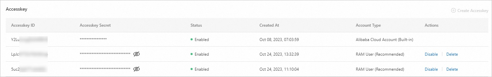
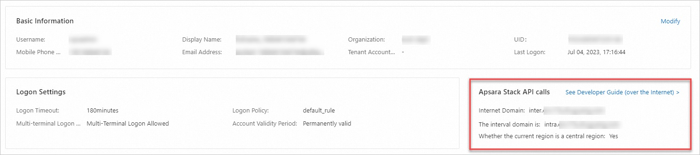

Alibaba Cloud  
Apsara Stack  
Apsara Uni-manager  
Operations Console  
Developer Guide  
Product Version: V3.18.6  
Document Version: 20260703

**Table of Contents**

- [1.Usage notes on development documentation](#section-1)
- [2.Release notes for Apsara Uni-manager Operations Console SDK](#section-2)
- [3.Unrecommended and unavailable APIs](#section-3)
- [4.Preparations](#section-4)
    - [4.1. Log on to the Apsara Uni-manager Operations Console](#section-4-1)
    - [4.2. Obtain a region ID](#section-4-2)
    - [4.3. Permissions required to call APIs](#section-4-3)
    - [4.4. Obtain an AccessKey pair](#section-4-4)
    - [4.5. Obtain the service domain name](#section-4-5)
    - [4.6. Test network connectivity](#section-4-6)
    - [4.7. Obtain the ASO Console SDKs](#section-4-7)
    - [4.8. Confirm the QPS limits of API operations](#section-4-8)
- [5.Call Examples for SDK for Java](#section-5)
    - [5.1. Getting started](#section-5-1)
    - [5.2. Use the SDK](#section-5-2)
        - [5.2.1. Install Apsara Uni-manager Operations Console SDK for Java](#section-5-2-1)
        - [5.2.2. Initiate an API request](#section-5-2-2)
- [6.Use Apsara Uni-manager Operations Console SDK for Python to call API operations](#section-6)
    - [6.1. Getting started](#section-6-1)
    - [6.2. Use the SDK](#section-6-2)
        - [6.2.1. Install Apsara Uni-manager Operations Console SDK for Python](#section-6-2-1)
        - [6.2.2. Initiate an API request](#section-6-2-2)
- [7.API Reference](#section-7)
    - [7.1. Apsara Uni-manager Operations Console](#section-7-1)
        - [7.1.1. Monitoring and alerting](#section-7-1-1)
            - [7.1.1.1. GetIncidentAlertList](#section-7-1-1-1)
                - [7.1.1.1.1. Supplementary details on GetIncidentAlertList](#section-7-1-1-1-1)
            - [7.1.1.2. GetMetricData](#section-7-1-1-2)
                - [7.1.1.2.1. GetMetricData monitoring metric details](#section-7-1-1-2-1)
            - [7.1.1.3. ListAlertByUpdateTime](#section-7-1-1-3)
            - [7.1.1.4. GetCpuMetrics](#section-7-1-1-4)
            - [7.1.1.5. GetDiskMetrics](#section-7-1-1-5)
            - [7.1.1.6. GetIoMetrics](#section-7-1-1-6)
            - [7.1.1.7. GetLoadMetrics](#section-7-1-1-7)
            - [7.1.1.8. GetMemMetrics](#section-7-1-1-8)
            - [7.1.1.9. GetTrafficMetrics](#section-7-1-1-9)
        - [7.1.2. Inventory management](#section-7-1-2)
            - [7.1.2.1. GetOverview](#section-7-1-2-1)
            - [7.1.2.2. GetSlbInventoryInfo](#section-7-1-2-2)
            - [7.1.2.3. GetEcsInventoryByCurrent](#section-7-1-2-3)
            - [7.1.2.4. GetEcsInventoryList](#section-7-1-2-4)
            - [7.1.2.5. GetEcsInventoryByZoneId](#section-7-1-2-5)
            - [7.1.2.6. GetVms](#section-7-1-2-6)
            - [7.1.2.7. GetEbsClusterTypeInfo](#section-7-1-2-7)
            - [7.1.2.8. GetNasInventoryInfo](#section-7-1-2-8)
            - [7.1.2.9. GetOssInventoryInfo](#section-7-1-2-9)
            - [7.1.2.10. GetOtsInnerInventoryInfo](#section-7-1-2-10)
            - [7.1.2.11. GetRdsInventoryInfo](#section-7-1-2-11)
            - [7.1.2.12. GetSlsInnerInfo](#section-7-1-2-12)
            - [7.1.2.13. GetPanguInventoryByClusterName](#section-7-1-2-13)
            - [7.1.2.14. GetInventoryStat](#section-7-1-2-14)
            - [7.1.2.15. GetIntegratedProductInventory](#section-7-1-2-15)
                - [7.1.2.15.1. Supplementary details on GetIntegratedProductInventory capacity metrics](#section-7-1-2-15-1)
        - [7.1.3. Inspections](#section-7-1-3)
            - [7.1.3.1. InspectionGetTaskList](#section-7-1-3-1)
            - [7.1.3.2. InspectionGetTaskExecution](#section-7-1-3-2)
            - [7.1.3.3. InspectionGetReport](#section-7-1-3-3)
        - [7.1.4. Platform products](#section-7-1-4)
            - [7.1.4.1. GetProductListDetail](#section-7-1-4-1)
            - [7.1.4.2. GetProductList](#section-7-1-4-2)
            - [7.1.4.3. GetProductVersion](#section-7-1-4-3)
            - [7.1.4.4. DescribeProductStatus](#section-7-1-4-4)
            - [7.1.4.5. GetClusterListByProductDetail](#section-7-1-4-5)
            - [7.1.4.6. GetClusterListByProduct](#section-7-1-4-6)
            - [7.1.4.7. GetClusters](#section-7-1-4-7)
            - [7.1.4.8. GetServiceInstanceDetail](#section-7-1-4-8)
            - [7.1.4.9. GetServerRoleList](#section-7-1-4-9)
            - [7.1.4.10. GetServerroleVersion](#section-7-1-4-10)
            - [7.1.4.11. GetServiceRole](#section-7-1-4-11)
            - [7.1.4.12. GetServerRoleMachinesDetail](#section-7-1-4-12)
        - [7.1.5. Equipment assets](#section-7-1-5)
            - [7.1.5.1. GetMachineByIp](#section-7-1-5-1)
            - [7.1.5.2. GetMachineByName](#section-7-1-5-2)
            - [7.1.5.3. GetMachineListDetail](#section-7-1-5-3)
            - [7.1.5.4. GetMachineList](#section-7-1-5-4)
            - [7.1.5.5. GetNetworkMachineByIp](#section-7-1-5-5)
            - [7.1.5.6. GetNetworkMachineByName](#section-7-1-5-6)
        - [7.1.6. Platform data](#section-7-1-6)
            - [7.1.6.1. GetCurrentUserStats](#section-7-1-6-1)
            - [7.1.6.2. ListUsers](#section-7-1-6-2)
            - [7.1.6.3. CheckUserRole](#section-7-1-6-3)
            - [7.1.6.4. RevokeRoleFromUser](#section-7-1-6-4)
            - [7.1.6.5. GrantRoleToUser](#section-7-1-6-5)
        - [7.1.7. Event Center](#section-7-1-7)
            - [7.1.7.1. GetEventList](#section-7-1-7-1)
            - [7.1.7.2. GetRelationAlert](#section-7-1-7-2)
            - [7.1.7.3. GetEventProcessLog](#section-7-1-7-3)
            - [7.1.7.4. HandleEvent](#section-7-1-7-4)
            - [7.1.7.5. GetSubIncidentByCondition](#section-7-1-7-5)
    - [7.2. Network Operations Console](#section-7-2)
        - [7.2.1. Network element management](#section-7-2-1)
            - [7.2.1.1. GetSwitchInfo](#section-7-2-1-1)
            - [7.2.1.2. GetTopoInfo](#section-7-2-1-2)
            - [7.2.1.3. ListPorts](#section-7-2-1-3)
            - [7.2.1.4. ListSwTotal](#section-7-2-1-4)
            - [7.2.1.5. GetPortInfo](#section-7-2-1-5)
            - [7.2.1.6. GetXnetFlow](#section-7-2-1-6)
            - [7.2.1.7. GetHardwareUtilization](#section-7-2-1-7)
            - [7.2.1.8. GetPortTransPowerByName](#section-7-2-1-8)
        - [7.2.2. Networking services](#section-7-2-2)
            - [7.2.2.1. AllSlbClusters](#section-7-2-2-1)
            - [7.2.2.2. GetNodeList](#section-7-2-2-2)
            - [7.2.2.3. GetSlbLvsNodeStats](#section-7-2-2-3)
            - [7.2.2.4. GetSlbLvsClusterStats](#section-7-2-2-4)
            - [7.2.2.5. GetLbStats](#section-7-2-2-5)
            - [7.2.2.6. GetSlbProxyClusterStats](#section-7-2-2-6)
            - [7.2.2.7. GetSlbProxyNodeStats](#section-7-2-2-7)
            - [7.2.2.8. GetXgwClusterList](#section-7-2-2-8)
            - [7.2.2.9. GetXgwClusterAll](#section-7-2-2-9)
            - [7.2.2.10. GetXgwMachineList](#section-7-2-2-10)
    - [7.3. Storage Operations Console](#section-7-3)
        - [7.3.1. Apsara Distributed File System O&M](#section-7-3-1)
            - [7.3.1.1. GetPanguStorageCapacity](#section-7-3-1-1)
        - [7.3.2. CDS O&M](#section-7-3-2)
            - [7.3.2.1. DescribeOssCluster](#section-7-3-2-1)
            - [7.3.2.2. DescribeClusterCapacity](#section-7-3-2-2)
            - [7.3.2.3. DescribeHosts](#section-7-3-2-3)
            - [7.3.2.4. DescribeMetrics](#section-7-3-2-4)
            - [7.3.2.5. DescribeStorageClusters](#section-7-3-2-5)
            - [7.3.2.6. DescribeBlockClusters](#section-7-3-2-6)
        - [7.3.3. EBS O&M](#section-7-3-3)
            - [7.3.3.1. ListOnLineDiskInfo](#section-7-3-3-1)
            - [7.3.3.2. QueryDiskInfo](#section-7-3-3-2)
    - [7.4. ApsaraDB Operations and Maintenance System](#section-7-4)
        - [7.4.1. RDS O&M](#section-7-4-1)
            - [7.4.1.1. DescribeHostInfoByDbType](#section-7-4-1-1)
            - [7.4.1.2. DescribeCustInsSlaveInfo](#section-7-4-1-2)
            - [7.4.1.3. DescribeResourceInventory](#section-7-4-1-3)
            - [7.4.1.4. DescribeComboInventory](#section-7-4-1-4)
    - [7.5. Disaster Recovery Management](#section-7-5)
        - [7.5.1. Important notes](#section-7-5-1)
        - [7.5.2. Error codes](#section-7-5-2)
        - [7.5.3. Primary data center: zone-disaster recovery management platform](#section-7-5-3)
            - [7.5.3.1. GetProdcutSwitchLogs](#section-7-5-3-1)
            - [7.5.3.2. GetProdcutSwitchProcess](#section-7-5-3-2)
            - [7.5.3.3. GetSyncCheckResult](#section-7-5-3-3)
            - [7.5.3.4. FinishProdcutSwitch](#section-7-5-3-4)
            - [7.5.3.5. ListProductDrillPlan](#section-7-5-3-5)
            - [7.5.3.6. ExcuteProdcutSwitch](#section-7-5-3-6)
            - [7.5.3.7. GetDrillProductStatus](#section-7-5-3-7)
        - [7.5.4. Zone disaster recovery management platform for secondary data centers](#section-7-5-4)
            - [7.5.4.1. GetProdcutSwitchLogs](#section-7-5-4-1)
            - [7.5.4.2. GetProductSwitchProcess](#section-7-5-4-2)
            - [7.5.4.3. GetSyncCheckResult](#section-7-5-4-3)
            - [7.5.4.4. ListProductDrillPlan](#section-7-5-4-4)
            - [7.5.4.5. ExcuteProdcutSwitch](#section-7-5-4-5)
            - [7.5.4.6. GetDrillProductStatus](#section-7-5-4-6)
            - [7.5.4.7. FinishProductSwitch](#section-7-5-4-7)
    - [7.6. Apsara Uni-manager Management Console](#section-7-6)
        - [7.6.1. Platform data](#section-7-6-1)
            - [7.6.1.1. GetCurrentUserStats](#section-7-6-1-1)
- [8.References](#section-8)
    - [8.1. Troubleshooting based on logs when an API operation call is abnormal](#section-8-1)

<a id="section-1"></a>

# 1.Usage notes on development documentation

This topic describes how to view the desired product development documentation when you use Apsara Stack API (ASAPI).

**Procedure**

You can follow the procedure described in the following figure to view the desired development documentation.


**Prerequisites**

The Apsara Stack version is obtained from an O&M personnel or operations administrator.

**Procedure**

You can go to the Apsara Stack documentation center and view the desired product documentation.

1. Go to the Apsara Stack Documentation Centerpage by using a browser.

2. Click the **Enterprise**, **Agility**, or **All-in-one** tab based on the Apsara Stack version that you use.

3. Select an Apsara Stack version from the drop-down list.

4. In the left-side navigation pane, select the name of the product that you want to view.

5. In the upper-right corner of the product documentation section, click **View Details** or **Download PDF**.

<a id="section-2"></a>

# 2.Release notes for Apsara Uni-manager Operations Console SDK

This topic describes the release notes for the Apsara Uni-manager Operations Console SDK of Apsara Stack V3.18.6, including API releases, modifications, and known issues.

**SDK version hisstory**

| Version | Release date | Description |
| --- | --- | --- |
| 3.18.6-6 | January 2026 | Five API operations are added to Apsara Stack Resilience (ASR) for Zone-disaster Recovery (Secondary Zone). |
| 3.18.6-5 | January 2026 | Five API operations are added to Apsara Stack Resilience (ASR) for Zone-disaster Recovery (Primary Zone). |
| 3.18.6-4 | December 2025 | Two Elastic Block Storage (EBS) API operations are added to Storage Operations Console. |
| 3.18.6-3 | October 2025 | Seven API operations are added to Apsara Stack Resilience (ASR) for Zone-disaster Recovery (Secondary Zone). |
| 3.18.6-2 | October 2025 | Seven API operations are added to Apsara Stack Resilience (ASR) for Zone-disaster Recovery (Primary Zone). |
| 3.18.6-1 | September 2025 | Two API operations are added to the event center. |
| 3.18.6-0 | April 2025 | Released Apsara Uni-manager Operations Console from which external API operations of Apsara Stack V3.18.6 can be called. |

<a id="section-3"></a>

# 3.Unrecommended and unavailable APIs

Some APIs provided by the Apsara Uni-manager Operations Console of versions earlier than 3.18.1 are not supported or not recommended for use. This topic describes the APIs that are not supported or not recommended for use.

> **Note**
>
> - **Unrecommended** APIs are still described in the API reference, and alternative APIs are provided. In general, unrecommended APIs will no longer be supported in later versions of the Apsara Uni-manager Operations Console.
>
> - Most **unsupported** APIs do not have alternative APIs and are not described in the API reference. Only a small number of unsupported APIs have alternative APIs with similar functions.

| API | Availability | Alternative API |
| --- | --- | --- |
| GetAlertList | Not recommended | GetIncidentAlertList |
| GetCpuMetrics | Not recommended | GetMetricData |
| GetDiskMetrics | Not recommended | GetMetricData |
| GetIoMetrics | Not recommended | GetMetricData |
| GetLoadMetrics | Not recommended | GetMetricData |
| GetMemMetrics | Not recommended | GetMetricData |
| GetTrafficMetrics | Not recommended | GetMetricData |
| GetProductList | Not recommended | GetProductListDetail |
| GetClusterListByProduct | Not recommended | GetClusterListByProductDetail |
| GetMachineList | Not recommended | GetMachineListDetail |
| GetOverview | Not recommended | GetIntegratedProductInventory |
| GetSlbInventoryInfo | Not recommended | GetIntegratedProductInventory |
| GetEcsInventoryByCurrent | Not recommended | GetIntegratedProductInventory |
| GetEcsInventoryList | Not recommended | GetIntegratedProductInventory |
| GetEcsInventoryByZoneId | Not recommended | GetIntegratedProductInventory |
| GetEbsClusterTypeInfo | Not recommended | GetIntegratedProductInventory |
| GetNasInventoryInfo | Not recommended | GetIntegratedProductInventory |
| GetOssInventoryInfo | Not recommended | GetIntegratedProductInventory |
| GetOtsInnerInventoryInfo | Not recommended | GetIntegratedProductInventory |
| GetRdsInventoryInfo | Not recommended | GetIntegratedProductInventory |
| GetSlsInnerInfo | Not recommended | GetIntegratedProductInventory |
| GetPanguInventoryByClusterName | Not recommended | GetIntegratedProductInventory |
| GetInventoryStat | Not recommended | GetIntegratedProductInventory |
| GetHistoryAlert | No longer supported | GetIncidentAlertList |
| PushToASO | No longer supported | N/A |
| GetScriptInfo | No longer supported | N/A |
| GetScriptList | No longer supported | N/A |
| GetTaskExecuteHistory | No longer supported | N/A |
| GetTaskOutput | No longer supported | N/A |
| GetTaskInfo | No longer supported | N/A |
| GetTaskList | No longer supported | N/A |

<a id="section-4"></a>

# 4.Preparations

<a id="section-4-1"></a>

## 4.1. Log on to the Apsara Uni-manager Operations Console

This topic describes how users such as O&M engineers log on to the Apsara Uni-manager Operations Console.

**Prerequisites**

- The endpoint of the Apsara Uni-manager Operations Console and the username and password that are used to log on to the console are obtained from a deployment engineer or an administrator.

  The endpoint of the Apsara Uni-manager Operations Console is in the following format: *regi on-id*.ops.console.*intranet-domain-id*.

- A web browser is available. We recommend that you use Google Chrome.

**Procedure**

1. Open your browser.

2. In the address bar, enter the endpoint of the Apsara Uni-manager Operations Console. Press the ENTER key.

   

   > **Note**
   >
   > You can click the current language in the upper-right corner to switch to another language. Simplified Chinese, English, and traditional Chinese are supported.

3. Enter the username and password.

   > **Note**
   >
   > - Obtain the username and password that are used to log on to the Apsara Uni-manager Operations Console from a deployment engineer or an administrator.
   >
   > - If you enter an invalid password for three consecutive times, the system enables the image verification logon feature. If you enter an invalid password for five consecutive times, the account is locked. Contact the administrator to activate the account.

   If this is the first time you log on to the Apsara Uni-manager Operations Console, you must change the password as prompted.

   To enhance security, your password must meet the following requirements:

   - The password contains uppercase and lowercase letters.

   - The password contains digits.

   - The password contains at least one of the following special characters: ! @ # $ %

   - The password is 10 to 20 characters in length.

4. Click **Log In**.

<a id="section-4-2"></a>

## 4.2. Obtain a region ID

This topic describes how to obtain a region ID.

**Background information**

You must obtain a region ID before you call API operations of the Apsara Uni-manager Operations Console.

**Procedure**

1. Log on to the Apsara Uni-manager Operations Console.

2. On the left side of the top navigation bar, you can view the region ID.

   

<a id="section-4-3"></a>

## 4.3. Permissions required to call APIs

When you use the Apsara Stack software development kit (SDK) to access Apsara Stack services, you must provide an authorized account for identity verification. This topic describes how to determine whether an account has the required permissions to call APIs.

Currently, API calls support identity verification using an AccessKey. For more information about how to obtain an AccessKey, see Obtain an AccessKey.

**However, not all Apsara Uni-manager Operations Console users have the permission to call APIs. Only console users with specific roles can use their AccessKey to call specific APIs. Users with the OAM super administrator role can call all APIs. For more information about how to create a custom role and view preset roles, see** **Role Management in the User Permissions section of the Apsara Uni-manager Operations Console User Guide.**

**Apsara Uni-manager Operations Console**

**Categor**

**API name**

**Permitted roles**

**y**

Preset roles: system administrator, system viewer

Custom roles with one or more of the following

GetIncidentAlertList

permission points: "Alert Event_Read-only", "Alert Event_Read/Write".

Preset roles: system administrator, system viewer

Custom roles with one or more of the following

GetMetricData

permission points: "Alert Event_Read-only", "Alert Event_Read/Write".

Preset roles: system administrator, system viewer

Custom roles with one or more of the following

ListAlertByUpdateTime

permission points: "Alert Event_Read-only", "Alert Event_Read/Write".

Preset roles: system administrator, system viewer

Custom roles with one or more of the following

GetAlertList

permission points: "Alert Event_Read-only", "Alert Event_Read/Write".

Preset roles: system administrator, system viewer

Custom roles with one or more of the following

GetCpuMetrics

permission points: "Apsara Infrastructure Management Basics_Read-only", "Apsara Infrastructure Management Basics_Read/Write".

Preset roles: system administrator, system viewer

Monitori ng and

Custom roles with one or more of the following

GetDiskMetrics

alerts

permission points: "Apsara Infrastructure Management Basics_Read-only", "Apsara Infrastructure Management Basics_Read/Write".

Preset roles: system administrator, system viewer

Custom roles with one or more of the following

GetIoMetrics

permission points: "Apsara Infrastructure Management Basics_Read-only", "Apsara Infrastructure Management Basics_Read/Write".

Preset roles: system administrator, system viewer

Custom roles with one or more of the following

GetLoadMetrics

permission points: "Apsara Infrastructure Management Basics_Read-only", "Apsara Infrastructure Management Basics_Read/Write".

Preset roles: system administrator, system viewer

Custom roles with one or more of the following

GetMemMetrics

permission points: "Apsara Infrastructure Management Basics_Read-only", "Apsara Infrastructure Management Basics_Read/Write".

Preset roles: system administrator, system viewer

Custom roles with one or more of the following

GetTrafficMetrics

permission points: "Apsara Infrastructure Management Basics_Read-only", "Apsara Infrastructure Management Basics_Read/Write".

Preset roles: system administrator, system viewer

Custom roles with one or more of the following

GetOverview

permission points: "Capacity Management_Read-only", "Capacity Management_Read/Write".

Preset roles: system administrator, system viewer

Custom roles with one or more of the following

GetSlbInventoryInfo

permission points: "Capacity Management_Read-only", "Capacity Management_Read/Write".

Preset roles: system administrator, system viewer

Custom roles with one or more of the following

GetEcsInventoryByCurrent

permission points: "Capacity Management_Read-only", "Capacity Management_Read/Write".

Preset roles: system administrator, system viewer

Custom roles with one or more of the following

GetEcsInventoryList

permission points: "Capacity Management_Read-only", "Capacity Management_Read/Write".

Preset roles: system administrator, system viewer

Custom roles with one or more of the following

GetEcsInventoryByZoneId

permission points: "Capacity Management_Read-only", "Capacity Management_Read/Write".

GetVms

Preset roles: system administrator, system viewer

Preset roles: system administrator, system viewer

Custom roles with one or more of the following

GetEbsClusterTypeInfo

permission points: "Capacity Management_Read-only", "Capacity Management_Read/Write".

Inventor y

Preset roles: system administrator, system viewer

manage

Custom roles with one or more of the following

ment

GetNasInventoryInfo

permission points: "Capacity Management_Read-only", "Capacity Management_Read/Write".

Preset roles: system administrator, system viewer

Custom roles with one or more of the following

GetOssInventoryInfo

permission points: "Capacity Management_Read-only", "Capacity Management_Read/Write".

Preset roles: system administrator, system viewer

Custom roles with one or more of the following

GetOtsInnerInventoryInfo

permission points: "Capacity Management_Read-only", "Capacity Management_Read/Write".

Preset roles: system administrator, system viewer

Custom roles with one or more of the following

GetRdsInventoryInfo

permission points: "Capacity Management_Read-only", "Capacity Management_Read/Write".

Preset roles: system administrator, system viewer

Custom roles with one or more of the following

GetSlsInnerInfo

permission points: "Capacity Management_Read-only", "Capacity Management_Read/Write".

Preset roles: system administrator, system viewer

GetPanguInventoryByClusterNam

Custom roles with one or more of the following

e

permission points: "Capacity Management_Read-only", "Capacity Management_Read/Write".

Preset roles: system administrator, system viewer

Custom roles with one or more of the following

GetInventoryStat

permission points: "Capacity Management_Read-only", "Capacity Management_Read/Write".

Preset roles: system administrator, system viewer

Custom roles with one or more of the following

GetIntegratedProductInventory

permission points: "Capacity Management_Read-only", "Capacity Management_Read/Write".

Preset roles: system administrator, system viewer

Custom roles with one or more of the following

InspectionGetTaskList

permission points: "Inspection Management_Read-only", "Inspection Management_Read/Write".

Inspecti on

Preset roles: system administrator, system viewer

manage

Custom roles with one or more of the following

ment

InspectionGetTaskExecution

permission points: "Inspection Management_Read-only", "Inspection Management_Read/Write".

Preset roles: system administrator, system viewer

Custom roles with one or more of the following

InspectionGetReport

permission points: "Inspection Management_Read-only", "Inspection Management_Read/Write".

Preset roles: system administrator, system viewer

Custom roles with one or more of the following permission points: "Apsara Infrastructure

GetProductListDetail

Management Basics_Read-only", "Apsara Infrastructure Management Basics_Read/Write".

Preset roles: system administrator, system viewer

Custom roles with one or more of the following permission points: "Apsara Infrastructure

GetProductList

Management Basics_Read-only", "Apsara Infrastructure Management Basics_Read/Write".

Preset roles: system administrator, system viewer

Custom roles with one or more of the following permission points: "Apsara Infrastructure

GetProductVersion

Management Basics_Read-only", "Apsara Infrastructure Management Basics_Read/Write".

Preset roles: system administrator, system viewer

Custom roles with one or more of the following permission points: "Apsara Infrastructure

DescribeProductStatus

Management Basics_Read-only", "Apsara Infrastructure Management Basics_Read/Write".

Preset roles: system administrator, system viewer

Custom roles with one or more of the following permission points: "Apsara Infrastructure

GetClusterListByProductDetail

Management Basics_Read-only", "Apsara Infrastructure Management Basics_Read/Write".

Preset roles: system administrator, system viewer

Custom roles with one or more of the following permission points: "Apsara Infrastructure

GetClusterListByProduct

Management Basics_Read-only", "Apsara Infrastructure Management Basics_Read/Write".

Platform products

Preset roles: system administrator, system viewer

Custom roles with one or more of the following permission points: "Apsara Infrastructure

GetClusters

Management Basics_Read-only", "Apsara Infrastructure Management Basics_Read/Write".

Preset roles: system administrator, system viewer

Custom roles with one or more of the following permission points: "Apsara Infrastructure

GetServiceInstanceDetail

Management Basics_Read-only", "Apsara Infrastructure Management Basics_Read/Write".

Preset roles: system administrator, system viewer

Custom roles with one or more of the following permission points: "Apsara Infrastructure

GetServerRoleList

Management Basics_Read-only", "Apsara Infrastructure Management Basics_Read/Write".

Preset roles: system administrator, system viewer

Custom roles with one or more of the following

GetServerroleVersion

permission points: "Apsara Infrastructure Management Basics_Read-only", "Apsara Infrastructure Management Basics_Read/Write".

Preset roles: system administrator, system viewer

Custom roles with one or more of the following

GetServiceRole

permission points: "Apsara Infrastructure Management Basics_Read-only", "Apsara Infrastructure Management Basics_Read/Write".

Preset roles: system administrator, system viewer

Custom roles with one or more of the following

GetServerRoleMachinesDetail

permission points: "Apsara Infrastructure Management Basics_Read-only", "Apsara Infrastructure Management Basics_Read/Write".

Preset roles: system administrator, system viewer

Custom roles with one or more of the following

GetMachineByIp

permission points: "Apsara Infrastructure Management Basics_Read-only", "Apsara Infrastructure Management Basics_Read/Write".

Preset roles: system administrator, system viewer

Custom roles with one or more of the following

GetMachineByName

permission points: "Apsara Infrastructure Management Basics_Read-only", "Apsara Infrastructure Management Basics_Read/Write".

Preset roles: system administrator, system viewer

Custom roles with one or more of the following

GetMachineListDetail

permission points: "Apsara Infrastructure Management Basics_Read-only", "Apsara Infrastructure Management Basics_Read/Write".

Asset devices

Preset roles: system administrator, system viewer

Custom roles with one or more of the following

GetMachineList

permission points: "Apsara Infrastructure Management Basics_Read-only", "Apsara Infrastructure Management Basics_Read/Write".

Preset roles: system administrator, system viewer

Custom roles with one or more of the following

GetNetworkMachineByIp

permission points: "Apsara Infrastructure Management Basics_Read-only", "Apsara Infrastructure Management Basics_Read/Write".

Preset roles: system administrator, system viewer

Custom roles with one or more of the following permission points: "Apsara Infrastructure

GetNetworkMachineByName

Management Basics_Read-only", "Apsara Infrastructure Management Basics_Read/Write".

Preset roles: system administrator, system viewer

GetCurrentUserStats

ListUsers

Preset roles: system administrator, system viewer

Platform

GrantRoleToUser

Role administrator

data

RevokeRoleFromUser

Role administrator

CheckUserRole

Role administrator, Role viewer

<table>
  <tr>
    <td rowspan="5">Event Center</td>
    <td>GetEventList</td>
    <td>Preset roles: system administrator, system viewer<br>Custom roles with one or more of the following permission points: "Alert Event_Read-only", "Alert Event_Read/Write".</td>
  </tr>
  <tr>
    <td>GetRelationAlert</td>
    <td>Preset roles: system administrator, system viewer<br>Custom roles with one or more of the following permission points: "Alert Event_Read-only", "Alert Event_Read/Write".</td>
  </tr>
  <tr>
    <td>GetEventProcessLog</td>
    <td>Preset roles: system administrator, system viewer<br>Custom roles with one or more of the following permission points: "Alert Event_Read-only", "Alert Event_Read/Write".</td>
  </tr>
  <tr>
    <td>HandleEvent</td>
    <td>Preset roles: system administrator, system viewer<br>Custom roles with the "Alert Event_Read/Write" permission point.</td>
  </tr>
  <tr>
    <td>GetSubIncidentByCondition</td>
    <td>Preset roles: system administrator, system viewer<br>Custom roles with one or more of the following permission points: "Alert Event_Read-only", "Alert Event_Read/Write".</td>
  </tr>
</table>

**Network Operations Console**

**Catego**

**API name**

**Permitted roles**

**ry**

Preset roles: system administrator, system viewer

Custom roles with one or more of the following

GetSwitchInfo

permission points: "Network Operations Console_Read-only", "Network Operations Console_Read/Write".

Preset roles: system administrator, system viewer

Custom roles with one or more of the following

GetTopoInfo

permission points: "Network Operations Console_Read-only", "Network Operations Console_Read/Write".

Preset roles: system administrator, system viewer

Custom roles with one or more of the following

ListPorts

permission points: "Network Operations Console_Read-only", "Network Operations Console_Read/Write".

Preset roles: system administrator, system viewer

Custom roles with one or more of the following

ListSwTotal

permission points: "Network Operations Console_Read-only", "Network Operations

Network

Console_Read/Write".

element manage ment

Preset roles: system administrator, system viewer

Custom roles with one or more of the following

GetPortInfo

permission points: "Network Operations Console_Read-only", "Network Operations Console_Read/Write".

Preset roles: system administrator, system viewer

Custom roles with one or more of the following

GetXnetFlow

permission points: "Network Operations Console_Read-only", "Network Operations Console_Read/Write".

Preset roles: system administrator, system viewer

Custom roles with one or more of the following

GetHardwareUtilization

permission points: "Network Operations Console_Read-only", "Network Operations Console_Read/Write".

Preset roles: system administrator, system viewer

Custom roles with one or more of the following

GetPortTransPowerByName

permission points: "Network Operations Console_Read-only", "Network Operations Console_Read/Write".

Preset roles: system administrator, system viewer

Custom roles with one or more of the following

AllSlbClusters

permission points: "Network Operations Console_Read-only", "Network Operations Console_Read/Write".

ASO system administrator, ASO product O&M, ASO

GetNodeList

product O&M - network administrator, ASO product O&M - network inspector

Preset roles: system administrator, system viewer

Custom roles with one or more of the following

GetSlbLvsNodeStats

permission points: "Network Operations Console_Read-only", "Network Operations Console_Read/Write".

Preset roles: system administrator, system viewer

Custom roles with one or more of the following

GetSlbLvsClusterStats

permission points: "Network Operations Console_Read-only", "Network Operations Console_Read/Write".

Preset roles: system administrator, system viewer

Custom roles with one or more of the following

GetLbStats

permission points: "Network Operations Console_Read-only", "Network Operations

Network

Console_Read/Write".

product s

Preset roles: system administrator, system viewer

Custom roles with one or more of the following

GetSlbProxyClusterStats

permission points: "Network Operations Console_Read-only", "Network Operations Console_Read/Write".

Preset roles: system administrator, system viewer

Custom roles with one or more of the following

GetSlbProxyNodeStats

permission points: "Network Operations Console_Read-only", "Network Operations Console_Read/Write".

Preset roles: system administrator, system viewer

Custom roles with one or more of the following

GetXgwClusterList

permission points: "Network Operations Console_Read-only", "Network Operations Console_Read/Write".

Preset roles: system administrator, system viewer

Custom roles with one or more of the following

GetXgwClusterAll

permission points: "Network Operations Console_Read-only", "Network Operations Console_Read/Write".

Preset roles: system administrator, system viewer

Custom roles with one or more of the following

GetXgwMachineList

permission points: "Network Operations Console_Read-only", "Network Operations Console_Read/Write".

**Storage Operations Console**

<table>
  <tr>
    <th>Catego ry</th>
    <th>API name</th>
    <th>Permitted roles</th>
  </tr>
  <tr>
    <td>Pangu O&amp;M</td>
    <td>GetPanguStorageCapacity</td>
    <td>Preset roles: system administrator, system viewer<br>Custom roles with one or more of the following permission points: "Apsara Distributed File System O&amp;M_Read-only", "Apsara Distributed File System O&amp;M_Read/Write".</td>
  </tr>
  <tr>
    <td rowspan="6">CDS O&amp;M</td>
    <td>DescribeClusterCapacity</td>
    <td>Preset role: system administrator<br>Custom roles with the "Cloud-defined Storage O&amp;M_Read-only" permission point.</td>
  </tr>
  <tr>
    <td>DescribeMetrics</td>
    <td>Preset role: system administrator<br>Custom roles with the "Cloud-defined Storage O&amp;M_Read-only" permission point.</td>
  </tr>
  <tr>
    <td>DescribeStorageClusters</td>
    <td>Preset role: system administrator<br>Custom roles with the "Cloud-defined Storage O&amp;M_Read-only" permission point.</td>
  </tr>
  <tr>
    <td>DescribeOssCluster</td>
    <td>Preset role: system administrator<br>Custom roles with the "Cloud-defined Storage O&amp;M_Read-only" permission point.</td>
  </tr>
  <tr>
    <td>DescribeBlockClusters</td>
    <td>Preset role: system administrator<br>Custom roles with the "Cloud-defined Storage O&amp;M_Read-only" permission point.</td>
  </tr>
  <tr>
    <td>DescribeHosts</td>
    <td>Preset role: system administrator<br>Custom roles with the "Cloud-defined Storage O&amp;M_Read-only" permission point.</td>
  </tr>
</table>

**Database Operations Console**

**Category**

**API name**

**Permitted roles**

Preset roles: system administrator, system viewer

Custom roles with one or more of the following

DescribeComboInventory

permission points: "Capacity Management_Read-only", "Capacity Management_Read/Write".

Preset roles: system administrator, system viewer

Custom roles with one or more of the following

DescribeCustInsSlaveInfo

permission points: "Capacity Management_Read-only", "Capacity Management_Read/Write".

RDS O&M

Preset roles: system administrator, system viewer

Custom roles with one or more of the following

DescribeHostInfoByDbType

permission points: "Capacity Management_Read-only", "Capacity Management_Read/Write".

Preset roles: system administrator, system viewer

Custom roles with one or more of the following

DescribeResourceInventory

permission points: "Capacity Management_Read-only", "Capacity Management_Read/Write".

**Disaster recovery management**

**Category**

**API name**

**Permitted roles**

Preset roles: system administrator, system viewer

Custom roles with one or more of the following

GetDrillProductStatus

permission points: "Zone-Disaster Recovery_DR Monitoring", "Zone-Disaster Recovery_System Administrator".

Preset roles: system administrator, system viewer

Custom roles with one or more of the following

ExecuteProductSwitch

permission points: "Zone-Disaster Recovery_DR Monitoring", "Zone-Disaster Recovery_System Administrator".

Preset roles: system administrator, system viewer

Custom roles with one or more of the following permission points: "Zone-Disaster Recovery_DR

ListProductDrillPlan

Monitoring", "Zone-Disaster Recovery_System Administrator".

Preset roles: system administrator, system viewer

Custom roles with one or more of the following

FinishProductSwitch

permission points: "Zone-Disaster Recovery_DR Monitoring", "Zone-Disaster Recovery_System

Primary data

Administrator".

center zone-disaster recovery management

Preset roles: system administrator, system viewer

platform

Custom roles with one or more of the following

GetSyncCheckResult

permission points: "Zone-Disaster Recovery_DR Monitoring", "Zone-Disaster Recovery_System Administrator".

Preset roles: system administrator, system viewer

Custom roles with one or more of the following

GetProductSwitchProcess

permission points: "Zone-Disaster Recovery_DR Monitoring", "Zone-Disaster Recovery_System Administrator".

Preset roles: system administrator, system viewer

Custom roles with one or more of the following permission points: "Zone-Disaster Recovery_DR Monitoring", "Zone-Disaster Recovery_System

GetProductSwitchLogs

Administrator".

Preset roles: system administrator, system viewer

Custom roles with one or more of the following

GetDrillProductStatus

permission points: "Zone-Disaster Recovery_DR Monitoring", "Zone-Disaster Recovery_System Administrator".

Preset roles: system administrator, system viewer

Custom roles with one or more of the following

ExecuteProductSwitch

permission points: "Zone-Disaster Recovery_DR Monitoring", "Zone-Disaster Recovery_System Administrator".

Preset roles: system administrator, system viewer

Custom roles with one or more of the following

ListProductDrillPlan

permission points: "Zone-Disaster Recovery_DR Monitoring", "Zone-Disaster Recovery_System Administrator".

Preset roles: system administrator, system viewer

Custom roles with one or more of the following

FinishProductSwitch

permission points: "Zone-Disaster Recovery_DR

Secondary

Monitoring", "Zone-Disaster Recovery_System

data center

Administrator".

zone-disaster recovery management

Preset roles: system administrator, system viewer

platform

Custom roles with one or more of the following

GetSyncCheckResult

permission points: "Zone-Disaster Recovery_DR Monitoring", "Zone-Disaster Recovery_System Administrator".

Preset roles: system administrator, system viewer

Custom roles with one or more of the following

GetProductSwitchProcess

permission points: "Zone-Disaster Recovery_DR Monitoring", "Zone-Disaster Recovery_System Administrator".

Preset roles: system administrator, system viewer

Custom roles with one or more of the following

GetProductSwitchLogs

permission points: "Zone-Disaster Recovery_DR Monitoring", "Zone-Disaster Recovery_System Administrator".

**Apsara Uni-manager Management Console**

| Catego ry | API name | Permitted roles |
| --- | --- | --- |
| Platfor m data | GetCurrentUserStats | Preset roles: system administrator, system viewer |

<a id="section-4-4"></a>

## 4.4. Obtain an AccessKey pair

This topic describes how to obtain an AccessKey ID and AccessKey secret.

**Background information**

You must obtain an AccessKey pair before you call API operations of the Apsara Uni-manager Operations Console.

An AccessKey ID and an AccessKey secret are used to implement symmetric encryption and verify the identity of request senders. The AccessKey ID is used to identify a user and the AccessKey secret is a string that is used to encrypt the signature.

**Procedure**

1. Log on to the Apsara Uni-manager Operations Console.

2. On the right side of the top navigation bar, click the profile image.

3. Select **Personal information** from the drop-down list.

4. In the **Accesskey** section, you can view the AccessKey ID and AccessKey secret of the RAM user.

   

   > **Note**
   >
   > - The AccessKey secret of **an Apsara Stack tenant account** cannot be displayed or used. Only the AccessKey secret of **a RAM user** can be displayed and used.
   >
   > - Only users who are assigned specific roles can use their AccessKey pairs to call specific API operations. For more information about the roles authorized to call specific API operations, see Obtain the permissions required to call API operations.

5. If no AccessKey pairs of RAM users are available, click **Create Accesskey** to obtain an AccessKey pair.

   > **Note**
   >
   > You can create up to two AccessKey pairs for RAM users per account. The Create Accesskey button is automatically disabled after two AccessKey pairs are already created.

<a id="section-4-5"></a>

## 4.5. Obtain the service domain name

This topic describes how to obtain the service domain name of the Apsara Uni-manager Operations Console.

**Background information**

You must obtain the intranet and Internet domain names before you call API operations of the Apsara Uni-manager Operation Console.

**Procedure**

1. Log on to the Apsara Uni-manager Operations Console.

2. On the right side of the top navigation bar, click the profile image.

3. Select **Personal information** from the drop-down list.

4. You can view the intranet and Internet domain names in the **Apsara Stack API calls** section.

   

<a id="section-4-6"></a>

## 4.6. Test network connectivity

This topic describes how to test the network connectivity of machines on which you want to call API operations.

**Prerequisites**

- The Central Region ID and Local Region ID are obtained.

- The Internet domain name and intranet domain name are obtained.

**Test methods**

**Apsara Uni-manager Operations Console**

```text
# The domain name of the cloud service in the Central Region.
aso-mgr-pop-ops.${internetDomain}
# The domain name of the cloud service in the Local Region.
aso-mgr-pop-ops.${region}.${internetDomain} 
```

**Examples**

Run the ping or curl command to test the network connectivity of a cloud service that you want to access by calling an API.

```bash
curl http://aso-mgr-pop-ops.inter.demo.aliyun.com
curl http://aso-mgr-pop-ops.cn-region02-d02.inter.demo.aliyun.com
```

**Network Operations Console**

```text
# The domain name of the cloud service in the Central Region.
full-link-pop.${intranetDomain}
# The domain name of the cloud service in the Local Region.
full-link-pop.${region}.${intranetDomain}
```

**Examples**

Run the ping or curl command to test the network connectivity of a cloud service that you want to access by calling an API.

```bash
curl http://full-link-pop.intra.demo.aliyun.com
curl http://full-link-pop.cn-region02-d02.intra.demo.aliyun.com
```

**Storage Operations Console**

```text
# The domain name of CDS in the Central Region and the Local Region. CDS has the same domain name in the two regions.
cds-management-ops-pop.${region}.${internetDomain}
# The domain name of pgmon in the Central Region.
slalink-pgmon-pop.${intranetDomain}
# The domain name of pgmon in the Local Region.
slalink-pgmon-pop.${Local Region}.${intranetDomain} 
```

**Examples**

Run the ping or curl command to test the network connectivity of a cloud service that you want to access by calling an API.

```bash
#cds
curl http://cds-management-ops-pop.cn-region01-d01.inter.demo.aliyun.com
curl http://cds-management-ops-pop.cn-region02-d02.inter.demo.aliyun.com
#pgmon
curl http://slalink-pgmon-pop.intra.demo.aliyun.com
curl http://slalink-pgmon-pop.cn-region02-d02.intra.demo.aliyun.com
```

**Apsara Uni-manager Management Console**

```text
# The domain name of the cloud service in the Central Region.
ascm-ops.${internetDomain}
# The domain name of the cloud service in the Local Region.
ascm-ops.${Local Region}.${internetDomain} 
```

**Examples**

Run the ping or curl command to test the network connectivity of a cloud service that you want to access by calling an API.

```bash
curl http://ascm-ops.inter.demo.aliyun.com
curl http://ascm-ops.cn-region02-d02.inter.demo.aliyun.com
```

**Test results**

Determine whether the network connection is normal based on the returned result.

- If the returned result contains "InvalidAction.NotFound" or "Specified api is not found. please check your url and method", it indicates that the network connection of the domain name is normal.

- If the returned result contains "Connection refused", it indicates that the network connection of the domain name failed. You must create an anyTunnel-type tunnel and set the port number to 80 or 443.

- The "Could not resolve host" or "nodename nor servname provided, or not known" error message in the returned result indicates that the domain name resolution failed. You must check the DNS configuration of your machine.

<a id="section-4-7"></a>

## 4.7. Obtain the ASO Console SDKs

When you call API operations of a cloud service in Apsara Stack by using the POP gateway, you must use an SDK. This topic describes how to obtain the ASO Console SDKs.

The ASO Console SDKs contain sample code and examples.

The SDK for Java is provided. For more information, see Alibaba Cloud SDKs.

We recommend that you use the SDK core library that is provided on the Alibaba Cloud official website. The SDK core library is shared by all cloud services and is compatible with Apsara Stack.

<a id="section-4-8"></a>

## 4.8. Confirm the QPS limits of API operations

To ensure the stability of the Apsara Uni-manager Operations Console, the queries per second (QPS) of OpenAPI operations is limited to 10 by default, which indicates that a maximum of 10 requests are allowed per second. Generally, the return data of an OpenAPI operation is real-time data at the minute level. Therefore, the QPS of 10 can meet business requirements.

<a id="section-5"></a>

# 5.Call Examples for SDK for Java

<a id="section-5-1"></a>

## 5.1. Getting started

This topic describes how to obtain and use Apsara Uni-manager Operations Console SDK for Java.

**Prepare the environment**

- Create an Apsara Uni-manager Operations Console account with the required permissions and obtain an AccessKey pair. For more information, see Obtain an AccessKey pair.

- Obtain the endpoints of the Apsara Uni-manager Operations Console. For more information, see Obtain the service domain name.

  Install Java Development Kit (JDK) 1.8 or later.

**Install Apsara Uni-manager Operations Console SDK for Java**

If you use Apache Maven to manage Java projects, you only need to copy the content of the JAR file to the pom.xml file of the project.

To use Apsara Uni-manager Operations Console SDK for Java, you must install the SDK for Java core library, Gson, and Apsara Uni-manager Operations Console SDK for Java. We recommend that you use the SDK for Java core library 4.6.0 or later, Gson 2.9.1 or later, and the latest version of Apsara Uni-manager Operations Console SDK for Java. For more information, see Release notes for Apsara Uni-manager Operations Console SDK.

The following sample code provides an example on how to configure the pom.xml file:

```xml
<dependencies>
    <!--Required dependencies-->
    <dependency>
        <groupId>com.aliyun</groupId>
        <artifactId>aliyun-java-uni-sdk</artifactId>
        <version >${version number of the latest SDK}</version>
        <scope>system</scope>
        <systemPath>${project.basedir}/libs/aliyun-java-uni-sdk-${version number of thelatest SDK}.jar</systemPath>
    </dependency>
    <dependency>
        <groupId>com.aliyun</groupId>
        <artifactId>aliyun-java-sdk-core</artifactId>
        <version>4.6.0</version>
    </dependency>
    <dependency>
        <groupId>com.google.code.gson</groupId>
        <artifactId>gson</artifactId>
        <version>2.9.1</version>
    </dependency>
</dependencies>
```

**Use Apsara Uni-manager Operations Console SDK for Java**

To use Apsara Uni-manager Operations Console SDK for Java, perform the following steps:

1. Create a DefaultAcsClient instance and initiate it.

2. Create an API request and configure the required parameters.

3. Initiate the API request and process the response or exception.

   The following sample code provides an example on how to call the GetMachineListDetail operation:

   ```java
   import com.aliyun.apsarabase.unisdk.SdkManager;
   import com.aliyuncs.DefaultAcsClient;
   import com.aliyuncs.IAcsClient;
   import com.aliyuncs.asoops.model.v20220118.GetMachineListDetailRequest;
   import com.aliyuncs.asoops.model.v20220118.GetMachineListDetailResponse;
   import com.aliyuncs.http.HttpClientConfig;
   import com.aliyuncs.profile.DefaultProfile;

   public class Example {
       public static void main(String[] args) {
           // Set the common parameters required to call the API operation.
           String region = "<your region>"; // Enter your region ID.
           String ak = "<your ak>"; // Enter the AccessKey ID of your account.
           String sk = "<your sk>"; // Enter the AccessKey secret of your account.
           String internetDomain = "<yourInternetDomain>";  // Enter your Internet domain name.
           String intranetDomain = "<yourIntranetDomain>";  // Enter your intranet domain name.
           boolean isCenterRegion = true;        // Specify whether your region is the Ce
   ntral Region.
                                                               // If your application is d
   ployed in only one region, set this parameter to true. 
                                                               // If your application is d
   ployed in multiple regions and the current region is the Central Region, set this parameter to true. 
                                                               // If your application is d
   ployed in multiple regions and the current region is a Local Region, set this parameter to false. 
           String proxy = "<your proxy>"; // Specify the proxy information. This 
   parameter is optional.

           // Initialize the client.
           DefaultProfile profile = DefaultProfile.getProfile(region, ak, sk);
           // ======== Proxy information (Optional) ========
           HttpClientConfig httpClientConfig = HttpClientConfig.getDefault();
           httpClientConfig.setHttpProxy(proxy);
           profile.setHttpClientConfig(httpClientConfig);
           // ====== End of proxy information ========
           IAcsClient client = new DefaultAcsClient(profile);

           SdkManager sdkManager = new SdkManager(internetDomain, intranetDomain, 
   region, isCenterRegion);

           System.out.println("Start GetMachineListDetail Request");

           try {
               GetMachineListDetailRequest getMachineListDetailRequest = 
   sdkManager.getModel(GetMachineListDetailRequest.class);
               
               // Configure the timeout period. Unit: milliseconds. Default value: 
   10000. 
               Integer readTimeoutMillis = 30000;
               getMachineListDetailRequest.setSysReadTimeout(readTimeoutMillis);
               // Add the request ID for debugging and print it to the logs to 
   facilitate troubleshooting.
               String uuid = UUID.randomUUID().toString();
               getMachineListDetailRequest.putHeaderParameter("test-request-id", uuid);
               System.out.println("request uuid" + uuid);

               // ======== Configure operation-specific parameters. Some parameters are optional and others are required. ========
               getMachineListDetailRequest.setPageNum(1);
               getMachineListDetailRequest.setPageSize(10);
               // ======== End of parameter information ========
               GetMachineListDetailResponse getMachineListDetailResponse = 
   client.getAcsResponse(getMachineListDetailRequest);
               // For Apsara Stack V3.18.0 and later, we recommend that you use 
   Boolean.TRUE.equals(getMachineListDetailResponse.getSuccess()) to determine whether the API operation is called successfully.
               // For Apsara Stack of earlier versions, you can use 
   "success".equalsIgnoreCase(getMachineListDetailResponse.getResult()) to determine whether the API operation is called successfully if the success field is not contained in the response parameters.
               if (getMachineListDetailResponse != null && 
   Boolean.TRUE.equals(getMachineListDetailResponse.getSuccess())) {
                   // Specify the response if the API operation is called successfully.
                   
   System.out.println(getMachineListDetailResponse.getData().get(0).getHostName());
               } else {
                   // Print the error message if an error occurs on the backend servers.
                   System.out.println("GetMachineListDetail Request failed");
                   if (getMachineListDetailResponse != null) {
                       System.out.println("Error response is: " + 
   JSONObject.toJSONString(getMachineListDetailResponse));
                   } else {
                       System.out.println("Error getting GetMachineListDetail Response, r
   esponse is null");
                   }
               }
           } catch (Exception e) {
               // Print the error message if an error occurs on the client, gateways, or 
   backend servers.
               System.out.println("GetMachineListDetail Request failed");
               e.printStackTrace();
           }
       }
   }
   ```

<a id="section-5-2"></a>

## 5.2. Use the SDK

<a id="section-5-2-1"></a>

### 5.2.1. Install Apsara Uni-manager Operations Console SDK for Java

This topic describes how to install and use the Apsara Uni-manager Operations Console SDK for Java.

Java Development Kit (JDK) 1.8 or later is installed. To use Apsara Uni-manager Operations Console SDK for Java, you must install the SDK for Java core library and the Apsara Uni-manager Operations Console SDK for Java.

1. We recommend that you use the SDK for Java core library (aliyun-java-sdk-core) 4.6.0 or later. You can install the core library by adding Maven dependencies or downloading the SDK. For more information, visit Alibaba Cloud SDKs.

2. You can download Apsara Uni-manager Operations Console SDK for Java (aliyun-java-uni-sdk) in the lower part of the Apsara Stack Help Center page.

3. We recommend that you use Gson 2.9.1 or later.

```xml
<dependencies>
    <!--Required dependencies-->
    <dependency>
        <groupId>com.aliyun</groupId>
        <artifactId>aliyun-java-uni-sdk</artifactId>
        <version >${version number of the latest SDK}</version>
        <scope>system</scope>
        <systemPath>${project.basedir}/libs/aliyun-java-uni-sdk-${version number of thelatest SDK}.jar</systemPath>
    </dependency>
    <dependency>
        <groupId>com.aliyun</groupId>
        <artifactId>aliyun-java-sdk-core</artifactId>
        <version>4.6.0</version>
    </dependency>
      <dependency>
        <groupId>com.google.code.gson</groupId>
        <artifactId>gson</artifactId>
        <version>2.9.1</version>
    </dependency>
</dependencies>
```

<a id="section-5-2-2"></a>

### 5.2.2. Initiate an API request

This topic describes how to use Apsara Uni-manager Operations Console SDK for Java to initiate an API request.

**Procedure**

1. Configure the pom.xml file.

   For more information about how to configure the pom.xml file, see Install Apsara Uni-manager Operations Console SDK for Java.

2. Initialize Apsara Uni-manager Operations Console SDK for Java by specifying the region and AccessKey pair of your account.

   Each account has a unique AccessKey pair that consists of an AccessKey ID and an AccessKey secret. Make sure that the account has the permissions to call the API operation. For more information about how to obtain an AccessKey pair, see Obtain an AccessKey pair. For more information about the required role permissions, see Permissions required to call API operations.

   ```text
   String region = "<yourRegionID>"; // Enter your region ID.
   String ak = "<yourAccessKeyId>"; // Enter the AccessKey ID of your account.
   String sk = "<yourAccessKeySecret>"; // Enter the AccessKey secret of your account.
   DefaultProfile profile = DefaultProfile.getProfile(region, ak, sk);
   ```

3. (Optional) Configure connectivity settings, including the proxy.

   If you want to use a proxy server, you must configure the proxy. Assume that the IP address of the proxy is 10.0.0.0 and the port number is 54321. The following sample code provides an example on how to configure the proxy:

   ```text
   HttpClientConfig httpClientConfig = HttpClientConfig.getDefault();
   httpClientConfig.setHttpProxy("http://10.0.0.0:54321");
   profile.setHttpClientConfig(httpClientConfig);
   ```

4. Initialize IAcsClient.

   ```text
   IAcsClient client = new DefaultAcsClient(profile);
   ```

5. Initialize SDKManager.

   SDKManager is an Ingress gateway that receives all API requests sent from the Apsara Uni-manager Operations Console. The following parameters are required to initialize SDKManager: **internetDomain**, **intranetDomain**, **region**, and **isCenterRegion**.

   - For more information about the first three parameters, see Obtain a region ID and Obtain the service domain name.

   - Configure **isCenterRegion** based on your environment. If you set **region** to the central region, set **isCenterRegion** to true. Otherwise, set isCenterRegion to false.

   ```text
   String internetDomain = "<yourInternetDomain>";  // Enter your Internet domain.
   String intranetDomain = "<yourIntranetDomain>";  // Enter your intranet domain.
   boolean isCenterRegion = true;        // Specify whether your region is the Central Region.
                                                    // If your application is deployed in 
   only one region, set this parameter to true.
                                                    // If your application is deployed in 
   multiple regions and the current region is the Central Region, set this parameter to true.
                                                    // If your application is deployed in 
   multiple regions and the current region is a Local Region, set this parameter to false.
   SdkManager sdkManager = new SdkManager(internetDomain, intranetDomain, region, isCenterRegion);
   ```

6. Create an API request by using SDKManager.

   The request name must be in the ${apiName}Request format. Replace ${apiName} with the name of the API operation. Example: GetMachineListDetailRequest.

   If Apsara Uni-manager Operations Console SDK for Java includes API operations that belong to multiple services, the API requests may have identical class names. We recommend that you differentiate the identical requests based on package names.

   ```text
   GetMachineListDetailRequest getMachineListDetailRequest = 
   sdkManager.getModel(GetMachineListDetailRequest.class);
   // ======== Configure operation-specific parameters. Some parameters are optional andothers are required. ========
   getMachineListDetailRequest.setPageNum(1);
   getMachineListDetailRequest.setPageSize(10);
   // ======== End of parameter information ========
   ```

7. Initiate a request and handle exceptions.

   If a request fails, Apsara Uni-manager Operations Console SDK for Java or backend servers will return an error message. All the errors need to be handled manually.

   - Apsara Uni-manager Operations Console SDK for Java may return the following types of error messages: ServerException and ClientException. ServerException indicates a server error, and ClientException indicates a client error.

     For example, if the following error message is returned, it indicates that the AccessKey ID is invalid. You must specify a valid AccessKey ID.

     ```text
     com.aliyuncs.exceptions.ClientException: InvalidAccessKeyId.NotFound : Specified access key is not found.
     ```

   - To handle the errors that are returned by the backend servers, you must parse the responses.

     **Apsara Uni-manager Operations Console**

     For Apsara Uni-manager Operations Console 3.18.0 or later, the exception information is specified by the success, errorCode, and errorMessage parameters in the response. success is a Boolean expression that indicates whether the request succeeded or failed. errorCode and errorMessage are both strings that indicate the error code and error message, respectively. The following sample code shows how to handle exceptions returned by the GetMachineListDetail operation:

     ```java
     try {
         GetMachineListDetailRequest getMachineListDetailRequest = 
     sdkManager.getModel(GetMachineListDetailRequest.class);

         // Configure the timeout period. Unit: milliseconds. Default value: 10000. 
         Integer readTimeoutMillis = 30000;
         getMachineListDetailRequest.setSysReadTimeout(readTimeoutMillis);
         // Add the request ID for debugging and print it to the logs to facilitate troubleshooting.
         String uuid = UUID.randomUUID().toString();
         getMachineListDetailRequest.putHeaderParameter("test-request-id", uuid);
         System.out.println("request uuid" + uuid);

         // ======== Configure operation-specific parameters. Some parameters are optional and others are required. ========
         getMachineListDetailRequest.setPageNum(1);
         getMachineListDetailRequest.setPageSize(10);
         // ======== End of parameter information ========
         GetMachineListDetailResponse getMachineListDetailResponse = 
     client.getAcsResponse(getMachineListDetailRequest);
         // For Apsara Stack V3.18.0 and later, we recommend that you use 
     Boolean.TRUE.equals(getMachineListDetailResponse.getSuccess()) to determine whetherthe API operation is called successfully.
         // For Apsara Stack of earlier versions, you can use 
     "success".equalsIgnoreCase(getMachineListDetailResponse.getResult()) to determine whether the API operation is called successfully if the success field is not contained in the response parameters.
         if (getMachineListDetailResponse != null && 
     Boolean.TRUE.equals(getMachineListDetailResponse.getSuccess())) {
             // Specify the response if the API operation is called successfully.
             
     System.out.println(getMachineListDetailResponse.getData().get(0).getHostName());
         } else {
             // Print the error message if an error occurs on the backend servers.
             System.out.println("GetMachineListDetail Request failed");
             if (getMachineListDetailResponse != null) {
                 System.out.println("Error response is: " + 
     JSONObject.toJSONString(getMachineListDetailResponse));
             } else {
                 System.out.println("Error getting GetMachineListDetail Response, 
     response is null");
             }
         }
     } catch (Exception e) {
         // Print the error message if an error occurs on the client, gateways, or backend servers.
         System.out.println("GetMachineListDetail Request failed");
         e.printStackTrace();
     }
     ```

**Example**

```java
import com.aliyun.apsarabase.unisdk.SdkManager;
import com.aliyuncs.DefaultAcsClient;
import com.aliyuncs.IAcsClient;
import com.aliyuncs.asoops.model.v20220118.GetMachineListDetailRequest;
import com.aliyuncs.asoops.model.v20220118.GetMachineListDetailResponse;
import com.aliyuncs.http.HttpClientConfig;
import com.aliyuncs.profile.DefaultProfile;

public class Example {
    public static void main(String[] args) {
        // Set the common parameters required to call the API operation.
        String region = "<your region>"; // Enter your region ID.
        String ak = "<your ak>"; // Enter the AccessKey ID of your account.
        String sk = "<your sk>"; // Enter the AccessKey secret of your account.
        String internetDomain = "<yourInternetDomain>";  // Enter your Internet domain name.
        String intranetDomain = "<yourIntranetDomain>";  // Enter your intranet domain name.
        boolean isCenterRegion = true;        // Specify whether your region is the Cent
ral Region.
                                                            // If your application is dep
oyed in only one region, set this parameter to true. 
                                                            // If your application is dep
oyed in multiple regions and the current region is the Central Region, set this parameter to true. 
                                                            // If your application is dep
oyed in multiple regions and the current region is a Local Region, set this parameter to false. 
        String proxy = "<your proxy>"; // Specify the proxy information. This parameter 
is optional.

        // Initialize the client.
        DefaultProfile profile = DefaultProfile.getProfile(region, ak, sk);
        // ======== Proxy information (Optional) ========
        HttpClientConfig httpClientConfig = HttpClientConfig.getDefault();
        httpClientConfig.setHttpProxy(proxy);
        profile.setHttpClientConfig(httpClientConfig);
        // ====== End of proxy information ========
        IAcsClient client = new DefaultAcsClient(profile);

        SdkManager sdkManager = new SdkManager(internetDomain, intranetDomain, region, isCenterRegion);

        System.out.println("Start GetMachineListDetail Request");

        try {
            GetMachineListDetailRequest getMachineListDetailRequest = 
sdkManager.getModel(GetMachineListDetailRequest.class);
            
            // Configure the timeout period. Unit: milliseconds. Default value: 10000. 
            Integer readTimeoutMillis = 30000;
            getMachineListDetailRequest.setSysReadTimeout(readTimeoutMillis);
            // Add the request ID for debugging and print it to the logs to facilitate troubleshooting.
            String uuid = UUID.randomUUID().toString();
            getMachineListDetailRequest.putHeaderParameter("test-request-id", uuid);
            System.out.println("request uuid" + uuid);

            // ======== Configure operation-specific parameters. Some parameters are 
optional and others are required. ========
            getMachineListDetailRequest.setPageNum(1);
            getMachineListDetailRequest.setPageSize(10);
            // ======== End of parameter information ========
            GetMachineListDetailResponse getMachineListDetailResponse = 
client.getAcsResponse(getMachineListDetailRequest);
            // For Apsara Stack V3.18.0 and later, we recommend that you use 
Boolean.TRUE.equals(getMachineListDetailResponse.getSuccess()) to determine whether the
API operation is called successfully.
            // For Apsara Stack of earlier versions, you can use 
"success".equalsIgnoreCase(getMachineListDetailResponse.getResult()) to determine whether the API operation is called successfully if the success field is not contained in the response parameters.
            if (getMachineListDetailResponse != null && 
Boolean.TRUE.equals(getMachineListDetailResponse.getSuccess())) {
                // Specify the response if the API operation is called successfully.
                
System.out.println(getMachineListDetailResponse.getData().get(0).getHostName());
            } else {
                // Print the error message if an error occurs on the backend servers.
                System.out.println("GetMachineListDetail Request failed");
                if (getMachineListDetailResponse != null) {
                    System.out.println("Error response is: " + 
JSONObject.toJSONString(getMachineListDetailResponse));
                } else {
                    System.out.println("Error getting GetMachineListDetail Response, res
ponse is null");
                }
            }
        } catch (Exception e) {
            // Print the error message if an error occurs on the client, gateways, or ba
ckend servers.
            System.out.println("GetMachineListDetail Request failed");
            e.printStackTrace();
        }
    }
}
```

<a id="section-6"></a>

# 6.Use Apsara Uni-manager Operations Console SDK for Python to call API operations

<a id="section-6-1"></a>

## 6.1. Getting started

This topic describes how to obtain and use Apsara Uni-manager Operations Console SDK for Python.

**Prepare the environment**

- Create an Apsara Uni-manager Operations Console account with the required permissions and obtain an AccessKey pair. For more information, see Obtain an AccessKey pair.

- Obtain the endpoints of the Apsara Uni-manager Operations Console. For more information, see Obtain the service domain name.

**Install Apsara Uni-manager Operations Console SDK for Python**

To call the API operations of Apsara Uni-manager, you must install the SDK for Python core library and Apsara Uni-manager Operations Console SDK for Python. We recommend that you use the SDK for Python core library 2.11.5 or later, and use the latest version of Apsara Uni-manager Operations Console SDK for Python. For more information about the latest version, see Release notes for Apsara Uni-manager Operations Console SDK. For more information about how to install the SDK for Python, see Install Apsara Uni-manager Operations Console SDK for Python.

**Use Apsara Uni-manager Operations Console SDK for Python**

To use Apsara Uni-manager Operations Console SDK for Python, perform the following steps:

1. Create and initialize an AcsClient instance.

2. Create an API request and set the required parameters.

3. Initiate the request and handle the response or exceptions.

   The following sample code provides an example on how to call the DescribeProductStatusRequest operation:

   ```python
   from aliyuncs.sdk_manager import UniSdk
   from aliyunsdkcore.acs_exception.exceptions import ServerException, ClientException
   from aliyunsdkcore.client import AcsClient
   from aliyuncs.aliyunsdkasoops.request.v20220118.DescribeProductStatusRequest import DescribeProductStatusRequest

   def testUniSDK():
     interDomain="<yourInternetDomain>"
     intraDomain="<yourIntranetDomain>"
     region="<yourRegion>"
     isCenterRegion=True # Set this parameter based on the value of region.
     ak = "<yourAccessKeyId>"
     sk = "<yourAccessKeySecret>"
     client = AcsClient(ak=ak, secret=sk, region_id=region)
     sdkManager = UniSdk(interDomain=interDomain, intraDomain=intraDomain, 
   region=region, isCenterRegion=isCenterRegion)
     print("Start GetMachineListDetail Request")
     try:
           describeProductStatusInstance = 
   sdkManager.get_class(DescribeProductStatusRequest)
           # Configure the timeout period. Unit: milliseconds. Default value: 10000. 
           readTimeoutMillis = 30000
           describeProductStatusInstance.set_read_timeout(readTimeoutMillis)

           # Add the request ID for debugging and print it to the logs to facilitate troubleshooting.
           uuidstr = str(uuid.uuid4())
           describeProductStatusInstance.add_header("test-request-id", uuidstr)
           print(uuidstr)

           # ======== Configure operation-specific parameters. Some parameters are optional and others are required. ========
           describeProductStatusInstance.set_project("aso")
           describeProductStatusResponse = 
   client.do_action_with_exception(describeProductStatusInstance)
           strDescribeProductStatusResponse = str(describeProductStatusResponse, 
   encoding="utf-8")
           describeProductStatusJsonResponse = 
   json.loads(strDescribeProductStatusResponse)

           # For earlier versions, you need to use 
   describeProductStatusJsonResponse["message"] == "success" to determine whether the AP
   I operation is called successfully if the success field is not contained in the response parameters.
           if (
               describeProductStatusJsonResponse != None
               and describeProductStatusJsonResponse["success"]
           )
               print(strDescribeProductStatusResponse)
           else:
               // Print the error message if an error occurs on the backend server.
               print("GetMachineListDetail request failed:")
               if describeProductStatusJsonResponse is not None:
                   print(f"Error response is: {strDescribeProductStatusResponse}")
               else:
                   print("An error occurred while obtaining the response of GetMachineLis
   tDetail. The response is None.")
     except ServerException as e:
       print(str(e, encoding="utf-8")) # Specify the operation that you want to perform when an error occurs. Example: print error messages.
     except ClientException as e:
       print(str(e, encoding="utf-8")) # Specify the operation that you want to perform when an error occurs. Example: print error messages.

   if __name__ == "__main__":
     testUniSDK()
   ```

<a id="section-6-2"></a>

## 6.2. Use the SDK

<a id="section-6-2-1"></a>

### 6.2.1. Install Apsara Uni-manager Operations Console SDK for Python

This topic describes how to install and use Apsara Uni-manager Operations Console SDK for Python.

Before you Install Apsara Uni-manager Operations Console SDK for Python, you must install Python 2.7 or later. To call the API operations of Apsara Uni-manager, you must install the SDK for Python core library and Apsara Uni-manager Operations Console SDK for Python.

1. We recommend that you use the SDK for Python core library (aliyun-python-sdk-core) 2.11.5 or later. You can install the core library by downloading the SDK on the Alibaba Cloud SDKs page or by running the following command:

   ```bash
   pip install aliyun-python-sdk-core
   ```

2. To install aliyun-python-uni-sdk, download the **Apsara Stack Enterprise Edition v3.18.1 ASO SDK package** in the lower part of the Apsara Stack Help Center page. If you installed pip, you can run the following command to install aliyun-python-uni-sdk.

   ```bash
   pip install aliyun-python-uni-sdk-3.18.1.0.tar.gz
   ```

   If you did not install pip, you can decompress the tar package and run a setup.py task by running the following commands:

   ```bash
   tar -zxvf aliyun-python-uni-sdk-3.18.1.0.tar.gz
   cd aliyun-python-uni-sdk-3.18.1.0
   python setup.py install
   ```

<a id="section-6-2-2"></a>

### 6.2.2. Initiate an API request

This topic describes how to use Apsara Uni-manager Operations Console SDK for Python to initiate an API request.

**Procedure**

1. Install the SDK for Python on your computer. For more information, see Install Apsara Uni-manager Operations Console SDK for Python.

2. Initialize Apsara Uni-manager Operations Console SDK for Python by specifying the region and AccessKey pair of your account.

   Each account has a unique AccessKey pair that consists of an AccessKey ID and an AccessKey secret. Make sure that the account has the permissions to call the API operation. For more information about how to obtain an AccessKey pair, see Obtain an AccessKey pair. For more information about the required role permissions, see Permissions required to call API operations.

   ```text
   region = "<yourRegion>" # Replace the value with the region ID.
   ak = "<yourAccessKeyId>" # Enter the AccessKey ID of your account.
   sk = "<yourAccessKeySecret>" # Enter the AccessKey secret of your account. 
   ```

3. (Optional) Configure connectivity settings, including the proxy.

   If you want to use a proxy server, you must configure the proxy. Assume that the IP address of the proxy is 10.0.0.0 and the port number is 54321. The following sample code provides an example on how to configure the proxy:

   ```text
   proxy = "http://10.0.0.0:54321"
   client = AcsClient(ak=ak, secret=sk, region_id=region, proxy={"http": proxy})
   ```

4. Create and initialize an AcsClient instance.

   If you already completed Step 3 and used the proxy information to initialize the client, skip this step.

   ```text
   client = AcsClient(ak=ak, secret=sk, region_id=region)
   ```

5. Initialize SDKManager.

   SDKManager is an Ingress gateway that receives all API requests sent from the Apsara Uni-manager Operations Console. The following parameters are required to initialize the SDKManager: **internetDomain**, **intranetDomain**, **region**, and **isCenterRegion**.

   - For more information about the first three parameters, see Obtain a region ID and Obtain the service domain name.

   - Configure **isCenterRegion** based on your environment. If you set **region** to the central region, set isCenterRegion to **true**. Otherwise, set isCenterRegion to false.

   ```text
   interDomain="<yourInternetDomain>" # Enter your Internet domain.
   intraDomain="<yourIntranetDomain>" # Enter your intranet domain.
   isCenterRegion=True # Specify whether your region is the Central Region.
                     # If your application is deployed in only one region, set this param
   eter to true.
                                       # If your application is deployed in multiple 
   regions and the current region is the Central Region, set this parameter to true.
                                       # If your application is deployed in multiple 
   regions and the current region is a Local Region, set this parameter to false.
   sdk_manager = UniSdk(interDomain=interDomain, intraDomain=intraDomain, region=region, 
   isCenterRegion=isCenterRegion)
   ```

6. Create an API request by using SDKManager.

   The request name must be in the ${apiName}Request format. Replace ${apiName} with the name of the API operation. Example: DescribeProductStatusRequest.

   ```python
   from aliyuncs.aliyunsdkasoops.request.v20220118.DescribeProductStatusRequest import DescribeProductStatusRequest
   describeProductStatusRequest = sdkmanager.get_class(DescribeProductStatusRequest)
   ```

   If Apsara Uni-manager Operations Console SDK for Python includes API operations that belong to multiple services, the API requests may have identical names. We recommend that you differentiate the identical request names by adding as to your code to generate new request names. Example of a new name: GetCurrentUserStatsAscmRequest.

   ```python
   from aliyuncs.aliyunsdkascmops.request.v20220531.GetCurrentUserStatsRequest import GetCurrentUserStatsRequest as GetCurrentUserStatsAscmRequest
   getCurrentUserStatsAscmRequest = sdkmanager.get_class(GetCurrentUserStatsAscmRequest)
   ```

7. Initiate a request and handle exceptions.

   If a request fails, Apsara Uni-manager Operations Console SDK for Python or backend servers will return an error message. All the errors need to be handled manually.

   - Apsara Uni-manager Operations Console SDK for Python may return the following types of error messages: ServerException and ClientException. ServerException indicates a server error, and ClientException indicates a client error.

     For example, if the following error message is returned, it indicates that the AccessKey ID is invalid. You must specify a valid AccessKey ID.

     ```text
     aliyunsdkcore.acs_exception.exceptions.ServerException: HTTP Status: 404 Error:InvalidAccessKeyId.NotFound Specified access key is not found.
     ```

   - To handle the errors that are returned by the backend servers, you must parse the responses.

     **Apsara Uni-manager Operations Console**

     For Apsara Uni-manager Operations Console 3.18.0 or later, the exception information is specified by the success, errorCode, and errorMessage parameters in the response. success is a Boolean expression that indicates whether the request succeeded or failed. errorCode and errorMessage are both strings that indicate the error code and error message, respectively.

     ```text
     # Initiate a request and view the result.
     describeProductStatusResponse = 
     client.do_action_with_exception(describeProductStatusInstance)
     # Configure the required parameters.
     describeProductStatusRequest.set_project("ASO")
     print(str(describeProductStatusResponse, encoding="utf-8"))
     ```

**Example**

```python
from aliyuncs.sdk_manager import UniSdk
from aliyunsdkcore.acs_exception.exceptions import ServerException, ClientException
from aliyunsdkcore.client import AcsClient
from aliyuncs.aliyunsdkasoops.request.v20220118.DescribeProductStatusRequest import DescribeProductStatusRequest

def testUniSDK():
  interDomain="<yourInternetDomain>"
  intraDomain="<yourIntranetDomain>"
  region="<yourRegion>"
  isCenterRegion=True # Set this parameter based on the value of region.
  ak = "<yourAccessKeyId>"
  sk = "<yourAccessKeySecret>"
  client = AcsClient(ak=ak, secret=sk, region_id=region)
  sdkManager = UniSdk(interDomain=interDomain, intraDomain=intraDomain, region=region, isCenterRegion=isCenterRegion)
  print("Start GetMachineListDetail Request")
  try:
        describeProductStatusInstance = 
sdkManager.get_class(DescribeProductStatusRequest)
        # Configure the timeout period. Unit: milliseconds. Default value: 10000. 
        readTimeoutMillis = 30000
        describeProductStatusInstance.set_read_timeout(readTimeoutMillis)

        # Add the request ID for debugging and print it to the logs to facilitate troubleshooting.
        uuidstr = str(uuid.uuid4())
        describeProductStatusInstance.add_header("test-request-id", uuidstr)
        print(uuidstr)

        # ======== Configure operation-specific parameters. Some parameters are 
optional and others are required. ========
        describeProductStatusInstance.set_project("aso")
        describeProductStatusResponse = 
client.do_action_with_exception(describeProductStatusInstance)
        strDescribeProductStatusResponse = str(describeProductStatusResponse, 
encoding="utf-8")
        describeProductStatusJsonResponse = 
json.loads(strDescribeProductStatusResponse)

        # For earlier versions, you need to use 
describeProductStatusJsonResponse["message"] == "success" to determine whether the API operation is called successfully if the success field is not contained in the response parameters.
        if (
            describeProductStatusJsonResponse != None
            and describeProductStatusJsonResponse["success"]
        )
            print(strDescribeProductStatusResponse)
        else:
            // Print the error message if an error occurs on the backend server.
            print("GetMachineListDetail request failed:")
            if describeProductStatusJsonResponse is not None:
                print(f"Error response is: {strDescribeProductStatusResponse}")
            else:
                print("An error occurred while obtaining the response of GetMachineListD
etail. The response is None.")
  except ServerException as e:
    print(str(e, encoding="utf-8")) # Specify the operation that you want to perform when an error occurs. Example: print error messages.
  except ClientException as e:
    print(str(e, encoding="utf-8")) # Specify the operation that you want to perform when an error occurs. Example: print error messages.

if __name__ == "__main__":
  testUniSDK()
```

<a id="section-7"></a>

# 7.API Reference

<a id="section-7-1"></a>

## 7.1. Apsara Uni-manager Operations Console

<a id="section-7-1-1"></a>

### 7.1.1. Monitoring and alerting

<a id="section-7-1-1-1"></a>

#### 7.1.1.1. GetIncidentAlertList

Query the list of alerts.

1. The result of this operation is similar to that of the Alerts page on the Apsara Uni-manager Operations Console. You can refer to the Alerts page for the function of this operation.

2. For more information about how to understand the alert ID and alert information, see Alarm Reference in the Maintenance ASO section on the Help and Open Platform page. You can access this page by clicking the Help documentation icon in the upper-right corner of the Apsara Uni-manager Operations Console.

3. You should prioritize using this operation instead of  `GetAlertList` , which will be offline after Apsara Stack V3.14.

**Request headers**

| Parameter | Type | Positio n | Required | Example | Description |
| --- | --- | --- | --- | --- | --- |
| aliyun_lang | Strin g | Header | Not required | zh | The language code used for internationalization. Valid values:<br>• zh: Chinese<br>• en: English |
| aliyun_territor y | Strin g | Header | Not required | CN | The country and region code used for internationalization. Valid values:<br>• CN (can be used when aliyun_lang is set to zh)<br>• US (can be used when aliyun_lang is set to en)<br>• TW (can be used when aliyun_lang is set to zh) |

**Request syntax**

```http
GET /openapi/popResource/aso/incident/api/alert/list HTTP/1.1
```

**Request parameters**

| Parameter | Type | Position | Required | Example | Description |
| --- | --- | --- | --- | --- | --- |
| page | Integer | Query | Not required | 1 | The page number. |
| pageSize | Integer | Query | Not required | 20 | The number of entries per page. |
| keywords | String | Query | Not required | ecs | The alert keyword that is used for fuzzy search. |
| code | String | Query | Not required | CPUHigh | The alert code. |
| statusList | JSONAR RAY | Query | Not required | 0 | The list of alert status. Valid values:<br>• 0: not handled<br>• 1: processing<br>• 2: closed |
| level | Integer | Query | Not required | 1 | The severity level of the alert. Valid values:<br>• 1: P1<br>• 2: P2<br>• 3: P3<br>• 4: P4 |
| startTimeMin | Integer | Query | Not required | 19200013 00 | Lower bound of the alert start time, in timestamp format. Unit: seconds. |
| startTimeMa x | Integer | Query | Not required | 19200013 00 | Upper bound of the alert start time, in timestamp format. Unit: seconds. |
| source | String | Query | Not required | tianjimon | The data source. |
| product | String | Query | Not required | aso | Product to which the alert belongs. |
| orderByStart TimeAsc | Boolean | Query | Not required | true | Specify whether to sort the alerts in ascending order based on the time when they are triggered. |

**Response parameters**

| Parameter | Type | Example | Description |
| --- | --- | --- | --- |
| errorMessage | String | "" | The error message. |

<table>
  <tr>
    <td>data</td>
    <td>Map</td>
    <td>{"pageSize":"1","total":"42589","pa ge":"1","totalPage":"42589","object List": [{"shield":"false","cluster":"","check Interval":"0","metricName":"base_b ase_meta_project_checker","code":" base_base_meta_project_checker"," source":"bcc","type":"default","dura tion":"183463223","alarmCount":"3 052","hostname":"docker01021201 2134","startTime":"2022-11-12T00:01:16.000+0000","id":"3136 0","product":"","handleUserName":" ","level":"2","updateTime":"2022-11-14T02:58:38.000+0000","alarmNa me":"base_base_meta_project_chec ker","message":"base -base_base_meta_project_checker -warning - The Job: [mc_export ] state is Failed!","lastAlarmTime":"2022-11-14T02:58:38.000+0000","serverRol e":"","alarmRule":"","createTime":" 2022-11-12T00:01:16.000+0000","service":" ","endTime":"1970-01-01T00:00:00.000+0000","region":"c n-XX-XX-XX","currentValue":"","dimensions": [{"standard":"true","value":"docker 0123456789","key":"hostname"}, {"standard":"false","value":"tcheck","key":"source"}],"status":"0"}]}</td>
    <td>The returned result.</td>
  </tr>
  <tr>
    <td>cost</td>
    <td>Long</td>
    <td>30</td>
    <td>The time spent in querying alerts. Unit: milliseconds.</td>
  </tr>
  <tr>
    <td>errorCode</td>
    <td>String</td>
    <td>""</td>
    <td>The error code.</td>
  </tr>
  <tr>
    <td>success</td>
    <td>Boolean</td>
    <td>true</td>
    <td>Indicate whether the request was successful.Valid values:<br>• true: The request was successful.<br>• false: The request failed.</td>
  </tr>
  <tr>
    <td>eagleEyeTraceI d</td>
    <td>String</td>
    <td>0acd10a616545993190765214d00 2a</td>
    <td>The Eagle Eye ID.</td>
  </tr>
  <tr>
    <td>msg</td>
    <td>String</td>
    <td>""</td>
    <td>The returned message.</td>
  </tr>
  <tr>
    <td>errorStack</td>
    <td>String</td>
    <td>""</td>
    <td>The error stack.</td>
  </tr>
  <tr>
    <td>version</td>
    <td>String</td>
    <td>v1</td>
    <td>The version of the internal API.</td>
  </tr>
  <tr>
    <td>code</td>
    <td>String</td>
    <td>200</td>
    <td>The returned code. 200 indicates that the call was successful.</td>
  </tr>
  <tr>
    <td>message</td>
    <td>String</td>
    <td>""</td>
    <td>The error message.</td>
  </tr>
  <tr>
    <td>successRespon se</td>
    <td>Boolean</td>
    <td>true</td>
    <td>Indicate whether the request was successful.Valid values:<br>• true: The request was successful.<br>• false: The request failed.</td>
  </tr>
  <tr>
    <td>serverRole</td>
    <td>String</td>
    <td>aso-emergency.Incident#</td>
    <td>The service role.</td>
  </tr>
  <tr>
    <td>path</td>
    <td>String</td>
    <td>/aso/incident/api/alert/list</td>
    <td>The operation path.</td>
  </tr>
  <tr>
    <td>responseVersio n</td>
    <td>String</td>
    <td>v1</td>
    <td>The version of the response format.</td>
  </tr>
  <tr>
    <td>errorTitle</td>
    <td>String</td>
    <td>Service fault</td>
    <td>The error title.</td>
  </tr>
  <tr>
    <td>requestId</td>
    <td>String</td>
    <td>ab05b875-165f-43c1-ba0a-83b973201800</td>
    <td>The ID of the request.</td>
  </tr>
</table>

The data parameters include the following fields:

- totalPage: The total number of returned pages.

- pageSize: The number of entries per page.

- total: The total number of returned alerts.

- page: The page number.

- objectList: The list of returned alerts.

  - id: The alert ID.

  - startTime: The time when the alert was triggered.

  - endTime: The time when the alert was closed.

  - duration: The duration of the alert.

  - message: The alert message.

  - code: The alert code.

  - metricName: The metric name.

  - metricProject: The monitored project.

  - alarmName: The name of the alert.

  - alarmRule: The rule that describes how the alert is triggered.

  - currentValue: The current value.

  - source: The alert source.

  - type: The type of the alert.

  - dimensions: The alert dimensions.

    - key: The dimension key.

    - value: The dimension value.

    - standard: Indicate whether the dimension is a standard dimension.

  - level: The severity level of the alert. The values 1 to 4 indicate P1 to P4.

  - status: The status of the alert. 0 indicates that the alert is not handled, 1 indicates that the alert is being processed, and 2 indicates that the alert is closed.

  - alarmCount: The number of alerts.

  - handleUserName: The user who handled the alert.

  - shield: Indicate whether the alert is under shield.

  - region: The ID of the region.

  - product: The product that triggered the alert.

  - cluster: The cluster.

  - service: The service.

  - hostname: The host name.

  - checkInterval: The interval at which the system checks for alerts.

  - lastAlarmTime: The last time when an alert was triggered.

  - updateTime: The update time.

  - description: The description of the alert.

**Examples**

Example for request

```http
GET /openapi/popResource/aso/incident/api/alert/list HTTP/1.1
```

Example for successful response

`JSON`  format

```text
HTTP/1.1 200 OK
Content-Type:application/json
{
 "msg":"\"\"",
 "eagleEyeTraceId":"0acd10a616545993190765214d002a",
 "cost":30,
 "code":"200",
 "data":{
  "total":"42589",
  "totalPage":"42589",
  "pageSize":"1",
  "page":"1",
  "objectList":[
   {
    "shield":"false",
    "cluster":"",
    "checkInterval":"0",
    "metricName":"base_base_meta_project_checker",
    "code":"base_base_meta_project_checker",
    "source":"bcc",
    "type":"default",
    "duration":"183463223",
    "alarmCount":"3052",
    "hostname":"docker010212012134",
    "startTime":"2022-11-12T00:01:16.000+0000",
    "id":"31360",
    "product":"",
    "handleUserName":"",
    "level":"2",
    "updateTime":"2022-11-14T02:58:38.000+0000",
    "alarmName":"base_base_meta_project_checker",
    "message":"base - base_base_meta_project_checker - warning - The Job: [mc_export ] state is Failed!",
    "lastAlarmTime":"2022-11-14T02:58:38.000+0000",
    "serverRole":"",
    "alarmRule":"",
    "createTime":"2022-11-12T00:01:16.000+0000",
    "service":"",
    "endTime":"1970-01-01T00:00:00.000+0000",
    "region":"cn-XX-XX-XX",
    "currentValue":"",
    "dimensions":[
     {
      "standard":"true",
      "value":"docker0123456789",
      "key":"hostname"
     },
     {
      "standard":"false",
      "value":"tcheck",
      "key":"source"
     }
    ],
    "status":"0"
   }
  ]
 },
 "errorMessage":"\"\"",
 "errorCode":"\"\"",
 "message":"\"\"",
 "version":"v1",
 "successResponse":true,
 "serverRole":"aso-emergency.Incident#",
 "path":"/aso/incident/api/alert/list",
 "responseVersion":"v1",
 "success":true,
 "errorTitle":"Service error",
 "requestId":"ab05b875-165f-43c1-ba0a-83b973201800",
 "errorStack":"\"\""
}
```

ASO

2022-01-18

GetIncidentAlertList

<a id="section-7-1-1-1-1"></a>

##### 7.1.1.1.1. Supplementary details on GetIncidentAlertList

This topic provides supplementary details on the request and response parameters of the  `GetIncidentAlertList`  operation.

> **Note**
>
> - Multiple key-value pairs may be returned for $.data.objectList[\*].dimensions[\*]. The following table describes the key-value pair that matches each alert item. N/A indicates any key-value pair.
>
> - For more information about the alert ID and alert information, see Alarm Reference in the Maintenance ASO section on the Help and Open Platform page. You can find the page by clicking the Help documentation icon in the upper-right corner of the Apsara Uni-manager Operations Console.

<table>
  <tr>
    <th>Alert item</th>
    <th>Code parameter value</th>
    <th>Value of $.data.objectList[*].di mensions[*].key</th>
    <th>Value of $.data.objectList[*].dime nsions[*].value</th>
  </tr>
  <tr>
    <td>High CPU temperature</td>
    <td rowspan="12">hardware_monitor_ne w_alarm</td>
    <td rowspan="12">monitor</td>
    <td>CPUMonitor</td>
  </tr>
  <tr>
    <td>Abnormal motherboard voltage</td>
    <td>BoardMonitor</td>
  </tr>
  <tr>
    <td>Memory ECC error</td>
    <td>MemoryMonitor</td>
  </tr>
  <tr>
    <td>Number of hard disk media exceptions ≥ 100</td>
    <td>DiskError</td>
  </tr>
  <tr>
    <td>Input packet receiving error rate of the network interface controller (NIC) &gt; 1/100000</td>
    <td>NetworkCableMonitor</td>
  </tr>
  <tr>
    <td>NIC flapping</td>
    <td>NetworkCableMonitor</td>
  </tr>
  <tr>
    <td>Power outage</td>
    <td>PowerMonitor</td>
  </tr>
  <tr>
    <td>RAID controller failure</td>
    <td>RaidCard</td>
  </tr>
  <tr>
    <td>Hard disk media exception</td>
    <td>DiskError</td>
  </tr>
  <tr>
    <td>High NVMe SSD temperature</td>
    <td>PcieFlashMonitor</td>
  </tr>
  <tr>
    <td>RAID controller restart or exception</td>
    <td>SasRaidMonitor</td>
  </tr>
  <tr>
    <td>Fan speed &lt; 1,000 RPM</td>
    <td>FanMonitor</td>
  </tr>
  <tr>
    <td>NTP offset</td>
    <td>host_ntp_sync_state_al arm</td>
    <td>N/A</td>
    <td>N/A</td>
  </tr>
  <tr>
    <td>Damaged disk of Apsara Distributed File System</td>
    <td>check_pangu_disk_err or</td>
    <td>N/A</td>
    <td>N/A</td>
  </tr>
</table>

<a id="section-7-1-1-2"></a>

#### 7.1.1.2. GetMetricData

Queries monitoring data. GetMetricData can be used for on-demand display of monitoring dashboards, but is not suitable for directly connecting to three-party monitoring and alerting systems (scheduled collection). If you need to connect to three-party monitoring and alerting systems, we recommend that you use the GetIncidentAlertList operation.

**Request headers**

| Parameter | Type | Posit ion | Required | Example | Description |
| --- | --- | --- | --- | --- | --- |
| aliyun_lan g | Strin g | Hea der | No | zh | The language code. Valid values:<br>• zh: Chinese.<br>• en: English. |
| aliyun_terr itory | Strin g | Hea der | No | CN | The country and region code. Valid values:<br>• CN (can be specified only when aliyun_lang is set to zh).<br>• US (can be specified only when aliyun_lang is set to en).<br>• TW (can be specified only when aliyun_lang is set to zh). |

**Request syntax**

```http
GET /openapi/popResource/aso/incident/api/metric/getMetricData HTTP/1.1
```

**Request parameters**

| Parameter | Type | Posit ion | Required | Example | Description |
| --- | --- | --- | --- | --- | --- |
| metricProj ect | Strin g | Quer y | Yes | tjm_tianji | The monitoring project. |
| metricNam e | Strin g | Quer y | Yes | cpu_host | The metric name. |
| startTime | Long | Quer y | Yes | 1654582166000 | The beginning of the time range to query. Unit: milliseconds. |
| endTime | Long | Quer y | Yes | 1654582166000 | The end of the time range to query. Unit: milliseconds. |
| period | Integ er | Quer y | Yes | 600 | The monitoring period for which data is queried.Unit: seconds. |
| dimension s | Strin g | Quer y | Yes | {"host": "d22XXXX.XXX.XXX.XXX"} | Dimensions of the metric in the JSON format. |

The following code block shows an example of how to specify the key-value pairs of dimensions:

```text
Map<String, String> dimensionsMap = new HashMap<>();
dimensionsMap.put("cluster", "ECS-IO8XXX-X-XXXX");
dimensionsMap.put("host", "d22XXX.cloud.XXX.amtestXXX");
String dimensions = JSON.toJSONString(dimensionsMap);
getMetricDataRequest.setDimensions(dimensions);
...
```

For more information about the key-value pairs that can be set in  `dimensionsMap`  , see the Supplementary details on GetMetricData topic.

**Response parameters**

| Parameter | Type | Example | Description |
| --- | --- | --- | --- |
| errorCode | String | ASO_INCIDENT_SYS TEM_ERROR | The error code. |
| errorMessage | String | Response error caused by: query tianjimon error, code=400 | The error message. |
| data | Map | {"size":"1","datapo ints": \[{"util_max":"1.1"," hirq_avg":"0.0","sy s_avg":"0.4333333 333333333","sirq_avg":"0.0","wait_av g":"0.0999999999 9999999","util_avg ":"0.86666666666 66667","user_max":"0.5","hirq_max":" 0.0","host":"d22i0X X.XXX.XXX.XXX","s irq_max":"0.0","sys _max":"0.6","user_avg":"0.422222222 2222222","wait_m ax":"0.1","timesta mp":"1654582200 000"}\],"total":"1"} | The response. |
| cost | Long | 30 | The response time. Unit: milliseconds. |
| errCode | String | failed | The error code. |
| success | Boolean | true | Indicates whether the request was successful. Valid values:<br>• true.<br>• false. |
| eagleEyeTrace Id | String | 0acd18e31654599 3193995236d0029 | The EagleEye ID. |
| errMessage | String | "" | The error message. An empty string is returned if the request is successful. |
| errTitle | String | "" | The title of the error message. |
| requestURI | String | /aso/incident | The request path. |
| responseVersi on | String | v1 | The version of the response format. |
| serviceRole | String | "" | The service role. |
| code | String | 500 | The response code. The status code 200 indicates that the request was successful.Other status codes indicate that the request failed. |
| message | String | "" | The error message. An empty string is returned if the request is successful. |
| successRespo nse | Boolean | true | Indicates whether the request was successful. Valid values:<br>• true.<br>• false. |
| serverRole | String | aso-emergency.Inciden t# | The server role. |
| path | String | /aso/incident/api/m etric/getMetricData | The URL of the API. |
| errorTitle | String | Response error | The title of the error message. |
| requestId | String | ab05b875-165f-43c1-ba0a-83b973201800 | The request ID. |

**Examples**

Sample requests

```http
GET /openapi/popResource/aso/incident/api/metric/getMetricData HTTP/1.1
```

Sample success responses

`JSON`  format

```text
HTTP/1.1 200 OK
Content-Type:application/json
{
 "eagleEyeTraceId":"0acd18e316545993193995236d0029",
 "cost":30,
 "code":"500",
 "data":{
  "datapoints":[
   {
    "util_max":"1.1",
    "hirq_avg":"0.0",
    "sys_avg":"0.4333333333333333",
    "sirq_avg":"0.0",
    "wait_avg":"0.09999999999999999",
    "util_avg":"0.8666666666666667",
    "user_max":"0.5",
    "hirq_max":"0.0",
    "host":"d22i0XX.XXX.XXX.XXX",
    "sirq_max":"0.0",
    "sys_max":"0.6",
    "user_avg":"0.4222222222222222",
    "wait_max":"0.1",
    "timestamp":"1654582200000"
   }
  ],
  "total":"1",
  "size":"1"
 },
 "errTitle":"\"\"",
 "serviceRole":"\"\"",
 "errorMessage":"Response error caused by: query tianjimon error, code=400",
 "errorCode":"ASO_INCIDENT_SYSTEM_ERROR",
 "requestURI":"/aso/incident ",
 "message":"\"\"",
 "successResponse":true,
 "serverRole":"aso-emergency.Incident#",
 "path":"/aso/incident/api/metric/getMetricData",
 "responseVersion":"v1",
 "errCode":"failed",
 "success":true,
 "errorTitle":"Response error",
 "requestId":"ab05b875-165f-43c1-ba0a-83b973201800",
 "errMessage":"\"\""
}
```

ASO

2022-01-18

GetMetricData

<a id="section-7-1-1-2-1"></a>

##### 7.1.1.2.1. GetMetricData monitoring metric details

This topic provides additional information about the request and response parameters for the  `GetMetricData`  API.

1. Set the  `metricProject`  request parameter to tjm_tianji.

2. The other parameters are described as follows:

   Metric

   Metric field

   dimensions

   Minimum

   Metric

   (key for

   (keys for

   granularity

   name

   elements

   the

   (minimum

   Field

   Metric

   (metricNa

   in the

   Unit

   dimensions

   value for

   description

   me request

   $.data.data

   parameter,

   the period

   parameter)

   points

   set in JSON

   parameter)

   array)

   format)

   Indicates whether the script ran

   state

   successfull

   <ol type="a" start="25">

   <li>

   0:

   </li>

   </ol>

   success. 1: fail.

   Host

   thread_usa

   thread

   %

   Process

   ge

   usage

   status on

   check_task

   cluster

   60

   the server

   _host

   host

   Number of

   z_count

   zombie

   Unit

   processes

   Number of

   d_count

   defunct

   count

   processes

   Host PID

   pid_usage

   %

   usage

   Indicates whether the script ran

   state

   successfull

   <ol type="a" start="25">

   <li>

   0:

   </li>

   </ol>

   success. 1:

   DNS

   fail.

   configurati

   check_dns_

   cluster

   60

   on status of

   host

   host

   the server

   The status of the DNS

   dns_state

   service. 0: success. 1: failed.

   Indicates whether the required file does

   state

   not exist or fails to be parsed. 0: success. 1: failed.

   Indicates whether the device specified in /etc/fstab

   cluster

   Disk mount

   check_mou

   mount_stat

   60

   is

   status

   nt_host

   e

   host

   mounted. 0: mounted. 1: not mounted.

   Indicates whether a mounted device is

   mount_poi

   incorrectly

   nt_state

   mounted in read-only (ro) mode. 0: no error. 1: error.

   Cluster

   cluster

   name

   Physical

   host

   machine name

   Indicates

   Kernel out-

   whether

   of-memory

   the script

   check_kern

   cluster

   (OOM)

   60

   ran

   el_host

   host

   state

   error check

   successfull

   status

   <ol type="a" start="25">

   <li>

   0:

   </li>

   </ol>

   success. 1: fail.

   kernel_stat

   Kernel

   e

   status

   Indicates whether the script ran

   state

   successfull

   <ol type="a" start="25">

   <li>

   0:

   </li>

   </ol>

   success. 1:

   Network

   fail.

   connection

   check_netw

   cluster

   60

   status of

   ork_host

   host

   the server

   Number of TCP

   close_wait_

   connection

   Unit

   count

   s in the CLOSE_WAI T state

   Physical

   host

   machine name

   Average system

   load1_avg

   %

   load over one minute

   Maximum system

   load1_max

   %

   load over one minute

   Average system

   load5_avg

   load over

   %

   five

   Service

   cluster

   minutes

   load_host

   60

   load

   host

   Maximum system

   load5_max

   load over

   %

   five minutes

   Average system

   load15_avg

   %

   load over 15 minutes

   Maximum

   load15_ma

   system

   %

   x

   load over 15 minutes Physical

   host

   machine name

   Average

   user_avg

   time in

   0

   user mode

   Average time in

   sys_avg

   0

   kernel mode

   Average

   wait_avg

   I/O wait

   0

   time

   Average

   Server CPU

   cluster

   cpu_host

   60

   CPU time

   utilization

   host

   for

   hirq_avg

   0

   processing hardware interrupts

   Average CPU time for

   sirq_avg

   0

   processing software interrupts

   Average

   util_avg

   CPU

   0

   utilization

   Maximum

   util_max

   CPU

   0

   utilization

   Physical

   host

   machine name

   Average

   used_avg

   used

   KiB

   memory

   Maximum

   used_max

   used

   KiB

   memory Average

   buff_avg

   buffer

   KiB

   memory

   Maximum

   buff_max

   buffer

   KiB

   memory

   Average

   cach_avg

   cache

   KiB

   memory

   Maximum

   Server

   cluster

   cach_max

   cache

   KiB

   memory

   memo_host

   60

   host

   memory

   usage

   Average

   total_avg

   total

   KiB

   memory

   Maximum

   total_max

   total

   KiB

   memory

   Average memory usage. Formula:

   util_avg

   (total - free

   0

   - buff -cache) /total × 100%

   Maximum memory usage. Formula:

   util_max

   (total - free

   0

   - buff -cache) /total × 100%

   Physical

   host

   machine name

   Partition

   partition

   name Average free space

   bytes

   free_avg

   on the partition

   Maximum free space

   free_max

   Byte

   on the partition

   Average used space

   used_avg

   Byte

   on the partition

   Maximum used space

   used_max

   Byte

   on the partition

   Average total space

   totl_avg

   Byte

   on the partition

   Maximum total space

   totl_max

   bytes

   on the partition

   Average space

   util_avg

   usage of

   0

   the partition

   Server disk

   cluster

   60

   space

   disk_host

   host

   usage

   partition

   Maximum space

   util_max

   usage of

   0

   the partition

   Average

   ifree_avg

   number of

   Unit

   free inodes

   Maximum

   ifree_max

   number of

   Unit

   free inodes Average total

   itotl_avg

   Unit

   number of inodes

   Maximum total number of

   itotl_max

   Item

   inodes

   Average number of

   iused_avg

   Unit

   used inodes

   Maximum number of

   iused_max

   Unit

   used inodes

   Average

   iutil_avg

   inode

   %

   usage

   Maximum

   iutil_max

   inode

   %

   usage

   Physical

   host

   machine name

   Average inbound traffic of

   ifin_avg

   the

   bytes/s

   network interface card (NIC)

   Maximum inbound

   ifin_max

   bytes/s

   traffic of the NIC

   Average outbound

   ifout_avg

   bytes/s

   traffic of the NIC Maximum outbound

   ifout_max

   bytes/s

   traffic of the NIC

   Server

   cluster

   network

   traffic_host

   60

   Packet

   host

   traffic

   receiving

   pktin

   packets/s

   rate of the NIC

   Packet sending

   pktout

   packets/s

   rate of the NIC

   Average packet

   pkterr_avg

   packets/s

   error rate of the NIC

   Maximum packet

   pkterr_max

   packets/s

   error rate of the NIC

   Average packet

   pktdrp_avg

   packets/s

   drop rate of the NIC

   Maximum

   pktdrp_ma

   packet

   packets/s

   x

   drop rate of the NIC

   Physical

   host

   machine name

   Total number of

   _TCP

   TCP

   Unit

   connection s

   Average number of

   _TCP_avg

   TCP

   Unit

   connection s Maximum number of

   _TCP_max

   TCP

   Unit

   connection s

   Number of connection

   _estab

   s in the

   Unit

   ESTABLISH ED state

   Maximum number of

   _estab_ma

   connection

   count

   x

   s in the ESTABLISH ED state

   Total number of

   _estab_su

   connection

   Unit

   m

   s in the ESTABLISH ED state

   Average number of connection

   _estab_avg

   Unit

   s in the ESTABLISH ED state

   Number of connection

   _synrecv

   s in the

   Unit

   SYN_RCVD state

   Average number of

   _synrecv_a

   connection

   unit

   vg

   s in the SYN_RCVD state

   Number of connection

   _closed

   s in the

   count

   cluster

   Server TCP

   CLOSED

   tcp_conns_

   host

   connection

   60

   state

   host

   status

   Maximum number of

   _closed_ma

   connection

   Unit

   x

   s in the CLOSED state

   Total number of

   _closed_su

   connection

   Unit

   m

   s in the CLOSED state

   Average number of

   _closed_av

   connection

   Unit

   g

   s in the CLOSED state

   Number of connection

   _timewait

   s in the

   count

   TIME_WAIT state

   Maximum number of

   _timewait_

   connection

   Unit

   max

   s in the TIME_WAIT state

   Total number of

   _timewait_

   connection

   Item

   sum

   s in the TIME_WAIT state

   Average number of

   _timewait_

   connection

   Unit

   avg

   s in the TIME_WAIT state

   Number of

   _ports

   count

   ports

   Average

   _ports_avg

   number of

   Item

   ports

   Maximum

   _ports_max

   number of

   Unit

   ports

   Physical

   host

   machine name

   Average number of

   active_avg

   active TCP

   Unit

   connection openings

   Average number of passive

   pasive_avg

   count

   Server TCP

   TCP

   cluster

   traffic

   tcp_host

   60

   connection

   host

   status

   openings

   Average number of resets that

   EstReset_a

   occurred in

   Unit

   vg

   the ESTABLISH ED state

   Average TCP

   retran_avg

   %

   retransmis sion rate

   Physical machine

   host

   name

   Disk device name, such

   disk

   as sda, sdg, or sdb

   Average percentage of CPU time spent on I/O requests to the device (device bandwidth utilization)

   util_avg

   %

   Maximum percentage of CPU time spent on I/O

   util_max

   %

   requests to the device (device bandwidth utilization)

   Average number of merged read

   rrqms_avg

   requests/s

   requests sent to the device per second

   Maximum number of merged read

   rrqms_max

   requests/s

   requests sent to the device per second

   Average number of merged write

   wrqms_avg

   requests/s

   requests sent to the device per second Maximum number of merged

   wrqms_ma

   write

   requests/s

   x

   requests sent to the device per second

   Average number of read requests

   rs_avg

   requests/s

   sent to the device per second

   Maximum number of read

   Requests

   rs_max

   requests

   per second

   sent to the device per second

   Average number of write

   ws_avg

   requests

   requests/s

   sent to the device per second

   Server disk

   cluster

   io_host

   60

   I/O usage

   host disk

   Maximum number of write

   ws_max

   requests

   requests/s

   sent to the device per second

   Average number of sectors

   rsecs_avg

   sectors/s

   read from the device per second

   Maximum number of sectors read from

   rsecs_max

   sectors/s

   the device per second

   Average number of sectors

   wsecs_avg

   sectors/s

   written to the device per second

   Maximum number of sectors

   wsecs_max

   sectors/s

   written to the device per second

   Average size of

   rqsize_avg

   requests

   KB

   sent to the device

   Maximum size of

   rqsize_max

   requests

   KB

   sent to the device

   Average queue length of

   qusize_avg

   Unit

   requests sent to the device

   Maximum queue

   qusize_ma

   length of

   Unit

   x

   requests sent to the device

   Average wait time

   await_avg

   for each

   ms

   device I/O operation

   Maximum wait time

   await_max

   for each

   ms

   device I/O operation

   Average service time for I/O

   svctm_avg

   ms

   requests sent to the device

   Maximum service time for

   svctm_max

   ms

   each device I/O operation

   Physical

   host

   machine name

   Indicates whether the clock is synchroniz ed with the

   _sync

   Network

   Service

   Time

   cluster

   NTP clock

   ntp_host

   60

   Protocol

   host

   status

   (NTP) server. 0: no. 1: yes.

   _offset (The offset

   The time

   depends

   offset

   on sync. If

   compared

   ms

   sync is 1,

   with the

   the offset

   NTP server.

   is 0.)

   Cluster

   cluster

   name Average system

   load1_avg

   0

   load over one minute

   Maximum system

   load1_max

   load over one minute

   Average system

   Cluster-

   load_cluste

   load5_avg

   load over

   0

   level load

   cluster

   60

   r

   five

   statistics

   minutes

   Maximum system

   load5_max

   load over

   0

   five minutes

   Average system

   load15_avg

   0

   load over 15 minutes

   Maximum

   load15_ma

   system

   x

   load over 15 minutes

   Cluster

   cluster

   name

   Average

   user_avg

   time in

   0

   user mode

   Average time in

   sys_avg

   0

   kernel mode

   Average

   wait_avg

   I/O wait

   0

   time

   Cluster-

   cpu_cluster

   cluster

   60

   level CPU

   Average

   utilization

   CPU time

   statistics

   for

   hirq_avg

   0

   processing hardware interrupts

   Average CPU time for

   sirq_avg

   0

   processing software interrupts

   Average

   util_avg

   CPU

   0

   utilization

   Maximum

   util_max

   CPU

   0

   utilization

   Cluster

   cluster

   name

   Average

   used_avg

   used

   KiB

   memory

   Maximum

   used_max

   used

   KiB

   memory

   Average

   buff_avg

   buffer

   KiB

   memory

   Maximum

   buff_max

   buffer

   KiB

   memory

   Average

   KiB

   cach_avg

   cache memory

   Maximum

   cach_max

   cache

   KiB

   Cluster-

   memory

   level

   memo_clus

   memory

   cluster

   60

   ter

   usage statistics

   Average

   total_avg

   total

   KiB

   memory

   Maximum

   total_max

   total

   KiB

   memory

   Average memory usage. Formula:

   util_avg

   (total - free

   %

   - buff -cache) /total × 100%

   Maximum memory usage. Formula:

   util_max

   (total - free

   %

   - buff -cache) /total × 100%

   Cluster

   cluster

   name

   Partition

   partition

   name

   Average free space

   free_avg

   bytes

   on the partition

   Maximum free space

   free_max

   bytes

   on the partition

   Average used space

   used_avg

   Byte

   on the partition

   Maximum used space

   used_max

   Byte

   on the partition

   Average total space

   totl_avg

   Byte

   on the partition

   Maximum total space

   totl_max

   Byte

   on the partition

   Average space

   util_avg

   usage of

   %

   Cluster-

   the

   level disk

   disk_cluste

   cluster

   partition

   space

   60

   r

   partition

   usage statistics

   Maximum space

   util_max

   usage of

   %

   the partition

   Average

   ifree_avg

   number of

   count

   free inodes

   Maximum

   ifree_max

   number of

   Unit

   free inodes

   Average total

   itotl_avg

   Unit

   number of inodes

   Maximum total

   itotl_max

   count

   number of inodes

   Average number of

   iused_avg

   Unit

   used inodes Maximum number of

   iused_max

   Unit

   used inodes

   Average

   iutil_avg

   inode

   %

   usage

   Maximum

   iutil_max

   inode

   %

   usage

   Cluster

   cluster

   name

   Average inbound

   ifin_avg

   bytes/s

   traffic of the NIC

   Maximum inbound

   ifin_max

   bytes/s

   traffic of the NIC

   Average outbound

   ifout_avg

   bytes/s

   traffic of the NIC

   Maximum outbound

   ifout_max

   bytes/s

   traffic of the NIC

   Packet receiving

   pktin

   packets/s

   rate of the NIC

   Cluster-level

   traffic_clust

   network

   cluster

   60

   er

   Packet

   traffic

   sending

   statistics

   rate of the

   pktout

   packets/s

   NIC

   Average packet

   pkterr_avg

   packets/s

   error rate of the NIC

   Maximum packet

   pkterr_max

   packets/s

   error rate of the NIC

   Average packet

   pktdrp_avg

   packets/s

   drop rate of the NIC

   Maximum

   pktdrp_ma

   packet

   packets/s

   x

   drop rate of the NIC

   Cluster

   cluster

   name

   Total number of

   _TCP

   TCP

   Unit

   connection s

   Average number of TCP connection s

   _TCP_avg

   Unit

   Maximum number of

   _TCP_max

   TCP

   count

   connection s

   Number of connection

   _estab

   s in the

   count

   ESTABLISH ED state Maximum number of

   _estab_ma

   connection

   Count

   x

   s in the ESTABLISH ED state

   Total number of

   _estab_su

   connection

   count

   m

   s in the ESTABLISH ED state

   Average number of connection s in the ESTABLISH

   _estab_avg

   Unit

   ED state

   Number of connection

   _synrecv

   s in the

   count

   SYN_RCVD state

   Average number of

   _synrecv_a

   connection

   Item

   vg

   s in the SYN_RCVD state

   Cluster-level TCP

   tcp_conns_

   Number of

   cluster

   60

   connection

   cluster

   connection

   statistics

   s in the

   _closed

   CLOSED

   Unit

   state

   Maximum number of

   _closed_ma

   connection

   Unit

   x

   s in the CLOSED state

   Total number of

   _closed_su

   connection

   Unit

   m

   s in the CLOSED state

   Average number of

   _closed_av

   connection

   Item

   g

   s in the CLOSED state

   Number of connection

   _timewait

   s in the

   Unit

   TIME_WAIT state

   Maximum number of

   _timewait_

   connection

   Unit

   max

   s in the TIME_WAIT state

   Total number of

   _timewait_

   connection

   Item

   sum

   s in the TIME_WAIT state

   Average number of

   _timewait_

   connection

   Unit

   avg

   s in the TIME_WAIT state

   Number of

   _ports

   Unit

   ports

   Average

   _ports_avg

   number of

   Unit

   ports

   Maximum

   _ports_max

   number of

   count

   ports Cluster

   cluster

   name

   Average number of

   active_avg

   active TCP

   Unit

   connection openings

   Average number of passive TCP connection

   Cluster-

   pasive_avg

   count

   openings

   level TCP network

   tcp_cluster

   cluster

   60

   traffic statistics

   Average number of resets that

   EstReset_a

   count

   occurred in

   vg

   the ESTABLISH ED state

   Average TCP

   retran_avg

   %

   retransmis sion rate

   Cluster

   cluster

   name

   Disk device name, such

   disk

   as sda, sdg, or sdb

   Average percentage of CPU time spent on I/O

   util_avg

   %

   requests to the device (device bandwidth utilization)

   Maximum percentage of CPU time spent on I/O requests to the device

   util_max

   %

   (device bandwidth utilization)

   Average number of merged read

   rrqms_avg

   requests/s

   requests sent to the device per second

   Maximum number of merged read

   times per

   rrqms_max

   requests

   second

   sent to the device per second

   Average number of merged write

   wrqms_avg

   requests/s

   requests sent to the device per second

   Maximum number of merged write requests sent to the device per

   wrqms_ma

   requests/s

   second

   x

   Average number of read

   rs_avg

   requests

   requests/s

   sent to the device per second

   Maximum number of read

   rs_max

   requests

   requests/s

   sent to the device per second

   Average number of

   Cluster-

   write

   level disk

   cluster disk

   ws_avg

   requests

   requests/s

   io_cluster

   60

   I/O

   sent to the

   statistics

   device per second

   Maximum number of write

   ws_max

   requests

   requests/s

   sent to the device per second

   Average number of sectors

   rsecs_avg

   sectors/s

   read from the device per second

   Maximum number of sectors

   rsecs_max

   sectors/s

   read from the device per second

   Average number of sectors

   wsecs_avg

   sectors/s

   written to the device per second

   Maximum number of sectors

   wsecs_max

   sectors/s

   written to the device per second

   Average size of

   rqsize_avg

   requests

   KB

   sent to the device

   Maximum size of

   rqsize_max

   requests

   KB

   sent to the device

   Average queue length of

   qusize_avg

   count

   requests sent to the device

   Maximum queue

   qusize_ma

   length of

   Unit

   x

   requests sent to the device

   Average wait time

   await_avg

   for each

   ms

   device I/O operation

   Maximum wait time

   await_max

   for each

   ms

   device I/O operation

   Maximum service time for I/O

   svctm_avg

   ms

   requests sent to the device

   Maximum service time for

   svctm_max

   ms

   each device I/O operation

   Cluster

   cluster

   name

   hostname

   Hostname

   serverRole

   Server role

   Application name. A server role (SR) can

   app

   have multiple application s.

   cluster

   CPU usage

   hostname

   of the Tianji

   docker_cpu

   serverRole

   Container

   60

   dockerNam

   Docker

   _usage

   app

   monitoring

   e

   instance

   dockerNam

   name

   e

   Minimum

   cpu_usage

   user CPU

   %

   _min

   usage

   Maximum

   cpu_usage

   user CPU

   %

   _max

   usage

   Average

   cpu_usage

   user CPU

   %

   _avg

   usage

   cpu_util_av

   User CPU

   %

   g

   usage

   Cluster

   cluster

   name

   hostname

   Hostname

   serverRole

   Server role

   Application name. An SR can

   app

   have multiple

   cluster

   System

   application

   hostname

   CPU usage

   s.

   docker_cpu

   serverRole

   of the Tianji

   60

   _system

   app

   Docker

   dockerNam

   instance

   e

   Container

   dockerNam

   monitoring

   e

   name

   Minimum

   cpu_syste

   system

   %

   m_min

   CPU usage

   Maximum

   cpu_syste

   system

   %

   m_max

   CPU usage

   Average

   cpu_syste

   system

   %

   m_avg

   CPU usage

   Cluster

   cluster

   name

   hostname

   Hostname

   serverRole

   Server role

   Application name. An SR can

   app

   have multiple application

   cluster

   s.

   User CPU

   hostname

   usage of

   docker_cpu

   serverRole

   the Tianji

   60

   _user

   app

   Docker

   Container

   dockerNam

   dockerNam

   instance

   monitoring

   e

   e

   name

   Minimum

   cpu_user_

   total CPU

   %

   min

   usage Maximum

   cpu_user_

   total CPU

   %

   max

   usage

   Average

   cpu_user_a

   total CPU

   %

   vg

   usage

   Cluster

   cluster

   name

   hostname

   Hostname

   serverRole

   Server role

   Application name. An SR can

   app

   have multiple application s.

   Container monitoring

   dockerNam

   name

   e

   cluster

   Memory

   hostname

   usage of

   docker_me

   serverRole

   the Tianji

   60

   mory_max

   app

   Docker

   dockerNam

   instance

   Minimum

   e

   value of

   memory_m

   the

   byte

   ax_min

   maximum memory usage

   Maximum value of

   memory_m

   the

   byte

   ax_max

   maximum memory usage

   Average value of

   memory_m

   the

   byte

   ax_avg

   maximum memory usage Cluster

   cluster

   name

   hostname

   Hostname

   serverRole

   Server role

   Application name. An SR can

   app

   have multiple application

   cluster

   s.

   Memory

   hostname

   usage of

   docker_me

   serverRole

   the Tianji

   60

   mory_used

   app

   Docker

   Container

   dockerNam

   dockerNam

   instance

   monitoring

   e

   e

   name

   Minimum

   memory_u

   memory

   byte

   sed_min

   usage

   Maximum

   memory_u

   memory

   byte

   sed_max

   usage

   Average

   memory_u

   memory

   byte

   sed_avg

   usage

   Cluster

   cluster

   name

   hostname

   Hostname

   serverRole

   Server role

   Application name. An SR can

   app

   have multiple application s.

   docker_me

   60

   mory_limit

   Memory

   cluster

   limit of the

   hostname

   Container

   dockerNam

   Tianji

   serverRole

   monitoring

   e

   Docker

   app

   name

   instance

   dockerNam e

   Minimum

   memory_li

   memory

   byte

   mit_min

   limit

   Maximum

   memory_li

   memory

   byte

   mit_max

   limit

   Average

   memory_li

   byte

   memory

   mit_avg

   limit

   Cluster

   cluster

   name

   hostname

   Hostname

   serverRole

   Server role

   Application name. An SR can

   app

   have multiple application s.

   cluster

   Memory

   hostname

   usage of

   docker_me

   serverRole

   Container

   the Tianji

   60

   dockerNam

   mory_util

   app

   monitoring

   Docker

   e

   dockerNam

   name

   instance

   e

   Minimum

   memory_ut

   %

   memory

   il_min

   usage

   Maximum

   memory_ut

   memory

   %

   il_max

   usage

   Average

   memory_ut

   memory

   %

   il_avg

   usage Cluster

   cluster

   name

   hostname

   Hostname

   serverRole

   Server role

   Application name. An SR can

   app

   have multiple application s.

   Number of

   cluster

   memory

   hostname

   Container

   docker_me

   dockerNam

   faults in

   serverRole

   monitoring

   mory_failcn

   60

   e

   the Tianji

   app

   name

   t

   Docker

   dockerNam

   instance

   e

   Minimum number of

   memory_fa

   memory

   Unit

   ilcnt_min

   allocation failures

   Maximum number of

   memory_fa

   memory

   Unit

   ilcnt_max

   allocation failures

   Average number of

   memory_fa

   memory

   count

   ilcnt_avg

   allocation failures

   Cluster

   cluster

   name

   hostname

   Hostname

   serverRole

   Server role

   Application name. An SR can

   cluster

   app

   have

   Disk I/O

   hostname

   multiple

   read speed

   docker_io_r

   serverRole

   application

   of the Tianji

   60

   ead_speed

   app

   s.

   Docker

   dockerNam

   instance

   e

   Container

   dockerNam

   monitoring

   e

   name

   Minimum

   io_read_sp

   I/O read

   bytes/s

   eed_min

   speed

   Maximum

   io_read_sp

   I/O read

   bytes/s

   eed_max

   speed

   Average

   io_read_sp

   I/O read

   bytes/s

   eed_avg

   speed

   Cluster

   cluster

   name

   hostname

   Hostname

   serverRole

   Server role

   Application name. An SR can

   app

   have multiple application s.

   Disk I/O

   cluster

   write speed

   Container

   hostname

   dockerNam

   of the Tianji

   monitoring

   docker_io_

   serverRole

   e

   Docker

   name

   write_spee

   60

   app

   instance

   d

   dockerNam e

   Minimum

   io_write_sp

   I/O write

   bytes/s

   eed_min

   speed

   Maximum

   io_write_sp

   I/O write

   eed_max

   speed

   bytes/s

   Average

   io_write_sp

   I/O write

   bytes/s

   eed_avg

   speed

   Cluster

   cluster

   name

   hostname

   Hostname

   serverRole

   Server role

   Application name. An SR can

   app

   have multiple application s.

   Container

   dockerNam

   monitoring

   e

   Network

   cluster

   name

   receiving

   hostname

   docker_net

   speed of

   serverRole

   work_recei

   60

   the Tianji

   app

   ve_speed

   Minimum

   Docker

   dockerNam

   network_re

   network

   instance

   e

   ceive_spee

   bytes/s

   receiving

   d_min

   speed

   Maximum

   network_re

   network

   ceive_spee

   bytes/s

   receiving

   d_max

   speed

   Average

   network_re

   network

   ceive_spee

   bytes/s

   receiving

   d_avg

   speed

   Cluster

   cluster

   name

   hostname

   Hostname

   serverRole

   Server role

   Application name. An SR can

   app

   have multiple application s.

   Network

   cluster

   Container

   sending

   hostname

   docker_net

   monitoring

   speed of

   serverRole

   work_trans

   60

   dockerNam

   name

   the Tianji

   app

   mit_speed

   e

   Docker

   dockerNam

   instance

   e

   Minimum

   network_tr

   network

   ansmit_spe

   bytes/s

   sending

   ed_min

   speed

   Maximum

   network_tr

   network

   ansmit_spe

   bytes/s

   sending

   ed_max

   speed

   Average

   network_tr

   network

   ansmit_spe

   bytes/s

   sending

   ed_avg

   speed

   Cluster

   cluster

   name

   hostname

   Hostname

   serverRole

   Server role

   Application name. An SR can

   app

   have

   cluster

   multiple

   hostname

   application

   CPU usage

   serverRole

   s.

   of the Tianji

   app

   process_cp

   SR process

   60

   processTyp

   u_usage

   instance

   e

   processTyp

   Container

   e

   Monitor Name

   Minimum CPU usage

   cpu_usage

   of the

   %

   _min

   ontianji process

   Maximum CPU usage

   cpu_usage

   of the

   %

   _max

   ontianji process

   Average CPU usage

   cpu_usage

   of the

   %

   _avg

   ontianji process

   Cluster

   cluster

   name

   hostname

   Hostname

   serverRole

   Server role

   Application name. An SR can

   app

   have multiple application s.

   Container

   cluster

   processTyp

   Memory

   Monitor

   hostname

   e

   usage of

   Name

   process_m

   serverRole

   the Tianji

   60

   em_usage

   app

   SR process

   processTyp

   instance

   e

   Minimum memory

   mem_usag

   usage of

   %

   e_min

   the ontianji process

   Maximum memory

   mem_usag

   usage of

   %

   e_max

   the ontianji process

   Memory

   mem_usag

   usage of

   %

   e_avg

   the ontianji process

   Cluster

   cluster

   name

   hostname

   Hostname

   serverRole

   Server role

   Application name. An SR can

   app

   have multiple application s.

   Container

   processTyp

   cluster

   monitor

   e

   hostname

   name

   Number of

   serverRole

   open file

   app

   handles of

   process_op

   processTyp

   60

   the Tianji

   en_fd

   Minimum

   e

   SR process

   number of

   instance

   open_fd_mi

   open file

   Unit

   n

   handles for the ontianji process

   Maximum number of

   open_fd_m

   open file

   ax

   count

   handles for the ontianji process Average number of

   open_fd_av

   open file

   Unit

   g

   handles for the ontianji process

   Cluster

   cluster

   name

   hostname

   Hostname

   serverRole

   Server role

   Application name. An SR can

   app

   have multiple application s.

   cluster

   Number of

   Container

   hostname

   processTyp

   threads of

   Monitor

   process_thr

   serverRole

   e

   the Tianji

   60

   Name

   ead_num

   app

   SR process

   processTyp

   instance

   e

   Minimum number of

   thread_nu

   threads in

   Unit

   m_min

   the ontianji process

   Maximum number of

   thread_nu

   threads in

   Unit

   m_max

   the ontianji process

   Average number of

   thread_nu

   threads in

   Unit

   m_avg

   the ontianji process

   Cluster

   cluster

   name

   hostname

   Hostname

   serverRole

   Server role

   Application name. An SR can

   app

   have multiple application s.

   Container

   processTyp

   Monitoring

   e

   Name

   Resident

   cluster

   Set Size

   hostname

   (RSS) of

   serverRole

   process_rss

   60

   Minimum

   the Tianji

   app

   physical

   SR process

   processTyp

   memory

   instance

   e

   size (RSS)

   KB

   rss_min

   occupied by the ontianji process

   Maximum physical memory size (RSS)

   rss_max

   KB

   occupied by the ontianji process

   Average physical memory size (RSS)

   rss_avg

   KB

   occupied by the ontianji process

   Cluster

   cluster

   name

   hostname

   Hostname

   serverRole

   Server role

   Application name. An SR can

   app

   have multiple application

   cluster

   s.

   Disk read

   hostname

   speed of

   process_re

   serverRole

   60

   the Tianji

   ad_bytes

   app

   SR process

   Container

   processTyp

   processTyp

   instance

   monitor

   e

   e

   name

   Minimum I/O read

   read_bytes

   speed of

   bytes/s

   _min

   the ontianji process

   Maximum I/O read

   read_bytes

   speed of

   bytes/s

   _max

   the ontianji process

   Average I/O read

   read_bytes

   speed of

   bytes/s

   _avg

   the ontianji process

   Cluster

   cluster

   name

   hostname

   Hostname

   serverRole

   Server role

   Application name. An SR can

   app

   have multiple application s.

   Container

   processTyp

   Monitor

   cluster

   e

   Disk write

   Name

   hostname

   speed of

   process_wri

   serverRole

   the Tianji

   60

   te_bytes

   app

   SR process

   processTyp

   instance

   e

   Minimum I/O write

   write_bytes

   speed of

   bytes/s

   _min

   the ontianji process

   Maximum I/O write

   write_bytes

   speed of

   bytes/s

   _max

   the ontianji process

   Average I/O write

   write_bytes

   speed of

   bytes/s

   _avg

   the ontianji process

   Cluster

   cluster

   name

   serverrole

   Server role

   host

   Hostname

   Average

   count_avg

   number of

   Unit

   threads

   Maximum

   count_max

   number of

   Unit

   threads

   Thread

   Average

   deadlock

   jvm.thread.

   deamon_co

   number of

   cluster

   Unit

   status of

   deadlock_cl

   unt_avg

   daemon

   serverrole

   60

   the JVM

   uster_serve

   threads

   host

   service

   rrole

   instance

   Maximum

   deamon_co

   number of

   Unit

   unt_max

   daemon threads

   Average

   deadlock_c

   number of

   count

   ount_avg

   deadlocked threads

   Maximum number of

   deadlock_c

   Unit

   deadlocked

   ount_max

   threads

   Cluster

   cluster

   name

   serverrole

   Server role

   host

   Hostname

   Average number of

   blocked_av

   threads in

   count

   g

   the BLOCKED state

   Maximum number of

   blocked_m

   threads in

   Unit

   ax

   the BLOCKED state

   Average number of

   new_avg

   threads in

   Unit

   the NEW state

   Maximum number of

   new_max

   threads in

   Unit

   the NEW state

   Average number of

   runnable_a

   threads in

   Unit

   vg

   the RUNNABLE state

   Thread

   Maximum

   jvm.thread.

   status of

   cluster

   number of

   state_clust

   the JVM

   serverrole

   60

   runnable_

   threads in

   er_serverro

   Unit

   service

   host

   max

   the

   le

   instance

   RUNNABLE state

   Average number of

   terminated

   threads in

   Unit

   _avg

   the TERMINATE D state

   Maximum number of

   terminated

   threads in

   Unit

   _max

   the TERMINATE D state

   Average number of threads in

   timed_waiti

   Unit

   the

   ng_avg

   TIMED_WAI TING state

   Maximum number of

   timed_waiti

   threads in

   Unit

   ng_max

   the TIMED_WAI TING state

   Average number of

   waiting_av

   threads in

   Unit

   g

   the WAITING state

   Maximum number of

   waiting_ma

   threads in

   Unit

   x

   the WAITING state

   Cluster

   cluster

   name

   serverrole

   Server role

   host

   Hostname

   Average number of GC events

   count_avg

   Item

   during the collection epoch

   Maximum number of GC events

   Garbage

   cluster

   during the

   collection

   jvm.gc_clus

   serverrole

   collection

   (GC) status

   ter_serverr

   60

   host

   epoch

   count_max

   Unit

   of the JVM

   ole

   service

   name

   instance

   Average time consumed

   ms

   time_avg

   by GC during the collection epoch

   Maximum time consumed

   time_max

   by GC

   ms

   during the collection epoch

   Cluster

   cluster

   name

   serverrole

   Server role

   host

   Hostname

   Memory

   name

   pool name

   Average initial

   init_avg

   byte

   memory size

   Maximum initial

   init_max

   byte

   memory size

   Average committed memory

   committed

   size. This

   byte

   _avg

   includes used memory.

   Maximum committed memory

   committed

   size. This

   byte

   _max

   includes used

   Polling the

   memory.

   cluster

   status of

   jvm.mem.p

   serverrole

   the JVM

   oll_cluster_

   60

   host

   service

   serverrole

   Average

   name

   instance

   used_avg

   used

   byte

   memory

   Maximum

   used_max

   used

   byte

   memory

   Average maximum

   max_avg

   byte

   available memory

   Maximum value of the

   max_max

   byte

   maximum available memory

   Average memory usage, calculated as

   usage_avg

   %

   used/max

   Maximum memory usage,

   usage_max

   %

   calculated as used/max

   Cluster

   cluster

   name

   serverrole

   Server role

   host

   Hostname

   Average initial

   init_avg

   byte

   memory size

   Maximum initial

   init_max

   byte

   memory size

   Memory

   Average

   status of

   jvm.mem.t

   cluster

   max_avg

   used

   byte

   the JVM

   otal_cluster

   serverrole

   60

   memory

   service

   _serverrole

   host

   instance

   Maximum

   max_max

   used

   byte

   memory

   Average maximum

   used_avg

   byte

   available memory

   Maximum value of the

   used_max

   byte

   maximum available memory

   Cluster

   cluster

   name

   serverrole

   Server role

   host

   Hostname

   Average initial

   init_avg

   byte

   memory size

   Maximum initial

   init_max

   byte

   memory size

   Average committed memory

   committed

   size. This

   byte

   _avg

   includes used memory.

   Maximum committed memory

   committed

   size. This

   byte

   _max

   includes used memory.

   Heap memory

   jvm.mem.h

   cluster

   status of

   Average

   eap_cluster

   serverrole

   60

   the JVM

   used_avg

   used

   byte

   _serverrole

   host

   service

   memory

   instance

   Maximum

   used_max

   used

   byte

   memory

   Average maximum

   max_avg

   byte

   available memory

   Maximum value of the

   max_max

   byte

   maximum available memory

   Average memory usage,

   usage_avg

   %

   calculated as used/max

   Maximum memory usage,

   usage_max

   %

   calculated as used/max

   Cluster

   cluster

   name

   serverrole

   Server role

   host

   Hostname

   Average number of

   loaded_avg

   Unit

   loaded classes

   Class loading

   jvm.classlo

   cluster

   status of

   ader_cluste

   serverrole

   60

   Maximum

   the JVM

   r_serverrol

   host

   number of

   service

   e

   loaded_ma

   loaded

   Count

   instance

   x

   classes

   Average

   unloaded_a

   count of

   Unit

   vg

   loaded classes Maximum

   unloaded_

   loaded

   Unit

   max

   class count

<a id="section-7-1-1-3"></a>

#### 7.1.1.3. ListAlertByUpdateTime

Traverses alerts by update time.

**Request headers**

| Parameter | Type | Posit ion | Required | Example | Description |
| --- | --- | --- | --- | --- | --- |
| aliyun_lan g | Strin g | Hea der | No | zh | The language code. Valid values:<br>• zh: Chinese.<br>• en: English. |
| aliyun_terri tory | Strin g | Hea der | No | CN | The country and region code. Valid values:<br>• CN (can be specified only when aliyun_lang is set to zh).<br>• US (can be specified only when aliyun_lang is set to en).<br>• TW (can be specified only when aliyun_lang is set to zh). |

**Request syntax**

```http
GET /openapi/popResource/aso/incident/api/alert/listByUpdateTime HTTP/1.1
```

**Request parameters**

| Parameter | Type | Positio n | Require d | Example | Description |
| --- | --- | --- | --- | --- | --- |
| page | Integ er | Query | Yes | 1 | The page number. |

<table>
  <tr>
    <td>minUpdate Time</td>
    <td>Long</td>
    <td>Query</td>
    <td>Yes</td>
    <td>1920001300000</td>
    <td>The minimum value of the time at which the system traverses alerts.This value is a UNIX timestamp representing the number of milliseconds that have elapsed since January 1, 1970, 00:00:00 UTC.Unit: seconds.</td>
  </tr>
  <tr>
    <td>project</td>
    <td>String</td>
    <td>Query</td>
    <td>No</td>
    <td>ecs</td>
    <td>Service</td>
  </tr>
  <tr>
    <td>source</td>
    <td>String</td>
    <td>Query</td>
    <td>No</td>
    <td>tianjimon</td>
    <td>Source</td>
  </tr>
</table>

**Response parameters**

| Parameter | Type | Example | Description |
| --- | --- | --- | --- |
| errorMessage | String | System error | The error message. |
| data | Struct |  | The response. |
| totalPage | Integer | 262 | The total number of returned pages. |
| pageSize | Integer | 100 | The number of entries per page. (100 entries of data per page) |
| total | Integer | 26166 | The total number of entries returned. |
| page | Integer | 1 | The page number. |
| objectList | Array of objectItem |  | The returned alerts. |
| id | Long | 844934 | The alert ID. |
| startTime | String | 2022-02-24T08:33:29.000+ 0000 | The time when the alert was triggered. |
| endTime | String | 1970-01-01T00:00:00.000+ 0000 | The time when the alert was closed. |
| duration | Long | 37197 | The duration of the alert. |
| message | String | Tianji SR Postcheckfailed Alarm01.100.2000.00002 | The alert message. |
| code | String | tj_client_proxy_ma chine_sr_monitor_s tate | The alert code. |
| metricName | String | tj_client_proxy_ma chine_sr_monitor_s tate | The metric name. |
| alarmName | String | private.C_ECS-CPUXXXXX_tianji_p ostheck_monitor_al arm__tianji_sub-tianjiclient | The alert name. |
| alarmRule | String | $level==\\"error\\"\|\| $level==\\"ERROR\\" \|\|$level==\\"FATAL\\ "\|\|$level==\\"fatal\\" | The rule that describes how the alert is triggered. |
| currentValue | String | {\\"level\\":\\"error\\"} | The current value of the metric. |
| source | String | "" | The alert source. |
| type | String | metric | The type of the alert. |
| dimensions | Array of dimension |  | The metric dimensions. |
| key | String | cluste | The dimension key. |
| value | String | ECS-CPU-X-XXXX | The dimension value. |
| standard | Boolean | true | Indicates whether the dimension is a standard dimension. |
| level | Integer | 1 | The severity level of the alert. The values 1 to 4 indicate P1 to P4. |
| status | Integer | 0 | The status of the alert. Valid values:<br>• 0: The alert is not handled.<br>• 1: The alert is being processed.<br>• 2: The alert is closed. |
| alarmCount | Integer | 1 | The number of alerts. |
| handleUserNa me | String | "" | The user who handled the alert. |
| shield | Boolean | false | Indicates whether the alert is blocked. |
| region | String | cn-XX-XX-XX | The region ID. |
| product | String | ecs | The product that triggered the alert. |
| cluster | String | ECS-CPU-X-XXXX | The cluster that triggered the alert. |
| service | String | tianji | The service that triggered the alert. |
| serverRole | String | "" | The service role. |
| hostname | String | "" | The hostname. |
| checkInterval | Integer | 0 | The time interval at which the system checks for alerts. |
| lastAlarmTime | String | 2022-02-24T08:33:29.000+ 0000 | The last time when an alert was triggered. |
| updateTime | String | 2022-11-14T02:58:38.000+ 0000 | The time when the alert information was updated. |
| description | String | test_description | The description of the alert. By default, the alert is described in Chinese. You can obtain multilingual results by setting request headers <code> aliyun_lang </code> and <code> aliyun_territory </code>. |
| cost | Long | 30 | The period of time required to process the request. Unit: milliseconds. |
| errorCode | String | ASO_INCIDENT_SYS TEM_ERROR | The error code. |
| success | Boolean | true | Indicates whether the request was successful. Valid values:<br>• true.<br>• false. |
| eagleEyeTrace Id | String | 0acd0d041659596 1080397999d0027 | The EagleEye ID. |
| msg | String | "" | The error message. |
| errorStack | String | "" | The stack where the error occurred. |
| code | String | 200 | The response code. The status code 200 indicates that the request was successful.Other status codes indicate that the request failed. |
| message | String | "" | The error message. An empty string is returned if the request is successful. |
| successRespo nse | Boolean | true | Indicates whether the call was successful.Valid values:<br>• true.<br>• false. |
| serverRole | String | "" | The service role. |
| path | String | /aso/incident/api/al ert/listByUpdateTi me | The URL of the API. |
| responseVersi on | String | v1 | The version of the response format. |
| errorTitle | String | Service error | The title of the error message. |
| requestId | String | ab05b875-165f-43c1-ba0a-83b973201800 | The request ID. |

**Examples**

Sample requests

```text
http(s)://[Endpoint]/?Action=ListAlertByUpdateTime
&page=1
&minUpdateTime=1920001300000
&Common request parameters
```

Sample success responses

`JSON`  format

```text
HTTP/1.1 200 OK
Content-Type:application/json
{
 "msg":"\"\"",
 "eagleEyeTraceId":"0acd0d0416595961080397999d0027",
 "cost":30,
 "code":"200",
 "data":{
  "total":26166,
  "totalPage":262,
  "pageSize":100,
  "page":1,
  "objectList":{
   "shield":false,
   "cluster":"ECS-CPU-X-XXXX",
   "checkInterval":0,
   "code":"tj_client_proxy_machine_sr_monitor_state",
   "metricName":"tj_client_proxy_machine_sr_monitor_state",
   "description":"test_description",
   "source":"\"\"",
   "type":"metric",
   "duration":37197,
   "alarmCount":1,
   "hostname":"\"\"",
   "startTime":"2022-02-24T08:33:29.000+0000",
   "id":844934,
   "product":"ecs",
   "level":1,
   "handleUserName":"\"\"",
   "alarmName":"private.C_ECS-CPUXXXXX_tianji_postheck_monitor_alarm__tianji_sub-tianjiclient",
   "updateTime":"2022-11-14T02:58:38.000+0000",
   "message":"Tianji SR Postcheckfailed Alarm01.100.2000.00002",
   "lastAlarmTime":"2022-02-24T08:33:29.000+0000",
   "serverRole":"\"\"",
   
"alarmRule":"$level==\\\"error\\\"||$level==\\\"ERROR\\\"||$level==\\\"FATAL\\\"||$level=
```

```text
"alarmRule":"$level==\\\"error\\\"||$level==\\\"ERROR\\\"||$level==\\\"FATAL\\\"||$level==\
```

```text
\\"fatal\\\"",
   "service":"tianji",
   "endTime":"1970-01-01T00:00:00.000+0000",
   "region":"cn-XX-XX-XX",
   "currentValue":"{\\\"level\\\":\\\"error\\\"}",
   "dimensions":{
    "standard":true,
    "value":"ECS-CPU-X-XXXX ",
    "key":"cluste"
   },
   "status":0
  }
 },
 "errorMessage":"System error",
 "errorCode":"ASO_INCIDENT_SYSTEM_ERROR",
 "message":"\"\"",
 "successResponse":true,
 "serverRole":"\"\"",
 "path":"/aso/incident/api/alert/listByUpdateTime",
 "responseVersion":"v1",
 "success":true,
 "errorTitle":"Service error",
 "requestId":"ab05b875-165f-43c1-ba0a-83b973201800",
 "errorStack":"\"\""
}
```

ASO

2022-01-18

ListAlertByUpdateTime

<a id="section-7-1-1-4"></a>

#### 7.1.1.4. GetCpuMetrics

Returns CPU utilization metrics.

**Request headers**

| Parameter | Type | Position | Required | Exampl e | Description |
| --- | --- | --- | --- | --- | --- |
| aliyun_lang | String | Header | No | zh | The language code for internationalization. Valid values:<br>• zh: Chinese<br>• en: English |
| aliyun_territo ry | String | Header | No | CN | The country and region code for internationalization. Valid values:<br>• CN (used with zh)<br>• US (used with en)<br>• TW (used with zh) |

**Request syntax**

```http
GET /openapi/popResource/aso/psm/metrics/cpu HTTP/1.1
```

**Request parameters**

| Parameter | Type | Positio n | Requi red | Example | Description |
| --- | --- | --- | --- | --- | --- |
| hostname | String | Query | Yes | m54a01212.cloud.a0 4.amtest11 | The hostname. |
| interval | String | Query | No | 60 | The time interval in seconds.The default value is 60. |
| startTime | String | Query | Yes | 1638348739166 | The start time of the query.<br>The format is YYYY-mm-dd or a timestamp in milliseconds. |
| endTime | String | Query | Yes | 1638352339166 | The end time of the query.<br>The format is YYYY-mm-dd or a timestamp in milliseconds. |
| action | String | Query | Yes | util_avg | The metric dimension to query.<br>Pass this parameter using the putQueryParameter method.<br>For example: request.putQueryParameter("a ction", "util_avg"); |

**Response parameters**

| Parameter | Type | Example | Description |
| --- | --- | --- | --- |
| errorCode | String | ASO_ASMGR_SYSTEM_ER ROR | The error code. |
| errorMessage | String | System error. | The error message. |
| data | Map | {"data":{"series": \[{"data": \[0.4,0.3,0.4,0.3,0.4\],"nam e":"util_avg"}\],"categorie s": \[1638352080000,163835 2140000,163835220000 0,1638352260000,16383 52320000\]},"type":"CPU"} | The returned data. |
| cost | Long | 54 | The request duration in milliseconds. |
| code | String | 200 | The response code. A value of 200 indicates that the request was successful. |
| successRespo nse | Boolean | true | The value is \`true\` if the operation succeeded and \`false\` if the operation failed. |
| requestId | String | 201a065d-d03a-4d33-b9ac-2d9fba9ec6b9 | The request ID. |
| message | String | "" | An error message is displayed. |
| key | String | null | The keyword for the error. |
| level | String | null | The severity level of the error. |
| eagleEyeTrace Id | String | 0ab408f4168051123412 64295d00c9 | The EagleEye trace ID. |
| serverRole | String | aso-mgr.asmgr# | Submit a support request. |
| path | String | /aso/psm/metrics/cpu | The API path. |
| responseVersi on | String | v1 | The version of the response format. |
| success | Boolean | true | Indicates whether the request was successful.<br>• Success: true<br>• failed: false |
| errorTitle | String | Service error. | The title of the error. |

**Examples**

Sample request

```http
GET /openapi/popResource/aso/psm/metrics/cpu HTTP/1.1
```

Sample response

`JSON`  format

```text
HTTP/1.1 200 OK
Content-Type:application/json
{
 "eagleEyeTraceId":"0ab408f416805112341264295d00c9",
 "cost":54,
 "code":"200",
 "data":{
  "data":{
   "series":[
    {
     "data":[
      0.4,
      0.3,
      0.4,
      0.3,
      0.4
     ],
     "name":"util_avg"
    }
   ],
   "categories":[
    1638352080000,
    1638352140000,
    1638352200000,
    1638352260000,
    1638352320000
   ]
  },
  "type":"CPU"
 },
 "level":"null",
 "errorMessage":"System error.",
 "errorCode":"ASO_ASMGR_SYSTEM_ERROR",
 "message":"\"\"",
 "successResponse":true,
 "serverRole":"aso-mgr.asmgr#",
 "path":"/aso/psm/metrics/cpu",
 "responseVersion":"v1",
 "requestId":"201a065d-d03a-4d33-b9ac-2d9fba9ec6b9",
 "success":true,
 "errorTitle":"Service error.",
 "key":"null"
}
```

ASO

2022-01-18

GetCpuMetrics

<a id="section-7-1-1-5"></a>

#### 7.1.1.5. GetDiskMetrics

Queries disk usage metrics.

**Request headers**

| Parameter | Type | Locati on | Require d | Example | Description |
| --- | --- | --- | --- | --- | --- |
| aliyun_lang | String | Heade r | No | zh | The language code for internationalization. Valid values:<br>• zh: Chinese<br>• en: English |
| aliyun_territ ory | String | Heade r | No | CN | The country and region code for internationalization. Valid values:<br>• CN (used with zh)<br>• US (used with en)<br>• TW (used with zh) |

**Request syntax**

```http
GET /openapi/popResource/aso/psm/metrics/disk HTTP/1.1
```

**Request parameters**

| Parameter | Type | Locati on | Require d | Example | Description |
| --- | --- | --- | --- | --- | --- |
| hostname | String | Query | Yes | m5XXX.cloud.aX X.amXXX | The hostname. |
| interval | String | Query | No | 60 | The time interval in seconds. The default value is 60. |
| startTime | String | Query | Yes | 1638348739166 | The start time for the query.<br>The format is YYYY-mm-dd or a UNIX timestamp in milliseconds. |
| endTime | String | Query | Yes | 1638352339166 | The end time for the query.<br>The format is YYYY-mm-dd or a UNIX timestamp in milliseconds. |
| action | String | Query | Yes | util_avg | The dimension of the statistics.<br>Pass this parameter using the putQueryParameter method.<br>For example: request.putQueryParameter("actio n", "util_avg"); |

**Response parameters**

| Parameter | Type | Example | Description |
| --- | --- | --- | --- |
| errorCode | String | ASO_ASMGR_SYSTEM_ERR OR | The error code. |
| errorMessage | String | System error | Standardized error messages. |
| data | Map | {"data":{"series":\[{"data": \[7.8,7.8,7.8,7.8,7.8\],"name":"util_avg"}\],"categories": \[1638348780000,1638348 840000,1638348900000,1 638348960000,163834902 0000\]},"type":"DISK"} | The returned data. |
| cost | Long | 30 | Elapsed time in milliseconds. |
| code | String | 200 | The response code. A value of 200 indicates that the request was successful. |
| successResponse | Boolean | true | A value of true indicates success, and false indicates failure. |
| requestId | String | c1310a2c-56e0-4ca4-8de0-87b842a47a9e | The request ID. |
| message | String | success | Error message |
| key | String | null | The keyword for the request error. |
| level | String | null | The severity of the request error. |
| eagleEyeTraceId | String | 0ab408f416805112341264 295d00c9 | The EagleEye trace ID. |
| serverRole | String | aso-mgr.asmgr# | Submit a Service Request (SR). |
| path | String | /aso/psm/metrics/disk | The API path. |
| responseVersion | String | v1 | The version of the response format. |
| success | Boolean | true | Indicates whether the request was successful.<br>• true: The request was successful.<br>• Failed: false |
| errorTitle | String | Service error | Fault title |

**Examples**

Example request

```http
GET /openapi/popResource/aso/psm/metrics/disk HTTP/1.1
```

Example response

`JSON`  format

```text
HTTP/1.1 200 OK
Content-Type:application/json
{
 "eagleEyeTraceId":"0ab408f416805112341264295d00c9",
 "cost":30,
 "code":"200",
 "data":{
  "data":{
   "series":[
    {
     "data":[
      7.8,
      7.8,
      7.8,
      7.8,
      7.8
     ],
     "name":"util_avg"
    }
   ],
   "categories":[
    1638348780000,
    1638348840000,
    1638348900000,
    1638348960000,
    1638349020000
   ]
  },
  "type":"DISK"
 },
 "level":"null",
 "errorMessage":"System error",
 "errorCode":"ASO_ASMGR_SYSTEM_ERROR",
 "message":"success",
 "successResponse":true,
 "serverRole":"aso-mgr.asmgr#",
 "path":"/aso/psm/metrics/disk",
 "responseVersion":"v1",
 "requestId":"c1310a2c-56e0-4ca4-8de0-87b842a47a9e",
 "success":true,
 "errorTitle":"Service error",
 "key":"null"
}
```

ASO

2022-01-18

GetDiskMetrics

<a id="section-7-1-1-6"></a>

#### 7.1.1.6. GetIoMetrics

Queries disk I/O metrics.

**Request headers**

| Parameter | Type | Position | Required | Example | Description |
| --- | --- | --- | --- | --- | --- |
| aliyun_lang | String | Header | No | zh | The language code for internationalization. Valid values:<br>• zh: Chinese<br>• English: en |
| aliyun_territ ory | String | Header | No | CN | The country and region code for internationalization. Valid values:<br>• CN (used with zh)<br>• US (used with en)<br>• TW (used with zh) |

**Request syntax**

```http
GET /openapi/popResource/aso/psm/metrics/io HTTP/1.1
```

**Request parameters**

| Parameter | Type | Positi on | Required | Example | Description |
| --- | --- | --- | --- | --- | --- |
| hostname | Strin g | Query | Yes | m5XXX.cloud.aXX.amXXX | The hostname. |
| interval | Strin g | Query | No | 60 | The time interval in seconds. The default value is 60. |
| startTime | Strin g | Query | Yes | 1638348739166 | The start time of the query.<br>The value can be in the YYYY-mm-dd format or a UNIX timestamp in milliseconds. |
| endTime | Strin g | Query | Yes | 1638352339166 | The end time of the query.<br>The value can be in the YYYY-mm-dd format or a UNIX timestamp in milliseconds. |
| action | Strin g | Query | Yes | util_avg | The dimension to query.<br>Pass this parameter using the putQueryParameter method.<br>For example: request.putQueryParameter("acti on", "util_avg"); |

**Response parameters**

| Parameter | Type | Example | Description |
| --- | --- | --- | --- |
| errorCode | String | ASO_ASMGR_SYSTEM_ERROR | The error code. |
| errorMessage | String | System error | The error message. |
| data | Map | {"data":{"series":\[{"data": \[0,0,0,0,0\],"name":"util_avg"}\],"categories": \[1638348780000,163834884 0000,1638348900000,163834 8960000,1638349020000,163 8349080000\]},"type":"IO"} | The returned data. |
| cost | Long | 30 | The time consumed, in milliseconds. |
| code | String | 200 | The response code. A value of 200 indicates that the request was successful. |
| successResponse | Boolean | true | Indicates whether the request was successful. A value of true indicates success and a value of false indicates failure. |
| requestId | String | db6ab7b0-f435-4d2a-80f7-529750fabf98 | The request ID. |
| message | String | success | Error Message |
| key | String | null | The keyword of the error. |
| level | String | null | The severity of the error. |
| eagleEyeTraceId | String | 0ab408f41680511234126429 5d00c9 | The EagleEye trace ID. |
| serverRole | String | aso-mgr.asmgr# | Submit a support request. |
| path | String | /aso/psm/metrics/io | The API path. |
| responseVersion | String | v1 | The version of the response format. |
| success | Boolean | true | Indicates whether the request was successful. Valid values:<br>• Success: true<br>• failed: false |
| errorTitle | String | Service error | The title of the error. |

**Examples**

Sample request

```http
GET /openapi/popResource/aso/psm/metrics/io HTTP/1.1
```

Sample response

`JSON`  format

```text
HTTP/1.1 200 OK
Content-Type:application/json
{
 "eagleEyeTraceId":"0ab408f416805112341264295d00c9",
 "cost":30,
 "code":"200",
 "data":{
  "data":{
   "series":[
    {
     "data":[
      0,
      0,
      0,
      0,
      0
     ],
     "name":"util_avg"
    }
   ],
   "categories":[
    1638348780000,
    1638348840000,
    1638348900000,
    1638348960000,
    1638349020000,
    1638349080000
   ]
  },
  "type":"IO"
 },
 "level":"null",
 "errorMessage":"System error",
 "errorCode":"ASO_ASMGR_SYSTEM_ERROR",
 "message":"success",
 "successResponse":true,
 "serverRole":"aso-mgr.asmgr#",
 "path":"/aso/psm/metrics/io",
 "responseVersion":"v1",
 "requestId":"db6ab7b0-f435-4d2a-80f7-529750fabf98",
 "success":true,
 "errorTitle":"Service error",
 "key":"null"
}
```

ASO

2022-01-18

GetIoMetrics

<a id="section-7-1-1-7"></a>

#### 7.1.1.7. GetLoadMetrics

This operation queries system load metrics.

**Request headers**

| Parameter | Type | Position | Required | Example | Description |
| --- | --- | --- | --- | --- | --- |
| aliyun_lang | String | Header | No | zh | The language code for internationalization. Valid values:<br>• zh: Chinese<br>• English: en |
| aliyun_territ ory | String | Header | No | CN | The country and region code for internationalization. Valid values:<br>• CN (use with zh)<br>• US (use with en)<br>• TW (use with zh) |

**Request syntax**

```http
GET /openapi/popResource/aso/psm/metrics/load HTTP/1.1
```

**Request parameters**

| Parameter | Type | Positi on | Require d | Example | Description |
| --- | --- | --- | --- | --- | --- |
| hostname | String | Query | Yes | mXXXX.cloud.aX X.amXX | The hostname. |
| interval | String | Query | No | 60 | The time interval. Unit: seconds.The default value is 60. |
| startTime | String | Query | Yes | 1638348739166 | The beginning of the time range to query.<br>Specify the time in the YYYY-mm-dd format or as a timestamp in milliseconds. |
| endTime | String | Query | Yes | 1638352339166 | The end of the time range to query.<br>Specify the time in the YYYY-mm-dd format or as a timestamp in milliseconds. |
| action | String | Query | Yes | load1_avg | The metric dimension to query.<br>Use the putQueryParameter method to pass this parameter.<br>For example: request.putQueryParameter("actio n", "load1_avg"); |

**Response parameters**

| Parameter | Type | Example | Description |
| --- | --- | --- | --- |
| errorCode | String | ASO_ASMGR_SYSTEM_ERRO R | The error code. |
| errorMessage | String | System error | The error message. |
| data | Map | {"data":{"series":\[{"data": \[1.1,1.1,1,1.2,1.4\],"name":"l oad1_avg"}\],"categories": \[1638348780000,16383488 40000,1638348900000,163 8348960000,163834902000 0\]},"type":"LOAD"} | The returned data. |
| cost | Long | 30 | The time consumed by the request, in milliseconds. |
| code | String | 200 | The HTTP status code. A value of 200 indicates that the request was successful. |
| successRespo nse | Boolean | true | true: The operation was successful. false: The operation failed. |
| requestId | String | e15eef8f-69e4-47fc-ade7-8274622447d2 | The request ID. |
| message | String | success | Error message. |
| key | String | null | The keyword for the error. |
| level | String | null | The severity level of the error. |
| eagleEyeTrace Id | String | 0ab408f4168051123412642 95d00c9 | The EagleEye trace ID. |
| serverRole | String | aso-mgr.asmgr# | The server role. |
| path | String | /aso/psm/metrics/load | The API path. |
| responseVersi on | String | v1 | The version of the response format. |
| success | Boolean | true | Indicates whether the request was successful. Valid values:<br>• The operation was successful.<br>• Failed: false |
| errorTitle | String | Service error | The title of the error. |

**Examples**

Request example

```http
GET /openapi/popResource/aso/psm/metrics/load HTTP/1.1
```

Response example

`JSON`  format

```text
HTTP/1.1 200 OK
Content-Type:application/json
{
 "eagleEyeTraceId":"0ab408f416805112341264295d00c9",
 "cost":30,
 "code":"200",
 "data":{
  "data":{
   "series":[
    {
     "data":[
      1.1,
      1.1,
      1,
      1.2,
      1.4
     ],
     "name":"load1_avg"
    }
   ],
   "categories":[
    1638348780000,
    1638348840000,
    1638348900000,
    1638348960000,
    1638349020000
   ]
  },
  "type":"LOAD"
 },
 "level":"null",
 "errorMessage":"System error",
 "errorCode":"ASO_ASMGR_SYSTEM_ERROR",
 "message":"success",
 "successResponse":true,
 "serverRole":"aso-mgr.asmgr#",
 "path":"/aso/psm/metrics/load",
 "responseVersion":"v1",
 "requestId":"e15eef8f-69e4-47fc-ade7-8274622447d2",
 "success":true,
 "errorTitle":"Service error",
 "key":"null"
}
```

ASO

2022-01-18

GetLoadMetrics

<a id="section-7-1-1-8"></a>

#### 7.1.1.8. GetMemMetrics

Queries memory usage metrics.

**Request headers**

| Parameter | Type | Location | Required | Example | Description |
| --- | --- | --- | --- | --- | --- |
| aliyun_lang | String | Header | No | zh | The language code for internationalization. Valid values:<br>• zh: Chinese<br>• English: en |
| aliyun_terri tory | String | Header | No | CN | The country and region code for internationalization. Valid values:<br>• CN (used with zh)<br>• US (used with en)<br>• TW (used with zh) |

**Request syntax**

```http
GET /openapi/popResource/aso/psm/metrics/mem HTTP/1.1
```

**Request parameters**

| Parameter | Type | Locatio n | Require d | Example | Description |
| --- | --- | --- | --- | --- | --- |
| hostname | String | Query | Yes | mXXX.cloud.a XX.amXX | The hostname. |
| interval | String | Query | No | 60 | The time interval. Unit: seconds.The default value is 60. |
| startTime | String | Query | Yes | 16383487391 66 | The start time of the query.<br>The value can be in the YYYY-mm-dd format or a UNIX timestamp in milliseconds. |
| endTime | String | Query | Yes | 16383523391 66 | The end time of the query.<br>The value can be in the YYYY-mm-dd format or a UNIX timestamp in milliseconds. |
| action | String | Query | Yes | util_avg | The dimension of the statistics.<br>Pass this parameter using the putQueryParameter method.<br>For example: request.putQueryParameter("action ", "util_avg"); |

**Response parameters**

| Parameter | Type | Example | Description |
| --- | --- | --- | --- |
| errorCode | String | ASO_ASMGR_SYSTEM_ER ROR | The error code. |
| errorMessage | String | System error | The error message. |
| data | Map | {"data":{"series": \[{"data": \[10.7,10.7,10.7,10.7,10.7\],"name":"util_avg"}\],"cat egories": \[1638348780000,163834 8840000,163834890000 0,1638348960000,16383 49020000\]},"type":"MEM "} | The returned data. |
| cost | Long | 30 | The time consumed by the request.Unit: milliseconds. |
| code | String | 200 | The response code. A value of 200 indicates that the request was successful. |
| successResponse | Boolean | true | Indicates whether the request was successful. Valid values: \`true\` and \`false\`. |
| requestId | String | 48b17b90-621a-460c-92b4-f2fdd376b287 | The request ID. |
| message | String | success | Error message |
| key | String | null | The keyword of the error. |
| level | String | null | The error level. |
| eagleEyeTraceId | String | 0ab408f4168051123412 64295d0 | The EagleEye trace ID. |
| serverRole | String | aso-mgr.asmgr# | Submit a service request (SR). |
| path | String | /aso/psm/metrics/mem | The API path. |
| responseVersion | String | v1 | This operation returns the format version. |
| success | Boolean | true | Indicates whether the request was successful. Valid values:<br>• Success: true<br>• failed: false |
| errorTitle | String | Business error | The title of the error. |

**Examples**

Sample request

```http
GET /openapi/popResource/aso/psm/metrics/mem HTTP/1.1
```

Sample response

`JSON`  format

```text
HTTP/1.1 200 OK
Content-Type:application/json
{
 "eagleEyeTraceId":"0ab408f416805112341264295d0",
 "cost":30,
 "code":"200",
 "data":{
  "data":{
   "series":[
    {
     "data":[
      10.7,
      10.7,
      10.7,
      10.7,
      10.7
     ],
     "name":"util_avg"
    }
   ],
   "categories":[
    1638348780000,
    1638348840000,
    1638348900000,
    1638348960000,
    1638349020000
   ]
  },
  "type":"MEM"
 },
 "level":"null",
 "errorMessage":"System error",
 "errorCode":"ASO_ASMGR_SYSTEM_ERROR",
 "message":"success",
 "successResponse":true,
 "serverRole":"aso-mgr.asmgr#",
 "path":"/aso/psm/metrics/mem",
 "responseVersion":"v1",
 "requestId":"48b17b90-621a-460c-92b4-f2fdd376b287",
 "success":true,
 "errorTitle":"Business error",
 "key":"null"
}
```

ASO

2022-01-18

GetMemMetrics

<a id="section-7-1-1-9"></a>

#### 7.1.1.9. GetTrafficMetrics

Queries the traffic metrics of a host.

**Request headers**

| Parameter | Type | Position | Require d | Example | Description |
| --- | --- | --- | --- | --- | --- |
| aliyun_lang | String | Header | No | zh | The language code for internationalization. Valid values:<br>• zh: Chinese<br>• en: English |
| aliyun_territ ory | String | Header | No | CN | The country and region code for internationalization. Valid values:<br>• CN (used with zh)<br>• US (used with en)<br>• TW (used with zh) |

**Request syntax**

```http
GET /openapi/popResource/aso/psm/metrics/traffic HTTP/1.1
```

**Request parameters**

| Paramete r | Type | Positio n | Require d | Example | Description |
| --- | --- | --- | --- | --- | --- |
| hostname | String | Query | Yes | m54a01212.cloud.a04.amtest11 | The hostname. |
| interval | String | Query | No | 60 | The time interval in seconds.The default value is 60. |
| startTime | String | Query | Yes | 1638348739166 | The start time for the query.<br>The format is YYYY-mm-dd or a timestamp in milliseconds. |
| endTime | String | Query | Yes | 1638352339166 | The end time for the query.<br>The format is YYYY-mm-dd or a timestamp in milliseconds. |
| action | String | Query | Yes | ifin_avg | The metric dimension to query.<br>Pass this parameter using the putQueryParameter method.<br>For example: request.putQueryParameter("ac tion", "ifin_avg"); |

**Response parameters**

| Parameter | Type | Example | Description |
| --- | --- | --- | --- |
| errorCode | String | ASO_ASMGR_SYSTEM_ERROR | The error code. |
| errorMessage | String | System error | The error message. |
| data | Map | {"data":{"series":\[{"data": \[2.77,3.08,2.96,2.96,2.63\],"nam e":"ifin_avg"}\],"categories": \[1638348780000,16383488400 00,1638348900000,163834896 0000,1638349020000\]},"type":" TRAFFIC"} | The returned data. |
| cost | Long | 30 | The time consumed, in milliseconds. |
| code | String | 200 | The HTTP status code returned.A value of 200 indicates that the request was successful. |
| successResponse | Boolean | true | Indicates whether the operation succeeded (\`true\`) or failed (\`false\`). |
| requestId | String | 0067966f-d480-4628-b8c5-a467ea7ffdbf | The request ID. |
| message | String | success | Error message |
| key | String | null | The keyword for the error. |
| level | String | null | The severity level of the error. |
| success | Boolean | true | Indicates whether the request was successful. Valid values:<br>• Success: true<br>• failed: false |
| errorTitle | String | Service error | The title of the error. |
| eagleEyeTraceId | String | 0ab408f416805112341264295d 00c9 | The EagleEye trace ID. |
| path | String | /aso/psm/metrics/traffic | The API path. |
| serverRole | String | aso-mgr.asmgr# | The request ID. |
| responseVersion | String | v1 | The version of the response format. |

**Examples**

Sample request

```http
GET /openapi/popResource/aso/psm/metrics/traffic HTTP/1.1
```

Sample success response

`JSON`  format

```text
HTTP/1.1 200 OK
Content-Type:application/json
{
 "eagleEyeTraceId":"0ab408f416805112341264295d00c9",
 "cost":30,
 "code":"200",
 "data":{
  "data":{
   "series":[
    {
     "data":[
      2.77,
      3.08,
      2.96,
      2.96,
      2.63
     ],
     "name":"ifin_avg"
    }
   ],
   "categories":[
    1638348780000,
    1638348840000,
    1638348900000,
    1638348960000,
    1638349020000
   ]
  },
  "type":"TRAFFIC"
 },
 "level":"null",
 "errorMessage":"System error",
 "errorCode":"ASO_ASMGR_SYSTEM_ERROR",
 "message":"success",
 "successResponse":true,
 "serverRole":"aso-mgr.asmgr#",
 "path":"/aso/psm/metrics/traffic",
 "responseVersion":"v1",
 "requestId":"0067966f-d480-4628-b8c5-a467ea7ffdbf",
 "success":true,
 "errorTitle":"Service error",
 "key":"null"
}
```

ASO

2022-01-18

GetTrafficMetrics

<a id="section-7-1-2"></a>

### 7.1.2. Inventory management

<a id="section-7-1-2-1"></a>

#### 7.1.2.1. GetOverview

Queries the inventory overview.

We recommend that you use  `GetIntegratedProductInventory`  rather than this API.

**Request headers**

This operation does not have operation-specific request headers and uses only common request headers. For more information, see the "Common request headers" section of the "Common parameters" topic.

**Request syntax**

```http
GET /openapi/popResource/aso/inventory/openapi/getOverview HTTP/1.1
```

**Request parameters**

None

**Response parameters**

| Parameter | Type | Example | Description |
| --- | --- | --- | --- |
| code | String | 200 | The response code. The status code 200 indicates that the request was successful.Other status codes indicate that the request failed. |
| cost | Long | 30 | The time spent on querying the inventory information. Unit: milliseconds. |
| data | Struct |  | The data returned. |
| ecs | Array of ecs |  | The Elastic Compute Service (ECS) inventory information. |
| flavors | Array of JSONArray |  | The list of ECS instance types. |
| flavor | String | ecs.sn1ne.8xlarge | The type of the ECS instance. |
| soldAmount | Integer | 3 | The number of sold resources. |
| totalAmount | Integer | 8 | The total number of resources. |
| vendibleAmou nt | Integer | 5 | The number of available resources. |
| zoneId | Integer | 132 | The region ID. |
| zoneName | String | ECS-XX-XX-XX-X | The region name. |
| nas | Struct |  | The File Storage NAS (NAS) inventory information. |
| clusters | Map | {"StandardNasClus ter-XX-XX-XX": {"disk_usage":"9.3 00003","disk_used":"13250.83","disk_t otal":"142482.0","d isk_remain":"1292 31.17"}} | The cluster information. |
| oss | Struct |  | The Object Storage Service (OSS) inventory information. |
| overview | Struct |  | The inventory information. |
| cluster | String | "" | The cluster information. |
| disk_remain | Float | 945318.56 | The free space of the disk. |
| disk_total | Float | 1064488 | The total capacity of the disk. |
| disk_usage | Float | 11.195 | The usage of the disk in percentage. |
| disk_used | Float | 119169.43 | The used disk size. |
| ots | Struct |  | The Tablestore inventory information. |
| overview | Struct |  | The inventory information. |
| cluster | String | "" | The cluster information. |
| disk_remain | Float | 347621.84 | The free space of the disk. |
| disk_total | Float | 389886 | The total capacity of the disk. |
| disk_usage | Float | 10.840136 | The usage of the disk in percentage. |
| disk_used | Float | 42264.17 | The used disk size. |
| rds | Struct |  | The ApsaraDB RDS inventory information. |
| engines | Map | {"hawq": {"mem_used":"0.0 ","cpu_used":"0.0", "mem_usage":"0.0 ","disk_total":"0.0", "disk_used":"0.0"," disk_remain":"0.0", "cpu_remain":"0.0","disk_usage":"0.0", "mem_remain":"0.0","cpu_total":"0.0","cpu_usage":"0.0", "mem_total":"0.0"}} | The information about ApsaraDB RDS inventory on each engine. |
| overview | Struct |  | The inventory information. |
| cluster | String | "" | The cluster information. |
| disk_remain | Float | 55302 | The free space of the disk. |
| disk_total | Float | 82826 | The total capacity of the disk. |
| disk_usage | Float | 33.23232 | The usage of the disk in percentage. |
| disk_used | Float | 27525 | The used disk size. |

<table>
  <tr>
    <td>slb</td>
    <td>Map</td>
    <td>{"INTERNET": {"ip_usage":"8.984 375","ip_used":"23 ","ip_remain":"233","ip_total":"256","ty pe":"INTERNET"},"I NTRANET": {"ip_usage":"14.33 59375","ip_used":" 367","ip_remain":" 2193","ip_total":"2 560","type":"INTRA NET"}}</td>
    <td>The Server Load Balancer (SLB) inventory information.</td>
  </tr>
  <tr>
    <td>sls</td>
    <td>Struct</td>
    <td></td>
    <td>The Simple Log Service inventory information.</td>
  </tr>
  <tr>
    <td>overview</td>
    <td>Struct</td>
    <td></td>
    <td>The information overview.</td>
  </tr>
  <tr>
    <td>cluster</td>
    <td>String</td>
    <td>""</td>
    <td>The cluster information.</td>
  </tr>
  <tr>
    <td>disk_remain</td>
    <td>Float</td>
    <td>245040.0</td>
    <td>The free space of the disk.</td>
  </tr>
  <tr>
    <td>disk_total</td>
    <td>Float</td>
    <td>266122.0</td>
    <td>The total capacity of the disk.</td>
  </tr>
  <tr>
    <td>disk_usage</td>
    <td>Float</td>
    <td>7.9219303</td>
    <td>The usage of the disk in percentage.</td>
  </tr>
  <tr>
    <td>disk_used</td>
    <td>Float</td>
    <td>21082.0</td>
    <td>The used disk size.</td>
  </tr>
  <tr>
    <td>key</td>
    <td>String</td>
    <td>""</td>
    <td>The keyword of the error.</td>
  </tr>
  <tr>
    <td>level</td>
    <td>String</td>
    <td>""</td>
    <td>The error level.</td>
  </tr>
  <tr>
    <td>message</td>
    <td>String</td>
    <td>success</td>
    <td>The returned message. If the request was successful, a success message is returned. If the request failed, an error message is returned.</td>
  </tr>
  <tr>
    <td>requestId</td>
    <td>String</td>
    <td>c6cb0637-40a1-4ac0-abe7-ad45efc848ac</td>
    <td>The request ID.</td>
  </tr>
  <tr>
    <td>successRespo nse</td>
    <td>Boolean</td>
    <td>true</td>
    <td>Indicates whether the request was successful. Valid values:<br>• true.<br>• false.</td>
  </tr>
</table>

**Examples**

Sample requests

```http
GET /openapi/popResource/aso/inventory/openapi/getOverview HTTP/1.1
OpsProduct: ASOOps
```

Sample success responses

`JSON` format

```json
{
    "successResponse": "true",
    "code": "200",
    "cost": "30",
    "data": {
        "slb": "{\"INTERNET\":
{\"ip_usage\":\"8.984375\",\"ip_used\":\"23\",\"ip_remain\":\"233\",\"ip_total\":\"256\",
type\":\"INTERNET\"},\"INTRANET\":
{\"ip_usage\":\"14.3359375\",\"ip_used\":\"367\",\"ip_remain\":\"2193\",\"ip_total\":\"25
\",\"type\":\"INTRANET\"}}",
        "ecs": [
            {
                "zoneId": "132",
                "zoneName": "ECS-XX-XX-XX-X",
                "flavors": [
                    {
                        "flavor": "ecs.sn1ne.8xlarge",
                        "totalAmount": "8",
                        "vendibleAmount": "5",
                        "soldAmount": "3"
                    }
                ]
            }
        ],
        "rds": {
            "engines": "{\"hawq\":
{\"mem_used\":\"0.0\",\"cpu_used\":\"0.0\",\"mem_usage\":\"0.0\",\"disk_total\":\"0.0\",\
isk_used\":\"0.0\",\"disk_remain\":\"0.0\",\"cpu_remain\":\"0.0\",\"disk_usage\":\"0.0\",
mem_remain\":\"0.0\",\"cpu_total\":\"0.0\",\"cpu_usage\":\"0.0\",\"mem_total\":\"0.0\"}}"

            "overview": {
                "cluster": "\"\"",
                disk_used: 27525,
                "disk_total": "82826",
                "disk_remain": "55302",
                "disk_usage": "33.23232"
            }
        },
        "sls": {
            "overview": {
                "cluster": "\"\"",
                "disk_used": "21082.0",
                "disk_total": "266122.0",
                "disk_remain": "245040.0",
                "disk_usage": "7.9219303"
            }
        },
        "ots": {
            "overview": {
                "cluster": "\"\"",
                "disk_used": "42264.17",
                "disk_total": "389886",
                "disk_remain": "347621.84",
                "disk_usage": "10.840136"
            }
        },
        "nas": {
            "clusters": "{\"StandardNasCluster-XX-XX-XX\":
{\"disk_usage\":\"9.300003\",\"disk_used\":\"13250.83\",\"disk_total\":\"142482.0\",\"dis
remain\":\"129231.17\"}}"
        },
        "oss": {
            "overview": {
                "cluster": "\"\"",
                "disk_used": "119169.43",
                "disk_total": "1064488",
                "disk_remain": "945318.56",
                "disk_usage": "11.195"
            }
        }
    },
    "level": "\"\"",
    "requestId": "c6cb0637-40a1-4ac0-abe7-ad45efc848ac",
    "message": "success",
    "key": "\"\""
}
```

<a id="section-7-1-2-2"></a>

#### 7.1.2.2. GetSlbInventoryInfo

Query SLB inventory information.

You should prioritize using  `GetIntegratedProductInventory`  operation instead of this operation.

**Request headers**

| Parameter | Type | Positio n | Require d | Example | Description |
| --- | --- | --- | --- | --- | --- |
| aliyun_lang | String | Header | Not require d | zh | The language code used for internationalization. Valid values:<br>• zh: Chinese<br>• en: English |
| aliyun_terri tory | String | Header | Not require d | CN | The country and region code used for internationalization.Valid values:<br>• CN (can be used when aliyun_lang is set to zh)<br>• US (can be used when aliyun_lang is set to en)<br>• TW (can be used when aliyun_lang is set to zh) |

**Request syntax**

```http
GET /openapi/popResource/aso/inventory/openapi/getSlbInventoryInfo HTTP/1.1
```

**Response parameters**

| Parameter | Type | Example | Description |
| --- | --- | --- | --- |
| errorCode | String | ASO_ASMGR_SYST EM_ERROR | The error code. |
| errorMessage | String | System error | The error message. |
| data | Map | {"INTERNET": {"ip_usage":"5.078 125","ip_used":"26 ","ip_remain":"486","ip_total":"512","ty pe":"INTERNET"},"I NTRANET": {"ip_usage":"22.97 3633","ip_used":"9 41","ip_remain":"3 155","ip_total":"40 96","type":"INTRAN ET"}} | The response data. |
| cost | Long | 30 | The response time. Unit: milliseconds. |
| code | String | 200 | The response code. The status code 200 indicates that the request was successful.Other status codes indicate that the request failed. |
| successRespo nse | Boolean | true | Indicate whether the request was successful. Valid values:<br>• true: The request is successful.<br>• false: The request fails. |
| requestId | String | 56bb6208-89f0-4b62-a2e6-5204db52fcf5 | The request ID. |
| message | String | success | The returned message. If the request was successful, a success message is returned. If the request failed, an error message is returned. |
| key | String | "" | The keyword of the error. |
| level | String | "" | The error level. |
| eagleEyeTrace Id | String | 0ab408f41680511 2341264295d00c9 | The Eagle Eye ID. |
| serverRole | String | aso-mgr.asmgr# | The service role. |
| path | String | /aso/inventory/ope napi/getSlbInvento ryInfo | The path of the API. |
| responseVersi on | String | v1 | The version of the response format. |
| success | Boolean | true | Indicate whether the request was successful. Valid values:<br>• true: The request is successful.<br>• false: The request fails. |
| errorTitle | String | Service error | The title of the error message. |

**Examples**

Example for request

```http
GET /openapi/popResource/aso/inventory/openapi/getSlbInventoryInfo HTTP/1.1
```

Example for successful response

`JSON`  format

```text
HTTP/1.1 200 OK
Content-Type:application/json
{
 "eagleEyeTraceId":"0ab408f416805112341264295d00c9",
 "cost":30,
 "code":"200",
 "data":{
  "INTERNET":{
   "ip_usage":"5.078125",
   "ip_total":"512",
   "ip_used":"26",
   "ip_remain":"486",
   "type":"INTERNET"
  },
  "INTRANET":{
   "ip_usage":"22.973633",
   "ip_total":"4096",
   "ip_used":"941",
   "ip_remain":"3155",
   "type":"INTRANET"
  }
 },
 "level":"\"\"",
 "errorMessage":"System error",
 "errorCode":"ASO_ASMGR_SYSTEM_ERROR",
 "message":"success",
 "successResponse":true,
 "serverRole":"aso-mgr.asmgr#",
 "path":"/aso/inventory/openapi/getSlbInventoryInfo",
 "responseVersion":"v1",
 "requestId":"56bb6208-89f0-4b62-a2e6-5204db52fcf5",
 "success":true,
 "errorTitle":"Service error",
 "key":"\"\""
}
```

ASO

2022-01-18

GetSlbInventoryInfo

<a id="section-7-1-2-3"></a>

#### 7.1.2.3. GetEcsInventoryByCurrent

Query the current CPU and memory information of an Elastic Compute Service (ECS) instance.

You should prioritize using the  `GetIntegratedProductInventory` operation instead of this operation.

**Request headers**

| Parameter | Type | Position | Required | Example | Description |
| --- | --- | --- | --- | --- | --- |
| aliyun_lang | String | Header | Not required | zh | The language code used for internationalization. Valid values:<br>• zh: Chinese<br>• en: English |
| aliyun_terri tory | String | Header | Not required | CN | The country and region code used for internationalization.Valid values:<br>• CN (can be used when aliyun_lang is set to zh)<br>• US (can be used when aliyun_lang is set to en)<br>• TW (can be used when aliyun_lang is set to zh) |

**Request syntax**

```http
GET /openapi/popResource/aso/inventory/openapi/getEcsInventoryByCurrent HTTP/1.1
```

**Response parameters**

| Parameter | Type | Example | Description |
| --- | --- | --- | --- |
| errorCode | String | ASO_ASMGR_SYST EM_ERROR | The error code. |
| errorMessage | String | System error | The error message. |

<table>
  <tr>
    <td>data</td>
    <td>Map</td>
    <td>{"ECS-XXXX-X-XXXX-X": {"mem_used":"0.0 ","cpu_used":"0.0", "mem_usage":"0.0 ","cpu_remain":"56 0.0","mem_remain ":"2240.0","cpu_tot al":"560.0","cpu_us age":"0.0","mem_t otal":"2240.0"},"EC S-XXX-X-XXXX-X": {"mem_used":"656.0","cpu_used":"29 2.0","mem_usage": "47.67","cpu_remai n":"52.0","mem_re main":"720.0","cpu _total":"344.0","cp u_usage":"84.88"," mem_total":"1376.0"},"ECS-XXX-X-XXXX-X": {"mem_used":"384.0","cpu_used":"96.0","mem_usage":" 25.0","cpu_remain":"288.0","mem_re main":"1152.0","cp u_total":"384.0","c pu_usage":"25.0"," mem_total":"1536.0"}}</td>
    <td>The response data.</td>
  </tr>
  <tr>
    <td>cost</td>
    <td>Long</td>
    <td>30</td>
    <td>The response time. Unit: milliseconds.</td>
  </tr>
  <tr>
    <td>code</td>
    <td>String</td>
    <td>200</td>
    <td>The response code. The status code 200 indicates that the request was successful.Other status codes indicate that the request failed.</td>
  </tr>
  <tr>
    <td>successRespo nse</td>
    <td>Boolean</td>
    <td>true</td>
    <td>Indicate whether the request was successful. Valid values:<br>• true: The request is successful.<br>• false: The request fails.</td>
  </tr>
  <tr>
    <td>requestId</td>
    <td>String</td>
    <td>04a9613b-8e04-475a-b028-ac66019edc91</td>
    <td>The request ID.</td>
  </tr>
  <tr>
    <td>message</td>
    <td>String</td>
    <td>""</td>
    <td>The returned message. An empty string is returned if the request is successful.</td>
  </tr>
  <tr>
    <td>path</td>
    <td>String</td>
    <td>/aso/inventory/ope napi/getEcsInvento ryByCurrent</td>
    <td>The path of the API.</td>
  </tr>
  <tr>
    <td>key</td>
    <td>String</td>
    <td>""</td>
    <td>The keyword of the error.</td>
  </tr>
  <tr>
    <td>level</td>
    <td>String</td>
    <td>""</td>
    <td>The error level.</td>
  </tr>
  <tr>
    <td>success</td>
    <td>Boolean</td>
    <td>true</td>
    <td>Indicate whether the request was successful. Valid values:<br>• true: The request is successful.<br>• false: The request fails.</td>
  </tr>
  <tr>
    <td>errorTitle</td>
    <td>String</td>
    <td>Service error</td>
    <td>The title of the error message.</td>
  </tr>
  <tr>
    <td>eagleEyeTrace Id</td>
    <td>String</td>
    <td>0ab408f41680511 2341264295d00c9</td>
    <td>The Eagle Eye ID.</td>
  </tr>
  <tr>
    <td>serverRole</td>
    <td>String</td>
    <td>aso-mgr.asmgr#</td>
    <td>The service role.</td>
  </tr>
  <tr>
    <td>responseVersi on</td>
    <td>String</td>
    <td>v1</td>
    <td>The version of the response format.</td>
  </tr>
</table>

**Examples**

Example for request

```http
GET /openapi/popResource/aso/inventory/openapi/getEcsInventoryByCurrent HTTP/1.1
```

Example for successful response

`JSON`  format

```text
HTTP/1.1 200 OK
Content-Type:application/json
{
 "eagleEyeTraceId":"0ab408f416805112341264295d00c9",
 "cost":30,
 "code":"200",
 "data":{
  "ECS-XXX-X-XXXX-X":{
   "mem_used":"384.0",
   "cpu_used":"96.0",
   "mem_usage":"25.0",
   "cpu_remain":"288.0",
   "mem_remain":"1152.0",
   "cpu_total":"384.0",
   "cpu_usage":"25.0",
   "mem_total":"1536.0"
  },
  "ECS-XXXX-X-XXXX-X":{
   "mem_used":"0.0",
   "cpu_used":"0.0",
   "mem_usage":"0.0",
   "cpu_remain":"560.0",
   "mem_remain":"2240.0",
   "cpu_total":"560.0",
   "cpu_usage":"0.0",
   "mem_total":"2240.0"
  }
 },
 "level":"\"\"",
 "errorMessage":"System error",
 "errorCode":"ASO_ASMGR_SYSTEM_ERROR",
 "message":"\"\"",
 "successResponse":true,
 "serverRole":"aso-mgr.asmgr#",
 "path":"/aso/inventory/openapi/getEcsInventoryByCurrent",
 "responseVersion":"v1",
 "requestId":"04a9613b-8e04-475a-b028-ac66019edc91",
 "success":true,
 "errorTitle":"Service error",
 "key":"\"\""
}
```

ASM

2022-01-18

GetEcsInventoryByCurrent

<a id="section-7-1-2-4"></a>

#### 7.1.2.4. GetEcsInventoryList

Queries the inventory information of Elastic Compute Service (ECS).

We recommend that you use  `GetIntegratedProductInventory`  rather than this API.

**Request headers**

| Parameter | Type | Position | Required | Example | Description |
| --- | --- | --- | --- | --- | --- |
| aliyun_lang | String | Header | No | zh | The language code. Valid values:<br>• zh: Chinese.<br>• en: English. |
| aliyun_terri tory | String | Header | No | CN | The country and region code. Valid values:<br>• CN (can be specified only when aliyun_lang is set to zh).<br>• US (can be specified only when aliyun_lang is set to en).<br>• TW (can be specified only when aliyun_lang is set to zh). |

**Request syntax**

```http
GET /openapi/popResource/aso/inventory/openapi/getEcsInventoryList HTTP/1.1
```

**Response parameters**

| Parameter | Type | Example | Description |
| --- | --- | --- | --- |
| errorCode | String | ASO_ASMGR_SYSTEM_ER ROR | The error code. |
| errorMessage | String | System error | The error message. |
| data | Array of JSONArray |  | The data returned. |
| zoneId | Integer | 131 | The region ID. |
| zoneName | String | ECS-XX-XX-XX | The region name. |
| flavors | Array of JSONArray |  | The list of ECS instance types. |
| flavor | String | ecs.mn4v2.2xlarge | The type of the ECS instance. |
| totalAmount | Integer | 48 | The total number of resources. |
| soldAmount | Integer | 4 | The number of sold resources. |
| vendibleAmou nt | Integer | 44 | The number of available resources. |
| cost | Long | 30 | The time spent on querying the inventory information. Unit: milliseconds. |
| code | String | 200 | The response code. The status code 200 indicates that the request was successful. Other status codes indicate that the request failed. |
| successRespo nse | Boolean | true | Indicates whether the request was successful. Valid values:<br>• true.<br>• false. |
| requestId | String | 8d526115-1347-4fba-8d48-6fe267701983 | The request ID. |
| message | String | "" | The returned message. If the request was successful, a success message is returned. If the request failed, an error message is returned. |
| key | String | "" | The keyword of the error. |
| level | String | "" | The error level. |
| eagleEyeTrace Id | String | 0ab408f4168051123412 64295d00c9 | The EagleEye ID. |
| serverRole | String | aso-mgr.asmgr# | The server role of the request. |
| path | String | /aso/inventory/openapi/g etEcsInventoryList | The URL of the API. |
| responseVersi on | String | v1 | The version of the response format. |
| success | Boolean | true | Indicates whether the request was successful. Valid values:<br>• true.<br>• false. |
| errorTitle | String | Service error | The title of the error message. |

**Examples**

Sample requests

```http
GET /openapi/popResource/aso/inventory/openapi/getEcsInventoryList HTTP/1.1
```

Sample success responses

`JSON`  format

```text
HTTP/1.1 200 OK
Content-Type:application/json
{
 "eagleEyeTraceId":"0ab408f416805112341264295d00c9",
 "cost":30,
 "code":"200",
 "data":{
  "flavors":{
   "flavor":"ecs.mn4v2.2xlarge",
   "totalAmount":48,
   "vendibleAmount":44,
   "soldAmount":4
  },
  "zoneId":131,
  "zoneName":"ECS-XX-XX-XX "
 },
 "level":"\"\"",
 "errorMessage":"System error",
 "errorCode":"ASO_ASMGR_SYSTEM_ERROR",
 "message":"\"\"",
 "successResponse":true,
 "serverRole":"aso-mgr.asmgr#",
 "path":"/aso/inventory/openapi/getEcsInventoryList",
 "responseVersion":"v1",
 "requestId":"8d526115-1347-4fba-8d48-6fe267701983",
 "success":true,
 "errorTitle":"Service error",
 "key":"\"\""
}
```

ASO 2022-01-18

GetEcsInventoryList

<a id="section-7-1-2-5"></a>

#### 7.1.2.5. GetEcsInventoryByZoneId

Queries the capacity information of Elastic Compute Service (ECS) based on region IDs.

We recommend that you use  `GetIntegratedProductInventory`  rather than this API.

**Request headers**

| Parameter | Type | Position | Require d | Example | Description |
| --- | --- | --- | --- | --- | --- |
| aliyun_lang | String | Header | No | zh | The language code. Valid values:<br>• zh: Chinese.<br>• en: English. |
| aliyun_terri tory | String | Header | No | CN | The country and region code.Valid values:<br>• CN (can be specified only when aliyun_lang is set to zh).<br>• US (can be specified only when aliyun_lang is set to en).<br>• TW (can be specified only when aliyun_lang is set to zh). |

**Request syntax**

```http
GET /openapi/popResource/aso/inventory/openapi/getEcsInventoryByZoneId HTTP/1.1
```

**Request parameters**

| Parameter | Type | Positio n | Required | Example | Description |
| --- | --- | --- | --- | --- | --- |
| zoneId | String | Query | Yes | 133 | The region ID. You can query the region ID by calling the GetEcsInventoryList operation. |

**Response parameters**

| Parameter | Type | Example | Description |
| --- | --- | --- | --- |
| eagleEyeTraceId | String | 0ab408f41680511234 1264295d00c9 | The EagleEye ID. |
| serverRole | String | aso-mgr.asmgr# | The server role of the request. |
| responseVersion | String | v1 | The version of the response format. |
| success | Boolean | true | Indicates whether the request was successful. Valid values:<br>• true.<br>• false. |
| errorTitle | String | Service error | The title of the error message. |
| errorCode | String | ASO_ASMGR_SYSTEM_ERROR | The error code. |
| errorMessage | String | System error | The error message. |
| requestId | String | fa07ab18-06cf-470f-9417-c6ae644bbe2c | The request ID. |
| successResponse | Boolean | true | Indicates whether the request was successful. Valid values:<br>• true.<br>• false. |
| message | String | "" | The returned message. If the request was successful, a success message is returned. If the request failed, an error message is returned. |
| code | String | 200 | The response code. The status code 200 indicates that the request was successful. Other status codes indicate that the request failed. |
| cost | Long | 30 | The time spent on querying the inventory information. Unit: milliseconds. |
| path | String | /aso/inventory/openap i/getEcsInventoryByZo neId | The URL of the API. |
| key | String | "" | The keyword of the error. |
| data | Array of data |  | The data returned. |
| zoneId | String | 133 | The region ID. |
| zoneName | String | ECS-XXX-X-XXXX-X | The region name. |
| flavors | Array of flavors |  | The list of ECS instance types. |
| flavor | String | ecs.XXX.XXX | The type of the ECS instance. |
| totalAmount | Integer | 1 | The total number of resources. |
| soldAmount | Integer | 0 | The number of sold resources. |
| vendibleAmount | Integer | 1 | The number of available resources. |

**Examples**

Sample requests

```http
GET /openapi/popResource/aso/inventory/openapi/getEcsInventoryByZoneId HTTP/1.1
```

Sample success responses

`JSON`  format

```text
HTTP/1.1 200 OK
Content-Type:application/json
{
 "eagleEyeTraceId":"0ab408f416805112341264295d00c9",
 "code":"200",
 "cost":30,
 "data":{
  "flavors":{
   "flavor":"ecs.XXX.XXX ",
   "totalAmount":1,
   "vendibleAmount":1,
   "soldAmount":0
  },
  "zoneId":"133",
  "zoneName":"ECS-XXX-X-XXXX-X"
 },
 "errorMessage":"System error",
 "errorCode":"ASO_ASMGR_SYSTEM_ERROR",
 "message":"\"\"",
 "serverRole":"aso-mgr.asmgr#",
 "successResponse":true,
 "path":"/aso/inventory/openapi/getEcsInventoryByZoneId",
 "responseVersion":"v1",
 "success":true,
 "errorTitle":"Service error",
 "requestId":"fa07ab18-06cf-470f-9417-c6ae644bbe2c",
 "key":"\"\""
}
```

ASO

2022-01-18

GetEcsInventoryByZoneId

<a id="section-7-1-2-6"></a>

#### 7.1.2.6. GetVms

Queries the information about Elastic Compute Service (ECS) instances.

You can call this operation once per second.

**Request headers**

| Parame ter | Typ e | Positi on | Require d | Example | Description |
| --- | --- | --- | --- | --- | --- |
| aliyun_lan g | Strin g | Header | No | zh | The language code.Valid values:<br>• zh: Chinese.<br>• en: English. |
| aliyun_ter ritory | Strin g | Header | No | CN | The country and region code. Valid values:<br>• CN (can be specified only when aliyun_lang is set to zh).<br>• US (can be specified only when aliyun_lang is set to en).<br>• TW (can be specified only when aliyun_lang is set to zh). |

**Request syntax**

```http
GET /openapi/popResource/aso/api-adapter/ecs/getVms HTTP/1.1
```

**Request parameters**

| Parame ter | Typ e | Positi on | Require d | Example | Description |
| --- | --- | --- | --- | --- | --- |
| region | Strin g | Query | Yes | cn-env-XXX-XXX | The region ID. |
| instanceId s | Strin g | Query | No | i-3ar015df5d2dagqh\*\*\*\*,i -3ar00ogdk61lnsgl\*\*\*\* | The IDs of the ECS instances. You can enter multiple IDs and separate them with commas (,). |
| status | Strin g | Query | No | Running | The status of the instance. Valid values:<br>• Running: The instance is running.<br>• Shutted: The instance is stopped.<br>• Pending: The instance is to be started.<br>• Starting: The instance is being started.<br>• Shutting: The instance is being stopped.<br>• Resetting: The instance is being reset.<br>• StartFailure: The startup failed.<br>• ShutFailure: The stop failed.<br>• ResetFailure: The reset failed. |
| pageNum ber | Integ er | Query | No | 1 | The page number.Default value: 1. |
| pageSize | Integ er | Query | No | 10 | The number of entries per page. Default value:<br>10. Maximum value: 10. |

**Response parameters**

| Parameter | Type | Example | Description |
| --- | --- | --- | --- |
| errorCode | String | ASO_ASMGR_SYST EM_ERROR | The error code. |
| errorMessage | String | System error | The error message. |
| data | Struct |  | The response. |
| items | Array of items |  | The ECS instance information. |
| regionId | String | cn-env-XXX-XXX | The region ID. |
| zoneId | String | cn-env-XXX-XXX-XXX | The zone ID. |
| clusterId | String | ECS-XXX-XXX-XXX-XXX | The cluster ID. |
| instanceId | String | i-3ar015df5d2dagqh \*\*\*\* | The instance ID. |
| instanceName | String | test_name | The instance name. |
| status | String | Running | The status of the instance. Valid values:<br>• Running: The instance is running.<br>• Shutted: The instance is stopped.<br>• Pending: The instance is to be started.<br>• Starting: The instance is being started.<br>• Shutting: The instance is being stopped.<br>• Resetting: The instance is being reset.<br>• StartFailure: The startup failed.<br>• ShutFailure: The stop failed.<br>• ResetFailure: The reset failed. |
| requestId | String | A701B38D-DD64-4D84-8E39-1E035664C87E | The request ID. |
| pageNumber | Integer | 1 | The page number. |
| pageSize | Integer | 10 | The number of entries per page. |
| totalCount | Integer | 1 | The total number of entries returned. |
| cost | Long | 1200 | The response time. Unit: milliseconds. |
| code | String | 200 | The response code. The status code 200 indicates that the request was successful.Other status codes indicate that the request failed. |
| successRespo nse | Boolean | true | Indicates whether the request was successful. Valid values:<br>• true.<br>• false. |
| requestId | String | 6878ff2c-93c7-4356-8a8c-c6296a3d5ef9 | The request ID. |
| message | String | success | The returned message. If the request was successful, a success message is returned. If the request failed, an error message is returned. |
| key | String | "" | The keyword of the error. |
| level | String | "" | The error level. |
| eagleEyeTrace Id | String | 0ab408f41680511 2341264295d00c9 | The EagleEye ID. |
| serverRole | String | aso-mgr.asmgr# | The service role. |
| path | String | /aso/api-adapter/ecs/opena pi/getVms | The URL of the API. |
| responseVersi on | String | v1 | The version of the response format. |
| success | Boolean | true | Indicates whether the request was successful. Valid values:<br>• true.<br>• false. |
| errorTitle | String | Service error | The title of the error message. |

**Examples**

Sample requests

```http
GET /openapi/popResource/aso/api-adapter/ecs/getVms HTTP/1.1
```

Sample success responses

`JSON`  format

```text
HTTP/1.1 200 OK
Content-Type:application/json
{
 "eagleEyeTraceId":"0ab408f416805112341264295d00c9",
 "cost":1200,
 "code":"200",
 "data":{
  "pageNumber":1,
  "requestId":"A701B38D-DD64-4D84-8E39-1E035664C87E",
  "pageSize":10,
  "totalCount":1,
  "items":{
   "instanceId":"i-3ar015df5d2dagqh****",
   "regionId":"cn-env-XXX-XXX",
   "instanceName":"test_name",
   "zoneId":"cn-env-XXX-XXX-XXX",
   "clusterId":"ECS-XXX-XXX-XXX-XXX",
   "status":"Running"
  }
 },
 "level":"\"\"",
 "errorMessage":"System error",
 "errorCode":"ASO_ASMGR_SYSTEM_ERROR",
 "message":"success",
 "successResponse":true,
 "serverRole":"aso-mgr.asmgr#",
 "path":"/aso/api-adapter/ecs/openapi/getVms",
 "responseVersion":"v1",
 "requestId":"6878ff2c-93c7-4356-8a8c-c6296a3d5ef9",
 "success":true,
 "errorTitle":"Service error",
 "key":"\"\""
}
```

<a id="section-7-1-2-7"></a>

#### 7.1.2.7. GetEbsClusterTypeInfo

Query the inventory information of Elastic Block Storage (EBS).

You should prioritize using  `GetIntegratedProductInventory` operation instead of this operation.

**Request headers**

| Parameter | Type | Positio n | Required | Example | Description |
| --- | --- | --- | --- | --- | --- |
| aliyun_lang | String | Header | No | zh | The language code used for internationalization.Valid values:<br>• zh: Chinese<br>• en: English |
| aliyun_territ ory | String | Header | No | CN | The country and region code used for internationalization. Valid values:<br>• CN (can be used when aliyun_lang is set to zh)<br>• US (can be used when aliyun_lang is set to en)<br>• TW (can be used when aliyun_lang is set to zh) |

**Request syntax**

```http
GET /openapi/popResource/aso/inventory/pgmon/queryEbsClusterTypeInventory HTTP/1.1
```

**Response parameters**

| Parameter | Type | Example | Description |
| --- | --- | --- | --- |
| errorCode | String | ASO_ASMGR_SYST EM_ERROR | The error code. |
| errorMessage | String | System error | The error message. |
| data | Map | {"EbsBlockSsdClus ter": \[{"cluster":"ECS-XX-XX-XX","freeSize":"283 45.57","totalSize":" 28391.00","modify Date":"165021078 0000","project":"ec s","id":"23233","re gion":"cn-XX-XX-XX","userdSize":"4 5.43","usedSpaceP ercent":"0.16"}\]} | The response data. |
| cost | Long | 30 | The response time. Unit: milliseconds. |
| code | String | 200 | The response code. The status code 200 indicates that the request was successful.Other status codes indicate that the request failed. |
| successRespo nse | Boolean | true | Indicate whether the request was successful. Valid values:<br>• true: The request is successful.<br>• false: The request fails. |
| requestId | String | b2f7e0c7-ea6f-4282-bf87-9ad4aa4d9760 | The request ID. |
| message | String | "" | The error message. An empty string is returned if the request is successful. |
| key | String | "" | The keyword of the error. |
| level | String | "" | The error level. |
| eagleEyeTrace Id | String | 0ab408f41680511 2341264295d00c9 | The Eagle Eye ID. |
| serverRole | String | aso-mgr.asmgr# | The service role. |
| path | String | /aso/inventory/pgm on/openapi/queryE bsClusterTypeInve ntory | The path of the API. |
| responseVersi on | String | v1 | The version of the response format. |
| success | Boolean | true | Indicate whether the request was successful. Valid values:<br>• true: The request is successful.<br>• false: The request fails. |
| errorTitle | String | Service error | The title of the error message. |

**Examples**

Example for request

```http
GET /openapi/popResource/aso/inventory/pgmon/queryEbsClusterTypeInventory HTTP/1.1
```

Example for successful response

`JSON`  format

```text
HTTP/1.1 200 OK
Content-Type:application/json
{
 "eagleEyeTraceId":"0ab408f416805112341264295d00c9",
 "cost":30,
 "code":"200",
 "data":{
  "EbsBlockSsdCluster":[
   {
    "cluster":"ECS-XX-XX-XX",
    "freeSize":"28345.57",
    "totalSize":"28391.00",
    "modifyDate":"1650210780000",
    "project":"ecs",
    "id":"23233",
    "region":"cn-XX-XX-XX",
    "userdSize":"45.43",
    "usedSpacePercent":"0.16"
   }
  ]
 },
 "level":"\"\"",
 "errorMessage":"System error",
 "errorCode":"ASO_ASMGR_SYSTEM_ERROR",
 "message":"\"\"",
 "successResponse":true,
 "serverRole":"aso-mgr.asmgr#",
 "path":"/aso/inventory/pgmon/openapi/queryEbsClusterTypeInventory",
 "responseVersion":"v1",
 "requestId":"b2f7e0c7-ea6f-4282-bf87-9ad4aa4d9760",
 "success":true,
 "errorTitle":"Service error",
 "key":"\"\""
}
```

ASM

2022-01-18

GetEbsClusterTypeInfo

<a id="section-7-1-2-8"></a>

#### 7.1.2.8. GetNasInventoryInfo

Query the inventory information of Network Attached Storage (NAS).

You should prioritize using the `GetIntegratedProductInventory` operation instead of this operation.

**Request headers**

| Parameter | Type | Position | Required | Example | Description |
| --- | --- | --- | --- | --- | --- |
| aliyun_lang | String | Header | Not required | zh | The language code used for internationalization.Valid values:<br>• zh: Chinese<br>• en: English |
| aliyun_territo ry | String | Header | Not required | CN | The country and region code used for internationalization. Valid values:<br>• CN (can be used when aliyun_lang is set to zh)<br>• US (can be used when aliyun_lang is set to en)<br>• TW (can be used when aliyun_lang is set to zh) |

**Request syntax**

```http
GET /openapi/popResource/aso/inventory/openapi/getNasInventoryInfo HTTP/1.1
```

**Response parameters**

| Parameter | Type | Example | Description |
| --- | --- | --- | --- |
| errorCode | String | ASO_ASMGR_SYST EM_ERROR | The error code. |
| errorMessage | String | System error | The error message. |
| data | Struct |  | The respons data. |

<table>
  <tr>
    <td>clusters</td>
    <td>Map</td>
    <td>{"StandardNasClus te<br>r-XX-XX-XX":<br>{"disk_usage":"9.3 00<br>003","disk_used":" 1<br>3250.83","disk_tota l<br>":"142482.0","disk_r<br>emain":"129231.17 "}<br>}</td>
    <td>The cluster information.</td>
  </tr>
  <tr>
    <td>cost</td>
    <td>Long</td>
    <td>30</td>
    <td>The response time. Unit: milliseconds.</td>
  </tr>
  <tr>
    <td>code</td>
    <td>String</td>
    <td>200</td>
    <td>The response code. The status code 200 indicates that the request was successful.Other status codes indicate that the request failed.</td>
  </tr>
  <tr>
    <td>successRespo nse</td>
    <td>Boolean</td>
    <td>true</td>
    <td>Indicate whether the request was successful. Valid values:<br>• true: The request is successful.<br>• false: The request fails.</td>
  </tr>
  <tr>
    <td>requestId</td>
    <td>String</td>
    <td>adb1a2e2-ccea-4701-ac0b-cb1fe6034c17</td>
    <td>The request ID.</td>
  </tr>
  <tr>
    <td>message</td>
    <td>String</td>
    <td>""</td>
    <td>The error message. An empty string is returned if the request is successful.</td>
  </tr>
  <tr>
    <td>key</td>
    <td>String</td>
    <td>""</td>
    <td>The keyword of the error.</td>
  </tr>
  <tr>
    <td>level</td>
    <td>String</td>
    <td>""</td>
    <td>The error level.</td>
  </tr>
  <tr>
    <td>eagleEyeTrace Id</td>
    <td>String</td>
    <td>0ab408f41680511 2341264295d00c9</td>
    <td>The Eagle Eye ID.</td>
  </tr>
  <tr>
    <td>serverRole</td>
    <td>String</td>
    <td>aso-mgr.asmgr#</td>
    <td>The service role.</td>
  </tr>
  <tr>
    <td>path</td>
    <td>String</td>
    <td>/aso/inventory/ope napi/getNasInvento ryInfo</td>
    <td>The path of the API.</td>
  </tr>
  <tr>
    <td>responseVersi on</td>
    <td>String</td>
    <td>v1</td>
    <td>The version of the response format.</td>
  </tr>
  <tr>
    <td>success</td>
    <td>Boolean</td>
    <td>true</td>
    <td>Indicate whether the request was successful. Valid values:<br>• true: The request is successful.<br>• false: The request fails.</td>
  </tr>
  <tr>
    <td>errorTitle</td>
    <td>String</td>
    <td>Service error</td>
    <td>The title of the error message.</td>
  </tr>
</table>

**Examples**

Example for request

```http
GET /openapi/popResource/aso/inventory/openapi/getNasInventoryInfo HTTP/1.1
```

Example for successful response

`JSON`  format

```text
HTTP/1.1 200 OK
Content-Type:application/json
{
 "eagleEyeTraceId":"0ab408f416805112341264295d00c9",
 "cost":30,
 "code":"200",
 "data":{
  "clusters":{
   "StandardNasCluster-XX-XX-XX":{
    "disk_used":"13250.83",
    "disk_remain":"129231.17",
    "disk_usage":"9.300003",
    "disk_total":"142482.0"
   }
  }
 },
 "level":"\"\"",
 "errorMessage":"System error",
 "errorCode":"ASO_ASMGR_SYSTEM_ERROR",
 "message":"\"\"",
 "successResponse":true,
 "serverRole":"aso-mgr.asmgr#",
 "path":"/aso/inventory/openapi/getNasInventoryInfo",
 "responseVersion":"v1",
 "requestId":"adb1a2e2-ccea-4701-ac0b-cb1fe6034c17",
 "success":true,
 "errorTitle":"Service error",
 "key":"\"\""
}
```

ASM

2022-01-18

GetNasInventoryInfo

<a id="section-7-1-2-9"></a>

#### 7.1.2.9. GetOssInventoryInfo

Queries OSS inventory information.

You should use  `GetIntegratedProductInventory`  instead of this operation.

**Request header**

<table>
  <tr>
    <td>The name of the parameter</td>
    <td>Type</td>
    <td>Position</td>
    <td>Required</td>
    <td>Example</td>
    <td>Descriptions</td>
  </tr>
  <tr>
    <td>aliyun_lang</td>
    <td>String</td>
    <td>Header</td>
    <td>No</td>
    <td>zh</td>
    <td>The language code used for internationalization. Valid values:<br>• zh: Chinese<br>• en: English</td>
  </tr>
  <tr>
    <td>aliyun_territ ory</td>
    <td>String</td>
    <td>Header</td>
    <td>No</td>
    <td>CN</td>
    <td>The country and region code used for internationalization.Valid values:<br>• CN (can be used when aliyun_lang is set to zh)<br>• US (can be used when aliyun_lang is set to en)<br>• TW (can be used when aliyun_lang is set to zh)</td>
  </tr>
</table>

**Request syntax**

```http
GET /openapi/popResource/aso/inventory/openapi/getOssInventoryInfo HTTP/1.1
```

**Return data**

| The name of the parameter | Type | Example | Description |
| --- | --- | --- | --- |
| errorCode | String | ASO_ASMGR_SYSTEM_E RROR | The unified error code. |
| errorMessage | String | System error | The unified error message. |
| data | Struct |  | The data. |
| overview | Struct |  | The OSS inventory information. |
| disk_total | Float | 119169.43 | The total capacity of the disk. |
| disk_used | Float | 119169.43 | The used space of the disk. |
| disk_remain | Float | 945318.56 | The free space of the disk. |
| disk_usage | Float | 945318.56 | The free space of the disk. |
| cluster | String | "" | The cluster information. |
| cost | Long | 30 | The time spent on querying OSS inventory information. Unit: milliseconds. |
| code | String | 200 | The returned code. 200 indicates that the call was successful. |
| successResponse | Boolean | true | Indicates whether the call was successful. Valid values:<br>• true: successful<br>• false: failed |
| requestId | String | 9ac36287-3ba4-4f94-a7de-ac14e91d0c1c | The request ID. |
| message | String | "" | The error level. |
| key | String | "" | The keyword of the error. |
| level | String | "" | The error level. |
| eagleEyeTraceId | String | 0ab408f416805112341 264295d00c9 | The Eagle Eye ID. |
| serverRole | String | aso-mgr.asmgr# | The service role. |
| path | String | /aso/inventory/openapi/getOssInventoryInfo | The operation path. |
| responseVersion | String | v1 | The version of the response format. |
| success | Boolean | true | Indicates whether the call was successful. Valid values:<br>• true: successful<br>• false: failed |
| errorTitle | String | Service error | The error title. |

**Example**

Query example

```http
GET /openapi/popResource/aso/inventory/openapi/getOssInventoryInfo HTTP/1.1
```

Sample success responses

`JSON`  format

```text
HTTP/1.1 200 OK
Content-Type:application/json
{
 "eagleEyeTraceId":"0ab408f416805112341264295d00c9",
 "cost":30,
 "code":"200",
 "data":{
  "overview":{
   "cluster":"\"\"",
   "disk_total":119169.43,
   "disk_used":119169.43,
   "disk_remain":945318.56,
   "disk_usage":945318.56
  }
 },
 "level":"\"\"",
 "errorMessage":"System error",
 "errorCode":"ASO_ASMGR_SYSTEM_ERROR",
 "message":"\"\"",
 "successResponse":true,
 "serverRole":"aso-mgr.asmgr#",
 "path":"/aso/inventory/openapi/getOssInventoryInfo",
 "responseVersion":"v1",
 "requestId":"9ac36287-3ba4-4f94-a7deac14e91d0c1c",
 "success":true,
 "errorTitle":"Service error",
 "key":"\"\""
}
```

ASM

2022-01-18

GetOssInventoryInfo

<a id="section-7-1-2-10"></a>

#### 7.1.2.10. GetOtsInnerInventoryInfo

Query the inventory information of Tablestore (OTS).

You should prioritize using the  `GetIntegratedProductInventory` operation instead of this operation.

**Request headers**

| Parameter | Type | Positio n | Required | Example | Description |
| --- | --- | --- | --- | --- | --- |
| aliyun_lang | String | Heade r | Not required | zh | The language code used for internationalization. Valid values:<br>• zh: Chinese<br>• en: English |
| aliyun_territo ry | String | Heade r | Not required | CN | The country or region code used for internationalization.Valid values:<br>• CN (can be used when aliyun_lang is set to zh)<br>• US (can be used when aliyun_lang is set to en)<br>• TW (can be used when aliyun_lang is set to zh) |

**Request syntax**

```http
GET /openapi/popResource/aso/inventory/openapi/getOtsInnerInventoryInfo HTTP/1.
```

**Response parameters**

| Parameter | Type | Example | Description |
| --- | --- | --- | --- |
| errorCode | String | ASO_ASMGR_SYST EM_ERROR | The error code. |
| errorMessage | String | System error | The error message. |
| data | Struct |  | The response data. |
| overview | Struct |  | The Tablestore inventory information. |
| disk_total | Float | 389886 | The total capacity of the disk. |
| disk_used | Float | 347621.84 | The used space of the disk. |
| disk_remain | Float | 347621.84 | The free space of the disk. |
| disk_usage | Float | 10.840136 | The disk utilization. |
| cluster | String | "" | The cluster information. |
| cost | Long | 30 | The response time. Unit: milliseconds. |
| code | String | 200 | The response code. The status code 200 indicates that the request was successful.Other status codes indicate that the request failed. |
| successRespo nse | Boolean | true | Indicate whether the request was successful. Valid values:<br>• true: The request is successful.<br>• false: The request fails. |
| requestId | String | 466f9e0f-d0a8-4290-860b-dda9f792e438 | The request ID. |
| message | String | success | The returned message. If the request was successful, a success message is returned. If the request failed, an error message is returned. |
| key | String | "" | The keyword of the error. |
| level | String | "" | The error level. |
| eagleEyeTrace Id | String | 0ab408f41680511 2341264295d00c9 | The Eagle Eye ID. |
| serverRole | String | aso-mgr.asmgr# | The service role. |
| path | String | /aso/inventory/ope napi/getOtsInnerIn ventoryInfo | The path of the API. |
| responseVersi on | String | v1 | The version of the response format. |
| success | Boolean | true | Indicate whether the request was successful. Valid values:<br>• true: The request is successful.<br>• false: The request fails. |
| errorTitle | String | Service error | The title of the error message. |

**Examples**

Example for request

```http
GET /openapi/popResource/aso/inventory/openapi/getOtsInnerInventoryInfo HTTP/1.1
```

Example for successful response

`JSON`  format

```text
HTTP/1.1 200 OK
Content-Type:application/json
{
 "eagleEyeTraceId":"0ab408f416805112341264295d00c9",
 "cost":30,
 "code":"200",
 "data":{
  "overview":{
   "cluster":"\"\"",
   "disk_total":389886.0,
   "disk_used":347621.84,
   "disk_remain":347621.84,
   "disk_usage":10.840136
  }
 },
 "level":"\"\"",
 "errorMessage":"System error",
 "errorCode":"ASO_ASMGR_SYSTEM_ERROR",
 "message":"success",
 "successResponse":true,
 "serverRole":"aso-mgr.asmgr#",
 "path":"/aso/inventory/openapi/getOtsInnerInventoryInfo",
 "responseVersion":"v1",
 "requestId":"466f9e0f-d0a8-4290-860b-dda9f792e438",
 "success":true,
 "errorTitle":"Service error",
 "key":"\"\""
}
```

ASM

2022-01-18

GetOtsInnerInventoryInfo

<a id="section-7-1-2-11"></a>

#### 7.1.2.11. GetRdsInventoryInfo

Query the inventory information of ApsaraDB RDS.

You should prioritize using the  `GetIntegratedProductInventory` operation instead of this operation.

**Request headers**

| Parameter | Type | Position | Required | Example | Description |
| --- | --- | --- | --- | --- | --- |
| aliyun_lang | String | Header | Not required | zh | The language code used for internationalization.Valid values:<br>• zh: Chinese<br>• en: English |
| aliyun_territ ory | String | Header | Not required | CN | The country and region code used for internationalization. Valid values:<br>• CN (can be used when aliyun_lang is set to zh)<br>• US (can be used when aliyun_lang is set to en)<br>• TW (can be used when aliyun_lang is set to zh) |

**Request syntax**

```http
GET /openapi/popResource/aso/inventory/openapi/getRdsInventoryInfo HTTP/1.1
```

**Response parameters**

| Parameter | Type | Example | Description |
| --- | --- | --- | --- |
| errorCode | String | ASO_ASMGR_SYST EM_ERROR | The error code. |
| errorMessage | String | System error | The error message. |
| data | Struct |  | The response data. |
| overview | Struct |  | The overview information of the ApsaraDB RDS inventory. |
| cpu_total | Float | 1.0 | The total CPU capacity. |
| cpu_used | Float | 0 | The used CPU capacity. |
| cpu_remain | Float | 1.0 | The available CPU capacity. |
| cpu_usage | Float | 0 | The CPU utilization. |
| mem_total | Float | 200.0 | The total amount of memory. |
| mem_used | Float | 100.0 | The amount of used memory. |
| mem_remain | Float | 100.0 | The amount of available memory. |
| mem_usage | Float | 50.0 | The memory utilization. |
| disk_total | Float | 82826 | The total capacity of the disk. |
| disk_used | Float | 27525 | The used space of the disk. |
| disk_remain | Float | 55302 | The free space of the disk. |
| disk_usage | Float | 33.23232 | The disk utilization. |
| engines | Map | {"hawq": {"mem_used":"0.0 ","cpu_used":"0.0", "mem_usage":"0.0 ","disk_total":"0.0", "disk_used":"0.0"," disk_remain":"0.0", "cpu_remain":"0.0","disk_usage":"0.0", "mem_remain":"0.0","cpu_total":"0.0","cpu_usage":"0.0", "mem_total":"0.0"}} | The details of the ApsaraDB RDS inventory. |
| cost | Long | 30 | The response time. Unit: milliseconds. |
| code | String | 200 | The response code. The status code 200 indicates that the request was successful.Other status codes indicate that the request failed. |
| successRespo nse | Boolean | true | Indicate whether the request was successful. Valid values:<br>• true: The request is successful.<br>• false: The request fails. |
| requestId | String | c6cb0637-40a1-4ac0-abe7-ad45efc848ac | The request ID. |
| message | String | success | The returned message. If the request was successful, a success message is returned. If the request failed, an error message is returned. |
| key | String | "" | The keyword of the error. |
| level | String | "" | The error level. |
| eagleEyeTrace Id | String | 0ab408f41680511 2341264295d00c9 | The Eagle Eye ID. |
| serverRole | String | aso-mgr.asmgr# | The service role. |
| path | String | /aso/inventory/ope napi/getRdsInvento ryInfo | The path of the API. |
| responseVersi on | String | v1 | The version of the response format. |
| success | Boolean | true | Indicate whether the request was successful. Valid values:<br>• true: The request is successful.<br>• false: The request fails. |
| errorTitle | String | Service error | The title of the error message. |

**Examples**

Example for request

```http
GET /openapi/popResource/aso/inventory/openapi/getRdsInventoryInfo HTTP/1.1
```

Example for successful response

`JSON`  format

```text
HTTP/1.1 200 OK
Content-Type:application/json
{
 "eagleEyeTraceId":"0ab408f416805112341264295d00c9",
 "cost":30,
 "code":"200",
 "data":{
  "overview":{
   "mem_used":100.0,
   "cpu_used":0.0,
   "mem_usage":50.0,
   "disk_total":82826.0,
   "disk_used":27525.0,
   "disk_remain":55302.0,
   "cpu_remain":1.0,
   "mem_remain":100.0,
   "disk_usage":33.23232,
   "cpu_total":1.0,
   "cpu_usage":0.0,
   "mem_total":200.0
  },
  "engines":{
   "hawq":{
    "mem_used":"0.0",
    "cpu_used":"0.0",
    "mem_usage":"0.0",
    "disk_total":"0.0",
    "disk_used":"0.0",
    "disk_remain":"0.0",
    "cpu_remain":"0.0",
    "disk_usage":"0.0",
    "mem_remain":"0.0",
    "cpu_total":"0.0",
    "cpu_usage":"0.0",
    "mem_total":"0.0"
   }
  }
 },
 "level":"\"\"",
 "errorMessage":"System error",
 "errorCode":"ASO_ASMGR_SYSTEM_ERROR",
 "message":"success",
 "successResponse":true,
 "serverRole":"aso-mgr.asmgr#",
 "path":"/aso/inventory/openapi/getRdsInventoryInfo",
 "responseVersion":"v1",
 "requestId":"c6cb0637-40a1-4ac0-abe7-ad45efc848ac",
 "success":true,
 "errorTitle":"Service error",
 "key":"\"\""
}
```

ASO 2022-01-18

GetRdsInventoryInfo

<a id="section-7-1-2-12"></a>

#### 7.1.2.12. GetSlsInnerInfo

Query the inventory information of Simple Log Service (SLS).

You should prioritize using the  `GetIntegratedProductInventory` operation instead of this operation.

**Request headers**

| Parameter | Type | Position | Required | Example | Description |
| --- | --- | --- | --- | --- | --- |
| aliyun_lang | String | Header | Not required | zh | The language code used for internationalization.Valid values:<br>• zh: Chinese<br>• en: English |
| aliyun_territ ory | String | Header | Not required | CN | The country and region code used for internationalization. Valid values:<br>• CN (can be used when aliyun_lang is set to zh)<br>• US (can be used when aliyun_lang is set to en)<br>• TW (can be used when aliyun_lang is set to zh) |

**Request syntax**

```http
GET /openapi/popResource/aso/inventory/openapi/getSlsInnerInfo HTTP/1.1
```

**Response parameters**

| Parameter | Type | Example | Description |
| --- | --- | --- | --- |
| errorCode | String | ASO_ASMGR_SYST EM_ERROR | The error code. |
| errorMessage | String | System error | The error message. |
| data | Struct |  | The response data. |
| overview | Struct |  | The overview information of the SLS inventory. |
| disk_total | Float | 266122 | The total capacity of the disk. |
| disk_used | Float | 21082 | The used space of the disk. |
| disk_remain | Float | 245040 | The free space of the disk. |
| disk_usage | Float | 7.9219303 | The disk utilization. |
| cluster | String | "" | The cluster information. |
| cost | Long | 30 | The response time. Unit: milliseconds. |
| code | String | 200 | The response code. The status code 200 indicates that the request was successful.Other status codes indicate that the request failed. |
| successRespo nse | Boolean | true | Indicate whether the request was successful. Valid values:<br>• true: The request is successful.<br>• false: The request fails. |
| requestId | String | aae56eb7-74db-423b-b563-18ffd8f249ed | The request ID. |
| message | String | success | The returned message. If the request was successful, a success message is returned. If the request failed, an error message is returned. |
| key | String | "" | The keyword of the error. |
| level | String | "" | The error level. |
| eagleEyeTrace Id | String | 0ab408f41680511 2341264295d00c9 | The Eagle Eye ID. |
| serverRole | String | so-mgr.asmgr# | The service role. |
| path | String | /aso/inventory/ope napi/getSlsInnerInf o | The path of the API. |
| responseVersi on | String | v1 | The version of the response format. |
| success | Boolean | true | Indicate whether the request was successful. Valid values:<br>• true: The request is successful.<br>• false: The request fails. |
| errorTitle | String | Service error | The title of the error message. |

**Examples**

Example for request

```http
GET /openapi/popResource/aso/inventory/openapi/getSlsInnerInfo HTTP/1.1
```

Example for successful response

`JSON`  format

```text
HTTP/1.1 200 OK
Content-Type:application/json
{
 "eagleEyeTraceId":"0ab408f416805112341264295d00c9",
 "cost":30,
 "code":"200",
 "data":{
  "overview":{
   "cluster":"\"\"",
   "disk_total":266122.0,
   "disk_used":21082.0,
   "disk_remain":245040.0,
   "disk_usage":7.9219303
  }
 },
 "level":"\"\"",
 "errorMessage":"System error",
 "errorCode":"ASO_ASMGR_SYSTEM_ERROR",
 "message":"success",
 "successResponse":true,
 "serverRole":"so-mgr.asmgr#",
 "path":"/aso/inventory/openapi/getSlsInnerInfo",
 "responseVersion":"v1",
 "requestId":"aae56eb7-74db-423b-b563-18ffd8f249ed",
 "success":true,
 "errorTitle":"Service error",
 "key":"\"\""
}
```

ASO

2022-01-18

GetSlsInnerInfo

<a id="section-7-1-2-13"></a>

#### 7.1.2.13. GetPanguInventoryByClusterName

Query the inventory information of Apsara Distributed File System based on cluster names.

You should prioritize using the  `GetIntegratedProductInventory` operation instead of this operation.

**Request headers**

| Parameter | Type | Position | Required | Example | Description |
| --- | --- | --- | --- | --- | --- |
| aliyun_lang | String | Header | Not required | zh | The language code used for internationalization. Valid values:<br>• zh: Chinese<br>• en: English |
| aliyun_territ ory | String | Header | Not required | CN | The country and region code used for internationalization.Valid values:<br>• CN (can be used when aliyun_lang is set to zh)<br>• US (can be used when aliyun_lang is set to en)<br>• TW (can be used when aliyun_lang is set to zh) |

**Request syntax**

```http
GET /openapi/popResource/aso/inventory/openapi/getPanguInventoryByClusterName HTTP/1.1
```

**Request parameters**

| Parameter | Type | Positio n | Required | Example | Description |
| --- | --- | --- | --- | --- | --- |
| clusterNam e | Strin g | Query | Required | ECS-XXX-X-XXXX | The cluster name. |

**Response parameters**

| Parameter | Type | Example | Description |
| --- | --- | --- | --- |
| errorCode | String | ASO_ASMGR_SYST EM_ERROR | The error code. |
| errorMessage | String | System error | The error message. |
| requestId | String | 2740eec5-a674-4651-b959-9f24e71ab2ba | The request ID. |
| successRespo nse | Boolean | true | Indicate whether the request was successful. Valid values:<br>• true: The request is successful.<br>• false: The request fails. |
| message | String | "" | The returned message. An empty string is returned if the request is successful. |
| code | String | 200 | The response code. The status code 200 indicates that the request was successful.Other status codes indicate that the request failed. |
| cost | Long | 30 | The response time. Unit: milliseconds. |
| path | String | /aso/inventory/ope napi/getPanguInve ntoryByClusterNam e | The path of the API. |
| data | Array of data |  | The response data. |
| modifyDate | Long | 1657295602000 | The latest modification time of the inventory information. |
| regionId | String | "" | The region ID. |
| id | Long | 91 | The record ID. You can ignore this parameter. |
| project | String | aso | The product name. |
| cluster | String | ECS-XXX-X-XXXX | The cluster name. |
| region | String | cn-XXXX-XXXX-XX | The region ID. |
| totalSize | String | 249478 | The total capacity of the disk. |
| usedSpacePer cent | String | 0.0000 | The disk utilization. |
| userdSize | String | 0.0000 | The used space of the disk. |
| freeSize | String | 249478.0000 | The free space of the disk. |
| key | String | "" | The keyword of the error. |
| eagleEyeTrace Id | String | 0ab408f41680511 2341264295d00c9 | The Eagle Eye ID. |
| serverRole | String | aso-mgr.asmgr# | The service role. |
| responseVersi on | String | v1 | The version of the response format. |
| success | Boolean | true | Indicate whether the request was successful. Valid values:<br>• true: The request is successful.<br>• false: The request fails. |
| errorTitle | String | Service error | The title of the error message. |

**Examples**

Example for request

```http
GET /openapi/popResource/aso/inventory/openapi/getPanguInventoryByClusterName HTTP/1.1
```

Example for successful response

`JSON`  format

```text
HTTP/1.1 200 OK
Content-Type:application/json
{
 "eagleEyeTraceId":"0ab408f416805112341264295d00c9",
 "code":"200",
 "cost":30,
 "data":{
  "cluster":"ECS-XXX-X-XXXX",
  "totalSize":"249478",
  "freeSize":"249478.0000",
  "modifyDate":1657295602000,
  "regionId":"\"\"",
  "project":"aso",
  "id":91,
  "region":"cn-XXXX-XXXX-XX ",
  "userdSize":"0.0000",
  "usedSpacePercent":"0.0000"
 },
 "errorMessage":"System error",
 "errorCode":"ASO_ASMGR_SYSTEM_ERROR",
 "message":"\"\"",
 "successResponse":true,
 "serverRole":"aso-mgr.asmgr#",
 "path":"/aso/inventory/openapi/getPanguInventoryByClusterName",
 "responseVersion":"v1",
 "requestId":"2740eec5-a674-4651-b959-9f24e71ab2ba",
 "success":true,
 "errorTitle":"Service error",
 "key":"\"\""
}
```

ASM

2022-01-18

GetPanguInventoryByClusterName

<a id="section-7-1-2-14"></a>

#### 7.1.2.14. GetInventoryStat

Query the inventory information of Server Load Balancer (SLB).

You should prioritize using the  `GetIntegratedProductInventory` operation instead of this operation.

**Request headers**

| Parameter | Type | Position | Required | Example | Description |
| --- | --- | --- | --- | --- | --- |
| aliyun_lang | String | Header | Not required | zh | The language code used for internationalization.Valid values:<br>• zh: Chinese<br>• en: English |
| aliyun_territ ory | String | Header | Not required | CN | The country and region code used for internationalization. Valid values:<br>• CN (can be used when aliyun_lang is set to zh)<br>• US (can be used when aliyun_lang is set to en)<br>• TW (can be used when aliyun_lang is set to zh) |

**Request syntax**

```http
GET /openapi/popResource/aso/inventory/slb/stat HTTP/1.1
```

**Request parameters**

| Parameter | Type | Position | Required | Example | Description |
| --- | --- | --- | --- | --- | --- |
| label | String | Query | Not required | default | The label. |
| clusterNa me | String | Query | Not required | slbCluster-XXXXX-XXXX | The cluster name. |

**Response parameters**

| Parameter | Type | Example | Description |
| --- | --- | --- | --- |
| errorCode | String | ASO_ASMGR_SYST EM_ERROR | The error code. |
| errorMessage | String | System error | The error message. |
| requestId | String | 82ecd983-62d8-4be4-8d87-1957cd09b796 | The request ID. |
| successRespo nse | Boolean | true | Indicate whether the request was successful. Valid values:<br>• true: The request is successful.<br>• false: The request fails. |
| message | String | "" | The returned message. An empty string is returned if the request is successful. |
| path | String | /aso/inventory/slb/openapi/stat | The path of the API. |
| code | String | 200 | The response code. The status code 200 indicates that the request was successful.Other status codes indicate that the request failed. |
| cost | Long | 30 | The response time. Unit: milliseconds. |
| data | Array of data |  | The response data. |
| modifyDate | Long | 1660780800000 | The latest modification time of the inventory information. |
| regionId | String | cn-XXXX-XXXX-XX | The region ID. |
| id | Integer | 84 | The primary key ID. |
| type | String | INTRANET | The network type. |
| assignedCount | Integer | 628 | The number of assigned SLB instances. |
| frozenCount | Integer | 3468 | The number of frozen SLB instances. |
| releasedCount | Integer | 0 | The number of released SLB instances. |
| protectedCoun t | Integer | 0 | The number of protected SLB instances. |
| label | String | default | The tag of the SLB cluster. |
| suName | String | su_0 | The SU name. |
| ppoName | String | proxy_XXX_XXX_1 | The PPO name. |
| zoneId | String | cn-XXXX-XXXX-amtest1XXXX-X | The zone ID. |
| key | String | "" | The keyword of the error. |
| eagleEyeTrace Id | String | 0ab408f41680511 2341264295d00c9 | The EagleEye ID. |
| serverRole | String | aso-mgr.asmgr# | The service role. |
| responseVersi on | String | v1 | The version of the response format. |
| success | Boolean | true | Indicate whether the request was successful. Valid values:<br>• true: The request is successful.<br>• false: The request fails. |
| errorTitle | String | Service error | The title of the error message. |

**Examples**

Example for request

```http
GET /openapi/popResource/aso/inventory/slb/stat HTTP/1.1
```

Wxample for successful response

`JSON`  format

```text
HTTP/1.1 200 OK
Content-Type:application/json
{
 "eagleEyeTraceId":"0ab408f416805112341264295d00c9",
 "code":"200",
 "cost":30,
 "data":{
  "protectedCount":0,
  "frozenCount":3468,
  "ppoName":"proxy_XXX_XXX_1",
  "modifyDate":1660780800000,
  "regionId":"cn-XXXX-XXXX-XX",
  "releasedCount":0,
  "assignedCount":628,
  "zoneId":"cn-XXXX-XXXX-amtest1XXXX-X",
  "id":84,
  "label":"default",
  "type":"INTRANET",
  "suName":"su_0"
 },
 "errorMessage":"System error",
 "errorCode":"ASO_ASMGR_SYSTEM_ERROR",
 "message":"\"\"",
 "successResponse":true,
 "serverRole":"aso-mgr.asmgr#",
 "path":"/aso/inventory/slb/openapi/stat",
 "responseVersion":"v1",
 "requestId":"82ecd983-62d8-4be4-8d87-1957cd09b796",
 "success":true,
 "errorTitle":"Service error",
 "key":"\"\""
}
```

ASO

2022-01-18

GetInventoryStat

<a id="section-7-1-2-15"></a>

#### 7.1.2.15. GetIntegratedProductInventory

Queries the capacity information of a cloud service.

**Request headers**

This operation does not have operation-specific request headers and uses only common request headers. For more information, see the "Common headers" section of the Common parameters topic.

**Request parameters**

| Parameter | Type | Posit ion | Required | Example | Description |
| --- | --- | --- | --- | --- | --- |
| region | Strin g | Quer y | No | cn-XX-XX-XX | The region. |
| paged | Bool ean | Quer y | No | true | Specifies whether to paginate the responses of this operation. Default value: true. |
| pageSize | Integ er | Quer y | No | 20 | The number of entries per page. |
| product | Strin g | Quer y | Yes | oss | The code of the cloud service.<br>• ecs<br>• ebs<br>• oss<br>• nas<br>• ots<br>• sls<br>• slb<br>• rds |
| dimension | Strin g | Quer y | No | sale | The query dimension.Only the sale dimension is supported. |
| cluster | Strin g | Quer y | No | OssHybridCluster-A-XX-XX | The logical cluster of the cloud service. |
| pageIndex | Integ er | Quer y | No | 1 | The page number. |

**Response parameters**

| Parameter | Type | Example | Description |
| --- | --- | --- | --- |
| success | Boolean | true | Indicates whether the request is successful. Valid values:<br>• true<br>• false |
| cost | Long | 22 | The response time. Unit: milliseconds. |
| path | String | /aso/inventory/inte grate/presentDetail | The request path. |
| serverRole | String | aso-mgr.asmgr# | The server role. |
| responseVersi on | String | v1 | The version of the response. |
| errorCode | String | "" | The error code. |
| errorTitle | String | "" | The title of the error message. |
| errorMessage | String | "" | The error message. |
| requestId | String | 0ab408921688116 7637553107d0045 | The request ID. |
| eagleEyeTrace Id | String | 0ab408921688116 7637553107d0045 | The EagleEye ID. |
| data | Struct |  | The response data. |
| -list | Array |  | The returned data. |
| --regionId | String | cn-XX-XX-XX | The region. |
| --cluster | String | OssHybridCluster-A-XX-XX | The cluster name. |
| --dimension | String | sale | The dimension. For more information, see the Supplementary details on GetIntegratedProductInventory. |
| --dimensionValu e | String | flavor | The sub-dimension. For more information, see the Supplementary details on GetIntegratedProductInventory. |
| --metric | String | disk_type | The metric. |
| --metricValue | String | default | The value of the metric. |
| --unit | String | GB | The unit of the metric. |
| --total | Integer | 128778 | The total capacity. |
| --used | Integer | 58142 | The used capacity. |
| --free | Integer | 70635 | The remaining capacity. |
| --usage | Integer | 45 | The usage. For example, a value of 45 indicates that the utilization is 45%. |
| -pageInfo | Struct |  | The pagination information. |
| --currentPage | Integer | 1 | The page number. |
| --pageSize | Integer | 20 | The number of entries per page. |
| --total | Long | 30 | The total number of entries returned. |
| --totalPage | Long | 2 | The total number of pages returned. |

**Examples**

Sample requests

```http
GET /openapi/popResource/aso/inventory/integrate/presentDetail HTTP/1.1
&product=oss
&<Common request parameters>
```

Sample success responses

`JSON`  format

```json
{
 "serverRole":"aso-mgr.asmgr#",
 "path":"/aso/inventory/integrate/presentDetail",
 "eagleEyeTraceId":"0ab4089216881167637553107d0045",
 "cost":22,
 "responseVersion":"v1",
 "data":{
  "pageInfo":{
   "total":30,
   "totalPage":2,
   "pageSize":20,
   "currentPage":1
  },
  "list":{
   "cluster":"OssHybridCluster-A-XX-XX",
   "unit":"GB",
   "total":128778,
   "dimensionValue":"flavor",
   "regionId":"cn-XX-XX-XX",
   "metric":"disk_type",
   "usage":45,
   "metricValue":"default",
   "used":58142,
   "free":70635,
   "dimension":"sale"
  }
 },
 "success":true,
 "errorTitle":"\"\"",
 "requestId":"0ab4089216881167637553107d0045",
 "errorMessage":"\"\"",
 "errorCode":"\"\""
}
```

<a id="section-7-1-2-15-1"></a>

##### 7.1.2.15.1. Supplementary details on GetIntegratedProductInventory capacity metrics

This topic provides supplementary details on the request and response parameters of the  `GetIntegratedProductInventory`  API and describes the business data that the API currently supports.

<table>
  <tr>
    <th>Request parameters</th>
    <th colspan="5">Response parameters</th>
  </tr>
  <tr>
    <td>Service code</td>
    <td>Dimension</td>
    <td>Dimension value</td>
    <td>Unit</td>
    <td>Metric</td>
    <td>Metric value</td>
  </tr>
  <tr>
    <td rowspan="3">ecs</td>
    <td>sale -<br>service logical capacity</td>
    <td>flavor - capacity</td>
    <td>Core</td>
    <td>cpu_type</td>
    <td>• share: shared ECS instance.<br>• exclude: dedicated ECS instance.<br>• bareMetal: ECS bare metal instance.<br>• default: unknown.</td>
  </tr>
  <tr>
    <td>sale -<br>service logical capacity</td>
    <td>flavor - capacity</td>
    <td>GB</td>
    <td>mem_typ e</td>
    <td>default: the default value, which is of a non-enumeration type.</td>
  </tr>
  <tr>
    <td>sale -<br>service logical capacity</td>
    <td>flavor - capacity</td>
    <td></td>
    <td>Card</td>
    <td>gpu_type</td>
  </tr>
  <tr>
    <td>ebs</td>
    <td>sale -<br>service logical capacity</td>
    <td>flavor - capacity</td>
    <td>GB</td>
    <td>disk_type</td>
    <td>Non-enumeration value. This value represents the specifications supported by EBS. Multiple specifications are separated by commas (,).<br>For example: IO7,IO8,IO15,IO1 6</td>
  </tr>
  <tr>
    <td>oss</td>
    <td>sale -<br>service logical capacity</td>
    <td>flavor - capacity</td>
    <td>GB</td>
    <td>disk_type</td>
    <td>• HYBRID: hybrid flash storage.<br>• SSD: all-flash storage.</td>
  </tr>
  <tr>
    <td>nas</td>
    <td>sale -<br>service logical capacity</td>
    <td>flavor - capacity</td>
    <td>GB</td>
    <td>disk_type</td>
    <td>• HYBRID: hybrid flash storage.<br>• SSD: all-flash storage.</td>
  </tr>
  <tr>
    <td>ots</td>
    <td>sale -<br>service logical capacity</td>
    <td>flavor - capacity</td>
    <td>GB</td>
    <td>disk_type</td>
    <td>• HYBRID: hybrid flash storage.<br>• SSD: all-flash storage.</td>
  </tr>
  <tr>
    <td>sls</td>
    <td>sale -<br>service logical capacity</td>
    <td>flavor - capacity</td>
    <td>GB</td>
    <td>disk_type</td>
    <td>• HYBRID: hybrid flash storage.<br>• SSD: all-flash storage.</td>
  </tr>
  <tr>
    <td rowspan="2">slb</td>
    <td rowspan="2">sale -<br>service logical capacity</td>
    <td rowspan="2">flavor - capacity</td>
    <td>None</td>
    <td>internet</td>
    <td>default: the default value, which is of a non-enumeration type.</td>
  </tr>
  <tr>
    <td>None</td>
    <td>intranet</td>
    <td>default: the default value, which is of a non-enumeration type.</td>
  </tr>
  <tr>
    <td rowspan="3">rds</td>
    <td rowspan="3">sale -<br>service logical capacity</td>
    <td rowspan="3">The instance engine. Valid values:<br>• redis<br>• pgsql<br>• mongodb<br>• mysql<br>• gpdb<br>• ppassql</td>
    <td>Core</td>
    <td>cpu_type</td>
    <td rowspan="3">• blank: empty host.<br>• share: shared ECS instance.<br>• exclusive: dedicated ECS instance.</td>
  </tr>
  <tr>
    <td>GB</td>
    <td>mem_typ e</td>
  </tr>
  <tr>
    <td>GB</td>
    <td>disk_type</td>
  </tr>
</table>

<a id="section-7-1-3"></a>

### 7.1.3. Inspections

<a id="section-7-1-3-1"></a>

#### 7.1.3.1. InspectionGetTaskList

Queries inspection scenarios.

**Request headers**

| Parameter | Type | Posit ion | Required | Example | Description |
| --- | --- | --- | --- | --- | --- |
| aliyun_lan g | Strin g | Hea der | No | zh | The language code. Valid values:<br>• zh: Chinese.<br>• en: English. |
| aliyun_terr itory | Strin g | Hea der | No | CN | The country and region code. Valid values:<br>• CN (can be specified only when aliyun_lang is set to zh).<br>• US (can be specified only when aliyun_lang is set to en).<br>• TW (can be specified only when aliyun_lang is set to zh). |

**Request parameters**

| Parameter | Type | Posit ion | Required | Example | Description |
| --- | --- | --- | --- | --- | --- |
| pageSize | Integ er | Quer y | No | 15 | The number of entries per page. |
| page | Integ er | Quer y | No | 1 | The page number. |

**Response parameters**

| Parameter | Type | Example | Description |
| --- | --- | --- | --- |
| success | Boolean | true | Indicates whether the request is successful.<br>• true<br>• false |
| cost | Long | 74 | The response time. Unit: milliseconds. |
| path | String | /aso/inspection/so mepath | The request path. |
| serverRole | String | inspection# | The server role. |
| responseVersi on | String | v1 | The version of the response. |
| errorCode | String | "" | The error code. |
| errorTitle | String | "" | The title of the error message. |
| errorMessage | String | "" | The error message. |
| requestId | String | 8ae2a476-52b1-4bac-98c4-4ca17671482a | The request ID. |
| eagleEyeTrace Id | String | "" | The EagleEye ID. |
| data | Struct |  | The response data. |
| -objectList | Array |  | The queried inspection scenarios. |
| --inspectionItem s | Array |  | The inspection items. |
| ---id | Long | 10001 | The inspection item ID. |
| ---inspectionCate goryId | Long | 10001 | The ID of the inspection item category. |
| ---name | String | Network inspection | The name of the inspection item. |
| ---description | String | Network inspection | The description of the inspection item. |
| ---preinstall | Boolean | true | Indicates whether the inspection item is preset. Valid values:<br>• true<br>• false |
| ---capabilityId | Long | 1 | The ID of the atomic capability. |
| ---capabilityPara m | Map | {"":""} | The parameters of the atomic capability. |
| ---active | Boolean | true | Indicates whether the inspection item is activated. Valid values:<br>• true<br>• false |
| ---atomCapabilit y | Struct |  | The information about the atomic capability. |
| ----id | Long | 1 | The ID of the atomic capability. |
| ----name | String | Network inspection | The name of the atomic capability. |
| ----description | String | Network inspection | The description of the atomic capability. |
| ----preinstall | Boolean | true | Indicates whether the atomic capability is preset. Valid values:<br>• true<br>• false |
| ----capabilityType | Integer | 1 | The ID of the atomic capability category. |
| ----capabilityType Name | String | Script | The name of the atomic capability category. |
| ----active | Boolean | true | Indicates whether the inspection item is activated. Valid values:<br>• true<br>• false |
| ----content | Map | {"":""} | The parameters of the atomic capability. |
| ---executionResu lt | Struct |  | The execution result of the inspection item. |
| ----dimensionTitle s | String | "" | The dimensions of the inspection item. |
| ----checkResults | Array |  | The details of the inspection result. |
| -----dimensions | String | "" | The returned values of the dimensions. |
| -----id | Long | 1 | The ID of the dimension entry. |
| -----atomCapabilit yExecutionId | Long | 1 | The ID of the atomic capability task. |
| -----checkStatus | Integer | 0 | The inspection result. Valid values:<br>• 0: normal.<br>• 1: alerting.<br>• 2: error. |
| -----description | String | Inspection succeeded | The description of the inspection result. |
| -----detail | String | Inspection succeeded | The details of the inspection result. |
| ----id | Long | 1 | The ID of the execution result. |
| ----capabilityId | Long | 1 | The ID of the atomic capability. |
| ----param | Map | {"":""} | The parameters of the atomic capability. |
| ----status | Integer | 0 | The state of the task. Valid values:<br>• 0: The task is being initialized.<br>• 1: The task is being executed.<br>• 2: The task is successful.<br>• 3: The task failed.<br>• 4: The task was skipped. |
| ----message | String | Inspection succeeded | The message that indicates the inspection result. |
| ----extraInfo | String | Inspection succeeded | The details of the inspection result. |
| ----checkStatus | Integer | 0 | The inspection result. Valid values:<br>• 0: normal.<br>• 1: alerting.<br>• 2: error. |
| ----startTime | String | 2023-07-25T12:01:26.000+ 0000 | The start time of the inspection. |
| ----endTime | String | 2023-09-25T12:01:26.000+ 0000 | The end time of the inspection. |
| ----updateTime | String | 2023-08-25T12:01:26.000+ 0000 | The update time of the inspection result. |
| ----executionType | Integer | 0 | The execution type. |
| ----taskExecutionI d | Long | 1 | The ID of the scenario-specific inspection task. |
| ----configId | Long | 1 | The configuration ID. |
| ----capability | Struct |  | The information about the atomic capability. |
| -----id | Long | 1 | The ID of the atomic capability. |
| -----name | String | Network inspection | The name of the atomic capability. |
| -----description | String | Network inspection | The description of the atomic capability. |
| -----preinstall | Boolean | true | Indicates whether the atomic capability is preset. Valid values:<br>• true<br>• false |
| -----capabilityType | Integer | 1 | The ID of the atomic capability category. |
| -----capabilityType Name | String | Script | The name of the atomic capability category. |
| -----active | Boolean | true | Indicates whether the inspection item is activated. Valid values:<br>• true<br>• false |
| -----content | Map | {"":""} | The parameters of the atomic capability. |
| ----statistics | Struct |  | The statistics of inspection items. |
| -----totalItemsCou nt | Integer | 10 | The total number of inspection items. |
| -----executionSkip pedItemsCoun t | Integer | 1 | The number of inspection items that were skipped. |
| -----executionInitC ount | Integer | 1 | The number of inspection items that are being initialized. |
| -----executingItem sCount | Integer | 1 | The number of inspection items that are being executed. |
| -----executionSucc essItemsCount | Integer | 10 | The number of inspection items that were executed successfully. |
| -----executionFaile dItemsCount | Integer | 0 | The number of failed inspection items. |
| -----errorItemsCou nt | Integer | 0 | The number of inspection items on which an error occurred. |
| -----warningItemsC ount | Integer | 0 | The number of inspection items that triggered an alert. |
| -----normalItemsC ount | Integer | 10 | The number of normal inspection items. |
| -----errorDetailCou nt | Integer | 0 | The number of returned inspection errors. |
| -----warningDetail Count | Integer | 0 | The number of returned inspection alerts. |
| -----normalDetailC ount | Integer | 10 | The number of normal check items. |
| -----cancelDetailCo unt | Integer | 0 | The number of cancelled check items. |
| -----totalDetailCou nt | Integer | 10 | The total number of inspection errors, alerts, normal check items, and cancelled check items. |
| --schedules | Array |  | The configuration for scheduled inspection items. |
| ---weekDays | Integer | 1 | The day of the week to execute the inspection item. |
| ---timeStr | String | 12:01:26 | The time to execute the inspection item. |
| --inspectionCate gories | Array |  | The information about the inspection category. |
| ---subCategories | Array |  | The information about the inspection sub-category. |
| ----inspectionItem s | Array |  | The inspection items. |
| -----id | Long | 1 | The inspection item ID. |
| -----inspectionCate goryId | Long | 1 | The ID of the inspection item category. |
| -----name | String | Network inspection | The name of the inspection item. |
| -----description | String | Network inspection | The description of the inspection item. |
| -----preinstall | Boolean | true | Indicates whether the inspection item is preset. Valid values:<br>• true<br>• false |
| -----capabilityId | Long | 1 | The ID of the atomic capability. |
| -----capabilityPara m | Map | {"":""} | The parameters of the atomic capability. |
| -----active | Boolean | true | Indicates whether the inspection item is activated. Valid values:<br>• true<br>• false |
| -----atomCapabilit y | Struct |  | The information about the atomic capability. |
| ------id | Long | 1 | The ID of the atomic capability. |
| ------name | String | Network inspection | The name of the atomic capability. |
| ------description | String | Network inspection | The description of the atomic capability. |
| ------preinstall | Boolean | true | Indicates whether the atomic capability is preset. Valid values:<br>• true<br>• false |
| ------capabilityType | Integer | 1 | The ID of the atomic capability category. |
| ------capabilityType Name | String | Script | The name of the atomic capability category. |
| ------active | Boolean | true | Indicates whether the inspection item is activated. Valid values:<br>• true<br>• false |
| ------content | Map | {"":""} | The parameters of the atomic capability. |
| -----executionResu lt | Struct |  | The execution result of the inspection item. |
| ------dimensionTitle s | String | "" | The dimensions of the inspection item. |
| ------checkResults | Array |  | The details of the inspection result. |
| -------dimensions | String | "" | The returned values of the dimensions. |
| -------id | Long | 1 | The ID of the dimension entry. |
| -------atomCapabilit yExecutionId | Long | 1 | The ID of the atomic capability task. |
| -------checkStatus | Integer | 0 | The inspection result. Valid values:<br>• 0: normal.<br>• 1: alerting.<br>• 2: error. |
| -------description | String | Inspection succeeded | The description of the inspection result. |
| -------detail | String | Inspection succeeded | The details of the inspection result. |
| ------id | Long | 1 | The ID of the execution result. |
| ------capabilityId | Long | 1 | The ID of the atomic capability. |
| ------param | Map | {"":""} | The parameters of the atomic capability. |
| ------status | Integer | 0 | The state of the task. Valid values:<br>• 0: The task is being initialized.<br>• 1: The task is being executed.<br>• 2: The task is successful.<br>• 3: The task failed.<br>• 4: The task was skipped. |
| ------message | String | Inspection succeeded | The message that indicates the inspection result. |
| ------extraInfo | String | Inspection succeeded | The details of the inspection result. |
| ------checkStatus | Integer | 0 | The inspection result. Valid values:<br>• 0: normal.<br>• 1: alerting.<br>• 2: error. |
| ------startTime | String | 2023-07-25T12:01:26.000+ 0000 | The start time of the inspection. |
| ------endTime | String | 2023-09-25T12:01:26.000+ 0000 | The end time of the inspection. |
| ------updateTime | String | 2023-08-25T12:01:26.000+ 0000 | The update time of the inspection result. |
| ------executionType | Integer | 1 | The execution type. |
| ------taskExecutionI d | Long | 1 | The ID of the scenario-specific inspection task. |
| ------configId | Long | 1 | The configuration ID. |
| ------capability | Struct |  | The information about the atomic capability. |
| -------id | Long | 1 | The ID of the atomic capability. |
| -------name | String | Network inspection | The name of the atomic capability. |
| -------description | String | Network inspection | The description of the atomic capability. |
| -------preinstall | Boolean | true | Indicates whether the atomic capability is preset. Valid values:<br>• true<br>• false |
| -------capabilityType | Integer | 1 | The ID of the atomic capability category. |
| -------capabilityType Name | String | Script | The name of the atomic capability category. |
| -------active | Boolean | true | Indicates whether the inspection item is activated. Valid values:<br>• true<br>• false |
| -------content | Map | {"":""} | The parameters of the atomic capability. |
| ------statistics | Struct |  | The statistics of inspection items. |
| -------totalItemsCou nt | Integer | 10 | The total number of inspection items. |
| -------executionSkip pedItemsCoun t | Integer | 1 | The number of inspection items that were skipped. |
| -------executionInitC ount | Integer | 1 | The number of inspection items that are being initialized. |
| -------executingItem sCount | Integer | 1 | The number of inspection items that are being executed. |
| -------executionSucc essItemsCount | Integer | 10 | The number of inspection items that were executed successfully. |
| -------executionFaile dItemsCount | Integer | 0 | The number of failed inspection items. |
| -------errorItemsCou nt | Integer | 0 | The number of inspection items on which an error occurred. |
| -------warningItemsC ount | Integer | 0 | The number of inspection items that triggered an alert. |
| -------normalItemsC ount | Integer | 10 | The number of normal inspection items. |
| -------errorDetailCou nt | Integer | 0 | The number of returned inspection errors. |
| -------warningDetail Count | Integer | 0 | The number of returned inspection alerts. |
| -------normalDetailC ount | Integer | 10 | The number of normal check items. |
| -------cancelDetailCo unt | Integer | 0 | The number of cancelled check items. |
| -------totalDetailCou nt | Integer | 10 | The total number of inspection errors, alerts, normal check items, and cancelled check items. |
| ----id | Long | 1 | The ID of the inspection item category. |
| ----name | String | Basic inspection | The name of the inspection category. |
| ----code | String | network | The code of the inspection category. |
| ----parentId | Long | 0 | The ID of the inspection item category. |
| ----startTime | String | 2023-07-25T12:01:26.000+ 0000 | The start time of the inspection. |
| ----endTime | String | 2023-09-25T12:01:26.000+ 0000 | The end time of the inspection. |
| ----executionStat us | Integer | 0 | The state of the task. Valid values:<br>• 0: The task is being initialized.<br>• 1: The task is being executed.<br>• 2: The task is successful.<br>• 3: The task failed.<br>• 4: The task was skipped. |
| ----checkStatus | Integer | 0 | The inspection result. Valid values:<br>• 0: normal.<br>• 1: alerting.<br>• 2: error. |
| ----order | Integer | 0 | The order of inspection items. |
| ----inspectionItem Statistics | Struct |  | The statistics of inspection items. |
| -----totalItemsCou nt | Integer | 10 | The total number of inspection items. |
| -----executionSkip pedItemsCoun t | Integer | 1 | The number of inspection items that were skipped. |
| -----executionInitC ount | Integer | 1 | The number of inspection items that are being initialized. |
| -----executingItem sCount | Integer | 1 | The number of inspection items that are being executed. |
| -----executionSucc essItemsCount | Integer | 10 | The number of inspection items that were executed successfully. |
| -----executionFaile dItemsCount | Integer | 0 | The number of failed inspection items. |
| -----errorItemsCou nt | Integer | 0 | The number of inspection items on which an error occurred. |
| -----warningItemsC ount | Integer | 0 | The number of inspection items that triggered an alert. |
| -----normalItemsC ount | Integer | 10 | The number of normal inspection items. |
| -----errorDetailCou nt | Integer | 0 | The number of returned inspection errors. |
| -----warningDetail Count | Integer | 0 | The number of returned inspection alerts. |
| -----normalDetailC ount | Integer | 10 | The number of normal check items. |
| -----cancelDetailCo unt | Integer | 0 | The number of cancelled check items. |
| -----totalDetailCou nt | Integer | 10 | The total number of inspection errors, alerts, normal check items, and cancelled check items. |
| ---inspectionItem s | Array |  | The inspection items. |
| ----id | Long | 10001 | The inspection item ID. |
| ----inspectionCate goryId | Long | 10001 | The ID of the inspection item category. |
| ----name | String | Network inspection | The name of the inspection item. |
| ----description | String | Network inspection | The description of the inspection item. |
| ----preinstall | Boolean | true | Indicates whether the inspection item is preset. Valid values:<br>• true<br>• false |
| ----capabilityId | Long | 1 | The ID of the atomic capability. |
| ----capabilityPara m | Map | {"":""} | The parameters of the atomic capability. |
| ----active | Boolean | true | Indicates whether the inspection item is activated. Valid values:<br>• true<br>• false |
| ----atomCapabilit y | Struct |  | The information about the atomic capability. |
| -----id | Long | 1 | The ID of the atomic capability. |
| -----name | String | Network inspection | The name of the atomic capability. |
| -----description | String | Network inspection | The description of the atomic capability. |
| -----preinstall | Boolean | true | Indicates whether the atomic capability is preset. Valid values:<br>• true<br>• false |
| -----capabilityType | Integer | 1 | The ID of the atomic capability category. |
| -----capabilityType Name | String | Script | The name of the atomic capability category. |
| -----active | Boolean | true | Indicates whether the inspection item is activated. Valid values:<br>• true<br>• false |
| -----content | Map | {"":""} | The parameters of the atomic capability. |
| ----executionResu lt | Struct |  | The execution result of the inspection item. |
| -----dimensionTitle s | String | "" | The dimensions of the inspection item. |
| -----checkResults | Array |  | The details of the inspection result. |
| ------dimensions | String | "" | The returned values of the dimensions. |
| ------id | Long | 1 | The ID of the dimension entry. |
| ------atomCapabilit yExecutionId | Long | 1 | The ID of the atomic capability task. |
| ------checkStatus | Integer | 0 | The inspection result. Valid values:<br>• 0: normal.<br>• 1: alerting.<br>• 2: error. |
| ------description | String | Inspection succeeded | The description of the inspection result. |
| ------detail | String | Inspection succeeded | The details of the inspection result. |
| -----id | Long | 1 | The ID of the execution result. |
| -----capabilityId | Long | 1 | The ID of the atomic capability. |
| -----param | Map | {"":""} | The parameters of the atomic capability. |
| -----status | Integer | 0 | The state of the task. Valid values:<br>• 0: The task is being initialized.<br>• 1: The task is being executed.<br>• 2: The task is successful.<br>• 3: The task failed.<br>• 4: The task was skipped. |
| -----message | String | Inspection succeeded | The message that indicates the inspection result. |
| -----extraInfo | String | Inspection succeeded | The details of the inspection result. |
| -----checkStatus | Integer | 0 | The inspection result. Valid values:<br>• 0: normal.<br>• 1: alerting.<br>• 2: error. |
| -----startTime | String | 2023-07-25T12:01:26.000+ 0000 | The start time of the inspection. |
| -----endTime | String | 2023-09-25T12:01:26.000+ 0000 | The end time of the inspection. |
| -----updateTime | String | 2023-08-25T12:01:26.000+ 0000 | The update time of the inspection result. |
| -----executionType | Integer | 0 | The execution type. |
| -----taskExecutionI d | Long | 1 | The ID of the scenario-specific inspection task. |
| -----configId | Long | 1 | The configuration ID. |
| -----capability | Struct |  | The information about the atomic capability. |
| ------id | Long | 1 | The ID of the atomic capability. |
| ------name | String | Network inspection | The name of the atomic capability. |
| ------description | String | Network inspection | The description of the atomic capability. |
| ------preinstall | Boolean | true | Indicates whether the atomic capability is preset. Valid values:<br>• true<br>• false |
| ------capabilityType | Integer | 1 | The ID of the atomic capability category. |
| ------capabilityType Name | String | Script | The name of the atomic capability category. |
| ------active | Boolean | true | Indicates whether the inspection item is activated. Valid values:<br>• true<br>• false |
| ------content | Map | {"":""} | The parameters of the atomic capability. |
| -----statistics | Struct |  | The statistics of inspection items. |
| ------totalItemsCou nt | Integer | 10 | The total number of inspection items. |
| ------executionSkip pedItemsCoun t | Integer | 1 | The number of inspection items that were skipped. |
| ------executionInitC ount | Integer | 1 | The number of inspection items that are being initialized. |
| ------executingItem sCount | Integer | 1 | The number of inspection items that are being executed. |
| ------executionSucc essItemsCount | Integer | 10 | The number of inspection items that were executed successfully. |
| ------executionFaile dItemsCount | Integer | 0 | The number of failed inspection items. |
| ------errorItemsCou nt | Integer | 0 | The number of inspection items on which an error occurred. |
| ------warningItemsC ount | Integer | 0 | The number of inspection items that triggered an alert. |
| ------normalItemsC ount | Integer | 10 | The number of normal inspection items. |
| ------errorDetailCou nt | Integer | 0 | The number of returned inspection errors. |
| ------warningDetail Count | Integer | 0 | The number of returned inspection alerts. |
| ------normalDetailC ount | Integer | 10 | The number of normal check items. |
| ------cancelDetailCo unt | Integer | 0 | The number of cancelled check items. |
| ------totalDetailCou nt | Integer | 10 | The total number of inspection errors, alerts, normal check items, and cancelled check items. |
| ---id | Long | 1 | The ID of the inspection item category. |
| ---name | String | Network inspection | The name of the inspection category. |
| ---code | String | network | The code of the inspection category. |
| ---parentId | Long | 0 | The ID of the inspection item category. |
| ---startTime | String | 2023-07-25T12:01:26.000+ 0000 | The start time of the inspection. |
| ---endTime | String | 2023-09-25T12:01:26.000+ 0000 | The end time of the inspection. |
| ---executionStat us | Integer | 0 | The state of the task. Valid values:<br>• 0: The task is being initialized.<br>• 1: The task is being executed.<br>• 2: The task is successful.<br>• 3: The task failed.<br>• 4: The task was skipped. |
| ---checkStatus | Integer | 0 | The inspection result. Valid values:<br>• 0: normal.<br>• 1: alerting.<br>• 2: error. |
| ---order | Integer | 0 | The order of inspection items. |
| ---inspectionItem Statistics | Struct |  | The statistics of inspection items. |
| ----totalItemsCou nt | Integer | 10 | The total number of inspection items. |
| ----executionSkip pedItemsCoun t | Integer | 1 | The number of inspection items that were skipped. |
| ----executionInitC ount | Integer | 1 | The number of inspection items that are being initialized. |
| ----executingItem sCount | Integer | 1 | The number of inspection items that are being executed. |
| ----executionSucc essItemsCount | Integer | 10 | The number of inspection items that were executed successfully. |
| ----executionFaile dItemsCount | Integer | 0 | The number of failed inspection items. |
| ----errorItemsCou nt | Integer | 0 | The number of inspection items on which an error occurred. |
| ----warningItemsC ount | Integer | 0 | The number of inspection items that triggered an alert. |
| ----normalItemsC ount | Integer | 10 | The number of normal inspection items. |
| ----errorDetailCou nt | Integer | 0 | The number of returned inspection errors. |
| ----warningDetail Count | Integer | 0 | The number of returned inspection alerts. |
| ----normalDetailC ount | Integer | 10 | The number of normal check items. |
| ----cancelDetailCo unt | Integer | 0 | The number of cancelled check items. |
| ----totalDetailCou nt | Integer | 10 | The total number of inspection errors, alerts, normal check items, and cancelled check items. |
| --inspectionItem sCount | Integer | 100 | The total number of inspection items. |
| --id | Long | 1 | The ID of the scenario. |
| --name | String | Network inspection | The name of the scenario. |
| --description | String | Network inspection | The description of the scenario. |
| --preinstall | Boolean | true | Indicates whether the scenario is preset.Valid values:<br>• true<br>• false |
| --active | Boolean | true | Indicates whether the scenario is activated. Valid values:<br>• true<br>• false |
| --createTime | String | 2023-07-25T12:01:26.000+ 0000 | The time when the automatic snapshot policy was created. |
| --createUserNa me | String | opsadmin | The username. |
| --executionCoun t | Integer | 10 | The number of times an execution is performed. |
| --orders | Integer | 0 | The order of inspection scenarios. |
| -totalPage | Integer | 2 | The total number of pages returned. |
| -pageSize | Integer | 15 | The number of entries per page. |
| -total | Integer | 20 | The total number of entries. |
| -page | Integer | 1 | The page number. |

**Example**

Sample requests

```http
GET /openapi/popResource/aso/inspection/api/inspection/getTaskList HTTP/1.1
&<Common request parameters>
```

Sample success responses

`JSON`  format

```json
{
 "serverRole":"inspection#",
 "path":"/aso/inspection/somepath",
 "eagleEyeTraceId":"\"\"",
 "cost":74,
 "responseVersion":"v1",
 "data":{
  "total":20,
  "totalPage":2,
  "pageSize":15,
  "page":1,
  "-objectList":{
   "preinstall":true,
   "description":"Network inspection",
   "active":true,
   "createUserName":"opsadmin",
   "inspectionCategories":{
    "checkStatus":0,
    "code":"network",
    "executionStatus":0,
    "name":"Network inspection",
    "inspectionItemStatistics":{
     "totalItemsCount":10,
     "totalDetailCount":10,
     "executionSkippedItemsCount":1,
     "executionInitCount":1,
     "errorItemsCount":0,
     "normalItemsCount":10,
     "errorDetailCount":0,
     "executionSuccessItemsCount":10,
     "warningItemsCount":0,
     "warningDetailCount":0,
     "normalDetailCount":10,
     "cancelDetailCount":0,
     "executionFailedItemsCount":0,
     "executingItemsCount":1
    },
    "inspectionItems":{
     "executionResult":{
      "capabilityId":1,
      "dimensionTitles":"\"\"",
      "executionType":0,
      "capability":{
       "preinstall":true,
       "name":"Network inspection",
       "description":"Network inspection",
       "active":true,
       "capabilityTypeName":"Script",
       "id":1,
       "capabilityType":1,
       "content":{
        "":""
       }
      },
      "updateTime":"2023-08-25T12:01:26.000+0000",
      "message":"Inspection succeeded",
      "statistics":{
       "totalItemsCount":10,
       "totalDetailCount":10,
       "executionSkippedItemsCount":1,
       "executionInitCount":1,
       "errorItemsCount":0,
       "normalItemsCount":10,
       "errorDetailCount":0,
       "executionSuccessItemsCount":10,
       "warningItemsCount":0,
       "warningDetailCount":0,
       "normalDetailCount":10,
       "cancelDetailCount":0,
       "executionFailedItemsCount":0,
       "executingItemsCount":1
      },
      "checkStatus":0,
      "taskExecutionId":1,
      "param":{
       "":""
      },
      "configId":1,
      "checkResults":{
       "checkStatus":0,
       "description":"Inspection succeeded",
       "id":1,
       "detail":"Inspection succeeded",
       "dimensions":"\"\"",
       "atomCapabilityExecutionId":1
      },
      "startTime":"2023-07-25T12:01:26.000+0000",
      "id":1,
      "endTime":"2023-09-25T12:01:26.000+0000",
      "status":0,
      "extraInfo":"Inspection succeeded"
     },
     "inspectionCategoryId":10001,
     "capabilityId":1,
     "preinstall":true,
     "name":"Network inspection",
     "atomCapability":{
      "preinstall":true,
      "name":"Network inspection",
      "description":"Network inspection",
      "active":true,
      "capabilityTypeName":"Script",
      "id":1,
      "capabilityType":1,
      "content":{
       "":""
      }
     },
     "description":"Network inspection",
     "active":true,
     "id":10001,
     "capabilityParam":{
      "":""
     }
    },
    "startTime":"2023-07-25T12:01:26.000+0000",
    "subCategories":{
     "checkStatus":0,
     "code":"network",
     "inspectionItemStatistics":{
      "totalItemsCount":10,
      "totalDetailCount":10,
      "executionSkippedItemsCount":1,
      "executionInitCount":1,
      "errorItemsCount":0,
      "normalItemsCount":10,
      "errorDetailCount":0,
      "executionSuccessItemsCount":10,
      "warningItemsCount":0,
      "warningDetailCount":0,
      "normalDetailCount":10,
      "cancelDetailCount":0,
      "executionFailedItemsCount":0,
      "executingItemsCount":1
     },
     "inspectionItems":{
      "atomCapability":{
       "preinstall":true,
       "name":"Network inspection",
       "description":"Network inspection",
       "active":true,
       "capabilityTypeName":"Script",
       "id":1,
       "capabilityType":1,
       "content":{
        "":""
       }
      },
      "inspectionCategoryId":1,
      "capabilityId":1,
      "preinstall":true,
      "name":"Network inspection",
      "description":"Network inspection",
      "active":true,
      "id":1,
      "capabilityParam":{
       "":""
      },
      "executionResult":{
       "checkResults":{
        "checkStatus":0,
        "description":"Inspection succeeded",
        "id":1,
        "detail":"Inspection succeeded",
        "dimensions":"\"\"",
        "atomCapabilityExecutionId":1
       },
       "capabilityId":1,
       "dimensionTitles":"\"\"",
       "executionType":1,
       "statistics":{
        "totalItemsCount":10,
        "totalDetailCount":10,
        "executionSkippedItemsCount":1,
        "executionInitCount":1,
        "errorItemsCount":0,
        "normalItemsCount":10,
        "errorDetailCount":0,
        "executionSuccessItemsCount":10,
        "warningItemsCount":0,
        "warningDetailCount":0,
        "normalDetailCount":10,
        "cancelDetailCount":0,
        "executionFailedItemsCount":0,
        "executingItemsCount":1
       },
       "capability":{
        preinstall:true,
        "name":"Network inspection",
        "description":"Network inspection",
        "active":true,
        "capabilityTypeName":"Script",
        "id":1,
        "capabilityType":1,
        "content":{
         "":""
        }
       },
       "updateTime":"2023-08-25T12:01:26.000+0000",
       "message":"Inspection succeeded",
       "checkStatus":0,
       "taskExecutionId":1,
       "param":{
        "":""
       },
       "configId":1,
       "startTime":"2023-07-25T12:01:26.000+0000",
       "id":1,
       "endTime":"2023-09-25T12:01:26.000+0000",
       "status":0,
       "extraInfo":"Inspection succeeded"
      }
     },
     "executionStatus":0,
     "name":"Basic inspection",
     "startTime":"2023-07-25T12:01:26.000+0000",
     "id":1,
     "endTime":"2023-09-25T12:01:26.000+0000",
     "parentId":0,
     "order":0
    },
    "id":1,
    "endTime":"2023-09-25T12:01:26.000+0000",
    "parentId":0,
    "order":0
   },
   "inspectionItems":{
    "inspectionCategoryId":10001,
    "capabilityId":1,
    "preinstall":true,
    "name":"Network inspection",
    "description":"Network inspection",
    "active":true,
    "executionResult":{
     "capability":{
      "preinstall":true,
      "name":"Network inspection",
      "description":"Network inspection",
      "active":true,
      "capabilityTypeName":"Script",
      "id":1,
      "capabilityType":1,
      "content":{
       "":""
      }
     },
     "capabilityId":1,
     "dimensionTitles":"\"\"",
     "executionType":0,
     "checkResults":{
      "checkStatus":0,
      "description":"Inspection succeeded",
      "id":1,
      "detail":"Inspection succeeded",
      "dimensions":"\"\"",
      "atomCapabilityExecutionId":1
     },
     "updateTime":"2023-08-25T12:01:26.000+0000",
     "message":"Inspection succeeded",
     "statistics":{
      "totalItemsCount":10,
      "totalDetailCount":10,
      "executionSkippedItemsCount":1,
      "executionInitCount":1,
      "errorItemsCount":0,
      "normalItemsCount":10,
      "errorDetailCount":0,
      "executionSuccessItemsCount":10,
      "warningItemsCount":0,
      "warningDetailCount":0,
      "normalDetailCount":10,
      "cancelDetailCount":0,
      "executionFailedItemsCount":0,
      "executingItemsCount":1
     },
     "checkStatus":0,
     "taskExecutionId":1,
     "param":{
      "":""
     },
     "configId":1,
     "startTime":"2023-07-25T12:01:26.000+0000",
     "id":1,
     "endTime":"2023-09-25T12:01:26.000+0000",
     "status":0,
     "extraInfo":"Inspection succeeded"
    },
    "atomCapability":{
     "preinstall":true,
     "name":"Network inspection",
     "description":"Network inspection",
     "active":true,
     "capabilityTypeName":"Script",
     "id":1,
     "capabilityType":1,
     "content":{
      "":""
     }
    },
    "id":10001,
    "capabilityParam":{
     "":""
    }
   },
   "inspectionItemsCount":100,
   "schedules":{
    "weekDays":1,
    "timeStr":"12:01:26"
   },
   "createTime":"2023-07-25T12:01:26.000+0000",
   "name":"Network inspection",
   "executionCount":10,
   "orders":0,
   "id":1
  }
 },
 "success":true,
 "errorTitle":"\"\"",
 "requestId":"8ae2a476-52b1-4bac-98c4-4ca17671482a",
 "errorMessage":"\"\"",
 "errorCode":"\"\""
}
```

<a id="section-7-1-3-2"></a>

#### 7.1.3.2. InspectionGetTaskExecution

Queries inspection records.

**Request headers**

| Parame ter | Typ e | Positi on | Require d | Example | Description |
| --- | --- | --- | --- | --- | --- |
| aliyun_lan g | Strin g | Header | No | zh | The language code.Valid values:<br>• zh: Chinese.<br>• en: English. |
| aliyun_ter ritory | Strin g | Header | No | CN | The country and region code. Valid values:<br>• CN (can be specified only when aliyun_lang is set to zh).<br>• US (can be specified only when aliyun_lang is set to en).<br>• TW (can be specified only when aliyun_lang is set to zh). |

**Request parameters**

| Parame ter | Typ e | Positi on | Require d | Example | Description |
| --- | --- | --- | --- | --- | --- |
| pageSize | Integ er | Query | No | 15 | The number of entries per page. |
| page | Integ er | Query | No | 1 | The page number. |
| taskId | Long | Query | No | 1 | The ID of the inspection scenario. |

**Response parameters**

| Parameter | Type | Example | Description |
| --- | --- | --- | --- |
| success | Boolean | true | Indicates whether the request is successful.<br>• true<br>• false |
| cost | Long | 74 | The response time. Unit: milliseconds. |
| path | String | /aso/inspection/so mepath | The request path. |
| serverRole | String | "" | The server role. |
| responseVersi on | String | v1 | The version of the response. |
| errorCode | String | "" | The error code. |
| errorTitle | String | "" | The title of the error message. |
| errorMessage | String | "" | The error message. |
| requestId | String | 8ae2a476-52b1-4bac-98c4-4ca17671482a | The request ID. |
| eagleEyeTrace Id | String | "" | The EagleEye ID. |
| data | Struct |  | The response data. |
| -objectList | Array |  | The queried inspection records. |
| --id | Long | 1 | The ID of the inspection task. |
| --executionStat us | Integer | 0 | The state of the task. Valid values:<br>• 0: The task is being initialized.<br>• 1: The task is being executed.<br>• 2: The task is successful.<br>• 3: The task failed.<br>• 4: The task was skipped. |
| --createTime | String | 2023-07-25T12:01:26.000+ 0000 | The time when the automatic snapshot policy was created. |
| --startTime | String | 2023-07-25T12:01:26.000+ 0000 | The start time of the inspection. |
| --endTime | String | 2023-09-25T12:01:26.000+ 0000 | The end time of the inspection. |
| --executorUserN ame | String | opsadmin | The user who executed the inspection item. |
| --message | String | Inspection succeeded | The message that indicates the inspection result. |
| --extraInfo | String | Inspection succeeded | The details of the inspection result. |
| --inspectionTask | Struct |  | The information about the inspection scenario. |
| ---inspectionItem s | Array |  | The inspection items. |
| ----id | Long | 10001 | The inspection item ID. |
| ----inspectionCate goryId | Long | 10001 | The ID of the inspection category. |
| ----name | String | Network inspection | The name of the inspection item. |
| ----description | String | Network inspection | The description of the inspection item. |
| ----preinstall | Boolean | true | Indicates whether the inspection item is preset. Valid values:<br>• true<br>• false |
| ----capabilityId | Long | 1 | The ID of the atomic capability. |
| ----capabilityPara m | Map | {"":""} | The parameters of the atomic capability. |
| ----active | Boolean | true | Indicates whether the inspection item is activated. Valid values:<br>• true<br>• false |
| ----atomCapabilit y | Struct |  | The information about the atomic capability. |
| -----id | Long | 1 | The ID of the atomic capability. |
| -----name | String | Network inspection | The name of the atomic capability. |
| -----description | String | Network inspection | The description of the atomic capability. |
| -----preinstall | Boolean | true | Indicates whether the atomic capability is preset. Valid values:<br>• true<br>• false |
| -----capabilityType | Integer | 1 | The ID of the atomic capability category. |
| -----capabilityType Name | String | Script | The name of the atomic capability category. |
| -----active | Boolean | true | Indicates whether the inspection item is activated. Valid values:<br>• true<br>• false |
| -----content | Map | {"":""} | The parameters of the atomic capability. |
| ----executionResu lt | Struct |  | The execution result of the inspection item. |
| -----dimensionTitle s | String | "" | The dimensions of the inspection item. |
| -----checkResults | Array |  | The details of the inspection result. |
| ------dimensions | String | "" | The returned values of the dimensions. |
| ------id | Long | 1 | The ID of the dimension entry. |
| ------atomCapabilit yExecutionId | Long | 1 | The ID of the atomic capability task. |
| ------checkStatus | Integer | 0 | The state of the task. Valid values:<br>• 0: normal.<br>• 1: alerting.<br>• 2: error. |
| ------description | String | Inspection succeeded | The description of the inspection result. |
| ------detail | String | Inspection succeeded | The details of the inspection result. |
| -----id | Long | 1 | The ID of the execution result. |
| -----capabilityId | Long | 1 | The ID of the atomic capability. |
| -----param | Map | {"":""} | The parameters of the atomic capability. |
| -----status | Integer | 0 | The state of the task. Valid values:<br>• 0: The task is being initialized.<br>• 1: The task is being executed.<br>• 2: The task is successful.<br>• 3: The task failed.<br>• 4: The task was skipped. |
| -----message | String | Inspection succeeded | The message that indicates the inspection result. |
| -----extraInfo | String | Inspection succeeded | The details of the inspection result. |
| -----checkStatus | Integer | 0 | The state of the task. Valid values:<br>• 0: normal.<br>• 1: alerting.<br>• 2: error. |
| -----startTime | String | 2023-07-25T12:01:26.000+ 0000 | The start time of the inspection. |
| -----endTime | String | 2023-09-25T12:01:26.000+ 0000 | The end time of the inspection. |
| -----updateTime | String | 2023-08-25T12:01:26.000+ 0000 | The update time of the inspection result. |
| -----executionType | Integer | 0 | The execution type. |
| -----taskExecutionI d | Long | 1 | The ID of the scenario-specific inspection task. |
| -----configId | Long | 1 | The configuration ID. |
| -----capability | Struct |  | The information about the atomic capability. |
| ------id | Long | 1 | The ID of the atomic capability. |
| ------name | String | Network inspection | The name of the atomic capability. |
| ------description | String | Network inspection | The description of the atomic capability. |
| ------preinstall | Boolean | true | Indicates whether the atomic capability is preset. Valid values:<br>• true<br>• false |
| ------capabilityType | Integer | 1 | The ID of the atomic capability category. |
| ------capabilityType Name | String | Script | The name of the atomic capability category. |
| ------active | Boolean | true | Indicates whether the inspection item is activated. Valid values:<br>• true<br>• false |
| ------content | Map | {"":""} | The parameters of the atomic capability. |
| -----statistics | Struct |  | The statistics of inspection items. |
| ------totalItemsCou nt | Integer | 10 | The total number of inspection items. |
| ------executionSkip pedItemsCoun t | Integer | 1 | The number of inspection items that were skipped. |
| ------executionInitC ount | Integer | 1 | The number of inspection items that are being initialized. |
| ------executingItem sCount | Integer | 1 | The number of inspection items that are being executed. |
| ------executionSucc essItemsCount | Integer | 10 | The number of inspection items that were successful. |
| ------executionFaile dItemsCount | Integer | 0 | The number of failed inspection items. |
| ------errorItemsCou nt | Integer | 0 | The number of inspection items on which an error occurred. |
| ------warningItemsC ount | Integer | 0 | The number of inspection items that triggered an alert. |
| ------normalItemsC ount | Integer | 10 | The number of normal inspection items. |
| ------errorDetailCou nt | Integer | 0 | The number of returned inspection errors. |
| ------warningDetail Count | Integer | 0 | The number of returned inspection alerts. |
| ------normalDetailC ount | Integer | 10 | The number of normal check items. |
| ------cancelDetailCo unt | Integer | 0 | The number of cancelled check items. |
| ------totalDetailCou nt | Integer | 10 | The total number of inspection errors, alerts, normal check items, and cancelled check items. |
| ---schedules | Array |  | The configuration for scheduled inspection items. |
| ----weekDays | Integer | 1 | The day of the week to execute the inspection item. |
| ----timeStr | String | 12:01:26 | The time to execute the inspection item. |
| ---inspectionCate gories | Array |  | The information about the inspection category. |
| ----subCategories | Array |  | The information about the inspection sub-category. |
| -----inspectionItem s | Array |  | The inspection items. |
| ------id | Long | 1 | The inspection item ID. |
| ------inspectionCate goryId | Long | 1 | The ID of the inspection category. |
| ------name | String | Network inspection | The name of the inspection item. |
| ------description | String | Network inspection | The description of the inspection item. |
| ------preinstall | Boolean | true | Indicates whether the inspection item is preset. Valid values:<br>• true<br>• false |
| ------capabilityId | Long | 1 | The ID of the atomic capability. |
| ------capabilityPara m | Map | {"":""} | The parameters of the atomic capability. |
| ------active | Boolean | true | Indicates whether the inspection item is activated. Valid values:<br>• true<br>• false |
| ------atomCapabilit y | Struct |  | The information about the atomic capability. |
| -------id | Long | 1 | The ID of the atomic capability. |
| -------name | String | Network inspection | The name of the atomic capability. |
| -------description | String | Network inspection | The description of the atomic capability. |
| -------preinstall | Boolean | true | Indicates whether the atomic capability is preset. Valid values:<br>• true<br>• false |
| -------capabilityType | Integer | 1 | The ID of the atomic capability category. |
| -------capabilityType Name | String | Script | The name of the atomic capability category. |
| -------active | Boolean | true | Indicates whether the inspection item is activated. Valid values:<br>• true<br>• false |
| -------content | Map | {"":""} | The parameters of the atomic capability. |
| ------executionResu lt | Struct |  | The execution result of the inspection item. |
| -------dimensionTitle s | String | "" | The dimensions of the inspection item. |
| -------checkResults | Array |  | The details of the inspection result. |
| --------dimensions | String | "" | The returned values of the dimensions. |
| --------id | Long | 1 | The ID of the dimension entry. |
| --------atomCapabilit yExecutionId | Long | 1 | The ID of the atomic capability task. |
| --------checkStatus | Integer | 0 | The state of the task. Valid values:<br>• 0: normal.<br>• 1: alerting.<br>• 2: error. |
| --------description | String | Inspection succeeded | The description of the inspection result. |
| --------detail | String | Inspection succeeded | The result of the check item. |
| -------id | Long | 1 | The ID of the execution result. |
| -------capabilityId | Long | 1 | The ID of the atomic capability. |
| -------param | Map | {"":""} | The parameters of the atomic capability. |
| -------status | Integer | 0 | The state of the task. Valid values:<br>• 0: The task is being initialized.<br>• 1: The task is being executed.<br>• 2: The task is successful.<br>• 3: The task failed.<br>• 4: The task was skipped. |
| -------message | String | Inspection succeeded | The message that indicates the inspection result. |
| -------extraInfo | String | Inspection succeeded | The details of the inspection result. |
| -------checkStatus | Integer | 0 | The state of the task. Valid values:<br>• 0: normal.<br>• 1: alerting.<br>• 2: error. |
| -------startTime | String | 2023-07-25T12:01:26.000+ 0000 | The start time of the inspection. |
| -------endTime | String | 2023-09-25T12:01:26.000+ 0000 | The end time of the inspection. |
| -------updateTime | String | 2023-08-25T12:01:26.000+ 0000 | The update time of the inspection result. |
| -------executionType | Integer | 1 | The execution type. |
| -------taskExecutionI d | Long | 1 | The ID of the scenario-specific inspection task. |
| -------configId | Long | 1 | The configuration ID. |
| -------capability | Struct |  | The information about the atomic capability. |
| --------id | Long | 1 | The ID of the atomic capability. |
| --------name | String | Network inspection | The name of the atomic capability. |
| --------description | String | Network inspection | The description of the atomic capability. |
| --------preinstall | Boolean | true | Indicates whether the atomic capability is preset. Valid values:<br>• true<br>• false |
| --------capabilityType | Integer | 1 | The ID of the atomic capability category. |
| --------capabilityType Name | String | Script | The name of the atomic capability category. |
| --------active | Boolean | true | Indicates whether the inspection item is activated. Valid values:<br>• true<br>• false |
| --------content | Map | {"":""} | The parameters of the atomic capability. |
| -------statistics | Struct |  | The statistics of inspection items. |
| --------totalItemsCou nt | Integer | 10 | The total number of inspection items. |
| --------executionSkip pedItemsCoun t | Integer | 1 | The number of inspection items that were skipped. |
| --------executionInitC ount | Integer | 1 | The number of inspection items that are being initialized. |
| --------executingItem sCount | Integer | 1 | The number of inspection items that are being executed. |
| --------executionSucc essItemsCount | Integer | 10 | The number of inspection items that were successful. |
| --------executionFaile dItemsCount | Integer | 0 | The number of failed inspection items. |
| --------errorItemsCou nt | Integer | 0 | The number of inspection items on which an error occurred. |
| --------warningItemsC ount | Integer | 0 | The number of inspection items that triggered an alert. |
| --------normalItemsC ount | Integer | 10 | The number of normal inspection items. |
| --------errorDetailCou nt | Integer | 0 | The number of returned inspection errors. |
| --------warningDetail Count | Integer | 0 | The number of returned inspection alerts. |
| --------normalDetailC ount | Integer | 10 | The number of normal check items. |
| --------cancelDetailCo unt | Integer | 0 | The number of cancelled check items. |
| --------totalDetailCou nt | Integer | 10 | The total number of inspection errors, alerts, normal check items, and cancelled check items. |
| -----id | Long | 1 | The ID of the inspection category. |
| -----name | String | Basic inspection | The name of the inspection category. |
| -----code | String | network | The code of the inspection category. |
| -----parentId | Long | 0 | The ID of the inspection category. |
| -----startTime | String | 2023-07-25T12:01:26.000+ 0000 | The start time of the inspection. |
| -----endTime | String | 2023-09-25T12:01:26.000+ 0000 | The end time of the inspection. |
| -----executionStat us | Integer | 0 | The state of the task. Valid values:<br>• 0: The task is being initialized.<br>• 1: The task is being executed.<br>• 2: The task is successful.<br>• 3: The task failed.<br>• 4: The task was skipped. |
| -----checkStatus | Integer | 0 | The state of the task. Valid values:<br>• 0: normal.<br>• 1: alerting.<br>• 2: error. |
| -----order | Integer | 0 | The order of inspection items. |
| -----inspectionItem Statistics | Struct |  | The statistics of inspection items. |
| ------totalItemsCou nt | Integer | 10 | The total number of inspection items. |
| ------executionSkip pedItemsCoun t | Integer | 1 | The number of inspection items that were skipped. |
| ------executionInitC ount | Integer | 1 | The number of inspection items that are being initialized. |
| ------executingItem sCount | Integer | 1 | The number of inspection items that are being executed. |
| ------executionSucc essItemsCount | Integer | 10 | The number of inspection items that were successful. |
| ------executionFaile dItemsCount | Integer | 0 | The number of failed inspection items. |
| ------errorItemsCou nt | Integer | 0 | The number of inspection items on which an error occurred. |
| ------warningItemsC ount | Integer | 0 | The number of inspection items that triggered an alert. |
| ------normalItemsC ount | Integer | 10 | The number of normal inspection items. |
| ------errorDetailCou nt | Integer | 0 | The number of returned inspection errors. |
| ------warningDetail Count | Integer | 0 | The number of returned inspection alerts. |
| ------normalDetailC ount | Integer | 10 | The number of normal check items. |
| ------cancelDetailCo unt | Integer | 0 | The number of cancelled check items. |
| ------totalDetailCou nt | Integer | 10 | The total number of inspection errors, alerts, normal check items, and cancelled check items. |
| ----inspectionItem s | Array |  | The inspection items. |
| -----id | Long | 10001 | The inspection item ID. |
| -----inspectionCate goryId | Long | 10001 | The ID of the inspection category. |
| -----name | String | Network inspection | The name of the inspection item. |
| -----description | String | Network inspection | The description of the inspection item. |
| -----preinstall | Boolean | true | Indicates whether the inspection item is preset. Valid values:<br>• true<br>• false |
| -----capabilityId | Long | 1 | The ID of the atomic capability. |
| -----capabilityPara m | Map | {"":""} | The parameters of the atomic capability. |
| -----active | Boolean | true | Indicates whether the inspection item is activated. Valid values:<br>• true<br>• false |
| -----atomCapabilit y | Struct |  | The information about the atomic capability. |
| ------id | Long | 1 | The ID of the atomic capability. |
| ------name | String | Network inspection | The name of the atomic capability. |
| ------description | String | Network inspection | The description of the atomic capability. |
| ------preinstall | Boolean | true | Indicates whether the atomic capability is preset. Valid values:<br>• true<br>• false |
| ------capabilityType | Integer | 1 | The ID of the atomic capability category. |
| ------capabilityType Name | String | Script | The name of the atomic capability category. |
| ------active | Boolean | true | Indicates whether the inspection item is activated. Valid values:<br>• true<br>• false |
| ------content | Map | {"":""} | The parameters of the atomic capability. |
| -----executionResu lt | Struct |  | The execution result of the inspection item. |
| ------dimensionTitle s | String | "" | The dimensions of the inspection item. |
| ------checkResults | Array |  | The details of the inspection result. |
| -------dimensions | String | "" | The returned values of the dimensions. |
| -------id | Long | 1 | The ID of the dimension entry. |
| -------atomCapabilit yExecutionId | Long | 1 | The ID of the atomic capability task. |
| -------checkStatus | Integer | 0 | The state of the task. Valid values:<br>• 0: normal.<br>• 1: alerting.<br>• 2: error. |
| -------description | String | Inspection succeeded | The description of the inspection result. |
| -------detail | String | Inspection succeeded | The result of the check item. |
| ------id | Long | 1 | The ID of the execution result. |
| ------capabilityId | Long | 1 | The ID of the atomic capability. |
| ------param | Map | {"":""} | The parameters of the atomic capability. |
| ------status | Integer | 0 | The state of the task. Valid values:<br>• 0: The task is being initialized.<br>• 1: The task is being executed.<br>• 2: The task is successful.<br>• 3: The task failed.<br>• 4: The task was skipped. |
| ------message | String | Inspection succeeded | The message that indicates the inspection result. |
| ------extraInfo | String | Inspection succeeded | The details of the inspection result. |
| ------checkStatus | Integer | 0 | The state of the task. Valid values:<br>• 0: normal.<br>• 1: alerting.<br>• 2: error. |
| ------startTime | String | 2023-07-25T12:01:26.000+ 0000 | The start time of the inspection. |
| ------endTime | String | 2023-09-25T12:01:26.000+ 0000 | The end time of the inspection. |
| ------updateTime | String | 2023-08-25T12:01:26.000+ 0000 | The update time of the inspection result. |
| ------executionType | Integer | 0 | The execution type. |
| ------taskExecutionI d | Long | 1 | The ID of the scenario-specific inspection task. |
| ------configId | Long | 1 | The configuration ID. |
| ------capability | Struct |  | The information about the atomic capability. |
| -------id | Long | 1 | The ID of the atomic capability. |
| -------name | String | Network inspection | The name of the atomic capability. |
| -------description | String | Network inspection | The description of the atomic capability. |
| -------preinstall | Boolean | true | Indicates whether the atomic capability is preset. Valid values:<br>• true<br>• false |
| -------capabilityType | Integer | 1 | The ID of the atomic capability category. |
| -------capabilityType Name | String | Script | The name of the atomic capability category. |
| -------active | Boolean | true | Indicates whether the inspection item is activated. Valid values:<br>• true<br>• false |
| -------content | Map | {"":""} | The parameters of the atomic capability. |
| ------statistics | Struct |  | The statistics of inspection items. |
| -------totalItemsCou nt | Integer | 10 | The total number of inspection items. |
| -------executionSkip pedItemsCoun t | Integer | 1 | The number of inspection items that were skipped. |
| -------executionInitC ount | Integer | 1 | The number of inspection items that are being initialized. |
| -------executingItem sCount | Integer | 1 | The number of inspection items that are being executed. |
| -------executionSucc essItemsCount | Integer | 10 | The number of inspection items that were successful. |
| -------executionFaile dItemsCount | Integer | 0 | The number of failed inspection items. |
| -------errorItemsCou nt | Integer | 0 | The number of inspection items on which an error occurred. |
| -------warningItemsC ount | Integer | 0 | The number of inspection items that triggered an alert. |
| -------normalItemsC ount | Integer | 10 | The number of normal inspection items. |
| -------errorDetailCou nt | Integer | 0 | The number of returned inspection errors. |
| -------warningDetail Count | Integer | 0 | The number of returned inspection alerts. |
| -------normalDetailC ount | Integer | 10 | The number of normal check items. |
| -------cancelDetailCo unt | Integer | 0 | The number of cancelled check items. |
| -------totalDetailCou nt | Integer | 10 | The total number of inspection errors, alerts, normal check items, and cancelled check items. |
| ----id | Long | 1 | The ID of the inspection category. |
| ----name | String | Network inspection | The name of the inspection category. |
| ----code | String | network | The code of the inspection category. |
| ----parentId | Long | 0 | The ID of the inspection category. |
| ----startTime | String | 2023-07-25T12:01:26.000+ 0000 | The start time of the inspection. |
| ----endTime | String | 2023-09-25T12:01:26.000+ 0000 | The end time of the inspection. |
| ----executionStat us | Integer | 0 | The state of the task. Valid values:<br>• 0: The task is being initialized.<br>• 1: The task is being executed.<br>• 2: The task is successful.<br>• 3: The task failed.<br>• 4: The task was skipped. |
| ----checkStatus | Integer | 0 | The state of the task. Valid values:<br>• 0: normal.<br>• 1: alerting.<br>• 2: error. |
| ----order | Integer | 0 | The order of inspection items. |
| ----inspectionItem Statistics | Struct |  | The statistics of inspection items. |
| -----totalItemsCou nt | Integer | 10 | The total number of inspection items. |
| -----executionSkip pedItemsCoun t | Integer | 1 | The number of inspection items that were skipped. |
| -----executionInitC ount | Integer | 1 | The number of inspection items that are being initialized. |
| -----executingItem sCount | Integer | 1 | The number of inspection items that are being executed. |
| -----executionSucc essItemsCount | Integer | 10 | The number of inspection items that were successful. |
| -----executionFaile dItemsCount | Integer | 0 | The number of failed inspection items. |
| -----errorItemsCou nt | Integer | 0 | The number of inspection items on which an error occurred. |
| -----warningItemsC ount | Integer | 0 | The number of inspection items that triggered an alert. |
| -----normalItemsC ount | Integer | 10 | The number of normal inspection items. |
| -----errorDetailCou nt | Integer | 0 | The number of returned inspection errors. |
| -----warningDetail Count | Integer | 0 | The number of returned inspection alerts. |
| -----normalDetailC ount | Integer | 10 | The number of normal check items. |
| -----cancelDetailCo unt | Integer | 0 | The number of cancelled check items. |
| -----totalDetailCou nt | Integer | 10 | The total number of inspection errors, alerts, normal check items, and cancelled check items. |
| ---inspectionItem sCount | Integer | 100 | The total number of inspection items. |
| ---id | Long | 1 | The ID of the scenario. |
| ---name | String | Network inspection | The name of the scenario. |
| ---description | String | Network inspection | The description of the scenario. |
| ---preinstall | Boolean | true | Indicates whether the scenario is preset.Valid values:<br>• true<br>• false |
| ---active | Boolean | true | Indicates whether the scenario is activated. Valid values:<br>• true<br>• false |
| ---createTime | String | 2023-09-25T12:01:26.000+ 0000 | The time when the automatic snapshot policy was created. |
| ---createUserNa me | String | opsadmin | The user who created the inspection item. |
| ---executionCoun t | Integer | 10 | The number of times the inspection item was executed. |
| ---orders | Integer | 0 | The order of inspection scenarios. |
| --inspectionItem Statistics | Struct |  | The statistics of inspection items. |
| ---totalItemsCou nt | Integer | 10 | The total number of inspection items. |
| ---executionSkip pedItemsCoun t | Integer | 1 | The number of inspection items that were skipped. |
| ---executionInitC ount | Integer | 1 | The number of inspection items that are being initialized. |
| ---executingItem sCount | Integer | 1 | The number of inspection items that are being executed. |
| ---executionSucc essItemsCount | Integer | 10 | The number of inspection items that were successful. |
| ---executionFaile dItemsCount | Integer | 0 | The number of failed inspection items. |
| ---errorItemsCou nt | Integer | 0 | The number of inspection items on which an error occurred. |
| ---warningItemsC ount | Integer | 0 | The number of inspection items that triggered an alert. |
| ---normalItemsC ount | Integer | 10 | The number of normal inspection items. |
| ---errorDetailCou nt | Integer | 0 | The number of returned inspection errors. |
| ---warningDetail Count | Integer | 0 | The number of returned inspection alerts. |
| ---normalDetailC ount | Integer | 10 | The number of normal check items. |
| ---cancelDetailCo unt | Integer | 0 | The number of cancelled check items. |
| ---totalDetailCou nt | Integer | 10 | The total number of inspection errors, alerts, normal check items, and cancelled check items. |
| -totalPage | Integer | 2 | The total number of pages returned. |
| -pageSize | Integer | 15 | The number of entries per page. |
| -total | Integer | 20 | The total number of entries. |
| -page | Integer | 1 | The page number. |

**Examples**

`JSON`  format

```json
{
 "serverRole":"\"\"",
 "path":"/aso/inspection/somepath",
 "eagleEyeTraceId":"\"\"",
 "cost":74,
 "responseVersion":"v1",
 "data":{
  "total":20,
  "totalPage":2,
  "pageSize":15,
  "page":1,
  "objectList":{
   "executorUserName":"opsadmin",
   "createTime":"2023-07-25T12:01:26.000+0000",
   "inspectionTask":{
    "preinstall":true,
    "inspectionCategories":{
     "checkStatus":0,
     "code":"network",
     "inspectionItemStatistics":{
      "totalItemsCount":10,
      "totalDetailCount":10,
      "executionSkippedItemsCount":1,
      "executionInitCount":1,
      "errorItemsCount":0,
      "normalItemsCount":10,
      "errorDetailCount":0,
      "executionSuccessItemsCount":10,
      "warningItemsCount":0,
      "warningDetailCount":0,
      "normalDetailCount":10,
      "cancelDetailCount":0,
      "executionFailedItemsCount":0,
      "executingItemsCount":1
     },
     "inspectionItems":{
      "atomCapability":{
       "preinstall":true,
       "name":"Network inspection",
       "description":"Network inspection",
       "active":true,
       "capabilityTypeName":"Script",
       "id":1,
       "capabilityType":1,
       "content":{
        "":""
       }
      },
      "inspectionCategoryId":10001,
      "capabilityId":1,
      "preinstall":true,
      "name":"Network inspection",
      "description":"Network inspection",
      "active":true,
      "id":10001,
      "capabilityParam":{
       "":""
      },
      "executionResult":{
       "checkResults":{
        "checkStatus":0,
        "description":"Inspection succeeded",
        "id":1,
        "detail":"Inspection succeeded",
        "dimensions":"\"\"",
        "atomCapabilityExecutionId":1
       },
       "capabilityId":1,
       "dimensionTitles":"\"\"",
       "executionType":0,
       "statistics":{
        "totalItemsCount":10,
        "totalDetailCount":10,
        "executionSkippedItemsCount":1,
        "executionInitCount":1,
        "errorItemsCount":0,
        "normalItemsCount":10,
        "errorDetailCount":0,
        "executionSuccessItemsCount":10,
        "warningItemsCount":0,
        "warningDetailCount":0,
        "normalDetailCount":10,
        "cancelDetailCount":0,
        "executionFailedItemsCount":0,
        "executingItemsCount":1
       },
       "capability":{
        "preinstall":true,
        "name":"Network inspection",
        "description":"Network inspection",
        "active":true,
        "capabilityTypeName":"Script",
        "id":1,
        "capabilityType":1,
        "content":{
         "":""
        }
       },
       "updateTime":"2023-08-25T12:01:26.000+0000",
       "message":"Inspection succeeded",
       "checkStatus":0,
       "taskExecutionId":1,
       "param":{
        "":""
       },
       "configId":1,
       "startTime":"2023-07-25T12:01:26.000+0000",
       "id":1,
       "endTime":"2023-09-25T12:01:26.000+0000",
       "status":0,
       "extraInfo":"Inspection succeeded"
      }
     },
     "executionStatus":0,
     "name":"Network inspection",
     "startTime":"2023-07-25T12:01:26.000+0000",
     "id":1,
     "endTime":"2023-09-25T12:01:26.000+0000",
     "subCategories":{
      "checkStatus":0,
      "inspectionItems":{
       "inspectionCategoryId":1,
       "capabilityId":1,
       "preinstall":true,
       "name":"Network inspection",
       "description":"Network inspection",
       "active":true,
       "id":1,
       "capabilityParam":{
        "":""
       },
       "atomCapability":{
        "preinstall":true,
        "name":"Network inspection",
        "description":"Network inspection",
        "active":true,
        "capabilityTypeName":"Script",
        "id":1,
        "capabilityType":1,
        "content":{
         "":""
        }
       },
       "executionResult":{
        "checkResults":{
         "checkStatus":0,
         "description":"Inspection succeeded",
         "id":1,
         "detail":"Inspection succeeded",
         "dimensions":"\"\"",
         "atomCapabilityExecutionId":1
        },
        "capabilityId":1,
        "dimensionTitles":"\"\"",
        "executionType":1,
        "capability":{
         "preinstall":true,
         "name":"Network inspection",
         "description":"Network inspection",
         "active":true,
         "capabilityTypeName":"Script",
         "id":1,
         "capabilityType":1,
         "content":{
          "":""
         }
        },
        "updateTime":"2023-08-25T12:01:26.000+0000",
        "message":"Inspection succeeded",
        "statistics":{
         "totalItemsCount":10,
         "totalDetailCount":10,
         "executionSkippedItemsCount":1,
         "executionInitCount":1,
         "errorItemsCount":0,
         "normalItemsCount":10,
         "errorDetailCount":0,
         "executionSuccessItemsCount":10,
         "warningItemsCount":0,
         "warningDetailCount":0,
         "normalDetailCount":10,
         "cancelDetailCount":0,
         "executionFailedItemsCount":0,
         "executingItemsCount":1
        },
        "checkStatus":0,
        "taskExecutionId":1,
        "param":{
         "":""
        },
        "configId":1,
        "startTime":"2023-07-25T12:01:26.000+0000",
        "id":1,
        "endTime":"2023-09-25T12:01:26.000+0000",
        "status":0,
        "extraInfo":"Inspection succeeded"
       }
      },
      "code":"network",
      "executionStatus":0,
      "name":"Basic inspection",
      "startTime":"2023-07-25T12:01:26.000+0000",
      "id":1,
      "endTime":"2023-09-25T12:01:26.000+0000",
      "parentId":0,
      "inspectionItemStatistics":{
       "totalItemsCount":10,
       "totalDetailCount":10,
       "executionSkippedItemsCount":1,
       "executionInitCount":1,
       "errorItemsCount":0,
       "normalItemsCount":10,
       "errorDetailCount":0,
       "executionSuccessItemsCount":10,
       "warningItemsCount":0,
       "warningDetailCount":0,
       "normalDetailCount":10,
       "cancelDetailCount":0,
       "executionFailedItemsCount":0,
       "executingItemsCount":1
      },
      "order":0
     },
     "parentId":0,
     "order":0
    },
    "description":"Network inspection",
    "active":true,
    "createUserName":"opsadmin",
    "schedules":{
     "weekDays":1,
     "timeStr":"12:01:26"
    },
    "inspectionItemsCount":100,
    "createTime":"2023-09-25T12:01:26.000+0000",
    name:Network inspection,
    "inspectionItems":{
     "executionResult":{
      "capabilityId":1,
      "dimensionTitles":"\"\"",
      "executionType":0,
      "capability":{
       "preinstall":true,
       "name":"Network inspection",
       "description":"Network inspection",
       "active":true,
       "capabilityTypeName":"Script",
       "id":1,
       "capabilityType":1,
       "content":{
        "":""
       }
      },
      "updateTime":"2023-08-25T12:01:26.000+0000",
      "message":"Inspection succeeded",
      "statistics":{
       "totalItemsCount":10,
       "totalDetailCount":10,
       "executionSkippedItemsCount":1,
       "executionInitCount":1,
       "errorItemsCount":0,
       "normalItemsCount":10,
       "errorDetailCount":0,
       "executionSuccessItemsCount":10,
       "warningItemsCount":0,
       "warningDetailCount":0,
       "normalDetailCount":10,
       "cancelDetailCount":0,
       "executionFailedItemsCount":0,
       "executingItemsCount":1
      },
      "checkStatus":0,
      "taskExecutionId":1,
      "param":{
       "":""
      },
      "configId":1,
      "checkResults":{
       "checkStatus":0,
       "description":"Inspection succeeded",
       "id":1,
       "detail":"Inspection succeeded",
       "dimensions":"\"\"",
       "atomCapabilityExecutionId":1
      },
      "startTime":"2023-07-25T12:01:26.000+0000",
      "id":1,
      "endTime":"2023-09-25T12:01:26.000+0000",
      "status":0,
      "extraInfo":"Inspection succeeded"
     },
     "inspectionCategoryId":10001,
     "capabilityId":1,
     "preinstall":true,
     "name":"Network inspection",
     "atomCapability":{
      "preinstall":true,
      "name":"Network inspection",
      "description":"Network inspection",
      "active":true,
      "capabilityTypeName":"Script",
      "id":1,
      "capabilityType":1,
      "content":{
       "":""
      }
     },
     "description":"Network inspection",
     "active":true,
     "id":10001,
     "capabilityParam":{
      "":""
     }
    },
    "executionCount":10,
    "orders":0,
    "id":1
   },
   "inspectionItemStatistics":{
    "totalItemsCount":10,
    "totalDetailCount":10,
    "executionSkippedItemsCount":1,
    "executionInitCount":1,
    "errorItemsCount":0,
    "normalItemsCount":10,
    "errorDetailCount":0,
    "executionSuccessItemsCount":10,
    "warningItemsCount":0,
    "warningDetailCount":0,
    "normalDetailCount":10,
    "cancelDetailCount":0,
    "executionFailedItemsCount":0,
    "executingItemsCount":1
   },
   "executionStatus":0,
   "startTime":"2023-07-25T12:01:26.000+0000",
   "id":1,
   "endTime":"2023-09-25T12:01:26.000+0000",
   "message":"Inspection succeeded",
   "extraInfo":"Inspection succeeded"
  }
 },
 "success":true,
 "errorTitle":"\"\"",
 "requestId":"8ae2a476-52b1-4bac-98c4-4ca17671482a",
 "errorMessage":"\"\"",
 "errorCode":"\"\""
}
```

<a id="section-7-1-3-3"></a>

#### 7.1.3.3. InspectionGetReport

Queries inspection reports.

**Request headers**

| Parame ter | Typ e | Positi on | Require d | Example | Description |
| --- | --- | --- | --- | --- | --- |
| aliyun_lan g | Strin g | Header | No | zh | The language code.Valid values:<br>• zh: Chinese.<br>• en: English. |
| aliyun_ter ritory | Strin g | Header | No | CN | The country and region code. Valid values:<br>• CN (can be specified only when aliyun_lang is set to zh).<br>• US (can be specified only when aliyun_lang is set to en).<br>• TW (can be specified only when aliyun_lang is set to zh). |

**Request parameters**

| Parame ter | Typ e | Positi on | Require d | Example | Description |
| --- | --- | --- | --- | --- | --- |
| executionI d | Long | Query | Yes | 1 | The ID of the inspection task. |

**Response parameters**

| Parameter | Type | Example | Description |
| --- | --- | --- | --- |
| success | Boolean | true | Indicates whether the request is successful.<br>• true<br>• false. |
| cost | Long | 74 | The response time. Unit: milliseconds. |
| path | String | /aso/inspection/so mepath | The request path. |
| serverRole | String | "" | The server role. |
| responseVersi on | String | v1 | The version of the response. |
| errorCode | String | "" | The error code. |
| errorTitle | String | "" | The title of the error message. |
| errorMessage | String | "" | The error message. |
| requestId | String | 8ae2a476-52b1-4bac-98c4-4ca17671482a | The request ID. |
| eagleEyeTrace Id | String | "" | The EagleEye ID. |
| data | Struct |  | The response data. |
| -suggestion | String | Inspection succeeded | The suggestion. |
| -inspectionTask Execution | Struct |  | The information of the inspection task. |
| --id | Long | 1 | The ID of the inspection task. |
| --executionStat us | Integer | 0 | The state of the task. Valid values:<br>• 0: The task is being initialized.<br>• 1: The task is being executed.<br>• 2: The task is successful.<br>• 3: The task failed.<br>• 4: The task was skipped. |
| --createTime | String | 2023-07-25T12:01:26.000+ 0000 | The time when the inspection task was created. |
| --startTime | String | 2023-07-25T12:01:26.000+ 0000 | The start time of the inspection. |
| --endTime | String | 2023-09-25T12:01:26.000+ 0000 | The end time of the inspection. |
| --executorUserN ame | String | opsadmin | The user who executed the inspection task. |
| --message | String | Inspection succeeded | The message that indicates the inspection result. |
| --extraInfo | String | Inspection succeeded | The details of the inspection result. |
| --inspectionTask | Struct |  | The information about the inspection scenario. |
| ---inspectionItem s | Array |  | The inspection items. |
| ----id | Long | 10001 | The inspection item ID. |
| ----inspectionCate goryId | Long | 10001 | The ID of the inspection category. |
| ----name | String | Network inspection | The name of the inspection item. |
| ----description | String | Network inspection | The description of the inspection item. |
| ----preinstall | Boolean | true | Indicates whether the inspection item is preset. Valid values:<br>• true<br>• false |
| ----capabilityId | Long | 1 | The ID of the atomic capability. |
| ----capabilityPara m | Map | {"":""} | The parameters of the atomic capability. |
| ----active | Boolean | true | Indicates whether the inspection item is activated. Valid values:<br>• true<br>• false |
| ----atomCapabilit y | Struct |  | The information about the atomic capability. |
| -----id | Long | 1 | The ID of the atomic capability. |
| -----name | String | Network inspection | The name of the atomic capability. |
| -----description | String | Network inspection | The description of the atomic capability. |
| -----preinstall | Boolean | true | Indicates whether the atomic capability is preset. Valid values:<br>• true<br>• false |
| -----capabilityType | Integer | 1 | The ID of the atomic capability category. |
| -----capabilityType Name | String | Script | The name of the atomic capability category. |
| -----active | Boolean | true | Indicates whether the inspection item is activated. Valid values:<br>• true<br>• false |
| -----content | Map | {"":""} | The parameters of the atomic capability. |
| ----executionResu lt | Struct |  | The execution result of the inspection item. |
| -----dimensionTitle s | String | "" | The dimensions of the inspection item. |
| -----checkResults | Array |  | The details of the inspection result. |
| ------dimensions | String | "" | The returned values of the dimensions. |
| ------id | Long | 1 | The ID of the dimension entry. |
| ------atomCapabilit yExecutionId | Long | 1 | The ID of the atomic capability task. |
| ------checkStatus | Integer | 0 | The state of the task. Valid values:<br>• 0: normal.<br>• 1: alerting.<br>• 2: error. |
| ------description | String | Inspection succeeded | The description of the inspection result. |
| ------detail | String | Inspection succeeded | The result of the check item. |
| -----id | Long | 1 | The ID of the execution result. |
| -----capabilityId | Long | 1 | The ID of the atomic capability. |
| -----param | Map | {"":""} | The parameters of the atomic capability. |
| -----status | Integer | 0 | The state of the task. Valid values:<br>• 0: The task is being initialized.<br>• 1: The task is being executed.<br>• 2: The task is successful.<br>• 3: The task failed.<br>• 4: The task was skipped. |
| -----message | String | Inspection succeeded | The message that indicates the inspection result. |
| -----extraInfo | String | Inspection succeeded | The details of the inspection result. |
| -----checkStatus | Integer | 0 | The state of the task. Valid values:<br>• 0: normal.<br>• 1: alerting.<br>• 2: error. |
| -----startTime | String | 2023-07-25T12:01:26.000+ 0000 | The start time of the inspection. |
| -----endTime | String | 2023-09-25T12:01:26.000+ 0000 | The end time of the inspection. |
| -----updateTime | String | 2023-08-25T12:01:26.000+ 0000 | The update time of the inspection. |
| -----executionType | Integer | 0 | The execution type. |
| -----taskExecutionI d | Long | 1 | The ID of the scenario-specific inspection task. |
| -----configId | Long | 1 | The configuration ID. |
| -----capability | Struct |  | The information about the atomic capability. |
| ------id | Long | 1 | The ID of the atomic capability. |
| ------name | String | Network inspection | The name of the atomic capability. |
| ------description | String | Network inspection | The description of the atomic capability. |
| ------preinstall | Boolean | true | Indicates whether the atomic capability is preset. Valid values:<br>• true<br>• false |
| ------capabilityType | Integer | 1 | The ID of the atomic capability category. |
| ------capabilityType Name | String | Script | The name of the atomic capability category. |
| ------active | Boolean | true | Indicates whether the inspection item is activated. Valid values:<br>• true<br>• false |
| ------content | Map | {"":""} | The parameters of the atomic capability. |
| -----statistics | Struct |  | The statistics of inspection items. |
| ------totalItemsCou nt | Integer | 10 | The total number of inspection items. |
| ------executionSkip pedItemsCoun t | Integer | 1 | The number of inspection items that were skipped. |
| ------executionInitC ount | Integer | 1 | The number of inspection items that are being initialized. |
| ------executingItem sCount | Integer | 1 | The number of inspection items that are being executed. |
| ------executionSucc essItemsCount | Integer | 10 | The number of inspection items that were successful. |
| ------executionFaile dItemsCount | Integer | 0 | The number of failed inspection items. |
| ------errorItemsCou nt | Integer | 0 | The number of inspection items on which an error occurred. |
| ------warningItemsC ount | Integer | 0 | The number of inspection items that triggered an alert. |
| ------normalItemsC ount | Integer | 10 | The number of normal inspection items. |
| ------errorDetailCou nt | Integer | 0 | The number of returned inspection errors. |
| ------warningDetail Count | Integer | 0 | The number of returned inspection alerts. |
| ------normalDetailC ount | Integer | 10 | The number of normal check items. |
| ------cancelDetailCo unt | Integer | 0 | The number of cancelled check items. |
| ------totalDetailCou nt | Integer | 10 | The total number of inspection errors, alerts, normal check items, and cancelled check items. |
| ---schedules | Array |  | The configuration for scheduled inspection items. |
| ----weekDays | Integer | 1 | The day of the week to execute the inspection item. |
| ----timeStr | String | 12:01:26 | The time to execute the inspection item. |
| ---inspectionCate gories | Array |  | The information about the inspection category. |
| ----subCategories | Array |  | The information about the inspection sub-category. |
| -----inspectionItem s | Array |  | The inspection items. |
| ------id | Long | 1 | The inspection item ID. |
| ------inspectionCate goryId | Long | 1 | The ID of the inspection category. |
| ------name | String | Network inspection | The name of the inspection item. |
| ------description | String | Network inspection | The description of the inspection item. |
| ------preinstall | Boolean | true | Indicates whether the inspection item is preset. Valid values:<br>• true<br>• false |
| ------capabilityId | Long | 1 | The ID of the atomic capability. |
| ------capabilityPara m | Map |  | The parameters of the atomic capability. |
| ------active | Boolean |  | Indicates whether the inspection item is activated. Valid values:<br>• true<br>• false |
| ------atomCapabilit y | Struct |  | The information about the atomic capability. |
| -------id | Long | 1 | The ID of the atomic capability. |
| -------name | String | Network inspection | The name of the atomic capability. |
| -------description | String | Network inspection | The description of the atomic capability. |
| -------preinstall | Boolean | true | Indicates whether the atomic capability is preset. Valid values:<br>• true<br>• false |
| -------capabilityType | Integer | 1 | The ID of the atomic capability category. |
| -------capabilityType Name | String | Script | The name of the atomic capability category. |
| -------active | Boolean | true | Indicates whether the inspection item is activated. Valid values:<br>• true<br>• false |
| -------content | Map | {"":""} | The parameters of the atomic capability. |
| ------executionResu lt | Struct |  | The execution result of the inspection item. |
| -------dimensionTitle s | String | "" | The dimensions of the inspection item. |
| -------checkResults | Array |  | The details of the inspection result. |
| --------dimensions | String | "" | The returned values of the dimensions. |
| --------id | Long | 1 | The ID of the dimension entry. |
| --------atomCapabilit yExecutionId | Long | 1 | The ID of the atomic capability task. |
| --------checkStatus | Integer | 0 | The state of the task. Valid values:<br>• 0: normal.<br>• 1: alerting.<br>• 2: error. |
| --------description | String | Inspection succeeded | The description of the inspection result. |
| --------detail | String | Inspection succeeded | The result of the check item. |
| -------id | Long | 1 | The ID of the execution result. |
| -------capabilityId | Long | 1 | The ID of the atomic capability. |
| -------param | Map | {"":""} | The parameters of the atomic capability. |
| -------status | Integer | 0 | The state of the task. Valid values:<br>• 0: The task is being initialized.<br>• 1: The task is being executed.<br>• 2: The task is successful.<br>• 3: The task failed.<br>• 4: The task was skipped. |
| -------message | String | Inspection succeeded | The message that indicates the inspection result. |
| -------extraInfo | String | Inspection succeeded | The details of the inspection result. |
| -------checkStatus | Integer | 0 | The state of the task. Valid values:<br>• 0: normal.<br>• 1: alerting.<br>• 2: error. |
| -------startTime | String | 2023-07-25T12:01:26.000+ 0000 | The start time of the inspection. |
| -------endTime | String | 2023-09-25T12:01:26.000+ 0000 | The end time of the inspection. |
| -------updateTime | String | 2023-08-25T12:01:26.000+ 0000 | The update time of the inspection. |
| -------executionType | Integer | 1 | The execution type. |
| -------taskExecutionI d | Long | 1 | The ID of the scenario-specific inspection task. |
| -------configId | Long | 1 | The configuration ID. |
| -------capability | Struct |  | The information about the atomic capability. |
| --------id | Long | 1 | The ID of the atomic capability. |
| --------name | String | Network inspection | The name of the atomic capability. |
| --------description | String | Network inspection | The description of the atomic capability. |
| --------preinstall | Boolean | true | Indicates whether the atomic capability is preset. Valid values:<br>• true<br>• false |
| --------capabilityType | Integer | 1 | The ID of the atomic capability category. |
| --------capabilityType Name | String | Script | The name of the atomic capability category. |
| --------active | Boolean | true | Indicates whether the inspection item is activated. Valid values:<br>• true<br>• false |
| --------content | Map | {"":""} | The parameters of the atomic capability. |
| -------statistics | Struct |  | The statistics of inspection items. |
| --------totalItemsCou nt | Integer | 10 | The total number of inspection items. |
| --------executionSkip pedItemsCoun t | Integer | 1 | The number of inspection items that were skipped. |
|  |  |  |  |
| Parameter | Type | Example | Description |

<table>
  <tr>
    <td>--------executionInitC ount</td>
    <td>Integer</td>
    <td>1</td>
    <td>The number of inspection items that are being initialized.</td>
  </tr>
  <tr>
    <td>--------executingItem sCount</td>
    <td>Integer</td>
    <td>1</td>
    <td>The number of inspection items that are being executed.</td>
  </tr>
  <tr>
    <td>--------executionSucc essItemsCount</td>
    <td>Integer</td>
    <td>10</td>
    <td>The number of inspection items that were successful.</td>
  </tr>
  <tr>
    <td>--------executionFaile dItemsCount</td>
    <td>Integer</td>
    <td>0</td>
    <td>The number of failed inspection items.</td>
  </tr>
  <tr>
    <td>--------errorItemsCou nt</td>
    <td>Integer</td>
    <td>0</td>
    <td>The number of inspection items on which an error occurred.</td>
  </tr>
  <tr>
    <td>--------warningItemsC ount</td>
    <td>Integer</td>
    <td>0</td>
    <td>The number of inspection items that triggered an alert.</td>
  </tr>
  <tr>
    <td>--------normalItemsC ount</td>
    <td>Integer</td>
    <td>10</td>
    <td>The number of normal inspection items.</td>
  </tr>
  <tr>
    <td>--------errorDetailCou nt</td>
    <td>Integer</td>
    <td>0</td>
    <td>The number of returned inspection errors.</td>
  </tr>
  <tr>
    <td>--------warningDetail Count</td>
    <td>Integer</td>
    <td>0</td>
    <td>The number of returned inspection alerts.</td>
  </tr>
  <tr>
    <td>--------normalDetailC ount</td>
    <td>Integer</td>
    <td>10</td>
    <td>The number of normal check items.</td>
  </tr>
  <tr>
    <td>--------cancelDetailCo unt</td>
    <td>Integer</td>
    <td>0</td>
    <td>The number of cancelled check items.</td>
  </tr>
  <tr>
    <td>--------totalDetailCou nt</td>
    <td>Integer</td>
    <td>10</td>
    <td>The total number of inspection errors, alerts, normal check items, and cancelled check items.</td>
  </tr>
  <tr>
    <td>-----id</td>
    <td>Long</td>
    <td>1</td>
    <td>The ID of the inspection category.</td>
  </tr>
</table>

| Parameter | Type | Example | Description |
| --- | --- | --- | --- |
| -----name | String | Basic inspection | The name of the inspection category. |
| -----code | String | network | The code of the inspection category. |
| -----parentId | Long | 0 | The ID of the inspection category. |
| -----startTime | String | 2023-07-25T12:01:26.000+ 0000 | The start time of the inspection. |
| -----endTime | String | 2023-09-25T12:01:26.000+ 0000 | The end time of the inspection. |
| -----executionStat us | Integer | 0 | The state of the task. Valid values:<br>• 0: The task is being initialized.<br>• 1: The task is being executed.<br>• 2: The task is successful.<br>• 3: The task failed.<br>• 4: The task was skipped. |
| -----checkStatus | Integer | 0 | The state of the task. Valid values:<br>• 0: normal.<br>• 1: alerting.<br>• 2: error. |
| -----order | Integer | 0 | The order of inspection items. |
| -----inspectionItem Statistics | Struct |  | The statistics of inspection items. |
| ------totalItemsCou nt | Integer | 10 | The total number of inspection items. |
| ------executionSkip pedItemsCoun t | Integer | 1 | The number of inspection items that were skipped. |
| ------executionInitC ount | Integer | 1 | The number of inspection items that are being initialized. |
| ------executingItem sCount | Integer | 1 | The number of inspection items that are being executed. |
| ------executionSucc essItemsCount | Integer | 10 | The number of inspection items that were successful. |
| ------executionFaile dItemsCount | Integer | 0 | The number of failed inspection items. |
| ------errorItemsCou nt | Integer | 0 | The number of inspection items on which an error occurred. |
| ------warningItemsC ount | Integer | 0 | The number of inspection items that triggered an alert. |
| ------normalItemsC ount | Integer | 10 | The number of normal inspection items. |
| ------errorDetailCou nt | Integer | 0 | The number of returned inspection errors. |
| ------warningDetail Count | Integer | 0 | The number of returned inspection alerts. |
| ------normalDetailC ount | Integer | 10 | The number of normal check items. |
| ------cancelDetailCo unt | Integer | 0 | The number of cancelled check items. |
| ------totalDetailCou nt | Integer | 10 | The total number of inspection errors, alerts, normal check items, and cancelled check items. |
| ----inspectionItem s | Array |  | The inspection items. |
| -----id | Long | 10001 | The inspection item ID. |
| -----inspectionCate goryId | Long | 10001 | The ID of the inspection category. |
| -----name | String | Network inspection | The name of the inspection item. |
| -----description | String | Network inspection | The description of the inspection item. |
| -----preinstall | Boolean | true | Indicates whether the inspection item is preset. Valid values:<br>• true<br>• false |
| -----capabilityId | Long | 1 | The ID of the atomic capability. |
| -----capabilityPara m | Map | {"":""} | The parameters of the atomic capability. |
| -----active | Boolean | true | Indicates whether the inspection item is activated. Valid values:<br>• true<br>• false |
| -----atomCapabilit y | Struct |  | The information about the atomic capability. |
| ------id | Long | 1 | The ID of the atomic capability. |
| ------name | String | Network inspection | The name of the atomic capability. |
| ------description | String | Network inspection | The description of the atomic capability. |
| ------preinstall | Boolean | true | Indicates whether the atomic capability is preset. Valid values:<br>• true<br>• false |
| ------capabilityType | Integer | 1 | The ID of the atomic capability category. |
| ------capabilityType Name | String | Script | The name of the atomic capability category. |
| ------active | Boolean | true | Indicates whether the inspection item is activated. Valid values:<br>• true<br>• false |
| ------content | Map | {"":""} | The parameters of the atomic capability. |
| -----executionResu lt | Struct |  | The execution result of the inspection item. |
| ------dimensionTitle s | String | "" | The dimensions of the inspection item. |
| ------checkResults | Array |  | The details of the inspection result. |
| -------dimensions | String | "" | The returned values of the dimensions. |
| -------id | Long | 1 | The ID of the dimension entry. |
| -------atomCapabilit yExecutionId | Long | 1 | The ID of the atomic capability task. |
| -------checkStatus | Integer | 0 | The state of the task. Valid values:<br>• 0: normal.<br>• 1: alerting.<br>• 2: error. |
| -------description | String | Inspection succeeded | The description of the inspection result. |
| -------detail | String | Inspection succeeded | The result of the check item. |
| ------id | Long | 1 | The ID of the execution result. |
| ------capabilityId | Long | 1 | The ID of the atomic capability. |
| ------param | Map | {"":""} | The parameters of the atomic capability. |
| ------status | Integer | 0 | The state of the task. Valid values:<br>• 0: The task is being initialized.<br>• 1: The task is being executed.<br>• 2: The task is successful.<br>• 3: The task failed.<br>• 4: The task was skipped. |
| ------message | String | Inspection succeeded | The message that indicates the inspection result. |
| ------extraInfo | String | Inspection succeeded | The details of the inspection result. |
| ------checkStatus | Integer | 0 | The state of the task. Valid values:<br>• 0: normal.<br>• 1: alerting.<br>• 2: error. |
| ------startTime | String | 2023-07-25T12:01:26.000+ 0000 | The start time of the inspection. |
| ------endTime | String | 2023-09-25T12:01:26.000+ 0000 | The end time of the inspection. |
| ------updateTime | String | 2023-08-25T12:01:26.000+ 0000 | The update time of the inspection. |
| ------executionType | Integer | 0 | The execution type. |
| ------taskExecutionI d | Long | 1 | The ID of the scenario-specific inspection task. |
| ------configId | Long | 1 | The configuration ID. |
| ------capability | Struct |  | The information about the atomic capability. |
| -------id | Long | 1 | The ID of the atomic capability. |
| -------name | String | Network inspection | The name of the atomic capability. |
| -------description | String | Network inspection | The description of the atomic capability. |
| -------preinstall | Boolean | true | Indicates whether the atomic capability is preset. Valid values:<br>• true<br>• false |
| -------capabilityType | Integer | 1 | The ID of the atomic capability category. |
| -------capabilityType Name | String | Script | The name of the atomic capability category. |
| -------active | Boolean | true | Indicates whether the inspection item is activated. Valid values:<br>• true<br>• false |
| -------content | Map | {"":""} | The parameters of the atomic capability. |
| ------statistics | Struct |  | The statistics of inspection items. |
| -------totalItemsCou nt | Integer | 10 | The total number of inspection items. |
| -------executionSkip pedItemsCoun t | Integer | 1 | The number of inspection items that were skipped. |
| -------executionInitC ount | Integer | 1 | The number of inspection items that are being initialized. |
| -------executingItem sCount | Integer | 1 | The number of inspection items that are being executed. |
| -------executionSucc essItemsCount | Integer | 10 | The number of inspection items that were successful. |
| -------executionFaile dItemsCount | Integer | 0 | The number of failed inspection items. |
| -------errorItemsCou nt | Integer | 0 | The number of inspection items on which an error occurred. |
| -------warningItemsC ount | Integer | 0 | The number of inspection items that triggered an alert. |
| -------normalItemsC ount | Integer | 10 | The number of normal inspection items. |
| -------errorDetailCou nt | Integer | 0 | The number of returned inspection errors. |
| -------warningDetail Count | Integer | 0 | The number of returned inspection alerts. |
| -------normalDetailC ount | Integer | 10 | The number of normal check items. |
| -------cancelDetailCo unt | Integer | 0 | The number of cancelled check items. |
| -------totalDetailCou nt | Integer | 10 | The total number of inspection errors, alerts, normal check items, and cancelled check items. |
| ----id | Long | 1 | The ID of the inspection category. |
| ----name | String | Network inspection | The name of the inspection category. |
| ----code | String | network | The code of the inspection category. |
| ----parentId | Long | 0 | The ID of the inspection category. |
| ----startTime | String | 2023-07-25T12:01:26.000+ 0000 | The start time of the inspection. |
| ----endTime | String | 2023-09-25T12:01:26.000+ 0000 | The end time of the inspection. |
| ----executionStat us | Integer | 0 | The state of the task. Valid values:<br>• 0: The task is being initialized.<br>• 1: The task is being executed.<br>• 2: The task is successful.<br>• 3: The task failed.<br>• 4: The task was skipped. |
| ----checkStatus | Integer | 0 | The state of the task. Valid values:<br>• 0: normal.<br>• 1: alerting.<br>• 2: error. |
| ----order | Integer | 0 | The order of inspection items. |
| ----inspectionItem Statistics | Struct |  | The statistics of inspection items. |
| -----totalItemsCou nt | Integer | 10 | The total number of inspection items. |
| -----executionSkip pedItemsCoun t | Integer | 1 | The number of inspection items that were skipped. |
| -----executionInitC ount | Integer | 1 | The number of inspection items that are being initialized. |
| -----executingItem sCount | Integer | 1 | The number of inspection items that are being executed. |
| -----executionSucc essItemsCount | Integer | 10 | The number of inspection items that were successful. |
| -----executionFaile dItemsCount | Integer | 0 | The number of failed inspection items. |
| -----errorItemsCou nt | Integer | 0 | The number of inspection items on which an error occurred. |
| -----warningItemsC ount | Integer | 0 | The number of inspection items that triggered an alert. |
| -----normalItemsC ount | Integer | 10 | The number of normal inspection items. |
| -----errorDetailCou nt | Integer | 0 | The number of returned inspection errors. |
| -----warningDetail Count | Integer | 0 | The number of returned inspection alerts. |
| -----normalDetailC ount | Integer | 10 | The number of normal check items. |
| -----cancelDetailCo unt | Integer | 0 | The number of cancelled check items. |
| -----totalDetailCou nt | Integer | 10 | The total number of inspection errors, alerts, normal check items, and cancelled check items. |
| ---inspectionItem sCount | Integer | 10 | The total number of inspection items. |
| ---id | Long | 1 | The ID of the scenario-specific inspection task. |
| ---name | String | Network inspection | The name of the scenario-specific inspection task. |
| ---description | String | Network inspection | The description of the scenario-specific inspection task. |
| ---preinstall | Boolean | true | Indicates whether the scenario is preset.Valid values:<br>• true<br>• false |
| ---active | Boolean | true | Indicates whether the scenario-specific inspection task is activated. Valid values:<br>• true<br>• false |
| ---createTime | String | 2023-09-25T12:01:26.000+ 0000 | The time when the inspection task was created. |
| ---createUserNa me | String | opsadmin | The user who created the inspection item. |
| ---executionCoun t | Integer | 10 | The number of times the inspection item was executed. |
| ---orders | Integer | 0 | The order of inspection scenarios. |
| --inspectionItem Statistics | Struct |  | The statistics of inspection items. |
| ---totalItemsCou nt | Integer | 10 | The total number of inspection items. |
| ---executionSkip pedItemsCoun t | Integer | 1 | The number of inspection items that were skipped. |
| ---executionInitC ount | Integer | 1 | The number of inspection items that are being initialized. |
| ---executingItem sCount | Integer | 1 | The number of inspection items that are being executed. |
| ---executionSucc essItemsCount | Integer | 10 | The number of inspection items that were successful. |
| ---executionFaile dItemsCount | Integer | 0 | The number of failed inspection items. |
| ---errorItemsCou nt | Integer | 0 | The number of inspection items on which an error occurred. |
| ---warningItemsC ount | Integer | 0 | The number of inspection items that triggered an alert. |
| ---normalItemsC ount | Integer | 10 | The number of normal inspection items. |
| ---errorDetailCou nt | Integer | 0 | The number of returned inspection errors. |
| ---warningDetail Count | Integer | 0 | The number of returned inspection alerts. |
| ---normalDetailC ount | Integer | 10 | The number of normal check items. |
| ---cancelDetailCo unt | Integer | 0 | The number of cancelled check items. |
| ---totalDetailCou nt | Integer | 10 | The total number of inspection errors, alerts, normal check items, and cancelled check items. |
| -inspectionItem Statistics | Struct |  | The statistics of inspection items. |
| --totalItemsCou nt | Integer | 10 | The total number of inspection items. |
| --executionSkip pedItemsCoun t | Integer | 1 | The number of inspection items that were skipped. |
| --executionInitC ount | Integer | 1 | The number of inspection items that are being initialized. |
| --executingItem sCount | Integer | 1 | The number of inspection items that are being executed. |
| --executionSucc essItemsCount | Integer | 10 | The number of inspection items that were successful. |
| --executionFaile dItemsCount | Integer | 0 | The number of failed inspection items. |
| --errorItemsCou nt | Integer | 0 | The number of inspection items on which an error occurred. |
| --warningItemsC ount | Integer | 0 | The number of inspection items that triggered an alert. |
| --normalItemsC ount | Integer | 10 | The number of normal inspection items. |
| --errorDetailCou nt | Integer | 0 | The number of returned inspection errors. |
| --warningDetail Count | Integer | 0 | The number of returned inspection alerts. |
| --normalDetailC ount | Integer | 10 | The number of normal check items. |
| --cancelDetailCo unt | Integer | 0 | The number of cancelled check items. |
| --totalDetailCou nt | Integer | 10 | The total number of inspection errors, alerts, normal check items, and cancelled check items. |

**Examples**

Sample requests

```http
GET /openapi/popResource/aso/inspection/api/inspection/getReport HTTP/1.1
&executionId=1
&<Common request parameters>
```

Sample success responses

`JSON`  format

```json
{
 "serverRole":"\"\"",
 "path":"/aso/inspection/somepath",
 "eagleEyeTraceId":"\"\"",
 "cost":74,
 "responseVersion":"v1",
 "data":{
  "suggestion":"Inspection succeeded",
  "inspectionItemStatistics":{
   "totalItemsCount":10,
   "totalDetailCount":10,
   "executionSkippedItemsCount":1,
   "executionInitCount":1,
   "errorItemsCount":0,
   "normalItemsCount":10,
   "errorDetailCount":0,
   "executionSuccessItemsCount":10,
   "warningItemsCount":0,
   "warningDetailCount":0,
   "normalDetailCount":10,
   "cancelDetailCount":0,
   "executionFailedItemsCount":0,
   "executingItemsCount":1
  },
  "inspectionTaskExecution":{
   "executorUserName":"opsadmin",
   "createTime":"2023-07-25T12:01:26.000+0000",
   "inspectionTask":{
    "preinstall":true,
    "inspectionCategories":{
     "checkStatus":0,
     "code":"network",
     "inspectionItemStatistics":{
      "totalItemsCount":10,
      "totalDetailCount":10,
      "executionSkippedItemsCount":1,
      "executionInitCount":1,
      "errorItemsCount":0,
      "normalItemsCount":10,
      "errorDetailCount":0,
      "executionSuccessItemsCount":10,
      "warningItemsCount":0,
      "warningDetailCount":0,
      "normalDetailCount":10,
      "cancelDetailCount":0,
      "executionFailedItemsCount":0,
      "executingItemsCount":1
     },
     "inspectionItems":{
      "atomCapability":{
       "preinstall":true,
       "name":"Network inspection",
       "description":"Network inspection",
       "active":true,
       "capabilityTypeName":"Script",
       "id":1,
       "capabilityType":1,
       "content":{
        "":""
       }
      },
      "inspectionCategoryId":10001,
      "capabilityId":1,
      "preinstall":true,
      "name":"Network inspection",
      "description":"Network inspection",
      "active":true,
      "id":10001,
      "capabilityParam":{
       "":""
      },
      "executionResult":{
       "checkResults":{
        "checkStatus":0,
        "description":"Inspection succeeded",
        "id":1,
        "detail":"Inspection succeeded",
        "dimensions":"\"\"",
        "atomCapabilityExecutionId":1
       },
       "capabilityId":1,
       "dimensionTitles":"\"\"",
       "executionType":0,
       "statistics":{
        "totalItemsCount":10,
        "totalDetailCount":10,
        "executionSkippedItemsCount":1,
        "executionInitCount":1,
        "errorItemsCount":0,
        "normalItemsCount":10,
        "errorDetailCount":0,
        "executionSuccessItemsCount":10,
        "warningItemsCount":0,
        "warningDetailCount":0,
        "normalDetailCount":10,
        "cancelDetailCount":0,
        "executionFailedItemsCount":0,
        "executingItemsCount":1
       },
       "capability":{
        "preinstall":true,
        "name":"Network inspection",
        "description":"Network inspection",
        "active":true,
        "capabilityTypeName":"Script",
        "id":1,
        "capabilityType":1,
        "content":{
         "":""
        }
       },
       "updateTime":"2023-08-25T12:01:26.000+0000",
       "message":"Inspection succeeded",
       "checkStatus":0,
       "taskExecutionId":1,
       "param":{
        "":""
       },
       "configId":1,
       "startTime":"2023-07-25T12:01:26.000+0000",
       "id":1,
       "endTime":"2023-09-25T12:01:26.000+0000",
       "status":0,
       "extraInfo":"Inspection succeeded"
      }
     },
     "executionStatus":0,
     "name":"Network inspection",
     "startTime":"2023-07-25T12:01:26.000+0000",
     "id":1,
     "endTime":"2023-09-25T12:01:26.000+0000",
     "subCategories":{
      "checkStatus":0,
      "inspectionItems":{
       "inspectionCategoryId":1,
       "capabilityId":1,
       "preinstall":true,
       "name":"Network inspection",
       "description":"Network inspection",
       "active":"",
       "id":1,
       "capabilityParam":"",
       "atomCapability":{
        "preinstall":true,
        "name":"Network inspection",
        "description":"Network inspection",
        "active":true,
        "capabilityTypeName":"Script",
        "id":1,
        "capabilityType":1,
        "content":{
         "":""
        }
       },
       "executionResult":{
        "checkResults":{
         "checkStatus":0,
         "description":"Inspection succeeded",
         "id":1,
         "detail":"Inspection succeeded",
         "dimensions":"\"\"",
         "atomCapabilityExecutionId":1
        },
        "capabilityId":1,
        "dimensionTitles":"\"\"",
        "executionType":1,
        "capability":{
         "preinstall":true,
         "name":"Network inspection",
         "description":"Network inspection",
         "active":true,
         "capabilityTypeName":"Script",
         "id":1,
         "capabilityType":1,
         "content":{
          "":""
         }
        },
        "updateTime":"2023-08-25T12:01:26.000+0000",
        "message":"Inspection succeeded",
        "statistics":{
         "totalItemsCount":10,
         "totalDetailCount":10,
         "executionSkippedItemsCount":1,
         "executionInitCount":1,
         "errorItemsCount":0,
         "normalItemsCount":10,
         "errorDetailCount":0,
         "executionSuccessItemsCount":10,
         "warningItemsCount":0,
         "warningDetailCount":0,
         "normalDetailCount":10,
         "cancelDetailCount":0,
         "executionFailedItemsCount":0,
         "executingItemsCount":1
        },
        "checkStatus":0,
        "taskExecutionId":1,
        "param":{
         "":""
        },
        "configId":1,
        "startTime":"2023-07-25T12:01:26.000+0000",
        "id":1,
        "endTime":"2023-09-25T12:01:26.000+0000",
        status:0,
        "extraInfo":"Inspection succeeded"
       }
      },
      "code":"network",
      "executionStatus":0,
      "name":"Basic inspection",
      "startTime":"2023-07-25T12:01:26.000+0000",
      "id":1,
      "endTime":"2023-09-25T12:01:26.000+0000",
      "parentId":0,
      "inspectionItemStatistics":{
       "totalItemsCount":10,
       "totalDetailCount":10,
       "executionSkippedItemsCount":1,
       "executionInitCount":1,
       "errorItemsCount":0,
       "normalItemsCount":10,
       "errorDetailCount":0,
       "executionSuccessItemsCount":10,
       "warningItemsCount":0,
       "warningDetailCount":0,
       "normalDetailCount":10,
       "cancelDetailCount":0,
       "executionFailedItemsCount":0,
       "executingItemsCount":1
      },
      "order":0
     },
     "parentId":0,
     "order":0
    },
    "description":"Network inspection",
    "active":true,
    "createUserName":"opsadmin",
    "schedules":{
     "weekDays":1,
     "timeStr":"12:01:26"
    },
    "inspectionItemsCount":10,
    "createTime":"2023-09-25T12:01:26.000+0000",
    "name":"Network inspection",
    "inspectionItems":{
     "executionResult":{
      "capabilityId":1,
      "dimensionTitles":"\"\"",
      "executionType":0,
      "capability":{
       "preinstall":true,
       "name":"Network inspection",
       "description":"Network inspection",
       "active":true,
       "capabilityTypeName":"Script",
       "id":1,
       "capabilityType":1,
       "content":{
        "":""
       }
      },
      "updateTime":"2023-08-25T12:01:26.000+0000",
      "message":"Inspection succeeded",
      "statistics":{
       "totalItemsCount":10,
       "totalDetailCount":10,
       "executionSkippedItemsCount":1,
       "executionInitCount":1,
       "errorItemsCount":0,
       "normalItemsCount":10,
       "errorDetailCount":0,
       "executionSuccessItemsCount":10,
       "warningItemsCount":0,
       "warningDetailCount":0,
       "normalDetailCount":10,
       "cancelDetailCount":0,
       "executionFailedItemsCount":0,
       "executingItemsCount":1
      },
      "checkStatus":0,
      "taskExecutionId":1,
      "param":{
       "":""
      },
      "configId":1,
      "checkResults":{
       "checkStatus":0,
       "description":"Inspection succeeded",
       "id":1,
       "detail":"Inspection succeeded",
       "dimensions":"\"\"",
       "atomCapabilityExecutionId":1
      },
      "startTime":"2023-07-25T12:01:26.000+0000",
      "id":1,
      "endTime":"2023-09-25T12:01:26.000+0000",
      "status":0,
      "extraInfo":"Inspection succeeded"
     },
     "inspectionCategoryId":10001,
     "capabilityId":1,
     "preinstall":true,
     "name":"Network inspection",
     "atomCapability":{
      "preinstall":true,
      "name":"Network inspection",
      "description":"Network inspection",
      "active":true,
      "capabilityTypeName":"Script",
      "id":1,
      "capabilityType":1,
      "content":{
       "":""
      }
     },
     "description":"Network inspection",
     "active":true,
     "id":10001,
     "capabilityParam":{
      "":""
     }
    },
    "executionCount":10,
    "orders":0,
    "id":1
   },
   "inspectionItemStatistics":{
    "totalItemsCount":10,
    "totalDetailCount":10,
    "executionSkippedItemsCount":1,
    "executionInitCount":1,
    "errorItemsCount":0,
    "normalItemsCount":10,
    "errorDetailCount":0,
    "executionSuccessItemsCount":10,
    "warningItemsCount":0,
    "warningDetailCount":0,
    "normalDetailCount":10,
    "cancelDetailCount":0,
    "executionFailedItemsCount":0,
    "executingItemsCount":1
   },
   "executionStatus":0,
   "startTime":"2023-07-25T12:01:26.000+0000",
   "id":1,
   "endTime":"2023-09-25T12:01:26.000+0000",
   "message":"Inspection succeeded",
   "extraInfo":"Inspection succeeded"
  }
 },
 "success":true,
 "errorTitle":"\"\"",
 "requestId":"8ae2a476-52b1-4bac-98c4-4ca17671482a",
 "errorMessage":"\"\"",
 "errorCode":"\"\""
}
```

<a id="section-7-1-4"></a>

### 7.1.4. Platform products

<a id="section-7-1-4-1"></a>

#### 7.1.4.1. GetProductListDetail

Queries the information about all products.

We recommend that you use this API rather than  `GetProductList` .

**Request headers**

| Parame ter | Typ e | Positi on | Require d | Example | Description |
| --- | --- | --- | --- | --- | --- |
| aliyun_lan g | Strin g | Header | No | zh | The language code.Valid values:<br>• zh: Chinese.<br>• en: English. |
| aliyun_ter ritory | Strin g | Header | No | CN | The country and region code. Valid values:<br>• CN (can be specified only when aliyun_lang is set to zh).<br>• US (can be specified only when aliyun_lang is set to en).<br>• TW (can be specified only when aliyun_lang is set to zh). |

**Request syntax**

```http
GET /openapi/popResource/aso/cmdb/machines/getProductList HTTP/1.1
```

**Request parameters**

| Parame ter | Typ e | Positi on | Require d | Example | Description |
| --- | --- | --- | --- | --- | --- |
| pageSize | Integ er | Query | No | 1000 | The number of entries per page. Default value: 20. |
| pageNum | Integ er | Query | No | 1 | The page number.Default value: 1. |

**Response parameters**

| Parameter | Type | Example | Description |
| --- | --- | --- | --- |
| errorCode | String | ASO_ASMGR_SYST EM_ERROR | The error code. |
| errorMessage | String | System error | The error message. |
| result | String | success | Indicates whether the request was successful. Valid values:<br>• success.<br>• failed. |
| responseCode | String | 200 | The response code. |
| errorMsg | String | "" | The error message. An empty string is returned if the request is successful. |
| errorDetail | String | "" | The error details. An empty string is returned if the request is successful. |
| data | List | \["acr","acs","ads"," aliware-taokeeper","ans"," apigateway","appst reaming"\] | The response. |
| pageSize | Integer | 10 | The number of entries per page. |
| pageNum | Integer | 1 | The page number. |
| totalRows | Long | 37 | The total number of entries returned. |
| return_subCod e | String | "" | The error subcode. |
| return_subMsg | String | "" | The error subcode message. |
| eagleEyeTrace Id | String | 0ab408f41680511 2341264295d00c9 | The EagleEye ID. |
| code | String | 200 | The response code. The status code 200 indicates that the request was successful.Other status codes indicate that the request failed. |
| cost | Long | 67 | The response time. Unit: milliseconds. |
| message | String | success | The returned message. If the request was successful, a success message is returned. If the request failed, an error message is returned. |
| successRespo nse | Boolean | true | Indicates whether the request was successful. Valid values:<br>• true.<br>• false. |
| serverRole | String | aso-mgr.asmgr# | The service role. |
| path | String | "" | The URL of the API. |
| responseVersi on | String | v1 | The version of the response format. |
| success | Boolean | true | Indicates whether the request was successful. Valid values:<br>• true.<br>• false. |
| errorTitle | String | Service error | The title of the error message. |
| requestId | String | ab05b875-165f-43c1-ba0a-83b973201800 | The request ID. |

**Examples**

Sample requests

```http
GET /openapi/popResource/aso/cmdb/machines/getProductList HTTP/1.1
```

Sample success responses

`JSON`  format

```text
HTTP/1.1 200 OK
Content-Type:application/json
{
 "return_subCode":"\"\"",
 "eagleEyeTraceId":"0ab408f416805112341264295d00c9",
 "code":"200",
 "cost":67,
 "data":"[\"acr\",\"acs\",\"ads\",\"aliware-
taokeeper\",\"ans\",\"apigateway\",\"appstreaming\"]",
 "errorMessage":"System error",
 "errorCode":"ASO_ASMGR_SYSTEM_ERROR",
 "pageSize":10,
 "totalRows":37,
 "message":"success",
 "pageNum":1,
 "responseCode":"200",
 "errorMsg":"\"\"",
 "result":"success",
 "successResponse":true,
 "serverRole":"aso-mgr.asmgr#",
 "path":"\"\"",
 "responseVersion":"v1",
 "success":true,
 "errorTitle":"Service error",
 "requestId":"ab05b875-165f-43c1-ba0a-83b973201800",
 "return_subMsg":"\"\"",
 "errorDetail":"\"\""
}
```

<a id="section-7-1-4-2"></a>

#### 7.1.4.2. GetProductList

Queries the information about all products.

We recommend that you use  `GetProductListDetail`  rather than this API.

**Request headers**

| Parame ter | Typ e | Positi on | Require d | Example | Description |
| --- | --- | --- | --- | --- | --- |
| aliyun_lan g | Strin g | Header | No | zh | The language code.Valid values:<br>• zh: Chinese.<br>• en: English. |
| aliyun_ter ritory | Strin g | Header | No | CN | The country and region code. Valid values:<br>• CN (can be specified only when aliyun_lang is set to zh).<br>• US (can be specified only when aliyun_lang is set to en).<br>• TW (can be specified only when aliyun_lang is set to zh). |

**Request syntax**

```http
GET /openapi/popResource/aso/cmdb/machines/getProductList HTTP/1.1
```

**Response parameters**

| Parameter | Type | Example | Description |
| --- | --- | --- | --- |
| errorCode | String | ASO_ASMGR_SYST EM_ERROR | The error code. |
| errorMessage | String | System error | The error message. |
| result | String | success | Indicates whether the request was successful. Valid values:<br>• success.<br>• failed. |
| responseCode | String | 200 | The response code. The status code 200 indicates that the request was successful.Other status codes indicate that the request failed. |
| errorMsg | String | "" | The error message. An empty string is returned if the request is successful. |
| errorDetail | String | "" | The error details. An empty string is returned if the request is successful. |
| data | String | \[\\"ans\\",\\"asa\\",\\"as cm\\",\\"asd\\",\\"aso\\",\\"astc\\",\\"baseServ iceAll\\",\\"buffer\\",\\" cms\\",\\"config-assist\\",\\"ecs\\"\] | The response. |
| pageSize | Integer | 10 | The number of entries per page. |
| pageNum | Integer | 1 | The page number. |
| totalRows | Long | 13 | The total number of entries returned. |
| return_subCod e | String | "" | The error subcode. |
| return_subMsg | String | "" | The error subcode message. |
| eagleEyeTrace Id | String | 0ab408f41680511 2341264295d00c9 | The EagleEye ID. |
| code | String | 200 | The response code. The status code 200 indicates that the request was successful.Other status codes indicate that the request failed. |
| cost | Long | 67 | The response time. Unit: milliseconds. |
| message | String | failed | The returned message. If the request was successful, a success message is returned. If the request failed, a failed message is returned. |
| successRespo nse | Boolean | true | Indicates whether the request was successful. Valid values:<br>• true.<br>• false. |
| serverRole | String | aso-mgr.asmgr# | The service role. |
| path | String | "" | The URL of the API. |
| responseVersi on | String | v1 | The version of the response format. |
| success | Boolean | true | Indicates whether the request was successful. Valid values:<br>• true.<br>• false. |
| errorTitle | String | Service error | The title of the error message. |
|  |  |  |  |
| Parameter | Type | Example | Description |

<table>
  <tr>
    <td>requestId</td>
    <td>String</td>
    <td>ab05b875-165f-43c1-ba0a-83b973201800</td>
    <td>The request ID.</td>
  </tr>
</table>

**Examples**

Sample requests

```http
GET /openapi/popResource/aso/cmdb/machines/getProductList HTTP/1.1
```

Sample success responses

`JSON`  format

```text
HTTP/1.1 200 OK
Content-Type:application/json
{
 "return_subCode":"\"\"",
 "eagleEyeTraceId":"0ab408f416805112341264295d00c9",
 "code":"200",
 "cost":67,
 "data":"
[\\\"ans\\\",\\\"asa\\\",\\\"ascm\\\",\\\"asd\\\",\\\"aso\\\",\\\"astc\\\",\\\"baseServic
ll\\\",\\\"buffer\\\",\\\"cms\\\",\\\"config-assist\\\",\\\"ecs\\\"]",
 "errorMessage":"System error",
 "errorCode":"ASO_ASMGR_SYSTEM_ERROR",
 "pageSize":10,
 "totalRows":13,
 "message":"failed",
 "pageNum":1,
 "responseCode":"200",
 "errorMsg":"\"\"",
 "result":"success",
 "successResponse":true,
 "serverRole":"aso-mgr.asmgr#",
 "path":"\"\"",
 "responseVersion":"v1",
 "success":true,
 "errorTitle":"Service error",
 "requestId":"ab05b875-165f-43c1-ba0a-83b973201800",
 "return_subMsg":"\"\"",
 "errorDetail":"\"\""
}
```

<a id="section-7-1-4-3"></a>

#### 7.1.4.3. GetProductVersion

Queries the version of a product.

**Request headers**

| Parame ter | Typ e | Positi on | Require d | Example | Description |
| --- | --- | --- | --- | --- | --- |
| aliyun_lan g | Strin g | Header | No | zh | The language code.Valid values:<br>• zh: Chinese.<br>• en: English. |
| aliyun_ter ritory | Strin g | Header | No | CN | The country and region code. Valid values:<br>• CN (can be specified only when aliyun_lang is set to zh).<br>• US (can be specified only when aliyun_lang is set to en).<br>• TW (can be specified only when aliyun_lang is set to zh). |

**Request syntax**

```http
GET /openapi/popResource/aso/cmdb/machines/getProductVersion HTTP/1.1
```

**Request parameters**

| Parame ter | Typ e | Positi on | Require d | Example | Description |
| --- | --- | --- | --- | --- | --- |
| pageSize | Integ er | Query | No | 15 | The number of entries per page. |
| pageNum | Integ er | Query | No | 1 | The page number. |
| project | Strin g | Query | No | aso | The product name. |

**Response parameters**

| Parameter | Type | Example | Description |
| --- | --- | --- | --- |
| errorCode | String | ASO_ASMGR_SYST EM_ERROR | The error code. |
| errorMessage | String | System error | The error message. |
| result | String | success | Indicates whether the request was successful. Valid values:<br>• success.<br>• failed. |
| responseCode | String | 200 | The response code. The status code 200 indicates that the request was successful.The status code 500 indicates that the request failed. |
| errorMsg | String | "" | The error subcode message. An empty string is returned if the request is successful. |
| errorDetail | String |  | The error subcode details. An empty string is returned if the request is successful. |
| data | String | \[{\\"product\\":\\"aso\\ ",\\"product_version \\":\\"ccec1cf3-91ec-4c89-9e9e-fa65ccfc33ae\\",\\"id c\\":\\"A\\"}\] | The response. |
| pageSize | Integer | 15 | The number of entries per page. |
| pageNum | Integer | 1 | The page number. |
| totalRows | Long | 1 | The total number of entries returned. |
| return_subCod e | String | "" | The error subcode. An empty string indicates that the request was successful.The subcode 500 indicates that the request failed. |
| return_subMsg | String | "" | The error subcode message. |
| eagleEyeTrace Id | String | 0ab408f41680511 2341264295d00c9 | The EagleEye ID. |
| code | String | 200 | The response code. |
| cost | Long | 67 | The response time. Unit: milliseconds. |
| message | String | success | The returned message. If the request was successful, a success message is returned. If the request failed, an error message is returned. |
| successRespo nse | Boolean | true | Indicates whether the request was successful. Valid values:<br>• true.<br>• false. |
| serverRole | String | aso-mgr.asmgr#a | The service role. |
| path | String | "" | The URL of the API. |
| responseVersi on | String | v1 | The version of the response format. |
| success | Boolean | true | Indicates whether the request was successful. Valid values:<br>• true.<br>• false. |
| errorTitle | String | Service error | The title of the error message. |
| requestId | String | ab05b875-165f-43c1-ba0a-83b973201800 | The request ID. |

**Examples**

Sample requests

```http
GET /openapi/popResource/aso/cmdb/machines/getProductVersion HTTP/1.1
```

Sample success responses

`JSON`  format

```text
HTTP/1.1 200 OK
Content-Type:application/json
{
 "return_subCode":"\"\"",
 "eagleEyeTraceId":"0ab408f416805112341264295d00c9",
 "code":"200",
 "cost":67,
 "data":"[{\\\"product\\\":\\\"aso\\\",\\\"product_version\\\":\\\"ccec1cf3-91ec-4c89-9e9e-fa65ccfc33ae\\\",\\\"idc\\\":\\\"A\\\"}]",
 "errorMessage":"System error",
 "errorCode":"ASO_ASMGR_SYSTEM_ERROR",
 "pageSize":15,
 "totalRows":1,
 "message":"success",
 "pageNum":1,
 "responseCode":"200",
 "errorMsg":"\"\"",
 "result":"success",
 "successResponse":true,
 "serverRole":"aso-mgr.asmgr#a",
 "path":"\"\"",
 "responseVersion":"v1",
 "success":true,
 "errorTitle":"Service error",
 "requestId":"ab05b875-165f-43c1-ba0a-83b973201800",
 "return_subMsg":"\"\"",
 "errorDetail":""
}
```

<a id="section-7-1-4-4"></a>

#### 7.1.4.4. DescribeProductStatus

Queries the desired states of clusters and services of a product based on the product name.

**Request headers**

| Parame ter | Typ e | Positi on | Require d | Example | Description |
| --- | --- | --- | --- | --- | --- |
| aliyun_lan g | Strin g | Header | No | zh | The language code.Valid values:<br>• zh: Chinese.<br>• en: English. |
| aliyun_ter ritory | Strin g | Header | No | CN | The country and region code. Valid values:<br>• CN (can be specified only when aliyun_lang is set to zh).<br>• US (can be specified only when aliyun_lang is set to en).<br>• TW (can be specified only when aliyun_lang is set to zh). |

**Request syntax**

```http
GET /openapi/popResource/aso/cmdb/getComponentStatus HTTP/1.1
```

**Request parameters**

| Parame ter | Typ e | Positi on | Require d | Example | Description |
| --- | --- | --- | --- | --- | --- |
| project | Strin g | Query | Yes | aso | The product name. |

**Response parameters**

| Parameter | Type | Example | Description |
| --- | --- | --- | --- |
| errorCode | String | ASO_ASMGR_SYST EM_ERROR | The error code. |
| errorMessage | String | System error | The error message. |
| successRespo nse | Boolean | true | Indicates whether the request was successful. Valid values:<br>• true.<br>• false. |
| code | String | 200 | The response code. The status code 200 indicates that the request was successful.Other status codes indicate that the request failed. |
| message | String | failed | The returned message. If the request was successful, a success message is returned. If the request failed, a failed message is returned. |
| requestId | String | ab05b875-165f-43c1-ba0a-83b973201800 | The request ID. |
| data | Struct |  | The response. |
| product | Map | {"aso":"notfinal"} | The name and desired state of the product. |
| cluster | Map | {"asoCluster-XXXXXXXXX":"notfi nal"} | The name and desired state of the cluster. |
| service | Map | {"aso-scm":"final","aso-ecsops":"final","as o-tools":"final","aso-doc":"final","os":"fi nal","aso-mgr":"notfinal","tia nji":"final","aso-systemMgr":"final", "aso-inventoryMgr":"fina l","aso-opr":"final","aso-physicalOps":"final ","tianji-dockerdaemon":"fi nal","aso-cplatformOps":"fin al","staragent-client":"final","aso-standalone":"final", "aso-slalink":"final","aso -console":"final","tia nji-sshtunnel-client":"final","aso-emergency":"final", "aso-monitor":"final"} | The name and desired state of the service. |
| cost | Long | 63 | The response time. Unit: milliseconds. |
| path | String | /aso/cmdb/openapi/getComponentStat us | The URL of the API. |
| key | String | ASO-GW-1-INTERNAL_SERVER _ERROR | The keyword of the error. |
| eagleEyeTrace Id | String | 0ab408f41680511 2341264295d00c9 | The EagleEye ID. |
| serverRole | String | aso-mgr.asmgr# | The service role. |
| responseVersi on | String | v1 | The version of the response format. |
| success | Boolean | true | Indicates whether the request was successful. Valid values:<br>• true.<br>• false. |
| errorTitle | String | resource not found | The title of the error message. |

**Examples**

Sample requests

```http
GET /openapi/popResource/aso/cmdb/getComponentStatus HTTP/1.1
```

Sample success responses

`JSON`  format

```text
HTTP/1.1 200 OK
Content-Type:application/json
{
 "eagleEyeTraceId":"0ab408f416805112341264295d00c9",
 "code":"200",
 "cost":63,
 "data":{
  "cluster":{
   "asoCluster-X\u0002XXXX\u0002XXXX":"notfinal"
  },
  "product":{
   "aso":"notfinal"
  },
  "service":{
   "aso-scm":"final",
   "aso-ecsops":"final",
   "aso-tools":"final",
   "aso-doc":"final",
   "os":"final",
   "aso-mgr":"notfinal",
   "tianji":"final",
   "aso-systemMgr":"final",
   "aso-inventoryMgr":"final",
   "aso-opr":"final",
   "aso-physicalOps":"final",
   "tianji-dockerdaemon":"final",
   "aso-cplatformOps":"final",
   "staragent-client":"final",
   "aso-standalone":"final",
   "aso-slalink":"final",
   "aso-console":"final",
   "tianji-sshtunnel-client":"final",
   "aso-emergency":"final",
   "aso-monitor":"final"
  }
 },
 "errorMessage":"System error",
 "errorCode":"ASO_ASMGR_SYSTEM_ERROR",
 "message":"failed",
 "successResponse":true,
 "serverRole":"aso-mgr.asmgr#",
 "path":"/aso/cmdb/openapi/getComponentStatus",
 "responseVersion":"v1",
 "requestId":"ab05b875-165f-43c1-ba0a-83b973201800",
 "success":true,
 "errorTitle":"resource not found",
 "key":"ASO-GW-1-INTERNAL_SERVER_ERROR"
}
```

<a id="section-7-1-4-5"></a>

#### 7.1.4.5. GetClusterListByProductDetail

Queries a list of clusters of a product.

We recommend that you use this API rather than  `GetClusterListByProduct` .

**Request headers**

| Parame ter | Typ e | Positi on | Require d | Example | Description |
| --- | --- | --- | --- | --- | --- |
| aliyun_lan g | Strin g | Header | No | zh | The language code.Valid values:<br>• zh: Chinese.<br>• en: English. |
| aliyun_ter ritory | Strin g | Header | No | CN | The country and region code. Valid values:<br>• CN (can be specified only when aliyun_lang is set to zh).<br>• US (can be specified only when aliyun_lang is set to en).<br>• TW (can be specified only when aliyun_lang is set to zh). |

**Request syntax**

```http
GET /openapi/popResource/aso/cmdb/machines/getClusterListByProductDetail HTTP/1.1
```

**Request parameters**

| Parame ter | Typ e | Positi on | Require d | Example | Description |
| --- | --- | --- | --- | --- | --- |
| pageSize | Integ er | Query | No | 10 | The number of entries per page. |
| pageNum | Integ er | Query | No | 1 | The page number. |
| project | Strin g | Query | No | aso | The product name. |

**Response parameters**

| Parameter | Type | Example | Description |
| --- | --- | --- | --- |
| errorCode | String | ASO_ASMGR_SYST EM_ERROR | The error code. |
| errorMessage | String | System error | The error message. |
| result | String | success | Indicates whether the request was successful. Valid values:<br>• success.<br>• failed. |
| responseCode | String | 200 | The response code. |
| errorMsg | String | "" | The error message. An empty string is returned if the request is successful. |
| errorDetail | String | "" | The error details. An empty string is returned if the request is successful. |
| data | Map | {"asa": \["asaCluster-XX-XX-XX"\],"appstreamin g": \["ManageCluster-XX-XX-XX"\],"acs": \["AcsControlCluster -XX-XX-XX"\],"apigateway": \["classicCluster-XX-XX-XX"\],"ads": \["ads-XX-XX-XX"\],"ascm": \["ascm-XX-XX-XX","UniManagerB ase-XX-XX-XX","unimanagerBi lling-XX-XX-XX"\]} | The mapping between a product and its clusters. |
| pageSize | Integer | 10 | The number of entries per page. |
| pageNum | Integer | 1 | The page number. |
| totalRows | Long | 29 | The total number of entries returned. |
| return_subCod e | String | "" | The error subcode. |
| return_subMsg | String | "" | The error subcode message. |
| eagleEyeTrace Id | String | 0ab408f41680511 2341264295d00c9 | The EagleEye ID. |
| code | String | 200 | The response code. |
| cost | Long | 67 | The response time. Unit: milliseconds. |
| message | String | success | The returned message. If the request was successful, a success message is returned. If the request failed, an error message is returned. |
| successRespo nse | Boolean | true | Indicates whether the request was successful. Valid values:<br>• true.<br>• false. |
| serverRole | String | aso-mgr.asmgr# | The service role. |
| path | String | "" | The URL of the API. |
| responseVersi on | String | v1 | The version of the response format. |
| success | Boolean | true | Indicates whether the request was successful. Valid values:<br>• true.<br>• false. |
| errorTitle | String | Service error | The title of the error message. |
| requestId | String | fccbab1d-a496-4ae6-88e8-83557f883a85 | The request ID. |

**Examples**

Sample requests

```http
GET /openapi/popResource/aso/cmdb/machines/getClusterListByProductDetail HTTP/1.1
```

Sample success responses

`JSON`  format

```text
HTTP/1.1 200 OK
Content-Type:application/json
{
 "return_subCode":"\"\"",
 "eagleEyeTraceId":"0ab408f416805112341264295d00c9",
 "code":"200",
 "cost":67,
 "data":{
  "acs":[
   "AcsControlCluster-XX-XX-XX"
  ],
  "apigateway":[
   "classicCluster-XX-XX-XX"
  ],
  "ads":[
   "ads-XX-XX-XX"
  ],
  "ascm":[
   "ascm-XX-XX-XX",
   "UniManagerBase-XX-XX-XX",
   "unimanagerBilling-XX-XX-XX"
  ],
  "asa":[
   "asaCluster-XX-XX-XX"
  ],
  "appstreaming":[
   "ManageCluster-XX-XX-XX"
  ]
 },
 "errorMessage":"System error",
 "errorCode":"ASO_ASMGR_SYSTEM_ERROR",
 "pageSize":10,
 "totalRows":29,
 "message":"success",
 "pageNum":1,
 "responseCode":"200",
 "errorMsg":"\"\"",
 "result":"success",
 "successResponse":true,
 "serverRole":"aso-mgr.asmgr#",
 "path":"\"\"",
 "responseVersion":"v1",
 "success":true,
 "errorTitle":"Service error",
 "requestId":"fccbab1d-a496-4ae6-88e8-83557f883a85",
 "return_subMsg":"\"\"",
 "errorDetail":"\"\""
}
```

<a id="section-7-1-4-6"></a>

#### 7.1.4.6. GetClusterListByProduct

Queries the information about clusters of a product.

We recommend that you use  `GetClusterListByProductDetail`  rather than this API.

**Request headers**

| Parame ter | Typ e | Positi on | Require d | Example | Description |
| --- | --- | --- | --- | --- | --- |
| aliyun_lan g | Strin g | Header | No | zh | The language code.Valid values:<br>• zh: Chinese.<br>• en: English. |
| aliyun_ter ritory | Strin g | Header | No | CN | The country and region code. Valid values:<br>• CN (can be specified only when aliyun_lang is set to zh).<br>• US (can be specified only when aliyun_lang is set to en).<br>• TW (can be specified only when aliyun_lang is set to zh). |

**Request syntax**

```http
GET /openapi/popResource/aso/cmdb/machines/getClusterListByProduct HTTP/1.1
```

**Request parameters**

| Parame ter | Typ e | Positi on | Require d | Example | Description |
| --- | --- | --- | --- | --- | --- |
| pageSize | Integ er | Query | No | 10 | The number of entries per page. |
| pageNum | Integ er | Query | No | 1 | The page number. |
| project | Strin g | Query | No | aso | The product name. |

**Response parameters**

| Parameter | Type | Example | Description |
| --- | --- | --- | --- |
| errorCode | String | ASO_MANAGE_SYS TEM_ERROR | The error code. |
| errorMessage | String | System error | The error message. |
| result | String | success | Indicates that whether the request was successful. Valid values:<br>• success.<br>• failed. |
| responseCode | String | 200 | The response code. |
| errorMsg | String | "" | The error message. An empty string is returned if the request is successful. |
| errorDetail | String | "" | The error details. An empty string is returned if the request is successful. |
| data | String | "{\\"astoolbox\\": \[\\"Basic-ASTB-Cluster-XX-XX-XX\\"\],\\"asrdr\\": \[\\"StandardCloudCl uster-XX-XX-XX\\"\]}" | The response. |
| pageSize | Integer | 10 | The number of entries per page. |
| pageNum | Integer | 1 | The page number. |
| totalRows | Long | 29 | The total number of entries returned. |
| return_subCod e | String | "" | The error subcode message. An empty string is returned if the request is successful. |
| return_subMsg | String | "" | The error subcode details. An empty string is returned if the request is successful. |
| success | Boolean | true | Indicates whether the request was successful. Valid values:<br>• true.<br>• false. |
| successRespo nse | Boolean | true | Indicates whether the request was successful. Valid values:<br>• true.<br>• false. |
| errorTitle | String | Service error | The title of the error message. |
| code | String | 200 | The response code. |
| message | String | success | The returned message. If the request was successful, a success message is returned. If the request failed, an error message is returned. |
| eagleEyeTrace Id | String | 0ab408f41680511 2341264295d00c9 | The EagleEye ID. |
| requestId | String | fccbab1d-a496-4ae6-88e8-83557f883a85 | The request ID. |
| cost | Long | 67 | The response time. |
| path | String | "" | The URL of the API. |
| serverRole | String | aso-mgr.asmgr# | The service role. |
| responseVersi on | String | v1 | The version of the response format. |

**Examples**

Sample requests

```http
GET /openapi/popResource/aso/cmdb/machines/getClusterListByProduct HTTP/1.1
```

Sample success responses

`JSON`  format

```text
HTTP/1.1 200 OK
Content-Type:application/json
{
 "return_subCode":"\"\"",
 "eagleEyeTraceId":"0ab408f416805112341264295d00c9",
 "code":"200",
 "cost":67,
 "data":"\"{\\\"astoolbox\\\":[\\\"Basic-ASTB-Cluster-XX-XX-XX\\\"],\\\"asrdr\\\":[\\\"
StandardCloudCluster-XX-XX-XX\\\"]}\"",
 "errorMessage":"System error",
 "errorCode":"ASO_MANAGE_SYSTEM_ERROR",
 "pageSize":10,
 "totalRows":29,
 "message":"success",
 "pageNum":1,
 "responseCode":"200",
 "errorMsg":"\"\"",
 "result":"success",
 "successResponse":true,
 "serverRole":"aso-mgr.asmgr#",
 "path":"\"\"",
 "responseVersion":"v1",
 "success":true,
 "errorTitle":"Service error",
 "requestId":"fccbab1d-a496-4ae6-88e8-83557f883a85",
 "return_subMsg":"\"\"",
 "errorDetail":"\"\""
}
```

<a id="section-7-1-4-7"></a>

#### 7.1.4.7. GetClusters

Queries a list of clusters and their status.

We recommend that you use this API rather than  `GetClusterListByProduct` .

**Request headers**

| Parame ter | Typ e | Positi on | Require d | Example | Description |
| --- | --- | --- | --- | --- | --- |
| aliyun_lan g | Strin g | Header | No | zh | The language code.Valid values:<br>• zh: Chinese.<br>• en: English. |
| aliyun_ter ritory | Strin g | Header | No | CN | The country and region code. Valid values:<br>• CN (can be specified only when aliyun_lang is set to zh).<br>• US (can be specified only when aliyun_lang is set to en).<br>• TW (can be specified only when aliyun_lang is set to zh). |

**Request syntax**

```http
GET /openapi/popResource/aso/cmdb/clusters HTTP/1.1
```

**Request parameters**

| Parame ter | Typ e | Positi on | Require d | Example | Description |
| --- | --- | --- | --- | --- | --- |
| productNa me | Strin g | Query | No | aso | The product name. |
| clusterNa me | Strin g | Query | No | asoCluster-XXXX-XX | The cluster name. |
| clusterSta tus | Strin g | Query | No | final | The status of the cluster.Valid values:<br>• final: desired state.<br>• notfinal: not reach the desired state. |
| pageNum | Integ er | Query | No | 1 | The page number. |
| pageSize | Integ er | Query | No | 10 | The number of entries per page. |

**Response parameters**

| Parameter | Type | Example | Description |
| --- | --- | --- | --- |
| errorCode | String | ASO_ASMGR_SYST EM_ERROR | The error code. |
| errorMessage | String | System error | The error message. |
| data | Struct |  | The response. |
| result | Array of result |  | The returned result set. |
| region | String | cn-XX-XX-XX | The region ID. |
| projectName | String | aso | The product name. |
| name | String | asoCluster-XX-XX-XX | The cluster name. |
| status | String | notfinal | The status of the cluster. Valid values:<br>• final: desired state.<br>• notfinal: not reach the desired state. |
| serverCount | Integer | 5 | The number of machines. |
| serviceRoleCo unt | Integer | 25 | The number of server roles. |
| total | Integer | 100 | The total number of entries returned. |
| totalPage | Integer | 4 | The total number of pages returned. |
| pageSize | Integer | 10 | The number of entries per page. |
| currentPage | Integer | 1 | The page number. |
| cost | Long | 30 | The response time. Unit: milliseconds. |
| code | String | 200 | The response code. The status code 200 indicates that the request was successful.Other status codes indicate that the request failed. |
| successRespo nse | Boolean | true | Indicates whether the request was successful. Valid values:<br>• true.<br>• false. |
| requestId | String | 32b53c70-97a8-4e89-837f-d129f746688b | The request ID. |
| message | String | "" | The returned message. If the request was successful, a success message is returned. If the request failed, an error message is returned. |
| key | String | "" | The keyword of the error. |
| level | String | "" | The error level. |
| eagleEyeTrace Id | String | 0ab408f41680511 2341264295d00c9 | The EagleEye ID. |
| serverRole | String | aso-mgr.asmgr# | The service role. |
| path | String | "" | The URL of the API. |
| responseVersi on | String | v1 | The version of the response format. |
| success | Boolean | true | Indicates whether the request was successful. Valid values:<br>• true.<br>• false. |
| errorTitle | String | Service error | The title of the error message. |

**Examples**

Sample requests

```http
GET /openapi/popResource/aso/cmdb/clusters HTTP/1.1
```

Sample success responses

`JSON`  format

```text
HTTP/1.1 200 OK
Content-Type:application/json
{
 "eagleEyeTraceId":"0ab408f416805112341264295d00c9",
 "cost":30,
 "code":"200",
 "data":{
  "result":{
   "serverCount":5,
   "serviceRoleCount":25,
   "name":"asoCluster-XX-XX-XX",
   "region":"cn-XX-XX-XX",
   "projectName":"aso",
   "status":"notfinal"
  },
  "total":100,
  "totalPage":4,
  "pageSize":10,
  "currentPage":1
 },
 "level":"\"\"",
 "errorMessage":"System error",
 "errorCode":"ASO_ASMGR_SYSTEM_ERROR",
 "message":"\"\"",
 "successResponse":true,
 "serverRole":"aso-mgr.asmgr#",
 "path":"\"\"",
 "responseVersion":"v1",
 "requestId":"32b53c70-97a8-4e89-837f-d129f746688b",
 "success":true,
 "errorTitle":"Service error",
 "key":"\"\""
}
```

<a id="section-7-1-4-8"></a>

#### 7.1.4.8. GetServiceInstanceDetail

Queries service instance information.

**Request headers**

| Parame ter | Typ e | Positi on | Require d | Example | Description |
| --- | --- | --- | --- | --- | --- |
| aliyun_lan g | Strin g | Header | No | zh | The language code.Valid values:<br>• zh: Chinese.<br>• en: English. |
| aliyun_ter ritory | Strin g | Header | No | CN | The country and region code. Valid values:<br>• CN (can be specified only when aliyun_lang is set to zh).<br>• US (can be specified only when aliyun_lang is set to en).<br>• TW (can be specified only when aliyun_lang is set to zh). |

**Request syntax**

```http
GET /openapi/popResource/aso/cmdb/machines/getServiceInstanceDetail HTTP/1.1
```

**Request parameters**

| Parame ter | Typ e | Positi on | Require d | Example | Description |
| --- | --- | --- | --- | --- | --- |
| pageSize | Integ er | Query | No | 20 | The number of entries per page. Default value: 20. |
| pageNum | Integ er | Query | No | 1 | The page number.Default value: 1. |
| project | Strin g | Query | Yes | aso | The product name. |
| cluster | Strin g | Query | Yes | asoCluster-XX-XX-XX | The cluster name. |

**Response parameters**

| Parameter | Type | Example | Description |
| --- | --- | --- | --- |
| errorCode | String | ASO_ASMGR_SYST EM_ERROR | The error code. |
| errorMessage | String | System error | The error message. |
| result | String | success | Indicates whether the request was successful. Valid values:<br>• success.<br>• failed. |
| responseCode | String | 200 | The response code. |
| errorMsg | String | "" | The error message. An empty string is returned if the request is successful. |
| errorDetail | String | "" | The error details. An empty string is returned if the request is successful. |
| data | Array of data |  | The response. |
| name | String | aso-console | The service name. |
| state | String | good | The status of the service. Valid values:<br>• good: normal.<br>• probation: observation window.<br>• error: abnormal. |
| expectedServe rRoleCount | Integer | 1 | The number of expected server roles. |
| deletingServer RoleCount | Integer | 0 | The number of server roles that are being deleted. |
| goodExpected ServerRoleCou nt | Integer | 1 | The number of server roles that are expected in the normal state. |
| pageSize | Integer | 10 | The number of entries per page. |
| pageNum | Integer | 1 | The page number. |
| totalRows | Long | 100 | The total number of entries returned. |
| return_subCod e | String | "" | The error subcode. |
| return_subMsg | String | "" | The error subcode message. |
| eagleEyeTrace Id | String | 0ab408f41680511 2341264295d00c9 | The EagleEye ID. |
| code | String | 200 | The response code. The status code 200 indicates that the request was successful.Other status codes indicate that the request failed. |
| cost | Long | 63 | The response time. Unit: milliseconds. |
| message | String | failed | The returned message. If the request was successful, a success message is returned. If the request failed, a failed message is returned. |
| successRespo nse | Boolean | true | Indicates whether the request was successful. Valid values:<br>• true.<br>• false. |
| serverRole | String | aso-mgr.asmgr# | The service role. |
| path | String | "" | The URL of the API. |
| responseVersi on | String | v1 | The version of the response format. |
| success | Boolean | true | Indicates whether the request was successful. Valid values:<br>• true.<br>• false. |
| errorTitle | String | Service error | The title of the error message. |
| requestId | String | ab05b875-165f-43c1-ba0a-83b973201800 | The request ID. |

**Examples**

Sample requests

```http
GET /openapi/popResource/aso/cmdb/machines/getServiceInstanceDetail HTTP/1.1
```

Sample success responses

`JSON`  format

```text
HTTP/1.1 200 OK
Content-Type:application/json
{
 "return_subCode":"\"\"",
 "eagleEyeTraceId":"0ab408f416805112341264295d00c9",
 "code":"200",
 "cost":63,
 "data":{
  "expectedServerRoleCount":1,
  "goodExpectedServerRoleCount":1,
  "name":"aso-console",
  "deletingServerRoleCount":0,
  "state":"good"
 },
 "errorMessage":"System error",
 "errorCode":"ASO_ASMGR_SYSTEM_ERROR",
 "pageSize":10,
 "totalRows":100,
 "message":"failed",
 "pageNum":1,
 "responseCode":"200",
 "errorMsg":"\"\"",
 "result":"success",
 "successResponse":true,
 "serverRole":"aso-mgr.asmgr#",
 "path":"\"\"",
 "responseVersion":"v1",
 "success":true,
 "errorTitle":"Service error",
 "requestId":"ab05b875-165f-43c1-ba0a-83b973201800",
 "return_subMsg":"\"\"",
 "errorDetail":"\"\""
}
```

<a id="section-7-1-4-9"></a>

#### 7.1.4.9. GetServerRoleList

Queries a list of server roles.

**Request headers**

| Parame ter | Typ e | Positi on | Require d | Example | Description |
| --- | --- | --- | --- | --- | --- |
| aliyun_lan g | Strin g | Header | No | zh | The language code.Valid values:<br>• zh: Chinese.<br>• en: English. |
| aliyun_ter ritory | Strin g | Header | No | CN | The country and region code. Valid values:<br>• CN (can be specified only when aliyun_lang is set to zh).<br>• US (can be specified only when aliyun_lang is set to en).<br>• TW (can be specified only when aliyun_lang is set to zh). |

**Request syntax**

```http
GET /openapi/popResource/aso/cmdb/machines/getServerRoleList HTTP/1.1
```

**Request parameters**

| Parame ter | Typ e | Positi on | Require d | Example | Description |
| --- | --- | --- | --- | --- | --- |
| pageSize | Integ er | Query | No | 15 | The number of entries per page. |
| pageNum | Integ er | Query | No | 1 | The page number. |
| project | Strin g | Query | No | aso | The product name. |
| cluster | Strin g | Query | No | asoCluster-X-XXXX-XXXX | The cluster name. |
| server | Strin g | Query | No | aso-monitor | The service name. |
| idc | Strin g | Query | No | A | The data center. |
| type | Strin g | Query | No | vm | The type of the machine. |
| machineIp | Strin g | Query | No | 10.66.XX.XX | The IP address of the machine. |
| machine | Strin g | Query | No | vm01006600XXXX | The machine name. |

**Response parameters**

| Parameter | Type | Example | Description |
| --- | --- | --- | --- |
| errorCode | String | ASO_ASMGR_SYST EM_ERROR | The error code. |
| errorMessage | String | System error | The error message. |
| result | String | success | Indicates whether the request was successful. Valid values:<br>• success.<br>• failed. |
| responseCode | String | 200 | The response code. The status code 200 indicates that the request was successful.The status code 500 indicates that the request failed. |
| errorMsg | String | "" | The error message. An empty string is returned if the request is successful. |
| errorDetail | String | "" | The error details. An empty string is returned if the request is successful. |
| data | String | \[{\\"cluster\\":\\"asoC luster-X-XXXX-XXXX\\",\\"dockerIp\\":\\"\\",\\"id\\":3044,\\"id c\\":\\"A\\",\\"machine\\ ":\\"vm01006600XX XX\\",\\"machineIp\\": \\"10.66.XX.XX\\",\\" modifyTime\\":1660 837174000,\\"produ ct\\":\\"aso\\",\\"server \\":\\"aso-monitor\\",\\"serverr ole\\":\\"Tpcmon#\\",\\ "type\\":\\"vm\\"}\] | The response. |
| pageSize | Integer | 15 | The number of entries per page. |
| pageNum | Integer | 1 | The page number. |
| totalRows | Long | 1 | The total number of entries returned. |
| return_subCod e | String | "" | The error subcode. An empty string indicates that the request was successful.The subcode 500 indicates that the request failed. |
| return_subMsg | String | "" | The error subcode message. |
| eagleEyeTrace Id | String | 0ab408f41680511 2341264295d00c9 | The EagleEye ID. |
| code | String | 200 | The response code. The status code 200 indicates that the request was successful.Other status codes indicate that the request failed. |
| cost | Long | 67 | The response time. Unit: milliseconds. |
| message | String | failed | The returned message. If the request was successful, a success message is returned. If the request failed, a failed message is returned. |
| successRespo nse | Boolean | true | Indicates whether the request was successful. Valid values:<br>• true.<br>• false. |
| serverRole | String | aso-mgr.asmgr# | The service role. |
| path | String | "" | The URL of the API. |
| responseVersi on | String | v1 | The version of the response format. |
| success | Boolean | true | Indicates whether the request was successful. Valid values:<br>• true.<br>• false. |
| errorTitle | String | Service error | The title of the error message. |
| requestId | String | ab05b875-165f-43c1-ba0a-83b973201800 | The request ID. |

**Examples**

Sample requests

```http
GET /openapi/popResource/aso/cmdb/machines/getServerRoleList HTTP/1.1
```

Sample success responses

`JSON`  format

```text
HTTP/1.1 200 OK
Content-Type:application/json
{
 "return_subCode":"\"\"",
 "eagleEyeTraceId":"0ab408f416805112341264295d00c9",
 "code":"200",
 "cost":67,
 "data":"[{\\\"cluster\\\":\\\"asoCluster-X-XXXX-
XXXX\\\",\\\"dockerIp\\\":\\\"\\\",\\\"id\\\":3044,\\\"idc\\\":\\\"A\\\",\\\"machine\\\":
\"vm01006600XXXX\\\",\\\"machineIp\\\":\\\"10.66.XX.XX\\\",\\\"modifyTime\\\":16608371740
,\\\"product\\\":\\\"aso\\\",\\\"server\\\":\\\"aso-
monitor\\\",\\\"serverrole\\\":\\\"Tpcmon#\\\",\\\"type\\\":\\\"vm\\\"}]",
 "errorMessage":"System error",
 "errorCode":"ASO_ASMGR_SYSTEM_ERROR",
 "pageSize":15,
 "totalRows":1,
 "message":"failed",
 "pageNum":1,
 "responseCode":"200",
 "errorMsg":"\"\"",
 "result":"success",
 "successResponse":true,
 "serverRole":"aso-mgr.asmgr#",
 "path":"\"\"",
 "responseVersion":"v1",
 "success":true,
 "errorTitle":"Service error",
 "requestId":"ab05b875-165f-43c1-ba0a-83b973201800",
 "return_subMsg":"\"\"",
 "errorDetail":"\"\""
}
```

<a id="section-7-1-4-10"></a>

#### 7.1.4.10. GetServerroleVersion

Queries the version information of a server role.

**Request headers**

| Parame ter | Typ e | Positi on | Require d | Example | Description |
| --- | --- | --- | --- | --- | --- |
| aliyun_lan g | Strin g | Header | No | zh | The language code.Valid values:<br>• zh: Chinese.<br>• en: English. |
| aliyun_ter ritory | Strin g | Header | No | CN | The country and region code. Valid values:<br>• CN (can be specified only when aliyun_lang is set to zh).<br>• US (can be specified only when aliyun_lang is set to en).<br>• TW (can be specified only when aliyun_lang is set to zh). |

**Request syntax**

```http
GET /openapi/popResource/aso/cmdb/machines/getServerroleVersion HTTP/1.1
```

**Request parameters**

| Parame ter | Typ e | Positi on | Require d | Example | Description |
| --- | --- | --- | --- | --- | --- |
| pageSize | Integ er | Query | No | 15 | The number of entries per page. |
| pageNum | Integ er | Query | No | 1 | The page number. |
| serverrole | Strin g | Query | No | ApiInit# | The service role. |

**Response parameters**

| Parameter | Type | Example | Description |
| --- | --- | --- | --- |
| errorCode | String | ASO_ASMGR_SYST EM_ERROR | The error code. |
| errorMessage | String | System error | The error message. |
| result | String | success | Indicates whether the request was successful. Valid values:<br>• success.<br>• failed. |
| responseCode | String | 200 | The response code. The status code 200 indicates that the request was successful.The status code 500 indicates that the request failed. |
| errorMsg | String | "" | The error message. An empty string is returned if the request is successful. |
| errorDetail | String | "" | The error details. An empty string is returned if the request is successful. |
| data | String | \[{\\"cluster\\":\\"asoC luster-X-XXXX-XXXX\\",\\"serverrole \\":\\"ApiInit#\\",\\"ser verrole_version\\":\\" 3474896_aso-ecsops_ApiInit_f7b eb90b\\",\\"product\\":\\"aso\\",\\"service\\": \\"aso-ecsops\\",\\"idc\\":\\"A\\ "}, {\\"cluster\\":\\"ECS-controller-X-XXXX\\",\\"serverrole \\":\\"ApiInit#\\",\\"ser verrole_version\\":\\" 3533672_ecs-YaochiInit_ApiInit_6 4216aeb\\",\\"produc t\\":\\"ecs\\",\\"service \\":\\"ecs-YaochiInit\\",\\"idc\\":\\ "A\\"}, {\\"cluster\\":\\"opsap iCluster-X-XXXX-XXXX\\",\\"serverrole \\":\\"ApiInit#\\",\\"ser verrole_version\\":\\" 3535084_opsapi_A piInit_c7620cd2\\",\\ "product\\":\\"opsapi \\",\\"service\\":\\"opsa pi\\",\\"idc\\":\\"A\\"}\] | The response. |
| pageSize | Integer | 15 | The number of entries per page. |
| pageNum | Integer | 1 | The page number. |
| totalRows | Long | 1 | The total number of entries returned. |
| return_subCod e | String | "" | The error subcode. An empty string indicates that the request was successful.The subcode 500 indicates that the request failed. |
| return_subMsg | String | "" | The error subcode message. |
| eagleEyeTrace Id | String | 0ab408f41680511 2341264295d00c9 | The EagleEye ID. |
| code | String | 200 | The response code. The status code 200 indicates that the request was successful.Other status codes indicate that the request failed. |
| cost | Long | 30 | The response time. Unit: milliseconds. |
| message | String | failed | The returned message. If the request was successful, a success message is returned. If the request failed, a failed message is returned. |
| successRespo nse | Boolean | true | Indicates whether the request was successful. Valid values:<br>• true.<br>• false. |
| serverRole | String | aso-mgr.asmgr# | The service role. |
| path | String | "" | The URL of the API. |
| responseVersi on | String | v1 | The version of the response format. |
| success | Boolean | true | Indicates whether the request was successful. Valid values:<br>• true.<br>• false. |
| errorTitle | String | Service error | The title of the error message. |
| requestId | String | fa07ab18-06cf-470f-9417-c6ae644bbe2c | The request ID. |

**Examples**

Sample requests

```http
GET /openapi/popResource/aso/cmdb/machines/getServerroleVersion HTTP/1.1
```

Sample success responses

`JSON`  format

```text
HTTP/1.1 200 OK
Content-Type:application/json
{
 "return_subCode":"\"\"",
 "eagleEyeTraceId":"0ab408f416805112341264295d00c9",
 "code":"200",
 "cost":30,
 "data":"[{\\\"cluster\\\":\\\"asoCluster-X-XXXX-
XXXX\\\",\\\"serverrole\\\":\\\"ApiInit#\\\",\\\"serverrole_version\\\":\\\"3474896_aso-
ecsops_ApiInit_f7beb90b\\\",\\\"product\\\":\\\"aso\\\",\\\"service\\\":\\\"aso-ecsops\
\\",\\\"idc\\\":\\\"A\\\"},{\\\"cluster\\\":\\\"ECS-controller-X-
XXXX\\\",\\\"serverrole\\\":\\\"ApiInit#\\\",\\\"serverrole_version\\\":\\\"3533672_ecs-
YaochiInit_ApiInit_64216aeb\\\",\\\"product\\\":\\\"ecs\\\",\\\"service\\\":\\\"ecs-YaochiInit\\\",\\\"idc\\\":\\\"A\\\"},{\\\"cluster\\\":\\\"opsapiCluster-X-XXXX-XXXX\\\",\
\\"serverrole\\\":\\\"ApiInit#\\\",\\\"serverrole_version\\\":\\\"3535084_opsapi_ApiInit_
620cd2\\\",\\\"product\\\":\\\"opsapi\\\",\\\"service\\\":\\\"opsapi\\\",\\\"idc\\\":\\\"
\\"}]",
 "errorMessage":"System error",
 "errorCode":"ASO_ASMGR_SYSTEM_ERROR",
 "pageSize":15,
 "totalRows":1,
 "message":"failed",
 "pageNum":1,
 "responseCode":"200",
 "errorMsg":"\"\"",
 "result":"success",
 "successResponse":true,
 "serverRole":"aso-mgr.asmgr#",
 "path":"\"\"",
 "responseVersion":"v1",
 "success":true,
 "errorTitle":"Service error",
 "requestId":"fa07ab18-06cf-470f-9417-c6ae644bbe2c",
 "return_subMsg":"\"\"",
 "errorDetail":"\"\""
}
```

<a id="section-7-1-4-11"></a>

#### 7.1.4.11. GetServiceRole

Queries a list of server roles and their status.

**Request headers**

| Parame ter | Typ e | Positi on | Require d | Example | Description |
| --- | --- | --- | --- | --- | --- |
| aliyun_lan g | Strin g | Header | No | zh | The language code.Valid values:<br>• zh: Chinese.<br>• en: English. |
| aliyun_ter ritory | Strin g | Header | No | CN | The country and region code. Valid values:<br>• CN (can be specified only when aliyun_lang is set to zh).<br>• US (can be specified only when aliyun_lang is set to en).<br>• TW (can be specified only when aliyun_lang is set to zh). |

**Request syntax**

```http
GET /openapi/popResource/aso/cmdb/serviceRole HTTP/1.1
```

**Request parameters**

| Parame ter | Typ e | Positi on | Require d | Example | Description |
| --- | --- | --- | --- | --- | --- |
| productNa me | Strin g | Query | No | aso | The product name. |
| clusterNa me | Strin g | Query | No | asoCluster-XX-XX-XX | The cluster name. |
| serviceNa me | Strin g | Query | No | aso-mgr | The service name. |
| serviceRol eName | Strin g | Query | No | asmgr# | The service role. |
| status | Strin g | Query | No | good | The status of the service role. Valid values:<br>• GOOD: normal.<br>• PROBATION: observation window.<br>• ERROR: abnormal. |
| pageNum | Integ er | Query | No | 1 | The page number. |
| pageSize | Integ er | Query | No | 15 | The number of entries per page. |

**Response parameters**

| Parameter | Type | Example | Description |
| --- | --- | --- | --- |
| errorCode | String | ASO_ASMGR_SYST EM_ERROR | The error code. |
| errorMessage | String | System error | The error message. |
| data | Struct |  | The response. |
| result | Array of result |  | An array of returned data. |
| region | String | cn-XX-XX-XX | The region name. |
| product | String | aso | The product name. |
| clusterName | String | asoCluster-XX-XX-XX | The cluster name. |
| serviceName | String | aso-mgr | The service name. |
| name | String | asmgr# | The service role. |
| status | String | GOOD | The status of the service role. Valid values:<br>• GOOD: normal.<br>• PROBATION: observation window.<br>• ERROR: abnormal. |
| machinesCoun t | Integer | 2 | The number of machines. |
| errorMachines Count | Integer | 0 | The number of abnormal machines. |
| normalMachin esCount | Integer | 2 | The number of normal machines. |
| alarmCount | Integer | 0 | The number of machine alerts. |
| machineInfoLi st | Array of machineInfoLi st |  | The machines. |
| machine | String | test_vm | The machine name. |
| machine_ip | String | 10.25.XX.X | The IP address of the machine. |
| status | String | GOOD | The status of the machine. Valid values:<br>• GOOD: normal.<br>• OS_ERROR: OS exception.<br>• PROBATION: observation window.<br>• ERROR: abnormal.<br>• OS_PROBATION: OS observation window. |
| sn | String | test_vm | The serial number of the machine. |
| total | Integer | 1 | The total number of entries returned. |
| totalPage | Integer | 1 | The total number of pages returned. |
| pageSize | Integer | 10 | The number of entries per page. |
| currentPage | Integer | 1 | The page number. |
| cost | Long | 30 | The response time. Unit: milliseconds. |
| code | String | 200 | The response code. The status code 200 indicates that the request was successful.Other status codes indicate that the request failed. |
| successRespo nse | Boolean | true | Indicates whether the request was successful. Valid values:<br>• true.<br>• false. |
| requestId | String | b91429a7-0762-4b21-882d-35eb5a80ff2d | The request ID. |
| message | String | "" | The error message. An empty string is returned if the request is successful. |
| key | String | "" | The keyword of the error. |
| level | String | "" | The error level. |
| eagleEyeTrace Id | String | 0ab408f41680511 2341264295d00c9 | The EagleEye ID. |
| serverRole | String | aso-mgr.asmgr# | The service role. |
| path | String | /aso/cmdb/openapi/serviceRole | The URL of the API. |
| responseVersi on | String | v1 | The version of the response format. |
| success | Boolean | true | Indicates whether the request was successful. Valid values:<br>• true.<br>• false. |
| errorTitle | String | Service error | The title of the error message. |

**Examples**

Sample requests

```http
GET /openapi/popResource/aso/cmdb/serviceRole HTTP/1.1
```

Sample success responses

`JSON`  format

```text
HTTP/1.1 200 OK
Content-Type:application/json
{
 "eagleEyeTraceId":"0ab408f416805112341264295d00c9",
 "cost":30,
 "code":"200",
 "data":{
  "result":{
   "alarmCount":0,
   "product":"aso",
   "errorMachinesCount":0,
   "clusterName":"asoCluster-XX-XX-XX",
   "name":"asmgr#",
   "machinesCount":2,
   "normalMachinesCount":2,
   "machineInfoList":{
    "machine":"test_vm",
    "machine_ip":"10.25.XX.X",
    "sn":"test_vm",
    "status":"GOOD"
   },
   "region":"cn-XX-XX-XX",
   "serviceName":"aso-mgr",
   "status":"GOOD"
  },
  "total":1,
  "totalPage":1,
  "pageSize":10,
  "currentPage":1
 },
 "level":"\"\"",
 "errorMessage":"System error",
 "errorCode":"ASO_ASMGR_SYSTEM_ERROR",
 "message":"\"\"",
 "successResponse":true,
 "serverRole":"aso-mgr.asmgr#",
 "path":"/aso/cmdb/openapi/serviceRole",
 "responseVersion":"v1",
 "requestId":"b91429a7-0762-4b21-882d-35eb5a80ff2d",
 "success":true,
 "errorTitle":"Service error",
 "key":"\"\""
}
```

<a id="section-7-1-4-12"></a>

#### 7.1.4.12. GetServerRoleMachinesDetail

Queries the association information between server roles and machines.

**Request headers**

| Parame ter | Typ e | Positi on | Require d | Example | Description |
| --- | --- | --- | --- | --- | --- |
| aliyun_lan g | Strin g | Header | No | zh | The language code.Valid values:<br>• zh: Chinese.<br>• en: English. |
| aliyun_ter ritory | Strin g | Header | No | CN | The country and region code. Valid values:<br>• CN (can be specified only when aliyun_lang is set to zh).<br>• US (can be specified only when aliyun_lang is set to en).<br>• TW (can be specified only when aliyun_lang is set to zh). |

**Request syntax**

```http
GET /openapi/popResource/aso/cmdb/machines/getServerRoleMachinesDetail HTTP/1.1
```

**Request parameters**

| Parame ter | Typ e | Positi on | Require d | Example | Description |
| --- | --- | --- | --- | --- | --- |
| pageSize | Integ er | Query | No | 20 | The number of entries per page. Default value: 20. |
| pageNum | Integ er | Query | No | 1 | The page number.Default value: 1. |
| project | Strin g | Query | Yes | aso | The product name. |
| cluster | Strin g | Query | Yes | asoCluster-XX-XX-XX | The cluster name. |
| service | Strin g | Query | Yes | aso-mgr | The service name. |
| serverrole | Strin g | Query | Yes | asmgr# | The service role. |

**Response parameters**

| Parameter | Type | Example | Description |
| --- | --- | --- | --- |
| errorCode | String | ASO_ASMGR_SYST EM_ERROR | The error code. |
| errorMessage | String | System error | The error message. |
| result | String | success | Indicates whether the request was successful. Valid values:<br>• success.<br>• failed. |
| responseCode | String | 200 | The response code. |
| errorMsg | String | "" | The error message. An empty string is returned if the request is successful. |
| errorDetail | String | "" | The error details. An empty string is returned if the request is successful. |
| data | Array of data |  | The response. |
| sn | String | test_vm | The serial number of the machine. |
| state | String | good | The status of the service role. Valid values:<br>• good: normal.<br>• probation: observation window.<br>• error: abnormal. |
| cluster | String | asoCluster-XX-XX-XX | The cluster name. |
| idc | String | test_idc | The data center. |
| ip | String | 10.205.XX.XX | The IP address of the machine. |
| machineState | String | good | The status of the machine. |
| pageSize | Integer | 20 | The number of entries per page. |
| pageNum | Integer | 1 | The page number. |
| totalRows | Long | 100 | The total number of entries returned. |
| return_subCod e | String | "" | The error subcode. |
| return_subMsg | String | "" | The error subcode message. |
| eagleEyeTrace Id | String | 0ab408f41680511 2341264295d00c9 | The EagleEye ID. |
| code | String | 500 | The response code. The status code 200 indicates that the request was successful.Other status codes indicate that the request failed. |
| cost | Long | 63 | The response time. Unit: milliseconds. |
| message | String | failed | The returned message. If the request was successful, a success message is returned. If the request failed, a failed message is returned. |
| successRespo nse | Boolean | true | Indicates whether the request was successful. Valid values:<br>• true.<br>• false. |
| serverRole | String | aso-mgr.asmgr# | The service role. |
| path | String | "" | The URL of the API. |
| responseVersi on | String | v1 | The version of the response format. |
| success | Boolean | true | Indicates whether the request was successful. Valid values:<br>• true.<br>• false. |
| errorTitle | String | Service error | The title of the error message. |
| requestId | String | ab05b875-165f-43c1-ba0a-83b973201800 | The request ID. |

**Examples**

Sample requests

```http
GET /openapi/popResource/aso/cmdb/machines/getServerRoleMachinesDetail HTTP/1.1
```

Sample success responses

`JSON`  format

```text
HTTP/1.1 200 OK
Content-Type:application/json
{
 "return_subCode":"\"\"",
 "eagleEyeTraceId":"0ab408f416805112341264295d00c9",
 "code":"500",
 "cost":63,
 "data":{
  "cluster":"asoCluster-XX-XX-XX",
  "machineState":"good",
  "ip":"10.205.XX.XX",
  "idc":"test_idc",
  "sn":"test_vm",
  "state":"good"
 },
 "errorMessage":"System error",
 "errorCode":"ASO_ASMGR_SYSTEM_ERROR",
 "pageSize":20,
 "totalRows":100,
 "message":"failed",
 "pageNum":1,
 "responseCode":"200",
 "errorMsg":"\"\"",
 "result":"success",
 "successResponse":true,
 "serverRole":"aso-mgr.asmgr#",
 "path":"\"\"",
 "responseVersion":"v1",
 "success":true,
 "errorTitle":"Service error",
 "requestId":"ab05b875-165f-43c1-ba0a-83b973201800",
 "return_subMsg":"\"\"",
 "errorDetail":"\"\""
}
```

<a id="section-7-1-5"></a>

### 7.1.5. Equipment assets

<a id="section-7-1-5-1"></a>

#### 7.1.5.1. GetMachineByIp

Queries the information about physical machines based on IP addresses.

**Request headers**

| Parame ter | Typ e | Positi on | Require d | Example | Description |
| --- | --- | --- | --- | --- | --- |
| aliyun_lan g | Strin g | Header | No | zh | The language code.Valid values:<br>• zh: Chinese.<br>• en: English. |
| aliyun_ter ritory | Strin g | Header | No | CN | The country and region code. Valid values:<br>• CN (can be specified only when aliyun_lang is set to zh).<br>• US (can be specified only when aliyun_lang is set to en).<br>• TW (can be specified only when aliyun_lang is set to zh). |

**Request syntax**

```http
GET /openapi/popResource/aso/cmdb/machines/getMachineByIp HTTP/1.1
```

**Request parameters**

| Parame ter | Typ e | Positi on | Require d | Example | Description |
| --- | --- | --- | --- | --- | --- |
| pageSize | Integ er | Query | No | 15 | The number of entries per page. |
| pageNum | Integ er | Query | No | 1 | The page number. |
| ip | Strin g | Query | No | 10.66.XX.XX | The IP address of the machine. |

**Response parameters**

| Parameter | Type | Example | Description |
| --- | --- | --- | --- |
| errorCode | String | ASO_ASMGR_SYST EM_ERROR | The error code. |
| errorMessage | String | System error | The error message. |
| result | String | success | Indicates whether the request was successful.<br>• success.<br>• failed. |
| responseCode | String | 200 | The response code. The status code 200 indicates that the request was successful.The status code 500 indicates that the request failed. |
| errorMsg | String | "" | The error subcode message. An empty string is returned if the request is successful. |
| errorDetail | String | "" | The error subcode details. An empty string is returned if the request is successful. |
| data | String | \[{"machine_type_fr om_manufacturer": "","cluster":"Standa rdAsrbrCluster-X-XXXX-XXXX","project":"a srbr","max_docker_number":"0","sm_n ame":"VM","spec":" {}","TianjiCluster": "StandardAsrbrClus ter-X-XXXX-XXXX","guarantee_brandname":"vm_d ocker","is_vm":"tru e","hostname":"vm 01006602XXXX","s tate_description":" PROBATION slice wind end since 1657164399113.ti meout = 30000ms\[default\].","hw_mem":"18636 ","state":"GOOD","a zone":"cn-XXXX-XXXX-amtestXXXX-a","machine_type_with_nic_type":"VM ","npod":"ASW.XXX X-1","big_container_n umber":"0","ip":"10.66.XX.XXX","idc":" amtestXXXX","part ":"ALdefault","use_vm_number":"0","h w_cpu":"2","host_ty pe":"vm","cpu_arc h":"x86_64","srg_q uota":" {"cpu":8.9,"diskSiz e":64,"memory":18.2,"gpu":0}","hw_h arddisk":"65536"," use_big_container_number":"0","powe r":"0","sn":"vm010 06602XXXX","expe cted_os":" {"os":"AliOS7U2-x86-64","part":"ALdefa ult","app_name":"d ockervm"}","curre nt_os":" {"os":"AliOS7U2-x86-64","part":"ALdefa ult","app_name":"d ockervm"}","use_d ocker_number":"0"}\] | The response. |
| pageSize | Integer | 15 | The number of entries per page. |
| pageNum | Integer | 1 | The page number. |
| totalRows | Long | 1 | The total number of entries returned. |
| return_subCod e | String | "" | The error subcode. An empty string indicates that the request was successful.The subcode 500 indicates that the request failed. |
| return_subMsg | String | "" | The error subcode message. |
| success | Boolean | true | Indicates whether the request was successful. Valid values:<br>• true.<br>• false. |
| successRespo nse | Boolean | true | Indicates whether the request was successful. Valid values:<br>• true.<br>• false. |
| errorTitle | String | Service error | The title of the error message. |
| code | String | 200 | The response code. |
| message | String | "" | The returned message. If the request was successful, a success message is returned. If the request failed, an error message is returned. |
| eagleEyeTrace Id | String | 0ab408f41680511 2341264295d00c9 | The EagleEye ID. |
| requestId | String | ab05b875-165f-43c1-ba0a-83b973201800 | The request ID. |
| cost | Long | 67 | The response time. Unit: milliseconds. |
| path | String | "" | The URL of the API. |
| serverRole | String | aso-mgr.asmgr# | The service role of the machine. |
| responseVersi on | String | v1 | The version of the response format. |

**Examples**

Sample requests

```http
GET /openapi/popResource/aso/cmdb/machines/getMachineByIp HTTP/1.1
```

Sample success responses

`JSON`  format

```text
HTTP/1.1 200 OK
Content-Type:application/json
{
 "return_subCode":"\"\"",
 "eagleEyeTraceId":"0ab408f416805112341264295d00c9",
 "code":"200",
 "cost":67,
 "data":"[{\"machine_type_from_manufacturer\":\"\",\"cluster\":\"StandardAsrbrCluster-X-XXXX-
XXXX\",\"project\":\"asrbr\",\"max_docker_number\":\"0\",\"sm_name\":\"VM\",\"spec\":\"
{}\",\"TianjiCluster\":\"StandardAsrbrCluster-X-XXXX-
XXXX\",\"guarantee_brandname\":\"vm_docker\",\"is_vm\":\"true\",\"hostname\":\"vm01006602
XX\",\"state_description\":\"PROBATION slice wind end since 1657164399113.timeout = 30000ms[default].\",\"hw_mem\":\"18636\",\"state\":\"GOOD\",\"azone\":\"cn-XXXX-XXXX-amtestXXXX-a\",\"machine_type_with_nic_type\":\"VM\",\"npod\":\"ASW.XXXX-
1\",\"big_container_number\":\"0\",\"ip\":\"10.66.XX.XXX\",\"idc\":\"amtestXXXX\",\"part\
\"ALdefault\",\"use_vm_number\":\"0\",\"hw_cpu\":\"2\",\"host_type\":\"vm\",\"cpu_arch\":
x86_64\",\"srg_quota\":\"
{\"cpu\":8.9,\"diskSize\":64,\"memory\":18.2,\"gpu\":0}\",\"hw_harddisk\":\"65536\",\"use
ig_container_number\":\"0\",\"power\":\"0\",\"sn\":\"vm01006602XXXX\",\"expected_os\":\"
{\"os\":\"AliOS7U2-x86-
64\",\"part\":\"ALdefault\",\"app_name\":\"dockervm\"}\",\"current_os\":\"
{\"os\":\"AliOS7U2-x86-
64\",\"part\":\"ALdefault\",\"app_name\":\"dockervm\"}\",\"use_docker_number\":\"0\"}]",

 "errorMessage":"System error",
 "errorCode":"ASO_ASMGR_SYSTEM_ERROR",
 "pageSize":15,
 "totalRows":1,
 "message":"\"\"",
 "pageNum":1,
 "responseCode":"200",
 "errorMsg":"\"\"",
 "result":"success",
 "successResponse":true,
 "serverRole":"aso-mgr.asmgr#",
 "path":"\"\"",
 "responseVersion":"v1",
 "success":true,
 "errorTitle":"Service error",
 "requestId":"ab05b875-165f-43c1-ba0a-83b973201800",
 "return_subMsg":"\"\"",
 "errorDetail":"\"\""
}
```

<a id="section-7-1-5-2"></a>

#### 7.1.5.2. GetMachineByName

Queries the information about physical machines based on machine names.

**Request headers**

| Parame ter | Typ e | Positi on | Require d | Example | Description |
| --- | --- | --- | --- | --- | --- |
| aliyun_lan g | Strin g | Header | No | zh | The language code.Valid values:<br>• zh: Chinese.<br>• en: English. |
| aliyun_ter ritory | Strin g | Header | No | CN | The country and region code. Valid values:<br>• CN (can be specified only when aliyun_lang is set to zh).<br>• US (can be specified only when aliyun_lang is set to en).<br>• TW (can be specified only when aliyun_lang is set to zh). |

**Request syntax**

```http
GET /openapi/popResource/aso/cmdb/machines/getMachineByName HTTP/1.1
```

**Request parameters**

| Parame ter | Typ e | Positi on | Require d | Example | Description |
| --- | --- | --- | --- | --- | --- |
| pageSize | Integ er | Query | No | 15 | The number of entries per page. |
| pageNum | Integ er | Query | No | 1 | The page number. |
| name | Strin g | Query | No | vm01006602XXXX | The machine name. |

**Response parameters**

| Parameter | Type | Example | Description |
| --- | --- | --- | --- |
| errorCode | String | ASO_ASMGR_SYST EM_ERROR | The error code. |
| errorMessage | String | System error | The error message. |
| result | String | success | Indicates whether the request was successful. Valid values:<br>• success.<br>• failed. |
| responseCode | String | 200 | The response code. The status code 200 indicates that the request was successful.The status code 500 indicates that the request failed. |
| errorMsg | String | "" | The error message. An empty string is returned if the request is successful. |
| errorDetail | String | "" | The error details. An empty string is returned if the request is successful. |
| data | String | \[{"machine_type_fr om_manufacturer": "","cluster":"Standa rdAsrbrCluster-X-2022XXXX-XXXX","project":"a srbr","max_docker_number":"0","sm_n ame":"VM","spec":" {}","TianjiCluster": "StandardAsrbrClus ter-X-XXXX-XXXX","guarantee_brandname":"vm_d ocker","is_vm":"tru e","hostname":"vm 01006602XXXX","h w_mem":"18636"," security_domain":" ","state":"GOOD","a zone":"cn-XXXX-XXXX-amtest1XXXX-a","machine_type_with_nic_type":"VM ","npod":"ASW.XXX X-1","big_container_n umber":"0","ip":"10.66.XX.XX","idc":"a mtestXX","bucket": "default","is_ops_wi th_vm":"N/A","expe cted_link":" \[\]","part":"ALdefaul t","use_vm_numbe r":"0","hw_cpu":"2", "host_type":"vm","c pu_arch":"x86_64", "srg_quota":" {"cpu":8.9,"diskSiz e":64,"memory":18.2,"gpu":0}","hw_h arddisk":"65536"," use_big_container_number":"0","powe r":"0","sn":"vm010 06602XXXX","expe cted_os":" {"os":"AliOS7U2-x86-64","part":"ALdefa ult","app_name":"d ockervm"}","curre nt_os":" {"os":"AliOS7U2-x86-64","part":"ALdefa ult","app_name":"d ockervm"}","use_d ocker_number":"0"}\] | The response. |
| pageSize | Integer | 15 | The number of entries per page. |
| pageNum | Integer | 1 | The page number. |
| totalRows | Long | 1 | The total number of entries returned. |
| return_subCod e | String | "" | The error subcode. An empty string indicates that the request was successful.The subcode 500 indicates that the request failed. |
| return_subMsg | String | "" | The error subcode message. |
| eagleEyeTrace Id | String | 0ab408f41680511 2341264295d00c9 | The EagleEye ID. |
| code | String | 200 | The response code. The status code 200 indicates that the request was successful.Other status codes indicate that the request failed. |
| cost | Long | 67 | The response time. Unit: milliseconds. |
| message | String | "" | The error message. An empty string is returned if the request is successful. |
| successRespo nse | Boolean | true | Indicates whether the request was successful. Valid values:<br>• true.<br>• false. |
| serverRole | String | aso-mgr.asmgr# | The service role. |
| path | String | "" | The URL of the API. |
| responseVersi on | String | v1 | The version of the response format. |
| success | Boolean | true | Indicates whether the request was successful. Valid values:<br>• true.<br>• false. |
| errorTitle | String | Service error | The title of the error message. |
| requestId | String | ab05b875-165f-43c1-ba0a-83b973201800 | The request ID. |

**Examples**

Sample requests

```http
GET /openapi/popResource/aso/cmdb/machines/getMachineByName HTTP/1.1
```

Sample success responses

`JSON`  format

```text
HTTP/1.1 200 OK
Content-Type:application/json
{
 "return_subCode":"\"\"",
 "eagleEyeTraceId":"0ab408f416805112341264295d00c9",
 "code":"200",
 "cost":67,
 "data":"[{\"machine_type_from_manufacturer\":\"\",\"cluster\":\"StandardAsrbrCluster-X-2022XXXX-
XXXX\",\"project\":\"asrbr\",\"max_docker_number\":\"0\",\"sm_name\":\"VM\",\"spec\":\"
{}\",\"TianjiCluster\":\"StandardAsrbrCluster-X-XXXX-
XXXX\",\"guarantee_brandname\":\"vm_docker\",\"is_vm\":\"true\",\"hostname\":\"vm01006602
XX\",\"hw_mem\":\"18636\",\"security_domain\":\"\",\"state\":\"GOOD\",\"azone\":\"cn-XX
XX-XXXX-amtest1XXXX-a\",\"machine_type_with_nic_type\":\"VM\",\"npod\":\"ASW.XXXX-1\",\
"big_container_number\":\"0\",\"ip\":\"10.66.XX.XX\",\"idc\":\"amtestXX\",\"bucket\":\"de
ult\",\"is_ops_with_vm\":\"N/A\",\"expected_link\":\"
[]\",\"part\":\"ALdefault\",\"use_vm_number\":\"0\",\"hw_cpu\":\"2\",\"host_type\":\"vm\"
"cpu_arch\":\"x86_64\",\"srg_quota\":\"
{\"cpu\":8.9,\"diskSize\":64,\"memory\":18.2,\"gpu\":0}\",\"hw_harddisk\":\"65536\",\"use
ig_container_number\":\"0\",\"power\":\"0\",\"sn\":\"vm01006602XXXX\",\"expected_os\":\"
{\"os\":\"AliOS7U2-x86-
64\",\"part\":\"ALdefault\",\"app_name\":\"dockervm\"}\",\"current_os\":\"
{\"os\":\"AliOS7U2-x86-
64\",\"part\":\"ALdefault\",\"app_name\":\"dockervm\"}\",\"use_docker_number\":\"0\"}]",

 "errorMessage":"System error",
 "errorCode":"ASO_ASMGR_SYSTEM_ERROR",
 "pageSize":15,
 "totalRows":1,
 "message":"\"\"",
 "pageNum":1,
 "responseCode":"200",
 "errorMsg":"\"\"",
 "result":"success",
 "successResponse":true,
 "serverRole":"aso-mgr.asmgr#",
 "path":"\"\"",
 "responseVersion":"v1",
 "success":true,
 "errorTitle":"Service error",
 "requestId":"ab05b875-165f-43c1-ba0a-83b973201800",
 "return_subMsg":"\"\"",
 "errorDetail":"\"\""
}
```

<a id="section-7-1-5-3"></a>

#### 7.1.5.3. GetMachineListDetail

Queries the information about machines.

We recommend that you use this API rather than  `GetProductList` .

**Request headers**

| Parame ter | Typ e | Positi on | Require d | Example | Description |
| --- | --- | --- | --- | --- | --- |
| aliyun_lan g | Strin g | Header | No | zh | The language code.Valid values:<br>• zh: Chinese.<br>• en: English. |
| aliyun_ter ritory | Strin g | Header | No | CN | The country and region code. Valid values:<br>• CN (can be specified only when aliyun_lang is set to zh).<br>• US (can be specified only when aliyun_lang is set to en).<br>• TW (can be specified only when aliyun_lang is set to zh). |

**Request syntax**

```http
GET /openapi/popResource/aso/cmdb/machines/getMachineListDetail HTTP/1.1
```

**Request parameters**

| Parame ter | Typ e | Positi on | Require d | Example | Description |
| --- | --- | --- | --- | --- | --- |
| pageSize | Integ er | Query | No | 20 | The number of entries per page. Default value: 20. |
| pageNum | Integ er | Query | No | 1 | The page number.Default value: 1. |
| project | Strin g | Query | No | aso | The product name. |
| cluster | Strin g | Query | No | asoCluster-XX-XX-XX | The cluster name. |
| idc | Strin g | Query | No | amtestxxx | The data center. |

**Response parameters**

| Parameter | Type | Example | Description |
| --- | --- | --- | --- |
| errorCode | String | ASO_ASMGR_SYST EM_ERROR | The error code. |
| errorMessage | String | System error | The error message. |
| result | String | success | Indicates whether the request was successful. Valid values:<br>• success.<br>• failed. |
| responseCode | String | 200 | The response code. The status code 200 indicates that the request was successful.Other status codes indicate that the request failed. |
| errorMsg | String | "" | The error message. An empty string is returned if the request is successful. |
| errorDetail | String | "" | The error details. An empty string is returned if the request is successful. |
| data | Array of data |  | The response. |
| sn | String | test_vm | The serial number of the machine. |
| hostName | String | test_vm | The hostname. |
| ip | String | 10.205.XX.XX | The IP address of the host. |
| model | String | docker | The machine type. Valid values:<br>• physical: physical machine.<br>• docker: virtual machine. |
| isVm | Integer | 1 | Indicates whether it is a virtual machine.Valid values:<br>• 0: no.<br>• 1: yes. |
| machineType WithNicType | String | VM | The machine model and network interface controller (NIC) model. |
| idc | String | test_idc | The data center. |
| room | String | "" | The server room name. |
| rack | String | "" | The rack name. |
| cpu | Integer | 2 | The number of CPU cores. |
| memory | Integer | 17817 | The memory capacity of the machine.Unit: MB. |
| disk | Integer | 144384 | The disk space of the machine. Unit: MB. |
| azone | String | cn-XX-XX-XX-X | The zone ID. |
| cpuArch | String | x86_64 | The CPU architecture. |
| smName | String | VM | The machine model. |
| rackUnitId | String | "" | The rack ID. |
| rackGroup | String | ASW.XX-X | The rack group. |
| devFunction | String | Controller | The role of the machine. Valid values:<br>• Controller.<br>• Worker.<br>• VmHost. |
| clusterName | String | asoCluster-XX-XX-XX | The cluster name. |
| status | String | GOOD | The status of the machine. Valid values:<br>• GOOD: normal.<br>• OS_ERROR: OS exception.<br>• PROBATION: observation window.<br>• ERROR: abnormal.<br>• OS_PROBATION: OS observation window. |
| project | String | aso | The product name. |
| cpuAvg | Integer | 57 | The CPU utilization of the machine. |
| loadAvg | Integer | 1 | The CPU load of the machine. |
| diskAvg | Integer | 13 | The disk utilization of the machine. |
| memAvg | Integer | 3 | The memory utilization of the machine. |
| trafficAvg | Integer | 21776 | The data transfer volume of the machine.Unit: bytes. |
| ioAvg | Integer | 14 | The I/O load of the machine. |
| targetHost | String | test_host | The host. |
| pageSize | Integer | 20 | The number of entries per page. |
| pageNum | Integer | 1 | The page number. |
| totalRows | Long | 100 | The total number of entries returned. |
| return_subCod e | String | "" | The error subcode. An empty string is returned if the request is successful. |
| return_subMsg | String | "" | The error subcode message. An empty string is returned if the request is successful. |
| eagleEyeTrace Id | String | 0ab408f41680511 2341264295d00c9 | The EagleEye ID. |
| code | String | 200 | The response code. |
| cost | Long | 30 | The response time. Unit: milliseconds. |
| message | String | failed | The returned message. If the request was successful, a success message is returned. If the request failed, a failed message is returned. |
| successRespo nse | Boolean | true | Indicates whether the request was successful. Valid values:<br>• true.<br>• false. |
| serverRole | String | aso-mgr.asmgr# | The service role. |
| path | String | "" | The URL of the API. |
| responseVersi on | String | v1 | The version of the response format. |
| success | Boolean | true | Indicates whether the request was successful. Valid values:<br>• true.<br>• false. |
| errorTitle | String | Service error | The title of the error message. |
| requestId | String | ab05b875-165f-43c1-ba0a-83b973201800 | The request ID. |

**Examples**

Sample requests

```http
GET /openapi/popResource/aso/cmdb/machines/getMachineListDetail HTTP/1.1
```

Sample success responses

`JSON`  format

```text
HTTP/1.1 200 OK
Content-Type:application/json
{
 "return_subCode":"\"\"",
 "eagleEyeTraceId":"0ab408f416805112341264295d00c9",
 "code":"200",
 "cost":30,
 "data":{
  "hostName":"test_vm",
  "memory":17817,
  "trafficAvg":21776,
  "devFunction":"Controller",
  "project":"aso",
  "machineTypeWithNicType":"VM",
  "rackUnitId":"\"\"",
  "clusterName":"asoCluster-XX-XX-XX",
  "diskAvg":13,
  "model":"docker",
  "cpuAvg":57,
  "sn":"test_vm",
  "loadAvg":1,
  "azone":"cn-XX-XX-XX-X",
  "rackGroup":"ASW.XX-X",
  "rack":"\"\"",
  "targetHost":"test_host ",
  "ip":"10.205.XX.XX ",
  "smName":"VM",
  "idc":"test_idc",
  "cpu":2,
  "cpuArch":"x86_64 ",
  "room":"\"\"",
  "isVm":1,
  "disk":144384,
  "ioAvg":14,
  "status":"GOOD",
  "memAvg":3
 },
 "errorMessage":"System error",
 "errorCode":"ASO_ASMGR_SYSTEM_ERROR",
 "pageSize":20,
 "totalRows":100,
 "message":"failed",
 "pageNum":1,
 "responseCode":"200",
 "errorMsg":"\"\"",
 "result":"success",
 "successResponse":true,
 "serverRole":"aso-mgr.asmgr#",
 "path":"\"\"",
 "responseVersion":"v1",
 "success":true,
 "errorTitle":"Service error",
 "requestId":"ab05b875-165f-43c1-ba0a-83b973201800",
 "return_subMsg":"\"\"",
 "errorDetail":"\"\""
}
```

<a id="section-7-1-5-4"></a>

#### 7.1.5.4. GetMachineList

Queries a list of physical machines.

We recommend that you use  `GetProductListDetail`  rather than this API.

**Request headers**

| Parame ter | Typ e | Positi on | Require d | Example | Description |
| --- | --- | --- | --- | --- | --- |
| aliyun_lan g | Strin g | Header | No | zh | The language code.Valid values:<br>• zh: Chinese.<br>• en: English. |
| aliyun_ter ritory | Strin g | Header | No | CN | The country and region code. Valid values:<br>• CN (can be specified only when aliyun_lang is set to zh).<br>• US (can be specified only when aliyun_lang is set to en).<br>• TW (can be specified only when aliyun_lang is set to zh). |

**Request syntax**

```http
GET /openapi/popResource/aso/cmdb/machines/getMachineList HTTP/1.1
```

**Request parameters**

| Parame ter | Typ e | Positi on | Require d | Example | Description |
| --- | --- | --- | --- | --- | --- |
| dataVersi on | Strin g | Query | No | v3 | The version of the data.Default value: v3. |
| pageSize | Integ er | Query | No | 10 | The number of entries per page. |
| pageNum | Integ er | Query | No | 1 | The page number. |
| project | Strin g | Query | No | oss | The product name. |
| cluster | Strin g | Query | No | OssHybridCluster-XX-XX-XX | The cluster name. |
| idc | Strin g | Query | No | test_idc | The data center. |

**Response parameters**

| Parameter | Type | Example | Description |
| --- | --- | --- | --- |
| errorCode | String | ASO_ASMGR_SYST EM_ERROR | The error code. |
| errorMessage | String | System error | The error message. |
| result | String | success | Indicates whether the request was successful. Valid values:<br>• success.<br>• failed. |
| responseCode | String | 200 | The response code. The status code 200 indicates that the request was successful.Other status codes indicate that the request failed. |
| errorMsg | String | "" | The error message. An empty string is returned if the request is successful. |
| errorDetail | String | "" | The error details. An empty string is returned if the request is successful. |
| data | String | \[{"machine_type_fr om_manufacturer": "","node_group":"", "cluster":"ansClust er-XX-XX-XX","project":"ans","max_docker_num ber":"0","sm_name ":"VM","action_par ams":"","nic_info":" ","rack_unit_id":""," spec":" {}","TianjiCluster": "ansCluster-XX-XX-XX","ecs_region":"","guarantee_brand name":"vm_docker ","is_vm":"true","ho stname":"test_vm", "hw_mem":"1331", "date_purchase":"","uniform_type":""," action_name":""," model":"","security _domain":"","state":"GOOD","ip_config ":"","machine_type _with_nic_type":"V M","npod":"ASW.X X-XX","vm_host_tag": "","big_container_n umber":"0","idc":"t est_idc"}\] | The response. |
| pageSize | Integer | 20 | The number of entries per page. |
| pageNum | Integer | 1 | The page number. |
| totalRows | Long | 100 | The total number of entries returned. |
| return_subCod e | String | "" | The error subcode. |
| return_subMsg | String | "" | The error subcode message. |
| eagleEyeTrace Id | String | 0ab408f41680511 2341264295d00c9 | The EagleEye ID. |
| code | String | 200 | The response code. |
| cost | Long | 67 | The response time. Unit: milliseconds. |
| message | String | "" | The error message. An empty string is returned if the request is successful. |
| successRespo nse | Boolean | true | Indicates whether the request was successful. Valid values:<br>• true.<br>• false. |
| serverRole | String | aso-mgr.asmgr# | The service role. |
| path | String | "" | The URL of the API. |
| responseVersi on | String | v1 | The version of the response format. |
| success | Boolean | true | Indicates whether the request was successful. Valid values:<br>• true.<br>• false. |
| errorTitle | String | Service error | The title of the error message. |
| requestId | String | ab05b875-165f-43c1-ba0a-83b973201800 | The request ID. |

**Examples**

Sample requests

```http
GET /openapi/popResource/aso/cmdb/machines/getMachineList HTTP/1.1
```

Sample success responses

`JSON`  format

```text
HTTP/1.1 200 OK
Content-Type:application/json
{
 "return_subCode":"\"\"",
 "eagleEyeTraceId":"0ab408f416805112341264295d00c9",
 "code":"200",
 "cost":67,
 "data":"
[{\"machine_type_from_manufacturer\":\"\",\"node_group\":\"\",\"cluster\":\"ansCluster-
XX-XX-
XX\",\"project\":\"ans\",\"max_docker_number\":\"0\",\"sm_name\":\"VM\",\"action_params\"
"\",\"nic_info\":\"\",\"rack_unit_id\":\"\",\"spec\":\"
{}\",\"TianjiCluster\":\"ansCluster-XX-XX-
XX\",\"ecs_region\":\"\",\"guarantee_brandname\":\"vm_docker\",\"is_vm\":\"true\",\"hostn
e\":\"test_vm\",\"hw_mem\":\"1331\",\"date_purchase\":\"\",\"uniform_type\":\"\",\"action
ame\":\"\",\"model\":\"\",\"security_domain\":\"\",\"state\":\"GOOD\",\"ip_config\":\"\",
machine_type_with_nic_type\":\"VM\",\"npod\":\"ASW.XX-
XX\",\"vm_host_tag\":\"\",\"big_container_number\":\"0\",\"idc\":\"test_idc\"}]",
 "errorMessage":"System error",
 "errorCode":"ASO_ASMGR_SYSTEM_ERROR",
 "pageSize":20,
 "totalRows":100,
 "message":"\"\"",
 "pageNum":1,
 "responseCode":"200",
 "errorMsg":"\"\"",
 "result":"success",
 "successResponse":true,
 "serverRole":"aso-mgr.asmgr#",
 "path":"\"\"",
 "responseVersion":"v1",
 "success":true,
 "errorTitle":"Service error",
 "requestId":"ab05b875-165f-43c1-ba0a-83b973201800",
 "return_subMsg":"\"\"",
 "errorDetail":"\"\""
}
```

<a id="section-7-1-5-5"></a>

#### 7.1.5.5. GetNetworkMachineByIp

Queries network device information based on IP addresses.

**Request headers**

| Parame ter | Typ e | Positi on | Require d | Example | Description |
| --- | --- | --- | --- | --- | --- |
| aliyun_lan g | Strin g | Header | No | zh | The language code.Valid values:<br>• zh: Chinese.<br>• en: English. |
| aliyun_ter ritory | Strin g | Header | No | CN | The country and region code. Valid values:<br>• CN (can be specified only when aliyun_lang is set to zh).<br>• US (can be specified only when aliyun_lang is set to en).<br>• TW (can be specified only when aliyun_lang is set to zh). |

**Request syntax**

```http
GET /openapi/popResource/aso/cmdb/machines/getNetworkMachineByIp HTTP/1.1
```

**Request parameters**

| Parame ter | Typ e | Positi on | Require d | Example | Description |
| --- | --- | --- | --- | --- | --- |
| pageSize | Integ er | Query | No | 15 | The number of entries per page. |
| pageNum | Integ er | Query | No | 1 | The page number. |
| ip | Strin g | Query | No | 10.66.XX.X | The IP address of the network device. |

**Response parameters**

| Parameter | Type | Example | Description |
| --- | --- | --- | --- |
| errorCode | String | ASO_ASMGR_SYST EM_ERROR | The error code. |
| errorMessage | String | System error | The error message. |
| result | String | success | Indicates whether the request was successful. Valid values:<br>• success.<br>• failed. |
| responseCode | String | 200 | The response code. The status code 200 indicates that the request was successful.The status code 500 indicates that the request failed. |
| errorMsg | String | "" | The error message. An empty string is returned if the request is successful. |
| errorDetail | String | "" | The error details. An empty string is returned if the request is successful. |
| data | String | \[{\\"stack\\":\\"false\\",\\"role\\":\\"ASW.10G E\\",\\"expected_link\\ ":\\"- startport:\\ name: EthernetXXXX\\ speed: \\\\\\"40000\\\\\\"\\ endport:\\ name: FortyGigE0/XXXX\\ speed: \\\\\\"40000\\\\\\"\\ enddevice: DSW-VM-XX-X-X.AMTEXXXX\\-startport:\\ name: EthernetXXXX\\ speed: \\\\\\"40000\\\\\\"\\ endport:\\ name: EthernetXXXX\\ speed: \\\\\\"40000\\\\\\"\\ enddevice: ASW-XX-X-XX.AMTEXXXX-X.AMTEXXXX\\\\",\\"d evice_type\\":\\"netw ork_device\\",\\"host _type\\":\\"network_device\\",\\"TianjiClu ster\\":\\"amteXXXX\\ ",\\"manufacturer\\": \\"Cisco\\",\\"hostnam e\\":\\"ASW-XX-X-DXX.AMTEXXXX-1.AMTEXXXX\\",\\"np od_id\\":\\"ASW.XXX X-X\\",\\"model\\":\\"N9K -C921XXXX-X\\",\\"power\\":\\"0\\",\\ "sn\\":\\"FDO2351XX XX\\",\\"location_in_r ack\\":\\"52\\",\\"rack\\":\\"D13\\",\\"device_id \\":\\"ASW.XXXX-X.X\\",\\"ip\\":\\"10.66.XXX.XX\\",\\"idc\\":\\"A MTEXXXX\\",\\"index \\":\\"2\\",\\"weight\\":\\" 0\\",\\"pair\\":\\"true\\", \\"room\\":\\"A3-4\\",\\"is_ops_with_v m\\":\\"N/A\\",\\"pod_i d\\":\\"ASW.XXXX-X\\"}\] | The response. |
| pageSize | Integer | 15 | The number of entries per page. |
| pageNum | Integer | 1 | The page number. |
| totalRows | Long | 1 | The total number of rows. |
| return_subCod e | String | "" | The error subcode. An empty string indicates that the request was successful.The subcode 500 indicates that the request failed. |
| return_subMsg | String | "" | The error subcode message. |
| eagleEyeTrace Id | String | 0ab408f41680511 2341264295d00c9 | The EagleEye ID. |
| code | String | 200 | The response code. |
| cost | Long | 67 | The response time. Unit: milliseconds. |
| message | String | "" | The error message. An empty string is returned if the request is successful. |
| successRespo nse | Boolean | true | Indicates whether the request was successful. Valid values:<br>• true.<br>• false. |
| serverRole | String | aso-mgr.asmgr# | The service role. |
| path | String | "" | The URL of the API. |
| responseVersi on | String | v1 | The version of the response format. |
| success | Boolean | true | Indicates whether the request was successful. Valid values:<br>• true.<br>• false. |
| errorTitle | String | Service error | The title of the error message. |
| requestId | String | ab05b875-165f-43c1-ba0a-83b973201800 | The request ID. |

**Examples**

Sample requests

```http
GET /openapi/popResource/aso/cmdb/machines/getNetworkMachineByIp HTTP/1.1
```

Sample success responses

`JSON`  format

```text
HTTP/1.1 200 OK
Content-Type:application/json
{
 "return_subCode":"\"\"",
 "eagleEyeTraceId":"0ab408f416805112341264295d00c9",
 "code":"200",
 "cost":67,
 "data":"
[{\\\"stack\\\":\\\"false\\\",\\\"role\\\":\\\"ASW.10GE\\\",\\\"expected_link\\\":\\\"- 
startport:\\ name: EthernetXXXX\\ speed: \\\\\\\"40000\\\\\\\"\\ endport:\\ name: Forty
GigE0/XXXX\\ speed: \\\\\\\"40000\\\\\\\"\\ enddevice: DSW-VM-XX-X-X.AMTEXXXX\\- startport:\\ name: EthernetXXXX\\ speed: \\\\\\\"40000\\\\\\\"\\ endport:\\ name: 
EthernetXXXX\\ speed: \\\\\\\"40000\\\\\\\"\\ enddevice: ASW-XX-X-XX.AMTEXXXX-X.AMTEXXX
X\\\\\",\\\"device_type\\\":\\\"network_device\\\",\\\"host_type\\\":\\\"network_device\\
,\\\"TianjiCluster\\\":\\\"amteXXXX\\\",\\\"manufacturer\\\":\\\"Cisco\\\",\\\"hostname\\
:\\\"ASW-XX-X-DXX.AMTEXXXX-1.AMTEXXXX\\\",\\\"npod_id\\\":\\\"ASW.XXXX-
X\\\",\\\"model\\\":\\\"N9K-C921XXXX-
X\\\",\\\"power\\\":\\\"0\\\",\\\"sn\\\":\\\"FDO2351XXXX\\\",\\\"location_in_rack\\\":\\\
2\\\",\\\"rack\\\":\\\"D13\\\",\\\"device_id\\\":\\\"ASW.XXXX-
X.X\\\",\\\"ip\\\":\\\"10.66.XXX.XX\\\",\\\"idc\\\":\\\"AMTEXXXX\\\",\\\"index\\\":\\\"2\
",\\\"weight\\\":\\\"0\\\",\\\"pair\\\":\\\"true\\\",\\\"room\\\":\\\"A3-
4\\\",\\\"is_ops_with_vm\\\":\\\"N/A\\\",\\\"pod_id\\\":\\\"ASW.XXXX-X\\\"}]",
 "errorMessage":"System error",
 "errorCode":"ASO_ASMGR_SYSTEM_ERROR",
 "pageSize":15,
 "totalRows":1,
 "message":"\"\"",
 "pageNum":1,
 "responseCode":"200",
 "errorMsg":"\"\"",
 "result":"success",
 "successResponse":true,
 "serverRole":"aso-mgr.asmgr#",
 "path":"\"\"",
 "responseVersion":"v1",
 "success":true,
 "errorTitle":"Service error",
 "requestId":"ab05b875-165f-43c1-ba0a-83b973201800",
 "return_subMsg":"\"\"",
 "errorDetail":"\"\""
}
```

<a id="section-7-1-5-6"></a>

#### 7.1.5.6. GetNetworkMachineByName

Queries network device information based on device names.

**Request headers**

| Parame ter | Typ e | Positi on | Require d | Example | Description |
| --- | --- | --- | --- | --- | --- |
| aliyun_lan g | Strin g | Header | No | zh | The language code.Valid values:<br>• zh: Chinese.<br>• en: English. |
| aliyun_ter ritory | Strin g | Header | No | CN | The country and region code. Valid values:<br>• CN (can be specified only when aliyun_lang is set to zh).<br>• US (can be specified only when aliyun_lang is set to en).<br>• TW (can be specified only when aliyun_lang is set to zh). |

**Request syntax**

```http
GET /openapi/popResource/aso/cmdb/machines/getNetworkMachineByName HTTP/1.1
```

**Request parameters**

| Parame ter | Typ e | Positi on | Require d | Example | Description |
| --- | --- | --- | --- | --- | --- |
| pageSize | Integ er | Query | No | 15 | The number of entries per page. |
| pageNum | Integ er | Query | No | 1 | The page number. |
| name | Strin g | Query | No | OSW-XX-4-XX-S-1.AMTESTXXXX | The device name. |

**Response parameters**

| Parameter | Type | Example | Description |
| --- | --- | --- | --- |
| errorCode | String | ASO_ASMGR_SYST EM_ERROR | The error code. |
| errorMessage | String | System error | The error message. |
| result | String | success | Indicates whether the request was successful. Valid values:<br>• success.<br>• failed. |
| responseCode | String | 200 | The response code. The status code 200 indicates that the request was successful.The status code 500 indicates that the request failed. |
| errorMsg | String | "" | The error message. An empty string is returned if the request is successful. |
| errorDetail | String | "" | The error details. An empty string is returned if the request is successful. |
| data | String | \[{\\"stack\\":\\"false\\",\\"role\\":\\"OSWS\\",\\ "expected_link\\":\\"-startport:\\ name: GigabitEtherneXXX X\\ speed: \\\\\\"1000\\\\\\"\\ endport:\\ name: GigabitEthernXXXX \\ speed: \\\\\\"1000\\\\\\"\\ enddevice: OMR-XX-X-E11-1.AMTEXXXX\\-startport:\\ name: GigabitEtherneXXX X\\ speed: \\\\\\"1000\\\\\\"\\ endport:\\ name: GigabitEtherneXXX X\\ speed: \\\\\\"1000\\\\\\"\\ enddevice: OMR-XX-4-EXX-2.AMTEXXXX\\\\",\\"d evice_type\\":\\"netw ork_device\\",\\"dock er_config\\":\\"\\",\\"do cker_version\\":\\"\\",\\ "rack_unit_id\\":\\"\\", \\"host_type\\":\\"net work_device\\",\\"Tia njiCluster\\":\\"amte XXXX\\",\\"manufact urer\\":\\"Cisco\\",\\"ho stname\\":\\"OSW-XX-4-EXX-S-1.AMTEXXXX\\",\\"np od_id\\":\\"\\",\\"model \\":\\"WS-C2960XR-48TS-I\\",\\"power\\":\\"0\\",\\" sn\\":\\"FDO2351F0G B\\",\\"location_in_ra ck\\":\\"40\\",\\"rack\\": \\"E12\\",\\"device_id\\ ":\\"OSWS-1\\",\\"ip\\":\\"10.66.X X.XX\\",\\"idc\\":\\"AM TEXXXX\\",\\"index\\": \\"1\\",\\"weight\\":\\"0\\ ",\\"pair\\":\\"false\\",\\" room\\":\\"A3-4\\",\\"is_ops_with_v m\\":\\"N/A\\",\\"pod_i d\\":\\"\\"}\] | The response. |
| pageSize | Integer | 15 | The number of entries per page. |
| pageNum | Integer | 1 | The page number. |
| totalRows | Long | 1 | The total number of entries returned. |
| return_subCod e | String | "" | The error subcode. An empty string indicates that the request was successful.The subcode 500 indicates that the request failed. |
| return_subMsg | String | "" | The error subcode message. |
| eagleEyeTrace Id | String | 0ab408f41680511 2341264295d00c9 | The EagleEye ID. |
| code | String | 200 | The response code. The status code 200 indicates that the request was successful.Other status codes indicate that the request failed. |
| cost | Long | 63 | The response time. Unit: milliseconds. |
| message | String | "" | The error message. An empty string is returned if the request is successful. |
| successRespo nse | Boolean | true | Indicates whether the request was successful. Valid values:<br>• true.<br>• false. |
| serverRole | String | aso-mgr.asmgr# | The service role. |
| path | String | "" | The URL of the API. |
| responseVersi on | String | v1 | The version of the response format. |
| success | Boolean | true | Indicates whether the request was successful. Valid values:<br>• true.<br>• false. |
| errorTitle | String | Service error | The title of the error message. |
| requestId | String | ab05b875-165f-43c1-ba0a-83b973201800 | The request ID. |

**Examples**

Sample requests

```http
GET /openapi/popResource/aso/cmdb/machines/getNetworkMachineByName HTTP/1.1
```

Sample success responses

`JSON`  format

```text
HTTP/1.1 200 OK
Content-Type:application/json
{
 "return_subCode":"\"\"",
 "eagleEyeTraceId":"0ab408f416805112341264295d00c9",
 "code":"200",
 "cost":63,
 "data":"
[{\\\"stack\\\":\\\"false\\\",\\\"role\\\":\\\"OSWS\\\",\\\"expected_link\\\":\\\"- startport:\\ name: GigabitEtherneXXXX\\ speed: \\\\\\\"1000\\\\\\\"\\ endport:\\ name: GigabitEthernXXXX\\ speed: \\\\\\\"1000\\\\\\\"\\ enddevice: OMR-XX-X-E11-1.AMTEXXXX\\- startport:\\ name: GigabitEtherneXXXX\\ speed: \\\\\\\"1000\\\\\\\"\\ endport:\\ name: GigabitEtherneXXXX\\ speed: \\\\\\\"1000\\\\\\\"\\ enddevice: OMR-XX-4-EXX-
2.AMTEXXXX\\\\\",\\\"device_type\\\":\\\"network_device\\\",\\\"docker_config\\\":\\\"\\\
\\\"docker_version\\\":\\\"\\\",\\\"rack_unit_id\\\":\\\"\\\",\\\"host_type\\\":\\\"netwo
_device\\\",\\\"TianjiCluster\\\":\\\"amteXXXX\\\",\\\"manufacturer\\\":\\\"Cisco\\\",\\\
ostname\\\":\\\"OSW-XX-4-EXX-S-
1.AMTEXXXX\\\",\\\"npod_id\\\":\\\"\\\",\\\"model\\\":\\\"WS-C2960XR-48TS-
I\\\",\\\"power\\\":\\\"0\\\",\\\"sn\\\":\\\"FDO2351F0GB\\\",\\\"location_in_rack\\\":\\\
0\\\",\\\"rack\\\":\\\"E12\\\",\\\"device_id\\\":\\\"OSWS-
1\\\",\\\"ip\\\":\\\"10.66.XX.XX\\\",\\\"idc\\\":\\\"AMTEXXXX\\\",\\\"index\\\":\\\"1\\\"
\\"weight\\\":\\\"0\\\",\\\"pair\\\":\\\"false\\\",\\\"room\\\":\\\"A3-
4\\\",\\\"is_ops_with_vm\\\":\\\"N/A\\\",\\\"pod_id\\\":\\\"\\\"}]",
 "errorMessage":"System error",
 "errorCode":"ASO_ASMGR_SYSTEM_ERROR",
 "pageSize":15,
 "totalRows":1,
 "message":"\"\"",
 "pageNum":1,
 "responseCode":"200",
 "errorMsg":"\"\"",
 "result":"success",
 "successResponse":true,
 "serverRole":"aso-mgr.asmgr#",
 "path":"\"\"",
 "responseVersion":"v1",
 "success":true,
 "errorTitle":"Service error",
 "requestId":"ab05b875-165f-43c1-ba0a-83b973201800",
 "return_subMsg":"\"\"",
 "errorDetail":"\"\""
}
```

<a id="section-7-1-6"></a>

### 7.1.6. Platform data

<a id="section-7-1-6-1"></a>

#### 7.1.6.1. GetCurrentUserStats

Queries the login user statistics of Apsara Uni-manager Operations Console.

**Request headers**

| Parame ter | Typ e | Positi on | Require d | Example | Description |
| --- | --- | --- | --- | --- | --- |
| aliyun_lan g | Strin g | Header | No | zh | The language code.Valid values:<br>• zh: Chinese.<br>• en: English. |
| aliyun_ter ritory | Strin g | Header | No | CN | The country and region code. Valid values:<br>• CN (can be specified only when aliyun_lang is set to zh).<br>• US (can be specified only when aliyun_lang is set to en).<br>• TW (can be specified only when aliyun_lang is set to zh). |

**Request syntax**

```http
GET /openapi/popResource/aso/auth/user/getCurrentUserStats HTTP/1.1
```

**Response parameters**

| Parameter | Type | Example | Description |
| --- | --- | --- | --- |
| errorCode | String | ASO_ASMGR_SYST EM_ERROR | The error code. |
| errorMessage | String | System error | The error message. |
| data | Array of AsoUserStat |  | The response. |
| username | String | admin | The username. |
| loginName | String | admin | The logon name. |
| lastLoginTime | Long | 1654596285000 | The last logon time. |
| sessionInfoList | Array of SessionInfo |  | The information about users who are in the valid logon state. |
| loginTime | Long | 1654589231158 | The time when the user logged on. |
| cost | Long | 30 | The response time. Unit: milliseconds. |
| code | String | 200 | The response code. The status code 200 indicates that the request was successful.Other status codes indicate that the request failed. |
| successRespo nse | Boolean | true | Indicates whether the request was successful. Valid values:<br>• true.<br>• false. |
| requestId | String | 37d50d06-2089-48d6-ad02-f3cb6009a2af | The request ID. |
| message | String | success | The returned message. If the request was successful, a success message is returned. If the request failed, an error message is returned. |
| key | String | "" | The keyword of the error. |
| level | String | "" | The error level. |
| eagleEyeTrace Id | String | 0ab408f41680511 2341264295d00c9 | The EagleEye ID. |
| serverRole | String | aso-mgr.asmgr# | The service role. |
| path | String | /aso/auth/user/ope napi/getCurrentUse rStats | The URL of the API. |
| responseVersi on | String | v1 | The version of the response format. |
| success | Boolean | true | Indicates whether the request was successful. Valid values:<br>• true.<br>• false. |
| errorTitle | String | Service error | The title of the error message. |

**Examples**

Sample requests

```http
GET /openapi/popResource/aso/auth/user/getCurrentUserStats HTTP/1.1
```

Sample success responses

`JSON`  format

```text
HTTP/1.1 200 OK
Content-Type:application/json
{
 "eagleEyeTraceId":"0ab408f416805112341264295d00c9",
 "cost":30,
 "code":"200",
 "data":{
  "lastLoginTime":1654596285000,
  "loginName":"admin",
  "sessionInfoList":{
   "loginTime":1654589231158
  },
  "username":"admin"
 },
 "level":"\"\"",
 "errorMessage":"System error",
 "errorCode":"ASO_ASMGR_SYSTEM_ERROR",
 "message":"success",
 "successResponse":true,
 "serverRole":"aso-mgr.asmgr#",
 "path":"/aso/auth/user/openapi/getCurrentUserStats",
 "responseVersion":"v1",
 "requestId":"37d50d06-2089-48d6-ad02-f3cb6009a2af",
 "success":true,
 "errorTitle":"Service error",
 "key":"\"\""
}
```

<a id="section-7-1-6-2"></a>

#### 7.1.6.2. ListUsers

Queries a list of users.

**Request headers**

This operation does not have operation-specific request headers and uses only common request headers. For more information, see the "Common headers" section of the Common parameters topic.

**Request parameters**

| Parame ter | Typ e | Positi on | Require d | Example | Description |
| --- | --- | --- | --- | --- | --- |
| name | Strin g | Query | No | test | The username, which can be used for fuzzy search. |
| pageSize | Integ er | Query | Yes | 15 | The number of entries per page. |
| lock | Boole an | Query | Yes | false | Specifies whether to move the user to the recycle bin. |
| currentPa ge | Integ er | Query | Yes | 1 | The page number. |
| role | Strin g | Query | No | Product DevOps personnel | The name of the role. |
| deptName | Strin g | Query | No | root-dept | The organization name.<br>• If you leave this parameter and the name parameter empty, all users in your department are returned. If you set this parameter to root-dept and leave the name parameter empty, all users are returned.<br>• If you set this parameter to a specific department but leave the name parameter empty, all users in the specified department are returned.<br>• If you specify both this parameter and the name parameter, users who meet the fuzzy search conditions are returned.<br>• If you leave this parameter empty but specify the name parameter, users who meet the fuzzy search conditions in your department are returned. If you set this parameter to root-dept and specify the name parameter, users who meet the fuzzy search conditions in all departments are returned. |

**Response parameters**

| Parameter | Type | Example | Description |
| --- | --- | --- | --- |
| success | Boolean | true | Indicates whether the request is successful. Valid values: |
| data | Struct |  | The response data. |
| items | Array of user |  | The users. |
| roles | Array of role |  | The roles. |
| roleName | String | Product DevOps personnel | The name of the role. |
| aliuid | String | 165238201113541 2 | The account ID. |
| parentAliuid | String | 140688221715314 3 | The ID of the Alibaba Cloud account. If the current account is an Alibaba Cloud account, this parameter is empty. If the current account is a RAM user, the value is the ID of the Alibaba Cloud account to which the RAM user belongs. |
| name | String | opsadmin | The username. |
| fullName | String | fullname_1682303 525103 | The display name. |
| departmentId | Integer | 1 | The ID of the department. |
| deptName | String | root-dept | The name of the department. |
| telephone | String | 19500000000 | The phone number. |
| email | String | asotest@alibaba-inc.com | The email address. |
| loginTime | String | 1682319987000 | The time when the user logged on. |
| status | String | ACTIVE | The state of the user. |
| ruleName | String | default_rule | The logon policy. |
| userExternalId | String | "" | The foreign key ID of the user, which is used for Identity-as-a-Service (IDaaS) scenarios. |
| deptExternalId | String | "" | The foreign key ID of the department, which is used for IDaaS scenarios. |
| createTime | String | 2023-04-21 01:18:55 | The time when the user was created. |
| page | Struct |  | The pagination information. |
| currentPage | Integer | 1 | The page number. |
| pageSize | Integer | 15 | The number of entries per page. |
| total | Long | 20 | The total number of entries returned. |
| totalPage | Long | 2 | The total number of pages returned. |
| cost | Long | 74 | The response time. Unit: milliseconds. |
| path | String | /aso/auth/user/ope napi/listUsers | The request path. |
| serverRole | String | "" | The name of the service that was accessed. |
| responseVersi on | String | v1 | The version of the response. |
| errorCode | String | "" | The error code. |
| errorTitle | String | "" | The title of the error message. |
| errorMessage | String | "" | The error message. |
| requestId | String | 8ae2a476-52b1-4bac-98c4-4ca17671482a | The request ID. |
| eagleEyeTrace Id | String | "" | The EagleEye ID, which is used as a trace ID. |

**Examples**

Sample requests

```text
http(s)://[Endpoint]/?Action=ListUsers
&pageSize=20
&lock=false
&currentPage=1
&<Common request parameters>
```

Sample success responses

`JSON`  format

```text
HTTP/1.1 200 OK
Content-Type:application/json
{
 "serverRole":"\"\"",
 "path":"/aso/auth/user/openapi/listUsers",
 "eagleEyeTraceId":"\"\"",
 "cost":74,
 "responseVersion":"v1",
 "data":{
  "page":{
   "total":20,
   "totalPage":2,
   "pageSize":15,
   "currentPage":1
  },
  "items":{
   "deptName":"root-dept",
   "deptExternalId":"\"\"",
   "roles":{
    "roleName":"Product DevOps personnel"
   },
   "departmentId":1,
   "fullName":"fullname_1682303525103",
   "parentAliuid":"1406882217153143",
   "telephone":"19500000000",
   "loginTime":"1682319987000",
   "createTime":"2023-04-21 01:18:55",
   "name":"opsadmin",
   "ruleName":"default_rule",
   "userExternalId":"\"\"",
   "aliuid":"1652382011135412",
   "email":"asotest@alibaba-inc.com",
   "status":"ACTIVE"
  }
 },
 "success":true,
 "errorTitle":"\"\"",
 "requestId":"8ae2a476-52b1-4bac-98c4-4ca17671482a",
 "errorMessage":"\"\"",
 "errorCode":"\"\""
}
```

<a id="section-7-1-6-3"></a>

#### 7.1.6.3. CheckUserRole

Checks whether a specified user has a specific role.

This API is available in version v3.18.6r-aso-hotfeature-sp003 and later.

**Request header**

This operation uses common request headers and has no special request headers. For more information, see Common request parameters.

**Request parameters**

| Parame ter | Typ e | Positi on | Require d | Example | Description |
| --- | --- | --- | --- | --- | --- |
| roleId | Strin g | Query | Yes | system administrator | The role ID. You can obtain the role ID from the Role Management page in the console. |
| userName | Strin g | Query | No | opsadmin | The username. You must specify either userName or aliyunId. |
| aliyunId | Strin g | Query | No | 171710408091\*\*\*\* | The Alibaba Cloud account ID. You must specify either userName or aliyunId. |

**Response parameters**

| Parameter | Type | Example | Description |
| --- | --- | --- | --- |
| success | Boolean | true | Indicates whether the request was successful.<br>• true: The request was successful.<br>• false: The request failed. |
| data | Struct | {"containsRole":tru e} | The response body. |
| containsRole | Boolean | true | Indicates whether the user has the role.<br>• true: The item is included.<br>• false: The item is not included. |
| cost | Long | 16 | The time consumed by the request. Unit: milliseconds. |
| path | String | /openapi/pop/role/c heckUserRole | The path of the API operation. |
| product | String | aso | The code of the cloud product. |
| domain | String | example.com | The endpoint. |
| serverRole | String | aso-mgr.asmgr# | Submit an SR for the corresponding backend service. |
| responseVersi on | String | v1 | The version of the response model. |
| errorCode | String | "" | The error code returned if the request fails. |
| errorTitle | String | "" | The title of the error returned if the request fails. |
| errorMessage | String | "" | The error message returned if the request fails. |
| errorHelp | String | "" | The information that helps you handle the error. |
| requestId | String | 0a880c871705927 2470618228d002d | The request ID. |
| eagleEyeTrace Id | String | 0a880c871705927 2470618228d002d | The EagleEye ID. |
| serviceRole | String | aso-mgr.asmgr# | The service role. |
| code | String | 200 | The response code. A value of 200 indicates that the request was successful. |
| message | String | "" | The error message. |
| level | Integer | 1 | The severity level of the error. |
| key | String | "" | Keywords for request faults. |
| successRespo nse | Boolean | true | Success: true, Failure: false |
| msg | String | "" | The error message. |
| errorStack | String | "" | Error message. |

**Examples**

Request example

```text
http(s)://[Endpoint]/?Action=ops.api.ASO.CheckUserRole.2022-01-18
&roleId=
&<Common request parameters>
```

Response example

`JSON`  format

```text
HTTP/1.1 200 OK
Content-Type:application/json
{
 "msg":"\"\"",
 "eagleEyeTraceId":"0a880c8717059272470618228d002d",
 "product":"aso",
 "cost":16,
 "code":"200",
 "data":{
  "containsRole":true
 },
 "serviceRole":"aso-mgr.asmgr#",
 "level":1,
 "errorMessage":"\"\"",
 "errorCode":"\"\"",
 "message":"\"\"",
 "serverRole":"aso-mgr.asmgr#",
 "successResponse":true,
 "path":"/openapi/pop/role/checkUserRole",
 "responseVersion":"v1",
 "success":true,
 "errorTitle":"\"\"",
 "requestId":"0a880c8717059272470618228d002d",
 "domain":"example.com",
 "errorHelp":"\"\"",
 "errorStack":"\"\"",
 "key":"\"\""
}
```

**Additional information**

Note: This operation checks for roles granted to a user, including roles granted directly by a role administrator and roles granted through a user group.

<a id="section-7-1-6-4"></a>

#### 7.1.6.4. RevokeRoleFromUser

Revokes roles that are attached to a user.

This operation is available in version v3.18.6r-aso-hotfeature-sp003 and later.

**Request headers**

This operation has no special request headers. For more information about common request headers, see Common request parameters.

**Request parameters**

| Parame ter | Typ e | Locati on | Require d | Example | Description |
| --- | --- | --- | --- | --- | --- |
| roleIdList | Strin g | Body | No | system administrator,system viewer | The IDs of the roles.Separate multiple IDs with commas. You can obtain the role IDs from the role list in the console. |
| aliyunId | Strin g | Body | No | 171710408091\*\*\*\* | The Alibaba Cloud account ID. You must specify either aliyunId or userName. |
| userName | Strin g | Body | No | opsadmin | The username. You must specify either userName or aliyunId. |

**Response data**

| Parameter | Type | Example | Description |
| --- | --- | --- | --- |
| success | Boolean | true | The result of the request. Valid values:<br>true: The request was successful. false: The request failed. |
| data | Struct | {"success":true} | The data returned. |
| success | Boolean | true | Indicates whether the request was successful.<br>• true: The request was successful.<br>• false: The request failed. |
| cost | Long | 16 | The time consumed by the request. Unit: milliseconds. |
| path | String | /openapi/pop/role/r evokeRoleFromUse r | The path of the request. |
| product | String | aso | The code of the cloud product. |
| domain | String | example.com | The endpoint. |
| serverRole | String | aso-mgr.asmgr# | You can request the SR for the corresponding backend service. |
| responseVersi on | String | v1 | The version of the response model. |
| errorCode | String | "" | The error code returned if the request failed. |
| errorTitle | String | "" | The title of the error returned if the request failed. |
| errorMessage | String | "" | The error message returned if the request failed. |
| errorHelp | String | "" | The message that provides help information about how to handle the error. |
| requestId | String | 0a880c871705927 2470618228d002d | The ID of the request. |
| eagleEyeTrace Id | String | 0a880c871705927 2470618228d002d | The EagleEye ID. |
| serviceRole | String | aso-mgr.asmgr# | The related service role. |
| code | String | 200 | The status code of the request. A value of 200 indicates that the request was successful. |
| message | String | "" | The error message. |
| level | Integer | 1 | The severity level of the error. |
| key | String | "" | Keywords for request errors. |
| successRespo nse | Boolean | true | A return value of true indicates that the operation succeeded, while false indicates that it failed. |
| msg | String | "" | The error message. |
| errorStack | String | "" | The error stack. |

**Examples**

Sample request

```text
http(s)://[Endpoint]/?Action=ops.api.ASO.RevokeRoleFromUser.2022-01-18
&<Common request parameters>
```

Sample response

`JSON`  format

```text
HTTP/1.1 200 OK
Content-Type:application/json
{
 "msg":"\"\"",
 "eagleEyeTraceId":"0a880c8717059272470618228d002d",
 "product":"aso",
 "cost":16,
 "code":"200",
 "data":{
  "success":true
 },
 "serviceRole":"aso-mgr.asmgr#",
 "level":1,
 "errorMessage":"\"\"",
 "errorCode":"\"\"",
 "message":"\"\"",
 "serverRole":"aso-mgr.asmgr#",
 "successResponse":true,
 "path":"/openapi/pop/role/revokeRoleFromUser",
 "responseVersion":"v1",
 "success":true,
 "errorTitle":"\"\"",
 "requestId":"0a880c8717059272470618228d002d",
 "domain":"example.com",
 "errorHelp":"\"\"",
 "errorStack":"\"\"",
 "key":"\"\""
}
```

**Additional information**

This operation removes only the roles that are directly attached to a user. You cannot use this operation to remove roles that a user inherits from a user group. To remove an inherited role, remove the user from the user group. The role is then automatically removed from the user.

<a id="section-7-1-6-5"></a>

#### 7.1.6.5. GrantRoleToUser

Grants a role to a user.

This operation is available in version v3.18.6r-aso-hotfeature-sp003 or later.

**Request headers**

This operation uses only common request headers. For more information, see Common request parameters.

**Request parameters**

| Parame ter | Typ e | Positi on | Require d | Example | Description |
| --- | --- | --- | --- | --- | --- |
| roleIdList | Strin g | Body | No | System Administrator,System Viewer | The list of role IDs. The roles are displayed in the role list.<br><em>This parameter is</em> <em>required. Separate</em> <em>multiple role IDs</em> <em>with commas.</em> |
| aliyunId | Strin g | Body | No | 171710408091\*\*\*\* | The ID of the Alibaba Cloud account. Specify either this parameter or userName. |
| userName | Strin g | Body | No | opsadmin | The username. Specify either this parameter or aliyunId. |

**Response parameters**

| Parameter | Type | Example | Description |
| --- | --- | --- | --- |
| success | Boolean | true | The result of the request. Valid values:<br>true: The request was successful. false: The request failed. |
| data | Struct | {"success":true} | The data returned. |
| success | Boolean | true | Indicates whether the operation was successful. |
| cost | Long | 16 | The time elapsed. Unit: milliseconds. |
| path | String | /openapi/pop/role/g rantRoleToUser | The API path. |
| product | String | aso | The product code. |
| domain | String | example.com | The endpoint. |
| serverRole | String | aso-mgr.asmgr# | The server role (SR) of the backend service that processes the request. |
| responseVersi on | String | v1 | The version of the response model. |
| errorCode | String | "" | The error code returned if the request fails. |
| errorTitle | String | "" | The title of the error returned if the request fails. |
| errorMessage | String | "" | The error message returned if the request fails. |
| errorHelp | String | "" | The solution to the error. |
| requestId | String | 0a880c871705927 2470618228d002d | The EagleEye ID. |
| eagleEyeTrace Id | String | 0a880c871705927 2470618228d002d | The EagleEye ID. |
| serviceRole | String | aso-mgr.asmgr# | The related service role. |
| code | String | 200 | The HTTP status code. A value of 200 indicates that the request was successful. |
| message | String | "" | The error message. |
| level | Integer | 1 | The severity level of the error. |
| key | String | "" | The keyword for the error. |
| successRespo nse | Boolean | true | \`true\`: The request was successful.\`false\`: The request failed. |
| msg | String | "" | The error message. |
| errorStack | String | "" | The error stack. |

**Examples**

Sample request

```text
http(s)://[Endpoint]/?Action=ops.api.ASO.GrantRoleToUser.2022-01-18
&<Common request parameters>
```

Sample response

`JSON`  format

```text
HTTP/1.1 200 OK
Content-Type:application/json
{
 "msg":"\"\"",
 "eagleEyeTraceId":"0a880c8717059272470618228d002d",
 "product":"aso",
 "cost":16,
 "code":"200",
 "data":{
  "success":true
 },
 "serviceRole":"aso-mgr.asmgr#",
 "level":1,
 "errorMessage":"\"\"",
 "errorCode":"\"\"",
 "message":"\"\"",
 "serverRole":"aso-mgr.asmgr#",
 "successResponse":true,
 "path":"/openapi/pop/role/grantRoleToUser",
 "responseVersion":"v1",
 "success":true,
 "errorTitle":"\"\"",
 "requestId":"0a880c8717059272470618228d002d",
 "domain":"example.com",
 "errorHelp":"\"\"",
 "errorStack":"\"\"",
 "key":"\"\""
}
```

<a id="section-7-1-7"></a>

### 7.1.7. Event Center

<a id="section-7-1-7-1"></a>

#### 7.1.7.1. GetEventList

This topic describes the queries of the event list in the ASO Event Center based on specified query conditions.

**Request headers**

The GetEventList API does not have specific request headers and uses only common request headers. For more information, see the Common request parameters document.

**Request parameters**

| Parameter | Type | Posit ion | Required | Example | Description |
| --- | --- | --- | --- | --- | --- |
| sortByPrior ity | Strin g | Quer y | Not required | DESC | Sort the list of events in order of their priority levels.<br>• DESC: Descending order. Events are sorted by their priority levels in descending order. If the number after L is larger, the ranking will be higher.<br>• ASC: Ascending order.Events are sorted by their priority levels in ascending order. If the number after L is smaller, the ranking will be higher. |
| customise Fields | Strin g | Quer y | Not required | - | Retrieve based on extended fields. |
| resolvedTi meFrom | Long | Quer y | Not required | 1705939557388 | It refers to the start value for resolution time of retrieving event, and it is a 13-digit timestamp. |
| summary | Strin g | Quer y | Not required | event content | Retrieve event content. |
| resolvedTi meTo | Long | Quer y | Not required | 1705939557388 | It refers to the end value for resolution time of retrieving event, and it is a 13-digit timestamp. |
| sortByStar tTime | Strin g | Quer y | Not required | ASC | Sort the list of events in order of their start times.<br>• DESC: Descending order. Events are sorted by their start times in descending order. If the event is generated more recently, the rank of the event will be higher.<br>• ASC: Ascending order.Events are sorted by their start times in ascending order. If the event is generated more earlier, the rank of the event will be higher. |
| endTimeFr om | Long | Quer y | Not required | 1705939557388 | It refers to the start value for the end time of retrieving event, and it is a 13-digit timestamp. |
| startTimeT o | Long | Quer y | Not required | 1705939557388 | It refers to the end value for the start time of retrieving event, and it is a 13-digit timestamp. |
| startTimeF rom | Long | Quer y | Not required | 1705939557388 | It refers to the start value for the start time of retrieving event, and it is a 13-digit timestamp. |
| endTimeTo | Long | Quer y | Not required | 1705939557388 | It refers to the end value for the end time of retrieving event, and it is a 13-digit timestamp. |
| limit | Integ er | Quer y | Not required | 10 | The number of events per page. Default value: 10. |
| priority | Strin g | Quer y | Not required | L1,L2,L3 | Retrieve events by L level. Different levels are separated by ",". |
| status | Strin g | Quer y | Not required | TRIGGERED | The event status.<br>• TRIGGERED: Triggered<br>• ACKNOWLEDGED: Acknowledged<br>• TRANSFERRED: Transferred<br>• RESOLVED: Resolved |
| page | Integ er | Quer y | Not required | 1 | The page number of the search results. Default value: 1. |
| id | Long | Quer y | Not required | 1 | The unique ID of the event. |
| title | Strin g | Quer y | Not required | Event title | The event title. It supports fuzzy search. |
| operateUs er | Strin g | Quer y | Not required | admin | Based on the current handler. |

**Response parameters**

| Parameter | Type | Example | Description |
| --- | --- | --- | --- |
| success | Boolean | true | Indicate whether the request was successful. |
| data | Struct |  | The data structure. |
| totalPage | Integer | 100 | The total number of pages. |
| pageSize | Integer | 10 | The number of entries per page. |
| total | Integer | 10 | The total number of events. |
| page | Integer | 1 | The page number. |
| objectList | Array of EventDTO |  | The event data structure. |
| id | Long | 10 | The event ID. |
| groupId | String |  |  |
| title | String | DUMP_FAILED | The event title. |
| tags | Map | {"ruleCode": "DUMP_FAILED"} | The extended information of the event. |
| summarySimpl e | String | {\\"fbb70e90818fb9 af6565a3515fe137 5c\\":\\" {\\\\\\"diffRows\\\\\\":\\\\\\" 2\\\\\\",\\\\\\"eventType\\ \\\\":\\\\\\"DUMP_FAILE D\\\\\\",\\\\\\"dumpCoun t\\\\\\":\\\\\\"0\\\\\\",\\\\\\"tabl e\\\\\\":\\\\\\"ecs_alarm.nc_monitor_excepti on\\\\\\"}\\"} | The event content. |
| itemNames | List | null | The names of objects contained in the event. |
| itemTypes | List | UNKNOWN | The types of objects contained in the event. |
| itemIds | List | null | The IDs of objects contained in the event. |
| ruleNames | List | DUMP_FAILED | The rule name. |
| alertKeys | List |  |  |
| sources | List | IaaS-Ops | The alert source in the event. |
| priority | String | L7 | The event level. |
| priorityNum | Integer | 7 | The priority number of the event. |
| startTime | Long | 1705920063423 | The start time of the event. |
| endTime | Long | 1705920063423 | The end time of the event. |
| duration | Long | 7165265 | The duration of the event. |
| alertStatus | String | OPEN | The alert status of the event. |
| processStatus | String | TRIGGERED | The handling status of the event. |
| ackTime | Long | 1705920063423 | The response time of the event. |
| resolvedTime | Long | 1705920063423 | The resolution time of the event. |
| eventRuleId | Long | 3 | The ID of the rule that the event matched. |
| operateUser | String | admin | The current handler of the event. |
| historyOperate User | List | \["admin"\] |  |
| validStatus | String | VALID | The validity of the event. |
| eventCause | Struct |  |  |
| ids | List |  |  |
| validStatus | String |  |  |
| causeType | String |  | The cause of the event. |
| causeInfo | String |  | The specific cause. |
| disposeResult | String |  | The handling result. |
| customExpres sContent | Map |  |  |
| mergerSumma ry | String |  |  |
| createDate | String | 2024-01-21T16:00:00.000+ 0000 | The time when the event was created. |
| modifyDate | String | 2024-01-21T16:00:00.000+ 0000 | The time of the last modification of the event. |
| creator | String | admin | The creator. |
| modifier | String | admin | The modifier. |
| cost | Long | 30 | The time consumed by the API call. |
| path | String | /aso/incident/api/e vent/list |  |
| serviceRole | String | aso-emergency.Inciden t# |  |
| serverRole | String | aso-emergency.Inciden t# |  |
| responseVersi on | String | v1 |  |
| errorCode | String | SYSTEM_ERROR | The error code. |
| errorTitle | String | An internal error occurred | The error title. |
| errorMessage | String | SYSTEM_ERROR | The error message. |
| requestId | String | 0a880c871705927 2470618228d002d | The request ID. |
| eagleEyeTrace Id | String | 0a880c871705927 2470618228d002d | The Eagle Eye ID. |
| code | String | 200 | The returned code. |
| message | String | Successful request | The details of returned information. |
| level | Integer | 1 | The API level. |
| key | String |  |  |
| successRespo nse | Boolean | true | The response is successful. |
| msg | String |  | The returned message. |
| errorStack | String | - | The error stack. |

**Examples**

Example for request

```text
http(s)://[Endpoint]/?Action=ops.api.ASO.GetEventList.2023-11-30
&Common request parameters
```

Example for successful response

`JSON`  format

```text
HTTP/1.1 200 OK
Content-Type:application/json
{
 "msg":"",
 "eagleEyeTraceId":"0a880c8717059272470618228d002d",
 "cost":30,
 "code":"200",
 "data":{
  "total":10,
  "totalPage":100,
  "pageSize":10,
  "page":1,
  "objectList":{
   "alertStatus":"OPEN",
   "ackTime":1705920063423,
   "sources":"IaaS-Ops",
   "processStatus":"TRIGGERED",
   "resolvedTime":1705920063423,
   "mergerSummary":"",
   "priorityNum":7,
   "historyOperateUser":"[\"admin\"]",
   "groupId":"",
   "itemIds":"null",
   "modifier":"admin",
   "eventRuleId":3,
   "customExpressContent":"",
   "title":"DUMP_FAILED",
   "duration":7165265,
   "validStatus":"VALID",
   "operateUser":"admin",
   "startTime":1705920063423,
   "id":10,
   "itemNames":"null",
   "createDate":"2024-01-21T16:00:00.000+0000",
   "itemTypes":"UNKNOWN",
   "alertKeys":"",
   "creator":"admin",
   "modifyDate":"2024-01-21T16:00:00.000+0000",
   "summarySimple":"{\\\"fbb70e90818fb9af6565a3515fe1375c\\\":\\\"
{\\\\\\\"diffRows\\\\\\\":\\\\\\\"2\\\\\\\",\\\\\\\"eventType\\\\\\\":\\\\\\\"DUMP_FAILED
\\\\\",\\\\\\\"dumpCount\\\\\\\":\\\\\\\"0\\\\\\\",\\\\\\\"table\\\\\\\":\\\\\\\"ecs_alar
nc_monitor_exception\\\\\\\"}\\\"}",
   "priority":"L7",
   "tags":{
    "ruleCode":"DUMP_FAILED"
   },
   "eventCause":{
    "validStatus":"",
    "causeType":"",
    "causeInfo":"",
    "disposeResult":"",
    "ids":""
   },
   "ruleNames":"DUMP_FAILED",
   "endTime":1705920063423
  }
 },
 "serviceRole":"aso-emergency.Incident#",
 "level":1,
 "errorMessage":"SYSTEM_ERROR",
 "errorCode":"SYSTEM_ERROR",
 "message":"Success",
 "serverRole":"aso-emergency.Incident#",
 "successResponse":true,
 "path":"/aso/incident/api/event/list",
 "responseVersion":"v1",
 "success":true,
 "errorTitle":"An internal error occurred",
 "requestId":"0a880c8717059272470618228d002d",
 "errorStack":"-",
 "key":""
}
```

ASO

2023-11-30

GetEventList

<a id="section-7-1-7-2"></a>

#### 7.1.7.2. GetRelationAlert

This topic describes the queries of alert information related to ASO events based on the event ID.

**Request headers**

The GetRelationAlert API operations does not have specific request headers and uses only common request headers. For more information, see the Common request parameters document.

**Request parameters**

| Parameter name | Type | Posit ion | Required | Example | Description |
| --- | --- | --- | --- | --- | --- |
| eventId | Long | Quer y | Required | 10 | The unique identifier of the ASO event. |

**Response parameters**

| Parameter name | Type | Example | Description |
| --- | --- | --- | --- |
| success | Boolean | true | Indicate whether the request was successful. |
| data | Array of CloudAlertDTO |  | The data. |
| id | Long | 12 | The alert ID. |
| alertSource | String | IaaS-Ops | The source of the alert. |
| title | String | DUMP_FAILED | The title of the alert. |
| alertBizId | String |  |  |
| alertKey | String |  |  |
| itemId | String | itemId | The ID of the item that triggers the alert. |
| itemName | String | SR# | The name of the item that triggers the alert. |
| itemType | String | CLOUD_INSTANCE | The type of the item that triggers the alert. |
| itemLayer | String | CLOUD | The layer of the item that triggers the alert. |
| ruleName | String | DUMP_FAILED | The name of the alert rule. |
| ruleCode | String | DUMP_FAILED | The code of the alert rule. |
| parentId | Long | 0 | The parent alert ID. |
| abnormalMetri cSet | String | null | The collection of abnormal metrics. |
| severity | String | P4 | The severity level. |
| severityNum | Integer | 4 | The serial number of the severity level. |
| priority | String | L7 | The alert level. |
| priorityNum | Integer | 7 | The serial number of the alert level. |
| processStatus | String | TRIGGERED | The handling status. |
| url | String | null | The link. |
| startTime | Long | 1705920063423 | The start time. |
| endTime | Long | 1705920063423 | The end time. |
| ackTime | Long | 1705920063423 | The acknowledgment time. |
| resolvedTime | Long | 1705920063423 | The resolution time. |
| lastMessageTi me | Long | 1705920063423 | The time of the last alert message. |
| firstMessageTi me | Long | 1705920063423 | The time of the first alert message. |
| duration | Long | 4136583 | The duration. |
| summary | String | {\\"diffRows\\":\\"2\\",\\ "eventType\\":\\"DU MP_FAILED\\",\\"dum pCount\\":\\"0\\",\\"tab le\\":\\"ecs_alarm.nc _monitor_exceptio n\\"} | The description. |
| messageCount | Long | 1 | The count of alerts. |
| status | String | CLOSED | The status. |
| hitRuleData | Boolean | false | Indicate whether the alert checklist is hit. |
| localItemId | String |  |  |
| eventId | Long | 10 | The event ID. |
| count | Long | 111 | The count. |
| createDate | String | 2024-01-21T16:00:00.000+ 0000 | The creation time. |
| modifyDate | String | 2024-01-21T16:00:00.000+ 0000 | The update time. |
| creator | String | null | The creator. |
| modifier | String | null | The updater. |
| detail | Map | { "checkInterval": "", "product": "ASO", "metricName": "DUMP_FAILED", "alarmRule": "", "type": "default", "currentValue": ""} | The details of extended information. |
| customExpres sContent | Map |  |  |
| tags | Map | { "isThreeCopy": "false", "product": "ASO", "regionId": "cn-xxx-xxx-xxx", "processRuleId": "1", "parentId": "0"} | The extended information. |
| cost | Long | 30 | The request duration. |
| path | String | /aso/incident/api/e vent/getRelationAl ert | The request path. |
| serviceRole | String | aso-emergency.Inciden t# | The service role. |
| serverRole | String | aso-emergency.Inciden t# | The server role. |
| responseVersi on | String | v1 | The version. |
| errorCode | String |  | The error code. |
| errorTitle | String |  |  |
| errorMessage | String |  | The error message. |
| requestId | String | 0a880c871705927 2470618228d002d | The ID of the request. |
| eagleEyeTrace Id | String | 0a880c871705927 2470618228d002d | The Eagle Eye ID. |
| code | String | 200 | The code. |
| message | String | null | The description. |
| level | Integer | 1 |  |
| key | String |  |  |
| successRespo nse | Boolean | true |  |
| msg | String |  |  |
| errorStack | String | null | The error stack. |

**Examples**

Example for request

```text
http(s)://[Endpoint]/?Action=ops.api.ASO.GetRelationAlert.2023-11-30
&eventId=10
&Common request parameters
```

Example for successful response

`JSON`  format

```text
HTTP/1.1 200 OK
Content-Type:application/json
{
 "msg":"",
 "eagleEyeTraceId":"0a880c8717059272470618228d002d",
 "cost":30,
 "code":"200",
 "data":{
  "ackTime":1705920063423,
  "itemType":"CLOUD_INSTANCE",
  "messageCount":1,
  "processStatus":"TRIGGERED",
  "resolvedTime":1705920063423,
  "priorityNum":7,
  "alertBizId":"",
  "modifier":"null",
  "customExpressContent":"",
  "title":"DUMP_FAILED",
  "duration":4136583,
  "itemName":"SR#",
  "ruleName":"DUMP_FAILED",
  "startTime":1705920063423,
  "id":12,
  "createDate":"2024-01-21T16:00:00.000+0000",
  "severity":"P4",
  "summary":"
{\\\"diffRows\\\":\\\"2\\\",\\\"eventType\\\":\\\"DUMP_FAILED\\\",\\\"dumpCount\\\":\\\"0
\",\\\"table\\\":\\\"ecs_alarm.nc_monitor_exception\\\"}",
  "eventId":10,
  "creator":"null",
  "modifyDate":"2024-01-21T16:00:00.000+0000",
  "alertSource":"IaaS-Ops",
  "hitRuleData":false,
  "count":111,
  "abnormalMetricSet":"null",
  "lastMessageTime":1705920063423,
  "alertKey":"",
  "severityNum":4,
  "priority":"L7",
  "parentId":0,
  "url":"null",
  "tags":{
   "isThreeCopy":"false",
   "product":"ASO",
   "regionId":"cn-xxx-xxx-xxx",
   "processRuleId":"1",
   "parentId":"0"
  },
  "ruleCode":"DUMP_FAILED",
  "itemId":"itemId",
  "itemLayer":"CLOUD",
  "localItemId":"",
  "endTime":1705920063423,
  "detail":{
   "checkInterval":"",
   "product":"ASO",
   "metricName":"DUMP_FAILED",
   "alarmRule":"",
   "type":"default",
   "currentValue":""
  },
  "firstMessageTime":1705920063423,
  "status":"CLOSED"
 },
 "serviceRole":"aso-emergency.Incident#",
 "level":1,
 "errorMessage":"",
 "errorCode":"",
 "message":"null",
 "serverRole":"aso-emergency.Incident#",
 "successResponse":true,
 "path":"/aso/incident/api/event/getRelationAlert",
 "responseVersion":"v1",
 "success":true,
 "errorTitle":"",
 "requestId":"0a880c8717059272470618228d002d",
 "errorStack":"null",
 "key":""
}
```

ASO

2023-11-30

GetRelationAlert

<a id="section-7-1-7-3"></a>

#### 7.1.7.3. GetEventProcessLog

This topic describes the queries of the operation track information of an event in the ASO Event Center by event ID.

**Request headers**

The GetEventProcessLog API operations use common request headers without specific request headers. For more information, see the common request parameters document.

**Request parameters**

| Parameter | Type | Posit ion | Required | Example | Description |
| --- | --- | --- | --- | --- | --- |
| eventId | Long | Quer y | Required | 1 | The unique identifier of the ASO event. |

**Response parameters**

| Parameter | Type | Example | Description |
| --- | --- | --- | --- |
| success | Boolean | true | Indicate whether the request is successful. |
| data | Array of ProcessLogDT O |  | The response body. |
| id | Long | 10 | The track ID. |
| relateId | Long | 10 | The ID of related object. |
| sourceType | String | EVENT | The type of related object. |
| user | String | system | The processor. |
| processTime | Long | 1705920080210 | The processing time. |
| description | String | Create a new event with the level of L7. | The track description. |
| processStatus | String | CREATE | The processing status. |
| processType | String | SYSTEM_PROCESS | The processing type. |
| createDate | String | 2024-01-21T16:00:00.000+ 0000 | The creation time. |
| modifyDate | String | 2024-01-21T16:00:00.000+ 0000 | The modification time. |
| creator | String | system | The creator. |
| modifier | String | system | The modifier. |
| cost | Long | 16 | The request duration. |
| path | String | /aso/incident/api/e vent/getProcessLo g | The path of request operation. |
| serviceRole | String |  |  |
| serverRole | String |  |  |
| responseVersi on | String |  |  |
| errorCode | String | SYSTEM_ERROR | The error code. |
| errorTitle | String | Internal error | The error title. |
| errorMessage | String | SYSTEM_ERROR | The error message. |
| requestId | String | 0a880c871705927 2470618228d002d | The request ID. |
| eagleEyeTrace Id | String | 0a880c871705927 2470618228d002d | The Eagle Eye ID. |
| code | String | 200 | The request code. |
| message | String |  |  |
| level | Integer | 1 |  |
| key | String |  |  |
| successRespo nse | Boolean | true |  |
| msg | String |  |  |
| errorStack | String |  |  |

**Examples**

Example for request

```text
http(s)://[Endpoint]/?Action=ops.api.ASO.GetEventProcessLog.2023-11-30
&eventId=1
&Common request parameters
```

Example for successful response

`JSON`  format

```text
HTTP/1.1 200 OK
Content-Type:application/json
{
 "msg":"",
 "eagleEyeTraceId":"0a880c8717059272470618228d002d",
 "cost":16,
 "code":"200",
 "data":{
  "creator":"system",
  "processStatus":"CREATE",
  "modifyDate":"2024-01-21T16:00:00.000+0000",
  "sourceType":"EVENT",
  "relateId":10,
  "modifier":"system",
  "description":"Created a new event with event level L7.",
  "id":10,
  "processType":"SYSTEM_PROCESS",
  "user":"system",
  "processTime":1705920080210,
  "createDate":"2024-01-21T16:00:00.000+0000"
 },
 "serviceRole":"",
 "level":1,
 "errorMessage":"SYSTEM_ERROR",
 "errorCode":"SYSTEM_ERROR",
 "message":"",
 "serverRole":"",
 "successResponse":true,
 "path":"/aso/incident/api/event/getProcessLog",
 "responseVersion":"",
 "success":true,
 "errorTitle":"Internal error",
 "requestId":"0a880c8717059272470618228d002d",
 "errorStack":"",
 "key":""
}
```

ASO

2023-11-30

GetEventProcessLog

<a id="section-7-1-7-4"></a>

#### 7.1.7.4. HandleEvent

Handles ASO events.

**Request headers**

This operation uses common request headers. No special request headers are required. For more information, see Common request parameters.

**Request parameters**

| Parameter | Type | Loca tion | Requir ed | Example | Description |
| --- | --- | --- | --- | --- | --- |
| eventId | Long | Body | Yes | 4 | The ID of the event to handle. |
| sourcePlatf orm | Strin g | Body | Yes | TQ | The source platform from which the event is handled. |
| handleTyp e | Strin g | Body | Yes | ACK | The handling type:<br>• ACK: Acknowledges and takes ownership of the event.<br>• RESOLVE: Resolves the event.<br>• MARK: Marks the event.<br>• TRANSFER: Transfers the event.<br>• CLOSE: Closes the event. |
| loginName | Strin g | Body | Yes | admin | The logon name of the user who is handling the event. |
| targetUser Name | Strin g | Body | No | admin | The logon name of the user to whom the event is transferred. This parameter is valid only when handleType is set to TRANSFER. |
| validStatus | Strin g | Body | No | VALID | The validity status.<br>• Valid: Valid<br>• INVALID: The event is invalid. |
| causeType | Strin g | Body | No | CODE_ERRO R | The category of the event's cause. This parameter is valid only when handleType is set to MARK or RESOLVE. For the supported categories, see the event resolution reasons in <strong>Event Hub</strong> &gt; <strong>Configuration Management</strong>. |
| causeInfo | Strin g | Body | No | error detail | The detailed cause of the event. This parameter is valid only when handleType is set to MARK or RESOLVE. |
| disposeRe sult | Strin g | Body | No | this event resolved in 5min | The handling result. |

**Response elements**

| Parameter | Type | Example | Description |
| --- | --- | --- | --- |
| success | Boolean | true | Indicates whether the call was successful. Valid values:<br>• true: successful<br>• false: failed |
| data | Boolean | true | Indicates whether the event was handled successfully. |
| cost | Long | 30 | The time taken to process the request. Unit: milliseconds. |
| path | String | "" | The API path. |
| serviceRole | String | "" | The related service role. |
| serverRole | String | inspection# | You can request an SR for the corresponding backend service. |
| responseVersi on | String | v1 | The version of the response model. |
| errorCode | String | "" | The error code returned if the request failed. |
| errorTitle | String | null | The title of the error returned if the request failed. |
| errorMessage | String | null | The error message returned if the request failed. |
| requestId | String | "" | The request ID. |
| eagleEyeTrace Id | String | "" | The EagleEye trace ID. |
| code | String | 200 | The status code of the response. A value of 200 indicates that the request was successful. |
| message | String | "" | The error message. |
| level | Integer | 1 | The severity level of the error. |
| key | String | null | The keyword for the error. |
| successRespo nse | Boolean | true | • Successful: true<br>• Failed: false |
| msg | String | "" | The error message. |
| errorStack | String | "" | The error stack. |

**Examples**

Request example

```text
http(s)://[Endpoint]/?Action=ops.api.ASO.HandleEvent.2024-07-30
&eventId=4
&sourcePlatform=TQ
&handleType=ACK
&loginName=admin
&<Common request parameters>
```

Response example

`JSON`  format

```text
HTTP/1.1 200 OK
Content-Type:application/json
{
 "msg": "",
 "eagleEyeTraceId": "",
 "cost": 30,
 "code": "200",
 "data": true,
 "serviceRole": "",
 "level": 1,
 "errorMessage": "null",
 "errorCode": "",
 "message": "",
 "serverRole": "inspection#",
 "successResponse": true,
 "path": "",
 "responseVersion": "v1",
 "success": true,
 "errorTitle": "null",
 "requestId": "",
 "errorStack": "",
 "key": "null"
}
```

<a id="section-7-1-7-5"></a>

#### 7.1.7.5. GetSubIncidentByCondition

Retrieves specific sub-events from the ASO Event Hub.

**Request headers**

This operation uses common request headers. No special request headers are required. For more information, see Common request parameters.

**Request parameters**

| Parameter | Data type | Loc atio n | Requir ed | Example | Description |
| --- | --- | --- | --- | --- | --- |
| id | Long | Bod y | No | 1 | The unique ID of the sub-event. |
| ids | JSON array | Bod y | No | \[1,2,3\] | The unique IDs of the sub-events to retrieve in a batch.This parameter is an array. |
| alertBizId | String | Bod y | No |  |  |
| startTime Before | Long | Bod y | No | A 13-digit timestamp | The end of the start time range to query. |
| startTime After | Long | Bod y | No | A 13-digit timestamp | The beginning of the start time range to query. |
| endTimeB efore | Long | Bod y | No | A 13-digit timestamp | The end of the recovery time range to query. |
| endTimeA fter | Long | Bod y | No | A 13-digit timestamp | The beginning of the recovery time range to query. |
| title | String | Bod y | No | A component on a machine has not reached its desired state. | Performs a fuzzy search by sub-event title. |
| itemId | String | Bod y | No | c3e57aad483161cfd51b 12daad809ca0 | The unique ID of the object. |
| itemName | String | Bod y | No | Server#(c01) | The name of the object. |
| itemIds | JSON array | Bod y | No | \["c3e57aad483161cfd5 1b12daad809ca0","c3e 57aad483161cfd51b12 daad809ca1"\] | A list of object IDs used to filter sub-events. |
| itemName s | JSON array | Bod y | No | \["Server# (c01)","Server#(c02)"\] | A list of object names used to filter sub-events. |
| itemType | String | Bod y | No | COMPONENT | Retrieve object types. |
| itemType Enums | JSON array | Bod y | No | \["COMPONENT","COMPO NENT_INSTANCE"\] | Retrieving a range of object types. |
| alertSourc eInclude | JSON array | Bod y | No | \["tianjimon","cms"\] | A range of sources to include in the search. |
| alertSourc eExclude | JSON array | Bod y | No | \["drds"\] | A range of sources to exclude from the search. |
| ruleName | String | Bod y | No |  | The name of the alert rule used to filter sub-events. |
| ruleCode | String | Bod y | No | tianji_sr_monitor_alarm | The alert code. |
| summary | String | Bod y | No | Tianji component has not reached | Performs a fuzzy search by sub-event description. |
| alertSourc e | String | Bod y | No | tianjimon | The source of the alert. |
| severityLi st | JSON array | Bod y | No | \["P1","P2"\] | A range of alert severity levels. |
| priorityLis t | JSON array | Bod y | No | \["L1","L2"\] | A range of sub-event priority levels. |
| status | String | Bod y | No | TRIGGERED | The status used to filter sub-events. |
| eventId | Long | Bod y | No | 1 | The unique ID of the associated event. |
| eventIds | JSON array | Bod y | No | \[1,2,3,4\] | A list of unique IDs for associated events. |
| tagsCondi tion | JSON object | Bod y | No | {"host":"hostname1"} | Performs an exact match for tag values. |
| tagsEqual Condition | JSON object | Bod y | No | {"host": \["hostname1","hostnam e2"\]} | Performs a range search for tag values. |
| pageNo | Intege r | Bod y | Yes | 1 | The page number. |
| pageSize | Intege r | Bod y | Yes | 10 | The number of entries per page. |

**Response parameters**

| Parameter | Data type | Example | Description |
| --- | --- | --- | --- |
| success | Boolean | true | Indicates whether the request was successful. |
| data | Map |  | Data |
| cost | Long | 18 | The time it took to process the request, in milliseconds (ms). |
| path | String | /aso/incident/some path | The URI of the request. |
| serviceRole | String | "" | The related service role. |
| serverRole | String | inspection# | You can request the SR from the corresponding backend service. |
| responseVersi on | String | v1 | The version of the response model. |
| errorCode | String | "" | The error code. |
| errorTitle | String | null | The title of the error. |
| errorMessage | String | null | The error message. |
| requestId | String | "" | The ID of the request. |
| eagleEyeTrace Id | String | "" | The EagleEye trace ID. |
| code | String | 200 | The status code of the request. A value of 200 indicates that the request was successful. |
| message | String | "" | Error message. |
| level | Integer | 1 | The severity level of the error. |
| key | String | null | The keyword for the error. |
| successRespo nse | Boolean | true | Indicates whether a success message was returned. |
| msg | String | "" | A description of the request information. |
| errorStack | String | "" | The error stack. |

**Examples**

Request example

```text
http(s)://[Endpoint]/?Action=ops.api.ASO.GetSubIncidentByCondition.2025-08-30
&pageNo=1
&pageSize=10
&<Common request parameters>
```

Response example

`JSON`  format

```text
HTTP/1.1 200 OK
Content-Type:application/json
{
 "msg":"\"\"",
 "eagleEyeTraceId":"",
 "cost":18,
 "code":"200",
 "data":"",
 "serviceRole":"\"\"",
 "level":1,
 "errorMessage":"null",
 "errorCode":"\"\"",
 "message":"\"\"",
 "serverRole":"inspection#",
 "successResponse":true,
 "path":"/aso/incident/somepath",
 "responseVersion":"v1",
 "success":true,
 "errorTitle":"null",
 "requestId":"",
 "errorStack":"\"\"",
 "key":"null"
}
```

<a id="section-7-2"></a>

## 7.2. Network Operations Console

<a id="section-7-2-1"></a>

### 7.2.1. Network element management

<a id="section-7-2-1-1"></a>

#### 7.2.1.1. GetSwitchInfo

Queries switch information.

**Request parameters**

| Parameter | Type | Requir ed | Example | Description |
| --- | --- | --- | --- | --- |
| Action | String | Yes | GetSwitchInfo | The operation that you want to perform. Set the value to GetSwitchInfo. |
| ip | String | Yes | 10.205.XX.XX | The IP address of the switch. |
| OpsProduct | String | No | NrmOps | The product name. |

**Response parameters**

| Parameter | Type | Example | Description |
| --- | --- | --- | --- |
| Data | Array of JSONArray |  | The details of the switch. |
| GmtCreate | Long | 1654593453 | The timestamp that specifies when the entry was created. |
| HostName | String | ASW-XX-XX-XXXX | The SYSNAME of the switch. |
| IDC | String | amtestXXX | The data center. |
| IP | String | 10.205.XX.XX | The IP address of the switch. |
| LastUpdate | Long | 1654593453 | The timestamp that specifies when the entry was last updated. |
| Manufacturer | String | Huawei | The switch manufacturer. |
| Model | String | CEXX-XX-XXXX | The switch model. |
| PingConn | Integer | 1 | The ping connectivity. Valid values:<br>• 1: The network connectivity is normal.<br>• -1: The network connectivity is abnormal. |
| Role | String | ASW | The service role of the switch. |
| SN | String | 210XXXXXXXXX | The serial number (SN) of the switch. The SNs of two switches are returned in case of a switch stack. |
| SnmpConn | Integer | 1 | The SNMP connectivity. Valid values:<br>• 1: The network connectivity is normal.<br>• -1: The network connectivity is abnormal. |
| SoftwareRelea se | String | V10XXXXXXXXXX | The software release number of the switch. |
| SoftwareVersi on | String | 8.1XXX | The software version number of the switch. |
| UpTime | String | 2693524135 | The startup time of the main processing unit of the switch. |
| message | String | success | The message that indicates whether the request was successful. |

**Examples**

Sample requests

```text
http(s)://[Endpoint]/?Action=GetSwitchInfo
&ip=10.205.XX.XX
&<Common request parameters>
```

Sample success responses

`XML`  format

```xml
<Data>
    <LastUpdate>1654593453</LastUpdate>
    <IP>10.205.XX.XX</IP>
    <IDC>amtestXXX</IDC>
    <SoftwareRelease>V10XXXXXXXXXX</SoftwareRelease>
    <Role>ASW</Role>
    <PingConn>1</PingConn>
    <GmtCreate>1654593453</GmtCreate>
    <SoftwareVersion>8.1XXX</SoftwareVersion>
    <SnmpConn>1</SnmpConn>
    <UpTime>2693524135</UpTime>
    <Model>CEXX-XX-XXXX</Model>
    <Manufacturer>Huawei</Manufacturer>
    <SN>210XXXXXXXXX</SN>
    <HostName>ASW-XX-XX-XXXX</HostName>
</Data>
<message>success</message>
```

`JSON`  format

```json
{
    "Data": {
        "LastUpdate": 1654593453,
        "IP": "10.205.XX.XX",
        "IDC": "amtestXXX",
        "SoftwareRelease": "V10XXXXXXXXXX",
        "Role": "ASW",
        "PingConn": 1,
        "GmtCreate": 1654593453,
        "SoftwareVersion": "8.1XXX",
        "SnmpConn": 1,
        "UpTime": 2693524135,
        "Model": "CEXX-XX-XXXX",
        "Manufacturer": "Huawei",
        "SN": "210XXXXXXXXX",
        "HostName": "ASW-XX-XX-XXXX"
    },
    "message": "success"
}
```

<a id="section-7-2-1-2"></a>

#### 7.2.1.2. GetTopoInfo

Queries network topology information.

**Request parameters**

| Parameter | Type | Requir ed | Example | Description |
| --- | --- | --- | --- | --- |
| Action | String | Yes | GetTopoInfo | The operation that you want to perform. Set the value to GetTopoInfo. |
| idc | String | Yes | amtestXXX | The data center. |
| query_type | String | No | base | The topology type. Valid values:<br>• base (default): reference topology.<br>• dynamic: real-time topology. |

**Response parameters**

| Parameter | Type | Example | Description |
| --- | --- | --- | --- |
| Code | String | 200 | The response code. |
| Data | Struct |  | The network topology information. |
| Edges | Array of JSONArray |  | The information about network topology edges. |
| Color | String | #ccc | The color of the network topology edge. |
| EdgeFrom | String | 10.205.XX.XX | The source device of the topology edge. |
| EdgeTo | String | 10.202.XX.XX | The destination device of the topology edge. |
| EndPort | String | FortyGigXXXXX | The port of the destination device of the topology edge. |
| ID | String | 256XXXXXXXXXXX | The hash value of the edge ID. |
| IDC | String | amtestXXX | The data center. |
| NodePair | String | 54XXXXXXXXXXXX | The hash value of the edge. Edges that have the same hash value are represented by a line. |
| StartPort | String | 40GE X/X/X | The port of the source device of the topology edge. |
| Groups | Struct |  | The node groups. |
| ASW | Struct |  | The ASW device group. |
| Image | String | /assets/bdm/ASW.p ng | The icon of the group. |
| Shape | String | image | The icon type. |
| CSW | Struct |  | The CSW device group. |
| Image | String | /assets/bdm/CSW.p ng | The icon of the group. |
| Shape | String | image | The icon type. |
| DSW | Struct |  | The DSW device group. |
| Image | String | /assets/bdm/DSW.p ng | The icon of the group. |
| Shape | String | image | The icon type. |
| HSW | Struct |  | The HSW device group. |
| Image | String | /assets/bdm/HSW.p ng | The icon of the group. |
| Shape | String | image | The icon type. |
| ISW | Struct |  | The ISW device group. |
| Image | String | /assets/bdm/ISW.p ng | The icon of the group. |
| Shape | String | image | The icon type. |
| LSW | Struct |  | The LSW device group. |
| Image | String | /assets/bdm/LSW.p ng | The icon of the group. |
| Shape | String | image | The icon type. |
| Nodes | Array of JSONArray |  | The topology nodes. |
| ID | String | 10.205.XX.XX | The element ID. |
| IDC | String | amtestXXX | The data center. |
| Label | String | ASW-XX-XX-XXXX | The element tag. |
| Name | String | ASW-XX-XX-XXXX | The element name. |
| NodeGroup | String | ASW | The group to which the node device belongs. The value depends on the icon that is used by the node device. |
| Pid | String | \["10.XX.XX.01","10.XX.XX. 02"\] | The logical parent node ID of the device.This parameter takes effect only for DSW. |
| SubIDs | String | \["10.XX.XX.03","10.XX.XX. 04"\] | The logical child node ID of the device.This parameter takes effect only for DSW. |
| X | String | -200 | The x-coordinate of the node. |
| Y | String | 500 | The y-coordinate of the node. |
| ErrMsg | String | ok | The message that indicates whether the request was successful. |
| ErrNo | String | 0 | The error code. |
| RequestId | String | 256XXXXXXXXXXX XXXXXXXX | The request ID. |
| Success | Boolean | true | Indicates whether the request was successful. Valid values: true and false. |
| successRespo nse | String | true | Indicates whether the request was successful. Valid values: true and false. |

**Examples**

Sample requests

```text
http(s)://[Endpoint]/?Action=GetTopoInfo
&idc=amtestXXX
&<Common request parameters>
```

Sample success responses

`XML`  format

```xml
<successResponse>true</successResponse>
<RequestId>256XXXXXXXXXXXXXXXXXXX</RequestId>
<ErrMsg>ok</ErrMsg>
<ErrNo>0</ErrNo>
<Data>
    <Edges>
        <EdgeFrom>10.205.XX.XX</EdgeFrom>
        <NodePair>54XXXXXXXXXXXX</NodePair>
        <StartPort>40GE X/X/X</StartPort>
        <EndPort>FortyGigXXXXX</EndPort>
        <EdgeTo>10.202.XX.XX</EdgeTo>
        <Color>#ccc</Color>
        <IDC>amtestXXX</IDC>
        <ID>256XXXXXXXXXXX</ID>
    </Edges>
    <Nodes>
        <X>-200</X>
        <SubIDs>[ "10.XX.XX. 03","10.XX.XX. 04" ]</SubIDs>
        <Label>ASW-XX-XX-XXXX</Label>
        <Y>500</Y>
        <IDC>amtestXXX</IDC>
        <Pid>[ "10.XX.XX. 01","10.XX.XX. 02" ]</Pid>
        <ID>10.205.XX.XX</ID>
        <NodeGroup>ASW</NodeGroup>
        <Name>ASW-XX-XX-XXXX</Name>
    </Nodes>
    <Groups>
        <ASW>
            <Shape>image</Shape>
            <Image>/assets/bdm/ASW.png</Image>
        </ASW>
        <CSW>
            <Shape>image</Shape>
            <Image>/assets/bdm/CSW.png</Image>
        </CSW>
        <DSW>
            <Shape>image</Shape>
            <Image>/assets/bdm/DSW.png</Image>
        </DSW>
        <ISW>
            <Shape>image</Shape>
            <Image>/assets/bdm/ISW.png</Image>
        </ISW>
        <HSW>
            <Shape>image</Shape>
            <Image>/assets/bdm/HSW.png</Image>
        </HSW>
        <LSW>
            <Shape>image</Shape>
            <Image>/assets/bdm/LSW.png</Image>
        </LSW>
    </Groups>
</Data>
<Code>200</Code>
<Success>true</Success>
```

`JSON`  format

```json
{
    "successResponse": true,
    "RequestId": "256XXXXXXXXXXXXXXXXXXX",
    "ErrMsg": "ok",
    "ErrNo": 0,
    "Data": {
        "Edges": {
            "EdgeFrom": "10.205.XX.XX",
            "NodePair": "54XXXXXXXXXXXX",
            "StartPort": "40GE X/X/X",
            "EndPort": "FortyGigXXXXX",
            "EdgeTo": "10.202.XX.XX",
            Color: #ccc,
            "IDC": "amtestXXX",
            "ID": "256XXXXXXXXXXX"
        },
        "Nodes": {
            "X": -200,
            "SubIDs": "[ \"10.XX.XX.03\",\"10.XX.XX.04\" ]",
            "Label": "ASW-XX-XX-XXXX",
            "Y": 500,
            "IDC": "amtestXXX",
            "Pid": "[ \"10.XX.XX.01\",\"10.XX.XX.02\" ]",
            "ID": "10.205.XX.XX",
            "NodeGroup": "ASW",
            "Name": "ASW-XX-XX-XXXX"
        },
        "Groups": {
            "ASW": {
                "Shape": "image",
                "Image": "/assets/bdm/ASW.png"
            },
            "CSW": {
                "Shape": "image",
                "Image": "/assets/bdm/CSW.png"
            },
            "DSW": {
                "Shape": "image",
                "Image": "/assets/bdm/DSW.png"
            },
            "ISW": {
                "Shape": "image",
                "Image": "/assets/bdm/ISW.png"
            },
            "HSW": {
                "Shape": "image",
                "Image": "/assets/bdm/HSW.png"
            },
            "LSW": {
                "Shape": "image",
                "Image": "/assets/bdm/LSW.png"
            }
        }
    },
    "Code": 200,
    "Success": true
}
```

<a id="section-7-2-1-3"></a>

#### 7.2.1.3. ListPorts

Queries a list of device ports.

**Request parameters**

| Parameter | Type | Requir ed | Example | Description |
| --- | --- | --- | --- | --- |
| Action | String | Yes | ListPorts | The operation that you want to perform. Set the value to ListPorts. |
| ip | String | Yes | 10.205.XX.XX | The IP address of the device. |
| OpsProduct | String | No | NrmOps | The product name. |

**Response parameters**

| Parameter | Type | Example | Description |
| --- | --- | --- | --- |
| Data | Array of JSONArray |  | The ports of the device. |
| EndDevice | String | d22i0XX.XXX.XX | The name of the peer device. |
| EndPort | String | ethX | The name of the peer port. |
| EndPortIfAlias | String | Link_XXXXX-X | The description of the peer port. |
| GmtCreate | Long | 1654491059 | The timestamp that specifies when the entry was created. |
| IP | String | 10.205.XX.XX | The IP address of the network device to which the port belongs. |
| IfAdminStatus | String | 1 | The admin status of the port. Valid values:<br>• 1: UP.<br>• 2: DOWN. |
| IfAlias | String | Link_XXXX-XX | The description of the port. |
| IfIndex | String | 10 | The interface index that was assigned to the port. |
| IfOperStatus | String | 1 | The operational status of the port. Valid values:<br>• 1: UP.<br>• 2: DOWN. |
| IfSpeed | String | 10000 | The data transfer rate on the port. |
| LastUpdate | Long | 1654593824 | The timestamp that specifies when the entry was last updated. |
| ifName | String | 10GEX/X/X | The port name. |
| message | String | success | The returned message. If the request was successful, a success message is returned. If the request failed, an error message is returned. |

**Examples**

Sample requests

```text
http(s)://[Endpoint]/?Action=ListPorts
&ip=10.205.XX.XX
&<Common request parameters>
```

Sample success responses

`XML`  format

```xml
<Data>
    <IfSpeed>10000</IfSpeed>
    <IfAdminStatus>1</IfAdminStatus>
    <EndPortIfAlias>Link_XXXXX-X</EndPortIfAlias>
    <GmtCreate>1654491059</GmtCreate>
    <EndDevice>d22i0XX.XXX.XX</EndDevice>
    <LastUpdate>1654593824</LastUpdate>
    <EndPort>ethX</EndPort>
    <IP>10.205.XX.XX</IP>
    <ifName>10GEX/X/X</ifName>
    <IfIndex>10</IfIndex>
    <IfAlias>Link_XXXX-XX</IfAlias>
    <IfOperStatus>1</IfOperStatus>
</Data>
<message>success</message>
```

`JSON`  format

```json
{
    "Data": {
        "IfSpeed": 10000,
        "IfAdminStatus": 1,
        "EndPortIfAlias": "Link_XXXXX-X",
        "GmtCreate": 1654491059,
        "EndDevice": "d22i0XX.XXX.XX",
        "LastUpdate": 1654593824,
        "EndPort": "ethX",
        "IP": "10.205.XX.XX",
        "ifName": "10GEX/X/X",
        "IfIndex": 10,
        "IfAlias": "Link_XXXX-XX",
        "IfOperStatus": 1
    },
    "message": "success"
}
```

<a id="section-7-2-1-4"></a>

#### 7.2.1.4. ListSwTotal

Queries a list of switches.

**Request parameters**

| Parameter | Type | Requir ed | Example | Description |
| --- | --- | --- | --- | --- |
| Action | String | Yes | ListSwTotal | The operation that you want to perform. Set the value to ListSwTotal. |
| idc | String | No | amtestXXX | The data center. Default value: None. You can select "all" or a specific data center. |
| OpsProduct | String | No | NrmOps | The product name. |

**Response parameters**

| Parameter | Type | Example | Description |
| --- | --- | --- | --- |
| Data | Array of JSONArray |  | The list of switches. |
| GmtCreate | Long | 1653585092 | The timestamp that specifies when the entry was created. |
| HostName | String | ASW-XX-XX-XXXX | The SYSNAME of the switch. |
| IDC | String | amtestXXX | The data center. |
| IP | String | 10.205.XX,XX | The IP address of the switch. |
| LastUpdate | Long | 1654593453 | The timestamp that specifies when the entry was last updated. |
| Manufacturer | String | Huawei | The switch manufacturer. |
| Model | String | CEXX-XX-XXX | The switch model. |
| PingConn | Integer | 1 | The ping connectivity. Valid values:<br>• 1: The network connectivity is normal.<br>• -1: The network connectivity is abnormal. |
| Role | String | ASW | The service role of the switch. |
| SN | String | 210XXXXXXXXXXX XX | The serial number (SN) of the switch. The SNs of two switches are returned in case of a switch stack. |
| ScanSource | String | null | This parameter is no longer in use. |
| SnmpConn | Integer | 1 | The SNMP connectivity. Valid values:<br>• 1: The network connectivity is normal.<br>• -1: The network connectivity is abnormal. |
| SoftwareRelea se | String | V100XXXXXXXXXX XX | The software release number of the switch. |
| SoftwareVersi on | String | 8.XXXX | The software version number of the switch. |
| UpTime | String | 2693524135 | The startup time of the main processing unit of the switch. |
| message | String | success | The returned message. If the request was successful, a success message is returned. If the request failed, an error message is returned. |

**Examples**

Sample requests

```text
http(s)://[Endpoint]/?Action=ListSwTotal
&<Common request parameters>
```

Sample success responses

`XML`  format

```xml
<Data>
    <ScanSource>null</ScanSource>
    <LastUpdate>1654593453</LastUpdate>
    <IP>10.205.XX,XX</IP>
    <IDC>amtestXXX</IDC>
    <SoftwareRelease>V100XXXXXXXXXXXX</SoftwareRelease>
    <Role>ASW</Role>
    <PingConn>1</PingConn>
    <GmtCreate>1653585092</GmtCreate>
    <SoftwareVersion>8.XXXX</SoftwareVersion>
    <SnmpConn>1</SnmpConn>
    <UpTime>2693524135</UpTime>
    <Model>CEXX-XX-XXX</Model>
    <Manufacturer>Huawei</Manufacturer>
    <SN>210XXXXXXXXXXXXX</SN>
    <HostName>ASW-XX-XX-XXXX</HostName>
</Data>
<message>success</message>
```

`JSON`  format

```json
{
    "Data": {
        "ScanSource": "null",
        "LastUpdate": 1654593453,
        "IP": "10.205.XX,XX",
        "IDC": "amtestXXX",
        "SoftwareRelease": "V100XXXXXXXXXXXX",
        "Role": "ASW",
        "PingConn": 1,
        "GmtCreate": 1653585092,
        "SoftwareVersion": "8.XXXX",
        "SnmpConn": 1,
        "UpTime": 2693524135,
        "Model": "CEXX-XX-XXX",
        "Manufacturer": "Huawei",
        "SN": "210XXXXXXXXXXXXX",
        "HostName": "ASW-XX-XX-XXXX"
    },
    "message": "success"
}
```

<a id="section-7-2-1-5"></a>

#### 7.2.1.5. GetPortInfo

Queries the port information of a network device.

**Request parameters**

| Parameter | Type | Requir ed | Example | Description |
| --- | --- | --- | --- | --- |
| Action | String | Yes | GetPortInfo | The operation that you want to perform. Set the value to GetPortInfo. |
| ip | String | Yes | 10.205.XX.XX | The IP address of the network device. |
| port | String | Yes | Ten-GigabitEthernet 1/0/1 | The port name of the network device. |

**Response parameters**

| Parameter | Type | Example | Description |
| --- | --- | --- | --- |
| Data | Struct |  | The information about the network device port. |
| EndDevice | String | d22i0XX.XXX.X | The name of the peer device. |
| EndPort | String | ethX | The name of the peer port. |
| EndPortIfAlias | String | Link_XXXXX-X | The description of the peer port. |
| GmtCreate | Long | 1654491059 | The timestamp that specifies when the entry was created. |
| IP | String | 10.205.XX.XX | The IP address of the network device to which the port belongs. |
| IfAdminStatus | String | 1 | The admin status of the port. Valid values:<br>1: UP.<br>2: DOWN. |
| IfAlias | String | Link_XXXX-XX | The description of the port. |
| IfIndex | String | 100 | The interface index that was assigned to the port. |
| IfOperStatus | String | 1 | The operational status of the port. Valid values:<br>1: UP.<br>2: DOWN. |
| IfSpeed | String | 1000 | The data transfer rate on the port. |
| LastUpdate | Long | 1654593824 | The timestamp that specifies when the entry was last updated. |
| ifName | String | 10GEX/X/X | The port name. |
| Message | String | ok | The message that indicates whether the request was successful. |

**Examples**

Sample requests

```text
http(s)://[Endpoint]/?Action=GetPortInfo
&ip=10.205.XX,XX
&port=Ten-GigabitEthernet1/0/1
&<Common request parameters>
```

Sample success responses

`XML`  format

```xml
<Message>ok</Message>
<Data>
    <IfSpeed>1000</IfSpeed>
    <IfAdminStatus>1</IfAdminStatus>
    <EndPortIfAlias>Link_XXXXX-X</EndPortIfAlias>
    <GmtCreate>1654491059</GmtCreate>
    <EndDevice>d22i0XX.XXX.X</EndDevice>
    <LastUpdate>1654593824</LastUpdate>
    <EndPort>ethX</EndPort>
    <IP>10.205.XX.XX</IP>
    <ifName>10GEX/X/X</ifName>
    <IfIndex>100</IfIndex>
    <IfAlias>Link_XXXX-XX</IfAlias>
    <IfOperStatus>1</IfOperStatus>
</Data>
```

`JSON`  format

```json
{
    "Message": "ok",
    "Data": {
        "IfSpeed": 1000,
        "IfAdminStatus": 1,
        "EndPortIfAlias": "Link_XXXXX-X",
        "GmtCreate": 1654491059,
        "EndDevice": "d22i0XX.XXX.X",
        "LastUpdate": 1654593824,
        "EndPort": "ethX",
        "IP": "10.205.XX.XX",
        "ifName": "10GEX/X/X",
        "IfIndex": 100,
        "IfAlias": "Link_XXXX-XX",
        "IfOperStatus": 1
    }
}
```

<a id="section-7-2-1-6"></a>

#### 7.2.1.6. GetXnetFlow

Queries the data transfer volume of a network device port.

**Request parameters**

| Parameter | Type | Requir ed | Example | Description |
| --- | --- | --- | --- | --- |
| Action | String | Yes | GetXnetFlow | The operation that you want to perform. Set the value to GetXnetFlow. |
| end_time | Long | Yes | 1655894604 | The timestamp that specifies the end of the time range to query. |
| hostname | String | Yes | ASW-C4-3-AXXX | The SYSNAME of the network device. |
| info_type | String | Yes | interface | The type of the data to query. The value is specified as interface. |
| item | String | Yes | 10GE1/0/6 | The port name of the network device. |
| start_time | Long | Yes | 1655891004 | The timestamp that specifies the beginning of the time range to query. |

**Response parameters**

| Parameter | Type | Example | Description |
| --- | --- | --- | --- |
| Data | Array of JSONArray |  | The information about the network device port. |
| Array | Array of JSONArray |  | Details of the data transfer volume of the network device port. |
| TimeStamp | Long | 1655894040 | The timestamp that specifies the time when the data was returned. |
| Value | Long | 21808258 | The data transfer volume of the network device port. |
| Calc | Boolean | true | Indicates whether the returned data needs to be converted to rate. |
| Item | String | in_discard | The metric of the data transfer volume.Valid values: in_discard, in_pps, in_bps, in_error, out_discard, out_pps, out_bps, and out_error. |
| Message | String | success | The message that indicates whether the request was successful. |

**Examples**

Sample requests

```text
http(s)://[Endpoint]/?Action=GetXnetFlow
&end_time=1655894604
&hostname=ASW-C4-3-AXXX
&info_type=interface
&item=10GE1/0/6
&start_time=1655891004
&<Common request parameters>
```

Sample success responses

`XML`  format

```xml
<Message>success</Message>
<Data>
    <Item>in_discard</Item>
    <Calc>true</Calc>
    <Array>
        <Value>21808258</Value>
        <TimeStamp>1655894040</TimeStamp>
    </Array>
</Data>
```

`JSON`  format

```json
{
    "Message": "success",
    "Data": {
        "Item": "in_discard",
        "Calc": true,
        "Array": {
            "Value": 21808258,
            "TimeStamp": 1655894040
        }
    }
}
```

<a id="section-7-2-1-7"></a>

#### 7.2.1.7. GetHardwareUtilization

Queries the CPU or memory utilization of a network device.

**Request parameters**

| Parameter | Type | Requir ed | Example | Description |
| --- | --- | --- | --- | --- |
| Action | String | Yes | GetHardwareUtil ization | The operation that you want to perform. Set the value to GetHardwareUtilization. |
| hardware | String | Yes | mem | The type of the hardware. Valid values:<br>• cpu: CPU.<br>• mem: memory. |
| hostname | String | Yes | ASW-XX-XX-XXXX | The SYSNAME of the network device. |
| ip | String | Yes | 10.205.XX.XX | The IP address of the network device. |
| start_time | Long | No | 1654593453 | The timestamp that specifies the beginning of the time range to query. |
| end_time | Long | No | 1654598453 | The timestamp that specifies the end of the time range to query. |

**Response parameters**

| Parameter | Type | Example | Description |
| --- | --- | --- | --- |
| Code | Integer | 200 | The response code. |
| Data | Array of JSONArray |  | The information about the hardware utilization. |
| Item | String | CPU_CE6XXX-48S6Q-HI.X | The hardware model. |
| Utiliz | String | 28 | The hardware utilization. |
| Message | String | success | The message that indicates whether the request was successful. |
| SuccessRespo nse | Boolean | true | Indicates whether the request was successful. Valid values: true and false. |

**Examples**

Sample requests

```text
http(s)://[Endpoint]/?Action=GetHardwareUtilization
&hardware=mem
&hostname=ASW-XX-XX-XXXX
&ip=10.205.XX.XX
&<Common request parameters>
```

Sample success responses

`XML`  format

```xml
<SuccessResponse>true</SuccessResponse>
<Message>success</Message>
<Data>
    <Item>CPU_CE6XXX-48S6Q-HI.X</Item>
    <Utiliz>28</Utiliz>
</Data>
<Code>200</Code>
```

`JSON`  format

```json
{
    "SuccessResponse": true,
    "Message": "success",
    "Data": {
        "Item": "CPU_CE6XXX-48S6Q-HI.X",
        "Utiliz": 28
    },
    "Code": 200
}
```

<a id="section-7-2-1-8"></a>

#### 7.2.1.8. GetPortTransPowerByName

Queries the optical RX/TX power of a network device port.

**Request parameters**

| Parameter | Type | Requir ed | Example | Description |
| --- | --- | --- | --- | --- |
| Action | String | Yes | GetPortTransPo werByName | The operation that you want to perform. Set the value to GetPortTransPowerByName. |
| IP | String | Yes | 10.205.XX.XX | The IP address of the network device. |
| Port | String | Yes | 10GEI/X/X | The port name of the network device. |
| StartTime | Long | No | 1655604751 | The timestamp that specifies the beginning of the time range to query. |
| EndTime | Long | No | 1655608351 | The timestamp that specifies the end of the time range to query. |

**Response parameters**

| Parameter | Type | Example | Description |
| --- | --- | --- | --- |
| Data | Struct |  | The information about the optical RX/TX power of the network device port. |
| IP | String | 10.205.XX.XX | The IP address of the network device. |
| IfIndex | String | 16850178 | The interface index that was assigned to the port. |
| Port | String | 10GEI/X/X | The port name of the network device. |
| Timestamps | List | \["1655607000","16 55607060","16556 07060"\] | The timestamps. |
| TransceiverCu rRXPower | List | \["-220","-220","-223"\] | The optical RX power data. |
| TransceiverCu rTXPower | List | \["-261","-259","-259"\] | The optical TX power data. |
| Message | String | ok | The message that indicates whether the request was successful. |

**Examples**

Sample requests

```text
http(s)://[Endpoint]/?Action=GetPortTransPowerByName
&IP=10.205.XX.XX
&Port=10GEI/X/X
&<Common request parameters>
```

Sample success responses

`XML`  format

```xml
<Message>ok</Message>
<Data>
    <Port>10GEI/X/X</Port>
    <IP>10.205.XX.XX</IP>
    <IfIndex>16850178</IfIndex>
    <TransceiverCurRXPower>["-220","-220","-223"]</TransceiverCurRXPower>
    <TransceiverCurTXPower>["-261","-259","-259"]</TransceiverCurTXPower>
    <Timestamps>["1655607000","1655607060","1655607060"]</Timestamps>
</Data>
```

`JSON`  format

```json
{
    "Message": "ok",
    "Data": {
        "Port": "10GEI/X/X",
        "IP": "10.205.XX.XX",
        "IfIndex": 16850178,
        "TransceiverCurRXPower": "[\"-220\",\"-220\",\"-223\"]",
        "TransceiverCurTXPower": "[\"-261\",\"-259\",\"-259\"]",
        "Timestamps": "[\"1655607000\",\"1655607060\",\"1655607060\"]"
    }
}
```

<a id="section-7-2-2"></a>

### 7.2.2. Networking services

<a id="section-7-2-2-1"></a>

#### 7.2.2.1. AllSlbClusters

Queries a list of Server Load Balancer (SLB) clusters or SLB proxy clusters.

**Request headers**

This operation does not have operation-specific request headers and uses only common request headers. For more information, see the "Common headers" section of the Common parameters topic.

**Request parameters**

| Parame ter | Typ e | Positi on | Require d | Example | Description |
| --- | --- | --- | --- | --- | --- |
| Service | Strin g | Query | No | slb-lvs | The service name. Valid values:<br>• slb-lvs: SLB cluster.<br>• slb-proxy: SLB proxy cluster. |

**Response parameters**

| Parameter | Type | Example | Description |
| --- | --- | --- | --- |
| ErrMsg | String | success | The returned message. If the request was successful, a success message is returned. If the request failed, an error message is returned. |
| ErrNo | String | 0 | The response code. |
| RequestId | String | 0ED8XXXX-XXXX-XXXX-XXXX | The request ID. |
| Success | Boolean | true | Indicates whether the request was successful. Valid values: true and false. |
| Data | Map | {"slbCluster-A-XXXXXXX-XXXX":"slbCluster-B-XXXXXXX-XXXX"} | The clusters. |
| Code | String | 200 | The response code. |
| Message | String | ok | The response message. |
| eagleEyeTrace Id | String | 0a421xxxxxxxxxxx xxxxxxxxxxxx | The EagleEye ID. |
| cost | Integer | 905 | The response time. |
| success | Boolean | true | Indicates whether the request was successful. Valid values: true and false. |
| requestURI | String | /slalink/fulllink/clas sic/XXXXXX | The URL of the request. |
| serviceRole | String | baseXXXXX.baseX XXXXXX.XXXX# | The service role. |
|  |  |  |  |
| Parameter | Type | Example | Description |

<table>
  <tr>
    <td>responseVersi on</td>
    <td>String</td>
    <td>v1</td>
    <td>The version of the response.</td>
  </tr>
  <tr>
    <td>errCode</td>
    <td>String</td>
    <td>ASO_NETWORK_EX ISTING</td>
    <td>The error code.</td>
  </tr>
  <tr>
    <td>errTitle</td>
    <td>String</td>
    <td>The data already exists.</td>
    <td>The title of the error message.</td>
  </tr>
  <tr>
    <td>errMessage</td>
    <td>String</td>
    <td>The data already exists. Check the parameter value.</td>
    <td>The error message.</td>
  </tr>
</table>

**Examples**

Sample requests

```text
http(s)://[Endpoint]/?Action=AllSlbClusters
&<Common request parameters>
```

Sample success responses

`JSON`  format

```text
HTTP/1.1 200 OK
Content-Type:application/json
{
 "eagleEyeTraceId":"0a421xxxxxxxxxxxxxxxxxxxxxxx",
 "cost":905,
 "RequestId":"0ED8XXXX-XXXX-XXXX-XXXX",
 "Message":"ok",
 "ErrMsg":"success",
 "serviceRole":"baseXXXXX.baseXXXXXXX.XXXX#",
 "errTitle":"The data already exists. ",
 "ErrNo":"0",
 "Data":{
  "slbCluster-A-XXXXXXX-XXXX":"slbCluster-B-XXXXXXX-XXXX"
 },
 "requestURI":"/slalink/fulllink/classic/XXXXXX",
 "Code":"200",
 "Success":true,
 "responseVersion":"v1",
 "success":true,
 "errCode":"ASO_NETWORK_EXISTING",
 "errMessage":"The data already exists. Check the parameter value."
}
```

<a id="section-7-2-2-2"></a>

#### 7.2.2.2. GetNodeList

Queries a node list of a Server Load Balancer (SLB) cluster or an SLB proxy cluster.

**Request headers**

This operation does not have operation-specific request headers and uses only common request headers. For more information, see the "Common headers" section of the Common parameters topic.

**Request parameters**

| Parame ter | Typ e | Positi on | Require d | Example | Description |
| --- | --- | --- | --- | --- | --- |
| ClusterNa me | Strin g | Query | Yes | slbCluster-A-XXXXXXX | The name of the SLB cluster or SLB proxy cluster. Set this parameter to the value returned by the AllSlbClusters operation. |
| Service | Strin g | Query | No | slb-lvs | The service name. Valid values:<br>• slb-lvs: SLB cluster.<br>• slb-proxy: SLB proxy cluster. |

**Response parameters**

| Parameter | Type | Example | Description |
| --- | --- | --- | --- |
| ErrMsg | String | success | The returned message. If the request was successful, a success message is returned. If the request failed, an error message is returned. |
| ErrNo | String | 0 | The custom response code. |
| RequestId | String | 0ED8XXXX-XXXX-XXXX-XXXX | The request ID. |
| Success | Boolean | true | Indicates whether the request was successful. Valid values: true and false. |
| Data | Array of TestListModel |  | The nodes. |
| enabled | Integer | 1 | The status of the node. Valid values:<br>• 1: enabled.<br>• 0: disabled. |
| gmt_create | Long | 1681179099000 | The timestamp that indicates when the node was created. |
| gmt_modify | Long | 1681179205000 | The timestamp that indicates when the information about the node was updated. |
| id | Integer | 12 | The node ID. |
| instance_id | String | lvsNode-XXXXXX | The instance ID. |
| ip_addr | String | 10.XX.XX.X | The host IP address of the node. |
| laddr | String | 10.XX.XX.XX/25 | The CIDR block of the node. |
| service_enable d | String | disabled | The service status of the node. |
| status | String | online | The status of the node. |
| Ip | String | 10.XX.XX.X | The service IP address of the node. |
| MachineState | String | good | The status of the host. |
| Hostname | String | c27b0XXXX.XXX | The hostname. |
| Code | String | 200 | The response code. |
| Message | String | ok | The response message. |
| eagleEyeTrace Id | String | 0a421xxxxxxxxxxx xxxxxxxxxxxx | The EagleEye ID. |
| cost | Integer | 905 | The response time. |
| success | Boolean | true | Indicates whether the request was successful. Valid values: true and false. |
| requestURI | String | /slalink/fulllink/clas sic/XXXXXX | The URL of the request. |
| serviceRole | String | baseXXXXX.baseX XXXXXX.XXXX# | The service role. |
| responseVersi on | String | v1 | The version of the response. |
| errCode | String | ASO_NETWORK_EX ISTING | The error code. |
| errTitle | String | The data already exists. | The title of the error message. |
| errMessage | String | The data already exists. Check the parameter value. | The error message. |

**Examples**

Sample requests

```text
http(s)://[Endpoint]/?Action=GetNodeList
&ClusterName=slbCluster-A-XXXXXXX
&<Common request parameters>
```

Sample success responses

`JSON`  format

```text
HTTP/1.1 200 OK
Content-Type:application/json
{
 "eagleEyeTraceId":"0a421xxxxxxxxxxxxxxxxxxxxxxx",
 "cost":905,
 "RequestId":"0ED8XXXX-XXXX-XXXX-XXXX",
 "Message":"ok",
 "ErrMsg":"success",
 "serviceRole":"baseXXXXX.baseXXXXXXX.XXXX#",
 "errTitle":"The data already exists.",
 "ErrNo":"0",
 "Data":{
  "gmt_create":1681179099000,
  "laddr":"10.XX.XX.XX/25",
  "instance_id":"lvsNode-XXXXXX",
  "Ip":"10.XX.XX.X",
  "gmt_modify":1681179205000,
  "service_enabled":"disabled",
  "Hostname":"c27b0XXXX.XXX",
  "id":12,
  "ip_addr":"10.XX.XX.X",
  "enabled":1,
  "MachineState":"good",
  "status":"online"
 },
 "requestURI":"/slalink/fulllink/classic/XXXXXX",
 "Code":"200",
 "Success":true,
 "responseVersion":"v1",
 "success":true,
 "errCode":"ASO_NETWORK_EXISTING",
 "errMessage":"The data already exists. Check the parameter value."
}
```

<a id="section-7-2-2-3"></a>

#### 7.2.2.3. GetSlbLvsNodeStats

Queries the usage data of a Server Load Balancer (SLB) node.

**Request headers**

This operation does not have operation-specific request headers and uses only common request headers. For more information, see the "Common headers" section of the Common parameters topic.

**Request parameters**

| Parameter | Type | Posit ion | Required | Example | Description |
| --- | --- | --- | --- | --- | --- |
| ClusterNa me | Strin g | Quer y | Yes | slbCluster-A-XXXXXXX | The SLB cluster name.Set this parameter to the value returned by the AllSlbClusters operation. |
| NodeIP | Strin g | Quer y | Yes | 1.XX.XX.X | The IP address of the node. The value is the value of the IPAddr parameter that is returned by the GetNodeList operation. |
| StartTime | Strin g | Quer y | No | 1681446655 | The timestamp that specifies the beginning of the time range to query.Default value: the timestamp 1 hour before the current time. |
| EndTime | Strin g | Quer y | No | 1685082869 | The timestamp that specifies the end of the time range to query.Default value: the timestamp of the current time. |

**Response parameters**

| Parameter | Type | Example | Description |
| --- | --- | --- | --- |
| ErrMsg | String | success | The returned message. If the request was successful, a success message is returned. If the request failed, an error message is returned. |
| ErrNo | String | 0 | The response code. |
| RequestId | String | 0ED8XXXX-XXXX-XXXX-XXXX | The request ID. |
| Success | Boolean | true | Indicates whether the request was successful. Valid values: true and false. |
| Data | Struct |  | The usage data. |
| actConnsPS | List | \[0,0,0,0,0\] | The number of active connections. Unit: connections per seconds (CPS). |
| connsPS | List | \[1,2,2,3,4\] | The number of new connections. Unit: CPS. |
| dropConnPS | List | \[0,0,0,0,0\] | The number of dropped connections per second. Unit: CPS. |
| failConnPS | List | \[1,2,2,3,4\] | The number of failed connections per second. Unit: CPS. |
| inActConnPS | List | \[1,2,2,3,4\] | The number of inactive connections. Unit: CPS. |
| inBitsPS | List | \[0,0,0,0,0\] | The number of inbound bits per second. |
| inDBitesPS | List | \[0,0,0,0,0\] | The number of dropped inbound bits per second. |
| inDPktsPS | List | \[0,0,0,0,0\] | The number of dropped inbound packets per second. |
| inPktsPS | List | \[0,0,0,0,0\] | The number of inbound packets per second. |
| maxConnsPs | List | \[0,0,0,0,0\] | The total number of connections. Unit: CPS. |
| outBitsPS | List | \[1,2,2,3,4\] | The number of outbound bits per second. |
| outDBitesPS | List | \[1,2,2,3,4\] | The number of dropped outbound bits per second. |
| outDPktsPS | List | \[0,0,0,0,0\] | The number of dropped outbound packets per second. |
| outPktsPS | List | \[0,0,0,0,0\] | The number of outbound packets per second. |
| msTimestamp | List | \["1681446655000","1681446713000", "1681446771000", "1681446829000", "1681446887000"\] | The time when the monitoring data was collected. The value is a UNIX timestamp.Unit: milliseconds. |
| Code | String | 200 | The response code. |
| Message | String | ok | The response message. |
| eagleEyeTrace Id | String | 0a421xxxxxxxxxxx xxxxxxxxxxxx | The EagleEye ID. |
| cost | Integer | 905 | The response time. |
| success | Boolean | true | Indicates whether the request was successful. Valid values: true and false. |
| requestURI | String | /slalink/fulllink/clas sic/XXXXXX | The URL of the request. |
| serviceRole | String | baseXXXXX.baseX XXXXXX.XXXX# | The service role. |
| responseVersi on | String | v1 | The version of the response. |
| errCode | String | ASO_NETWORK_EX ISTING | The error code. |
| errTitle | String | The data already exists. | The title of the error message. |
| errMessage | String | The data already exists. Check the parameter value. | The error message. |

**Examples**

Sample requests

```text
http(s)://[Endpoint]/?Action=GetSlbLvsNodeStats
&ClusterName=slbCluster-A-XXXXXXX
&NodeIP=1.XX.XX.X
&<Common request parameters>
```

Sample success responses

`JSON`  format

```text
HTTP/1.1 200 OK
Content-Type:application/json
{
 "eagleEyeTraceId":"0a421xxxxxxxxxxxxxxxxxxxxxxx",
 "cost":905,
 "RequestId":"0ED8XXXX-XXXX-XXXX-XXXX",
 "Message":"ok",
 "ErrMsg":"success",
 "serviceRole":"baseXXXXX.baseXXXXXXX.XXXX#",
 "errTitle":"The data already exists.",
 "ErrNo":"0",
 "Data":{
  "inDPktsPS":"[0,0,0,0,0]",
  "inPktsPS":"[0,0,0,0,0]",
  "inBitsPS":"[0,0,0,0,0]",
  "msTimestamp":"
[\"1681446655000\",\"1681446713000\",\"1681446771000\",\"1681446829000\",\"1681446887000\
",
  "maxConnsPs":"[0,0,0,0,0]",
  "outPktsPS":"[0,0,0,0,0]",
  "inDBitesPS":"[0,0,0,0,0]",
  "outDBitesPS":"[1,2,2,3,4]",
  "outBitsPS":"[1,2,2,3,4]",
  "dropConnPS":"[0,0,0,0,0]",
  "actConnsPS":"[0,0,0,0,0]",
  "inActConnPS":"[1,2,2,3,4]",
  "connsPS":"[1,2,2,3,4]",
  "failConnPS":"[1,2,2,3,4]",
  "outDPktsPS":"[0,0,0,0,0]"
 },
 "requestURI":"/slalink/fulllink/classic/XXXXXX",
 "Code":"200",
 "Success":true,
 "responseVersion":"v1",
 "success":true,
 "errCode":"ASO_NETWORK_EXISTING",
 "errMessage":"The data already exists. Check the parameter value."
}
```

Nrm

2022-04-25

GetSlbLvsNodeStats

<a id="section-7-2-2-4"></a>

#### 7.2.2.4. GetSlbLvsClusterStats

Queries the usage data of a Server Load Balancer (SLB) cluster.

**Request headers**

This operation does not have operation-specific request headers and uses only common request headers. For more information, see the "Common headers" section of the Common parameters topic.

**Request parameters**

| Parame ter | Typ e | Positi on | Require d | Example | Description |
| --- | --- | --- | --- | --- | --- |
| ClusterNa me | Strin g | Query | Yes | slbCluster-A-XXXXXXX | The SLB cluster name.Set this parameter to the value returned by the AllSlbClusters operation. |
| StartTime | Strin g | Query | No | 1681446655 | The timestamp that specifies the beginning of the time range to query. Default value: the timestamp 1 hour before the current time. |
| EndTime | Strin g | Query | No | 1681446655 | The timestamp that specifies the end of the time range to query.Default value: the timestamp of the current time. |

**Response parameters**

| Parameter | Type | Example | Description |
| --- | --- | --- | --- |
| ErrMsg | String | success | The returned message. If the request was successful, a success message is returned. If the request failed, an error message is returned. |
| ErrNo | String | 0 | The response code. |
| RequestId | String | 0ED8XXXX-XXXX-XXXX-XXXX | The request ID. |
| Success | Boolean | true | Indicates whether the request was successful. Valid values: true and false. |
| Data | Struct |  | The usage data. |
| aclDBitsPS | List | \[1,2,2,3,4\] | The number of bits that were blocked by access control lists (ACLs) per second. |
| aclDPktsPS | List | \[1,2,2,3,4\] | The number of packets blocked by ACLs per second. |
| actConnsPS | List | \[0,0,0,0,0\] | The number of active connections. Unit: connections per seconds (CPS). |
| connsPS | List | \[1,2,2,3,4\] | The number of new connections. Unit: CPS. |
| dropConnPS | List | \[0,0,0,0,0\] | The number of dropped connections per second. Unit: CPS. |
| failConnPS | List | \[1,2,2,3,4\] | The number of failed connections per second. Unit: CPS. |
| inActConnPS | List | \[1,2,2,3,4\] | The number of inactive connections. Unit: CPS. |
| inBitsPS | List | \[0,0,0,0,0\] | The number of inbound bits per second. |
| inDBitesPS | List | \[0,0,0,0,0\] | The number of dropped inbound bits per second. |
| inDPktsPS | List | \[0,0,0,0,0\] | The number of dropped inbound packets per second. |
| inPktsPS | List | \[0,0,0,0,0\] | The number of inbound packets per second. |
| maxConnsPs | List | \[0,0,0,0,0\] | The total number of connections. Unit: CPS. |
| outBitsPS | List | \[1,2,2,3,4\] | The number of outbound bits per second. |
| outDBitesPS | List | \[1,2,2,3,4\] | The number of dropped outbound bits per second. |
| outDPktsPS | List | \[0,0,0,0,0\] | The number of dropped outbound packets per second. |
| outPktsPS | List | \[0,0,0,0,0\] | The number of outbound packets per second. |
| msTimestamp | List | \["1681446655000","1681446713000", "1681446771000", "1681446829000", "1681446887000"\] | The time when the monitoring data was collected. The value is a UNIX timestamp.Unit: milliseconds. |
| Code | String | 200 | The response code. |
| Message | String | ok | The response message. |
| eagleEyeTrace Id | String | 0a421xxxxxxxxxxx xxxxxxxxxxxx | The EagleEye ID. |
| cost | Integer | 905 | The response time. |
| success | Boolean | true | Indicates whether the request was successful. Valid values: true and false. |
| requestURI | String | /slalink/fulllink/clas sic/XXXXXX | The URL of the request. |
| serviceRole | String | baseXXXXX.baseX XXXXXX.XXXX# | The service role. |
| responseVersi on | String | v1 | The version of the response. |
| errCode | String | ASO_NETWORK_EX ISTING | The error code. |
| errTitle | String | The data already exists. | The title of the error message. |
| errMessage | String | The data already exists. Check the parameter value. | The error message. |

**Examples**

Sample requests

```text
http(s)://[Endpoint]/?Action=GetSlbLvsClusterStats
&ClusterName=slbCluster-A-XXXXXXX
&<Common request parameters>
```

Sample success responses

`JSON`  format

```text
HTTP/1.1 200 OK
Content-Type:application/json
{
 "eagleEyeTraceId":"0a421xxxxxxxxxxxxxxxxxxxxxxx",
 "cost":905,
 "RequestId":"0ED8XXXX-XXXX-XXXX-XXXX",
 "Message":"ok",
 "ErrMsg":"success",
 "serviceRole":"baseXXXXX.baseXXXXXXX.XXXX#",
 "errTitle":"The data already exists.",
 "ErrNo":"0",
 "Data":{
  "inDPktsPS":"[0,0,0,0,0]",
  "inPktsPS":"[0,0,0,0,0]",
  "inBitsPS":"[0,0,0,0,0]",
  "msTimestamp":"
[\"1681446655000\",\"1681446713000\",\"1681446771000\",\"1681446829000\",\"1681446887000\
",
  "maxConnsPs":"[0,0,0,0,0]",
  "aclDBitsPS":"[1,2,2,3,4]",
  "outPktsPS":"[0,0,0,0,0]",
  "inDBitesPS":"[0,0,0,0,0]",
  "outDBitesPS":"[1,2,2,3,4]",
  "outBitsPS":"[1,2,2,3,4]",
  "dropConnPS":"[0,0,0,0,0]",
  "aclDPktsPS":"[1,2,2,3,4]",
  "actConnsPS":"[0,0,0,0,0]",
  "inActConnPS":"[1,2,2,3,4]",
  "connsPS":"[1,2,2,3,4]",
  "failConnPS":"[1,2,2,3,4]",
  "outDPktsPS":"[0,0,0,0,0]"
 },
 "requestURI":"/slalink/fulllink/classic/XXXXXX",
 "Code":"200",
 "Success":true,
 "responseVersion":"v1",
 "success":true,
 "errCode":"ASO_NETWORK_EXISTING",
 "errMessage":"The data already exists. Check the parameter value."
}
```

<a id="section-7-2-2-5"></a>

#### 7.2.2.5. GetLbStats

Queries the usage data of a Server Load Balancer (SLB) instance.

**Request headers**

This operation does not have operation-specific request headers and uses only common request headers. For more information, see the "Common headers" section of the Common parameters topic.

**Request parameters**

| Parame ter | Typ e | Positi on | Require d | Example | Description |
| --- | --- | --- | --- | --- | --- |
| ClusterNa me | Strin g | Query | Yes | slbCluster-A-XXXXXXX | The SLB cluster name.Set this parameter to the value returned by the AllSlbClusters operation. |
| LbIndex | Strin g | Query | Yes | 1.XX.XX.X | The ID or virtual IP address of the instance. |
| StartTime | Long | Query | No | 1681446655 | The timestamp that specifies the beginning of the time range to query. Default value: the timestamp 1 hour before the current time. |
| EndTime | Long | Query | No | 1681446655 | The timestamp that specifies the end of the time range to query.Default value: the timestamp of the current time. |

**Response parameters**

| Parameter | Type | Example | Description |
| --- | --- | --- | --- |
| ErrMsg | String | success | The returned message. If the request was successful, a success message is returned. If the request failed, an error message is returned. |
| ErrNo | String | 0 | The response code. |
| RequestId | String | 0ED8XXXX-XXXX-XXXX-XXXX | The request ID. |
| Success | Boolean | true | Indicates whether the request was successful. Valid values: true and false. |
| Data | Array of TestListModel |  | The usage data. |
| Array | Struct |  | The usage data. |
| actConnsPS | List | \[0,0,0,0,0\] | The number of active connections. Unit: connections per seconds (CPS). |
| connsPS | List | \[1,2,2,3,4\] | The number of new connections. Unit: CPS. |
| dropConnPS | List | \[0,0,0,0,0\] | The number of dropped connections per second. Unit: CPS. |
| failConnPS | List | \[1,2,2,3,4\] | The number of failed connections per second. Unit: CPS. |
| inActConnPS | List | \[1,2,2,3,4\] | The number of inactive connections. Unit: CPS. |
| inBitsPS | List | \[0,0,0,0,0\] | The number of inbound bits per second. |
| inDBitesPS | List | \[0,0,0,0,0\] | The number of dropped inbound bits per second. |
| inDPktsPS | List | \[0,0,0,0,0\] | The number of dropped inbound packets per second. |
| inPktsPS | List | \[0,0,0,0,0\] | The number of inbound packets per second. |
| maxConnsPs | List | \[0,0,0,0,0\] | The total number of connections. Unit: CPS. |
| msTimestamp | List | \["1681446655000","1681446713000", "1681446771000", "1681446829000", "1681446887000"\] | The time when the monitoring data was collected. The value is a UNIX timestamp.Unit: milliseconds. |
| outBitsPS | List | \[1,2,2,3,4\] | The number of outbound bits per second. |
| outDBitesPS | List | \[1,2,2,3,4\] | The number of dropped outbound bits per second. |
| outDPktsPS | List | \[0,0,0,0,0\] | The number of dropped outbound packets per second. |
| outPktsPS | List | \[0,0,0,0,0\] | The number of outbound packets per second. |
| Protocol | String | tcp | The protocol. |
| Port | String | 80 | The port number. |
| Code | String | 200 | The response code. |
| Message | String | ok | The response message. |
| eagleEyeTrace Id | String | 0a421xxxxxxxxxxx xxxxxxxxxxxx | The EagleEye ID. |
| cost | Integer | 905 | The EagleEye ID. |
| success | Boolean | true | Indicates whether the request was successful. Valid values: true and false. |
| requestURI | String | /slalink/fulllink/clas sic/XXXXXX | The URL of the request. |
| serviceRole | String | baseXXXXX.baseX XXXXXX.XXXX# | The service role. |
| responseVersi on | String | v1 | The version of the response. |
| errCode | String | ASO_NETWORK_EX ISTING | The error code. |
| errTitle | String | The data already exists. | The title of the error message. |
| errMessage | String | The data already exists. Check the parameter value. | The error message. |

**Examples**

Sample requests

```text
http(s)://[Endpoint]/?Action=GetLbStats
&ClusterName=slbCluster-A-XXXXXXX
&LbIndex=1.XX.XX.X
&<Common request parameters>
```

Sample success responses

`JSON`  format

```text
HTTP/1.1 200 OK
Content-Type:application/json
{
 "eagleEyeTraceId":"0a421xxxxxxxxxxxxxxxxxxxxxxx",
 "cost":905,
 "RequestId":"0ED8XXXX-XXXX-XXXX-XXXX",
 "Message":"ok",
 "ErrMsg":"success",
 "serviceRole":"baseXXXXX.baseXXXXXXX.XXXX#",
 "errTitle":"The data already exists.",
 "ErrNo":"0",
 "Data":{
  "Array":{
   "inDPktsPS":"[0,0,0,0,0]",
   "inPktsPS":"[0,0,0,0,0]",
   "inBitsPS":"[0,0,0,0,0]",
   "msTimestamp":"
[\"1681446655000\",\"1681446713000\",\"1681446771000\",\"1681446829000\",\"1681446887000\
",
   "maxConnsPs":"[0,0,0,0,0]",
   "outPktsPS":"[0,0,0,0,0]",
   "inDBitesPS":"[0,0,0,0,0]",
   "outDBitesPS":"[1,2,2,3,4]",
   "outBitsPS":"[1,2,2,3,4]",
   "dropConnPS":"[0,0,0,0,0]",
   "actConnsPS":"[0,0,0,0,0]",
   "inActConnPS":"[1,2,2,3,4]",
   "connsPS":"[1,2,2,3,4]",
   "failConnPS":"[1,2,2,3,4]",
   "outDPktsPS":"[0,0,0,0,0]"
  },
  "Port":"80",
  "Protocol":"tcp"
 },
 "requestURI":"/slalink/fulllink/classic/XXXXXX",
 "Code":"200",
 "Success":true,
 "responseVersion":"v1",
 "success":true,
 "errCode":"ASO_NETWORK_EXISTING",
 "errMessage":"The data already exists. Check the parameter value."
}
```

<a id="section-7-2-2-6"></a>

#### 7.2.2.6. GetSlbProxyClusterStats

Queries the usage data of a Server Load Balancer (SLB) proxy cluster.

**Request headers**

This operation does not have operation-specific request headers and uses only common request headers. For more information, see the "Common headers" section of the Common parameters topic.

**Request parameters**

| Parame ter | Typ e | Positi on | Require d | Example | Description |
| --- | --- | --- | --- | --- | --- |
| ClusterNa me | Strin g | Query | Yes | slbCluster-A-XXXXXXX | The SLB cluster name.Set this parameter to the value returned by the AllSlbClusters operation. |
| StartTime | Strin g | Query | No | 1681446655 | The timestamp that specifies the beginning of the time range to query. Default value: the timestamp 1 hour before the current time. |
| EndTime | Strin g | Query | No | 1681446655 | The timestamp that specifies the end of the time range to query.Default value: the timestamp of the current time. |

**Response parameters**

| Parameter | Type | Example | Description |
| --- | --- | --- | --- |
| ErrMsg | String | success | The returned message. If the request was successful, a success message is returned. If the request failed, an error message is returned. |
| ErrNo | String | 0 | The response code. |
| RequestId | String | 0ED8XXXX-XXXX-XXXX-XXXX | The request ID. |
| Success | Boolean | true | Indicates whether the request was successful. Valid values: true and false. |
| Data | Struct |  | The usage data. |
| ClusterName | String | slbCluster-A-XXXXXXX | The cluster name. |
| Info | Struct |  | The usage data. |
| handleps | List | \[0,0,0,0,0\] | The average number of processed connections. |
| httpqps | List | \[2.3,2.4,2.4\] | The number of HTTP requests processed per second. |
| qps | List | \[0,0,0,0,0\] | The number of requests processed per second. |
| read | List | \[0,0,0,0,0\] | The number of connections created for read requests. |
| reqs | List | \[0,0,0,0,0\] | The total number of generated requests. |
| rt | List | \[0,0,0,0,0\] | The average response time. Unit: ms. The value is calculated based on the following formula: (request_time\[x\] -request_time\[x-1\])/(requests\[x\] -requests\[x-1\]). |
| spdyps | List | \[1,2,2,3,4\] | The number of SPDY requests processed per second. |
| sslf | List | \[0,0,0,0,0\] | The number of failed SSL connections. |
| sslhst | List | \[2.3,2.4,2.4\] | The average SSL handshake time. Unit: ms. |
| sslqps | List | \[0,0,0,0,0\] | The number of SSL requests processed per second. |
| msTimestamp | List | \["1681446655000","1681446713000", "1681446771000", "1681446829000", "1681446887000"\] | The time when the monitoring data was collected. The value is a UNIX timestamp.Unit: milliseconds. |
| sslv3f | List | \[2.3,2.4,2.4\] | The number of failed SSLv3 connections. |
| wait | List | \[1,2,2,3,4\] | The number of queued persistent connections. |
| write | List | \[2.0,2.0,2.0\] | The number of connections that wrote response data to users. |
| accept | List | \[1,2,2,3,4\] | The total number of new connections received. |
| active | List | \[0,0,0,0,0\] | The number of times that connections were initiated per second. |
| cps | List | \[0,0,0,0,0\] | The average number of connections received per second. |
| count | List | \[1,2,2,3,4\] | The total number of connections. |
| h2qps | List | \[2.3,2.4,2.4\] | The number of HTTP2 requests processed per second. |
| handle | List | \[1,2,2,3,4\] | The total number of processed connections. |
| Code | String | 200 | The response code. |
| Message | String | ok | The response message. |
| eagleEyeTrace Id | String | 0a421xxxxxxxxxxx xxxxxxxxxxxx | The EagleEye ID. |
| cost | Integer | 905 | The response time. |
| success | Boolean | true | Indicates whether the request was successful. Valid values: true and false. |
| requestURI | String | /slalink/fulllink/clas sic/XXXXXX | The URL of the request. |
| serviceRole | String | baseXXXXX.baseX XXXXXX.XXXX# | The service role. |
| responseVersi on | String | v1 | The version of the response. |
| errCode | String | ASO_NETWORK_EX ISTING | The error code. |
| errTitle | String | The data already exists. | The title of the error message. |
| errMessage | String | The data already exists. Check the parameter value. | The error message. |

**Examples**

Sample requests

```text
http(s)://[Endpoint]/?Action=GetSlbProxyClusterStats
&ClusterName=slbCluster-A-XXXXXXX
&<Common request parameters>
```

Sample success responses

`JSON`  format

```text
HTTP/1.1 200 OK
Content-Type:application/json
{
 "eagleEyeTraceId":"0a421xxxxxxxxxxxxxxxxxxxxxxx",
 "cost":905,
 "RequestId":"0ED8XXXX-XXXX-XXXX-XXXX",
 "Message":"ok",
 "ErrMsg":"success",
 "serviceRole":"baseXXXXX.baseXXXXXXX.XXXX#",
 "errTitle":"The data already exists.",
 "ErrNo":"0",
 "Data":{
  "ClusterName":"slbCluster-A-XXXXXXX",
  "Info":{
   "reqs":"[0,0,0,0,0]",
   "rt":"[0,0,0,0,0]",
   "wait":"[1,2,2,3,4]",
   "read":"[0,0,0,0,0]",
   "spdyps":"[1,2,2,3,4]",
   "cps":"[0,0,0,0,0]",
   "count":"[1,2,2,3,4]",
   "msTimestamp":"
[\"1681446655000\",\"1681446713000\",\"1681446771000\",\"1681446829000\",\"1681446887000\
",
   "active":"[0,0,0,0,0]",
   "handle":"[1,2,2,3,4]",
   "sslf":"[0,0,0,0,0]",
   "sslqps":"[0,0,0,0,0]",
   "accept":"[1,2,2,3,4]",
   "handleps":"[0,0,0,0,0]",
   "qps":"[0,0,0,0,0]",
   "sslhst":"[2.3,2.4,2.4]",
   "sslv3f":"[2.3,2.4,2.4]",
   "h2qps":"[2.3,2.4,2.4]",
   "httpqps":"[2.3,2.4,2.4]",
   "write":"[2.0,2.0,2.0]"
  }
 },
 "requestURI":"/slalink/fulllink/classic/XXXXXX",
 "Code":"200",
 "Success":true,
 "responseVersion":"v1",
 "success":true,
 "errCode":"ASO_NETWORK_EXISTING",
 "errMessage":"The data already exists. Check the parameter value."
}
```

<a id="section-7-2-2-7"></a>

#### 7.2.2.7. GetSlbProxyNodeStats

Queries the usage data of a Server Load Balancer (SLB) proxy node.

**Request headers**

This operation does not have operation-specific request headers and uses only common request headers. For more information, see the "Common headers" section of the Common parameters topic.

**Request parameters**

| Parameter | Type | Posit ion | Required | Example | Description |
| --- | --- | --- | --- | --- | --- |
| ClusterNa me | Strin g | Quer y | Yes | slbCluster-A-XXXXXXX | The SLB cluster name. |
| Hostname | Strin g | Quer y | Yes | c27b0XXXXXXXX | The hostname of the node. The value is the value of the Hostname field that is returned by the GetNodeList operation. |
| StartTime | Strin g | Quer y | No. | 1681446655 | The timestamp that specifies the beginning of the time range to query.Default value: the timestamp 1 hour before the current time. |
| EndTime | Strin g | Quer y | No. | 1681446655 | The timestamp that specifies the end of the time range to query.Default value: the timestamp of the current time. |

**Response parameters**

| Parameter | Type | Example | Description |
| --- | --- | --- | --- |
| ErrMsg | String | success | The returned message. If the request was successful, a success message is returned. If the request failed, an error message is returned. |
| ErrNo | String | 0 | The custom response code. |
| RequestId | String | 0ED8XXXX-XXXX-XXXX-XXXX | The request ID. |
| Success | Boolean | true | Indicates whether the request was successful. Valid values: true and false. |
| Data | Struct |  | The usage data. |
| slb_proxy_cpu | Struct |  | The CPU usage data. |
| hirq | List | \[2.3,2.4,2.4\] | The percentage of the time that the CPU spent processing hardware interrupt requests. |
| sirq | List | \[2.3,2.4,2.4\] | The percentage of time that the CPU spent processing software interrupt requests. |
| sys | List | \[1.1,1.2\] | The percentage of time during which the CPU ran in kernel mode. A high value indicates that bottlenecks existed in the system. A low value indicates high CPU performance. |
| user | List | \[1.1,1.2\] | The percentage of time that the CPU spent executing user processes. A high value indicates high CPU performance. |
| util | List | \[2.0,2.0,2.0\] | The memory utilization. |
| wait | List | \[2.3,2.4,2.4\] | The number of queued persistent connections. |
| msTimestamp | List | \["1681446655000","1681446713000", "1681446771000", "1681446829000", "1681446887000"\] | The time when the monitoring data was collected. The value is a UNIX timestamp.Unit: milliseconds. |
| slb_proxy_disk io | Struct |  | The disk usage data. |
| msTimestamp | List | \["1681446655000","1681446713000", "1681446771000", "1681446829000", "1681446887000"\] | The time when the monitoring data was collected. The value is a UNIX timestamp.Unit: milliseconds. |
| await | List | \[2.0,2.0,2.0\] | The average amount of time that was consumed to send I/O requests to the serving device. Unit: milliseconds. The value is the sum of the time that was consumed to handle the requests in the queue and the time that was consumed to serve them. |
| qusize | List | \[1.1,1.2\] | The average queue length of requests sent to the device. |
| rqsize | List | \[2.0,2.0,2.0\] | The average size of requests sent to the device. Unit: sectors. |
| rrqms | List | \[2.0,2.0,2.0\] | The number of concurrent read requests sent to the device per second. |
| rs | List | \[2.0,2.0,2.0\] | The number of read requests sent to the device per second. |
| rsecs | List | \[1.1,1.2\] | The number of sectors read from the device per second. |
| svctm | List | \[1.1,1.2\] | The average amount of time that was consumed to serve I/O requests sent to the device. Unit: milliseconds. |
| util | List | \[2.0,2.0,2.0\] | The percentage of time that the CPU spent sending I/O requests to the device. This value shows the bandwidth utilization of the device. If the value is 100%, it indicates that the device is saturated. |
| wrqms | List | \[2.0,2.0,2.0\] | The number of concurrent write requests sent to the device per second. |
| ws | List | \[2.0,2.0,2.0\] | The number of write requests sent to the device per second. |
| wsecs | List | \[1.1,1.2\] | The number of sectors written to the device per second. |
| slb_proxy_load | Struct |  | The load usage data. |
| load1 | List | \[1.1,1.2\] | The average system loads over the previous minute. |
| load15 | List | \[1.1,1.2\] | The average system loads over the previous 15 minutes. |
| load5 | List | \[1.1,1.2\] | The average system loads over the previous 5 minutes. |
| plit | List | \[1.1,1.2\] | The number of active tasks in the system when the data point was collected.Completed tasks are not included. |
| runq | List | \[1.1,1.2\] | The number of tasks in the queue when the data point was collected. The value is the same as the value of the procs_running field in /proc/stat. |
| msTimestamp | List | \["1681446655000","1681446713000", "1681446771000", "1681446829000", "1681446887000"\] | The time when the monitoring data was collected. The value is a UNIX timestamp.Unit: milliseconds. |
| slb_proxy_me m | Struct |  | The memory usage data. |
| Dirty | List | \[1.1,1.2\] | The size of data waiting to be written back to the disk. |
| SReclaimable | List | \[1.1,1.2\] | The slab memory that can be reclaimed. |
| Shmem | List | \[1.1,1.2\] | The size of shared memory that has been allocated. |
| Slab | List | \[1.1,1.2\] | The cache size of the kernel data structure. |
| Writeback | List | \[1.1,1.2\] | The size of data being written back. |
| buff | List | \[1.1,1.2\] | The size of memory consumed by buffers. |
| cach | List | \[1.1,1.2\] | The size of memory consumed by caches.The operating system stores frequently accessed data in caches for quick access. |
| free | List | \[1.1,1.2\] | The size of the idle physical memory. |
| total | List | \[1.1,1.2\] | The total memory size. |
| used | List | \[1.1,1.2\] | The size of consumed memory. |
| util | List | \[1.1,1.2\] | The memory utilization. |
| msTimestamp | List | \["1681446655000","1681446713000", "1681446771000", "1681446829000", "1681446887000"\] | The time when the monitoring data was collected. The value is a UNIX timestamp.Unit: milliseconds. |
| slb_proxy_qps | Struct |  | The QPS usage data. |
| accept | List | \[1.1,1.2\] | The total number of new connections received. |
| active | List | \[1.1,1.2\] | The number of active connections, including read, write, and waiting requests. |
| cps | List | \[1.1,1.2\] | The average number of connections received per second. |
| h2qps | List | \[1.1,1.2\] | The number of HTTP2 requests processed per second. |
| handle | List | \[1.1,1.2\] | The total number of processed connections. |
| handleps | List | \[1.1,1.2\] | The average number of processed connections. |
| httpqps | List | \[1.1,1.2\] | The number of HTTP requests processed per second. |
| qps | List | \[1.1,1.2\] | The number of requests processed per second. |
| read | List | \[1.1,1.2\] | The number of connections created for read requests. |
| reqs | List | \[1.1,1.2\] | The total number of generated requests. |
| rt | List | \[1.1,1.2\] | The average response time. Unit: ms. |
| spdyps | List | \[1.1,1.2\] | The number of SPDY requests processed per second. |
| sslf | List | \[1.1,1.2\] | The number of failed connections. |
| sslhst | List | \[1.1,1.2\] | The average SSL handshake time. Unit: ms. |
| sslqps | List | \[1.1,1.2\] | The number of SSL requests processed per second. |
| sslv3f | List | \[1.1,1.2\] | The number of failed SSLv3 connections. |
| wait | List | \[1.1,1.2\] | The number of queued persistent connections. |
| write | List | \[1.1,1.2\] | The number of connections that wrote response data to users. |
| msTimestamp | List | \["1681446655000","1681446713000", "1681446771000", "1681446829000", "1681446887000"\] | The time when the monitoring data was collected. The value is a UNIX timestamp.Unit: milliseconds. |
| slb_proxy_tcp | Struct |  | The TCP connection data. |
| AtmpFa | List | \[1.1,1.2\] | The number of times that a connection failed to be initiated per second. For example, syn packets are discarded due to a full semi-connection queue. |
| CurrEs | List | \[1.1,1.2\] | The number of current TCP connections. |
| EstRes | List | \[1.1,1.2\] | The number of times that connections were reset per second. |
| active | List | \[1.1,1.2\] | The number of times that connections were initiated per second. |
| iseg | List | \[1.1,1.2\] | The number of inbound TCP segments per second. |
| lisove | List | \[1.1,1.2\] | The number of connections that were discarded due to a full listen accept queue. |
| outseg | List | \[1.1,1.2\] | The number of outbound TCP segments per second. |
| pasive | List | \[1.1,1.2\] | The number of times that connections were passively generated per second. |
| retran | List | \[1.1,1.2\] | The retransmission percentage, which is the total number of retransmitted TCP segments divided by the total number of sent TCP segments. |
| msTimestamp | List | \["1681446655000","1681446713000", "1681446771000", "1681446829000", "1681446887000"\] | The time when the monitoring data was collected. The value is a UNIX timestamp.Unit: milliseconds. |
| Code | String | 200 | The response code. |
| Message | String | ok | The response message. |
| eagleEyeTrace Id | String | 0a421xxxxxxxxxxx xxxxxxxxxxxx | The EagleEye ID. |
| cost | Integer | 905 | The response time. |
| success | Boolean | true | Indicates whether the request was successful. Valid values: true and false. |
| requestURI | String | /slalink/fulllink/clas sic/XXXXXX | The URL of the request. |
| serviceRole | String | baseXXXXX.baseX XXXXXX.XXXX# | The service role. |
| responseVersi on | String | v1 | The version of the response. |
| errCode | String | ASO_NETWORK_EX ISTING | The error code. |
| errTitle | String | The data already exists. | The title of the error message. |
| errMessage | String | The data already exists. Check the parameter value. | The error message. |

**Examples**

Sample requests

```text
http(s)://[Endpoint]/?Action=GetSlbProxyNodeStats
&ClusterName=slbCluster-A-XXXXXXX
&Hostname=c27b0XXXXXXXX
&<Common request parameters>
```

Sample success responses

`JSON`  format

```text
HTTP/1.1 200 OK
Content-Type:application/json
{
 "eagleEyeTraceId":"0a421xxxxxxxxxxxxxxxxxxxxxxx",
 "cost":905,
 "RequestId":"0ED8XXXX-XXXX-XXXX-XXXX",
 "Message":"ok",
 "ErrMsg":"success",
 "serviceRole":"baseXXXXX.baseXXXXXXX.XXXX#",
 "errTitle":"The data already exists.",
 "ErrNo":"0",
 "Data":{
  "slb_proxy_diskio":{
   "rs":"[2.0,2.0,2.0]",
   "svctm":"[1.1,1.2]",
   "util":"[2.0,2.0,2.0]",
   "rqsize":"[2.0,2.0,2.0]",
   "await":"[2.0,2.0,2.0]",
   "rsecs":"[1.1,1.2]",
   "msTimestamp":"
[\"1681446655000\",\"1681446713000\",\"1681446771000\",\"1681446829000\",\"1681446887000\
",
   "wsecs":"[1.1,1.2]",
   "rrqms":"[2.0,2.0,2.0]",
   "ws":"[2.0,2.0,2.0]",
   "wrqms":"[2.0,2.0,2.0]",
   "qusize":"[1.1,1.2]"
  },
  "slb_proxy_cpu":{
   "hirq":"[2.3,2.4,2.4]",
   "sirq":"[2.3,2.4,2.4]",
   "wait":"[2.3,2.4,2.4]",
   "util":"[2.0,2.0,2.0]",
   "msTimestamp":"
[\"1681446655000\",\"1681446713000\",\"1681446771000\",\"1681446829000\",\"1681446887000\
",
   "sys":"[1.1,1.2]",
   "user":"[1.1,1.2]"
  },
  "slb_proxy_load":{
   "plit":"[1.1,1.2]",
   "runq":"[1.1,1.2]",
   "msTimestamp":"
[\"1681446655000\",\"1681446713000\",\"1681446771000\",\"1681446829000\",\"1681446887000\
",
   "load5":"[1.1,1.2]",
   "load1":"[1.1,1.2]",
   "load15":"[1.1,1.2]"
  },
  "slb_proxy_tcp":{
   "lisove":"[1.1,1.2]",
   "retran":"[1.1,1.2]",
   "AtmpFa":"[1.1,1.2]",
   "EstRes":"[1.1,1.2]",
   "outseg":"[1.1,1.2]",
   "active":"[1.1,1.2]",
   "msTimestamp":"
[\"1681446655000\",\"1681446713000\",\"1681446771000\",\"1681446829000\",\"1681446887000\
",
   "CurrEs":"[1.1,1.2]",
   "iseg":"[1.1,1.2]",
   "pasive":"[1.1,1.2]"
  },
  "slb_proxy_qps":{
   "reqs":"[1.1,1.2]",
   "rt":"[1.1,1.2]",
   "wait":"[1.1,1.2]",
   "read":"[1.1,1.2]",
   "spdyps":"[1.1,1.2]",
   "cps":"[1.1,1.2]",
   "active":"[1.1,1.2]",
   "msTimestamp":"
[\"1681446655000\",\"1681446713000\",\"1681446771000\",\"1681446829000\",\"1681446887000\
",
   "handle":"[1.1,1.2]",
   "sslf":"[1.1,1.2]",
   "sslqps":"[1.1,1.2]",
   "accept":"[1.1,1.2]",
   "handleps":"[1.1,1.2]",
   "qps":"[1.1,1.2]",
   "sslhst":"[1.1,1.2]",
   "sslv3f":"[1.1,1.2]",
   "h2qps":"[1.1,1.2]",
   "httpqps":"[1.1,1.2]",
   "write":"[1.1,1.2]"
  },
  "slb_proxy_mem":{
   "SReclaimable":"[1.1,1.2]",
   "Shmem":"[1.1,1.2]",
   "total":"[1.1,1.2]",
   "Writeback":"[1.1,1.2]",
   "util":"[1.1,1.2]",
   "msTimestamp":"
[\"1681446655000\",\"1681446713000\",\"1681446771000\",\"1681446829000\",\"1681446887000\
",
   "used":"[1.1,1.2]",
   "free":"[1.1,1.2]",
   "Dirty":"[1.1,1.2]",
   "Slab":"[1.1,1.2]",
   "buff":"[1.1,1.2]",
   "cach":"[1.1,1.2]"
  }
 },
 "requestURI":"/slalink/fulllink/classic/XXXXXX",
 "Code":"200",
 "Success":true,
 "responseVersion":"v1",
 "success":true,
 "errCode":"ASO_NETWORK_EXISTING",
 "errMessage":"The data already exists. Check the parameter value."
}
```

Nrm

2022-04-25

GetSlbProxyNodeStats

<a id="section-7-2-2-8"></a>

#### 7.2.2.8. GetXgwClusterList

Queries a list of extendable gateways.

**Request headers**

This operation does not have operation-specific request headers and uses only common request headers. For more information, see the "Common headers" section of the Common parameters topic.

**Request parameters**

| Parame ter | Typ e | Positi on | Require d | Example | Description |
| --- | --- | --- | --- | --- | --- |
| ProductNa me | Strin g | Query | Yes | vpc | The service name. Set the value to vpc. |
| ClusterTy pe | Strin g | Query | No | xgw | The type of the cluster.Default value: xgw. |

**Response parameters**

| Parameter | Type | Example | Description |
| --- | --- | --- | --- |
| ErrMsg | String | success | The returned message. If the request was successful, a success message is returned. If the request failed, an error message is returned. |
| ErrNo | String | 0 | The response code. |
| RequestId | String | 0ED8XXXX-XXXX-XXXX-XXXX | The request ID. |
| Success | Boolean | true | Indicates whether the request was successful. Valid values: true and false. |
| Data | Map | {"vpcAzoneCluster -A-XXXXXXX-XXXX":"vpcAzoneCl uster-B-XXXXXXX-XXXX"} | The clusters. |
| Code | String | 200 | The response code. |
| Message | String | ok | The response message. |
| eagleEyeTrace Id | String | 0a421xxxxxxxxxxx xxxxxxxxxxxx | The EagleEye ID. |
| cost | Integer | 905 | The response time. |
| success | Boolean | true | Indicates whether the request was successful. Valid values: true and false. |
| requestURI | String | /slalink/fulllink/clas sic/XXXXXX | The URL of the request. |
| serviceRole | String | baseXXXXX.baseX XXXXXX.XXXX# | The service role. |
| responseVersi on | String | v1 | The version of the response. |
| errCode | String | ASO_NETWORK_EX ISTING | The error code. |
| errTitle | String | The data already exists. | The title of the error message. |
| errMessage | String | The data already exists. Check the parameter value. | The error message. |

**Examples**

Sample requests

```text
http(s)://[Endpoint]/?Action=GetXgwClusterList
&ProductName=vpc
&<Common request parameters>
```

Sample success responses

`JSON`  format

```text
HTTP/1.1 200 OK
Content-Type:application/json
{
 "eagleEyeTraceId":"0a421xxxxxxxxxxxxxxxxxxxxxxx",
 "cost":905,
 "RequestId":"0ED8XXXX-XXXX-XXXX-XXXX",
 "Message":"ok",
 "ErrMsg":"success",
 "serviceRole":"baseXXXXX.baseXXXXXXX.XXXX#",
 "errTitle":"The data already exists.",
 "ErrNo":"0",
 "Data":{
  "vpcAzoneCluster-A-XXXXXXX-XXXX":"vpcAzoneCluster-B-XXXXXXX-XXXX"
 },
 "requestURI":"/slalink/fulllink/classic/XXXXXX",
 "Code":"200",
 "Success":true,
 "responseVersion":"v1",
 "success":true,
 "errCode":"ASO_NETWORK_EXISTING",
 "errMessage":"The data already exists. Check the parameter value."
}
```

<a id="section-7-2-2-9"></a>

#### 7.2.2.9. GetXgwClusterAll

Queries the usage data of extendable gateways and their nodes.

**Request headers**

This operation does not have operation-specific request headers and uses only common request headers. For more information, see the "Common headers" section of the Common parameters topic.

**Request parameters**

| Parame ter | Typ e | Positi on | Require d | Example | Description |
| --- | --- | --- | --- | --- | --- |
| Host | Strin g | Query | No | c27b02007.cloudXXXXX XXXXXX | The hostname of the node. You must specify this parameter when you query the usage data of the node. The value is the value of the Hostname parameter that is returned by the GetXgwMachineList operation. |
| ClusterTy pe | Strin g | Query | No | xgw | The type of the cluster.Default value: xgw. |
| StartTime | Long | Query | No. | 1681446655 | The timestamp that specifies the beginning of the time range to query. |
| EndTime | Long | Query | No. | 1681446655 | The timestamp that specifies the end of the time range to query. |

**Response parameters**

| Parameter | Type | Example | Description |
| --- | --- | --- | --- |
| ErrMsg | String | success | The returned message. If the request was successful, a success message is returned. If the request failed, an error message is returned. |
| ErrNo | String | 0 | The custom response code. |
| RequestId | String | 0ED8XXXX-XXXX-XXXX-XXXX | The request ID. |
| Success | Boolean | true | Indicates whether the request was successful. Valid values: true and false. |
| Data | Struct |  | The usage data. |
| TimeStamp | List | \[1681446660000,1 681446720000,16 81446780000\] | The time when the monitoring data was collected. The value is a UNIX timestamp.Unit: milliseconds. |
| PacketLossRat eIn | List | \["0","0","0"\] | The number of dropped inbound packets per second. |
| PacketLossRat eOut | List | \["0","0","0"\] | The number of dropped outbound packets per second. |
| PacketRateIn | List | \["51","68","70"\] | The number of inbound packets per second. |
| PacketRateOut | List | \["46","58","61"\] | The number of outbound packets per second. |
| OutByteRate | List | \["43416","51792"," 54904"\] | The outbound bandwidth. Unit: bit/s. |
| InByteRate | List | \["49560","66968"," 64744"\] | The inbound bandwidth. Unit: bit/s. |
| Code | String | 200 | The response code. |
| Message | String | ok | The response message. |
| eagleEyeTrace Id | String | 0a421xxxxxxxxxxx xxxxxxxxxxxx | The EagleEye ID. |
| cost | Integer | 905 | The response time. |
| success | Boolean | true | Indicates whether the request was successful. Valid values: true and false. |
| requestURI | String | /slalink/fulllink/clas sic/XXXXXX | The URL of the request. |
| serviceRole | String | baseXXXXX.baseX XXXXXX.XXXX# | The service role. |
| responseVersi on | String | v1 | The version of the response. |
| errCode | String | ASO_NETWORK_EX ISTING | The error code. |
| errTitle | String | The data already exists. | The title of the error message. |
| errMessage | String | The data already exists. Check the parameter value. | The error message. |

**Examples**

Sample requests

```text
http(s)://[Endpoint]/?Action=GetXgwClusterAll
&<Common request parameters>
```

Sample success responses

`JSON`  format

```text
HTTP/1.1 200 OK
Content-Type:application/json
{
 "eagleEyeTraceId":"0a421xxxxxxxxxxxxxxxxxxxxxxx",
 "cost":905,
 "RequestId":"0ED8XXXX-XXXX-XXXX-XXXX",
 "Message":"ok",
 "ErrMsg":"success",
 "serviceRole":"baseXXXXX.baseXXXXXXX.XXXX#",
 "errTitle":"The data already exists.",
 "ErrNo":"0",
 "Data":{
  "PacketLossRateIn":"[\"0\",\"0\",\"0\"]",
  "PacketLossRateOut":"[\"0\",\"0\",\"0\"]",
  "PacketRateOut":"[\"46\",\"58\",\"61\"]",
  "OutByteRate":"[\"43416\",\"51792\",\"54904\"]",
  "PacketRateIn":"[\"51\",\"68\",\"70\"]",
  "InByteRate":"[\"49560\",\"66968\",\"64744\"]",
  "TimeStamp":"[1681446660000,1681446720000,1681446780000]"
 },
 "requestURI":"/slalink/fulllink/classic/XXXXXX",
 "Code":"200",
 "Success":true,
 "responseVersion":"v1",
 "success":true,
 "errCode":"ASO_NETWORK_EXISTING",
 "errMessage":"The data already exists. Check the parameter value."
}
```

<a id="section-7-2-2-10"></a>

#### 7.2.2.10. GetXgwMachineList

Queries a list of the nodes of extendable gateways.

**Request headers**

This operation does not have operation-specific request headers and uses only common request headers. For more information, see the "Common headers" section of the Common parameters topic.

**Request parameters**

| Parame ter | Typ e | Positi on | Require d | Example | Description |
| --- | --- | --- | --- | --- | --- |
| ClusterNa me | Strin g | Query | Yes | vpcAzoneCluster-AXXXXXXX | The name of the cluster.Set the value to the value returned by the GetXgwClusterList operation. |
| ClusterTy pe | Strin g | Query | No | xgw | The type of the cluster.Default value: xgw. |

**Response parameters**

| Parameter | Type | Example | Description |
| --- | --- | --- | --- |
| ErrMsg | String | success | The returned message. If the request was successful, a success message is returned. If the request failed, an error message is returned. |
| ErrNo | String | 0 | The response code. |
| RequestId | String | 0ED8XXXX-XXXX-XXXX-XXXX | The request ID. |
| Success | Boolean | true | Indicates whether the request was successful. Valid values: true and false. |
| Data | Array of TestListModel |  | The clusters. |
| HostName | String | c27b0XXXXXXXXX XX | The hostname of the node. |
| IDC | String | amXXXX | The data center where the node is deployed. |
| IP | String | 10.XX.XX.X | The IP address of the node. |
| State | String | good | The status of the node. |
| Code | String | 200 | The response code. |
| Message | String | ok | The response message. |
| eagleEyeTrace Id | String | 0a421xxxxxxxxxxx xxxxxxxxxxxx | The EagleEye ID. |
| cost | Integer | 905 | The response time. |
| success | Boolean | true | Indicates whether the request was successful. Valid values: true and false. |
| requestURI | String | /slalink/fulllink/clas sic/XXXXXX | The URL of the request. |
| serviceRole | String | baseXXXXX.baseX XXXXXX.XXXX# | The service role. |
| responseVersi on | String | v1 | The version of the response. |
| errCode | String | ASO_NETWORK_EX ISTING | The error code. |
| errTitle | String | The data already exists. | The title of the error message. |
| errMessage | String | The data already exists. Check the parameter value. | The error message. |

**Examples**

Sample requests

```text
http(s)://[Endpoint]/?Action=GetXgwMachineList
&ClusterName=vpcAzoneCluster-AXXXXXXX
&<Common request parameters>
```

Sample success responses

`JSON`  format

```text
HTTP/1.1 200 OK
Content-Type:application/json
{
 "eagleEyeTraceId":"0a421xxxxxxxxxxxxxxxxxxxxxxx",
 "cost":905,
 "RequestId":"0ED8XXXX-XXXX-XXXX-XXXX",
 "Message":"ok",
 "ErrMsg":"success",
 "serviceRole":"baseXXXXX.baseXXXXXXX.XXXX#",
 "errTitle":"The data already exists.",
 "ErrNo":"0",
 "Data":{
  "State":"good",
  "IP":"10.XX.XX.X",
  "IDC":"amXXXX",
  "HostName":"c27b0XXXXXXXXXXX"
 },
 "requestURI":"/slalink/fulllink/classic/XXXXXX",
 "Code":"200",
 "Success":true,
 "responseVersion":"v1",
 "success":true,
 "errCode":"ASO_NETWORK_EXISTING",
 "errMessage":"The data already exists. Check the parameter value."
}
```

<a id="section-7-3"></a>

## 7.3. Storage Operations Console

<a id="section-7-3-1"></a>

### 7.3.1. Apsara Distributed File System O&M

<a id="section-7-3-1-1"></a>

#### 7.3.1.1. GetPanguStorageCapacity

Queries the capacity of a product in Apsara Distributed File System.

**Request headers**

This operation does not have operation-specific request headers and uses only common request headers. For more information, see the "Common headers" section of the Common parameters topic.

**Request parameters**

| Parame ter | Typ e | Positi on | Require d | Example | Description |
| --- | --- | --- | --- | --- | --- |
| productCo de | Strin g | Query | Yes | hologres | The product name.Examples: oss, nas, cds, hologres, ecs, tianji, and odps. |

To query the values that you can specify for productCode, log on to the **ApsaraUni-manager Operations Console**

, click **Products**

, and select **Apsara Distributed File System**

from the drop-down list. Then, click **Dashboard**

in the left-side navigation pane.

**Response parameters**

| Parameter | Type | Example | Description |
| --- | --- | --- | --- |
| code | String | 200 | The response code. Valid values:<br>• 200: The request is successful.<br>• 500: An unknown exception occurred.You must troubleshoot the backend service port. |
| data | Array of PanguStorage Capacity |  | The information about the capacity of the product in Apsara Distributed File System. |
| totalSize | String | 88542 | The total capacity of the product. Unit: GB. |
| totalFreeSize | String | 83801 | The remaining capacity of the product.Unit: GB. |
| usedSpacePer cent | String | 5.3500 | The proportion of the used capacity. |

**Examples**

Sample requests

```text
http(s)://[Endpoint]/?Action=GetPanguStorageCapacity
&productCode=hologres
&<Common request parameters>
```

Sample success responses

`JSON`  format

```text
HTTP/1.1 200 OK
Content-Type:application/json
{
 "code":"200",
 "data":[{
  "totalSize":"88542",
  "totalFreeSize":"83801",
  "usedSpacePercent":"5.3500"
 }]
}
```

<a id="section-7-3-2"></a>

### 7.3.2. CDS O&M

<a id="section-7-3-2-1"></a>

#### 7.3.2.1. DescribeOssCluster

Queries the information about an Object Storage Service (OSS) cluster based on the cluster ID.

**Request headers**

| Parameter | Type | Posit ion | Required | Example | Description |
| --- | --- | --- | --- | --- | --- |
| OpsProduc t | Strin g | Hea der | No |  |  |

**Request parameters**

| Parameter | Type | Posit ion | Required | Example | Description |
| --- | --- | --- | --- | --- | --- |
| storageClu sterId | Strin g | Body | No | sc-0000266w2des2hk08oj6 | The storage cluster ID.You can call the DescribeStorageClusters operation to query storage clusters and obtain their IDs. |
| ossClusterI d | Strin g | Body | No | oc-0000266w2des2hk08oj6 | The OSS cluster ID. You must specify this parameter or the storageClusterId parameter. If you specify both parameters, the value of storageClusterId prevails. |

**Response parameters**

| Parameter | Type | Example | Description |
| --- | --- | --- | --- |
| success | Boolean | true | Indicates whether the request is successful. Valid values: true and false. |
| requestId | String | 2b88c1d1-dbcd-4204-b0ea-ed768a7ef863 | The request ID. |
| code | String | 200 | The returned HTTP status code. The status code 200 indicates that the request was successful. Other status codes indicate that the request failed. |
| message | String | successful | The returned message. If the request was successful, a success message is returned. If the request failed, an error message is returned. |
| storageCluster Id | String | sc-0000263bm0ssvce 7ika2 | The storage cluster ID. |
| ossClusterId | String | oc-0000263bm0ssvce 9qsp4 | The OSS cluster ID. |
| slaDay | Float | 100.0 | The percentage of Standard buckets in the cluster. Unit: %. |
| totalRequest | Long | 14590646 | The total number of requests that the cluster handled. |
| totalReadRequ est | Long | 14493831 | The number of read requests that the cluster handled. |
| totalWriteReq uest | Long | 80184 | The number of write requests that the cluster handled. |
| trafficIn | Float | 148674670 | The cluster inbound traffic of the current day. Unit: Bytes. |
| trafficOut | Float | 63725396 | The cluster outbound traffic of the current day. Unit: Bytes. |
| bucketCount | Long | 82 | The number of buckets in the cluster. |
| bucketCountT odayInc | Long | 0 | The number of buckets created on the current day. |
| totalObjectCou nt | Long | 516829340 | The number of objects in the cluster. |
| totalObjectCou ntTodayInc | Long | 15333291 | The number of objects created on the current day. |
| storage | Long | 41647257681920 | The logical storage capacity of the cluster. |
| storageInc | Long | 0 | The logical incremental storage capacity of the cluster on the current day. |
| overdue | Boolean | false | Indicates whether the cluster is expired.Valid values: true and false. |
| updatedTime | Long | 0 | The time when the cluster information was last updated. |
| ossUsed | Long | 0 | This parameter has been deprecated. |
| ossUsedRate | Float | 38.81 | The capacity utilization. Unit: %. |
| ossTotalSizeT | Float | 432 | The total capacity. Unit: TiB. |
| ossUsedT | Float | 3.41 | The used capacity. Unit: TiB. |

**Examples**

Sample requests

```json
{
    "storageClusterId":"sc-0000266w2des2hk08oj6"
}
```

Sample success responses

`JSON`  format

```json
{
 "updatedTime": 0,
 "ossUsed": 0,
 "totalObjectCount": 516829340,
 "code": "200",
 "trafficIn": 148674670,
 "trafficOut": 63725396,
 "ossUsedT": 141.71,
 "slaDay": 100,
 "storageClusterId": "sc-0000263bm0ssvce7ika2",
 "storageInc": 0,
 "storage": 41647257681920,
 "message": "successful",
 "ossTotalSizeT": 365.14,
 "totalReadRequest": 14493831,
 "totalObjectCountTodayInc": -15333291,
 "totalRequest": 14590646,
 "bucketCountTodayInc": 0,
 "overdue": false,
 "success": true,
 "requestId": "2b88c1d1-dbcd-4204-b0ea-ed768a7ef863",
 "ossClusterId": "oc-0000263bm0ssvce9qsp4",
 "bucketCount": 82,
 "ossUsedRate": 38.81,
 "totalWriteRequest": 80184
}
```

<a id="section-7-3-2-2"></a>

#### 7.3.2.2. DescribeClusterCapacity

Queries the capacity statistics about storage clusters.

**Request headers**

| Parameter | Type | Posit ion | Required | Example | Description |
| --- | --- | --- | --- | --- | --- |
| OpsProduc t | Strin g | Hea der | No |  |  |

**Request parameters**

| Parameter | Type | Posit ion | Required | Example | Description |
| --- | --- | --- | --- | --- | --- |
| clusterNa me | Strin g | Body | No | CdsOtsSearchSsdCluster-A-20230910-004c | The name of the storage cluster. Separate multiple names with commas (,). |

**Response parameters**

| Parameter | Type | Example | Description |
| --- | --- | --- | --- |
| data | Array |  |  |
| -clusterName | String | CdsEbsHybridClust er-A-20230910-0048 | The cluster name. |
| -clusterAliasNa me | String | CdsEbsHybridClust er-A-20230910-0048 | The cluster alias. |
| -ioType | String | io8,io16 | The I/O type of a block cluster. This parameter takes effect only when the queried cluster is a block storage cluster. |
| -media | String | hybrid | The storage medium type. Valid values: hybrid and ssd. hybird indicates hybrid flash storage and ssd indicates all-flash storage. |
| -storageType | String | EBS | The storage service type. Valid values:<br>• -EBS<br>-EBS<br>• -OSS<br>-OSS |
| -factoryBytes | Long | 864009981001728 | The rated physical storage capacity. Unit: bytes. |
| -plannedBytes | Long | 544326237028352 | The storage capacity displayed on Deployment Planner. Unit: bytes. |
| -consumedByte s | Long | 515396075520 | The used logical space of the storage service. Unit: bytes. The value is calculated based on the formula of the corresponding service. |
| -provisionedByt es | Long | 726580450151103 | The total logical space of the storage service. Unit: bytes. The value is calculated based on the formula of the corresponding service. |
| -allocatedBytes | Long | 8761529272893 | The used physical space displayed on Apsara Distributed File System, excluding the physical space used by cache disks.Unit: bytes. The value may be different from the data queried by calling the relevant operations of the storage service.Therefore, the data queried by calling the relevant operations of the storage service prevail. |
| -guaranteedByt es | Long | 854800529589534 | The total physical space displayed on Apsara Distributed File System, excluding the physical space of cache disks. Unit: bytes. The value may be different from the data queried by calling the relevant operations of the storage service.Therefore, the data queried by calling the relevant operations of the storage service prevail. |
| success | Boolean | true | Indicates whether the request is successful. Valid values: true and false. |
| requestId | String | 7ac0e3b8-1f9e-4793-aa0c-850fba0394c0 | The request ID. |
| code | String | 200 | The response code. |
| message | String | successful | The returned message. If the request was successful, a success message is returned. If the request failed, an error message is returned. |

**Examples**

Sample requests

```json
{
    "clusterName": "CdsEbsHybridCluster-A-20230910-0048,CdsOssHybridCluster-A-20230830-004e"
}
```

Sample success responses

`JSON`  format

```json
{
 "code": "200",
 "data": [{
   "allocatedBytes": 8761529272893,
   "clusterAliasName": "CdsEbsHybridCluster-A-20230910-0048",
   "clusterName": "CdsEbsHybridCluster-A-20230910-0048",
   "consumedBytes": 515396075520,
   "factoryBytes": 864009981001728,
   "guaranteedBytes": 854800529589534,
   "ioType": "io8,io16",
   "media": "hybrid",
   "plannedBytes": 544326237028352,
   "provisionedBytes": 726580450151103,
   "storageType": "EBS"
  },
  {
   "allocatedBytes": 81972049518,
   "clusterAliasName": "CdsOssHybridCluster-A-20230830-004e",
   "clusterName": "CdsOssHybridCluster-A-20230830-004e",
   "consumedBytes": 0,
   "factoryBytes": 864009981001728,
   "guaranteedBytes": 814263822100000,
   "plannedBytes": 330483808337920,
   "provisionedBytes": 244256501399552,
   "media": "hybrid",
   "storageType": "OSS"
  }
 ],
 "message": "successful",
 "requestId": "7ac0e3b8-1f9e-4793-aa0c-850fba0394c0",
 "success": true
}
```

<a id="section-7-3-2-3"></a>

#### 7.3.2.3. DescribeHosts

Queries a list of hosts.

**Request headers**

| Parameter | Type | Posit ion | Required | Example | Description |
| --- | --- | --- | --- | --- | --- |
| OpsProduc t | Strin g | Hea der | No |  |  |

**Request parameters**

| Parameter | Type | Posit ion | Required | Example | Description |
| --- | --- | --- | --- | --- | --- |
| storageClu sterId | Strin g | Body | No | sc-0009x1sadxxl4s399d40 | The storage cluster ID. |
| sortBy | Strin g | Body | No | hostName | The field by which the returned data is sorted. If this parameter is left empty, the returned data is sorted by creation time. |
| orderBy | Strin g | Body | No | DESC | The type of sorting. Valid values:<br>• ASC: ascending order.<br>• DESC (default): descending order. |
| page | Integ er | Body | No | 1 | The page number.Default value: 1. |
| size | Integ er | Body | No | 10 | The number of entries per page. Valid values: 1 to 100. Default value: 10. |

**Response parameters**

| Parameter | Type | Example | Description |
| --- | --- | --- | --- |
| hosts | Array |  | The hosts. |
| -storageCluster Id | String | sc-000ekx55q5mf27z d5a3p | The storage cluster ID. |
| -hostId | String | hs-000ekx55q5mf27z g1z2m | The host ID. |
| -hostName | String | 21e03018.cloud.e0 3.amtest212 | The hostname. |
| -clusterName | String | CdsOssHybridClust er-A-20230820-013c | The cluster name. |
| -clusterAliasNa me | String | CdsOssHybridClust er-A-20230820-013c | The cluster alias. |
| -ipAddress | String | 10.212.1.8 | The IP address. |
| -cpu | Integer | 64 | The number of CPU cores. |
| -memory | Long | 274877906944 | The memory size. Unit: bytes. |
| -state | String | GOOD | Indicates whether the host is available.GOOD indicates that the host is available.Otherwise, the host is unavailable. |
| -status | String | NORMAL | The status of the host. Valid values:<br>• NORMAL: The host is normal.<br>• PINGERROR: A PING failure occurred.<br>• OPS: The host is under O&amp;M.<br>• NOHEARTBEAT: No heartbeat is detected.<br>• STATUSERROR: The host status is invalid.<br>• SCALEIN: The host is being scaled in.<br>• SCALEOUT: The host is being scaled out. |
| -machineType | String | PN68P2M1S1.22 | The type of the host. |
| -os | String | AliOS7U2-x86-64 | The operating system. |
| -sn | String | 221266574 | The serial number. |
| -azone | String | cn-wulan-env212-amtest212001-a | The zone ID. |
| -idc | String | amtest212 | IDC |
| -room | String | C2-1 | The data center. |
| -rack | String | E03 | The rack ID. |
| -rackUnitId | Integer | 18 | The rack unit ID. |
| success | Boolean | true | Indicates whether the request is successful. Valid values: true and false. |
| requestId | String | 80eb5f0b-11d9-4992-95df-2a15be050a25 | The request ID. |
| code | String | 200 | The returned HTTP status code. The status code 200 indicates that the request was successful. Other status codes indicate that the request failed. |
| message | String | successful | The returned message. If the request was successful, a success message is returned. If the request failed, an error message is returned. |
| totalElements | Long | 6 | The total number of entries returned. |
| totalPages | Long | 1 | The total number of pages returned. |
| numberOfElem ents | Long | 6 | The number of returned objects. |
| sorted | Boolean | true | Indicates whether sorting was enabled.Valid values: true and false. |
| paged | Boolean | true | Indicates whether pagination was enabled.Valid values: true and false. |
| firstPage | Boolean | true | Indicates whether the current page is the first page. Valid values: true and false. |
| lastPage | Boolean | true | Indicates whether the current page is the last page. Valid values: true and false. |
| page | Integer | 1 | The page number. |
| size | Integer | 10 | The number of entries per page. |

**Examples**

Sample requests

```json
{
 "storageClusterId": "sc-0009x1sadxxl4s399d40",
 "page": 1,
 "size": 10
}
```

Sample success responses

`JSON`  format

```json
{
    "paged": true,
    "code": "200",
    "lastPage": true,
    "hosts": [
        {
            "hostName": "c21e03018.cloud.e03.amtest212",
            "rack": "E03",
            "memory": 274877906944,
            "os": "AliOS7U2-x86-64",
            "ipAddress": "10.212.1.8",
            "cpu": 64,
            "hostId": "hs-000ekx55q5mf27zg1z2m",
            "idc": "amtest212",
            "storageClusterId": "sc-000ekx55q5mf27zd5a3p",
            "rackUnitId": 18,
            "room": "C2-1",
            "clusterName": "CdsOssHybridCluster-A-20230820-013c",
            "sn": "221266574",
            "state": "GOOD",
            "azone": "cn-wulan-env212-amtest212001-a",
            "machineType": "PN68P2M1S1.22",
            "status": "NORMAL"
        },
        {
            "hostName": "c21e03117.cloud.e04.amtest212",
            "rack": "E04",
            "memory": 274877906944,
            "os": "AliOS7U2-x86-64",
            "ipAddress": "10.212.1.9",
            "cpu": 64,
            "hostId": "hs-000ekx55q5mf27zkqyop",
            "idc": "amtest212",
            "storageClusterId": "sc-000ekx55q5mf27zd5a3p",
            "rackUnitId": 17,
            "room": "C2-1",
            "clusterName": "CdsOssHybridCluster-A-20230820-013c",
            "sn": "221268367",
            "state": "GOOD",
            "azone": "cn-wulan-env212-amtest212001-a",
            "machineType": "PN68P2M1S1.22",
            "status": "NORMAL"
        },
        {
            "hostName": "c21e05016.cloud.e05.amtest212",
            "rack": "E05",
            "memory": 274877906944,
            "os": "AliOS7U2-x86-64",
            "ipAddress": "10.212.2.8",
            "cpu": 64,
            "hostId": "hs-000ekx55q5mf27zjhkjr",
            "idc": "amtest212",
            "storageClusterId": "sc-000ekx55q5mf27zd5a3p",
            "rackUnitId": 16,
            "room": "C2-1",
            "clusterName": "CdsOssHybridCluster-A-20230820-013c",
            "sn": "221268368",
            "state": "GOOD",
            "azone": "cn-wulan-env212-amtest212001-a",
            "machineType": "PN68P2M1S1.22",
            "status": "NORMAL"
        },
        {
            "hostName": "c21e05114.cloud.e06.amtest212",
            "rack": "E06",
            "memory": 274877906944,
            "os": "AliOS7U2-x86-64",
            "ipAddress": "10.212.2.9",
            "cpu": 64,
            "hostId": "hs-000ekx55q5mf27zlhlgz",
            "idc": "amtest212",
            "storageClusterId": "sc-000ekx55q5mf27zd5a3p",
            "rackUnitId": 14,
            "room": "C2-1",
            "clusterName": "CdsOssHybridCluster-A-20230820-013c",
            "sn": "221268369",
            "state": "GOOD",
            "azone": "cn-wulan-env212-amtest212001-a",
            "machineType": "PN68P2M1S1.22",
            "status": "NORMAL"
        },
        {
            "hostName": "c21e07017.cloud.e07.amtest212",
            "rack": "E07",
            "memory": 274877906944,
            "os": "AliOS7U2-x86-64",
            "ipAddress": "10.212.3.6",
            "cpu": 64,
            "hostId": "hs-000ekx55q5mf27zfyylr",
            "idc": "amtest212",
            "storageClusterId": "sc-000ekx55q5mf27zd5a3p",
            "rackUnitId": 17,
            "room": "C2-1",
            "clusterName": "CdsOssHybridCluster-A-20230820-013c",
            "sn": "221268372",
            "state": "GOOD",
            "azone": "cn-wulan-env212-amtest212001-a",
            "machineType": "PN68P2M1S1.22",
            "status": "NORMAL"
        },
        {
            "hostName": "c21e07102.cloud.e08.amtest212",
            "rack": "E08",
            "memory": 274877906944,
            "os": "AliOS7U2-x86-64",
            "ipAddress": "10.212.3.7",
            "cpu": 64,
            "hostId": "hs-000ekx55q5mf27zc0vxj",
            "idc": "amtest212",
            "storageClusterId": "sc-000ekx55q5mf27zd5a3p",
            "rackUnitId": 2,
            "room": "C2-1",
            "clusterName": "CdsOssHybridCluster-A-20230820-013c",
            "sn": "221268375",
            "state": "GOOD",
            "azone": "cn-wulan-env212-amtest212001-a",
            "machineType": "PN68P2M1S1.22",
            "status": "NORMAL"
        }
    ],
    "message": "successful",
    "totalElements": 6,
    "sorted": true,
    "firstPage": true,
    "numberOfElements": 6,
    "size": 9,
    "requestId": "80eb5f0b-11d9-4992-95df-2a15be050a25",
    "success": true,
    "totalPages": 1,
    "page": 1
}
```

<a id="section-7-3-2-4"></a>

#### 7.3.2.4. DescribeMetrics

Queries metric data.

Metric types

- STORAGE_CLUSTER

STORAGE_CLUSTER: metrics related to storage clusters. To query the metric data of a storage cluster, you must obtain the cluster ID, specify the ID as the value of entityId, and then call the DescribeMetrics operation. You can call the DescribeStorageClusters operation to obtain the ID of the storage cluster.

- BLOCK_CLUSTER

BLOCK_CLUSTER: metrics related to block storage clusters. To query the metric data of a block storage cluster, you must obtain the cluster ID, specify the ID as the value of entityId, and then call the DescribeMetrics operation. You can call the DescribeBlockClusters operation to obtain the ID of the block storage cluster.

- OSS_CLUSTER

OSS_CLUSTER: metrics related to Object Storage Service (OSS) clusters. To query the metric data of an OSS cluster, you must obtain the cluster ID, specify the ID as the value of entityId, and then call the DescribeMetrics operation. You can call the DescribeOssCluster operation to obtain the ID of the OSS cluster.

- HOST

HOST: metrics related to hosts. To query the metric data of a host, you must obtain the host ID, specify the ID as the value of entityId, and then call the DescribeMetrics operation. You can call the DescribeHosts operation to obtain the ID of the host.

- OSS_BUCKET

OSS_BUCKET: metrics related to OSS buckets. To query the metric data of an OSS bucket, you can call the DescribeMetrics operation and set the entityId parameter to oss_bucket and the Tags parameter to the name of the bucket. You can call the ListBucket operation to obtain the name of the bucket.

- Example

You want to obtain the data points of the qps1 and qps2 metrics of an OSS cluster. You can perform the following steps to obtain the metric data points:

- Step 1: Obtain the storage cluster ID

Call the DescribeStorageClusters operation to obtain the value of storageClusterId.

- Step 2: Obtain the OSS cluster ID

Specify the value of storageClusterId obtained in Step 1 as the value of ossClusterId and call the DescribeOssCluster operation to obtain the corresponding OSS cluster ID.

- Step 3: Obtain the data points of metrics

Specify the value of ossClusterId obtained in Step 2 as the value of entiryId and set the metrics parameter to qps1 and qps2. Then, call the DescribeMetrics operation to obtain the data points of qps1 and qps2 metrics.

**Request headers**

| Parameter | Type | Posit ion | Required | Example | Description |
| --- | --- | --- | --- | --- | --- |
| OpsProduc t | Strin g | Hea der | No |  |  |

**Request parameters**

| Parameter | Type | Posit ion | Required | Example | Description |
| --- | --- | --- | --- | --- | --- |

<table>
  <tr>
    <td>entityId</td>
    <td>Strin g</td>
    <td>Body</td>
    <td>No</td>
    <td>oc-0000266w2des2hjxvno4</td>
    <td>The ID of the entity whose metric information you want to query.Supported entity types:<br>• STORAGE_CLUSTER: storage cluster.<br>• BLOCK_CLUSTER: block storage cluster.<br>• OSS_CLUSTER: OSS cluster.<br>• HOST: host.<br>To query the metric information of an OSS bucket, set this parameter to oss_bucket and specify the bucket name in the Tags parameter.</td>
  </tr>
  <tr>
    <td>startTs</td>
    <td>Long</td>
    <td>Body</td>
    <td>No</td>
    <td>1693185016323</td>
    <td>The start time of metric collection. Unit: ms.</td>
  </tr>
  <tr>
    <td>endTs</td>
    <td>Long</td>
    <td>Body</td>
    <td>No</td>
    <td>1693188616323</td>
    <td>The end time of metric collection. Unit: ms.</td>
  </tr>
  <tr>
    <td>resolution</td>
    <td>Integ er</td>
    <td>Body</td>
    <td>No</td>
    <td>400</td>
    <td>The number of times that data points for the metric are collected between the start time and end time of metric collection. Valid values: 1–960.Recommended value:<br>400. The system calculates the number of times that data points for the metric are collected based on the value of this parameter and the values of the startTs and endTs parameters.</td>
  </tr>
</table>

<table>
  <tr>
    <td>metrics</td>
    <td>Strin g</td>
    <td>Body</td>
    <td>No</td>
    <td>sync_in_intranet_recv,syn c_in_intranet_send</td>
    <td>The name of the metric whose data you want to obtain. You can specify multiple metrics at the same time. Separate multiple metrics with commas (,). The metric type must be the same as the type of the entity that you specified in entityId.Metrics are classified into the following types based on the entity types:<br>1. STORAGE_CLUSTER<br>2. BLOCK_CLUSTER<br>3. OSS_CLUSTER<br>4. HOST<br>5. OSS_BUCKET<br>The metrics of each type will be described in detail in the following section.</td>
  </tr>
  <tr>
    <td>tags</td>
    <td>List</td>
    <td>Body</td>
    <td>No</td>
    <td>[{"key":"bucket","value":" aes202308281511"}]</td>
    <td>The tag key-value pair of the bucket whose metric information you want to query. You need to specify this parameter only for metrics of the OSS_BUCKET type.Example: {"key":"bucket","value":" aes202308281511"}.This example indicates that you want to query the metric information of the bucket whose tag value is aes202308281511.</td>
  </tr>
</table>

**Response parameters**

| Parameter | Type | Example | Description |
| --- | --- | --- | --- |
| success | Boolean | true | Indicates whether the call was successful.Valid values: true and false. |
| requestId | String | 2b88c1d1-dbcd-4204-b0ea-ed768a7ef863 | The request ID. |
| code | String | 200 | The returned HTTP status code. The status code 200 indicates that the request was successful. Other status codes indicate that the request failed. |
| message | String | successful | The returned message. If the request was successful, a success message is returned. If the request failed, an error message is returned. |
| body | String | \[{\\"columns\\": \[\\"time\\", \\"value\\"\],\\"name\\": \\"sync_in_intranet_recv\\",\\"values\\": \[\[1692938670000, 0.0\], \[1692938680000, 0.0\], \[1692938690000, 0.0\], \[1692938700000, 0.0\]\] }, {\\"columns\\": \[\\"time\\", \\"value\\"\],\\"name\\": \\"sync_in_intranet_send\\", \\"values\\": \[\[1692938670000, 0.0\], \[1692938680000, 0.0\], \[1692938690000, 0.0\], \[1692938700000, 0.0\], \[1692938710000, 0.0\]\]}\] | The metric information. The value is a JSON string that contains the following fields: name, columns, and values.<br>• name<br>The metric name.<br>• columns<br>The returned metric data.<br><code>- time: the time when the data</code><br><code>point was collected.</code><br><code>-value: the data point of the</code><br><code>metric.</code><br>• values<br>The array of the values field corresponds to the array of the columns field. For example, the \[1692938670000, 0.0\] array can be converted to the {"time": 1692938670,000, "value": 0.0} object. |

**Examples**

Sample requests

```json
{
 "_tag": "default",
 "entityId": "oc-0000266w2des2hjxvno4",
 "startTs": 1693185016323,
 "endTs": 1693188616323,
 "metrics": "sync_in_intranet_recv,sync_in_intranet_send",
 "tags": [],
 "resolution": 400
}
```

Sample success responses

`JSON`  format

```json
{
    "code": "200",
    "success": true,
    "requestId": "a3ff0f3d-bff6-4b29-8e27-d05aae23f069",
    "message": "successful",
    "body": "[{\"columns\": [\"time\", \"value\"],\"name\": 
\"sync_in_intranet_recv\",\"values\": [[1692938670000, 0.0],[1692938680000, 0.0],[1692938690000, 0.0],[1692938700000, 0.0]] }, {\"columns\": [\"time\", 
\"value\"],\"name\":\"sync_in_intranet_send\", \"values\": [[1692938670000, 0.0],[1692938680000, 0.0],[1692938690000, 0.0], [1692938700000, 0.0],[1692938710000, 0.0]]}]"
}
```

**Metrics**

Metrics are classified into the following types: STORAGE_CLUSTER, BLOCK_CLUSTER, BLOCK_CLUSTER, HOST, and OSS_BUCKET.

**HOST**

| Description | Metric |
| --- | --- |
| CPU | host_cpu |
| Memory | host_mem |
| Average loads over the previous minute | host_load1_avg |
| Average loads over the previous 5 minutes | host_load5_avg |
| Average loads over the previous 15 minutes | host_load15_avg |
| iops | host_iops |
| Outbound traffic | host_traffic_out |
| Inbound traffic | host_traffic_in |
| iops | host_iops |
| Offset between the time of the host and the time of the NTP server. Unit: ms. | host_ntp_offset |
| NTP server synchronization status. 0 indicates normal. | host_ntp_sync |

**STORAGE_CLUSTER**

| Description | Metric |
| --- | --- |
| CPU | cluster_cpu |
| Memory size | cluster_mem |
| Average loads over the previous minute | cluster_load1_avg |
| Average loads over the previous 5 minutes | cluster_load5_avg |
| Average loads over the previous 15 minutes | cluster_load15_avg |
| Disk IOPS | cluster_disk_iops |

**OSS_CLUSTER**

**OSS cluster QPS**

| Description | Metric |
| --- | --- |
| QPSI(PUT/POST/DELETE) | qps1 |
| QPSII(GET/Head) | qps2 |

**OSS cluster bandwidth**

| Description | Metric |
| --- | --- |
| Inbound traffic over the internal network | private_net_in_traffic |
| Outbound traffic over the internal network | private_net_out_traffic |

**OSS management bandwidth**

| Description | Metric |
| --- | --- |
| Inbound traffic over the Internet | public_net_in_traffic |
| Inbound traffic over the internal network | private_net_in_traffic |
| Inbound CDN traffic | cdn_in |
| Inbound VPC traffic | vpc_in |
| Inbound traffic of synchronization requests over the Internet | sync_in |
| Inbound traffic of synchronization requests over the internal network | sync_in_intranet_recv |
| Inbound QoS | qos_bw_in |
| Outbound traffic over the Internet | public_net_out_traffic |
| Outbound traffic over the internal network | private_net_out_traffic |
| Outbound CDN traffic | cdn_out |
| Outbound VPC traffic | vpc_out |
| Outbound traffic of synchronization requests over the Internet | sync_out |
| Outbound traffic of synchronization requests over the internal network | sync_in_intranet_send |
| Outbound QoS | qos_bw_out |

**QPS**

| Description | Metric |
| --- | --- |
| Total number of requests | total_request |
| QPS throttling | qos_qps |
| QPSI(PUT/POST/DELETE) | qps1 |
| QPSII(GET/Head) | qps2 |
| Synchronous writes | sync_in_qpsi_count |
| Synchronous reads | sync_in_qpsii_count |
| copy object | copy_object_count |
| upload part copy | upload_part_copy_count |
| get_object(0~100KB) | small2_get_object_count |
| get_object(100~200KB) | small1_get_object_count |
| get_object(200~1MB) | small_get_object_count |
| get_object(1MB~) | big_get_object_count |
| put_object(0~100KB) | small2_put_object_count |
| put_object(100~200KB) | small1_put_object_count |
| put_object(200~1MB) | small_put_object_count |
| put_object(1MB~) | big_put_object_count |
| upload_part(0~100KB) | small2_upload_part_count |
| upload_part(100~200KB) | small1_upload_part_count |
| upload_part(200~1MB) | small_upload_part_count |
| upload_part(1MB~) | big_upload_part_count |
| post_object(0~100KB) | small2_post_object_count |
| post_object(100~200KB) | small1_post_object_count |
| post_object(200~1MB) | small_post_object_count |
| post_object(1MB~) | big_post_object_count |
| append_object(0~100KB) | small2_append_object_count |
| append_object(100~200KB) | small1_append_object_count |
| append_object(200~1MB) | small_append_object_count |
| append_object(1MB~) | big_append_object_count |
| head object | head_object_count |
| get object info | get_object_info_count |
| img_process(0~100KB) | small2_img_process_count |
| img_process(100~200KB) | small1_img_process_count |
| img_process(200~1MB) | small_img_process_count |
| img_process(1MB~) | big_img_process_count |

**Storage capacity**

| Description | Metric |
| --- | --- |
| Archive storage capacity | ar_real_storage |
| Archive storage capacity increment | ar_real_storage_inc |
| Volume of written data | delta_add |
| Volume of deleted data | delta_del |
| Infrequent Access (IA) storage capacity | ia_real_storage |
| IA storage capacity increment | ia_real_storage_inc |
| Standard storage capacity | std_storage |
| Standard storage capacity increment | std_storage_inc |
| Total storage capacity | storage_quota |
| Storage capacity increment | storage_quota_inc |

**Latency**

| Description | Metric |
| --- | --- |
| avg_sl_put(0~100KB) | small2_put_object_sl |
| avg_sl_put(100~200KB) | small1_put_object_sl |
| avg_sl_put(200~1MB) | small_put_object_sl |
| avg_sl_put(1MB~) | big_put_object_sl |
| max_sl_put(0~100KB) | max_small2_put_object_sl |
| max_sl_put(100~200KB) | max_small1_put_object_sl |
| max_sl_put(200~1MB) | max_small_put_object_sl |
| max_sl_put(1MB~) | max_big_put_object_sl |
| avg_rl_put(0~100KB) | small2_put_object_rl |
| avg_rl_put(100~200KB) | small1_put_object_rl |
| avg_rl_put(200~1MB) | small_put_object_rl |
| avg_rl_put(1MB~) | big_put_object_rl |
| max_rl_put(0~100KB) | max_small2_put_object_rl |
| max_rl_put(100~200KB) | max_small1_put_object_rl |
| max_rl_put(200~1MB) | max_small_put_object_rl |
| max_rl_put(1MB~) | max_big_put_object_rl |
| avg_sl_get(0~100KB) | small2_get_object_sl |
| avg_sl_get(100~200KB) | small1_get_object_sl |
| avg_sl_get(200~1MB) | small_get_object_sl |
| avg_sl_get(1MB~) | big_get_object_sl |
| max_sl_get(0~100KB) | max_small2_get_object_sl |
| max_sl_get(100~200KB) | max_small1_get_object_sl |
| max_sl_get(200~1MB) | max_small_get_object_sl |
| max_sl_get(1MB~) | max_big_get_object_sl |
| avg_rl_get(0~100KB) | small2_get_object_rl |
| avg_rl_get(100~200KB) | small1_get_object_rl |
| avg_rl_get(200~1MB) | small_get_object_rl |
| avg_rl_get(1MB~) | big_get_object_rl |
| max_rl_get(0~100KB) | max_small2_get_object_rl |
| max_rl_get(100~200KB) | max_small1_get_object_rl |
| max_rl_get(200~1MB) | max_small_get_object_rl |
| max_rl_get(1MB~) | max_big_get_object_rl |
| avg_sl_upload_part(0~100KB) | small2_upload_part_sl |
| avg_sl_upload_part(100~200KB) | small1_upload_part_sl |
| avg_sl_upload_part(200~1MB) | small_upload_part_sl |
| avg_sl_upload_part(1MB~) | big_upload_part_sl |
| max_sl_upload_part(0~100KB) | max_small2_upload_part_sl |
| max_sl_upload_part(100~200KB) | max_small1_upload_part_sl |
| max_sl_upload_part(200~1MB) | max_small_upload_part_sl |
| max_sl_upload_part(1MB~) | max_big_upload_part_sl |
| avg_rl_upload_part(0~100KB) | small2_upload_part_rl |
| avg_rl_upload_part(100~200KB) | small1_upload_part_rl |
| avg_rl_upload_part(200~1MB) | small_upload_part_rl |
| avg_rl_upload_part(1MB~) | big_upload_part_rl |
| max_rl_upload_part(0~100KB) | max_small2_upload_part_rl |
| max_rl_upload_part(100~200KB) | max_small1_upload_part_rl |
| max_rl_upload_part(200~1MB) | max_small_upload_part_rl |
| max_rl_upload_part(1MB~) | max_big_upload_part_rl |
| avg_sl_post(0~100KB) | small2_post_object_sl |
| avg_sl_post(100~200KB) | small1_post_object_sl |
| avg_sl_post(200~1MB) | small_post_object_sl |
| avg_sl_post(1MB~) | big_post_object_sl |
| max_sl_post(0~100KB) | max_small2_post_object_sl |
| max_sl_post(100~200KB) | max_small1_post_object_sl |
| max_sl_post(200~1MB) | max_small_post_object_sl |
| max_sl_post(1MB~) | max_big_post_object_sl |
| avg_rl_post(0~100KB) | small2_post_object_rl |
| avg_rl_post(100~200KB) | small1_post_object_rl |
| avg_rl_post(200~1MB) | small_post_object_rl |
| avg_rl_post(1MB~) | big_post_object_rl |
| max_rl_post(0~100KB) | max_small2_post_object_rl |
| max_rl_post(100~200KB) | max_small1_post_object_rl |
| max_rl_post(200~1MB) | max_small_post_object_rl |
| max_rl_post(1MB~) | max_big_post_object_rl |
| avg_sl_append(0~100KB) | small2_append_object_sl |
| avg_sl_append(100~200KB) | small1_append_object_sl |
| avg_sl_append(200~1MB) | small_append_object_sl |
| avg_sl_append(1MB~) | big_append_object_sl |
| max_sl_append(0~100KB) | max_small2_append_object_sl |
| max_sl_append(100~200KB) | max_small1_append_object_sl |
| max_sl_append(200~1MB) | max_small_append_object_sl |
| max_sl_append(1MB~) | max_big_append_object_sl |
| avg_rl_append(0~100KB) | small2_append_object_rl |
| avg_rl_append(100~200KB) | small1_append_object_rl |
| avg_rl_append(200~1MB) | small_append_object_rl |
| avg_rl_append(1MB~) | big_append_object_rl |
| max_rl_append(0~100KB) | max_small2_append_object_rl |
| max_rl_append(100~200KB) | max_small1_append_object_rl |
| max_rl_append(200~1MB) | max_small_append_object_rl |
| max_rl_append(1MB~) | max_big_append_object_rl |
| avg_sl_copy | copy_object_sl |
| max_sl_copy | max_copy_object_sl |
| avg_rl_copy | copy_object_rl |
| max_rl_copy | max_copy_object_rl |
| avg_sl_upload_part_copy | upload_part_copy_sl |
| max_sl_upload_part_copy | max_upload_part_copy_sl |
| avg_rl_upload_part_copy | upload_part_copy_rl |
| max_rl_upload_part_copy | max_upload_part_copy_rl |
| avg_sl_head | head_object_sl |
| max_sl_head | max_head_object_sl |
| avg_rl_head | head_object_rl |
| max_rl_head | max_head_object_rl |
| avg_sl_get_object_info | get_object_info_sl |
| max_sl_get_object_info | max_get_object_info_sl |
| avg_rl_get_object_info | get_object_info_rl |
| max_rl_get_object_info | max_get_object_info_rl |
| avg_sl_img(0~100KB) | small2_img_process_server_latency |
| avg_sl_img(100~200KB) | small1_img_process_server_latency |
| avg_sl_img(200~1MB) | small_img_process_server_latency |
| avg_sl_img(1MB~) | big_img_process_server_latency |
| max_sl_img(0~100KB) | max_small2_img_process_server_latency |
| max_sl_img(100~200KB) | max_small1_img_process_server_latency |
| max_sl_img(200~1MB) | max_small_img_process_server_latency |
| max_sl_img(1MB~) | max_big_img_process_server_latency |
| avg_rl_img(0~100KB) | small2_img_process_request_latency |
| avg_rl_img(100~200KB) | small1_img_process_request_latency |
| avg_rl_img(200~1MB) | small_img_process_request_latency |
| avg_rl_img(1MB~) | big_img_process_request_latency |
| max_rl_img(0~100KB) | max_small2_img_process_request_latency |
| max_rl_img(100~200KB) | max_small1_img_process_request_latency |
| max_rl_img(200~1MB) | max_small_img_process_request_latency |
| max_rl_img(1MB~) | max_big_img_process_request_latency |

**SLA**

| Description | Metric |
| --- | --- |
| Standard storage SLA | sla |

**HTTP status codes**

| Description | Metric |
| --- | --- |
| error_5xx | error_5xx |
| error_503 | error_503 |
| error_403 | error_403 |
| error_404 | error_404 |
| error_499 | error_499 |
| error_4xx_other | error_4xx_other |
| success_2xx | success_2xx |
| success_3xx | success_3xx |
| sync_in5xx_count | sync_in5xx_count |

**BLOCK_CLUSTER**

**Capacity**

| Description | Metric |
| --- | --- |
| Used logical space | cluster_total_sale |
| Used physical space | cluster_total_pangu_usage |
| Total physical space | cluster_total |

**Disks and snapshots**

| Description | Metric |
| --- | --- |
| Number of disks | device_total |
| Number of snapshots | snapshot_total |

**Total IOPS of block storage clusters**

| Description | Metric |
| --- | --- |
| Read IOPS | read_sum_iops |
| Write IOPS | write_sum_iops |

**Total throughput of block storage clusters**

| Description | Metric |
| --- | --- |
| Read throughput | read_sum_bps |
| Write throughput | write_sum_bps |

**Cluster monitoring**

| Description | Metric |
| --- | --- |
| cpu | cluster_cpu |
| Memory size | cluster_mem |
| Average loads over the previous minute | cluster_load1_avg |
| Average loads over the previous 5 minutes | cluster_load5_avg |
| Average loads over the previous 15 minutes | cluster_load15_avg |
| Disk IOPS | cluster_disk_iops |

**Average latency**

| Description | Metric |
| --- | --- |
| Read latency | read_latency |
| Write latency | write_latency |

**Average latency of Netcat commands**

| Description | Metric |
| --- | --- |
| Read latency of Netcat commands | nc_read_latency |
| Write latency of Netcat commands | nc_write_latency |

**Read/write IOPS of Netcat commands**

| Description | Metric |
| --- | --- |
| Read IOPS of Netcat commands | nc_read_iops |
| Write IOPS of Netcat commands | nc_write_iops |

**Throughput of Netcat commands**

| Description | Metric |
| --- | --- |
| Read throughput of Netcat commands | nc_read_bps |
| Write throughput of Netcat commands | nc_write_bps |

**Average disk latency**

| Description | Metric |
| --- | --- |
| Disk read latency | device_read_latency |
| Disk write latency | device_write_latency |

**Disk read/write IOPS**

| Description | Metric |
| --- | --- |
| Disk read IOPS | device_read_iops |
| Disk write IOPS | device_write_iops |

**Disk throughput**

| Description | Metric |
| --- | --- |
| Disk read throughput | device_read_bps |
| Disk write throughput | device_write_bps |

**OSS_BUCKET**

| Description | Metric |
| --- | --- |
| SLA of an OSS bucket of the Standard class | bucket_sla |
| Inbound traffic over the Internet | bucket_public_net_in_traffic |
| Outbound traffic over the Internet | bucket_public_net_out_traffic |
| Inbound traffic over the internal network | bucket_private_net_in_traffic |
| Outbound traffic over the internal network | bucket_private_net_out_traffic |
| Inbound CDN traffic | bucket_cdn_in |
| Outbound CDN traffic | bucket_cdn_out |
| Inbound VPC traffic | bucket_vpc_in |
| Outbound VPC traffic | bucket_vpc_out |
| Inbound traffic of synchronization requests over the Internet | bucket_sync_in |
| Outbound traffic of synchronization requests over the Internet | bucket_sync_out |
| Inbound traffic of synchronization requests over the internal network | bucket_sync_in_intranet_recv |
| Outbound traffic of synchronization requests over the internal network | bucket_sync_in_intranet_send |
| Inbound QoS | bucket_qos_bw_in |
| Outbound QoS | bucket_qos_bw_out |
| Total number of requests | bucket_total_request |
| QPS throttling | bucket_qos_qps |
| QPS of paid PUT, POST, and DELETE requests | bucket_qps1 |
| QPS of paid GET and HEAD requests | bucket_qps2 |
| Synchronous writes | bucket_sync_in_qpsi_count |
| Synchronous reads | bucket_sync_in_qpsii_count |
| copy object | bucket_copy_object_count |
| upload copy part | bucket_upload_part_copy_count |
| get object (0 ~ 100KB) | bucket_small2_get_object_count |
| get object (100 ~ 200KB) | bucket_small1_get_object_count |
| get object (200KB ~ 1MB) | bucket_small_get_object_count |
| get object (&gt;= 1MB) | bucket_big_get_object_count |
| put object (0 ~ 100KB) | bucket_small2_put_object_count |
| put object (100KB ~ 200KB) | bucket_small1_put_object_count |
| put object (200KB ~ 1MB) | bucket_small_put_object_count |
| put object (&gt;= 1MB) | bucket_big_put_object_count |
| upload part (0 ~ 100KB) | bucket_small2_upload_part_count |
| upload part (100KB ~ 200KB) | bucket_small1_upload_part_count |
| upload part (200KB ~ 1MB) | bucket_small_upload_part_count |
| upload part (&gt;= 1MB) | bucket_big_upload_part_count |
| post object (0 ~ 100KB) | bucket_small2_post_object_count |
| post object (100KB ~ 200KB) | bucket_small1_post_object_count |
| post object (200KB ~ 1MB) | bucket_small_post_object_count |
| post object (&gt;=1MB) | bucket_big_post_object_count |
| append object (0 ~ 100KB) | bucket_small2_append_object_count |
| append object (100KB ~ 200KB) | bucket_small1_append_object_count |
| append object (200KB ~ 1MB) | bucket_small_append_object_count |
| append object (&gt;= 1MB) | bucket_big_append_object_count |
| head object | bucket_head_object_count |
| get object info | bucket_get_object_info_count |
| image process (0 ~ 100KB) | bucket_small2_img_process_count |
| image process (100KB ~ 200KB) | bucket_small1_img_process_count |
| image process (200KB ~ 1MB) | bucket_small_img_process_count |
| image process (&gt;= 1MB) | bucket_big_img_process_count |
| average put object server latency (0 ~ 100KB) | bucket_small2_put_object_sl |
| average put object server latency (100KB ~ 200KB) | bucket_small1_put_object_sl |
| average put object server latency (200KB ~ 1MB) | bucket_small_put_object_sl |
| average put object server latency (&gt;= 1MB) | bucket_big_put_object_sl |
| max put object server latency (0 ~ 100KB) | bucket_max_small2_put_object_sl |
| max put object server latency (100KB ~ 200KB) | bucket_max_small1_put_object_sl |
| max put object server latency (200KB ~ 1MB) | bucket_max_small_put_object_sl |
| max put object server latency (&gt;= 1MB) | bucket_max_big_put_object_sl |
| average put object request latency (0 ~ 100KB) | bucket_small2_put_object_rl |
| average put object request latency (100KB ~ 200KB) | bucket_small1_put_object_rl |
| average put object request latency (200KB ~ 1MB) | bucket_small_put_object_rl |
| average put object request latency (&gt;= 1MB) | bucket_big_put_object_rl |
| max put object request latency (0 ~ 100KB) | bucket_max_small2_put_object_rl |
| max put object request latency (100KB ~ 200KB) | bucket_max_small1_put_object_rl |
| max put object request latency (200KB ~ 1MB) | bucket_max_small_put_object_rl |
| max put object request latency (&gt;= 1MB) | bucket_max_big_put_object_rl |
| average get object server latency (0 ~ 100KB) | bucket_small2_get_object_sl |
| average get object server latency (100KB ~ 200KB) | bucket_small1_get_object_sl |
| average get object server latency (200KB ~ 1MB) | bucket_small_get_object_sl |
| average get object server latency (&gt;= 1MB) | bucket_big_get_object_sl |
| max get object server latency (0 ~ 100KB) | bucket_max_small2_get_object_sl |
| max get object server latency (100KB ~ 200KB) | bucket_max_small1_get_object_sl |
| max get object server latency (200KB ~ 1MB) | bucket_max_small_get_object_sl |
| max get object server latency (&gt;= 1MB) | bucket_max_big_get_object_sl |
| average get object request latency (0 ~ 100KB) | bucket_small2_get_object_rl |
| average get object request latency (100KB ~ 200KB) | bucket_small1_get_object_rl |
| average get object request latency (200KB ~ 1MB) | bucket_small_get_object_rl |
| average get object request latency (&gt;= 1MB) | bucket_big_get_object_rl |
| max get object request latency (0 ~ 100KB) | bucket_max_small2_get_object_rl |
| max get object request latency (100KB ~ 200KB) | bucket_max_small1_get_object_rl |
| max get object request latency (200KB ~ 1MB) | bucket_max_small_get_object_rl |
| max get object request latency (&gt;= 1MB) | bucket_max_big_get_object_rl |
| average upload part server latency (0 ~ 100KB) | bucket_small2_upload_part_sl |
| average upload part server latency (100KB ~ 200KB) | bucket_small1_upload_part_sl |
| average upload part server latency (200KB ~ 1MB) | bucket_small_upload_part_sl |
| average upload part server latency (&gt;= 1MB) | bucket_big_upload_part_sl |
| max upload part server latency (0 ~ 100KB) | bucket_max_small2_upload_part_sl |
| max upload part server latency (100KB ~ 200KB) | bucket_max_small1_upload_part_sl |
| max upload part server latency (200KB ~ 1MB) | bucket_max_small_upload_part_sl |
| max upload part server latency (&gt;= 1MB) | bucket_max_big_upload_part_sl |
| average upload part request latency (0 ~ 100KB) | bucket_small2_upload_part_rl |
| average upload part request latency (100KB ~ 200KB) | bucket_small1_upload_part_rl |
| average upload part request latency (200KB ~ 1MB) | bucket_small_upload_part_rl |
| average upload part request latency (&gt;= 1MB) | bucket_big_upload_part_rl |
| max upload part request latency (0 ~ 100KB) | bucket_max_small2_upload_part_rl |
| max upload part request latency (100KB ~ 200KB) | bucket_max_small1_upload_part_rl |
| max upload part request latency (200KB ~ 1MB) | bucket_max_small_upload_part_rl |
| max upload part request latency (&gt;= 1MB) | bucket_max_big_upload_part_rl |
| average post object server latency (0 ~ 100KB) | bucket_small2_post_object_sl |
| average post object server latency (100KB ~ 200KB) | bucket_small1_post_object_sl |
| average post object server latency (200KB ~ 1MB) | bucket_small_post_object_sl |
| average post object server latency (&gt;= 1MB) | bucket_big_post_object_sl |
| max post object server latency (0 ~ 100KB) | bucket_max_small2_post_object_sl |
| max post object server latency (100KB ~ 200KB) | bucket_max_small1_post_object_sl |
| max post object server latency (200KB ~ 1MB) | bucket_max_small_post_object_sl |
| max post object server latency (&gt;= 1MB) | bucket_max_big_post_object_sl |
| average post object request latency (0 ~ 100KB) | bucket_small2_post_object_rl |
| average post object request latency (100KB ~ 200KB) | bucket_small1_post_object_rl |
| average post object request latency (200KB ~ 1MB) | bucket_small_post_object_rl |
| average post object request latency (&gt;= 1MB) | bucket_big_post_object_rl |
| max post object request latency (0 ~ 100KB) | bucket_max_small2_post_object_rl |
| max post object request latency (100KB ~ 200KB) | bucket_max_small1_post_object_rl |
| max post object request latency (200KB ~ 1MB) | bucket_max_small_post_object_rl |
| max post object request latency (&gt;= 1MB) | bucket_max_big_post_object_rl |
| average append object server latency (0 ~ 100KB) | bucket_small2_append_object_sl |
| average append object server latency (100KB ~ 200KB) | bucket_small1_append_object_sl |
| average append object server latency (200KB ~ 1MB) | bucket_small_append_object_sl |
| average append object server latency (&gt;= 1MB) | bucket_big_append_object_sl |
| max append object server latency (0 ~ 100KB) | bucket_max_small2_append_object_sl |
| max append object server latency (100KB ~ 200KB) | bucket_max_small1_append_object_sl |
| max append object server latency (200KB ~ 1MB) | bucket_max_small_append_object_sl |
| max append object server latency (&gt;= 1MB) | bucket_max_big_append_object_sl |
| average append object request latency (0 ~ 100KB) | bucket_small2_append_object_rl |
| average append object request latency (100KB ~ 200KB) | bucket_small1_append_object_rl |
| average append object request latency (200KB ~ 1MB) | bucket_small_append_object_rl |
| average append object request latency (&gt;= 1MB) | bucket_big_append_object_rl |
| max append object request latency (0 ~ 100KB) | bucket_max_small2_append_object_rl |
| max append object request latency (100KB ~ 200KB) | bucket_max_small1_append_object_rl |
| max append object request latency (200KB ~ 1MB) | bucket_max_small_append_object_rl |
| max append object request latency (&gt;= 1MB) | bucket_max_big_append_object_rl |
| average copy object server latency | bucket_copy_object_sl |
| max copy object server latency | bucket_max_copy_object_sl |
| average copy object request latency | bucket_copy_object_rl |
| max copy object request latency | bucket_max_copy_object_rl |
| average upload part copy server latency | bucket_upload_part_copy_sl |
| max upload part copy server latency | bucket_max_upload_part_copy_sl |
| average upload part copy request latency | bucket_upload_part_copy_rl |
| max upload part copy request latency | bucket_max_upload_part_copy_rl |
| average head object server latency | bucket_head_object_sl |
| max head object server latency | bucket_max_head_object_sl |
| average head object request latency | bucket_head_object_rl |
| max head object request latency | bucket_max_head_object_rl |
| average get object info server latency | bucket_get_object_info_sl |
| max get object info server latency | bucket_max_get_object_info_sl |
| average get object info request latency | bucket_get_object_info_rl |
| max get object info request latency | bucket_max_get_object_info_rl |
| average image process server latency (0 ~ 100KB) | bucket_small2_img_process_server_latency |
| average image process server latency (100KB ~ 200KB) | bucket_small1_img_process_server_latency |
| average image process server latency (200KB ~ 1MB) | bucket_small_img_process_server_latency |
| average image process server latency (&gt;= 1MB) | bucket_big_img_process_server_latency |
| max image process server latency (0 ~ 100KB) | bucket_max_small2_img_process_server_latency |
| max image process server latency (100KB ~ 200KB) | bucket_max_small1_img_process_server_latency |
| max image process server latency (200KB ~ 1MB) | bucket_max_small_img_process_server_latency |
| max image process server latency (&gt;= 1MB) | bucket_max_big_img_process_server_latency |
| average image process request latency (0 ~ 100KB) | bucket_small2_img_process_request_latency |
| average image process request latency (100KB ~ 200KB) | bucket_small1_img_process_request_latency |
| average image process request latency (200KB ~ 1MB) | bucket_small_img_process_request_latency |
| average image process request latency (&gt;= 1MB) | bucket_big_img_process_request_latency |
| max image process request latency (0 ~ 100KB) | bucket_max_small2_img_process_request_latenc y |
| max image process request latency (100KB ~ 200KB) | bucket_max_small1_img_process_request_latenc y |
| max image process request latency (200KB ~ 1MB) | bucket_max_small_img_process_request_latency |
| max image process request latency (&gt;= 1MB) | bucket_max_big_img_process_request_latency |
| 5xx | bucket_error_5xx |
| 503 | bucket_error_503 |
| 403 | bucket_error_403 |
| 404 | bucket_error_404 |
| 499 | bucket_error_499 |
| other 4xx | bucket_error_4xx_other |
| success 2xx | bucket_success_2xx |
| success 3xx | bucket_success_3xx |
| sync 5xx | bucket_sync_in5xx_count |
| Storage usage | bucket_storage_quota |
| Storage capacity increment | bucket_storage_quota_inc |
| Standard storage capacity | bucket_std_storage |
| Standard storage capacity increment | bucket_std_storage_inc |
| IA storage capacity | bucket_ia_real_storage |
| IA storage capacity increment | bucket_ia_real_storage_inc |
| Archive storage capacity | bucket_ar_real_storage |
| Archive storage capacity increment | bucket_ar_real_storage_inc |
| Volume of written data | bucket_delta_add |
| Volume of deleted data | bucket_delta_del |

<a id="section-7-3-2-5"></a>

#### 7.3.2.5. DescribeStorageClusters

Queries a list of storage clusters.

**Request headers**

This operation does not have operation-specific request headers and uses only common request headers. For more information, see the "Common headers" section of the Common parameters topic.

**Response parameters**

| Parameter | Type | Example | Description |
| --- | --- | --- | --- |
| storageCluster s | Array |  | The storage clusters. |
| -storageService s | Array |  | The service information of the storage cluster. |
| --tags | Array |  | The information about the tag. |
| ---id | Long | 29 | The tag ID. |
| ---tagName | String | io16 | The tag name. |
| ---tagJsonInfo | String | {\\"closeable\\":false,\\"color\\":\\"purple\\", \\"tagKey\\":\\"ioType \\"} | The tag configurations.<br>• closeable: indicates whether a tag was used.<br>• color: the color of the tag.<br>• tagKey: the tag key, which is globally unique. |
| ---gmtCreate | Long | 1691395655 | The time when the tag was created. |
| ---gmtModify | Long | 1691395655 | The time when the tag was last modified. |
| --service | String |  | The name of the service. |
| --isPluginServic e | Boolean | false | Indicates whether the storage cluster can be scaled. |
| --isManaged | Boolean | true | Indicates whether the storage cluster is a primary cluster. |
| -storageCluster Id | String | sc-0000266w2des2fk qw7r5 | The storage cluster ID. |
| -name | String | CdsEbsHybridClust er-A-20220927-0f22 | The storage cluster name. |
| -totalMetaServ erNumber | Integer | 3 | The total number of meta servers. |
| -abnormalMeta ServerNumber | Integer | 0 | The number of abnormal meta servers. |
| -totalChunkSer verNumber | Integer | 6 | The total number of chunk servers. |
| -abnormalChun kServerNumbe r | Integer | 0 | The number of abnormal chunk servers. |
| -totalDiskNumb er | Integer | 84 | The total number of disks. |
| -abnormalDisk Number | Integer | 0 | The number of abnormal disks. |
| -totalSize | Long | 571492643373056 | The total capacity. Unit: bytes. |
| -totalFreeSize | Long | 564899868573696 | The used capacity. Unit: bytes. |
| -totalChunkNu mber | Long | 10 | The total number of snapshots. |
| -totalHostNum ber | Integer | 6 | The total number of hosts. |
| -abnormalHost Number | Integer | 0 | The number of abnormal hosts. |
| -refreshErrors | String | \[{\\\\\\"entityType\\\\\\": \\\\\\"STORAGE_CLUS TER\\\\\\",\\\\\\"failureM OCount\\\\\\":1,\\\\\\"sa mpleEntityId\\\\\\":\\\\\\" sc-0000iyzeojfcberqw 4g9\\\\\\",\\\\\\"sampleE rrorMessage\\\\\\":\\\\\\"j ava.lang.IllegalStat eException: Duplicate key HostEntity(hostNa me=c25a04106.clo ud.a05.amtest38, clusterName=CdsC pfsCluster-A-20230704-0599, ipAddress=10.38.4.22, cpu=64, memory=2748779 06944, state=GOOD, machineType=PL7 2P1M2.0JRA, os=AnolisOS-8.4-4.19-x86_64, sn=210235A2UBH 225000340, azone=cn-wulan-env38-amtest38001-a, idc=amtest38, room=C2-5, rack=A05, rackUnitId=6, status=NORMAL)\\\\\\ "}\]\\ | The error message. |
| -media | String | hybrid | The type of the block storage. Valid values: hybrid and ssd. hybrid indicates hybrid flash storage, and ssd indicates all-flash storage. |
| -products | String | CDS:3.16 | The service category. The value is in the following format: "CDS:version information". Examples: CDS:3.16~ and CDS:~3.15. |
| -updatedTime | Long | 1693190066 | The time when the cluster information was last updated. |
| -overdue | Boolean | false | Indicates whether the storage cluster is expired. Valid values: true and false. |
| -zoneInfo | String | {\\"isMasterZone\\":\\ "true\\",\\"myCluster Name\\":\\"CdsEbsH ybridCluster-A-20220927-0f22\\",\\"oppositeCl uster\\":\\"\\",\\"zone\\":\\"cn-wulan-env174-amtest174001-a\\"} | The information about the storage set. |
| success | Boolean | true | Indicates whether the request is successful. Valid values: true and false. |
| requestId | String | eaf53a13-141f-49c1-86db-5c741de5dd01 | The request ID, which is required to search for logs. |
| code | String | 200 | The returned HTTP status code. The status code 200 indicates that the request was successful. Other status codes indicate that the request failed. |
| message | String | successful | The returned message. |

**Examples**

`JSON`  format

```json
{
    "code": "200",
    "message": "successful",
    "requestId": "75dcfee2-57f2-4f9a-8d2a-57480f244823",
    "storageClusters": [
        {
            "abnormalChunkServerNumber": 0,
            "abnormalDiskNumber": 0,
            "abnormalHostNumber": 0,
            "abnormalMetaServerNumber": 0,
            "alias": "CdsCpfsCluster-A-20230704-0598",
            "hasPanshi": false,
            "media": "hybrid",
            "name": "CdsCpfsCluster-A-20230704-0598",
            "overdue": false,
            "panguBased": false,
            "products": "CDS:3.16~",
            "refreshErrors": "[]",
            "storageClusterId": "sc-0009itmtcei3le3zs43z",
            "storageServices": [
                {
                    "isManaged": true,
                    "isPluginService": true,
                    "service": "cpfs"
                }
            ],
            "totalChunkNumber": 0,
            "totalChunkServerNumber": 0,
            "totalDiskNumber": 90,
            "totalFreeSize": 2225751910776832,
            "totalHostNumber": 6,
            "totalMetaServerNumber": 0,
            "totalSize": 2364290375876608,
            "totalUsedSize": 138538465099776,
            "updatedTime": 1695188782,
            "zoneInfo": "
{\"isMasterZone\":\"true\",\"oppositeCluster\":\"\",\"zone\":\"cn-wulan-env38-amtest38001-a\"}"
        },
        {
            "abnormalChunkServerNumber": 0,
            "abnormalDiskNumber": 0,
            "abnormalHostNumber": 0,
            "abnormalMetaServerNumber": 0,
            "alias": "CdsCpfsCluster-A-20230704-0599",
            "hasPanshi": false,
            "media": "ssd",
            "name": "CdsCpfsCluster-A-20230704-0599",
            "overdue": false,
            "panguBased": false,
            "products": "CDS:3.16~",
            "refreshErrors": "[]",
            "storageClusterId": "sc-0009itmtcei3le45xoie",
            "storageServices": [
                {
                    "isManaged": true,
                    "isPluginService": true,
                    "service": "cpfs"
                }
            ],
            "totalChunkNumber": 0,
            "totalChunkServerNumber": 0,
            "totalDiskNumber": 273,
            "totalFreeSize": 342356138131456,
            "totalHostNumber": 11,
            "totalMetaServerNumber": 0,
            "totalSize": 353351254409216,
            "totalUsedSize": 10995116277760,
            "updatedTime": 1695188861,
            "zoneInfo": "
{\"isMasterZone\":\"true\",\"oppositeCluster\":\"\",\"zone\":\"cn-wulan-env38-amtest38001-a\"}"
        },
        {
            "abnormalChunkServerNumber": 0,
            "abnormalDiskNumber": 0,
            "abnormalHostNumber": 0,
            "abnormalMetaServerNumber": 0,
            "alias": "CdsCpfsCluster-A-20230816-088a",
            "hasPanshi": false,
            "name": "CdsCpfsCluster-A-20230816-088a",
            "overdue": false,
            "panguBased": false,
            "products": "CDS:3.16~",
            "refreshErrors": "[]",
            "storageClusterId": "sc-0009itmtcei3le42sqol",
            "storageServices": [
                {
                    "isManaged": true,
                    "isPluginService": true,
                    "service": "cpfs"
                }
            ],
            "totalChunkNumber": 0,
            "totalChunkServerNumber": 0,
            "totalDiskNumber": 64,
            "totalFreeSize": 0,
            "totalHostNumber": 6,
            "totalMetaServerNumber": 0,
            "totalSize": 0,
            "totalUsedSize": 0,
            "updatedTime": 1695188800,
            "zoneInfo": "
{\"isMasterZone\":\"true\",\"oppositeCluster\":\"\",\"zone\":\"cn-wulan-env38-amtest38001-a\"}"
        },
        {
            "abnormalChunkServerNumber": 0,
            "abnormalDiskNumber": 0,
            "abnormalHostNumber": 0,
            "abnormalMetaServerNumber": 0,
            "alias": "CdsEbsOssHybridCluster-A-20221210-0068",
            "hasPanshi": true,
            "media": "hybrid",
            "name": "CdsEbsOssHybridCluster-A-20221210-0068",
            "overdue": false,
            "panguBased": true,
            "products": "CDS:3.16",
            "refreshErrors": "[]",
            "storageClusterId": "sc-0009itmtcei3le46tifx",
            "storageServices": [
                {
                    "isManaged": true,
                    "isPluginService": false,
                    "service": "ebs",
                    "tags": [
                        {
                            "gmtCreate": 1693816339,
                            "gmtModify": 1693816339,
                            "id": 5,
                            "tagJsonInfo": "
{\"closeable\":false,\"color\":\"purple\",\"tagKey\":\"ioType\"}",
                            "tagName": "io16"
                        }
                    ]
                },
                {
                    "isManaged": true,
                    "isPluginService": false,
                    "service": "oss",
                    "tags": []
                }
            ],
            "totalChunkNumber": 22116432,
            "totalChunkServerNumber": 6,
            "totalDiskNumber": 84,
            "totalFreeSize": 508645460672512,
            "totalHostNumber": 6,
            "totalMetaServerNumber": 3,
            "totalSize": 814263522295808,
            "totalUsedSize": 305618061623296,
            "updatedTime": 1695188801,
            "zoneInfo": "
{\"isMasterZone\":\"true\",\"myClusterName\":\"CdsEbsOssHybridCluster-A-20221210-0068\",\"oppositeCluster\":\"\",\"zone\":\"cn-wulan-env38-amtest38001-a\"}"
        }
    ],
    "success": true
}
```

`XML`  format

```xml
<code>200</code>
<message>successful</message>
<requestId>75dcfee2-57f2-4f9a-8d2a-57480f244823</requestId>
<storageClusters>
 <abnormalChunkServerNumber>0</abnormalChunkServerNumber>
 <abnormalDiskNumber>0</abnormalDiskNumber>
 <abnormalHostNumber>0</abnormalHostNumber>
 <abnormalMetaServerNumber>0</abnormalMetaServerNumber>
 <alias>CdsCpfsCluster-A-20230704-0598</alias>
 <hasPanshi>false</hasPanshi>
 <media>hybrid</media>
 <name>CdsCpfsCluster-A-20230704-0598</name>
 <overdue>false</overdue>
 <panguBased>false</panguBased>
 <products>CDS:3.16~</products>
 <refreshErrors>[]</refreshErrors>
 <storageClusterId>sc-0009itmtcei3le3zs43z</storageClusterId>
 <storageServices>
  <isManaged>true</isManaged>
  <isPluginService>true</isPluginService>
  <service>cpfs</service>
 </storageServices>
 <totalChunkNumber>0</totalChunkNumber>
 <totalChunkServerNumber>0</totalChunkServerNumber>
 <totalDiskNumber>90</totalDiskNumber>
 <totalFreeSize>2225751910776832</totalFreeSize>
 <totalHostNumber>6</totalHostNumber>
 <totalMetaServerNumber>0</totalMetaServerNumber>
 <totalSize>2364290375876608</totalSize>
 <totalUsedSize>138538465099776</totalUsedSize>
 <updatedTime>1695188782</updatedTime>
 <zoneInfo>
{&quot;isMasterZone&quot;:&quot;true&quot;,&quot;oppositeCluster&quot;:&quot;&quot;,&quot
one&quot;:&quot;cn-wulan-env38-amtest38001-a&quot;}</zoneInfo>
</storageClusters>
<storageClusters>
 <abnormalChunkServerNumber>0</abnormalChunkServerNumber>
 <abnormalDiskNumber>0</abnormalDiskNumber>
 <abnormalHostNumber>0</abnormalHostNumber>
 <abnormalMetaServerNumber>0</abnormalMetaServerNumber>
 <alias>CdsCpfsCluster-A-20230704-0599</alias>
 <hasPanshi>false</hasPanshi>
 <media>ssd</media>
 <name>CdsCpfsCluster-A-20230704-0599</name>
 <overdue>false</overdue>
 <panguBased>false</panguBased>
 <products>CDS:3.16~</products>
 <refreshErrors>[]</refreshErrors>
 <storageClusterId>sc-0009itmtcei3le45xoie</storageClusterId>
 <storageServices>
  <isManaged>true</isManaged>
  <isPluginService>true</isPluginService>
  <service>cpfs</service>
 </storageServices>
 <totalChunkNumber>0</totalChunkNumber>
 <totalChunkServerNumber>0</totalChunkServerNumber>
 <totalDiskNumber>273</totalDiskNumber>
 <totalFreeSize>342356138131456</totalFreeSize>
 <totalHostNumber>11</totalHostNumber>
 <totalMetaServerNumber>0</totalMetaServerNumber>
 <totalSize>353351254409216</totalSize>
 <totalUsedSize>10995116277760</totalUsedSize>
 <updatedTime>1695188861</updatedTime>
 <zoneInfo>
{&quot;isMasterZone&quot;:&quot;true&quot;,&quot;oppositeCluster&quot;:&quot;&quot;,&quot
one&quot;:&quot;cn-wulan-env38-amtest38001-a&quot;}</zoneInfo>
</storageClusters>
<storageClusters>
 <abnormalChunkServerNumber>0</abnormalChunkServerNumber>
 <abnormalDiskNumber>0</abnormalDiskNumber>
 <abnormalHostNumber>0</abnormalHostNumber>
 <abnormalMetaServerNumber>0</abnormalMetaServerNumber>
 <alias>CdsCpfsCluster-A-20230816-088a</alias>
 <hasPanshi>false</hasPanshi>
 <name>CdsCpfsCluster-A-20230816-088a</name>
 <overdue>false</overdue>
 <panguBased>false</panguBased>
 <products>CDS:3.16~</products>
 <refreshErrors>[]</refreshErrors>
 <storageClusterId>sc-0009itmtcei3le42sqol</storageClusterId>
 <storageServices>
  <isManaged>true</isManaged>
  <isPluginService>true</isPluginService>
  <service>cpfs</service>
 </storageServices>
 <totalChunkNumber>0</totalChunkNumber>
 <totalChunkServerNumber>0</totalChunkServerNumber>
 <totalDiskNumber>64</totalDiskNumber>
 <totalFreeSize>0</totalFreeSize>
 <totalHostNumber>6</totalHostNumber>
 <totalMetaServerNumber>0</totalMetaServerNumber>
 <totalSize>0</totalSize>
 <totalUsedSize>0</totalUsedSize>
 <updatedTime>1695188800</updatedTime>
 <zoneInfo>
{&quot;isMasterZone&quot;:&quot;true&quot;,&quot;oppositeCluster&quot;:&quot;&quot;,&quot
one&quot;:&quot;cn-wulan-env38-amtest38001-a&quot;}</zoneInfo>
</storageClusters>
<storageClusters>
 <abnormalChunkServerNumber>0</abnormalChunkServerNumber>
 <abnormalDiskNumber>0</abnormalDiskNumber>
 <abnormalHostNumber>0</abnormalHostNumber>
 <abnormalMetaServerNumber>0</abnormalMetaServerNumber>
 <alias>CdsEbsOssHybridCluster-A-20221210-0068</alias>
 <hasPanshi>true</hasPanshi>
 <media>hybrid</media>
 <name>CdsEbsOssHybridCluster-A-20221210-0068</name>
 <overdue>false</overdue>
 <panguBased>true</panguBased>
 <products>CDS:3.16</products>
 <refreshErrors>[]</refreshErrors>
 <storageClusterId>sc-0009itmtcei3le46tifx</storageClusterId>
 <storageServices>
  <isManaged>true</isManaged>
  <isPluginService>false</isPluginService>
  <service>ebs</service>
  <tags>
   <gmtCreate>1693816339</gmtCreate>
   <gmtModify>1693816339</gmtModify>
   <id>5</id>
   <tagJsonInfo>
{&quot;closeable&quot;:false,&quot;color&quot;:&quot;purple&quot;,&quot;tagKey&quot;:&quo
ioType&quot;}</tagJsonInfo>
   <tagName>io16</tagName>
  </tags>
 </storageServices>
 <storageServices>
  <isManaged>true</isManaged>
  <isPluginService>false</isPluginService>
  <service>oss</service>
  <tags  />
 </storageServices>
 <totalChunkNumber>22116432</totalChunkNumber>
 <totalChunkServerNumber>6</totalChunkServerNumber>
 <totalDiskNumber>84</totalDiskNumber>
 <totalFreeSize>508645460672512</totalFreeSize>
 <totalHostNumber>6</totalHostNumber>
 <totalMetaServerNumber>3</totalMetaServerNumber>
 <totalSize>814263522295808</totalSize>
 <totalUsedSize>305618061623296</totalUsedSize>
 <updatedTime>1695188801</updatedTime>
 <zoneInfo>
{&quot;isMasterZone&quot;:&quot;true&quot;,&quot;myClusterName&quot;:&quot;CdsEbsOssHybri
luster-A-20221210-
0068&quot;,&quot;oppositeCluster&quot;:&quot;&quot;,&quot;zone&quot;:&quot;cn-wulan-env38-amtest38001-a&quot;}</zoneInfo>
</storageClusters>
<success>true</success>
```

<a id="section-7-3-2-6"></a>

#### 7.3.2.6. DescribeBlockClusters

This topic describes the calls of DescribeBlockClusters interface to query the information about a block storage cluster based on the cluster ID.

**Request headers**

| Parameter | Type | Posit ion | Required | Example | Description |
| --- | --- | --- | --- | --- | --- |
| OpsProduc t | Strin g | Hea der | No |  |  |

**Request parameters**

| Parameter | Type | Posit ion | Required | Example | Description |
| --- | --- | --- | --- | --- | --- |
| storageClu sterId | Strin g | Body | No | sc-000ekx55q5me4udn21jp | The block storage cluster ID. |

**Response parameters**

| Parameter | Type | Example | Description |
| --- | --- | --- | --- |
| blockClusters | Array |  |  |
| -blockClusterId | String | bc-000021owan7tk5o sxnf0 | The block storage cluster ID. It contains main fields in response parameters. |
| -clusterName | String | ECS-IO7-A-00a4 | The block storage cluster name. |
| -clusterAliasNa me | String | ECS-IO7-A-00a4 | The block storage cluster alias. |
| -totalSale | Long | 16580721246208 | The used logical space. Unit: bytes. |
| -totalUsedSize | Long | 14547054231552 | The used physical space. Unit: bytes. |
| -totalBlockMast erNumber | Long | 3 | The number of normal block masters of the primary server. |
| -abnormalBlock MasterNumber | Long | 0 | The number of abnormal block masters of the primary server. |
| -totalBlockServ erNumber | Long | 4 | The number of normal block servers of the storage server. |
| -abnormalBlock ServerNumber | Long | 0 | The number of abnormal block servers of the storage server. |
| -totalBlockDevi ceNumber | Long | 150 | The number of normal disks. |
| -abnormalBlock DeviceNumber | Long | 0 | The number of abnormal disks. |
| -totalSnapshot Number | Long | 25 | The number of normal snapshots. |
| -abnormalSnap shotNumber | Long | 0 | The number of abnormal snapshots. |
| -storageType | String | io7 | The I/O type. |
| -products | String | EBS-1.0:~ | CDS:~: cds. It refers that the corresponding cloud product code is cds.<br>OSS:~: oss. It refers that the corresponding cloud product code is oss.<br>EBS-1.0:~: ecs. It refers that the corresponding cloud product code is ecs.<br>EBS-2.0:~3.14: ecs. It refers that the corresponding cloud product code is ecs.<br>EBS-2.0:3.15~: cds. It refers that the corresponding cloud product code is cds.<br>PanguStack:~: tianji. It refers that the corresponding cloud product code is tianji. |
| -zoneInfo | String | {\\"isMasterZone\\":\\ "true\\",\\"oppositeCl uster\\":\\"\\",\\"zone\\":\\"cn-wulan-env212-amtest212001-a\\"} | The service information of the cluster storage set. |
| success | Boolean | true | Indicate whether the request is successful.True indicates the response is successful. |
| requestId | String | f893bad3-66f3-4b84-9411-85375d3429b0 | The request ID. |
| code | String | 200 | The returned HTTP status code. The status code 200 indicates that the request was successful. Other status codes indicate that the request failed. |
| message | String | successful | The returned message. If the request was successful, a success message is returned. If the request failed, an error message is returned. |

**Examples**

Example for request

```json
{
    "storageClusterId":"sc-0000266w2des2hk08oj6"
}
```

Example for successful response

`JSON`  format

```json
{
 "code": "200",
 "data": {
  "blockClusters": [{
   "blockClusterId": "bc-000021owan7tk5osxnf0",
   "abnormalSnapshotNumber": 0,
   "totalSnapshotNumber": 25,
   "totalUsedSize": 14547054231552,
   "abnormalBlockDeviceNumber": 0,
   "abnormalBlockServerNumber": 0,
   "products": "EBS-1.0:~",
   "totalBlockDeviceNumber": 150,
   "zoneInfo": "{\"isMasterZone\":\"true\",\"oppositeCluster\":\"\",\"zone\":\"cn-wulan-env212-amtest212001-a\"}",
   "abnormalBlockMasterNumber": 0,
   "clusterName": "ECS-IO7-A-00a4",
   "totalBlockMasterNumber": 3,
   "storageType": "io7",
   "totalSale": 16580721246208,
   "totalBlockServerNumber": 4
  }],
  "eagleEyeTraceId": "0ad414c416932924601235587e0033",
  "code": "200",
  "success": true,
  "requestId": "f893bad3-66f3-4b84-9411-85375d3429b0",
  "message": "successful"
 },
 "cost": 27,
 "apiCost": 25,
 "eagleEyeTraceId": "0ad414c416932924601235587e0033",
 "successResponse": true
}
```

<a id="section-7-3-3"></a>

### 7.3.3. EBS O&M

<a id="section-7-3-3-1"></a>

#### 7.3.3.1. ListOnLineDiskInfo

Queries all online disks of a cluster.

**Request headers**

This operation does not have operation-specific request headers and uses only common request headers. For more information, see the "Common request parameters" section of the Common parameters topic.

**Request parameters**

| Parame ter | Typ e | Positi on | Require d | Example | Description |
| --- | --- | --- | --- | --- | --- |
| cluster | Strin g | Query | Yes | ECS-IO8River-A-00b2 | The cluster name. You can specify only one cluster. |

**Response parameters**

| Parameter | Type | Example | Description |
| --- | --- | --- | --- |
| status | String | SUCCESS | Indicates whether the request was successful. |
| code | String | 200 | The HTTP status code. |
| responseVersi on | String | v1 | The version. |
| serviceRole | String | aso-slalink.pgmon# | The service role. |
| requestURI | String | /slalink/ebs/ops/List OnLineDiskInfo? cluster=ECS-IO8River-A-00b2&amp;RegionId=cn -wulan-envxxx-d01 | The request URI. |
| eagleEyeTrace Id | String | 0acd18b21734330 8601007372d0087 | The request ID. |
| cost | Integer | 27 | The time consumed by the request. |
| success | Boolean | true | Indicates whether the request was successful. |
| data | Map | {"total":5,"list": \[{"cluster":"ECS-IO8River-A-00b2","disk_names ":\["d-y2e01j7qb7us8m9 usvfa","d-y2e0271xnmnx8ro op5mr","d-y2e01j7qb7ussgj1k qp4","d-y2e01j7qb7uscmb 40vpu","d-y2e0271xnmnuq85 mmhgq"\]}\]} | The disk information. |

**Examples**

Sample requests

```text
http(s)://[Endpoint]/?Action=ops.api.aso_slalink_pgmon.ListOnLineDiskInfo.2024-09-27
&cluster=ECS-IO8River-A-00b2
&<Common request parameters>
```

Sample success responses

`JSON`  format

```text
HTTP/1.1 200 OK
Content-Type:application/json
{
 "eagleEyeTraceId":"0acd18b217343308601007372d0087",
 "code":"200",
 "responseVersion":"v1",
 "cost":27,
 "data":{
  "total":5,
  "list":[
   {
    "cluster":"ECS-IO8River-A-00b2",
    "disk_names":[
     "d-y2e01j7qb7us8m9usvfa",
     "d-y2e0271xnmnx8roop5mr",
     "d-y2e01j7qb7ussgj1kqp4",
     "d-y2e01j7qb7uscmb40vpu",
     "d-y2e0271xnmnuq85mmhgq"
    ]
   }
  ]
 },
 "serviceRole":"aso-slalink.pgmon#",
 "success":true,
 "requestURI":"/slalink/ebs/ops/ListOnLineDiskInfo?cluster=ECS-IO8River-A-00b2&RegionId=cn-wulan-envxxx-d01",
 "status":"SUCCESS"
}
```

<a id="section-7-3-3-2"></a>

#### 7.3.3.2. QueryDiskInfo

Queries the cluster to which a disk belongs by disk name.

**Request headers**

This operation does not have operation-specific request headers and uses only common request headers. For more information, see the "Common request parameters" section of the Common parameters topic.

**Request parameters**

| Parame ter | Typ e | Positi on | Require d | Example | Description |
| --- | --- | --- | --- | --- | --- |
| query_typ e | Strin g | Query | Yes | disk_name | The field by which the cluster is queried. Only disk_name is supported. |
| query_val ue | Strin g | Query | Yes | d-ob601gxfrign0e01izlq,d-ob601gxfrign0a1zavne | The value of the disk_name field. You can specify a maximum of 200 disk names in a single request. |

Only parameters whose Content-Type is in the application/json format can be parsed.

**Response parameters**

| Parameter | Type | Example | Description |
| --- | --- | --- | --- |
| status | String | SUCCESS | Indicates whether the request was successful. |
| code | String | 200 | The HTTP status code. |
| responseVersi on | String | v1 | The version. |
| serviceRole | String | aso-slalink.pgmon# | The service role. |
| requestURI | String | /slalink/ebs/ops/Qu eryDiskInfo? RegionId=cn-wulan-envxxx-d01 | The request URI. |
| eagleEyeTrace Id | String | 0ad4147a1736132 3296631879d01a9 | The request ID. |
| cost | Integer | 5 | The time consumed by the request. |
| success | Boolean | true | Indicates whether the request was successful. |
| data | Map | {"total":2,"list": \[{"disk_name":"d-ob601gxfrign0a1za vne","storage_clust er":"CdsEbsSsdClu ster-A-20241129-0068"}, {"disk_name":"d-ob601gxfrign0e01i zlq","storage_clust er":"CdsEbsSsdClu ster-A-20241129-0068"}\]} | The cluster to which the disk belongs. |

**Examples**

Sample requests

```text
http(s)://[Endpoint]/?Action=ops.api.aso_slalink_pgmon.QueryDiskInfo.2024-10-12
&query_type=disk_name
&query_value=d-ob601gxfrign0e01izlq,d-ob601gxfrign0a1zavne
&<Common request parameters>
```

Sample success responses

`JSON`  format

```text
HTTP/1.1 200 OK
Content-Type:application/json
{
 "eagleEyeTraceId":"0ad4147a17361323296631879d01a9",
 "code":"200",
 "responseVersion":"v1",
 "cost":5,
 "data":{
  "total":2,
  "list":[
   {
    "disk_name":"d-ob601gxfrign0a1zavne",
    "storage_cluster":"CdsEbsSsdCluster-A-20241129-0068"
   },
   {
    "disk_name":"d-ob601gxfrign0e01izlq",
    "storage_cluster":"CdsEbsSsdCluster-A-20241129-0068"
   }
  ]
 },
 "serviceRole":"aso-slalink.pgmon#",
 "success":true,
 "requestURI":"/slalink/ebs/ops/QueryDiskInfo?RegionId=cn-wulan-envxxx-d01",
 "status":"SUCCESS"
}
```

<a id="section-7-4"></a>

## 7.4. ApsaraDB Operations and Maintenance System

<a id="section-7-4-1"></a>

### 7.4.1. RDS O&M

<a id="section-7-4-1-1"></a>

#### 7.4.1.1. DescribeHostInfoByDbType

Queries host information based on the specified database engine.

**Request headers**

This operation does not have operation-specific request headers and uses only common request headers. For more information, see the "Common headers" section of the Common parameters topic.

**Request parameters**

| Parame ter | Typ e | Positi on | Require d | Example | Description |
| --- | --- | --- | --- | --- | --- |
| Engine | Strin g | Query | Yes | mysql | The database engine of the instance. |
| CpuLabel | Strin g | Query | No | intel | The chip type. |
| IsolateHos t | Strin g | Query | No | 0 | The isolation level. |
| RequestId | Strin g | Query | Yes | 0ab4107a1t3wq6a6aaq 73561d0a106144 | The request ID. |
| Action | Strin g | Query | No | DescribeHostInfoByDbTy pe | The operation that you want to perform. |

**Response parameters**

| Parameter | Type | Example | Description |
| --- | --- | --- | --- |
| Code | String | 200 | The returned HTTP status code. |
| Message | String | successful | The returned message that indicates whether the request is successful. |
| Data | Struct |  | The response data. |
| Items | Array of Items |  | The returned data. |
| dbType | String | "" | The database engine of the instance. |
| hostIp | String | 10.10.1.1 | The IP address of the host. |
| hostName | String | a36b04135.cloud.b 05.amtest17 | The name of the host. |
| subDomain | String | cn-XXX-XXX-XXX | The subdomain name. |
| siteName | String | amtest17 | The name of data center. |
| cabinet | String | a36b041 | The name of the cabinet. |
| dbVersion | String | 5.6 | The version of the database engine. |
| ecsHost | Boolean | false | Indicates whether the instance is an ECS instance. |
| label | String | intel\|x86\|mix | The chip of the host. |
| isolateHost | Integer | 0 | The isolation level.<br>• 0: shared<br>• 1: dedicated host<br>• 2: dedicated<br>• 3: idle |
| memSizeForSa le | Integer | 174785 | The memory size available for sale. |
| memSizeUsed Scale | Integer | 174785 | The memory size available for use. |
| memSizeSold | Integer | 110592 | The memory size that is sold. |
| memSizeUsed | Integer | 64097 | The used memory size. |
| diskSizeForSal e | Integer | 4875422 | The disk size available for sale. |
| diskSizeUsedS cale | Integer | 3412795 | The disk size available for use. |
| diskSizeSold | Integer | 4817920 | The disk size that is sold. |
| dataSpaceUse d | Integer | 38427 | The used disk size. |
| cpuCores | Integer | 40 | The number of CPU cores. |
| cpuCoresForSa le | Integer | 360000 | The number of CPU cores available for sale. |
| cpuCoresSold | Integer | 52 | The number of CPU cores that are sold. |
| insCount | Integer | 27 | The number of existing instances. |
| status | Integer | 1 | The state of the host. Valid values:<br>• 1: normal<br>• 2: faulty<br>• 3: ready for deactivation. |
| serviceStatus | Integer | 1 | The health state.<br>• 1: normal<br>• 2: abnormal |
| isAvail | Boolean | true | Indicates whether the host is available. |
| avail | Integer | 1 | Indicates whether the host is disabled for allocation. |
| comment | String | Available now. | The current state phrase of the host. |
| summary | String | "" | The summary. |
| exceptionStac k | Boolean | "" | The error stack. |
| requestId | String | "" | The request ID. |
| traceId | String | "" | The trace ID. |

**Examples**

Sample requests

```text
http(s)://[Endpoint]/?Action=ops.api.rds.DescribeHostInfoByDbType.2023-08-17
&Engine=mysql
&RequestId=0ab4107a1t3wq6a6aaq73561d0a106144
&<Common request parameters>
```

Sample success responses

`JSON`  format

```text
HTTP/1.1 200 OK
Content-Type:application/json
{
 "summary":"""",
 "traceId":"""",
 "exceptionStack":false,
 "Message":"successful",
 "requestId":"""",
 "Data":{
  "Items":{
   "memSizeUsed":64097,
   "hostName":"a36b04135.cloud.b05.amtest17",
   "subDomain":"cn-XXX-XXX-XXX",
   "siteName":"amtest17",
   "memSizeForSale":174785,
   "dataSpaceUsed":38427,
   "isAvail":true,
   "serviceStatus":1,
   "cpuCoresSold":52,
   "diskSizeForSale":4875422,
   "ecsHost":false,
   "avail":1,
   "hostIp":"10.10.1.1",
   "isolateHost":0,
   "dbVersion":"5.6",
   "dbType":"""",
   "label":"intel|x86|mix",
   "insCount":27,
   "diskSizeSold":4817920,
   "memSizeUsedScale":174785,
   "diskSizeUsedScale":3412795,
   "cpuCores":40,
   "cpuCoresForSale":360000,
   "memSizeSold":110592,
   "comment":"Available now.",
   "cabinet":"a36b041",
   "status":1
  }
 },
 "Code":"200"
}
```

<a id="section-7-4-1-2"></a>

#### 7.4.1.2. DescribeCustInsSlaveInfo

Queries the connection information about the secondary database based on the specified instance name.

**Request headers**

This operation does not have operation-specific request headers and uses only common request headers. For more information, see the "Common headers" section of the Common parameters topic.

**Request parameters**

| Parame ter | Typ e | Positi on | Require d | Example | Description |
| --- | --- | --- | --- | --- | --- |
| instanceN ame | Strin g | Query | Yes | dds-3jl17fbba9336e74.2023 0816145326 | The name of the instance. |
| RequestId | Strin g | Query | Yes | 0ab4107a1t3wq6a6aaq 73561d0a106145 | The request ID. |
| Action | Strin g | Query | No | DescribeCustInsSlaveInf o | The operation that you want to perform. |

**Response parameters**

| Parameter | Type | Example | Description |
| --- | --- | --- | --- |
| Code | String | 200 | The returned HTTP status code. |
| Message | String | successful | The returned message that indicates whether the request is successful. |
| Data | Struct |  | The response data. |
| describeCustIn sSlaveInfo | Array of describeCustIn sSlaveInfo |  | The returned data. |
| hostId | String | 21 | The ID of the secondary database. |
| ip | String | 10.10.1.1 | The IP address of the secondary database. |
| port | String | 3005 | The port of the secondary database. |
| summary | String | "" | The summary. |
| exceptionStac k | Boolean | "" | The error stack. |
| requestId | String | "" | The request ID. |
| traceId | String | "" | The trace ID. |

**Examples**

Sample requests

```text
http(s)://[Endpoint]/?Action=ops.api.rds.DescribeCustInsSlaveInfo.2023-08-17
&instanceName=dds-3jl17fbba9336e74.20230816145326
&RequestId=0ab4107a1t3wq6a6aaq73561d0a106145
&<Common request parameters>
```

Sample success responses

`JSON`  format

```text
HTTP/1.1 200 OK
Content-Type:application/json
{
 "summary":"""",
 "traceId":"""",
 "exceptionStack":false,
 "Message":"successful",
 "requestId":"""",
 "Data":{
  "describeCustInsSlaveInfo":{
   "port":"3005",
   "ip":"10.10.1.1",
   "hostId":"21"
  }
 },
 "Code":"200"
}
```

<a id="section-7-4-1-3"></a>

#### 7.4.1.3. DescribeResourceInventory

Obtains the resource information of the specified subdomain name.

**Request headers**

This operation does not have operation-specific request headers and uses only common request headers. For more information, see the "Common headers" section of the Common parameters topic.

**Request parameters**

| Parame ter | Typ e | Positi on | Require d | Example | Description |
| --- | --- | --- | --- | --- | --- |
| Engine | Strin g | Query | No | mysql | The database engine of the instance. |
| RequestId | Strin g | Query | Yes | 0ab4107a1t3wq6a6aaq 73561d0a106146 | The request ID. |
| SubDomai n | Strin g | Query | Yes | cn-XXX-XXX-XXX | The subdomain name. |
| Action | Strin g | Query | No | DescribeResourceInvent ory | The operation that you want to perform. |

**Response parameters**

| Parameter | Type | Example | Description |
| --- | --- | --- | --- |
| Code | String | 200 | The returned HTTP status code. |
| Message | String | successful | The returned message that indicates whether the request is successful. |
| Data | Struct |  | The response data. |
| SubDomain | String | cn-XXX-XXX-XXX | The subdomain name. |
| Items | Array of Items |  | The returned data. |
| Engine | String | Redis | The database engine of the instance. |
| HostType | String | 0 | The type of the host.<br>• 0: SSD<br>• 1: SATA<br>• 3: HyBird |
| ResourceType | String | cpu | The type of the resource. Valid values: memory, disk, and cpu. |
| ResourceUnit | String | core | The unit of the resource type. |
| ResourceTotal | String | 160 | The total number of resources. |
| ResourceUsed | String | 10 | The number of used resources. |
| ResourceSold | String | 870 | The number of resources that are sold. |
| ResourceSoldC eiling | String | 144 | The maximum number of resources that can be sold. |
| summary | String | "" | The summary. |
| exceptionStac k | Boolean | "" | The error stack. |
| requestId | String | "" | The request ID. |
| traceId | String | "" | The trace ID. |

**Examples**

Sample requests

```text
http(s)://[Endpoint]/?Action=ops.api.rds.DescribeResourceInventory.2023-08-17
&RequestId=
&SubDomain=
&<Common request parameters>
```

Sample success responses

`JSON`  format

```text
HTTP/1.1 200 OK
Content-Type:application/json
{
 "summary":"""",
 "traceId":"""",
 "exceptionStack":false,
 "Message":"successful",
 "requestId":"""",
 "Data":{
  "SubDomain":"cn-XXX-XXX-XXX",
  "Items":{
   "ResourceUnit":"core",
   "HostType":"0",
   "ResourceTotal":"160",
   "ResourceSold":"870",
   "ResourceUsed":"10",
   "ResourceType":"cpu",
   "Engine":"Redis",
   "ResourceSoldCeiling":"144"
  }
 },
 "Code":"200"
}
```

<a id="section-7-4-1-4"></a>

#### 7.4.1.4. DescribeComboInventory

Queries the inventory of a resource combination.

**Request headers**

This operation does not have operation-specific request headers and uses only common request headers. For more information, see the "Common headers" section of the Common parameters topic.

**Request parameters**

| Parame ter | Typ e | Positi on | Require d | Example | Description |
| --- | --- | --- | --- | --- | --- |
| Engine | Strin g | Query | No | mysql | The database engine of the instance. |
| RequestId | Strin g | Query | Yes | 0ab4107a1t3wq6a6aaq 73561d0a106147 | The request ID. |
| SubDomai n | Strin g | Query | Yes | cn-XXX-XXX-XXX | The subdomain name. |
| Action | Strin g | Query | No | DescribeComboInventor y | The operation that you want to perform. |

**Response parameters**

| Parameter | Type | Example | Description |
| --- | --- | --- | --- |
| Code | String | 200 | The returned HTTP status code. |
| Message | String | successful | The returned message that indicates whether the request is successful. |
| Data | Struct |  | The response data. |
| SubDomain | String | cn-XXX-XXX-XXX | The subdomain name. |
| Items | Array of Items |  | The returned data. |
| Engine | String | redis | The database engine of the instance. |
| EngineVersion | String | 2.8 | The version of the database engine. |
| HostType | String | 0 | The type of the host.<br>• 0: SSD<br>• 1: SATA<br>• 3: HyBird |
| MemSize | Integer | 1024 | The memory size. |
| DiskSize | Integer | 20480 | The disk size. |
| CpuCores | Integer | 3 | The number of CPU cores. |
| ClassCode | String | redis.master.small.special1x | The code of the instance type. |
| IsolateLevel | String | 0 | The isolation level.<br>• 0: shared<br>• 1: dedicated<br>• 2: dedicated host |
| AvailableCoun t | Integer | 0 | The number of instances that can be created. |
| summary | String | "" | The summary. |
| exceptionStac k | Boolean | "" | The error stack. |
| requestId | String | "" | The request ID. |
| traceId | String | "" | The trace ID. |

**Examples**

Sample requests

```text
http(s)://[Endpoint]/?Action=ops.api.rds.DescribeComboInventory.2023-08-17
&RequestId=0ab4107a1t3wq6a6aaq73561d0a106147
&SubDomain=cn-XXX-XXX-XXX
&<Common request parameters>
```

Sample success responses

`JSON`  format

```text
HTTP/1.1 200 OK
Content-Type:application/json
{
 "summary":"""",
 "traceId":"""",
 "exceptionStack":false,
 "Message":"successful",
 "requestId":"""",
 "Data":{
  "SubDomain":"cn-XXX-XXX-XXX",
  "Items":{
   "IsolateLevel":"0",
   "HostType":"0",
   "EngineVersion":"2.8",
   "ClassCode":"redis.master.small.special1x",
   "MemSize":1024,
   "DiskSize":20480,
   "CpuCores":3,
   "AvailableCount":0,
   "Engine":"redis"
  }
 },
 "Code":"200"
}
```

<a id="section-7-5"></a>

## 7.5. Disaster Recovery Management

<a id="section-7-5-1"></a>

### 7.5.1. Important notes

This topic describes important considerations for using the disaster recovery management API.

**Risks of the switchover API**

The disaster recovery switchover API is a high-risk operation because it initiates a product switchover that interrupts services. Before you use this API, you must understand the risks. You should first test other APIs, such as those for inspections and viewing drill plans. After you are familiar with the API, test it only after you complete all pre-switchover checks.

**Primary and secondary data center API differences**

The ASR primary and secondary data centers support different disaster recovery drill capabilities. When you use an API, you must confirm which data center it is for. You can identify the data center by its API path.

For example, the com.aliyuncs.asr_xmops.model.v20250903.ExecuteProductSwitchRequest class sends switchover requests to the primary data center. In the path, asr_xmops represents the primary data center (master), and asr_xsops represents the secondary data center (slave).

<a id="section-7-5-2"></a>

### 7.5.2. Error codes

When you call the Automatic Speech Recognition (ASR) API, you may encounter two types of errors: SDK call exceptions and backend service exceptions.

- If an API request fails, the system returns an error message. These errors are typically caused by incorrect API calls. You can adjust the request parameters based on the error message. The following table describes common SDK exceptions.

  | Status code | Error code | Error message | Scenario |
  | --- | --- | --- | --- |
  | 404 | InvalidProduct.Not Found | Cannot find product according to your specified domain. | The Domain is incorrect. The product cannot be found using the specified Domain. |
  | 404 | InvalidApi.NotFoun d | Specified api is not found,please check your url and method. | The API does not exist, or the API is private and the current user is not on the authorization list. |
  | 400 | InvalidProtocol.Ne edSsl | Your request is denied as lack of ssl protect. | The API must use the HTTPS protocol. |
  | 400 | Missing{Paramete rName} | {ParameterName} is mandatory for this action. | A required parameter is missing.{ParameterName} is replaced with the specific parameter name. |
  | 404 | InvalidAccessKeyI d.NotFound | Specified access key is not found. | The AccessKeyId cannot be found. |
  | 400 | InvalidAccessKeyI d.Inactive | Specified access key is disabled. | The AccessKeyId is disabled. |
  | 400 | InvalidTimeStamp.Format | Specified time stamp or date value is not well formatted. | The timestamp format is incorrect. Use the Date or Timestamp format. |
  | 400 | InvalidTimeStamp.Expired | Specified time stamp or date value is expired. | The timestamp has expired.Make sure the device time is in sync with the server time. The allowed time drift is within 15 minutes. |
  | 413 | PayloadTooLarge | The request payload is too large, the limitation is xxx bytes. | The request body is too large and exceeds the limit (xxx bytes maximum). Reduce the request data size and retry. |

- For backend service exceptions, the API returns a response, but the Success field is false. The response contains a specific error code and an error message. Contact the zone-disaster recovery development team with this information to locate and resolve the issue.

<a id="section-7-5-3"></a>

### 7.5.3. Primary data center: zone-disaster recovery management platform

<a id="section-7-5-3-1"></a>

#### 7.5.3.1. GetProdcutSwitchLogs

This API retrieves the switch logs for a product during a drill by calling the ASR API in the primary data center.

API description

**Preparations**

This API retrieves the switch logs for a product during a drill by calling the ASR API in the primary data center. You must provide the requestId of the switch task.

**Request headers**

This API uses common request headers. No special request headers are required. For more information, see Common request parameters.

**Request parameters**

| Parame ter | Typ e | Locati on | Require d | Example | Description |
| --- | --- | --- | --- | --- | --- |
| requestId | Strin g | Query | Yes | 1759048441762 | The request ID. |
| productTy pe | Strin g | Query | No | PRODUCT | The product type. Valid values: PRODUCT and FEATURE. |
| product | Strin g | Query | No | RDS | The product name. |
| historyInd ex | Integ er | Body | No | 0 | The log index. You do not need to specify this parameter. |

**Response parameters**

| Parameter | Type | Example | Description |
| --- | --- | --- | --- |
| code | String | 200 | The status code. A value of 200 indicates that the call is successful. |
| message | String | SUCCESS | The returned message. |
| success | Boolean | true | The status of the operation.<br>• true: The call is successful.<br>• failed: false |
| data | Array of JSONArray | {} | The returned data. |
| id | Integer | 865 | The unique ID of the step. |
| requestId | String | 1759112859656 | The globally unique ID of the request. This ID is used for tracing analysis. |
| product | String | SLB | The product involved. |
| actionType | String | SWITCH | The operation type.<br>• SWITCH: switch<br>• SWITCHBACK: failback |
| stepName | String | call_script | The name of the step that is being executed. |
| stepMsg | String | start executing script... | The detailed log information for the step.This includes the status, a list of DBs, and the time consumed. |
| gmtCreated | Long | 1759112859656 | The UNIX timestamp when the step was created. |
| gmtModified | Long | 1759112859656 | The UNIX timestamp when the step was last modified. |

**Examples**

Request example

```text
http(s)://[Endpoint]/?Action=ops.api.asr-xm.GetProductSwitchLogs.2025-09-03
&requestId=1759048441762
&<Common request parameters>
```

Successful response example

`JSON`  format

```text
HTTP/1.1 200 OK
Content-Type:application/json
{
 "code":"200",
 "data":{
  "actionType":"SWITCH",
  "product":"SLB",
  "gmtModified":1759112859656,
  "stepName":"call_script",
  "gmtCreated":1759112859656,
  "requestId":"1759112859656",
  "stepMsg":"start executing script...",
  "id":865
 },
 "success":true,
 "message":"SUCCESS"
}
```

<a id="section-7-5-3-2"></a>

#### 7.5.3.2. GetProdcutSwitchProcess

This operation retrieves the switch status of a product during a drill by calling the ASR API of the primary data center.

API description

**Preparations**

You must provide the drill plan ID or the request ID of the switch task.

**Request header**

This operation uses common request headers. No special request headers are required. For more information, see Common request parameters.

**Request parameters**

| Parame ter name | Typ e | Positi on | Require d | Example | Description |
| --- | --- | --- | --- | --- | --- |
| planId | Long | Query | Yes | 4 | The ID of the drill plan. |
| requestId | Strin g | Query | No | 1759048441762 | The request ID. |

**Response parameters**

| Parameter name | Type | Example | Description |
| --- | --- | --- | --- |
| code | String | 200 | The status code. A value of 200 indicates that the call was successful. |
| message | String | success | The returned message. |
| success | Boolean | true | The status of the request.<br>• Success: true<br>• Failed: false |
| data | Struct | {} | The returned data. |
| processInfo | Struct | {} | The details of the flow execution. |
| actionType | String | SWITCH | The operation type. For example, \`SWITCHBACK\` indicates a failback. |
| scenarioType | String | DEFAULT | The scenario type. |
| processStatus | String | NOT_START | The overall execution status of the flow. |
| sourceIdc | String | amtest217 | The name of the source IDC. |
| destIdc | LIST | amtest218 | The list of destination IDCs. |
| planName | String | MINIRDS | The name of the execution plan. |
| baseProducts | LIST | \[\] | The list of base products. |
| tenantProduct s | LIST | \[\] | The list of products for the tenant. |
| switchBackInfo | Map | {} | The details of the failback task. |
| operationSet | Map | {} | The operation information for the drill plan. This parameter is used by the frontend and can be ignored. |

**Examples**

Sample request

```text
http(s)://[Endpoint]/?Action=ops.api.asr-xm.GetProductSwitchProcess.2025-09-03
&planId=4
&Common request parameters
```

Sample response

`JSON`  format

```text
response: {
  "message": "SUCCESS", 
  "code": "200", 
  "data": {
    "operationSet": {}, 
    "processInfo": {
      "processStatus": "NOT_START", 
      "planName": "MINIRDS", 
      "scenarioType": "DEFAULT", 
      "baseProducts": [
        "MINIRDS"
      ], 
      "tenantProducts": [], 
      "destIdc": [
        "amtest128"
      ], 
      "actionType": "SWITCH", 
      "sourceIdc": "amtest217"
    }
  }, 
  "success": true
}
```

<a id="section-7-5-3-3"></a>

#### 7.5.3.3. GetSyncCheckResult

You can call this operation to retrieve all executable drill plans from the ASR API of the primary data center.

API description

**Notes**

You can call this operation to retrieve all executable drill plans from the ASR API of the primary data center. The response includes the planId parameter. You can use this parameter to check the status of drill products and perform switches.

**Request headers**

This operation uses common request headers and has no special request headers. For more information, see Common request parameters.

**Response data**

| Parameter | Type | Example | Description |
| --- | --- | --- | --- |
| code | String | 200 | The status code. A value of 200 indicates that the call was successful. |
| success | Boolean | true | The status of the response.<br>• true: The request was successful.<br>• Failed: false |
| message | String | success | The returned message. |
| data | Array of JSONArray | {} | The returned data. |
| category | String | DATABASE | The major category, such as DATABASE, COMPUTE, or STORAGE. |
| checkResult | Array of JSONArray | \[\] | A list of product check results in this category. |
| product | String | ANALYTICDB | The product name, such as ANALYTICDB, ECS, or OSS. |
| productType | String | FEATURE | The product type. Valid values: FEATURE and PRODUCT. |
| location | String | "" | The location of the primary service. |
| centerRegionD ependent | Boolean | true | Indicates whether the service depends on the central region. |
| serviceStatus | String | GOOD | The service status. Valid values: GOOD and BAD. |
| disasterRecov eryForm | String | MASTER_SLAVE | The disaster recovery architecture. Valid values: MASTER_SLAVE, THREEAZ, and ACTIVE_ACTIVE. |
| instanceCount | Integer | 10 | The total number of instances. |
| inventoryStatu s | Integer | 0 | The inventory status.<br>• 0: Normal<br>• 1: Abnormal |
| msg | String | "" | The detailed check information. |
| gmtModified | Long | 1759111881000 | The UNIX timestamp of the last update. |

**Examples**

Sample request

```text
http(s)://[Endpoint]/?Action=ops.api.asr-xm.GetSyncCheckResult.2025-09-03
```

Sample response

`JSON`  format

```text
HTTP/1.1 200 OK
Content-Type:application/json
{
 "code":"200",
 "data":{
  "category":"DATABASE",
  "checkResult":{
   "msg":"\"\"",
   "product":"ANALYTICDB",
   "centerRegionDependent":true,
   "gmtModified":1759111881000,
   "serviceStatus":"GOOD",
   "instanceCount":10,
   "inventoryStatus":0,
   "disasterRecoveryForm":"MASTER_SLAVE",
   "location":"\"\"",
   "productType":"FEATURE"
  }
 },
 "success":true,
 "message":"success"
}
```

<a id="section-7-5-3-4"></a>

#### 7.5.3.4. FinishProdcutSwitch

This operation ends a product drill in the primary data center.

Description

**Preparations**

Before you call this operation, you must obtain the request ID of the switch task. Then, pass the request ID to the requestId parameter to end the drill.

**Request headers**

This operation uses only common request headers. For more information, see the common request parameters document.

**Request parameters**

| Parame ter | Typ e | Locati on | Require d | Example | Description |
| --- | --- | --- | --- | --- | --- |
| requestId | Strin g | Body | Yes | 1759048441762 | The request ID. |

**Response data**

| Parameter | Type | Example | Description |
| --- | --- | --- | --- |
| success | Boolean | true | Indicates whether the request was successful.<br>• The operation was successful.<br>• failed: false |
| code | String | 200 | The status code. A value of 200 indicates that the call is successful. |
| message | String | SUCCESS | The response message. |
| data | Map | {} | The response data. |

**Examples**

Request example

```text
http(s)://[Endpoint]/?Action=ops.api.asr-xm.FinishProdcutSwitch.2025-09-03
&requestId=1759048441762
&<Common request parameters>
```

Response example

`JSON`  format

```text
HTTP/1.1 200 OK
Content-Type:application/json
{
 "code":"200",
 "data":{},
 "success":true,
 "message":"SUCCESS"
}
```

<a id="section-7-5-3-5"></a>

#### 7.5.3.5. ListProductDrillPlan

This API retrieves all executable drill plans from the primary data center.

Description

**Preparations**

You can use this API to retrieve all executable drill plans from the primary data center. The response includes the planId parameter. You can use this parameter to check the status of drill products and perform switchovers.

**Request headers**

This operation uses common request headers. No special request headers are required. For more information, see the Common request parameters document.

**Response parameters Response parameters**

| Parameter | Type | Example | Description |
| --- | --- | --- | --- |
| code | String | 200 | The status code. A value of 200 indicates that the call is successful. |
| message | String | success | The returned message. |
| success | Boolean | true | The status of the request.<br>• Success: true<br>• failed: false |
| data | Array of JSONArray | {} | The returned data. |
| idc | String | amtest82 | The source data center for the drill scenario. |
| plans | Struct | {} | The list of drill plans. |
| all | Struct | {} | The drill for all products. |
| id | Integer | 1 | The unique ID of the drill plan. |
| drillId | Integer | 2 | The ID of the drill task. |
| name | String | ALL | The name of the plan. |
| products | String | \["ADB", "DRDS", "ECS", "ES", "ODPS", "OSS", "RDS"\] | A comma-separated string of the products involved. |
| idcRole | String | master | The role of the data center. Valid values: \`master\` and \`third\`. |
| idcName | String | amtest82 | The name of the data center. |
| actionClass | String | “” | The action classification. |
| createUser | String | DEFAULT_DRILL_CR EATOR | Creator |
| gmtCreated | Long | 1759048441762 | Creation timestamp. |
| gmtModified | Long | 1759048441762 | You can modify the timestamp. |
| description | String | DEFAULT | The description. |
| times | Integer | 2 | The number of times the drill was executed. |
| latestExecuteT ime | Long | 60 | The time of the most recent execution. |
| latestRTO | Integer | 20 | The Recovery Time Objective (RTO) of the most recent execution. |
| expectRto | Integer | 20 | The expected RTO. |
| expectSwitchT ime | Integer | 60 | The expected switchover time. |
| disabled | Boolean | false | Indicates whether the plan is disabled. |
| status | String | “” | The current status. |
| scenarioType | String | DEFAULT | The type of the scenario. |
| single | Array of JSONArray | \[\] | The list of drills for single products. |
| category | String | APSARA_BASE | The product category. |
| details | Array of JSONArray | \[\] | The details. |
| id | Integer | 1 | The unique ID of the drill plan. |
| drillId | Integer | 9 | The ID of the drill task. |
| name | String | REDIS | The name of the plan. |
| products | String | REDIS | The product involved. |
| idcRole | String | slave | The IDC role is master. |
| idcName | String | "" | The name of the data center. |
| actionClass | String | "" | The action classification. |
| createUser | String | DEFAULT_DRILL_CR EATOR | You can create a user. |
| gmtCreated | Long | 1759060865000 | The creation timestamp. |
| gmtModified | Long | 1759060865000 | The timestamp of the last modification. |
| description | String | DEFAULT_REDIS | The description of the plan. |
| times | Integer | 60 | The number of times the drill was executed. |
| latestExecuteT ime | Long | 60 | The time of the most recent execution. |
| latestRTO | Integer | 20 | The RTO of the most recent execution. |
| expectRto | Integer | 20 | The expected RTO. |
| expectSwitchT ime | Integer | 60 | The expected switchover time. |
| disabled | Boolean | false | Indicates whether the plan is disabled. |
| status | String | “” | The current status. |
| scenarioType | String | DEFAULT | The type of the scenario. |

**Examples**

Sample request

```text
http(s)://[Endpoint]/?Action=ops.api.asr-xm.ListProductDrillPlan.2025-09-03
```

Sample response

`JSON`  format

```xml
HTTP/1.1 200 OK
Content-Type:application/json
{
 "code":"200",
 "data":{
  "plans":{
   "all":{
    "latestRTO":20,
    "gmtModified":1759048441762,
    "scenarioType":"DEFAULT",
    "gmtCreated":1759048441762,
    "latestExecuteTime":60,
    "drillId":2,
    "expectSwitchTime":60,
    "description":"DEFAULT",
    "products":"[\"ADB\",<br/>\"DRDS\",<br/>\"ECS\",<br/>\"ES\",<br/>\"ODPS\",
<br/>\"OSS\",<br/>\"RDS\"]",
    "idcRole":"master",
    "times":2,
    "actionClass":"“”",
    "name":"ALL",
    "idcName":"amtest82",
    "createUser":"DEFAULT_DRILL_CREATOR",
    "disabled":false,
    "id":1,
    "expectRto":20,
    "status":"“”"
   },
   "single":{
    "details":{
     "latestRTO":20,
     "gmtModified":1759060865000,
     "scenarioType":"DEFAULT",
     "gmtCreated":1759060865000,
     "latestExecuteTime":60,
     "drillId":9,
     "expectSwitchTime":60,
     "description":"DEFAULT_REDIS",
     "products":"REDIS",
     "idcRole":"slave",
     "times":60,
     "actionClass":"\t<br/>\"\"",
     "name":"REDIS",
     "idcName":"\t<br/>\"\"",
     "createUser":"DEFAULT_DRILL_CREATOR",
     "disabled":false,
     "id":1,
     "expectRto":20,
     "status":"“”"
    },
    "category":"APSARA_BASE"
   }
  },
  "idc":"amtest82"
 },
 "success":true,
 "message":"success"
}<br/><br/><br/><br/><br/><br/><br/><br/>
```

<a id="section-7-5-3-6"></a>

#### 7.5.3.6. ExcuteProdcutSwitch

Use this API to perform a drill switch for a product using the ASR API in the primary data center.

Description

**Preparations**

When you call this API, pass a timestamp as the value for the requestId parameter. Record this parameter to facilitate future log queries. If you do not specify the requestId parameter, the backend uses the request timestamp as the default requestId for the switch.

**Request header**

This API uses common request headers. No special request headers are required. For more information, see Common request parameters.

**Request parameters**

| Parame ter | Typ e | Positi on | Require d | Example | Description |
| --- | --- | --- | --- | --- | --- |
| actionTyp e | Strin g | Query | Yes | SWITCH | The type of the switch. |
| id | Long | Query | Yes | 4 | The ID of the drill plan. |
| requestId | Strin g | Query | No | 1759048441762 | The ID of the request. |
| ignoreSyn cCheck | Boole an | Query | No | false | Specifies whether to ignore inspection exceptions. |

**Response parameters**

| Parameter | Type | Example | Description |
| --- | --- | --- | --- |
| success | Boolean | true | The returned status.<br>• Success: true<br>• failed: false |
| code | String | 200 | The status code. A value of 200 indicates that the call was successful. |
| message | String | SUCCESS | The returned message. |
| data | String | "" | The returned data. |

**Examples**

Request example

```text
http(s)://[Endpoint]/?Action=ops.api.asr-xm.ExecuteProductSwitch.2025-09-03
&actionType=SWITCH
&id=4
&<Common request parameters>
```

Successful response example

`JSON`  format

```text
HTTP/1.1 200 OK
Content-Type:application/json
{
 "code":"200",
 "data":"\"\"",
 "success":true,
 "message":"SUCCESS"
}
```

<a id="section-7-5-3-7"></a>

#### 7.5.3.7. GetDrillProductStatus

This operation queries the status of a drill product using the ASR API of the primary data center to determine whether a switch is possible.

API description

**Notes**

You can call this operation to query the status of a drill product using the ASR API of the primary data center. This helps determine whether a switch is possible. If a product has an abnormal status, you must investigate the issue before you proceed. Switching a product that is in an abnormal status poses business risks.

**Request headers**

This operation uses only common request headers. For more information, see the Common request parameters document.

**Request parameters**

| Parame ter | Typ e | Positi on | Require d | Example | Description |
| --- | --- | --- | --- | --- | --- |
| id | Integ er | Query | Yes | 4 | The ID of the drill plan. |
| requestId | Strin g | Query | No | 1759048441762 | The request ID. |

**Response parameters**

| Parameter | Type | Example | Description |
| --- | --- | --- | --- |
| code | String | 200 | The status code. A value of \`200\` indicates that the call was successful. |
| message | String | success | The returned message. |
| success | Boolean | true | The returned status.<br>• Success: true<br>• failed: false |
| data | Array of JSONArray | {} | The returned data. |
| product | String | RDS | The product name, such as SLB, ECS, or OSS. |
| productType | String | PRODUCT | The product type. Valid values: \`PRODUCT\` and \`FEATURE\`. |
| master | String | amtest82 | The information about the primary site. |
| serviceStatus | String | GOOD | The overall status of the service. Valid values: \`GOOD\` and \`BAD\`. |
| msg | String | "" | The detailed check information. |
| gmtCreated | Long | 1756088254000 | The timestamp when the entry was created. |
| gmtModified | Long | 1756088254000 | The timestamp when the entry was last modified. |
| tag | String | "" | The tag information. |

**Examples**

Request example

```text
http(s)://[Endpoint]/?Action=ops.api.asr-xm.GetDrillProductStatus.2025-09-03
&id=4
&<Common request parameters>
```

Successful response example

`JSON`  format

```text
HTTP/1.1 200 OK
Content-Type:application/json
{
 "code":"200",
 "data":{
  "msg":"\"\"",
  "product":"RDS",
  "gmtModified":1756088254000,
  "gmtCreated":1756088254000,
  "serviceStatus":"GOOD",
  "tag":"\"\"",
  "productType":"PRODUCT",
  "master":"amtest82"
 },
 "success":true,
 "message":"success"
}
```

<a id="section-7-5-4"></a>

### 7.5.4. Zone disaster recovery management platform for secondary data centers

<a id="section-7-5-4-1"></a>

#### 7.5.4.1. GetProdcutSwitchLogs

This operation retrieves the switch logs for a product drill from the ASR API in a secondary data center.

Description

**Preparations**

This operation retrieves the switch logs for a product drill from the ASR API in a secondary data center. You must provide the request ID of the switch task.

**Request headers**

This operation uses common request headers and does not have any special request headers. For more information, see the document about common request parameters.

**Request parameters**

| Parame ter | Typ e | Positi on | Require d | Example | Description |
| --- | --- | --- | --- | --- | --- |
| requestId | Strin g | Query | Yes | 1759048441762 | The request ID. |
| productTy pe | Strin g | Query | No | PRODUCT | The product type. Valid values: PRODUCT and FEATURE. |
| product | Strin g | Query | No | RDS | The product name. |
| historyInd ex | Integ er | Body | No | 0 | The log index. Do not specify this parameter. |

**Response parameters**

| Parameter | Type | Example | Description |
| --- | --- | --- | --- |
| code | String | 200 | The status code. A value of 200 indicates that the operation was successful. |
| message | String | SUCCESS | The returned message. |
| success | Boolean | true | Indicates whether the request was successful.<br>• Status: Succeeded<br>• false: The request failed. |
| data | Array of JSONArray | {} | The returned data. |
| id | Integer | 865 | The unique ID of the step. |
| requestId | String | 1759112859656 | The globally unique ID of the request. This is used for Tracing Analysis. |
| product | String | SLB | The product involved. |
| actionType | String | SWITCH | The operation type.<br>• SWITCH: switch<br>• SWITCHBACK: failback |
| stepName | String | call_script | The name of the current step. |
| stepMsg | String | start executing script... | The detailed log message for the step. It includes information such as the status, a list of DBs, and the time consumed. |
| gmtCreated | Long | 1759112859656 | The UNIX timestamp for when the step was created. |
| gmtModified | Long | 1759112859656 | The UNIX timestamp for when the step was last modified. |

**Examples**

Example request

```text
http(s)://[Endpoint]/?Action=ops.api.asr-xs.GetProductSwitchLogs.2025-09-03
&requestId=1759048441762
&<Common request parameters>
```

Example of a successful response

`JSON`  format

```text
HTTP/1.1 200 OK
Content-Type:application/json
{
 "code":"200",
 "data":{
  "actionType":"SWITCH",
  "product":"SLB",
  "gmtModified":1759112859656,
  "stepName":"call_script",
  "gmtCreated":1759112859656,
  "requestId":"1759112859656",
  "stepMsg":"start executing script...",
  "id":865
 },
 "success":true,
 "message":"SUCCESS"
}
```

<a id="section-7-5-4-2"></a>

#### 7.5.4.2. GetProductSwitchProcess

Retrieves the switch status of a product during a drill from the ASR API of a secondary data center. You must specify the drill plan ID or the request ID of the switch task.

Description

**Preparations**

This operation retrieves the switch status of a product during a drill using the ASR API of a secondary data center. You must specify the drill plan ID or the request ID of a dispatched switch task.

**Request header**

This operation uses common request headers. No special request headers are required. For more information, see Common request parameters.

**Request parameters**

| Parame ter | Typ e | Positi on | Require d | Example | Description |
| --- | --- | --- | --- | --- | --- |
| planId | Long | Query | Yes | 4 | The ID of the drill plan. |
| requestId | Strin g | Query | No | 1759048441762 | The request ID. |

**Response parameters**

| Parameter | Type | Example | Description |
| --- | --- | --- | --- |
| code | String | 200 | The status code. A value of \`200\` indicates that the call is successful. |
| message | String | SUCCESS | The returned message. |
| success | Boolean | true | The status of the response.<br>• Success: true<br>• failed: false |
| data | Struct | {} | The data returned. |
| processInfo | Struct | {} | The details of the flow execution. |
| actionType | String | SWITCH | The operation type. For example, \`SWITCHBACK\` indicates a failback. |
| scenarioType | String | DEFAULT | The scenario type. |
| processStatus | String | NOT_START | The overall execution status of the flow. |
| sourceIdc | String | amtest217 | The name of the source data center (IDC). |
| destIdc | LIST | amtest218 | The list of destination IDCs. |
| planName | String | MINIRDS | The name of the execution plan. |
| baseProducts | LIST | \[\] | The list of base products. |
| tenantProduct s | LIST | \[\] | The list of products that the tenant uses. |
| switchBackInfo | Map | {} | The details of the failback task. |
| operationSet | Map | {} | The operation information of the drill plan.This parameter is used by the frontend.You can ignore it. |

**Examples**

Request example

```text
http(s)://[Endpoint]/?Action=ops.api.asr-xs.GetProductSwitchProcess.2025-09-03
&planId=4
&<Common request parameters>
```

Successful response example

`JSON`  format

```text
HTTP/1.1 200 OK
Content-Type:application/json
{
 "code":"200",
 "data":{
  "processInfo":{
   "actionType":"SWITCH",
   "switchBackInfo":{},
   "scenarioType":"DEFAULT",
   "processStatus":"NOT_START",
   "destIdc":"amtest218",
   "planName":"MINIRDS",
   "baseProducts":"[]",
   "tenantProducts":"[]",
   "sourceIdc":"amtest217"
  },
  "operationSet":{}
 },
 "success":true,
 "message":"SUCCESS"
}
```

<a id="section-7-5-4-3"></a>

#### 7.5.4.3. GetSyncCheckResult

This operation retrieves inspection information for all products from the ASR API in the secondary data center.

Description

**Usage notes**

This operation retrieves inspection information for all products from the ASR API in the secondary data center. You can switch over a product during a drill only if the product passes the inspection.

**Request headers**

This operation uses only common request headers. For more information, see the document about common request parameters.

**Response parameters**

| Parameter | Type | Example | Description |
| --- | --- | --- | --- |
| code | String | 200 | The status code. A value of 200 indicates that the call is successful. |
| success | Boolean | true | The status that is returned.<br>• Success: true<br>• Failed: false |
| message | String | SUCCESS | The response message. |
| data | Array of JSONArray | {} | The response data. |
| category | String | DATABASE | The main category, such as DATABASE, COMPUTE, or STORAGE. |
| checkResult | Array of JSONArray | \[\] | The list of product inspection results in this category. |
| product | String | ANALYTICDB | The product name, such as ANALYTICDB, ECS, or OSS. |
| productType | String | FEATURE | The product type. Valid values: FEATURE or PRODUCT. |
| location | String | "" | The location of the primary service. |
| centerRegionD ependent | Boolean | true | Indicates whether the service depends on the central region. |
| serviceStatus | String | GOOD | The service status. Valid values: GOOD or BAD. |
| disasterRecov eryForm | String | MASTER_SLAVE | The disaster recovery architecture. Valid values: MASTER_SLAVE, THREEAZ, or ACTIVE_ACTIVE. |
| instanceCount | Integer | 10 | The total number of instances. |
| inventoryStatu s | Integer | 0 | The inventory status.<br>• 0: Normal<br>• 1: Abnormal |
| msg | String | “” | The detailed inspection information. |
| gmtModified | Long | 1759111881000 | The timestamp of the last update. |

**Examples**

Request example

```text
http(s)://[Endpoint]/?Action=ops.api.asr-xs.GetSyncCheckResult.2025-09-03
```

Response example

`JSON`  format

```text
HTTP/1.1 200 OK
Content-Type:application/json
{
 "code":"200",
 "data":{
  "category":"DATABASE",
  "checkResult":{
   "msg":"“”",
   "product":"ANALYTICDB",
   "centerRegionDependent":true,
   "gmtModified":1759111881000,
   "serviceStatus":"GOOD",
   "instanceCount":10,
   "inventoryStatus":0,
   "disasterRecoveryForm":"MASTER_SLAVE",
   "location":"\"\"",
   "productType":"FEATURE"
  }
 },
 "success":true,
 "message":"SUCCESS"
}
```

<a id="section-7-5-4-4"></a>

#### 7.5.4.4. ListProductDrillPlan

Call this operation to retrieve all executable drill plans from the ASR API of the secondary data center.

Description

**Notes**

Call this operation to retrieve all executable drill plans from the ASR API of the secondary data center. You can use the planId parameter from the response as an input parameter to check the status of drilled products and execute switches.

**Request headers**

This operation uses only common request headers. For more information, see Common request parameters.

**Response parameters**

| Parameter | Type | Example | Description |
| --- | --- | --- | --- |
| code | String | 200 | The status code. A value of 200 indicates that the call was successful. |
| message | String | SUCCESS | The returned message. |
| success | Boolean | true | The returned status.<br>• true: The call was successful.<br>• Failed: false |
| data | Array of JSONArray | {} | The returned data. |
| idc | String | amtest82 | The source data center for the drill scenario. |
| plans | Struct | {} | A list of drill plans. |
| all | Struct | {} | The drill for all products. |
| id | Integer | 1 | The unique ID of the drill plan. |
| drillId | Integer | 2 | The ID of the drill task. |
| name | String | ALL | The name of the plan. |
| products | String | \["ADB", "DRDS", "ECS", "ES", "ODPS", "OSS", "RDS"\] | A list of the products involved. Multiple products are separated by commas in a string. |
| idcRole | String | master | The role of the data center. Valid values: master and third. |
| idcName | String | amtest82 | The name of the data center. |
| actionClass | String | "" | The action classification. |
| createUser | String | DEFAULT_DRILL_CR EATOR | The creator of the plan. |
| gmtCreated | Long | 1759048441762 | The timestamp when the plan was created. |
| gmtModified | Long | 1759048441762 | You can modify the timestamp. |
| description | String | DEFAULT | The description. |
| times | Integer | 2 | The number of times the plan has been executed. |
| latestExecuteT ime | Long | 60 | The timestamp of the last execution. |
| latestRTO | Integer | 20 | The Recovery Time Objective (RTO) of the last execution. |
| expectRto | Integer | 20 | The expected RTO. |
| expectSwitchT ime | Integer | 60 | The expected time required for the switch. |
| disabled | Boolean | false | Indicates whether the plan is disabled. |
| status | String | "" | The current status. |
| scenarioType | String | DEFAULT | The scenario type. |
| single | Array of JSONArray | \[\] | A list of drills for single products. |
| category | String | APSARA_BASE | The product category. |
| details | Array of JSONArray | \[\] | The details. |
| id | Integer | 9 | The unique ID of the drill plan. |
| drillId | Integer | 9 | The ID of the drill task. |
| name | String | REDIS | The name of the plan. |
| products | String | REDIS | The product involved. |
| idcRole | String | slave | The role of the data center. Example: master. |
| idcName | String | "" | The name of the data center. |
| actionClass | String | "" | The action classification. |
| createUser | String | DEFAULT_DRILL_CR EATOR | You can create a user. |
| gmtCreated | Long | 1759060865000 | Generate a timestamp. |
| gmtModified | Long | 1759060865000 | The timestamp of the last modification. |
| description | String | DEFAULT_REDIS | The description of the plan. |
| times | Integer | 2 | The number of times the plan has been executed. |
| latestExecuteT ime | Long | 60 | The timestamp of the last execution. |
| latestRTO | Integer | 20 | The RTO of the last execution. |
| expectRto | Integer | 20 | The expected RTO. |
| expectSwitchT ime | Integer | 60 | The expected time required for the switch. |
| disabled | Boolean | false | Indicates whether the plan is disabled. |
| status | String | "" | The current status. |
| scenarioType | String | DEFAULT | The scenario type. |

**Examples**

Request example

```text
http(s)://[Endpoint]/?Action=ops.api.asr-xs.ListProductDrillPlan.2025-09-03
```

Response example

`JSON`  format

```xml
HTTP/1.1 200 OK
Content-Type:application/json
{
 "code":"200",
 "data":{
  "plans":{
   "all":{
    "latestRTO":20,
    "gmtModified":1759048441762,
    "scenarioType":"DEFAULT",
    "gmtCreated":1759048441762,
    "latestExecuteTime":60,
    "drillId":2,
    "expectSwitchTime":60,
    "description":"DEFAULT",
    "products":"[\"ADB\",<br/>\"DRDS\",<br/>\"ECS\",<br/>\"ES\",<br/>\"ODPS\",
<br/>\"OSS\",<br/>\"RDS\"]",
    "idcRole":"master",
    "times":2,
    "actionClass":"“”",
    "name":"ALL",
    "idcName":"amtest82",
    "createUser":"DEFAULT_DRILL_CREATOR",
    "disabled":false,
    "id":1,
    "expectRto":20,
    "status":"“”"
   },
   "single":{
    "details":{
     "latestRTO":20,
     "gmtModified":1759060865000,
     "scenarioType":"DEFAULT",
     "gmtCreated":1759060865000,
     "latestExecuteTime":60,
     "drillId":9,
     "expectSwitchTime":60,
     "description":"DEFAULT_REDIS",
     "products":"REDIS",
     "idcRole":"slave",
     "times":2,
     "actionClass":"\"\"",
     "name":"REDIS",
     "idcName":"\"\"",
     "createUser":"DEFAULT_DRILL_CREATOR",
     "disabled":false,
     "id":9,
     "expectRto":20,
     "status":"“”"
    },
    "category":"APSARA_BASE"
   }
  },
  "idc":"amtest82"
 },
 "success":true,
 "message":"SUCCESS"
}<br/><br/><br/><br/><br/><br/>
```

<a id="section-7-5-4-5"></a>

#### 7.5.4.5. ExcuteProdcutSwitch

This API executes a product switch for a drill via the ASR API of a secondary data center.

API description

**Preparations**

You can specify a timestamp for the requestId parameter and record it for future log investigation. If you do not specify the requestId parameter, the backend uses the request timestamp as the requestId by default.

**Request headers**

This API uses common request headers and has no special request headers. For more information, see the common request parameters document.

**Request parameters**

| Parame ter | Typ e | Locati on | Require d | Example | Description |
| --- | --- | --- | --- | --- | --- |
| actionTyp e | Strin g | Query | Yes | SWITCH | The switch type. |
| id | Long | Query | Yes | 4 | The ID of the drill plan. |
| requestId | Strin g | Query | No | 1759048441762 | The request ID. |
| ignoreSyn cCheck | Boole an | Query | No | false | Specifies whether to ignore inspection exceptions. |

**Returned Data**

| Parameter | Type | Example | Description |
| --- | --- | --- | --- |
| success | Boolean | true | The status of the response.<br>• true: The request was successful.<br>• Failed: false |
| code | String | 200 | The status code. A value of 200 indicates that the call was successful. |
| message | String | SUCCESS | The returned message. |
| data | String | "" | The returned data. |

**Examples**

Request example

```text
http(s)://[Endpoint]/?Action=ops.api.asr-xs.ExecuteProductSwitch.2025-09-03
&actionType=SWITCH
&id=4
&Common request parameters
```

Success response example

`JSON`  format

```text
HTTP/1.1 200 OK
Content-Type:application/json
{
 "code":"200",
 "data":"\"\"",
 "success":true,
 "message":"SUCCESS"
}
```

<a id="section-7-5-4-6"></a>

#### 7.5.4.6. GetDrillProductStatus

Call this operation to query the status of a product during a drill using the ASR API in a secondary data center to determine if a switch is possible.

Description

**Usage notes**

This operation queries the status of a product during a drill using the ASR API in a secondary data center to determine if a switch is possible. If a product has an abnormal status, you must troubleshoot the product first. Switching a product that is in an abnormal state poses business threats.

**Request headers**

This operation uses common request headers and does not have any special request headers. For more information, see the Common Request Parameters document.

**Request parameters**

| Parame ter | Typ e | Positi on | Require d | Example | Description |
| --- | --- | --- | --- | --- | --- |
| id | Integ er | Query | Yes | 4 | The ID of the drill plan. |
| requestId | Strin g | Query | No | 1759048441762 | The request ID. |

**Response parameters**

| Parameter | Type | Example | Description |
| --- | --- | --- | --- |
| code | String | 200 | The status code. A value of \`200\` indicates that the call is successful. |
| message | String | SUCCESS | The returned message. |
| success | Boolean | true | The return status.<br>• Success: true<br>• failed: false |
| data | An array of JSONArrays | \[\] | The returned data. |
| product | String | RDS | The product name, such as SLB, ECS, or OSS. |
| productType | String | PRODUCT | The product type. Valid values: \`PRODUCT\` and \`FEATURE\`. |
| master | String | amtest82 | Information about the primary site. |
| serviceStatus | String | GOOD | The overall status of the service. Valid values: \`GOOD\` and \`BAD\`. |
| msg | String | "" | Detailed check information. |
| gmtCreated | Long | 1756088254000 | The creation timestamp. |
| gmtModified | Long | 1756088254000 | The timestamp of the last modification. |
| tag | String | "" | Tag information. |

**Examples**

Request example

```text
http(s)://[Endpoint]/?Action=ops.api.asr-xs.GetDrillProductStatus.2025-09-03
&id=4
&<Common request parameters>
```

Successful response example

`JSON`  format

```text
HTTP/1.1 200 OK
Content-Type:application/json
{
 "code":"200",
 "data":{
  "msg":"",
  "product":"RDS",
  "gmtModified":1756088254000,
  "gmtCreated":1756088254000,
  "serviceStatus":"GOOD",
  "tag":"\"\"",
  "productType":"PRODUCT",
  "master":"amtest82"
 },
 "success":true,
 "message":"SUCCESS"
}
```

<a id="section-7-5-4-7"></a>

#### 7.5.4.7. FinishProductSwitch

This API operation ends a product drill flow that uses Automatic Speech Recognition (ASR) in a secondary data center.

Description

**Preparations**

Before you call this API, you must obtain the request ID of the initiated switchover task. Include this ID in your request to end the drill flow.

**Request headers**

This operation uses only common request headers. For more information, see Common request parameters.

**Request parameters**

| Parame ter | Typ e | Locati on | Require d | Example | Description |
| --- | --- | --- | --- | --- | --- |
| requestId | Strin g | Body | Yes | 1759048441762 | The request ID. |

**Response parameters**

| Parameter | Type | Example | Description |
| --- | --- | --- | --- |
| success | Boolean | true | Indicates whether the request was successful.<br>• Success: true<br>• failed: false |
| code | String | 200 | The status code. A value of 200 indicates that the call was successful. |
| message | String | SUCCESS | The returned message. |
| data | Map | {} | The returned data. |

**Examples**

Sample request

```text
http(s)://[Endpoint]/?Action=ops.api.asr-xs.FinishProductSwitch.2025-09-03
&requestId=1759048441762
&<Common request parameters>
```

Sample successful response

`JSON`  format

```text
HTTP/1.1 200 OK
Content-Type:application/json
{
 "code":"200",
 "data":{},
 "success":true,
 "message":"SUCCESS"
}
```

<a id="section-7-6"></a>

## 7.6. Apsara Uni-manager Management Console

<a id="section-7-6-1"></a>

### 7.6.1. Platform data

<a id="section-7-6-1-1"></a>

#### 7.6.1.1. GetCurrentUserStats

Queries the user statistics of Apsara Uni-manager Management Console.

**Request headers**

This operation does not have operation-specific request headers and uses only common request headers. For more information, see Common request parameters.

**Request syntax**

```http
POST /openapi/popResource/ascm/auth/stat/user HTTP/1.1
```

**Request parameters**

| Parameter | Type | Posit ion | Requir ed | Example | Description |
| --- | --- | --- | --- | --- | --- |
| currentPage | Integer | Body | No | 1 | The page number. |
| pageSize | Integer | Body | No | 10 | The number of entries per page. |

**Response parameters**

| Parameter | Type | Example | Description |
| --- | --- | --- | --- |
| code | Integer | 200 | The response code. |
| cost | Integer | 17 | The time spent on querying the user statistics. Unit: milliseconds. |
| data | Array of JSONArray |  | The returned data. |
| loginName | String | test_login_name | The account name used to log on to Apsara Uni-manager Management Console. |
| sessionInfoList | Array of JSONArray |  | The login information of the user. |
| loginTime | Long | 1655045432302 | The time when the user logged on. |
| username | String | test_user | The user name. |
| pageInfo | Struct |  | The pagination information. |
| currentPage | Integer | 1 | The page number. |
| pageSize | Integer | 10 | The number of entries per page. |
| total | Integer | 27 | The total number of entries returned. |
| totalPage | Integer | 24 | The total number of pages returned. |
| message | String | Parameter error | The error message. |
| success | Boolean | true | Indicates whether the request was successful. Valid values:<br>• true: The request was successful.<br>• false: The request failed. |

**Examples**

Sample requests

```http
POST /openapi/popResource/ascm/auth/stat/user HTTP/1.1
```

Sample success responses

`JSON`  format

```json
{
    "cost": "17",
    "code": "200",
    "data": [
        {
            "loginName": "test_login_name",
            "username": "test_user",
            "sessionInfoList": [
                {
                    "loginTime": "1655045432302"
                }
            ]
        }
    ],
    "success": "true",
    "pageInfo": {
        "total": "27",
        "totalPage": "24",
        "pageSize": "10",
        "currentPage": "1"
    },
    "message": "Parameter error"
}
```

<a id="section-8"></a>

# 8.References

<a id="section-8-1"></a>

## 8.1. Troubleshooting based on logs when an API operation call is abnormal

If an API operation call is abnormal, provide the following information for troubleshooting.

- Java SDK

  <ol type="i">

  <li>

  Request ID

  ```java
  // Add the request ID for debugging and print it to the logs to facilitate troubleshooting.
  String uuid = UUID.randomUUID().toString();
  getMachineListDetailRequest.putHeaderParameter("test-request-id", uuid);
  System.out.println("request uuid" + uuid);
  ```

  </li>

  <li>

  Return value printing

  </li>

  </ol>

  ```java
  System.out.println("Error response is: " + 
  JSONObject.toJSONString(getMachineListDetailResponse));
  ```

- Python SDK

  <ol type="i">

  <li>

  Request ID

  ```text
  # Add the request ID for debugging and print it to the logs to facilitate troubleshooting.
  uuidstr = str(uuid.uuid4())
  describeProductStatusInstance.add_header("test-request-id", uuidstr)
  print(uuidstr)
  ```

  </li>

  <li>

  Return value printing

  </li>

  </ol>

  ```text
  strDescribeProductStatusResponse = str(describeProductStatusResponse, encoding="utf-8")
  describeProductStatusJsonResponse = json.loads(strDescribeProductStatusResponse)
  if describeProductStatusJsonResponse != None and 
  describeProductStatusJsonResponse.message == "success":
      print(strDescribeProductStatusResponse)
  ```
