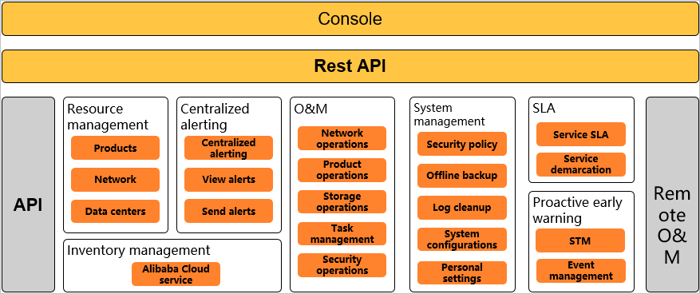
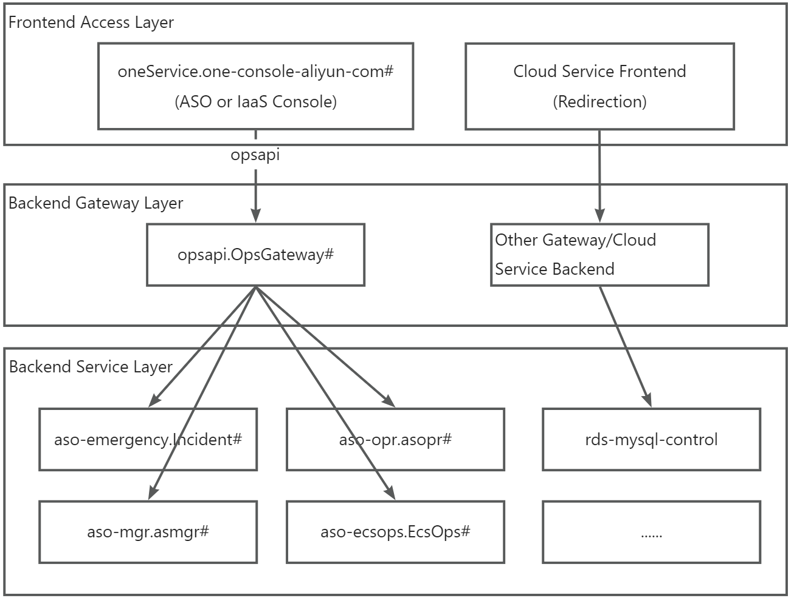

Alibaba Cloud  
Apsara Stack  
Apsara Uni-manager  
Operations Console  
Operations and Maintenance  
Guide  
Product Version: V3.18.6  
Document Version: 20260703

**Table of Contents**

- [1.Overview](#section-1)
- [2.Architecture](#section-2)
    - [2.1. System architecture](#section-2-1)
    - [2.2. Component architecture](#section-2-2)
- [3.Alert handling](#section-3)
- [4.Security maintenance](#section-4)
    - [4.1. Account password maintenance](#section-4-1)
    - [4.2. Log audit](#section-4-2)
- [5.Troubleshooting](#section-5)
    - [5.1. Establish a fault response mechanism](#section-5-1)
    - [5.2. Troubleshooting owners](#section-5-2)
    - [5.3. Troubleshooting](#section-5-3)
    - [5.4. Troubleshooting](#section-5-4)
        - [5.4.1. The domain name cannot be accessed after the Apsara Uni-manager O&M console is deployed.](#section-5-4-1)
        - [5.4.2. No alert data is displayed in the Apsara Uni-manager O&M console.](#section-5-4-2)
        - [5.4.3. The following message is displayed when you log on to the Apsara Uni-manager O&M console: The user has been removed.](#section-5-4-3)
        - [5.4.4. A user fails to log on to the SRE Technical Assurance Platform and error 403 is returned](#section-5-4-4)
- [6.High-risk operations](#section-6)
- [7.Appendixes](#section-7)
    - [7.1. Common Maintenance Commands](#section-7-1)
    - [7.2. Common HTTP status codes](#section-7-2)

<a id="section-1"></a>

# 1.Overview

This topic describes the purposes, requirements, precautions, and technical support for the Apsara Uni-manager Operations Console.

**Purposes**

This guide helps O&M personnel perform preventative maintenance on the Apsara Uni-manager Operations Console to make sure that it can stably run for a very long period. O&M personnel can follow the instructions in this guide to handle the system issues that are identified during maintenance. If O&M personnel encounter system issues that are not covered in this guide, they can contact Apsara Stack engineers for technical support.

**Requirements**

- O&M personnel must acquire IT skills, including knowledge for computer networks, knowledge for computer operations, issue analysis, and troubleshooting.

- In addition, O&M personnel must pass the pre-job training and learn the knowledge for the Apsara Stack system. The required knowledge for the system includes but is not limited to system principles, networking, features, and the usage of maintenance tools.

> **Important**
>
> Take note that O&M personnel must comply with operation procedures
>
> during maintenance to ensure personal safety and system security. User data must be kept strictly confidential and must not be copied or disseminated without the written consent from users.

**Precautions**

To ensure a stable system and avoid unexpected events, you must comply with the following guidelines:

- Hierarchical permission management

  Permissions on networks, devices, systems, and data are granted based on the services and roles of the O&M personnel. This prevents system faults that are caused by unauthorized operations.

- System security:

  - Before you perform system operations, you must be aware of their impacts.

  - You must clearly record the details about the issues that you encounter during the operations. This helps you troubleshoot and handle the issues.

- Personal safety and data security

  - You must take safety measures to ensure personal safety based on device manuals when you use electrical equipment.

  - You must use secure devices to access the business network.

  - Unauthorized data replication and dissemination are prohibited.

**Technical support**

You can contact Alibaba Cloud technical support for help.

<a id="section-2"></a>

# 2.Architecture

<a id="section-2-1"></a>

## 2.1. System architecture

The Apsara Uni-manager Operations Console provides unified O&M capabilities for Apsara Stack products.

The following figure shows the system architecture of the Apsara Uni-manager Operations Console.

Figure 2. Apsara Uni-manager Operations Console system architecture



The Apsara Uni-manager Operations Console comprises the following modules:

- Console: The user interface layer. This module provides an interactive user interface.

- Rest API: The console and system capabilities modules interact with each other by using the Rest API module.

- System capabilities:

  - Resource management: allows you to view and manage Apsara Stack resources in product, network, and data center dimensions.

  - Unified alerting: provides a unified alert export and alert outbound configuration capabilities for Apsara Stack platforms.

  - O&M capabilities: provides vertical O&M capabilities such as network, cloud products, storage, and tasks, as well as horizontal security O&M capabilities.

  - System management: Provides system administration capabilities such as security policies, offline backup, log clearing, system configuration, and personal configuration.

  - Inventory management: allows you to view product inventories and provides usage threshold alerting capabilities for various products.

The Apsara Uni-manager Operations Console also provides APIs for secondary development by third parties. You can select optional remote O&M capabilities.

<a id="section-2-2"></a>

## 2.2. Component architecture

This topic describes the components of the Apsara Uni-manager Operations Console and their features.

The following figure shows the component architecture of the Apsara Uni-manager Operations Console.



The following table describes the features of the components in the Apsara Uni-manager Operations Console.

| Service | Server role | Overview |
| --- | --- | --- |
| aso-ecsops | DeployInit# | ECS-related backend services in the IaaS console. |
| aso-ecsops | ApiInit# | ECS-related backend services in the IaaS console. |
| aso-ecsops | DbInit# | ECS-related backend services in the IaaS console. |
| aso-ecsops | SlsInit# | ECS-related backend services in the IaaS console. |
| aso-ecsops | DtsInit# | ECS-related backend services in the IaaS console. |
| aso-ecsops | EcsOps# | ECS-related backend services in the IaaS console. |
| aso-ecsops | AuditConfig# | ECS-related backend services in the IaaS console. |
| aso-emergency | Incident# | Features related to O&amp;M alerts and event management. |
| aso-emergency | Inspection# | Features related to O&amp;M inspection. |
| aso-emergency | Notify# | The components related to the outgoing alert event. |
| aso-emergency | init# | Initialize related components. |
| aso-mgr | configInit# | Used for DB and other related initialization. |
| aso-mgr | inventoryOpt# | The capacity prediction algorithm module predicts the future usage trend and warning water level of the capacity. |
| aso-mgr | asmgr# | Responsible for logon, user, organization, menu, permission, inventory, physical platform (CMDB), product O&amp;M management, API internal gateway. |
| aso-mgr | audit# | Black-and-white screen operation logs. |
| aso-mgr | bigbang# | related to scale-out. |
| aso-mgr | blueprint# | Blueprint diagnosis related. |
| aso-monitor | Monitor# | Alert notification, tianjimon template maintenance, and forwarding of alert source traffic. |
| aso-monitor | Tpcmon# | Run the monitoring script of tpcmon. |
| aso-opr | asopr# | Manage physical server passwords, physical server channels, and tasks. |
| aso-slalink | pgmon# | For Storage Operations Center |

<a id="section-3"></a>

# 3.Alert handling

In the Apsara Uni-manager Operations console, choose **Monitor&Alert > Alert Management** to view the alert information in the Apsara Uni-manager Operations console. For more information about how to handle alerts, see Alerts.

<a id="section-4"></a>

# 4.Security maintenance

<a id="section-4-1"></a>

## 4.1. Account password maintenance

This topic describes how to maintain accounts and passwords in the Apsara Uni-manager Operations console.

The user account has a validity period, and the password needs to be changed within the specified period. Otherwise, the account will be locked and you cannot log on normally.

- In the upper-right corner of the page, click the profile picture and select **Personal Information**. On the left side of the page, click **Change Password** to change the account password of the current user.

- On the **Account Policies** tab of the **Security Management** > **RAM** > **Security Policies** page, set **Validity Period**.

<a id="section-4-2"></a>

## 4.2. Log audit

This topic describes the audit methods, log file paths, and log query methods for component logs.

After entering the container, find the log file in the following table and view the log details.

**Components**

**File**

**Description**

/logs/asomanage-

asmgr container business-related logs

logger/main_trace.log

and exception logs

/logs/asomanage-

aso-mgr.asmgr

asmgr container access logs

logger/access_trace.log

/logs/asomanage-

The logs of calling other services related

logger/call_trace.log

to the asmgr container business.

/logs/asomonitor-

Monitor container business-related logs

logger/main_trace.log

and exception logs

aso-

/logs/asomonitor-

Monitor container access logs

monitor.monitor

logger/access_trace.log

/logs/asomonitor-

Monitor container service-related calls to

logger/call_trace.log

other services

/logs/asooperator-

asopr container business-related logs and

logger/main_trace.log

exception logs

aso-opr.asopr

/logs/asooperator-

asopr container access logs

logger/access_trace.log

/logs/asooperator-

logs of calling other services related to

logger/call_trace.log

the asopr container business

<a id="section-5"></a>

# 5.Troubleshooting

<a id="section-5-1"></a>

## 5.1. Establish a fault response mechanism

The maintenance team should establish a sound fault emergency response mechanism to ensure that in the event of a fault or security incident, it can quickly locate and efficiently handle it, minimize the business interruption time, and restore the normal operation of the system in a timely manner.

<a id="section-5-2"></a>

## 5.2. Troubleshooting owners

When monitoring alerts occur on the Apsara Uni-manager Operations Console, onsite O&M personnel must first troubleshoot the issues based on the alerts. If onsite O&M personnel cannot solve the issues, contact Apsara Stack technical support engineers.

<a id="section-5-3"></a>

## 5.3. Troubleshooting

This topic describes troubleshooting in the Apsara Uni-manager Operations Console.

After a system fault is discovered during routine maintenance, O&M personnel can use the O&M feature and system logs in the Apsara Uni-manager Operations Console to view the detailed information of the fault, analyze the causes, and solve the fault. If the faults cannot be fixed, O&M personnel can collect the related information, such as system information and fault symptoms, and contact Apsara Stack engineers for technical support. This way, O&M personnel can fix the faults based on the instructions of the engineers.

After the fault is rectified, verify the solution, review the troubleshooting method, and make improvements.

<a id="section-5-4"></a>

## 5.4. Troubleshooting

<a id="section-5-4-1"></a>

### 5.4.1. The domain name cannot be accessed after the Apsara Uni-manager O&M console is deployed.

This topic describes how to troubleshoot the problem that a domain name cannot be accessed after the Apsara Uni-manager Operations Console is deployed.

**Procedure**

1. Run the following command to check whether the pods in the Apsara Uni-manager Operations Console are running as expected in the environment corresponding to the domain name:  `Running`  or  `Completed` .

   ```bash
    kubectl get po -n aso 
   ```

   - Yes: Perform **Step 2**.

   - If no, contact the back-end technical support engineers of Apsara Uni-manager Operations Console.

2. Log on to the asoconsoleconsole-0 pod and run the following command. The IP address in the command is the IP address of the container where the pod is located. Check whether the pod is triggered or denied access.

   ```bash
    curl '127.0.XX.XX' 
   ```

   - If the results show that requests sent to access the pod are timed out or denied, contact the technical support of the Apsara Uni-manager Operations Console.

   - If requests sent to access the pod are not timed out or denied, contact the technical support of Apsara Infrastructure Management.

<a id="section-5-4-2"></a>

### 5.4.2. No alert data is displayed in the Apsara Uni-manager O&M console.

This topic describes how to handle the no-alert data in the Apsara Uni-manager Operations and Maintenance Console.

Both the Apsara Uni-manager Operations console and the apsara infrastructure O&M platform portal obtain alert data from TianjiMon. You can check whether tianjiMon generates alert data from the apsara infrastructure O&M platform portal for subsequent processing.

**Procedure**

Check whether alert data exists in the portal of the basic O&M platform of the apsara system.

- Yes: Contact the technical support engineer of the Apsara Uni-manager Operations Console.

- No: Contact TianjiMon technical support engineers.

<a id="section-5-4-3"></a>

### 5.4.3. The following message is displayed when you log on to the Apsara Uni-manager O&M console: The user has been removed.

This topic describes how to troubleshoot an error that indicates that the user has been removed when you log on to the Apsara Uni-manager O&M console.

**Procedure**

1. Log on to the aso_auth database.

2. Run the following command to view the user status and validity period:

   ```sql
   select * from user where name="test";
   ```

3. Check whether the user status (statue) is 1.

   - Yes: Perform **Step 4**.

   - No:  `update user set statue=1 where name="test";`  running the command, change the user status to 1.

4. Run the following command to change the effective time to a date later than the current day:

   ```sql
   Update user set validity_date="2026-06-30 15:23:23" where name="test";
   ```

<a id="section-5-4-4"></a>

### 5.4.4. A user fails to log on to the SRE Technical Assurance Platform and error 403 is returned

This topic describes how to resolve the issue that a user fails to log on to the SRE Technical Assurance Platform and error 403 is returned.

**Procedure**

1. Use the security officer account to log on to the Apsara Uni-manager Operations Console.

2. In the top navigation bar, click **User Authorities**.

3. In the left-side navigation pane, click **Role Management**.

4. On the Roles page, find the role assigned to the account that is used to log on to the SRE Technical Assurance Platform and click **Edit** in the **Actions** column.

5. In the **Edit Role** dialog box, modify the information, grant the tongque_administrator permission to the role, and then click **OK**.

<a id="section-6"></a>

# 6.High-risk operations

This topic describes the high-risk operations in the Apsara Uni-manager Operations Console to help you prevent risks that may arise.

The operations in the following table are considered high-risk operations in the Apsara Uni-manager Operations Console. The high-risk operations may cause great impacts on business stability. If you want to perform a high-risk operation described in the following table, we recommend that you perform it in the maintenance window. In addition, we recommend that you read and understand the impacts of the high-risk operations before you perform the operations.

**List of high-risk operations**

**Menu**

**High-risk operation**

**Impact**

**How to recover**

**path**

In the left-side navigation pane, choose **Resources > Product & Cluster O&M**. On the Product & Cluster O&M page, click Component in the

The service process is

Instance Status column and

Unrecoverable.

restarted.

select a component to go to the Component Details page. On the Instances tab of a component, **restart** the component.

In the left-side navigation pane, choose **Resources > Machine Management**. On

The machine is restarted.

the machine details page,

Services that run on the

Unrecoverable.

click **Machine Management**

machine are interrupted.

in the upper-right corner and select **Restart** to restart the machine.

After the repair is

In the left-side navigation

complete, the cloning

pane, choose **Resources >**

process is triggered. During

**Machine Management**. On

the process, the machine is

Platform

the machine details page,

shut down and the system

Unrecoverable.

Operation

click **Machine Management**

on the machine is

- Apsara

in the upper-right corner and

reinstalled, which may

Infrastruct

select **Repair and Clone** to

cause data loss on the

ure

repair and clone the machine.

machine.

Managem ent

During the repair process,

On the **Resource**

the machine will

**Management > Machine**

experience a shutdown

**Management > Machine**

state. If the services

Unrecoverable.

**Details** page, click **Machine**

running on the machine are

**Operation** to **Shut Down**

not migrated, the service

**and Repair**.

stability may be affected.

On the **Resource Management > Machine Management > Machine**

The service process is

Unrecoverable.

**Details** page, click the

restarted.

**Components** tab and **Restart**.

If you want to replace a

In the left-side navigation

disk, you must back up

pane, choose **Hardware**

data from storage-related

Unrecoverable.

**Maintenance > Hard Disk**

modules such as Pangu.

**Maintenance**.

Forced or misoperation may cause data loss.

The script will be executed

In the left-side navigation

Platform

in the selected physical

pane, choose **Operation**

O&M-O&M

machine. The influence

Unrecoverable.

**Orchestration Service >**

services

depends on the script

**O&M Jobs**.

content.

On the **Compute Cluster**

The influence surface

**Operations** page, log on to

depends on the content of

Unrecoverable.

the cluster AG and run the

the black screen command.

black command.

During the operation, the physical opportunity is first offline for maintenance, and then online after the maintenance is completed.

On the **Compute Server**

ECS instances on the

**Operations** page, create a

Unrecoverable.

physical machine will be

**repair** task.

migrated when the physical machine is offline. The migration of ECS instances may have business impacts.

After the operation is successful, the

On the **ECS Intelligent**

corresponding local disk

**Maintenance > ECS O&M**

will be taken offline for

Unrecoverable.

**Events** page, submit a local

repair. If the wrong disk is

disk repair order.

removed, the data of the local disk may be lost.

Product O&M-Compute O&M console

During the operation, the physical machine is first taken offline for maintenance, and then brought online after the maintenance is completed.

On the **ECS Intelligent**

When the physical machine

**Maintenance > ECS**

is taken offline, the ECS

**Physical Server**

instance on the physical

Unrecoverable.

**Operations** page, create a

machine will be migrated,

physical server for

and the migration of the

maintenance.

ECS instance may have business impacts.

On the **EBS Cluster Management > Cluster Details** page, click the Service Details tab. On the Service Details tab, click **Modify Service Flag** for the BlockServer, BlockMaster,

Depending on the

RiverServer, and RiverCluster

Change the

configuration items of the

service nodes.

configuration to the

modification, the service

standard configuration.

may be unavailable.

For a short period of time, the IO of some disks may be affected. A slow IO or IO hang may occur.

On the **EBS Cluster**

> **Note**

Product

**Management > Cluster**

Operation

**Details** page, click **Restart**

Unrecoverable.

> You can only restart

s-Elastic

or **Master** on the Service

> /cut machines that are

Block

Details tab.

> not in the normal

Storage

> state. We recommend

Operation

> that you do not restart

s · EBS

> /cut machines that are in the normal state.

On the **EBS Common Operations > EBS Active**

Change the value to

**Operations** page, perform

This may cause the cluster

the standard oversold

the following operations on

to fail to create a disk.

multiple.

the cluster: **Set Oversold Multiples**.

In the left-side navigation pane, click **Common EBS**

If a meeting is held after

Disable cluster sales on

**Operations**. On the **Active**

the cluster is oversold,

demand.

**EBS Operations** page, click

data writes are disabled.

**Open Cluster for Sale**.

On the **EBS Common Operations > EBS Active**

This may cause the cluster

Open the cluster for

**Operations** page, click

to fail to create a disk.

sale as needed.

**Disable Cluster Sales**.

During data encryption, read and write operations

On the **Storage Encryption**

cannot be performed. As a

page, turn on **Metabase**

result, your business is

Unrecoverable.

**Disk Encryption**.

interrupted. The impact time depends on the

Security

amount of data in the

Managem

database.

ent-Complianc e Support

On the **Encryption in**

Center-

The applications displayed

**Transmission > Metabase**

Platform

on the page are Rolling. In

Disable transmission

**Access Encryption in**

Password

normal cases, your

encryption.

**Transmission** page, turn on

Applicatio

business is not affected.

Encryption in Transmission.

n Managem ent

On the **Network Transmission Encryption**

The applications displayed

**> Platform Access**

on the page are Rolling. In

Disable transmission

**Transmission Encryption**

normal cases, your

encryption.

page, turn on Transmission

business is not affected.

Encryption.

Modifying the security isolation status of the SRS causes a change in the network security protection

In the left-side navigation

policies.

pane, click **East-West**

Restores the SRS

**Security Management >**

- If the Security Isolation

  security isolation state

**Apsara Infrastructure**

status of SRS is set to On

before the modification.

**Management Framework**

or Automatic, the

However, this state

**Inward Protection-SRS >**

network connectivity of

may still be affected

**SRS Management**. On the

the cloud platform may

during the restoration.

**Configuration**

be affected.

**Management** tab, modify the SRS security isolation

- If the SRS security

status.

isolation status is disabled, network security risks are introduced.

In the left-side navigation pane, click **East-West**

The configuration is

- Adding a whitelist may

**Security Management >**

restored to the

introduce cybersecurity

**Apsara Infrastructure**

previous configuration.

risks.

**Management Framework**

However, it is

**Inward Protection-SRS >**

estimated that it takes

- If you delete a whitelist,

**SRS Management**. On the

10 minutes for the new

the IP addresses in the

**Configuration**

configuration to take

original whitelist may fail

**Management** tab, add or

effect. This may still

to access services in the

delete an SRS IP address

cause impacts during

cloud.

whitelist.

the restoration.

In the left-side navigation

The configuration is

pane, click **East-West**

restored to the

- Adding a blacklist may

**Security Management >**

previous configuration.

cause IP addresses in the

**Apsara Infrastructure**

However, it is

blacklist to fail to access

**Management Framework**

estimated that it takes

services in the cloud.

**Inward Protection-SRS >**

10 minutes for the new

**SRS Management**. On the

- Removing the blacklist

  configuration to take

**Configuration**

may introduce

effect. This may still

**Management** tab, add or

cybersecurity risks.

cause impacts during

delete an SRS IP address

the restoration.

blacklist.

In the left-side navigation

The configuration is

- Adding non-isolated

pane, click **East-West**

restored to the

products may introduce

**Security Management >**

previous configuration.

cybersecurity risks.

**Apsara Infrastructure**

However, it is

**Management Framework**

estimated that it takes

- If you delete a product

**Inward Protection-SRS >**

10 minutes for the new

without isolating it, the

**SRS Management**. On the

configuration to take

related product services

**Configuration**

effect. This may still

may become

**Management** tab, add or

cause impacts during

unavailable.

delete SRS isolation.

the restoration.

In the left-side navigation

The configuration is

pane, click **East-West**

restored to the

- New bypass products

**Security Management >**

previous configuration.

may make related

**Apsara Infrastructure**

However, it is

products and services

**Management Framework**

estimated that it takes

unavailable.

**Inward Protection-SRS >**

10 minutes for the new

**SRS Management**. On the

- Removing bypass

  configuration to take

Security

**Configuration**

products may introduce

effect. This may still

Managem

**Management** tab, add or

cybersecurity risks.

cause impacts during

ent-

delete an SRS bypass

the restoration.

Network

baseline.

Security-Network Security Managem ent Center

In the left-side navigation

- The new dynamic

  The configuration is

pane, click **East-West**

release configuration

restored to the

**Security Management >**

may introduce network

previous configuration.

**Apsara Infrastructure**

security risks.

However, it is

**Management Framework**

estimated that it takes

- If you delete the

**Inward Protection-SRS >**

10 minutes for the new

dynamic release

**Isolation Configuration**

configuration to take

configuration, the related

**Management**. On the page

effect. This may still

products and services

that appears, add or delete

cause impacts during

may become

dynamic release

the restoration.

unavailable.

configurations.

In the left-side navigation

The ports of all hosts in the

pane, choose **East-West**

PaaS base cluster will be

**Security Management >**

open to addresses outside

Enable host network

**PaaS Inbound Protection-**

the cloud, which may

isolation.

**East Emperor Bell > East**

introduce network security

**Emperor Bell**

risks.

**Configuration**.

If network isolation is

In the left-side navigation

enabled for a host and a

pane, click **East-West**

CIDR block is added to the

**Security Management >**

whitelist, all ports of the

**PaaS Intrusion Protection-**

Deletes an untrusted

host in the PaaS base

**East Emperor Bell > East**

CIDR block from the

cluster are allowed to

**Emperor Bell**

whitelist.

access the CIDR block. If

**Configuration**. On the page

the CIDR block is

that appears, add a CIDR

untrusted, network security

block to the whitelist.

risks may occur.

If you enable network

In the left-side navigation

isolation for hosts and

pane, click **East-West**

delete the CIDR block from

**Security Management >**

the whitelist, the CIDR

**PaaS Intrusion Protection-**

block cannot be used to

Add another CIDR block

**East Emperor Bell > East**

access the ports of all hosts

to the whitelist.

**Emperor Bell**

in the PaaS base cluster. As

**Configuration**. On the page

a result, normal service

that appears, delete the CIDR

connections are

block from the whitelist.

interrupted.

In the left-side navigation

If host network isolation is

pane, choose **East-West**

enabled and ports that

**Security Management >**

allow access to hosts are

**PaaS Inbound Protection-**

added, the added ports of

Make sure that the

**East Emperor Bell > East**

all hosts in the PaaS

CIDR blocks that you

**Emperor Bell**

clusters can be accessed

trust are included in the

**Configuration**.

only from IP addresses or

whitelist before you

CIDR blocks in the whitelist.

modify or add the

If the port that needs to be

ports.

accessed is not added, your business is interrupted.

Find the original passwords in the password history and

In the left-side navigation

restore the passwords

pane, click **Password**

The passwords of the

to the original

**Management for Root**. On

accounts for physical

passwords.

the page that appears,

machines and kernel-based

update passwords on the

virtual machines (KVMs)

**Password management**

are changed.

tab.

- If you turn off the switch, you cannot update or rotate the passwords of machines in the Apsara Uni-manager Operations Console.

In the left-side navigation pane, click **Password**

- If you turn off the switch,

  Turn on Password tube

**Management for Root**. On

the aso-opr container

switch to enable

the page that appears, turn

cannot execute jsch

password hosting.

off Password tube switch on

commands. In this case,

the **Configuration** tab.

the archive management and log clearing capabilities of the Apsara Uni-manager Operations

Security

Console become

Managem

unavailable.

ent -Account Security -

The password rotation

Linux

operation is performed

Account

based on the rotation

Managem

configuration time of each

ent

On the **Root Password**

Find and recover

machine (once every 15

**Management** page, turn on

historical passwords

days by default).

the Rotation switch on the

from the password

**Configuration** tab.

history.

On the **Linux Account**

The password-free

**Management Tasks >**

The initial global password-

channel from the OPS

**Task Template**

free channel from the OPS

machine to all physical

**Management** page, run the

machine to all other

machines is

GlobalTunnelRemoveTask

machines is reclaimed.

reconnected.

task.

the system rotates the default password-free

On the **Linux Account**

channel. during the

Re-issue the original

**Management Tasks >**

rotation, non-standard

key to the machine that

**Task Template**

machines that depend on

has completed the

**Management** page, run the

the initial key may fail to

change.

GlobalTunnelRotateTask task.

communicate with each other through ssh.

<table>
  <tr>
    <td>User permissio ns</td>
    <td>On the <strong>Users</strong> page, delete the user.</td>
    <td>If you delete a user, the user is moved to the recycle bin and the AccessKey pair of the user is disabled. As a result, products or programs that use these AccessKey pair cannot run properly.</td>
    <td>Restore the user in the recycle bin. After the user is restored, the AccessKey pair of the RAM user is disabled by default and can be re-enabled.</td>
  </tr>
  <tr>
    <td>Avatar-Personal Informatio n</td>
    <td>In the <strong>Accesskey</strong> section, disable or <strong>delete</strong> the AK/SK.</td>
    <td>As a result, callers who use this AK/SK to call OpenAPI may become unavailable.</td>
    <td>• If you disable an AccessKey pair, you can enable it again.<br>• If you delete an AccessKey pair, the AccessKey pair cannot be restored.In this case, replace the deleted AccessKey pair in the code of the services or applications with a new one.</td>
  </tr>
</table>

<a id="section-7"></a>

# 7.Appendixes

<a id="section-7-1"></a>

## 7.1. Common Maintenance Commands

This topic describes common maintenance commands in the Apsara Uni-manager Operations Console, including commands for logging on to environments and containers, and Kubernetes common commands in Agile PaaS.

**Commands for logging on to environments and containers**

- Logon Environment

  ```bash
  kubectl get ingress -n aso
  ```

- Log on to a container

  ```bash
  kubectl get pod -n aso
  ```

- Pods that go to a single container

  ```bash
  kubectl exec -it asoconsoleconsole-0 -n aso /bin/bash 
  ```

**Common commands Kubernetes Agile PaaS**

- The host goes to the Kubernetes console.

  ```bash
  sudo arkshoot
  ```

- View the service status

  ```bash
  kubectl get po -n ark-system
  ```

- View deployed products

  ```bash
  kubectl get appset -n ark-system
  ```

- View the configuration information of a product

  ```bash
  kubectl get appset -n ark-system aso-0 -oyaml
  ```

- View the stage, status, and configuration information of a service role deployment

  ```bash
  kubectl get appinstance -n ark-system aso-mgr.asmgr -oyaml
  ```

- View the chart deployment workflow status

  ```text
  argo get -n ark-system inst-aso-mgr-asmgr-zkgqr ${Revision}
  ```

- View container operational logs

  ```text
  argo get -n ark-system aso-mgr.asmgr
  ```

- View the containers running in the Apsara Uni-manager Operations console

  ```bash
  kubectl get po -n aso
  ```

- Viewing Startup Information for a asomgrasmgr-0

  ```bash
  kubectl logs asomgrasmgr-0 -n aso -c dep-init
  ```

- Describe information about a node

  ```bash
  kubectl describe pods asdconsoletaskmanager-0 -n asd
  ```

- View product-specific descriptions

  ```bash
  kubectl describe po podName -n aso
  ```

- Get IP

  ```bash
  kubectl get pods -n asd -o wide
  ```

- View all DNS configurations in your environment

  ```bash
  kubectl get ingress -A
  ```

- View configuration items data

  ```bash
  kubectl get ingress -n asd asdportal-nginx-ingress -o yaml
  ```

- View environment variables

  ```bash
  kubectl get cm ark.cmdb.app.asd-console.taskmanager.expose -n ark-system -oyaml
  ```

- View the Ingress address

  ```bash
  kubectl get ingress -n aso
  ```

- Delete a Pod

  ```bash
  kubectl delete po pod_name -n aso
  ```

- View memory information

  ```bash
  cat /proc/meminfo
  ```

<a id="section-7-2"></a>

## 7.2. Common HTTP status codes

This topic describes the common HTTP status codes and their types in the Apsara Uni-manager Operations Console.

**HTTP status code types**

HTTP status codes can be divided into five types based on the first digit:

- 1xx: informational response. The request was received, continuing process.

- 2xx: successful. The request was received, understood, and accepted.

- 3xx: redirection. Further action needs to be taken in order to complete the request.

- 4xx: client error. The request contains bad syntax or cannot be fulfilled.

- 5xx: server error. The server cannot identify an invalid request.

**Common HTTP status codes**

| HTTP status code | Description |
| --- | --- |
| 200 | Successful response |
| 404 | Resources not found |
| 400 | Bad request, such as syntax errors |
| 401 | Request authorization failed |
| 402 | Cookie verification failed |
| 403 | Forbidden request |
| 404 | Files, queries, or URLs not found |
| 406 | Account not activated |
| 409 | Resource already exists |
| 418 | Verification code invalid |
| 419 | Service authorization failed |
| 420 | Signature data check failed |
| 421 | Certificate check failed |
| 422 | Random does not exist |
| 423 | SN and account mismatch |
| 424 | Username or ID does not match |
| 425 | Service does not exist |
| 426 | Authentication does not exist |
| 427 | Authentication failed |
| 428 | Request from the Apsara Infrastructure Management failed |
| 500 | Internal errors in the server |
| 501 | Requested function not supported in the server |
| 510 | Database operation errors |
