Alibaba Cloud  
Apsara Stack  
Apsara Uni-manager  
Operations Console  
User Guide  
Product Version: V3.18.6  
Document Version: 20260703

**Table of Contents**

- [1.Overview](#section-1)
- [2.Get started](#section-2)
    - [2.1. Prepare an operations account](#section-2-1)
    - [2.2. Log in to the Apsara Uni-manager](#section-2-2)
    - [2.3. Top navigation bar](#section-2-3)
    - [2.4. User information](#section-2-4)
    - [2.5. Operation platform](#section-2-5)
- [3.Getting Started](#section-3)
    - [3.1. Overview](#section-3-1)
    - [3.2. System administrator](#section-3-2)
        - [3.2.1. Alert management](#section-3-2-1)
        - [3.2.2. Inspection management](#section-3-2-2)
    - [3.3. Security administrator](#section-3-3)
        - [3.3.1. Configure login settings](#section-3-3-1)
    - [3.4. Security auditor](#section-3-4)
        - [3.4.1. Operation log auditing](#section-3-4-1)
    - [3.5. Role administrator](#section-3-5)
        - [3.5.1. User management](#section-3-5-1)
- [4.General O&M](#section-4)
    - [4.1. Monitoring management](#section-4-1)
        - [4.1.1. Cloud platform monitoring](#section-4-1-1)
            - [4.1.1.1. Business monitoring for cloud services](#section-4-1-1-1)
                - [4.1.1.1.1. View the monitoring information of cloud services](#section-4-1-1-1-1)
                - [4.1.1.1.2. Access configuration](#section-4-1-1-1-2)
                - [4.1.1.1.3. Alert rule](#section-4-1-1-1-3)
                - [4.1.1.1.4. Alert template](#section-4-1-1-1-4)
                - [4.1.1.1.5. Alert history](#section-4-1-1-1-5)
                - [4.1.1.1.6. Indicator repository](#section-4-1-1-1-6)
            - [4.1.1.2. Product gateway monitoring](#section-4-1-1-2)
                - [4.1.1.2.1. API monitoring dashboard](#section-4-1-1-2-1)
                - [4.1.1.2.2. API alert](#section-4-1-1-2-2)
            - [4.1.1.3. Infrastructure monitoring](#section-4-1-1-3)
                - [4.1.1.3.1. WatchDog management](#section-4-1-1-3-1)
                - [4.1.1.3.2. Server monitoring](#section-4-1-1-3-2)
                - [4.1.1.3.3. Network monitoring](#section-4-1-1-3-3)
            - [4.1.1.4. General monitoring](#section-4-1-1-4)
                - [4.1.1.4.1. Cloud product SLO monitoring](#section-4-1-1-4-1)
                - [4.1.1.4.2. Site monitoring](#section-4-1-1-4-2)
                - [4.1.1.4.3. Instance monitoring](#section-4-1-1-4-3)
                - [4.1.1.4.4. Cloud instance alerts](#section-4-1-1-4-4)
            - [4.1.1.5. Data dashboard](#section-4-1-1-5)
                - [4.1.1.5.1. View data on the read and write dashboard](#section-4-1-1-5-1)
                - [4.1.1.5.2. Custom dashboard](#section-4-1-1-5-2)
                - [4.1.1.5.3. Dashboard data sources](#section-4-1-1-5-3)
            - [4.1.1.6. Custom monitoring](#section-4-1-1-6)
                - [4.1.1.6.1. Script management](#section-4-1-1-6-1)
        - [4.1.2. Cloud service performance baseline dashboard](#section-4-1-2)
        - [4.1.3. Cloud service dashboards](#section-4-1-3)
        - [4.1.4. Cloud platform dashboard](#section-4-1-4)
    - [4.2. Alert management](#section-4-2)
        - [4.2.1. Alert overview](#section-4-2-1)
        - [4.2.2. Alert list](#section-4-2-2)
        - [4.2.3. Alert rules](#section-4-2-3)
            - [4.2.3.1. Monitoring templates](#section-4-2-3-1)
            - [4.2.3.2. Alert rules](#section-4-2-3-2)
        - [4.2.4. Alert settings](#section-4-2-4)
            - [4.2.4.1. Policy management](#section-4-2-4-1)
            - [4.2.4.2. Alert templates](#section-4-2-4-2)
            - [4.2.4.3. Alert notification](#section-4-2-4-3)
            - [4.2.4.4. Mute alerts](#section-4-2-4-4)
        - [4.2.5. Alert inventory](#section-4-2-5)
    - [4.3. Inspections](#section-4-3)
        - [4.3.1. All inspections](#section-4-3-1)
        - [4.3.2. Inspection dashboard](#section-4-3-2)
        - [4.3.3. Inspection scenarios](#section-4-3-3)
        - [4.3.4. Inspection records](#section-4-3-4)
        - [4.3.5. Inspection notifications](#section-4-3-5)
    - [4.4. Self healing](#section-4-4)
        - [4.4.1. Rule management](#section-4-4-1)
        - [4.4.2. Plan management](#section-4-4-2)
        - [4.4.3. Execution records](#section-4-4-3)
    - [4.5. Diagnostic center](#section-4-5)
        - [4.5.1. Service diagnosis](#section-4-5-1)
        - [4.5.2. Hardware diagnostics](#section-4-5-2)
        - [4.5.3. Diagnosis records](#section-4-5-3)
    - [4.6. Event center](#section-4-6)
        - [4.6.1. Overview](#section-4-6-1)
        - [4.6.2. Event list](#section-4-6-2)
        - [4.6.3. My events](#section-4-6-3)
        - [4.6.4. Grading management](#section-4-6-4)
            - [4.6.4.1. Event grading](#section-4-6-4-1)
            - [4.6.4.2. Custom grading](#section-4-6-4-2)
        - [4.6.5. Configuration management](#section-4-6-5)
        - [4.6.6. Notification management](#section-4-6-6)
            - [4.6.6.1. Notification policies](#section-4-6-6-1)
            - [4.6.6.2. Service group management](#section-4-6-6-2)
            - [4.6.6.3. Notification channel management](#section-4-6-6-3)
- [5.Platform O&M](#section-5)
    - [5.1. Apsara Infrastructure Management](#section-5-1)
        - [5.1.1. Resource management](#section-5-1-1)
            - [5.1.1.1. Product & Cluster O&M](#section-5-1-1-1)
                - [5.1.1.1.1. Cluster details](#section-5-1-1-1-1)
                - [5.1.1.1.2. Component details](#section-5-1-1-1-2)
            - [5.1.1.2. Machine management](#section-5-1-1-2)
                - [5.1.1.2.1. Machine details](#section-5-1-1-2-1)
            - [5.1.1.3. Resource tags](#section-5-1-1-3)
            - [5.1.1.4. Base machine resource dashboard](#section-5-1-1-4)
        - [5.1.2. Kubernetes cluster management](#section-5-1-2)
            - [5.1.2.1. Cluster overview](#section-5-1-2-1)
            - [5.1.2.2. Node management](#section-5-1-2-2)
        - [5.1.3. Hardware O&M](#section-5-1-3)
            - [5.1.3.1. HDD repairs](#section-5-1-3-1)
            - [5.1.3.2. Machine repair](#section-5-1-3-2)
        - [5.1.4. O&M tools](#section-5-1-4)
            - [5.1.4.1. Task management](#section-5-1-4-1)
            - [5.1.4.2. Service management](#section-5-1-4-2)
            - [5.1.4.3. VM dashboard](#section-5-1-4-3)
            - [5.1.4.4. Dashboard of service registration variables](#section-5-1-4-4)
            - [5.1.4.5. Resource dashboard](#section-5-1-4-5)
            - [5.1.4.6. Basic service monitoring](#section-5-1-4-6)
        - [5.1.5. Web clients](#section-5-1-5)
            - [5.1.5.1. Web Client Logon](#section-5-1-5-1)
                - [5.1.5.1.1. Server Login](#section-5-1-5-1-1)
                - [5.1.5.1.2. Log in to a database](#section-5-1-5-1-2)
                - [5.1.5.1.3. vSwitch Login](#section-5-1-5-1-3)
            - [5.1.5.2. Account authorization](#section-5-1-5-2)
            - [5.1.5.3. Command management](#section-5-1-5-3)
            - [5.1.5.4. Operation records](#section-5-1-5-4)
    - [5.2. O&M of management services](#section-5-2)
    - [5.3. O&M services](#section-5-3)
        - [5.3.1. Service catalog](#section-5-3-1)
        - [5.3.2. Service management](#section-5-3-2)
        - [5.3.3. Template management](#section-5-3-3)
        - [5.3.4. Category management](#section-5-3-4)
        - [5.3.5. Operation Orchestration Service](#section-5-3-5)
            - [5.3.5.1. Host resources](#section-5-3-5-1)
            - [5.3.5.2. Docker resources](#section-5-3-5-2)
            - [5.3.5.3. Script libraries](#section-5-3-5-3)
            - [5.3.5.4. Software repositories](#section-5-3-5-4)
            - [5.3.5.5. O&M jobs](#section-5-3-5-5)
            - [5.3.5.6. Manage execution history](#section-5-3-5-6)
        - [5.3.6. Service notification](#section-5-3-6)
        - [5.3.7. View execution records](#section-5-3-7)
    - [5.4. Capacity management](#section-5-4)
        - [5.4.1. Capacity overview](#section-5-4-1)
        - [5.4.2. Computing capacity](#section-5-4-2)
            - [5.4.2.1. ECS](#section-5-4-2-1)
            - [5.4.2.2. ACK](#section-5-4-2-2)
        - [5.4.3. Network capacity](#section-5-4-3)
            - [5.4.3.1. SLB IP addresses](#section-5-4-3-1)
            - [5.4.3.2. SLB performance](#section-5-4-3-2)
            - [5.4.3.3. Elastic IP addresses](#section-5-4-3-3)
            - [5.4.3.4. VPC IP addresses](#section-5-4-3-4)
            - [5.4.3.5. VPC performance](#section-5-4-3-5)
            - [5.4.3.6. Express Connect performance](#section-5-4-3-6)
            - [5.4.3.7. Transit router performance](#section-5-4-3-7)
            - [5.4.3.8. Apsara Stack DNS](#section-5-4-3-8)
        - [5.4.4. Storage capacity](#section-5-4-4)
            - [5.4.4.1. EBS](#section-5-4-4-1)
            - [5.4.4.2. OSS](#section-5-4-4-2)
            - [5.4.4.3. Tablestore](#section-5-4-4-3)
            - [5.4.4.4. SLS](#section-5-4-4-4)
            - [5.4.4.5. File Storage NAS](#section-5-4-4-5)
            - [5.4.4.6. CPFS](#section-5-4-4-6)
            - [5.4.4.7. File System APFS](#section-5-4-4-7)
            - [5.4.4.8. EFS-NAS](#section-5-4-4-8)
        - [5.4.5. Base capacity](#section-5-4-5)
            - [5.4.5.1. Apsara Infrastructure Management](#section-5-4-5-1)
            - [5.4.5.2. Docker host capacity of Apsara Infrastructure Management](#section-5-4-5-2)
        - [5.4.6. Database capacity](#section-5-4-6)
            - [5.4.6.1. ApsaraDB RDS](#section-5-4-6-1)
            - [5.4.6.2. PolarDB for MySQL (local disk)](#section-5-4-6-2)
            - [5.4.6.3. ApsaraDB RDS for PostgreSQL](#section-5-4-6-3)
            - [5.4.6.4. ApsaraDB for Redis](#section-5-4-6-4)
            - [5.4.6.5. ApsaraDB for MongoDB](#section-5-4-6-5)
            - [5.4.6.6. AnalyticDB for PostgreSQL](#section-5-4-6-6)
            - [5.4.6.7. PolarDB for PostgreSQL](#section-5-4-6-7)
            - [5.4.6.8. AnalyticDB for MySQL 3.0](#section-5-4-6-8)
            - [5.4.6.9. PolarDB-X 2.0](#section-5-4-6-9)
            - [5.4.6.10. PolarDB-MySQL (local disk-onPaaS)](#section-5-4-6-10)
            - [5.4.6.11. AnalyticDB for PostgreSQL (local disk-onPaaS)](#section-5-4-6-11)
            - [5.4.6.12. PolarDB for MySQL (shared disk on PaaS)](#section-5-4-6-12)
            - [5.4.6.13. PolarDB for PostgreSQL (shared disk on PaaS)](#section-5-4-6-13)
            - [5.4.6.14. PolarDB-X](#section-5-4-6-14)
            - [5.4.6.15. ApsaraDB for OceanBase](#section-5-4-6-15)
            - [5.4.6.16. ApsaraDB for Lindorm](#section-5-4-6-16)
            - [5.4.6.17. DTS](#section-5-4-6-17)
            - [5.4.6.18. DMS](#section-5-4-6-18)
            - [5.4.6.19. DAS](#section-5-4-6-19)
        - [5.4.7. Middleware capacity](#section-5-4-7)
            - [5.4.7.1. ApsaraMQ for Kafka](#section-5-4-7-1)
            - [5.4.7.2. ARMS](#section-5-4-7-2)
            - [5.4.7.3. EDAS](#section-5-4-7-3)
            - [5.4.7.4. SchedulerX](#section-5-4-7-4)
            - [5.4.7.5. ApsaraMQ for RocketMQ](#section-5-4-7-5)
        - [5.4.8. Big data capacity](#section-5-4-8)
            - [5.4.8.1. MaxCompute](#section-5-4-8-1)
            - [5.4.8.2. Realtime Compute for Apache Flink](#section-5-4-8-2)
            - [5.4.8.3. Realtime Compute for Apache Flink (compute-storage separation)](#section-5-4-8-3)
            - [5.4.8.4. Elasticsearch](#section-5-4-8-4)
            - [5.4.8.5. DataWorks](#section-5-4-8-5)
            - [5.4.8.6. DataHub](#section-5-4-8-6)
    - [5.5. Disaster recovery management](#section-5-5)
    - [5.6. O&M change](#section-5-6)
        - [5.6.1. Log cleanup](#section-5-6-1)
            - [5.6.1.1. Rule management](#section-5-6-1-1)
            - [5.6.1.2. Plans](#section-5-6-1-2)
            - [5.6.1.3. Records](#section-5-6-1-3)
        - [5.6.2. Plan management](#section-5-6-2)
            - [5.6.2.1. Base plans](#section-5-6-2-1)
                - [5.6.2.1.1. Workflow types](#section-5-6-2-1-1)
                - [5.6.2.1.2. Link types](#section-5-6-2-1-2)
                    - [5.6.2.1.2.1. Docker VM migration](#section-5-6-2-1-2-1)
                    - [5.6.2.1.2.2. Docker host switchover](#section-5-6-2-1-2-2)
                    - [5.6.2.1.2.3. NC scale-in](#section-5-6-2-1-2-3)
                    - [5.6.2.1.2.4. NC scale-out](#section-5-6-2-1-2-4)
                    - [5.6.2.1.2.5. Docker host scale-in](#section-5-6-2-1-2-5)
                    - [5.6.2.1.2.6. Docker host scale-out](#section-5-6-2-1-2-6)
                    - [5.6.2.1.2.7. Cluster startup and shutdown](#section-5-6-2-1-2-7)
        - [5.6.3. Process approval](#section-5-6-3)
            - [5.6.3.1. My submission](#section-5-6-3-1)
            - [5.6.3.2. My approval](#section-5-6-3-2)
        - [5.6.4. Version management](#section-5-6-4)
            - [5.6.4.1. Manage packages](#section-5-6-4-1)
            - [5.6.4.2. Product version management](#section-5-6-4-2)
            - [5.6.4.3. Version change management](#section-5-6-4-3)
    - [5.7. Log center](#section-5-7)
        - [5.7.1. Log map](#section-5-7-1)
        - [5.7.2. Log Search](#section-5-7-2)
        - [5.7.3. Log dump](#section-5-7-3)
        - [5.7.4. Log monitoring](#section-5-7-4)
    - [5.8. Task center](#section-5-8)
        - [5.8.1. Task list](#section-5-8-1)
        - [5.8.2. My tasks](#section-5-8-2)
    - [5.9. Report center](#section-5-9)
        - [5.9.1. Report list](#section-5-9-1)
        - [5.9.2. Report download](#section-5-9-2)
        - [5.9.3. Report push](#section-5-9-3)
        - [5.9.4. Push configuration](#section-5-9-4)
- [6.Product operations and maintenance](#section-6)
- [7.Security management](#section-7)
    - [7.1. Security audit](#section-7-1)
        - [7.1.1. Operation audit](#section-7-1-1)
            - [7.1.1.1. Console-based Audit](#section-7-1-1-1)
            - [7.1.1.2. CLI-based Audit](#section-7-1-1-2)
            - [7.1.1.3. Smart audit](#section-7-1-1-3)
    - [7.2. Security operations](#section-7-2)
    - [7.3. Host security](#section-7-3)
        - [7.3.1. Container image management](#section-7-3-1)
    - [7.4. Network security](#section-7-4)
        - [7.4.1. Runtime application self-protection](#section-7-4-1)
            - [7.4.1.1. Agent management](#section-7-4-1-1)
            - [7.4.1.2. Rule management](#section-7-4-1-2)
            - [7.4.1.3. Attack alerts](#section-7-4-1-3)
        - [7.4.2. Network Security Management Center](#section-7-4-2)
            - [7.4.2.1. North-south security management](#section-7-4-2-1)
                - [7.4.2.1.1. Single-region access matrixes](#section-7-4-2-1-1)
                - [7.4.2.1.2. Cross-region access matrixes](#section-7-4-2-1-2)
                - [7.4.2.1.3. Network perimeter security policy check](#section-7-4-2-1-3)
            - [7.4.2.2. East-west security management](#section-7-4-2-2)
                - [7.4.2.2.1. Inbound protection for Apsara Infrastructure Management: SRS](#section-7-4-2-2-1)
                    - [7.4.2.2.1.1. SRS management](#section-7-4-2-2-1-1)
                    - [7.4.2.2.1.2. Isolation configuration management](#section-7-4-2-2-1-2)
                    - [7.4.2.2.1.3. Client status](#section-7-4-2-2-1-3)
                - [7.4.2.2.2. Inbound protection for PaaS services: Donghuangzhong](#section-7-4-2-2-2)
                    - [7.4.2.2.2.1. Donghuangzhong settings](#section-7-4-2-2-2-1)
                    - [7.4.2.2.2.2. Node debugging logs](#section-7-4-2-2-2-2)
                    - [7.4.2.2.2.3. VIP list](#section-7-4-2-2-2-3)
                    - [7.4.2.2.2.4. CIDR block whitelist](#section-7-4-2-2-2-4)
                - [7.4.2.2.3. Platform VIP security protection](#section-7-4-2-2-3)
                - [7.4.2.2.4. DNS rules](#section-7-4-2-2-4)
                - [7.4.2.2.5. Host routing control](#section-7-4-2-2-5)
                - [7.4.2.2.6. Host DNS control](#section-7-4-2-2-6)
                - [7.4.2.2.7. Policy center](#section-7-4-2-2-7)
                    - [7.4.2.2.7.1. Network whitelist management](#section-7-4-2-2-7-1)
                - [7.4.2.2.8. Host trusted certificate status](#section-7-4-2-2-8)
            - [7.4.2.3. Device network access management](#section-7-4-2-3)
    - [7.5. Account security](#section-7-5)
        - [7.5.1. PCM](#section-7-5-1)
            - [7.5.1.1. AccessKey pair management](#section-7-5-1-1)
            - [7.5.1.2. PCM O&M](#section-7-5-1-2)
        - [7.5.2. Linux account management](#section-7-5-2)
            - [7.5.2.1. Root password management](#section-7-5-2-1)
            - [7.5.2.2. SSH key management](#section-7-5-2-2)
            - [7.5.2.3. System user management](#section-7-5-2-3)
            - [7.5.2.4. Linux account management task](#section-7-5-2-4)
                - [7.5.2.4.1. Task template management](#section-7-5-2-4-1)
                - [7.5.2.4.2. Task execution records](#section-7-5-2-4-2)
        - [7.5.3. Account management for cloud services](#section-7-5-3)
            - [7.5.3.1. Overview](#section-7-5-3-1)
            - [7.5.3.2. Cloud product accounts](#section-7-5-3-2)
            - [7.5.3.3. Account ACL control](#section-7-5-3-3)
            - [7.5.3.4. Platform assets](#section-7-5-3-4)
            - [7.5.3.5. Service boundary](#section-7-5-3-5)
                - [7.5.3.5.1. API control policies](#section-7-5-3-5-1)
                - [7.5.3.5.2. O&M](#section-7-5-3-5-2)
    - [7.6. Access control](#section-7-6)
        - [7.6.1. Security policy](#section-7-6-1)
        - [7.6.2. Logon policies](#section-7-6-2)
        - [7.6.3. Two-factor authentication](#section-7-6-3)
        - [7.6.4. Privacy policies](#section-7-6-4)
    - [7.7. Security compliance center](#section-7-7)
        - [7.7.1. Platform password application management](#section-7-7-1)
            - [7.7.1.1. Configuration management](#section-7-7-1-1)
            - [7.7.1.2. Storage encryption](#section-7-7-1-2)
                - [7.7.1.2.1. Metadatabase disk encryption](#section-7-7-1-2-1)
                - [7.7.1.2.2. Log encryption at rest](#section-7-7-1-2-2)
                - [7.7.1.2.3. Server-side encryption of ECS snapshots in OSS](#section-7-7-1-2-3)
            - [7.7.1.3. Integrity protection](#section-7-7-1-3)
                - [7.7.1.3.1. ECS public image integrity protection](#section-7-7-1-3-1)
            - [7.7.1.4. Confidential computing](#section-7-7-1-4)
                - [7.7.1.4.1. Column-level encryption configurations](#section-7-7-1-4-1)
                - [7.7.1.4.2. Column-level encryption](#section-7-7-1-4-2)
    - [7.8. Data security](#section-7-8)
        - [7.8.1. Platform certificate management](#section-7-8-1)
            - [7.8.1.1. Platform certificate assets](#section-7-8-1-1)
            - [7.8.1.2. Certificate update tasks](#section-7-8-1-2)
            - [7.8.1.3. Platform root certificate](#section-7-8-1-3)
- [8.System settings](#section-8)
    - [8.1. Custom settings](#section-8-1)
    - [8.2. Document management](#section-8-2)
    - [8.3. Card management](#section-8-3)
    - [8.4. Authorization information](#section-8-4)
    - [8.5. Notification management](#section-8-5)
        - [8.5.1. Channel management](#section-8-5-1)
        - [8.5.2. Push history](#section-8-5-2)
    - [8.6. Region coordinate management](#section-8-6)
    - [8.7. Third-party authentication](#section-8-7)
    - [8.8. Platform backup management](#section-8-8)
        - [8.8.1. Go to the platform backup management page](#section-8-8-1)
        - [8.8.2. Platform backup archive storage](#section-8-8-2)
            - [8.8.2.1. Create a platform backup archive storage](#section-8-8-2-1)
            - [8.8.2.2. Manage a platform backup archive storage](#section-8-8-2-2)
        - [8.8.3. Configure platform backup archiving](#section-8-8-3)
            - [8.8.3.1. Configure miniRDS backup](#section-8-8-3-1)
            - [8.8.3.2. Configure PANGU master backup](#section-8-8-3-2)
            - [8.8.3.3. Configure opsDNS backup](#section-8-8-3-3)
            - [8.8.3.4. Configure DNS product backup](#section-8-8-3-4)
            - [8.8.3.5. Configure in-cloud OSS bucket backup](#section-8-8-3-5)
        - [8.8.4. View platform backup archiving records](#section-8-8-4)
- [9.User permissions](#section-9)
    - [9.1. User management](#section-9-1)
    - [9.2. User group management](#section-9-2)
    - [9.3. Role management](#section-9-3)
    - [9.4. Department management](#section-9-4)
    - [9.5. Department-region association](#section-9-5)
    - [9.6. Menu management](#section-9-6)
- [10.Emergency response](#section-10)
    - [10.1. Watchdog monitoring and alerting](#section-10-1)
    - [10.2. Scenario diagnostics](#section-10-2)
    - [10.3. Emergency plan](#section-10-3)
    - [10.4. Emergency web terminal](#section-10-4)
        - [10.4.1. Server logon](#section-10-4-1)
        - [10.4.2. Database logon](#section-10-4-2)

<a id="section-1"></a>

# 1.Overview

This topic describes the management framework of the Apsara Uni-manager Operations Console.

**Management framework of the Apsara Uni-manager Operations Console**

Alibaba Cloud Apsara Stack adopts the ISO 20000 standard and references the methods regulated by the Information Technology Service Standards (ITSS) and ITIL frameworks to build the management framework of the Apsara Uni-manager Operations Console. The following figure shows the management framework of the Apsara Uni-manager Operations Console.

Figure 1. Apsara Uni-manager Operations Console

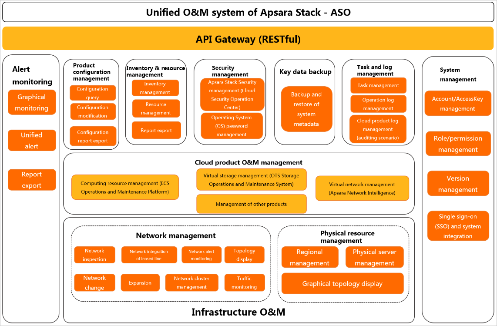

Based on ITIL and ISO 20000, the management framework of the Apsara Uni-manager Operations Console uses management support tools to adapt to various management modes in a process-oriented, normalized, and standardized manner. This has implemented the systematic management of the overall process of operations services The management framework of the Apsara Uni-manager Operations Console provides the full lifecycle management methods, management standards, management modes, management supporting tools, management objects, and process-based management methods of IT operations services.

The Apsara Uni-manager Operations Console defines various entities involved in operations activities and relationships between these entities. Relevant entities are well organized and coordinated based on the Apsara Uni-manager Operations Console and can provide different levels of operations services based on the service agreements.

**Apsara Uni-manager Operations Console**

The Apsara Uni-manager Operations Console is a unified and intelligent O&M platform. In accordance with the Information Technology Infrastructure Library (ITIL) and IT Service Management (ITSM) standards, the operations processes and requirements must be abstract, and automation is implemented by using intelligent operations tools. For customized operations, interfaces and multi-level approval must be used to reduce risks.

In the Apsara Uni-manager Operations Console, cloud operations is classified into the following layers: infrastructure, cloud service, and business operations.

Based on the operations experience and data accumulated and collected from three layers, Alibaba Cloud Apsara Stack aggregates data collected by the operations platform to the Configuration Management Database (CMDB) of the platform. The Apsara Uni-manager Operations Console consolidates, analyzes, and comprehensively processes the data and integrates rich practical experience and operations capabilities to the platform operations tools. The Apsara Uni-manager Operations Console is designed to be desired state-oriented and uses unified operations tools for the fault discovery and tracking, link display, ITIL process, and self-repaired faults of the platform to realize the ultimate goal of artificial intelligence for IT operations (AIOps).

The Apsara Uni-manager Operations Console provides a centralized operations portal that allows you to have a consistent operations experience. The Apsara Uni-manager Operations Console supports interconnections with third-party platforms and provides centralized API operations capabilities to deliver data to third-party systems by using APIs.

The Apsara Uni-manager Operations Console performs centralized operations management, such as automated deployments, upgrades, changes, and configurations, on physical devices, operating systems, computing resources, network, storage, databases, middleware, and business applications in the cloud computing environment. The Apsara Uni-manager Operations Console also provides the features of alert monitoring and automatic analysis, diagnosis, and troubleshooting for faults, performance, and configurations. By analyzing, processing, and evaluating the running status and quality of cloud platforms, the Apsara Uni-manager Operations Console guarantees the continuous and stable running of cloud computing business applications and provides services and support for O&M processes to build an improved operations service management platform.

**O&M support services**

In addition to tools, process assurance and personnel management are essential to ensure the integrity of operations. Apsara Stack provides on-site development supporting services for major problems, on-site services, expert escort services, business consulting services, and business optimization services. Apsara Stack provides the first-line, second-line, and third-line supporting systems to support platform problems of customers and provides upgrade channels to support urgent problems of customers. As an autonomous and controllable platform, the Apsara Uni-manager Operations Console ensures that technical problems can be effectively solved in a timely manner.

<a id="section-2"></a>

# 2.Get started

<a id="section-2-1"></a>

## 2.1. Prepare an operations account

Before you perform O&M operations in the Apsara Uni-manager Operations Console, make sure that you have obtained an operations account that has the necessary permissions to perform O&M operations from the role administrator.

**Procedure**

1. The role administrator logs on to the Apsara Uni-manager Operations Console.

2. The role administrator creates a role to be assigned to the operations account. For more information about how to create a role, see Role management.

3. The role administrator creates a department to be assigned to the operations account. For more information about how to create a department, see Department management.

4. The role administrator creates an operations account and assigns the created role to the account. For more information, see User management.

   > **Note**
   >
   > If the role administrator wants to perform a more fine-grained permission control on the operations role, the role administrator can create a basic role as specified in **OAM**, grant specific permissions to the role, and then assign the role to the corresponding operations account.

<a id="section-2-2"></a>

## 2.2. Log in to the Apsara Uni-manager

This topic provides instructions on how operations engineers and other users can log in to Apsara Uni-manager.

**Prerequisites**

- You have obtained the endpoint, username, and password for logging in to Apsara Uni-mnager from the deployment personnel or administrator.

  The endpoint format for Apsara Uni-manager is *region-id*.ops.console.*intranet-domain-id*.

- We recommend that you use the Google Chrome browser.

**Procedure**

1. Open your browser.

2. In the address bar, enter the endpoint of Apsara Uni-manager and press Enter.

   

   > **Note**
   >
   > You can click the current language in the upper-right corner to switch to another one. Currently, Simplified Chinese and English are supported.

3. Enter the correct username and password.

   > **Note**
   >
   > - Obtain your username and password for logging in to Apsara Uni-manager from the deployment personnel or administrator.
   >
   > - If you enter an incorrect password three consecutive times, the system will activate the image verification code login feature. If you enter an incorrect password five consecutive times, your account will be locked. Contact the administrator to unlock it.
   >
   > - Upon your first login, you will be required to change your password. Follow the on-screen instructions to complete the process.
   >
   >   To enhance security, your password must meet the following requirements:
   >
   >   - Contain both uppercase and lowercase letters.
   >
   >   - Contain numerals (0 to 9).
   >
   >   - Contain special characters, including exclamation mark (!), at sign (@), number sign (#), dollar sign ($), and percent sign (%).
   >
   >   - Be 10 to 20 characters in length.

4. Click **Log In**.

   > **Note**
   >
   > If a privacy policy is configured, click **Agree to Privacy Policy and Log In**.

<a id="section-2-3"></a>

## 2.3. Top navigation bar

This topic describes the functions of the top navigation bar in the Apsara Uni-manager Operations Console.

The top navigation bar on the console provides the following main functions:


| No. | Section | Description |
| --- | --- | --- |
| ① | Region selector | Click an option in the list to switch between regions and manage operations across all regions in a unified manner. |
| ② | Search box | Perform global searches for menus, products, clusters, ECS resources, machines, network resources, documents, and more.<br>The system also displays your recently accessed menu pages. |
| ③ | Top menu bar | Hover over or click to access the corresponding O&amp;M operations. |
| ④ | Language switcher | Click to switch between <strong>Simplified Chinese</strong> and <strong>English</strong>. |
| ⑤ | Theme selector | Click to switch between <strong>Light Mode</strong> and <strong>Dark Mode</strong>. |
| ⑥ | Documentation | Click to view the online documentation. |
| ⑦ | Message center | Click to view unprocessed system messages.<br>• <strong>Approval Messages</strong>: Click <strong>View More Messages</strong> to go to the <strong>Pending My Approval</strong> page.<br>• <strong>Alert Messages</strong>: Click <strong>View More Messages</strong> to go to the <strong>Alert</strong> <strong>List</strong> page. Click <strong>Listening Started</strong>, and the system will automatically refresh alert messages every 60 seconds.<br>• <strong>Task Reminder</strong>: Click <strong>View More Messages</strong> to go to the <strong>Related</strong> <strong>to me</strong> tab on the <strong>My Tasks</strong> page. Click <strong>Listening Started</strong>, and the system will automatically refresh task messages every 60 seconds. |
| ⑧ | User center | Click to access the following menu items: <strong>User Information</strong>, <strong>View</strong> <strong>Version Information</strong>, and <strong>Log Out</strong>. |

<a id="section-2-4"></a>

## 2.4. User information

On the User Information page, you can manage the information about your account, such as the basic information, password, and AccessKey pairs.

**Procedure**

1. Log in to the Apsara Uni-manager Operations Console.

2. In the upper-right corner of the page, click the profile picture of the current user.

3. Click **User Information** to view and manage the following information.

   | Section | Description |
   | --- | --- |
   | Left-side section | • View the profile picture and username of the current user.<br>• Click <strong>Change Password</strong>. In the dialog box that appears, enter the current password, new password, and confirm password. Then, click <strong>OK</strong>.<br>• Click <strong>View Privacy Policy</strong> to view the content of the Privacy Policy. |
   | Basic Information | View the basic information of the current user. Click <strong>Edit</strong> to modify the information, such as the display name, mobile phone number, and email address. |
   | Login Settings | View the login settings of the current user. |
   | Apsara Stack API calls | View information such as the Internet domain and intranet domain used to call Apsara Stack API operations. |
   | Accesskey | View the AccessKey pair of the current user. You can perform the following operations:<br>• Create an AccessKey pair: Click <strong>Create AccessKey</strong>. In the message that appears, click <strong>Close</strong>.<br>Note<br>A maximum of two AccessKey pairs can be created for each account.<br>• Disable an AccessKey pair: Find the AccessKey pair that you want to disable, and click <strong>Disable</strong> in the <strong>Actions</strong> column. In the dialog box that appears, select <strong>I have read the above prompt and confirm the</strong> <strong>operation</strong> and then click <strong>OK</strong>.<br>Note<br>• You can disable an AccessKey pair that is enabled.<br>• After you disable an AccessKey pair, services or applications that use the AccessKey pair to call API operations cannot run as expected.<br>• Enable an AccessKey pair: Find the AccessKey pair that you want to enable, and click <strong>Enable</strong> in the <strong>Actions</strong> column. In the message that appears, click <strong>OK</strong>.<br>Note<br>You can enable an AccessKey pair that is disabled.<br>• Delete an AccessKey pair: Find the AccessKey pair that you want to delete, and click <strong>Delete</strong> in the <strong>Actions</strong> column. In the dialog box that appears, select <strong>I have read the above prompt and confirm the</strong> <strong>operation</strong> and then click <strong>OK</strong>.<br>Note<br>After you delete an AccessKey pair, services or applications that use the AccessKey pair to call API operations cannot run as expected.This operation is irreversible. Proceed with caution.<br>• Modify the IP address whitelist: Find the AccessKey pair that you want to manage and click <strong>Edit IP Address Whitelist</strong> in the <strong>Actions</strong> column. In the dialog box that appears, enter the ID and IP address of the virtual private cloud (VPC) and click <strong>OK</strong>.<br>Note<br>a. AccessKey pair-level network access control lists (ACLs) are applicable to API operations of cloud services such as Object Storage Service (OSS) and Elastic Compute Service (ECS). The supported cloud services vary with platform versions. You can contact the platform provider to confirm the supported cloud services.<br>b. We recommend that you configure and use AccessKey pair-level network ACLs in emergency scenarios. Before you create an ACL, you must check the source IP address of historical calls by viewing the AccessKey pair logs or application logs. This prevents impact on business operations caused by missing trusted IP addresses.Proceed with caution.<br>c. An AccessKey pair-level network ACL immediately takes effect after it is configured. VPC whitelists and classic network whitelists work independently. Access will not be intercepted if no whitelist is configured. After whitelists are configured, access is intercepted based on the configurations. Proceed with caution. |
   | Role Information | View the role information about the current user. |

<a id="section-2-5"></a>

## 2.5. Operation platform

This topic describes the features displayed on the Operation Platform page of the Apsara Uni-manager Operations Console in different regions and for different users.

**Operation platform**

In a single-region scenario, the Operation Platform page displays the following content by default for regular users.

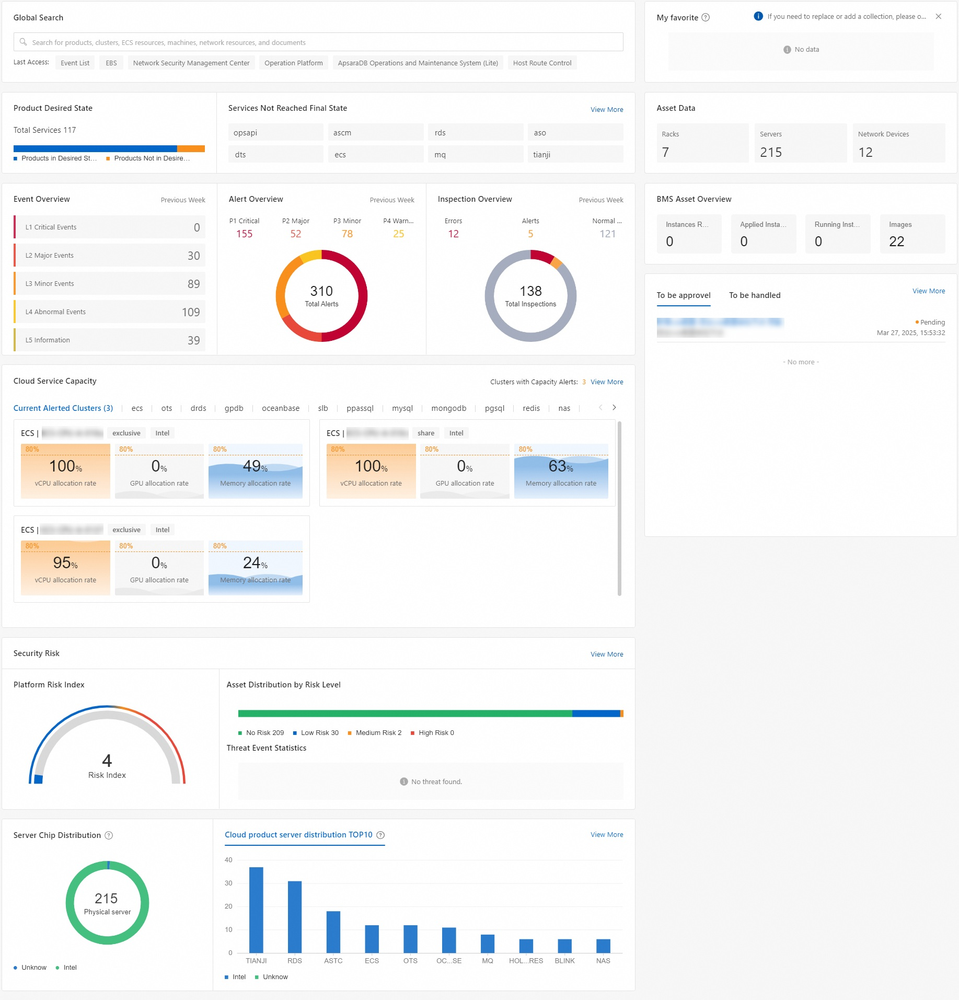

Click **Modify Layout and Card** to customize the Operation Platform page. You can add, remove, and move cards, or resize cards. The following table lists the supported content.

> **Note**
>
> Click **Restore to Default Layout** to restore the default view of the Operation Platform page.

**Category**

**Name**

**Description**

You can view clusters with capacity alerts, as well as

Cloud Service

analysis of used capacity and trends for cloud service

Capacity

resources.

Single-service

You can view statistics on server capacity allocation for a

capacity statistics

single service.

Preset card -

Server capacity

You can view statistics on server capacity allocation for a

Capacity analysis

statistics

single service.

Single-service

You can view statistical trends of capacity allocation for a

capacity trend

single service.

Multi-server

You can view statistics on server capacity allocation for

capacity statistics

work clusters deployed on onTianjian.

You can view the summary of BMS system assets.

- **Instances Running in Resource Pools**: bare metal instances successfully managed by the resource pool and in the **Running** state. This data matches the **Total Instances in Resource Pool** displayed on the **Overview** page of the ASCM BMS console.

- **Applied Instances**: all instances applied by users on the tenant side, without filtering by status. When the **root** organization is selected, this data matches **Total Applied Instances** displayed on the **Overview** page of the ASCM BMS console. It does not match when other organizations are selected.

- **Running Instances**: The system aggregates data for

BMS Asset

instances in the running state, based on applied

Overview

instances. When the **root** organization is selected, this data matches **Total Running Instances** displayed on the **Overview** page of the ASCM BMS console. It does not match when other organizations are selected.

- **Images**: The system aggregates the total number of custom images and public images based on the selected region. In multi-region scenarios, when the same region is selected, this data matches the **Images** data displayed on the **Overview** page of the ASCM BMS console. It does not match when different regions are selected. In single-region scenarios, this data matches the **Images** data displayed on the **Overview** page of the ASCM BMS console.

Preset card -Asset analysis

Server Chip

You can view the total number of physical servers and

Distribution

their distribution by CPU type.

You can view the total volume and categorized statistics of

Asset data

system assets.

Cloud product

You can view the top 10 distribution of tenant-side cloud

server distribution

product servers by CPU type. Click **More** to see detailed

TOP10

information.

Product-

You can view statistics on physical servers for products

dimension server

deployed on onTianjian.

statistics

Asset summary

You can view statistics on network devices and service

statistics

servers across availability zones of the cloud platform.

You can view detailed information about all physical

Server list

servers on the cloud platform.

You can view security risks and vulnerabilities detected in the system.

> **Note**
>
> This feature takes effect only when Apsara Stack Security is deployed.

Preset card -

- **Platform Risk Index**: You can view the global risk

Security risk

Security Risk

index calculated based on threat events and risky assets within the organization.

- **Asset Distribution by Risk Level**: You can view the percentage and number of assets categorized as High Risk, Medium Risk, Low Risk, and No Risk.

- **Threat Event Statistics**: You can view the percentage and number of threat events categorized as critical, severe, suspicious, general, and informational.

- You can view the workflow content pending approval and submission time. Click **More** to navigate to the **Pending My Approval** page.

To be approved

- Switch to the **To be handled** tab to view task content, priority, and expiration time pending handling. Click **More** to navigate to the **Related to me** tab on the **My Task** page.

You can view your bookmarked top navigation menu ietms. To modify or add favorites, use the top navigation bar.

My favorite

Note that only the six most recently added items are

Preset card -

supported.

Common features

You can search globally for menus, products, clusters, ECS resources, machines, network resources, documents, and

Global Search

more.

You can also view your recently accessed menu functions.

<table>
  <tr>
    <td rowspan="2">Preset card -Desired state analysis</td>
    <td>Services Not Reached Final State</td>
    <td>You can view products that have not reached their final state.<br>Click <strong>More</strong> to navigate to the <strong>Product &amp; Cluster O&amp;M</strong> page for details.</td>
  </tr>
  <tr>
    <td>Product Desired State</td>
    <td>You can view the number for <strong>Total Services</strong>, <strong>Products in</strong> <strong>Desired State</strong>, and <strong>Products Not in Desired State</strong>.</td>
  </tr>
  <tr>
    <td rowspan="3">Preset card - Alert analysis</td>
    <td>Alert Overview</td>
    <td>You can view the number of alerts of different levels in the current system.</td>
  </tr>
  <tr>
    <td>Alert trend</td>
    <td>You can view the alert trends across the cloud platform, categorized by cloud product and alert source.</td>
  </tr>
  <tr>
    <td>Alert statistics</td>
    <td>You can view the alert statistics across the cloud platform, categorized by cloud product and alert source.</td>
  </tr>
  <tr>
    <td rowspan="3">Preset card -Event analysis</td>
    <td>Event Overview</td>
    <td>You can view statistics and distribution of events in the current system.</td>
  </tr>
  <tr>
    <td>Event trend</td>
    <td>You can view the trend analysis of all events on the cloud platform.</td>
  </tr>
  <tr>
    <td>Event statistics</td>
    <td>You can view the statistical analysis of all events on the cloud platform.</td>
  </tr>
  <tr>
    <td>Preset card -Inspection analysis</td>
    <td>Inspection Overview</td>
    <td>You can view the total number of inspections and the distribution of inspection results in the current system.</td>
  </tr>
  <tr>
    <td rowspan="3">Preset card -Usage analysis</td>
    <td>Multi-product usage statistics</td>
    <td>You can view statistics on operational usage from the product cluster dimension.</td>
  </tr>
  <tr>
    <td>Multi-server usage statistics</td>
    <td>You can view statistics on operational usage from the multi-server dimension.</td>
  </tr>
  <tr>
    <td>Single-product usage trend</td>
    <td>You can view the trend analysis of operational usage for a single product.</td>
  </tr>
  <tr>
    <td colspan="2">Custom card</td>
    <td>You can view data on custom cards.</td>
  </tr>
</table>

**For administrators-Operation platform**

The Operation Platform page for users with the **platform O&M administrator** role permission displays the following content.

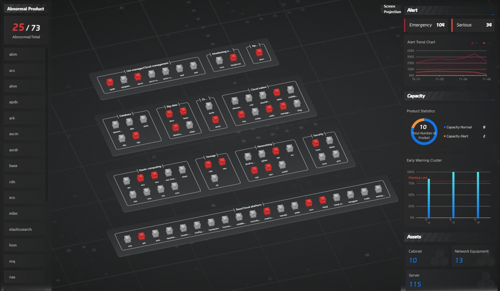

| Section | Description |
| --- | --- |
| Abnormal Product | • You can view the number of <strong>Abnormal Products</strong> and the total number of cloud products. Names of abnormal cloud products are listed.<br>• You can view the status and distribution of each cloud product in the center of the page. Red indicates an abnormal cloud product. Gray indicates a normal cloud product.<br>• Click the cloud product name on the left or in the O&amp;M diagram to view the cloud product status, number of emergency alerts, number of serious alerts, and its impact on other cloud products. |
| Alert | You can view the number of <strong>Emergency</strong> alerts and <strong>Serious</strong> alerts, along with the alert trend chart for the past week. |
| Capacity | • <strong>Product Statistics</strong>: You can view <strong>Total Number of Product</strong>, <strong>Capacity</strong> <strong>Normal</strong>, and <strong>Capacity Alert</strong>.<br>• <strong>Early Warning Cluster</strong>: You can view clusters with active capacity alerts. |
| Assets | You can view the number for <strong>Cabinet</strong>, <strong>Server</strong>, and <strong>Network Equipment</strong>. |
| Security Risks | Note<br>This feature takes effect only when Apsara Stack Security is deployed.<br>• <strong>Platform Risk Index</strong>: You can view the global risk index calculated based on threat events and risky assets within the organization.<br>• <strong>Asset Distribution by Risk Level</strong>: You can view the percentage and number of assets categorized as High-risk, Medium-risk, Low-risk, and Normal.<br>• <strong>Threat Event Statistics</strong>: You can view the percentage and number of threat events categorized as critical, severe, suspicious, general, and informational. |

**Multi-region scenario-Operation platform**

The Operation Platform page displays the following content.

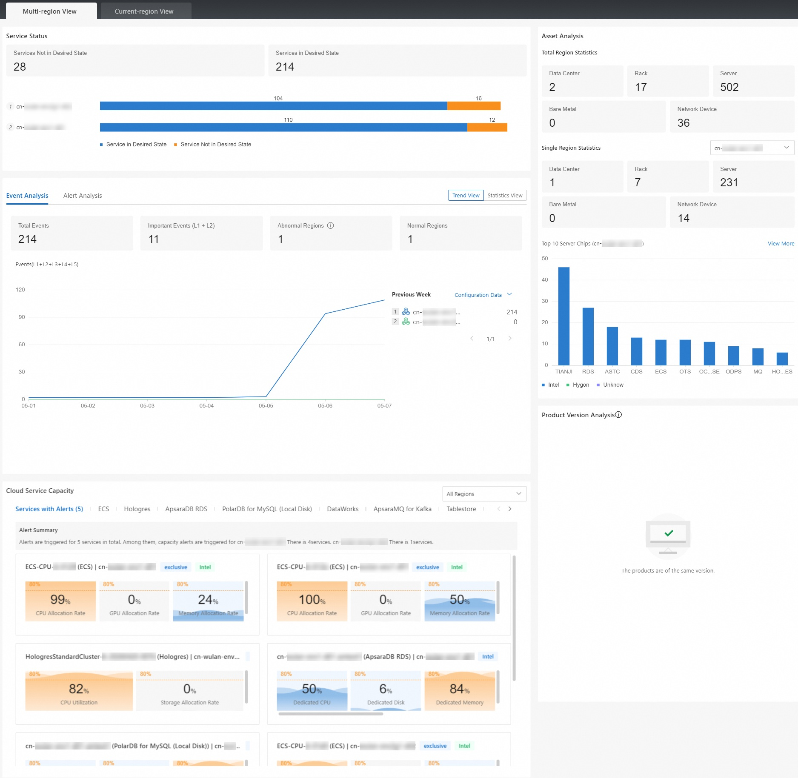

**Section**

**Tab**

**Description**

You can view the number for **Services Not in Desired State**, **Services in Desired State**, and their distribution chart across regions.

Service Status

Hover your mouse over the chart and click **Details**. The page redirects to the **Product & Cluster O&M** page for detailed information.

You can view **Total Events**, **Important Events (L1+L2)**, **Abnormal Regions**, and **Normal Regions**.

> **Note**
>
> A region with unclosed high-priority L1 and L2 events is an abnormal region.

- Trend View: You can view the event trend chart across regions over the past week. Click **Configure Data** to select event levels for display.

  - Hover your mouse over a node to view data for the corresponding time point.

  - Click the  icon after a region name. The page redirects

Event Analysis

to the event list page for the target event level in that region.

- Statistics View: You can view the event statistical chart across regions over the past week. Click **Configure Data** to select event levels for display.

  - Click the  icon after a region name. The page redirects

    to the event list page for the target event level in that region.

  - Click the  icon next to the statistical view, then click

    **Go to** to navigate to the Region Coordinate Management page for configuration.

**Multi-region**

You can view **Total Alerts**, **Important Alerts (P1+P2)**,

**View**

**Abnormal Regions**, and **Normal Regions**.

> **Note**
>
> A region with unclosed important P1 and P2 alerts is an abnormal region.

- Trend View: You can view the alert trend chart across regions over the past week. Click **Configure data** to select alert levels for display.

  - Hover your mouse over a node to view data for the corresponding time point.

  - Click the  icon after a region name. The page redirects

Alert Analysis

to the alert list page for the target alert level in that region.

- Statistics View: You can view the alert statistical chart across regions over the past week. Click **Configure Data** to select alert levels for display.

  - Click the  icon after a region name. The page redirects

    to the alert list page for the target alert level in that region.

  - Click the  icon next to the statistical view, then click

    **Go to** to navigate to the Region Coordinate Management page for configuration.

- Total Region Statistics: You can view data for **Data Center**, **Rack**, **Server**, **Bare Metal**, and **Network Devices** across all regions.

- Single Region Statistics: Select the target region to display data for **Data Center, Rack, Server, Bare Metal, and**

Asset analysis

**Network Devices** in that region.

- Top 10 Server Chips: Select the target region to display the distribution of top 10 cloud product servers by CPU in that region. Click **View More** to view detailed server distribution.

Product Version

You can view difference analysis of current cloud product

Analysis

versions.

Select the target region to display details of cloud products with capacity alerts in that region, along with capacity details for each cloud product.

Cloud Service Capacity

> **Note**
>
> In the Cloud Service Capacity section for all regions, you can view an alert summary.

<table>
  <tr>
    <td>Current-region View</td>
    <td>You can view overview data for the current region. For details, see Operation platform.</td>
  </tr>
</table>

<a id="section-3"></a>

# 3.Getting Started

<a id="section-3-1"></a>

## 3.1. Overview

This topic describes the preset roles in the Apsara Uni-manager Operations Console and the common operations of the roles.

**User roles and corresponding permissions**

User roles provide different operation permissions for different users. By default, the system creates system administrators, security administrators, security auditors, and role administrators during initialization. The following table describes the permissions of roles.

| Role | Permissions |
| --- | --- |
| System administrator | Manages O&amp;M operations across the platform. The O&amp;M operations include monitoring and alerting, platform O&amp;M, and service O&amp;M. |
| Security administrator | Manages security-related O&amp;M operations across the platform, such as security management. |
| Security auditor | Audits, tracks, and analyzes security-related O&amp;M operations across the platform. |
| Role administrator | Manages user permissions across the platform. |

**View user roles**

1. Log on to the Apsara Uni-manager Operations Console.

2. In the upper-right corner of the page, click the profile picture and click **Personal information**.

3. View the information about the roles of the user displayed in the **Role Information** section.

<a id="section-3-2"></a>

## 3.2. System administrator

This topic describes common O&M operations performed by system administrators, including alert management and inspection management across the platform.

<a id="section-3-2-1"></a>

### 3.2.1. Alert management

This topic describes how to manage alerts in the Apsara Uni-manager Operations Console.

**Description**

Alerts are triggered if exceptions or faults occur in cloud infrastructure or cloud platform software, or collected monitoring data matches alert rules. Alert sources include monitored cloud services, the monitoring system, and objects that are monitored by the monitoring system.

**Prerequisites**

You have obtained the permissions of a system administrator.

**Procedure**

1. The system triggers alerts if collected monitoring data matches alert rules. The alert information varies based on the alert rule configuration.

2. Log on to the Apsara Uni-manager Operations Console.

3. In the top navigation bar, choose **Monitor&Alarms** > **Alerts** > **Alert Overview**.

   On the Alert Overview page, view alert information based on your business requirements, which is analyzed and categorized from the following five perspectives:

   - The **Alerts for Regions** section shows the number of alerts by level for each region.

     Levels P1 to P4 alerts are displayed in different colors on the ring diagram. A larger area of a color on the ring diagram indicates more alerts of the corresponding level.

   - The **Alert Source** section shows the status of each alert source.

     Orange indicates that the alert source is abnormal. Blue indicates that the alert source is normal.

   - The **Alert Trend** section shows the number of alerts by date.

     - Colors on each bar represent the alert levels. A darker color indicates a higher alert level.

     - A larger area of each bar indicates more alerts of the corresponding levels.

     - If you move the pointer over a bar, the system shows the number of alerts of all levels for the day.

     - The line charts show the trend of different alert levels.

   - The **Alert Distribution in the Last 3 Days** section shows the quantities and levels of alerts of different services from the following dimensions: **Active P1 Alerts**, **Full Active Alerts**, and **Cleared Alerts**.

     A larger color block indicates more alerts of the corresponding level. When you move the pointer over a color block, the system shows the alert level and quantity.

   - The **Pending P1 Alerts** section shows the cloud platforms that have pending P1 alerts and the quantity of corresponding alerts.

     Each tab is a product category. Click a tab to view the products that have pending P1 alerts and the corresponding alert quantity under the category.

4. Obtain the information about alerts based on your business requirements.

   | Category | Obtain the details of an alert |
   | --- | --- |
   | Regional alert | i. In the left-side navigation pane, click <strong>Alerts</strong>.<br>ii. Click Advanced Filter. Select an alert level from the <strong>Alert Level</strong> drop-down list to view the corresponding alerts. |
   | Alert source | i. In the left-side navigation pane, click <strong>Alerts</strong>.<br>ii. Click Advanced Filter. Select an alert source from the <strong>Alert Source</strong> drop-down list to view the corresponding alerts. |
   | Alert trend | i. In the left-side navigation pane, click <strong>Alerts</strong>.<br>ii. Click Advanced Filter. Select a time range from the <strong>Alert Start Time</strong> drop-down list to view the corresponding alerts. |
   | Alert Distribution in the Last 3 Days | i. On the Alert Overview page, click the <strong>Active P1 Alerts</strong>, <strong>Full Active</strong> <strong>Alerts</strong>, or <strong>Full Alert History</strong> tab.<br>ii. Click a colored area with a number that corresponds to a service and time range. Then, you are navigated to the Alerts page that displays the corresponding alerts. |
   | Pending P1 alert | i. On the Alert Overview page, find the Pending P1 Alerts section and click a category tab.<br>ii. Click a service. Then, you are navigated to the Alerts page that displays the corresponding alerts. |

   > **Note**
   >
   > On the **Alerts** page, you can filter alerts by one of the preceding categories. You can also filter alerts by alert ID or alert status, or by multiple filter conditions.

5. Query the details of an alert.

   - On the **Alert List** page, click the **Real-time Alert** tab. On this tab, you can query the basic information about alerts, including **Alert Level**, **Alert Item ID**, **Resource Owner**, **Alert Information**, **Alert Status**, **Alert Start Time**, **Last Alert Time/Duration**, **Alerts**, **Extended Attributes**, **Alert Object Name/ID**, **Object Type**, and **Alert Source**.

   - Click the **ID** of an alert to obtain the details of the alert.

     - In the **Basic Information** section, view the basic information about the alert.

     - In the **Extended Information** section, view the extended information about the alert.

       > **Note**
       >
       > Move the pointer over **Details** next to **Alert Details**. The details of the alert are displayed.

     - In the **State timing diagram** section, view the alert metrics in a chart.

       - **1 Day**: shows the alert metrics of the day before the alert is triggered.

       - **1 Week**: shows the alert metrics of the week before the alert is triggered.

     - In the **Alert Impact** section, view the impacts of the alert.

       You can view the service roles that may be affected and the corresponding status. In addition, the services, clusters, services, and physical machines to which the service roles belong are displayed.

     - On the **Metrics** tab, view the trend charts of metrics in the specified time range.

6. Obtain the solution to the alert based on the related reference and clear the alert.

7. After the alert is cleared, return to the **Alerts** page.

8. Filter the alert by performing the operations in Step 4. If the alert is in the **Close** state, the alert is handled.

<a id="section-3-2-2"></a>

### 3.2.2. Inspection management

This topic describes how to perform inspections in the Apsara Uni-manager Operations Console.

**Description**

In the Apsara Uni-manager Operations Console, you can perform quick inspections in various inspection scenarios. This helps you maintain the health of your business system and cloud services.

**Prerequisites**

You have obtained the permissions of a system administrator.

**Procedure**

1. Log on to the Apsara Uni-manager Operations Console.

2. (Optional) Create a custom inspection scenario.

   <ol type="i">

   <li>

   In the top navigation bar, choose **Monitor&Alarms** > **Inspections** > **Inspection Settings**.

   </li>

   <li>

   On the **Inspection scenario** tab, click **Create a new inspection scenario**.

   </li>

   <li>

   Specify the parameters described in the following table and click **OK**.

   </li>

   </ol>

   | Parameter | Description |
   | --- | --- |
   | Scene name | Enter a name for the custom inspection scenario. |
   | Scenario description | Enter a description for the custom inspection scenario. |
   | Configure inspection items | Select inspection items for the custom inspection scenario. After you select inspection items, the details of the inspection items are displayed in the lower part. |

   <ol type="i" start="4">

   <li>

   Return to the **Inspection scenario** tab. If the inspection scenario is displayed in the list, the inspection scenario is created.

   </li>

   </ol>

3. In the top navigation bar, choose **Monitor&Alarms** > **Inspections** > **All Inspections**.

4. After you select an inspection scenario, click **Immediate inspection**. If you want to receive inspection notifications, click Configuration next to Email notification on the Inspection notice page. Then, click **Execute** to trigger an inspection.

   > **Note**
   >
   > - You can configure multiple email addresses. Separate email addresses with semicolons (;).
   >
   > - If you are prompted that notifications cannot be sent because notification channels are not configured, you can configure a notification channel on the **Inspection notice** page. If you do not want to receive notifications, you can directly click **Execute** to trigger an inspection.

5. Wait for the inspection to complete. The progress is displayed on the page. After the inspection is complete, view the inspection results.

   - In the upper part of the page, view basic information such as **Inspection scenario**, **Start execution**, **End Execution**, **Initiator**, **Execution Policy**, and **Result suggestion**.

   - In the **Inspection overview** section, you can view the inspection pass rate, number of inspected items, number of failed items, number of errors, number of warnings, and number of passed items. Click the data that corresponds to an inspection state to view the detailed inspection results of that state.

   - In the **Overview of inspection results completed** section, you can view the inspection results of each inspected service, including the number of errors, number of warnings, and number of passed items. You can click a service to view its inspection result in detail.

     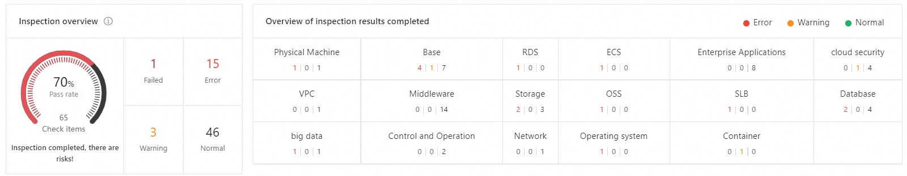

   - In the lower part of the page, you can click **Advanced Filter** to view inspection results by **Inspection item type**, **Inspection Status**, **Inspection item name**, and **Inspection item description**.

     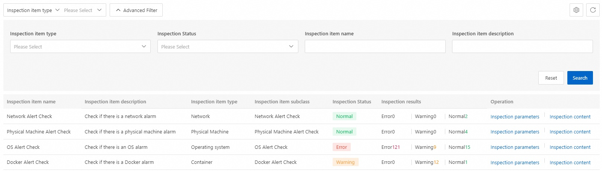

     - You can move the pointer over **Inspection parameters** in the **Operation** column that corresponds to an inspection item to view its inspection parameters.

     - You can move the pointer over **Inspection content** in the **Operation** column that corresponds to an inspection item to view its inspection content.

     - You can click a number in the **Inspection results** column that corresponds to an inspection item to view the result in detail in the dialog box that appears.

       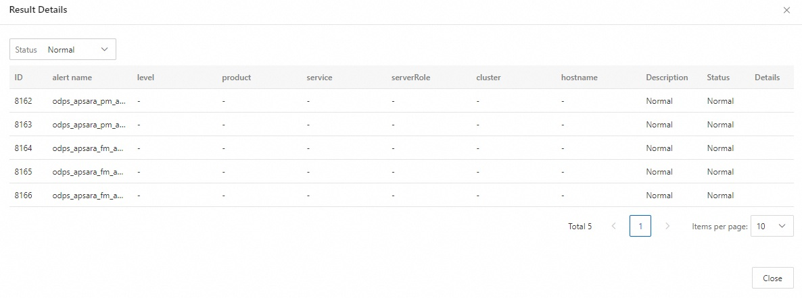

   - You can click **View report receiving mailbox** in the upper-right corner to view the email address that receives the inspection report.

   - You can click **Export Report** in the upper-right corner to download the inspection report to your on-premises computer.

     > **Note**
     >
     > You can export the inspection report in the JSON format or as an Excel table.

<a id="section-3-3"></a>

## 3.3. Security administrator

This topic describes common O&M operations performed by security administrators, including logon management.

<a id="section-3-3-1"></a>

### 3.3.1. Configure login settings

This topic describes how to configure methods of logging in to the Apsara Uni-manager Operations Console.

**Description**

The system allows administrators to configure user login methods based on business requirements, including the login timeout period, multi-terminal login settings, account validity period, password policy, login time, and login address to improve system security.

**Prerequisites**

The permissions of the security administrator role in the Apsara Uni-manager Operations Console are obtained.

**Flowchart**


**Procedure**

1. Log in to the Apsara Uni-manager Operations Console.

2. In the top navigation bar, choose **Security Management** > **Access Control** > **Security Strategy**.

3. On the **Account Policy** tab, configure the parameters described in the following table and click **Submit**.

   | Parameter | Description |
   | --- | --- |
   | Timeout Period (Minutes) | The login timeout period for the current account. If the login time exceeds the specified time period, the system prompts you that the login timed out and you need to try to log in again.<br>Valid values: 10 to 180. |
   | Multi-Terminal Logon Settings | Specifies whether the current account allows simultaneous login from multiple terminals. |
   | Account Validity (Days) | The validity period of the current account. If the account is expired, the system locks this account and only the security administrator can unlock the account.<br>Valid values: 10 to 365. |
   | Account Expiration Reminder (Days) | The time to send a reminder before an account expires. For example, a value of 5 indicates that the expiration reminder is sent five days before the account expires.<br>Valid values: 1 to 7. |
   | Account Freeze Policy (Days) | The period during which the current account remains available. If the specified period elapses, the system freezes this account.<br>Valid values:<br>• 0: The account freezing policy is disabled.<br>• 10 to 365 |
   | Security Policy Is Valid for Preset Accounts | Specifies whether the security policy is valid for preset accounts.Valid values:<br>• On: If a security policy expires (for example, the account or password expires), preset accounts cannot log in to the system.We recommend that you set a long validity period.<br>• Off: If a security policy expires, preset accounts can still log in to the system. Preset accounts never expire.<br>Default value: Off. |

4. On the **Password Policy** tab, configure the parameters described in the following table and click **Submit**.

   | Parameter | Description |
   | --- | --- |
   | Minimum Password Length | The minimum number of characters in the password.<br>Valid values: 10 to 20. |
   | Required Character Types in Password | The one or more character types that must be contained in the password. Valid values:<br>• Lowercase Letters<br>• Uppercase Letters<br>• Digits<br>• Special Characters |
   | Reminder Time Before Password Expiration (Days) | The time to send a reminder before the password of an account expires. For example, a value of 10 indicates that the expiration reminder is sent 10 days before the password expires when the user logs in. A value of 0 indicates that no reminder is sent.<br>Valid values: 0 to 30. |
   | Password Validity Period (Days) | The validity period for the password. If the password expires, the system sends a notification to the user. A value of 0 indicates that the password never expires.<br>Valid values: 0 to 1095. |
   | Password History Check | The number of historical passwords that you cannot reuse. For example, if you set this parameter to 3, the most recent three historical passwords cannot be reused. A value of 0 indicates that all historical passwords can be reused.<br>Valid values: 0 to 24. |

5. Configure a login policy.

   <ol type="i">

   <li>

   In the left-side navigation pane, click **Logon Policy**.

   </li>

   <li>

   In the upper part of the page, click **Add Policy**.

   </li>

   <li>

   In the Add Policy dialog box, configure the parameters described in the following table

   </li>

   </ol>

   and click **OK**.

   | Parameter | Description |
   | --- | --- |
   | Policy Name | The name of the login policy. |
   | Policy Effective Period | The start and end of the time period during which the login policy is effective. |
   | Description | The description of the login policy. |
   | Sharing Scope | The scope in which you want to share the login policy. Set the value to <strong>Global Sharing</strong>. |
   | Policy Property | • Whitelist<br>• Blacklist |
   | Policy Effective Time | The point in time from which users are allowed for login. The start time for login cannot be later than the end time for login. |
   | Policy Expire Time | The point in time from which users are not allowed for login. |
   | Logon URL | The CIDR blocks of the login policy.<br>If you set the <strong>Policy Property</strong> parameter to <strong>Whitelist</strong>, specify the CIDR blocks that are allowed for login. If you set the <strong>Policy Property</strong> parameter to <strong>Blacklist</strong>, specify the CIDR blocks that are prohibited from logging in to the system.<br>Specify CIDR blocks such as 192.168.1.0/24. You can use a 32-bit mask in the CIDR block to indicate a single IP address. CIDR blocks cannot overlap each other. Separate multiple CIDR blocks with commas (,). |

<a id="section-3-4"></a>

## 3.4. Security auditor

This topic describes common O&M operations performed by security auditors, including operation log auditing.

<a id="section-3-4-1"></a>

### 3.4.1. Operation log auditing

This topic describes how to audit the operation records of users in the console as a security auditor.

**Description**

Security auditors can audit, track, and analyze the operations of users including system administrators and security administrators. On the Console-based Audit and CLI-based Audit pages in the Operation Audit module, you can view the records of CLI-based and GUI-based operations including auditing.

**Prerequisites**

You have obtained the permissions of a security auditor.

**Procedure**

1. Log on to the Apsara Uni-manager Operations Console.

2. In the top navigation bar, choose **Security Management** > **Security Audit** > **Operation Audit**.

3. In the left-side navigation pane, click **Console-based Audit**.

4. On the **Console-based Audit** page, perform the following operations based on your business requirements:

   - View GUI-based operation records.

     Specify the **Username** and **Time Range** parameters to filter operation records.

     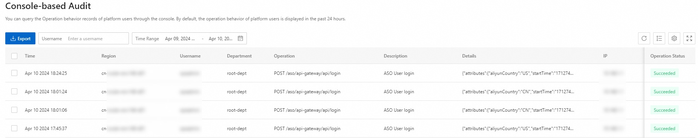

   - Export GUI-based operation records.

     > **Note**
     >
     > By default, you can export a maximum of 10,000 records. If you select more than 10,000 records, only the first 10,000 records are exported.

     - Batch export: Select the operation records that you want to export and click **Batch Export** below the list to export the selected records.

     - Export all reports: Click **Export** above the list to export all the operation records that are displayed in the list.

<a id="section-3-5"></a>

## 3.5. Role administrator

This topic describes common O&M operations performed by role administrators, including department management, user management, and role management.

<a id="section-3-5-1"></a>

### 3.5.1. User management

This topic describes how to create a user and grant different permissions to the user.

**Description**

You can create a user and assign the user different roles to meet different requirements for system access control as a role administrator.

**Prerequisites**

- You have obtained the permissions of a role administrator for the Apsara Uni-manager Operations Console.

- A custom role, if required, is created.

- A logon policy is configured.

**Procedure**

1. Log on to the Apsara Uni-manager Operations Console.

2. In the top navigation bar, click **User Authorities**.

3. Create a department.

   <ol type="i">

   <li>

   In the left-side navigation pane, click **Department Management**.

   </li>

   <li>

   In the catalog tree on the left side, select the department to which you want to add a sub-

   </li>

   </ol>

   department and click **Add Department**.

   <ol type="i" start="3">

   <li>

   In the Add Department dialog box, enter a new department name and click **OK**.

   </li>

   </ol>

   After the department is added, you can view the department in the catalog tree.

   > **Note**
   >
   > The department name can be up to 64 characters in length and can contain lowercase letters, uppercase letters, digits, underscores (_), and hyphens (-).

4. Create a user.

   <ol type="i">

   <li>

   In the left-side navigation pane, click **User Management.**

   </li>

   <li>

   On the **Users** tab, click **Add**.

   </li>

   <li>

   Specify the parameters described in the following table and click **OK**.

   </li>

   </ol>

   After the user is added, you can view the user in the user list.

   | Parameter | Description |
   | --- | --- |
   | Username | Enter a name for the user that you want to create.<br>The name can be up to 48 characters in length and can contain digits, letters, and underscores (_). You can enter email addresses as usernames. |
   | Password | Enter a password for the user.<br>The password must be 9 to 32 characters in length and must contain lowercase letters, uppercase letters, and digits. |
   | Confirm Password | Enter the password again. Make sure that the two passwords that you enter are the same. |
   | Logon Policy | Select a logon policy for the user. |
   | Role | Select the role that you want to assign to the user.<br>Note<br>You can assign one or more roles to a user. |
   | Department | Select the department that you created in Step 3. |

5. Create a user group.

   <ol type="i">

   <li>

   In the left-side navigation pane, click **User Group Management**.

   </li>

   <li>

   In the upper part of the page, click **Add**.

   </li>

   <li>

   Specify the parameters described in the following table and click **OK**.

   </li>

   </ol>

   After the user group is added, you can view the user group in the user group list.

   | Parameter | Description |
   | --- | --- |
   | User Group Name | Enter a name for the user group. |
   | Department | Select the department that you created in Step 3. |
   | Role | Select the role that you want to add for the user group.<br>Note<br>You can add multiple roles for a user group. |

6. Manage the user.

   <ol type="i">

   <li>

   On the **User Group management** page, find the user group that you created in Step 5 and click **Manage Users** in the **Actions** column.

   </li>

   <li>

   Click **Add**. In the **Add** dialog box, select the user that you created in Step 4 and click **OK**.

   </li>

   </ol>

   > **Note**
   >
   > If the user group role and the user role are inconsistent, the permissions of both roles are granted to the user.

   <ol type="i" start="3">

   <li>

   In the **Manage Users** dialog box, click **OK**.

   </li>

   </ol>

   After the user is added to the user group, the added user is displayed in the **Users** column that corresponds to the user group.

<a id="section-4"></a>

# 4.General O&M

<a id="section-4-1"></a>

## 4.1. Monitoring management

This topic lists the following consoles for monitoring management:

- Tianjimon

- Product Dashboard

- TianjiMon - Dashboard

- Cloud Platform Monitoring Dashboard

<a id="section-4-1-1"></a>

### 4.1.1. Cloud platform monitoring

<a id="section-4-1-1-1"></a>

#### 4.1.1.1. Business monitoring for cloud services

<a id="section-4-1-1-1-1"></a>

##### 4.1.1.1.1. View the monitoring information of cloud services

This topic describes how to view the basic monitoring information and business metrics of all cloud services in the Apsara Uni-manager Operations Console.

**Procedure**

1. Log on to the Apsara Uni-manager Operations Console.

2. In the top navigation bar, choose **Monitor&Alarms** > **Monitor Management** > **Tianjimon**.

3. In the left-side navigation pane, choose **Product Business Monitoring** > **Product Monitoring**.

   On the Product Monitoring page, you can perform the following operations based on your business requirements.

   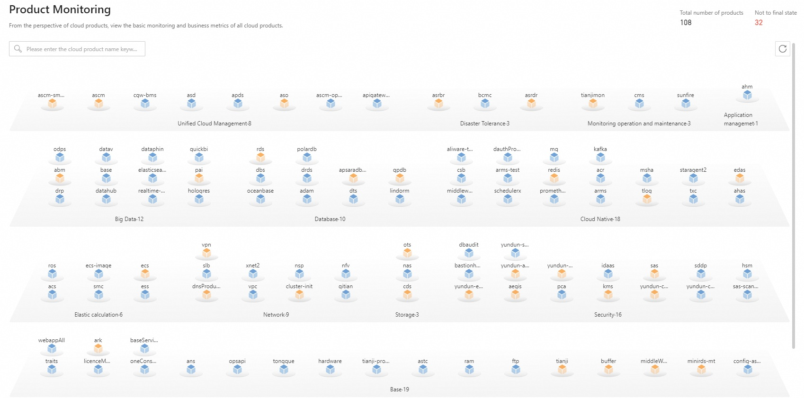

   - View the total number of cloud services and the number of cloud services that are not at desired state.

   - View the status of each cloud service. A blue icon indicates that the cloud service is at desired state. An orange icon indicates that the cloud service is not at desired state.

   - Move the pointer over the icon of a cloud service to view the cloud service name. Click the icon to go to the cloud service details page.

     - In the navigation tree of the cloud service details page, all clusters, services, and components of the cloud service are displayed. You can select **Show only Exceptions** to view only abnormal clusters, services, and components.

     - You can select a cluster in the navigation tree to view the status, zone, basic monitoring information, and machine list of the cluster on the right side of the page. In this example, the Apsara Uni-manager Operations Console is used.

       - On the **Basic monitoring** tab, view the monitoring data based on the time and metrics. You can turn on **Auto Refresh** in the upper-right corner to automatically update the monitoring data.

         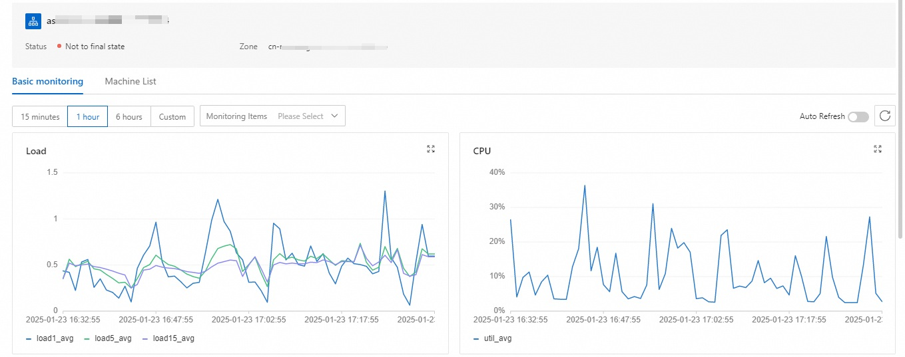

       - On the **Machine List** tab, view the list of hosts in the cluster. You can find the host that you want to manage and click the icon in the **Operation** column to go to the Machine monitoring page.

         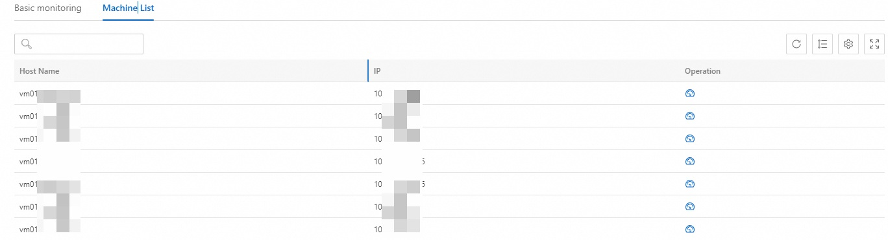

         On the Machine monitoring page, view the basic information and monitoring data of the host. You can turn on **Auto Refresh** in the upper-right corner to automatically update the monitoring data.

         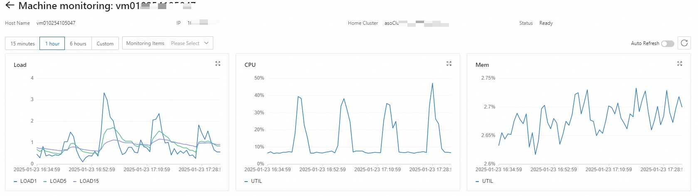

     - You can select a service in the navigation tree to view the status, cluster, and business monitoring information of the service on the right side of the page.

       On the **Business monitoring** tab, view the monitoring data based on the time and metrics. You can turn on **Auto Refresh** in the upper-right corner to automatically update the monitoring data.

       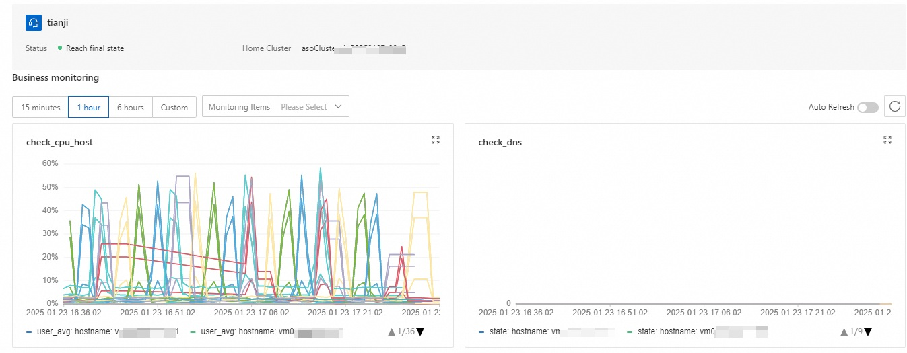

     - You can select a component in the navigation tree to view the status, cluster, service, basic monitoring information, business monitoring information, and machine list of the component on the right side of the page.

       On the **Basic monitoring** tab, view the basic monitoring information of the component, including the monitoring data of containers, processes, and Java virtual machines (JVMs).

       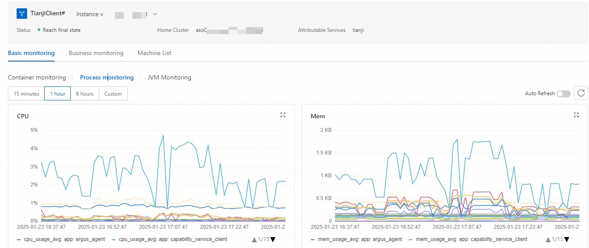

<a id="section-4-1-1-1-2"></a>

##### 4.1.1.1.2. Access configuration

This topic describes how to configure business metrics for monitoring cloud services in the Apsara Uni-manager Operations Console.

**Create access configurations**

**Procedure**

1. Log on to the Apsara Uni-manager Operations Console.

2. In the top navigation bar, choose **Monitor&Alert** > **Monitor Management** > **Tianjimon**.

3. In the left-side navigation pane, choose **Cloud Product Business Monitoring** > **Access Configuration**.

4. On the Access Configuration page, click **Create Configuration**. On the Create Access Configuration page, configure the parameters and click **Submit**. The following table describes the parameters.

   **Category**

   **Parameter**

   **Description**

   **Monitoring**

   Enter a metric name.

   **Item Name**

   **Description**

   Enter a description for the metric.

   **Basic Information**

   Select the type of the access configuration. Valid values:

   - **Exporter**: configures whitelists for the metrics of cloud services with which Prometheus Exporter is integrated to determine the metrics that can be displayed and alerted.

   - **Push Gateway**: configures whitelists for the metrics of

   **Access**

   cloud services that are integrated by using Push

   **Configuration**

   Gateway to determine the metrics that can be displayed and alerted.

   - **Log**: converts the local logs of server roles of cloud services into metrics to report data for effective monitoring and alerting.

   **Cloud**

   Select the cloud service to which the access configuration

   **Products**

   belongs.

   Select the service to which the access configuration

   **Service**

   belongs.

   Select the component to which the access configuration

   **Components**

   belongs.

   This parameter takes effect only when you set the **Access Configuration** parameter to **Exporter**.

   **Metric Path**

   Enter the URL of the HTTP API that is used to expose metrics to Prometheus Exporter.

   This parameter takes effect only when you set the **Access Configuration** parameter to **Exporter**.

   **Port**

   Enter the HTTP port that is used to expose metrics to Prometheus Exporter.

   This parameter takes effect only when you set the **Access Configuration** parameter to **Exporter**.

   **Acquisition**

   **Auth**

   **Address**

   Enter the username that is used for authentication by Prometheus.

   This parameter takes effect only when you set the **Access Configuration** parameter to **Exporter**.

   **Auth password**

   Enter the password of the username that is used for authentication by Prometheus.

   This parameter takes effect only when you set the **Access Configuration** parameter to **Exporter**.

   **pod tag selector**

   Click **Add Entry**. In the line that appears, configure the **Key** and **Value** parameters to add a pod tag.

   This parameter takes effect only when you set the **Access Configuration** parameter to **Exporter** or **Push Gateway**.

   **Acquisition Test**

   If you want to add or edit metrics, perform an acquisition test to obtain the metrics that can be integrated.

   This parameter takes effect only when you set the **Access Configuration** parameter to **Log**.

   **Data Source**

   Set the value to **Local Log**.

   This parameter takes effect only when you set the **Access Configuration** parameter to **Log**.

   **Log Path**

   Enter the path in which local logs are stored.

   This parameter takes effect only when you set the **Access Configuration** parameter to **Log**.

   **Log encoding**

   Enter the encoding format of local logs.

   This parameter takes effect only when you set the **Access Configuration** parameter to **Log**.

   - **Keyword**: Use keywords to match metrics from logs.

   **Classification**

   - **Minute Multiple Indicators**: Use complex algorithms to

   **of indicators**

   match metrics from logs, such as regular expressions.

   - **Event Indicators**: Use complex algorithms to match metrics from logs, such as regular expressions.

   This parameter takes effect only when you set the **Classification of indicators** parameter to **Minute**

   **Metric**

   **Multiple Indicators** or **Event Indicators**.

   **Dimension**

   Select a metric dimension. Click **Configure Dimensions** to select a dimension for match metrics from logs.

   This parameter takes effect only when you set the

   **Aggregate**

   **Classification of indicators** parameter to **Minute**

   **dimension**

   **Multiple Indicators** or **Event Indicators**.

   **(Group By)**

   Select an aggregation dimension:

   - If you set the **Access Configuration** parameter to **Exporter**, you can click **Add Entry** and configure the following parameters for each metric:

     - **Indicator Code**: Select the metric that is obtained from the acquisition test.

     - **Indicator Name**: Enter a name for the metric.

     - **Indicator description**: Enter a description for the metric.

     - **Operation**: You can remove the metric or move the metric up or down.

   <table>
     <tr>
       <td>Indicator Access</td>
       <td>Monitoring indicators</td>
       <td>• If you set the <strong>Access Configuration</strong> parameter to <strong>Push</strong> <strong>Gateway</strong>, you can configure metrics after the acquisition test is passed. Click <strong>Add Entry</strong> and configure the following parameters for each metric:<br>• <strong>Indicator Code</strong>: Select the metric that is obtained from the acquisition test.<br>• <strong>Indicator Name</strong>: Enter a name for the metric.<br>• <strong>Indicator description</strong>: Enter a description for the metric.<br>• <strong>Indicator Type</strong>: Select the type of the metric. Valid values: Guage, Counter, Histogram, and Summary.<br>• <strong>Aggregation mode</strong>: Select an aggregation mode for the metric. Valid values: Avg, Sum, Min, Max, Group, Std Dev, Std Var, Count, Count Values, Bottomk, Topk, and Quantile.<br>• <strong>Unit</strong>: Enter a data unit.<br>• <strong>Indicator Aggregation Label</strong>: Select a label.<br>• <strong>Operation</strong>: You can remove the metric or move the metric up or down.<br>• If you set the <strong>Access Configuration</strong> parameter to <strong>Log</strong> and <strong>Indicator Type</strong> to <strong>Keyword</strong>, you can click <strong>Add</strong> <strong>Entry</strong> and configure the following parameters for each metric:<br>• <strong>Indicator Code</strong>: Enter the metric that you want to configure.<br>• <strong>Indicator Name</strong>: Enter a name for the metric.<br>• <strong>Keyword</strong>: Enter the keyword of the metric.<br>• <strong>Aggregation mode</strong>: Select an aggregation mode for the metric. Set the value to Count.<br>• <strong>Operation</strong>: You can remove the metric or move the metric up or down.<br>• If you set the <strong>Access Configuration</strong> parameter to <strong>Log</strong> and the <strong>Classification of indicators</strong> parameter to <strong>Minute Multiple Indicators</strong> or <strong>Event Indicators</strong>, you can click <strong>Add Indicator</strong> to configure the metrics.<br>• <strong>Aggregation field</strong>: Select the fields that you want to use for aggregation.<br>• <strong>Aggregation mode</strong>: Select an aggregation mode.<br>• If you set the <strong>Classification of indicators</strong> parameter to <strong>Minute Multiple Indicators</strong>, you can select Avg, Sum, Min, Max, Std, Distinct, Count, or Value.<br>• If you set the <strong>Classification of indicators</strong> parameter to <strong>Event Indicators</strong>, only Value is supported.<br>• <strong>Indicator Name</strong>: Enter a name for the metric.<br>• <strong>Operation</strong>: You can remove the metric or move the metric up or down.</td>
     </tr>
     <tr>
       <td rowspan="2"></td>
       <td></td>
       <td></td>
     </tr>
     <tr>
       <td>Data Filtering</td>
       <td>This parameter takes effect only when you set the <strong>Classification of indicators</strong> parameter to <strong>Minute</strong> <strong>Multiple Indicators</strong> or <strong>Event Indicators</strong>.<br>Click <strong>Add Filter Condition</strong> to add a filter.<br>• <strong>Filter Items</strong>: Select a filter item.<br>• <strong>Filter Condition</strong>: Select a filter condition.<br>• <strong>Filter Value</strong>: Enter a filter value.<br>• <strong>Operation</strong>: You can remove the metric or move the metric up or down.</td>
     </tr>
   </table>

   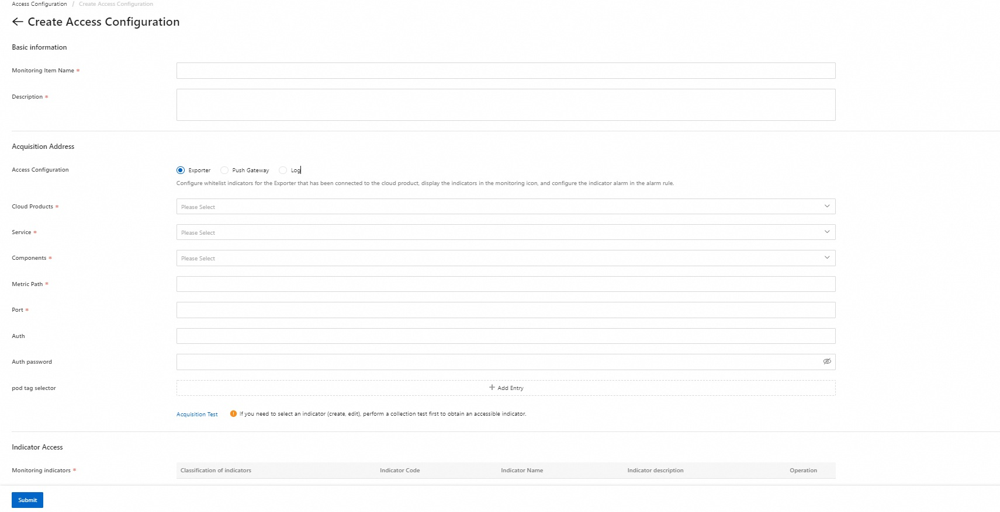

**View configurations**

**Procedure**

1. In the left-side **Services** list, select the cloud service or service that you want to manage. The access configurations of the cloud service or service are displayed on the right side of the page.

2. Click **Advanced Filter** to filter access configurations. You can configure the **Monitoring Item Name** and **Access Type** parameters as filter conditions.

3. In the access configuration list, you can view the **metric name**, **access type**, **service**, and **description** of each access configuration.

   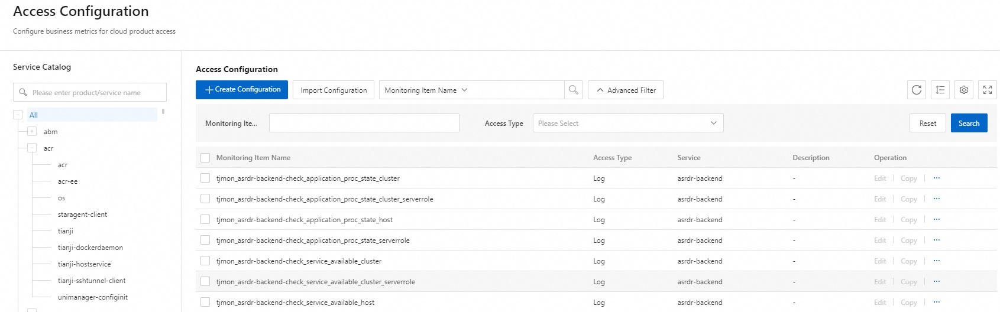

**Import configurations**

**Procedure**

1. On the Access Configuration page, click **Import Configuration** in the upper part.

2. In the Import Configuration dialog box, click **Upload File**.

   > **Note**
   >
   > You can export access configurations to a file to view the format of the file that you can upload.

3. Select a configuration file and click **Open**.

4. Click **Confirm Import**.

**Modify configurations**

**Procedure**

> **Note**
>
> The default access configurations that are generated when you update the baseline version of a cloud service, including hotfixes, cannot be modified.

1. Find the access configuration that you want to modify and click **Edit** in the **Operation** column.

2. On the **Edit Access Configuration** page, modify the configurations and click **Submit**.

**Copy configurations**

**Procedure**

> **Note**
>
> The default access configurations that are generated when you update the baseline version of a cloud service, including hotfixes, cannot be copied.

1. Find the access configuration that you want to copy and click **Copy** in the **Operation** column.

2. On the **Copy Access Configuration** page, confirm the configurations and click **Submit**.

**Export configurations Procedure**

> **Note**
>
> The default access configurations that are generated when you update the baseline version of a cloud service, including hotfixes, cannot be exported.

Export a single access configuration

1. On the Access Configuration page, find the access configuration that you want to export,

   move the pointer over the  icon in the **Operation** column, and then select **Export**.

2. In the dialog box that appears, click **Download**.

Export multiple access configurations at a time

1. Select multiple access configurations that you want to export and click **Export** in the lower-left corner of the page.

2. In the dialog box that appears, click **Download**.

**Delete configurations**

**Procedure**

> **Note**
>
> The default access configurations that are generated when you update the baseline version of a cloud service, including hotfixes, cannot be deleted.

Delete a single access configuration

1. On the Access Configuration page, find the access configuration that you want to delete,

   move the pointer over the  icon in the **Operation** column, and then select **Delete**.

2. In the message that appears, click **Delete**.

Delete multiple access configurations at a time

1. Select multiple access configurations that you want to delete and click **Delete** in the lower-left corner of the page.

2. In the message that appears, click **Delete**.

<a id="section-4-1-1-1-3"></a>

##### 4.1.1.1.3. Alert rule

View and manage an overview of alert rules for all cloud product monitoring. The system supports both raw YAML and form-based configuration.

**Custom rule**

**Create a rule**

1. Log on to the Apsara Uni-manager Operations Console.

2. In the top navigation bar, choose **Monitoring&Alert** > **Monitor Management** > **Tianjimon**.

3. In the left-side navigation pane, choose **Cloud Product Business Monitoring** > **Alert Rules**.

4. Select the **Custom Rules** tab. Click **Create Rule**. Configure the parameters and then click **Create**.

   **Category**

   **Parameter**

   **Description**

   **Rule Name**

   Enter a name for the alert rule.

   **Rule Description**

   Enter a description for the alert rule.

   Select the cloud product to which the alert rule belongs.

   > **Note**

   **Basic**

   **Cloud Products**

   **Informati**

   > onTianji rules apply to services of all products, whereas

   **on**

   > onPaas rules apply only to selected products.

   **Service**

   Select the service to which the alert rule belongs.

   **Alert execution**

   Enter the execution cycle of the alert, in seconds.

   **cycle**

   Select a configuration method for the alert rule.

   - **Form**: Configure a rule for a single monitoring metric by setting the monitoring item, monitoring metric, and trigger condition.

   **Configuration Method**

   - **TianjiMon expression**: Configure a rule for one or more monitoring metrics by using the TianjiMon expression mode.

   - **PromQL expression**: Configure a rule for one or more monitoring metrics by using the PromQL expression mode.

   Select an alarm level for the alert rule.

   - **P1 Critical**

   - **P2 Warning**

   **Alarm level**

   - **P3 Information**

   - **P4 Notification**

   **Metrics**

   Select a metric for the alert rule.

   This parameter takes effect when you set **Configuration Method** to **Form** or **TianjiMon expression**.

   Select the effective cluster to which the alert rule belongs.

   When you set **Configuration Method** to **TianjiMon expression**, click **Add Entry** in the **Filter Condition** section, select a **filter item**, and enter a **filter value**.

   **Effective Cluster**

   > **Note**
   >
   > The system filters monitoring metrics that meet the conditions. Multiple filter conditions are combined with the AND logic.

   When you set **Configuration Method** to **TianjiMon**

   **Alert Trigger**

   **expression**, select an alert trigger type. Valid values:

   **Type**

   **Consecutive** and **Cycle**. This parameter is hidden for other configuration methods.

   This parameter takes effect when you set **Configuration Method** to **TianjiMon expression**.

   **Alert rules**

   Click **Add Entry**, select an **alarm level**, and set **Consecutive times** and **Expression**.

   This parameter takes effect when you set **Configuration method** to **Form**.

   **Alert**

   Select a monitoring metric for the alert rule.

   **Condition**

   In the **Filter Condition** section, click **Add Entry**, select a **filter item**, and enter a **filter value**.

   **Monitoring indicators**

   > **Note**
   >
   > The system filters monitoring indicators that meet the conditions. Multiple filter conditions are combined with the AND logic.

   **Rule Type**

   Select **Single-metric Rule** or **Intelligent threshold rule**.

   When you set **Rule Type** to **Intelligent threshold rule**, select an **Alert condition**:

   - **Within boundary**: The metric value is greater than or less than the threshold.

   **Alert condition**

   - **Above upper boundary**: The metric value is greater than the threshold.

   - **Below lower boundary**: The metric value is less than the threshold.

   When you set **Rule Type** to **Intelligent threshold rule**, select an alert sensitivity.

   The intelligent threshold sensitivity setting affects the size of the reasonable interval determined by the intelligent threshold and the number of alerts that may be generated:

   - High: The reasonable interval is small. The system has low tolerance for metric deviations from the reasonable interval

   **Alert sensitivity**

   and receives a relatively large number of alerts.

   - Medium: The reasonable interval is medium. The system has moderate tolerance for metric deviations from the reasonable interval and receives a moderate number of alerts.

   - Low: The reasonable interval is large. The system has high tolerance for metric deviations from the reasonable interval and receives a relatively small number of alerts.

   - When you set **Rule Type** to **Single-metric Rule**, select the trigger condition type. Valid values: **Consecutive** and **Cycle**.

   **Trigger Condition Type**

   - When you set **Rule type** to **Intelligent threshold rule**, this parameter is hidden.

   Enter the trigger condition for the alert rule.

   **Trigger**

   > **Note**

   **condition**

   > This parameter takes effect when you set **Configuration Method** to **Form** or **PromQL expression**.

   Select the effective time for the alert rule. You can configure

   **Effective time**

   any time period within a 24-hour cycle.

   **Alert time period**

   Select the channel silence period for alerts. The channel

   **Channel Silence**

   silence period is the interval at which an alarm is generated

   **Period**

   again after one alarm is triggered.

   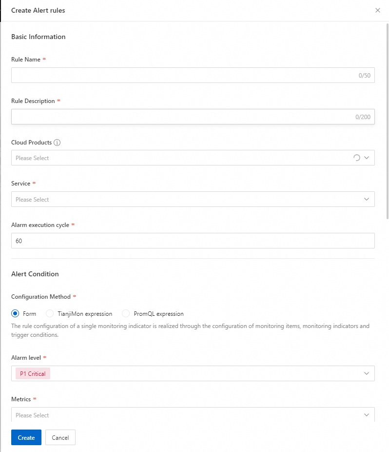

**View alert rules**

1. Click **Advanced Filter**. You can combine filters by **Rule Name**, **Rule Status**, **Alarm level**, **Monitoring Items**, **Cloud Products**, **Service**, and **Effective Cluster** to find target alert rules.

2. In the alert rule list, you can view the **Rule Name**, **Cloud products**, **Service**, **Enabled**, **Rule Description**, **Metrics**, **Alert rules**, and **Effective Cluster**. Hover your mouse over the number in the **Effective Cluster** column to see the specific cluster names.

   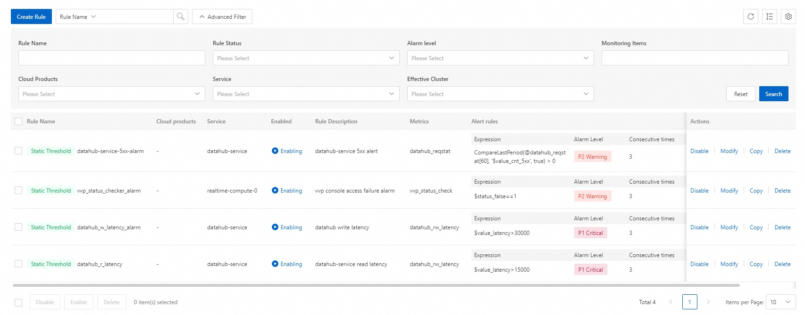

**Disable an alert rule**

> **Note**
>
> You can disable an alert rule only when its **Enabled** status is **Enabling**.

Disable a single alert rule:

1. In the **Actions** column of the target alert rule, click **Disable**.

2. In the dialog box that appears, click **OK**.

Disable multiple alert rules:

1. Select multiple alert rules and click **Disable** below the list.

2. In the dialog box that appears, click **OK**.

**Enable an alert rule**

> **Note**
>
> You can enable an alert rule only when its **Enabled** status is **Deactivated**.

Enable a single alert rule:

1. In the **Actions** column of the target alert rule, click **Enable**.

2. In the dialog box that appears, click **OK**.

Enable multiple alert rules:

1. Select multiple alert rules and click **Enable** below the list.

2. In the dialog box that appears, click **OK**.

**Copy an alert rule**

1. In the **Actions** column of the target alert rule, click **Copy**.

2. In the dialog box that appears, confirm that the alert rule information to be copied is correct and click **Create**.

**Modify an alert rule**

1. In the **Actions** column of the target alert rule, click **Modify**.

2. In the Modify Alert rules dialog box, set the **Alert execution cycle**, **Alert rules**, **Alert Trigger Type**, **Effective time**, **Channel Silence Period**, and then click **Modify**.

**Delete an alert rule**

Delete a single alert rule:

1. In the **Actions** column of the target alert rule, click **Delete**.

2. In the dialog box that appears, click **OK**.

Delete multiple alert rules:

1. Select multiple alert rules and click **Delete** below the list.

2. In the dialog box that appears, click **OK**.

**System rules**

**Rule modification**

- Method 1

  <ol type="i">

  <li>

  In the left-side navigation pane, select **Cloud Product Business Monitoring** > **Alert Rules**.

  </li>

  <li>

  Select the **System Rules** tab and click **Modify Rule**.

  </li>

  <li>

  In the **Modify Alert Rule** dialog box, select the target rule and click **Next Step**. Set

  </li>

  </ol>

  **Alert execution cycle**, **Effective Cluster**, **Alert Trigger Type**, **Alert rule**s, **Effective time**, and **Channel Silence Period**. Click **Modify** to complete the rule modification.

  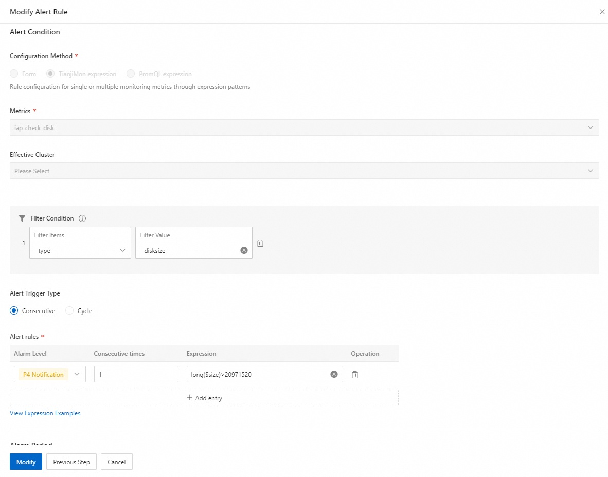

  > **Note**
  >
  > You can view the modified rule in the Custom Rules tab.

- Method 2

  <ol type="i">

  <li>

  In the **Actions** column of the target alert rule, click **Custom Modification**.

  </li>

  <li>

  In the **Modify Alert Rule** dialog box, set the **Alert execution cycle**, **Effective Cluster**,

  </li>

  </ol>

  **Alert Trigger Type**, **Alert rules**, **Effective time**, and **Channel Silence Period**. Click **Modify**.

**View alert rules**

1. Click **Advanced Filter**. You can combine filters by **Rule Name**, **Rule Status**, **Alarm Level**, **Monitoring Items**, **Cloud Products**, **Service**, and **Effective Cluster** to find target alert rules.

2. In the alert rule list, you can view the **Rule Name**, **Cloud Products**, **Service**, **Enabled**, **Rule Description**, **Metrics**, **Alert rules**, and **Effective Cluster**. Hover your mouse over the number in the **Effective Cluster** column to view the specific cluster names.

   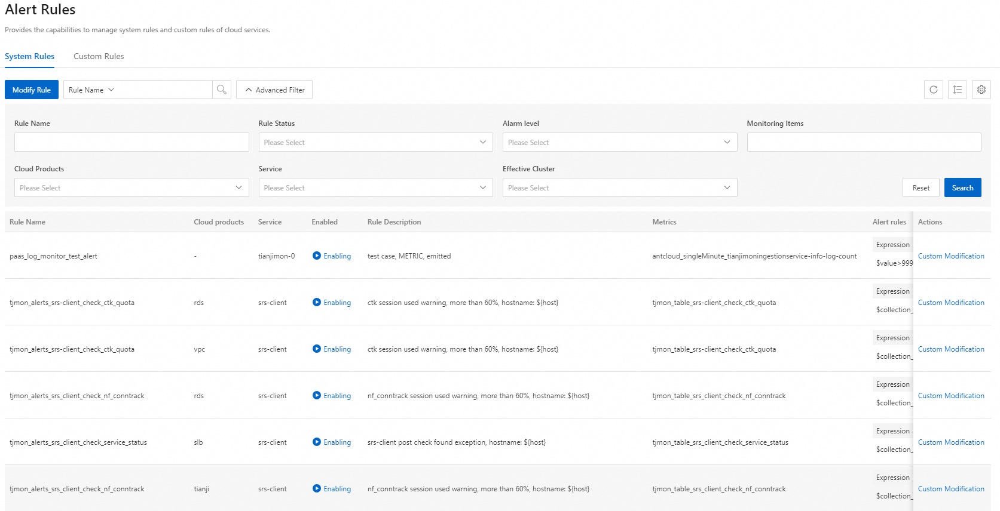

<a id="section-4-1-1-1-4"></a>

##### 4.1.1.1.4. Alert template

Alert Templates allows you to manage system templates and custom templates of cloud products.

**System template**

**Configuration import**

1. Log in to the Apsara Uni-manager Operations Console.

2. In the top navigation bar, choose **Monitor&Alert** > **Monitor Management** > **Tianjimon**.

3. In the left-side navigation pane, choose **Cloud Product Business Monitoring** > **Alert Templates**.

4. On the **System Template** tab, click **Import Configuration**. In the dialog box that appears, upload the template file and click **OK**.

   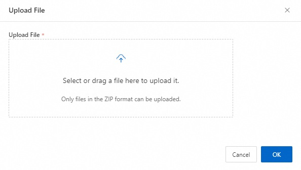

   > **Note**
   >
   > Only .zip files are supported.

   The following table describes the main parameters of the template.

   | Parameter | Description |
   | --- | --- |
   | Service Name | The service for which the monitoring template is configured. The monitoring template takes effect on the specified service. |
   | Template Name/ID | The name and ID of the monitoring template.<br>Hover over the template name or ID and clickto copy the template name<br>or ID. |
   | Template Type | The type of the monitoring template. |
   | Template Version | The version of the monitoring template.<br>• V1: tianjimon template<br>• V2: tianjimon page access template |
   | Deployment Status | The deployment status of the monitoring template. Four states are available: <strong>Enabled</strong>, <strong>Enabling</strong>, <strong>Failed to take effect</strong>, and <strong>Disabled</strong>.<br>• Enabled: The template has been deployed.<br>• Enabling: The template is being deployed and has not taken effect yet.<br>• Failed to take effect: The template failed to be deployed. For more information, see the Failure Cause column.<br>• Disabled: The template is pending deployment. |
   | Associated Instances | <br>If associated instances exist, hover over to view the service instances<br>bound to the current template. Hover over the cluster name and clickto<br>copy the cluster name. If no associated service instance exists, the template is not referenced by any service. |
   | Enabled At | The time when the template takes effect. |
   | Modified At | The last time when the template was modified. |
   | Modified By | The user who modified the template. |
   | Failure Cause | The cause why the template failed to be deployed.<br>Click the information in the <strong>Faiure Cause</strong> column to view details in a dialog box. |

**View a template**

On the **System Template** tab, select the target template and click **View** in the **Actions** column.

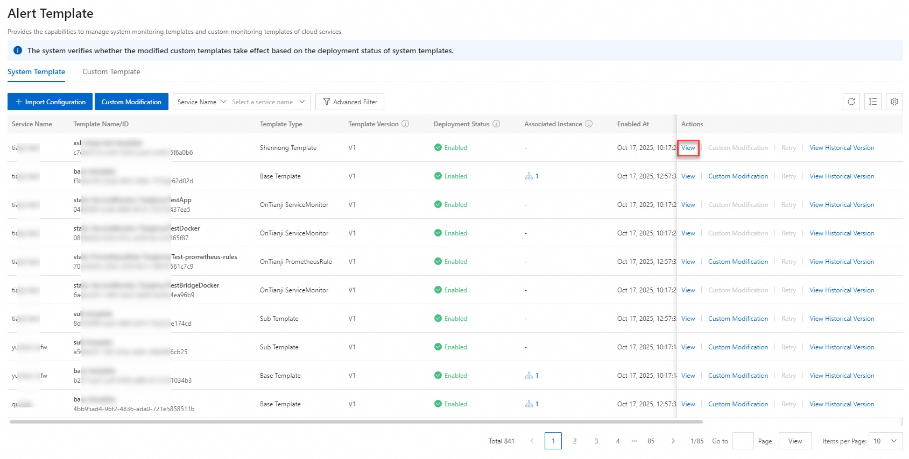

**View Template** dialog box displays the details of the template.

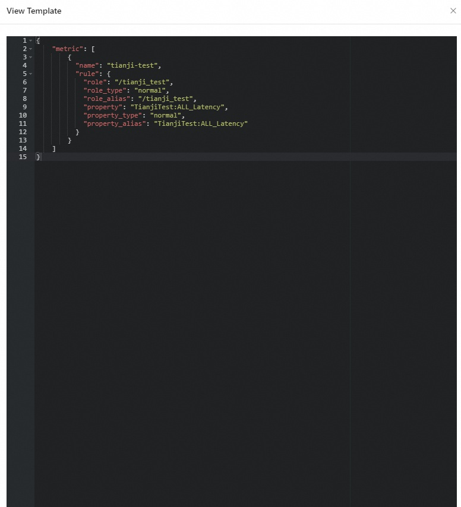

**Custom modification**

> **Note**
>
> Some templates do not support custom modifications. Check the console for more information.

- Method 1

  <ol type="i">

  <li>

  On the **System Template** tab, click **Custom Modification**.

  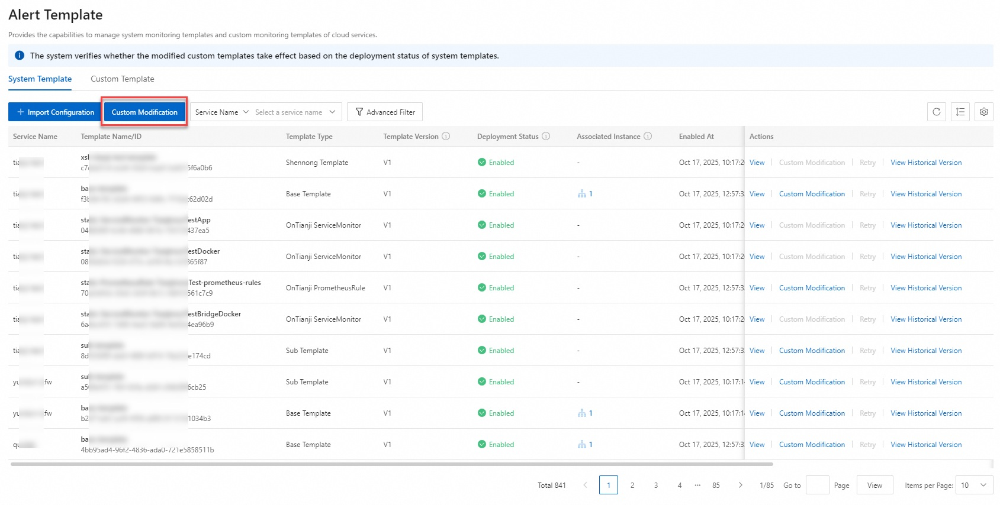

  </li>

  <li>

  In the **Modify Alert Template** dialog box, select a template and click **Next Step**.

  </li>

  </ol>

  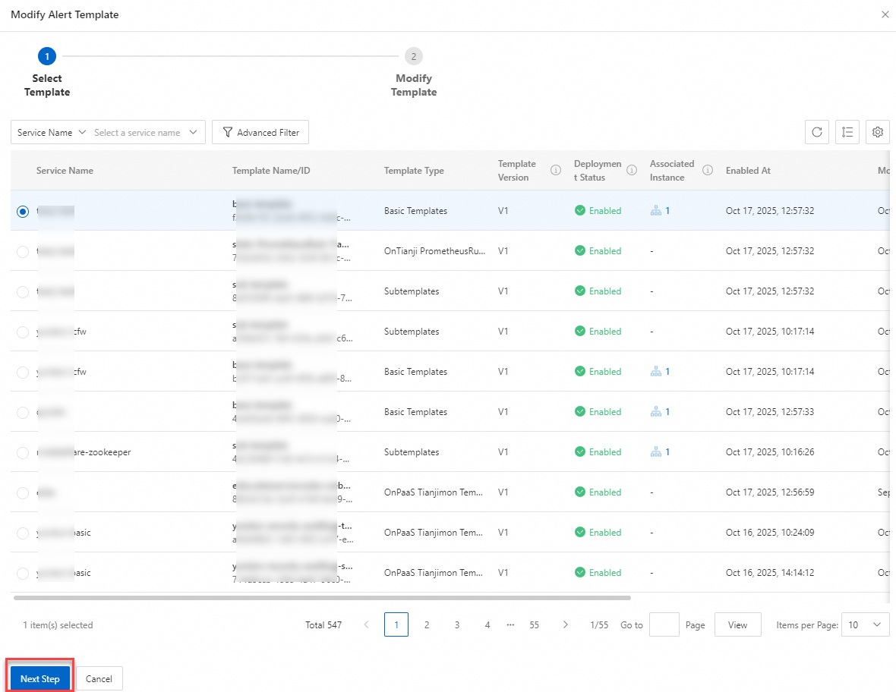

  <ol type="i" start="3">

  <li>

  Edit the template in the Update Version on the right, click **Modify**, and then you can view

  </li>

  </ol>

  it in the **Custom Template** section.

  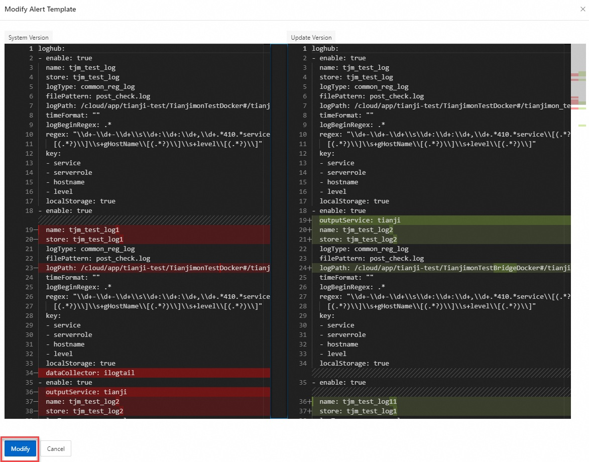

- Method 2

  <ol type="i">

  <li>

  On the **System Template** tab, select the target template and click **Custom Modification** in the **Actions** column.

  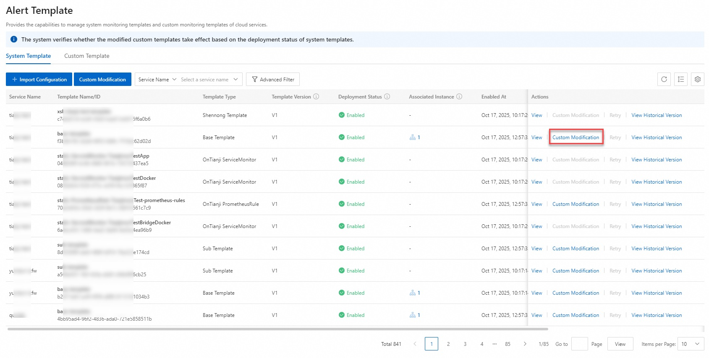

  </li>

  <li>

  Edit the template in the Update Version on the right, click **Modify**, and then you can view

  </li>

  </ol>

  it in the **Custom Template** section.

  

**Retry**

For templates whose deployment status is **Failed to take effect**, you can click **Retry** in the Actions column to redeploy the template.

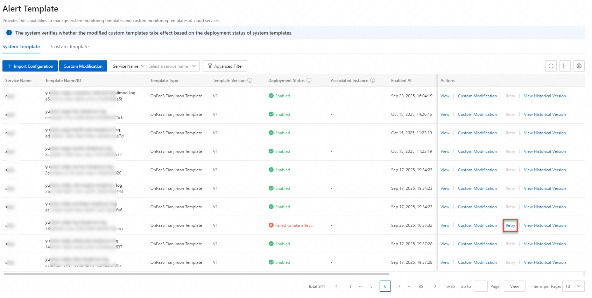

**View a historical version**

> **Note**
>
> Synchronization of historical versions may experience a 10-minute delay due to cloud product upgrades or GUI-based modifications to site-specific templates.

1. On the **System Template** tab, select the target template and click **View Historical Version** in the **Actions** column to view information such as **Template Modified At**, **Modified By**, and **Failure Cause**.

2. In the **Historical Version** dialog box, click **Compare with Current Version** in the **Actions** column to view the differences between the current version and the historical version of the template.

   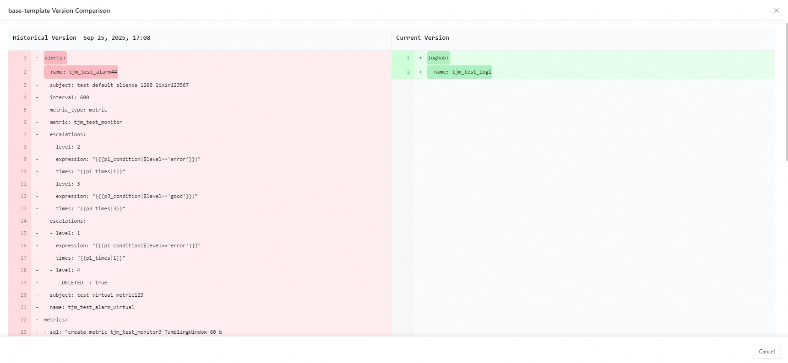

3. Click **View** in the **Actions** column to display template information in JSON format.

**Custom template**

**Import configuration**

1. Log in to the Apsara Uni-manager Operations Console.

2. In the top navigation bar, choose **Monitor&Alert** > **Monitor Management** > **Tianjimon**.

3. In the left-side navigation pane, choose **Cloud Product Business Monitoring** > **Alert Templates**.

4. Select the **Custom Template** tab and click **Import Configuration**. In the Upload Plug-in dialog box that appears, upload the template file, and then click **OK**.

   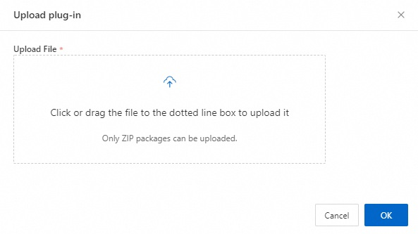

   > **Note**
   >
   > Only ZIP files are supported.

**Modify template**

> **Note**
>
> You can verify custom template modifications by checking the deployment status of system templates.

1. On the **Custom Template** tab, select the target template and click **Modify** in the **Actions** column.

   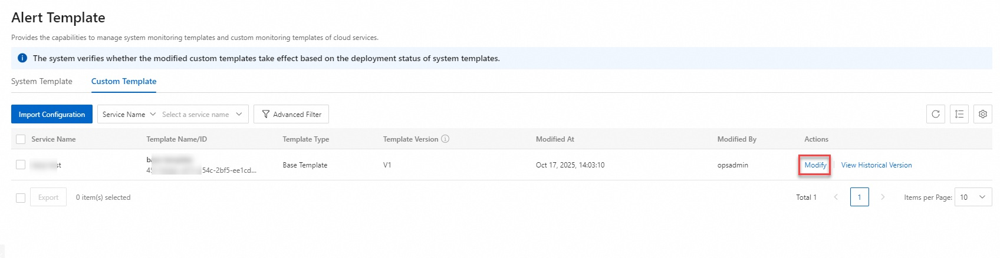

2. Edit the template in the Update Version pane on the right, click **Modify**, and then view the modified template on the **Custom Template** tab.

   

**View previous version**

> **Note**
>
> Synchronization of historical versions may experience a 10-minute delay due to cloud product upgrades or GUI-based modifications to site-specific templates.

1. On the **Custom Template** tab, select the target template and click **View Historical Version** in the **Actions** column to view information such as **Template Modified At, Modified By, and Failure Cause**.

   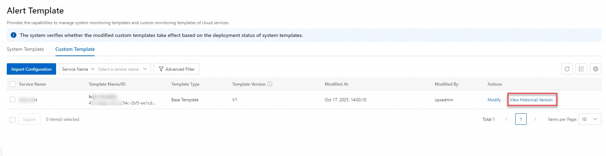

2. In the Historical Version dialog box, click **Compare with Current Version** in the **Actions** column to view the differences between the current version and the historical version of the template.

   

3. Click **View** in the **Actions** column to display template information in JSON format.

<a id="section-4-1-1-1-5"></a>

##### 4.1.1.1.5. Alert history

This topic describes how to view the alert details of a cloud service, including clusters and services.

**Procedure**

1. Log on to the Apsara Uni-manager Operations Console.

2. In the top navigation bar, choose **Monitor&Alarms** > **Monitor Management** > **Tianjimon**.

3. In the left-side navigation pane, choose **Product Business Monitoring** > **Alert History**.

   - In the left-side **Service Catalog** pane, select the cloud service or service that you want to manage. The corresponding alert trend and alerts are displayed on the right side of the page.

   - In the upper-right corner of the page, select a time range. The alert information of the corresponding time range is displayed in the lower part of the page.

     - Alert Trend: displays the trend of historical alerts within the specified time range.

     - Alert List: displays historical alerts within the specified time range.

   - Click **Advanced Filter** to filter alert rules by alert level, monitoring item, rule name, or cluster to obtain the history of an alert.

     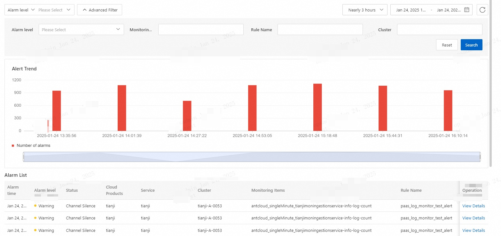

   - In the alert list, find the alert that you want to view and click **View Details** in the **Actions** column. In the panel that appears, view the basic information, alert rules, alert traces, and metric details. You can also specify a time period to filter alerts.

     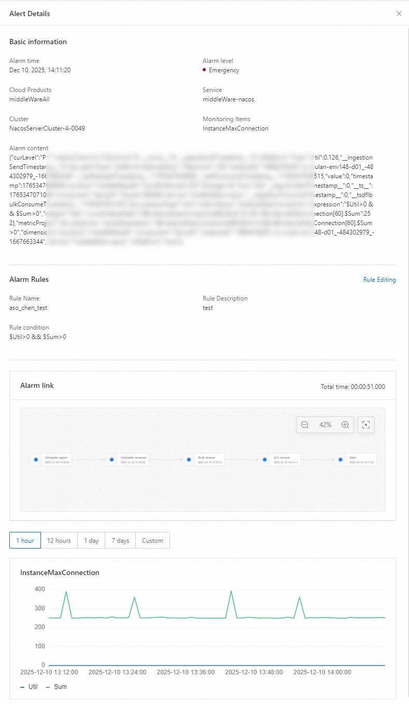

   - In the **Alarm Rules** section, click **Rule Editing**. On the Edit Alarm Rules page, modify the alert rule and click **Submit**.

<a id="section-4-1-1-1-6"></a>

##### 4.1.1.1.6. Indicator repository

The namespace provides basic monitoring metrics and lifecycle management for physical server hosts, clusters, cloud service SR processes, cloud service SR containers, and cloud service SR JVMs.

**Procedure**

1. Log in to the Apsara Uni-manager Operations Console.

2. In the top navigation bar, choose **Monitor&Alert** > **Monitor Management** > **Tianjimon**.

3. In the left-side navigation pane, choose **Cloud Product Business Monitoring** > **Indicator Repository**.

4. On the **Indicator Repository** page, filter metrics by **Metric Name**, **Metric Category**, and **Status**.

   > **Note**
   >
   > - Supported categories: SR, cluster, process, machine, SR instance, docker, default.
   >
   > - Supported statuses: No data, Normal, Metric undefined, Detection error.

   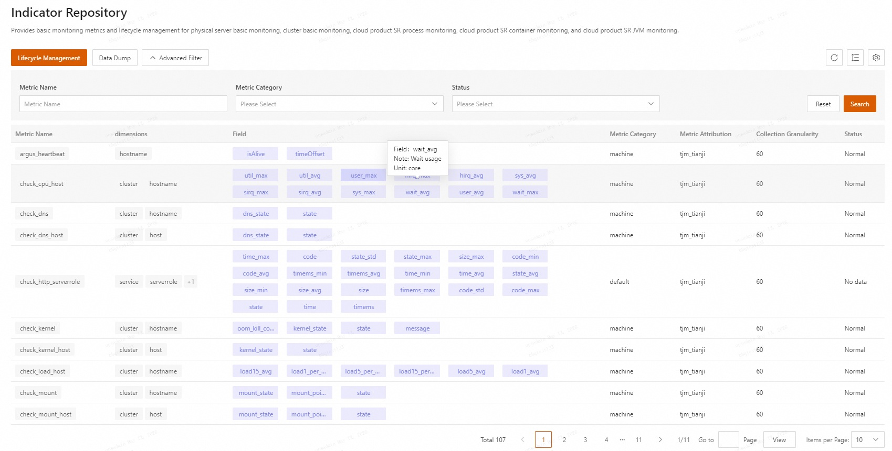

   You can view the following information about each metric: **Metric Name**, **dimensions**, **Field**, **Metric Category**, **Metric Attribution**, **Collection Granularity**, and **Status**.

5. Manage lifecycle.

   Click **Lifecycle Management**. In the dialog box that appears, set **Data Storage Duration (Days)** to configure the data retention period for monitoring metrics.

   > **Note**
   >
   > The system retains monitoring metric data for up to 730 days.

   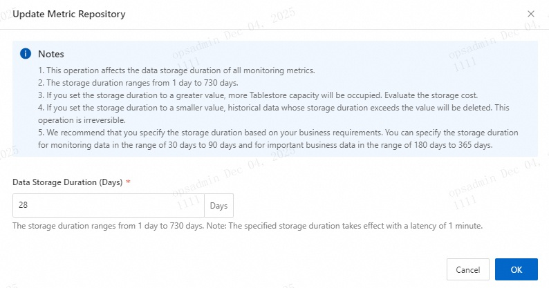

   After you complete the configuration, click **OK**.

**Data dump**

**Background information**

If you require longer retention periods or larger data volumes, you can dump the data to your Simple Log Service (SLS).

**Limits**

If SLS is not deployed in the current environment, alert data dumping is not suported.

**Procedure**

1. On the **Indicator Repository** page, click **Data Dump**.

2. Configure the following parameters and click **Submit**.

   | Parameter | Description |
   | --- | --- |
   | Retention Period (Days) | Enter the retention period for alert data dump. Default value: 180.<br>Valid values: 30 to 720. |
   | ARN | The ARN of the Resource Access Management (RAM) role that authorizes the alert data dump task. Contact the organization administrator of your level-1 organization to grant the required permissions to the RAM role.Then, enter the ARN of the RAM role.<br>To obtain the <strong>Policy</strong> and <strong>Authorization Policy</strong> required during authorization, click <strong>Obtain RAM Authorization Information</strong> on the right. |
   | Destination Project | Enter the destination organization for alert data dump. The required resources will be created under this organization. If a resource with the same name already exists, ensure that the selected organization has taccess permissions to the resource. |
   | Destination Logstore | Enter the destination Logstore for alert data dump. The required resources will be created under this resource set. |

   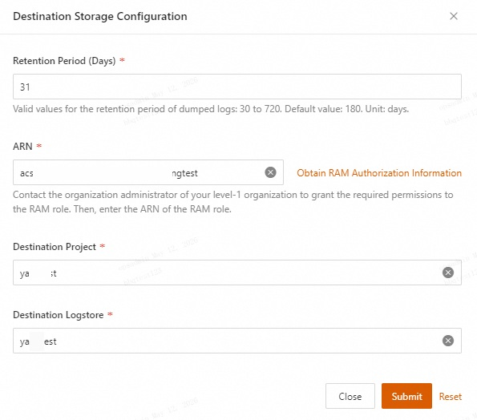

**More operations**

| Operation | Procedure |
| --- | --- |
| Turn off data dump | 1. On the <strong>Indicator Repository</strong> page, click <strong>Data Dump</strong>.<br>2. In the <strong>Destination Storage Configuration</strong> dialog box, click <strong>Close</strong>.<br>Note<br>After you turn off data dump, new alert data will no longer be synchronized to your SLS. However, existing dumped data remains unaffected. |
| Reset data dump | 1. On the <strong>Indicator Repository</strong> page, click <strong>Data Dump</strong>.<br>2. In the <strong>Destination Storage Configuration</strong> dialog box, click <strong>Reset</strong> to clear the destination dump configuration. |

<a id="section-4-1-1-2"></a>

#### 4.1.1.2. Product gateway monitoring

<a id="section-4-1-1-2-1"></a>

##### 4.1.1.2.1. API monitoring dashboard

The API monitoring dashboard allows you to monitor the metrics for APIs registered to the OpenAPI Proxy (POP) gateway, Operations Programmability System (OPS) gateway, and Apsara Stack API (ASAPI), including API calls, average calls, average total duration, availability rate, and success rate. You can query time-based data for periods of up to 31 days. By default, the real-time view displays data from the last hour and automatically updates every minute.

**Procedure**

1. Log on to the Apsara Uni-manager Operations Console.

2. In the top navigation bar, choose **Monitor&Alert** > **Monitor Management** > **Tianjimon**.

3. In the left-side navigation pane, choose **Cloud Service Gateway Monitoring** > **API Monitoring Dashboard**.

4. In the upper part of the page, Configure the **Cloud Products**, **API type**, **API version**, **API namespace**, and **API name** parameters.

5. On the dashboard, view charts in the **API Requests**, **Average visits**, **Average Total Time**, **Availability**, and **Success Rate** sections.

   > **Note**
   >
   > - In the upper-right corner of the page, you can click **Live View** to specify a time range for the views. Valid values: **Last 3 hours**, **Last 6 hours**, **Last 24 hours**, **Last 3 days**, **Last 7 days**, and **Custom View**.
   >
   > - You can click the
   >
   >   icon above the list to set the automatic refresh interval or
   >
   >   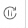
   >
   >   perform manual refresh.

<a id="section-4-1-1-2-2"></a>

##### 4.1.1.2.2. API alert

View and manage alarm rules and alert history for cloud product API monitoring.

**Create an alarm rule**

**Procedure**

1. Log in to the Apsara Uni-manager Operations Console.

2. In the top navigation bar, choose **Monitor&Alert** > **Monitor Management** > **Tianjimon**.

3. In the left-side navigation pane, choose **Cloud Product Gateway Monitoring** > **API Alarm**.

4. Click **Create alarm rules**. In the **Create alarm rules** panel, configure the parameters. The following table describes the parameters.

   **Category**

   **Parameter**

   **Description**

   Select the API type of the cloud product. Valid values

   **API type**

   sre **OPSAPI** and **POPAPI**.

   Select the cloud product for which you want to report

   **Cloud Products**

   alerts.

   Select the API scope of the cloud product. Valid values

   **API scope**

   are **All core APIs** and **Custom Selection**.

   > **Note**
   >
   > Configure this parameter only when you set **API**

   **Basic**

   > **scope** to **Custom Selection**.

   **Select a custom Api**

   **information**

   Click the selection box. In the **Add API** dialog box, select one or more APIs and click **OK**.

   Enter a name for the alarm rule.

   Use underscores to separate words. The name must

   **Rule Name**

   not exceed 64 characters in length and can contain only letters, digits, and underscores.

   **Rule Description**

   Enter a description for the alarm rule.

   Select an indicator from all indicators of the selected

   **Alarm Indicator**

   cloud product.

   Select an alarm level. Valid values are **P1 Critical**, **P2**

   **Alarm level**

   **Warning**, **P3 Information**, and **P4 Notification**.

   **Number of**

   The system reports an alert when the number of

   **continuous**

   consecutive abnormal monitoring periods reaches the

   **detection cycles**

   specified value.

   **Alarm Conditions**

   - **Meet all of the following conditions**: The system triggers an alert when all indicators reach their thresholds.

   - **Meet any of the following conditions**: The system triggers an alert when any indicator reaches

   **Alarm Conditions**

   its threshold.

   - **Custom**: Enter a custom expression.

   If you select **Meet all of the following conditions** or **Meet any of the following conditions**, click **Add Entry** to configure the metric, operator, and threshold.

   Specify the time period during which the alarm rule

   **Effective time**

   takes effect. The system generates alerts only within this period.

   **Alert Period**

   The interval at which the system generates subsequent alerts after triggering an alert. Valid values are **5 minutes**, **15 minutes**, **30 minutes**, **60 minutes**, **3 hours**, **6 hours**, **12 hours**, and **24 hours**.

   When a metric exceeds the alert threshold, the system triggers an alert. If the metric remains above the

   **Channel Silence**

   threshold during the channel silence period, the

   **Period**

   system does not generate repeated alerts. If the metric is still abnormal after the channel silence period ends, the system will trigger another alert.

   For example, if you set **Channel Silence Period** to **12 hours**, and the metric remains above the threshlod after this period, the system will trigger another alert.

   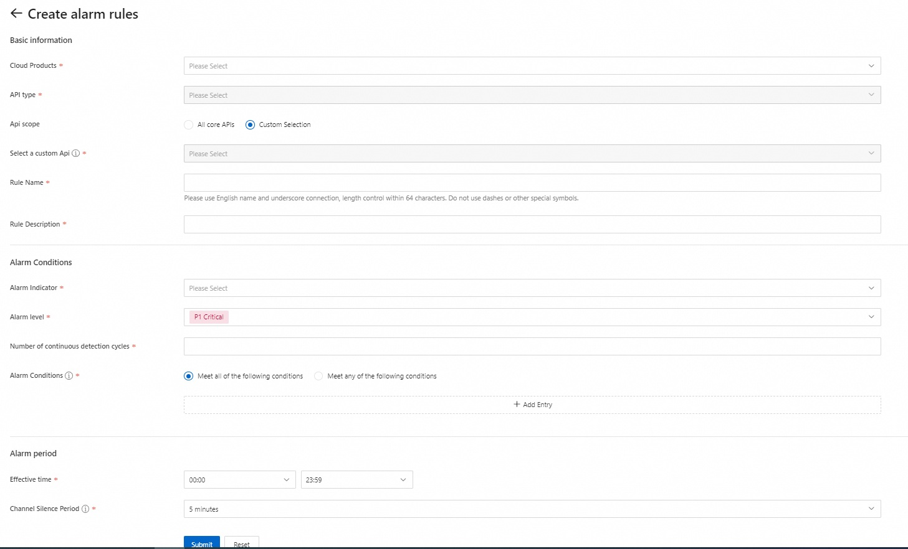

5. Click **Submit**.

**View alarm rules for APIs**

**Procedure**

On the API Alarm page, view the following information about alarm rules: **Rule Name**, **Rule Status**, **Rule Description**, **Cloud Products**, **Alarm level**, **API type**, **API name**, and **Alarm Conditions**.

> **Note**
>
> - Click **Core APIs** in the **API name** column to view the following information about core APIs: **API name**, **core**, **Namespace**, and **Version**.
>
> - Hover over the information in the **Rule Description** column. A pop-up window appears and displays the complete rule description.

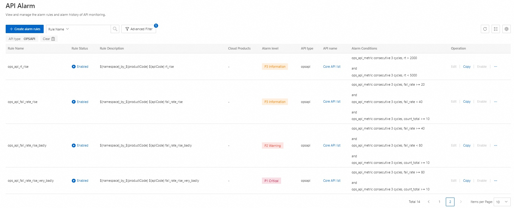

**Modify an alarm rule**

**Procedure**

Modify an existing alarm rule when you need to change its configuration.

> **Important**
>
> You cannot edit system-provided alarm rules.

1. On the **API Alarm** page, click **Edit** in the Actions column of the target alarm rule.

2. In the **Edit alarm rules** panel, modify parameter configurations based on your business requirements. For more information about parameter configurations, see Create an alarm rule.

**Copy an alarm rule**

**Procedure**

Copying an alarm rule quickly creates a new one with identical settings. You can fine-tune the copied alarm rule as needed.

1. On the **API Alarm** page, click **Copy** in the Actions column of the target alarm rule.

2. In the **Copy alarm rules** panel, modify the configurations as needed. For more information about configuration items, see Create an alarm rule.

**Disable an alarm rule**

**Procedure**

Disable an alarm rule when you temporarily do not need to monitor indicators configured in it.

> **Important**
>
> Before disabling an alarm rule, make sure that its **Rule Status** is **Enabled**.

1. On the **API Alarm** page, click  in the Actions column of the target alarm rule and choose

   **Disable**.

2. Click **Disable**.

**Enable an alarm rule**

**Procedure**

Enable an alarm rule when you need to resume monitoring indicators configured in it.

> **Important**
>
> Before enabling an alarm rule, make sure that its **Rule Status** is **Disabled**.

On the **API Alarm** page, click **Enable** in the Actions column of the target alarm rule.

**Delete an alarm rule**

**Procedure**

Delete the alarm rule when you no longer need it.

> **Important**
>
> This operation cannot be undone. Proceed with caution.

1. On the **API Alarm** page, click  in the Actions column of the target alarm rule and choose

   **Delete**.

2. Click **Delete**.

<a id="section-4-1-1-3"></a>

#### 4.1.1.3. Infrastructure monitoring

<a id="section-4-1-1-3-1"></a>

##### 4.1.1.3.1. WatchDog management

This topic describes how to configure WatchDog when you use WatchDog for the first time. This topic also describes the metrics for core components and system monitoring such as O&M monitoring.

**Configure WatchDog**

1. Log in to the Apsara Uni-manager Operations Console.

2. In the top navigation bar, choose **Monitor&Alert** > **Monitor Management** > **Tianjimon**.

3. In the left-side navigation pane, choose **Infrastructure Monitoring** > **WatchDog Management**.

4. On the **WatchDog Management** page, click **Edit Configuration** to open the **Edit WatchDog Configuration** panel.

   The following table describes the parameters.

   <table>
     <tr>
       <th>Parameter</th>
       <th>Required</th>
       <th>Description</th>
     </tr>
     <tr>
       <td>ASO Username</td>
       <td>Yes</td>
       <td rowspan="2">Watchdog requires a real account of the Apsara Uni-manager Operations Console to simulate a logon to the Apsara Uni-manager Operations Console and view alerts. To avoid the impact from existing accounts, create an account of the Apsara Uni-manager Operations Console on site. Enter the username and password of the account.</td>
     </tr>
     <tr>
       <td>ASO Password</td>
       <td>Yes</td>
     </tr>
     <tr>
       <td>LVS Cluster IP Mapping</td>
       <td>Yes</td>
       <td>Enter the mgt in-band IP address. You can perform the following steps to query the mgt in-band IP address:<br>Note<br>The Linux Virtual Server (LVS) IP address is a required parameter for detecting an LVS cluster. If you do not specify this parameter, LVS cluster detection does not take effect.<br>i. Log on to the Apsara Infrastructure Management console. On the <strong>Product &amp; Cluster O&amp;M</strong> page, search for SLB clusters. Find the slbCluster-A-xxx cluster, and click <strong>Cluster Details</strong> in the Actions column.<br>ii. On the <strong>Services</strong> tab, find slb-lvs and click <strong>Details</strong> in the <strong>Actions</strong> column. On the page that appears, find the SlbLvs# server and click <strong>Terminal</strong> in the <strong>Actions</strong> column to log on to the server.<br>iii. Run the <code> ifconfig bond0 </code> command to obtain the in-band IP address, as shown in the following screenshot.<br>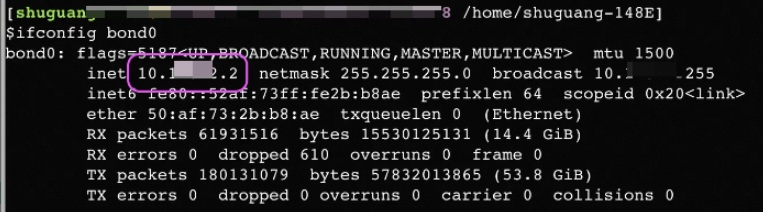<br>iv. Run the <code> ifconfig lo:mgt </code> command to obtain the in-band IP address, as shown in the following figure. Now, a mapping between an in-band IP address and mgtIp is obtained.<br>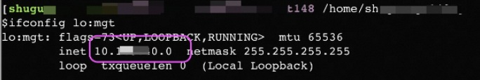<br>v. Log on to another server and repeat steps c to d to obtain another mapping between an in-band IP address and mgtIp.</td>
     </tr>
   </table>

   <table>
     <tr>
       <td>ASW Cluster IP Mapping</td>
       <td>No</td>
       <td rowspan="4">WatchDog detects various network switches (ASWs, LSWs, DSWs, and CSWs) at local sites. The out-of-band IP addresses of these switches cannot be obtained through automated interfaces.Therefore, onsite delivery engineers must manually obtain the mapping between the in-band IP addresses and the out-of-band IP address of each switch.<br>Note<br>If the IP address mappings are not provided, WatchDog detects only the in-band IP addresses of these switches and does not detect the connectivity of out-of-band networks.</td>
     </tr>
     <tr>
       <td>DSW Cluster IP Mapping</td>
       <td>No</td>
     </tr>
     <tr>
       <td>CSW Cluster IP Mapping</td>
       <td>No</td>
     </tr>
     <tr>
       <td>LSW Cluster IP Mapping</td>
       <td>No</td>
     </tr>
     <tr>
       <td>JAR Program Sending Configuration</td>
       <td>Yes</td>
       <td>i. The IP address of the deployed out-of-band network.<br>ii. Click <strong>Download JAR Program</strong> to upload the downloaded JAR package to the out-of-band network.<br>iii. Run the <code> java -jar projectA-0.0.1-SNAPSHOT.jar </code> command to execute the JAR package. Normal log output indicates that the service starts normally.<br>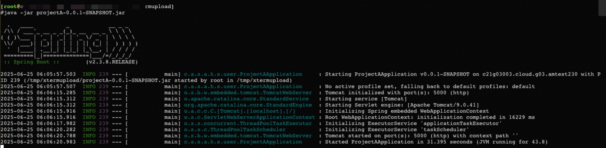<br>iv. After the service is started, click <strong>Test</strong> in the JAR Program Sending Configuration section of the Edit WatchDog Configuration panel.</td>
     </tr>
     <tr>
       <td>Alert Notification Configuration</td>
       <td>No</td>
       <td>Enter an out-of-band IP address: Port number+Path for POST requests. Then, click <strong>Test</strong>.</td>
     </tr>
   </table>

**Metrics**

1. Log in to the Apsara Uni-manager Operations Console.

2. In the top navigation bar, choose **Monitor&Alert** > **Monitor Management** > **Tianjimon**.

3. In the left-side navigation pane, choose **Infrastructure Monitoring** > **WatchDog Management**.

4. On the **Core Component** tab, view the metrics described in the following table.

   **Metric category**

   **Metric**

   **Description**

   Checks the port connectivity of all

   checkLSWConnection

   LSWs and generates an alert if all LSWs become unreachable.

   Checks the port connectivity of all

   checkDSWConnection

   DSWs and generates an alert if all DSWs become unreachable.

   Physical network monitoring

   Checks the port connectivity of all CSWs and generates an alert if all

   checkCSWConnection

   CSWs become unreachable.

   Checks the port connectivity of all ASWs, and generates an alert when any ASW is unavailable and the URL

   checkASWConnection

   of the Apsara Uni-manager Operations Console becomes unreachable.

   Checks the creation of Domain Name System (DNS) domain names, the connectivity of new domain names on other machines,

   checkOpsDNSCreateConnectDeleteO

   and the domain name deletion

   nRemoteNode

   feature. An alert is generated if any of these checks fail.

   OPS_DNS monitoring

   Checks the creation of DNS domain names, the connectivity of new domain names on the local

   checkOpsDNSCreateConnectDeleteL

   machine, and the domain name

   ocal

   deletion feature. An alert is generated if any of these checks fail.

   Checks whether the machine status of Apsara Infrastructure Management inspection on minirds-maotai.DbMysql# is Good and whether the usage of each partition of a disk exceeds 99%. An alert is

   checkDbMySQLInstanceStatus

   generated if any exception is detected.

   Checks whether the MiniRDS

   MiniRDS monitoring

   database of TianjiMon can be

   checkTianjimonMiniRDS

   connected and run simple SQL statements. An alert is generated if any exception is detected.

   Checks whether the MiniRDS database of the Apsara Uni-manager Operations Console can

   checkASOMiniRDS

   be connected and run simple SQL statements. An alert is generated if any exception is detected.

   Checks the connectivity of the virtual IP (VIP) address requested

   checkWatchdogServerVip

   by WatchDog. An alert is generated if the VIP is unreachable.

   Checks the connectivity of port 22 on all LVS machines. An alert is

   checkLvsSshPortConnection

   LVS monitoring

   generated if all LVS machines fail the connection test.

   Checks the connectivity of the health check port 12000 for all LVS mgtIps. An alert is generated if all

   checkLvsKeyPortConnection

   LVS machines fail the connection test.

5. On the **Monitor Maintenance** tab, view the metrics described in the following table.

   **Metric category**

   **Metric**

   **Description**

   Checks the logon port of the Apsara Uni-manager Operations

   checkASOLogin

   Console and generates an alert when a logon fails.

   Checks the status of TianjiMon in the alert overview of the Apsara

   checkTianjimonStatus

   Uni-manager Operations Console. An alert is generated when the status is abnormal.

   Checks the alert overview interface of the Apsara Uni-

   checkASOAlarmPage

   manager Operations Console and generates an alert when a query

   ASO monitor

   fails.

   Checks the status of TPCMon in the alert overview of the Apsara

   checkTpcMonStatus

   Uni-manager Operations Console. An alert is generated when the status is abnormal.

   Checks whether access to static

   checkStaticPage

   pages of the Apsara Uni-manager Operations Console is normal.

   Checks whether the Prometheus metrics of TianjiMon generate data and whether the metric result

   checkTianjiPrometheusMonitorMetric

   is kube_daemonset_status_number_r eady.

   Checks whether the container metrics of TianjiMon generate

   checkTianjiContainerMonitorMetric

   data and whether the metric result is docker_memory_util.

   Checks whether the log metrics of

   TianjiMon

   TianjiMon generate data and

   checkTianjiLogMonitorMetric

   monitoring

   whether the metric result is cpu_host.

   Checks whether the system metrics of TianjiMon generate

   checkTianjiHostMonitorMetric

   data and whether the metric result is cpu_host.

   Checks whether alerts of TianjiMon are normally generated and checks the output of alert

   checkTianjiAlarmQuery

   items. If issues are suspected, you can check the mock alert rule mock_alert_name_for_watch_dog.

   Checks the status of TianjiMon in the alert overview of the Apsara

   checkTianjimonStatusOps

   Uni-manager Operations Console. An alert is generated when the status is abnormal.

   Checks the status of TPCMon in the alert overview of the Apsara

   checkTpcMonStatusOps

   Uni-manager Operations Console.

   ASO monitoring ops

   An alert is generated when the

   Gateway

   status is abnormal.

   monitoring

   Checks the alert overview interface of the Apsara Uni-manager Operations Console and

   checkASOAlarmPageOps

   generates an alert when a query fails.

   <table>
     <tr>
       <td>Register alarm gateway monitoring</td>
       <td>checkAlarmSubConnection</td>
       <td>Checks the domain names of registered alert gateways.</td>
     </tr>
     <tr>
       <td rowspan="2">Watchdog self monitoring</td>
       <td>checkWatchdogAgent</td>
       <td>Checks whether the registered watchdogAgent works properly.</td>
     </tr>
     <tr>
       <td>checkWatchdogServer</td>
       <td>Check whether watchdogServer dual backup works properly.</td>
     </tr>
     <tr>
       <td rowspan="2">ASO delay monitoring</td>
       <td>checkCmsAsoSourceStatus</td>
       <td>Checks the latency of alerts from the major source CloudMonitor.</td>
     </tr>
     <tr>
       <td>checkTianjimonAsoSourceStatus</td>
       <td>Checks the latency of alerts from the major source TianjiMon.</td>
     </tr>
   </table>

<a id="section-4-1-1-3-2"></a>

##### 4.1.1.3.2. Server monitoring

Server monitoring provides the status of CPU, memory, and server sensors (fans, power supplies, CPU, memory, network cards, GPU, power consumption, etc.) for each physical server.

**Procedure**

1. Log in to the Apsara Uni-manager Operations Console.

2. In the top navigation bar, choose **Monitor&Alert** > **Monitor Management** > **Tianjimon**.

3. In the left-side navigation pane, choose **Infrastructure Monitoring** > **Server Monitoring**.

**Export all data**

On the **Server Monitoring** page, click **Export** to export full server information as a .json file.

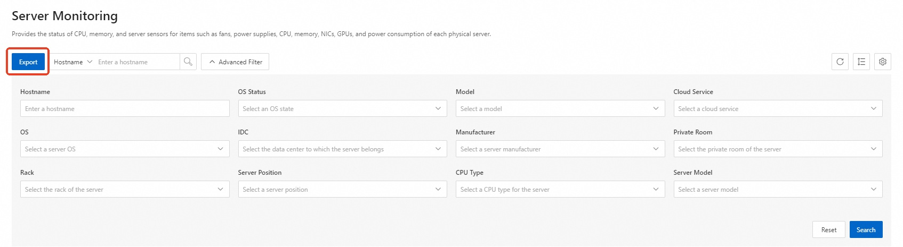

**Filter servers**

On the **Server Monitoring** page, filter target servers by **Hostname**, **OS Status**, **Model**, **Cloud Service**, **OS**, **IDC**, **Manufacturer**, **Private Room**, **Rack**, **Sever Position**, **CPU Type**, or **Server Model**.

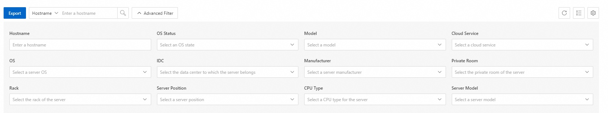

**View server details**

1. On the **Server Monitoring** page, view the maximum, minimum, and average utilization for CPU, memory, and disk of each server.

   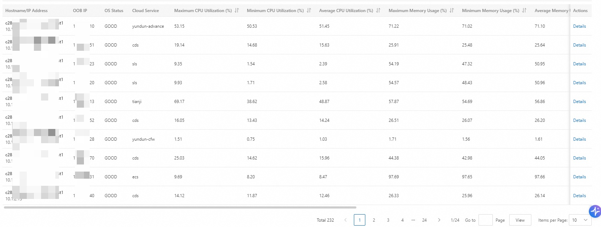

2. On the **Server Monitoring** page, select a target server and click **Details** in the **Actions** column to view detailed server information.

   - Basic information

     This section displays IP, Zone, Cluster, Manufacturer, Data Center, Model, Private Room, Server Model, Rack, Server Position, SN, CPU Manufacturer, Kernel Version, MAC, CPU Utilization, Memory Utilization, and Health Status.

     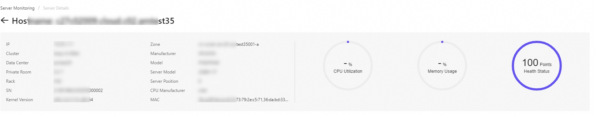

   - Monitoring

     This tab displays Server Status and Monitoring View.

     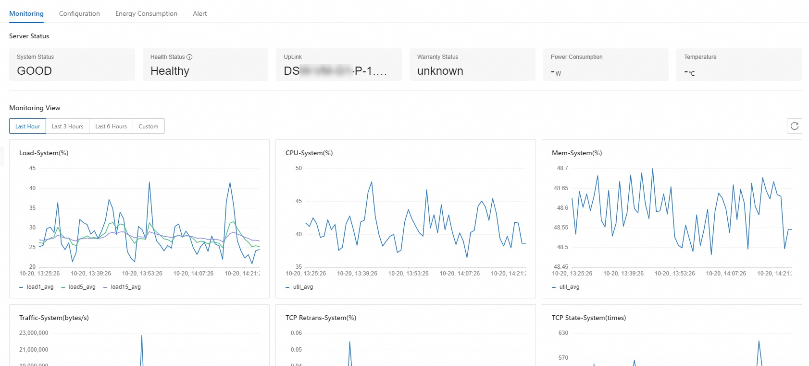

   - Configuration

     This tab displays detailed information about CPU, Memory, Storage, NIC, GPU, Motherboard, BIOS, BMC, OS, Power Supply, and Fan.

     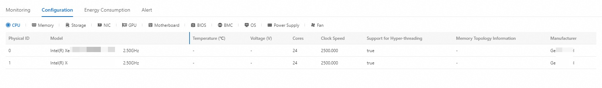

   - Energy Consumption

     This tab displays Current Power Consumption, Electricity Consumption Today, Monthly Electricity Consumption, System Temperature, Power Consumption Trend, and Electricity Consumption Trend.

   - Alert

     This tab displays detailed alert information.

<a id="section-4-1-1-3-3"></a>

##### 4.1.1.3.3. Network monitoring

The Overview page displays the key metrics of network services to help users keep track of the status of services and devices at the earliest opportunity.

**Procedure**

1. Log in to the Apsara Uni-manager Operations Console.

2. In the top navigation bar, choose **Monitor&Alert** > **Monitor Management** > **Tianjimon**.

3. In the left-side navigation pane, choose **Infrastructure Monitoring** > **Network Monitoring**.

4. View the network dashboard.

   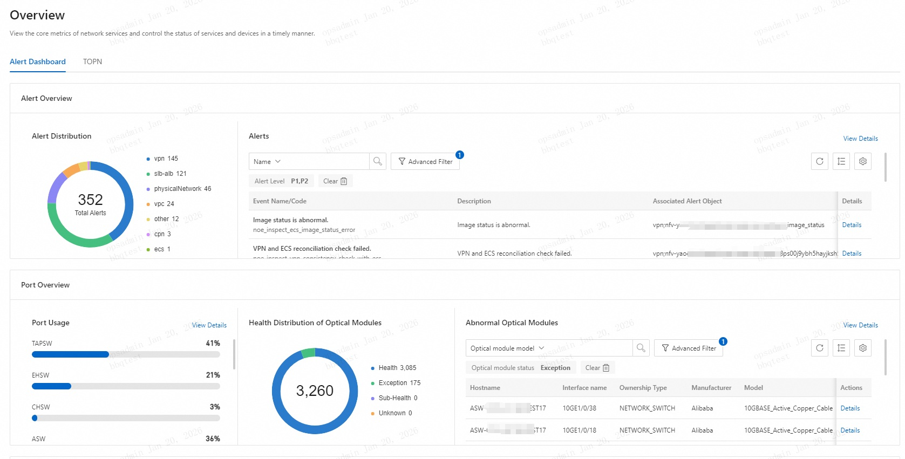

   - **Alert Overview**

     | Section | Description |
     | --- | --- |
     | Alert Overview | • <strong>Alert Distribution</strong>: displays the total number of alerts triggered by network devices and the distribution of resources that have triggered alerts.<br>• <strong>Alerts</strong>: displays information about alerts of the <strong>P1</strong> and <strong>P2</strong> levels in the event center. The alert information includes <strong>Event Name/Code</strong>, <strong>Description</strong>, <strong>Associated Alert Object, Source Type</strong>, <strong>Alert</strong> <strong>Source</strong>, <strong>Alert Type</strong>, <strong>Alert Level</strong>, <strong>Alerts</strong>, <strong>Clear or Not</strong>, <strong>Triggered</strong> <strong>At</strong>, <strong>Cleared At</strong>, <strong>Auto-clearing Cycle</strong>, and <strong>Auto-cleared At</strong>.<br>In the upper-right corner, click <strong>View Details</strong>. In the <strong>Alerts</strong> dialog box, you can view the list of alerts.<br>• <strong>Advanced Filter</strong>: You can search for alerts based on a combination of <strong>Name</strong>, <strong>Associated Alert Object, Alert Level</strong>, <strong>Source Type,</strong> <strong>Alert Source, and Associated Event Code</strong>.<br>• Click <strong>Details</strong> in the <strong>Details</strong> column of an alert. In the <strong>Event</strong> <strong>Details</strong> dialog box, you can view the detailed alert information. |

     <table>
       <tr>
         <td>Port Overview</td>
         <td>• <strong>Port Usage</strong>: displays the port usage of network devices.<br>In the upper-right corner, click <strong>View Details</strong>. In the <strong>Port Usage</strong> <strong>Details</strong> dialog box, you can view the list of alerts. The port usage details include <strong>Device Role</strong>, <strong>Device Name</strong>, <strong>IP Address</strong>, <strong>Usage (%)</strong>, <strong>Device Status</strong>, <strong>Total Ports</strong>, and <strong>Used Ports</strong>.<br><br>• <strong>Health Distribution of Optical Modules:</strong> displays the distribution of optical transceiver modules on the current day.<br>• <strong>Abnormal Optical Modules</strong>: displays information about optical transceiver modules in the <strong>Exception</strong> state by default. The information includes <strong>Hostname</strong>, <strong>Interface name</strong>, <strong>Ownership Type</strong>, <strong>Manufacturer</strong>, <strong>Model</strong>, <strong>Status</strong>, <strong>Failure probability</strong>, <strong>Expected</strong> <strong>residual life</strong>, and <strong>Intelligent analysis results</strong>.<br>Click <strong>View Details</strong> in the upper-right corner. Then, you can view information about abnormal optical transceiver modules in the <strong>Abnormal Optical Modules</strong> dialog box.<br>• <strong>Advanced Filter</strong>: You can search for optical transceiver modules based on a combination of <strong>Optical module model</strong>, <strong>Optical</strong> <strong>module manufacturer, Optical module status, Hostname</strong>, <strong>Interface name</strong>, and <strong>Device type</strong>.<br>• Find the optical transceiver module that you want to view and click <strong>Details</strong> in the <strong>Actions</strong> column. Then, you are redirected to the <strong>Network Operations Console</strong> &gt; <strong>Intelligent Diagnostics</strong> &gt; <strong>Optical Module Diagnostics</strong> page. You can view the detailed information about the optical transceiver module on the <strong>Optical</strong> <strong>Module Prediction Details</strong> page.</td>
       </tr>
       <tr>
         <td>Traffic Dashboard</td>
         <td>By default, the <strong>SLB Cluster Usage Overview</strong> and <strong>XGW Cluster</strong> <strong>Usage Overview</strong> metrics within the <strong>last hour</strong> are displayed. For more information about the metrics, see the "Traffic dashboard metrics" section in the Overview topic.<br>• You can click <strong>1 Hour</strong>, <strong>6 Hours</strong>, <strong>12 Hours</strong>, or <strong>24 Hours</strong> to query the historical trend charts of the Server Load Balancer (SLB) and XGW clusters within a specific time range.<br>• In the upper-right corner, click the cluster to view its usage details.</td>
       </tr>
     </table>

     **Traffic dashboard metrics**

     <table>
       <tr>
         <td></td>
         <td>Metric</td>
         <td>Description</td>
       </tr>
       <tr>
         <td rowspan="2">SLB cluster</td>
         <td>InBitsPS</td>
         <td>The number of inbound bits per second.</td>
       </tr>
       <tr>
         <td>OutBitsPS</td>
         <td>The number of outbound bits per second.</td>
       </tr>
       <tr>
         <td rowspan="2">XGW cluster</td>
         <td>InByteRate</td>
         <td>The inbound data transmission rate. Unit: bit/s.</td>
       </tr>
       <tr>
         <td>OutByteRate</td>
         <td>The outbound data transmission rate. Unit: bit/s.</td>
       </tr>
     </table>

   - **TOPN**: Metrics are sorted based on their **values**, and the top five metrics are displayed by default.

     You can filter and display metrics in each section by top N, start time, end time, vSwitch, and port.

     | Section | Metric |
     | --- | --- |
     | Physical Network | • vSwitch CPUs<br>• vSwitch Memory<br>• vSwitch Ports<br>• <strong>phy_switch_port_bps</strong> (inbound and outbound)<br>• <strong>phy_switch_port_pps</strong> (inbound and outbound)<br>• <strong>phy_switch_port_error_pps</strong> (inbound and outbound)<br>• <strong>phy_switch_port_drop_pps</strong> (inbound and outbound) |

     | Network Elements | • XGW<br>• xgw_cpu_usage<br>• xgw_huge_mem_usage<br>• <strong>xgw_port_bps</strong> (inbound and outbound)<br>• <strong>xgw_port_pps</strong> (inbound and outbound)<br>• <strong>xgw_port_drop_pps</strong> (inbound and outbound)<br>• LVS<br>• lvs_connsPS<br>• lvs_dropConnPS<br>• lvs_failConnPS<br>• lvs_connections<br>• <strong>lvs_BitsPS</strong> (inbound and outbound)<br>• <strong>lvs_PktsPS</strong> (inbound and outbound)<br>• <strong>lvs_DropPktsPS</strong> (inbound and outbound)<br>• SLB_PROXY<br>• proxy_requests<br>• PROXY qps<br>• proxy_rt<br>• proxy_cps<br>• proxy_handle_ps<br>• proxy_conn_active<br>• AVS<br>• avs_cpu<br>• avs_phyif_in_drop_pps<br>• avs_phyif_in_buffer_missed_errors_pps<br>• avs_vport_tcp_connecting_flows_cps<br>• avs_vport_tcp_established_flows<br>• <strong>avs_phyif_bps</strong> (inbound and outbound)<br>• <strong>avs_phyif_pps</strong> (inbound and outbound)<br>• <strong>avs_phyif_error_pps</strong> (inbound and outbound) |
     | --- | --- |
     |  | • EIP<br>• <strong>xgw_eip_bps</strong> (inbound and outbound)<br>• <strong>xgw_eip_pps</strong> (inbound and outbound) |

     | Network Resources | • Reverse Access<br>• <strong>xgw_ecs_maping_bps</strong> (inbound and outbound)<br>• <strong>xgw_ecs_mapping_pps</strong> (inbound and outbound)<br>• <strong>xgw_ecs_mapping_ratelimit_drop_pps</strong> (inbound and outbound)<br>• <strong>xgw_ecs_mapping_drop_pps</strong> (inbound and outbound)<br>• NATGW<br>• xgw_snat_session_count<br>• xgw_snat_session_drop_cps<br>• xgw_snat_session_ratelimit_drop_cps<br>• vlink<br>• <strong>xgw_vlink_bps</strong> (inbound and outbound)<br>• <strong>xgw_vlink_pps</strong> (inbound and outbound)<br>• Layer 4 VIP<br>• lvs_listener_connsPS<br>• lvs_realserver_connsPS<br>• lvs_listener_dropConnPS<br>• lvs_realserver_dropConnPS<br>• lvs_listener_connections_1m<br>• lvs_realserver_connections_1m<br>• <strong>lvs_listener_PktsPS</strong> (inbound and outbound)<br>• <strong>lvs_realserver_PktsPS</strong> (inbound and outbound)<br>• <strong>lvs_listener_BitsPS</strong> (inbound and outbound)<br>• <strong>lvs_realserver_BitsPS</strong> (inbound and outbound)<br>• <strong>lvs_listener_DropPktsPS</strong> (inbound and outbound)<br>• <strong>lvs_realserver_DropBitsPS</strong> (inbound and outbound)<br>• Layer 7 VIP<br>• proxy_listener_cps<br>• proxy_listener_qps<br>• proxy_listener_rt<br>• proxy_listener_conn_concurrent<br>• vport<br>• avs_vport_tcp_connecting_flows_num_sum_1m<br>• avs_vport_tcp_established_flows_num_sum_1m<br>• <strong>avs_vport_pkts_1m</strong> (inbound and outbound)<br>• <strong>avs_vport_bytes_1m</strong> (inbound and outbound)<br>• <strong>avs_vport_drop_pkts_1m</strong> (inbound and outbound) |
     | --- | --- |

<a id="section-4-1-1-4"></a>

#### 4.1.1.4. General monitoring

<a id="section-4-1-1-4-1"></a>

##### 4.1.1.4.1. Cloud product SLO monitoring

Cloud prodcut SLO monitoring provides a one-click switch for availability monitoring of cloud services. The system actively probes and alerts on suspected unavailability for each cloud service.

**Procedure**

1. Log in to the Apsara Uni-manager Operations Console.

2. In the top navigation bar, choose **Monitor&Alert** > **Monitor Management** > **Tianjimon**.

3. In the left-side navigation pane, choose **General Monitoring** > **Cloud product SLO monitoring**.

4. On the **Cloud Product SLO monitoring** page, view **Toatl Prodcuts**, **Total Exception Events**, **Average Availability**, **Total Exception Duration**, and detailed data for each affected product.

   

5. Click a card for an affected cloud product to view the list of exception events.

   

   - View **Total Events**, **Critical Events**, **Events in Progress**, and **Resolved Events** generated for the current product.

   - Event details include: **Event Name**, **Alert Object**, **Status**, **Occurred At**, **End Time**, **Severity**, and **Duration (Minute)**.

<a id="section-4-1-1-4-2"></a>

##### 4.1.1.4.2. Site monitoring

Site monitoring provides preset monitoring tasks. The tasks use black-box container nodes of TianjiMon to remotely detect virtual IP addresses (VIPs), Domain Name Resolution (DNS) entries, and hostnames that are exposed to cloud products, services, components, and clusters to check connectivity and performance. You can also create and manage custom site monitoring tasks.

**Create a site monitoring task**

**Procedure**

1. Log on to the Apsara Uni-manager Operations Console.

2. In the top navigation bar, choose **Monitor&Alert** > **Monitor Management** > **Tianjimon**.

3. In the left-side navigation pane, choose **General Monitoring** > **Site Monitoring**.

4. On the **Site Monitoring** page, click **Create a task**.

   <ol type="i">

   <li>

   In the **Basic configuration** step, configure the parameters in the following table and click **Next Step**.

   | Parameter | Description |
   | --- | --- |
   | Task name | Enter a name for the task. The name must be 1 to 63 characters in length and can contain letters, digits, underscores (_), hyphens (-), and periods (.). It must start and end with a letter or a digit. |
   | Task type | Select a task type. Valid values: <strong>HTTP probe</strong>, <strong>TCP probe</strong>, <strong>ICMP probe</strong>, <strong>SSH</strong> <strong>probe</strong>, and <strong>BATCH probe</strong>.<br>• <strong>HTTP probe</strong>: sends HTTP requests to check the health status of the specified object.<br>• <strong>TCP probe</strong>: sends TCP requests to check the health status of the specified object.<br>• <strong>ICMP probe</strong>: sends Internet Control Message Protocol (ICMP) requests to check the health status of the specified object.<br>• <strong>SSH probe</strong>: sends SSH requests to check the health status of the specified object.<br>• <strong>SSH probe</strong>: used to configure multiple task types. |
   | ICMP Probes | Note<br>If you set Task type to <strong>ICMP probe</strong>, you must configure this parameter.<br>Enter the number of ICMP probes. |
   | Combined Probes | Note<br>If you set Task type to <strong>BATCH probe</strong>, you must configure this parameter.<br>Select multiple task types. |
   | Destination URL | Enter a destination address.<br>• If you set Task type to <strong>HTTP probe</strong>, enter an HTTP address. Examples: http://xxx.xxx.xxx or http://10.1.10.1:8979/xxx.<br>• If you set Task type to <strong>TCP probe</strong>, enter an address in the IP address:port format. Example: 10.10.1.1:8080.<br>• If you set Task type to <strong>ICMP probe</strong>, enter an IP address. Example: 10.1.0.1.<br>• If you set Task type to <strong>SSH probe</strong>, enter an SSH address.<br>• If you set Task type to <strong>BATCH probe</strong>, enter a destination address for the multitask probe. |
   | Monitoring frequency | Select a probe frequency. Valid values:<br>• 1 minute<br>• Custom |

   <table>
     <tr>
       <td>HTTP Advanced Settings</td>
       <td>Note<br>If you set Task type to <strong>HTTP probe</strong>, you must configure this parameter.<br>• <strong>Request Method</strong>: Select a request method for the detection type. The default value <strong>GET</strong> is used.<br>• (Optional) <strong>HTTP status code</strong>: Select a status code to be returned by HTTP probes. You can select up to 20 status codes.<br>• (Optional) <strong>Header</strong>: Enter a header for the HTTP request. Click <strong>Add entry</strong> to configure the <strong>Header</strong> and <strong>Value</strong> parameters.</td>
     </tr>
   </table>

   

   </li>

   <li>

   In the **Alert Settings** step, configure the parameters in the following table and click

   </li>

   </ol>

   **Next Step**.

   > **Note**
   >
   > Click **Add entry** in the lower part of the page to configure multiple alert settings.

   | Parameter | Description |
   | --- | --- |
   | Alarm name | Enter a name for the alert. The name must be 1 to 63 characters in length and can contain letters, digits, underscores (_), hyphens (-), and periods (.). It must start and end with a letter or a digit. |
   | Alarm Level | Select an alert level. Valid values:<br>• P1 Critical<br>• P2 Warning<br>• P3 Information<br>• P4 Notification |
   | Alarm cycle | Enter a frequency at which the alert is triggered. |
   | Alarm rules | • <strong>Conditional execution</strong>: Select the condition under which the alert is triggered. Valid values: <strong>Meet All</strong> and <strong>Only one item is met</strong>.<br>• <strong>Status Code</strong>: Valid values: <strong>Connectivity</strong>, <strong>Disconnected</strong>, <strong>Completely</strong> <strong>Connected or Any Connected</strong>, and <strong>Completely Disconnected or Any</strong> <strong>Disconnected</strong>.<br>Note<br>The <strong>Completely Connected or Any Connected</strong> and <strong>Completely</strong> <strong>Disconnected or Any Disconnected</strong> options are available only when you set Task type to <strong>BATCH probe</strong>.<br>• <strong>Packet loss rate</strong>: Select a comparison method and enter a threshold. Unit: %.Valid values of the comparison method: <strong>&gt;</strong>, <strong>&gt;=</strong>, <strong>&lt;</strong>, <strong>&lt;=</strong>, <strong>==</strong>, and <strong>!=</strong>.<br>Note<br>If you set Task type to <strong>ICMP probe</strong>, you must configure this parameter.<br>• <strong>Response time</strong>: Select a comparison method and enter a threshold. Unit: seconds. Valid values of the comparison method: <strong>&gt;</strong>, <strong>&gt;=</strong>, <strong>&lt;</strong>, <strong>&lt;=</strong>, <strong>==</strong>, and <strong>!=</strong>. |
   | Alarm description | Enter a description for the alert. |

   

   <ol type="i" start="3">

   <li>

   In the **Association Information** step, configure the **Associate Cloud Product**,

   </li>

   </ol>

   **Associated Services**, **Associated components**, and **Associated cluster** parameters. Then, click **Next Step**. The Associated cluster parameter is optional.

   

   <ol type="i" start="4">

   <li>

   In the **Information preview** step, confirm the configurations and click **Submit**.

   </li>

   </ol>

**View site monitoring details**

**Procedure**

After the task is created, you can view the details of the task, including the basic information, metrics, and configurations.

1. In the list on the **Site Monitoring** page, view the information in the **Task Name**, **Target**, **Task Status**, **Task type**, **Monitoring frequency**, **Associated cloud products**, **Associated Services**, **Associated components**, and **Associated cluster** columns.

   > **Note**
   >
   > - You can click **Advanced Filter** to filter monitoring tasks by **task name**, **task status**, **task type**, **associated cloud products**, **associated services**, **associated components**, and **associated cluster**.
   >
   > - You can click the
   >
   >   icon above the list to refresh the list.
   >
   >   
   >
   > - You can click the
   >
   >   icon above the list to adjust its layout between **Default** and
   >
   >   
   >
   >   **Compact**.
   >
   > - You can click the  icon above the list to select the columns to be displayed. If
   >
   >   you clear a column, the column is not displayed.

   

2. In the task list, click the name of the created task.

3. On the **Task details** page, view the details of the task.

   - In the upper part of the page, you can view the basic information about task, including the **task type**, **target**, **monitoring frequency**, **associated cloud products**, **associated services**, **associated components**, and **associated cluster**.

     > **Note**
     >
     > - You can click **Disable** in the upper-right corner to disable the task.
     >
     > - You can click **Edit** in the upper-right corner to modify the task. For more information about the related parameters, see Create a site monitoring task.

     

   - On the **Monitoring Metrics** tab, view the trend chart of metrics. You can switch between **Real-time View**, **View of recent day**, **View of Previous Week**, and **Custom View**.

     

   - On the **Configuration Information** tab, view the information about **HTTP advanced settings** and **Alarm settings**.

     

**Modify a site monitoring task**

**Procedure**

If the information about an existing task changes, you can modify the task based on your business requirements.

> **Important**
>
> You cannot modify system or cloud product monitoring tasks.

1. On the **Site Monitoring** page, find the task whose information you want to modify and click **Edit** in the Operation column.

2. On the **Modify a task** page, modify the parameters based on your business requirements. For more information about the parameters, see Create a site monitoring task.

   > **Important**
   >
   > You cannot modify the **task name**.

**Copy a site monitoring task**

**Procedure**

You can copy a task to quickly create a task that is the same as the copied task. You can configure the new task based on your business requirements.

1. On the **Site Monitoring** page, find the required task and click **Copy** in the **Operation** column.

2. In the **Copy Task** wizard, follow the steps in the wizard to modify the task based on your business requirements. For more information about the parameters, see Create a site monitoring task.

**Disable site monitoring tasks**

**Procedure**

If you do not need to monitor a site, you can disable the corresponding task.

> **Important**
>
> Before you disable a task, make sure that the **task status** is **Enabled**.

- Disable a single task

  <ol type="i">

  <li>

  On the **Site Monitoring** page, find the task that you want to disable and click **Disable** in the Actions column.

  <ol type="i" start="2">

  <li>

  In the message that appears, click **OK**.

  </li>

  </ol>

  </li>

  </ol>

- Disable multiple tasks at a time

  <ol type="i">

  <li>

  On the Site Monitoring page, select the check boxes on the left side of the tasks that you want to disable.

  <ol type="i" start="2">

  <li>

  Click **Batch disable** in the lower-left corner of the task list.

  </li>

  <li>

  In the message that appears, click **OK**.

  </li>

  </ol>

  </li>

  </ol>

**Enable site monitoring tasks**

**Procedure**

You can enable a disabled task if you want to monitor the corresponding site again.

> **Important**
>
> Before you enable a task, make sure that the **task status** is **Disabled**.

- Enable a single a task

  <ol type="i">

  <li>

  On the **Site Monitoring** page, find the task that you want to enable and click **Enable** in the Actions column.

  <ol type="i" start="2">

  <li>

  In the message that appears, click **OK**.

  </li>

  </ol>

  </li>

  </ol>

- Enable multiple tasks at a time

  <ol type="i">

  <li>

  On the **Site Monitoring** page, select the check boxes on the left side of the tasks that you want to enable.

  <ol type="i" start="2">

  <li>

  Click **Batch enable** in the lower-left corner of the task list.

  </li>

  <li>

  In the message that appears, click **OK**.

  </li>

  </ol>

  </li>

  </ol>

**Delete site monitoring tasks**

**Procedure**

You can delete a task if you no longer need it.

> **Important**
>
> You cannot delete system or cloud product monitoring tasks.

- Delete a single task

  <ol type="i">

  <li>

  On the **Site Monitoring** page, find the task that you want to delete and click **Delete** in the Actions column.

  <ol type="i" start="2">

  <li>

  In the message that appears, click **OK**.

  </li>

  </ol>

  </li>

  </ol>

- Delete multiple tasks at a time

  <ol type="i">

  <li>

  On the **Site Monitoring** page, select the check boxes on the left side of the tasks that you want to delete.

  <ol type="i" start="2">

  <li>

  Click **Batch Delete** in the lower-left corner of the task list.

  </li>

  <li>

  In the message that appears, click **OK**.

  </li>

  </ol>

  </li>

  </ol>

**View the website blacklist**

When a site is running, the system automatically detects the DNS, VIP, and host resources of cloud products that have not been connected in the last 72 hours and adds them to the blacklist. This helps reduce resource consumption.

> **Note**
>
> The system dynamically detects whether the tasks of the DNS, VIP, and host resources match the alert rules. If a task matches an alert rule for 72 consecutive hours, the system suppresses the task and adds it to the blacklist. If a suppressed task matches the conditions that do not generate alerts, the system dynamically removes the tasks from the blacklist.

**Procedure**

1. On the **Site Monitoring** page, click **Site Blacklist** in the upper-right corner.

2. In the Site Blacklist panel, you can configure the **Resource Name**, **Resource Type**, **Associated cloud products**, **Associated Services**, **Associated components** and **Associated cluster** to match sites that you want to add to the blacklist. The blacklist displays the **resource name**, **resource**, **resource type**, **time when the site is added to the blacklist**, **associated cloud product**, **associated service**, **associated component**, **associated cluster**, and **blacklist rule**.

   

**Remove sites from the blacklist**

**Procedure**

Remove a single site from the blacklist

1. On the **Site Monitoring** page, click **Site Blacklist** in the upper-right corner.

2. In the blacklist, find the resource that you want to remove from the blacklist and click **Remove** in the Actions column.

3. In the message that appears, click **OK**.

Remove multiple sites from the blacklist at a time

1. On the **Site Monitoring** page, click **Site Blacklist** in the upper-right corner.

2. In the blacklist, select checkbox on the left side of the resources that you want to remove from the blacklist and click **Batch Remove**.

3. In the message that appears, click **OK**.

<a id="section-4-1-1-4-3"></a>

##### 4.1.1.4.3. Instance monitoring

On the Cloud Instance Monitoring page, you can view the basic information and monitoring chart of each instance to check the resource status.

**Feature positioning**

On Apsara Stack, the instance monitoring feature monitors the status of instances such as Server Load Balancer (SLB) instances, including the availability, performance, status, capacity, and network metrics. This feature helps you greatly improve the efficiency of Technical Account Managers (TAMs), Site Reliability Engineers (SREs), and cloud service developers in detecting and analyzing on-site monitoring issues. It also enables effortless visualization and quality analysis of cloud service instances.

**View the instance list**

**Procedure**

1. Log in to the Apsara Uni-manager Operations Console.

2. In the top navigation bar, choose **Monitor&Alert** > **Monitor Management** > **Tianjimon**.

3. In the left-side navigation pane, choose **General Monitoring** > **Cloud Instance Monitoring**.

4. On the **Cloud Instance Monitoring** page, click the service that you want to view.

5. Optional. Use the drop-down list above the list or specify advanced filter settings to quickly locate users.

6. In the instance list, view the following information about an instance.

   | Parameter | Description |
   | --- | --- |
   | instanceId | The unique identifier of the SLB instance. |
   | isPlatform | Specifies whether the business domain to which the instance belongs is TianjiMon.<br>• <strong>True</strong>: The instance belongs to TianjiMon.<br>• <strong>False</strong>: The instance belongs to a tenant. |
   | IPAddress | The virtual IP address (VIP) associated with the SLB instance. |
   | Product | The information about the product to which the SLB instance belongs. |
   | Service | The information about the service to which the SLB instance belongs. |
   | Component | The service component to which the SLB instance belongs. |
   | NetworkType | The network type of the SLB instance. |
   | IpPoolType | The type of the address pool to which the VIP of the SLB instance belongs. |
   | IpPoolId | The ID of the address pool to which the VIP of the SLB instance belongs. |
   | IpPoolCidr | The information about the address pool to which the VIP of the SLB instance belongs. |

   

**View monitoring charts**

**Procedure**

In the instance list, find the instance that you want to view and click **Monitor Chart** in the Actions column.

- In the upper part of the page, you can view the basic information about the instance.

  

- On the **Instance Monitoring** tab, you can view the monitoring charts of the instance. You can select **15 minutes**, **1 hour**, or **6 hours**. You can also specify a custom time range. You can click the Monitoring Items drop-down list to quickly find the monitoring chart of a required metric.

  

- On the **Port** tab, you can view the monitoring chart of a port. You can select **15 minutes**, **1 hour**, or **6 hours**. You can also specify a custom time range. You can click the **Monitoring Items** and **Port** drop-down lists to quickly find the monitoring chart of a required metric and port.

  

**Metrics**

You only need to take note of the metrics of Layer 4 protocol for SLB. You do not need to take note of the metrics of Layer 7 protocol for SLB.

When you call an API operation of TianjiMon, specify the **Namespace** and **Period** parameters based on the following description:

- Set the **Namespace** parameter to **acs_slb_dashboard**.

- Set the **Period** parameter to an integer multiple of 60. Default value: 60. Unit: seconds.

**Instance**

| Console metric | Unit | API metric | Dimension | Description |
| --- | --- | --- | --- | --- |
| InstanceNewConnect ion | % | InstanceNewConne ction.Util | instanceId | The usage of new connections on the instance. |
| InstanceTrafficRXNe w_SUM | % | InstanceTrafficRXN ew_SUM.Util | instanceId | The inbound bandwidth usage of the instance. |
| InstanceTrafficTXNe w_SUM | % | InstanceTrafficTXN ew_SUM.Util | instanceId | The outbound bandwidth usage of the instance. |
| InstanceMaxConnect ion | % | InstanceMaxConne ctionRate | instanceId | The maximum connection utilization of an instance. |
| InstanceUnhealthyS erverCount | Count | InstanceUnhealthy ServerCount | instanceId | The number of unhealthy backend ECS instances. |
| InstanceFailConnecti on | Count | InstanceFailConnec tion | instanceId | The number of failed connections to the instance. |

**Port**

| Console metric | Unit | API metric | Dimension | Description |
| --- | --- | --- | --- | --- |
| ActiveConnection | Count | ActiveConnection | userId, instanceId, port, and protocol | The number of active TCP connections. |
| InactiveConnecti on | Count | InactiveConnecti on | userId, instanceId, port, and protocol | The number of inactive connections on a TCP port. |
| DropConnection | Count/s | DropConnection | userId, instanceId, port, and protocol | The number of connections dropped per second on the listener port. |
| DropTrafficRX | bits/s | DropTrafficRX | userId, instanceId, port, and protocol | The number of inbound bits dropped from the listener port per second. |
| DropTrafficTX | bits/s | DropTrafficTX | userId, instanceId, port, and protocol | The number of outbound bits dropped from the listener port per second. |
| DropPacketRX | Count/s | DropPacketRX | userId, instanceId, port, and protocol | The number of inbound packets that are dropped per second. |
| DropPacketTX | Count/s | DropPacketTX | userId, instanceId, port, and protocol | The number of outbound packets that are dropped per second. |
| Number of concurrent connections on a port | Count/s | MaxConnection | userId, instanceId, port, and protocol | The number of concurrent connections per second on the port. |
| NewConnection | Count | NewConnection | userId, instanceId, port, and protocol | The number of new TCP connections. |
| PacketRX | Count/s | PacketRX | userId, instanceId, port, and protocol | The number of inbound packets per second. |
| PacketTX | Count/s | PacketTX | userId, instanceId, port, and protocol | The number of outbound packets per second. |
| TrafficRXNEW | bits/s | TrafficRXNew | userId, instanceId, port, and protocol | The inbound bandwidth. |
| TrafficTXNEW | bits/s | TrafficTXNew | userId, instanceId, port, and protocol | The outbound bandwidth. |
| UnhealthyServer Count | Count | UnhealthyServer Count | userId, instanceId, port, and vip | The number of unhealthy backend ECS instances. |
| FailConnection | Count | FailConnection | userId, instanceId, and port | The number of failed connections per second. |

<a id="section-4-1-1-4-4"></a>

##### 4.1.1.4.4. Cloud instance alerts

Cloud instance alerts allow you to configure alert rules for cloud instances and view aggregated alerts.

**Create an alert rule**

**Procedure**

1. Log on to the Apsara Uni-manager Operations Console.

2. In the top navigation bar, choose **Monitor&Alert** > **Monitor Management** > **TianjiMon**.

3. In the left-side navigation pane, choose **General Monitoring** > **Cloud Instance Alarm**.

4. Click **Create an alert rule**. On the **Create an alert rule** page, configure the parameters. The following table describes the parameters.

   **Section**

   **Parameter**

   **Description**

   **Cloud products**

   Select the cloud product on which alerts are triggered.

   **Instance type**

   Select the instance type of the cloud product.

   Select the range of the instances. Valid values: **All**

   **Instance Range**

   **Instances** and **Custom selection**.

   > **Note**
   >
   > If you set **Instance Range** to **Custom selection**, you need to configure this parameter.

   **Basic**

   **Custom Select**

   **information**

   **instance**

   Click the drop-down list next to the Custom Select instance parameter. In the **Custom Select instance** dialog box, select one or more instances and click **OK**.

   Enter an alert rule name.

   The name can be up to 64 characters in length and can

   **Rule name**

   contain letters and underscores (_). The name cannot contain hyphens (-) or other special characters.

   **Rule description**

   Enter the description of the alert rule.

   Select the metric of the cloud product that you want to

   **Monitoring Metrics**

   monitor. For more information about monitoring metrics, see Monitoring metrics.

   Select an alert level. Valid values: **P1 Critical**, **P2**

   **Alarm Level**

   **Warning**, **P3 Information**, and **P4 Notification**.

   **Consecutive**

   Enter the number of consecutive monitoring cycles

   **Detection Cycles**

   exceeds which an alert is reported.

   **Alarm condition**

   - **All of the following conditions are met at the same time**: An alert is triggered when all monitoring metrics reach the thresholds.

   **Alarm condition**

   - **Meet any of the following conditions**: An alert is triggered when a metric reaches the threshold.

   Click **Add entry** to configure metrics, comparison operators, and thresholds.

   <table>
     <tr>
       <td rowspan="2">Alert Period</td>
       <td>Effective time</td>
       <td>Select the period during which the alert rule is effective. An alert is triggered only within the effective period.</td>
     </tr>
     <tr>
       <td>Channel silence period</td>
       <td>Select the time interval at which the next alert is generated after an alert is triggered. Valid values: <strong>5</strong> <strong>minutes</strong>, <strong>15 minutes</strong>, <strong>30 minutes</strong>, <strong>60 minutes</strong>, <strong>3</strong> <strong>hours</strong>, <strong>6 hours</strong>, <strong>12 hours</strong> and <strong>24 hours</strong>.<br>An alert is triggered if the thresholds of metrics are exceeded. The system does not trigger an alert when the alert is triggered within the mute period. If the alert is not cleared after the mute period ends, an alert is triggered.<br>For example, if you set the <strong>Channel silence period</strong> parameter to <strong>12 hours</strong> and the metrics that exceed the alert threshold do not return to normal 12 hours after the first alert is triggered, the system generates an alert again.</td>
     </tr>
   </table>

   

5. Click **Submit**.

**View an alert rule**

**Procedure**

On the Cloud Instance Alarm page, view the following information about the alert rule: **Rule name**, **Rule status**, **Rule description**, **Cloud products**, **Alarm Level**, **Instance type**, **Instance Range**, and **Alert condition**.

> **Note**
>
> You can click the data in the **Instance Range** column to view the range of resources associated with the alert rule.


**Modify an alert rule**

**Procedure**

You can modify an existing alert rule based on your business requirements.

1. In the list of the **Cloud Instance Alarm** page, find the alert rule that you want to modify and click **Edit** in the Operation column.

2. On the **Edit alarm rules** page, modify the parameters based on your business requirements. For more information, see Create an alert rule.

   > **Important**
   >
   > You cannot change the rule name.

**Copy an alert rule**

**Procedure**

You can copy an alert rule to quickly create a rule that is the same as the copied rule and configure the new rule based on your business requirements.

1. In the list of the **Cloud Instance Alarm** page, find the alert rule that you want to copy and click **Copy**.

2. On the **Copy alarm rules** page, modify the alert rule based on your business requirements. For more information, see Create an alert rule.

**Disable an alert rule**

**Procedure**

If you do not need to monitor a metric, you can disable the corresponding alert rule.

> **Important**
>
> Before you disable an alert rule, make sure that **Rule status** is **Enabled**.

1. In the list of the **Cloud Instance Alarm** page, find the alert rule that you want to disable

   and click the  icon in the Operation column.

2. Click **Disable**.

**Enable an alert rule Procedure**

If you need to monitor a metric again, you can re-enable the alert rule.

> **Important**
>
> Before you enable an alert rule, make sure that **Rule status** is **Disabled**.

In the list of the **Cloud Instance Alarm** page, find the alert rule that you want to enable and click **Enable**.

**Delete an alert rule**

**Procedure**

You can delete an alert rule if you no longer need it.

> **Important**
>
> This operation is irreversible. Proceed with caution.

1. In the list of the **Cloud Instance Alarm** page, find the alert rule that you want to delete

   and click the  icon in the Operation column.

2. Click **Delete**.

<a id="section-4-1-1-5"></a>

#### 4.1.1.5. Data dashboard

<a id="section-4-1-1-5-1"></a>

##### 4.1.1.5.1. View data on the read and write dashboard

The read and write dashboard displays the impacts of the metrics of Apsara Stack services that are integrated with CloudMonitor or TianjiMon on the Tablestore capacity as well as the capacity usage of these metrics. This topic also describes how to modify the throttling policy for these metrics.

**Prerequisites**

You have the permissions of the cloud platform monitoring administrator.

**Procedure**

1. Log on to the Apsara Uni-manager Operations Console.

2. In the top navigation bar, choose **Monitor&Alarms** > **Monitor Management** > **Tianjimon**.

3. In the left-side navigation pane, choose **Data Dashboard** > **Read/Write Dashboard**.

   In the upper part of the Read/Write Dashboard page, you can select a time period to check data changes.

   

   - **OTS capacity**: displays the following metrics: **Current OTS water level**, **Total QPS**, **Write success rate**, and **Write delay**.

     > **Note**
     >
     > - **Current OTS water level**: the ratio of the current queries per second (QPS) to the maximum QPS supported in theory.
     >
     > - **Total QPS**: the sum of the QPS of all monitoring systems.
     >
     > - **Write success rate**: the lowest write success rate among all monitoring systems.
     >
     > - **Write delay**: the highest write latency among all monitoring systems.

   - **Node statistics**: displays the **Number of physical nodes**, **Number of PaaS nodes**, and **Nodes** metrics.

   - **QPS of monitoring system**: displays the QPS for CloudMonitor and TianjiMon to read data from Tablestore.

   - **Monitoring system write success rate**: displays the success rate of writing data from CloudMonitor and TianjiMon to Tablestore.

   - **Monitoring system write delay**: displays the latency in writing data from CloudMonitor and TianjiMon to Tablestore. Unit: milliseconds.

   - **TSDF islot Read/Write Volume and Usage:** displays the TSDF islot read/write volume and usage<strong>.</strong>

   - **Cloud product write volume**: displays the amount of data written from various cloud services to monitoring systems. You can click **All monitoring systems** and select CMS or TianjiMon to display the amount of data written to CloudMonitor or TianjiMon.

   - **Indicator write amount Top10**: displays the top 10 metrics with the highest number of data writes. This section displays the name, monitoring system, and number of data writes per minute of each metric.

**Modify the throttling policy**

1. On the Read/Write Dashboard page, click **Throttle control** in the upper-right corner.

2. In the Throttle control panel, click **Edit** and modify the settings in the Cloud Product Control and **Monitoring indicator blacklist** sections.

   

   - Modify the cloud service control setting

     Select **Allow adding monitoring metrics** or **Do not add monitoring indicators**.

     > **Note**
     >
     > - You cannot specify the cloud service to which the throttling policy applies. The throttling policy applies to all cloud services.
     >
     > - The setting in the Cloud Product Control section takes effect for all TianjiMon metrics.
     >
     > - By default, Allow adding monitoring metrics is selected.
     >
     > - If you select Do not add monitoring indicators, the metrics of cloud services can no longer be added to Tablestore. The metrics that are already added to Tablestore are not affected.

   - Add a metric to the metric blacklist

     > **Note**
     >
     > If a metric is added to the metric blacklist in the throttling policy, the data of this metric is no longer written to Tablestore.

     <ol type="a">

     <li>

     Click **Add Indicator**. The **Add indicator blacklist** dialog box appears.

     </li>

     <li>

     Configure the **Monitoring Platform** and **Project** parameters and select a metric.

     > **Note**
     >
     > - **Monitoring Platform**: the monitoring platform whose metrics you want to add to the metric blacklist. Valid values: CMS and TIANJIMON.
     >
     > - **Project**: the project in the monitoring platform whose metrics you want to add to the metric blacklist. Example: tjm_tianji. After you select a project, the metrics of the project are displayed. Then, you can select a metric based on the current traffic of metrics.

     

     </li>

     </ol>

     <ol type="i" start="100">

     <li>

     Click **OK**. The selected metric is added to the metric blacklist.

     </li>

     </ol>

   - Remove a metric from the metric blacklist

     <ol type="a">

     <li>

     In the metric blacklist, find the metric that you want to remove and click **Remove** in the Operation column.

     </li>

     <li>

     In the message that appears, click **Remove**.

     </li>

     </ol>

3. Click **Save**.

**Capacity planning**

Estimate the capacity that is supported after scale-outs.

1. On the page that appears, click **Capacity Planning** in the upper-right corner.

2. In the **Capacity Planning** panel, configure the following parameters and click **Computing**. The **opsbuffer Machines** parameter is displayed.

   | Parameter | Description |
   | --- | --- |
   | Physical Machines | Enter the number of physical machines. |
   | PaaS Nodes | Enter the number of PaaS nodes. |
   | Volume of Written Cloud Product Data | Select a cloud service.<br>• EMR<br>• ES<br>• Kafka<br>Enter the number of times that the cloud service is expected to be a multiple of the current value in the future. |
   | Additional Volume of Written Data | Enter the additional amount of data to be written. |

   

<a id="section-4-1-1-5-2"></a>

##### 4.1.1.5.2. Custom dashboard

The Custom Dashboard page displays comprehensive real-time data. It lets you show metrics from business monitoring and application monitoring on the same page. You can configure the dashboard visually by dragging and dropping elements. It also supports multi-condition data queries and multiple chart types.

**Preset dashboards**

The system provides the following preset dashboards:

- Stability Dashboard

- AI Infra Dashboard

- AI Studio Monitoring Dashboard

- Model Studio Exclusive Monitoring Dashboard

- Lindorm Monitoring Dashboard

- APFS Monitoring Dashboard

- Flink Compute-Storage Decoupled Edition Monitoring Dashboard

- Flink Enterprise Edition Monitoring Dashboard

- Elasticsearch Monitoring Dashboard

- EDAS Monitoring Dashboard

- AOP Monitoring Dashboard

- Yundun Monitoring Dashboard

- WebappAll Monitoring Dashboard

- SLS Monitoring Dashboard

- MQ Monitoring Dashboard

- Kafka Monitoring Dashboard

- Tianji Monitoring Dashboard

- OPSDNS Monitoring Dashboard

- Gateway Monitoring Dashboard

- MiddlewareAll Monitoring Dashboard

- ARK Monitoring Dashboard

- Kubernetes Base Monitoring Dashboard

- Machine Resource Water Level Dashboard

**Create a directory**

1. Log in to the Apsara Uni-manager Operations Console.

2. In the top navigation bar, choose **Monitor&Alert** > **Monitor Management** > **Tianjimon**.

3. In the left-side navigation pane, choose **Data Dashboard** > **Custom Dashboard**.

4. Click **Create a directory** at the top of the page.

5. In the input box, enter a directory name.

6. Press Enter.

**Modify a directory name**

> **Important**
>
> You cannot modify the name of a preset directory.

1. On the **Custom Dashboard** page, click  next to the directory.

2. In the input box, enter a new directory name.

3. Press Enter.

**Delete a directory**

> **Important**
>
> - You cannot delete a preset directory.
>
> - You cannot delete a preset directory.
>
> - If you delete a directory, the system also deletes all dashboards under that directory. Proceed with caution.

1. On the **Custom Dashboard** page, click  next to the directory.

2. In the dialog box, click **OK**.

**Create a dashboard**

1. On the **Custom Dashboard** page, click **Create a dashboard** or **Import dashboard**.

   - Create a dashboard: In the **Create a dashboard** dialog box, set **Dashboard Name**, select a **Dashboard directory**, and then click **OK**.

     

   - Import dashboard: In the **Import dashboard** dialog box, configure the following parameters and then click **OK**.

     | Parameter | Description |
     | --- | --- |
     | Market Name | Enter the name of the dashboard. |
     | Large disk directory | Select the directory to which the dashboard belongs. |
     | Large disk JSON data | Enter the JSON data of the dashboard.<br>Note<br>The title in JSON will overwrite the dashboard name. |
     | Whether to convert JSON data | You can select <strong>Grafana JSON data, please convert and use</strong>.<br>Note<br>Lossy conversion: Data sources that cannot be mapped are converted to the default data source and data may not be obtained. Some data conversion and chart configurations are not retained and manual configuration is required. |

     

2. On the dashboard page, you can create panels and rows.

   - **Create a panel**

     <ol type="a">

     <li>

     Click **Create Panel** and select **Create Panel**.

     </li>

     <li>

     On the New Panel page, configure **Data Configuration**, **Data Transformation**, and **Chart Configuration**.

     - **Data Configuration**

       - If you select **default** for **Card type**, select an option for **Data source** and configure **service name** and **promQL statement**.

         > **Note**
         >
         > The following data sources are supported:
         >
         > - Tianjimon MetricStore SelfMonitor[TimeSeries]
         >
         > - Cms MetricMaster[Api]
         >
         > - Tianjimon Metadata[SQL]
         >
         > - onTianji TianjimonData[TimeSeries]
         >
         > - onPaaS TianjimonData[TimeSeries]
         >
         > - Tianjimon Diagnosis[Api]
         >
         > - Tianjimon MetricMeta[Api]
         >
         > - PanguMonitor[Api]
         >
         > - MetaCloudProduct[Api]
         >
         > - Tianjimon Monitor[Api]

         > **Note**
         >
         > - Charts based on API data sources support trend visualization.
         >
         > - Dashboards support virtual metrics.

       - If you select **AsoReportCard** for **Card type**, select server header fields. You can select all fields to display basic server information.

         

     - **Data Transformation**

       Click **Add Data Transformation > Filter fields by name** to selectively remove parts of the query results.

       Click **Add Data Transformation > Organize fields by name** to flexibly rename, reorder, or hide fields returned by a single query in the panel. This transformation applies only to panels containing a single query.

       Click **Add Data Transformation > Filter data by values** to selectively filter data points directly in the visualization interface. This transformation allows you to include or exclude data based on one or more conditions applied to selected fields.

       Click **Add Data Transformation > Series to Rows** to merge the results of multiple time-series data queries into a single result.

       > **Important**
       >
       > You must configure **Data Configuration** before configuring Data Transformation.

     - **JSON Model**

       JSON Model displays chart configuration information in JSON format. You can also edit the configuration in JSON format.

     - **Chart Configuration**: On the right-side **Chart Configuration** tab, configure **Chart type**, **Chart elements**, and other settings.

     </li>

     </ol>

     <ol type="i" start="100">

     <li>

     After completing the configuration, click **Apply to Dashboard** above the chart to save it.

     > **Note**
     >
     > - Click **Cancel** above the chart to cancel saving the chart.
     >
     > - Hover over the drop-down list next to **Last 1 Hour** above the chart to select or customize the monitoring time range.

     </li>

     </ol>

   - **Create a row container**

     <ol type="a">

     <li>

     On the dashboard page, click **Create Panel** and select **Create Row**.

     </li>

     <li>

     Hover over the row container, click  , edit the row name, and then click **OK**.

     > **Note**
     >
     > Hover over the row container and click
     >
     > to delete the row container.
     >
     > 

     </li>

     </ol>

3. After you add panels and row containers, customize the dashboard layout.

   - In the drop-down list in the upper-right corner of the canvas area, click **Layout Template** to select **1 panel per row**, **2 panels per row**, **3 panels per row**, or **4 panels per row**.

   - Drag panels and row containers with your mouse to adjust their positions.

   - Click  in the upper-right corner of a panel to perform operations such as **Edit**, **Copy**,

     **Delete**, or **View**.

   - Click the drop-down list next to **Last 1 Hour** at the top of the dashboard to select or customize the monitoring time range for the dashboard.

     > **Note**
     >
     > The time range set on the panel editing page applies only during the editing session (allowing you to temporarily preview the panel's data for a different time period). After you return to the dashboard, it uses its global time settings.

   - Click the drop-down list to the right of  to set the auto-refresh interval for the

     dashboard.

     > **Note**
     >
     > If you set this to off, auto-refresh is disabled.

   - Click  at the top of the dashboard to view or edit the dashboard's **Basic**

     **configuration**, **Variable**, and **JSON Model**.

     

     - **Basic configuration**

       In Basic configuration, you can view or modify the dashboard name and the editable switch.

       > **Note**
       >
       > If you turn on the Editable switch, you can add or delete charts and row containers and customize the dashboard layout. Otherwise, you cannot perform these operations.

     - **Variable**

       In the Variable module, you can view, add, edit, copy, or delete variables. After you set variables, you can apply variable filters to panels.

       

     - **JSON Model**

       JSON Model displays dashboard information in JSON format. You can also edit the dashboard by modifying the JSON. Click **Preview** to preview whether the changes meet

       expectations. If they do, click  to save the JSON.

   - At the top of the dashboard, select a variable to apply filters to all cards.

4. Click  to save the dashboard. The dashboard is now created.

**Modify dashboard content and layout**

> **Important**
>
> You cannot modify the content or layout of preset dashboards.

1. On the **Custom Dashboard** page, click the target directory. In the list of dashboards displayed on the right, click the dashboard name.

2. On the dashboard details page, modify panels, row containers, and layout as needed. For more information, see Create a dashboard.

**Rename a dashboard**

> **Important**
>
> You cannot rename preset dashboards.

1. On the **Custom Dashboard** page, click the target directory. In the list of dashboards displayed on the right, click **Edit** in the Operation column.

2. In the **Edit dashboard** dialog box, enter a new dashboard name.

3. Click **OK**.

**Move a dashboard**

> **Important**
>
> You cannot move preset dashboards.

- **Move a single dashboard**

  <ol type="i">

  <li>

  On the **Custom Dashboard** page, click the target directory. In the list of dashboards displayed on the right, click **Edit** in the Operation column.

  </li>

  <li>

  In the **Edit dashboard** dialog box, select the directory to which you want to move the

  </li>

  </ol>

  dashboard.

  <ol type="i" start="3">

  <li>

  Click **OK**.

  </li>

  </ol>

- **Move multiple dashboards at a time**

  <ol type="i">

  <li>

  On the **Custom Dashboard** page, click the target directory. In the list of dashboards displayed on the right, select the dashboards that you want to move.

  </li>

  <li>

  Click **Move** at the bottom of the list.

  </li>

  <li>

  In the **Batch move dashboard** dialog box, select the target directory for the

  </li>

  </ol>

  dashboards.

  <ol type="i" start="4">

  <li>

  Click **OK**.

  </li>

  </ol>

**Copy a dashboard**

Copying a dashboard allows you to quickly creates an exact duplicate.

1. On the **Custom Dashboard** page, click the target directory. In the list of dashboards displayed on the right, click **Copy** in the Operation column.

2. In the **Copy dashboard** dialog box, enter a new dashboard name and select the destination directory.

3. Click **OK**.

**Delete a dashboard**

> **Important**
>
> You cannot delete preset dashboards.

- **Delete a single dashboard**

  <ol type="i">

  <li>

  On the **Custom Dashboard** page, click the target directory. In the list of dashboards displayed on the right, click **Delete** in the Operation column.

  </li>

  <li>

  Click **OK**.

  </li>

  </ol>

- **Delete multiple dashboards at a time**

  <ol type="i">

  <li>

  On the **Custom Dashboard** page, click the target directory. In the list of dashboards displayed on the right, select the dashboards that you want to delete.

  </li>

  <li>

  Click **Delete** at the bottom of the list.

  </li>

  <li>

  Click **OK**.

  </li>

  </ol>

<a id="section-4-1-1-5-3"></a>

##### 4.1.1.5.3. Dashboard data sources

This topic describes how to manage API data sources for dashboards to facilitate API data service management in a visualized manner.

**Add a data source**

**Procedure**

1. Log on to the Apsara Uni-manager Operations Console.

2. In the top navigation bar, choose **Monitor&Alert** > **Monitor Management** > **Tianjimon**.

3. In the left-side navigation pane, choose **Data Dashboard** > **Dashboard Data Source**.

4. On the Dashboard Data Source page, click **Add a data source**. In the New data source dialog box, configure the parameters that are described in the following table and click **OK**.

   | Parameter | Description |
   | --- | --- |
   | Name | Enter the name of the data source. |
   | Description | Enter a description for the data source. |
   | Request URL | Enter the request URL of the data source, such as the domain name or IP address. If a port is available, the URL must contain the port number.<br>Only HTTP is supported. |
   | Headers | Click <strong>Add</strong> and enter a <strong>key</strong> and a <strong>value</strong>. |

   

**View a data source**

**Procedure**

In the upper part of the page, enter a data source name in the search box to search for a data source. In the search results, view the information about the data source.


**Modify the configurations of a data source**

**Procedure**

1. Find the data source that you want to modify and click **Configuration** in the **Operation** column.

2. In the Configure Data Source dialog box, modify the parameter values and click **OK**.

**Delete a data source**

**Procedure**

1. Find the data source that you want to delete and click **Delete** in the **Operation** column.

2. In the Delete message, click **OK**.

<a id="section-4-1-1-6"></a>

#### 4.1.1.6. Custom monitoring

<a id="section-4-1-1-6-1"></a>

##### 4.1.1.6.1. Script management

You can extend monitoring capabilities by using custom scripts or executable commands. This allows you to enable rapid enhancement of monitoring capabilities after inspections or fault reviews.

**Upload a plug-in**

1. Log in to the Apsara Uni-manager Operations Console.

2. In the top navigation bar, choose **Monitor&Alert** > **Monitor Management** > **Tianjimon**.

3. In the left-side navigation pane, choose **Custom Monitoring** > **Script Management**.

4. Click **Upload plug-in**. In the **Upload plug-in** dialog box, click or drag a file to the **Upload plug-in** box and click **OK**.

   > **Note**
   >
   > ZIP, TAR, and GZ files are supported.

   

   After the plug-in is uploaded, the **Unpublish** and **Publish** buttons are dimmed.

   

**Test the plug-in**

1. On the **Script Management** page, find the plug-in that you want to test and click **Test** in the **Operation** column.

2. In the message that appears, click **OK**.

3. Click the name of the plug-in. On the **Test History** tab, view the test results.

**Publish a plug-in**

> **Note**
>
> If the plug-in fails the test, the Publish button is dimmed.

1. On the **Script Management** page, find the plug-in that has passed the test and click **Publish** in the **Operation** column.

2. In the message that appears, click **OK**.

**Withdraw a plug-in**

> **Note**
>
> You can withdraw published plug-ins. The Unpublish button is dimmed for unpublished plug-ins.

1. On the **Script Management** page, find the published plug-in and click **Unpublish** in the **Operation** column.

2. In the message that appears, click **OK**.

**Delete a plug-in**

1. On the **Script Management** page, find the plug-in that you want to delete and click **Delete** in the **Operation** column.

2. Click **OK**.

   > **Important**
   >
   > After the plug-in is deleted, all tasks related to the plug-in are deleted. Proceed with caution.

**View plug-in details**

1. In the plug-in list, you can view the **plug-in name**, **plug-in description**, **version number**, **applicable cloud product**, **plug-in type**, **creator**, and **update time**.

   

2. In the plug-in list, click the name of the plug-in that you want to manage.

3. On the details page of the plug-in, view the details of the plug-in.

   - In the upper part of the page, view the basic information about the plug-in, including the **plug-in description**, **version number**, **applicable cloud product**, **plug-in type**, **creator**, and **update time**.

     

   - On the **Execution History** tab, you can view the execution status of the plug-in, including the **creation time**, **task status**, **script parameters**, **execution environment**, **execution instance**, **execution frequency**, and **average execution duration**.

     

   - Click the **Execute the script** tab to view the scripts that are used by custom script monitoring.

   - Click the **Metrics & Rules** tab to view the metrics and alert rules of the plug-in.

     - Metrics: You can click **Indicators** to view the **metric name**, **metric aggregation**, **metric description**, **unit**, **cloud products**, **service**, **component**, **extended information**, and **collection cycle**.

       

     - Rule: Click **Rules** to view the **rule name**, **rule description**, **associated metrics**, **alert cycle**, **mute period**, and **rule expression**.

       

   - On the **Test History** tab, view the test history of the plug-in, including the **test status**, **start time**, **end time**, **test parameters**, and **test result**.

     

**View the script result**

1. In the plug-in list, click the name of the plug-in that you want to manage.

2. On the **Execution History** tab, find the task that you want to view and click **Result** in the Operation column.

   You can switch between **Real-Time View**, **View of recent day**, **View of Previous Week**, and **Custom View**.

   

**Create a script execution task**

> **Note**
>
> A task can be created only after the plug-in is published. If the plug-in is not published, the Create Task button is dimmed.

1. In the plug-in list, click the name of the plug-in that you want to manage.

2. On the **Execution History** tab, click **Create a task**.

3. In the **Create a task** panel, configure the parameters and click **OK**. The following table describes the parameters.

   | Parameter | Description |
   | --- | --- |
   | Timeout period | The script execution task times out if it reaches the specified timeout period. |
   | Execution Environment | By default, <strong>Central execution</strong> is selected.<br>By default, the task runs on the container node of Apsara Infrastructure Management. |

   

**Enable a script execution task**

> **Important**
>
> Before you enable a task, make sure that the **task status** is **Disabled**.

1. In the plug-in list, click the name of the plug-in that you want to manage.

2. On the **Execution History** tab, find the plug-in that you want to manage and click **Enable** in the Operation column.

3. Click **OK**.

**Disable a script execution task**

> **Important**
>
> Before you disable a task, make sure that the **task status** is **Enabled**.

1. In the plug-in list, click the name of the plug-in that you want to manage.

2. On the **Execution History** tab, find the plug-in that you want to manage and click **Disable** in the Operation column.

3. Click **OK**.

**Modify a script execution task**

1. In the plug-in list, click the name of the plug-in that you want to manage.

2. On the **Execution History** tab, find the plug-in that you want to manage and click **Edit** in the Operation column. Then, modify the parameter values based on your business requirements. For more information about the parameters, see the Create a script execution task section of this topic.

3. Click **OK**.

**Delete a script execution task**

1. In the plug-in list, click the name of the plug-in that you want to manage.

2. On the **Execution History** tab, find the plug-in that you want to delete and click **Delete** in the Operation column.

3. Click **OK**.

<a id="section-4-1-2"></a>

### 4.1.2. Cloud service performance baseline dashboard

This topic describes how to view the cloud service performance baseline dashboard and the related metrics on the dashboard.

**Procedure**

1. Log on to the Apsara Uni-manager Operations Console.

2. In the top navigation bar, choose **Monitor&Alert** > **Monitor Management** > **Product Dashboard**.

3. On the **Cloud Product Performance Baseline Dashboard** page, click the **Last 6 Hours** drop-down list to specify a time range. The page displays the monitoring information of performance baselines for cloud services.

   > **Note**
   >
   > - Click the downward arrow next to the
   >
   >   icon in the upper-right corner and
   >
   >   
   >
   >   select a refresh interval for the dashboard from the drop-down list. If you select off, automatic refresh is disabled for the dashboard.
   >
   > - Click the
   >
   >   icon in the upper-right corner. In the Settings panel, view the **basic**
   >
   >   
   >
   >   **configurations**, **variables**, and **JSON mode** of the dashboard.
   >
   > - Click the
   >
   >   icon in the upper-right corner of the card and click **View** to view the
   >
   >   
   >
   >   information about the card.

   

<a id="section-4-1-3"></a>

### 4.1.3. Cloud service dashboards

This topic describes how to view a preset dashboard.

**Procedure**

1. Log on to the Apsara Uni-manager Operations Console.

2. In the top navigation bar, choose **Monitor&Alert > Monitor Management > Tianjimon**. In the left-side navigation pane, choose **Data Dashboard** > **Custom Dashboard**. On this page, you can view the preset dashboard of each cloud service. For more information, see Custom dashboards.

<a id="section-4-1-4"></a>

### 4.1.4. Cloud platform dashboard

The cloud platform dashboard provides a quick overview of cloud platform stability and facilitates traffic distribution for cloud platform monitoring, alerting, and event management. This topic describes how to view the cloud platform dashboard. This topic also describes the related data items on the cloud platform dashboard.

**Prerequisites**

You have obtained the permissions of the cloud platform monitoring administrator.

**Procedure**

1. Log on to the Apsara Uni-manager Operations Console.

2. In the top navigation bar, choose **Monitor&Alert** > **Monitor Management** > **Cloud Platform Monitoring Dashboard**.

3. View the data on the cloud platform dashboard.

   Click **Project** in the upper-right corner to enter the full screen mode. Press **Esc** to exit the full screen mode.

   > **Note**
   >
   > The data on the cloud platform dashboard is automatically refreshed every 1 minute.

   

   - In the upper-right corner of the cloud platform dashboard, view the current time.

   - In the left-side **Week Overview** section, view the total number of pending events and the average event processing duration.

     - Total Pending Events: the total number of uncompleted events in the Apsara Uni-manager Operations Console within the previous seven days.

     - Average Event Processing Duration: the average processing duration of completed events within the previous seven days. Unit: hour.

     - Click an area in this section to go to the **Event List** page. On the Event List page, view the unclosed events at L1 to L5 levels.

   - In the left-side **Pending Events** section, view the number of pending events at L1 to L5 levels.

     - Pending Events: the number of uncompleted events within the previous seven days.

     - Click a number in this section to go to the **Event List** page. On the Event List page, view the unclosed events at the corresponding level.

   - In the left-side **Recent Event List** section, view the events that are displayed by generation time in descending order.

     - The information about an event includes the event level, event title, processing status, event object, object type, start time, and user who handled the event.

       > **Note**
       >
       > If no user handles an event, the username is not displayed.

     - Click an event to go to the details page of the event.

   - In the middle part of the cloud platform dashboard, view the monitoring and event data in the **Cloud Service Instance**, **Cloud Product**, and **Infrastructure** layers. Infrastructure includes network devices and servers.

     - Cloud Service Instance: displays the data of cloud service instances of the cloud product that is selected in the **Cloud Product** layer.

       - If a cloud product has cloud service instances, the number of abnormal cloud service instances and the total number of cloud service instances are displayed in this layer.

       - If a cloud product has a service but has no instances, the data of the cloud service is displayed in this layer.

       - If a cloud product has no service, no data is displayed in this layer.

     - Cloud Product: displays the number of abnormal cloud products and the total number of cloud products. The data of abnormal cloud products is displayed in a 15-second rotating cycle. A red icon indicates the current product whose data is being displayed. You can click the icon of a cloud product to display the data of the cloud product on the right side of the cloud platform dashboard.

     - Infrastructure: displays the number of abnormal servers and total number of servers of the cloud product that is selected in the **Cloud Product** layer.

   - In the right-side **Cloud Service Instance** section, view the average event processing duration, number of effective events, total number of events, and trend chart of P1 and P2 alerts of the cloud service instances of the selected cloud product.

     > **Note**
     >
     > If a cloud product has no cloud service instance, no data is displayed in this section.

     - Average Event Processing Duration: the average processing duration of completed events of the cloud service instances of the selected cloud product. Unit: hour.

     - Effective Events/Total Events: the number of uncompleted events and total number of events of the cloud service instances of the selected cloud product.

       Click a number in this section to go to the **Event List** page. On the Event List page, view the unclosed events of the cloud service instances of the selected cloud product at L1 to L5 levels.

     - Alert Trend Chart: the trend chart that shows the number of P1 and P2 alerts of the selected cloud product within the previous 24 hours.

       Click the alert trend chart to go to the **Alerts** page. On the Alerts page, view the unclosed cloud product alerts whose object type is a cloud instance.

   - In the right-side **Cloud Product** section, view the average event processing duration, number of effective events, total number of events, and desired state of the selected cloud product.

     - Average Event Processing Duration: the average processing duration of completed events of the selected cloud product. Unit: hour.

     - Effective Events/Total Events: the number of uncompleted events and total number of events of the selected cloud product.

       Click a number in this section to go to the **Event List** page. On the Event List page, view the unclosed events of the selected cloud product at L1 to L5 levels.

     - Cloud Product Desired State:

       - Cluster Ratio at Desired State: the ratio of the number of clusters at desired state to the total number of clusters of the selected cloud product.

       - Component Ratio at Desired State: the ratio of the number of server roles at desired state to the total number of server roles of the selected cloud product.

       - Click data in this section to go to the **Product & Cluster O&M** page. On the Product & Cluster O&M page, view the cluster details of the selected cloud product. For more information, see Product and cluster O&M.

   - In the right-side **Infrastructure** section, view the average event processing duration, number of effective events, total number of events, and overall capacity data of the top 3 clusters of the machine group associated with the selected cloud product.

     > **Note**
     >
     > If a cloud product has no infrastructure, no data is displayed in this section.

     - Average Event Processing Duration: the average processing duration of completed events of the machine group associated with the selected cloud product. Unit: hour.

     - Effective Events/Total Events: the number of uncompleted events and total number of events of the machine group associated with the selected cloud product.

       Click a number in this section to go to the **Event List** page. On the Event List page, view the unclosed events of the machine group associated with the selected cloud product at L1 to L5 levels.

     - Overall Capacity Data of Top 3 Clusters: the names and overall capacity data of the top 3 clusters that are associated with the selected cloud product. The overall capacity data includes the CPU utilization, memory usage, and disk usage.

<a id="section-4-2"></a>

## 4.2. Alert management

This topic describes modules of the alert management feature.

**Positioning**

If exceptions or faults occur in cloud infrastructure or software on the cloud platform, alerts are triggered. The sources of alerts include monitored cloud products, the monitoring system, and objects that are monitored by the monitoring system. After alerts are generated, the alert information is displayed on the Alert Overview, Alert List, and Alert Details pages from different dimensions. For example, the total number of alerts for each module of a product is displayed on the Alert Overview page, alerts are converged and the number of alerts is increased on the Alert List page, and the details of an alert is displayed on the Alert Details page.

**Benefits**

The alert management feature allows the system to report alerts or collect monitoring data to match alert rules. This helps manage the alerts of cloud resources in various modules of the cloud platform in a centralized manner and efficiently troubleshoot faults to ensure business stability.

**Modules**

| Module | Description |
| --- | --- |
| Alert Overview | This module displays general information about alerts by region, alert source, alert trend, alert distribution, and cloud product. |
| Alert List | This module displays information about all reported alerts, including disabled alerts. You can view the details of an alert, change the alert status, and export alert information on the Alert List page. |
| Alert Rules | This module allows you to view and manage the monitoring templates of all services and the alert rules of cloud products. Monitoring and form configuration capabilities are supported. |
| Alert Settings | This module allows you to manage alert configurations, including policy management, alert templates, notification management, and alert masking. |

<a id="section-4-2-1"></a>

### 4.2.1. Alert overview

This topic describes the overview of alerts by region, alert source, and cloud service. You can view the details of alerts by region and on a regular basis.

**Prerequisites**

System administrator permissions are granted.

**Procedure**

1. Log in to the Apsara Uni-manager Operations Console.

2. In the top navigation bar, choose **Monitor & Alarms** > **Alerts** > **Alert Overview**.

3. The Alert Overview page consists of the following five sections that analyze and collect statistics on alert information from different perspectives.

   

   - The **Alerts for Regions** section shows the number of alerts by level for each region.

     Levels P1 to P4 alerts are displayed in different colors on the ring diagram. A larger area of a color on the ring diagram indicates more alerts of the corresponding level.

   - The **Alert Source** section shows the status of each alert source.

     Orange indicates that the alert source is abnormal. Blue indicates that the alert source is normal.

   - The **Alert Trend** section shows the number of alerts by date.

     - Colors on each bar represent the alert levels. A darker color indicates a higher alert level.

     - A larger area of each bar indicates more alerts of the corresponding levels.

     - If you move the pointer over a bar, the system shows the number of alerts of all levels for the day.

     - The line charts show the trend of different alert levels.

   - The **Alert Distribution in the Last 3 Days** section shows the quantities and levels of alerts of different services from the following dimensions: **Active P1 Alerts**, **Full Active Alerts**, and **Cleared Alerts**.

     A larger color block indicates more alerts of the corresponding level. When you move the pointer over a color block, the system shows the alert level and quantity.

   - The **Pending P1 Alerts** section shows the cloud platforms that have pending P1 alerts and the quantity of corresponding alerts.

     Each tab is a product category. Click a tab to view the products that have pending P1 alerts and the corresponding alert quantity under the category.

**What to do next**

After you obtain the alert overview information based on your requirements, you can view alert details in the alert list.

<a id="section-4-2-2"></a>

### 4.2.2. Alert list

You can view details of all current alerts and modify alert statuses. Customize your query to display the alerts you need, and export alert data as a table.

**Prerequisites**

You have obtained system administrator permissions.

**Real-time alert**

1. Log in to the Apsara Uni-manager Operations Console.

2. In the top navigation bar, choose **Monitor&Alert** > **Alert Management** > **Alert List**.

   > **Note**
   >
   > Click **Handle Now** in the upper-right corner to go to the **Events** page. Event Center aggregates all alert data and provides response levels to help organize emergency handling and improve O&M efficiency.

3. On the **Real-time Alert** tab, view the real-time alert list. By default, the system displays alerts that are not disabled. The list includes **Alert Level**, **Alert Item ID/Name**, **Resource Owner**, **Alert Information**, **Alert Status**, **Alert Start Time**, **Last Alert Time/Duration**, **Alerts**, **Extended Attributes**, **Alert Object Name/ID**, **Object Type**, and **Alert Source**.

   > **Note**
   >
   > - Switch to the **Disabled** tab to view the list of disabled alerts.
   >
   > - The alert list supports sorting by **Alert Level** or **Last Alert Time/Duration**.
   >
   > - Click  to set the auto-refresh interval for the alert list. Manual refresh is also
   >
   >   supported.
   >
   > - Click  to configure custom list items.

   

4. Above the list, search by **Resource Owner** or alert keywords. Keywords cover alert item ID, alert information, and extended attribute keywords. Alternatively, click **Advanced Filter** to combine filters based on **Alert Item ID**, , **Alert Start Time**, **Alert Level**, **Alert Status**, **Alert Source**, **Object Type**, **Alert Object Name**, **Status**, and **Alert Attributes** to retrieve target alert data.

   > **Note**
   >
   > - On the **Not Disabled** tab, the system does not display disabled alerts by default. However, you can use **Advanced Filter** to filter and display disabled alerts. Similarly, on the **Disabled** tab, the system does not display enabled alerts by default, but you can use **Advanced Filter** to filter and display them.
   >
   > - **Alert Level**, **Alert Status**, and **Alert Source** support multi-selection.

5. Click the **Alert Item ID** of the target alert to go to the Alert Details page to obtain alert details.

   

   - Perform the following operations in the upper-right corner of the page.

     - Click  to copy the link to the alert details.

     - Click **Event Details** to go to the related Event Details page. For more information, see Event list.

     - Click **Mark**, configure parameters, and then click **Confirm** to mark the alert.

       > **Note**
       >
       > You can mark repeatedly. The system uses the latest mark content.

     - Click **Close**, configure parameters, and then click **Confirm** to close the current alert.

   - View basic alert information in the **Basic Information** section.

   - View extended alert information in the **Extended Information** section.

     > **Note**
     >
     > Hover your mouse over **Details** under **Alert Details**. The system displays detailed alert information.

   - View the alert metric diagram in the **State timing diagram** section.

     - To view the diagram for the last day: Click **1 Day** to view the alert metric diagram from the day before the alert occurred.

     - To view the diagram for the last week: Click **1 Week** to view the alert metric diagram from the week before the alert occurred.

   - View the scope of impact of the alert on the **Alert Impact** tab.

     You can view the service roles that may be affected and their corresponding statuses. If the owner of a service role is determined, the service, cluster, products, and physical machine to which the service role belongs will also be displayed.

   - On the **Monitoring Metrics** tab, view the metric trend chart during the target time period.

     > **Note**
     >
     > This feature takes effect only when the alert type is metric, prometheus, or event.

**Mark alerts**

1. Select the target alert.

   - Single alert: On the **Alert List** page, click **Mark** in the **Actions** column of the target alert.

   - Multiple alerts: Select multiple target alerts and click **Batch Mark** below the list.

2. Configure the following parameters and click **Confirm** to tag the target alert.

   | Parameter | Description |
   | --- | --- |
   | Status | Mark whether the alert is valid or not.<br>• Valid<br>• Invalid |
   | Processing Result | Enter the alert processing result. |

**Close alerts**

After an alert is cleared, the system periodically synchronizes the alert status according to the alert rule. If the system does not update the alert status promptly after the alert is cleared, you can manually change the alert status to **Disabled**.

1. Select the target alert.

   - Single alert: On the **Alert List** page, click **Close** in the **Actions** column for the target alert.

   - Multiple alerts: Select multiple target alerts and click **Batch Close** below the list.

2. Configure the following parameters and click **Confirm** to close the target alert.

   | Parameter | Description |
   | --- | --- |
   | Status | Mark whether the alert is valid or not.<br>• Valid<br>• Invalid |
   | Processing Result | Enter the alert processing result. |

**Report export**

Click **Export Report** above the list to export the alert report as a table.

**Alerts dumped**

**Prerequisites**

You have deployed SLS and configured data dump. For more information about how to configure data dump, see Dump data.

**Procedure**

1. On the **Alert Dumped** tab, view the list of alerts that have been dumped to the tenant-side SLS. The list includes the following columns: **Alert Level**, **Alert Item ID/Name**, **Resource Owner**, **Alert Information**, **Alert Start Time**, **Last Alert Time/Duration**, **Alerts**, **Extended Attributes**, **Alert Object Name/ID**, **Object Type**, and **Alert Source**.

   > **Note**
   >
   > You can sort the alert list by **Alert Level** or **Last Alert Time/Duration**.

   

2. Above the list, search by **Resource Owner**. Alternatively, click **Advanced Filter** to combine filters based on **Alert Item ID**, **Alert Start Time**, **Alert Level**, **Alert Source**, **Object Type**, **Alert Object Name**, and **Alert Attributes** to retrieve target alert data.

   > **Note**
   >
   > **Alert Level** and **Alert Source** support multiple selections.

3. Click the **Alert Item ID/Name** of a target alert to go to the Alert Details page. View detailed alert information, including **Basic Information** and **Extended Information**.

   > **Note**
   >
   > Hover your mouse over **Details** under **Alert Details**. The system displays the detailed alert information.

   

4. At the top of the page, click **Export Report** to export the alert report as a table.

<a id="section-4-2-3"></a>

### 4.2.3. Alert rules

You can view and manage the monitoring templates of all services and alert rules of all cloud products. Monitoring and form-based configuration capabilities are also provided.

> **Note**
>
> If the version of Tianjimon in your environment is 3.18.6 or earlier, perform the procedures described in this topic to manage alert rule. Otherwise, go to the **Monitor&Alert > Cloud Product Business Monitoring > Alert Rules** page to manage alert rules. For more information, see Alert rules.

<a id="section-4-2-3-1"></a>

#### 4.2.3.1. Monitoring templates

You can view and edit the details of a monitoring template. You can also view the change history of a monitoring template.

**View a monitoring template**

You can view the existing monitoring templates in the service baselines supported by the Apsara Uni-manager Operations Console, and edit the templates for each service based on your business requirements.

**Procedure**

1. Log on to the Apsara Uni-manager Operations Console.

2. In the top navigation bar, choose **Monitor&Alert** > **Alert Management** > **Alert Rules**.

3. By default, the **Monitoring Templates** tab appears. On this tab, click **Advanced Filter**. You can filter monitoring templates by **service name**, **template ID**, **template name**, **template type**, **deployment status**, and **person who modifies the template**. The following table describes the parameters of a monitoring template.

   | Parameter | Description |
   | --- | --- |
   | Service Name | The service configured with the monitoring template. The monitoring template configuration takes effect on the specified service. |
   | Template Name/ID | The name and ID of the monitoring template.<br>Move the pointer over the template name or ID and click theicon to copy<br>the template name or ID. |
   | Template Type | The type of the monitoring template. |
   | Template Version | The version of the monitoring template. Valid values:<br>• V1: Apsara Infrastructure Management template template<br>• V2: built-in Apsara Infrastructure Management template |
   | Deployment Status | The deployment status of the monitoring template. Valid values: <strong>Enabled</strong>, <strong>Enabling</strong>, <strong>Failed to take effect</strong>, and <strong>Disabled</strong>.<br>• Enabled: The template is deployed.<br>• Enabling: The template is being deployed and does not take effect.<br>• Failed to take effect: The template deployment failed to be deployed. You can view the reason in the Failure Reason column.<br>• Disabled: The template deployment is pending. |
   | Associated Instance | If the template is associated with an instance, move the pointer over the<br><br>icon to view the specific instance that is associated with the current<br>template. Move the pointer over the right side of the cluster name and click<br>theicon to copy the cluster name. If no instances are associated with the<br>template, the template is not referenced by a service. |
   | Enabled At | The time when the template takes effect. |
   | Modified At | The last time when the template was modified. |
   | Modified By | The person who modified the template. |
   | Failure Reason | The reason why the template failed to be deployed.<br>You can click the information in the <strong>Failure Reason</strong> column and view the details in the message that appears. |

   

**Import template configurations**

**Procedure**

1. On the **Monitoring Templates** tab, click **Import Configuration**.

2. Drag the configuration file to the **Upload File** box and click **OK**.

   > **Note**
   >
   > You can import only ZIP files.

   

**Retry a monitoring template**

**Procedure**

If the template is in the **Failed to take effect** state, you can click **Retry** in the Actions column to redeploy the template.

<a id="section-4-2-3-2"></a>

#### 4.2.3.2. Alert rules

You can view, modify, and export alert rules.

**View an alert rule**

You can modify the settings of an alert rule, including the status and triggering conditions of an alert rule, and the number of times an alert rule is triggered. Compared with alert templates that have a complicated modification process, the alert rule setting feature allows you to view alert rule settings in an efficient manner and modify the settings of alert rules with a few clicks.

**Background information**

- Alert rules can be configured for only TianjiMon.

- Only alert rules that contain numbers can be modified.

- After a verified alert rule takes effect, all alerts that use the rule are affected. If the settings of an alert rule are improperly modified, risks may occur. The risks include a surge in the number of alerts and no generated alerts.

**Procedure**

1. Log on to the Apsara Uni-manager Operations Console.

2. In the top navigation bar, choose **Monitor&Alert** > **Alert Management** > **Alert Rules**.

3. On the **Rules** tab, click **Advanced Filter** to filter alert rules by **Metric Name**, **Product**, **Cluster**, **Service**, and **Rule Effectiveness**. The following table lists the parameters of alert rules.

   | Parameter | Description |
   | --- | --- |
   | Product | The product for which the alert rule is configured. |
   | Cluster | The cluster for which the alert rule is configured. |
   | Service | The service for which the alert rule is configured. |
   | Associated Template | The template with which the alert rule is associated. |
   | Metric Name | The name of the metric for which the alert rule is configured. |
   | Alert Name | The name of the alert rule. |
   | Alert Trigger Rule | The conditions that are used to trigger the alert rule. |
   | Detection Cycle (seconds) | The interval at which the alert rule is executed. Unit: seconds. |
   | Last Modified At | The time when the alert rule was last modified. |
   | Rule Effectiveness | The status of the alert rule. Valid values: <strong>Effective</strong>, <strong>Ineffective</strong>, and <strong>Verifying</strong>.<br>• <strong>Effective</strong>: An alert is created and the source metric data is queried.<br>• <strong>Ineffective</strong>: An alert is created, but the source metric data is empty.<br>• <strong>Verifying</strong>: An alert is created and the source data is being queried. |
   | Enabled | Indicates whether the alert rule is enabled. Valid values: <strong>Enabled</strong> and <strong>Disabled</strong>. |

   

**Export an alert rule**

**Procedure**

1. On the **Rules** tab, click **Export** above the rule list.

2. In the dialog box that appears, click **Download**.

**Modify an alert rule**

**Procedure**

1. On the **Rules** tab, find the alert rule that you want to modify and click **Modify Alert Rule** in the Operation column.

2. In the **Modify Alert Rule** dialog box, modify the following parameters and click **Save and Verify**.

   | Parameter | Description |
   | --- | --- |
   | Enable or Not | Specifies whether to enable the alert rule. |
   | Alert Severity | The alert level. |
   | Number of Triggered Times | The number of times that the alert is triggered. |
   | Trigger Rule | The alert triggering rule. To prevent the alert rule from becoming invalid, you can change only thresholds and can enter only numbers, including integers and decimals. |

   > **Note**
   >
   > After you modify the rule, the verification takes 3 to 5 minutes. Refresh the list to check whether the rule has taken effect.

   

<a id="section-4-2-4"></a>

### 4.2.4. Alert settings

**Modules**

| Module | Description |
| --- | --- |
| Policy management | You can configure alert notification contacts, contact groups, and static parameters. |
| Alert templates | You can manage alert templates. |
| Alert notification | You can configure alert notification channels to push alert notifications to parties of interest. |
| Alert masking | You can mask alerts based on time range, resource ownership, cluster, service, server role, server, alert level, and alert source settings. You can also mask specific alerts based on alert IDs. |
| Masked alerts | You can view masked alerts and their details and associated masking rules. |

<a id="section-4-2-4-1"></a>

#### 4.2.4.1. Policy management

The Strategic Management module allows you to configure alert contacts, contact groups, and time-to-live (TTL) of alert data.

**Manage contacts**

You can query, add, modify, or delete alert contacts based on your business requirements.

**Procedure**

1. Log on to the Apsara Uni-manager Operations Console.

2. In the top navigation bar, choose **Monitor&Alert** > **Alert Management** > **Alert Settings**.

3. In the left-side navigation pane, click **Strategic Management**.

4. On the **Contact** tab of the Strategic Management page, perform the following operations:

   - Query an alert contact

     In the upper-left corner of the Contact tab, select the name of the service for which you want to query an alert contact from the Product drop-down list and enter a contact name in the Name field. Then, you can view the details of the alert contact that meets the search conditions.

   - Add an alert contact

     In the upper-left corner of the Contact tab, click **Add Contact**. In the dialog box that appears, configure the parameters that are described in the following table and click **OK**.

     | Parameter | Description |
     | --- | --- |
     | Name | The name of the alert contact. |
     | Role | The role of the alert contact. Valid values:<br>• Developer: a developer<br>• TAM: an O&amp;M engineer |
     | Product | The product for which you want to add the alert contact. You can select one or more products. |
     | Alert Severity | The alert level. You can select one or more alert levels. Valid values:<br>• P1: critical<br>• P2: major<br>• P3: minor<br>• P4: reminder |
     | Aggregation Dimension | The method of pushing the alert. Valid values:<br>• One By One<br>• Product<br>• Metrics<br>• Host |
     | Duty Hours | The start time and end time of the watch-hour of the alert contact. |
     | DingTalk ID | The DingTalk ID of the alert contact. |
     | Email Address | The email address of the alert contact. |

     

   - Modify an alert contact

     Find the alert contact that you want to modify and click **Modify** in the **Operation** column. In the dialog box that appears, modify the parameters and click **OK**.

   - Delete an alert contact

     Find the alert contact that you want to delete and click **Delete** in the **Operation** column. In the message that appears, click **OK**.

**Manage contact groups**

You can query, add, modify, or delete alert contact groups based on your business requirements.

**Prerequisites**

Alert contacts are created.

**Procedure**

1. Log on to the Apsara Uni-manager Operations Console.

2. In the top navigation bar, choose **Monitor&Alert** > **Alert Management** > **Alert Settings**.

3. In the left-side navigation pane, click **Strategic Management**.

4. On the Strategic Management page, click the **Contact Group** tab.

5. On the Contact Group tab, perform the following operations:

   - Query an alert contact group

     Enter a group name in the **Group Name** field to view the alert contact group that meets the search condition.

   - Add an alert contact group

     In the upper-left corner of the Contact Group tab, click **Add Contact Group**. In the dialog box that appears, configure the parameters that are described in the following table and click **OK**.

     | Parameter | Description |
     | --- | --- |
     | Group Name | The name of the alert contact group. |
     | Description | The description of the alert contact group. |
     | Select Contact | The contacts to be added to the contact group. |

     

   - Modify an alert contact group

     Find the alert contact group that you want to modify and click **Modify** in the **Actions** column. In the dialog box that appears, modify the parameters and click **OK**.

   - Delete one or more alert contact groups

     - To delete an alert contact group, find the alert contact group that you want to delete and click **Delete** in the **Actions** column. In the message that appears, click **OK**.

     - To delete multiple alert contact groups at a time, select multiple alert contact groups and click **Delete** in the lower part of the Contact Group tab. In the message that appears, click **OK**.

**Configure the TTL of alert data**

By default, alert data is stored for seven days due to the specifications of the base database. If alert data of a product needs to be stored for a longer period of time, you can modify the retention period for the product. However, the alert data size cannot exceed the upper limit.

**Procedure**

1. Log on to the Apsara Uni-manager Operations Console.

2. In the top navigation bar, choose **Monitor&Alert** > **Alert Management** > **Alert Settings**.

3. In the left-side navigation pane, click **Strategic Management**.

4. On the Strategic Management page, click the **Alert Data TTL** tab.

5. In the **Product Configuration** section, click **Create Configuration**.

6. In the Product Configuration dialog box, configure the parameters that are described in the following table and click **OK**.

   | Parameter | Description |
   | --- | --- |
   | Product (Alert Source) | The product to which the alert data belongs. |
   | Retention Period | The retention period of the alert data of a product. By default, alert data is stored for seven days.<br>Valid values: 7 to 30. |
   | Maximum Data Volume | The maximum alert data size of a product. Up to 300,000 rows of alert data can be stored for a single product. If the alert data size exceeds the upper limit, the data of the earliest day is cleared by default. |

   

**Related operations**

| Operation | Procedure |
| --- | --- |
| Modify the alert data configuration of a product | 1. On the Alert Data TTL tab of the Strategic Management page, find the alert data configuration of the product and click <strong>Modify</strong> in the <strong>Actions</strong> column.<br>2. In the dialog box that appears, modify the parameters and click <strong>OK</strong>. |
| Delete the alert data configuration of a product | 1. On the Alert Data TTL tab of the Strategic Management page, find the alert data configuration of the product and click <strong>Delete</strong> in the <strong>Actions</strong> column.<br>2. In the message that appears, click <strong>OK</strong>. |
| View the change history of the alert data configuration of a product | 1. On the Alert Data TTL tab of the Strategic Management page, find the alert data configuration of the product and click <strong>Modify Record</strong> in the <strong>Actions</strong> column.<br>2. In the dialog box that appears, view the change history of the alert data configuration of the product, including <strong>Product Name</strong>, <strong>Retention Period (Days)</strong>, <strong>Maximum Data Volume</strong>, <strong>Action Type</strong>, <strong>Operated By</strong>, and <strong>Modified At</strong>.<br> |

**Dump data**

**Background information**

If you have higher requirements on the retention period or maximum data volume, you can dump the data to Simple Log Service on the tenant side.

**Limit**

If Simple Log Service is not deployed in the current environment, alert data cannot be dumped.

**Procedure**

1. In the Basic Settings section of the Alert Data TTL tab, click the icon next to **Data Dump** to turn on **Data Dump**. By default, Data Dump is turned off.

2. In the dialog box that appears, configure the parameters that are described in the following table and click **OK**.

   | Parameter | Description |
   | --- | --- |
   | Retention Period (Days) | The retention period of dumped alert data. By default, dumped alert data is stored for 180 days.<br>Valid values: 30 to 720. |
   | Product | The product for which you want to dump alert data. |
   | ARN | The Alibaba Cloud Resource Name (ARN) of the Resource Access Management (RAM) role that is used to authorize the alert data dumping task. Contact the organization administrator of your level-1 organization to grant the required permissions to the RAM role. Then, enter the ARN of the RAM role. |
   | Region | The ID of the region in which the data center of the alert service resides. |
   | Organization | The destination organization to which you want to dump the alert data.The required resources such as Simple Log Service projects are created in this organization. If a resource with the same name already exists, make sure that the selected organization is granted the necessary permissions to access the resource. |
   | Resource Set | The destination resource set to which you want to dump the alert data.The required resources such as Simple Log Service projects are created in this resource set. |

   

**Related operations**

| Operation | Procedure |
| --- | --- |

<table>
  <tr>
    <td>Disable data dumping</td>
    <td>1. In the <strong>Basic Settings</strong> section of the Alert Data TTL tab, click the icon next to <strong>Data Dump</strong> to turn off Data Dump.<br>2. In the message that appears, click <strong>OK</strong>.<br>Note<br>After you turn off Data Dump, new alert data is no longer synchronized to Simple Log Service on the tenant side. However, the alert data that has been dumped is not affected.</td>
  </tr>
  <tr>
    <td>View data dumping configurations</td>
    <td>1. In the <strong>Basic Settings</strong> section of the Alert Data TTL tab, click <strong>View</strong> <strong>Configurations</strong> next to <strong>Data Dump</strong>.<br>2. In the message that appears, view data dumping configurations.</td>
  </tr>
  <tr>
    <td>Check availability</td>
    <td>1. In the <strong>Basic Settings</strong> section of the Alert Data TTL tab, click <strong>Availability Check</strong> next to <strong>Data Dump</strong>.<br>2. After the check is complete, view the availability check result in the message that appears.<br></td>
  </tr>
</table>

<a id="section-4-2-4-2"></a>

#### 4.2.4.2. Alert templates

For Ant Financial Service products that are deployed on the PaaS platform, you can upload alert templates to configure or modify the rules that are used to trigger alerts.

**Procedure**

1. Log on to the Apsara Uni-manager Operations Console.

2. In the top navigation bar, choose **Monitor & Alarms** > **Alerts** > **Alert Settings**.

3. In the left-side navigation pane, click **Alert Templates**.

4. In the upper-left corner of the page that appears, select a service from the **Service** drop-down list. You can view detailed information about the service in the lower part of the page. Then, click the template in the Associated Template column to view detailed information about the template.

   

5. Download alert templates.

   > **Note**
   >
   > For Ant Financial Service products that are deployed on the PaaS platform, use the simple_template.json template.

6. Find the service that you want to manage and click **Import** in the **Operation**. In the **Import Templates** dialog box, click **Upload and Parse File**. Select the template and click **Open**. After the template is uploaded, click **OK**.

   > **Note**
   >
   > You can also export alert templates.

<a id="section-4-2-4-3"></a>

#### 4.2.4.3. Alert notification

The alert notification feature allows you to configure alert notification channels and then push alerts to O&M engineers.

**Create a subscription**

1. Log in to the Apsara Uni-manager Operations Console.

2. In the top navigation bar, choose **Monitor&Alert** > **Alert Management** > **Alert Settings**.

3. In the left-side navigation pane, click **Alert Notification**.

4. In the upper part of the page that appears, click **Handle Now** to go to the **Notification policy** page, where you can configure custom rules and multi-channel notifications.

5. On the **Subscription** tab, click **Create a subscription**. In the dialog box that appears, configure parameters and click **OK**. The following table describes the parameters.

   | Parameter | Description |
   | --- | --- |
   | Channel Name | The name of the subscription channel. |
   | Subscription Language | The language in which you want to receive notifications. Simplified Chinese and English are supported. |
   | Use ANS Webhook Push | Select whether to use ANS webhook push. Valid values:<br>• Yes<br>• No |
   | Subscription Region | By default, the region where the subscription resides is displayed. |
   | Severity of Alerts to Push | The severity of alerts that you want to push. You can select multiple values. |
   | Push Alert ID | The ID of the alert that you want to push. |
   | ANS Custom Channel Token | This parameter takes effect only when <strong>Use ANS Webhook Push</strong> is set to <strong>Yes</strong>.<br>Enter the ANS custom channel token. |
   | Push Protocol | This parameter takes effect only when <strong>Use ANS Webhook Push</strong> is set to <strong>No</strong>.<br>The protocol that is used to push alerts. Only <strong>http</strong> is supported. |
   | Push Interface Address | This parameter takes effect only when <strong>Use ANS Webhook Push</strong> is set to <strong>No</strong>.<br>The IP address of the push interface. |
   | Push Interface Port | This parameter takes effect only when <strong>Use ANS Webhook Push</strong> is set to <strong>No</strong>.<br>The port number of the push interface. |
   | Push Interface URL | This parameter takes effect only when <strong>Use ANS Webhook Push</strong> is set to <strong>No</strong>.<br>The URL of the push interface. |
   | Push Request Method | This parameter takes effect only when <strong>Use ANS Webhook Push</strong> is set to <strong>No</strong>.<br>The request method that is used to push alerts. Only the <strong>POST</strong> method is supported. |
   | Push Cycle (Minutes) | The interval at which alerts are pushed. Unit: minutes. |
   | Number Of Alerts Pushed At A Time | The number of alerts that are pushed each time. |
   | Push Mode | The mode in which alerts are pushed. Valid values:<br>• <strong>ALL</strong>: All alerts are pushed in each push cycle.<br>• <strong>TOP</strong>: Only high priority alerts are pushed in each push cycle. |
   | Custom Channel Fields (JSON Format) | The push receiver can use this field to customize an identifier. The field must be in the JSON format. |
   | Push Switch | Specifies whether to push alerts.<br>If you do not turn on the push switch in the Create a subscription dialog box, you can enable the push feature by turning on the switch in the <strong>Push Switch</strong> column after you configure the subscription channel. |

   

6. After you configure the push channel and turn on the switch, click the **Push** tab to view the push records.

**What to do next**

**Modify notification channel settings**

1. Find the notification channel that you want to manage, and click **Modify** in the **Operation** column.

2. In the dialog box that appears, modify the parameters and click **OK**.

   > **Note**
   >
   > Turn on or turn off the switch in the **Push Switch** column to enable or disable the notification channel.

**Check the connectivity of a notification channel**

1. Find the notification channel that you want to manage, and click **Test** in the **Operation** column.

2. After you enter **Email Address** or **DingTalk**, click **OK** to check the connectivity of the notification channel.

   

   > **Note**
   >
   > Separate multiple email addresses with commas (,).

**Delete a notification channel**

1. Find the notification channel that you want to delete, and then click **Delete** in the **Operation** column.

2. In the message that appears, click **OK**.

<a id="section-4-2-4-4"></a>

#### 4.2.4.4. Mute alerts

The alert muting feature allows you to mute alerts by time period, product, cluster, service, service role, and host. You can also mute alerts by alert ID.

**Prerequisites**

The permissions on the alert muting menu are obtained.

**Custom muting**

**Create a policy**

1. Log in to the Apsara Uni-manager Operations Console.

2. In the top navigation bar, choose **Monitor&Alert** > **Alert Management** > **Alert Settings**.

3. In the left-side navigation pane, choose Alert Settings > **Alert Shield**.

4. On the **Custom Shield** tab, click **Add policy**, configure the parameters, and then click **OK**. The following table describes the parameters.

   | Parameter | Description |
   | --- | --- |
   | Policy name | Enter a name for the muting policy. |
   | Policy description | Enter a description of the custom muting policy. |
   | Shielding condition | Click <strong>Add condition</strong> to configure custom muting conditions. |
   | Shielding reason | Enter the reason for muting the alert. |
   | Effective time | Select the time when the custom muting policy takes effect. Valid values:<br>• Specified time<br>• Cycle time<br>• Permanent time |
   | Time range | This parameter takes effect only when you set the <strong>Effective time</strong> parameter to <strong>Specified time</strong> or <strong>Cycle time</strong>.<br>Select a time range during which the custom muting policy remains valid. |

   

**What to do next**

| Operation | Procedure |
| --- | --- |

<table>
  <tr>
    <td>View custom muting policies</td>
    <td>1. View the custom muting policies that you have created in the policy list.The list displays the following parameters: <strong>Policy name</strong>, <strong>Policy</strong> <strong>description</strong>, <strong>Shielding reason</strong>, <strong>Effective status</strong>, <strong>Founder</strong>, <strong>Effective</strong> <strong>time</strong>, <strong>Last modified time</strong>, and <strong>Rule source</strong>.<br>2. Click <strong>Advanced Filter</strong> and filter policies by the following conditions: <strong>Policy</strong> <strong>name</strong>, <strong>Policy description</strong>, <strong>Policy status</strong>, <strong>Founder</strong>, and <strong>Last modified</strong> <strong>time</strong>.<br>3. Click the name of a custom muting policy to view the policy details.<br></td>
  </tr>
  <tr>
    <td>Modify a custom muting policy</td>
    <td>1. Find the custom muting policy that you want to modify and click <strong>Edit</strong> in the <strong>Operation</strong> column.<br>2. In the panel that appears, modify the parameters and click <strong>OK</strong>.</td>
  </tr>
  <tr>
    <td>Enable a custom muting policy</td>
    <td>Note<br>This operation takes effect when <strong>Effective status</strong> of the custom muting policy is <strong>Not enabled</strong>.<br>1. Find the policy that you want to enable and click <strong>Enable</strong> in the <strong>Operation</strong> column.<br>2. In the message that appears, click <strong>OK</strong>.</td>
  </tr>
  <tr>
    <td>Disable a custom muting policy</td>
    <td>Note<br>This operation takes effect when <strong>Effective status</strong> of the custom muting policy is <strong>Enabled</strong>.<br>1. Find the policy that you want to disable and click <strong>Close</strong> in the <strong>Operation</strong> column.<br>2. In the message that appears, click <strong>OK</strong>.</td>
  </tr>
  <tr>
    <td>Delete a custom muting policy</td>
    <td>Note<br>Policies that are in the enabled state cannot be deleted.<br>1. Find the custom policy that you want to delete and click <strong>Delete</strong> in the <strong>Operation</strong> column.<br>2. In the message that appears, click <strong>OK</strong>.</td>
  </tr>
  <tr>
    <td>Import a custom muting policy</td>
    <td>1. Click <strong>Import masking rules</strong> above the policy list.<br>2. In the Import masking rules dialog box, click <strong>Download the mask rule</strong> <strong>Template</strong>.<br>3. Open the muting policy template on your on-premises machine, specify the parameters in the template, and then save the file.<br>The following section describes the parameters in the template:<br>• Shield Rule Name: the name of the muting policy.<br>• Shield Rule Description: the description of the muting policy.<br>• Shield Reason: the reason for muting the alert.<br>• Resource Attribution: The product in Apsara Infrastructure Management, such as Tianji Project or Paas Product. The name must be the same in the template and in Apsara Infrastructure Management, such as ecs,edas. To apply the policy to all products, leave this parameter empty.<br>• Service: the service in Apsara Infrastructure Management, such as Tianji Service. The name must be the same in the template and in Apsara Infrastructure Management, such as ecs-houyi. To apply the policy to all services, leave this parameter empty.<br>• Software: The service role, such as Tianji ServerRole or application instance, such as Paas AppInstance in Apsara Infrastructure Management. The name must be the same in the template and in Apsara Infrastructure Management, such as Apiserver#,edas.edasservice.edas-init. To apply the policy to all components, leave this parameter empty.<br>• Cluster: the cluster in Apsara Infrastructure Management, such as Tianji Cluster. The name must be the same in the template and in Apsara Infrastructure Management, such as ECS-CPU-A-0048,tianji-A-008e. To apply the policy to all clusters, leave this parameter empty.<br>• Worker Node: The machine name, such as Tianji Server, in Apsara Infrastructure Management. The name must be the same in the template and in Apsara Infrastructure Management, such as a36a06002.cloud.a06.amtest17,vm010212013055. To apply the policy to all machines, leave this parameter empty.<br>• Alert Item ID: the ID of the alert in the alert list, such as argus_agent_down_alarm or Alarm-01.305.0163.00008. To apply the policy to all alert IDs, leave this parameter empty.<br>• Alert Severity Level: corresponds to the alert level in the alert list, such as P3 and P4. To apply the policy to all alert levels, leave this parameter empty.<br>• Alert Source: the alert source in the alert list, such as tianjimon and tpcmon. To apply the policy to all alert sources, leave this parameter empty.<br>• Shielding Time Period: the time period during which the muting policy remains effective. Default format: 2024-04-03 02:02:02-2024-04-03 02:02:02. To apply the policy to all time periods, leave this parameter empty.<br>• Effective Status: indicates whether the muting policy is enabled. Valid values: Y and N. A value of Y indicates that the policy is enabled. A value of N indicates that the policy is disabled. The default value is N, which indicates that the muting policy is disabled.<br>4. In the Import masking rules dialog box, click <strong>Upload files</strong>.<br>5. Select the saved template, click <strong>Open</strong>, and then click <strong>OK</strong>.</td>
  </tr>
</table>

**Built-in muting**

**View built-in muting policies**

1. Log in to the Apsara Uni-manager Operations Console.

2. In the top navigation bar, choose **Monitor&Alert** > **Alert Management** > **Alert Settings**.

3. In the left-side navigation pane, choose Alert Settings > **Alert Shield**.

4. On the **Built-in Shield** tab, view the details of built-in alert muting policies in the following columns: **Resource ownership**, **Service Components**, **Cluster/Machine**, **Alert item ID**, **Alarm Level**, **Alert Source**, **Masking period**, **Effective status**, and **Rule Source**.

   

5. Click **Advanced Filter** and search for policies by **Shielding condition** and **Policy status**.

**What to do next**

| Operation | Procedure |
| --- | --- |
| Disable a built-in muting policy | Note<br>This operation takes effect only when <strong>Effective status</strong> is <strong>Enabled</strong>.<br>1. Find the policy that you want to disable and click <strong>Close</strong> in the <strong>Actions</strong> column.<br>2. In the message that appears, click <strong>OK</strong>. |
| Enable a built-in muting policy | Note<br>This operation takes effect only when <strong>Effective status</strong> is <strong>Not enabled</strong>.<br>1. Find the policy that you want to enable and click <strong>Enable</strong> in the <strong>Operation</strong> column.<br>2. In the message that appears, click <strong>OK</strong>. |
| View the details of a built-in muting policy | 1. Find the policy that you want to view and click <strong>Details</strong> in the <strong>Operation</strong> column.<br>2. View the policy details. |

**Dynamic muting**

**Applicable scenario**

The dynamic muting feature dynamically mutes alerts of Apsara Infrastructure Management servers that are in the scaling, maintenance, or O&M state and alerts of server roles. You can enable the feature based on your business requirements.

**Procedure**

1. Log in to the Apsara Uni-manager Operations Console.

2. In the top navigation bar, choose **Monitor&Alert** > **Alert Management** > **Alert Settings**.

3. In the left-side navigation pane, choose Alert Settings > **Alert Shield**.

4. On the **Dynamic Shield** tab, turn on **Dynamic shielding**.

5. In the message that appears, click **OK**.

   > **Note**
   >
   > If you enable dynamic muting, the system dynamically mutes policies of Apsara Infrastructure Management servers that are in the scaling, maintenance, or O&M state. Proceed with caution. Dynamic alert muting policies will be generated within 1 minute.

   

**What to do next**

| Operation | Procedure |
| --- | --- |

<table>
  <tr>
    <td>View the details of a dynamic muting policy</td>
    <td>1. Find the policy that you want to view and click <strong>Details</strong> in the <strong>Operation</strong> column.<br>2. In the Rule Details panel, view information on the <strong>Rule Details</strong> and <strong>Change History</strong> tabs.<br>• The <strong>Rule Details</strong> tab displays information in the <strong>Basic Information</strong>, <strong>Mask Alert ID</strong>, and <strong>Masked Host Range</strong> sections.<br>• The <strong>Change History</strong> tab displays the version changes of the dynamic alert masking policy.<br></td>
  </tr>
  <tr>
    <td>Enable a dynamic alert muting policy</td>
    <td>Note<br>This operation takes effect only when <strong>Effective status</strong> is <strong>Not</strong> <strong>enabled</strong>.<br>1. Find the policy that you want to enable and click <strong>Enable</strong> in the <strong>Operation</strong> column.<br>2. In the message that appears, click <strong>OK</strong>.</td>
  </tr>
  <tr>
    <td>Disable a dynamic muting policy</td>
    <td>Note<br>This operation takes effect only when <strong>Effective status</strong> is <strong>Enabled</strong>.<br>1. Find the policy that you want to disable and click <strong>Close</strong> in the <strong>Operation</strong> column.<br>2. In the message that appears, click <strong>OK</strong>.</td>
  </tr>
  <tr>
    <td>Disable dynamic muting</td>
    <td>1. On the Dynamic rules tab, turn off <strong>Dynamic shielding</strong>.<br>2. In the message that appears, click <strong>OK</strong>.<br>Note<br>If you disable dynamic muting, all enabled dynamic alert muting policies are disabled. Proceed with caution.</td>
  </tr>
</table>

**Muted alerts**

**Scenarios**

View the details of the alerts that are muted by alert muting policies.

**Procedure**

1. Log in to the Apsara Uni-manager Operations Console.

2. In the top navigation bar, choose **Monitor&Alert** > **Alert Management** > **Alert Settings**.

3. In the left-side navigation pane, choose Alert Settings > **Alert Shield**.

4. On the **Blocked alert** tab, view the muted alerts.

   The alert list displays alert information in the following columns: **Alert Item ID**, **Alert Resource**, **Alert Level**, **Alert Information**, **Resource Attribution**, **Alert Time**, **Alert Source**, and **Trigger Rule**. The Trigger Alert column displays the policies based on which the alert was muted.

   

5. Enter an alert keyword above the muted alert list to query alerts. Fuzzy match is supported. You can also click **Advanced Filter** and search for alerts based on the following search conditions: **Alert ID**, **Alert Level**, **Resource Attribution**, **Alert Time**, and **Alert source**.

6. Move the pointer over **Details** in the **Alert resource** column of an alert to view the alert details, including the product, cluster, service, server role, and host associated with the alert.

7. Find the alert that you want to manage and click the name of the **muting policy** in the **Trigger Rule** column. A dialog box appears.

   - If the alert muting policy is not deleted, the details of the alert muting policy are displayed in the dialog box.

   - If the alert muting policy is deleted, a message appears indicating that the alert muting policy is deleted.

<a id="section-4-2-5"></a>

### 4.2.5. Alert inventory

Upload the latest alert list data package. By default, only the most recent data package takes effect.

**Import inventory**

1. Log in to Apsara Uni-manager.

2. In the top navigation bar, choose **Monitor&Alert** > **Alert Management** > **Alert Inventory**.

3. Click **Inventory Import**.

4. Click or drag a file into the dashed box to upload it. Then click **OK**.

   

5. After the alert inventory is uploaded, click the  icon in the upper-right corner of the page

   to view the change history. The history includes **List Version**, **Operated By**, **Operated At**, **Source**, and **Status**.

   

   > **Note**
   >
   > - You can cancel the alert inventory import before it completes.
   >
   > - An import is also considered abnormal if it contains fewer than 12,000 entries.

6. The Alert Inventory page supports fuzzy search by alert ID or alert item name. You can also click **Advanced Filter** to combine the following filters to retrieve target alert items: **Alert Item ID**, **Alert Source**, **Cloud Service**, **Service**, **Software**, **Object Type**, and **Stability Metric**.

   The Alert Inventory page includes the following columns: **Alert Item ID**, **Alert Source**, **Product**, **Service**, **Software**, **Alert Object Type**, and **Stability Metric**.

   

7. Click **Modify** in the **Actions** column of the target alert item to modify its **Stability Metric**.

8. Click **Change Details** in the **Actions** column of the target alert item to view its change details.

**Import an alert document**

1. Click **Import Alert Document**.

2. Enter the file path for a .zip file. Then click **OK**.

   > **Note**
   >
   > After the next product upgrade, the latest documentation in the product package will overwrite the currently uploaded documentation.

<a id="section-4-3"></a>

## 4.3. Inspections

This topic describes the features related to inspection management.

**Features**

In the Apsara Uni-manager Operations Console, you can perform quick inspections in various inspection scenarios to help maintain the health of your business system and cloud services.

| Feature | Description |
| --- | --- |
| All inspections | Multiple inspection scenarios are supported, including preset inspection scenarios and custom inspection scenarios. |
| Inspection dashboard | You can view statistics on executed inspection scenarios over a period of time. |
| Inspection settings | You can configure custom inspection scenarios to make inspections more efficient. |
| Inspection records | You can view all inspection records and the corresponding inspection reports. |
| Inspection notifications | You can configure how you want to receive inspection reports and notifications. |

<a id="section-4-3-1"></a>

### 4.3.1. All inspections

This topic describes the inspections supported by the system in various scenarios. These inspections can help maintain the health of your business system and cloud services. You can perform inspections based on your business requirements.

**Prerequisites**

- The system administrator permissions of the Apsara Uni-manager Operations Console are obtained.

- Custom inspection settings are configured before you enable a custom inspection. For more information, see Inspection scenarios.

**Procedure**

1. Log on to the Apsara Uni-manager Operations Console.

2. In the top navigation bar, choose **Monitor&Alert** > **Inspections** > **All Inspections**.

3. Select an inspection scenario. The system supports quick checks for a variety of inspection scenarios, including preset scenarios and custom scenarios. After you select an inspection scenario, you can view the inspection items of the selected scenario.

   - Move the pointer over **Inspection Parameters** in the **Actions** column to view the inspection parameters.

   - Move the pointer over **Inspection Content** in the **Actions** column to view the inspection content.

4. Click **Inspect Now**.

   > **Note**
   >
   > When ANS components are deployed in an environment, the following features are supported:
   >
   > - If you are prompted that notifications cannot be sent because notification channels are not configured, you can configure a notification channel on the **Inspection Notifications** page. If you do not want to receive notifications, you can directly click **Inspect** to trigger an inspection.
   >
   > - On the **Inspection Now** page, set the following information and click **OK**.
   >
   >   - Send Email: Select whether to send an email.
   >
   >   - Email Addresses: Enter email addresses. Separate multiple email addresses with semicolons (;).
   >
   >   - Email Language: Select the language in which emails are displayed. Simplified Chinese and English are supported.

5. Wait for the inspection to complete. The progress is displayed on the page. If you want to terminate the inspection, click **Terminate**. In the message that appears, click **Terminate**.

   

6. After the inspection is complete, view the inspection results.

   - In the upper part of the page, view basic information such as **Inspection Scenario**, **Start Time**, **End Time**, **Initiated By**, **Inspection Policy**, and **Result Suggestion**.

   - In the **Inspection Overview** section, you can view the inspection pass rate, number of inspected items, number of failed items, number of errors, number of warnings, and number of passed items. Click the data that corresponds to an inspection state to view the detailed inspection results of that state.

   - In the **Overview of Inspection Results** section, you can view the inspection results of each inspected service, including the number of errors, number of warnings, and number of passed items. You can click a service to view its inspection result in detail.

     

   - In the lower part of the page, you can click **Advanced Filter** to view inspection results by **Inspection Item Type**, **Inspection Status**, **Inspection Item Name**, and **Inspection Item Description**.

     

     - Move the pointer over **Inspection Parameters** in the **Actions** column to view the inspection parameters.

     - Move the pointer over **Inspection Content** in the **Actions** column to view the inspection content.

     - You can click a number in the **Inspection Result** column of an inspection item to view the result in detail in the dialog box that appears.

       

   - You can click **View Report Receiving Email Address** in the upper-right corner to view the email address that receives the inspection report.

   - You can click **Export Report** in the upper-right corner to download the inspection report to your on-premises computer.

     > **Note**
     >
     > You can export inspection reports in the JSON format or as an Excel table.

**Related operations**

**Perform a scheduled inspection**

1. Select an inspection scenario and click **Scheduled Inspection**.

2. Configure the following parameters and click **OK**. Inspections are performed based on the schedule that you configure.

   | Parameter | Description |
   | --- | --- |
   | Email Addresses | Enter the email address that you want to use to receive inspection notifications. You can enter multiple email addresses. Separate the email addresses with semicolons (;). |
   | Scheduling Rules | Click <strong>Add Inspection Cycle</strong> and set <strong>Inspection Time</strong> and <strong>Inspected At</strong>.<br>Note<br>To delete an effective time period, click the icon.<br> |

<a id="section-4-3-2"></a>

### 4.3.2. Inspection dashboard

This topic describes how to view statistics on executed inspection scenarios over a period of time.

**Procedure**

1. Log on to the Apsara Uni-manager Operations Console.

2. In the top navigation bar, choose **Monitor & Alarms** > **Inspections** > **Inspection Dashboard**.

3. In the upper-right corner of the page, use the **Time range** drop-down list to specify the time range to view inspection statistics. You can select **Nearly seven days**, **Nearly a month**, or **Nearly three months**.

4. View the statistics. The page consists of the following sections:

   

   - **Inspection task statistics**: You can view statistics on executed inspection tasks in different states, including **Running**, **Successful Execution**, and **Execution failed**.

   - **Inspection Result Statistics**: You can view statistics on different results, which fall into the following categories: **Number of errors**, **Number of warnings**, and **Normal number**.

   - **Execution top 5-inspection type dimension**: You can view the top five inspection types in terms of errors and warnings and view the corresponding numbers.

   - **Exception top 5-inspection subtype dimension**: You can view the top five inspection subtypes in terms of errors and warnings and view the corresponding numbers.

   - **Historical trend of inspection execution**: You can select an inspection scenario from the **Inspection scenario** drop-down list and view the following trends of the scenario: **Inspection item execution error**, **Inspection item execution warning**, and **The inspection item is executed normally**. You can also move the pointer over a time node to view the recorded data.

<a id="section-4-3-3"></a>

### 4.3.3. Inspection scenarios

This topic describes how to configure custom inspection scenarios and inspection items to make inspections more efficient.

**Create an inspection scenario**

1. Log on to the Apsara Uni-manager Operations Console.

2. In the top navigation bar, choose **Monitor & Alarms** > **Inspections** > **Inspection Settings**.

3. On the **Inspection scenario** tab, click **Create a new inspection scenario**. Then configure the following parameters and click **Submit**.

   | Parameter | Description |
   | --- | --- |
   | Scene name | Enter a name for the custom inspection scenario. |
   | Scenario description | Enter a description for the custom inspection scenario. |
   | Configure inspection items | Select inspection items for the custom inspection scenario. After you select inspection items, the details of the inspection items are displayed in the lower part.<br>• You can move the pointer over <strong>Inspection parameters</strong> in the <strong>Operation</strong> column of an inspection item to view its inspection parameters.<br>• You can move the pointer over <strong>Inspection content</strong> in the <strong>Operation</strong> column of an inspection item to view its inspection content.<br>• You can click <strong>Delete</strong> in the <strong>Operation</strong> column of an inspection item to delete the inspection item. |

   

**Related operations**

**View the details of an inspection scenario**

1. Click **Advanced Filter**. Then, you can filter inspection scenarios by **Inspection scenario name**, **Inspection scenario description**, **Preset or not**, and **Creation time**.

   

2. Click **Details** in the **Operation** column of the desired inspection scenario.

3. On the **Scenario details** page, view the **Scene name**, **Scenario description**, **Configure inspection items**, and a list of selected inspection items.

**View inspection items**

1. On the **Inspection items** tab, you can view all inspection items.

2. Click **Advanced Filter**. Then, you can filter items by **Inspection item type**, **Inspection item subtype**, **Inspection Method**, **Inspection item name**, **Inspection item description**, and **Preset or not**.

   

   - You can move the pointer over **Inspection parameters** in the **Operation** column of an inspection item to view its inspection parameters.

   - You can move the pointer over **Inspection content** in the **Operation** column of an inspection item to view its inspection content.

**Edit an inspection scenario**

> **Note**
>
> Preset inspection scenarios cannot be modified.

1. Find the inspection scenario that you want to modify and click **Edit** in the **Operation** column.

2. In the dialog box that appears, modify the parameters and click **OK**.

**Delete an inspection scenario**

> **Note**
>
> Preset inspection scenarios cannot be deleted.

1. Click **Delete** in the **Operation** column of the desired inspection scenario.

2. In the dialog box that appears, click **OK**.

**Import an inspection data package**

1. In the upper-right corner of the page, click **Import inspection packets**.

2. In the dialog box that appears, click **Select File**, select the inspection package, and then click **Open**.

3. In the **Import inspection packets** dialog box, click **Upload** to import the inspection package.

   After the inspection package is imported, inspection items of the related product are updated. You can use this feature to improve the inspection capabilities of the platform.

4. Move the pointer over **View** below **Import inspection packets** to obtain the version information of the package.

<a id="section-4-3-4"></a>

### 4.3.4. Inspection records

The Inspection Records page records all inspection operations performed by a user. You can filter inspection reports and view the report of a specific inspection task.

**Procedure**

1. Log on to the Apsara Uni-manager Operations Console.

2. In the top navigation bar, choose **Monitor & Alarms** > **Inspections** > **Inspection Records**.

3. View all inspection records. You can also click **Advanced Filter** to filter inspection records by **Inspection scenario**, **Preset or not**, **Task Status**, **Start execution time**, and **End execution time**.

   

4. Find the inspection record that you want to view and click **Inspection Report** in the **Operation** column. On the **Inspection Report** page, you can view the detailed inspection report.

   > **Note**
   >
   > If the **Execution status** column of an inspection record displays **Canceled** or **Failed**, you cannot view the report of the inspection record.

5. On the **Inspection Report** page, you can view all recent inspection reports. By default, the system displays the inspection report of the most recent inspection. You can also filter inspection reports by time after the inspection scenario.

6. In the upper part of the page, view basic information such as **Inspection scenario**, **Start execution**, **End execution**, **Initiator**, **Execution Policy**, and **Result suggestion**.

7. In the **Inspection overview** section, you can view the inspection pass rate, number of inspected items, number of failed items, number of errors, number of warnings, and number of passed items. Click the data corresponding to an inspection status to view the detailed inspection results of that status.

8. In the **Overview of inspection results completed** section, you can view the inspection results of each inspected service, including the number of errors, number of warnings, and number of passed items. You can click a service to view its inspection result in detail.

   

9. In the lower part of the page, you can click **Advanced Filter** to view inspection results by **Inspection item type**, **Inspection Status**, **Inspection item name**, and **Inspection item description**.

   

   - You can move the pointer over **Inspection parameters** in the **Operation** column of an inspection item to view its inspection parameters.

   - You can move the pointer over **Inspection content** in the **Operation** column of an inspection item to view its inspection content.

   - You can click a number in the **Inspection results** column of an inspection item to view the result in detail in the dialog box that appears.

     

0. You can click **View report receiving mailbox** in the upper-right corner to view the email address that receives the inspection report.

1. You can click **Export Report** in the upper-right corner to download the inspection report to your on-premises computer.

   > **Note**
   >
   > You can export inspection reports in the JSON format or as an Excel table.

<a id="section-4-3-5"></a>

### 4.3.5. Inspection notifications

This topic describes how to configure an email address to receive inspection notifications.

**Prerequisites**

The ANS component is added and a notification channel is configured.

**Procedure**

1. Log on to the Apsara Uni-manager Operations Console.

2. In the top navigation bar, choose **Monitor & Alarms** > **Inspections** > **Inspection Notifications**.

3. In the **Inspection notice** section, click **Configuration**.

4. In the dialog box that appears, configure the **Token** parameter and click **OK**.

   

**Related operations**

**Update an email address**

1. In the **Inspection notice** section, click **Update**.

2. Update the **Token** parameter and click **OK**.

**Disable a notification channel**

1. In the **Inspection notice** section, click **Close**.

2. In the message that appears, click **OK**.

   > **Note**
   >
   > After you disable a channel, the configured email address is cleared, and inspection results are no longer sent by using the channel.

<a id="section-4-4"></a>

## 4.4. Self healing

<a id="section-4-4-1"></a>

### 4.4.1. Rule management

Rule Management allows you to configure auto-recovery rules, trigger conditions, and execution methods.

**Procedure**

1. Log in to the Apsara Uni-manager Operations Console.

2. In the top navigation bar, choose **Monitor&Alert > Self Healing > Rule Management**.

3. On this page, view the self-healing rule list. The list includes the following columns: **Rule name**, **Trigger Source**, **Rule type**, **Diagnosis plan**, **Recovery plan**, **Execution method**, **Creation time**, and **Status**.

   

4. Filter the self-healingc rules by combining the following criteria: **Trigger Source**, **Rule type**, **Diagnosis plan**, **Recovery plan**, **Status**, and **Creation time**.

5. In the **Status** column of the self-healing rule list, enable or disable a self-healing rule.

6. Click **View scope** in the **Operation** column of the target self-healing rule to view its applicable scope.

**More actions**

**Import a self-healing package**

1. Click **Import self-healing package**.

2. Select the target file and import the self-healing package into the list.

<a id="section-4-4-2"></a>

### 4.4.2. Plan management

Plan Management allows you to create, edit, and manage diagnosis and recovery plans, while also configuring plan templates and risk levels.

**Procedure**

1. Log in to the Apsara Uni-manager Operations Console.

2. In the top navigation bar, choose **Monitor&Alert > Self Healing > Plan Management**.

3. View the plan list, which includes the following columns: **Plan Name**, **Plan Template**, **Plan type**, **Risk level**, **Creation time**, and **Update Time**.

   

4. Filter the plans by combining filters like **Plan Name, Template Name, Plan type,** and **Risk level**.

5. Click **View Template** in the **Operation** column of the target plan to view the template flowchart. Click any step in the flowchart to view detailed content for the corresponding node.

<a id="section-4-4-3"></a>

### 4.4.3. Execution records

Execution record allows you to view the execution history of self-healing rules and track the status and results of diagnosis and recovery plans.

**Procedure**

1. Log in to the Apsara Uni-manager Operations Console.

2. In the top navigation bar, choose **Monitor&Alert > Self Healing > Execution record**.

3. Obtain the execution records of self-healing rules, including **Process ID**, **Self-healing rules**, **Diagnostic status**, **Diagnostic details**, **Disposal status**, **Disposal details**, **Start time**, and **End time**.

   

4. Filter execution records by combining criteria such as **Process ID, Self-healing rules, Diagnostic status**, **Disposal status**, and **Start time**.

5. Click **View details** in the **Disposal details** column for the target execution record. The page redirects you to the record details page. For more information, see View execution records.

<a id="section-4-5"></a>

## 4.5. Diagnostic center

Diagnosis Center is divided into the Product Diagnosis module and the Hardware Diagnosis module and displays the status of Apsara Stack in a visualized manner. You can view topologies, check the status, identify the root causes, and troubleshoot issues. This helps O&M engineers quickly discover and locate cloud platform issues.

**Limits**

- Users who have the system viewer role can only view the information about the diagnostic center.

- Users who have the system administrator role can view and manage the information about the diagnostic center.

**Modules**

| Module | Description |
| --- | --- |
| Product Diagnosis | This module displays the topological relationships among products, the dependencies and ownership of products, services, and components, and diagnostics details. |
| Hardware Diagnosis | This module displays the topological relationships among network devices, racks, and physical machines in a data center, and diagnostics details. |

<a id="section-4-5-1"></a>

### 4.5.1. Service diagnosis

Product Diagnosis displays product status and statistics by product in either topology or list mode. It covers all cloud products deployed in Apsara Stack. Pay close attention to abnormal products (blue indicates normal status, while red, orange, or yellow indicates abnormal status). These products may not have reached their desired (ready) state, or they may have unhandled L1/L2/L3-level events.

**Procedure**

1. Log in to the Apsara Uni-manager Operations Console.

2. In the top navigation bar, choose **Monitor&Alert > Diagnosis Center > Product Diagnosis**.

3. If there are any unhealthy cloud products on the platform, the system automatically identifies the products that require priority handling based on service criticality and inter-service dependencies.

   On the right side, you can view the number of products deployed in the current environment, categorized by **Total Services**, **Normal** and **Abnormal**.

4. On the Product Diagnosis page, product status and statistics by product can be displayed in **Topology** or **List** mode.

   | Mode | Description |
   | --- | --- |
   | List | <br>• <strong>Product</strong>: This selector helps you quickly locate the target product. After selecting a product, the system displays its list. You can also enable <strong>Display</strong> <strong>Only Abnormal Services</strong>.<br>• The product diagnosis list includes <strong>Cloud Product</strong>, <strong>Cloud Product Code</strong>, <strong>Status</strong>, <strong>L1 Events</strong>, <strong>L2 Events</strong>, <strong>L3 Events</strong>, <strong>Upstream Abnormal Services</strong>, and <strong>Downstream Abnormal Services</strong>.<br>Click the number under an event level to go to the <strong>Events</strong> page for that product.<br>• Click <strong>Details</strong> in the <strong>Actions</strong> column of a product to go to its details page. For more information, see Step 5. |
   | Topology | <br>• <strong>Service</strong>: This selector helps you quickly locate the target cloud product. After selecting a product, the system highlights it in the product area. You can also enable <strong>Display Only Abnormal Services</strong>.<br>• Click <strong>Legend</strong> to view detailed explanations of product statuses and connection lines in the product area.<br><br>• Products are organized into four layers from top to bottom:<br>• Layer 1: Cloud management platforms, monitoring, and application management products. This includes Uni-manager/Cloud management, Monitoring operation, Application management, and Others.<br>• Layer 2: PaaS products. This includes Cloud native, Big-data, Database, and Disaster recovery products.<br>• Layer 3: IaaS products. This includes Elastic computing, Networking, Storage, and Security products.<br>• Layer 4: Infrastructure products. These are common components that support the operation of other cloud products.<br>• When you hover over or click a product icon, you can perform the following actions:<br><br>• View the product name, product status, event levels with corresponding counts, and counts of upstream and downstream abnormal services.<br>Note<br>When you click or hover over a product, solid-line connected products are those the current product depends on; dashed-line connected products depend on the current product.<br>• Click <strong>Details</strong> to go to the product details page. For more information, see Step 5.<br>• Clickunder an event to go to the <strong>Events</strong> page for that product. |

5. In list mode, click **Details** in the **Actions** column of a product. In topology mode, click **Details** on the product icon. Both actions take you to the product details page where you can access the following information.

   

   - Analysis Summary: View the conclusion, diagnosis time, and results for the abnormal product.

     - Click **Generate Report** in the upper-right corner to generate the product's diagnostic report.

     - Solution: Use the solution code to process alert tickets. Copy the code and submit a ticket via Yunqi. Alternatively, scan the QR code to submit a ticket.

   - Panorama Mode: Under the **Cluster** section, select the target cluster. You can filter by cluster name and view the corresponding topology diagram.

     - Cluster: Hover over or click a cluster node to view the cluster name and status. Click **View More** to get root cause diagnosis and basic information. Click **Details** in the upper-right corner to go to the cluster details page.

     - Service: Hover over or click a service node to view the service name and status. Click **View More** to get root cause diagnosis and basic information. Click **Details** in the upper-right corner to go to the service details page.

     - Dependent Resources: Hover over or click a dependent resource node to view the resource name and status. Click **View More** to get basic information. Click **Details** in the upper-right corner to go to the resource details page.

     - Component: Hover over or click a component node to view the component name and status. Click **View More** to get root cause diagnosis, basic information, and diagnostic logs. Click **Details** in the upper-right corner to go to the component details page.

     - Component Instances: Hover over or click a component instance node to view the instance name, node status, and instance status.

       - Click **View More** to get root cause diagnosis, basic information, and diagnostic logs.

         - Click **Details** in the upper-right corner to go to the instance details page.

         - Click **Terminal** in the upper-right corner to go to the machine login page.

       - Click  under instance status to view the instance diagnosis result.

       - Click  under instance status to go to the instance details page.

     - Physical Resources: Hover over or click a physical resource node to view the resource name and device status. Click **View More** to get basic information. Click **Details** in the upper-right corner to go to the machine details page. Click **Terminal** in the upper-right corner to go to the machine login page.

     - Service Dependencies: Hover over or click a service dependency node to view the service name and status. Click **View More** to get basic information. Click **Details** in the upper-right corner to go to the service details page.

<a id="section-4-5-2"></a>

### 4.5.2. Hardware diagnostics

Hardware diagnostics shows the topological relationships among network devices, racks, and physical machines in a data center. Network devices include inter-connection switches (ISWs), LVS switches (LSWs), customer switches (CSWs), distribution switches (DSWs), and access switches (ASWs). Physical machines refer to hosts. You can find a physical machine and click View Topology to view the Docker VMs and cloud product components that are running on the physical machine. We recommend that you pay attention to abnormal nodes. Blue indicates normal. Red, orange, and yellow indicate abnormal. These nodes may be in abnormal states or have unhandled L1, L2, or L3 events, or abnormal Docker VMs may be running on the physical machine nodes.

**Procedure**

1. Log in to the Apsara Uni-manager Operations Console.

2. In the top navigation bar, choose **Monitor&Alert > Diagnosis Center > Hardware Diagnosis**.

3. Hardware diagnostics can be used to display network devices, racks, and physical machines in **List** or **Topology** mode.

   | Mode | Description |
   | --- | --- |
   | List | <br>• You can filter devices by device name. If you select <strong>Show Only Abnormal</strong> <strong>Servers and Associated Nodes</strong>, the list shows abnormal servers and associated nodes.<br>• View the number of network devices and physical machines in the data center. After each device name, the number to the left of the slash indicates the number of abnormal devices and the number to the right of the slash indicates the total number of devices.<br>• The device list includes the following information about each device: <strong>Device</strong> <strong>Type</strong>, <strong>Device Name</strong>, <strong>Device Status</strong>, <strong>L1 Events</strong>, <strong>L2 Events</strong>, <strong>L3 Events</strong>, and <strong>DockerVM</strong>.<br>• Click <strong>Details</strong> in the <strong>Actions</strong> column of a network device. You are navigated to the <strong>Network Element Management</strong> page to view the device details.Click <strong>Details</strong> in the <strong>Actions</strong> column of a physical machine. You are navigated to the <strong>Machines</strong> page to view the machine details.<br>• Click <strong>Terminal</strong> in the <strong>Actions</strong> column of a device to go to the machine login page. |
   | Topology | <br>• You can quickly locate a device by device name. After you select a device, the device is highlighted. If you select <strong>Show Only Abnormal Servers and</strong> <strong>Associated Nodes</strong>, the topology shows abnormal servers and associated nodes.<br>• View the number of network devices and physical machines in the data center. After each device name, the number to the left of the slash indicates the number of abnormal devices and the number to the right of the slash indicates the total number of devices.<br>• Move the pointer over or click a network device node to view the device name, device status, number of events at each level, IP address, serial number (SN), vendor, and model.<br><br>• Click <strong>View More</strong> in the pop-up window. In the panel that appears, view the port list of the device. Click <strong>Details</strong> in the upper-right corner of the panel. You are navigated to the <strong>Network Element Management</strong> page to view the device details.<br>• Click theicon under Event in the pop-up window to go to the <strong>Events</strong><br>page to view the event list of the device.<br>• By default, physical machine nodes are in the collapsed state. The numbers<br>of abnormal machines and all machines are displayed in cards. Click the<br>icon to expand a card. Click theicon to collapse a card.<br>When you move the pointer over or click a physical machine node, you can perform the following operations:<br><br>• View the machine name, machine status, number of events at each level, Docker VMs, machine type, IP address, homing product, homing cluster, and SN.<br>• Click <strong>Details</strong> in the pop-up window. You are navigated to the <strong>Machines</strong> page to view the machine details. |

   - Click **Terminal** in the pop-up window to go to the machine login page.

<a id="section-4-5-3"></a>

### 4.5.3. Diagnosis records

- Click the  icon under Machine Status in the pop-up window to view the

  diagnostic results of the machine.

The system manages diagnosis records. By default, it retains historical data for one year.

- Click the  icon under Event in the pop-up window to go to the **Events**

**Procedure**

page to view the event list of the machine.

1. Log in to the Apsara Uni-manager Operations Console.

   - Click the  icon under DockerVM in the pop-up window to view the VM

2. In the top navigation bar, choose **Monitor&Alert > Diagnosis Center > Diagnostic Record**.

   list. The VM list includes the following information about each VM: hostName, IP, Status, Event, Cluster, and Product.

3. On this page, retrieve diagnosis records, including **Diagnostic type**, **Diagnostic object**, **Task Status**, **Start time**, **End time**, and **Initiator**.

   - Click **Details** in the **Actions** column of a VM. You are navigated to the **Machines** page to view the VM details.

   - Click **View Event Details** in the **Actions** column of a VM. You are navigated to the **Events** page to view the event list of the VM.

   - Click **View Topology** under **Component Topology** in the pop-up window. In the **Component Deployment Topology** dialog box, view the services and components that are directly affected by the machine.

   

4. Filter diagnosis records by combining criteria such as **Diagnostic object**, **Initiator**, **Task Status**, and **Task time**.

5. Click **View Report** in the **Operation** column of the target diagnosis record to access the diagnosis summary and details.

   

   > **Note**
   >
   > Click **Get Latest Report** in the upper-right corner. The page redirects you to **Product Diagnosis > Details** to trigger a new diagnosis.

<a id="section-4-6"></a>

## 4.6. Event center

Event Center is an event management platform for Apsara Stack and allows you to manage alerts for cloud applications and grade the alerts in a centralized manner. Event Center can classify, merge, and grade multiple types of alerts to effectively convert the alerts into events for you to handle and manage. This helps improve the O&M efficiency for Apsara Stack.

**Modules**

| Module | Description |
| --- | --- |
| Events | You can query and manage events of various levels. For example, you can view details of an event and handle the event. |
| Event Grading | An event grading policy is a set of configurations that convert Apsara Stack alerts into events. Each cloud service has its own event grading policy. |
| My Events | A quick portal that allows you to handle events on the <strong>My Pending Events</strong> and <strong>My Participated Events</strong> tabs. |
| Config Management | You can configure O&amp;M modes, service importance level mappings, and event causes in a centralized way. |
| Notification Management | You can manage alert and event notification channels, service groups, and notification policies to meet various communication requirements across different scenarios and stages. |

<a id="section-4-6-1"></a>

### 4.6.1. Overview

Event overview provides multi-dimensional statistics, including the total number of events, pending events, in-progress events, and event handling rate. It also allows you to specify filter conditions based on your business requirements to flexibly view information about key events.

**Create views**

1. Log in to the Apsara Uni-manager Operations Console.

2. In the top navigation bar, choose **Monitor&Alert** > **Event Center** > **Overview**.

3. View event information and trends in the upper part of the page.

   - Events Pending Response

   - Total Events

   - Unclosed Events

   - Event Handling Rate Today

   - MTTA

   - MTTR

4. In the **View Tree** section, click **Create** > **View**, configure the parameters, and then click **OK**. The following table describes the parameters.

   > **Note**
   >
   > Click **Create** > **Directory** to create a view directory.

   | Parameter | Description |
   | --- | --- |
   | View Name | Enter a name for the custom event. |
   | Directory | Select the directory in which the custom event view is located. |
   | Service | Select the product to which the custom event view belongs. Optional. You can select multiple options. |
   | Event Level | Select an event level for the custom event view. Optional. You can select multiple options. |
   | Handling Status | Select a processing status for the custom event view. Optional. You can select multiple options. |
   | Alert Item ID | Select the ID of the alert of the custom event view. Optional. You can select multiple options. |
   | Event Title | Enter an event title for the custom event view. This parameter is optional. |
   | Event Description | Enter an event description for the custom event view. This parameter is optional. |

   

5. In the right section of the page, you can view the list of custom events. You can filter events by **Event Title**, **Product**, **Event Level**, **Status**, **Event Description**, **Alert Item ID**, and **Start Time**.

   > **Note**
   >
   > - You can select multiple options from the **Product**, **Event Level**, **Processing Status**, and **Alert Item ID** drop-down lists.
   >
   > - Click the up-and-down arrow next to **Event Level** or **Start Time** to sort events in ascending or descending order.

6. Find the event that you want to view and click the event name to go to the details page of the event. For more information, see Event list.

**What to do next**

**Create a view directory**

> **Note**
>
> View directories support up to three levels.

1. In the **View Tree** section, choose **Create** > **Directory**.

2. In the dialog box that appears, configure the parameters and click **OK**. The following table describes the parameters.

   | Parameter | Description |
   | --- | --- |
   | Directory | Select the directory in which the new directory is located. If you do not select an option, the root directory is used by default. |
   | Catalog Name | Enter a name for the new directory. |

   

**Modify a view directory**

> **Note**
>
> The default view directories cannot be modified.

1. In the **View Tree** section, move the pointer over the view directory that you want to modify

   and click the  icon.

2. In the dialog box that appears, modify the parameters and click **OK**.

**Delete a view directory**

> **Note**
>
> - The default view directories cannot be deleted.
>
> - If subdirectories or subviews exist in the view directory that you want to delete, you cannot delete the directory.

1. In the **View Tree** section, move the pointer over the view directory that you want to delete

   and click the  icon.

2. In the message that appears, click **OK**.

**Modify a view**

> **Note**
>
> The default views cannot be modified.

1. In the **View Tree** section, move the pointer over the view that you want to modify and click

   the  icon.

2. In the dialog box that appears, modify the parameters and click **OK**.

**Delete a view**

> **Note**
>
> The default views cannot be deleted.

1. In the **View Tree** section, move the pointer over the view that you want to delete and click

   the  icon.

2. In the message that appears, click **OK**.

**Update a view**

> **Note**
>
> The default views cannot be updated.

1. Click **Update View** in the upper right corner of the custom event list.

2. In the message that appears, click **OK**.

<a id="section-4-6-2"></a>

### 4.6.2. Event list

The platform provides an alert data convergence tool. You can use custom rules to classify and manage alert data and generate emergency events. On this page, you can query and handle events of all levels, including viewing event details and handling them.

**Important notes**

Event Center serves only as a management tool for cloud product alert information. It cannot replace your judgment on the alert importance based on actual business needs. Please review the preset severity level rules promptly. Go to the event severity level feature to define custom rules according to your specific business context, and stay attentive to alert information.

- To help you monitor risks and respond to emergencies more effectively, Alibaba Cloud provides Event Center as an alert information management tool.

  This tool generates emergency events by converging and comprehensively grading all alert information from the Alert Management feature, based on rules you define.

- You can configure event level rules using the following logic:

  - Customize **cloud product importance levels**. Alerts from high-priority cloud products will elevate the event level.

  - Three comprehensive grading policies are supported: direct mapping by cloud product alert level, mapping by alert instance ratio, and highest-level grading across multiple alerts. The system comprehensively grades alerts for cloud products at both the cluster and instance levels, covering service instances, work software, management and control software, and work nodes.

- Event levels are defined as follows:

  - L1 (Critical event): the overall service of the cloud product is unavailable, and the related hardware resources, software resources, cloud service instances provided, and dependent service instances are widely abnormal.

  - L2 (Major event): an overall service exception occurs in the cloud product, an overall service exception occurs in the SR cluster of the work cluster software, or an exception occurs in the medium range of the dependent service instance.

  - L3 (Daily events): exceptions of a single cloud service instance, work software instance, work resource node, or control software instance that needs to be handled in a timely manner.

  - L4 (Abnormal situation): an abnormal situation that does not cause a fault but needs to be handled.

  - L5 (Information): other events that need attention.

**Procedure**

1. Log in to the Apsara Uni-manager Operations Console.

2. In the top navigation bar, choose **Monitor&Alert > Event Center > Events**.

3. By default, the page displays events for which **Event Level** ranges from L1 to L5 and **Processing Status** is **Pending Response** or **Processing**.

   - The event list allows you to filter events by **Event Level** and **Processing Status**. You can select multiple values for both **Event Level** and Processin**g Status**.

   - Click **Advanced Filter** to filter events by **Event ID**, **Event Name**, **Event Description**, **Start Time**, **Recovery Time**, **Project**, **Alert item ID**, **Event Object**, **Object Type**, **Event Type**, **Alert Status**, and **Cluster**.

     > **Note**
     >
     > - **Project**, **Object Type**, and **Event Type** support multi-selection.
     >
     > - If Apsara AIOPS is deployed in your environment, hover over the **Event Description** column of the target event and click the
     >
     >   icon to view its
     >
     >   
     >
     >   intelligent summary.

   

4. Click the **Event Name** of the target event to view its details.

   - In the upper-right corner of the page, click  to copy the event details link.

   - In the upper-right corner of the page, click **Mark**, configure the following parameters, then click **Confirm** to classify and mark the event.

     > **Note**
     >
     > You can mark an event repeatedly. The system uses the latest mark.

     | Parameter | Description |
     | --- | --- |
     | Valid | Mark whether the event is valid or not.<br>• Valid<br>• Invalid |
     | Cause of the Event | Select a reason to classify and mark the event.<br>Note<br>If the target option is not available in the drop-down list, go to <strong>Configuration Management</strong> and configure <strong>Causes</strong>. For more information, see Configuration management. |
     | Reason for Details | Enter the detailed cause of the event. |
     | Processing result | Enter the event processing result. |

     

   - In the upper-right corner of the page, click **Response** and select Response Event or Direct statement.

     - Respond Event: Click **Response Event**. The event **Processing Status** changes to **Processing**.

       > **Note**
       >
       > After you respond to an event, you can **Transfer** or **Close** it.

     - Direct statement: Click **Direct statement**, configure the following parameters, then click **Confirm**. The event **Processing Status** changes to **Closed**. After you close the event, the related ASO alerts are also closed.

       | Parameter | Description |
       | --- | --- |
       | Validity | Mark whether the event closure is valid.<br>• Valid<br>• Invalid |
       | Cause of the Event | Select a reason for the event.<br>Note<br>If the target option is not available in the drop-down list, go to <strong>Configuration Management</strong> and configure <strong>Causes</strong>. For more information, see Configuration management. |
       | Reason for Details | Enter the detailed cause of the event. |
       | Processing result | Enter the event processing result. |

       

   - View details of events in the following sections.

     | Section | Description |
     | --- | --- |
     | Event title | Get the event level, processing status, duration, <strong>Event ID</strong>, <strong>Event</strong> <strong>Object</strong>, <strong>Event type</strong>, and <strong>Event Description</strong>. |
     | Basic information | Get basic information about the event, including <strong>Alert status</strong>, <strong>Current Handler</strong>, <strong>Start Time</strong>, <strong>Alert Recovery Time</strong>, and <strong>Closing</strong> <strong>Time</strong>. |
     | Object properties | Get object property information related to the event. |
     | Associated alert | Get the list of alerts associated with the event.<br>• The alert list includes <strong>Alert Item ID</strong>, <strong>Alarm Level</strong>, <strong>Event Level</strong>, <strong>Description</strong>, <strong>Alert status</strong>, <strong>Alert object</strong>, <strong>Object Type</strong>, <strong>Start time</strong>, and <strong>Recovery time</strong>.<br>• You can filter the alert list by <strong>Alert Item ID</strong>.<br>• In the upper-right corner, you can select <strong>Only "alerts" are</strong> <strong>displayed</strong>.<br>• Click <strong>Alert Item ID</strong> or <strong>Details</strong> in the <strong>Operation</strong> column to view Alarm Basic Information.<br>• This includes <strong>Basic information</strong>, <strong>Alert information</strong>, <strong>Object</strong> <strong>properties</strong>, and <strong>Alarm history</strong>.<br>• In the <strong>Alarm history</strong> section, click <strong>Details</strong> in the <strong>Operation</strong> column. The page redirects to the corresponding <strong>Alert Details</strong> page. |
     | Notification list | Get the event notification list, which includes the following colunms: <strong>Notification time</strong>, <strong>Notification content</strong>, <strong>Notification result</strong>, <strong>Notification policy</strong>, <strong>Notification Service Group</strong>, <strong>Channel</strong> <strong>instance</strong>, <strong>Notification Channel</strong>, and <strong>Reason for notification</strong>. |
     | Processing history | Get the processing history of the event.<br>• <strong>Core indicators</strong>: event status and the corresponding time.<br>• <strong>Processing result</strong>: includes <strong>Valid</strong>, <strong>Cause of the Event</strong>, <strong>Reason</strong> <strong>for Details</strong>, and <strong>Processing result</strong>.<br>• <strong>Event trajectory</strong>: all traces from event generation to closure. |

     <table>
       <tr>
         <td>Event diagnosis</td>
         <td>This feature takes effect when <strong>Alert Status</strong> associated with the event is <strong>Alert</strong>.<br>a. Click <strong>Immediate diagnosis</strong> to diagnose the root cause of the current event and improve fault location efficiency.<br>Note<br>If the event triggers a self-healing rule, the system automatically initiates diagnosis. View the diagnosis summary.<br>b. After the diagnosis, view the diagnosis summary, including <strong>Symptom</strong>, <strong>Key Error</strong>, and <strong>Solution</strong>.<br>Note<br>• The solution code for <strong>Solution</strong> is generated by encrypting the original solution code in EOCC. Copy it to Yunqi to obtain the corresponding resolution.<br>• Click <strong>View Details</strong> to redirect to the corresponding cloud product details page under <strong>Product Diagnosis</strong>.<br>• Click <strong>Re-diagnosis</strong> to initiate a new diagnosis for the product.</td>
       </tr>
       <tr>
         <td>Disposal Plan</td>
         <td>This feature takes effect when <strong>Alert Status</strong> associated with the event is <strong>Alerting</strong> and the event contains exactly one object. The system recommends disposal plans associated with the event.<br>• If the event does not trigger a self-healing rule, you can perform the following operations:<br>• Execute the plan: Click <strong>Execute</strong> under the target plan. Configure <strong>Process information</strong> and <strong>Parameter form</strong>, then click <strong>Submit</strong>.<br>• View plan details: Click <strong>View details</strong> under the target plan to obtain plan details such as the <strong>Parameter form</strong>, <strong>Template</strong> <strong>details</strong>, and <strong>Execution record</strong>.<br>• View execution history: Click <strong>Execution history</strong> to display execution records for the event. Click <strong>Details</strong> in the <strong>Actions</strong> column to redirect to the <strong>Execution record</strong> page for detailed information.<br>• If the event triggers a self-healing rule, you can perform the following operation:<br>• View execution records: Click <strong>Go to Execution Records</strong>. The page redirects to the execution records page. For more information, see Execution records.</td>
       </tr>
     </table>

**More operations Report export**

1. Click **Report Export** above the event list.

2. Configure the following parameters and click **OK** to export event data to your local machine for viewing.

   | Parameter | Description |
   | --- | --- |
   | Export associated alerts | Select whether to export alerts ssociated with events.You can export up to 5,000 data entries.<br>• Yes<br>• No |
   | Export by condition | This option takes effect only when <strong>Export associated</strong> <strong>alerts</strong> is set to <strong>No</strong>.<br>Select whether to export data based on specified conditions. |

   

**Batch response**

1. Select target events and click **Batch response** below the event list.

2. In the dialog box that appears, click **OK**.

**Batch close**

1. Select target events and click **Batch Close** below the event list.

2. Configure the following parameters and click **OK**.

   | Parameter | Description |
   | --- | --- |
   | Valid | Select whether the event closure is valid.<br>• Effective<br>• Invalid |
   | Cause of the Event | Select an event cause.<br>Note<br>If the target option is not available in the drop-down list, go to <strong>Configuration Management</strong> and configure <strong>Causes</strong>. For more information, see Configuration management. |
   | Reason for Details | Enter the detailed cause of the event. |
   | Processing result | Enter the event processing result. |

   

<a id="section-4-6-3"></a>

### 4.6.3. My events

On the My Events page, you can quickly handle events on the **My Pending Events** and **My Participated Events** tabs.

**Procedure**

1. Log on to the Apsara Uni-manager Operations Console.

2. In the top navigation bar, choose **Monitor&Alert** > **Event Center** > **My Events**.

3. On the **My Pending Events** tab, view all events that you need to handle, including the events that you have actively responded to and the events that are transferred to you from other accounts.

   

   <ol type="i">

   <li>

   You can filter the desired event data by using the **Event Level** drop-down list above the event list.

   </li>

   <li>

   You can click the name of an event to view the event details.

   </li>

   <li>

   You can perform the following operations on events.

   </li>

   </ol>

   | Operation | Procedure |
   | --- | --- |

   <table>
     <tr>
       <td>Close events</td>
       <td>After you handle events, you can click <strong>Close</strong> to close the events.After events are closed, all event-related alerts from the Apsara Uni-manager Operations Console are closed.<br>• To close a single event, perform the following operations:<br>a. Find the desired event and click <strong>Close</strong> in the <strong>Operation</strong> column.Alternatively, go to the event details page and click <strong>Close</strong> in the upper-right corner.<br>b. Configure the following parameters and click <strong>Confirm</strong>.<br>• Valid: specifies whether the event closing is valid.<br>• Cause of the Event: Select an event cause.<br>Note<br>If the required event cause is unavailable in the drop-down list, go to the <strong>Configuration Management</strong> page and find <strong>Causes</strong> to configure the event cause. For more information, see Configuration Management.<br>• Reason for Details: Enter a detailed reason for the event.<br>• Processing result: Enter the event processing result.<br>• To close multiple events, perform the following operations:<br>a. Select the desired events and click <strong>Batch Close</strong> below the event list.<br>b. Configure the following parameters and click <strong>Confirm</strong>.<br>• Valid: specifies whether the event closing is valid.<br>• Cause of the Event: Select an event cause.<br>Note<br>If the required event cause is unavailable in the drop-down list, go to the <strong>Configuration Management</strong> page and find <strong>Causes</strong> to configure the event cause. For more information, see Configuration Management.<br>• Reason for Details: Enter a detailed reason for the event.<br>• Processing result: Enter the event processing result.</td>
     </tr>
     <tr>
       <td>Transfer events</td>
       <td>• To transfer a single event, perform the following operations:<br>a. Find the desired event and click <strong>Transfer</strong> in the <strong>Operation</strong> column. Alternatively, go to the event details page and click <strong>Transfer</strong> in the upper-right corner.<br>b. Select a value from the <strong>Transferee</strong> drop-down list and click <strong>Confirm</strong>.<br>• To transfer multiple events, perform the following operations:<br>a. Select the desired events and click <strong>Batch Transfer</strong> below the event list.<br>b. Select a value from the <strong>Transferee</strong> drop-down list and click <strong>Confirm</strong>.</td>
     </tr>
   </table>

4. On the **My Participated Events** tab, view all events that are in the **Processing** or **Closed** state.

   

   - You can filter the event list by **Event Level** and **Processing Status** to obtain the desired events.

   - You can sort the event list by **Event Level**. To obtain event details, find the desired event and click the event name to go to the details page.

<a id="section-4-6-4"></a>

### 4.6.4. Grading management

<a id="section-4-6-4-1"></a>

#### 4.6.4.1. Event grading

An event grading policy is a set of configurations that convert Apsara Stack alerts into events. Event grading policies are classified by cloud service and each cloud service has its own event grading policy.

**Feature overview**

The event grading process consists of the following stages:

1. Alert mapping: Based on the original alert severities of a cloud service and the importance level and alert stability label of the service, a dynamic grading model is established to realize intelligent grading and mapping of alert priorities.

2. Proportion-based correlation: The event severity is determined based on the severity of sub-events and the proportion of abnormal instances.

3. Comprehensive grading: The system merges multiple events that have the same event object to generate a new event.

**Procedure**

1. Log in to the Apsara Uni-manager Operations Console.

2. In the top navigation bar, choose **Monitor&Alert** > **Event Center** > **Grading Management**.

3. In the left-side navigation pane, click **Event Grading**.

4. Select an object from the **Object** drop-down list for event grading.

   > **Note**
   >
   > If you select grading rules for a cloud service, the importance level of the cloud service is also displayed.

5. In the **Map an Alert to an Event** step, click the policy that you want to manage.

   <ol type="i">

   <li>

   In the policy details panel, view the details of the event into which the alert is converted. The details include **Basic Information** and **Grading rules**.

   

   > **Note**
   >
   > Move the pointer over the Note icon next to the Importance level of cloud product: A, Importance level of cloud product: B, or Importance level of cloud product: C column. The names of services in the non-sales area under the corresponding level are displayed. Click **View Details** to view the importance levels of cloud services.

   </li>

   <li>

   Click **Modify** to modify the stability metrics and non-stability metrics that correspond to

   </li>

   </ol>

   cloud service importance levels and alert levels. Then, click **Save**.

6. In the **Determine the Level of Instance-grade Events** step, click the policy that you want to manage.

   <ol type="i">

   <li>

   In the policy details panel, view proportion-based correlation details. The details include **Basic Information** and **Grading rules**.

   > **Note**
   >
   > If the number of instances is 1, the architecture is considered not highly available and the scaling policy is skipped.

   

   </li>

   <li>

   Click **Modify** to add, remove, or modify demarcations between the proportion ranges of

   </li>

   </ol>

   abnormal instances. You can also click Modify to change the event level that corresponds to a given abnormal instance proportion range. Then, click **Save**.

   

7. In the **Finalize the Event Level** step, click the policy that you want to manage.

   <ol type="i">

   <li>

   In the policy details panel, view the details of comprehensive event grading. The details include **Basic Information** and **Grading rules**.

   

   > **Note**
   >
   > - High availability grading is based on the instance proportion grading result. You can adjust the event level based on the high availability role of abnormal instances in this service and the importance level of the cloud service.
   >
   > - If the current service is deployed in a single zone, the high availability grading setting is not supported.

   </li>

   <li>

   Click **Modify** to modify the high availability grading rule and software importance grading

   </li>

   </ol>

   rule. Then, click **Save**.

<a id="section-4-6-4-2"></a>

#### 4.6.4.2. Custom grading

You can configure custom grading policies based on alert item IDs, services, and service importance levels.

**Create a grading policy**

1. Log in to the Apsara Uni-manager Operations Console.

2. In the top navigation bar, choose **Monitor&Alert** > **Event Center** > **Grading Management**.

3. In the left-side navigation pane, click **Custom Grading**.

4. On the page that appears, click **Add policy**.

5. Configure the parameters that are described in the following table and click **OK**.

   | Parameter | Description |
   | --- | --- |
   | Policy name | The name of the custom grading policy. |
   | Policy description | The description of the custom grading policy. |
   | Cross-product aggregation | Specifies whether to enable cross-service aggregation. Cross-service and non-cross-service policies conflict with each other. Delete a policy and create another one if you need to switch between the two modes. |
   | Rule list | i. Click <strong>Add rules</strong>.<br>ii. In the <strong>Grading Policy</strong> dialog box, configure the <strong>Alert item ID</strong>, <strong>Product</strong>, and <strong>Grading rules</strong> parameters.<br>iii. Click <strong>OK</strong>. |

   

**What to do next**

**View policies**

1. Click **Advanced Filter** and filter custom grading policies by **Alert item ID**, **Policy name**, and **Policy status**.

   

2. View the policy information, including **Policy name**, **Policy description**, **Alert item ID**, **Modification time**, **Modifier**, and **Policy status**.

**Import policies**

1. Click **Policy import**.

2. Click or drag a file to the dotted box to upload the file. Only JSON files can be uploaded.

3. Click **OK**.

**Export policies**

1. Select the custom grading policies that you want to export.

2. Click **Policy export** to export the policies to your on-premises machine.

**Modify a policy**

1. Find the custom grading policy that you want to modify and click **Edit** in the **Operation** column.

2. Modify the **Policy name**, **Policy description**, and **Rule list** parameters.

3. Click **OK**.

**Delete a policy**

1. Find the custom grading policy that you want to delete and click **Delete** in the **Operation** column.

2. In the message that appears, click **OK**.

   > **Note**
   >
   > A deleted policy cannot be recovered. Proceed with caution.

**Enable a policy**

1. Find the custom grading policy that you want to enable and click **Enable** in the **Operation** column.

   > **Note**
   >
   > You can enable a policy that is disabled.

2. In the message that appears, click **OK**.

**Disable a policy**

1. Find the custom grading policy that you want to disable and click **Disable** in the **Operation** column.

   > **Note**
   >
   > You can disable a policy that is enabled.

2. In the message that appears, click **OK**.

<a id="section-4-6-5"></a>

### 4.6.5. Configuration management

You can configure O&M modes, service importance level mappings, and event causes in a centralized way.

**Procedure**

1. Log in to the Apsara Uni-manager Operations Console.

2. In the top navigation bar, choose **Monitor&Alert** > **Event Center** > **Config Management**.

3. You can configure custom settings described in the following table.

   **Section**

   **Description**

   **Procedure**

   Supplements the information of the cloud services that are

   TianjiMon Alert-Product

   deployed in TianjiMon in a

   Mappings

   containerized manner based on

   <ol type="i">

   <li>

   Click **Edit**.

   </li>

   </ol>

   namespaces contained in alerts.

   <ol type="i" start="2">

   <li>

   Click **Add** below the content

   </li>

   </ol>

   list and turn on **Enable**.

   <ol type="i" start="3">

   <li>

   Enter corresponding

   </li>

   </ol>

   Supplements the information

   information in the **Parameter**

   CMS Alert-Product

   about the services based on

   **ID** and **Parameter Name**

   Mappings

   namespaces contained in all

   fields.

   Cloud Monitor alerts.

   > **Note**
   >
   > You can click options in the **Actions** column to delete, move up, or move down the data of the corresponding parameter.

   Provides cause options that you

   <ol type="i" start="4">

   <li>

   After you configure all

   </li>

   </ol>

   can select when events are

   Causes

   parameters, click **Save**.

   resolved and you want to close events.

   <table>
     <tr>
       <td>Product Importance Level Mappings</td>
       <td>Defines the importance levels of cloud services to affect the final severity levels of events.</td>
       <td>i. Click <strong>Edit</strong>.<br>ii. In the <strong>Content</strong> section, configure importance levels for cloud services.<br>Note<br>You can define an importance level for each cloud service. New events are graded based on the importance levels of corresponding services.The importance levels include A, B, and C, which decrease in order.<br>iii. Click <strong>Save</strong>.</td>
     </tr>
     <tr>
       <td>CMS Alert Contact Extraction Rules</td>
       <td>Parses the specified fields from original Cloud Monitor alerts to obtain alert contact information.</td>
       <td>i. Click <strong>Edit</strong>.<br>ii. Click <strong>Add</strong> below the content list and turn on <strong>Enable</strong>.<br>iii. Enter corresponding information in the <strong>Parameter</strong> <strong>ID</strong> and <strong>Parameter Name</strong> fields.<br>Note<br>You can click options in the <strong>Actions</strong> column to delete, move up, or move down the data of the corresponding parameter.<br>iv. After you configure all parameters, click <strong>Save</strong>.</td>
     </tr>
     <tr>
       <td>Event classification and de-escalation strategy under Alarm Storm</td>
       <td>Downgrades the severity of events to ensure performance when multiple duplicated alerts are triggered for specific objects on a cloud platform.</td>
       <td>i. Click <strong>Edit</strong>.<br>ii. Click <strong>Add</strong> below the content list and turn on <strong>Enable</strong>.<br>iii. Configure the <strong>Alert UID</strong> and <strong>Isolation Policy</strong> fields.<br>Note<br>You can click options in the <strong>Actions</strong> column to delete, move up, or move down the data of the corresponding parameter.<br>iv. After you configure all parameters, click <strong>Save</strong>.</td>
     </tr>
     <tr>
       <td>Tianji server shield status config</td>
       <td>Masks the alerts related to Apsara Infrastructure Management servers based on their status.</td>
       <td>i. Click <strong>Edit</strong>.<br>ii. In the <strong>Content</strong> section, configure <strong>whether to shield</strong> based on <strong>Tianji server</strong> <strong>status</strong>.<br>iii. Click <strong>Save</strong>.</td>
     </tr>
     <tr>
       <td>extend info rules</td>
       <td>Defines the display specifications of standard attributes for different types of events or alerts.</td>
       <td>i. Click <strong>Edit</strong>.<br>ii. Click <strong>Add</strong> below the content list and turn on <strong>Enable</strong>.<br>iii. Specify <strong>item type</strong> and <strong>rules</strong>.<br>Note<br>You can click options in the <strong>Actions</strong> column to delete, move up, or move down the data of the corresponding parameter.<br>iv. After you configure all parameters, click <strong>Save</strong>.</td>
     </tr>
   </table>

   <table>
     <tr>
       <td>AOP O &amp; M mode<br>Important<br>This configuration item can be specified only by the <strong>super</strong> <strong>administrator role</strong> of OAM.</td>
       <td>The mode switch for integrated O&amp;M of enterprise cloud tenants and platforms.</td>
       <td>i. Click <strong>Edit</strong>.<br>ii. Select an O&amp;M mode.<br>• Industry Cloud O&amp;M <strong>mode</strong>: If the cloud platform builder or O&amp;M operator is not the same as the cloud tenant, industry cloud O&amp;M mode is recommended. In industry cloud O&amp;M mode, O&amp;M operations for cloud platforms are performed in the Apsara Uni-manager Operations Console, and O&amp;M operations for cloud tenants are performed in Application Operations Platform (AOP) on the tenant side of the Apsara Uni-manager Management Console.<br>• Enterprise Cloud O&amp;M <strong>mode</strong>: If the cloud platform builder or O&amp;M operator is the same as the cloud tenant, enterprise cloud O&amp;M mode is recommended.In enterprise cloud O&amp;M mode, you can obtain the O&amp;M data of cloud platforms in the AOP on the tenant side of the Apsara Uni-manager Management Console to perform global and centralized O&amp;M operations for cloud platforms and cloud tenants.<br>iii. Click <strong>Save</strong>.</td>
     </tr>
     <tr>
       <td>Event lifecycle management</td>
       <td>You can configure the retention period of events based on your business requirements. Events can be retained for up to 730 days.</td>
       <td>i. Click <strong>Edit</strong>.<br>ii. In the <strong>The storage period of</strong> <strong>the event ticket</strong> section, specify <strong>Storage duration</strong> <strong>(days)</strong>.<br>• Valid values: 1 to 730.<br>• Unit: days.<br>iii. Click <strong>Save</strong>.</td>
     </tr>
     <tr>
       <td>Software Importance Level Mapping</td>
       <td>Displays the importance levels of cloud service software and allows you to dynamically manage the importance levels.</td>
       <td>i. Click <strong>Edit</strong>.<br>ii. In the <strong>Content</strong> section, find the software that you want to manage and click <strong>Edit</strong> in the <strong>Operation</strong> column.<br>iii. Modify the <strong>Importance Level</strong> parameter for the software and click <strong>OK</strong>.</td>
     </tr>
   </table>

<a id="section-4-6-6"></a>

### 4.6.6. Notification management

You can manage alert and event notification channels, service groups, and notification policies to meet various communication requirements across different scenarios and stages. On-demand subscriptions are supported to avoid information overload that may lead to the omission of critical messages.

**Usage notes**

When an event ticket or alert ticket is generated, the system automatically matches relevant information based on the configured notification rules, identifies the personnel to be notified, the notification content, and the delivery method, and completes message delivery to achieve automated notifications. The system has built-in notification templates for multiple scenarios. You can select a template based on your business requirements. Notification management allows you to create notification rules for event notifications and alert notifications.

- Notification channels

  Notification channel information such as ANS email gateways, ANS DingTalk, ANS webhooks, and custom webhooks is managed in a unified manner to ensure centralized and standardized configurations across all notification channels for subsequent use within service groups.

- Service groups

  Service groups categorize personnel based on responsibilities, teams, or business requirements, and designate them as subscribers for alert and event notifications. This ensures that notifications can accurately reach the intended personnel in different scenarios and improves the pertinence and response efficiency of notifications.

- Notification policies

  Centralized management of subscription rules for alert and event messages allows you to flexibly customize personalized notification policies based on message priorities, impact scopes, and specific business requirements. Subscription conditions are refined to focus on core notifications. This helps minimize distractions and improve efficiency, pertinence, and accuracy of notifications.

<a id="section-4-6-6-1"></a>

#### 4.6.6.1. Notification policies

A notification policy defines how to send notifications to specific users or user groups for alerts or events.

**Prerequisites**

One or more service groups are configured.

**Create a policy**

1. Log on to the Apsara Uni-manager Operations Console.

2. In the top navigation bar, choose **Monitor&Alert** > **Event Center** > **Notification Management**.

3. In the left-side navigation pane, click **Notification Strategy**.

4. On the **Notification policy** tab, click **Add policy**.

5. In the panel that appears, configure the parameters described in the following table and click **OK**.

   **Category**

   **Parameter**

   **Description**

   Enter the name of the policy. The name cannot be

   Policy name

   modified after the policy is created.

   Basic Information

   Policy description

   Enter the description of the policy.

   Select a subscription type.

   - **Event**

   Subscription Type

   - **Alert**

   Select one or more actions to subscribe to.

   - If you set **Subscription Type** to **Event**, the following options are supported:

     - **Event triggering**

     - **Event Response**

   Subscription rules

   - **Event recovery**

   Subscribe to an action

   - **Event upgrade**

   - **Event statement**

   - If you set **Subscription Type** to **Alert**, the following options are supported:

     - **Alarm trigger**

     - **Alarm recovery**

   Subscription range

   Specify the subscription scope of the policy.

   Specify whether to enable repeated notifications. Valid values:

   Duplicate notification

   - **Enable**

   - **Disable**

   This parameter takes effect when **Duplicate**

   Notification

   **notification** is set to **Enable**.

   settings

   Notification interval

   Specify the interval for sending repeated notifications.

   Click **Add notification object** and select one or

   Notification object

   more service groups.

   

**Related operations**

**View a notification policy**

1. Click **Advanced Filter** and filter notification policies by **Policy name**, **Policy ID**, **Policy description**, and **Policy status**.

2. View the returned policy list, including the information in the **Policy name**, **Policy description**, **Policy status**, **Associated Service Group**, **Subscription Type**, **Subscribe to an action**, **Creation time**, **Founder**, **Modification time**, and **Modifier** columns.

   

**Modify a notification policy**

1. Find the policy that you want to modify and click **Edit** in the **Operation** column.

2. In the dialog box that appears, modify the policy settings and click **OK**.

**Delete a notification policy**

> **Note**
>
> - A deleted notification policy cannot be recovered. Proceed with caution.
>
> - A notification policy that is in the **Enabled** state cannot be deleted.

1. Find the policy that you want to delete and click **Delete** in the **Operation** column.

2. In the message that appears, click **OK**.

**Enable a notification policy**

> **Note**
>
> A notification policy that is in the **Closed** state can be enabled.

1. Find the policy that you want to enable and click **Enable** in the **Operation** column.

2. In the message that appears, click **OK**.

**Disable a notification policy**

> **Note**
>
> A notification policy that is in the **Enabled** state can be disabled.

1. Find the policy that you want to disable and click **Close** in the **Operation** column.

2. In the message that appears, click **OK**.

**View a notification history**

1. On the **Notification History** tab, click Advanced Filter to filter the notification history by **Notification policy**, **Notification Service Group**, **Subscription Type**, and **Notification result**.

   

2. Obtain the event notification list, including **Notification time**, **Notification content**, **Notification result**, **Notification policy**, **Notification Service Group**, **Channel instance**, **Trigger Source**, **Notification Channel**, and **Reason for notification**.

   > **Note**
   >
   > If **Notification Policy**, **Notification Service Group**, and **Channel Instance** are empty, the configuration is deleted.

<a id="section-4-6-6-2"></a>

#### 4.6.6.2. Service group management

A service group is a collection of user management settings. Users can be added to different service groups. Event notifications are sent through service groups.

**Prerequisites**

One or more notification channels are configured.

**Create a service group**

1. Log on to the Apsara Uni-manager Operations Console.

2. In the top navigation bar, choose **Monitor&Alert** > **Event Center** > **Notification Management**.

3. In the left-side navigation pane, click **Notification Group**.

4. On the page that appears, click **Create a service group**.

5. In the Create a service group dialog box, configure the parameters described in the following table and click **OK**.

   | Parameter | Description |
   | --- | --- |
   | Service group name | Enter the name of the service group. The name cannot be modified after the service group is created. |
   | Service Group members | Enter a keyword to search for users and select the required users. A service group can contain up to 20 members. |
   | Service Group description | Enter the description of the service group. |
   | Notification Channel | Enable one or more notification channel types and select one or more notification channels to be associated with the service group. |

   

**Other operations**

**View a service group**

1. Click **Advanced Filter** to filter service groups by **Service group name**, **Service Group ID**, and **Service Group members**.

2. View the service groups, including the information in the **Service group name**, **Service Group members**, **Associated channels**, **Creation time**, **Founder**, **Modification time**, and **Modifier** columns.

   

**Modify a service group**

1. Find the service group that you want to modify and click **Edit** in the **Operation** column.

2. In the dialog box that appears, modify the parameters and click **OK**.

**Delete a service group**

> **Note**
>
> A deleted service group cannot be recovered. Proceed with caution.

1. Find the service group that you want to delete and click **Delete** in the **Operation** column.

2. In the message that appears, click **OK**.

<a id="section-4-6-6-3"></a>

#### 4.6.6.3. Notification channel management

You can configure notification channels for users to receive event notifications and the notification format for each channel.

**Create a channel**

1. Log on to the Apsara Uni-manager Operations Console.

2. In the top navigation bar, choose **Monitor&Alert** > **Event Center** > **Notification Management**.

3. In the left-side navigation pane, click **Channel Management**.

4. On the page that appears, click **Add Channels**.

5. Configure the parameters described in the following table and click **OK**.

   **Category**

   **Type**

   **Parameter**

   **Description**

   Enter the name of the channel. The name

   Channel name

   cannot be modified after the channel is created.

   Basic information

   Channel description

   Enter the description of the channel.

   Channel Status

   Select whether to enable the channel.

   URL

   Enter the webhook URL.

   Select a protocol. Valid values:

   Protocol

   - **HTTP**

   - **HTTPS**

   Click **Add custom header** and enter values

   Custom Header

   in the **Key** and **Value** fields to configure a custom request header.

   Select a request method. Valid values:

   Method

   - **GET**

   Webhook

   - **POST**

   Click **Add request paras** and enter values

   Parameter

   Custom URL Params

   in the **Key** and **Value** fields to configure a

   settings

   custom URL parameter.

   This parameter takes effect only when the **Method** parameter is set to **POST**.

   Content-Type

   Specify the Content-Type header.

   This parameter takes effect only when the **Method** parameter is set to **POST**.

   Use a template to configure the request

   Request Body

   body. Alternatively, click **Add request body** and enter values in the **Key** and **Value** fields to configure the request body.

   ANS

   Channel Type

   Only **Named Channel** is supported.

   DingTalk

   ANS Email Gateway

   Go to ANS to configure channel parameters,

   Token

   and then specify the obtained ANS channel

   ANS

   token for this parameter.

   Webhook

   Select the notification language. Valid values:

   - **Chinese**

   - **English**

   Notification

   > **Note**

   language

   > If the specified webhook is used to send

   Notification format

   > text messages, do not use any links (including short links) or contact information, such as phone numbers and email addresses, in the notification content.

   Configure the corresponding notification

   Template content

   template for the event.

**Other operations**

**View the channel list**

1. Click **Advanced Filter** to filter channels by **Channel name**, **Channel type**, and **Channel Status**.

2. View the returned channel list, including the information in the **Channel name**, **Description**, **Channel Status**, **Channel type**, **Creation time**, **Founder**, **Modification time**, and **Modifier** columns.

   

**Modify a channel**

1. Find the channel that you want to modify and click **Edit** in the **Operation** column.

2. In the dialog box that appears, modify the parameters and click **OK**.

**Delete a channel**

> **Note**
>
> A deleted channel cannot be recovered. Proceed with caution.

1. Find the channel that you want to delete and click **Delete** in the **Operation** column.

2. In the message that appears, click **OK**.

**Enable a channel**

> **Note**
>
> You can enable a channel that is in the **Disabled** state.

1. Find the channel that you want to enable and click **Open** in the **Operation** column.

2. In the message that appears, click **OK**.

**Disable a channel**

> **Note**
>
> You can disable a channel that is in the **Enabled** state.

1. Find the channel that you want to disable and click **Close** in the **Operation** column.

2. In the message that appears, click **OK**.

<a id="section-5"></a>

# 5.Platform O&M

<a id="section-5-1"></a>

## 5.1. Apsara Infrastructure Management

<a id="section-5-1-1"></a>

### 5.1.1. Resource management

This topic describes modules related to resource management.

**Modules**

| Module | Description |
| --- | --- |
| Product &amp; Cluster O&amp;M | Displays all resources from the cloud product dimension, including products, clusters, services, and components. |
| Machine Management | Displays machines and the detailed information about machines. |
| Resource Tags | Displays resources that you add to favorites and allows you to use resource tags to manage resources in a centralized manner. You can bind, query, unbind, modify, and export resource tags on this page. |
| Base Machine Resource Dashboard | Displays the total amount of static resources and resource usage from the machine and product dimensions. |

<a id="section-5-1-1-1"></a>

#### 5.1.1.1. Product & Cluster O&M

The Product & Cluster O&M page displays the status and statistical data of products. The statistical data includes the number of clusters, and the hierarchical relationship between products and their related resources.

**Procedure**

1. Log on to the Apsara Uni-manager Operations Console.

2. In the top navigation bar, choose **Platform Operation > Apsara Infrastructure Management > Resources**. By default, the **Product & Cluster O&M** page appears.

3. On the **Product & Cluster O&M** page, view product status and cluster status. Statistics of all products deployed on Apsara Infrastructure Management or the PaaS base are displayed.

   

   | No. | Section | Description |
   | --- | --- | --- |
   | 1 | Overview section | In this section, you can view the total number of products deployed in the current environment and the number of products in each state. The product state can be <strong>Ready</strong> or <strong>Not Ready</strong>.<br>Note<br>A product consists of one or multiple clusters, service instances, and components, and the product status information is aggregated level by level from components to service instances and then to clusters. |
   | 2 | Projects section | • In this section, you can view product names, status, instance status, and inspection alerts in a list.<br>• You can select a zone to view products and clusters in the zone.<br>• You can also perform a quick search for products or clusters.<br>• You can select <strong>With Inspection Alerts</strong> to view products for which inspection alerts are generated. |

   The following table describes the parameters in the list.

   | Parameter | Description |
   | --- | --- |
   | Product | The name of the product.<br>• You can click theicon on the left of the product name or click <strong>Show</strong><br><strong>Clusters</strong> in the <strong>Actions</strong> column to view the clusters of the product.<br>• You can modify the aliases of clusters for products deployed on Apsara Infrastructure Management and the PaaS base. |
   | Status | The state of the product and clusters. You can click theicon next to Status and<br>select <strong>Ready</strong> or <strong>Not Ready</strong> to view resources by status. |
   | Instance Status | • The instance status. A product consists of one or more clusters, service instances, and components, and the product status information is aggregated level by level from components to service instances and then to clusters.<br>• This column shows the numbers of clusters, service instances, and components in the Ready state of a product, and the corresponding total numbers.<br>• You can click an item to view the names and status of resources at all levels.<br>indicates the Ready state.indicates the Not Ready state.<br>• Click <strong>Cluster</strong>, <strong>Service</strong>, or <strong>Component</strong> in the Instance Status column to view the cluster composition of the product. Click a cluster name to go to the Cluster Details page. Click a service name or component name to go to the component details page.<br>Note<br>This design facilitates your checks of <strong>Not Ready</strong> state changes. For example, you fixed a product that is in the Not Ready state. In this case, you can view whether the product is fixed on the current page without going to the details page. |
   | Inspection Alerts | The number of inspection items that the product failed in the last inspection task.<br>- indicates that no inspection task is found. The reason may be zero executed inspection task or query failure.<br>• 0 indicates that an inspection task is found and the product passed the inspection.<br>• Other numbers indicate the number of inspection items that the product failed. You can click the number to view the failed inspection items. |
   | Actions | • This column provides the <strong>Show Clusters</strong> operation.<br>• The Show Clusters operation provides a further option: <strong>Cluster Details</strong>. You can click Cluster Details to go to the Cluster Details page. |

<a id="section-5-1-1-1-1"></a>

##### 5.1.1.1.1. Cluster details

On the cluster details page, you can view the basic information about a cluster, services in a cluster, machines, desired-state configurations, operation records, and resource details.

**Procedure**

1. Log on to the Apsara Uni-manager Operations Console.

2. In the top navigation bar, choose **Platform Operation > Apsara Infrastructure Management > Resource Management**. By default, the **Product & Cluster O&M** page appears.

3. Go to the cluster details page by using one of the following methods:

   - In the Projects list, click **Show Clusters** in the Actions column of a product. All clusters of the product are displayed. Find the cluster that you want to view and click **Cluster Details** to go to the cluster details page.

   - In the Projects list, click the value in the Instance Status column, and then click the name of the cluster that you want to view to go to the cluster details page.

4. View the details of a cluster.

   

   | Section | Description |
   | --- | --- |
   | Basic Information | • Displays the basic information about the cluster, including the cluster status, product, zone, cluster version, and cluster clone parameters.<br>• The aliases of clusters deployed on Apsara Infrastructure Management and the PaaS base can be modified.<br>Note<br>An alias can be 0 to 128 characters in length and can contain letters, digits, periods (.), underscores (_), hyphens (-), and colons (:). It cannot start with a special character or a digit.<br>• Click the Edit icon on the right side of Cluster clone parameters to set the clone mode. In the Modify cluster clone parameters dialog box, you can select True clone or FakeClone.<br>Note<br>• True clone: When a machine is added to a cluster, the cloning operation is performed. In the desired-state configuration file, the value of Legacy is False.<br>• FakeClone: When a machine is added to a cluster, the cloning operation is skipped. In the desired-state configuration file, the value of Legacy is True.<br><br>• Rolling updates can be triggered if a cluster is deployed on Apsara Infrastructure Management or the PaaS base.<br>Warning<br>The rolling updates are performed on all components of the cluster.<br>The rolling updates will restart the components based on a canary release policy.<br>The rolling feature is typically used to update the service registration variables referenced by a program.<br>You can trigger the rolling updates by performing the following operations based on the location where the cluster is deployed:<br>• If the cluster is deployed on Apsara Infrastructure Management, click <strong>Cluster Rolling</strong> in the upper-right corner of the cluster details page. In the <strong>Cluster Rolling</strong> dialog box, select Terminate or Do Not Terminate for the Whether to terminate the previous rolling task parameter. You can view the task details on the Action History tab.<br>Note<br>• <strong>Terminate</strong>: If a previous rolling task exists, the previous rolling task is terminated and a new rolling task is generated.<br>• <strong>Do Not Terminate</strong>: If a previous rolling task exists, a new rolling task is queued for execution after the previous rolling task is complete.<br>Warning<br>Risks may arise when you terminate a previous rolling task. Proceed with caution.<br>• If the cluster is deployed on the PaaS base, click <strong>Cluster Rolling</strong> in the upper-right corner of the cluster details page. In the <strong>Confirmation</strong> message, click <strong>OK</strong>.<br>• Clusters deployed on Apsara Infrastructure Management or the PaaS base can be <strong>deleted</strong>.<br>Warning<br>• Cluster deletion is a high-risk operation. Proceed with caution.Consult the Global Transaction Service (GTS) expert support team before you delete a cluster.<br>• You need to set a cluster to the pre-deletion state and then delete the cluster. After a cluster is set to the pre-deletion state, the cluster cannot be modified.<br>a. In the upper-right corner of the page, click <strong>Delete Cluster</strong>. The <strong>Note</strong> dialog box appears.<br>b. In the dialog box, click <strong>Plan Details</strong>.<br>c. You are navigated to the cluster plan details page. For more information, see Base plans.<br>Note<br>If the cluster is deployed on Apsara Infrastructure Management, you are navigated to the <strong>Plan Details: Offline the onTianji product cluster</strong> page. If the cluster is deployed on the PaaS base, you are navigated to the <strong>Plan Details: Offline the onPaaS product cluster</strong> page.<br>• Click <strong>Follow</strong> or <strong>Unfollow</strong> to add or remove a machine from the favorites. After a machine is added to the favorites, you can view the machine on the <strong>Resource Tags</strong> page. |
   |  |  |
   | Cluster details | The details of clusters deployed on Apsara Infrastructure Management and the PaaS base are different, as shown in the following table. |

   Cluster details

   

   **Paramete**

   **Base**

   **Description**

   **r**

   - Displays the services deployed in the current cluster and the service status.

   - Click **Details** in the Actions column to go to the component details page and view the component details.

   - Click **Upgrade** in the Actions column to update a service. You can update a service by modifying the version of the service template.

   **Services**

   - Click **Unpublish** in the Actions column to remove a service from the current cluster.

     > **Warning**
     >
     > Service removal is a high-risk operation. Proceed with caution.

   - Displays the list and status of machines that can be used by the current cluster.

   - Click **View** or **Critical** in the Machine Metrics column to view the details of machine metrics.

     Machine metrics include component metrics, machine metrics, and system service metrics. You can repair and restart physical machines.

   - Click **Terminal** in the Actions column to log on to a machine.

   - Click **Details** in the Actions column to go to the machine details page.

   **Machines**

   - Click **Machine Management** in the Action column of a physical machine and select **Out-of-band Restart**, **Repair and Clone**, or **Power Off and Repair** operations.

     - Out-of-band restart: Enter **REBOOT** in the **Confirmation** dialog box and click **OK**. This operation changes the machine state to out-of-band restart pending. After the decider of each component approves, the machine automatically performs out-of-band restart.

     - Repair and clone or shut down: Click the link in the **Confirmation** dialog box to go to the **Machines > Machine Details** page.

   - Displays the planning information between machines and components, such as the role of a machine group, machines contained in the machine group, and components that can use the machine group.

   **Machine**

   - Click a machine name in the **Associated Machines** column to view the

   **Group**

   machine details.

   - Click a component name in the **Associated Components** column to view the component details.

   Displays the desired-state configuration file of the cluster.

   > **Note**
   >
   > - The desired-state configuration files of clusters deployed on Apsara Infrastructure Management can be modified.
   >
   > - You can view the source of the template above the template
   >
   >   file content. Move the pointer over the  icon to view the
   >
   >   details of the template, such as the **version**, **modification description**, **modification time**, and **the person who**

   **Desired**

   > **modifies the template**. Click **Go To Edit** next to the

   **State**

   > template name to go to the **Edit Template** page.

   **Configura tion**

   - Displays the change records of the cluster.

   <table>
     <tr>
       <td>Tianji</td>
       <td>Action History</td>
       <td>• Click <strong>Task Details</strong> in the Actions column to go to the task details page.You can view the task details, including the basic information, related clusters, and changes.<br>• The Basic Information section displays the task status, submission time, and submitter.<br>• The Related Clusters section displays the cluster, product, status, progress, version, submission time, and operations that can be performed. You can click Build Details or Resource Task Details in the Actions column to view the build details or resource task details.<br>• The Change Content section consists of Component Changes and Machine Changes.<br>• On the Component Changes tab, you can terminate, retry, or suspend a task. Click <strong>Details</strong> in the Actions column to view the task progress of a component.<br>• <strong>Overview Information</strong>: displays the basic information about the component, including Commit Id, Rolling Status, Approval Policy, and Upgrade Plan. In the upper-right corner of the dialog box, click <strong>View Details</strong> to go to the Rolling Summary page and view the component update details.<br>• Go to the <strong>Rolling Summary</strong> page.<br>• In the Overview Information section, you can <strong>retry</strong>, <strong>terminate</strong>, or <strong>suspend</strong> a task. You can perform these operations only on unfinished tasks.<br>• The system can monitor and display the service level agreement (SLA) changes. You can view the real-time monitoring status of components.<br>• Click <strong>View Logs</strong> to view SLA monitoring logs.<br>• Click <strong>Modify SLA Configuration</strong> to modify the SLA configuration.<br>Note<br>You can view the SLA-related content of services for which the SLA feature is enabled.<br>• Click <strong>View All</strong> to view the component update details.<br>• Click <strong>Edit Parameter</strong> to modify the relevant parameters.Only the parameters for unfinished tasks can be modified.<br>• In the <strong>Instance Details</strong> section, you can add multiple component tasks to the blacklist.<br>• <strong>Instance Details</strong>: displays information such as the change status of component instances, component actions, and metrics.<br><br>• On the Machine Changes tab, you can view the machine name, change type, and status. Click <strong>Terminal</strong> in the Actions column to go to the logon page and log on to a machine. Click <strong>Details</strong> in the Actions column to go to the Machine Overview page and view the machine details.Note<br>The Machine Changes tab is displayed only when the value in the Change Type column is Machine Scale-out, Machine Scale-In, Component Scale-out, or Component Unpublishing.<br>• Go to the <strong>Machine Overview</strong> page, which consists of the Basic Information and Details sections.<br><br>• <strong>Basic Information</strong>: displays information such as the change status, machine status, machine actions, clusters, and machine metrics.<br>• <strong>Details</strong>: consists of <strong>Add to Cluster</strong>, <strong>Clone</strong>, and <strong>Deploy</strong> <strong>Component Instances</strong>.<br>• <strong>Add to Cluster</strong>: displays the cluster where the machine resides and the cluster to which you want to add the machine, as shown in the preceding figure.<br>• <strong>Status</strong>: the state of the machine change. Valid values:<br>• Failed: The change failed.<br>• Cancel: The change task is canceled. For example, the machine scale-in task is submitted when the machine scale-out task is not complete.<br>• Doing: The change is in progress.<br>• Waiting: The change is waiting to be performed.<br>• Done: The change is complete.<br>• <strong>Current Cluster</strong>: the cluster where the machine resides.<br>• <strong>Destination Cluster</strong>: the cluster to which you want to add the machine.<br>• <strong>Clone</strong>: indicates whether the cloning operation is executed when a machine is added to a cluster.<br>• The Real Clone and Pseudo-clone modes are provided.<br>• <strong>Pseudo-clone</strong>: The cloning operation is skipped when a machine is added to a cluster.<br>• <strong>Real Clone</strong>: The cloning operation is executed when a machine is added to a cluster.<br>• Click <strong>Metric</strong>. In the dialog box that appears, view the metric details on the <strong>Component Metrics</strong>, <strong>Machine</strong> <strong>Metrics</strong>, and <strong>System Service Metrics</strong> tabs.<br>• <strong>Status</strong>: For more information, see the status in the <strong>Add</strong> <strong>to Cluster</strong> section.<br>• <strong>System Service</strong>: the server role that is relevant to the cloning operation.<br>• Current Version: the current version of the server role on the machine.<br>• Desired Version: the version of the server role that you want to update to.<br>• <strong>Deploy Component Instances</strong>: displays the component instances that are deployed on a machine after the machine is added to a cluster.<br>• <strong>Component</strong>: the name of the component.<br>• <strong>Service</strong>: the service to which the component belongs.<br>• <strong>Status</strong>: For more information, see the status in the <strong>Add</strong> <strong>to Cluster</strong> section.<br>• Click <strong>Details</strong> in the Status column to view the deployment status of a component.<br>• Click <strong>View</strong> in the Metric column. In the Metric Details dialog box that appears, view the metric details on the <strong>Component Metrics</strong>, <strong>Machine Metrics</strong>, and <strong>System</strong> <strong>Service Metrics</strong> tabs.<br>• Version<br>• Current Version: the current version of the server role on the machine.<br>• Desired Version: the version of the server role that you want to update to.<br>• Click <strong>Version Differences</strong> in the Actions column to go to the <strong>Version</strong> <strong>Differences</strong> page and view the differences between configuration files of different versions.<br>• Click <strong>Version Configuration</strong> in the Actions column to go to the <strong>Version Configuration</strong> page and view the desired-state configuration of all previous versions.<br>Note<br>• By default, the file content is hidden. You can click <strong>Show</strong><br><strong>Content</strong> to show the file content. You can click the<br>icon to hide the file content.<br>• You can enter a file name in the search box to quickly find the required file.</td>
     </tr>
   </table>

   - Displays the resources requested by components in the cluster.

   **Resource**

   - Click **Related Version** in the Actions column to view the related

   **Details**

   resource versions.

   - Displays the test reports of services in the cluster.

   **Test**

   - Click **Details** in the Actions column to view the details of failed cases,

   **Report**

   succeeded cases, and skipped cases.

   - Displays the services deployed in the current cluster and the service status.

   **Services**

   - Click **Details** in the Actions column to go to the component details page and view the component details.

   **Desired State**

   Displays the desired-state configuration file of the cluster.

   **Configura tion**

   PaaS

   - Displays the change records of the cluster.

   - Click **Task Details** in the Actions column to view the task details.

     - The Base Info section displays the basic information such as task status, task ID, task message, and start time.

     - The Subtask List section displays the information such as subtask ID, description, status, change object, and execution method.

       - Click **Show Parameters** in the Actions column to view the task parameters.

       - Click **Yaml** in the Actions column to view the configuration file.

   **Action**

   

   **History**

   > **Note**
   >
   > Cluster changes mainly refer to the desired state changes, excluding machine operations such as machine repairs in the cluster.

   **Resource**

   Displays the resources requested by components in the cluster.

   **Details**

<a id="section-5-1-1-1-2"></a>

##### 5.1.1.1.2. Component details

This topic describes how to view the basic information and details of components.

**Procedure**

1. Log on to the Apsara Uni-manager Operations Console.

2. In the top navigation bar, choose **Platform Operation > Apsara Infrastructure Management > Resource Management**. By default, the **Product & Cluster O&M** page appears.

3. Go to the component details page by using one of the following methods:

   - In the Projects list, click the value in the Instance Status column, and then click the name of the component or service that you want to manage to go to the **component details** page.

   - On the **Services** tab of the **Cluster Details** page, click the name of the service that you want to manage to go to the **component details** page.

4. View the details of a service component. The following figure shows an example.

   

   | No. | Section | Description |
   | --- | --- | --- |
   | ① | Components | • Displays the list of service components.<br>• Click a component to view the basic information and details of the component in the right-side section. |
   | ② | Basic component information | • Click <strong>Follow</strong> or <strong>Unfollow</strong> to add or remove a machine from the favorites. After a machine is added to the favorites, you can view the machine on the <strong>Resource Tags</strong> page.<br>• Displays the name, version, status details, and information about the component.<br>• Click <strong>Component Rolling</strong> in the upper-right corner of the page to perform a rolling update on the component. This feature is available for components deployed on the Platform as a Service (PaaS) base. |
   | ③ | Component details | Displays the details of the component. The details of components deployed on Apsara Infrastructure Management and the PaaS base are different, as shown in the following table. |

   Details of components deployed on Apsara Infrastructure Management and the PaaS base

   | Base | Parameter | Description |
   | --- | --- | --- |
   |  |  | • Displays the status of the components deployed on the machine, including the version alignment, action in progress, and machine status.<br>Note<br>Version misalignment indicates that the current version is inconsistent with the version set in the desired-state configuration file. This occurs when the version is being updated, fails to be updated, or is to be updated. In the last case, the version specified in the desired-state configuration file is changed, but the component has not been updated. |

   - Click **Diagnose** in the Actions column. Apsara Infrastructure Management diagnoses the causes of version misalignment or the status not being GOOD.

     > **Note**
     >
     > **Diagnose** is displayed only when version misalignment occurs or the value of Status is not GOOD.

   - Choose **Component Information** > **Metrics** in the Actions column to view the details of component metrics, machine metrics, and system service metrics.

   - Choose **Component Information** > **Applications** in the Actions column to view the applications and application versions of the component deployed on the machine.

     > **Note**

   **Instances**

   > - _tianji_config is an application that indicates the configuration file delivered to the machine.
   >
   > - The version of _tianji_config can be used as the version number of the configuration file. If the configuration file changes, the version number changes.
   >
   > - Other applications are user programs.

   - Choose **Component Information** > **Status Details** in the Actions column to view the detailed status of the component, such as the status description.

   - Click **Terminal** in the Actions column to go to the logon page and log on to the machine.

   - Choose **Actions** > **Restart** in the Actions column to restart the application processes of the component. Click **Approve** in the Status column to run the restart task. Click **Cancel** in the Status column to clear the restart task.

     > **Note**
     >
     > If the review operation is disabled for a product, service, or server role, the **Approve** button is dimmed.

   

   - Displays the change tasks related to the component.

   Tianji

   **Change**

   - Click **Details** in the Actions column to go to the Task Details page and

   **History**

   view the task details.

   Displays the desired-state configurations of the component, including the specialized files. You can modify the desired-state configurations of the component.

   > **Note**

   **Desired State**

   > You can view the source template information about a template file

   **Configurat**

   > above the file content. Move the pointer over the  icon to view the

   **ion**

   > details of the template, such as the **version**, **modification description**, **modification time**, and **the person who modified the template**. Click **Go To Edit** next to the template name to go to the **Edit Template** page.

   **Registrati**

   Displays the registration variables of the component. The variables can be

   **on**

   used by other components, such as the endpoint of a program.

   **Variables**

   - Displays the information about the resources requested by the component.

   **Resources**

   - Click **Related Version** in the Actions column to view the related versions of the resource.

   Displays the dependencies of the components. A component depends on the component or components on its right. The following figure shows the component dependencies by using arrowed lines.

   

   **Dependen cy Status**

   - Display Mode: supports **All Components** and **Not Ready Components**.

     - All Components: displays all components in the dependency tree.

     - Not Ready Components: displays the nodes that do not reach the desired state and their leaf nodes in the dependency tree. If all nodes reach the desired state, only the direct dependencies of the root node are displayed.

   - Display Dependency: supports **Strongly Dependent** and **Weakly Dependent**.

     - Strongly Dependent: If the dependencies are not ready, the current component cannot be started.

     - Weakly Dependent: If the dependencies are not ready, the current component is still started. However, some features may be affected.

   <table>
     <tr>
       <td rowspan="6">PaaS</td>
       <td>Workload</td>
       <td>• Displays the basic workload information about the component.<br>• For Deployments, StatefulSets, and DaemonSets workloads, the page displays information about the pods requested by the workloads, and you can log on to the containers deployed on the pods.<br>• Click <strong>View YAML</strong> in the <strong>Actions</strong> column to view the original configuration and running information about the workload.<br>• Click theicon to show the pod list. You can view the key information<br>about each pod in the cluster, including the status, name, container, node name, and namespace.<br>• Click <strong>Pod Performance Data</strong> in the Actions column to view the pod performance data.<br>• Click <strong>Describe</strong> in the Actions column to view the configurations, status, and properties of the pod.<br>• Click <strong>Terminal</strong> in the Actions column to go to the logon page and log on to the machine.<br>• Click <strong>View Logs</strong> in the Actions column to view the logs exported from containers deployed in the pod to stdout.</td>
     </tr>
     <tr>
       <td>Instances</td>
       <td>• Displays the pods requested by the workload and the status of Kubernetes nodes.<br>• Click Terminal in the Actions column to log on to the machine.</td>
     </tr>
     <tr>
       <td>Desired State Configurat ion</td>
       <td>Displays the desired-state configurations of the component.</td>
     </tr>
     <tr>
       <td>Registrati on Variables</td>
       <td>Displays the registration variables of the component. The variables can be used by other components, such as the endpoint of a program.</td>
     </tr>
     <tr>
       <td>Resources</td>
       <td>Displays the information about the resources requested by the component.</td>
     </tr>
     <tr>
       <td>Dependen cy Status</td>
       <td>Displays the dependency data of the component on other components. The Dependency Status module is the same as that of Apsara Infrastructure Management.</td>
     </tr>
   </table>

<a id="section-5-1-1-2"></a>

#### 5.1.1.2. Machine management

The Machine Management module allows you to view the basic information about machines and the components deployed on machines.

**Procedure**

1. Log on to the Apsara Uni-manager Operations Console.

2. In the top navigation bar, choose **Platform Operation > Apsara Infrastructure Management > Resources**.

3. In the left-side navigation pane, choose Resources > **Machine Management**.

4. The Machines page displays all physical machines and VMs managed by Apsara Infrastructure Management.

   Click **Advanced Filter** and specify the Hostname/IP Address, Status, Product, and Cluster parameters. The system filters machines that meet the specified filter conditions.

   

   - Optional. Click **Publish/Unpublish** above the machine list. On the page that appears, you can deploy or remove a machine.

     - Deploy a machine

       <ol type="a">

       <li>

       Click the **Machine Publishing** tab.

       </li>

       <li>

       Select a product and bucket from the **Product** and **Bucket** drop-down lists.

       </li>

       </ol>

       <ol type="i" start="100">

       <li>

       Click **Download Schema** to download the machine_list.xlsx file. Enter the machine information based on the requirements in the file.

       > **Note**
       >
       > nodename, Sn, and Ip are the required fields.

       </li>

       <li value="500">

       Click **Select File**. The **Upload Schema** dialog box appears.

       </li>

       </ol>

       <ol type="a" start="5">

       <li>

       Click **Upload and Parse File** to upload the machine_list.xlsx file.

       </li>

       <li>

       After the file is parsed, click **Import**. View the information about the machine on the **Machine Publishing** tab, including the hostname, IP address, serial number (SN), and status.

       - Click **Clear** in the Actions column of the machine that you want to manage to remove the machine from the machine list on the page.

       - Click **Details** in the Actions column of the machine that you want to manage to view the details of the machine, such as the data center, rack, and room where the machine resides.

       </li>

       <li>

       Click **Batch Publish** in the lower-right corner of the page to deploy multiple machines at a time.

       </li>

       </ol>

     - Remove a machine

       > **Note**
       >
       > You can remove only machines in the default cluster.

       <ol type="a">

       <li>

       Click the **Machine Unpublishing** tab.

       </li>

       <li>

       In the **Machines** field, enter the hostname or IP address of the machine that you want to remove. The information about the machine is displayed on the right side of the page.

       Find the machine that you want to remove and click **Clear** in the Actions column.

       </li>

       </ol>

       <ol type="i" start="100">

       <li>

       Click **Batch Unpublish** in the lower-right corner of the page to remove multiple machines at a time.

       </li>

       </ol>

   - Select **Hostname/IP**, **Status**, **Product**, or **Cluster** from the drop-down list, and enter a value in the field to filter the machines that you want to manage.

     | Parameter | Description |
     | --- | --- |
     | Hostname/IP Address | The hostname and IP address of the machine. |
     | Status | The state of the machine. Valid values:<br>• Status Abnormal: The state of the machine displayed on Apsara Infrastructure Management is not Good. <strong>Ping Failed</strong> and <strong>No Heartbeat</strong> issues are excluded.<br>• Ping Failed: The machine cannot be connected to services managed by Apsara Infrastructure Management.<br>• No Heartbeat: The machine cannot report heartbeats to services managed by Apsara Infrastructure Management.<br>• Scaling In: The machine is being removed from a cluster.<br>• Scaling Out: The machine is being added to a cluster.<br>• Repairing: A maintenance operation is performed on the machine, such as machine repair.<br>• Normal: The machine works as expected. No O&amp;M operations are performed on the machine, and the state of the machine displayed on Apsara Infrastructure Management is Good.<br>• In O&amp;M: An O&amp;M operation is performed on the machine, such as restarting the machine or reinstalling the operating system of the machine. |
     | Cluster/Prod uct | The cluster and product to which the machine belongs. |
     | Machine Metrics | Click the state of the machine that you want to manage in the Machine Metrics column. In the <strong>Metric Details</strong> dialog box that appears, view the details of component metrics, machine metrics, and system service metrics. |
     | Actions | • Click <strong>Terminal</strong> in the Actions column to go to the logon page and log on to the machine to perform related operations. You can also select multiple machines and click <strong>Batch Terminal</strong> in the lower-left corner of the page.<br>• Click <strong>Machine Status Dashboard</strong> in the Actions column to go to the <strong>Machine Status Panel</strong> page. You can view the machine information, service processes, and application details.<br>• Click <strong>Details</strong> in the Actions column to go to the machine details page. |

<a id="section-5-1-1-2-1"></a>

##### 5.1.1.2.1. Machine details

The machine details page lets you view basic machine information and the list of components deployed on the machine.

**Procedure**

1. Log in to the Apsara Uni-manager Operations Console.

2. In the top navigation bar, choose **Platform Operation > Apsara Infrastructure Management > Resource Management**.

3. In the left-side navigation pane, choose **Machines**.

4. View the machine list, select a machine, and click **Details** in the Actions column.

5. On the machine details page, view Status Overview, and check Basic Information, Components, and other tabs.

   

   - In the upper-right area of the page, you can perform the following operations:

     - Click **Terminal** to go to the terminal page and log in to the machine.

     - Click **Machine Status Dashboard** to view machine information, the service process list, App details, and more.

     - Click **Machine Metrics** to go to the Cloud Monitor platform and view the machine monitoring overview. This feature is unavailable for virtual machines.

     - Click the drop-down list next to **Machine Management**. The list includes **Restart**, **Repair and Clone**, and **Power Off and Repair**. These operations are only supported for physical machines. For detailed steps, see Machine operations.

     - Click **Follow** or **Unfollow** to follow or unfollow the machine. After you follow a machine, you can view it on the Resource Tags page.

     - Click  to export basic machine information as an XLS file to your local device. This

       feature is unavailable for virtual machines.

     - Click  to refresh the current page.

   - In the **Status Overview** section, the system displays Machine Status, Kubernetes Node Status, and Event. Click a number under **Event** to go to the event list page.

     > **Note**
     >
     > - When Machine Status is Normal, Kubernetes Node Status is Ready, and no events exist, the background displays a green gradient.
     >
     > - When Machine Status is Scaling Out, Scaling In, or In O&M, the background displays a blue gradient.
     >
     > - When either Machine Status is Status Abnormal or Kubernetes Node Status is NotReady, or events exist, the background displays an orange gradient.

   - The machine details section contains the following tabs: **Basic Information**, **Component Deployment Topology**, **Components**, **VM**, **Taints**, and **Labels**.

     > **Note**
     >
     > - The system displays the **VM** tab only when virtual machines exist on the machine.
     >
     > - The system displays the **Taints** and **Labels** tabs only when the machine is a Kubernetes node.

     - **Basic Information**: display basic machine information.

       | Parameter | Description |
       | --- | --- |
       | Hostname | The hostname.<br>Hover over the hostname and click the<br>icon on the right to copy the hostname. |
       | I<strong>P Address</strong> | The IP address of the machine.<br>Hover over the IP address and click the icon<br>on the rightto copy the IP address. |
       | Alias | The alias of the machine.<br>You can edit or modify the host alias.<br>Note<br>The alias must be 0 to 128 characters in length. It cannot start with a special character or digit. It can contain only the following special characters: periods (.), underscores (_), hyphens (-), and colons (:). |
       | Cluster | The cluster to which the machine belongs.<br>Click <strong>Details</strong> on the right of the cluster name to go to the Cluster Details page and view cluster details. |
       | Product | The product to which the machine belongs. |
       | Data Center | The data center where the machine resides. |
       | Serial Number | The serial number of the machine.<br>You can modify the host serial number.<br>Note<br>When you modify the machine serial number, the system performs duplicate checking within the region to ensure no two machines have the same serial number. |
       | Model | The model of the machine.<br>Click <strong>Details</strong> on the right of the model to view Basic Information, Location Information, and Hardware Information. Hardware Information includes information about Hard Disk, Memory, CPU, CPU Architecture, and CPU Manufacturer. |
       | Host | The host where the virtual machine resides.This field appears only when the machine is a virtual machine.<br>Click <strong>Details</strong> to go to the host details page, or click <strong>Log On</strong> to go to the host logon page. |
       | Machine Status | • Click <strong>Status Monitoring</strong> on the right of the status to view information like Component Metrics (Cirtical), Machine Metrics, and System Service Metrics.<br>• Click <strong>Task Status</strong> on the right to go to the Task Details page. This option appears only when the machine is undergoing an operation. |
       | Machine Action | The ongoing operations on the machine and their progress are displayed. |
       | CPU Manufacturer | The manufacturer of the machine CPU. |
       | Capacity | • View CPU and memory capacity of the machine.<br>• When the machine is a virtual machine, you can modify its CPU and memory capacity values. |
       | Kubernetes Node Status | This field appears only when the machine is a Kubernetes node.<br>• Click <strong>Details</strong> on the right of the status to view Kubernetes Node Status Details, including Basic Information, Operating System, Kubelet, and Used.<br>• Click <strong>Node Performance Data</strong> to view performance analysis charts. |

     - **Component Deployment Topology**: The system presents an aggregated view of services and components directly affected by VMs or machines, grouped by product cluster. Final status data for VMs and SRs is displayed in a card. If a cluster, VM, machine, service, or component has not reached its final state, the icon to the left of its name appears in orange. When it reaches the final state, the icon turns blue.

       

       - When fewer than nine cards exist, the cards are arranged in three columns and N rows. When more than eight cards exist, the cards are arranged in a square grid starting from the upper-left corner.

       - By default, the first machine under the first cluster is expanded. Information about other machines remains collapsed.

       - Clear the **Only display objects with abnormal status** checkbox to display status data for all VMs and SRs.

       - The drop-down list under the search box on the right side of the page displays the hierarchical relationships among clusters, machines, services, and components. When you select a node, the system highlights the corresponding topology node and focuses to the current node.

       - Click the  icon to expand a card and click the  icon to collapse a card.

       - Hover over a machine name to display the node status and IP address of the

         machine. Click the  icon on the right of the node status or click **Details** on the right

         of the machine name to go to the machine details page. Click **Terminal** on the right of the machine name to go to the machine login page.

       - Hover over a component name to display the node status and instance status of the

         component. Click the  icon on the right of the node status or instance status, or

         click **Details** on the right of the component name to go to the component details page.

     - **Components**: The system displays the list of components deployed on the machine, including the component status, action, and component metrics.

       

       > **Note**
       >
       > When the machine serves as a Kubernetes node, the system displays pods running components deployed via PaaS.

       - At the top of the list, filter components by selecting status, action, action status, or entering instance keywords.

       - Click **View** in the Component Metrics column for the target component to view Component Metrics, Machine Metrics, and System Service Metrics.

       - Click **Restart** in the Actions column of the target component to restart the component. Click **Approval** in the Actions column to execute the restart task. Click **Cancel** in the Actions column to clear the restart task.

         > **Note**
         >
         > - Only Tianji components support restart.
         >
         > - If Disable approval operation is configured for a product, service, or server role, the **Approval** button appears grayed out and the approval operation is not supported.

       - Click **Details** in the Actions column of the target component to go to the component details page and view component information.

     - **VM**: The system displays the list of virtual machines started on the host, as well as the virtual machine status and product information. This tab appears only when the machine is a host.

       

       - At the top of the list, select a status to quickly filter virtual machines.

       - Click **Details** in the Actions column of the target virtual machine to go to its details page and view virtual machine information.

     - **Taints**: The system displays taint information for Kubernetes nodes and allows you to add or delete taints. This tab appears only when the machine is a Kubernetes node.

       

       - Query taints: Enter a taint key or taint value in the filter box above the taint list. Then the page displays filtered taint information.

       - Add a taint: Click **Add** in the upper-left corner of the tab. In the **Create Taint** dialog box, enter a custom taint key and value, select a taint effect, and click **OK**.

         > **Note**
         >
         > - **PreferNoSchedule**: Prefer not to schedule pods onto this node.
         >
         > - **NoSchedule**: Do not allow pods to be scheduled onto this node.
         >
         > - **NoExecute**: Do not allow pods to be scheduled onto this node and evict any pods already running on this node.

       - Delete a taint: Click **Delete** in the Actions column of the target taint. In the **Confirm Deletion** dialog box, click **OK**.

     - **Labels**: The system displays label information for Kubernetes nodes and allows you to add or delete labels. This tab appears only when the machine is a Kubernetes node.

       

       - Query labels: Enter a label key or label value in the filter box above the label list. Then the page displays filtered label information.

       - Add a label: Click **Add** in the upper-left corner of the tab. In the **Create Label** dialog box, enter a label key amd label value, and click **OK**.

       - Delete a label: Click **Delete** in the Actions column of the target label. In the **Confirm Deletion** dialog box, click **OK**.

**Machine operations**

Go to the machine details page and click **Machine Management** in the upper-right corner of the Basic Information section. The available operations include **Restart**, **Repair and Clone**, and **Power Off and Repair**.

| Operation task | Procedure |
| --- | --- |
| Restart a server | In the upper-right corner of the page, click <strong>Machine Management</strong> &gt; <strong>Restart</strong>. In the dialog box that appears, click <strong>OK</strong>. |
| Repair and Clone or Power Off and Repair | Note<br>Select Repair and Clone or Power Off and Repair based on your business requirements.<br>Some repairs, such as system disk repairs, require both repair and clone to reinstall the system by cloning.<br>Some repairs, such as memory repairs, require only power off.<br>1. In the upper-right corner of the page, click <strong>Machine Management</strong> &gt; <strong>Repair and</strong> <strong>Clone</strong> or <strong>Power Off and Repair</strong>.<br>2. In the dialog box that appears, set <strong>Repair Reason</strong> and click <strong>OK</strong>. You are redirected to the <strong>Machine maintenance</strong> page.<br>3. On the <strong>Machine maintenance</strong> page, view basic information about machine repair displayed in the upper part of the page and the repair process displayed in the lower part.<br>Note<br>In the upper-right corner of the page, you can disable <strong>Auto Refresh</strong>, and click <strong>Refresh</strong> to manually refresh the page.<br>• The basic information includes <strong>Task ID</strong>, <strong>Maintenance Type</strong>, <strong>Creator</strong>, <strong>Creation Time</strong>, <strong>Machine name</strong>, <strong>IP</strong>, <strong>Project</strong>, <strong>Cluster</strong>, <strong>Action Name</strong>, <strong>Action</strong> <strong>Status</strong>, <strong>Maintenance Reason</strong>, and <strong>Security Approval</strong>.<br>Note<br>The repair task starts only after <strong>Security Approval</strong> is granted. Approvers must click <strong>View Approval Form</strong> to go to the task list page, locate the corresponding task based on their assigned roles, and then click <strong>Details</strong> in the Operation column to view and complete the approval.<br>• Repair process:<br>a. PreCheck<br><br>The system automatically checks whether the current machine is on the blocklist. After the check succeeds, the system proceeds to the <strong>Pre-</strong><strong>processing</strong> step.<br>Note<br>• The check items vary with host machines of different products.Refer to the actual UI.<br>• Click <strong>View details</strong> to go to the <strong>Execution History Report</strong> page ( <strong>O&amp;M Services &gt; Operation Orchestration &gt; Execution</strong> <strong>History</strong>) and view the execution details of the precheck script. If the current machine is not on the blocklist, click <strong>View details</strong>, and handle the issue based on the error message.<br>• If the check fails, click <strong>Retry</strong> to perform the check again, or click <strong>Skip</strong>, set <strong>Skip reason</strong> , and ignore this check item.<br>b. Pre-processing<br><br>The system automatically backs up machine metadata and configuration information to OSS. After the operation is completed, the system proceeds to the <strong>Tianji Approval</strong> step.<br>Note<br>• The check items vary with host machines of different services.Refer to the actual UI.<br>• Click <strong>View details</strong> to go to the <strong>Execution History Report</strong> page ( <strong>O&amp;M Change &gt; O&amp;M Resources &gt; Execution History</strong>) page and view the execution details of the preprocessing script.<br>• If the operation fails, click <strong>Retry</strong> to perform the operation again, or click <strong>Skip</strong>, set <strong>Skip reason</strong>, and ignore this operation item.<br>c. Tianji Approval<br><br>You can view the actions on each component and their approval status. Wait until Decider completes the approval before proceeding to the next step.<br>Warning<br>The Approval action in the Operation column is a high-risk operation. This operation can bypass the Decider program to set Action to the approved state.Once approved, the corresponding action will be executed, which may cause data loss. Consult the operation with relevant service technicians.<br>d. IDC Operation<br><br>During the IDC Operation phase, onsite IDC engineers repair the machine. You can view machine information, including <strong>Machine name</strong>, <strong>IP</strong>, <strong>SN</strong>, <strong>Project</strong>, <strong>Cluster</strong>, <strong>IDC</strong>, <strong>Room</strong>, <strong>Rack</strong>, <strong>Rack Unit ID</strong>, and <strong>Uplink Info</strong>. Once the repair is completed, click <strong>Complete the operation</strong> and then <strong>OK</strong> to proceed to the next step. If the repair type is Repair and Clone, the system proceeds to the <strong>Tianji Clone</strong> step. If the repair type is Power Off and Repair, the system proceeds to the <strong>Service Online</strong> step.<br>e. Tianji Clone<br><br>In the Tianji Clone step, you can view <strong>Machine Information</strong> and <strong>Clone</strong> <strong>Information</strong>. When the cloning progress reaches 100%, the system proceeds to the <strong>Service Online</strong> step.<br>Note<br>• This step is displayed only when you perform the Repair and Clone operation.<br>• Click <strong>View details</strong> to go to the <strong>Ticket List</strong> page of the Apsara Stack platform.<br>f. Service Online<br> |

The system automatically powers on the machine and checks whether the machine status is normal. The operation ends after the check is completed.

<a id="section-5-1-1-3"></a>

#### 5.1.1.3. Resource tags

> **Note**

The Resource Tags module allows you to use tags to view and manage resources that you

> - The check items vary with host machines of different services.

pay attention to in a centralized manner.

> Refer to the actual UI.

**Procedure**

> - Click **View details** to go to the **Execution History Report** page ( **O&M Change > O&M Resources > Execution History**) page

1. Log on to the Apsara Uni-manager Operations Console.

   > and view the check details.

2. In the top navigation bar, choose **Platform Operation > Apsara Infrastructure**

   > - If the check fails, click **Retry** to perform the check again, or click

   **Management > Resources**.

   > **Skip**, set **Skip reason**, and ignore this check item.

3. In the left-side navigation pane, choose Resources > **Resource Tags**.

4. View the resources that are added to favorites in the Watchlist section.

   - To add a machine to favorites, choose **Platform Operation > Apsara Infrastructure Management > Resource Management > Machines**. On the Machines page, find the machine that you want to manage and click Details in the Operation column to go to the machine details page. Then, click **Follow** in the upper-right corner of the page.

   - After a resource is added to favorites, it is displayed in the Watchlist section on the Resource Tags page. Click the resource to go to the details page of the resource.

     

5. Perform operations on resources in the Resource List section.

   - The following table describes the operations.

     | Operation | Procedure |
     | --- | --- |
     | View resource tags | You can view the resources that have tags. You can also search for resources and tags by <strong>resource name</strong>, <strong>resource type</strong>, or <strong>tag</strong>. |
     | Add tags to a resource | You can add tags to a resource based on your business requirements.<br>Select the resource that you want to manage and click <strong>Bind Tags</strong>.<br>a. In the Bind Tags dialog box, select one or more tags and click <strong>Next</strong>.You can add a tag, delete a tag, or delete multiple tags at a time.<br>b. Select the resource to which you want to bind the tags on the <strong>Product View</strong> or <strong>Data Center View</strong> tab. You can select multiple resources. Click <strong>Bind</strong>.<br>c. Click <strong>Close</strong>. The tags are added to the specified resource. |
     | Remove tags from a resource | You can remove tags from a resource based on your business requirements. Select the resource that you want to manage and click <strong>Unbind tags</strong>. In the message that appears, click <strong>OK</strong>. |
     | Modify resource tags | You can delete resource tags that you no longer need. Find the resource that you want to manage and click <strong>Modify Tags</strong> in the<br><strong>Actions</strong> column. In the dialog box that appears, click theicon next<br>to the tag that you want to delete, and click <strong>OK</strong>. |
     | Export resource tags | You can export all resource tags in the list. Click <strong>Export</strong>. In the dialog box that appears, select a download URL and click <strong>Download</strong>.<br>Note<br>If you want to export only specific resource tags, select the resources whose tags you want to export and click <strong>Export</strong>. In the dialog box that appears, select a download URL and click <strong>Download</strong>. |

     

<a id="section-5-1-1-4"></a>

#### 5.1.1.4. Base machine resource dashboard

The base machine resource dashboard displays the resource allocation information from the machine and product dimensions. Resources include CPU, memory, GPU, local dedicated disk, and local shared disk resources. You can view the resource allocation details of a specific machine or product.

**Procedure**

1. Log on to the Apsara Uni-manager Operations Console.

2. In the top navigation bar, choose **Platform Operation > Apsara Infrastructure Management > Resources**.

3. In the left-side navigation pane, choose Resources > **Base Machine Resource Dashboard**.

   By default, the page displays resource usage from the machine dimension. You can click

   the  icon in the upper part of the page to switch to the product dimension.

4. Optional. Find the machine that you want to view.

   In the **Machines** section, select Machine, Labels, or Taints from the drop-down list and enter a corresponding value in the search box to filter the machine that you want to view. You can also click **Advanced Filter** and configure the Machine, Labels, or Taints parameter to filter the machine that you want to view.

5. The **Machines** section displays the machine resource information, including Allocated CPU, Allocated Memory, and Allocated GPU.

   

   | Parameter | Description | Example |
   | --- | --- | --- |
   | Machine | The name and IP address of the machine. | e21j10005.cloud.j10.amtest 98<br>10.98.2.9 |
   | Allocated CPU | The percentage of allocated CPU resources to total available CPU resources, amount of available CPU resources, amount of allocated CPU resources, and overcommit ratio. The overcommit ratio is a parameter that is specified in advance. The amount of available CPU resources is equal to the amount of CPU resources available to the machine multiplied by the overcommit ratio. | 29.54%<br>1343/396.7 cores (overcommitted 1400%) |
   | Allocated Memory | The percentage of allocated memory resources to total available memory resources, amount of available memory resources, amount of allocated memory resources, and overcommit ratio. The overcommit ratio is a parameter that is specified in advance. The amount of available memory resources is equal to the amount of memory resources available to the machine multiplied by the overcommit ratio. | 77.6%<br>828.1/642.6 GiB (overcommitted 220%) |
   | Allocated GPU | The percentage of allocated <strong>GPU</strong> resources to total available GPU resources, amount of allocated GPU resources, and amount of available GPU resources. - indicates that the machine does not have GPU resources. | 50%<br>1/2 |
   | Local Dedicated Disk | The percentage of allocated local dedicated disk space to total available local dedicated disk space, amount of total available space, and amount of allocated space. The total amount of available space refers to the space of all local dedicated disks for the machine. | 26.84%<br>43.7/11.7 TiB |
   | Local Shared Disk | The percentage of allocated local shared disk space to total available local shared disk space, amount of total available space, and amount of allocated space. The total amount of available space refers to the space of all local shared disks for the machine. | 11.7%<br>1.3/0.2 TiB |
   | Labels | The labels that are added to the machine. By default, the number of existing labels for the machine is displayed.<br>Move the pointer over the number of labels to view all the labels of the machine. | Labels: 34 |
   | Taints | The taints that are added to the machine. By default, the number of existing taints for the machine is displayed.<br>Move the pointer over the number of taints to view all the taints of the machine. | Taints: 1 |
   | Total Pods | The pods that are scheduled to the node. By default, the number of pods is displayed.<br>Find the machine that you want to manage and click the number in the Total Pods column to view the pod details. In the dialog box that appears, the pods are sorted by product and application name. | 31 |
   | Actions | • Click <strong>Resource Details</strong> to go to the resource information page. The page displays the distribution of CPU, memory, GPU, and local dedicated disk, and the planning of local shared disk resources in charts.<br>• Click <strong>Machine Details</strong> to go to the machine details page and view the machine details. | - |

<a id="section-5-1-2"></a>

### 5.1.2. Kubernetes cluster management

This topic describes the basic information about Kubernetes clusters and nodes and the resource usage of clusters and nodes.

**Modules**

| Module | Description |
| --- | --- |
| Cluster Overview | Displays the Kubernetes clusters created and managed by Apsara Infrastructure Management and the resource usage of clusters. |
| Node Management | Displays all Kubernetes nodes managed by Apsara Infrastructure Management. |

<a id="section-5-1-2-1"></a>

#### 5.1.2.1. Cluster overview

You can view the resource usage of O&M Kubernetes clusters, including CPU utilization, memory usage, pod usage, and storage usage of the logical volumes. O&M Kubernetes clusters are the Kubernetes clusters that are created and managed by Apsara Infrastructure Management.

**Procedure**

1. Log on to the Apsara Uni-manager Operations Console.

2. In the top navigation bar, choose **Platform Operation > Apsara Infrastructure Management > Kubernetes Cluster Management**. By default, the **Kubernetes Cluster Overview** page appears.

3. On the **Kubernetes Cluster Overview** page, view the basic information, resource usage, and nodes of a cluster.

   

   | Parameter | Description |
   | --- | --- |
   | Kubernetes Cluster Overview | Displays the Kubernetes version, registration time, CPU, and memory of the cluster.<br>You can switch clusters by selecting a cluster from the drop-down list in the upper part of the page. |
   | Cluster Resource Usage | Displays the CPU utilization, memory usage, pod usage, and storage usage of the logical volume for the cluster. The resource usage data includes the used resources, total available resources, unit, and usage percentage. |
   | Nodes | Displays the node details of the cluster.<br>• Click <strong>Advanced Filter</strong> to filter nodes by Name, Label, Taint, Role, or Status.<br>• Click <strong>Terminal</strong> in the Actions column of the node that you want to manage to log on to the machine.<br>• Click <strong>Machine Status Dashboard</strong> in the Actions column of the node that you want to manage to view the machine information, service processes, and application details.<br>• Click <strong>Node Performance Data</strong> in the Actions column of the node that you want to manage to view the performance data of the node.<br>• Click <strong>Details</strong> in the Actions column of the node that you want to manage to go to the Machine Details page and view the details. |

<a id="section-5-1-2-2"></a>

#### 5.1.2.2. Node management

You can view the basic information about nodes deployed on the platform, including the node name, status, IP address, role, resource usage, labels, and taints. You can also view node performance data, log on to a machine, go to the Machine Status Panel page, and view machine details.

**Procedure**

1. Log on to the Apsara Uni-manager Operations Console.

2. In the top navigation bar, choose **Platform Operation > Apsara Infrastructure Management > Kubernetes Cluster Management**.

3. In the left-side navigation pane, choose Kubernetes Cluster Management > **Node Management**.

4. On the **Kubernetes Nodes** page, view the information about Kubernetes nodes, including the number of nodes, name, IP address, status, role, number of labels, number of taints, and resource usage of each node.

5. (Optional) In the search box above the node list, search for the node that you want to view.

   

6. View the node information. The following table describes the parameters.

   | Parameter | Description |
   | --- | --- |
   | Name/IP Address | The name and IP address of the node. |
   | Status | The state of the node. Valid values: Ready, Not Ready, and Unknown. |
   | Role | The business role of the node. For example, master indicates the primary node and redis1 indicates Node 1 where the Redis service is deployed. |
   | Label/Taint | The number of existing labels and taints for the node.<br>The labels and taints determine whether programs can be deployed on the node. |
   | Allocated CPU | The percentage of the consumed CPUs to the total CPUs that can be allocated. |
   | Allocated Memory | The percentage of the memory usage to the total memory that can be allocated. |
   | Local Shared Storage | The percentage of the used storage capacity to the total storage capacity that can be allocated in shared disk resources. |
   | Actions | • Click <strong>Terminal</strong> to log on to the machine and perform operations. You can also select multiple nodes and click <strong>Batch Terminal</strong> in the lower-left corner of the page to log on to multiple machines at a time.<br>• Click <strong>Machine Status Dashboard</strong> to go to the <strong>Machine Status Panel</strong> page.You can view the basic information about the machine, disk usage, processes deployed on the machine, and details of applications.<br>• Click <strong>Node Performance Data</strong> to go to the Grafana dashboard page and view the resource usage of the node, such as CPU utilization.<br>• Click <strong>Details</strong> to go to the <strong>machine details</strong> page. |

<a id="section-5-1-3"></a>

### 5.1.3. Hardware O&M

This topic describes how to repair hard disk drives (HDDs) and query machine repair records.

**Modules**

| Module | Description |
| --- | --- |
| Disk Repair | You can efficiently and securely complete the entire process of data disk replacement.<br>• Prepare: After you initiate an HDD replacement task, you must make preparations for the task, including prechecks, task approving, and HDD preprocessing.<br>• Maintenance: After the preparation for HDD replacement is completed, you can start maintenance, including data center operations, service release, and inspection.<br>• History: You can view all records about HDD repairs, including related machines, HDDs, and repair results. |
| Machine Repair | You can query machine repair records. |

<a id="section-5-1-3-1"></a>

#### 5.1.3.1. HDD repairs

The HDD repair feature allows you to replace data disks. If a fault occurs in a data disk, the system confirms the status of the disk, uninstalls the disk, and then confirms that the business is not affected before performing subsequent operations. After the disk is replaced, the system formats, mounts, and restores the disk to provide the storage capacity.

**Precautions**

If you want to use the disk replacement feature to replace a disk online, the following prerequisites must be met:

- The disk is a data disk of Apsara Distributed File System 1.0.

- Only Apsara Distributed File System 1.0 files or directories are stored on the disk.

- The disk is marked as abnormal in Apsara Distributed File System.

The system checks and confirms whether the preceding prerequisites are met during the maintenance. If the preceding prerequisites are not met, the disk replacement workflow is not triggered or errors are reported during the precheck.

**Background information**

- If you ignore the error messages and forcibly replace the disk, data loss may occur.

- You can use the disk replacement feature to handle only damaged disks that are reported by Apsara Distributed File System.

- You can use the disk replacement feature to replace only damaged data disks. If you do not replace the disks with new disks, the maintenance process may be interrupted.

- Only disks of Apsara Distributed File System 1.0 can be replaced. To replace disks of Apsara Distributed File System 2.0, use the CDS - OPS service.

**Preparation**

1. Log on to the Apsara Uni-manager Operations Console.

2. In the top navigation bar, choose **Platform Operation > Apsara Infrastructure Management > Hardware O&M** to go to the **Disk Repair** page.

   By default, the **Prepare** tab is displayed. You can query disk replacement tasks by **IP address** and **cluster**.

3. Perform operations based on the task status in different stages.

   The disk replacement process consists of three stages, including **PreCheck**, **Tianji Approval**, and **Pre-processing**. Each stage has four states: Not started, Processing, Success, and Failed. The following table describes the supported operations in each state.

   | PreCheck | Tianji Approval | Pre-processing | Supported operation |
   | --- | --- | --- | --- |
   | Processing | Not started | Not started | Cancel the task and view the repair details |
   | Success | Not started | Not started | View the repair details |
   | Failed | Not started | Not started | Cancel the task and view the repair details |
   | Success | Processing | Not started | Cancel the task, approve the task, view the approval details, and view the repair details |
   | Success | Success | Processing | View the repair details |
   | Success | Success | Failed | View the repair details |
   | Success | Success | Success | N/A<br>Note<br>After the preprocessing stage is complete, the task enters the maintenance stage and is displayed on the Maintenance tab. |

   

   Related operations:

   - Cancel the disk replacement task: Click **Cancel**. In the message that appears, click **OK**. You can view the canceled task on the **History** tab.

     > **Important**
     >
     > After you cancel a task, it cannot be restored. Proceed with caution.

   - Approve the disk replacement task: Click **Approve**. In the message that appears, click **OK**.

   - View approval details: After the task is approved, click **Approval details**. In the panel that appears, you can view the approval details.

   - View repair details: Click **Maintenance details** to go to the Maintenance details page to view the current repair steps.

**Maintenance**

> **Note**
>
> After the preparations of the disk replacement task is ready, the task enters the maintenance stage.

1. Log on to the Apsara Uni-manager Operations Console.

2. In the top navigation bar, choose **Platform Operation > Apsara Infrastructure Management > Hardware O&M** to go to the **Disk Repair** page.

3. Click the **Maintenance** tab.

   You can search for disk replacement tasks by **IP address**.

4. Perform operations based on the task status in different stages.

   The maintenance process consists of three stages, including **IDC operation**, **service online**, and **inspection**. Each stage has four states: Not started, Processing, Success, and Failed. The following table describes the supported operations in each state.

   | IDC operation | Service online | Inspection | Supported operation |
   | --- | --- | --- | --- |
   | Processing | Not started | Not started | Starts disk replacement, complete disk replacement, and view the maintenance details |
   | Failed | Not started | Not started | View the repair details |
   | Success | Processing | Not started | Replace the disk again and view the repair details |
   | Success | Failed | Not started | Replace the disk again |
   | Success | Success | Processing | View the repair details |
   | Success | Success | Success | View the repair details |
   | Success | Success | Failed | View the repair details |

   

   Related operations:

   - Start disk replacement: Click **Start changing disks**. In the message that appears, click **OK**.

   - Complete disk replacement: Click **Complete disk change**. In the message that appears, click **OK**.

   - Replace the disk again: Click **Change the disk again**. In the message that appears, click **OK**.

   - View repair details: Click **Maintenance details** to go to the Maintenance details page to view the ongoing repair steps.

**History**

1. Log on to the Apsara Uni-manager Operations Console.

2. In the top navigation bar, choose **Platform Operation > Apsara Infrastructure Management > Hardware O&M** to go to the **Disk Repair** page.

3. Click the **History** tab.

4. Find the disk replacement task and click **Maintenance details** in the **Operation** column to go to the Maintenance details page where you can view the detailed process.

   

**Repair details**

The upper part of the Maintenance details page displays the basic information about the machine, including the **task ID**, **repair type**, **creator**, **creation time**, **machine name**, **IP address**, **project**, **cluster**, **action name**, **repair reason**, **mount point**, and **disk SN**. The lower part of the page displays the repair procedure, including **PreCheck**, **Tianji Approval**, **Pre-processing**, **IDC Operation**, **Service Online**, and **Inspection**.


1. Precheck

   The disk replacement task enters the **Tainji Approval** step after the task passes the following check items.

   <table>
     <tr>
       <th>Check item</th>
       <th>Check method</th>
       <th>Procedure</th>
     </tr>
     <tr>
       <td>Whether the disk information is complete</td>
       <td rowspan="2">Automatic</td>
       <td rowspan="2">\</td>
     </tr>
     <tr>
       <td>Whether the disk is repairable</td>
     </tr>
   </table>

   > **Note**
   >
   > Precheck failures occur in the following scenarios:
   >
   > - The system fails to obtain the disk replacement information. For example, if the disk of this machine is dropped, the system runs the  `df -h`  command, but the data disk is not found. As a result, the system fails to initialize the disk information, and the repair process is canceled.
   >
   > - The task does not meet some of the limits posed by Apsara Distributed File System. To view the cause of failure, click **View details** to view the execution log. Possible causes:
   >
   >   - The disk is not a data disk.
   >
   >   - The disk contains data other than Apsara Distributed File System data.
   >
   >   - The system kernel is U5.
   >
   >   - The disk has multiple partitions attached.

   

2. Tianji Approval

   You can view the action and review status of the action on each component. The system performs the **Pre-processing** step only after the Decider program reviews the actions of all components.

   > **Warning**
   >
   > The Approve operation in the Operation column is a high-risk operation. If you click Approve, you can replace the Decider program to set the corresponding action to the approved state. After an action is approved, the corresponding action in the Action Name column is performed. This may cause data loss. Before you perform this operation, contact technical support.

   

3. Pre-processing

   The task enters the **IDC Operation** step after the following operations are completed.

   <table>
     <tr>
       <th>Operation</th>
       <th>Execution method</th>
       <th>Procedure</th>
     </tr>
     <tr>
       <td>Silent for 7 days</td>
       <td rowspan="3">Automatic</td>
       <td rowspan="3">\</td>
     </tr>
     <tr>
       <td>Check the Apsara Infrastructure Management disk status</td>
     </tr>
     <tr>
       <td>Remove the faulty disk</td>
     </tr>
   </table>

   > **Note**
   >
   > You can click **View details** to go to the **O&M Change** > **Operation Resources** > **Execution History** > **Execution History Report** page. On this page, you can view the execution details.

   

4. IDC Operation

   The task enters the **Service Online** step after the following operations are completed.

   | Operation | Execution method | Procedure |
   | --- | --- | --- |

   <table>
     <tr>
       <td>Manually confirm the start of disk replacement</td>
       <td>Manual</td>
       <td>Click <strong>Manual confirmation</strong>. In the dialog box that appears, enter a <strong>reason</strong> and click <strong>OK</strong>.<br><br></td>
     </tr>
     <tr>
       <td>Locate the disk</td>
       <td>Manual</td>
       <td>Manually locate disk.<br>Note<br>If you fail to locate the disk, you can click <strong>Skip</strong> and enter a <strong>skip reason</strong> to proceed to the next check item.<br></td>
     </tr>
     <tr>
       <td>Manually confirm the completion of disk replacement</td>
       <td>Manual</td>
       <td>After the disk is replaced, click <strong>Manually</strong> <strong>confirmation</strong>, enter a <strong>reason for</strong> <strong>confirmation</strong>, and then click <strong>OK</strong>.<br></td>
     </tr>
     <tr>
       <td>The system confirms the completion of disk replacement</td>
       <td>Automatic</td>
       <td>\</td>
     </tr>
   </table>

   

5. Service Online

   The task enters the **Inspection** step after the following operations are completed.

   <table>
     <tr>
       <th>Operation</th>
       <th>Execution method</th>
       <th>Procedure</th>
     </tr>
     <tr>
       <td>Check whether the slot is correct, whether the SN is new, and whether the disk is empty</td>
       <td>Automatic</td>
       <td rowspan="3">\</td>
     </tr>
     <tr>
       <td>Mount the disk</td>
       <td>Automatic</td>
     </tr>
     <tr>
       <td>Test data writes and reads on the disk</td>
       <td>Automatic</td>
     </tr>
   </table>

   

6. Inspection

   The disk repair process is complete after the following performed are complete.

   | Operation | Execution method | Procedure |
   | --- | --- | --- |
   | Check whether the monitoring system is running as expected | Automatic | If the check fails, you can click <strong>Skip</strong> and enter a <strong>skip reason</strong> to proceed to the next operation. |
   | Check whether Apsara Infrastructure Management is running as expected | Automatic | \\ |
   | Notify the Panshi module to enable the disk | Automatic | \\ |

   > **Note**
   >
   > You can click **View details** to go to the **O&M Change** > **Operation Resources** > **Execution History** > **Execution History Report** page. On this page, you can view the execution details.

   

<a id="section-5-1-3-2"></a>

#### 5.1.3.2. Machine repair

This topic describes how to query machine repair records, maintenance history, and template configurations.

**Tasks**

1. Log on to the Apsara Uni-manager Operations Console.

2. In the top navigation bar, choose **Platform Operation > Apsara Infrastructure Management > Hardware O&M**.

3. In the left-side navigation pane, choose **Hardware O&M** > **Machine Repair**.

4. By default, the **Tasks** tab appears. You can select a filter condition from the drop-down list to search for machine repair tasks. You can also click **Advanced Filter** and configure filter conditions to filter machines.

5. The list displays the details of the machine repair records. The following table describes the relevant parameters.

   | Parameter | Description |
   | --- | --- |
   | Machine Name | The hostname. |
   | IP | The IP address of the machine. |
   | Product | The service to which the machine belongs. |
   | Cluster | The cluster to which the machine belongs. |
   | Machine Group | The machine group to which the machine belongs. |
   | Maintenance Mode | The mode in which the machine is repaired.<br>• <strong>hard_rma</strong>: Repair and clone the machine.<br>• <strong>power_off</strong>: Turn off and repair the machine. |
   | Maintenance progress | The repair process of the machine and current progress of the repair task.<br>• Repair and clone: includes the precheck, preprocessing, approval, data center operation, Apsara Infrastructure Management cloning, and service release processes.<br>• Turn off and repair: includes the precheck, preprocessing, approval, data center operation, and service release processes. |
   | Creator | The person who created the repair task. |
   | Start Time | The time when the machine repair task begins. |
   | End Time | The time when the machine repair task ends. |
   | Actions | You can click <strong>Details</strong> in the Actions column to go to the progress page of the repair task. |

   

**Template configurations**

1. Log on to the Apsara Uni-manager Operations Console.

2. In the top navigation bar, choose **Platform Operation > Apsara Infrastructure Management > Hardware O&M**.

3. In the left-side navigation pane, choose **Hardware O&M** > **Machine Repair**.

4. Click the **Template Configuration** tab.

   

   - On the **Template Configuration** tab, you can view the **current template version** and **re-initialization status**.

     > **Note**
     >
     > - **doing**: The template is being imported.
     >
     > - **success**: The template is imported.
     >
     > - **failed**: Template import failed.
     >
     > - **blank**: No template has been imported. The default template is used.

   - The following table describes the operations that you can perform on the Template Configuration tab.

     | Operation | Procedure |
     | --- | --- |
     | Import a template<br>Note<br>If you need to extend or modify the repair process, contact Apsara Stack technical support to provide a new template. Then, you can import the template. | Click <strong>Template import</strong>, select a template, and then click <strong>Open</strong>. |
     | Export a template<br>Note<br>If you need to view the details of the template used by a machine repair process, you can export the template. | Click <strong>Template export</strong> and click <strong>Download</strong> to template that is exported to an on-premises file. |
     | Reset a template<br>Note<br>If you need to restore a template to the default settings, you can reset the template. | Click <strong>Template reset</strong> and click <strong>OK</strong> in the message that appears. |

<a id="section-5-1-4"></a>

### 5.1.4. O&M tools

This topic describes the modules related to O&M tools.

**Modules**

| Module | Description |
| --- | --- |
| Task Management | Displays the details of tasks running on Apsara Infrastructure Management and the PaaS base. |
| Service Management | Allows you to manage the services deployed on Apsara Infrastructure Management and the corresponding service templates. |
| VM Dashboard | Displays the Docker VMs pulled and managed by Apsara Infrastructure Management in the environment. |
| Service Registration Variable Dashboard | Displays the service variables registered with products and corresponding content. |
| Resource Dashboard | Displays the instances of resources such as DNS and VIPs requested by using Apsara Infrastructure Management. |
| Basic Service Monitoring | Displays the monitoring information about basic services to help identify exceptions. |

<a id="section-5-1-4-1"></a>

#### 5.1.4.1. Task management

You can view the details of tasks running on Apsara Infrastructure Management and the Platform as a Service (PaaS) base.

**Procedure**

1. Log on to the Apsara Uni-manager Operations Console.

2. In the top navigation bar, choose **Platform Operation > Apsara Infrastructure Management > O&M Tools**. By default, the **Task Dashboard** page appears.

3. The Tianji Tasks tab is displayed by default. Select a time range to view the tasks running on Apsara Infrastructure Management within the time range. You can click **1 Hour**, **1 Day**, or **1 Week** to quickly select a time range.

   Click **Details** in the Actions column of the task that you want to manage to go to the **Task Details** page.

   

   - Details of a task on Apsara Infrastructure Management

     

     | No. | Section | Description |
     | --- | --- | --- |
     | ① | Basic Information | Displays the <strong>basic information</strong> about the task, such as the <strong>task name</strong>, <strong>task status</strong>, <strong>submitter</strong>, <strong>submission time</strong>, and <strong>execution duration</strong>. |

     <table>
       <tr>
         <td>②</td>
         <td>Related Clusters</td>
         <td>Displays the clusters that are related to the task. You can submit a task to change multiple clusters. In most cases, an Apsara Stack task is associated with one cluster.<br>• <strong>Cluster/Product</strong>: the cluster that is changed and the product to which the cluster belongs.<br>• <strong>Status</strong>: the status of the task. Valid values:<br>• Failed<br>• Terminated<br>• Running<br>• Paused<br>• Succeeded<br>• Waiting<br>• <strong>Progress</strong>: the status of the task in progress. In most cases, you must build the task before you submit it.<br>• The building states include Waiting, Doing, Done, and Failed.<br>Note<br>Apsara Infrastructure Management calculates the change content based on the desired-state configurations. For example, Apsara Infrastructure Management determines whether to update the version and the destination version.<br>• The task change states include Waiting for Change, Changing, Change Completed, and Change Failed.<br>• <strong>Version/Submission Time</strong>: the version and the time when the task is submitted.<br>• <strong>Actions</strong>:<br>• Click <strong>Build Details</strong> to view the components of the cluster, status, and progress.<br>• Click <strong>Resource Task Details</strong> to view the status, ownership, and error message of the resource request task.</td>
       </tr>
       <tr>
         <td>③</td>
         <td>Change Content</td>
         <td>Displays the changes of a cluster. Cluster changes include component changes and machine changes.<br>• <strong>Component Changes</strong>: the version change of a component. The version change status of all components is displayed based on services. This section displays the number of components of each service.Note<br>Different operation buttons are displayed for each task state. The operation buttons include <strong>Terminate</strong>, <strong>Retry</strong>, <strong>Suspend</strong>, and <strong>Continue</strong>.<br>• If the task state is <strong>Running</strong>, the <strong>Terminate</strong> and <strong>Suspend</strong> buttons are displayed.<br>• If the task state is <strong>Paused</strong>, the <strong>Continue</strong> button is displayed.<br>• If the task state is <strong>Failed</strong> or <strong>Terminated</strong>, the <strong>Retry</strong> button is displayed. Make sure that no new tasks are submitted for the current cluster or server role.<br>• Click <strong>Terminate</strong> in the upper-right corner of the list to terminate tasks.<br>• Click <strong>Retry</strong> in the upper-right corner of the list to perform the Retry Upgrade, Force Retry, or Retry Rollback operation.<br>• Click <strong>Suspend</strong> in the upper-right corner of the list to suspend tasks.<br>• Click <strong>Continue</strong> in the upper-right corner of the list to continue tasks.<br>• Click theicon on the left of the service name to view the change<br>details of each component. For more information, see the following component change table.<br>• Click <strong>Details</strong> in the Actions column of the component that you want to manage to view the component progress.<br>• <strong>Overview Information</strong>: displays the basic information about the component, such as Commit Id, Rolling Status, Approval Policy, and Upgrade Plan. In the upper-right corner, click <strong>View Details</strong> to go to the Rolling Summary page and view the component update details.<br>• Go to the <strong>Rolling Summary</strong> page.<br>• In the Overview Information section, click <strong>Retry</strong>, <strong>Terminate</strong>, or <strong>Suspend</strong> to retry, terminate, or suspend a task. You can perform the operations only on unfinished tasks.<br>• The system can monitor and display the service level agreement (SLA) changes. You can view the real-time monitoring status of components.<br>• Click <strong>View Logs</strong> to view SLA monitoring logs.<br>• Click <strong>Edit SLA Configuration</strong> to modify the SLA configuration.<br>Note<br>You can view the SLA-related content only of services for which the SLA feature is enabled.<br>• Click <strong>View All</strong> to view the component update details.<br>• Click <strong>Edit Parameter</strong> to modify the relevant parameters. Only the parameters for unfinished tasks can be modified.<br>• In the <strong>Instance Details</strong> section, you can add multiple component tasks to the blacklist.<br>• <strong>Instance Details</strong>: displays information such as the change status of component instances, component actions, and metrics.<br>After a component instance is restarted, you can click <strong>Approve</strong> in the Actions column to run the restart task or click <strong>Cancel</strong> in the Actions column to clear the restart task.<br>Note<br>If the review operation is disabled for a product, service, or server role, the <strong>Approve</strong> button is dimmed.<br><br>Note<br>The Machine Changes tab is displayed only when the change type is Machine Scale-out, Machine Scale-In, Component Scale-out, or Component Unpublishing.<br>• <strong>Machine Changes</strong>: Machine changes in this module refer to machine scaling operations, excluding other operations such as machine repairs.<br>• The change content is displayed based on the <strong>Machine</strong>, <strong>Change</strong> <strong>Type</strong>, <strong>Status</strong>, and <strong>Actions</strong> columns.<br>• <strong>Machine</strong>: the name of the machine.<br>• <strong>Change Type</strong>: the change type. Valid values: Machine Scale-out, Machine Scale-in, Component Scale-out, and Component Unpublishing.<br>• <strong>Status</strong>: the status of the change. For more information, see the status in the Add to Cluster section.<br>• <strong>Actions</strong>: the actions that you can perform. You can log on to the machine and view the machine details.<br>• Click <strong>Terminal</strong> in the Actions column to log on to a machine.<br>• Click <strong>Details</strong> in the Actions column to go to the Machine Overview page and view the machine details.<br><br>• <strong>Basic Information</strong>: displays the following information: <strong>Change</strong> <strong>Status</strong>, <strong>Machine Status</strong>, <strong>Machine Action</strong>, <strong>Cluster</strong>, <strong>Machine</strong> <strong>Metrics</strong>, and <strong>Submission Time</strong>.<br>• <strong>Details</strong>: consists of <strong>Add to Cluster</strong>, <strong>Clone</strong>, and <strong>Deploy</strong> <strong>Component Instances</strong>.<br>• <strong>Add to Cluster</strong>: displays the cluster where the machine resides and the cluster to which you want to add the machine, as shown in the preceding figure.<br>• <strong>Status</strong>: the status of the machine change. Valid values:<br>• Failed: The change failed.<br>• Cancel: The change task is canceled. For example, the machine scale-in task is submitted when the machine scale-out task is not complete.<br>• Doing: The change is in progress.<br>• Waiting: The change is waiting to be performed.<br>• Done: The change is complete.<br>• <strong>Current Cluster</strong>: the cluster where the machine resides.<br>• <strong>Destination Cluster</strong>: the cluster to which you want to add the machine.<br>• <strong>Clone</strong>: indicates whether the cloning operation is executed when a machine is added to a cluster.<br>• Mode<br>• <strong>Pseudo-clone</strong>: The cloning operation is skipped when a machine is added to a cluster.<br>• <strong>Real Clone</strong>: The cloning operation is executed when a machine is added to a cluster.<br>• Click <strong>Metric</strong>. In the dialog box that appears, view the metric details on the <strong>Component Metrics</strong>, <strong>Machine Metrics</strong>, and <strong>System Service Metrics</strong> tabs.<br>• <strong>Status</strong>: For more information, see the status description in the <strong>Add to Cluster</strong> section.<br>• <strong>System Service</strong>: the service that triggers the cloning operation.<br>• <strong>Current Version</strong>: the current version of the server role on the machine.</td>
       </tr>
     </table>

     - **Desired Version**: the version of the server role that you

     **Component change table**

     want to update to.

     | Parameter | • <strong>Deploy Component Instances</strong>: displays the component Description instances that are deployed on a machine after the machine is added to a cluster. |
     | --- | --- |
     | Component | • <strong>Component</strong>: the name of the component.The components of the service.<br>• <strong>Service</strong>: the service to which the component belongs. |

     - **Status**: For more information, see the status description in the **Add to Cluster** section.

     - Click **Details** in the Status column to view the deployment status of a component.

     - Click **View** in the Metric column. In the Metric Details dialog box, view the metric details on the **Component Metrics**, **Machine Metrics**, and **System Service Metrics** tabs.

     - **Version**

       - **Current**: the current version of the server role on the machine.

       - **Desired**: the version of the server role that you want to update to.

     <table>
       <tr>
         <td>Status</td>
         <td>The status of the component. Valid values:<br>• Building: The component is being built.<br>• Build Failed: The component failed to be built.<br>• Waiting: The component is waiting to be changed.<br>• Running: The component is being changed.<br>• Paused: The change is paused.<br>• Rolling Back: The change is being rolled back.<br>• Rolling Back Prepared: The rollback is being prepared.<br>• Downloading: The program and configurations are being downloaded.<br>• Ready: The dependencies are being updated.<br>• Download Timeout: The download timed out.<br>• Succeeded: The change is complete.<br>• Failed: The change failed.<br>• Blocked: The component is not updated because the dependencies failed to be changed.<br>• Obstructed: The change is blocked by a previous task.<br>• Terminated: The task is terminated.<br>• Rolling Back Failed: The rollback failed.<br>• Rolled Back: The rollback is successful.<br>• Resource Checking: The resources are being checked.<br>• Resource Apply Failed: The resources failed to be requested.<br>• Su Paused: The canary release is paused. If you specify canary release rules, you must specify the interval at which the canary release is paused.<br>• Su Binary Paused: The version change is paused when no canary release is performed.<br>• Su Failed Paused: The canary release failed. In this case, the change is paused. You must determine whether to resume the change.<br>• Precheck: The component update is being prechecked. The precheck is performed before the download.<br>• Precheck Failed: The precheck failed.<br>• Postcheck: The component is being checked after the task is complete.<br>• Postcheck Failed: The post-check failed.</td>
       </tr>
       <tr>
         <td>Dependency</td>
         <td>Displays the dependencies required for component updates.<br>You can update the component only after the dependencies are updated. You can view the dependencies to locate the component on which task blockage occurs.</td>
       </tr>
       <tr>
         <td>Actions</td>
         <td>Click <strong>Details</strong> in the <strong>Actions</strong> column to view the change details of the component.</td>
       </tr>
     </table>

4. Switch to the PaaS Tasks tab, and select a time range to view the tasks running on the PaaS base within the specified time range. You can click **1 Hour**, **1 Day**, or **1 Week** to quickly select a time range.

   Click **Details** in the Actions column of the task that you want to manage to go to the **Task Details** page.

   - Details of a task on the PaaS base

     

     | Section | Description |
     | --- | --- |
     | Base Info | Displays the basic information about the task, including the <strong>task ID</strong>, <strong>task</strong> <strong>status</strong>, <strong>task creator</strong>, <strong>Creation time</strong>, <strong>start time</strong>, <strong>end time</strong>, and <strong>task</strong> <strong>message</strong>. |

     <table>
       <tr>
         <td>Subtask List</td>
         <td>Displays the information about subtasks, including the <strong>ID and description</strong>, <strong>status</strong>, <strong>description</strong>, <strong>change object</strong>, <strong>creation time and end time</strong>, <strong>execution method</strong>, and <strong>actions</strong>.<br>Valid values of <strong>Status</strong>:<br>• Created<br>• Processing<br>• Suspended<br>• Completed<br>• Failed<br>• Terminated<br>Click <strong>Cluster</strong> in the Change Object column to go to the Cluster Details page.You can also choose <strong>Resources &gt; Product &amp; Cluster O&amp;M</strong> in the left-side navigation pane and find the cluster to view the cluster details.<br>Click <strong>Show Parameters</strong> in the Actions column to view the parameters and values.<br>Click <strong>Yaml</strong> in the Actions column to view the storage configuration information.<br>Move the pointer over theicon in the Actions column and click <strong>Modify</strong><br><strong>Execution Configuration</strong> to modify the configuration of the task.<br>Note<br>Only the configuration of unfinished tasks can be modified.<br>Move the pointer over theicon in the Actions column and click <strong>Approve</strong> to<br>approve the task.<br>Note<br>Only unfinished tasks can be approved.</td>
       </tr>
     </table>

<a id="section-5-1-4-2"></a>

#### 5.1.4.2. Service management

This topic describes how to manage the services deployed on Apsara Infrastructure Management and the corresponding service templates.

**Procedure**

1. Log on to the Apsara Uni-manager Operations Console.

2. In the top navigation bar, choose **Platform Operation > Apsara Infrastructure Management > O&M Tools**.

3. In the left-side navigation pane, click **Service Management**.

4. On the **Service Management** page, select a service from the **Service** drop-down list. Then, the instances and templates of the selected service are displayed on the **Service Instances** and **Service Template** tabs.

   > **Note**
   >
   > After you remove the service from all clusters, you can click**Delete Service**to delete the service.

5. On the **Service Instances** tab, the information of each instance is displayed in the **Where Instance In Cluster**, **Status**, and **Component Statistics (Ready/Total)** columns. You can also click **Instance Details** in the **Actions** column.

   

   | Parameter | Description |
   | --- | --- |
   | Where Instance In Cluster | • The cluster where the service is deployed and the product to which the cluster belongs.<br>• Click the name of a cluster to go to the component details page. On this page, you can view the status details of the one or more components in the cluster. |
   | Status | The status of the service instance in the cluster. |
   | Component Statistics (Ready/Total) | The status of components under the service. |
   | Actions | Click <strong>Instance Details</strong> to go to the component details page. On this page, you can view the status details of the one or more components in the cluster. |

6. Perform the following operations on the **Service Template** tab:

   - Click **Create Template** to create a template. The following table describes the parameters.

     

     | Parameter | Description |
     | --- | --- |
     | Basic Information | • <strong>Name</strong>: the name of the template. This parameter is required.<br>• <strong>Group</strong>: the group of the template. You can select an existing group or click <strong>+ Create Group</strong> to create a group.<br>• <strong>Description</strong>: the description of the template. This parameter is required. |
     | Template Content | • Enter a file name or folder name in the search box to filter template files.<br>• Click theicon, and then choose <strong>Add Folder</strong> or <strong>Create File</strong>.<br>• Select the file that you create and click <strong>Show Content</strong>. In the text box on the right, enter the content of the file and click <strong>Preview and</strong> <strong>Submit</strong>.<br>• In the <strong>Confirm and Submit</strong> dialog box that appears, enter the content description and click OK.<br>• <strong>Submit Description</strong>: the description of the template content.<br>• <strong>Difference File</strong>: the differences between the file and the previous file. |

   - Enter a template name in the Template search box to filter **service templates**. Fuzzy search is supported.

   - The following table describes the parameters in the service template list.

     

     | Parameter | Description |
     | --- | --- |
     | Template | The name of the service template. |
     | Description | The description of the template content. |
     | Group | The group to which the template belongs. |
     | Last Modified At | The time when the service template was last modified. |
     | References | The number of times the service template is referenced.<br>Click the value in the References column of a service template to go to the template details page. On this page, view the details of the template in different versions that is referenced in clusters. |
     | Actions | • Click <strong>Edit</strong> in the Actions column to edit a template.<br>• Click <strong>Delete</strong> in the Actions column to delete a template.<br>• Click <strong>Operation History</strong> in the Actions column to view the operation records of a template, including the description, version, operator, and operation time.<br>• Click <strong>Version Differences</strong> in the Actions column to view the differences between the current version and other versions.<br>• Click <strong>Deploy Template</strong> in the Actions column to deploy a service template. In the <strong>Deploy Template</strong> panel, perform the following operations:<br>a. Select a version from the <strong>Template Version</strong> drop-down list, enter description in the <strong>Comment</strong> field, select the cluster in which you want to deploy the template from the Selectable Cluster section, and then<br>click theicon to add it to the Selected Cluster section.<br>Note<br>You can click <strong>Preview</strong> in the Actions column of the selected cluster to view the file changes.<br>b. Click <strong>Submit</strong>. In the <strong>Operation Confirm</strong> dialog box, check the deployment information and click OK. |

<a id="section-5-1-4-3"></a>

#### 5.1.4.3. VM dashboard

The VM dashboard displays the Docker VMs pulled and managed by Apsara Infrastructure Management in the environment.

**Procedure**

1. Log on to the Apsara Uni-manager Operations Console.

2. In the top navigation bar, choose **Platform Operation > Apsara Infrastructure Management > O&M Tools**.

3. In the left-side navigation pane, choose O&M Tools > **VM Dashboard**.

4. Enter a value in the search box or click **Advanced Filter** to filter the desired data by **VM**, **Product**, **Cluster**, **Current Physical Machine**, and **Desired Physical Machine**.

5. View the following information in the **VM dashboard** list.

   | Parameter | Description |
   | --- | --- |
   | Product | The name of the cloud service. |
   | Cluster | The cluster to which the VM belongs. |
   | VM | • The name of the VM.<br>• Click the VM name to go to the machine details page. On this page, you can view the details of the VM.<br>• Click <strong>Terminal</strong> in the VM column to go to the logon page and log on to the VM. |
   | Current Physical Machine | • The physical machine where a VM resides.<br>• Click the name of the physical machine to go to the machine details page.On this page, you can view the details of the physical machine.<br>• Click <strong>Terminal</strong> in the Current Physical Machine column to log on to the physical machine. |
   | Desired Physical Machine | • The preset physical machine to which you want to migrate the VM.<br>• Click the name of the desired physical machine to go to the machine details page. On this page, you can view the details of the physical machine.<br>• Click <strong>Terminal</strong> in the Desired Physical Machine column to log on to the physical machine. |

<a id="section-5-1-4-4"></a>

#### 5.1.4.4. Dashboard of service registration variables

You can view the service variables registered with products and the corresponding content.

**Procedure**

1. Log on to the Apsara Uni-manager Operations Console.

2. In the top navigation bar, choose **Platform Operation > Apsara Infrastructure Management > O&M Tools**.

3. In the left-side navigation pane, choose O&M Tools > **Service Registration Variable Dashboard**.

4. In the upper-right corner of the page, click the  icon to export the configurations in the

   list. A file in the **.xlsx** format is generated, and the file can be downloaded to your on-premises device by using a browser.

5. In the upper part of the page, enter a value in the search box or click **Advanced Filter** to filter desired registration variables by **Service Registration**, **Service**, or **Cluster**.

   

6. In the lower part of the page, view the following information about variables: **Service**, **Service Registration**, **Cluster**, and **Update Time**.

   

   - Click the **show** **or** **hide** icon in the **Service Registration** column of the service that you want to manage to view or hide the registration information about the service.

   - Click the value in the **Service Registration** column of the service that you want to manage. In the message that appears, view the complete registration information about the service.

<a id="section-5-1-4-5"></a>

#### 5.1.4.5. Resource dashboard

The resource dashboard displays the instances of resources such as Domain Name System (DNS) and virtual IP addresses (VIPs) requested by using Apsara Infrastructure Management.

**Procedure**

1. Log on to the Apsara Uni-manager Operations Console.

2. In the top navigation bar, choose **Platform Operation > Apsara Infrastructure Management > O&M Tools**.

3. In the left-side navigation pane, choose O&M Tools > **Resource Dashboard**.

4. In the upper-right corner of the page, click the  icon to export the configurations in the

   list. A file in the **.json** format is generated, and the file can be downloaded to your on-premises device by using a browser.

5. Enter a value in the search box to search for resources. You can also click **Advanced Filter** to filter resources by **name**, **product**, **cluster**, **service**, **component**, **application**, **type**, **status**, **parameters**, **result**, or their combinations.

   

6. In the resource list, view information about resources, including **Name**, **Product/Cluster**, **Component/Application**, **Status**, **Parameters**, **Result**, **Resource ID**, **Reprocess Status**, **Reprocess Message**, **Reprocess Result**, **Business Additional Configuration**, **Related Versions**, and **Error Message**.

   

   - Click the **show and hide** icon in the **Parameters**, **Result**, and **Reprocess Result** columns of the resource that you want to manage to view or hide the resource parameters, resource request result, and second request status.

   - Click the values in the **Parameters**, **Result**, and **Reprocess Result** columns of the resource that you want to manage. In the messages that appear, view the complete information about the resource parameters, resource request result, and second request status.

     **Resource information**

     | Parameter | Description |
     | --- | --- |
     | Name | The name of the resource. |
     | Product/Cluster | The product and cluster of the service. |
     | Component/Applicatio n | The component and application of the server role. |
     | Status | The status of the resource request. |
     | Parameters | The parameters in the resource request, such as the VIP configuration. |
     | Result | The result of the resource request, such as the endpoint allocated to an ApsaraDB RDS instance and the VIP or IP address. |
     | Resource ID | The resource ID. |
     | Reprocess Status | The status of the second request, which is automatically initiated if the first request fails. |
     | Reprocess Message | The information about the second request, which is automatically initiated if the first request fails. |
     | Reprocess Result | The result of the second request. |
     | Business Additional Configuration | The custom configurations that are attached to the resource by the business service. These configurations are not specified by using Apsara Infrastructure Management. |
     | Refer Version List | The resource versions that have been used. |
     | Error Message | The error message that is returned if the task fails. |

<a id="section-5-1-4-6"></a>

#### 5.1.4.6. Basic service monitoring

You can view the monitoring information about basic services to quickly identify service exceptions.

**Procedure**

1. Log on to the Apsara Uni-manager Operations Console.

2. In the top navigation bar, choose **Platform Operation > Apsara Infrastructure Management > O&M Tools**.

3. In the left-side navigation pane, choose O&M Tools > **Basic Service Monitoring**.

4. On the Basic Service Monitoring page, view the information in the API Status and Tianji Data Status sections.

   - **API Status**: displays the console API status, Tianji API status, Kubernetes API status, and gateway API status.

   - **Tianji Data Status**: displays Data Sync Time and Desired State Calc Time.

     

<a id="section-5-1-5"></a>

### 5.1.5. Web clients

This topic describes the CLI-based logon and remote O&M features provided by the Web Terminal module. This module also supports blocking and approval of high-risk operations, and allows you to audit all operations.

**Modules**

| Module | Description |
| --- | --- |
| Web Client Logon | Provides a web client to support the following features:<br>• Server Logon: You can query information about servers, VMs, and containers. You can log on to servers, VMs, and containers.<br>• Database Logon: You can query the metadatabases requested by services.You can log on to metadatabases.<br>• vSwitch Logon: You can query information about vSwitches. You can log on to vSwitches. |
| Account Authorization | Allows you to manage temporary account authorization. |
| Command Management | Allows you to manage CLI commands that are run by using a web client. |
| Operation Records | Allows you to view the O&amp;M operations that are performed by using a web client. |

<a id="section-5-1-5-1"></a>

#### 5.1.5.1. Web Client Logon

Web client logon includes server logon, database logon, and switch logon.

<a id="section-5-1-5-1-1"></a>

##### 5.1.5.1.1. Server Login

You can search for and log on to containers, VMs, and physical machines to perform O&M operations. You can log on to ops1-ops4 control nodes to perform O&M operations.

**Procedure**

1. Log on to the Apsara Uni-manager Operations console.

2. In the top navigation bar, choose **Platform O&M > Basic O&M Platform > Web Terminal > Web Terminal Logon**. The **Server Logon** page appears.

3. Server logons include ServerRole logons and MachineGroup logons.

4. Go to the **ServerRole Logon** tab.

   - Select a server role name from the **Server Role** drop-down list. Fuzzy search is supported.

   - The cluster name, status, and project are displayed above the **Host** list. You can click Login or Log on to the vm host to log on to the VM or host related to the server role.

     - **Login**: log on to the VM where the server role is deployed.

     - **Log on to the vm host**: allows you to log on to the host of the VM where the server role is deployed.

     - **Log on to the docker**:

       <ol type="a">

       <li>

       Click the  icon in the Docker column to refresh the column and try to obtain the

       docker ID. If **Log on to docker** appears next to the docker ID., the docker ID is obtained.

       > **Note**
       >
       > If the docker ID does not appear after the refresh, the docker ID fails to be obtained. This may occur for the following reasons:
       >
       > - The status of the container is abnormal.
       >
       > - The server role is in the process form and does not have a docker container.

       </li>

       <li>

       Click **Log on to docker** to log on to the docker.

       > **Note**
       >
       > In the **Docker** column, click **docker logs** and **docker inspection report** to view the logs and inspection report of the container.

       </li>

       </ol>

     

   - Log on to the web terminal page and click the node to which you want to log on. You can

     also click the  icon and select an account in the dialog box. By default, the ops account

     is selected.

     > **Note**
     >
     > If a message that indicates that you have not installed the required certificate pops up, install a certificate for the corresponding region by following the instructions in the Installation Guide mentioned in the message.
     >
     > 

     - If no account meets your permission requirements, you can apply for a temporary account.

       

       <ol type="a">

       <li>

       Select an account type and apply for an account.

       

       </li>

       <li>

       After you submit an account application, wait for the application to be approved. After the application is approved, the account takes effect and can be used to log on to the server.

       > **Note**
       >
       > Click **View Review Progress** to go to the **Workflow details** page and view the approval progress. To go to the Workflow details page, choose **Platform Operation > O&M Change > Process Approval** in the top navigation bar. On the My Submission page, click the workflow that you want to view.

       

       </li>

       </ol>

     - Enter Linux commands in the CLI window to perform related operations.

       

       > **Note**
       >
       > You cannot log on to a server that has a region different from that of the web terminal page. After you switch the region, an error message appears on the web terminal page. Troubleshoot the issue by following the instructions on the page.
       >
       > 

     - Click **File Actions** to upload and download files.

       - Click **Upload**. You can use one of the following methods:

         - Click the dashed box. In the dialog box that appears, select the file that you want to upload and click **Open**. In the **File Upload** dialog box, click **Upload**.

         - Drag the file to the dotted box and click **Upload**.

       - Click **Download File**. In the **File Download** dialog box, enter the corresponding parameters in the **File Directory** and **File Name** fields and click **Download** to download the file to the default download folder of your local browser.

       > **Note**
       >
       > The size of the uploaded or downloaded object cannot exceed 200 MB.

   - Click the  icon of a node and click **OK** in the Delete Node dialog box to disconnect the

     node.

     > **Note**
     >
     > The node disconnection operation cannot be undone. You need to manually add a node connection again.

5. Change to the **MachineGroup Logon** tab.

   - Select a cluster name from the **Cluster** drop-down list. Fuzzy search is supported.

   - Select a machine name from the drop-down list and click **Log On** to log on to the machine.

     

   - Log on to the web terminal page, click the logon node or  icon, and select an account in

     the pop-up window. By default, the ops account is selected.

     > **Note**
     >
     > If no certificate dialog box is installed on the page, install the certificate of the corresponding region according to the installation guide in the prompt first.
     >
     > 

     - If you do not have a logon account that meets the required permissions, you can apply for a temporary account.

       

       <ol type="a">

       <li>

       Select an account type and apply.

       

       </li>

       <li>

       After you submit an account application, wait for the application to be approved. After the application is approved, it takes effect when you log on to the server again.

       > **Note**
       >
       > Click **View Approval Progress** to go to the **O&M Change > Process Approval > My Submission > Workflow Details** page to view the approval progress.

       

       </li>

       </ol>

     - Enter Linux commands on the black screen to perform related operations.

       

       > **Note**
       >
       > The terminal page does not support cross-region connections. You need to log on to the server that belongs to the same region on the page of the corresponding region. After you switch the region, an error message appears on the terminal page. Troubleshoot the error by following the instructions on the page.
       >
       > 

     - Click **File Actions** to upload and download files.

       - Click **Upload**. You can use one of the following methods:

         - Click the dashed box. In the dialog box that appears, select the file that you want to upload and click **Open**. In the **File Upload** dialog box, click **Upload**.

         - Drag the file to the dotted box and click **Upload**.

       - Click **Download File**. In the **File Download** dialog box, enter the file directory and file name, and click **Download** to download the file to the default download folder of your local browser.

       > **Note**
       >
       > The size of the uploaded or downloaded object cannot exceed 200 MB.

   - Click the  icon of a node and click **OK** in the Delete Node dialog box to disconnect the

     node.

     > **Note**
     >
     > The node disconnection operation cannot be undone. You need to manually add a node connection again.

<a id="section-5-1-5-1-2"></a>

##### 5.1.5.1.2. Log in to a database

Log in to the database used by a server role within a service and perform related operations.

**Procedure**

1. Log in to the Apsara Uni-manager Operations Console.

2. In the top navigation bar, choose **Platform Operation > Apsara Infrastructure Management > Web Terminal**.

3. In the left-side navigation pane, choose **Web Client Logon > Database Login**.

4. From the **Service** drop-down list, select a service name. Fuzzy search is supported.

5. The lower part of the page displays databases used by all server roles within the selected service. Select one database and click **Log In** in the corresponding **Actions** column.

   

6. On the web terminal page, click an available node or the  icon.

   > **Note**
   >
   > If a message that indicates that you have not installed the required certificate pops up, install a certificate for the corresponding region by following the instructions in the Installation Guide mentioned in the message.
   >
   > 

   Enter SQL statements on the command-line interface to perform related operations.

   

   > **Note**
   >
   > The terminal page does not support cross-region connections. You must log in to databases within the same region. After you switch regions, the terminal page may display an error message. Follow the instructions on the page to troubleshoot.
   >
   > 

7. Click the  icon of a logged-in node and then click **Confirm** in the dialog box to

   disconnect from the current node.

   > **Note**
   >
   > This operation cannot be undone. To reconnect, you must manually add the node again.

<a id="section-5-1-5-1-3"></a>

##### 5.1.5.1.3. vSwitch Login

Log in to the switch to perform related operations.

**Procedure**

1. Log in to the Apsara Uni-manager Operations Console.

2. In the top navigation bar, choose **Platform Operation > Apsara Infrastructure Management > Web Terminal > Web Client Logon**.

3. In the left-side navigation pane, choose **Switch Login**.

4. In the **Action** column of the target switch, click **Log In** to log in to the switch.

   > **Note**
   >
   > If the target switch has not been assigned an IP address, login is not supported and the button is grayed out. Hover over the Log In button to view the specific reason.

   

5. On the web terminal page, click an accessible node or the  icon. A pop-up prompts you to

   enter a username. Confirm it and log in.

   > **Note**
   >
   > If a message that indicates that you have not installed the required certificate pops up, install a certificate for the corresponding region by following the instructions in the Installation Guide mentioned in the message.
   >
   > 

   - Manually enter the password as prompted. You can access the switch only after entering the correct password. If you enter an incorrect password, you are returned to the jump server as the ops user.

   - After accessing the switch, enter Linux commands in the terminal to perform related operations.

     

     > **Note**
     >
     > The terminal page does not support cross-region connections. You must log in to switches within the same region. After switching regions, an error message will appear on the terminal page. Follow the instructions on the page to troubleshoot.
     >
     > 

6. Click the  icon of the logged-in node, and click **Confirm** in the dialog box to disconnect

   the current logged-in node.

   > **Note**
   >
   > Node disconnection is irreversible. To reconnect, you must manually add the node again.

<a id="section-5-1-5-2"></a>

#### 5.1.5.2. Account authorization

You can view the information about temporary account authorization.

**Procedure**

1. Log on to the Apsara Uni-manager Operations Console.

2. In the top navigation bar, choose **Platform Operation > Apsara Infrastructure Management > Web Terminal**.

3. In the left-side navigation pane, choose Web Terminal > **Account Authorization**.

4. On the Account Authorization page, view and manage temporary account authorization.

5. You can filter information about temporary account authorization by **user** and **status**. The following table describes the parameters in the user list.

   | Parameter | Description |
   | --- | --- |
   | User | The name of the user in the Apsara Uni-manager Operation Console. |
   | Type | The type of the account. Valid value: SERVER. |
   | Logon Account | • ops: a regular Linux account that belongs to the ops user group. This account allows you to perform read, write, and execute operations on files based on configured file permissions. We recommend that you use the ops account to perform routine O&amp;M. The super administrators of Open Application Model (OAM) and administrators, auditors, security administrators, and basic O&amp;M engineers of the web console for Apsara Infrastructure Management can use the ops account.<br>• audit: a regular Linux account that belongs to the audit user group. This account can be used to run the sudo command to obtain the privileges to run the following commands without providing the password: aureport, auditctl, ausearch, last, lastlog, cat, less, more, head, and tail. This account can also be used to perform the stop auditd and rsyslog operations without providing the password. This account is the owner of the /var/log directory. By default, auditors of the web console for Apsara Infrastructure Management can use the audit account and approve and revoke the temporary permissions of this account.<br>• security: a regular Linux account that belongs to the security user group. This account can be used to run the sudo command to obtain the privileges to run the following commands without providing the password: passwd, chown, chmod, chgrp, usermod, chage, and visudo. By default, security administrators of the web console for Apsara Infrastructure Management can use the security account and approve and revoke the temporary permissions of this account.<br>• admin: a regular Linux account that belongs to the admin user group. This account can be used to run sudo commands without providing the password and has higher permissions. By default, administrators of the web console for Apsara Infrastructure Management can use the admin account and approve and revoke the temporary permissions of this account.<br>• root: a super Linux account with the super administrator permissions on devices. By default, super administrators of OAM can use the root account and approve and revoke the temporary permissions of this account. |
   | Status | • Authorized: The authorization is within the validity period.<br>• Recycled: The permissions are revoked by the account administrator within the validity period of the authorization.<br>• Invalid: The authorization expires and is invalid. |
   | Authorizatio n Time | The time when the temporary authorization application is approved. |
   | Expiration Time | The time when the authorization expires. |
   | Actions | The operation that you can perform. Valid value: Reclaim permissions.<br>Note<br>You can revoke permissions when the following conditions are met:<br>• The authorization does not expire.<br>• The user has the permission to revoke the permissions of the authorized account. For example, only the OAM super administrators can revoke the permissions of the root account. |

   

<a id="section-5-1-5-3"></a>

#### 5.1.5.3. Command management

You can manage the CLI commands that are run by using web clients.

**Create an access control policy**

1. Log on to the Apsara Uni-manager Operations Console.

2. In the top navigation bar, choose **Platform Operation > Apsara Infrastructure Management > Web Terminal**.

3. In the left-side navigation pane, choose Web Terminal > **Command Management**.

4. On the Command Control page, click **Create Policy**.

5. In the **Create a policy** dialog box, configure the following parameters and click **OK**.

   | Parameter | Description |
   | --- | --- |
   | Policy Name | Enter a name for the policy.<br>The name can be 2 to 32 characters in length and can contain letters, digits, and hyphens (-). |
   | User Management | The names of the Apsara Uni-manager Operations Console users that are managed by the policy.<br>Enter a keyword to search for the matched users, and select the users that you want to manage from the drop-down list. Alternatively, select All Users and exclude specific users. |
   | Exclude users | The users to be excluded. This parameter is displayed only if you select <strong>All Users</strong> for the Manage users parameter.<br>Enter a keyword to search for the matched users, and select the users that you want to exclude from the drop-down list. |
   | Management Dimension | Select a management dimension. Valid values: Component Container Dimension and Machine Dimension. |
   | Components | This parameter is displayed only if you select <strong>Component Container</strong> <strong>Dimension</strong> for the Control dimension parameter.<br>Select the components to be managed.<br>Note<br>You can select All Components and exclude specific components. |
   | Exclude components | This parameter is displayed only if you select <strong>All Components</strong> for the Component parameter.<br>Select the components to be excluded. |
   | Machines | This parameter is displayed only if you select <strong>Machine Dimension</strong> for the Control dimension parameter.<br>Select the machines to be managed.<br>Note<br>You can select All Machines and exclude specific machines. |
   | Exclude Machines | This parameter is displayed only if you select <strong>All Machines</strong> for the Machine parameter.<br>Select the machines to be excluded. |
   | Command Set Type | The type of the command set. Valid values: Blacklist and Whitelist.<br>Note<br>If both the blacklist and whitelist are hit, the blacklist takes precedence. |
   | Command Set | Enter the set of commands that are used to implement management. |
   | Status | Specifies whether to disable the policy. |

   

   **More operations**

   | Operation | Procedure |
   | --- | --- |
   | View a policy | On the <strong>Command Management</strong> page, search for a policy by name to view the information about the policy, including the <strong>policy name</strong>, <strong>command set</strong>, <strong>type of the command set</strong>, <strong>managed users</strong>, <strong>management dimension</strong>, <strong>managed components or machines</strong>, <strong>status</strong>, and <strong>the time when the policy was created</strong>. |
   | Modify a policy | i. Find the policy that you want to modify and click <strong>Modify</strong> in the <strong>Actions</strong> column.<br>ii. In the Modify policy dialog box, modify the policy information and click <strong>OK</strong>. |
   | Delete a policy | i. Find the policy that you want to delete and click <strong>Delete</strong> in the <strong>Actions</strong> column.<br>ii. In the message that appears, click <strong>OK</strong>. |
   | Import a policy | i. Click <strong>Import</strong> above the policy list.<br>ii. In the <strong>Import</strong> dialog box, click <strong>Upload Files</strong>.<br>iii. In the dialog box that appears, select the files that you want to upload and click <strong>Open</strong>. Then, click <strong>OK</strong>.<br>Note<br>Only XLS and XLSX files can be imported. |
   | Export a policy | Select the policy that you want to export and click <strong>Export</strong> below the policy list to download and view the policy. |

<a id="section-5-1-5-4"></a>

#### 5.1.5.4. Operation records

This topic describes how to view O&M operations performed by using web clients.

**Procedure**

1. Log on to the Apsara Uni-manager Operations Console.

2. In the top navigation bar, choose **Platform Operation > Apsara Infrastructure Management > Web Terminal**.

3. In the left-side navigation pane, click **Operation Record**.

4. The Operation Record page consists of the following three tabs: Command Records, Upload and Download Audit, and Playback. By default, the **Command Records** tab appears.

**Command Records**

You can view the operation records of commands that are executed by using web clients.

1. Select a filter condition from the drop-down list and enter a value in the search box. You can filter command records by Command, Operated At, Machine, and Operated By.

2. Click **Advanced Filter** to filter command records by **Command**, **Operated At**, **Machine**, **Operated By**, or their combinations.

3. In the command record list, view the following information: **Command**, **Operated By**, **Operated At**, **Machine/Container**, **Target Type**, **SessionId**, and **Audit Result**.

   

**Upload and Download Audit**

You can view the information about file uploads and downloads that are performed by using web clients.

1. Click the **Upload and Download Audit** tab.

2. View the information about **Upload Times**, **Download Times**, and the list of uploads and downloads.

3. The list contains the following information: **Operation Type**, **File Path**, **Operated By**, **Operated At**, and **Machine/Container**.

   

**Playback**

You can view the video playbacks of all commands that are executed on a machine.

1. Click the **Playback** tab.

2. Click **Advanced Filter** to filter video records by **Operated At**, **Operated By**, **Machine**, or their combinations.

   

3. Click **View** in the **Actions** column of an operation record.

4. In the video playback window, click the  icon to play back the video.

<a id="section-5-2"></a>

## 5.2. O&M of management services

This topic lists the following O&M platforms for management services:

- Apsara Stack Inspection System

- Basic Service Control

- Configuration Management Database

- ApsaraDB Operations and Maintenance System (Lite)

- Apsara Stack Doctor

- UniConsole

- Server Insight

- Base Container O&M Platform

- API O&M

- OpenAPI Explorer

- Operating System O&M Platform

- Operation and Maintenance Knowledge Base

<a id="section-5-3"></a>

## 5.3. O&M services

<a id="section-5-3-1"></a>

### 5.3.1. Service catalog

Service Catalog is the unified entry point for executing service changes.

**Prerequisites**

You have permissions related to the Service Catalog administrator role.

**Procedure**

1. Log in to the Apsara Uni-manager Operations Console.

2. In the top navigation bar, select **Platform Operation > O&M Services > Service Catalog**.

3. In the **Service recommended** section, the system displays by default **MiniRDS Change Specifications**, **RDS Change Specifications**, and **RDS HA Switching**.

4. The lower part of the page displays all service catalogs.

   For instructions on executing and viewing services, see Service management.

   **Level 1**

   **Level 2**

   **Service**

   **Servic**

   **Risk**

   **Description**

   **categ**

   **category**

   **catalog**

   **e type**

   **level**

   **ory**

   MiniRDS Change

   Medium

   Changes specifications for multiple

   Specificati

   risk

   MiniRDS instances in batch.

   ons

   MiniRDS

   MiniRDS

   Performs HA switching for multiple

   HA

   High risk

   MiniRDS instances in batch.

   Switching

   Datab

   Orchest

   ase

   ration

   RDS Change

   Medium

   Changes specifications for multiple

   Specificati

   risk

   RDS instances in batch.

   ons

   ApsaraDB RDS

   RDS HA

   Medium

   Performs HA switching for multiple

   Switching

   risk

   RDS instances in batch.

   Image

   High risk

   Slims images.

   clean

   Orchest

   If a Tianji SR cannot be recovered

   Tianji SR

   Medium

   ration

   by restarting, delete Docker

   Rebuild

   risk

   containers and pull it up again.

   Gener

   Image

   al

   Rountine

   registry

   Low risk

   Starts the image repository.

   Servic

   O&M

   start

   e

   This platform-provided tool converges alert data and allows

   EventCent

   you to classify and manage alert

   er

   data based on custom rules and generate emergency events.

   Redirec

   Low risk

   t

   Quickly checks multiple inspection

   Inspection

   scenarios to help maintain system

   Run

   and cloud product status.

   Provides resource management,

   ProxyDevo

   monitoring, and O&M information

   ps

   for Layer 7 Server Load Balancer (SLB) services.

   Provides resource management,

   Redirec

   CgwDevop

   monitoring, and O&M information

   t

   s

   for Customer Gateway (CGW)

   Product

   services.

   Low risk

   O&M

   Provides resource management,

   SlbDevops

   monitoring, and O&M information for Layer 4 SLB services.

   Netwo rk

   ipv6_open_

   Orchest

   Switches IPv6 functionality on or

   switch

   ration

   off.

   Provides monitoring, password, and

   Basic

   NocNetEle

   Redirec

   Low risk

   collection configuration capabilities

   network

   ment

   t

   for network element devices.

   Queires various network assets,

   Resource

   Redirec

   including but not limited to Virtual

   IpAddress

   Low risk

   query

   t

   Private Clouds (VPC)s, IP addresses, and SLBs.

   Entry point for storage product

   Storag

   Redirec

   Cluster

   Inspection

   Low risk

   inspections. You can view detailed

   e

   t

   inspection execution records.

   <table>
     <tr>
       <td rowspan="4">Calcul ation</td>
       <td rowspan="3">ECS</td>
       <td>Diagnosis</td>
       <td rowspan="3">Redirec t</td>
       <td rowspan="3">Low risk</td>
       <td>Provides end-to-end diagnostic capabilities for ECS instances.</td>
     </tr>
     <tr>
       <td>Disk</td>
       <td>Provides O&amp;M operations for cloud disks, such as detaching, creating snapshots, and viewing snapshots.</td>
     </tr>
     <tr>
       <td>Ecs</td>
       <td>Provides O&amp;M operations for ECS instances, such as migrating, stopping, and restarting.</td>
     </tr>
     <tr>
       <td>Physical machine</td>
       <td>MigrateTas k</td>
       <td>Redirec t</td>
       <td>Low risk</td>
       <td>Server-level migration moves all ECS instances from one physical host to another, thereby freeing up the original host.</td>
     </tr>
   </table>

<a id="section-5-3-2"></a>

### 5.3.2. Service management

Manage the lifecycle of services.

**Prerequisites**

You have the required permissions for Service Catalog administration.

**Procedure**

1. Log in to the Apsara Uni-manager Operations Console.

2. In the top navigation bar, choose **Platform Operation > O&M Services > Service Management**.

3. The page displays the list of all services. Click **Advanced Filter** to filter services by combining criteria such as **Service name**, **Service type**, **Classification**, and **Service Status**.

   

4. Click **View** in the **Operation** column of the target service to check its details or go to the service console.

   <table>
     <tr>
       <th>Service Catalog</th>
       <th>Actions</th>
     </tr>
     <tr>
       <td>MiniRDS Change Specifications</td>
       <td rowspan="8">Click <strong>View</strong> to get service details.<br>• <strong>Parameter form</strong>: Obtain instance parameter information that requires modification.<br>• <strong>Template details</strong>: View the template workflow diagram. Click any step in the diagram to view details of that node.<br>• <strong>Execution record</strong>: View the list of service execution records. Click <strong>Details</strong> in the <strong>Operation</strong> column for a specific record to view its details. For more information, see View execution records.</td>
     </tr>
     <tr>
       <td>MiniRDS HA Switching</td>
     </tr>
     <tr>
       <td>RDS Change Specifications</td>
     </tr>
     <tr>
       <td>RDS HA Switching</td>
     </tr>
     <tr>
       <td>Image repository start</td>
     </tr>
     <tr>
       <td>Tianji SR Rebuild</td>
     </tr>
     <tr>
       <td>Image clean</td>
     </tr>
     <tr>
       <td>ipv6_open_switch</td>
     </tr>
     <tr>
       <td>EventCenter</td>
       <td>Click <strong>View</strong> to go to the <strong>Events</strong> page, where you can manage events.</td>
     </tr>
     <tr>
       <td>InspectionRun</td>
       <td>Click <strong>View</strong> to go to the <strong>Quick Inspection</strong> page, which supports rapid checks across multiple inspection scenarios.</td>
     </tr>
     <tr>
       <td>ProxyDevops</td>
       <td>Click <strong>View</strong> to go to the <strong>SLB Proxy Management</strong> page, where you can view SLB layer 7 service resource management and monitoring O&amp;M information.</td>
     </tr>
     <tr>
       <td>CgwDevops</td>
       <td>Click <strong>View</strong> to go to the <strong>CGW Management</strong> page, where you can view CGW service resource management and monitoring O&amp;M information.</td>
     </tr>
     <tr>
       <td>SlbDevops</td>
       <td>Click <strong>View</strong> to go to the <strong>SLB Management</strong> page, where you can view SLB layer 4 service resource management and monitoring O&amp;M information.</td>
     </tr>
     <tr>
       <td>NocNetElement</td>
       <td>Click <strong>View</strong> to go to the <strong>Network Element Management</strong> page, which providers monitoring, password management, and configuration data collection capabilities of network elements.</td>
     </tr>
     <tr>
       <td>IpAddress</td>
       <td>Click <strong>View</strong> to go to the <strong>Network Asset Management</strong> page, where you can manage network asset data.</td>
     </tr>
     <tr>
       <td>Inspection</td>
       <td>Click <strong>View</strong> to go to the <strong>CDS-Overview</strong> page, where you can query CDS inspection execution details.</td>
     </tr>
     <tr>
       <td>Diagnosis</td>
       <td>Click <strong>View</strong> to go to the <strong>ECS Diagnosis</strong> page, which provides end-to-end anomaly diagnosis capabilities for physical machines and instances.</td>
     </tr>
     <tr>
       <td>Disk</td>
       <td>Click <strong>View</strong> to go to the <strong>Disks</strong> page, where you can perform O&amp;M operations on cloud disks.</td>
     </tr>
     <tr>
       <td>Ecs</td>
       <td>Click <strong>View</strong> to go to the <strong>ECS Instances</strong> page, where you can perform O&amp;M operations on ECS instances.</td>
     </tr>
     <tr>
       <td>MigrateTask</td>
       <td>Click <strong>View</strong> to go to the <strong>Computing Server O&amp;M</strong> page. On the <strong>Computing Servers</strong> tab, you can click Migrate All Insatances.</td>
     </tr>
   </table>

5. Click **Execute** in the **Operation** column of the target service. Configure the following parameters, then execute the service.

   > **Note**
   >
   > If the **Service type** is **Jump**, you cannot execute the service.

   <table>
     <tr>
       <th>Category</th>
       <th>Parameter</th>
       <th>Description</th>
     </tr>
     <tr>
       <td rowspan="2">Process information</td>
       <td>Process name</td>
       <td>Enter the process name for executing the service.</td>
     </tr>
     <tr>
       <td>Cause</td>
       <td>Enter the reason for initiating the service execution.</td>
     </tr>
     <tr>
       <td>Parameter form</td>
       <td>Global parameters</td>
       <td>You can configure global parameters in one of the following ways:<br>• Click <strong>Download Template</strong>. Fill in the required information in the template, save the file, and then click <strong>Import Excel</strong> to import the parameter data.<br>Important<br>Import will overwrite existing entries. Proceed with caution!<br>• Click <strong>Add entry</strong>. Set <strong>DBInstanceName</strong> and <strong>targetDBInstanceClass</strong>. You can also move entries up or down, or delete them.</td>
     </tr>
   </table>

   

6. After configuration, click **Submit**.

<a id="section-5-3-3"></a>

### 5.3.3. Template management

This module enables you to orchestrate different types of components into templates in a visualized manner to meet the needs in different O&M scenarios.

**Prerequisites**

You have obtained service catalog administrator permissions.

**View a template**

1. Log in to the Apsara Uni-manager Operations Console.

2. In the top navigation bar, choose **Platform Operation > Operation and Maintenance Services > Template Management**.

3. On the page that appears, a list of all templates is displayed. You can filter templates by **Template name**, **Template status**, and **Template type**.

   

4. Find the template that you want to view and click **View** in the **Operation** column to view the details of the template.

   - On the **Parameter form** tab, view the information about the instance parameters to be changed.

   - On the **Template orchestration** tab, view the template orchestration flowchart. Click a step in the flowchart to obtain the details of the corresponding node.

     

**Import templates**

1. Click **Batch Import** above the list.

2. Select the file that contains templates to import them to the platform.

<a id="section-5-3-4"></a>

### 5.3.4. Category management

This module allows you to manage the classification and permissions of service catalogs.

**Prerequisites**

The service catalog administrator permissions are obtained.

**Procedure**

1. Log in to the Apsara Uni-manager Operations Console.

2. In the top navigation bar, choose **Platform Operation > O&M Services > Category Management**.

3. The page displays the categories of services. You can select a category in the **Classification** drop-down list.

   

4. Find the category that you want to modify and click **Edit** in the **Operation** column. In the dialog box that appears, modify the **Authorized User**, **Authorized User Group**, and **Authorized user role** parameters and click **OK**.

   

<a id="section-5-3-5"></a>

### 5.3.5. Operation Orchestration Service

<a id="section-5-3-5-1"></a>

#### 5.3.5.1. Host resources

You can view the information about hosts such as physical machines and Docker virtual machines managed by Operation Orchestration Service (OOS).

**Background information**

Before you execute a script or an O&M job on a host, you can view the specific information about the host to ensure that the script or job can be effectively executed.

**Procedure**

1. Log on to the Apsara Uni-manager Operations Console.

2. In the top navigation bar, choose **Platform Operation** > **Operation and Maintenance Services** > **Operation Orchestration**.

3. In the left-side navigation pane, click **Host Resources**.

4. Enter a keyword in the search field. Fuzzy search is supported.

   View the host information that meets the query conditions, including **Hostname**, **IP Address**, **Product**, **Cluster**, **Operating System**, and **Data Center**.

   

<a id="section-5-3-5-2"></a>

#### 5.3.5.2. Docker resources

You can view the information about Docker containers managed by Operation Orchestration Service (OOS).

**Background information**

Before you execute a script or an O&M job on a Docker container, you can view the specific information about the Docker container to ensure that the script or job can be effectively executed.

**Procedure**

1. Log on to the Apsara Uni-manager Operations Console.

2. In the top navigation bar, choose **Platform Operation** > **Operation and Maintenance Services** > **Operation Orchestration**.

3. In the left-side navigation pane, click **Docker Resources**.

4. Enter a keyword in the search field. Fuzzy search is supported.

   You can view the information about Docker containers that meets the query conditions, including **Server Role Name**, **Type**, **Hostname**, **Host IP Address**, **Product**, **Cluster**, and **Service**.

   

<a id="section-5-3-5-3"></a>

#### 5.3.5.3. Script libraries

A script library is used to store scripts for implementing various features and is the basis for automated O&M. All O&M commands are run by using scripts. The system provides some common built-in default scripts and supports custom scripting.

**Create a script**

1. Log on to the Apsara Uni-manager Operations Console.

2. In the top navigation bar, choose **Platform Operation** > **Operation and Maintenance Services** > **Operation Orchestration**.

3. In the left-side navigation pane, click **Script Library**.

4. On the page that appears, click **Create Script** and configure the parameters described in the following table.

   | Parameter | Description |
   | --- | --- |
   | Script Name | The name of the script. |
   | Scenario | The scenario in which the script is used.<br>• Check for Linux<br>• Run Command<br>• Install Software |
   | Script Type | The type of the script.<br>• Shell<br>• Python |
   | Script Parameter | The parameters passed in when the script is executed. Separate multiple parameters with spaces. |
   | Timeout (Seconds) | The timeout period for script execution.<br>After the specified number of seconds, the script stops executing and the execution timeout result is returned. |
   | Description | The description of the script. |
   | Script Content | The content of the script.<br>Note<br>When you write a script, you must add a script interpreter. For example, add <strong>#!/bin/bash</strong> for a Shell script or <strong>#!/usr/bin/python</strong> for a Python script. The path of the interpreter may vary with the execution resources and environments. |

   

5. Click **Test**. The system checks the script content. If the **The script has high-risk commands. Do you want to continue?** message appears, check whether the script content is correct.

   - If the script content is correct, click **OK** and proceed to the next step.

   - If the script content is incorrect, modify the script and perform the test again.

6. In the **Script Test** dialog box, select **Host Resources** or **Docker Resources**, select one or more host resources or Docker resources, and then click **Execute**.

   > **Note**
   >
   > The SSH protocol is used to copy files to the host or Docker container. Therefore, the test execution process may be slow.

   

7. In the test result dialog box, view the test result of the script.

   - Click **OK** to exit the dialog box.

   - Click **Re-select Resources** to select other hosts or Docker containers to test the script.

8. Click **Save** to save the script.

**Related operations**

**View a script**

1. In the **Script Name** field, enter the name of the script that you want to view and click Search. Fuzzy search is supported.

2. You can view the information about the scripts that meet the filter conditions, including **Script Name**, **Script Type**, **Scenario**, **Script Parameter**, **Modified At**, **Description**, **Updated By**, and **Default Script**.

**Import a script**

1. Click **Import Script**.

2. In the **Upload Script File** dialog box, click **Click Here to Upload** to upload an on-premises script.

   > **Note**
   >
   > Only JSON files that are not larger than 500 KB in size can be uploaded.

**Export a script**

1. Select the script that you want to export.

2. Click **Export Script** in the lower part of the page to export the script to your on-premises computer.

   > **Note**
   >
   > If you export multiple scripts at a time, the content of the scripts is stored in a single JSON file.

**Modify a script**

> **Note**
>
> Built-in scripts cannot be edited and saved.

1. Find the script that you want to modify and click **Modify** in the **Actions** column.

2. After the modification is complete, click **Test**. The system checks the script content. If the **The script has high-risk commands. Do you want to continue?** message appears, check whether the script content is correct.

   - Yes: Click **OK** and proceed to the next step.

   - No: Modify the script and perform the test again.

3. In the **Script Test** dialog box, select **Host Resources** or **Docker Resources**, select one or more host resources or Docker resources, and then click **Execute**.

   > **Note**
   >
   > The SSH protocol is used to copy files to the host or Docker container. Therefore, the test execution process may be slow.

4. In the test result dialog box, view the test result of the script.

   - Click **OK** to exit the dialog box.

   - Click **Re-select Resources** to select other hosts or Docker containers to test the script.

5. Click **Save** to save the script.

**Delete a script**

> **Note**
>
> Default scripts cannot be deleted.

- Delete a single script

  <ol type="i">

  <li>

  Find the script that you want to delete and click **Delete** in the **Actions** column.

  </li>

  <li>

  In the message that appears, click **OK**.

  </li>

  </ol>

- Delete multiple scripts

  <ol type="i">

  <li>

  Select multiple scripts that you want to delete and click **Delete Script** in the lower part of the page.

  </li>

  <li>

  In the message that appears, click **OK**.

  </li>

  </ol>

<a id="section-5-3-5-4"></a>

#### 5.3.5.4. Software repositories

A software repository is used to manage software such as compressed packages, JAR packages, images, and files. Only the software uploaded to a software repository can be used in subsequent jobs.

**Background information**

When an O&M job is executed in an on-site environment, software is downloaded from a software repository and deployed on a host or Docker container. Therefore, you must upload the software to the software repository before you can use it in subsequent jobs.

**Upload software**

1. Log on to the Apsara Uni-manager Operations Console.

2. In the top navigation bar, choose **Platform Operation** > **Operation and Maintenance Services** > **Operation Orchestration**.

3. In the left-side navigation pane, click **Software Repository**.

4. Click **Upload Software** and configure the parameters described in the following table.

   | Parameter | Description |
   | --- | --- |
   | Software Name | Enter the name of the software. If you do not enter a software name, the software name and file name remain the same. |
   | Description | Enter the description of the software. |
   | Upload File | Click <strong>Click Here to Upload</strong> to upload a local file. The size of the file cannot exceed 500 MB. |

   

   > **Note**
   >
   > To save storage space, delete software that is no longer needed after O&M jobs are executed.

**Related operations**

**View software**

1. In the **Software Name** field, enter the name of the software that you want to view and click Search. Fuzzy search is supported.

2. You can view information about software that meets the query conditions, including **Software Name**, **File Name**, **File Size**, **Uploaded At**, **Uploaded By**, and **Description**.

**Download software**

Find the software that you want to download and click **Download** in the **Actions** column.

**Delete software**

> **Note**
>
> You cannot delete the default software.

Delete single software

1. Find the software that you want to delete and click **Delete** in the **Actions** column.

2. In the message that appears, click **OK**.

Delete multiple software

1. Select multiple software that you want to delete and click **Delete Software** in the lower part of the page.

2. In the message that appears, click **OK**.

<a id="section-5-3-5-5"></a>

#### 5.3.5.5. O&M jobs

An O&M job can be used to independently complete an O&M task such as software distribution, patch upgrade, and program update. Each O&M job is a collection of features for O&M resources, software, and scripts. Scripts are used to implement features and are executed on different hosts or Docker containers in a specified order to implement automated O&M.

**Prerequisites**

- For new deployment of a version, you have obtained the system administrator permissions.

- For an upgrade from an earlier version to V3.18.2 or later, you have obtained the system administrator or change administrator permissions.

**Create an O&M job**

1. Log on to the Apsara Uni-manager Operations Console.

2. In the top navigation bar, choose **Platform Operation** > **Operation and Maintenance Services** > **Operation Orchestration**.

3. In the left-side navigation pane, click **Operation Jobs**.

4. Click **Create O&M Job**, configure the parameters described in the following table, and then click **Create**.

   | Parameter | Description |
   | --- | --- |
   | Job Name | The name of the O&amp;M job. |
   | O&amp;M Scenario | The O&amp;M scenario of the job.<br>• Check for Linux<br>• Run Command<br>• Install Software |
   | Execution Method | The execution method of the O&amp;M job.<br>• Manual<br>• Scheduled |
   | Timing Rule | The scheduling rule for the execution of the O&amp;M job. This parameter takes effect only when you set <strong>Execution Method</strong> to <strong>Scheduled</strong>.<br>• <strong>Once</strong>: The O&amp;M job is executed only once at the specified time.<br>• <strong>Daily</strong>: The O&amp;M job is executed once at the specified time every day.<br>• <strong>Monthly</strong>: The O&amp;M job is executed once at the specified time every month. |
   | Date | The date and time when the O&amp;M job is executed. This parameter takes effect when you set <strong>Timing Rule</strong> to <strong>Once</strong>. |
   | Time | The time when the O&amp;M job is executed. This parameter takes effect when you set <strong>Timing Rule</strong> to <strong>Daily</strong> or <strong>Monthly</strong>. |
   | Days | The date when the O&amp;M job is executed. This parameter takes effect when you set <strong>Timing Rule</strong> to <strong>Monthly</strong>. For example, if you set Days to 10, the O&amp;M job is executed on tenth day of each month. |
   | Description | The description of the O&amp;M job. |
   | File Transfer | i. Click <strong>Add File</strong>.<br>ii. In the <strong>Add File</strong> dialog box, enter an absolute path in the Transmission Path field and select the file that you want to transmit to the destination host or Docker container.<br>iii. Click <strong>OK</strong>.<br>Note<br>• The files that you can select all come from the software repository.<br>• In the file transfer list, find the file that you want to delete and click <strong>Delete</strong> in the <strong>Actions</strong> column if you do not need to use it. |

   <table>
     <tr>
       <td>Executable Scripts</td>
       <td>Add one or more scripts that you want to execute on the host or Docker container, and the system executes them in sequence.<br>i. Click <strong>Add Executable Script</strong>.<br>ii. In the <strong>Add Executable Script</strong> dialog box, select an script that is defined in a script library.<br>Note<br>You can also click <strong>Create Script</strong> to create a script.<br>iii. Click <strong>OK</strong>.<br>iv. In the executable script list, you can perform the following operations:<br>• Find the script that you want to manage and click <strong>Move Down</strong> or <strong>Move Up</strong> in the <strong>Actions</strong> column to adjust the execution sequence of the scripts.<br>• Find the script that you want to modify and click <strong>Edit</strong> in the <strong>Actions</strong> column to modify the script content. However, the modification does not change the content of the original script in the script library.<br>• Find the script that you want to delete and click <strong>Delete</strong> in the <strong>Actions</strong> column to delete the script.</td>
     </tr>
     <tr>
       <td>Executable Hosts</td>
       <td>i. Specify <strong>Resource Type</strong>.<br>• Host<br>• docker<br>ii. Click <strong>Add Host Resources</strong> or <strong>Add Docker Resources</strong>.<br>iii. In the dialog box that appears, select one or more hosts or Docker containers. These hosts or Docker containers are where all files are transmitted to and where the scripts are executed.<br>iv. Click <strong>OK</strong>.<br>Note<br>• You can specify only one resource type. You cannot add both host and Docker resources at the same time.<br>• In the executable host list, find the host or Docker container that you want to delete and click <strong>Delete</strong> in the <strong>Actions</strong> column to delete the host or Docker container if you no longer need it.</td>
     </tr>
     <tr>
       <td>Phased Execution Mechanism Settings</td>
       <td>Select a phased execution rule for scripts.<br>• None (You do not need to specify this parameter, and all target <strong>hosts are executed directly.)</strong>: The scripts are executed on all the selected hosts or Docker containers in a single batch. You can select this option if you are selecting only a few hosts or Docker containers, or if you have confirmed that you do not have problem with script execution.<br>• Automatically Execute (You do not need to specify batches. The system executes jobs in two batches. After the execution of the first batch is complete, the second batch is automatically <strong>executed.)</strong>: The scripts are executed in two batches on the selected hosts or Docker containers. One batch is executed at a time. After the first batch is executed, the second batch starts to be executed. If the first batch fails to be executed, the second batch is not executed.<br>Note<br>If you set Resource Type to docker, the selected Docker containers are automatically divided into batches based on the server role name so that Docker containers with the same server role are in different batches.<br>• Stop Waiting (You do not need to specify batches. The system executes jobs in two batches. After the execution of the first batch is complete, the process suspends. The second batch is <strong>executed after confirmation.)</strong>: The scripts are executed in two batches on the selected hosts or Docker containers. The first batch is executed first. If the first batch is executed, a job approval is sent. When the approval is passed, the second batch starts to be executed. If the first batch fails to be executed, the execution is stopped and no job approval is sent.<br>Note<br>If you set Resource Type to docker, the selected Docker containers are automatically divided into batches based on the server role name so that Docker containers with the same server role are in different batches.<br>• Phased execution rules apply to physical servers by default but are not applicable to VMs or Docker containers. (The default phased execution rule is a cluster-based algorithm and is <strong>executed automatically on multiple hosts in parallel.)</strong>: This option is applicable only to physical machines, but not to VMs or Docker containers. The scripts are executed in batches based on the phased execution rules provided in Apsara Infrastructure Management. After a batch is executed, a job approval is sent. When the approval is passed, the next batch starts to be executed. If the batch fails to be executed, the execution is stopped and no job approval is sent. Scripts are executed by cluster based on the following rules on the machines in each cluster:<br>• For clusters in Server Load Balancer (SLB), Virtual Private Cloud (VPC), Apsara Infrastructure Management, ApsaraDB RDS, MiniRDS, Object Storage Service (OSS), and Blink, the scripts are executed machine by machine.<br>• For clusters other than the preceding ones and that contain 10 or fewer machines, the scripts are executed on the machines in the following order: 1 machine, 1 machine, 2 machines, 3 machines, and then the remaining machines.<br>• For clusters other than the preceding ones and that contain more than 10 machines, the scripts are executed on the machines in the following order: 1 machine, 3 machines, 5 machines, N/3-1 (rounded down) machines, and N/3-1 machines until the scripts are executed on all the machines. N is the number of machines in the cluster.Note<br>If a cluster contains both physical machines and VMs, the scripts are executed on all the VMs in the last batch.<br>• <strong>Custom</strong>: You can set the batches on your own to execute the scripts.<br>a. In the <strong>Batch Settings</strong> drop-down list, select the hosts or Docker containers for the corresponding batch.<br>b. Click theicon to add a batch and select the hosts or Docker<br>containers for the corresponding batch.<br>Note<br>• You can add up to three batches.<br>• Click the icon to delete a batch.<br><br>c. Specify <strong>Phased Execution Condition</strong>.<br>• <strong>Automatic Execution per Batch</strong>: A batch is executed first. If the batch is executed, the next batch starts to be executed. If the batch fails to be executed, the next batch is not executed.<br>• <strong>Waiting for Review and Confirmation</strong>: A batch is executed first.If the batch is executed, a job approval is sent. When the approval is passed, the next batch starts to be executed. If the batch fails to be executed, the execution is stopped and no job approval is sent.</td>
     </tr>
   </table>

   

**Related operations**

**View an O&M job**

1. In the **O&M Job Name** field, enter the name of the O&M job that you want to view. Fuzzy search is supported.

2. You can view information of the O&M job that meets the query conditions, including the job name, O&M scenario, description, execution method, modification time, execution history, latest execution time, latest execution status, update user, and whether the job is set to default.

**Import an O&M job**

1. Click **Import O&M Job** in the upper part of the page.

2. In the **Upload O&M Job** dialog box, click **Click Here to Upload** to upload an existing O&M Job.

   > **Note**
   >
   > - The uploaded O&M job must be a JSON file and cannot exceed 500 KB.
   >
   > - An imported O&M job cannot be directly executed. You must select a host before you can execute the job.

**Export an O&M job**

1. Select the O&M job to be exported.

2. Click **Export O&M Job** below the list to export the O&M job to your on-premises machine.

   > **Note**
   >
   > If you export multiple O&M jobs at a time, the content of the jobs is stored in a single JSON file.

**Modify an O&M job**

1. Find the O&M job that you want to modify and click **Modify** in the **Actions** column.

2. On the Modify O&M Job page, modify the settings and click **Save**.

   > **Note**
   >
   > Built-in jobs cannot be modified and saved.

**Execute an O&M job**

1. Find the O&M job that you want to execute and click **Execute** in the **Actions** column.

2. In the dialog box that appears, select **I have read the above prompts and confirmed the operation.** and click **OK**. The Execution Result Report page appears.

3. On this page, view the details of the O&M job.

   

   The information includes **O&M Job Name**, **Start At**, **End At**, and **Result**.

   - If **Result** is **Running**, you can click **Refresh** to update the execution result.

   - If **Result** is **Successful**, you can view the execution details in the lower part of the page.

   - If **Result** is **Failed**, you can view the cause of the execution failure on the **Execution History** page.

**Delete an O&M job**

> **Note**
>
> Built-in jobs cannot be deleted.

- Delete an O&M job

  <ol type="i">

  <li>

  Find the O&M job that you want to delete and click **Delete** in the **Actions** column.

  </li>

  <li>

  In the message that appears, click **OK**.

  </li>

  </ol>

- Delete multiple O&M jobs

  <ol type="i">

  <li>

  Select multiple O&M jobs that you want to delete and click **Delete Job** in the lower part of the page.

  </li>

  <li>

  In the message that appears, click **OK**.

  </li>

  </ol>

<a id="section-5-3-5-6"></a>

#### 5.3.5.6. Manage execution history

You can view the execution history of O&M jobs on the Execution History page. In addition, you can use the snapshot records feature to view the transferred files, executable scripts, and executable hosts of an O&M job.

**Procedure**

1. Log on to the Apsara Uni-manager Operations Console.

2. In the top navigation bar, choose **Platform Operation** > **Operation and Maintenance Services** > **Operation Orchestration**.

3. In the left-side navigation pane, click **Execution History**.

4. You can filter the execution history of a job by **O&M Job Name** and **Time Range**. You can view the following information about the job: **Job Name**, **Start At**, **End At**, **Execution Method**, **Result**, and **Job Information**.

   

5. Find the O&M job that you want to manage and click **View** in the **Details** column. The **Execution History Report** page appears. On this page, you can view the execution history of the O&M job.

   

   <ol type="i">

   <li>

   Find the execution step that you want to manage and click **View** in the **Result Record** column.

   </li>

   <li>

   In the **Result Record** dialog box that appears, view the results of the O&M job.

   </li>

   </ol>

**Related operations**

**View snapshot records**

1. Find the O&M job that you want to manage and click **Snapshot Records** in the **Details** column.

2. In the **Job History Snapshot** panel, view the details of the transferred files, executable scripts, and executable hosts.

   

**Proceed with execution**

You can proceed with execution of an O&M job that is executed in batches.

**Prerequisites**

- The execution result of the O&M job is **Failed**.

- When you created the O&M job and set phased script execution, you selected the rule that implements batch execution.

**Procedure**

1. Find the O&M job that you want to manage and click **Proceed** in the **Details** column.

2. In the dialog box that appears, click **OK**.

   > **Note**
   >
   > If no subsequent batches can be executed, a prompt message is displayed.

**Delete execution history**

Delete an execution history record

1. Find the execution history that you want to manage and click **Delete** in the **Details** column.

2. In the message that appears, click **OK**.

Delete multiple execution history records

1. Select multiple execution history records that you want to delete and click **Delete Execution History** in the lower part of the page.

2. In the message that appears, click **OK**.

<a id="section-5-3-6"></a>

### 5.3.6. Service notification

This topic describes how to configure a service notification.

**Prerequisites**

The ANS component is added and a notification channel is configured.

**Procedure**

1. Log on to the Apsara Uni-manager Operations Console.

2. In the top navigation bar, choose **Platform Operation** > **Operation and Maintenance Services** > **Service Notification**.

3. In the **Email notification** section, click **Configuration**.

4. In the dialog box that appears, configure **Token** and click **OK**.

   

**Related operations**

**Update an email notification**

1. In the **Email notification** section, click **Update**.

2. Update **Token** and click **OK**.

**Disable an email notification**

1. In the **Email notification** section, click **Close**.

2. In the message that appears, click **OK**.

   > **Note**
   >
   > After you disable an email notification, the configured email address is cleared, and notifications are no longer sent by using the channel.

<a id="section-5-3-7"></a>

### 5.3.7. View execution records

On the Execution record page, you can view the details of various types of execution processes.

**Prerequisites**

You have obtained the permissions of a service catalog administrator.

**Procedure**

1. Log in to the Apsara Uni-manager Operations Console.

2. In the top navigation bar, choose **Platform Operation > Operation and Maintenance Services > Execution Record**.

3. On the Execution record page, view the list of all service execution records. You can filter execution records by **Service name** and **Process status**.

   

   > **Note**
   >
   > Click a service name to go to the service details page.

4. Find the execution record that you want to view, and click **Details** in the **Operation** column to view the details of the execution record.

   

   - On the **Parameter form** tab, view the information about the instance parameters to be changed.

   - On the **Instance execution records** tab, you can view the execution records of the instance, including **Instance process name** and **Instance process status**. You can search for instance execution records by **Instance process status**.

     - Find the instance execution record that you want to view and click **View** in the **Operation** column to go to the **Instance record details** page.

       - On the **Parameter form** tab, view the information about the instance parameters to be changed.

       - On the **Execution details** tab, view the execution details of the instance. Click a step in the flowchart to view the log of the corresponding node.

     - If **Instance process status** is **Failed** or **Exception**, click **Retry** in the Operation column to retry the instance process. You can also click **Close** in the Operation column to close the instance process.

<a id="section-5-4"></a>

## 5.4. Capacity management

This topic describes the features related to capacity management.

**Features**

By analyzing the capacity usage of each service and understanding unique usage patterns, you can forecast capacity trends to inform expansion plans and other operational decisions.

| Module | Description |
| --- | --- |
| Capacity Overview | Displays an overview of the total capacity and any anomalies across each cloud service, facilitating rapid problem identification. |
| Compute Capacity | Displays the capacity usage and trend analysis of compute services, empowering you to conduct targeted O&amp;M tasks in accordance with your practical requirements. |
| Network Capacity | Displays the capacity usage and trend analysis of network services, empowering you to conduct targeted O&amp;M tasks in accordance with your practical requirements. |
| Storage Capacity | Displays the capacity usage and trend analysis of storage services, empowering you to conduct targeted O&amp;M tasks in accordance with your practical requirements. |
| Base Capacity | Displays the capacity usage and trend analysis of Apsara Infrastructure Management general services, empowering you to conduct targeted O&amp;M tasks in accordance with your practical requirements. |
| Database Capacity | Displays the capacity usage and trend analysis of database services, empowering you to conduct targeted O&amp;M tasks in accordance with your practical requirements. |
| Middleware Capacity | Displays the capacity usage and trend analysis of middleware services, empowering you to conduct targeted O&amp;M tasks in accordance with your practical requirements. |

<a id="section-5-4-1"></a>

### 5.4.1. Capacity overview

This topic describes how to view the overall capacity usage and capacity exceptions in each cloud service to help you quickly identify issues.

**Procedure**

1. Log on to the Apsara Uni-manager Operations Console.

2. In the top navigation bar, choose **Platform Operation** > **Capacity** > **Capacity Overview**.

3. In the upper-right corner of the Capacity Overview page, select a zone.

4. On the Capacity Overview page, view data in the following sections.

   

   - **Service Statistics**: displays the number of cloud services whose capacities are connected to the current environment, including **Total Services**, **Current Normal Capacity (Services)**, and **Current Capacity Alert (Services)**.

   - **Cloud Service Capacity Overview**: displays the numbers of clusters that have exceptions and clusters that are predicted to have exceptions for custom cloud services. In the upper-right corner of the Capacity Overview page, you can click **Custom Cloud Services** to specify custom cloud services to be displayed.

     > **Note**
     >
     > You must specify at least one custom cloud service and can specify up to five custom cloud services.

   - **Product Capacity Overview**: displays the capacity overview of all cloud services in the cluster and capacity dimensions.

     - If clusters that have exceptions or clusters that are predicted to have exceptions exist in a cloud service, **Cluster Capacity Alert** appears in the upper-right corner of the service card.

     - You can click **All Clusters**, **Current Capacity Alert (Clusters)**, or **Forecast Capacity Alert (Clusters)** to view details of the relevant clusters.

       

5. In the upper-right corner of the Capacity Overview page, click **Refresh** to refresh the capacity overview data.

6. In the upper-right corner of the Capacity Overview page, click **Export Capacity Report**, select cloud services, and then click **Export** to export the capacity data to your on-premises machine.

<a id="section-5-4-2"></a>

### 5.4.2. Computing capacity

<a id="section-5-4-2-1"></a>

#### 5.4.2.1. ECS

You can view ECS capacity data to obtain the usage and availability of Elastic Compute Service (ECS) resources. This helps you perform O&M operations as required.

**Procedure**

1. Log on to the Apsara Uni-manager Operations Console.

2. In the top navigation bar, choose **Platform Operation** > **Capacity** > **Compute Capacity**.

3. In the left-side navigation pane, click **ECS**.

4. In the upper part of the page, view data in the **Capacity Overview** and **Capacity Allocation Rate Trend** sections.

   - In the **Capacity Overview** section, you can view the vCPU capacity, GPU capacity, and memory capacity of all clusters in the specified zone, including the total capacity, assigned capacity, and capacity allocation rate.

   - In the **Capacity Allocation Rate Trend** section, you can view the trend chart that shows the **vCPU**, **Memory**, and **GPU** allocation rates of all clusters or a single cluster within different time periods. Move the pointer over a specific point of time to view the corresponding data.

   

5. On the **Cluster Capacity** tab in the lower part of the page, click **Advanced Filter** to filter clusters by **Cluster**, **Cluster Type**, **Zone**, and **CPU** to obtain the capacity data of the desired cluster.

   

   - Click the up or down arrow icon next to **vCPU Allocation Rate**, **Memory Allocation Rate**, or **GPU Allocation Rate** to sort cluster capacity data in descending order or ascending order.

   - If the allocation rate exceeds the water level warning threshold (80%), the value is highlighted. You cannot specify a custom water level warning threshold.

   - Click **Details** in the **Capacity Planning Formula** column of a desired cluster to obtain the detailed capacity planning formula.

   - Click **Export** to export the capacity data to your on-premises machine.

6. On the **Dedicated Resource Pool Capacity** tab in the lower part of the page, click **Advanced Filter** to filter clusters by **Resource Type**, **Cluster**, and **CPU** to obtain the dedicated resource pool capacity data.

   

   - Click the up or down arrow icon next to **vCPU Allocation Rate**, **Memory Allocation Rate**, or **GPU Allocation Rate** to sort dedicated resource pool capacity data in descending order or ascending order.

   - If the allocation rate exceeds the water level warning threshold (80%), the value is highlighted. You cannot specify a custom water level warning threshold.

   - Click **Details** in the **Capacity Planning Formula** column of a desired cluster to obtain the detailed capacity planning formula.

   - Click **Export** to export the dedicated resource pool capacity data to your on-premises machine.

7. On the **Specification Inventory** tab, filter clusters by **Specification** and **Resource Type** to obtain the desired instance types. Fuzzy search is supported.

   

   - Click the up or down arrow icon next to **Instances That Can Be Created** or **Created Instances** to sort the instance types in ascending or descending order.

   - Click the name of the instance type in the **Instance Specification** column to view the cluster details of the instance type.

   - Click **Export** to export the inventory data of the instance types to your on-premises machine.

8. On the **Alert Configurations** tab, configure alert rules on capacity usage. This way, you can receive alert notifications when the specified trigger conditions are met.

   - Create an alert rule

     <ol type="a">

     <li>

     Click **Create**.

     </li>

     <li>

     In the Create Alert Rule dialog box, configure the parameters described in the following table and click **OK**.

     - Rule Name: Enter a name for the alert rule.

     - Rule Description: Enter the description of the alert rule.

     - Alert Severity: Select the level at which alerts are generated based on the rule.

     - Trigger Condition: Specify the conditions for generating alerts.

     

     </li>

     </ol>

   - Modify an alert rule: Find the alert rule that you want to modify and click **Edit** in the **Actions** column. Modify the parameters as needed and click **OK**.

   - Delete an alert rule: Find the alert rule that you want to delete and click **Delete** in the **Actions** column. In the message that appears, click **OK**.

<a id="section-5-4-2-2"></a>

#### 5.4.2.2. ACK

You can view the license capacity data of Container Service for Kubernetes (ACK) to obtain the usage and availability of licenses. This helps you perform O&M operations as required.

**Procedure**

1. Log in to the Apsara Uni-manager Operations Console.

2. In the top navigation bar, choose **Platform Operation** > **Capacity** > **Compute Capacity**.

3. In the left-side navigation pane, click **Container Service for Kubernetes**.

4. In the upper part of the page, view data in the **Capacity Overview** and **Capacity Allocation Rate Trend** sections.

   - In the **Capacity Overview** section, you can view the **vCPU** capacity data, including the **total capacity**, **used capacity**, and **capacity usage**.

   - In the **Capacity Allocation Rate Trend** section, you can view the trend chart that shows the **vCPU** allocation rate within different time periods. Move the pointer over a specific point in time to view the corresponding data.

   

5. On the **Capacity Details** tab in the lower part of the page, view the capacity details.

   - Click the up or down arrow next to **vCPU Utilization** to sort data in ascending or descending order.

   - If the allocation rate exceeds the water level warning threshold (80%), the value is highlighted. You cannot specify a custom water level warning threshold.

   - Click **Export** to export the capacity data to your on-premises machine.

6. On the **Alert Configurations** tab, configure alert rules on capacity usage. This way, you can receive alert notifications when the specified trigger conditions are met.

   - Create an alert rule

     <ol type="a">

     <li>

     Click **Create**.

     </li>

     <li>

     In the Create Alert Rule dialog box, configure the parameters described in the following table and click **OK**.

     - Rule Name: Enter a name for the alert rule.

     - Rule Description: Enter the description of the alert rule.

     - Alert Severity: Select the level at which alerts are generated based on the rule.

     - Trigger Condition: Specify the conditions for generating alerts.

     

     </li>

     </ol>

   - Modify an alert rule: Find the alert rule that you want to modify and click **Edit** in the **Actions** column. Modify the parameters as needed and click **OK**.

   - Delete an alert rule: Find the alert rule that you want to delete and click **Delete** in the **Actions** column. In the message that appears, click **OK**.

<a id="section-5-4-3"></a>

### 5.4.3. Network capacity

<a id="section-5-4-3-1"></a>

#### 5.4.3.1. SLB IP addresses

You can view the IP address capacity data of Server Load Balancer (SLB) to obtain the usage and availability of SLB resources. This helps you perform O&M operations as required.

**Procedure**

1. Log in to the Apsara Uni-manager Operations Console.

2. In the top navigation bar, choose **Platform Operation** > **Capacity** > **Network Capacity**.

3. In the left-side navigation pane, click **SLB IP**.

4. In the upper part of the page, view data in the **Capacity Overview** and **Cluster Allocation Rate Trend** sections.

   - In the **Capacity Overview** section, you can view the capacity data of **Control Domain VIP**, **O&M Domain VIP**, **Public VIP**, and **Business Domain VIP** in the specified zone, including the total capacity, allocated capacity, and capacity allocation rate.

   - In the **Cluster Allocation Rate Trend** section, you can view the trend chart that shows the **Control Domain VIP**, **O&M Domain VIP**, **Public VIP**, and **Business Domain VIP** allocation rates of the specified cluster within different time periods. Move the pointer over a specific point to view the corresponding data.

     > **Note**
     >
     > - The clusters that have **slbCluster** in their names are default clusters.
     >
     > - The clusters that have **slbExtraCluster** in their names are expanded clusters.

   

5. On the **Capacity Details** tab of the page, search for capacity data by **Cluster** and **Zone**.

   - If the allocation rate exceeds the water level warning threshold (80%), the value is highlighted. You cannot specify a custom water level warning threshold.

   - Click **Export** to export the capacity data to your on-premises machine.

6. On the **Alert Configurations** tab, configure alert rules on capacity usage. This way, you can receive alert notifications when the specified trigger conditions are met.

   - Create an alert rule

     <ol type="a">

     <li>

     Click **Create**.

     </li>

     <li>

     In the Create Alert Rule dialog box, configure the parameters described in the following table and click **OK**.

     - Rule Name: Enter a name for the alert rule.

     - Rule Description: Enter the description of the alert rule.

     - Alert Severity: Select the level at which alerts are generated based on the rule.

     - Trigger Condition: Specify the conditions for generating alerts.

     

     </li>

     </ol>

   - Modify an alert rule: Find the alert rule that you want to modify and click **Edit** in the **Actions** column. Modify the parameters as needed and click **OK**.

   - Delete an alert rule: Find the alert rule that you want to delete and click **Delete** in the **Actions** column. In the message that appears, click **OK**.

<a id="section-5-4-3-2"></a>

#### 5.4.3.2. SLB performance

You can view the performance capacity data of Server Load Balancer (SLB) to obtain the usage and availability of SLB resources. This helps you perform O&M operations as required.

**Procedure**

1. Log in to the Apsara Uni-manager Operations Console.

2. In the top navigation bar, choose **Platform Operation** > **Capacity** > **Network Capacity**.

3. In the left-side navigation pane, click **Load balancing SLB performance**.

4. In the upper part of the page, view data in the **Capacity Overview** and **Cluster Allocation Rate Trend** sections.

   - In the **Capacity Overview** section, you can view the capacity data of **ACL**, **Health Check Task**, **Listener**, **RealServer**, and **Session** in the specified zone, including the total capacity, allocated capacity, and capacity allocation rate.

   - In the **Cluster Allocation Rate Trend** section, you can view the trend chart that shows the **ACL**, **Health Check Task**, **Listener**, **RealServer**, and **Session** allocation rates of the specified cluster within different time periods. Move the pointer over a specific point to view the corresponding data.

     > **Note**
     >
     > - The clusters that have **slbCluster** in their names are default clusters.
     >
     > - The clusters that have **slbExtraCluster** in their names are expanded clusters.

   

5. On the **Capacity Details** tab of the page, click **Advanced Filter** and search for capacity data by **Cluster** and **Zone**.

   - If the allocation rate exceeds the water level warning threshold (80%), the value is highlighted. You cannot specify a custom water level warning threshold.

   - Click **Export** to export the capacity data to your on-premises machine.

6. On the **Alert Configurations** tab, configure alert rules on capacity usage. This way, you can receive alert notifications when the specified trigger conditions are met.

   - Create an alert rule

     <ol type="a">

     <li>

     Click **Create**.

     </li>

     <li>

     In the Create Alert Rule dialog box, configure the parameters described in the following table and click **OK**.

     - Rule Name: Enter a name for the alert rule.

     - Rule Description: Enter the description of the alert rule.

     - Alert Severity: Select the level at which alerts are generated based on the rule.

     - Trigger Condition: Specify the conditions for generating alerts.

     

     </li>

     </ol>

   - Modify an alert rule: Find the alert rule that you want to modify and click **Edit** in the **Actions** column. Modify the parameters as needed and click **OK**.

   - Delete an alert rule: Find the alert rule that you want to delete and click **Delete** in the **Actions** column. In the message that appears, click **OK**.

<a id="section-5-4-3-3"></a>

#### 5.4.3.3. Elastic IP addresses

You can view Elastic IP Address (EIP) capacity data to obtain the usage and availability of EIP resources. This helps you perform O&M operations as required.

**Procedure**

1. Log in to the Apsara Uni-manager Operations Console.

2. In the top navigation bar, choose **Platform Operation** > **Capacity** > **Network Capacity**.

3. In the left-side navigation pane, click **Elastic IP Addresses**.

4. In the upper part of the page, view data in the **Capacity Overview** and **Capacity Allocation Rate Trend** sections.

   - In the **Capacity Overview** section of the page, you can view the capacity data of **Public Network** and **Hybrid Cloud**, including the total capacity, allocated capacity, and capacity allocation rate.

   - In the **Capacity Allocation Rate Trend** section, you can view the trend chart that shows the **Public Network** and **Hybrid Cloud** allocation rates within different time periods. Move the pointer over a specific point to view the corresponding data.

   

5. On the **Capacity Details** tab of the page, view the capacity details.

   - If the allocation rate exceeds the water level warning threshold (80%), the value is highlighted. You cannot specify a custom water level warning threshold.

   - Click **Export** to export the capacity data to your on-premises machine.

6. On the **Alert Configurations** tab, configure alert rules on capacity usage. This way, you can receive alert notifications when the specified trigger conditions are met.

   - Create an alert rule

     <ol type="a">

     <li>

     Click **Create**.

     </li>

     <li>

     In the Create Alert Rule dialog box, configure the parameters described in the following table and click **OK**.

     - Rule Name: Enter a name for the alert rule.

     - Rule Description: Enter the description of the alert rule.

     - Alert Severity: Select the level at which alerts are generated based on the rule.

     - Trigger Condition: Specify the conditions for generating alerts.

     

     </li>

     </ol>

   - Modify an alert rule: Find the alert rule that you want to modify and click **Edit** in the **Actions** column. Modify the parameters as needed and click **OK**.

   - Delete an alert rule: Find the alert rule that you want to delete and click **Delete** in the **Actions** column. In the message that appears, click **OK**.

<a id="section-5-4-3-4"></a>

#### 5.4.3.4. VPC IP addresses

You can view the IP address capacity data of Virtual Private Cloud (VPC) to obtain the usage and availability of VPC resources. This helps you perform O&M operations as required.

**Procedure**

1. Log in to the Apsara Uni-manager Operations Console.

2. In the top navigation bar, choose **Platform Operation** > **Capacity** > **Network Capacity**.

3. In the left-side navigation pane, click **VPC IP capacity**.

4. In the upper part of the page, view data in the **Capacity Overview** and **Cluster Allocation Rate Trend** sections.

   - In the **Capacity Overview** section, you can view the capacity data of **anytunnel ip** and **Reverse Access IP Address**, including the total capacity, used capacity, and capacity usage.

   - In the **Cluster Allocation Rate Trend** section, you can view the trend chart that shows the **anytunnel ip** and **Reverse Access IP Address** allocation rates within different time periods. Move the pointer over a specific point to view the corresponding data.

   

5. On the **Capacity Details** tab of the page, view the capacity details.

   - If the allocation rate exceeds the water level warning threshold (80%), the value is highlighted. You cannot specify a custom water level warning threshold.

   - Click **Export** to export the capacity data to your on-premises machine.

6. On the **Alert Configurations** tab, configure alert rules on capacity usage. This way, you can receive alert notifications when the specified trigger conditions are met.

   - Create an alert rule

     <ol type="a">

     <li>

     Click **Create**.

     </li>

     <li>

     In the Create Alert Rule dialog box, configure the parameters described in the following table and click **OK**.

     - Rule Name: Enter a name for the alert rule.

     - Rule Description: Enter the description of the alert rule.

     - Alert Severity: Select the level at which alerts are generated based on the rule.

     - Trigger Condition: Specify the conditions for generating alerts.

     

     </li>

     </ol>

   - Modify an alert rule: Find the alert rule that you want to modify and click **Edit** in the **Actions** column. Modify the parameters as needed and click **OK**.

   - Delete an alert rule: Find the alert rule that you want to delete and click **Delete** in the **Actions** column. In the message that appears, click **OK**.

<a id="section-5-4-3-5"></a>

#### 5.4.3.5. VPC performance

You can view the performance capacity data of Virtual Private Cloud (VPC) to obtain the usage and availability of VPC resources. This helps you perform O&M operations as required.

**Procedure**

1. Log in to the Apsara Uni-manager Operations Console.

2. In the top navigation bar, choose **Platform Operation** > **Capacity** > **Network Capacity**.

3. In the left-side navigation pane, click **VPC performance**.

4. In the upper part of the page, view data in the **Capacity Overview** and **Cluster Allocation Rate Trend** sections.

   - In the **Capacity Overview** section, you can view the capacity data of **Bandwidth Plans**, **DNAT Rules for Non-AnyTunnel Instances**, **EIPs**, **EIP Attributes**, **Reverse Access Entries**, **Reverse Access Entries (including Bandwidth)**, **SNAT Rules**, **SNAT Sessions**, **vlink Entries**, **VM-NC Entries**, **IPv4 Route Entries**, **IPv6 Route Leaf Nodes**, and **IPv6 Route Tree Nodes** in the specified zone, including the total capacity, used capacity, and capacity usage.

   - In the **Cluster Allocation Rate Trend** section, you can view the trend chart that shows the **Bandwidth Plans**, **DNAT Rules for Non-AnyTunnel Instances**, **EIPs**, **EIP Attributes**, **Reverse Access Entries**, **Reverse Access Entries (including Bandwidth)**, **SNAT Rules**, **SNAT Sessions**, **vlink Entries**, **VM-NC Entries**, **IPv4 Route Entries**, **IPv6 Route Leaf Nodes**, and **IPv6 Route Tree Nodes** allocation rates of the specified cluster within different time periods. Move the pointer over a specific point to view the corresponding data.

   

5. On the **Capacity Details** tab of the page, click **Advanced Filter** and search for capacity data by **Cluster** and **Zone**.

   - If the allocation rate exceeds the water level warning threshold (80%), the value is highlighted. You cannot specify a custom water level warning threshold.

   - Click **Export** to export the capacity data to your on-premises machine.

6. On the **Alert Configurations** tab, configure alert rules on capacity usage. This way, you can receive alert notifications when the specified trigger conditions are met.

   - Create an alert rule

     <ol type="a">

     <li>

     Click **Create**.

     </li>

     <li>

     In the Create Alert Rule dialog box, configure the parameters described in the following table and click **OK**.

     - Rule Name: Enter a name for the alert rule.

     - Rule Description: Enter the description of the alert rule.

     - Alert Severity: Select the level at which alerts are generated based on the rule.

     - Trigger Condition: Specify the conditions for generating alerts.

     

     </li>

     </ol>

   - Modify an alert rule: Find the alert rule that you want to modify and click **Edit** in the **Actions** column. Modify the parameters as needed and click **OK**.

   - Delete an alert rule: Find the alert rule that you want to delete and click **Delete** in the **Actions** column. In the message that appears, click **OK**.

<a id="section-5-4-3-6"></a>

#### 5.4.3.6. Express Connect performance

You can view the performance capacity data of Express Connect to obtain the usage and availability of Express Connect resources. This helps you perform O&M operations as required.

**Procedure**

1. Log in to the Apsara Uni-manager Operations Console.

2. In the top navigation bar, choose **Platform Operation** > **Capacity** > **Network Capacity**.

3. In the left-side navigation pane, choose **High-Speed Channel performance**.

4. In the upper part of the page, view data in the **Capacity Overview** and **Cluster Allocation Rate Trend** sections.

   - In the **Capacity Overview** section, you can view the capacity data of **vlink Entries**, **vlink Health Check Entries**, **vlink IPv6 Health Check Entries**, **VM-NC Entries**, **VM-NC IPv6 Entries**, **IPv4 Route Entries**, and **IPv6 Route Entries** in the specified zone, including the total capacity, used capacity, and capacity usage.

   - In the **Cluster Allocation Rate Trend** section, you can view the trend chart that shows the **vlink Entries**, **vlink Health Check Entries**, **vlink IPv6 Health Check Entries**, **VM-NC Entries**, **VM-NC IPv6 Entries**, **IPv4 Route Entries**, and **IPv6 Route Entries** allocation rates of the specified cluster within different time periods. Move the pointer over a specific point to view the corresponding data.

   

5. On the **Capacity Details** tab of the page, click **Advanced Filter** and search for capacity data by **Cluster** and **Zone**.

   - If the allocation rate exceeds the water level warning threshold (80%), the value is highlighted. You cannot specify a custom water level warning threshold.

   - Click **Export** to export the capacity data to your on-premises machine.

6. On the **Alert Configurations** tab, configure alert rules on capacity usage. This way, you can receive alert notifications when the specified trigger conditions are met.

   - Create an alert rule

     <ol type="a">

     <li>

     Click **Create**.

     </li>

     <li>

     In the Create Alert Rule dialog box, configure the parameters described in the following table and click **OK**.

     - Rule Name: Enter a name for the alert rule.

     - Rule Description: Enter the description of the alert rule.

     - Alert Severity: Select the level at which alerts are generated based on the rule.

     - Trigger Condition: Specify the conditions for generating alerts.

     

     </li>

     </ol>

   - Modify an alert rule: Find the alert rule that you want to modify and click **Edit** in the **Actions** column. Modify the parameters as needed and click **OK**.

   - Delete an alert rule: Find the alert rule that you want to delete and click **Delete** in the **Actions** column. In the message that appears, click **OK**.

<a id="section-5-4-3-7"></a>

#### 5.4.3.7. Transit router performance

You can view the performance capacity data of transit routers to obtain the usage and availability of transit router resources. This helps you perform O&M operations as required.

**Procedure**

1. Log in to the Apsara Uni-manager Operations Console.

2. In the top navigation bar, choose **Platform Operation** > **Capacity** > **Network Capacity**.

3. In the left-side navigation pane, click **TR Forwarding Router Performance**.

4. In the upper part of the page, view data in the **Capacity Overview** and **Cluster Allocation Rate Trend** sections.

   - In the **Capacity Overview** section, you can view the capacity data of **vlink Bandwidth Plans**, **CEN-TR Instances**, **Multicast Domains**, **Multicast Members**, **Multicast Route Tables**, **Multicast Routes**, **Routes**, **Route Tables**, **Network Connections/service Table Entries**, **Tunnels**, and **vlink Entries** in the specified zone, including the total capacity, used capacity, and capacity usage.

   - In the **Cluster Allocation Rate Trend** section, you can view the trend chart that shows the **vlink Bandwidth Plans**, **CEN-TR Instances**, **Multicast Domains**, **Multicast Members**, **Multicast Route Tables**, **Multicast Routes**, **Routes**, **Route Tables**, **Network Connections/service Table Entries**, **Tunnels**, and **vlink Entries** allocation rates of the specified cluster within different time periods. Move the pointer over a specific point to view the corresponding data.

   

5. On the **Capacity Details** tab of the page, click **Advanced Filter** and search for capacity data by **Cluster** and **Zone**.

   - If the allocation rate exceeds the water level warning threshold (80%), the value is highlighted. You cannot specify a custom water level warning threshold.

   - Click **Export** to export the capacity data to your on-premises machine.

6. On the **Alert Configurations** tab, configure alert rules on capacity usage. This way, you can receive alert notifications when the specified trigger conditions are met.

   - Create an alert rule

     <ol type="a">

     <li>

     Click **Create**.

     </li>

     <li>

     In the Create Alert Rule dialog box, configure the parameters described in the following table and click **OK**.

     - Rule Name: Enter a name for the alert rule.

     - Rule Description: Enter the description of the alert rule.

     - Alert Severity: Select the level at which alerts are generated based on the rule.

     - Trigger Condition: Specify the conditions for generating alerts.

     

     </li>

     </ol>

   - Modify an alert rule: Find the alert rule that you want to modify and click **Edit** in the **Actions** column. Modify the parameters as needed and click **OK**.

   - Delete an alert rule: Find the alert rule that you want to delete and click **Delete** in the **Actions** column. In the message that appears, click **OK**.

<a id="section-5-4-3-8"></a>

#### 5.4.3.8. Apsara Stack DNS

You can view the performance capacity usage and trend of Apsara Stack DNS.

**Procedure**

1. Log in to the Apsara Uni-manager Operations Console.

2. In the top navigation bar, choose **Platform Operation** > **Capacity** > **Network Capacity**.

3. In the left-side navigation pane, click **Apsara Stack DNS**.

4. In the upper part of the page, view the trend chart that shows the allocation rate of the specified cluster within different time periods. Move the pointer over a specific point to view the corresponding data.

   

5. In the lower part of the page, view the capacity details of all clusters.

   - Click **Advanced Filter** and search for capacity data by **Cluster** and **Zone**.

   - Click **Export** to export the capacity data to your on-premises machine.

<a id="section-5-4-4"></a>

### 5.4.4. Storage capacity

<a id="section-5-4-4-1"></a>

#### 5.4.4.1. EBS

View the capacity of Elastic Block Storage (EBS) to understand the current resource usage and trends. This helps you perform O&M operations as needed.

**Procedure**

1. Log in to the Apsara Uni-manager Operations Console.

2. In the top navigation bar, choose **Platform Operation > Capacity > Storage Capacity**.

3. In the left-side navigation pane, choose **EBS**.

4. In the upper-right corner of the page, switch between TiB and TB units.

5. At the top of the page, view **Logical Capacity Overview** and **Cluster Capacity Usage Trend**.

   - **Logical Capacity Overview** displays capacity details for **Hybrid Clusters** and **SSD Clusters** in the target zone, including **Total**, **Used**, and **Capacity Usage**.

   - **Cluster Capacity Usage Trend** displays a trend chart of cluster capacity usage of the target cluster over different time periods. Hover over a node to view data for the corresponding time.

   

6. On the **Capacity Details** tab at the lower part of the page, click **Advanced Filter**. You can combine the following filters to obtain target capacity details: **Cluster**, **Zone**, **Storage Type**, **Specification**, and **CPU**.

   - Click the **Physical Capacity Usage**, **Logical Capacity Usage**, or **Inventory Capacity Allocation Rate** column header to sort the list in ascending or descending order.

     > **Note**
     >
     > - Physical capacity: the sum of physical capacities reported by Apsara Distributed File System.
     >
     > - Logical capacity: the maximum data capacity that users can actually write.
     >
     > - Inventory capacity: the total capacity of cloud disks that users can create.

   - When the usage exceeds the capacity threshold (80%), the value will be highlighted. This threshold cannot be customized.

   - Click **Details** in the **Capacity Planning Formula** column of the target cluster to view the detailed capacity planning formula.

   - Click **Export** to download capacity details data to your local device.

7. On the **Alert Configurations** tab, configure alert rules on capacity usage. This way, you can receive alert notifications when the specified trigger conditions are met.

   - Create an alert rule

     <ol type="a">

     <li>

     Click **Create**.

     </li>

     <li>

     In the Create Alert Rule dialog box, configure the parameters described in the following table and click **OK**.

     - Rule Name: Enter a name for the alert rule.

     - Rule Description: Enter the description of the alert rule.

     - Alert Severity: Select the level at which alerts are generated based on the rule.

     - Trigger Condition: Specify the conditions for generating alerts.

     

     </li>

     </ol>

   - Modify an alert rule: Find the alert rule that you want to modify and click **Edit** in the **Actions** column. Modify the parameters as needed and click **OK**.

   - Delete an alert rule: Find the alert rule that you want to delete and click **Delete** in the **Actions** column. In the message that appears, click **OK**.

<a id="section-5-4-4-2"></a>

#### 5.4.4.2. OSS

View the capacity of Object Storage Service (OSS) to understand the current resource usage and remaining capacity. This helps you perform O&M operations as needed.

**Procedure**

1. Log in to the Apsara Uni-manager Operations Console.

2. In the top navigation bar, choose **Platform Operation > Capacity > Storage Capacity**.

3. In the left-side navigation pane, choose **OSS**.

4. In the upper-right corner of the page, switch between TiB and TB units.

5. At the top of the page, view **Logical Capacity Overview** and **Cluster Capacity Usage Trend**.

   - **Logical Capacity Overview** displays the **Total**, **Used** and **Capacity Usage** data for **Hybrid Clusters** in the target zone.

   - **Cluster Capacity Usage Trend** shows the capacity usage trend of the target cluster over the selected time period. Hover over a data point to view the capacity data at that specific time.

   

6. On the **Capacity Details** tab at the lower part the page, click **Advanced Filter** to filter and query target capacity details by **Cluster**, **Zone**, **Storage Type**, and **CPU**.

   - Click the **Physical Capacity Usage** or **Logical Capacity Usage** column header to sort the list in ascending or descending order.

     > **Note**
     >
     > Physical capacity: the total physical capacities reported by Apsara Distributed File System.
     >
     > Logical capacity: the maximum data capacity users can actually write.

   - When the usage exceeds the capacity threshold (80%), the value will be highlighted. This capacity threshold cannot be customized.

   - Click **Details** in the **Capacity Planning Formula** column for the target cluster to view the detailed capacity planning formula.

   - Click **Export** to download capacity details data to your local device.

7. On the **Alert Configurations** tab, configure alert rules on capacity usage. This way, you can receive alert notifications when the specified trigger conditions are met.

   - Create an alert rule

     <ol type="a">

     <li>

     Click **Create**.

     </li>

     <li>

     In the Create Alert Rule dialog box, configure the parameters described in the following table and click **OK**.

     - Rule Name: Enter a name for the alert rule.

     - Rule Description: Enter the description of the alert rule.

     - Alert Severity: Select the level at which alerts are generated based on the rule.

     - Trigger Condition: Specify the conditions for generating alerts.

     

     </li>

     </ol>

   - Modify an alert rule: Find the alert rule that you want to modify and click **Edit** in the **Actions** column. Modify the parameters as needed and click **OK**.

   - Delete an alert rule: Find the alert rule that you want to delete and click **Delete** in the **Actions** column. In the message that appears, click **OK**.

<a id="section-5-4-4-3"></a>

#### 5.4.4.3. Tablestore

View the capacity of Tablestore to understand the current resource usage and remaining capacity. This helps you perform O&M operations as needed.

**Procedure**

1. Log in to the Apsara Uni-manager Operations Console.

2. In the top navigation bar, choose **Platform Operation > Capacity > Storage Capacity**.

3. In the left-side navigation pane, choose **Tablestore**.

4. In the upper-right corner of the page, switch between TiB and TB units.

5. At the top of the page, view **Logical Capacity Overview** and **Cluster Capacity Usage Trend**.

   - **Logical Capacity Overview** displays the **Total**, **Used** and **Capacity Usage** data for **Hybrid Clusters** in the target zone.

   - **Cluster Capacity Usage Trend** shows the capacity usage trend of the target cluster over the selected time period. Hover over a data point to view the capacity data at that specific time.

   

6. On the **Capacity Details** tab at the lower part of the page, click **Advanced Filter** to filter and query target capacity details by **Cluster**, **Zone**, **Storage Type**, and **CPU**.

   - Click the **Physical Capacity Usage** or **Logical Capacity Usage** column header to sort the list in ascending or descending order.

     > **Note**
     >
     > Physical capacity: the total physical capacity reported by Apsara Distributed File System.
     >
     > Logical capacity: the maximum data capacity users can actually write.

   - When the usage exceeds the capacity threshold (80%), the value will be highlighted. This capacity threshold cannot be customized.

   - Click **Details** in the **Capacity Planning Formula** column of the target cluster to view the detailed capacity planning formula.

   - Click **Export** to download capacity details data to your local device.

7. On the **Alert Configurations** tab, configure alert rules on capacity usage. This way, you can receive alert notifications when the specified trigger conditions are met.

   - Create an alert rule

     <ol type="a">

     <li>

     Click **Create**.

     </li>

     <li>

     In the Create Alert Rule dialog box, configure the parameters described in the following table and click **OK**.

     - Rule Name: Enter a name for the alert rule.

     - Rule Description: Enter the description of the alert rule.

     - Alert Severity: Select the level at which alerts are generated based on the rule.

     - Trigger Condition: Specify the conditions for generating alerts.

     

     </li>

     </ol>

   - Modify an alert rule: Find the alert rule that you want to modify and click **Edit** in the **Actions** column. Modify the parameters as needed and click **OK**.

   - Delete an alert rule: Find the alert rule that you want to delete and click **Delete** in the **Actions** column. In the message that appears, click **OK**.

<a id="section-5-4-4-4"></a>

#### 5.4.4.4. SLS

View the log storage capacity of Simple Log Service (SLS) to understand current resource usage and remaining capacity. This helps you perform O&M as needed.

**Procedure**

1. Log in to the Apsara Uni-manager Operations Console.

2. In the top navigation bar, choose **Platform Operation > Capacity > Storage Capacity**.

3. In the left-side navigation pane, select **Simple Log Service**.

4. In the upper-right corner of the page, switch between TiB and TB units.

5. At the top of the page, view **Logical Capacity Overview** and **Cluster Capacity Usage Trend**.

   - **Logical Capacity Overview** displays the **Total**, **Used** capacity, and **Capacity Usage** for **Hybrid Clusters** in the target zone.

   - **Cluster Capacity Usage Trend** displays the trend of cluster capacity usage over the specified time range. Hover over a node to view the capacity data at that specific time point.

   

6. On the **Capacity Details** tab at the lower part of the page, click **Advanced Filter**. You can combine filters by **Cluster**, **Zone**, **Storage Type**, and **CPU** to query target capacity details.

   - Click the **Physical Capacity Usage** or **Logical Capacity Usage** column header to sort the list in ascending or descending order.

     > **Note**
     >
     > Physical capacity: the sum of physical capacities reported by Apsara Distributed File System.
     >
     > Logical capacity: the maximum data volume users can actually write.

   - When the usage exceeds the alert threshold (80%), the value will be highlighted. This alert threshold cannot be customized.

   - Click **Details** in the **Capacity Planning Formula** column of the target cluster to view the detailed capacity planning formula.

   - Click **Export** to download capacity details data to your local device.

7. On the **Alert Configurations** tab, configure alert rules on capacity usage. This way, you can receive alert notifications when the specified trigger conditions are met.

   - Create an alert rule

     <ol type="a">

     <li>

     Click **Create**.

     </li>

     <li>

     In the Create Alert Rule dialog box, configure the parameters described in the following table and click **OK**.

     - Rule Name: Enter a name for the alert rule.

     - Rule Description: Enter the description of the alert rule.

     - Alert Severity: Select the level at which alerts are generated based on the rule.

     - Trigger Condition: Specify the conditions for generating alerts.

     

     </li>

     </ol>

   - Modify an alert rule: Find the alert rule that you want to modify and click **Edit** in the **Actions** column. Modify the parameters as needed and click **OK**.

   - Delete an alert rule: Find the alert rule that you want to delete and click **Delete** in the **Actions** column. In the message that appears, click **OK**.

<a id="section-5-4-4-5"></a>

#### 5.4.4.5. File Storage NAS

View the NAS file storage capacity to understand current resource usage and remaining capacity. This information helps you perform O&M operations according to actual needs.

**Procedure**

1. Log in to the Apsara Uni-manager Operations Console.

2. In the top navigation bar, choose **Platform Operation > Capacity > Storage Capacity**.

3. In the left-side navigation pane, choose **NAS**.

4. In the upper-right corner of the page, switch between TiB and TB units.

5. At the top of the page, view **Apsara Distributed File System Usage Overview** and **Apsara Distributed File System Usage (%) Trend**.

   - **Apsara Distributed File System Usage Overview** displays **Total**, **Used**, and **Capacity Usage** data of **Hybrid Clusters** in the target zone.

   - **Apsara Distributed File System Usage (%) Trend** displays the usage trend of the target cluster over the selected time period. Hover over a node to view data for that specific time point.

   

6. On the **Capacity Details** tab at the lower part of the page, click **Advanced Filter**. You can combine the following filters to query target capacity details: **Cluster**, **Zone**, **Storage Type**, and **CPU**.

   - Click the **Apsara Distributed File System Usage** column to sort the list in ascending or descending order.

   - When the usage exceeds the capacity threshold (80%), the value will be highlighted. This capacity threshold cannot be customized.

   - Click **Details** in the **Capacity Planning Formula** column of the target cluster to view the detailed capacity planning formula.

   - Click **Export** to download capacity details data to your local device.

7. On the **Alert Configurations** tab, configure alert rules on capacity usage. This way, you can receive alert notifications when the specified trigger conditions are met.

   - Create an alert rule

     <ol type="a">

     <li>

     Click **Create**.

     </li>

     <li>

     In the Create Alert Rule dialog box, configure the parameters described in the following table and click **OK**.

     - Rule Name: Enter a name for the alert rule.

     - Rule Description: Enter the description of the alert rule.

     - Alert Severity: Select the level at which alerts are generated based on the rule.

     - Trigger Condition: Specify the conditions for generating alerts.

     

     </li>

     </ol>

   - Modify an alert rule: Find the alert rule that you want to modify and click **Edit** in the **Actions** column. Modify the parameters as needed and click **OK**.

   - Delete an alert rule: Find the alert rule that you want to delete and click **Delete** in the **Actions** column. In the message that appears, click **OK**.

<a id="section-5-4-4-6"></a>

#### 5.4.4.6. CPFS

View the capacity of Cloud Parallel File Storage (CPFS) to understand the current rource usage and remaining capacity. This helps you perform O&M operations as needed.

**Procedure**

1. Log in to the Apsara Uni-manager Operations Console.

2. In the top navigation bar, choose **Platform Operation > Capacity > Storage Capacity**.

3. In the left-side navigation pane, choose **Apsara File Storage CPFS**.

4. In the upper-right corner of the page, switch between TiB and TB units.

5. At the top of the page, view **Physical Capacity Overview** and **Physical Capacity Usage Trend**.

   - **Physical Capacity Overview** primarily displays capacity information for **SSD Clusters** and **Hybrid Clusters** in the target zone, including **Total**, **Used**, and **Capacity Usage**.

   - **Physical Capacity Usage Trend** primarily shows the trend of physical capacity usage rates for the target cluster over different time periods. Hover over a node to view its capacity at the specific time.

   

6. On the **Capacity Details** tab at the lower part of the page, click **Advanced Filter** to query target capacity details by combing the following filters: **Cluster**, **Zone**, **Storage Type**, and **CPU**.

   - Click the **Physical Capacity Usage**, **Logical Capacity Usage**, or **Inventory Capacity Allocation Rate** column header to sort the list in ascending or descending order.

     > **Note**
     >
     > - Physical capacity: the sum of available hardware capacity.
     >
     > - Logical capacity: the maximum amount of data users can actually write.
     >
     > - Inventory capacity: the total capacity of cloud disks users can create.

   - When the usage exceeds the capacity threshold (80%), the value will be highlighted. This capacity threshold cannot be customized.

   - Click **Details** in the **Capacity Planning Formula** column of the target cluster to view the detailed capacity planning formula.

   - Click **Export** to download capacity details data to your local device.

7. On the **Alert Configurations** tab, configure alert rules on capacity usage. This way, you can receive alert notifications when the specified trigger conditions are met.

   - Create an alert rule

     <ol type="a">

     <li>

     Click **Create**.

     </li>

     <li>

     In the Create Alert Rule dialog box, configure the parameters described in the following table and click **OK**.

     - Rule Name: Enter a name for the alert rule.

     - Rule Description: Enter the description of the alert rule.

     - Alert Severity: Select the level at which alerts are generated based on the rule.

     - Trigger Condition: Specify the conditions for generating alerts.

     

     </li>

     </ol>

   - Modify an alert rule: Find the alert rule that you want to modify and click **Edit** in the **Actions** column. Modify the parameters as needed and click **OK**.

   - Delete an alert rule: Find the alert rule that you want to delete and click **Delete** in the **Actions** column. In the message that appears, click **OK**.

<a id="section-5-4-4-7"></a>

#### 5.4.4.7. File System APFS

View the capacity of APFS to understand the current resource usage and remaining capacity. This helps you can perform O&M operations as needed.

**Procedure**

1. Log in to the Apsara Uni-manager Operations Console.

2. In the top navigation bar, choose **Platform Operation > Capacity > Storage Capacity**.

3. In the left-side navigation pane, select **Apsara File Storage APFS**.

4. In the upper-right corner of the page, switch between TiB and TB units.

5. At the top of the page, view **Physical Capacity Overview** and **Physical capacity usage trends**.

   - **Physical Capacity Overview** displays the capacity status of **SSD Clusters** and **Hybrid Clusters** in the target zone, including **Total**, **Used** capacity, and **Capacity Usage**.

   - **Physical capacity usage trends** shows the trend of physical capacity usage rate for the target cluster over different time periods. Hover over a node to view the capacity data at that specific time point.

   

6. On the **Capacity Details** tab at the lower part of the page, click **Advanced Filter** to filter and query target capacity details by **Cluster**, **Zone**, **Storage Type**, and **CPU**.

   - Click the **Physical Capacity Usage**, **Logical Capacity Usage**, or **Inventory Capacity Allocation Rate** column header to sort the list in ascending or descending order.

     > **Note**
     >
     > - Physical capacity: the total sum of available hardware capacity.
     >
     > - Logical capacity: the maximum amount of data users can actually write.
     >
     > - Inventory capacity: the total capacity of cloud disks users can create.

   - When the usage rate exceeds the capacity threshold (80%), the value will be highlighted. The capacity threshold cannot be customized.

   - Click **Details** in the **Capacity Planning Formula** column of the target cluster to view the detailed capacity planning formula.

   - Click **Export** to download capacity detail data to your local device.

7. On the **Alert Configurations** tab, configure alert rules on capacity usage. This way, you can receive alert notifications when the specified trigger conditions are met.

   - Create an alert rule

     <ol type="a">

     <li>

     Click **Create**.

     </li>

     <li>

     In the Create Alert Rule dialog box, configure the parameters described in the following table and click **OK**.

     - Rule Name: Enter a name for the alert rule.

     - Rule Description: Enter the description of the alert rule.

     - Alert Severity: Select the level at which alerts are generated based on the rule.

     - Trigger Condition: Specify the conditions for generating alerts.

     

     </li>

     </ol>

   - Modify an alert rule: Find the alert rule that you want to modify and click **Edit** in the **Actions** column. Modify the parameters as needed and click **OK**.

   - Delete an alert rule: Find the alert rule that you want to delete and click **Delete** in the **Actions** column. In the message that appears, click **OK**.

<a id="section-5-4-4-8"></a>

#### 5.4.4.8. EFS-NAS

View the capacity of EFS-NAS to understand the current resource usage and remaining capacity. This helps you perform O&M operations as needed.

**Procedure**

1. Log in to the Apsara Uni-manager Operations Console.

2. In the top navigation bar, choose **Platform Operation > Capacity > Storage Capacity**.

3. In the left-side navigation pane, choose **EFS-NAS**.

4. In the upper-right corner of the page, switch between TiB and TB units.

5. View **Capacity Overview** and **Capacity Allocation Rate Trend** at the top of the page.

   - **Capacity Overview** displays information for **SSD Clusters** in the target zone, including **Total**, **Used**, and **Capacity Usage**.

   - **Capacity Allocation Rate Trend** displays the capacity usage trend of the target cluster over time. Hover over a node to view data for that specific point in time.

   > **Note**
   >
   > Depending on your environment deployment, data for hybrid clusters may also be available.

   

6. On the **Capacity Details** tab at the lower part of the page, click **Advanced Filter**. You can then filter capacity details by **Cluster**, **Zone**, **Storage Type**, and **CPU**.

   - Click the **Physical Capacity Usage**, **Logical Capacity Usage**, or **Inventory Capacity Usage** column header to sort the list in ascending or descending order.

   - When the usage exceeds the capacity threshold (80%), the value will be highlighted. The capcity threshold is not customizable.

   - Click **Details** in the **Capacity Planning Formula** column of the target cluster to view the detailed capacity planning formula.

   - Click **Export** to download capacity details data to your local device.

7. On the **Alert Configurations** tab, configure alert rules on capacity usage. This way, you can receive alert notifications when the specified trigger conditions are met.

   - Create an alert rule

     <ol type="a">

     <li>

     Click **Create**.

     </li>

     <li>

     In the Create Alert Rule dialog box, configure the parameters described in the following table and click **OK**.

     - Rule Name: Enter a name for the alert rule.

     - Rule Description: Enter the description of the alert rule.

     - Alert Severity: Select the level at which alerts are generated based on the rule.

     - Trigger Condition: Specify the conditions for generating alerts.

     

     </li>

     </ol>

   - Modify an alert rule: Find the alert rule that you want to modify and click **Edit** in the **Actions** column. Modify the parameters as needed and click **OK**.

   - Delete an alert rule: Find the alert rule that you want to delete and click **Delete** in the **Actions** column. In the message that appears, click **OK**.

<a id="section-5-4-5"></a>

### 5.4.5. Base capacity

<a id="section-5-4-5-1"></a>

#### 5.4.5.1. Apsara Infrastructure Management

You can view data on the Apsara Infrastructure Management Storage Cluster Capacity page to obtain the usage and availability of the relevant resources. This helps you perform O&M operations as required.

**Procedure**

1. Log on to the Apsara Uni-manager Operations Console.

2. In the top navigation bar, choose **Platform O&M** > **Capacity** > **Base Capacity**.

3. In the left-side navigation pane, click **Apsara Infrastructure Management Storage Cluster Capacity**.

4. In the upper part of the page, view data in the **Apsara Distributed File System Usage Overview** and **Apsara Distributed File System Usage Trend** sections.

   - In the **Apsara Distributed File System Usage Overview** section, you can view the total capacity, used capacity, and capacity usage of all clusters.

   - In the **Apsara Distributed File System Usage Trend** section, you can view the trend charts that show the capacity usage trend of PANGU for all clusters or a specific cluster within different time periods. Move the pointer over a point of time to view the recorded data.

   

5. On the **Capacity Details** tab of the Apsara Infrastructure Management Storage Capacity page, click **Advanced Filter** and search for a cluster by **Cluster**, **Zone**, and **CPU**.

   - Click the up or down arrow icon in the **Apsara Distributed File System Usage (%)** column to sort data in ascending or descending order.

   - If the capacity usage exceeds the water level warning threshold (80%), the value is highlighted. You cannot specify a custom water level warning threshold.

   - Click **Export** to export the capacity data to your on-premises machine.

6. On the **Alert Configurations** tab, configure alert rules on capacity usage. This way, you can receive alert notifications when the specified trigger conditions are met.

   - Create an alert rule

     <ol type="a">

     <li>

     Click **Create**.

     </li>

     <li>

     In the Create Alert Rule dialog box, configure the parameters described in the following table and click **OK**.

     - Rule Name: Enter a name for the alert rule.

     - Rule Description: Enter the description of the alert rule.

     - Alert Severity: Select the level at which alerts are generated based on the rule.

     - Trigger Condition: Specify the conditions for generating alerts.

     

     </li>

     </ol>

   - Modify an alert rule: Find the alert rule that you want to modify and click **Edit** in the **Actions** column. Modify the parameters as needed and click **OK**.

   - Delete an alert rule: Find the alert rule that you want to delete and click **Delete** in the **Actions** column. In the message that appears, click **OK**.

<a id="section-5-4-5-2"></a>

#### 5.4.5.2. Docker host capacity of Apsara Infrastructure Management

On the Host capacity page, you can view statistics information such as the capacity of all hosts and usage balance information, and the capacity usage list of each scheduling domain. The scheduling domains are divided by Access Switch (ASW).

**Procedure**

1. Log on to the Apsara Uni-manager Operations Console.

2. In the top navigation bar, choose **Platform Operation** > **Capacity** > **Base Capacity**.

3. In the left-side navigation pane, click **Tianji Docker Host Capacity**.

4. In the upper part of the Host capacity page, view the information such as **Machine**, **CPU allocation rate**, **CPU usage**, **Memory allocation rate**, and **Memory usage**.

   - **Machine**: displays the number of machines in different states and the percentage of machines in the normal state.

   - **CPU allocation rate**: displays the number of allocated CPU cores and the CPU allocation rate.

   - **CPU usage**: displays the average CPU utilization of all hosts within the last 1 hour.

   - **Memory allocation rate**: displays the size of allocated memory and the memory allocation rate.

   - **Memory usage**: displays the average memory usage of all hosts within the last 1 hour.

   

5. In the **Average CPU usage trends** section, view the trend charts that show the CPU allocation rate and CPU utilization within the specified period of time. Move the pointer over a time node to view the corresponding CPU allocation rate and CPU utilization.

   

6. In the **Average Memory usage trends** section, view the trend charts that show the memory allocation rate and memory usage within the specified period of time. Move the pointer over a time node to view the corresponding memory allocation rate and memory usage.

   

7. In the **Scheduling domainCPU usage distribution** section, view the number of scheduling domains with different CPU utilization. The scheduling domains are divided by ASW. Move the pointer over a node to view the scheduling domains with the corresponding CPU utilization.

   

8. In the **Scheduling domainMemory usage distribution** section, view the number of scheduling domains with different memory usage. The scheduling domains are divided by ASW. Move the pointer over a node to view the scheduling domains with the corresponding memory usage.

   

9. In the **Scheduling domain capacity details** section, select a scheduling domain from the **Scheduling domain** drop-down list to view the capacity details of the scheduling domain.

   - Click the up or down arrow next to **CPU allocation rate**, **Memory allocation rate**, **CPU AVG usage**, **Memory AVG usage**, **CPU MAX usage**, or **Memory MAX usage** to sort data in ascending or descending order.

   - If the allocation rate or average usage exceeds 80%, the corresponding value is highlighted. If the maximum usage exceeds 90%, the corresponding value is highlighted. If the average CPU utilization or average memory usage exceeds 80%, the corresponding value is highlighted.

   - Move the pointer over a number in the **Machine** column to view the hostnames.

   

0. Find the scheduling domain that you want to view and click **Capacity details** in the **Operation** column. The capacity details page of the scheduling domain appears.

   - In the upper part of the capacity details page, view the statistics information about capacity usage in the scheduling domain. For more information, see Step 4 of this topic.

   - In the middle part of the capacity details page, view the capacity information about each host in the scheduling domain. For more information, see Step 5 to Step 8 of this topic.

   - In the **Host capacity details** section of the capacity details page, specify values for the **HostName/IP** and **Status** parameters to search for a host.

     - Click the up or down arrow next to **CPU allocation rate**, **Memory allocation rate**, **CPU AVG usage**, **Memory AVG usage**, **CPU MAX usage**, or **Memory MAX usage** to sort data in ascending or descending order.

     - If the allocation rate or average usage exceeds 80%, the corresponding value is highlighted. If the maximum usage exceeds 90%, the corresponding value is highlighted.

     - Find the host that you want to manage and click the number in the **VM** column or click **VM migration** in the **Operation** column. The list of the VMs on the host appears.

       - Find the VM that you want to manage and click **Initiate migration** in the **Operation** column. In the message that appears, click **OK** to submit the migration task. For more information about migration operations, see VM transfer. You can submit multiple migration tasks at a time.

       - Find the VM that you want to view and click **VM details** in the **Operation** column. You are navigated to the **Basic Information** tab of the machine details page. For more information, see Machine details.

     - Find the host that you want to manage and click **Capacity Change Trend** in the **Operation** column. You are navigated to the machine monitoring page of the CloudMonitor console. For more information, see the CloudMonitor documentation.

<a id="section-5-4-6"></a>

### 5.4.6. Database capacity

<a id="section-5-4-6-1"></a>

#### 5.4.6.1. ApsaraDB RDS

By viewing the capacity of ApsaraDB RDS, you can understand the current resource usage and remaining resources, enabling you to perform O&M operations as needed.

**Procedure**

1. Log in to the Apsara Uni-manager Operations Console.

2. In the top navigation bar, choose **Platform Operation > Capacity > Database Capacity**.

3. In the left-side navigation pane, choose **ApsaraDB RDS**.

4. In the **Capacity Overview and Trend** area, select All Clusters or the target cluster in the upper-right corner to view the corresponding **Capacity Overview** and **Cluster Inventory Capacity Allocation Rate Trend**.

   - **Capacity Overview** displays **Dedicated CPU Capacity**, **Dedicated Memory Capacity**, **Dedicated Storage Capacity**, **Shared CPU Capacity**, **Shared Memory Capacity** and **Shared Storage Capacity**, including **Capacity**, **Assigned** and **Capacity Allocation (%)** of all clusters or a single cluster.

     > **Note**
     >
     > The shared CPU capacity allocation rate does not have an alert threshold.

   - **Cluster Inventory Capacity Allocation Rate Trend** displays the capacity allocation rate trends of **Dedicated Memory**, **Dedicated CPU**, **Dedicated Storage**, **Shared Memory**, **Shared CPU**, and **Shared Storage** across different time periods for all clusters or a single cluster. Hover over a data point to view the data for that specific time.

5. At the bottom of the page, view capacity data by dimension.

   | Dimension | Section | Description |
   | --- | --- | --- |

   Filter by combinations of **Logical Cluster** and **Capacity Type** to obtain target inventory capacity information.

   **Inventory**

   - When the allocation rate exceeds the capacity threshold

   **Capacity**

   (80%), the value is highlighted. Note that this threshold

   **Details**

   does not currently support user customization.

   - Click **Export** to download inventory capacity details to your local device.

   Filter by combinations of **Logical Cluster and Capacity Type** to obtain target physical capacity information.

   **Physical**

   - When the allocation rate exceeds the capacity threshold

   **Capacity**

   (80%), the value is highlighted. Note that this threshold

   **Details**

   does not currently support user customization.

   - Click **Export** to download physical capacity details to your local device.

   - Filter by combinations of **Specification Name** and **Specification Type** to obtain target instance

   **Specification**

   specification details.

   **Inventory**

   - Click **Export** to download specification inventory data to your local device.

   **Cluster Dimension**

   Configure capacity alert rules. Capacity alerts are triggered when product capacity meets the specified conditions.

   - Create an alert rule

     <ol type="a">

     <li>

     Click **Create**.

     </li>

     <li>

     In the Create Alert Rule dialog box, configure the parameters described in the following table and click **OK**.

     - Rule Name: Enter a name for the alert rule.

     - Rule Description: Enter the description of the alert rule.

     - Alert Severity: Select the level at which alerts are generated based on the rule.

     - Trigger Condition: Specify the conditions for generating alerts.

     

     </li>

     </ol>

   **Alert Configurations**

   - Modify an alert rule: Find the alert rule that you want to modify and click **Edit** in the **Actions** column. Modify the parameters as needed and click **OK**.

   - Delete an alert rule: Find the alert rule that you want to delete and click **Delete** in the **Actions** column. In the message that appears, click **OK**.

   <table>
     <tr>
       <td rowspan="2">Physical Machine Dimension</td>
       <td>Inventory Capacity Details</td>
       <td>Filter by combinations of <strong>Apsara Infrastructure</strong> <strong>Management Cluster</strong>, <strong>Physical Machine</strong>, <strong>Physical</strong> <strong>Machine IP Address</strong>, <strong>Capacity Type</strong>, <strong>Zone</strong>, and <strong>CPU</strong> to obtain target inventory capacity information.<br>• When the allocation rate exceeds the capacity threshold (80%), the value is highlighted. Note that this threshold does not currently support user customization.<br>• Click the <strong>CPU Allocation (%)</strong>, <strong>Memory Allocation (%)</strong>, or <strong>Storage Allocation Rate</strong> column to sort the inventory capacity details list in ascending or descending order.<br>• Click <strong>Export</strong> to download inventory capacity details to your local device.</td>
     </tr>
     <tr>
       <td>Physical Capacity Details</td>
       <td>Filter by combinations of <strong>Apsara Infrastructure</strong> <strong>Management Cluster</strong>, <strong>Physical Machine</strong>, <strong>Physical</strong> <strong>Machine IP Address</strong>, <strong>Capacity Type</strong>, <strong>Zone</strong>, and <strong>CPU</strong> to obtain target physical capacity information.<br>• When the allocation rate exceeds the capacity threshold (80%), the value is highlighted. Note that this threshold does not currently support user customization.<br>• Click the <strong>CPU Allocation (%), Memory Allocation (%),</strong> <strong>or Storage Allocation Rate</strong> column to sort the physical capacity details list in ascending or descending order.<br>• Click <strong>Export</strong> to download physical capacity details to your local device.</td>
     </tr>
     <tr>
       <td>Apsara Infrastructure Management Framework Cluster Dimension</td>
       <td>Capacity Details</td>
       <td>Filter by combinations of <strong>Cluster</strong>, <strong>Zone</strong>, and <strong>CPU</strong> to obtain target capacity information.<br>• When the allocation rate exceeds the capacity threshold (80%), the value is highlighted. Note that this threshold does not currently support user customization.<br>• Click the <strong>CPU Allocation (%), Memory Allocation (%),</strong> <strong>or Storage Allocation Rate</strong> column to sort the cluster capacity details list in ascending or descending order.<br>• Click <strong>Details</strong> in the <strong>Capacity Planning Formula</strong> column of the target Apsara Infrastructure Management cluster to view the detailed capacity planning formula.<br>• Click <strong>Export</strong> to download capacity details to your local device.</td>
     </tr>
   </table>

<a id="section-5-4-6-2"></a>

#### 5.4.6.2. PolarDB for MySQL (local disk)

View the capacity of PolarDB-M (local disk) to understand the current resource usage and remaining capacity. This helps you perform O&M operations as needed.

**Procedure**

1. Log in to the Apsara Uni-manager Operations Console.

2. In the top navigation bar, choose **Platform Operation** > **Capacity** > **Database Capacity**.

3. In the left-side navigation pane, choose **PolarDB for MySQL (Local Disk)**.

4. In the **Capacity Overview and Trend** area, select All Clusters or the target cluster in the upper-right corner to view the corresponding **Capacity Overview** and **Cluster Inventory Capacity Allocation Rate Trend**.

   - **Capacity Overview** displays **Dedicated CPU Capacity**, **Dedicated Memory Capacity**, **Dedicated Storage Capacity**, **Shared CPU Capacity**, **Shared Memory Capacity** and **Shared Storage Capacity**, including **Capacity**, **Assigned** and **Capacity Allocation (%)** of all clusters or a single cluster.

     > **Note**
     >
     > The shared CPU capacity allocation rate does not have an alert threshold.

   - **Cluster Inventory Capacity Allocation Rate Trend** displays the capacity allocation rate trends of **Dedicated Memory**, **Dedicated CPU**, **Dedicated Storage**, **Shared Memory**, **Shared CPU**, and **Shared Storage** across different time periods for all clusters or a single cluster. Hover over a data point to view the data for that specific time.

5. At the bottom of the page, view capacity data by dimension.

   **Dimension**

   **Section**

   **Description**

   Filter by combinations of **Logical Cluster** and **Capacity Type** to obtain target inventory capacity information.

   **Inventory**

   - When the allocation rate exceeds the capacity threshold

   **Capacity**

   (80%), the value is highlighted. Note that this threshold

   **Details**

   does not currently support user customization.

   - Click **Export** to download inventory capacity details to your local device.

   Filter by combinations of **Logical Cluster and Capacity Type** to obtain target physical capacity information.

   **Physical**

   - When the allocation rate exceeds the capacity threshold

   **Capacity**

   (80%), the value is highlighted. Note that this threshold

   **Details**

   does not currently support user customization.

   - Click **Export** to download physical capacity details to your local device.

   - Filter by combinations of **Specification Name** and **Specification Type** to obtain target instance

   **Specification**

   specification details.

   **Inventory**

   - Click **Export** to download specification inventory data to your local device.

   **Cluster Dimension**

   Configure capacity alert rules. Capacity alerts are triggered when product capacity meets the specified conditions.

   - Create an alert rule

     <ol type="a">

     <li>

     Click **Create**.

     </li>

     <li>

     In the Create Alert Rule dialog box, configure the parameters described in the following table and click **OK**.

     - Rule Name: Enter a name for the alert rule.

     - Rule Description: Enter the description of the alert rule.

     - Alert Severity: Select the level at which alerts are generated based on the rule.

     - Trigger Condition: Specify the conditions for generating alerts.

     

     </li>

     </ol>

   **Alert Configurations**

   - Modify an alert rule: Find the alert rule that you want to modify and click **Edit** in the **Actions** column. Modify the parameters as needed and click **OK**.

   - Delete an alert rule: Find the alert rule that you want to delete and click **Delete** in the **Actions** column. In the message that appears, click **OK**.

   Filter by combinations of **Apsara Infrastructure Management Cluster**, **Physical Machine**, **Physical Machine IP Address**, **Capacity Type**, **Zone**, and **CPU** to obtain target inventory capacity information.

   - When the allocation rate exceeds the capacity threshold

   **Inventory**

   (80%), the value is highlighted. Note that this threshold

   **Capacity**

   does not currently support user customization.

   **Details**

   - Click the **CPU Allocation (%)**, **Memory Allocation (%)**, or **Storage Allocation Rate** column to sort the inventory capacity details list in ascending or descending order.

   - Click **Export** to download inventory capacity details to your local device.

   **Physical Machine Dimension**

   Filter by combinations of **Apsara Infrastructure Management Cluster**, **Physical Machine**, **Physical Machine IP Address**, **Capacity Type**, **Zone**, and **CPU** to obtain target physical capacity information.

   - When the allocation rate exceeds the capacity threshold

   **Physical**

   (80%), the value is highlighted. Note that this threshold

   **Capacity**

   does not currently support user customization.

   **Details**

   - Click the **CPU Allocation (%), Memory Allocation (%), or Storage Allocation Rate** column to sort the physical capacity details list in ascending or descending order.

   - Click **Export** to download physical capacity details to your local device.

   Filter by combinations of **Cluster**, **Zone**, and **CPU** to obtain target capacity information.

   - When the allocation rate exceeds the capacity threshold (80%), the value is highlighted. Note that this threshold does not currently support user customization.

   **Apsara Infrastructure**

   - Click the **CPU Allocation (%), Memory Allocation (%),**

   **Management**

   **Capacity**

   **or Storage Allocation Rate** column to sort the cluster

   **Framework**

   **Details**

   capacity details list in ascending or descending order.

   **Cluster Dimension**

   - Click **Details** in the **Capacity Planning Formula** column of the target Apsara Infrastructure Management cluster to view the detailed capacity planning formula.

   - Click **Export** to download capacity details to your local device.

<a id="section-5-4-6-3"></a>

#### 5.4.6.3. ApsaraDB RDS for PostgreSQL

View PostgreSQL capacity to understand the resource usage and remaining capacity. This allows you to perform O&M operations as needed.

**Procedure**

1. Log in to the Apsara Uni-manager Operations Console.

2. In the top navigation bar, choose **Platform Operation** > **Capacity** > **Database Capacity**.

3. In the left-side navigation pane, choose **ApsaraDB RDS for PostgreSQL**.

4. In the **Capacity Overview and Trend** area, select All Clusters or the target cluster in the upper-right corner to view the corresponding **Capacity Overview** and **Cluster Inventory Capacity Allocation Rate Trend**.

   - **Capacity Overview** displays **Dedicated CPU Capacity**, **Dedicated Memory Capacity**, **Dedicated Storage Capacity**, **Shared CPU Capacity**, **Shared Memory Capacity** and **Shared Storage Capacity**, including **Capacity**, **Assigned** and **Capacity Allocation (%)** of all clusters or a single cluster.

     > **Note**
     >
     > The shared CPU capacity allocation rate does not have an alert threshold.

   - **Cluster Inventory Capacity Allocation Rate Trend** displays the capacity allocation rate trends of **Dedicated Memory**, **Dedicated CPU**, **Dedicated Storage**, **Shared Memory**, **Shared CPU**, and **Shared Storage** across different time periods for all clusters or a single cluster. Hover over a data point to view the data for that specific time.

5. At the bottom of the page, view capacity data by dimension.

   **Dimension**

   **Section**

   **Description**

   Filter by combinations of **Logical Cluster** and **Capacity Type** to obtain target inventory capacity information.

   **Inventory**

   - When the allocation rate exceeds the capacity threshold

   **Capacity**

   (80%), the value is highlighted. Note that this threshold

   **Details**

   does not currently support user customization.

   - Click **Export** to download inventory capacity details to your local device.

   Filter by combinations of **Logical Cluster and Capacity Type** to obtain target physical capacity information.

   **Physical**

   - When the allocation rate exceeds the capacity threshold

   **Capacity**

   (80%), the value is highlighted. Note that this threshold

   **Details**

   does not currently support user customization.

   - Click **Export** to download physical capacity details to your local device.

   - Filter by combinations of **Specification Name** and **Specification Type** to obtain target instance

   **Specification**

   specification details.

   **Inventory**

   - Click **Export** to download specification inventory data to your local device.

   **Cluster Dimension**

   Configure capacity alert rules. Capacity alerts are triggered when product capacity meets the specified conditions.

   - Create an alert rule

     <ol type="a">

     <li>

     Click **Create**.

     </li>

     <li>

     In the Create Alert Rule dialog box, configure the parameters described in the following table and click **OK**.

     - Rule Name: Enter a name for the alert rule.

     - Rule Description: Enter the description of the alert rule.

     - Alert Severity: Select the level at which alerts are generated based on the rule.

     - Trigger Condition: Specify the conditions for generating alerts.

     

     </li>

     </ol>

   **Alert Configurations**

   - Modify an alert rule: Find the alert rule that you want to modify and click **Edit** in the **Actions** column. Modify the parameters as needed and click **OK**.

   - Delete an alert rule: Find the alert rule that you want to delete and click **Delete** in the **Actions** column. In the message that appears, click **OK**.

   Filter by combinations of **Apsara Infrastructure Management Cluster**, **Physical Machine**, **Physical Machine IP Address**, **Capacity Type**, **Zone**, and **CPU** to obtain target inventory capacity information.

   - When the allocation rate exceeds the capacity threshold

   **Inventory**

   (80%), the value is highlighted. Note that this threshold

   **Capacity**

   does not currently support user customization.

   **Details**

   - Click the **CPU Allocation (%)**, **Memory Allocation (%)**, or **Storage Allocation Rate** column to sort the inventory capacity details list in ascending or descending order.

   - Click **Export** to download inventory capacity details to your local device.

   **Physical Machine Dimension**

   Filter by combinations of **Apsara Infrastructure Management Cluster**, **Physical Machine**, **Physical Machine IP Address**, **Capacity Type**, **Zone**, and **CPU** to obtain target physical capacity information.

   **Physical**

   - When the allocation rate exceeds the capacity threshold

   **Capacity**

   (80%), the value is highlighted. Note that this threshold

   **Details**

   does not currently support user customization.

   - Click the **CPU Allocation (%), Memory Allocation (%), or Storage Allocation Rate** column to sort the physical capacity details list in ascending or descending order.

   - Click **Export** to download physical capacity details to your local device.

   Filter by combinations of **Cluster**, **Zone**, and **CPU** to obtain target capacity information.

   - When the allocation rate exceeds the capacity threshold (80%), the value is highlighted. Note that this threshold does not currently support user customization.

   **Apsara Infrastructure**

   - Click the **CPU Allocation (%), Memory Allocation (%),**

   **Management**

   **Capacity**

   **or Storage Allocation Rate** column to sort the cluster

   **Framework**

   **Details**

   capacity details list in ascending or descending order.

   **Cluster**

   - Click **Details** in the **Capacity Planning Formula** column

   **Dimension**

   of the target Apsara Infrastructure Management cluster to view the detailed capacity planning formula.

   - Click **Export** to download capacity details to your local device.

<a id="section-5-4-6-4"></a>

#### 5.4.6.4. ApsaraDB for Redis

By viewing Redis capacity, you can understand the resource usage and remaining capacity. This helps you perform O&M operations as needed.

**Procedure**

1. Log in to the Apsara Uni-manager Operations Console.

2. In the top navigation bar, choose **Platform Operation** > **Capacity** > **Database Capacity**.

3. In the left-side navigation pane, choose **ApsaraDB for Redis**.

4. In the **Capacity Overview and Trend** area, select All Clusters or the target cluster in the upper-right corner to view the corresponding **Capacity Overview** and **Cluster Inventory Capacity Allocation Rate Trend**.

   - **Capacity Overview** displays **Dedicated CPU Capacity**, **Dedicated Memory Capacity**, **Dedicated Storage Capacity**, **Shared CPU Capacity**, **Shared Memory Capacity** and **Shared Storage Capacity**, including **Capacity**, **Assigned** and **Capacity Allocation (%)** of all clusters or a single cluster.

     > **Note**
     >
     > The shared CPU capacity allocation rate does not have an alert threshold.

   - **Cluster Inventory Capacity Allocation Rate Trend** displays the capacity allocation rate trends of **Dedicated Memory**, **Dedicated CPU**, **Dedicated Storage**, **Shared Memory**, **Shared CPU**, and **Shared Storage** across different time periods for all clusters or a single cluster. Hover over a data point to view the data for that specific time.

5. At the bottom of the page, view capacity data by dimension.

   **Dimension**

   **Section**

   **Description**

   Filter by combinations of **Logical Cluster** and **Capacity Type** to obtain target inventory capacity information.

   **Inventory**

   - When the allocation rate exceeds the capacity threshold

   **Capacity**

   (80%), the value is highlighted. Note that this threshold

   **Details**

   does not currently support user customization.

   - Click **Export** to download inventory capacity details to your local device.

   Filter by combinations of **Logical Cluster and Capacity Type** to obtain target physical capacity information.

   **Physical**

   - When the allocation rate exceeds the capacity threshold

   **Capacity**

   (80%), the value is highlighted. Note that this threshold

   **Details**

   does not currently support user customization.

   - Click **Export** to download physical capacity details to your local device.

   - Filter by combinations of **Specification Name** and **Specification Type** to obtain target instance

   **Specification**

   specification details.

   **Inventory**

   - Click **Export** to download specification inventory data to your local device.

   **Cluster Dimension**

   Configure capacity alert rules. Capacity alerts are triggered when product capacity meets the specified conditions.

   - Create an alert rule

     <ol type="a">

     <li>

     Click **Create**.

     </li>

     <li>

     In the Create Alert Rule dialog box, configure the parameters described in the following table and click **OK**.

     - Rule Name: Enter a name for the alert rule.

     - Rule Description: Enter the description of the alert rule.

     - Alert Severity: Select the level at which alerts are generated based on the rule.

     - Trigger Condition: Specify the conditions for generating alerts.

     

     </li>

     </ol>

   **Alert Configurations**

   - Modify an alert rule: Find the alert rule that you want to modify and click **Edit** in the **Actions** column. Modify the parameters as needed and click **OK**.

   - Delete an alert rule: Find the alert rule that you want to delete and click **Delete** in the **Actions** column. In the message that appears, click **OK**.

   Filter by combinations of **Apsara Infrastructure Management Cluster**, **Physical Machine**, **Physical Machine IP Address**, **Capacity Type**, **Zone**, and **CPU** to obtain target inventory capacity information.

   - When the allocation rate exceeds the capacity threshold

   **Inventory**

   (80%), the value is highlighted. Note that this threshold

   **Capacity**

   does not currently support user customization.

   **Details**

   - Click the **CPU Allocation (%)**, **Memory Allocation (%)**, or **Storage Allocation Rate** column to sort the inventory capacity details list in ascending or descending order.

   - Click **Export** to download inventory capacity details to your local device.

   **Physical Machine Dimension**

   Filter by combinations of **Apsara Infrastructure Management Cluster**, **Physical Machine**, **Physical Machine IP Address**, **Capacity Type**, **Zone**, and **CPU** to obtain target physical capacity information.

   **Physical**

   - When the allocation rate exceeds the capacity threshold

   **Capacity**

   (80%), the value is highlighted. Note that this threshold

   **Details**

   does not currently support user customization.

   - Click the **CPU Allocation (%), Memory Allocation (%), or Storage Allocation Rate** column to sort the physical capacity details list in ascending or descending order.

   - Click **Export** to download physical capacity details to your local device.

   Filter by combinations of **Cluster**, **Zone**, and **CPU** to obtain target capacity information.

   - When the allocation rate exceeds the capacity threshold (80%), the value is highlighted. Note that this threshold does not currently support user customization.

   **Apsara Infrastructure**

   - Click the **CPU Allocation (%), Memory Allocation (%),**

   **Management**

   **Capacity**

   **or Storage Allocation Rate** column to sort the cluster

   **Framework**

   **Details**

   capacity details list in ascending or descending order.

   **Cluster**

   - Click **Details** in the **Capacity Planning Formula** column

   **Dimension**

   of the target Apsara Infrastructure Management cluster to view the detailed capacity planning formula.

   - Click **Export** to download capacity details to your local device.

<a id="section-5-4-6-5"></a>

#### 5.4.6.5. ApsaraDB for MongoDB

View the capacity of ApsaraDB for MongoDB to understand current resource usage and remaining availability. This helps you perform O&M operations as needed.

**Procedure**

1. Log in to the Apsara Uni-manager Operations Console.

2. In the top navigation bar, choose **Platform Operation** > **Capacity** > **Database Capacity**.

3. In the left-side navigation pane, choose **ApsaraDB for MongoDB**.

4. In the **Capacity Overview and Trend** area, select All Clusters or the target cluster in the upper-right corner to view the corresponding **Capacity Overview** and **Cluster Inventory Capacity Allocation Rate Trend**.

   - **Capacity Overview** displays **Dedicated CPU Capacity**, **Dedicated Memory Capacity**, **Dedicated Storage Capacity**, **Shared CPU Capacity**, **Shared Memory Capacity** and **Shared Storage Capacity**, including **Capacity**, **Assigned** and **Capacity Allocation (%)** of all clusters or a single cluster.

     > **Note**
     >
     > The shared CPU capacity allocation rate does not have an alert threshold.

   - **Cluster Inventory Capacity Allocation Rate Trend** displays the capacity allocation rate trends of **Dedicated Memory**, **Dedicated CPU**, **Dedicated Storage**, **Shared Memory**, **Shared CPU**, and **Shared Storage** across different time periods for all clusters or a single cluster. Hover over a data point to view the data for that specific time.

5. At the bottom of the page, view capacity data by dimension.

   **Dimension**

   **Section**

   **Description**

   Filter by combinations of **Logical Cluster** and **Capacity Type** to obtain target inventory capacity information.

   **Inventory**

   - When the allocation rate exceeds the capacity threshold

   **Capacity**

   (80%), the value is highlighted. Note that this threshold

   **Details**

   does not currently support user customization.

   - Click **Export** to download inventory capacity details to your local device.

   Filter by combinations of **Logical Cluster and Capacity Type** to obtain target physical capacity information.

   **Physical**

   - When the allocation rate exceeds the capacity threshold

   **Capacity**

   (80%), the value is highlighted. Note that this threshold

   **Details**

   does not currently support user customization.

   - Click **Export** to download physical capacity details to your local device.

   - Filter by combinations of **Specification Name** and **Specification Type** to obtain target instance

   **Specification**

   specification details.

   **Inventory**

   - Click **Export** to download specification inventory data to your local device.

   **Cluster Dimension**

   Configure capacity alert rules. Capacity alerts are triggered when product capacity meets the specified conditions.

   - Create an alert rule

     <ol type="a">

     <li>

     Click **Create**.

     </li>

     <li>

     In the Create Alert Rule dialog box, configure the parameters described in the following table and click **OK**.

     - Rule Name: Enter a name for the alert rule.

     - Rule Description: Enter the description of the alert rule.

     - Alert Severity: Select the level at which alerts are generated based on the rule.

     - Trigger Condition: Specify the conditions for generating alerts.

     

     </li>

     </ol>

   **Alert Configurations**

   - Modify an alert rule: Find the alert rule that you want to modify and click **Edit** in the **Actions** column. Modify the parameters as needed and click **OK**.

   - Delete an alert rule: Find the alert rule that you want to delete and click **Delete** in the **Actions** column. In the message that appears, click **OK**.

   Filter by combinations of **Apsara Infrastructure Management Cluster**, **Physical Machine**, **Physical Machine IP Address**, **Capacity Type**, **Zone**, and **CPU** to obtain target inventory capacity information.

   - When the allocation rate exceeds the capacity threshold

   **Inventory**

   (80%), the value is highlighted. Note that this threshold

   **Capacity**

   does not currently support user customization.

   **Details**

   - Click the **CPU Allocation (%)**, **Memory Allocation (%)**, or **Storage Allocation Rate** column to sort the inventory capacity details list in ascending or descending order.

   - Click **Export** to download inventory capacity details to your local device.

   **Physical Machine Dimension**

   Filter by combinations of **Apsara Infrastructure Management Cluster**, **Physical Machine**, **Physical Machine IP Address**, **Capacity Type**, **Zone**, and **CPU** to obtain target physical capacity information.

   **Physical**

   - When the allocation rate exceeds the capacity threshold

   **Capacity**

   (80%), the value is highlighted. Note that this threshold

   **Details**

   does not currently support user customization.

   - Click the **CPU Allocation (%), Memory Allocation (%), or Storage Allocation Rate** column to sort the physical capacity details list in ascending or descending order.

   - Click **Export** to download physical capacity details to your local device.

   Filter by combinations of **Cluster**, **Zone**, and **CPU** to obtain target capacity information.

   - When the allocation rate exceeds the capacity threshold (80%), the value is highlighted. Note that this threshold does not currently support user customization.

   **Apsara Infrastructure**

   - Click the **CPU Allocation (%), Memory Allocation (%),**

   **Management**

   **Capacity**

   **or Storage Allocation Rate** column to sort the cluster

   **Framework**

   **Details**

   capacity details list in ascending or descending order.

   **Cluster**

   - Click **Details** in the **Capacity Planning Formula** column

   **Dimension**

   of the target Apsara Infrastructure Management cluster to view the detailed capacity planning formula.

   - Click **Export** to download capacity details to your local device.

<a id="section-5-4-6-6"></a>

#### 5.4.6.6. AnalyticDB for PostgreSQL

View the capacity of AnalyticDB for PostgreSQL (gpdb) to understand the resource usage and remaining capacity. This allows you to perform necessary O&M operations.

**Procedure**

1. Log in to the Apsara Uni-manager Operations Console.

2. In the top navigation bar, choose **Platform Operation** > **Capacity** > **Database Capacity**.

3. In the left-side navigation pane, choose **AnalyticDB for PostgreSQL**.

4. In the **Capacity Overview and Trend** section, select All Clusters or a specific target cluster in the upper-right corner to view the corresponding **Capacity Overview** and **Cluster Inventory Capacity Allocation Rate Trend**.

   - **Capacity Overview** displays **Dedicated CPU Capacity**, **Dedicated Memory Capacity**, **Dedicated Storage Capacity**, **Shared CPU Capacity**, **Shared Memory Capacity** and **Shared Storage Capacity**, including **Capacity**, **Assigned** and **Capacity Allocation (%)** of all clusters or a single cluster.

     > **Note**
     >
     > The shared CPU capacity allocation rate does not have an alert threshold.

   - **Cluster Inventory Capacity Allocation Rate Trend** displays the capacity allocation rate trends of **Dedicated Memory**, **Dedicated CPU**, **Dedicated Storage**, **Shared Memory**, **Shared CPU**, and **Shared Storage** across different time periods for all clusters or a single cluster. Hover over a data point to view the data for that specific time.

5. At the bottom of the page, view capacity data according to different dimensions.

   **Dimension**

   **Section**

   **Description**

   Filter by combinations of **Logical Cluster** and **Capacity Type** to obtain target inventory capacity information.

   **Inventory**

   - When the allocation rate exceeds the alert threshold

   **Capacity**

   (80%), the value is automatically highlighted. Currently,

   **Details**

   the alert threshold cannot be customized.

   - Click **Export** to download inventory capacity details for local viewing.

   Filter by combinations of **Logical Cluster** and **Capacity Type** to obtain target physical capacity information.

   **Physical**

   - When the allocation rate exceeds the alert threshold

   **Capacity**

   (80%), the value is automatically highlighted. Currently,

   **Details**

   the alert threshold cannot be customized.

   - Click **Export** to download physical capacity details for local viewing.

   **Cluster Dimension**

   Configure capacity alert rules. Capacity alerts are triggered when the product capacity meets the specified conditions.

   - Create an alert rule

     <ol type="a">

     <li>

     Click **Create**.

     </li>

     <li>

     In the Create Alert Rule dialog box, configure the parameters described in the following table and click **OK**.

     - Rule Name: Enter a name for the alert rule.

     - Rule Description: Enter the description of the alert rule.

     - Alert Severity: Select the level at which alerts are generated based on the rule.

     - Trigger Condition: Specify the conditions for generating alerts.

     

     </li>

     </ol>

   **Alert Configurations**

   - Modify an alert rule: Find the alert rule that you want to modify and click **Edit** in the **Actions** column. Modify the parameters as needed and click **OK**.

   - Delete an alert rule: Find the alert rule that you want to delete and click **Delete** in the **Actions** column. In the message that appears, click **OK**.

   Filter by combinations of **Apsara Infrastructure Management Cluster**, **Physical Machine**, **Physical Machine IP Address**, **Capacity Type**, **Zone**, and **CPU** to obtain target inventory capacity information.

   - When the allocation rate exceeds the alert threshold (80%), the value is automatically highlighted. Currently,

   **Inventory**

   the alert threshold cannot be customized.

   **Capacity**

   - Click the **CPU Allocation (%)**, **Memory Allocation (%)**,

   **Details**

   or **Storage Allocation Rate** column to sort the inventory capacity detail list in ascending or descending order.

   - Click **Export** to download inventory capacity details for local viewing.

   **Physical Machine Dimension**

   Filter by combinations of **Apsara Infrastructure Management Cluster**, **Physical Machine**, **Physical Machine IP Address**, **Capacity Type**, **Zone**, and **CPU** to obtain target physical capacity information.

   - When the allocation rate exceeds the alert threshold

   **Physical**

   (80%), the value is automatically highlighted. Currently,

   **Capacity**

   the alert threshold cannot be customized.

   **Details**

   - Click the **CPU Allocation (%)**, **Memory Allocation (%)**, or **Storage Allocation Rate** column to sort the physical capacity detail list in ascending or descending order.

   - Click **Export** to download physical capacity details for local viewing.

   Filter by combinations of **Cluster**, **Zone**, and **CPU** to obtain target capacity information.

   - When the allocation rate exceeds the alert threshold (80%), the value is automatically highlighted. Currently, the alert threshold cannot be customized.

   **Apsara Infrastructur**

   - Click the **CPU Allocation (%)**, **Memory Allocation (%)**,

   **e**

   or **Storage Allocation Rate** column to sort the cluster

   **Capacity**

   **Management**

   capacity detail list in ascending or descending order.

   **Details**

   **Framework**

   - Click **Details** in the **Capacity Planning Formula** column

   **Cluster**

   for the target Apsara Infrastructure management

   **Dimension**

   framework cluster to view the detailed capacity planning formula.

   - Click **Export** to download capacity details for local viewing.

<a id="section-5-4-6-7"></a>

#### 5.4.6.7. PolarDB for PostgreSQL

View the capacity of PolarDB for PostgreSQL (ppassql) to understand current resource usage and remaining capacity. This allows you to perform necessary O&M operations as needed.

**Procedure**

1. Log in to the Apsara Uni-manager Operations Console.

2. In the top navigation bar, choose **Platform Operation** > **Capacity** > **Database Capacity**.

3. In the left-side navigation pane, choose **PolarDB for PostgreSQL**.

4. In the **Capacity Overview and Trend** area, select All Clusters or the target cluster in the upper-right corner to view the corresponding **Capacity Overview** and **Cluster Inventory Capacity Allocation Rate Trend**.

   - **Capacity Overview** displays **Dedicated CPU Capacity**, **Dedicated Memory Capacity**, **Dedicated Storage Capacity**, **Shared CPU Capacity**, **Shared Memory Capacity** and **Shared Storage Capacity**, including **Capacity**, **Assigned** and **Capacity Allocation (%)** of all clusters or a single cluster.

     > **Note**
     >
     > The shared CPU capacity allocation rate does not have an alert threshold.

   - **Cluster Inventory Capacity Allocation Rate Trend** displays the capacity allocation rate trends of **Dedicated Memory**, **Dedicated CPU**, **Dedicated Storage**, **Shared Memory**, **Shared CPU**, and **Shared Storage** across different time periods for all clusters or a single cluster. Hover over a data point to view the data for that specific time.

5. At the bottom of the page, view capacity data by dimension.

   **Dimension**

   **Section**

   **Description**

   Filter by combinations of **Logical Cluster** and **Capacity Type** to obtain target inventory capacity information.

   **Inventory**

   - When the allocation rate exceeds the capacity threshold

   **Capacity**

   (80%), the value is highlighted. Note that this threshold

   **Details**

   does not currently support user customization.

   - Click **Export** to download inventory capacity details to your local device.

   Filter by combinations of **Logical Cluster and Capacity Type** to obtain target physical capacity information.

   **Physical**

   - When the allocation rate exceeds the capacity threshold

   **Capacity**

   (80%), the value is highlighted. Note that this threshold

   **Details**

   does not currently support user customization.

   - Click **Export** to download physical capacity details to your local device.

   - Filter by combinations of **Specification Name** and **Specification Type** to obtain target instance

   **Specification**

   specification details.

   **Inventory**

   - Click **Export** to download specification inventory data to your local device.

   **Cluster Dimension**

   Configure capacity alert rules. Capacity alerts are triggered when product capacity meets the specified conditions.

   - Create an alert rule

     <ol type="a">

     <li>

     Click **Create**.

     </li>

     <li>

     In the Create Alert Rule dialog box, configure the parameters described in the following table and click **OK**.

     - Rule Name: Enter a name for the alert rule.

     - Rule Description: Enter the description of the alert rule.

     - Alert Severity: Select the level at which alerts are generated based on the rule.

     - Trigger Condition: Specify the conditions for generating alerts.

     

     </li>

     </ol>

   **Alert Configurations**

   - Modify an alert rule: Find the alert rule that you want to modify and click **Edit** in the **Actions** column. Modify the parameters as needed and click **OK**.

   - Delete an alert rule: Find the alert rule that you want to delete and click **Delete** in the **Actions** column. In the message that appears, click **OK**.

   Filter by combinations of **Apsara Infrastructure Management Cluster**, **Physical Machine**, **Physical Machine IP Address**, **Capacity Type**, **Zone**, and **CPU** to obtain target inventory capacity information.

   - When the allocation rate exceeds the capacity threshold

   **Inventory**

   (80%), the value is highlighted. Note that this threshold

   **Capacity**

   does not currently support user customization.

   **Details**

   - Click the **CPU Allocation (%)**, **Memory Allocation (%)**, or **Storage Allocation Rate** column to sort the inventory capacity details list in ascending or descending order.

   - Click **Export** to download inventory capacity details to your local device.

   **Physical Machine Dimension**

   Filter by combinations of **Apsara Infrastructure Management Cluster**, **Physical Machine**, **Physical Machine IP Address**, **Capacity Type**, **Zone**, and **CPU** to obtain target physical capacity information.

   **Physical**

   - When the allocation rate exceeds the capacity threshold

   **Capacity**

   (80%), the value is highlighted. Note that this threshold

   **Details**

   does not currently support user customization.

   - Click the **CPU Allocation (%), Memory Allocation (%), or Storage Allocation Rate** column to sort the physical capacity details list in ascending or descending order.

   - Click **Export** to download physical capacity details to your local device.

   Filter by combinations of **Cluster**, **Zone**, and **CPU** to obtain target capacity information.

   - When the allocation rate exceeds the capacity threshold (80%), the value is highlighted. Note that this threshold does not currently support user customization.

   **Apsara Infrastructure**

   - Click the **CPU Allocation (%), Memory Allocation (%),**

   **Management**

   **Capacity**

   **or Storage Allocation Rate** column to sort the cluster

   **Framework**

   **Details**

   capacity details list in ascending or descending order.

   **Cluster**

   - Click **Details** in the **Capacity Planning Formula** column

   **Dimension**

   of the target Apsara Infrastructure Management cluster to view the detailed capacity planning formula.

   - Click **Export** to download capacity details to your local device.

<a id="section-5-4-6-8"></a>

#### 5.4.6.8. AnalyticDB for MySQL 3.0

Review the capacity of AnalyticDB for MySQL V3.0 to understand current resource usage and remaining availability, so you can perform appropriate actions as needed.

**Procedure**

1. Log in to the Apsara Uni-manager Operations Console.

2. In the top navigation bar, choose **Platform Operation** > **Capacity** > **Database Capacity**.

3. In the left-side navigation pane, choose **AnalyticDB for MySQL 3.0**.

4. In the **Capacity Overview and Trend** section, select All Clusters or a specific target cluster in the upper-right corner to view the corresponding **Capacity Overview** and **Cluster Inventory Capacity Allocation Rate Trend**.

   - **Capacity Overview** displays **Dedicated CPU Capacity**, **Dedicated Memory Capacity**, **Dedicated Storage Capacity**, **Shared CPU Capacity**, **Shared Memory Capacity** and **Shared Storage Capacity**, including **Capacity**, **Assigned** and **Capacity Allocation (%)** of all clusters or a single cluster.

     > **Note**
     >
     > The shared CPU capacity allocation rate does not have an alert threshold.

   - **Cluster Inventory Capacity Allocation Rate Trend** displays the capacity allocation rate trends of **Dedicated Memory**, **Dedicated CPU**, **Dedicated Storage**, **Shared Memory**, **Shared CPU**, and **Shared Storage** across different time periods for all clusters or a single cluster. Hover over a data point to view the data for that specific time.

5. At the bottom of the page, view capacity data according to different dimensions.

   **Dimension**

   **Section**

   **Description**

   Filter by combinations of **Logical Cluster** and **Capacity Type** to obtain target inventory capacity information.

   **Inventory**

   - When the allocation rate exceeds the alert threshold

   **Capacity**

   (80%), the value is automatically highlighted. Currently,

   **Details**

   the alert threshold cannot be customized.

   - Click **Export** to download inventory capacity details for local viewing.

   Filter by combinations of **Logical Cluster** and **Capacity Type** to obtain target physical capacity information.

   **Physical**

   - When the allocation rate exceeds the alert threshold

   **Capacity**

   (80%), the value is automatically highlighted. Currently,

   **Details**

   the alert threshold cannot be customized.

   - Click **Export** to download physical capacity details for local viewing.

   **Cluster Dimension**

   Configure capacity alert rules. Capacity alerts are triggered when the product capacity meets the specified conditions.

   - Create an alert rule

     <ol type="a">

     <li>

     Click **Create**.

     </li>

     <li>

     In the Create Alert Rule dialog box, configure the parameters described in the following table and click **OK**.

     - Rule Name: Enter a name for the alert rule.

     - Rule Description: Enter the description of the alert rule.

     - Alert Severity: Select the level at which alerts are generated based on the rule.

     - Trigger Condition: Specify the conditions for generating alerts.

     

     </li>

     </ol>

   **Alert Configurations**

   - Modify an alert rule: Find the alert rule that you want to modify and click **Edit** in the **Actions** column. Modify the parameters as needed and click **OK**.

   - Delete an alert rule: Find the alert rule that you want to delete and click **Delete** in the **Actions** column. In the message that appears, click **OK**.

   Filter by combinations of **Apsara Infrastructure Management Cluster**, **Physical Machine**, **Physical Machine IP Address**, **Capacity Type**, **Zone**, and **CPU** to obtain target inventory capacity information.

   - When the allocation rate exceeds the alert threshold (80%), the value is automatically highlighted. Currently,

   **Inventory**

   the alert threshold cannot be customized.

   **Capacity**

   - Click the **CPU Allocation (%)**, **Memory Allocation (%)**,

   **Details**

   or **Storage Allocation Rate** column to sort the inventory capacity detail list in ascending or descending order.

   - Click **Export** to download inventory capacity details for local viewing.

   **Physical Machine Dimension**

   Filter by combinations of **Apsara Infrastructure Management Cluster**, **Physical Machine**, **Physical Machine IP Address**, **Capacity Type**, **Zone**, and **CPU** to obtain target physical capacity information.

   - When the allocation rate exceeds the alert threshold

   **Physical**

   (80%), the value is automatically highlighted. Currently,

   **Capacity**

   the alert threshold cannot be customized.

   **Details**

   - Click the **CPU Allocation (%)**, **Memory Allocation (%)**, or **Storage Allocation Rate** column to sort the physical capacity detail list in ascending or descending order.

   - Click **Export** to download physical capacity details for local viewing.

   Filter by combinations of **Cluster**, **Zone**, and **CPU** to obtain target capacity information.

   - When the allocation rate exceeds the alert threshold (80%), the value is automatically highlighted. Currently, the alert threshold cannot be customized.

   **Apsara Infrastructur**

   - Click the **CPU Allocation (%)**, **Memory Allocation (%)**,

   **e**

   or **Storage Allocation Rate** column to sort the cluster

   **Capacity**

   **Management**

   capacity detail list in ascending or descending order.

   **Details**

   **Framework**

   - Click **Details** in the **Capacity Planning Formula** column

   **Cluster**

   for the target Apsara Infrastructure management

   **Dimension**

   framework cluster to view the detailed capacity planning formula.

   - Click **Export** to download capacity details for local viewing.

<a id="section-5-4-6-9"></a>

#### 5.4.6.9. PolarDB-X 2.0

You can view data on the PolarDB-X V2.0 page to obtain the usage and availability of PolarDB-X 2.0 resources. This helps you perform O&M operations as required.

**Procedure**

1. Log in to the Apsara Uni-manager Operations Console.

2. In the top navigation bar, choose **Platform Operation** > **Capacity** > **Database Capacity**.

3. In the left-side navigation pane, click **PolarDB-X V2.0**.

4. In the upper part of the page, view the corresponding capacity data in different dimensions.

   | Dimension | Section | Description |
   | --- | --- | --- |

   In the upper-right corner, select a resource pool.

   - In the **Capacity Overview** section, you can view the CPU capacity, memory capacity, and storage capacity, including the total capacity, allocated capacity, and

   **Capacity**

   capacity allocation rate.

   **Overview and Trend**

   - In the **Cluster Capacity Allocation Rate Trend** section, you can view the trend charts of memory, CPU, and storage allocation rates within different time periods. Move the pointer over a specific point in time to view the corresponding data.

   You can view the capacity details in the product dimension.

   - If the allocation rate exceeds the water level warning

   **Product**

   threshold (80%), the value is highlighted. You cannot

   **Capacity**

   specify a custom water level warning threshold.

   - Click **Export** to export the capacity data to your on-premises machine.

   **Product Dimension**

   You can configure alert rules on capacity usage. This way, you can receive alert notifications when the specified trigger conditions are met.

   - Create an alert rule

     <ol type="a">

     <li>

     Click **Create**.

     </li>

     <li>

     In the Create Alert Rule dialog box, configure the parameters described in the following table and click **OK**.

     - Rule Name: Enter a name for the alert rule.

     - Rule Description: Enter the description of the alert rule.

     - Alert Severity: Select the level at which alerts are generated based on the rule.

     - Trigger Condition: Specify the conditions for generating alerts.

     

     </li>

     </ol>

   **Alert Configurations**

   - Modify an alert rule: Find the alert rule that you want to modify and click **Edit** in the **Actions** column. Modify the parameters as needed and click **OK**.

   - Delete an alert rule: Find the alert rule that you want to delete and click **Delete** in the **Actions** column. In the message that appears, click **OK**.

   <table>
     <tr>
       <td rowspan="2">Physical Machine Dimension</td>
       <td>Capacity Overview and Trend</td>
       <td>In the upper-right corner, select All Clusters or a specific cluster.<br>• In the <strong>Capacity Overview</strong> section, you can view the CPU capacity, memory capacity, and storage capacity of all clusters or a specific cluster, including the total capacity, allocated capacity, and capacity allocation rate.<br>• In the <strong>Cluster Capacity Allocation Rate Trend</strong> section, you can view the trend charts of memory, CPU, and storage allocation rates for all clusters or a specific cluster within different time periods. Move the pointer over a specific point in time to view the corresponding data.</td>
     </tr>
     <tr>
       <td>Resource Pool Capacity</td>
       <td>This section displays the capacity details in the physical machine dimension.<br>• You can click <strong>Advanced Filter</strong> and search for capacity data by <strong>Apsara Infrastructure Management Cluster</strong>, <strong>Physical Machine</strong>, <strong>Physical Machine IP Address</strong>, <strong>Zone</strong>, <strong>CPU</strong>, and <strong>Resource Pool</strong>.<br>• If the allocation rate exceeds the water level warning threshold (80%), the value is highlighted. You cannot specify a custom water level warning threshold.<br>• Click the up or down arrow next to <strong>CPU Allocation (%)</strong>, <strong>Memory Allocation (%)</strong>, or <strong>Storage Allocation Rate</strong> to sort the cluster capacity data in ascending or descending order.<br>• Click <strong>Export</strong> to export the capacity data to your on-premises machine.</td>
     </tr>
   </table>

<a id="section-5-4-6-10"></a>

#### 5.4.6.10. PolarDB-MySQL (local disk-onPaaS)

View the capacity of PolarDB for MySQL (Local Disk-onPaaS) to understand the current resource usage and remaining capacity. This helps you perform O&M operations as needed.

**Procedure**

1. Log in to the Apsara Uni-manager Operations Console.

2. In the top navigation bar, choose **Platform Operation > Capacity > Database Capacity**.

3. In the left-side navigation pane, choose **PolarDB for MySQL (Local Disk-onPaaS)**.

4. At the top of the page, view capacity data by different dimensions.

   | Dimension | Section | Description |
   | --- | --- | --- |

   Select the target resource pool in the upper-right corner.

   - **Capacity Overview** displays the status of **CPU Capacity**, **Storage Capacity**, and **Memory Capacity**.

   **Capacity**

   This includes **Inventory Capacity**, **Assigned**, and

   **Overview and**

   **Capacity Allocation**.

   **Trend**

   - **Cluster Capacity Allocation Rate Trend** displays trend charts for **Memory**, **CPU**, and **Storage** allocation rates during the selected time period. Hover over a node to view data for that specific point in time.

   The system displays detailed capacity information from the product dimension.

   - When the allocation rate exceeds the capacity threshold

   **Product**

   (80%), the value will be highlighted. This capacity

   **Capacity**

   threshold cannot be customized.

   - Click **Export** to download capacity details data to your local device.

   Configure capacity alert rules. The system generates alerts when product capacity meets triggering conditions.

   - Create an alert rule

     <ol type="a">

     <li>

     Click **Create**.

     </li>

     <li>

     In the Create Alert Rule dialog box, configure the parameters described in the following table and click **OK**.

     </li>

     </ol>

   **Product Dimension**

   - Rule Name: Enter a name for the alert rule.

   - Rule Description: Enter the description of the alert rule.

   - Alert Severity: Select the level at which alerts are generated based on the rule.

   - Trigger Condition: Specify the conditions for generating alerts.

   

   **Alert Configurations**

   - Modify an alert rule: Find the alert rule that you want to modify and click **Edit** in the **Actions** column. Modify the parameters as needed and click **OK**.

   - Delete an alert rule: Find the alert rule that you want to delete and click **Delete** in the **Actions** column. In the message that appears, click **OK**.

   <table>
     <tr>
       <td rowspan="2">Physical Machine Dimension</td>
       <td>Capacity Overview and Trend</td>
       <td>Select all clusters or a target cluster in the upper-right corner.<br>• <strong>Capacity Overview</strong> displays the status of <strong>CPU</strong> <strong>Capacity</strong>, <strong>Storage Capacity</strong>, and <strong>Memory Capacity</strong> for all clusters or the target cluster. This includes <strong>Inventory</strong> <strong>Capacity</strong>, <strong>Assigned</strong>, and <strong>Capacity Allocation</strong>.<br>• <strong>Cluster Capacity Allocation Rate Trend</strong> displays trend charts for <strong>Memory</strong>, <strong>CPU</strong>, and <strong>Storage</strong> allocation rates for all clusters or the target cluster during the selected time period. Hover over a node to view data for that specific point in time.</td>
     </tr>
     <tr>
       <td>Resource Pool Capacity</td>
       <td>The system displays detailed capacity information from the physical machine dimension.<br>• Click <strong>Advanced Filter</strong>. Then filter target capacity information by combining the following filters: <strong>Apsara</strong> <strong>Infrastructure Manager Cluster</strong>, <strong>Physical Machine</strong>, <strong>Physical Machine IP Address</strong>, <strong>Zone</strong>, <strong>CPU</strong>, and <strong>Resource Pool</strong>.<br>• When the allocation rate exceeds the capacity threshold (80%), the value will be highlighted. This capacity threshold cannot be customized.<br>• Click the <strong>CPU Allocation</strong>, <strong>Memory Allocation</strong>, or <strong>Storage Allocation Rate</strong> column header to sort the capacity details list in ascending or descending order.<br>• Click <strong>Export</strong> to download capacity details data to your local device.</td>
     </tr>
   </table>

<a id="section-5-4-6-11"></a>

#### 5.4.6.11. AnalyticDB for PostgreSQL (local disk-onPaaS)

View the capacity of AnalyticDB for PostgreSQL (local disk-onPaaS) to understand the resource usage and remaining capacity. This allows you to perform necessary O&M operations.

**Procedure**

1. Log in to the Apsara Uni-manager Operations Console.

2. In the top navigation bar, choose **Platform Operation > Capacity > Database Capacity**.

3. In the left-side navigation pane, choose **AnalyticDB for PostgreSQL (Local Disk-onPaaS)**.

4. At the top of the page, view capacity data by different dimensions.

   | Dimension | Section | Description |
   | --- | --- | --- |

   Select the target resource pool in the upper-right corner.

   - **Capacity Overview** displays the status of **CPU Capacity**, **Storage Capacity**, and **Memory Capacity**.

   **Capacity**

   This includes **Inventory Capacity**, **Assigned**, and

   **Overview and**

   **Capacity Allocation**.

   **Trend**

   - **Cluster Capacity Allocation Rate Trend** displays trend charts for **Memory**, **CPU**, and **Storage** allocation rates during the selected time period. Hover over a node to view data for that specific point in time.

   The system displays detailed capacity information from the product dimension.

   - When the allocation rate exceeds the capacity threshold

   **Product**

   (80%), the value will be highlighted. This capacity

   **Capacity**

   threshold cannot be customized.

   - Click **Export** to download capacity details data to your local device.

   Configure capacity alert rules. The system generates alerts when product capacity meets triggering conditions.

   - Create an alert rule

     <ol type="a">

     <li>

     Click **Create**.

     </li>

     <li>

     In the Create Alert Rule dialog box, configure the parameters described in the following table and click **OK**.

     </li>

     </ol>

   **Product Dimension**

   - Rule Name: Enter a name for the alert rule.

   - Rule Description: Enter the description of the alert rule.

   - Alert Severity: Select the level at which alerts are generated based on the rule.

   - Trigger Condition: Specify the conditions for generating alerts.

   

   **Alert Configurations**

   - Modify an alert rule: Find the alert rule that you want to modify and click **Edit** in the **Actions** column. Modify the parameters as needed and click **OK**.

   - Delete an alert rule: Find the alert rule that you want to delete and click **Delete** in the **Actions** column. In the message that appears, click **OK**.

   <table>
     <tr>
       <td rowspan="2">Physical Machine Dimension</td>
       <td>Capacity Overview and Trend</td>
       <td>Select all clusters or a target cluster in the upper-right corner.<br>• <strong>Capacity Overview</strong> displays the status of <strong>CPU</strong> <strong>Capacity</strong>, <strong>Storage Capacity</strong>, and <strong>Memory Capacity</strong> for all clusters or the target cluster. This includes <strong>Inventory</strong> <strong>Capacity</strong>, <strong>Assigned</strong>, and <strong>Capacity Allocation</strong>.<br>• <strong>Cluster Capacity Allocation Rate Trend</strong> displays trend charts for <strong>Memory</strong>, <strong>CPU</strong>, and <strong>Storage</strong> allocation rates for all clusters or the target cluster during the selected time period. Hover over a node to view data for that specific point in time.</td>
     </tr>
     <tr>
       <td>Resource Pool Capacity</td>
       <td>The system displays detailed capacity information from the physical machine dimension.<br>• Click <strong>Advanced Filter</strong>. Then filter target capacity information by combining the following filters: <strong>Apsara</strong> <strong>Infrastructure Manager Cluster</strong>, <strong>Physical Machine</strong>, <strong>Physical Machine IP Address</strong>, <strong>Zone</strong>, <strong>CPU</strong>, and <strong>Resource Pool</strong>.<br>• When the allocation rate exceeds the capacity threshold (80%), the value will be highlighted. This capacity threshold cannot be customized.<br>• Click the <strong>CPU Allocation</strong>, <strong>Memory Allocation</strong>, or <strong>Storage Allocation Rate</strong> column header to sort the capacity details list in ascending or descending order.<br>• Click <strong>Export</strong> to download capacity details data to your local device.</td>
     </tr>
   </table>

<a id="section-5-4-6-12"></a>

#### 5.4.6.12. PolarDB for MySQL (shared disk on PaaS)

View the capacity of PolarDB for MySQL (shared disk on PaaS) to understand the current resource usage and remaining capacity. This helps you perform O&M operations as needed.

**Procedure**

1. Log in to the Apsara Uni-manager Operations Console.

2. In the top navigation bar, choose **Platform Operation > Capacity > Database Capacity**.

3. In the left-side navigation pane, choose **PolarDB for MySQL (Shared Disk on PaaS)**.

4. At the top of the page, view capacity data by different dimensions.

   <table>
     <tr>
       <td>Dimension</td>
       <td>Section</td>
       <td>Description</td>
     </tr>
   </table>

   Select the target resource pool in the upper-right corner.

   - **Capacity Overview** displays the status of **CPU Capacity** and **Memory Capacity**, including **Capacity**, **Assigned**,

   **Capacity**

   and **Capacity Allocation**.

   **Overview and**

   - **Cluster Capacity Allocation Rate Trend** displays the

   **Trend**

   trend chart for memory and CPU allocation rates over the selected time period. Hover over a node to view data at that point in time.

   Displays detailed capacity information under the product dimension.

   - If the allocation rate exceeds the alert threshold (80%),

   **Product**

   the value will be highlighted. The alert threshold cannot

   **Capacity**

   be customized.

   - Click **Export** to download capacity details data to your local device.

   Configure capacity alert rules. The system generates alerts when product capacity meets trigger conditions.

   - Create an alert rule

     <ol type="a">

     <li>

     Click **Create**.

     </li>

     <li>

     In the Create Alert Rule dialog box, configure the parameters described in the following table and click **OK**.

     </li>

     </ol>

   **Product**

   - Rule Name: Enter a name for the alert rule.

   **Dimension**

   - Rule Description: Enter the description of the alert rule.

   - Alert Severity: Select the level at which alerts are generated based on the rule.

   - Trigger Condition: Specify the conditions for generating alerts.

   

   **Alert Configurations**

   - Modify an alert rule: Find the alert rule that you want to modify and click **Edit** in the **Actions** column. Modify the parameters as needed and click **OK**.

   - Delete an alert rule: Find the alert rule that you want to delete and click **Delete** in the **Actions** column. In the message that appears, click **OK**.

   <table>
     <tr>
       <td rowspan="2">Physical Machine Dimension</td>
       <td>Capacity Overview and Trend</td>
       <td>Select all clusters or a specific target cluster in the upper-right corner.<br>• <strong>Capacity Overview</strong> displays the status of <strong>CPU Capacity</strong> and <strong>Memory Capacity</strong> for all clusters or the selected cluster, including <strong>Capacity</strong>, <strong>Assigned</strong>, and <strong>Capacity</strong> <strong>Allocation</strong>.<br>• <strong>Cluster Capacity Allocation Rate Trend</strong> displays the trend chart for memory and CPU allocation rates over the selected time period for all clusters or the selected cluster. Hover over a node to view data at that point in time.</td>
     </tr>
     <tr>
       <td>Resource Pool Capacity</td>
       <td>Displays detailed capacity information under the physical machine dimension.<br>• Click <strong>Advanced Filter</strong>. Filter results by combining criteria: <strong>Apsara Infrastructure Management Cluster</strong>, <strong>Physical Machine</strong>, <strong>Physical Machine IP Address</strong>, <strong>Zone</strong>, and <strong>Resource Pool</strong>.<br>• If the allocation rate exceeds the alert threshold (80%), the value will be highlighted. The alert threshold cannot be customized.<br>• Click the <strong>CPU Allocation</strong> or <strong>Memory Allocation</strong> column header to sort the capacity details list in ascending or descending order.<br>• Click <strong>Export</strong> to download capacity details data to your local device.</td>
     </tr>
   </table>

<a id="section-5-4-6-13"></a>

#### 5.4.6.13. PolarDB for PostgreSQL (shared disk on PaaS)

By viewing the capacity of PolarDB for PostgreSQL (shared disk on PaaS), you can understand the current resource usage and remaining capacity. This helps you perform O&M operations as needed.

**Procedure**

1. Log in to the Apsara Uni-manager Operations Console.

2. In the top navigation bar, choose **Platform Oeration > Capacity > Database Capacity**.

3. In the left-side navigation pane, choose **PolarDB for PostgreSQL (Shared Disk on PaaS)**.

4. At the top of the page, view capacity data by different dimensions.

   <table>
     <tr>
       <td>Dimension</td>
       <td>Section</td>
       <td>Description</td>
     </tr>
   </table>

   Select the target resource pool in the upper-right corner.

   - **Capacity Overview** displays the status of **CPU Capacity** and **Memory Capacity**, including **Capacity**, **Assigned**,

   **Capacity**

   and **Capacity Allocation**.

   **Overview and Trend**

   - **Cluster Capacity Allocation Rate Trend** displays the trend chart for memory and CPU allocation rates over the selected time period. Hover over a node to view data at that point in time.

   Displays detailed capacity information under the product dimension.

   - If the allocation rate exceeds the alert threshold (80%),

   **Product**

   the value will be highlighted. The alert threshold cannot

   **Capacity**

   be customized.

   - Click **Export** to download capacity details data to your local device.

   Configure capacity alert rules. The system generates alerts when product capacity meets trigger conditions.

   - Create an alert rule

     <ol type="a">

     <li>

     Click **Create**.

     </li>

     <li>

     In the Create Alert Rule dialog box, configure the parameters described in the following table and click **OK**.

     </li>

     </ol>

   **Product**

   - Rule Name: Enter a name for the alert rule.

   **Dimension**

   - Rule Description: Enter the description of the alert rule.

   - Alert Severity: Select the level at which alerts are generated based on the rule.

   - Trigger Condition: Specify the conditions for generating alerts.

   

   **Alert Configurations**

   - Modify an alert rule: Find the alert rule that you want to modify and click **Edit** in the **Actions** column. Modify the parameters as needed and click **OK**.

   - Delete an alert rule: Find the alert rule that you want to delete and click **Delete** in the **Actions** column. In the message that appears, click **OK**.

   <table>
     <tr>
       <td rowspan="2">Physical Machine Dimension</td>
       <td>Capacity Overview and Trend</td>
       <td>Select all clusters or a specific target cluster in the upper-right corner.<br>• <strong>Capacity Overview</strong> displays the status of <strong>CPU Capacity</strong> and <strong>Memory Capacity</strong> for all clusters or the selected cluster, including <strong>Capacity</strong>, <strong>Assigned</strong>, and <strong>Capacity</strong> <strong>Allocation</strong>.<br>• <strong>Cluster Capacity Allocation Rate Trend</strong> displays the trend chart for memory and CPU allocation rates over the selected time period for all clusters or the selected cluster. Hover over a node to view data at that point in time.</td>
     </tr>
     <tr>
       <td>Resource Pool Capacity</td>
       <td>Displays detailed capacity information under the physical machine dimension.<br>• Click <strong>Advanced Filter</strong>. Filter results by combining criteria: <strong>Apsara Infrastructure Management Cluster</strong>, <strong>Physical Machine</strong>, <strong>Physical Machine IP Address</strong>, <strong>Zone</strong>, and <strong>Resource Pool</strong>.<br>• If the allocation rate exceeds the alert threshold (80%), the value will be highlighted. The alert threshold cannot be customized.<br>• Click the <strong>CPU Allocation</strong> or <strong>Memory Allocation</strong> column header to sort the capacity details list in ascending or descending order.<br>• Click <strong>Export</strong> to download capacity details data to your local device.</td>
     </tr>
   </table>

<a id="section-5-4-6-14"></a>

#### 5.4.6.14. PolarDB-X

You can view data on the PolarDB-X Capacity page to obtain the usage and availability of PolarDB-X resources. This helps you perform O&M operations as required.

**Procedure**

1. Log to the Apsara Uni-manager Operations Console.

2. In the top navigation bar, choose **Platform Operation** > **Capacity** > **Database Capacity**.

3. In the left-side navigation pane, choose **Database Capacity > PolarDB-X**.

4. View the following information in the upper part of the PolarDB-X Capacity page:

   - In the **PolarDB-X Capacity Overview** section of the page, view the CPU capacity and memory capacity of all clusters, including the total capacity, used capacity, and capacity allocation rate.

   - In the **PolarDB-X Capacity Allocation Rate Trend** section, view the trend charts of **CPU** and **Memory** allocation rates for all clusters or a specific cluster in different time periods. Move the pointer over a point of time to view the recorded data.

     

5. On the **Capacity Details** tab in the lower part of the PolarDB-X Capacity page, view the capacity details of clusters by **Cluster** and **CPU**.

   - If the allocation rate exceeds the water level warning threshold (80%), the value is highlighted. You cannot specify a custom water level warning threshold.

   - Click the up or down arrow next to **CPU Allocation Rate** or **Memory Allocation Rate** to sort the cluster capacity data in ascending or descending order.

   - Click the name of a cluster to view the details of the physical machines in the cluster.

     

   - Click **Export** to export the capacity data to your on-premises machine.

6. On the **Alert Configurations** tab, configure alert rules on capacity usage. This way, you can receive alert notifications when the specified trigger conditions are met.

   - Create an alert rule

     <ol type="a">

     <li>

     Click **Create**.

     </li>

     <li>

     In the Create Alert Rule dialog box, configure the parameters described in the following table and click **OK**.

     - Rule Name: Enter a name for the alert rule.

     - Rule Description: Enter the description of the alert rule.

     - Alert Severity: Select the level at which alerts are generated based on the rule.

     - Trigger Condition: Specify the conditions for generating alerts.

     

     </li>

     </ol>

   - Modify an alert rule: Find the alert rule that you want to modify and click **Edit** in the **Actions** column. Modify the parameters as needed and click **OK**.

   - Delete an alert rule: Find the alert rule that you want to delete and click **Delete** in the **Actions** column. In the message that appears, click **OK**.

<a id="section-5-4-6-15"></a>

#### 5.4.6.15. ApsaraDB for OceanBase

You can view the ApsaraDB for OceanBase capacity to obtain the usage and availability of the service resources. This helps you perform O&M operations as required.

**Procedure**

1. Log to the Apsara Uni-manager Operations Console.

2. In the top navigation bar, choose **Platform Operation** > **Capacity** > **Database Capacity**.

3. In the left-side navigation pane, click **OceanBase**.

4. In the upper part of the page, view data in the **Top 5 Cluster Resource Allocation Rates** and **Capacity Allocation Rate Trend** sections.

   - In the **Top 5 Cluster Resource Allocation Rates** section, you can view the rankings of clusters by memory, CPU, and disk allocation rates.

   - In the **Capacity Allocation Rate Trend** section, you can view the trend charts of memory, CPU, and disk allocation rates for clusters within different time periods. Move the pointer over a specific point of time to view the corresponding data.

   

5. In the **Capacity Details** section of the page, view the capacity details of ApsaraDB for OceanBase.

   - You can click the name of a cluster to view the details of the physical machines in the cluster.

     

   - If the allocation rate exceeds the water level warning threshold (80%), the value is highlighted. You cannot specify a custom water level warning threshold.

   - You can click the **CPU Allocation Rate**, **Memory Allocation Rate**, or **Disk allocation rate** column to sort the cluster capacity data in ascending or descending order.

   - You can click **Export** to export the capacity data to your on-premises machine.

6. On the **Alert Configurations** tab, configure alert rules on capacity usage. This way, you can receive alert notifications when the specified trigger conditions are met.

   - Create an alert rule

     <ol type="a">

     <li>

     Click **Create**.

     </li>

     <li>

     In the Create Alert Rule dialog box, configure the parameters described in the following table and click **OK**.

     - Rule Name: Enter a name for the alert rule.

     - Rule Description: Enter the description of the alert rule.

     - Alert Severity: Select the level at which alerts are generated based on the rule.

     - Trigger Condition: Specify the conditions for generating alerts.

     

     </li>

     </ol>

   - Modify an alert rule: Find the alert rule that you want to modify and click **Edit** in the **Actions** column. Modify the parameters as needed and click **OK**.

   - Delete an alert rule: Find the alert rule that you want to delete and click **Delete** in the **Actions** column. In the message that appears, click **OK**.

<a id="section-5-4-6-16"></a>

#### 5.4.6.16. ApsaraDB for Lindorm

By viewing the ApsaraDB for Lindorm capacity, you can learn about the usage and remaining resources of the current product, so as to perform relevant O&M operations based on actual needs.

**Procedure**

1. Log on to the Apsara Uni-manager Operations console.

2. In the top navigation bar, choose **Platform O&M** > **Capacity Management** > **Database Capacity**.

3. In the left-side navigation pane, click **ApsaraDB for Lindorm**.

4. View the following content at the top of the page.

   - The **Capacity Overview** section displays the **CU** and **storage capacity** of the destination zone, including **Total**, **Allocated**, and **Capacity Allocation Rate**.

   - **Cluster Capacity Allocation Rate Trend** displays the trend charts of the capacity allocation rates of the **CU** and **storage capacity** of the cluster in different time periods. Move the pointer over a node to view the data of the corresponding time node.

   

5. In the lower part of the page, click the **Capacity Details** tab. On the page that appears, click **Advanced Filter** to filter the capacity by **cluster** or **zone**.

   - Click the **CU Allocation Rate** or **Storage Allocation Rate** column to sort the cluster capacity details in ascending or descending order.

   - When the distribution rate exceeds the water level warning threshold (80%), the value is highlighted. The water level warning threshold cannot be customized.

   - Click **Export** to export the data to your computer.

6. On the **Alert Configuration** tab, you can configure a capacity alert rule. When the capacity of a service meets the trigger conditions, a capacity alert is generated.

   - Create an alert rule

     <ol type="a">

     <li>

     Click **Create**.

     </li>

     <li>

     Set the following parameters and click **OK**.

     - Rule Name: Enter a name for the alert rule.

     - Rule Description: Enter the description of the alert rule.

     - Alert Severity: Select the level at which alerts are generated based on the rule.

     - Trigger Condition: Specify the conditions for generating alerts.

     

     </li>

     </ol>

   - Modify an alert rule: Find the alert rule that you want to modify and click **Edit** in the **Actions** column. Modify the parameters as needed and click **OK**.

   - Delete an alert rule: Find the alert rule that you want to delete and click **Delete** in the **Actions** column. In the message that appears, click **OK**.

<a id="section-5-4-6-17"></a>

#### 5.4.6.17. DTS

You can view the capacity of Data Transmission Service (DTS) to understand the used and unused resources of the service. Then, you can perform O&M based on your requirements.

**Procedure**

1. Log in to the Apsara Uni-manager Operations Console.

2. In the top navigation bar, choose **Platform Operation** > **Capacity** > **Database Capacity**.

3. In the left-side navigation pane, click **Data Transmission Service**.

4. View the following information in the upper part of the page:

   - In the **Capacity Overview** section, you can view the capacity data of active geo-redundancy, data factory, and shared links, including the total capacity, allocated capacity, and capacity allocation rate.

   - In the **Capacity Allocation Rate Trend** section, you can view the allocation rate trends of active geo-redundancy, data factory, and shared links in different time periods. Move the pointer over a specific point in time to view the corresponding data.

   

5. On the **Capacity Details** tab of the page, view the capacity details.

   - If the allocation rate exceeds the water level warning threshold (80%), the value is highlighted. You cannot specify a custom water level warning threshold.

   - Click **Export** to export the capacity data to your on-premises machine.

6. On the **Alert Configurations** tab, configure alert rules on capacity usage. This way, you can receive alert notifications when the specified trigger conditions are met.

   - Create an alert rule

     <ol type="a">

     <li>

     Click **Create**.

     </li>

     <li>

     In the Create Alert Rule dialog box, configure the parameters described in the following table and click **OK**.

     - Rule Name: Enter a name for the alert rule.

     - Rule Description: Enter the description of the alert rule.

     - Alert Severity: Select the level at which alerts are generated based on the rule.

     - Trigger Condition: Specify the conditions for generating alerts.

     

     </li>

     </ol>

   - Modify an alert rule: Find the alert rule that you want to modify and click **Edit** in the **Actions** column. Modify the parameters as needed and click **OK**.

   - Delete an alert rule: Find the alert rule that you want to delete and click **Delete** in the **Actions** column. In the message that appears, click **OK**.

<a id="section-5-4-6-18"></a>

#### 5.4.6.18. DMS

You can view the capacity of Data Management (DMS) to understand the used and unused resources of the service. Then, you can perform O&M based on your requirements.

**Procedure**

1. Log in to the Apsara Uni-manager Operations Console.

2. In the top navigation bar, choose **Platform Operation** > **Capacity** > **Database Capacity**.

3. In the left-side navigation pane, click **Data Management System**.

4. View the following information in the upper part of the page:

   - In the **Capacity Overview** section, you can view the capacity data of management instances and security collaboration instances, including the total capacity, used capacity, and capacity usage.

   - In the **Capacity Allocation Rate Trend** section, you can view the usage trends of management instances and security collaboration instances within different time periods. Move the pointer over a specific point in time to view the corresponding data.

   

5. On the **Capacity Details** tab of the page, view the capacity details.

   - Click the up or down arrow next to **Manage Instance** and **Security Collaboration Instance** to sort capacity data in ascending or descending order.

   - If the allocation rate exceeds the water level warning threshold (80%), the value is highlighted. You cannot specify a custom water level warning threshold.

   - Click **Export** to export the capacity data to your on-premises machine.

6. On the **Alert Configurations** tab, configure alert rules on capacity usage. This way, you can receive alert notifications when the specified trigger conditions are met.

   - Create an alert rule

     <ol type="a">

     <li>

     Click **Create**.

     </li>

     <li>

     In the Create Alert Rule dialog box, configure the parameters described in the following table and click **OK**.

     - Rule Name: Enter a name for the alert rule.

     - Rule Description: Enter the description of the alert rule.

     - Alert Severity: Select the level at which alerts are generated based on the rule.

     - Trigger Condition: Specify the conditions for generating alerts.

     

     </li>

     </ol>

   - Modify an alert rule: Find the alert rule that you want to modify and click **Edit** in the **Actions** column. Modify the parameters as needed and click **OK**.

   - Delete an alert rule: Find the alert rule that you want to delete and click **Delete** in the **Actions** column. In the message that appears, click **OK**.

<a id="section-5-4-6-19"></a>

#### 5.4.6.19. DAS

You can view the capacity of Database Autonomy Service (DAS) to understand the used and unused resources of the service. Then, you can perform O&M based on your business requirements.

**Procedure**

1. Log in to the Apsara Uni-manager Operations Console.

2. In the top navigation bar, choose **Platform Operation** > **Capacity** > **Database Capacity**.

3. In the left-side navigation pane, click **Database Autonomy Service**.

4. View the following information in the upper part of the page:

   - In the **Capacity Overview** section, you can view the node capacity, including the total capacity, used capacity, and capacity usage.

   - In the **Capacity Allocation Rate Trend** section, you can view the usage trends of the nodes within different time periods. Move the pointer over a specific point in time to view the corresponding data.

   

5. On the **Capacity Details** tab of the page, view the capacity details.

   - Click the up or down arrow next to **Node Usage** to sort data in ascending or descending order.

   - If the allocation rate exceeds the water level warning threshold (80%), the value is highlighted. You cannot specify a custom water level warning threshold.

   - Click **Export** to export the capacity data to your on-premises machine.

6. On the **Alert Configurations** tab, configure alert rules on capacity usage. This way, you can receive alert notifications when the specified trigger conditions are met.

   - Create an alert rule

     <ol type="a">

     <li>

     Click **Create**.

     </li>

     <li>

     In the Create Alert Rule dialog box, configure the parameters described in the following table and click **OK**.

     - Rule Name: Enter a name for the alert rule.

     - Rule Description: Enter the description of the alert rule.

     - Alert Severity: Select the level at which alerts are generated based on the rule.

     - Trigger Condition: Specify the conditions for generating alerts.

     

     </li>

     </ol>

   - Modify an alert rule: Find the alert rule that you want to modify and click **Edit** in the **Actions** column. Modify the parameters as needed and click **OK**.

   - Delete an alert rule: Find the alert rule that you want to delete and click **Delete** in the **Actions** column. In the message that appears, click **OK**.

<a id="section-5-4-7"></a>

### 5.4.7. Middleware capacity

<a id="section-5-4-7-1"></a>

#### 5.4.7.1. ApsaraMQ for Kafka

You can view data on the Kafka page to obtain the usage and availability of ApsaraMQ for Kafka resources. This helps you perform O&M operations as required.

**Procedure**

1. Log on to the Apsara Uni-manager Operations Console.

2. In the top navigation bar, choose **Platform Operation** > **Capacity** > **Middleware Capacity**.

3. In the left-side navigation pane, click **Kafka**.

4. In the upper part of the page, view the trend chart that shows the **BYTES_IN** and **BYTES_OUT** traffic throughput of a specific cluster within different time periods.

   

5. On the **Capacity Details** tab of the page, view the capacity details of all clusters or a specific cluster.

   - From the **Cluster** drop-down list, select All Clusters or a desired cluster.

   - Click **Export** to export the capacity data to your on-premises machine.

6. On the **Alert Configurations** tab, configure alert rules on capacity usage. This way, you can receive alert notifications when the specified trigger conditions are met.

   - Create an alert rule

     <ol type="a">

     <li>

     Click **Create**.

     </li>

     <li>

     In the Create Alert Rule dialog box, configure the parameters described in the following table and click **OK**.

     - Rule Name: Enter a name for the alert rule.

     - Rule Description: Enter the description of the alert rule.

     - Alert Severity: Select the level at which alerts are generated based on the rule.

     - Trigger Condition: Specify the conditions for generating alerts.

     

     </li>

     </ol>

   - Modify an alert rule: Find the alert rule that you want to modify and click **Edit** in the **Actions** column. Modify the parameters as needed and click **OK**.

   - Delete an alert rule: Find the alert rule that you want to delete and click **Delete** in the **Actions** column. In the message that appears, click **OK**.

<a id="section-5-4-7-2"></a>

#### 5.4.7.2. ARMS

You can view the license capacity data of Application Real-Time Monitoring Service (ARMS) to obtain the usage and availability of ARMS resources. This helps you perform O&M operations as required.

**Procedure**

1. Log in to the Apsara Uni-manager Operations Console.

2. In the top navigation bar, choose **Platform Operation** > **Capacity** > **Middleware Capacity**.

3. In the left-side navigation pane, click **ARMS**.

4. In the upper part of the page, view data in the **Capacity Overview** and **Capacity Allocation Rate Trend** sections.

   - In the **Capacity Overview** section, you can view the node capacity in the specified zone, including the total capacity, used capacity, and capacity usage.

   - In the **Capacity Allocation Rate Trend** section, you can view the trend chart that shows the node allocation rate within different time periods. Move the pointer over a specific point to view the corresponding data.

   

5. On the **Capacity Details** tab of the page, click **Advanced Filter** and search for capacity data by **Zone**.

   - Click the up or down arrow next to **Node Usage** to sort data in ascending or descending order.

   - If the allocation rate exceeds the water level warning threshold (80%), the value is highlighted. You cannot specify a custom water level warning threshold.

   - Click **Export** to export the capacity data to your on-premises machine.

6. On the **Alert Configurations** tab, configure alert rules on capacity usage. This way, you can receive alert notifications when the specified trigger conditions are met.

   - Create an alert rule

     <ol type="a">

     <li>

     Click **Create**.

     </li>

     <li>

     In the Create Alert Rule dialog box, configure the parameters described in the following table and click **OK**.

     - Rule Name: Enter a name for the alert rule.

     - Rule Description: Enter the description of the alert rule.

     - Alert Severity: Select the level at which alerts are generated based on the rule.

     - Trigger Condition: Specify the conditions for generating alerts.

     

     </li>

     </ol>

   - Modify an alert rule: Find the alert rule that you want to modify and click **Edit** in the **Actions** column. Modify the parameters as needed and click **OK**.

   - Delete an alert rule: Find the alert rule that you want to delete and click **Delete** in the **Actions** column. In the message that appears, click **OK**.

<a id="section-5-4-7-3"></a>

#### 5.4.7.3. EDAS

You can view the license capacity data of Enterprise Distributed Application Service (EDAS) to obtain the usage and availability of EDAS resources. This helps you perform O&M operations as required.

**Procedure**

1. Log in to the Apsara Uni-manager Operations Console.

2. In the top navigation bar, choose **Platform Operation** > **Capacity** > **Middleware Capacity**.

3. In the left-side navigation pane, click **EDAS**.

4. In the upper part of the page, view data in the **Capacity Overview** and **Capacity Allocation Rate Trend** sections.

   - In the **Capacity Overview** section, you can view the vCPU capacity data, including the total capacity, used capacity, and capacity usage.

   - In the **Capacity Allocation Rate Trend** section, you can view the trend chart that shows the vCPU allocation rate within different time periods. Move the pointer over a specific point to view the corresponding data.

   

5. On the **Capacity Details** tab of the page, view the capacity details.

   - Click the up or down arrow next to **vCPU Utilization** to sort data in ascending or descending order.

   - If the allocation rate exceeds the water level warning threshold (80%), the value is highlighted. You cannot specify a custom water level warning threshold.

   - Click **Export** to export the capacity data to your on-premises machine.

6. On the **Alert Configurations** tab, configure alert rules on capacity usage. This way, you can receive alert notifications when the specified trigger conditions are met.

   - Create an alert rule

     <ol type="a">

     <li>

     Click **Create**.

     </li>

     <li>

     In the Create Alert Rule dialog box, configure the parameters described in the following table and click **OK**.

     - Rule Name: Enter a name for the alert rule.

     - Rule Description: Enter the description of the alert rule.

     - Alert Severity: Select the level at which alerts are generated based on the rule.

     - Trigger Condition: Specify the conditions for generating alerts.

     

     </li>

     </ol>

   - Modify an alert rule: Find the alert rule that you want to modify and click **Edit** in the **Actions** column. Modify the parameters as needed and click **OK**.

   - Delete an alert rule: Find the alert rule that you want to delete and click **Delete** in the **Actions** column. In the message that appears, click **OK**.

<a id="section-5-4-7-4"></a>

#### 5.4.7.4. SchedulerX

You can view the license capacity data of SchedulerX to obtain the usage and availability of EDAS resources. This helps you perform O&M operations as required.

**Procedure**

1. Log in to the Apsara Uni-manager Operations Console.

2. In the top navigation bar, choose **Platform Operation** > **Capacity** > **Middleware Capacity**.

3. In the left-side navigation pane, click **SchedulerX**.

4. In the upper part of the page, view data in the **Capacity Overview** and **Capacity Allocation Rate Trend** sections.

   - In the **Capacity Overview** section, you can view the **instance capacity data**, including the **total capacity**, **used capacity**, and **capacity usage**.

   - In the **Capacity Allocation Rate Trend** section, you can view the trend chart that shows the **instance** usage trend within different time periods. Move the pointer over a specific point in time to view the corresponding data.

   

5. On the **Capacity Details** tab of the page, view the capacity details.

   - Click the up or down arrow next to **Instance Usage** to sort data in ascending or descending order.

   - When the allocation rate exceeds the water level warning threshold (80%), the value is highlighted. You cannot specify a custom water level warning threshold.

   - Click **Export** to export the capacity data to your on-premises machine.

6. On the **Alert Configurations** tab, configure alert rules on capacity usage. This way, you can receive alert notifications when the specified trigger conditions are met.

   - Create an alert rule

     <ol type="a">

     <li>

     Click **Create**.

     </li>

     <li>

     In the Create Alert Rule dialog box, configure the parameters described in the following table and click **OK**.

     - Rule Name: Enter a name for the alert rule.

     - Rule Description: Enter the description of the alert rule.

     - Alert Severity: Select the level at which alerts are generated based on the rule.

     - Trigger Condition: Specify the conditions for generating alerts.

     

     </li>

     </ol>

   - Modify an alert rule: Find the alert rule that you want to modify and click **Edit** in the **Actions** column. Modify the parameters as needed and click **OK**.

   - Delete an alert rule: Find the alert rule that you want to delete and click **Delete** in the **Actions** column. In the message that appears, click **OK**.

<a id="section-5-4-7-5"></a>

#### 5.4.7.5. ApsaraMQ for RocketMQ

This topic describes how to view the capacity usage trend and status of ApsaraMQ for RocketMQ.

**Procedure**

1. Log in to the Apsara Uni-manager Operations Console.

2. In the top navigation bar, choose **Platform Operation** > **Capacity** > **Middleware Capacity**.

3. In the left-side navigation pane, click **ApsaraMQ for RocketMQ**.

4. In the upper part of the page, view the trend chart that shows the **rate per second** of the specified cluster within different time periods.

   

5. In the lower part of the page, view the capacity details of all clusters or a specific cluster.

   

   - Select All Clusters or a desired cluster from the **Cluster** drop-down list.

   - Click **Export** to export the capacity data to your on-premises machine.

<a id="section-5-4-8"></a>

### 5.4.8. Big data capacity

<a id="section-5-4-8-1"></a>

#### 5.4.8.1. MaxCompute

You can view data on the ODPS Capacity page to obtain the usage and availability of MaxCompute resources. This helps you perform O&M operations as required.

**Procedure**

1. Log on to the Apsara Uni-manager Operations Console.

2. In the top navigation bar, choose **Platform Operation** > **Capacity** > **Bigdata Capacity**.

3. In the left-side navigation pane, click **MaxCompute**.

4. In the upper part of the ODPS Capacity page, view data in the **Capacity Overview** and **Cluster Capacity Allocation Rate Trend** sections.

   - In the **Capacity Overview** section, you can view the compute unit (CU) capacity and storage capacity of clusters in the specified zone, including the total capacity, used capacity, and capacity allocation rate.

   - In the **Cluster Capacity Allocation Rate Trend** section, you can view the trend charts of CU capacity and storage capacity allocation rates for all clusters or a specific cluster within different time periods. Move the pointer over a specific point of time to view the corresponding data.

   

5. On the **Capacity Details** tab of the ODPS Capacity page, click **Advanced Filter** and search for a cluster by **Cluster** and **Zone**.

   - Click the up or down arrow next to **CU Allocation Rate** or **Storage Allocation Rate** to sort the cluster capacity data in ascending or descending order.

   - If the allocation rate exceeds the water level warning threshold (80%), the value is highlighted. You cannot specify a custom water level warning threshold.

   - Click **Export** to export the capacity data to your on-premises machine.

6. On the **Alert Configurations** tab, configure alert rules on capacity usage. This way, you can receive alert notifications when the specified trigger conditions are met.

   - Create an alert rule

     <ol type="a">

     <li>

     Click **Create**.

     </li>

     <li>

     In the Create Alert Rule dialog box, configure the parameters described in the following table and click **OK**.

     - Rule Name: Enter a name for the alert rule.

     - Rule Description: Enter the description of the alert rule.

     - Alert Severity: Select the level at which alerts are generated based on the rule.

     - Trigger Condition: Specify the conditions for generating alerts.

     

     </li>

     </ol>

   - Modify an alert rule: Find the alert rule that you want to modify and click **Edit** in the **Actions** column. Modify the parameters as needed and click **OK**.

   - Delete an alert rule: Find the alert rule that you want to delete and click **Delete** in the **Actions** column. In the message that appears, click **OK**.

<a id="section-5-4-8-2"></a>

#### 5.4.8.2. Realtime Compute for Apache Flink

You can view data on the Realtime Compute for Apache Flink page to obtain the usage and availability of Realtime Compute for Apache Flink resources. This helps you perform O&M operations as required.

**Procedure**

1. Log on to the Apsara Uni-manager Operations Console.

2. In the top navigation bar, choose **Platform Operation** > **Capacity** > **Bigdata Capacity**.

3. In the left-side navigation pane, click **Realtime Compute for Apache Flink**.

4. In the upper part of the Realtime Compute for Apache Flink page, view data in the **Capacity Overview** and **Cluster Capacity Allocation Rate Trend** sections.

   > **Note**
   >
   > The capacity data is physical capacity, not inventory capacity.

   - In the **Capacity Overview** section, you can view the compute unit (CU) capacity of clusters in the specified zone, including the total capacity, used capacity, and capacity allocation rate.

   - In the **Cluster Capacity Allocation Rate Trend** section, you can view the trend chart of CU capacity allocation rates for all clusters or a specific cluster within different time periods. Move the pointer over a specific point of time to view the corresponding data.

   

5. On the **Capacity Details** tab of the Realtime Compute for Apache Flink page, click **Advanced Filter** and search for a cluster by **Cluster** and **Zone**.

   - Click the up or down arrow in the **CU Allocation Rate** column to sort the cluster capacity data in ascending or descending order.

   - If the allocation rate exceeds the water level warning threshold (80%), the value is highlighted. You cannot specify a custom water level warning threshold.

   - Click **Export** to export the capacity data to your on-premises machine.

6. On the **Alert Configurations** tab, configure alert rules on capacity usage. This way, you can receive alert notifications when the specified trigger conditions are met.

   - Create an alert rule

     <ol type="a">

     <li>

     Click **Create**.

     </li>

     <li>

     In the Create Alert Rule dialog box, configure the parameters described in the following table and click **OK**.

     - Rule Name: Enter a name for the alert rule.

     - Rule Description: Enter the description of the alert rule.

     - Alert Severity: Select the level at which alerts are generated based on the rule.

     - Trigger Condition: Specify the conditions for generating alerts.

     

     </li>

     </ol>

   - Modify an alert rule: Find the alert rule that you want to modify and click **Edit** in the **Actions** column. Modify the parameters as needed and click **OK**.

   - Delete an alert rule: Find the alert rule that you want to delete and click **Delete** in the **Actions** column. In the message that appears, click **OK**.

<a id="section-5-4-8-3"></a>

#### 5.4.8.3. Realtime Compute for Apache Flink (compute-storage separation)

View the capacity of Realtime Compute for Apache Flink (compute-storage separation) to understand current resource usage and remaining capacity. This allows you to perform necessary O&M operations as needed.

**Procedure**

1. Log in to the Apsara Uni-manager Operations Console.

2. In the top navigation bar, choose **Platform Operation** > **Capacity** > **Bigdata Capacity**.

3. In the left-side navigation pane, choose **Realtime Compute for Apache Flink (Compute-storage Disaggregation)**.

4. View **Capacity Overview** and **Cluster Capacity Allocation Rate Trend** at the top of the page.

   > **Note**
   >
   > The capacity data shown here is physical capacity, not inventory capacity.

   - **Capacity Overview** displays the **CU Capacity** of target zone clusters, including **Total**, **Allocated**, and **Capacity Allocation Rate**.

   - **Cluster Capacity Allocation Rate Trend** visualizes the CU allocation rates for all clusters or a single cluster over time. Hover your mouse over a data point to view the specific value at that timestamp.

   

5. On the **Capacity Details** tab at the lower part of the page, click **Advanced Filter** to filter capacity details by **Cluster** and **Zone**.

   - Click the **CU Allocation Rate** column header to sort the list in ascending or descending order.

   - When the allocation rate exceeds the usage alert threshold (80%), the value is highlighted. Customization of this threshold is currently not supported.

   - Click **Export** to download capacity details to your local machine.

6. On the **Alert Configurations** tab, configure alert rules on capacity usage. This way, you can receive alert notifications when the specified trigger conditions are met.

   - Create an alert rule

     <ol type="a">

     <li>

     Click **Create**.

     </li>

     <li>

     In the Create Alert Rule dialog box, configure the parameters described in the following table and click **OK**.

     - Rule Name: Enter a name for the alert rule.

     - Rule Description: Enter the description of the alert rule.

     - Alert Severity: Select the level at which alerts are generated based on the rule.

     - Trigger Condition: Specify the conditions for generating alerts.

     

     </li>

     </ol>

   - Modify an alert rule: Find the alert rule that you want to modify and click **Edit** in the **Actions** column. Modify the parameters as needed and click **OK**.

   - Delete an alert rule: Find the alert rule that you want to delete and click **Delete** in the **Actions** column. In the message that appears, click **OK**.

<a id="section-5-4-8-4"></a>

#### 5.4.8.4. Elasticsearch

You can view the capacity data of Elasticsearch to obtain the usage and availability of Elasticsearch resources. This helps you perform O&M operations as required.

**Procedure**

1. Log in to the Apsara Uni-manager Operations Console.

2. In the top navigation bar, choose **Platform Operation** > **Capacity** > **Bigdata Capacity**.

3. In the left-side navigation pane, click **Elasticsearch**.

4. In the upper part of the page, view data in the **Capacity Overview** and **Cluster Capacity Allocation Rate Trend** sections.

   - In the **Capacity Overview** section, you can view the CPU and memory capacities of clusters in the specified zone, including the total capacity, used capacity, and capacity usage.

   - In the **Cluster Capacity Allocation Rate Trend** section, you can view the trend chart that shows the CPU and memory capacity allocation rates of all clusters or the specified cluster within different time periods. Move the pointer over a specific point to view the corresponding data.

   

5. On the **Capacity Details** tab of the page, view the capacity details.

   - Click the up or down arrow next to **CPU Usage** or **Memory Allocation Rate** to sort data in ascending or descending order.

   - If the allocation rate exceeds the water level warning threshold (80%), the value is highlighted. You cannot specify a custom water level warning threshold.

   - Click **Export** to export the capacity data to your on-premises machine.

6. On the **Alert Configurations** tab, configure alert rules on capacity usage. This way, you can receive alert notifications when the specified trigger conditions are met.

   - Create an alert rule

     <ol type="a">

     <li>

     Click **Create**.

     </li>

     <li>

     In the Create Alert Rule dialog box, configure the parameters described in the following table and click **OK**.

     - Rule Name: Enter a name for the alert rule.

     - Rule Description: Enter the description of the alert rule.

     - Alert Severity: Select the level at which alerts are generated based on the rule.

     - Trigger Condition: Specify the conditions for generating alerts.

     

     </li>

     </ol>

   - Modify an alert rule: Find the alert rule that you want to modify and click **Edit** in the **Actions** column. Modify the parameters as needed and click **OK**.

   - Delete an alert rule: Find the alert rule that you want to delete and click **Delete** in the **Actions** column. In the message that appears, click **OK**.

<a id="section-5-4-8-5"></a>

#### 5.4.8.5. DataWorks

You can view the capacity of DataWorks to understand the used and unused resources of the service. Then, you can perform O&M based on your requirements.

**Procedure**

1. Log in to the Apsara Uni-manager Operations Console.

2. In the top navigation bar, choose **Platform Operation** > **Capacity** > **Bigdata Capacity**.

3. In the left-side navigation pane, click **DataWorks**.

4. In the upper part of the page, view data in the **Capacity Overview** and **Cluster Capacity Allocation Rate Trend** sections.

   - In the **Capacity Overview** section, you can view the **capacity usage data**, including the **total capacity**, **used capacity**, and **capacity usage**.

   - In the **Cluster Capacity Allocation Rate Trend** section, you can view the trend chart of **capacity usage** for all clusters or a specific cluster within different time periods. Move the pointer over a specific point in time to view the corresponding data.

   

5. On the **Capacity Details** tab of the page, view the capacity details.

   - Click the up or down arrow next to **Slot Usage Rate** to sort data in ascending or descending order.

   - When the allocation rate exceeds the water level warning threshold (80%), the value is highlighted. You cannot specify a custom water level warning threshold.

   - Click **Export** to export the capacity data to your on-premises machine.

6. On the **Alert Configurations** tab, configure alert rules on capacity usage. This way, you can receive alert notifications when the specified trigger conditions are met.

   - Create an alert rule

     <ol type="a">

     <li>

     Click **Create**.

     </li>

     <li>

     In the Create Alert Rule dialog box, configure the parameters described in the following table and click **OK**.

     - Rule Name: Enter a name for the alert rule.

     - Rule Description: Enter the description of the alert rule.

     - Alert Severity: Select the level at which alerts are generated based on the rule.

     - Trigger Condition: Specify the conditions for generating alerts.

     

     </li>

     </ol>

   - Modify an alert rule: Find the alert rule that you want to modify and click **Edit** in the **Actions** column. Modify the parameters as needed and click **OK**.

   - Delete an alert rule: Find the alert rule that you want to delete and click **Delete** in the **Actions** column. In the message that appears, click **OK**.

<a id="section-5-4-8-6"></a>

#### 5.4.8.6. DataHub

View DataHub capacity to understand current resource usage and remaining availability, so you can perform operations based on actual needs.

**Procedure**

1. Log in to the Apsara Uni-manager Operations Console.

2. In the top navigation bar, choose **Platform Operation** > **Capacity** > **Bigdata Capacity**.

3. In the left-side navigation pane, choose **DataHub**.

4. View **Capacity Overview** and **Cluster Capacity Allocation Rate Trend** at the top of the page.

   - **Capacity Overview** displays **Storage** and **Shard** information, including **Total**, **Allocated**, and **Capacity Allocation Rate**.

   - **Cluster Capacity Allocation Rate Trend** displays trend charts for **Storage** and **Shard** capacity allocation rates across all clusters or a single cluster over different time periods. Hover over a node to view data for the corresponding time point.

   

5. Go to the **Capacity Details** tab at the lower part of the page to view detailed capacity information.

   - Click the **Shard Allocation Rate** or **Storage Allocation Rate** column header to sort the list in ascending or descending order.

   - When the allocation rate exceeds the threshold (80%), the value will be highlighted. You cannot customize this threshold.

   - Click **Export** to download capacity details to your local device.

6. On the **Alert Configurations** tab, configure alert rules on capacity usage. This way, you can receive alert notifications when the specified trigger conditions are met.

   - Create an alert rule

     <ol type="a">

     <li>

     Click **Create**.

     </li>

     <li>

     In the Create Alert Rule dialog box, configure the parameters described in the following table and click **OK**.

     - Rule Name: Enter a name for the alert rule.

     - Rule Description: Enter the description of the alert rule.

     - Alert Severity: Select the level at which alerts are generated based on the rule.

     - Trigger Condition: Specify the conditions for generating alerts.

     

     </li>

     </ol>

   - Modify an alert rule: Find the alert rule that you want to modify and click **Edit** in the **Actions** column. Modify the parameters as needed and click **OK**.

   - Delete an alert rule: Find the alert rule that you want to delete and click **Delete** in the **Actions** column. In the message that appears, click **OK**.

<a id="section-5-5"></a>

## 5.5. Disaster recovery management

This topic lists the following consoles for disaster recovery management:

- ASR for zone-disaster recovery

- ASR for geo-disaster recovery

<a id="section-5-6"></a>

## 5.6. O&M change

This topic describes the modules related to change management.

**Modules**

| Module | Description |
| --- | --- |
| Log Cleanup | This module clears specific logs in specific containers or physical servers. |
| Process Approval | This module provides approval and management features for O&amp;M workflows. |
| Version Management | This module provides management features for version changes. |

<a id="section-5-6-1"></a>

### 5.6.1. Log cleanup

This topic describes the modules of the log cleanup module. This module allows you to clear logs from a specified container (Docker) or physical machine (virtual machine or bare metal).

**Modules**

| Module | Description |
| --- | --- |
| Rules | You can manage log cleanup rules by performing operations such as rule import, query, modification, export, and deletion. |
| Plans | You can execute log cleanup plans, including obtaining the usage data of containers or physical servers and clearing log. |
| Records | You can view detailed log cleanup records. |

<a id="section-5-6-1-1"></a>

#### 5.6.1.1. Rule management

This topic describes the process of importing log cleanup rules. If you have already set up log cleanup rules on your on-premises system, you can import one or more rules simultaneously into either containers or physical servers.

**Background information**

- Imported rules are added to the existing ones without overwriting, thereby ensuring an incremental update.

- To verify if a cleanup rule already exists, carefully compare the values of the Product, Service, ServerRole, SrcPath, MatchFile, Threshold, and Method parameters against the rule you want to import. If every value matches within your environment, the rule is in place. If an identical rule is detected, the system will not allow the import of the duplicate rule.

- Prior to initiating a rule import, you must reach out to technical support to acquire an encryption sequence.

- After a rule is imported, any special characters including spaces, carriage returns, line breaks, and tabs within the rule are automatically removed.

- When setting the upper limit of disk space usage in a rule, make sure the range falls between 0% and 100%, and note that the digit preceding the percent sign (%) must be an integer. Failure to adhere to these requirements will result in the rule being automatically excluded during the import process. We recommend that you set the upper limit of disk space usage in a rule to 75%.

- When importing rules, you must verify that the included cleanup actions have been adequately tested and can function properly. Failure to do so may lead to unexpected exceptions when you execute these rules for log clearance.

**Import rules**

1. Log on to the Apsara Uni-manager Operations Console.

2. In the top navigation bar, choose **Platform Operation** > **O&M Change** > **Log Cleanup**.

3. In the left-side navigation pane, click **Rules**.

4. Click the **Container** or **Physical Machines** tab.

5. Click **Import**. Click **Select a file to upload**. Then, select the XLS or XLSX file that you want to import and click **Open** to import log cleanup rules.

   Upon importing rules, the corresponding execution plans are generated in an asynchronous manner.

**What to do next**

**Export log cleanup rules**

You can export multiple log cleanup rules from both containers and physical servers in a single batch operation.

1. Click the **Container** tab or the **Physical Machines** tab.

2. To export log cleanup rules from containers or physical servers, perform the following operations:

   - Export all rules: Click **Export** to export all log cleanup rules.

   - Export a portion of rules: Click **Advanced Filter** to search for the log cleanup rules that you want to export by **Product**, **Service**, or **Server Roles**. Select the log cleanup rules and click **Export** to export them.

     > **Note**
     >
     > By default, the Product, Service, and Server Roles dropdown menus appear empty. Upon your first use, you must input a product, a service, or a server role, and then proceed to choose the relevant cleanup rules based on the conducted search. In subsequent search queries, the system will automatically present all viable choices within the Product, Service, and Server Roles dropdown menus.

**Modify log cleanup rules**

You can modify log cleanup rules to suit your business needs.

1. Click the **Container** tab or the **Physical Machines** tab.

2. Find the log cleanup rule that you want to modify and click **Modify** in the **Actions** column.

3. In the **Modify Log Cleanup Rule** dialog box, configure the **Maximum Disk Usage** parameter and specify whether to enable **Whether to automatically delete**.

   > **Note**
   >
   > - The range for maximum disk usage spans from 0% to 100%. The number preceding the percentage sign (%) must be an integer. We recommend that you set the Maximum Disk Usage parameter to 75%.
   >
   > - To enable or disable the auto-delete feature for a log cleanup rule, simply toggle the switch in the **Automatic Deletion** column of the rule on the Rule Management page. Alternatively, you can click Enable Automatic Clearance or Turn off automatic cleanup to enable or disable a log cleanup rule.

4. Click **OK**.

> **Note**
>
> - To simultaneously enable or disable the auto-delete feature for multiple log cleanup rules, select those rules and click **Enable Automatic Clearance** or **Turn off automatic cleanup** in the lower part of the Rule Management page.
>
> - After you modify a log cleanup rule, the system does not automatically adjust the corresponding execution plans associated with the rule. The execution plans stay as previously set. Every day at precisely 02:00:00, the system conducts a cleanup of previous execution plans and creates new plans based on the current settings of your log cleanup rules.

**Delete log cleanup rules**

You can delete log cleanup rules that are no longer required.

1. Click the **Container** tab or the **Physical Machines** tab.

2. Find the log cleanup rule that you want to delete and click **Delete** in the **Actions** column.

3. Confirm the message that appears and click **OK**.

> **Note**
>
> When a log cleanup rule is deleted, the execution plans related to that rule are not removed concurrently. Every day at precisely 02:00:00, the system conducts a cleanup of previous execution plans and creates new plans based on the current settings of your log cleanup rules.

**Obtain execution plans**

1. Click the **Container** tab or the **Physical Machines** tab.

2. Find the log cleanup rule that you want to manage and click **Execution Plans** in the **Actions** column. On the **Execution Plans** page, view the execution plans associated with the log cleanup rule.

<a id="section-5-6-1-2"></a>

#### 5.6.1.2. Plans

This topic describes the execution plans of log cleanup rules, including how to query the disk usage of containers or physical machines and how to clear logs in execution plans.

**Procedure**

1. Log on to the Apsara Uni-manager Operations Console.

2. In the top navigation bar, choose **Platform Operation** > **O&M Change** > **Log Cleanup**.

3. In the left-side navigation pane, click **Plans**.

4. Click the **Containers** or **Physical Machines** tab.

5. In the upper part of the page, filter execution plans by **Product**, **Service**, or **Service Role**.

   > **Note**
   >
   > By default, no options are available in the Product, Service, and Service role drop-down lists. The first time you specify the fields, you must enter a product, service, and server role and select the corresponding search result. In subsequent queries, the system displays all available options in the drop-down lists.

6. Perform the following operations to query the disk usage of containers or physical machines:

   - Find the execution plan that you want to manage and click **Query Usage** in the **Actions** column. In the message that appears, click **OK**. Then, refresh the page and view the disk usage in the **Disk Usage** column.

   - Select the execution plans that you want to manage and click **Batch Query Usage** in the lower-left part of the page. In the message that appears, click **OK**. Then, refresh the page and view the disk usage in the **Disk Usage** column.

7. Perform the following operations to clear logs in execution plans:

   - Find the execution plan that you want to manage and click **Execute Clearance** in the **Actions** column. In the message that appears, click **OK**.

   - Select the execution plans that you want to manage and click **Batch Clear**. In the message that appears, click **OK**.

   > **Note**
   >
   > The log cleanup operation is an asynchronous operation. If you want to view the log cleanup results, go to the **Records** page.

8. Find the execution plan that you want to manage and click **Cleanup Records** in the **Actions** column. The **Records** page appears.

<a id="section-5-6-1-3"></a>

#### 5.6.1.3. Records

This topic describes how to view the detailed records of log cleanup operations.

**Procedure**

1. Log on to the Apsara Uni-manager Operations Console.

2. In the top navigation bar, choose **Platform Operation** > **O&M Change** > **Log Cleanup**.

3. In the left-side navigation pane, click **Records**.

4. View the following information at the top of the page.

   - Each time you perform a log cleanup operation, the values of **Clear Operations**, **Server Roles**, and **Machines** are increased by one.

   - The value of **Log Files to clear** shows the number of log files that match all the available cleanup rules and that can be cleaned up, rather than the number of log files that have been cleaned up.

   - The value of **Cleared Capacity (GB)** shows the accumulated available space after you clean up logs.

5. Filter cleanup records by a combination of **Product**, **Service**, and **Service Role**.

   > **Note**
   >
   > By default, no options are available in the Product, Service, and Service role drop-down lists. The first time you specify the fields, you must enter a product, service, and server role and select the corresponding search result. In subsequent queries, the system displays all available options in the drop-down lists.

6. Click **View Details** in the **View Details** column of the desired cleanup record to view the detailed cleanup information.

<a id="section-5-6-2"></a>

### 5.6.2. Plan management

This topic describes the features of plan management.

**Features**

| Feature | Description |
| --- | --- |
|  |  |
| Base Plans | Displays the preset O&amp;M actions that can be initiated and executed on the base. |

<a id="section-5-6-2-1"></a>

#### 5.6.2.1. Base plans

The Base Plans page displays the preset O&M actions that can be initiated and executed on the base.

The following types of base plans are supported:

- Workflow: For more information, see Workflow types.

- Link: For more information, see Link types.

<a id="section-5-6-2-1-1"></a>

##### 5.6.2.1.1. Workflow types

Base plans of the workflow type are preset O&M actions that are orchestrated by the process engine. This topic describes how to execute a plan of the workflow type, view execution history of plans, and view the details of a plan.

**Procedure**

1. Log on to the Apsara Uni-manager Operations Console.

2. In the top navigation bar, choose **Platform Operation** > **O&M Change** > **Plan Management**.

3. In the left-side navigation pane, choose Plan Management > **Base Plan**.

4. On the Plan List tab, click **Advanced Filter**, select Workflow from the **Plan Type** drop-down list, and then click **Search** to search for plans of the workflow type.

5. Query the details of a plan.

   <ol type="i">

   <li>

   Find the plan that you want to query and click **Details** in the **Actions** column.

   </li>

   <li>

   The **Plan Details** page includes the **Basic Information** section and the **Plan**

   </li>

   </ol>

   **Description**, **Workflow**, **Input Parameters**, **Output Result**, and **Workflow YAML** tabs.

   

   <ol type="i" start="3">

   <li>

   On the **Workflow** tab, find **Container Task** and click **Task YAML** to obtain the YAML

   </li>

   </ol>

   information of the task.

6. Disable a plan.

   > **Note**
   >
   > Before you disable a plan, make sure that the plan status is **Enabled**.

   <ol type="i">

   <li>

   On the Plan Details page, click **Disable** in the upper-right corner.

   </li>

   <li>

   In the message that appears, click **OK**.

   </li>

   </ol>

7. Enable a plan.

   > **Note**
   >
   > Before you enable a plan, make sure that the plan status is **Disabled**.

   <ol type="i">

   <li>

   On the Plan Details page, click **Enable** in the upper-right corner.

   </li>

   <li>

   In the message that appears, click **OK**.

   </li>

   </ol>

8. Execute a plan.

   - Method 1

     <ol type="a">

     <li>

     On the Plan List tab, find the plan that you want to execute and click **Execute** in the **Actions** column.

     </li>

     <li>

     In the dialog box that appears, specify the required parameters and click **Execute**.

     </li>

     </ol>

   - Method 2

     <ol type="a">

     <li>

     On the Plan Details page, click **Execution Plan** in the upper-right corner.

     </li>

     <li>

     In the dialog box that appears, specify the required parameters and click **Execute**.

     </li>

     </ol>

9. View the execution history of a plan.

   <ol type="i">

   <li>

   On the Plan List tab, find the plan that you want to query and click **History** in the **Actions** column. Alternatively, you can click **Execution History** in the upper-right corner of the Plan Details page.

   </li>

   <li>

   View the execution history information of a plan.

   </li>

   </ol>

   

   <ol type="i" start="3">

   <li>

   Find the execution record and click **Details** in the **Actions** column.

   </li>

   <li>

   You are redirected to the **Plan Execution History** page, which includes the **Basic Information** section and the **Step**, **Input Parameters**, **Output Result**, and **Workflow Instance YAML** tabs.

   

   </li>

   <li>

   On the **Step** tab:

   - If the task is in the Complete state, click **Details** of the task to go to the **Task Instance Details** page.

     

   - If the task is in the Failed state, you can click **Retry** in the **Actions** column to submit the task again.

   </li>

   </ol>

**What to do next**

**Obtain the execution history of all plans**

1. On the **Execution History** tab, click **Advanced Filter** to filter the execution history of plans by **ID**, **Plan Name**, **Execution Time**, **Execution Result**, and **Remarks**.

   

2. Find the execution record and click **Details** in the **Actions** column.

3. You are redirected to the **Plan Execution History** page, which includes the **Basic Information** section and the **Step**, **Input Parameters**, **Output Result**, and **Workflow Instance YAML** tabs.

   

4. On the **Step** tab:

   - If the task is in the Complete state, click **Details** of the task to go to the **Task Instance Details** page.

     

   - If the task is in the Failed state, you can click **Retry** in the **Actions** column to submit the task again.

<a id="section-5-6-2-1-2"></a>

##### 5.6.2.1.2. Link types

Base plans of the link type are used to resolve issues in specific O&M scenarios. This topic describes how to execute plans of the link type in different scenarios.

| Scenario | Procedure |
| --- | --- |
| VM Transfer | Docker VM migration |
| Primary/Secondary Control Host Switchover | Docker host switchover |
| NC scale-in | NC scale-in |
| NC scale-out | NC scale-out |
| Controller Host scale-in | Docker host scale-in |
| Controller Host scale-out | Docker host scale-out |
| Cluster Startup/Shutdown | Cluster startup and shutdown |

<a id="section-5-6-2-1-2-1"></a>

###### 5.6.2.1.2.1. Docker VM migration

This topic describes how to migrate VMs between Docker hosts.

**Procedure**

1. Log on to the Apsara Uni-manager Operations Console.

2. In the top navigation bar, choose **Platform Operation** > **O&M Change** > **Plan Management**.

3. In the left-side navigation pane, click **Base Plan**.

4. On the **Plan List** tab, click **Advanced Filter**, select Link from the **Plan Type** drop-down list, and then click **Search** to search for plans of the link type.

5. In the plan list, find the **VM Transfer** plan and click **Details** in the Actions column to go to the Plan Details page.

6. On the **Plan Details** page, view information in the Basic information and Operation and Maintenance sections.

   - In the upper-right corner of the page, click **Execution History**. In the Plan execution history panel, you can view the **basic information** and **execution history** of the plan. You can click **Details** in the Operation column to go to the current step of the plan.

   - The Basic Information section displays the following parameters: **Plan ID**, **Plan Name**, **Plan type**, **Risk level**, **Version**, and **Scene description**.

   - Operation and Maintenance:

     <ol type="a">

     <li>

     In the upper-right corner, click **Execution plan**. In the **Execute** dialog box, configure the **SOURCE host** and **VM to be migrated** parameters and click **Confirm**.

     

     </li>

     <li>

     Perform a precheck.

     

     > **Note**
     >
     > You can click **Termination** in the lower part of the page to stop the migration.

     <ol type="a">

     <li>

     In the **Pre-Check** step, click **Perform pre-check**. In the message that appears, click **OK**.

     > **Note**
     >
     > - If the check status is **Failed**, move the pointer over the
     >
     >   icon to view the
     >
     >   
     >
     >   cause of failure.
     >
     > - Click **Retry** in the Operation column to check again.
     >
     > - In the **Supports cross-ASW migration** column, move the pointer over the
     >
     >   icon to view components that are running in the VM and cannot be
     >
     >   
     >
     >   migrated across aggregation switches (ASWs).

     </li>

     <li>

     After the precheck is complete, click **Next Step**.

     > **Note**
     >
     > If a VM does not pass the precheck, the **Operation confirmation** dialog box appears. You can select the VM that you want to ignore and click **OK**.

     </li>

     </ol>

     </li>

     </ol>

     <ol type="i" start="100">

     <li>

     Confirm the VM

     

     > **Note**
     >
     > You can click **Termination** in the lower part of the page to stop the migration.

     <ol type="a">

     <li>

     Click **Scheduling trial**. In the **Prompt** dialog box, specify **Whether to allow recommend of the destination host to be equal to the source host**, **Recommend Destination Host Across ASWs**, and **Requires recommend VMS across ASW target hosts**. Then, click **OK**.

     

     > **Note**
     >
     > - If the trial calculation status is **Failed**, move the pointer over the
     >
     >   icon to
     >
     >   
     >
     >   view the cause of the failure.
     >
     > - To change the destination host, click **Replace the target host** in the Operation column. In the dialog box that appears, select a host from the **Destination host** drop-down list, and click **Confirm**.

     </li>

     <li>

     Click **Next Step**.

     </li>

     </ol>

     </li>

     <li value="500">

     Perform the migration.

     

     > **Note**
     >
     > Before the migration starts, you can click **Termination** in the lower part of the page to stop the migration. After the migration starts, you cannot stop the migration. You must wait until the migration is complete.

     <ol type="a">

     <li>

     In the **Perform migration** step, click **Perform migration**. In the message that appears, click **OK**.

     > **Note**
     >
     > If the migration is in the **Failed** state, move the pointer over the
     >
     > icon to view
     >
     > 
     >
     > the cause of the migration failure, and click **Retry** in the Operation column to perform the migration again.

     </li>

     <li>

     When the migration is in the **Passed** state, click **Complete**.

     </li>

     </ol>

     </li>

     </ol>

<a id="section-5-6-2-1-2-2"></a>

###### 5.6.2.1.2.2. Docker host switchover

This topic describes how to switch over primary and secondary Docker hosts.

**Procedure**

1. Log on to the Apsara Uni-manager Operations Console.

2. In the top navigation bar, choose **Platform O&M** > **O&M Change** > **Plan Management**.

3. In the left-side navigation pane, click **Base Plans**.

4. On the **Plan List** tab, show **Advanced Filter**, select Link from the **Plan Type** drop-down list, and then click **Search** to search for linked plans.

5. In the plan list table, find the **Primary/Secondary Control Host Switchover** plan and click **Details** in the Actions column to go to the Plan Details page.

6. The Plan Details page includes two sections: Basic Information and Operation and Maintenance.

   - The Basic Information section includes the following fields: **Plan ID**, **Plan Name**, **Plan Type**, **Risk Grade**, **Version**, and **Scene Description**.

   - In the Operation and Maintenance section

     <ol type="a">

     <li>

     Select the source and destination hosts.

     

     </li>

     <li>

     Click **Submit** to confirm the operation.

     

     </li>

     </ol>

<a id="section-5-6-2-1-2-3"></a>

###### 5.6.2.1.2.3. NC scale-in

This topic describes how to scale in an SRG of the worker type.

**Procedure**

1. Log on to the Apsara Uni-manager Operations Console.

2. In the top navigation bar, choose **Platform O&M** > **O&M Change** > **Plan Management**.

3. In the left-side navigation pane, click **Base Plans**.

4. On the **Plan List** tab, show **Advanced Filter**, select Link from the **Plan Type** drop-down list, and then click **Search** to search for linked plans.

5. In the plan list table, find the **NC Scale-in** plan and click **Details** in the Actions column to go to the Plan Details page.

6. The Plan Details page includes two sections: Basic Information and Operation and Maintenance.

   - The Basic Information section includes the following fields: **Plan ID**, **Plan Name**, **Plan Type**, **Risk Grade**, **Version**, and **Scene Description**.

   - In the Operation and Maintenance section

     <ol type="a">

     <li>

     Select the destination cluster and destination SRG, select the machines that you want

     to scale in from the Available Machines list, and click the  icon to add them to the

     Selected Machines list.

     > **Note**
     >
     > The destination SRG must meet the following requirements:
     >
     > - It is defined in the cluster desired state file machine_group.conf.
     >
     > - scalable == true
     >
     > - The machine group must contain machines other than Docker hosts.

     

     </li>

     <li>

     Click **Submit** and then confirm the operation.

     

     </li>

     </ol>

     <ol type="i" start="100">

     <li>

     The physical machine scale-out task is submitted.

     > **Note**
     >
     > To view the scale-in task, choose **Platform Operation > Apsara Infrastructure Management > Resource Management > Machines**. On the Machines page, click **Advanced Filter**, select **Scaling In** from the **Status** drop-down list, and then click Search to check the scale-in information.

     </li>

     </ol>

<a id="section-5-6-2-1-2-4"></a>

###### 5.6.2.1.2.4. NC scale-out

This topic describes how to scale out an SRG of the worker type.

**Procedure**

1. Log on to the Apsara Uni-manager Operations Console.

2. In the top navigation bar, choose **Platform O&M** > **O&M Change** > **Plan Management**.

3. In the left-side navigation pane, click **Base Plans**.

4. On the **Plan List** tab, show **Advanced Filter**, select Link from the **Plan Type** drop-down list, and then click **Search** to search for linked plans.

5. In the plan list table, find the **NC Scale-out** plan and click **Details** in the Actions column to go to the Plan Details page.

6. The Plan Details page includes two sections: Basic Information and Operation and Maintenance.

   - The Basic Information section includes the following fields: **Plan ID**, **Plan Name**, **Plan Type**, **Risk Grade**, **Version**, and **Scene Description**.

   - In the Operation and Maintenance section

     <ol type="a">

     <li>

     You can select Destination Cluster and Destination SRG.

     > **Note**
     >
     > The destination SRG must meet the following requirements:
     >
     > - It is defined in the cluster desired state file machine_group.conf.
     >
     > - scalable == true
     >
     > - The machine group must contain machines, so that the system can randomly select one of them as the benchmark machine for scale-out.

     </li>

     <li>

     Select machines from the Available Machines list and click the  icon to add them to

     the Selected Machines list.

     > **Note**
     >
     > The selected machines must meet the following requirements:
     >
     > - They belong to the default cluster.
     >
     > - They are in the Good state and have no actions performed.

     

     </li>

     </ol>

     <ol type="i" start="100">

     <li>

     Click **Submit** and then confirm the operation.

     

     

     </li>

     <li value="500">

     The physical machine scale-out task is submitted.

     > **Note**
     >
     > To view the scale-out task, choose **Platform Operation > Apsara Infrastructure Management > Resource Management > Machines**. On the Machines page, click **Advanced Filter**, select **Scaling Out** from the **Status** drop-down list, and then click Search to check the scale-out information.

     </li>

     </ol>

<a id="section-5-6-2-1-2-5"></a>

###### 5.6.2.1.2.5. Docker host scale-in

This topic describes how to scale in the DockerHost#Buffer machine group of the tianji cluster.

**Procedure**

1. Log on to the Apsara Uni-manager Operations Console.

2. In the top navigation bar, choose **Platform O&M** > **O&M Change** > **Plan Management**.

3. In the left-side navigation pane, click **Base Plans**.

4. On the **Plan List** tab, show **Advanced Filter**, select Link from the **Plan Type** drop-down list, and then click **Search** to search for linked plans.

5. In the plan list table, find the **Control Host Scale-in** plan and click **Details** in the Actions column to go to the Plan Details page.

6. The Plan Details page includes two sections: Basic Information and Operation and Maintenance.

   - The Basic Information section includes the following fields: **Plan ID**, **Plan Name**, **Plan Type**, **Risk Grade**, **Version**, and **Scene Description**.

   - In the Operation and Maintenance section

     <ol type="a">

     <li>

     Select the destination cluster and destination SRG, select the machines that you want

     to scale in from the Available Machines list, and click the  icon to add them to the

     Selected Machines list.

     

     > **Note**
     >
     > - You can only scale in tianji clusters.
     >
     > - The machine group must meet the following requirements:
     >
     >   - It is defined in the cluster desired state file machine_group.conf.
     >
     >   - scalable == true
     >
     >   - The name starts with DockerHost#. The name is not case-sensitive.

     </li>

     <li>

     Click **Submit** and then confirm the operation.

     

     </li>

     </ol>

     <ol type="i" start="100">

     <li>

     The Docker host scale-in task is submitted.

     > **Note**
     >
     > - No running VMs are allowed on the machine to be scaled in.
     >
     > - To view the scale-in task, choose **Platform Operation > Apsara Infrastructure Management > Resource Management > Machines**. On the Machines page, click **Advanced Filter**, select **Scaling In** from the **Status** drop-down list, and then click Search to check the scale-in information.

     </li>

     </ol>

<a id="section-5-6-2-1-2-6"></a>

###### 5.6.2.1.2.6. Docker host scale-out

This topic describes how to scale out the DockerHost#Buffer machine group of the tianji cluster.

**Procedure**

1. Log on to the Apsara Uni-manager Operations Console.

2. In the top navigation bar, choose **Platform O&M** > **O&M Change** > **Plan Management**.

3. In the left-side navigation pane, click **Base Plans**.

4. On the **Plan List** tab, show **Advanced Filter**, select Link from the **Plan Type** drop-down list, and then click **Search** to search for linked plans.

5. In the plan list table, find the **Control Host Scale-out** plan and click **Details** in the Actions column to go to the Plan Details page.

6. The Plan Details page includes two sections: Basic Information and Operation and Maintenance.

   - The Basic Information section includes the following fields: **Plan ID**, **Plan Name**, **Plan Type**, **Risk Grade**, **Version**, and **Scene Description**.

     <ol type="a">

     <li>

     Select the destination cluster and destination SRG, select the machines that you want

     to scale out from the Available Machines list, and click the  icon to add them to the

     Selected Machines list.

     

     </li>

     <li>

     Click **Submit** and then confirm the operation.

     

     </li>

     </ol>

     <ol type="i" start="100">

     <li>

     The Docker host scale-out task is submitted.

     > **Note**
     >
     > To view the scale-out task, choose **Platform Operation > Apsara Infrastructure Management > Resource Management > Machines**. On the Machines page, click **Advanced Filter**, select **Scaling Out** from the **Status** drop-down list, and then click Search to check the scale-out information.

     </li>

     </ol>

<a id="section-5-6-2-1-2-7"></a>

###### 5.6.2.1.2.7. Cluster startup and shutdown

This topic describes how to start up and shut down all the software programs and physical machines in a cluster.

**Procedure**

> **Warning**
>
> This is a high-risk operation and will shut down services. Generally, the shutdown operation must be performed in the required sequence. Contact on-site engineers or GTS for assistance.

1. Log on to the Apsara Uni-manager Operations Console.

2. In the top navigation bar, choose **Platform O&M** > **O&M Change** > **Plan Management**.

3. In the left-side navigation pane, click **Base Plans**.

4. On the **Plan List** tab, show **Advanced Filter**, select Link from the **Plan Type** drop-down list, and then click **Search** to search for linked plans.

5. In the plan list table, find the **Cluster Startup/Shutdown** plan and click **Details** in the Actions column to go to the Plan Details page.

6. The Plan Details page includes two sections: Basic Information and Operation and Maintenance.

   - The Basic Information section includes the following fields: **Plan ID**, **Plan Name**, **Plan Type**, **Risk Grade**, **Version**, and **Scene Description**.

   - In the Operation and Maintenance section

     - You can select the doing, pending, approved, and done states to filter clusters.

       <ol type="a">

       <li>

       You can click **Add Clusters for Shutdown**. In the Add Clusters for Shutdown dialog box, select clusters and click **OK**.

       

       </li>

       <li>

       Confirm the operation.

       

       </li>

       </ol>

       <ol type="i" start="100">

       <li>

       The shutdown task is submitted.

       

       > **Note**
       >
       > If you shut down the tianji cluster, the environment cannot be connected. You must contact Alibaba Cloud technical support to start the cluster.

       </li>

       <li value="500">

       Select the clusters in the cluster list and then click **Batch Start** to start the clusters.

       

       </li>

       </ol>

       <ol type="a" start="5">

       <li>

       Confirm the operation.

       

       </li>

       <li>

       The cluster startup task is submitted.

       

       </li>

       </ol>

<a id="section-5-6-3"></a>

### 5.6.3. Process approval

This topic describes the modules of the Process Approval module.

**Modules**

| Module | Description |
| --- | --- |
| My Submissions | This module allows you to view the details of O&amp;M workflows that you submitted. You can also cancel these workflows. |
| Pending My Approval | This module allows you to view the O&amp;M workflows that require your approval. You can also approve, reject, and transfer these workflows. |

<a id="section-5-6-3-1"></a>

#### 5.6.3.1. My submission

On the My Submission page, you can view the details of O&M workflows that you submitted. You can also cancel these workflows on this page.

**Procedure**

1. Log on to the Apsara Uni-manager Operations Console.

2. In the top navigation bar, choose **Platform Operation** > **O&M Change** > **Process Approval**.

3. In the left-side navigation pane, click **My Submissions**.

4. On the My Submission page, view the information about all O&M workflows that you submitted.

   Click **Advanced Filter** and search for an O&M workflow by **Workflow order number**, **Execution status**, **Workflow title**, **Creation time**, and **Belonging products**.

   

5. Find the O&M workflow that you want to view and click the number in the **Workflow order number/Title** column or **View details** in the **Operation** column.

6. On the **Workflow details** page, view the details of the O&M workflow, including the information in the **Basic information** and **Approval progress** sections.

   

**What to do next**

**Cancel an O&M workflow**

> **Note**
>
> You can cancel an O&M workflow only when the workflow is in the **Pending approval** state.

1. On the My Submission page, find the O&M workflow that you want to cancel and click **Revoke** in the **Operation** column.

2. In the message that appears, click **OK**.

<a id="section-5-6-3-2"></a>

#### 5.6.3.2. My approval

On the Pending Approval page, you can view the O&M workflows that require your approval. You can also approve, reject, and transfer these workflows on this page.

**Procedure**

1. Log on to the Apsara Uni-manager Operations Console.

2. In the top navigation bar, choose **Platform Operation** > **O&M Change** > **Process Approval**.

3. In the left-side navigation pane, click **Pending My Approval**.

4. On the Pending Approval page, view the information about all O&M workflows that require your approval.

   Click **Advanced Filter** and search for an O&M workflow by **Workflow order number**, **Execution status**, **Workflow title**, **Creation time**, and **Belonging products**.

   

5. Find the O&M workflow that you want to view and click the number in the **Workflow order number/Title** column or **View details** in the **Operation** column. On the Workflow details page, view the details of the O&M workflow, including the information in the **Basic information** and **Approval progress** sections.

   

6. In the **Approval progress** section, approve the O&M workflow.

   > **Important**
   >
   > You can approve an O&M workflow only when the workflow is in the **Pending approval** state.

   - Approve the O&M workflow: Click **Agree**. In the message that appears, click **OK**.

   - Reject the O&M workflow: Enter your approval comments and click **Reject**. In the message that appears, click **OK**.

   - Transfer the O&M workflow: Enter your approval comments and click **Transfer**. In the dialog box that appears, select the user to whom you want to transfer the workflow and click **OK**.

<a id="section-5-6-4"></a>

### 5.6.4. Version management

<a id="section-5-6-4-1"></a>

#### 5.6.4.1. Manage packages

This topic describes how to query and view service packages and patch packages.

**Procedure**

1. Log in to the Apsara Uni-manager Operations Console.

2. In the top navigation bar, choose **Platform Operation** > **O&M Change** > **Version Management**.

3. In the left-side navigation pane, click **Version Package**.

4. On the **Product Package List** tab of the Package management page, perform the following operations:

   

   - View the product package information, including **Exact version**, **Median version**, **Cloud products**, **Support architecture**, **Deployment form**, and **Import time**.

   - Specify values for the **Cloud products** and **Median version** parameters to search for a product package.

   - Find the product package that you want to view and click **Details** in the **Operation** column. The details page of the product package appears, including the **Basic information**, **Dependency information**, and **Component details** sections.

     > **Note**
     >
     > In the **Dependency information** section, turn on **Strong Dependency** in the upper-right corner. Then, only the information about strong dependencies is displayed.

     

5. On the **Patch Package List** tab of the Package management page, perform the following operations:

   - View the patch package information, including **Patch version**, **Cloud products**, **Product Version**, **Target service**, **Target component**, **Edited version**, **Support architecture**, and **BuildID**.

   - Click **Advanced Filter** and search for a patch package by **Cloud products**, **Service**, **Component**, and **Product Version**.

   - Find the patch package that you want to view and click **Details** in the **Operation** column to view the details of the patch package.

   

6. On the **Product Package Management** tab, perform the following operations:

   - Add a product package: Click **New product compressed package**, set the following parameters, and then click **OK**.

     | Parameter | Description |
     | --- | --- |
     | Path | Enter the path of the product package to be decompressed. |
     | Password | Enter the password of the product package to be decompressed. |
     | Description | Enter a description for the decompressed product package. |

     

   - View product decompression details: Find the product package and click **Details** in the **Operation** column. The **Execution History Report** page appears.

   - Delete a product decompression record: Find the product decompression record that you want to delete and click **Delete** in the **Operation** column. In the message that appears, click **OK**.

     > **Note**
     >
     > The files and decompressed directories are not deleted.

<a id="section-5-6-4-2"></a>

#### 5.6.4.2. Product version management

On the Product Version Management page, you can view the details of product versions and component versions.

**Procedure**

1. Log in to the Apsara Uni-manager Operations Console.

2. In the top navigation bar, choose **Platform Operation** > **O&M Change** > **Version Management**.

3. In the left-side navigation pane, choose Version Management > **Product Version Management**.

4. On the **Product version list** tab of the Product Version Management page, perform the following operations:

   

   - View the product version information, including **Cloud products**, **Use Version**, **Dependency status quo**, **Component version status**, **Is there a Patch**, and **Update results**.

   - Click **Advanced Filter** and search for a product version by **Cloud products**, **Component version status**, **Dependency status quo**, and **Is there a Patch**.

   - Find the product version that you want to view and click **Details** in the **Operation** column. The details page of the product version appears, including the **Basic information** section and the **Cluster version details**, **Version dependency details**, and **Component version details** tabs.

     

     - On the **Cluster version details** tab, find the cluster that you want to view and click **View clusters** in the **Operation** column to go to the **Cluster Details** page of the cluster. For more information, see Cluster details. On the Cluster version details tab, find the cluster that you want to view and click **View product packages** in the **Operation** column to go to the **Product package details** page.

     - On the **Version dependency details** tab, turn on **Strong Dependency** in the upper-right corner. Then, only the information about strong dependencies is displayed. Click **Click View** in the **Dependency description** column to view the dependency description. Click **Product Version details** in the **Operation** column to go to the version details page of the dependent cloud product.

     - On the **Component version details** tab, select **Only components with patches are displayed.** in the upper-right corner. Then, the component versions whose value of **Is there a Patch** is **Yes** are displayed.

   - On the Product version list tab of the Product Version Management page, find the product version that you want to update and click **Update** in the **Operation** column to update the product version.

   - In the upper-right corner of the Product version list tab, click **One-Click Update** to update all product versions.

   - In the upper-right corner of the Product version list tab, click the  icon to download the

     product version list to your local device.

5. On the **Component version list** tab of the Product Version Management page, perform the following operations:

   - View the component version information, including **Cloud products**, **Cluster**, **Use Version**, **Service**, **Component**, **Benchmark BuiIdID**, **Current BuiIdID**, **Is there a Patch**, **Component version status**, and **Patch version**.

   - Click **Advanced Filter** and search for a component version by **Cloud products**, **Cluster**, **Service**, **Component**, **Is there a Patch**, and **Component version status**.

   - On the Component version list tab, select **Only components with patches are displayed.** in the upper-right corner. Then, the component versions whose value of **Is there a Patch** is **Yes** are displayed.

   

<a id="section-5-6-4-3"></a>

#### 5.6.4.3. Version change management

This page displays all version change tasks that you can view. You can view the details and phases of a specific change task and perform operations on it.

**Prerequisites**

This page is hidden by default. If needed, you can edit it for display under **Menu Management**.

**Procedure**

1. Log in to the Apsara Uni-manager Operations Console.

2. In the top navigation bar, choose **Platform Operation** > **O&M Change** > **Version Management**.

3. In the left-side navigation pane, choose **Version Task**.

4. Click **Create a Change Task**.

5. Under the **Mirror Warehouse Water Level Assessment** step, obtain the current image repository status. After confirming it is correct, click **Next step**.

   > **Note**
   >
   > Mirror slimming advice
   >
   > Reduce storage footprint, free up disk space, improve image pull speed, speed up deployment efficiency, reduce security vulnerabilities, and improve system security.

6. Under the **Import Task Package** step, configure the following parameters and then click **Next**.

   <table>
     <tr>
       <th>Change Type</th>
       <th>Parameter</th>
       <th>Description</th>
     </tr>
     <tr>
       <td rowspan="3">Patch</td>
       <td>Need To Import</td>
       <td>Select whether you need to import a package.<br>• Imported<br>• Not imported</td>
     </tr>
     <tr>
       <td>Product Package Path</td>
       <td>This parameter takes effect only when <strong>Need To Import</strong> is set to <strong>Not imported</strong>.<br>Enter the product package path on OPS1. Provide the directory path that was created when you decompressed the product package. Example: /apsarapangu/disk9/product1</td>
     </tr>
     <tr>
       <td>Agreement Signing</td>
       <td>This parameter takes effect only when <strong>Need To Import</strong> is set to <strong>Not imported</strong>.<br>Read the agreement and click <strong>Add Signature</strong>. Enter a name and click <strong>OK</strong>.</td>
     </tr>
     <tr>
       <td rowspan="3">General Upgrade</td>
       <td>Product Package Path</td>
       <td>Enter the product package path on OPS1. Separate multiple paths with line feeds. Provide the directory path that was created when you decompressed the product package.<br>Example: \n/apsarapangu/disk9/product1&amp;#10;/apsarapangu/disk9/prod uct2</td>
     </tr>
     <tr>
       <td>asu deployment package path</td>
       <td>Enter the path of the asu deployment package on OPS1. (The package does not need to be decompressed.) Example:/apsarapangu/disk9/asu-deploy.tar.gz</td>
     </tr>
     <tr>
       <td>Agreement Signing</td>
       <td>Read the agreement and click <strong>Add Signature</strong>. Enter a name and click <strong>OK</strong>.</td>
     </tr>
   </table>

   > **Note**
   >
   > After you proceed to the **Configuration Information** page, you cannot edit this page.

   

7. In the dialog box that appears for **Task Package Importing**, click **OK**. The system automatically redirects you to the **Configuration Information** step and waits for the import to succeed.

   > **Note**
   >
   > Under the **Configuration Information** step, click **View Details** to go to the execution history page. For more information, see Manage execution history.

8. Under the **Configuration Information** step, configure the following parameters and then click **Complete Creation**.

   **Category**

   **Parameter**

   **Description**

   Select the change task type.

   Change Type

   - **Component Patch**

   - **Service Patch**

   Product Selection

   Select the **Service** and **Component** for the change task.

   > **Note**

   Change Object

   > Ensure that the required package for the change task already exists under package management.

   The current product or component version is displayed. This

   Current Version

   field takes effect after you set **Change Object**.

   Change target

   Target Version

   Select the target version for the change task.

   Change Task

   Enter a name for the change task.

   Name

   Change Information

   Change

   Enter a description for the change task.

   Description

   > **Note**
   >
   > Each product can have only one change task.

   

9. Return to the version change task list. Click **Details** in the **Operation** column of the target change task. The page redirects to the change task execution page.

0. Get the execution content based on the change type.

   | Change type | Description |
   | --- | --- |
   | Patch | i. Under <strong>Change implement</strong>, click <strong>Start</strong>. The system executes the change task.<br>Note<br>• Click <strong>Execution result</strong> to view detailed execution information.<br>• Click <strong>Task details</strong> to get details of the change task. For more information, see Task management.<br>• If execution fails, click <strong>Retry</strong> to retry the change task.<br><br>ii. After the change completes, click <strong>Complete Change</strong>. |

   <table>
     <tr>
       <td>General Upgrade</td>
       <td>i. Wait for task approval. Click <strong>Click To View Approval</strong> to go to the task details page.<br>ii. In the <strong>Automatic execution</strong> section, click <strong>One-click execution</strong>. The system executes the change task.<br>Note<br>The one-click execution takes a long time. Please wait patiently.<br>iii. View details of the change task at the middle part of the page, including <strong>Products</strong>, <strong>Form</strong>, <strong>Upgrade Progress</strong>, <strong>Current Phase</strong>, <strong>Status</strong>, and <strong>Progress Details</strong>.<br>• Click <strong>More</strong> under <strong>Progress details</strong> to view detailed progress.<br>• Click <strong>View Details</strong> in the <strong>Operation</strong> column. The page redirects to the Upgrade Process page where you can view details of each phase of the change task.<br>Note<br>• You can only view details of steps before the current phase.<br>• Switch to the <strong>Pre-upgrade check</strong> step to view the pre-upgrade check execution list. Click <strong>View Log</strong> to view logs.<br>• Switch to the <strong>Pretreatment</strong> step to view the upgrade pretreatment execution list.<br>• Switch to the <strong>Upgrade Execution</strong> step to view the upgrade execution list.<br>You can start, skip, or retry upgrade execution items. Click <strong>View Details</strong> to go to the execution history report page for details.<br>• Switch to the <strong>Upgrade post-processing</strong> step to view the upgrade post-processing execution list.</td>
     </tr>
   </table>

**More operations**

**Terminate a change task**

1. On the change task execution details page, click **Terminate** in the upper-right corner.

   You can also click **Termination** in the **Operation** column of the target change task in the change task list.

2. In the dialog box that appears, click **Termination**.

   > **Note**
   >
   > If the change task has entered the change execution phase, ensure that manual rollback does not affect subsequent operations.

**Upload a tool package**

1. Above the change task list, click **Upload Decompression Tool**.

2. In the dialog box that appears, click **Click here to upload a file** and select the target tool package.

   > **Note**
   >
   > You can upload only .tar.gz files.

<a id="section-5-7"></a>

## 5.7. Log center

This topic describes the features of the log center.

**Purpose**

The log center is designed to collect the logs generated by systems and applications in Apsara Uni-manager and implement the centralized storage and management of logging data. The log center supports real-time log view, search, and tracking, records and analyzes system operations, error messages, warnings, and other important events to help you identify issues, optimize performance, and perform security analysis.

**Application value**

The log center implements centralized collection, storage, and analysis of logging data of separate systems, helps you quickly identify and resolve O&M issues, and improves O&M response speed and business stability.

**Modules**

| Module | Description |
| --- | --- |
| Log map | This module provides an overview of platform logs, displays the services that are integrated for unified logging, and displays log data. |
| Log viewing | This module allows you to query logs of multiple Apsara services and service roles. This helps you troubleshoot issues. |
| Logging dump | This module allows you to dump the logs of the Apsara base to Simple Log Service or OSS on the tenant side. This helps meet the requirements for security compliance. |
| Water-level monitoring | This module allows you to monitor the log storage usage and traffic data of the base, which facilitates log management. |

<a id="section-5-7-1"></a>

### 5.7.1. Log map

Log Map provides an overview of platform logs. It displays products that have been integrated for unified logging and their log data.

**Prerequisites**

You have read and write permissions for Log Center.

**Procedure**

1. Log in to the Apsara Uni-manager Operations Console.

2. In the top navigation bar, choose **Platform Operation** > **Log Center** > **Log Map**.

3. In the upper-right corner of the page, view the product counts categorized by **All Involved Products**, **Run Log-specific Products**, and **Operation Log-specific Products**.

4. In the upper section of the page, view the following information:

   

   - **Log Statistics**: displays the total number of logs from covered products and the quantity for each log type.

   - **Acquisition Type**: displays the number of logs for different collection types.

5. In the lower section of the page, combine filters like **Products**, **Service**, **Log Type**, **Log Name**, **Status**, **Acquisition Type**, and **Dump Status** to search for specific log data.

   

6. In the lower section of the page, view the **Product Name**, **Service**, **Log Type**, **Log Name**, **Storage Type**, **Log Retention Period**, **Storage Status**, **Acquisition Type**, **Ownership account**, and **Dump Status** for logs.

7. Click **Details** of the target log to go to the Product log details page.

   - **Log Information**: View the **Log Name**, **Log Type**, **Created At**, **Project**, **LogStore**, **Label**, and **Log Status** for the target log.

     - **Document Collection**: For logs with Acquisition Type being **ASD-side Upload**, you can view file collection configurations applied during log ingestion here. These configurations are for reference only. To adjust the ingestion settings, modify the product baseline or update the cluster final-state configuration in the Tianji console.

     - **Storage Configuration**: View storage-related configurations applied during log ingestion, such as LogStore index settings. These configurations are for reference only. To adjust the ingestion settings, modify the product baseline or update the cluster final-state configuration in the Tianji console.

   - **Log Ownership**: View the **Attributable Product**, **Service Name**, **Server Role**, and **Primary Account** for the target log.

   - **Masking Settings**: View field-level log masking settings. When logs are collected into SLS, specified fields are masked to ensure sensitive information is neither stored nor leaked.

   - **Machine Status**: View the list of machines corresponding to the current log, including **Machine Name**, **IP Address**, and **Account Information** distribution status.

     Click **Retry** in the **Operation** column to manually distribute the primary account information from **Log Ownership** to the target machine, ensuring log collection permissions are granted.

   

**More actions**

**Import a log metadata configuration package**

1. Click **Import** above the list.

2. In the dialog box that appears, select the target ZIP file.

3. Wait for the **Import succeeded** or **Import failed** message to confirm import completion.

**Operation records**

1. Click **Operation Record** in the **Actions** column of the target log.

2. View the **Operation Name**, **Operation content**, **Status**, **Operator**, and **Operation time**.

**Open acquisition**

- Single: If log collection is disabled for a log record, click **Open Acquisition** in the **Actions** column. In the dialog box that appears, click **OK** to enable collection of the corresponding log to the platform-side SLS.

- Batch: Select multiple targets and click **Batch open collection**. In the dialog box that appears, click **OK** to enable collection of the corresponding logs to the platform-side SLS.

**Close acquisition**

- Single: If log collection is enabled for a log record, click **Close Acquisition** in the **Actions** column. In the dialog box that appears, click **OK**. The corresponding log will no longer be collected to the platform-side SLS.

- Batch: Select multiple targets and click **Batch close collection**. In the dialog box that appears, click **OK**. The corresponding logs will no longer be collected to the platform-side SLS.

<a id="section-5-7-2"></a>

### 5.7.2. Log Search

This topic describes the quick log search capability. It allows you to use an EagleEye ID to concurrently query various types of logs across multiple products and server roles, which helps you quickly troubleshoot issues.

**Prerequisites**

You have obtained read/write permissions for the Log Center.

**Procedure**

1. Log in to the Apsara Uni-manager Operations Console.

2. In the top navigation bar, choose **Platform Operation** > **Log Center** > **Log Query**.

3. On the **Platform Logs** tab, filter logs by combining **Products**, **Log Type**, **Log Name**, **Time Range**, and **Query Conditions**.

   > **Note**
   >
   > - **Products**, **Log Type**, and **Log Name** all support multi-selection.
   >
   > - **Query Conditions** support keyword queries with syntax such as and, or, and not. Example: (44 or http) and error not fatal.

4. View log information at the bottom of the page.

   | Section | Description |
   | --- | --- |
   | Log directory | Search by log name or server role. After selecting a target log, view its details on the right. |
   | Basic information | View the <strong>product name</strong>, <strong>service name</strong>, <strong>server role</strong>, <strong>log name</strong>, <strong>number of</strong> <strong>log entries</strong>, and <strong>number of error logs</strong> for the log. |
   | Log list | • Click <strong>Export List</strong> to export log content to your local device for viewing.<br>• Precise keyword search is supported.<br>• Select <strong>Show exception logs only</strong> to display the exception log list.<br>• Intelligent analysis of exception logs is supported to automatically summarize the exception overview for the current query.<br>• Log information is displayed in either <strong>List</strong> or <strong>Aggregation</strong> mode.<br>Note<br>In <strong>List</strong> mode, click <strong>Details</strong> in the <strong>Operation</strong> column of the target log to view its content. |

   

5. On the **Local Logs** tab, filter logs by combining **Products**, **Service**, **Component**, and **Log Path**.

6. After selecting the target machine at the bottom of the page, view the log content on the right.

   > **Note**
   >
   > - Filter target log content by combining **Time Range**, **Keyword**, and **Maximum Rows**.
   >
   > - Click **Export Logs** to export log content to your local device for viewing.
   >
   > - Intelligent analysis of exception logs is supported to automatically summarize the exception overview for the current query.

   

<a id="section-5-7-3"></a>

### 5.7.3. Log dump

This topic describes the log dump feature designed to dump platform-side logs from SLS-Inner to either SLS-Pub or Object Storage Service (OSS). This feature enables long-term, secure storage of platform-side logs, enhancing platform security and ensuring regulatory compliance.

**Prerequisites**

The read and write permissions on Log Center are obtained.

**Create a log dump task**

1. Log in to the Apsara Uni-manager Operations Console.

2. In the top navigation bar, choose **Platform Operation** > **Log Center** > **Log Dump**.

3. Select a dump type.

   - **Offline Dump**: This type enables the offline dump of product logs from SLS-Inner to SLS-Pub. This offers a highly efficient solution ideal for archiving logs over extended periods. Once offline dump is configured, tasks are automatically created based on individual Logstores. These tasks can be viewed and managed on the Task Management tab.

   - **Real-time Synchronization**: This type facilitates the real-time synchronization of product logs from SLS-Inner to SLS-Pub. However, if the immediate synchronization of desired logs is not required, we recommend that you use the offline dump method instead. Once real-time synchronization is configured, tasks are automatically created based on individual Logstores. These tasks can be viewed and managed on the Task Management tab.

   - **OSS Archive**: This type involves dumping logs from SLS-Inner to OSS in an offline mode, where the logs are securely archived in OSS. Once OSS archive is configured, tasks are automatically created based on individual Logstores. These tasks can be viewed and managed on the Task Management tab.

   > **Note**
   >
   > - The **Offline Dump** and **OSS Archive** methods generate tasks daily to dump logs from the previous 24 hours, based on their respective configurations.
   >
   > - The **Real-time Synchronization** method generates two log dump tasks immediately upon configuration submission. These tasks concurrently run on two separate nodes to dump logs in real time.

4. Click **Create Log Dump Task**.

   > **Note**
   >
   > For any given Logstore, you can create only log dump tasks of identical type to maintain consistency in log management operations. The setup processes for **Offline Dump**, **Real-time Synchronization**, and **OSS Archive** are alike, featuring similar configuration steps for ease of use.

5. In the **Select Log** step, search for logs by **Products**, **Log Type**, and **Dump Status**. Select the desired logs and click **Next step**.

   

6. In the **Configure Authorization** step, configure the following parameters and click **Next step**.

   

   | Parameter | Description |
   | --- | --- |
   | Log Retention Period (Days) | The storage duration of logs after they are dumped. The default value is 180 days.<br>Valid values: 30 to 1800. |
   | ARN | The Alibaba Cloud Resource Name (ARN) of the Resource Access Management (RAM) role that is used to authorize the log dump task.Contact the organization administrator of your level-1 organization to grant the required permissions to the RAM role. Then, enter the ARN of the RAM role.<br>To obtain the permission policy and trust policy required for the authorization, click <strong>Obtain RAM Authorization Information</strong>. |
   | Region | The region where the data center of Simple Log Service (SLS) resides. |
   | Organization | The destination organization to which you want to dump logs.Necessary resources, such as SLS projects and OSS buckets, are created within this organization. If a resource with the same name already exists, make sure that the selected organization is granted the necessary permissions to access the resource. |
   | Resource Set | The destination resource set to which you want to dump logs.Necessary resources, such as SLS projects and OSS buckets, are created within this resource set. |
   | Bucket | The destination bucket to which you want to dump logs. |
   | Encrypted Log Storage | Specifies whether to encrypt the dumped logs on the SLS or OSS server. Enabling encryption does not restrict console accessibility, but note that encryption and decryption processes may elevate server workload. Therefore, determine whether to enable this feature based on your business requirements. |

7. In the **Configure Logstore** step, view the settings of the **Project**, **LogStore**, **Log Details**, **Target Project**, **Target LogStore**, and **Transfer Target Resource Status** parameters. By default, the **Target Project** and **Target LogStore** parameters are automatically set to the project and Logstore prior to the dump. However, if the logs cannot be dumped to a project bearing the same name or if you have unique business requirements, you can manually adjust the settings of the Target Project and Target LogStore parameters to meet your business requirements.

   

8. Click **Complete Create**. The log dump task is created.

**What to do next**

**View a log dump task**

1. On the **Task Management** tab, search for a log dump task by **Products** and **Log Type**.

2. View the task information in the following columns: **Source Project**, **Source LogStore**, **Log Ownership Information**, **Target Organization**, **Target Project**, **Target LogStore**, **Log Retention Period**, **Server-side Encrypted Storage**, and **Dump Status**.

   

3. Click **Related Log List** in the **Log Ownership Information** column to view related log information in the following columns: **Product Name**, **Service Name**, **Service Role**, **Log Name**, and **Log Type**.

**Delete one or more log dump tasks**

1. On the **Task Management** tab, click **Delete** in the **Actions** column of the desired task, or select multiple tasks and click **Batch Delete** in the lower part of the page.

2. In the message that appears, click **Delete**.

**View the log dump task list**

1. On the **Task List** tab, view the specific log dump tasks created from the dump configurations and search for desired tasks by **Products**, **Log Type**, **Time**, and **Status**.

2. The log dump task list provides the following information: **Task ID**, **Source Project**, **Source LogStore**, **Target Organization**, **Target Project**, **Target LogStore**, **Start Time**, **Status**, **Progress**, and **Time Consumed**.

   

**Appendix: Grant permissions to a RAM role**

1. Log in to the Apsara Uni-manager Management Console by using an account that assumes the organization administrator role.

   > **Note**
   >
   > If you are not authorized to perform this operation, contact an administrator of the destination organization (level-1 organization) for assistance.

2. In the top navigation bar, click **Enterprise**.

3. In the left-side navigation pane, choose **Permissions** > **Role Permissions**.

4. Click **Create Custom Role** in the upper-left corner. On the page that appears, click **Advanced Settings** in the lower part and click **Create RAM Role & Attach Policy**.

5. In the **Basic Configurations** step, set the **Role Name** parameter to log-dump-role and the **Description** parameter to RAM role for platform-side log dump. Then, click **Next**.

   

6. In the **Configure Custom Policy** step, perform the following operations:

   <ol type="i">

   <li>

   Click **Create Policy** in the upper-right corner.

   </li>

   <li>

   In the Create Policy dialog box, set the **Policy Name** parameter to log-dump-policy.

   </li>

   </ol>

   Copy the **Permission Policy** content obtained by clicking **Obtain RAM Authorization Information** when you create a log dump task, and paste the content in the **Policy Content** field.

   

   <ol type="i" start="3">

   <li>

   Click **OK**.

   </li>

   <li>

   Select the created permission policy and click **Next**.

   

   </li>

   </ol>

7. In the **Configure Trust Policy** step, copy the **Credit Policy** content obtained by clicking **Obtain RAM Authorization Information** when you create a log dump task, paste the content in the **Trust Policy** field, and then click **Next**.

   

8. In the **Preview Policy** step, preview and confirm the permission policy and trust policy content, and click **Create** in the lower-right corner.

9. On the Role Permissions page, search for **log-dump-role**. Click the role name to go to the role details page.

0. Click the **RAM Role** tab. Click **Create**. In the Create dialog box, set the Organization parameter to the level-1 organization to which you want to dump logs, and then click **OK**.

   

1. Copy the **ARN** of the created RAM role log-dump-role, and paste it in the **ARN** field when you create a log dump task to complete the authorization.

   

<a id="section-5-7-4"></a>

### 5.7.4. Log monitoring

This topic describes the log monitoring feature. This feature allows you to monitor the log storage usage and traffic data of the base, which facilitates log management.

**Prerequisites**

The read and write permissions on Log Center are obtained.

**Procedure**

1. Log in to the Apsara Uni-manager Operations Console.

2. In the top navigation bar, choose **Platform Operation** > **Log Center** > **Log Monitor**.

3. On the **Log Capacity** tab, view the following information:

   - **Capacity usage trends**: This chart displays information about **Total storage capacity** and **Use storage capacity** within the specified period of time.

     

   - **Capacity Details**: In this section, you can search for logs by **Products** and **Date** to view their respective storage sizes. For every log entry, the following information is displayed: **Date**, **Geography**, **Products**, **Used**, **Product available**, and **Utilization rate**.

     

4. On the **Log Traffic** tab, view the following information:

   - **Total Flow Trend**: This chart displays the trend of the total traffic within the specified period of time.

     

     > **Note**
     >
     > You can query only data within the last seven days.

   - **Traffic Details**: In this section, you can click **Advanced Filter** and search for logs by **Products**, **Log Type**, and **Time** to view their respective traffic details.

     For every log entry, the following information is displayed: **SlsProject**, **LogStore**, **Related Products**, **Log Type**, and **Log Traffic**.

     

     > **Note**
     >
     > Concurrent base logs are stored exclusively in either SLS-Inner or SLS-Pub. Prior to transitioning to the SLS-Pub deployment mode, only the sls-inner tab is displayed.

<a id="section-5-8"></a>

## 5.8. Task center

<a id="section-5-8-1"></a>

### 5.8.1. Task list

You can create and manage platform tasks (tasks that require manual assignment and resolution, including but not limited to exception handling, approvals, and manual confirmations).

**Create a task**

1. Log on to the Apsara Uni-Manager Operations Console.

2. In the top navigation bar, choose **Platform Operation > Task center > Task list**.

3. In the **Task overview** section, view the number of tasks categorized by **About to expire**, **In progress**, and **Ended**.

   > **Note**
   >
   > - **About to expire** tasks refer to tasks due within seven days.
   >
   > - **Ended** tasks include completed, expired, and terminated tasks.

   

4. In the **Task list** section, click **Create task**.

5. Configure the following parameters and then click **OK**.

   | Parameter | Description |
   | --- | --- |
   | Task name | Enter a name for the new task. |
   | Task source | Enter the source of the new task. |
   | Priority | Select a priority for the task.<br>• Low<br>• Medium<br>• High<br>• Emergency |
   | Designee | Select the designee for the task. You can select multiple designees.<br>Either Designee or Assign roles must be specified. |
   | Assign roles | Select the role assigned to the task. You can select multiple roles.<br>Either Designee or Assign roles must be specified. |
   | Expiration Time | Select an expiration time for the task. |
   | Task Description | Enter a description for the task. |
   | Jump link | Enter a jump link related to the task. |

   

**Related operations**

**View task details**

1. Click **Advanced Filter** to filter tasks by combining criteria such as **Task ID**, **Task name**, **Task source**, **Task Type**, **Task Status**, **Priority**, **Creator**, **Assigned**, **Creation time**, and **Expiration Time**.

   > **Note**
   >
   > For the **Assigned** field, you can search by designee or assigned role. When you search for a designee, the system automatically associates the corresponding roles.

2. Click **Details** in the **Operation** column of the target task to view its details.

   > **Note**
   >
   > If the task has a **Redirect Link**, click **Redirect** to navigate to the associated page.

**Manage notification tasks**

You can manage notification tasks by completing, terminating, extending, or adding remarks to them.

1. Click **Details** in the **Operation** column of the target notification task.

2. On the task details page, you can perform the following management operations.

   > **Note**
   >
   > These operations are available only when **Status** is **In progress** and you have the required permissions.

   - Complete: Click **Complete** to complete the task. The **Status** then changes to **Completed**.

   - Terminate: Click **Termination** to end the task. The **Status** then changes to **Terminated**.

   - Extend: Click **Extension**, select a **new extension time**, and then click **OK** to extend the task.

   - Add remarks: Click **Add remarks**, enter your remarks, and click OK to add remarks to the notification task.

**Manage approval tasks**

You can manage approval tasks by approving or rejecting them.

1. Click **Details** in the **Operation** column of the target approval task.

2. On the task details page, you can perform the following management operations.

   > **Note**
   >
   > These operations are available only when **Status** is **Pending Approval** and you have the required permissions.

   - Approve: Click **Approve** to approve the task. The **Status** then changes to **Approval Granted**.

   - Reject: Click **Reject** to reject the task. The **Status** then changes to **Approval Rejected**.

<a id="section-5-8-2"></a>

### 5.8.2. My tasks

The My Task page displays the list of tasks related to the currently logged-in user.

**Procedure**

1. Log in to the Apsara Uni-manager Operations Console.

2. In the top navigation bar, choose **Platform Operation > Task Center > My Task**.

3. On the current page, obtain the following task lists.

   - **I submitted**: displays the list of tasks submitted by the currently logged-in user.

   - **Related to me**: displays the list of tasks related to the currently logged-in user.

   Click **Advanced Filter** to search for target tasks by combining **Task ID**, **Task name**, **Task source**, **Task Type**, **Task Status**, **Priority**, **Assigned**, **Creation time**, and **Expiration Time**.

   > **Note**
   >
   > **Assigned** supports searching by assignee and assigned role. When you search for an assignee, the system automatically associates the corresponding role.

4. Click **Details** in the **Operation** column of the target task to view details of the task.

   > **Note**
   >
   > If **Redirect Link** is available, click **Jump** to navigate to the associated page.

5. The following management operations are available on the task details page.

   | Task type | Task management |
   | --- | --- |
   | Notification task | Note<br>When <strong>Task Status</strong> is <strong>In progress</strong> and you have the relevant permissions, you can perform the following operations.<br>• Complete: Click <strong>Complete</strong> to complete the task. <strong>Task Status</strong> changes to <strong>Completed</strong>.<br>• Terminate: Click <strong>Termination</strong> to end the task. <strong>Task Status</strong> changes to <strong>Terminated</strong>.<br>• Extend: Click <strong>Extension</strong>, select an <strong>Extension time</strong>, and then click <strong>OK</strong> to extend the task expiration time.<br>• Add remarks: Click <strong>Add remarks</strong> to add remarks to the notification task. |
   | Approval task | Note<br>When <strong>Task Status</strong> is <strong>Pending Approval</strong> and you have the relevant approval permissions, you can perform the following operations.<br>• Approve: Click <strong>Approve</strong> to approve the task. <strong>Task Status</strong> changes to <strong>Approval Granted</strong>.<br>• Reject: Click <strong>Reject</strong> to reject the task. <strong>Task Status</strong> changes to <strong>Approval Rejected</strong>. |

<a id="section-5-9"></a>

## 5.9. Report center

<a id="section-5-9-1"></a>

### 5.9.1. Report list

In the report list, you can manage custom and public reports, including managing the scenarios and lifecycle of the reports.

**Custom reports**

**Create a report**

1. Log in to the Apsara Uni-manager Operations Console.

2. In the top navigation bar, choose **Platform Operation** > **Reports Center** > **List of Reports**.

3. On the **My report** tab, view the reports created by the current account.

4. In the **Report Directory** section, create a directory or select the required directory.

   - Create a directory: Click **Create a directory**, enter a directory name, and then press the Enter key.

   - Search for a directory or report: Enter a keyword in the search box to search for a directory or report.

5. Click **Create a report**.

6. In the dialog box that appears, configure the parameters described in the following table and click **OK**.

   | Parameter | Description |
   | --- | --- |
   | Report name | Enter a report name. The name can be up to 64 characters in length and can contain digits, letters, underscores (_), and hyphens (-). |
   | Report Description | Enter the report description. |
   | Directory | Select the directory to which the report belongs. |

7. You are redirected to the report details page. On this page, configure a card by using one of the following methods:

   - Create a card: Choose **Create Panel** > **Create Panel** and configure the card settings. For more information, see Create a card.

   - Select a card: Choose **Create Panel** > **Select card**, select the required card, and click **OK**.

     > **Note**
     >
     > - When you select a card, you can filter cards by card name and statistical dimension.
     >
     > - To add card options, perform the following steps: Click **System Config** in the top navigation bar. In the System Config console, click **Card management** in the left-side navigation pane. Then, create cards on the Card Management page.

8. Click the  icon to save the report.

**What to do next**

**Modify a report**

1. Find the report that you want to modify and click **Edit** in the **Operation** column.

2. Modify the report settings and click the  icon to save the report.

**Download a report**

1. Find the report that you want to download and click **Download** in the **Operation** column.

2. Configure the following parameters and click OK:

   - **Task name**: Enter a name for the report download task.

   - **File type**: Select the format of the report to be downloaded. Valid values: **excel** and **html**.

3. In the dialog box that appears, click **Go to the download list**. You are navigated to the **Report Download** page. For more information, see Report download.

**Share a report**

1. Find the report that you want to share and click **Share** in the **Operation** column.

2. In the dialog box that appears, click **Copy Link** to copy the link for sharing the report.

   > **Note**
   >
   > Other users that use the link can only view the report and do not have permissions to modify the report.

**Publish a report**

> **Note**
>
> - You can publish a report that is in the **Unpublished** state.
>
> - After you publish a report, you cannot change its public directory. To change the directory, contact the report administrator.

1. Find the report that you want to publish and choose  > **Public** in the **Operation** column.

2. In the dialog box that appears, select a directory for **Public Directory** and click **OK**.

**Unpublish a report**

> **Note**
>
> You can unpublish a report that is in the **Published** state.

1. Find the report that you want to unpublish and choose  > **Unpublic** in the **Operation**

   column.

2. In the message that appears, click **OK**.

**Copy a report**

1. Find the report that you want to copy and choose  > **Copy** in the **Operation** column.

2. In the dialog box that appears, configure the following parameters and click **OK**.

   | Parameter | Description |
   | --- | --- |
   | Name | Enter a name for the new report. |
   | Location | Select the directory where you want to place the new report. |

**Move reports**

Move a single report:

1. Find the report that you want to move and choose  > **Mobile** in the **Operation** column.

2. In the dialog box that appears, select a directory for **Location** and click **OK**.

Move multiple reports at a time:

1. Select the destination report directory, select multiple reports, and then click **Move** below the list.

2. In the dialog box that appears, select a directory for **Location** and click **OK**.

**Delete reports**

Delete a single report:

1. Find the report that you want to delete and choose  > **Delete** in the **Operation** column.

2. In the message that appears, click **OK**.

Delete multiple reports at a time:

1. Select the destination report directory, select multiple reports, and then click **Delete** below the list.

2. In the message that appears, click **OK**.

**Public reports**

1. Log in to the Apsara Uni-manager Operations Console.

2. In the top navigation bar, choose **Platform Operation** > **Reports Center** > **List of Reports**.

3. On the **Public Report** tab, view all public reports.

4. In the **Report Directory** section, create a directory or select the required directory.

   - Create a directory: Click **Create a directory**, enter a directory name, and then press Enter.

   - Search for a directory or report: Enter a keyword in the search box to search for a directory or report.

5. Perform the following operations as required.

   | Operation | Procedure |
   | --- | --- |
   | Download a report | i. Find the report that you want to download and click <strong>Download</strong> in the <strong>Operation</strong> column.<br>ii. Configure the following parameters and click OK:<br>• <strong>Task name</strong>: Enter a name for the report download task.<br>• <strong>File type</strong>: Select the format of the report to be downloaded. Valid values: <strong>excel</strong> and <strong>html</strong>.<br>iii. In the dialog box that appears, click <strong>Go to the download list</strong>. You are navigated to the <strong>Report Download</strong> page. For more information, see Report download. |
   | Share a report | i. Find the report that you want to share and click <strong>Share</strong> in the <strong>Operation</strong> column.<br>ii. In the dialog box that appears, click <strong>Copy Link</strong> to copy the link for sharing the report.<br>Note<br>Other users that use the link can only view the report and do not have permission to modify the report. |
   | Move a report | i. Find the report that you want to move and click <strong>Mobile</strong> in the <strong>Operation</strong> column.<br>ii. In the dialog box that appears, select a directory for <strong>Location</strong> and click <strong>OK</strong>. |

<a id="section-5-9-2"></a>

### 5.9.2. Report download

Create a report download task. The supported report formats include Excel and HTML.

**Report download**

1. Log in to the Apsara Uni-manager Operations Console.

2. In the top navigation bar, choose **Platform Operation** > **Reports Center** > **Reports Download**.

3. Click **Create a download task**.

4. Configure the following parameters, then click **OK**.

   | Parameter | Description |
   | --- | --- |
   | Task name | Enter a name for the report download task. |
   | Report name | Select the name of the report you want to download. |
   | File type | Select the file format for the report to be downloaded.<br>• excel<br>• html |

   

5. After the report download task completes, click **Download reports** in the **Operation** column of the target task to download the report to your local device for viewing.

   > **Note**
   >
   > You cannot download the report if **Download status** of the task is **Download failed**.

**More actions**

**View report download tasks**

1. Click **Advanced Filter** to filter report download tasks by combining criteria such as **Report name** and **Download status**.

2. View the list of report download tasks, which includes the following columns: **Report name**, **Task name**, **Download status**, **Creator**, **Creation time**, **Completion time**, **Start time**, **End time**, and **Execution time**.

   

**Delete a report download task**

1. Click **Delete** in the **Operation** column of the target task.

2. In the dialog box that appears, click **OK**.

<a id="section-5-9-3"></a>

### 5.9.3. Report push

You can view and configure report push rules, including the report content and push time. Reports are automatically pushed based on the rules that you configure. Each user can create up to 10 rules.

**Create a rule**

1. Log in to the Apsara Uni-manager Operations Console.

2. In the top navigation bar, choose **Platform Operation** > **Reports Center** > **Reports Send**.

3. On the page that appears, click **Create a rule**.

4. Configure the parameters that are described in the following table and click **OK**.

   | Parameter | Description |
   | --- | --- |
   | Rule name | Enter a rule name. |
   | Rule description | Enter the rule description. |
   | Report name | Select the report to be pushed. |
   | Time configuration | Specify the time when the report is pushed. |
   | File type | Select the file format for the report to be pushed. Valid values:<br>• excel<br>• html |
   | Language | Select the language for the report to be pushed. Valid values:<br>• Chinese<br>• English |
   | Recipient | Enter the email addresses of the recipients who will receive the report.Separate multiple addresses with commas (,).<br>Note<br>You can configure up to 20 recipients in a single rule. |

   

**What to do next**

**View a rule**

1. Click **Advanced Filter** and search for a rule by **Rule name** and **Status**.

   

2. View the rule information in the **Rule name**, **Status**, **Push cycle**, **Report name**, **Creation time**, **Update time**, **Latest Push time**, **Latest Push status**, and **Rule description** columns.

**Edit a rule**

1. File the rule that you want to edit and click **Edit** in the **Operation** column.

2. Modify the parameters and click **OK**.

**Delete a rule**

1. Find the rule that you want to delete and click **Delete** in the **Operation** column.

2. In the message that appears, click **OK**.

**Disable a rule**

1. Find the rule that you want to disable and click **Disable** in the **Operation** column.

   > **Note**
   >
   > You can disable a rule that has been enabled.

2. In the message that appears, click **OK**.

**Enable a rule**

1. Find the rule that you want to enable and click **Enable** in the **Operation** column.

   > **Note**
   >
   > You can enable a rule that has been disabled.

2. In the message that appears, click **OK**.

<a id="section-5-9-4"></a>

### 5.9.4. Push configuration

This topic describes how to configure a channel for pushing reports.

**Prerequisites**

The ANS component is added and a notification channel is configured.

**Procedure**

1. Log in to the Apsara Uni-manager Operations Console.

2. In the top navigation bar, choose **Platform Operation** > **Reports Center** > **Send Config**.

3. In the **Email notification** section, click **Configuration**.

4. In the dialog box that appears, configure the **Token** parameter and click **OK**.

   > **Note**
   >
   > - Only email notifications are supported.
   >
   > - To obtain the token, click **System Config** in the top navigation bar and choose **Notification Management** > **Channel Management**.

   

**What to do next**

**Update an email notification channel**

1. In the **Email notification** section, click **Update**.

2. Update the **Token** parameter and click **OK**.

**Disable an email notification channel**

1. In the **Email notification** section, click **Close**.

2. In the message that appears, click **OK**.

   > **Note**
   >
   > After you disable an email notification channel, reports are no longer pushed by using the channel.

<a id="section-6"></a>

# 6.Product operations and maintenance

This document lists product consoles under Product Operation supported by the Apsara Uni-manager Operations Console.

**Category**

**Product**

Compute Operations Console

ECS Diagnosis

Computing

BMS Operations Console

Container Operations Console

BMCP Operations Console

Networking

Network Operations Console

CDS Operation·CDS-OPS

Pangu

EFS-NAS Operations Console

Storage O&M

EBS OPS

OSS O&Mi

NAS O&M

Tablestore Storage O&M System

ApsaraDB O&M System

Data Transmission Service DRDS Manager

Databases

Data Replication System

DB for OceanBase

Database Backup

Tlog

Global Transaction Service

Cloud Service Bus

Middleware

RocketMQ Operations Console

MQTT Operations Console

Kafka Operations Console

Bigdata Manager

Big Data

Search and Analytics Service O&M Console

Dataphin

Security O&M

Cloud Shield Operations Center

<a id="section-7"></a>

# 7.Security management

<a id="section-7-1"></a>

## 7.1. Security audit

This topic lists the following consoles that support security audit:

- ActionTrail

- Apsara Stack Security - Security Audit

<a id="section-7-1-1"></a>

### 7.1.1. Operation audit

<a id="section-7-1-1-1"></a>

#### 7.1.1.1. Console-based Audit

You can query the records of operations that are performed in the console by users. By default, the operation records in the previous 24 hours are displayed.

**Procedure**

1. Log to the Apsara Uni-manager Operations Console.

2. In the top navigation bar, choose **Security Management** > **Security Audit** > **Operation Audit**.

3. In the left-side navigation pane, click **Console-based Audit**.

4. On the **Console-based Audit** page, perform the following operations based on your business requirements:

   - View operation records

     Specify the **Username** and **Time Range** parameters to filter operation records.

     

   - Export operation records

     > **Note**
     >
     > You can export a maximum of 10,000 records. If you select more than 10,000 records, only the first 10,000 records are exported.

     - Batch Export: Select the operation records that you want to export and click **Batch export** below the list to export the selected records.

     - Export All: Select the check box next to Time and click **Export** above the list to export all the operation records that are displayed on the current page.

<a id="section-7-1-1-2"></a>

#### 7.1.1.2. CLI-based Audit

You can view the records of operations that are performed in the CLI by users on servers or containers. By default, the operations logs of the previous 24 hours are displayed. You can query the operation records that were generated up to one week ago.

**Procedure**

1. Log to the Apsara Uni-manager Operations Console.

2. In the top navigation bar, choose **Security Management** > **Security Audit** > **Operation Audit**.

3. In the left-side navigation pane, click **CLI-based Audit**.

4. On the **CLI-based Audit** page, perform the following operations based on your business requirements:

   - Query operation records

     Select **Log source**, **Linux account**, **Machine/container**, or **Operation Time** and specify a value to view records. You can also click Advanced Filter and specify a combination of the preceding parameters to filter records.

     

   - Export operation records

     Select the records that you want to export and click **Export List** to export the selected records. Alternatively, select the check box next to Log source and click Export List to export all records that are displayed on the current page.

     > **Note**
     >
     > You can export a maximum of 10,000 records. If you select more than 10,000 records, only the first 10,000 records are exported.

<a id="section-7-1-1-3"></a>

#### 7.1.1.3. Smart audit

Smart Audit combines AI-empowered operation audit to accurately identify critical anomalies and effectively reduce manual costs, allowing the O&M team to focus on high-value analysis.

**Prerequisites**

You have deployed Apsara AIOPS.

**Procedure**

1. Log in to the Apsara Uni-manager Operations Console.

2. In the top navigation bar, choose **Security Management** > **Security Audit** > **ActionTrail**.

3. In the left-side navigation pane, choose **Smart Audit**.

4. At the top of the dialog box, select a time range for audit log analysis, enter your question,

   and click  .

   

5. After the system returns an answer, you can perform the following operations:

   - Click the PDF file to view the audit log analysis report.

      : Copy the answer.

6. On the right side of the page, you can also:

   - Start a new conversation: Click **New Conversation** to open a new chat session.

   - Report generation: View the status distribution of audit log reports, including the number of reports that are **Complete**, **Inferring**, and **Failed**.

   - History: View your conversation history from the past seven days. Click **View Conversation** to see the conversation content. Click **View Report** to access the corresponding report.

<a id="section-7-2"></a>

## 7.2. Security operations

This topic lists the following consoles that support security operations:

- Security Policy Management

- Security Operations Center (SOC)

<a id="section-7-3"></a>

## 7.3. Host security

This topic lists the following host security consoles:

- Container Image Management

- Platform Server Guard

<a id="section-7-3-1"></a>

### 7.3.1. Container image management

The system periodically scans container images based on built-in policies and user-defined policies to show the latest verification status.

**Procedure**

1. Log on to the Apsara Uni-manager Operations Console.

2. In the top navigation bar, choose **Security Management** > **Host Security** > **Container Image Management**.

3. In the upper part of the Container Image Management page, enable one of the following modes:

   - **Interception mode**: If a container image fails to be verified during the container instance startup, the container instance will fail to be started and **Failed verification blocked** is displayed in the **Image verification results** column.

   - **Observation mode**: If a container image fails to be verified during the container instance startup, the container instance will be started and **Failed verification, not intercepted** is displayed in the **Image verification results** column.

4. On the **Container image control** tab, view the information about container images and search for a container image by **Machine name**, **Image ID/Image summary**, **Image signature verification result**, **Policy type**, and **Policy source**.

   

5. Find the container image that you want to manage and click **Associated container** in the **Operation** column to view container information, including **Container ID**, **Container name**, **Status**, and **Runtime**.

   

**What to do next**

**Create a custom policy**

1. Click the **Custom policy** tab.

2. Click **Add policy**. In the dialog box that appears, configure the parameters that are described in the following table and click **OK**.

   | Parameter | Description |
   | --- | --- |
   | Policy name | The name of the custom policy. |
   | Policy description | The description of the custom policy. |
   | Policy type | The type of the custom policy. Valid values:<br>• Image summary matching<br>• Image name rule matching<br>• Image signature |
   | Image summary | This parameter takes effect only when you set the <strong>Policy type</strong> parameter to <strong>Image summary matching</strong>.<br>The image summary. |
   | Prefix | This parameter takes effect only when you set the <strong>Policy type</strong> parameter to <strong>Image name rule matching</strong>.<br>The prefix of the image name rule. |
   | Suffix | This parameter takes effect only when you set the <strong>Policy type</strong> parameter to <strong>Image name rule matching</strong>.<br>The suffix of the image name rule. |

   

**Delete custom policies**

- Delete a single custom policy

  <ol type="i">

  <li>

  Find the custom policy that you want to delete and click **Delete** in the **Operation** column.

  </li>

  <li>

  In the message that appears, click **OK**.

  </li>

  </ol>

- Delete multiple custom policies

  <ol type="i">

  <li>

  Select the custom policies that you want to delete and click **Delete** in the lower part of the list.

  </li>

  <li>

  In the message that appears, click **OK**.

  </li>

  </ol>

**Use the image signature tool**

1. Click the **Custom policy** tab.

2. Click **Download the image signature tool** to obtain the sign_tool package.

3. Sign images by using the tool.

   <ol type="i">

   <li>

   Log on to the OPS1 node.

   </li>

   <li>

   Create a docker_info.json file and configure the following parameters:

   </li>

   </ol>

   ```json
   {
       "KeyPath":"", // The path of the private key used for the signature. This parameter is required.
       "Password":"", // The password used to create the private key. This parameter is optional.
       "PrivateKeyType": "local", // Set the value to local.
       "SignType": "local", // Set the value to local.
       "WorkerNum":"",  // The number of concurrent threads for processing the signature.
       "SignatureOutPath":"", // The parent directory of the signature file.
   }
   ```

   <ol type="i" start="3">

   <li>

   Create a docker_sign.json file and configure the following parameters:

   </li>

   </ol>

   ```json
   {
     "nginx.tar":"", // The path of the signature package.
     {
       // Specify the name of the signature file. You must specify 
   signatureOutputPath. Otherwise, an error is reported.
       "signatureOutputPath": "busybox.sig"
       // The following parameters specify the additional information about the signature file.
       "product": "yundun-cfw",
       "service": "yundun-icfw",
       "serverrole": "yundun-icfw/ServiceTest",
       "product_commit": "1264f603-bf00-4a76-bf22-190672af7f54",
       "cpu_type": "x86",
       "cicd_task_uuid": "http://cicd.alibaba-inc.com/system/systemTask?
   task_uuid=2d88f05c-2d07-4d16-b26b-48b396a60de3"
     },
     "centos.tar":"", // The path of the signature package.
     {
       // Specify the name of the signature file. You must specify 
   signatureOutputPath. Otherwise, an error is reported.
       "signatureOutputPath": "centos.sig"
       "product": "yundun-cfw",
       "service": "yundun-icfw",
       "serverrole": "yundun-icfw/ServiceTest",
       "product_commit": "1264f603-bf00-4a76-bf22-190672af7f54",
       "cpu_type": "x86",
       "cicd_task_uuid": "http://cicd.alibaba-inc.com/system/systemTask?
   task_uuid=2d88f05c-2d07-4d16-b26b-48b396a60de3"
     }
     .... // Batch signing is supported.
   }
   ```

   <ol type="i" start="4">

   <li>

   Run the following command to sign the image:

   ```text
   ./docker_sign -dockerSignConfPath=docker_sign.json -
   dockerInfoConfPath=docker_info.json
   ```

   > **Note**
   >
   > - docker_sign is the file obtained in Step 2.
   >
   > - docker_info.json is the file created in Step 3.b.
   >
   > - docker_sign.json is the file created in Step 3.c.

   </li>

   <li>

   Obtain the signature file sig.txt.

   ```json
   {"Sig":"Bye68ji6t********3hJW0ZRRAy1PAvz9wTlD5iSznbyNC5BC+X3GN4Fk7nm/mUosdVuxZo89Nzj6
   5e5Yt3pn2sGYvS/0xOJhSyJHI4EIkBTrebqjGT/874zt/POsOAAucwvjbBVOo9eQqiwiTEvOnfeA1R1Yz+eZH
   L+BUQSBqWn4ZSgxiGUDefXQqPq6eDqDgB6jtj8yJUQkF8wqdck2jWbvlLViL4gZo09Kod5wzqED+1ozvHltlH
   HycE66ICYEHgh9SjpqwLKPEEsqZTFRMVpwWyJUk3kgs8o8/bqn5nFx9/qCyOrIS3bqtUvhNWLuTGbpDMw==",
   ersion":"1","Annotations":{"cicd_task_uuid":"http://cicd.alibaba-
   inc.com/system/systemTask?task_uuid=2d88f05c-2d07-4d16-b26b-
   48b396a60de3","cpu_type":"x86","product":"yundun-cfw","product_commit":"1264f603-bf00-4a76-bf22-190672af7f54","serverrole":"yundun-
   icfw/ServiceTest","service":"yundun-icfw"}}
   ```

   </li>

   </ol>

4. Verify the signature.

   - Method 1: Start the Docker container

     <ol type="a">

     <li>

     Replace the string with an environment variable.

     ```text
     sig=`cat sig.txt`
     ```

     </li>

     <li>

     Check whether the environment variable is configured.

     ```bash
     echo $sig
     ```

     </li>

     </ol>

     <ol type="i" start="100">

     <li>

     Start the container and set the environment variable for the container.

     ```bash
     docker run -d -e apsaraImageSignature=$sig 65ad0d468eb1 ls
     ```

     </li>

     </ol>

   - Method 2: Start a Kubernetes pod

     <ol type="a">

     <li>

     Set the env parameters in the spec section of the corresponding container.

     ```yaml
     kind: Deployment
     apiVersion: apps/v1
     metadata:
       name: local-sign-dp
       namespace: default
       annotations:
         kubernetes.io/description: "test local-sign"
     spec:
       replicas: 1
       selector:
         matchLabels:
           app: local-sign-pod
       template:
         metadata:
           labels:
             app: local-sign-pod
         spec:
           containers:
             - name: local-sign-containerd
               image: reg.docker.alibaba-inc.com/apsara_stack_system/aliyun-alios7u2-union:1.3
               imagePullPolicy: IfNotPresent
               command:
                 - /sbin/init
               env: # Specify the environment variable for the signature of the image.
                 - name: apsaraImageSignature # This is a fixed value.
                   value: 
     '{"Sig":"Bye68ji6t********3hJW0ZRRAy1PAvz9wTlD5iSznbyNC5BC+X3GN4Fk7nm/mUosdVuxZo89N
     6aw5e5Yt3pn2sGYvS/0xOJhSyJHI4EIkBTrebqjGT/874zt/POsOAAucwvjbBVOo9eQqiwiTEvOnfeA1R1Y
     eZHQdL+BUQSBqWn4ZSgxiGUDefXQqPq6eDqDgB6jtj8yJUQkF8wqdck2jWbvlLViL4gZo09Kod5wzqED+1o
     HltlHyTHycE66ICYEHgh9SjpqwLKPEEsqZTFRMVpwWyJUk3kgs8o8/bqn5nFx9/qCyOrIS3bqtUvhNWLuTG
     DMw==","Version":"1","Annotations":{"cicd_task_uuid":"http://cicd.alibaba-inc.com/system/systemTask?task_uuid=2d88f05c-2d07-4d16-b26b-
     48b396a60de3","cpu_type":"x86","product":"yundun-cfw","product_commit":"1264f603-bf00-4a76-bf22-190672af7f54","serverrole":"yundun-
     icfw/ServiceTest","service":"yundun-icfw"}}' # The value is obtained in Step 3.e.
     ```

     </li>

     <li>

     Submit the YAML file of the workload to the Kubernetes cluster.

     ```bash
     kubectl apply -f cosign_deployment.yaml
     ```

     </li>

     </ol>

<a id="section-7-4"></a>

## 7.4. Network security

This topic lists the following network security consoles:

- Web Application Firewall

- Network Security Management Center

- Vulnerability Scanning

- Network Detection and Response

<a id="section-7-4-1"></a>

### 7.4.1. Runtime application self-protection

<a id="section-7-4-1-1"></a>

#### 7.4.1.1. Agent management

**Procedure**

1. Log on to the Apsara Uni-manager Operations Console.

2. In the top navigation bar, choose **Security Management** > **Network Security** > **Runtime Application Self-Protection**.

3. In the left-side navigation pane, click **Agent Management**.

4. In the upper part of the Agent Management page, view the information in the **Overview** section, including **Total number of deployed agents**, **Number of patches installed**, and **Number of protected attacks**.

   

5. In the lower part of the Agent Management page, view the information in the **Agent List** section, including **Product**, **Service**, **Server Role**, and **Number of alive agents**.

6. Click the  icon next to a service and view the information about the agent sublist,

   including **IP**, **Application Language**, **Process path**, **Process Command**, **Status**, and **Rule Statistics**.

   > **Note**
   >
   > Click the  icon to hide the sublist.

   

7. Find the sublist that you want to manage and click **Protection Policy** in the **Actions** column to view the rule information. Perform the operations that are described in the following table based on your business requirements.

   | Operation | Description |
   | --- | --- |
   | Enable a rule | Note<br>You can enable only the rules whose value in the <strong>Protection status</strong> column is <strong>Disable</strong>.<br>i. Find the rule that you want to enable and click <strong>Enable</strong> in the <strong>Actions</strong> column.<br>ii. In the message that appears, click <strong>OK</strong>. |
   | Disable a rule | Note<br>You can disable only the rules whose value in the <strong>Protection</strong> <strong>status</strong> column is <strong>Enable</strong>.<br>i. Find the rule that you want to disable and click <strong>Disable</strong> in the <strong>Actions</strong> column.<br>ii. In the message that appears, click <strong>OK</strong>. |
   | Enable the blocking mode | Note<br>You can enable the blocking mode for only the rules whose value in the <strong>Protection Mode</strong> column is <strong>Monitor</strong>.<br>i. Find the rule that you want to manage and click <strong>Switch to Intercept</strong> in the <strong>Actions</strong> column.<br>ii. In the message that appears, click <strong>OK</strong>. |
   | Enable the observation mode | Note<br>You can enable the observation mode for only the rules whose value in the <strong>Protection Mode</strong> column is <strong>Intercept</strong>.<br>i. Find the rule that you want to manage and click <strong>Switch to Monitor</strong> in the <strong>Actions</strong> column.<br>ii. In the message that appears, click <strong>OK</strong>. |

   > **Note**
   >
   > The preceding operations change rules. You must perform these operations based on change policies. Rule changes are performed asynchronously in the background. A rule change takes more than 10 minutes to complete. You can view the result after 10 minutes or click the Refresh icon to view the changed rule information.

   

8. Find the sublist that you want to manage and click **Install Rule** in the **Actions** column. In the dialog box that appears, configure the **Rule list** parameter and click **Install** to deliver the rule.

   > **Note**
   >
   > - Only one rule can be delivered. The newly delivered rule overwrites the existing rule in the agent.
   >
   > - Delivering a rule takes 5 to 10 minutes to complete.
   >
   > - If a service exception occurs after a rule is delivered, you must disable the delivered rule.

<a id="section-7-4-1-2"></a>

#### 7.4.1.2. Rule management

Administrators can perform operations such as importing rules, enabling or disabling rules, and switching to the observation mode or blocking mode to globally control rule protection policies. However, to change rule protection policies, you must strictly follow rule change release policies.

**Procedure**

1. Log in to the Apsara Uni-manager Operations Console.

2. In the top navigation bar, choose **Security Management** > **Network Security** > **Runtime Application Self-Protection**.

3. In the left-side navigation pane, click **Rule Management**.

4. On the Rule Management page, view global rules. Then, search for a rule by **Code**.

   

5. Perform the following O&M operations on the rule.

   | Operation | Description |
   | --- | --- |
   | Enable the rule | Note<br>• You can enable only the rules whose value in the <strong>Protection</strong> <strong>status</strong> column is <strong>Disable</strong>.<br>• If you globally enable a protection rule, the protection capability takes effect for all products that have the protection rule deployed and disabled. This poses stability risks. Exercise caution when you globally enable the protection rule to prevent runtime changes. If you want to enable the protection rule for only specific products and components, go to the <strong>Agent Management</strong> page to perform this operation based on agent change release policies.<br>i. Find the rule that you want to enable and click <strong>Enable</strong> in the <strong>Actions</strong> column.<br>ii. In the message that appears, click <strong>OK</strong>. |
   | Disable the rule | Note<br>• You can disable only the rules whose value in the <strong>Protection</strong> <strong>status</strong> column is <strong>Enable</strong>.<br>• If you globally disable a protection rule, the protection capability becomes invalid for all products that have the protection rule deployed. This poses security and stability risks. Exercise caution when you globally disable the protection rule to prevent runtime changes. If you want to disable the protection rule for only specific products and components, go to the <strong>Agent Management</strong> page to perform this operation based on agent change release policies.<br>i. Find the rule that you want to disable and click <strong>Disable</strong> in the <strong>Actions</strong> column.<br>ii. In the message that appears, click <strong>OK</strong>. |
   | Enable the blocking mode | Note<br>• You can enable the blocking mode for only the rules whose value in the <strong>Protection Mode</strong> column is <strong>Monitor</strong>.<br>• If you globally enable the blocking mode, the blocking capability takes effect for all products that have the protection rule deployed and enabled. This poses stability risks. Exercise caution when you globally enable the blocking mode to prevent runtime changes. If you want to enable the blocking mode for only specific products and components, go to the <strong>Agent Management</strong> page to perform this operation based on agent change release policies.<br>i. Find the rule that you want to manage and click <strong>Switch to Intercept</strong> in the <strong>Actions</strong> column.<br>ii. In the message that appears, click <strong>OK</strong>. |
   | Enable the observation mode | Note<br>• You can enable the observation mode for only the rules whose value in the <strong>Protection Mode</strong> column is <strong>Intercept</strong>.<br>• If you globally enable the observation mode, the blocking capability becomes invalid for all products that have the protection rule deployed and enabled. This poses security risks. Exercise caution when you globally enable the observation mode to prevent runtime changes. If you want to enable the observation mode for only specific products and components, go to the <strong>Agent Management</strong> page to perform this operation based on agent change release policies.<br>i. Find the rule that you want to manage and click <strong>Switch to Monitor</strong> in the <strong>Actions</strong> column.<br>ii. In the message that appears, click <strong>OK</strong>. |

**What to do next**

**Import a rule**

1. In the upper part of the Rule Management page, click **Import rules**.

2. In the dialog box that appears, click **Import rules** to upload a rule file. Then, click **OK**.

   > **Note**
   >
   > The ID of the rule that you want to import must be unique. Otherwise, the upload fails.

   

<a id="section-7-4-1-3"></a>

#### 7.4.1.3. Attack alerts

**Procedure**

1. Log on to the Apsara Uni-manager Operations Console.

2. In the top navigation bar, choose **Security Management** > **Network Security** > **Runtime Application Self-Protection**.

3. In the left-side navigation pane, click **Attack Alerts**.

4. In the upper part of the Attack Alert page, view the number of blocked attacks and the number of alerts.

   

5. In the lower part of the Attack Alert page, view the information about attack alerts, including **Product**, **Report Host**, **Alert Type**, **Alert rules**, **Latest trigger information**, **Latest Alert Time**, **First Alert time**, **Status**, and **Alert ID**.

   You can search for an attack alert by **Alert Type**, **Product**, **Rules**, **Machine IP**, and **Hostname**.

   

<a id="section-7-4-2"></a>

### 7.4.2. Network Security Management Center

<a id="section-7-4-2-1"></a>

#### 7.4.2.1. North-south security management

<a id="section-7-4-2-1-1"></a>

##### 7.4.2.1.1. Single-region access matrixes

The Single Region access matrix page displays cross-network access requirements of cloud products in single-region scenarios. We recommend that you configure security policies for border security devices in a fine-grained manner based on the access matrixes displayed on this page. By default, other traffic is denied. If you want to allow other network access requirements, you must conduct strict security audits to prevent excessive exposure of the classic network of the cloud platform.

**Inbound access from external networks to cloud products**

**View inbound access matrixes**

1. Log on to the Apsara Uni-manager Operations Console.

2. In the top navigation bar, choose **Security Management** > **Network Security** > **Network Security Management Center**.

3. In the left-side navigation pane, choose **North-South Network Security Management** > **Single Region Network Matrix**.

4. On the **Inbound (external access to cloud products)** tab of the Single Region access matrix page, view inbound access matrixes.

   Click **Advanced Filter** and search for an inbound access matrix by **Network link Type**, **Purpose product**, **Destination Service**, and **Destination resource name**.

5. View the information about inbound access matrixes, including **Unique Identifier**, **Network link Type**, **SOURCE Network area**, **SOURCE IP**, **SOURCE IP segment**, **Destination Network area**, **Purpose product**, **Destination Service**, **Destination component**, **Destination resource type**, **Destination resource name**, **Destination IP**, **Destination IP segment**, **Destination Port**, **Destination domain name**, **Access Protocol**, **Access scenario description**, **Security policy configuration recommendations**, **Creation time**, and **Update Time**.

   

6. Find the inbound access matrix that you want to view and click **Details** in the **Operation** column to view the details of the inbound access matrix, including **Basic information**, **Source information**, and **Destination information**.

   

**What to do next**

| Operation | Description |
| --- | --- |
| Edit an inbound access matrix | 1. Find the inbound access matrix that you want to edit and click <strong>Edit</strong> in the <strong>Operation</strong> column.<br>2. In the dialog box that appears, configure the <strong>SOURCE IP</strong> and <strong>SOURCE</strong> <strong>IP segment</strong> parameters based on onsite cloud instance requirements.The access source of an inbound access matrix is an external network outside the cloud platform.<br><br>3. Click <strong>OK</strong>. |
| Export inbound access matrixes | In the upper part of the Inbound (external access to cloud products) tab, click <strong>Export data</strong> to export inbound access matrixes to your on-premises machine. |
| Update inbound access matrixes | In the upper part of the Inbound (external access to cloud products) tab, click <strong>Update data</strong> to collect the latest product deployment information and update inbound access matrixes. |

**Outbound access from cloud products to external networks**

**View outbound access matrixes**

1. Log on to the Apsara Uni-manager Operations Console.

2. In the top navigation bar, choose **Security Management** > **Network Security** > **Network Security Management Center**.

3. In the left-side navigation pane, choose **North-South Network Security Management** > **Single Region Network Matrix**.

4. On the **Outbound (cloud products access external)** tab of the Single Region access matrix page, view outbound access matrixes.

   Click **Advanced Filter** and search for an outbound access matrix by **Network link Type**, **SOURCE product**, and **SOURCE Service**.

5. View the information about outbound access matrixes, including **Unique Identifier**, **Network link Type**, **SOURCE Network area**, **SOURCE product**, **SOURCE Service**, **SOURCE component**, **SOURCE IP**, **SOURCE IP segment**, **Destination Network area**, **Destination IP**, **Destination IP segment**, **Destination Port**, **Destination domain name**, **Access Protocol**, **Access scenario description**, **Security policy configuration recommendations**, **Creation time**, and **Update Time**.

   

6. Find the outbound access matrix that you want to view and click **Details** in the **Operation** column to view the details of the outbound access matrix, including **Basic information**, **Source information**, and **Destination information**.

   

**What to do next**

| Operation | Description |
| --- | --- |
| Edit an outbound access matrix | 1. Find the outbound access matrix that you want to edit and click <strong>Edit</strong> in the <strong>Operation</strong> column.<br>2. In the dialog box that appears, configure the <strong>Destination IP</strong>, <strong>Destination IP segment</strong>, <strong>Destination Port</strong>, and <strong>Destination</strong> <strong>domain name</strong> parameters based on onsite cloud instance requirements. The access destination of an outbound access matrix is an external network outside the cloud platform.<br><br>3. Click <strong>OK</strong>. |
| Export outbound access matrixes | In the upper part of the Outbound (cloud products access external) tab, click <strong>Export data</strong> to export outbound access matrixes to your on-premises machine. |
| Update outbound access matrixes | In the upper part of the Outbound (cloud products access external) tab, click <strong>Update data</strong> to collect the latest product deployment information and update outbound access matrixes. |

<a id="section-7-4-2-1-2"></a>

##### 7.4.2.1.2. Cross-region access matrixes

The Cross-Region access matrix page displays cross-region access requirements of cloud products in multi-region scenarios. We recommend that you configure security policies for border security devices in a fine-grained manner based on the access matrixes displayed on this page. By default, other traffic is denied. If you want to allow other network access requirements, you must conduct strict security audits to prevent excessive exposure of the classic network of the cloud platform.

**Procedure**

1. Log on to the Apsara Uni-manager Operations Console.

2. In the top navigation bar, choose **Security Management** > **Network Security** > **Network Security Management Center**.

3. In the left-side navigation pane, choose **North-South Network Security Management** > **Cross-Region Network Matrix**.

4. Click **Advanced Filter** and search for a cross-region access matrix by **Network link Type**, **SOURCE product**, and **SOURCE Service**.

5. View the information about cross-region access matrixes, including **Unique Identifier**, **Network link Type**, **SOURCE Network area**, **SOURCE product**, **SOURCE Service**, **SOURCE component**, **SOURCE IP**, **SOURCE IP segment**, **Destination Network area**, **Destination IP**, **Destination Port**, **Destination IP segment**, **Access Protocol**, **Access scenario description**, **Security policy configuration recommendations**, **Creation time**, and **Update Time**.

   

6. Find the cross-region access matrix that you want to view and click **Details** in the **Operation** column to view the details of the cross-region access matrix, including **Basic information**, **Source information**, and **Destination information**.

   

**What to do next**

| Operation | Description |
| --- | --- |
| Export cross-region access matrixes | In the upper part of the Cross-Region access matrix page, click <strong>Export</strong> <strong>data</strong> to export cross-region access matrixes to your on-premises machine. |
| Update cross-region access matrixes | In the upper part of the Cross-Region access matrix page, click <strong>Update</strong> <strong>data</strong> to collect the latest product deployment information and update cross-region access matrixes. |

<a id="section-7-4-2-1-3"></a>

##### 7.4.2.1.3. Network perimeter security policy check

The system checks for security risks in the cloud platform's network perimeter security policy configuration by combining standard grid connection security policies, platform network assets, and network session logs.

**Grid connection link check**

1. Log in to the Apsara Uni-manager Operations Console.

2. In the top navigation bar, select **Security management** > **Network security** > **Security Operations Center**.

3. In the left-side navigation pane, select **North-south security management** > **Network perimeter security policy check**.

4. On the **Grid connection link check** tab, view **Check result statistics** and **Grid connection security policy check**.

5. Under the **Check result statistics** section, view the latest check results for all grid connection links. The results include the following:

   - Number of high-risk links

   - Number of medium-risk links

   - Number of low-risk links

   - Number of risk-free links

6. View the grid connection security policy check list under **Grid connection security policy check**. You can perform the following operations:

   | Operation | Description |
   | --- | --- |

   <table>
     <tr>
       <td>Add a grid connection link</td>
       <td>i. Click <strong>Add grid connection link</strong>.<br>ii. Configure the following parameters and click <strong>OK</strong>.<br>• Custom grid connection link name<br>• Region<br>• Data center<br>• Perimeter security device name<br>• Grid-connected switch role<br>• Source security domain<br>• Destination security domain<br>• Grid connection link description<br></td>
     </tr>
     <tr>
       <td>Check grid connection links</td>
       <td>• Check a single grid connection link<br>a. Click the target <strong>Action</strong> column's <strong>Check now</strong>.<br>b. When the <strong>Status</strong> is <strong>In progress</strong>, the check has started. After the check is complete, click <strong>Details</strong> to view the specific results.<br>• Check multiple grid connection links<br>a. Select multiple grid connection links and click <strong>Check now</strong> at the bottom of the list.<br>b. When the <strong>Status</strong> is <strong>In progress</strong>, the check has started. After the check is complete, click <strong>Details</strong> to view the specific results.</td>
     </tr>
     <tr>
       <td>View details of grid connection link checks</td>
       <td>i. Click <strong>Advanced filter</strong>. You can filter by <strong>Custom name</strong>, <strong>Region</strong>, <strong>Data</strong> <strong>center</strong>, <strong>Security device name</strong>, and <strong>Check result</strong> to obtain the target grid connection security policy check list.<br>ii. The grid connection security policy check list includes <strong>Custom name</strong>, <strong>Standard name</strong>, <strong>Region</strong>, <strong>Data center name</strong>, <strong>Perimeter security</strong> <strong>device role</strong>, <strong>Perimeter security device name</strong>, <strong>Check result</strong>, <strong>Status</strong>, and <strong>Data update time</strong>.<br>• <strong>Custom name</strong>: The custom path name for connecting the cloud platform to external networks. The name must be unique.<br>• <strong>Standard name</strong>: The standard grid connection path name for connecting the cloud platform to external networks.<br>• <strong>Status</strong>: The execution status of the last check task.<br>iii. Click the target <strong>Action</strong> column's <strong>Details</strong> to view the check result details. The details include the following:<br>• Information about the matched standard grid connection link<br>• Security device log details: You can view up to 5,000 most recent logs.</td>
     </tr>
     <tr>
       <td>View check history</td>
       <td>i. Click the target <strong>Action</strong> column's <strong>History</strong>.<br>ii. In the panel, view the check history, including <strong>Custom name of the</strong> <strong>grid connection link</strong>, <strong>Status</strong>, <strong>Check result</strong>, and <strong>Check time</strong>.</td>
     </tr>
     <tr>
       <td>Delete a grid connection link</td>
       <td>i. Click the target <strong>Action</strong> column's <strong>Delete</strong>.<br>ii. In the dialog box that appears, click <strong>OK</strong>.</td>
     </tr>
   </table>

**Security domain management**

1. Log in to the Apsara Uni-manager Operations Console.

2. In the top navigation bar, select **Security management** > **Network security** > **Security Operations Center**.

3. In the left-side navigation pane, select **North-south security management** > **Network perimeter security policy check**.

4. Switch to the **Security domain management** tab to view security domains.

5. The security domain list includes **Category**, **Security domain name (English)**, **Security domain name (Chinese)**, **Security domain description**.

6. Click **Manage IP addresses** in the **Actions** column of the target security domain to perform the following operations:

   - View the IP address pool list within the domain.

   - Add an IP address segment.

   - Edit an IP address segment.

**Grid connection security specifications**

1. Log in to the Apsara Uni-manager Operations Console.

2. In the top navigation bar, select **Security management** > **Network security** > **Security Operations Center**.

3. In the left-side navigation pane, select **North-south security management** > **Network perimeter security policy check**.

4. Switch to the **Grid connection security specifications** tab to view grid connection security specifications.

5. You can filter by combinations of **source security domain**, **destination security domain**, **grid connection security policy**, and **risk level** to obtain target grid connection security specifications.

6. Grid connection security specifications include **standard grid connection link name**, **source security domain**, **destination security domain**, **grid connection security policy**, **risk level**, and **security policy description**.

<a id="section-7-4-2-2"></a>

#### 7.4.2.2. East-west security management

<a id="section-7-4-2-2-1"></a>

##### 7.4.2.2.1. Inbound protection for Apsara Infrastructure Management: SRS

Security Reinforce Service (SRS) is a security hardening component for internal access of cloud products that are deployed on Apsara Infrastructure Management. The Apsara Uni-manager Operations Console provides an entry point for SRS O&M.

**Modules**

| Module | Description |
| --- | --- |
| srsManagement | This module provides the security isolation feature, including configuration management, data management, and audit logs. |
| srsProjectConfig | This module allows you to manage the allow rule configurations of the isolation-free products that are allowed by SRS. The configurations include dynamic allow configurations and baseline allow configurations. |
| srsClientStatus | This module allows you to manage the status of SRS clients. |

<a id="section-7-4-2-2-1-1"></a>

###### 7.4.2.2.1.1. SRS management

**Configuration management**

Security Reinforce Service (SRS) provides the security isolation feature. On the Configuration Management tab of the SRS Management page, you can configure the SRS security isolation status, SRS disconnection hold, IP address whitelists for SRS, IP address blacklists for SRS, SRS isolation-free products, and SRS bypass baselines.

> **Note**
>
> SRS provides security isolation capabilities for the hybrid cloud platform instead of for tenants. Therefore, contact Apsara Stack engineers to perform SRS-related operations, especially the operation to enable SRS security isolation. Otherwise, service interruptions may occur.

**Configure the SRS security isolation status**

**Usage notes**

- In new deployment environments, SRS security isolation is **enabled** by default. In upgrade scenarios, SRS security isolation is **disabled** by default.

- If the SRS security isolation status is set to **Automatic Mode** and unexpected packet loss no longer occurs on SRS clients, the SRS security isolation status is automatically switched to **Enable**. If the SRS security isolation status is set to **Enable** and changes in cloud platform address resources are detected, the SRS security isolation status is automatically switched to **Automatic Mode**. Other status changes must be manually performed.

- We recommend that you do not frequently switch the SRS security isolation status within a short period of time. The interval between two status switching operations must be at least 10 minutes.

**Procedure**

1. Log on to the Apsara Uni-manager Operations Console.

2. In the top navigation bar, choose **Security Management** > **Network Security** > **Network Security Management Center**.

3. In the left-side navigation pane, choose **Network Micro-segmentation Management** > **Inbound Protection For Tianji Service** > **srsManagement**.

   By default, the **Configuration Management** tab appears.

4. In the **SRS Security Isolation Status Settings** section of the Configuration Management tab, view the current SRS security isolation status. Click **Status in All Regions**. In the dialog box that appears, view the SRS security isolation status of all nodes.

   

5. Change the SRS security isolation status based on your business requirements. The following content describes the relevant background information and prerequisites.

   - Change the SRS security isolation status to **Close**

     **Background information**

     - You must disable SRS security isolation before you perform O&M operations that involve changes in IP addresses in the cloud and service deployment forms, including but not limited to upgrade, scale-out, and migration.

     - You must disable SRS security isolation and troubleshoot issues at the earliest opportunity if a service port or a virtual IP address (VIP) of a management domain on the cloud platform cannot be accessed but echo reply messages are returned.

     - You must disable SRS security isolation and troubleshoot issues at the earliest opportunity if the packet loss dashboard of SRS displays a large number of lost packets with valid IP addresses in the cloud.

     **Prerequisites**

     - SRS is deployed and at desired state.

     - All products are deployed and at desired state.

     **Usage notes**

     - After SRS security isolation is disabled, the cloud service ports that were originally protected by SRS may be detected and scanned by devices outside the cloud.

     - SRS is deployed in general regions. To disable SRS for the entire cloud instance, you must disable SRS for each region.

     - You can disable SRS in the following ways:

       - Non-multi-region scenarios: Disable SRS for the current region.

       - Multi-region scenarios: Disable SRS for the current region, SRS for the central region, and then SRS for the associated regions. Wait for a maximum of 10 minutes for the disabling operation to complete. Then, start O&M tasks.

   - Change the SRS security isolation status to **Observation Mode**

     **Background information**

     If the SRS security isolation status is set to Observation Mode, the involved traffic is recorded, but not actually isolated. If you want to test the isolated traffic, you can set the SRS security isolation status to Observation Mode.

     **Prerequisites**

     - SRS is deployed and at desired state.

     - All products are deployed and at desired state.

     **Usage notes**

     You can directly switch the SRS security isolation status from Observation Mode to Close. You can switch the status from Observation Mode to Enable only if no packet is lost or the number of lost packets is within the expected range.

   - Change the SRS security isolation status to **Enable**

     **Background information**

     If the SRS security isolation status is set to Observation Mode and unexpected packet loss no longer occurs on SRS clients, you can enable SRS security isolation.

     **Prerequisites**

     > **Important**
     >
     > Before you enable SRS security isolation, make sure that the following requirements are met. If one of the following requirements is not met, your business may be impacted after you enable SRS security isolation. We recommend that you set the SRS security isolation status to Observation Mode before you enable SRS security isolation.

     - SRS is deployed and at desired state.

     - All products are deployed and at desired state.

     - The following upstream products are deployed and at desired state:

       - Skyline (BaseServiceAll): deployed in the central region in multi-region scenarios.

       - Networkbase (BaseServiceAll): deployed in general regions in multi-region scenarios.

       - Metadatasync (BaseServiceAll): deployed in the central region in multi-region scenarios.

     - Dependencies required for SRS to stably run:

       - The version of Apsara Stack for all products must be the same as that of Apsara Infrastructure Management.

       - In multi-region scenarios, the version of Apsara Stack in all regions must be the same as that of Apsara Infrastructure Management.

       - In zone-disaster recovery scenarios, the version of Apsara Stack and the SRS version must be consistent in the primary and secondary data centers.

       - Networkbase can collect the IP addresses of your network devices such as the Inter-Connection Switch (ISW), Distribution Switch (DSW), and LVS Switch (LSW).

     - Dependencies required for SRS to properly run:

       - The upstream products and services, including the Apsara Uni-manager Operations Console, Apsara Infrastructure Management, Networkbase, Metadatasync, Skyline, and Hostservice, run as expected.

       - The operating systems of the master and SRS clients run as expected.

       - The version of Alibaba Cloud Linux 7U is 4.19, and the version of the Linux kernel is 3.10.

       - The kernel module named slb-kernel-modules or kernel-modules-ctk is installed.

     - For scenarios in which existing sites are upgraded to the current version, the networks of existing sites may involve various non-standard scenarios. Therefore, you must contact Apsara Stack engineers to execute the pre-check script for SRS security isolation. You can enable SRS security isolation only after the pre-check is passed.

     **Usage notes**

     SRS sets security rules for the service ports on the cloud platform and manages the internal VIPs. After SRS security isolation is enabled, you must disable SRS security isolation at the earliest opportunity if traffic exceptions occur. Traffic exceptions include but are not limited to the following cases:

     - A service port or a VIP of a management domain on the cloud platform cannot be accessed but echo reply messages are returned. In this case, you must disable SRS security isolation and troubleshoot issues at the earliest opportunity.

     - The packet loss dashboard of SRS displays a large number of lost packets with valid IP addresses in the cloud. In this case, you must disable SRS security isolation and troubleshoot issues at the earliest opportunity.

     > **Note**
     >
     > The issues of tenant access to cloud products are not related to SRS. For example, tenants may fail to access cloud products by using public VIPs, VIPs of the business domain, or VIPs of the O&M domain. These issues are not related to SRS.

   - Change the SRS security isolation status to **Automatic Mode**

     **Background information**

     If the SRS security isolation status is set to Observation Mode and you want to change the status to Automatic Mode, you must add the management mechanism for automatically switching the SRS security isolation status. If the SRS security isolation status is set to **Automatic Mode** and unexpected packet loss no longer occurs on SRS clients, the SRS security isolation status is automatically switched to **Enable**. If the SRS security isolation status is set to **Enable** and changes in cloud platform address resources are detected, the SRS security isolation status is automatically switched to **Automatic Mode**.

     **Prerequisites**

     > **Important**
     >
     > Make sure that the following requirements are met. If one of the following requirements is not met, your business may be impacted after you enable SRS security isolation.

     - You can change the SRS security isolation status to **Automatic Mode** only when the SRS security isolation status is set to **Observation Mode** or **Enable**.

     - SRS is deployed and at desired state.

     - All products are deployed and at desired state.

     - The following upstream products are deployed and at desired state:

       - Skyline (BaseServiceAll): deployed in the central region in multi-region scenarios.

       - Networkbase (BaseServiceAll): deployed in general regions in multi-region scenarios.

       - Metadatasync (BaseServiceAll): deployed in the central region in multi-region scenarios.

     - Dependencies required for SRS to stably run:

       - The version of Apsara Stack for all products must be the same as that of Apsara Infrastructure Management.

       - In multi-region scenarios, the version of Apsara Stack in all regions must be the same as that of Apsara Infrastructure Management.

       - In zone-disaster recovery scenarios, the version of Apsara Stack and the SRS version must be consistent in the primary and secondary data centers.

       - Networkbase can collect the IP addresses of your network devices such as the ISW, DSW, and LSW.

     - Dependencies required for SRS to properly run:

       - The upstream products and services, including the Apsara Uni-manager Operations Console, Apsara Infrastructure Management, Networkbase, Metadatasync, Skyline, and Hostservice, run as expected.

       - The operating systems of the master and SRS clients run as expected.

       - The version of Alibaba Cloud Linux 7U is 4.19, and the version of the Linux kernel is 3.10.

       - The kernel module named slb-kernel-modules or kernel-modules-ctk is installed.

     - For scenarios in which existing sites are upgraded to the current version, the networks of existing sites may involve various non-standard scenarios. Therefore, you must contact Apsara Stack engineers to execute the pre-check script for SRS security isolation. You can enable SRS security isolation only after the pre-check is passed.

     **Usage notes**

     SRS sets security rules for the service ports on the cloud platform and manages the internal VIPs. After SRS security isolation is enabled, you must disable SRS security isolation at the earliest opportunity if traffic exceptions occur. Traffic exceptions include but are not limited to the following cases:

     - A service port or a VIP of a management domain on the cloud platform cannot be accessed but echo reply messages are returned. In this case, you must disable SRS security isolation and troubleshoot issues at the earliest opportunity.

     - The packet loss dashboard of SRS displays a large number of lost packets with valid IP addresses in the cloud. In this case, you must disable SRS security isolation and troubleshoot issues at the earliest opportunity.

     > **Note**
     >
     > The issues of tenant access to cloud products are not related to SRS. For example, tenants may fail to access cloud products by using public VIPs, VIPs of the business domain, or VIPs of the O&M domain. These issues are not related to SRS.

6. Click **Submit**. In the message that appears, click **OK**.

7. If you change the SRS security isolation status to **Enable** or **Observation Mode**, the system initiates the checking process for enabling SRS security isolation or Observation Mode.

   After the check is complete, click **Status in All Regions**. In the **SRS Status in All Regions** dialog box, click the Refresh icon in the upper-right corner to obtain the latest status. If **SRS is running.** or **SRS is running in DEBUG mode.** is displayed in the **Status** column, the status is changed to **Enable** or **Observation Mode**. Otherwise, contact Apsara Stack engineers for technical support.

**Configure SRS disconnection hold**

**Background information**

In scenarios in which the network between a general region and the central region is disconnected, SRS cannot obtain the latest rules from the central region and will delete security rules. If you want SRS to continue to provide security protection, you can enable the disconnection hold feature to distribute rules from each region to SRS.

**Prerequisites**

- SRS is deployed and at desired state.

- All products are deployed and at desired state.

**Usage notes**

After you enable the disconnection hold feature for a general region, the general region still uses the previous rules. If other general regions or the central region are expanded with IP addresses, the new IP addresses cannot access the general region. Therefore, you must fully evaluate the possible impact of the disconnection hold feature. Otherwise, the service traffic may be affected.

**Procedure**

1. Log on to the Apsara Uni-manager Operations Console.

2. In the top navigation bar, choose **Security Management** > **Network Security** > **Network Security Management Center**.

3. In the left-side navigation pane, choose **Network Micro-segmentation Management** > **Inbound Protection For Tianji Service** > **srsManagement**.

   By default, the **Configuration Management** tab appears.

4. In the **Whether Enable SRS Disconnection Hold** section, turn on or off **Status**.

   > **Important**
   >
   > By default, the disconnection hold feature is disabled. In this case, if the network between a general region and the central region is disconnected, the rules cannot be synchronized to SRS. As a result, the timestamp expires and all rules are cleared.

**Configure IP address whitelists for SRS**

**Background information**

SRS only trusts internal IP addresses. After SRS security isolation is enabled, external IP addresses cannot access the services in the cloud that are connected to SRS over the classic network of the base for security isolation. You can add the external IP addresses allowed to access the services to an IP address whitelist for SRS.

**Prerequisites**

- SRS is deployed and at desired state.

- All products are deployed and at desired state.

**Procedure**

1. Log on to the Apsara Uni-manager Operations Console.

2. In the top navigation bar, choose **Security Management** > **Network Security** > **Network Security Management Center**.

3. In the left-side navigation pane, choose **Network Micro-segmentation Management** > **Inbound Protection For Tianji Service** > **srsManagement**.

   By default, the **Configuration Management** tab appears.

4. In the **SRS IP Address Whitelist Configuration** section, add or delete an IP address whitelist for SRS.

   - Add an IP address whitelist: Click **Add**. In the dialog box that appears, enter one or more IP addresses and click **OK**. In the dialog box that appears, select **I have read the above prompts and confirmed the operation.** and click OK. Multiple IP addresses must be separated with commas (,).

   - Delete an IP address whitelist: Find the IP address whitelist that you want to delete and click **Delete** in the **Actions** column. In the message that appears, click OK. In the dialog box that appears, select **I have read the above prompts and confirmed the operation.** and click OK.

   

**Configure IP address blacklists for SRS**

**Background information**

You can add IP addresses that are identified as illegal to an IP address blacklist. Then. these IP addresses cannot access products or services in the cloud.

**Prerequisites**

- SRS is deployed and at desired state.

- All products are deployed and at desired state.

**Usage notes**

- To save platform resources, SRS does not further detect IP addresses in the blacklist.

- The information about IP addresses in the blacklist is not recorded in the packet loss logs or displayed in the alert dashboard.

  > **Note**
  >
  > If an IP address exists in both the blacklist and the whitelist, the blacklist rules take effect and the whitelist rules are ignored.

**Procedure**

1. Log on to the Apsara Uni-manager Operations Console.

2. In the top navigation bar, choose **Security Management** > **Network Security** > **Network Security Management Center**.

3. In the left-side navigation pane, choose **Network Micro-segmentation Management** > **Inbound Protection For Tianji Service** > **srsManagement**.

   By default, the **Configuration Management** tab appears.

4. In the **SRS IP Blacklist Settings** section, add or delete an IP address blacklist for SRS.

   - Add an IP address blacklist: Click **Add**. In the dialog box that appears, enter one or more IP addresses and click **OK**. Multiple IP addresses must be separated with commas (,).

   - Delete an IP address blacklist: Find the IP address blacklist that you want to delete and click **Delete** in the **Actions** column. In the message that appears, click **OK**.

   

**Configure SRS isolation-free products**

If you want a product that is connected to SRS not to be protected by SRS, you can add an SRS isolation-free product.

**Prerequisites**

- SRS is deployed and at desired state.

- All products are deployed and at desired state.

**Procedure**

1. Log on to the Apsara Uni-manager Operations Console.

2. In the top navigation bar, choose **Security Management** > **Network Security** > **Network Security Management Center**.

3. In the left-side navigation pane, choose **Network Micro-segmentation Management** > **Inbound Protection For Tianji Service** > **srsManagement**.

   By default, the **Configuration Management** tab appears.

4. In the **SRS Isolation-free Product Settings** section, add or delete SRS isolation-free products.

   - Add one or more SRS isolation-free products: Click **Add**. In the dialog box that appears, enter one or more product names and click **OK**. In the dialog box that appears, select **I have read the above prompts and confirmed the operation.** and click OK. Multiple product names must be separated with commas (,).

   - Delete an SRS isolation-free product: Find the product that you want to delete and click **Delete** in the **Actions** column. In the message that appears, click OK. In the dialog box that appears, select **I have read the above prompts and confirmed the operation.** and click OK.

   

**Configure SRS bypass baselines**

The products in the baseline allow list are not isolated. If you want to isolate products that are in the list, you can configure an SRS bypass baseline.

**Prerequisites**

- SRS is deployed and at desired state.

- All products are deployed and at desired state.

**Procedure**

1. Log on to the Apsara Uni-manager Operations Console.

2. In the top navigation bar, choose **Security Management** > **Network Security** > **Network Security Management Center**.

3. In the left-side navigation pane, choose **Network Micro-segmentation Management** > **Inbound Protection For Tianji Service** > **srsManagement**.

   By default, the **Configuration Management** tab appears.

4. In the **SRS Bypass Baseline Settings** section, add products for isolation or delete isolated products.

   - Add one or more products for isolation: Click **Add**. In the dialog box that appears, enter one or more product names and click **OK**. In the dialog box that appears, select **I have read the above prompts and confirmed the operation.** and click OK. Multiple product names must be separated with commas (,).

   - Delete an isolated product: Find the product that you want to delete and click **Delete** in the **Actions** column. In the message that appears, click OK. In the dialog box that appears, select **I have read the above prompts and confirmed the operation.** and click OK.

   

**Data management**

On the Data Management page, you can view the IP address whitelist in the cloud.

**Prerequisites**

- SRS is deployed and at desired state.

- All products are deployed and at desired state.

**IP address whitelist in the cloud**

After SRS security isolation is enabled, external IP addresses cannot access the services in the cloud that are connected to SRS over the classic network of the base for security isolation. Only IP addresses in the IP address whitelist in the cloud can access the services. You can view the IP address whitelist in the cloud that is initially configured by SRS and that the product applied for from Apsara Infrastructure Management.

**Background information**

The IP addresses in the IP address whitelist in the cloud that is initially configured by SRS and that the product applied for from Apsara Infrastructure Management can be changed only in Apsara Infrastructure Management. The IP addresses cannot be changed in SRS.

**Procedure**

1. Log on to the Apsara Uni-manager Operations Console.

2. In the top navigation bar, choose **Security Management** > **Network Security** > **Network Security Management Center**.

3. In the left-side navigation pane, choose **Network Micro-segmentation Management** > **Inbound Protection For Tianji Service** > **srsManagement**.

4. On the **Configuration Management** tab of the SRS Management page, click the **Data Management** tab. By default, the Configuration Management tab appears.

5. In the **IP Address Whitelist** section, select a domain name to view related IP addresses in the whitelist.

   

**Audit logs**

You can view historical SRS operation records for auditing after accidental operations.

**Prerequisites**

- SRS is deployed and at desired state.

- All products are deployed and at desired state.

**Procedure**

1. Log on to the Apsara Uni-manager Operations Console.

2. In the top navigation bar, choose **Security Management** > **Network Security** > **Network Security Management Center**.

3. In the left-side navigation pane, choose **Network Micro-segmentation Management** > **Inbound Protection For Tianji Service** > **srsManagement**.

   By default, the **Configuration Management** tab appears.

4. Click the **Audit Logs** tab. On the tab, search for audit logs by **API** and **Operated By**. Then, view the information about historical SRS operations from the search results, including API operation names, operators, request methods, data, and operation time.

   

<a id="section-7-4-2-2-1-2"></a>

###### 7.4.2.2.1.2. Isolation configuration management

Security Reinforce Service (SRS) allows products that do not need to be isolated. The allow rules include dynamic allow rules and baseline allow rules. You can view and configure dynamic allow rules. However, you can only view baseline allow rules.

**Background information**

The following section describes baseline allow rules and dynamic allow rules.

- Dynamic allow rules: allow rules of products that can be configured in SRS.

- Baseline allow rules: allow rules initially defined for products that SRS obtains from Apsara Infrastructure Management. The rules cannot be configured in SRS.

**Prerequisites**

- SRS is deployed and at desired state.

- All products are deployed and at desired state.

**Dynamic allow configurations**

You can configure dynamic allow rules for products in SRS.

**Procedure**

1. Log on to the Apsara Uni-manager Operations Console.

2. In the top navigation bar, choose **Security Management** > **Network Security** > **Network Security Management Center**.

3. In the left-side navigation pane, choose **Network Micro-segmentation Management** > **Inbound Protection For Tianji Service** > **srsProjectConfig**.

   By default, the **Dynamic Allow Settings** tab appears.

4. Click **Add Dynamic Allow Settings**. In the dialog box that appears, configure the **Product Name** parameter.

   > **Important**
   >
   > Creating dynamic allow configurations for products is a high-risk operation. Before you perform this operation, you must carefully evaluate the impacts. Do not perform this operation unless necessary.

5. Click **Add Entry**. In the section that appears, configure the parameters and click **OK**.

   

   The following table describes the parameters.

   | Parameter | Description |
   | --- | --- |
   | SR | The server role to which the dynamic allow rule belongs. Only the server role of the selected product is included. |
   | Whether Allow All IP Addresses | Specifies whether to allow all IP addresses of physical machines that belong to the server role. Valid values:<br>• Yes<br>• No |
   | Source IP Address Whitelist | The source IP addresses that are allowed by the dynamic allow rule.Multiple IP addresses must be separated with commas (,).<br>If you do not specify this parameter, all source IP addresses are allowed by default. |

   <table>
     <tr>
       <td>Port</td>
       <td>The port information that consists of two parts: the protocol and the port number. The two parts must be separated with a colon (:).<br>The two parts must meet the following requirements:<br>• Protocol:<br>• Valid values are TCP and UDP in uppercase.<br>• If both the TCP and UDP are used, separate them with a semicolon (;). The order of the protocols makes no difference.<br>• Port number:<br>• You must specify a port number.<br>• A single number indicates that one port is open. For example, a value of 80 indicates that port 80 is open.<br>• Number-number (port range) indicates that ports with a closed interval are open. For example, 10-8000 indicates that ports 10 to 8000 are open. The number before the hyphen (-) must be less than or equal to the number after the hyphen (-). If the two numbers are equal, they are considered as one port.<br>• Separate multiple port ranges with commas (,).<br>• Valid values of a port range: 0 to 65535.<br>• Port ranges can be duplicated or overlapped, which does not affect the usage of the port ranges.<br>Important<br>Except for the symbols and numbers mentioned, other characters are invalid.<br>The following examples show the valid values of this parameter:<br>• TCP:10<br>• UDP:40-90<br>• TCP:10,20-30<br>• UDP:20,20,20-20;TCP:0-65535<br>• TCP:10-10,20-40,30-50;UDP:30-50,20-40,30-30,10-60</td>
     </tr>
     <tr>
       <td>CPU Architecture</td>
       <td>The CPU architecture. Valid values:<br>• x86_64<br>• aarch64</td>
     </tr>
     <tr>
       <td>Remarks</td>
       <td>The remarks for the configuration.</td>
     </tr>
   </table>

   > **Note**
   >
   > - To add multiple server role configurations, continue to click **Add Entry**.
   >
   > - You can click the
   >
   >   icon to delete a server role configuration of the product.
   >
   >   
   >
   > - If the new product name and server role are the same as those in an existing configuration, the existing configuration is overwritten.
   >
   > - If the product name and server role are the same as those in the configuration where the remarks are "ASRDR Rule, DO NOT delete!", the configuration is not overwritten. The configuration applies to products required by Apsara Stack Resilience for Disaster Recovery.

**What to do next**

| Operation | Description |
| --- | --- |
| View dynamic allow configurations | View dynamic allow configurations of products in the list. You can also configure the SR parameter to view the dynamic allow configurations of a specific server role. |
| Delete a dynamic allow configuration | Find the dynamic allow configuration that you want to delete and click <strong>Delete</strong> in the <strong>Actions</strong> column. In the message that appears, click <strong>OK</strong>.<br>Important<br>• Deleting dynamic allow configurations of products is a high-risk operation. Before you perform this operation, you must carefully evaluate the impacts. Do not perform this operation unless necessary.<br>• If a cloud product calls SRS API operations to create dynamic allow configurations and deletion protection is enabled for the configurations, the configurations cannot be deleted.<br>• Do not delete the configurations where the remarks are "ASRDR Rule, DO NOT delete!", which apply to products required by Apsara Stack Resilience for Disaster Recovery. If the configurations are deleted, some features of Apsara Stack Resilience for Disaster Recovery may be unavailable. |

**Baseline allow configurations**

You can view the baseline allow rules of products in SRS. Baseline allow rules are the allow rules initially defined for products that SRS obtains from Apsara Infrastructure Management.

**Procedure**

1. Log on to the Apsara Uni-manager Operations Console.

2. In the top navigation bar, choose **Security Management** > **Network Security** > **Network Security Management Center**.

3. In the left-side navigation pane, choose **Network Micro-segmentation Management** > **Inbound Protection For Tianji Service** > **srsProjectConfig**.

4. Switch from the **Dynamic Allow Settings** tab that appears by default to the **Baseline Allow Settings** tab and view the information about baseline allow configurations of products in the list, including **Product Name**, **Service**, **SR**, **Port**, **CPU Architecture**, and **Performed At**.

   

<a id="section-7-4-2-2-1-3"></a>

###### 7.4.2.2.1.3. Client status

This topic describes how to manage the status of Security Reinforce Service (SRS) clients.

**Prerequisites**

- SRS is deployed and at desired state.

- All products are deployed and at desired state.

**Client list**

On the Clients tab of the Client Status page, you can view the status of SRS clients.

**Procedure**

1. Log on to the Apsara Uni-manager Operations Console.

2. In the top navigation bar, choose **Security Management** > **Network Security** > **Network Security Management Center**.

3. In the left-side navigation pane, choose **Network Micro-segmentation Management** > **Inbound Protection For Tianji Service** > **srsClientStatus**.

   By default, the **Clients** tab appears.

4. View the status of SRS clients.

   You can search for a client by **Host Name** and **Only Packet Loss Host**.

   

   The following table lists the parameters that describe client information.

   | Parameter | Description |
   | --- | --- |
   | Host Name | The name of the cloud host on which the SRS client is deployed. |
   | cpu_arch | The CPU architecture of the physical machine on which the client is deployed. |
   | version | The version of the client. |
   | RPM Version | The version of the RPM Package Manager (RPM) package that is installed on the client. |
   | CTK Loading Status | The CTK module loading status of the client. |
   | Logs | The latest log that is reported by the client. |
   | Packet Loss Logs | The packet loss log of the client, which contains information about packets intercepted by SRS. |
   | Performed At | The time when the latest log was reported by the client. |

**Packet loss dashboard**

If isolation rules are configured in SRS, unexpected connections generate packet loss. On the Packet Loss Dashboard tab of the Client Status page, you can view packet loss information.

**Procedure**

1. Log on to the Apsara Uni-manager Operations Console.

2. In the top navigation bar, choose **Security Management** > **Network Security** > **Network Security Management Center**.

3. In the left-side navigation pane, choose **Network Micro-segmentation Management** > **Inbound Protection For Tianji Service** > **srsClientStatus**.

4. Switch from the **Clients** tab that appears by default to the **Packet Loss Dashboard** tab and view cloud hosts with packet loss and related projects, services, and server roles.

   You can also configure the **SR** parameter to view the packet loss information about a specific server role.

   > **Note**
   >
   > When you enter server role information, do not include the number sign (#) in the server role information.

<a id="section-7-4-2-2-2"></a>

##### 7.4.2.2.2. Inbound protection for PaaS services: Donghuangzhong

Donghuangzhong is a security hardening tool for cloud products based on the PaaS. The tool isolates cloud products from networks outside the cloud platform and protects the cloud platform together with Security Reinforce Service (SRS) on Apsara Infrastructure Management.

**Modules**

| Module | Description |
| --- | --- |
| DHZ Settings | This module allows you to configure isolation of the Kubernetes cluster host network managed by the PaaS platform, whitelisted CIDR blocks, and host allowed ports. |
| dhzNodeDebugLog | This module allows you to query the requests of hosts outside the cloud platform accessing the host network of the cloud platform to determine whether to enable host network isolation. |
| VIPList | This module allows you to query virtual IP addresses (VIPs) of management domains. These VIPs are used to send access requests to cloud products and do not need to be accessed outside the cloud platform. Donghuangzhong protects VIPs of management domains. The protection configuration takes effect only when the VIP mode of a management domain is set to dnat. In the VIP list, you can view all the information about the VIPs of management domains that you applied for on the PaaS platform. |
| dhzSubnetWhiteList | This module allows you to query and manage the whitelists that allow access to the cloud platform. |

<a id="section-7-4-2-2-2-1"></a>

###### 7.4.2.2.2.1. Donghuangzhong settings

**Host network isolation**

You can enable or disable the host network isolation feature to control whether the Kubernetes cluster host network managed by the PaaS on the cloud platform can be accessed from outside the cloud platform.

**Background information**

- By default, the host network isolation feature is enabled. After the feature is enabled, the host network of Kubernetes nodes managed by the PaaS is isolated from systems outside the cloud platform and only port 22 is open for external systems. Therefore, ports opened by some hosts may be inaccessible from outside the cloud platform.

- Host network isolation takes effect only for Kubernetes nodes managed by the PaaS. Non-Kubernetes node networks managed by Apsara Infrastructure Management of the cloud platform are protected by Security Reinforce Service (SRS).

**Procedure**

1. Log on to the Apsara Uni-manager Operations Console.

2. In the top navigation bar, choose **Security Management** > **Network Security** > **Network Security Management Center**.

3. In the left-side navigation pane, choose **Network Micro-segmentation Management** > **Inbound Protection For PaaS Service** > **DHZ Settings**.

4. In the upper part of the Donghuangzhong Settings page, turn on or off **Host Network Isolation**. In the message that appears, click **OK** to enable or disable the host network isolation feature.

   > **Important**
   >
   > If you disable host network isolation, the network of the clusters cannot be isolated, which may result in security risks. To ensure the network security of the platform, we recommend that you do not disable host network isolation. If you disable host network isolation in scenarios such as platform changes, enable host network isolation again after you complete the changes.

**Configure blacklisted CIDR blocks**

When a malicious attack on the cloud platform is identified, Donghuangzhong allows you to configure a blacklisted CIDR block to isolate the IP address of the malicious attack source.

**Procedure**

1. Log on to the Apsara Uni-manager Operations Console.

2. In the top navigation bar, choose **Security Management** > **Network Security** > **Network Security Management Center**.

3. In the left-side navigation pane, choose **Network Micro-segmentation Management** > **Inbound Protection For PaaS Service** > **DHZ Settings**.

4. In the **Blacklist Configuration** section of the Donghuangzhong Settings page, view, add, or delete a blacklisted CIDR block.

   - View a blacklisted CIDR block: View the information about a blacklisted CIDR block, including the creation time.

   - Add a blacklisted CIDR block: Click **Add**. In the dialog box that appears, enter a blacklisted CIDR block and click **OK**. In the message that appears, click **OK**.

   - Delete a blacklisted CIDR block: Find the blacklisted CIDR block and click **Delete** in the **Actions** column. In the message that appears, click **OK**.

   

**Configure whitelisted CIDR blocks**

By default, the network inside the cloud platform is isolated from the outside of the cloud platform. If you want to allow access from CIDR blocks outside the cloud platform, you can add the CIDR blocks to the whitelist.

**Procedure**

1. Log on to the Apsara Uni-manager Operations Console.

2. In the top navigation bar, choose **Security Management** > **Network Security** > **Network Security Management Center**.

3. In the left-side navigation pane, choose **Network Micro-segmentation Management** > **Inbound Protection For PaaS Service** > **DHZ Settings**.

4. In the **Whitelist CIDR Block Settings** section of the Donghuangzhong Settings page, view, add, or delete a whitelisted CIDR block.

   - View a whitelisted CIDR block: View the information about a whitelisted CIDR block, including the creation time.

   - Add a whitelisted CIDR block: Click **Add**. In the dialog box that appears, enter a whitelisted CIDR block and click **OK**. In the dialog box that appears, select **I have read the above prompts and confirmed the operation.** and click OK.

   - Delete a whitelisted CIDR block: Find the whitelisted CIDR block that you want to delete and click **Delete** in the **Actions** column. In the message that appears, click OK. In the dialog box that appears, select **I have read the above prompts and confirmed the operation.** and click OK.

   

**Configure host allowed ports**

By default, the host network allows only port 22 for networks outside the cloud platform. To allow other ports, perform the following steps.

**Procedure**

1. Log on to the Apsara Uni-manager Operations Console.

2. In the top navigation bar, choose **Security Management** > **Network Security** > **Network Security Management Center**.

3. In the left-side navigation pane, choose **Network Micro-segmentation Management** > **Inbound Protection For PaaS Service** > **DHZ Settings**.

4. In the **Host Allowed Port Configurations** section of the Donghuangzhong Settings page, view, add, change, or delete a host allowed port.

   - View a host allowed port: View the information about a host allowed port.

     

   - Add a host allowed port: Click **Add**. In the dialog box that appears, configure the **Start Port Number**, **End Port Number**, **Protocol**, and **Select Node** parameters and click OK. In the dialog box that appears, select **I have read the above prompts and confirmed the operation.** and click OK.

     

   - Change a host allowed port: Find the host allowed port that you want to change and click **Modify** in the **Actions** column. In the dialog box that appears, modify the parameters and click **OK**.

   - Delete a host allowed port: Find the host allowed port that you want to delete and click **Delete** in the **Actions** column. In the message that appears, click **OK**.

<a id="section-7-4-2-2-2-2"></a>

###### 7.4.2.2.2.2. Node debugging logs

**Background information**

You can use the feature of node debugging logs to query the requests of hosts outside the cloud platform accessing the host network of the cloud platform to determine whether to enable host network isolation. If host network isolation is enabled, the viewed network traffic is denied.

**Procedure**

1. Log on to the Apsara Uni-manager Operations Console.

2. In the top navigation bar, choose **Security Management** > **Network Security** > **Network Security Management Center**.

3. In the left-side navigation pane, choose **Network Micro-segmentation Management** > **Inbound Protection For PaaS Service** > **dhzNodeDebugLog**.

4. On the dhzNodeDebugLog page, select **Start and End Time** and specify the start time and end time to query the requests of hosts outside the cloud platform accessing the host network of the cloud platform.

   You can also click **Advanced Filter** and configure the following parameters to query the requests of hosts outside the cloud platform accessing the host network of the cloud platform: **Start and End Time**, **Node**, **Source IP Address**, **Destination IP Address**, **Destination Port**, and **Protocol**.

   

   > **Note**
   >
   > - The list displays aggregated request data of hosts outside the cloud platform accessing the host network of the cloud platform.
   >
   > - If you want to view unaggregated request data, find the unaggregated request data that you want to view and click **Aggregation Failure Details** in the **Actions** column. In the panel that appears, view the unaggregated request data of hosts outside the cloud platform accessing the host network of the cloud platform.

<a id="section-7-4-2-2-2-3"></a>

###### 7.4.2.2.2.3. VIP list

Virtual IP addresses (VIPs) of management domains are used to send access requests to cloud products and do not need to be accessed outside the cloud platform. Donghuangzhong protects VIPs of management domains. The protection configuration takes effect only when the VIP mode of a management domain is set to dnat. In the VIP list, you can view all the information about the VIPs of management domains that you applied for on the PaaS platform.

**Background information**

By default, the VIP mode of a management domain is auto. In most cases, you do not need to configure the mode. If the VIP mode is auto, the following rules apply:

- If all CTK modules on the hosts of the cloud platform are loaded, the system forcibly sets the VIP mode of the management domain to dnat.

- If some CTK modules on the hosts of the cloud platform fail to be loaded, the system forcibly sets the VIP mode of the management domain to fullnat.

**Procedure**

1. Log on to the Apsara Uni-manager Operations Console.

2. In the top navigation bar, choose **Security Management** > **Network Security** > **Network Security Management Center**.

3. In the left-side navigation pane, choose **Network Micro-segmentation Management** > **Inbound Protection For PaaS Service** > **VIPList**.

4. On the VIP List page, view the VIP information about all management domains. You can also configure the Product parameter to view the VIP information about a specific product.

   

   The following table describes the parameters of the VIP list.

   | Parameter | Description |
   | --- | --- |
   | Product | The name of the cloud product. |
   | ClusterInstance | An application model of the PaaS, which corresponds to the cluster of Apsara Infrastructure Management. |
   | AppInstance | An application model of the PaaS, which corresponds to the chart instance. |
   | namespace | The namespace of the Kubernetes cluster. |
   | service name | The name of the Kubernetes Service. |
   | Virtual IP Address | The management domain VIP that is applied for by the cloud products and deployed on the PaaS. |
   | bid | The attribute for isolating VIPs from the classic network, virtual private clouds (VPCs), and the Internet. Valid values: cloudbiz (business domain), cloudops (O&amp;M domain), and cloudmgmt (management domain). |
   | Forwarding Mode | The forwarding model of VIPs. Valid values for management domain VIPs:<br>• fullnat: corresponds to fullnat of the VIP mode.<br>• dnat: corresponds to dnat of the VIP mode.<br>• auto: automatically sets the VIP mode based on the current environment.In normal cases, the value is dnat. In abnormal cases, the value is fullnat. |

<a id="section-7-4-2-2-2-4"></a>

###### 7.4.2.2.2.4. CIDR block whitelist

You can view the whitelist of all CIDR blocks on the cloud platform to check whether a specific IP address is included in the whitelist.

**Procedure**

1. Log on to the Apsara Uni-manager Operations Console.

2. In the top navigation bar, choose **Security Management** > **Network Security** > **Network Security Management Center**.

3. In the left-side navigation pane, choose **Network Micro-segmentation Management** > **Inbound Protection For PaaS Service** > **dhzSubnetWhiteList**.

   On the dhzSubnetWhiteList page, view the whitelist of all CIDR blocks on the cloud platform.

   

4. In the upper-left corner, enter an IP address in the search bar and click **Query**.

   - If the message **The IP address is not in the cloud platform whitelist** appears, the IP address is not in the cloud platform whitelist.

   - If **Source** is displayed in the message that appears, the IP address is in the cloud platform whitelist.

<a id="section-7-4-2-2-3"></a>

##### 7.4.2.2.3. Platform VIP security protection

Platform virtual IP address (VIP) security protection includes security protection policies for classic network VIPs and AnyTunnel VIPs. This feature is used to limit the access scope of classic network VIPs and AnyTunnel VIPs to prevent security risks caused by excessive open access.

**Background information**

- Classic network VIP protection: By using the access control list (ACL) capability of Server Load Balancer (SLB), classic network VIPs can only be accessed by the base classic network.

- AnyTunnel VIP protection: For AnyTunnel VIPs provided by the platform, you can configure a virtual private cloud (VPC) whitelist by using the ACL capability of SLB to allow access only from trusted VPCs.

**Procedure**

1. Log on to the Apsara Uni-manager Operations Console.

2. In the top navigation bar, choose **Security Management** > **Network Security** > **Network Security Management Center**.

3. In the left-side navigation pane, choose **Network Micro-segmentation Management** > **Platform VIP Protection**.

4. On the **Classic network VIP** tab of the Platform VIP security protection page, perform the operations that are described in the following table.

   

   | Operation | Description |
   | --- | --- |
   | Modify the setting of Classic network VIP control policy status | Click <strong>Edit</strong>, modify the setting of <strong>Classic network VIP control policy</strong> <strong>status</strong>, and then click <strong>Save</strong>. Valid values of Classic network VIP control policy status:<br>• <strong>Enable</strong>: automatically issues the access control policy to new classic network VIPs. If you set Classic network VIP control policy status to Enable, the policy takes effect only for the CIDR blocks in the whitelist.<br>• <strong>Close</strong>: does not issue the access control policy to new classic network VIPs. This setting may incur security risks.<br>• <strong>Observation mode</strong>: checks the sources of requests to all VIPs and blocks abnormal requests. If the system blocks a normal request from the cloud platform network unexpectedly, the system automatically disables the observation mode and sets the VIP status to Disabled. |
   | View the whitelist policy for a classic network VIP | i. Click <strong>Advanced Filter</strong> and search for the whitelist policy for a classic network VIP by <strong>LB ID</strong>, <strong>VIP IP</strong>, <strong>VIP ownership</strong>, and <strong>Status</strong>.<br>Note<br>• In the Status column, Enabled indicates that the network segment whitelist policy has been issued to the VIP and only networks in the whitelist can access the classic network VIP.Disabled indicates that the network segment whitelist policy has not been issued to the VIP and you cannot restrict the sources of VIP requests.<br>• VIP ownership indicates the product, service, and server role to which the VPC belongs, or the Apsara Stack tenant account to which the VPC belongs.<br>ii. Click <strong>Segment whitelist</strong> in the <strong>Policy content</strong> column of the classic network VIP. You are navigated to the <strong>CIDR Block Whitelist</strong> tab of the <strong>Network Whitelist Management</strong> page. |
   | Enable the whitelist policy for classic network VIPs | Note<br>If <strong>Status</strong> of the whitelist policy for a classic network VIP is <strong>Disabled</strong> and the content in the <strong>Description</strong> column is not <strong>The current VIP</strong> has been bound to another ACL policy, and the whitelist <strong>policy cannot be issued</strong>, you can enable the whitelist policy for the classic network VIP.<br>• Enable the whitelist policy for a single classic network VIP: Click <strong>Enable</strong> in the <strong>Operation</strong> column of the classic network VIP. In the message that appears, confirm the information and click <strong>OK</strong>.<br>• Enable the whitelist policy for multiple classic network VIPs: Select the classic network VIPs and click <strong>Enable</strong> in the lower part of the list. |
   | Disable the whitelist policy for classic network VIPs | Note<br>• If <strong>Status</strong> of the whitelist policy for a classic network VIP is <strong>Enabled</strong>, you can disable the whitelist policy for the classic network VIP.<br>• After you disable the whitelist policy, the classic network VIP does not have security control policies. This poses security risks.<br>• Disable the whitelist policy for a single classic network VIP: Click <strong>Disable</strong> in the <strong>Operation</strong> column of the classic network VIP. In the message that appears, confirm the information and click <strong>OK</strong>.<br>• Disable the whitelist policy for multiple classic network VIPs: Select the classic network VIPs and click <strong>Disable</strong> in the lower part of the list. |
   | View the logs of classic network VIPs | i. Click <strong>View Logs</strong> in the <strong>Operation</strong> column of the classic network VIP.<br>ii. Obtain the log information, including <strong>Instance ID</strong>, <strong>lvs machine IP</strong>, <strong>Packet loss</strong>, <strong>Associate VIP</strong>, <strong>VIP Port</strong>, <strong>Associate a VPC</strong>, and <strong>Request time</strong>. |
   | Disable all existing VIP control policies | Important<br>If you disable all existing VIP control policies, access control policies that have been issued to all VIPs are disabled. This imposes security risks. If you want to re-enable platform VIP security protection after you disable all existing VIP control policies, you must enable it for the LBs one by one. We recommend that you perform this operation with caution.<br>i. Click <strong>All existing VIP policies are disabled</strong>.<br>ii. In the message that appears, click <strong>OK</strong>. |

5. On the **AnyTunnel VIP** tab of the Platform VIP security protection page, perform the operations that are described in the following table.

   

   | Operation | Description |
   | --- | --- |
   | Modify the setting of AnyTunnel VIP control policy status | Click <strong>Edit</strong>, modify the setting of <strong>AnyTunnel VIP control policy status</strong> and then click <strong>Save</strong>. Valid values of AnyTunnel VIP control policy status:<br>• <strong>Enable</strong>: automatically issues the access control policy to new AnyTunnel VIPs. If you set AnyTunnel VIP control policy status to Enable, the policy takes effect only for the CIDR blocks in the whitelist.<br>• <strong>Close</strong>: does not issue the access control policy to new AnyTunnel VIPs.This setting may incur security risks.<br>• <strong>Observation mode</strong>: checks the sources of requests to all VIPs and blocks abnormal requests. If the system blocks a normal request from the cloud platform network unexpectedly, the system automatically disables the observation mode and sets the VIP status to Disabled. |
   | View the whitelist policy for an AnyTunnel VIPs | Note<br>• If an AnyTunnel VIP is enabled, the VIP can be accessed from VPCs and Tiangong in the whitelist. If the AnyTunnel VIP is disabled, the VIP can be accessed only from Tiangong.<br>• If a classToAnyTunnel VIP is enabled, the VIP can be accessed from VPCs and Tiangong in the whitelist. If the classToAnyTunnel VIP is disabled, the VIP can be accessed from all VPCs without a whitelist policy.<br>i. Click <strong>VPC whitelist</strong> in the <strong>Policy content</strong> column of the AnyTunnel VIP.<br>ii. On the <strong>VPC Whitelist</strong> tab of the <strong>Network Whitelist Management</strong> page, obtain the VPC whitelist information. |

   <table>
     <tr>
       <td>Enable the whitelist policy for AnyTunnel VIPs</td>
       <td>Note<br>• If <strong>Status</strong> of the whitelist policy for an AnyTunnel VIP is <strong>Disabled</strong>, you can enable the whitelist policy for the AnyTunnel VIP.<br>• The Enable action allows VPCs in the VPC whitelist to access this AnyTunnel VIP.<br>• Enable the whitelist policy for a single AnyTunnel VIP: Click <strong>Enable</strong> in the <strong>Operation</strong> column of the AnyTunnel VIP. In the message that appears, confirm the information and click <strong>OK</strong>.<br>• Enable the whitelist policy for multiple AnyTunnel VIPs: Select the AnyTunnel VIPs and click <strong>Enable</strong> in the lower part of the list.</td>
     </tr>
     <tr>
       <td>Disable the whitelist policy for AnyTunnel VIPs</td>
       <td>Note<br>• If <strong>Status</strong> of the whitelist policy for an AnyTunnel VIP is <strong>Enabled</strong>, you can disable the whitelist policy for the AnyTunnel VIP.<br>• You cannot disable the whitelist policy for AnyTunnel VIPs of ASAPI and POP.<br>• After you disable the whitelist policy for an AnyTunnel VIP, the AnyTunnel VIP does not have security control policies. This poses security risks.<br>• Disable the whitelist policy for a single AnyTunnel VIP: Click <strong>Disable</strong> in the <strong>Operation</strong> column of the AnyTunnel VIP. In the message that appears, confirm the information and click <strong>OK</strong>.<br>• Disable the whitelist policy for multiple AnyTunnel VIPs: Select the AnyTunnel VIPs and click <strong>Disable</strong> in the lower part of the list.</td>
     </tr>
     <tr>
       <td>View the access control logs of AnyTunnel VIPs</td>
       <td>i. Click <strong>View Logs</strong> in the <strong>Operation</strong> column of the AnyTunnel VIP control policy.<br>ii. Obtain the log information, including <strong>Instance ID</strong>, <strong>lvs machine IP</strong>, <strong>Packet loss</strong>, <strong>Associate VIP</strong>, <strong>VIP Port</strong>, <strong>Associate a VPC</strong>, and <strong>Request time</strong>.</td>
     </tr>
   </table>

<a id="section-7-4-2-2-4"></a>

##### 7.4.2.2.4. DNS rules

This feature is used to manage the forwarding range of common DNS services outside the cloud platform, and to protect and limit the address range of the cloud platform that can be resolved from reasonable sources. For example, you can configure default DNS forwarding rules for ECS instances and platform O&M to prevent security risks.

**Create a rule**

1. Log to the Apsara Uni-manager Operations Console.

2. In the top navigation bar, choose **Security Management** > **Network Security** > **Network Security Management Center**.

3. In the left-side navigation pane, choose **East-West Security Management** > **DNS Rules**.

4. On the DNS forwarding rules page, click **Edit** to modify the status of the DNS forwarding rule. After the modification, click **Save**.

   - **Enable**: enables the DNS forwarding rule.

   - **Disable**: disables the DNS forwarding rule. If you disable the DNS forwarding rule, the following operations are not supported.

   - **Observation Mode**: After you enable the observation mode, the DNS forwarding rule does not take effect. The system only records forwarding failures of the current rule.

5. Click **Add rules**. In the dialog box that appears, set the following parameters and click **OK**.

   | Parameter | Description |
   | --- | --- |
   | SOURCE Type | The source type of the DNS forwarding rule.<br>• Classic Network<br>• VPC |
   | CIDR Block | The CIDR block of the DNS forwarding rule. |
   | Domain Name Range | The domain name range of the DNS forwarding rule.<br>• Global All<br>• O &amp; M standard scope<br>• Tenant standard scope<br>• NTP server |
   | VPC Name | This parameter takes effect only when you set <strong>SOURCE Type</strong> to <strong>VPC</strong>.<br>The name of the VPC. |
   | VPC ID | This parameter takes effect only when you set <strong>SOURCE Type</strong> to <strong>VPC</strong>.<br>The ID of the VPC. |
   | Product | This parameter takes effect only when you set <strong>SOURCE Type</strong> to <strong>VPC</strong>.<br>The name of the product. |
   | Account Name | This parameter takes effect only when you set <strong>SOURCE Type</strong> to <strong>VPC</strong>.<br>The aliUid of the user. |

   

6. Click **Advanced Filter** to filter forwarding rules by **Domain name range**, **Network segment**, **IP address**, **VPC name**, and **VPC ID**.

   

**What to do next**

**Delete a rule**

> **Note**
>
> The default rules cannot be deleted.

- Delete a single rule: Click **Delete** in the **Operation** column of the desired rule. In the dialog box that appears, click **OK**.

- Batch delete: Select multiple rules and click **Delete** below the list.

**View the logs**

1. Click **View Logs** in the **Operation** column of the desired rule.

2. Obtain the log information, including **Whether to hit the ACL policy**, **Parsing result**, **Client IP**, **Access time**, and **Access domain name**.

<a id="section-7-4-2-2-5"></a>

##### 7.4.2.2.5. Host routing control

For hosts that do not require outbound connections, you can configure only specific routes to the trusted CIDR blocks without configuring the default route. This prevents outreach risks.

**Procedure**

1. Log on to the Apsara Uni-manager Operations Console.

2. In the top navigation bar, choose **Security Management** > **Network Security** > **Network Security Management Center**.

3. In the left-side navigation pane, choose **Network Micro-segmentation Management** > **Host Route Control**.

4. In the upper part of the Host Routing Control page, turn on or turn off **Status**.

   > **Note**
   >
   > - If **Status** is turned on, you can enable or disable routing control for all hosts. You can also enable or disable routing control for multiple hosts at a time. Otherwise, you cannot enable or disable routing control for hosts.
   >
   > - By default, **Status** is turned off. If suspicious outbound connections are detected on hosts and the issue cannot be quickly resolved in cloud service software, you can turn on **Status** and enable routing control for the hosts on which the related service component is deployed following the confirmation of the R&D department.

5. On the **Route Configuration Status** tab, view the routing configurations of hosts. The following table describes the key parameters displayed on this tab.

   | Parameter | Description |
   | --- | --- |
   | Network Type | The network type of the host. |
   | Host Type | The type of the host on which the cloud service component is deployed.Only components deployed on Apsara Infrastructure Management are supported. Routing control manages the routing of the operating system of the physical machine. Therefore, if a component is deployed in a container, the routing policy defines the routing configuration of the physical machine where the control VM resides. |
   | Component | The name of the component. |
   | Hostname/IP Address | The hostname and IP address of the component. If the component is hosted in a container, the hostname and IP address of the control VM and those of the physical machine where the control VM resides are displayed. |
   | Host-side Status | The routing control status of the current component. Each data entry corresponds to a component, which is also known as a server role, of a service cluster deployed on Apsara Infrastructure Management. Multiple components may be deployed on the same physical machine. If the host-side status of any component is Off, the physical machine uses the default routing configuration. |
   | Route Configuration Status | The route configuration status of the hosts on which the current component is deployed.<br>• Default Route: Default routes are configured for the physical machines on which the component resides.<br>• Partial Detailed Route: Some of the physical machines on which the component resides use specific routes.<br>• Detailed Route: All physical machines on which the component resides use specific routes. |
   | Trusted Address ID | The ID of the trusted CIDR blocks specified in the component routing control policy. |
   | Trusted Destination CIDR Block | The destination CIDR blocks correspond to the trusted address ID in the component routing control policy.<br>Important<br>Before you enable routing control for a host, make sure that the trusted destination CIDR blocks include the destination address ranges that the host needs to access. External address ranges connected over the classic network must also be included. Otherwise, the network may be interrupted, and some cloud service features may be unavailable. |

   <table>
     <tr>
       <td>Policy Configuration</td>
       <td>• Custom Whitelist: contains the system components that require outbound access within the cloud platform following user confirmation.The physical machines on which the components are deployed retain the initial routing configurations.<br>• Custom Blacklist: contains the system components that do not explicitly require outbound access within the cloud platform. You can modify the blacklist. For physical machines on which the components are deployed, the default route will be removed, and specific routes will be configured to allow outbound traffic only to trusted IP addresses.<br>• System Whitelist: contains the system components that require outbound access within the cloud platform. The physical machines on which the components are deployed retain their initial routing configurations. You cannot modify the whitelist. Otherwise, the basic features of cloud services are affected.<br>• System Blacklist: contains the system components for which outbound access is prohibited within the cloud platform. The default route will be removed, and specific routes will be configured to allow outbound traffic only to trusted IP addresses. You cannot modify the blacklist. Otherwise, the basic features of cloud services are affected.<br>Important<br>The default route is removed and specific routes are configured to allow outbound traffic only to trusted IP addresses only when all components on the physical machine are in the blacklist.</td>
     </tr>
     <tr>
       <td>Route Updated At</td>
       <td>The time when the host routing policy was executed.</td>
     </tr>
   </table>

6. Click **Advanced Filter** and search for routes by **Host Type**, **Hostname/IP Address**, **Cloud Service**, **Cluster**, **Service**, **Component**, **Host-side Routing Control Status**, **Route Configuration Status**, and **Policy**.

   

7. Perform operations based on your business requirements. The following table describes the operations that you can perform.

   | Operation | Procedure |
   | --- | --- |
   | Disable routing control | Note<br>• You can disable routing control for a host if the value in the <strong>Host-side Status</strong> column is <strong>On</strong>.<br>• After routing control is disabled, the host reverts to its initial routing state.<br>i. Disable routing control for a single host or multiple hosts at a time:<br>• Disable routing control for a single host: Find the host that you want to manage and click <strong>Off</strong> in the <strong>Actions</strong> column.<br>• Disable routing control for multiple hosts at a time: Select the hosts that you want to manage and click <strong>Batch Disable</strong> in the lower part of the page.<br>ii. In the message that appears, click <strong>OK</strong>. |
   | Enable routing control | Note<br>You can enable routing control for a host if the value in the <strong>Host-side</strong> <strong>Status</strong> column is <strong>Off</strong>.<br>Warning<br>The operation to enable routing control is high-risk. Make sure that necessary security and network impact assessments are complete before you enable routing control. After routing control is enabled for all components on a host and all components are in the blacklist, the backend modifies the routing configuration of the host, adds specific routes to the trusted destination CIDR block, and then removes the default route.<br>i. Enable routing control for a single host or multiple hosts at a time:<br>• Enable routing control for a single host: Find the host that you want to manage and click <strong>Enable</strong> in the <strong>Actions</strong> column.<br>• Enable routing control for multiple hosts at a time: Select the hosts that you want to manage and click <strong>Batch Enable</strong> in the lower part of the page.<br>ii. In the message that appears, click <strong>OK</strong>. |
   | Modify a routing control policy | Note<br>You cannot modify the routing control policy of a host if the value in the <strong>Policy Configuration</strong> column is <strong>System Whitelist</strong>.<br>i. Find the host that you want to manage and click <strong>Edit</strong> in the <strong>Actions</strong> column.<br>ii. In the dialog box that appears, modify the <strong>Type</strong> and <strong>Trusted Address</strong> <strong>ID</strong> parameters and click <strong>OK</strong>. |
   | View the routing update logs of a host | i. Find the host that you want to manage and click <strong>View Update Log</strong> in the <strong>Actions</strong> column.<br>ii. Query the log details. |

8. On the **Trusted CIDR Blocks** tab, view the trusted CIDR blocks. An address ID is mapped with specific trusted CIDR blocks to facilitate the configuration and implementation of routing policies.

   Click **Advanced Filter** and search for trusted CIDR blocks by **Type**, **Name**, **ID**, and **CIDR Block**.

   

9. Perform operations based on your business requirements. The following table describes the operations that you can perform.

   | Operation | Procedure |
   | --- | --- |
   | Add CIDR blocks | i. Click <strong>Add</strong>.<br>ii. In the dialog box that appears, configure the following parameters and click <strong>OK</strong>.<br>• <strong>Type</strong>: the type of the trusted CIDR blocks.<br>• <strong>Global</strong>: the global trusted CIDR blocks whose specific routes are delivered to all hosts under control.<br>• <strong>Restricted</strong>: the restricted trusted CIDR blocks whose specific routes are added only to the route table of the user-specified hosts.<br>• <strong>Name</strong>: the name of the trusted CIDR blocks. The name can be up to 255 characters in length.<br>• <strong>ID</strong>: the ID of the trusted CIDR blocks. The ID can be up to 255 characters in length.<br>• <strong>CIDR Block</strong>: one or more CIDR blocks that you want to trust.Separate multiple CIDR blocks with commas (,).<br> |
   | Modify trusted CIDR blocks | Note<br>You cannot modify the default trusted CIDR blocks.<br>i. Find the trusted CIDR blocks that you want to manage and click <strong>Edit</strong> in the <strong>Actions</strong> column.<br>ii. In the dialog box that appears, modify the <strong>Name</strong> and <strong>CIDR Block</strong> parameters.<br>iii. Click <strong>OK</strong>. |
   | Remove trusted CIDR blocks | Note<br>• You cannot remove default trusted CIDR blocks.<br>• Impact: After you remove the trusted CIDR blocks, the physical machine associated with the mapped address ID cannot access the IP addresses defined by the trusted CIDR blocks. Make sure that you are aware of the risks before you perform this operation. Perform the operation in the change window because this operation involve physical machine networking changes.<br>• Recovery solution: Add the trusted CIDR blocks again and associate the trusted CIDR blocks with an address ID to restore access to the IP addresses defined by the trusted CIDR blocks.<br>i. Find the trusted CIDR blocks that you want to manage and click <strong>Delete</strong> in the <strong>Actions</strong> column.<br>ii. In the dialog box that appears, select <strong>I have read the above</strong> <strong>prompts and confirmed the operation.</strong>.<br>iii. Click <strong>OK</strong>. |
   | View update logs of trusted CIDR blocks | i. Find the trusted CIDR blocks that you want to manage and click <strong>View Update Log</strong> in the <strong>Actions</strong> column.<br>ii. Query the log details. |

<a id="section-7-4-2-2-6"></a>

##### 7.4.2.2.6. Host DNS control

Host Domain Name System (DNS) control is mainly used in the following two scenarios: Scenario 1: Refuse to resolve domain names that do not match the trusted DNS zones. The trusted DNS zones include intranet-domain, internet-domain, yunwei-domain, and console-private-domain. For compatibility reasons, console-private-domain and internet-domain may use the same domain configuration. Scenario 2: Forwarding domain resolution requests to the DNS server of the tenant can take effect for a specific component. This replaces the original cross-cloud DNS forwarding method.

**Procedure**

1. Log on to the Apsara Uni-manager Operations Console.

2. In the top navigation bar, choose **Security Management** > **Network Security** > **Network Security Management Center**.

3. In the left-side navigation pane, choose **Network Micro-segmentation Management** > **Host DNS Control**.

4. On the **Policies** tab of the Host DNS Control page, view the information about policies. Search for a policy by **Policy Type** and **Policy Name**.

   

5. Perform the operations that are described in the following table based on your business requirements.

   | Operation | Description |
   | --- | --- |

   <table>
     <tr>
       <td>Create a policy</td>
       <td>Note<br>A newly created policy must contain zone configurations in a standard filtering policy. Otherwise, the internal domain name of the platform may fail to be resolved after the newly created policy is applied. To prevent missing configurations, we recommend that you clone a standard filtering policy and then add custom zone forwarding configurations.<br>i. Click <strong>Add Policy</strong>.<br>ii. In the dialog box that appears, configure the following parameters:<br>• <strong>Policy Name</strong>: the name of the policy.<br>• <strong>Policy Description</strong>: the description of the policy.<br>• <strong>Zone configuration</strong>:<br>• <strong>Zone Name</strong>: the DNS root domain.<br>• <strong>Forwarding Destination</strong>: the DNS address that is used to resolve the root domain.<br>• <strong>allowQuery</strong>: In most cases, <strong>Internal IP Address of the Host</strong> is selected. You can also specify a CIDR block that is allowed to be accessed.<br>• <strong>allowForward</strong>: In most cases, <strong>Internal IP Address of the</strong> <strong>Host</strong> is selected. You can also specify a CIDR block that is allowed to be accessed.<br>• Actions: the operations that you can perform, including deleting, moving up, and moving down zone configurations.<br>• Add Entry: Click to add zone configurations.<br>iii. Click <strong>Submit</strong>.<br></td>
     </tr>
     <tr>
       <td>Edit a policy</td>
       <td>Note<br>i. The preset system whitelist policies and standard filtering policies cannot be edited.<br>ii. Editing zone configurations in a policy may affect the domain name resolution of the host to which the policy is applied.Exercise caution when you perform this operation. We recommend that you submit a ticket to confirm a solution.<br>i. Find the policy that you want to edit and click <strong>Edit</strong> in the <strong>Actions</strong> column.<br>ii. In the dialog box that appears, modify the parameters and click <strong>Submit</strong>.</td>
     </tr>
     <tr>
       <td>Delete a policy</td>
       <td>Note<br>• Preset policies cannot be deleted.<br>• Policies in use cannot be deleted.<br>i. Find the policy that you want to delete and click <strong>Delete</strong> in the <strong>Actions</strong> column.<br>ii. In the message that appears, click <strong>OK</strong>.</td>
     </tr>
     <tr>
       <td>Clone a policy</td>
       <td>i. Find the policy that you want to clone and click <strong>Clone</strong> in the <strong>Actions</strong> column.<br>ii. In the dialog box that appears, modify the parameters and click <strong>Submit</strong> to generate a new policy.</td>
     </tr>
   </table>

6. On the **Apply Policy** tab of the Host DNS Control page, view the information about application policies.

   Search for an application policy by **Hostname**, **IP**, and **Policies Used**.

   > **Important**
   >
   > - The **DNS Filter Status** parameter specifies whether the host can enable host DNS control. If **Not Running** is displayed in the DNS Filter Status column, host DNS control fails to be enabled due to host software conflicts. In this case, no control policies are sent to the hosts of this type or only preset system whitelist policies are sent.
   >
   > - After you attach a policy to a host and enable the DNS filtering feature, DNS resolution pipelines of the host are affected. Make sure that you understand the risks and perform these operations in change windows. For multiple hosts of the same server role of a cloud product cluster, you must apply the same DNS policy. Otherwise, the DNS resolution behavior of different nodes in the cloud product cluster may be inconsistent. This results in intermittent unavailability of some cloud product features.

   

7. Find the application policy that you want to manage and click **Bind Policy** in the **Actions** column. In the dialog box that appears, configure the **Policies to Bind** parameter and click **OK**.

   > **Note**
   >
   > If you do not configure the **Policies to Bind** parameter, the attached policy is canceled.

   

8. On the DNS Configuration Status tab, view the information about DNS servers.

   Click **Advanced Filter** and search for a DNS server by **Base Type**, **Network Type**, **Host Type**, **Cloud Service**, **Hostname**, **Host IP**, **Service IP Address**, and **DNS Filtering**.

   

9. Perform the operations that are described in the following table based on your business requirements.

   | Operation | Description |
   | --- | --- |
   | Enable the DNS filtering feature | Note<br>You can enable the DNS filtering feature only when the value of the <strong>DNS Filtering</strong> parameter is <strong>Disabled</strong>.<br>i. Find the DNS server that you want to manage and click <strong>Enable</strong> in the <strong>Actions</strong> column.<br>ii. In the message that appears, click <strong>Enable</strong>. |
   | Disable the DNS filtering feature | Note<br>You can disable the DNS filtering feature only when the value of the <strong>DNS Filtering</strong> parameter is <strong>Enabled</strong>.<br>i. Find the DNS server that you want to manage and click <strong>Disable</strong> in the <strong>Actions</strong> column.<br>ii. In the message that appears, click <strong>Disable</strong>. |

<a id="section-7-4-2-2-7"></a>

##### 7.4.2.2.7. Policy center

<a id="section-7-4-2-2-7-1"></a>

###### 7.4.2.2.7.1. Network whitelist management

You can view and manage the CIDR block whitelist, virtual private cloud (VPC) whitelist, and Server Load Balancer (SLB) whitelist on the Policy Content Management page.

**Background information**

- The CIDR block whitelist is used to manage access to virtual IP addresses (VIPs) of the classic network by using AccessKey pairs of Apsara Stack accounts. Only users that use CIDR blocks in the whitelist can access VIPs of the classic network and call API operations by using Apsara Stack accounts.

- The VPC whitelist is used to manage access to AnyTunnel VIPs. Only VPCs in the whitelist can access specific AnyTunnel VIPs.

**Procedure**

1. Log on to the Apsara Uni-manager Operations Console.

2. In the top navigation bar, choose **Security Management** > **Network Security** > **Network Security Management Center**.

3. In the left-side navigation pane, choose **Network Micro-segmentation Management** > **Network Policy Center** > **Network Whitelist Management**.

4. On the **CIDR Block Whitelist** tab of the Network Whitelist Management page, perform the following operations:

   - Add a CIDR block to the whitelist: Click **Add a whitelist of network segments**. In the dialog box that appears, configure the parameters and click **OK**. The following table describes the parameters.

     | Parameter | Description |
     | --- | --- |
     | CIDR Block | The CIDR block that you want to add to the whitelist. |
     | CIDR Block Type | The type of the CIDR block. Only <strong>ipv4</strong> is supported. |

     

   - View the CIDR block whitelist: Click **Advanced Filter** and filter CIDR blocks by configuring the **Network segment** and **IP address** parameters.

     

   - Remove a CIDR block from the whitelist: Find the CIDR block that you want to remove and click **Delete** in the **Operation** column. In the message that appears, click **OK**.

     > **Note**
     >
     > You can remove only custom CIDR blocks.

5. On the **VPC Whitelist** tab, perform the following operations:

   - Add a VPC to the whitelist: Click **Add VPC whitelist**. In the dialog box that appears, configure the parameters and click **OK**. The following table describes the parameters.

     | Parameter | Description |
     | --- | --- |
     | VPC ID | The ID of the VPC that you want to add to the VPC whitelist. |
     | VPC Name | The name of the VPC that you want to add to the VPC whitelist. |
     | CIDR Block | The CIDR blocks of the VPC that you want to add to the whitelist.Separate multiple CIDR blocks with commas (,). |
     | Product | The product to which the VPC belongs. |
     | VPC account | The ID of the account to which the VPC belongs. |
     | Access Components | The components that can be accessed over the VPC. You can select multiple components. Valid values:<br>• pop-inner<br>• asapi-inner<br>• sls-inner<br>• docker-registry |
     | Region | The region where the VPC whitelist takes effect. |

     

   - View the VPC whitelist: Click **Advanced Filter** and filter VPCs by configuring the following parameters: **VPC name**, **VPC ID**, **Tunnel ID**, **cidr**, **VPC account**, **VPC-owned products**, and **Access Components**.

     

6. On the **SLB backend Mount range whitelist** tab, perform the following operations:

   - View the scope of backend servers that can be attached to the SLB instance on the tenant side.

     

   - Manage the scope of backend servers that can be attached to the SLB instance on the tenant side: Find the policy that you want to manage and click **Edit** in the **Operation** column. In the dialog box that appears, modify the policy content, and click **OK**.

     

     > **Important**
     >
     > This operation is risky. Check with the on-site security manager before you modify the policy.

     > **Note**
     >
     > - The format of the policy attribute is {"$AliUid":["cidr1", "cidr2"]}.
     >
     > - By default, you can attach only resources that belong to the tenant, such as Elastic Compute Service (ECS) resources. After more CIDR blocks are added, you can attach user resources such as offline data centers and server node controller (NC).
     >
     > - You cannot add the internal address of the cloud platform or CIDR blocks such as 0.0.0.0 or X.0.0.0/8 to the whitelist.

<a id="section-7-4-2-2-8"></a>

##### 7.4.2.2.8. Host trusted certificate status

This topic describes how to query the status of a host-trusted certificate.

After you issue a root certificate on the Platform certificate assets page of the **Data Security > Platform Cert Manager** console, you can view the root certificates that are installed on a host. Root certificates are issued in asynchronous mode. You must wait 10 minutes for the status to be synchronized before you can check the certificate installation status on the host.

**Procedure**

1. Log in to the Apsara Uni-manager Operations Console.

2. In the top navigation bar, choose **Security Management** > **Network Security** > **Network Security Management Center**.

3. In the left-side navigation pane, choose **Network Micro-segmentation Management > Host Trust Certificate Status**.

4. View the status of the host-trusted certificates on the Host Trust Certificate Status page.

   You can filter host-trusted certificates by **Hostname**, **Installation Consistency Status**, and **Host Installation Status**.

   

5. Click the number in the **Installation Details** column to view the installation details of the certificate.

   The installation details include the certificate ID, alg, kid, subject, and status.

   

<a id="section-7-4-2-3"></a>

#### 7.4.2.3. Device network access management

This topic describes how to manage device network access to Apsara Stack. The Apsara Uni-manager Operations Console supports only H3C, Huawei, and Ruijie devices.

**Procedure**

1. Log to the Apsara Uni-manager Operations Console.

2. In the top navigation bar, choose **Security Management** > **Network Security** > **Network Security Management Center**.

3. In the left-side navigation pane, click **Network Device Access Controller**.

4. On the Device Network Access Management page, turn on or turn off **Illegal equipment check**.

   > **Note**
   >
   > By default, **Illegal equipment check** feature is enabled. If you want to disable this feature to perform specific operations, contact the security manager. Enable this feature again after the operations are completed. After you disable the illegal equipment check feature, the following operations are not supported:

5. On the **Switch port mapping device information** tab, view the switch port mapping devices.

   Click **Advanced Filter** and search for a switch port mapping device by **Switch name**, **Port Name**, **Vlan status**, **Port status**, and **Inspection results**.

   

6. If **Inspection results** of the switch port mapping device is **Warning** and you want to trust the device, click **Add Trust** in the **Operation** column. In the dialog box that appears, configure the following parameters and click **OK**.

   | Parameter | Description |
   | --- | --- |
   | Select MAC address | The media access control (MAC) address that you want to trust. |
   | Trust duration | The duration for trusting the MAC address. The minimum value of this parameter is one day.<br>If you select <strong>Permanent</strong>, the address is permanently trusted. |
   | White reason | The reason why the device is trusted. |

   

7. On the **Add a trusted MAC address** tab, click **Add a whitelist**. In the dialog box that appears, configure the parameters as described in Step 6 and click **OK**.

**What to do next**

| Operation | Description |
| --- | --- |
| Isolate a device | Note<br>If <strong>Warning</strong> is displayed in the <strong>Inspection results</strong> column of a switch port mapping device and <strong>Normal</strong> or <strong>Exception</strong> is displayed in the <strong>Vlan</strong> <strong>status</strong> column, you can isolate the untrusted device.<br>1. Find the device that you want to isolate and click <strong>Isolation</strong> in the <strong>Operation</strong> column.<br>2. In the message that appears, click <strong>OK</strong>.<br>If <strong>Isolated</strong> is displayed in the <strong>Vlan status</strong> column, the device is isolated.<br>Note<br>Proceed with caution. Before you perform this operation, check whether the device is abnormal. This operation changes the network of the device connected to this port. |

<table>
  <tr>
    <td>Recover a device</td>
    <td>Note<br>If <strong>Warning</strong> is displayed in the <strong>Inspection results</strong> column of a switch port mapping device and <strong>Isolated</strong> or <strong>Exception</strong> is displayed in the <strong>Vlan</strong> <strong>status</strong> column, you can recover the device.<br>1. Find the device that you want to recover and click <strong>Recovery</strong> in the <strong>Operation</strong> column.<br>2. In the dialog box that appears, select one of the following recovery configurations and click <strong>OK</strong>.<br>• Restore to VLAN configuration before isolation<br>• Restore to custom VLAN configuration<br></td>
  </tr>
</table>

<a id="section-7-5"></a>

## 7.5. Account security

<a id="section-7-5-1"></a>

### 7.5.1. PCM

<a id="section-7-5-1-1"></a>

#### 7.5.1.1. AccessKey pair management

You can manage AccessKey pairs for mutual access between Apsara Stack services. AccessKey pairs can be rotated in a lightweight and smooth manner to meet security requirements.

**Manage initAKs**

**Procedure**

1. Log in to the Apsara Uni-manager Operations Console.

2. In the top navigation bar, choose **Security Management** > **Account Security** > **Platform Credential Management**.

3. In the left-side navigation pane, click **Access Key Management**.

4. On the **initAK management** tab of the AK hosting page, click **Advanced Filter**. You can filter data by **initAKID**, **Primary account name**, and **Status**.

   

5. View the following information about each initial access key (initAK) in the initAK list: **initAKID**, **Primary account name**, **AK type**, **Primary account ID**, **Current hosting mode**, **Expected hosting mode**, **BlockProducts**, **Number of derived AK queues**, **Admittance time**, **Status**, **Allow disable**, and **The latest call time of UMMAK side**.

   The following table describes some of the parameters in the list.

   | Parameter | Description |
   | --- | --- |
   | initAKID | The original AccessKey ID that is created when services are deployed on Apsara Stack. You can obtain the related services by using environment variables. |
   | Current hosting mode | The hosting mode of the initAK that is in effect on the Platform Credential Management (PCM) server. Valid values:<br>• initStrictMode: All applications that use the initAK support credential rotation. In scenarios of hot upgrades or instance creation, the original credential is disabled and the system automatically rotates credentials. This mode is applicable to new credentials that are added after Apsara Stack gains credential management capabilities.<br>• StrictMode: All applications that use the initAK support credential rotation. In scenarios of deploying a brand-new Apsara Stack version with credential management capabilities, the original credential is disabled and the system automatically rotates credentials. In scenarios of hot upgrades from an earlier Apsara Stack version, the hosting mode is downgraded to CompatibilityMode to ensure stability.In this case, the original credential remains enabled, and applications for derived credentials are supported.<br>• CompatibilityMode: Some of the applications that use the initAK do not support credential rotation. In scenarios of hot upgrades or instance creation, the original credential remains enabled, and applications for derived credentials are supported.<br>• None: The initAK is not managed. The original credential remains enabled, and applications for derived credentials are not supported.This is the default hosting mode. |
   | Expected hosting mode | The credential hosting mode in the destination Apsara Stack version after an upgrade. To ensure stability in upgrade scenarios, the new hosting mode may not immediately take effect. |
   | BlockProducts | The list of services that use the initAK but have not completed automatic credential rotation. In this case, the original credential cannot be disabled. |
   | Number of derived AK queues | The total number of derived AccessKey queues created based on the initAK. |
   | Allow disable | An initAK in StrictMode mode can be disabled if no call record is generated on the UMMAK side for at least seven days. An initAK in CompatibilityMode mode can be disabled only if BlockProducts is left empty and no call record is generated on the UMMAK side for at least seven days. |
   | The latest call time of UMMAK side | The time of the most recent gateway request that was authenticated using an AccessKey, as recorded in the UMMAK logs. |

6. You can perform the following operations on each initAK:

   - Enable an initAK: Find the initAK that you want to manage and click **Enable** in the **Operation** column. In the message that appears, click **OK**.

   - Disable an initAK: Find the initAK that you want to manage and click **Disable** in the **Operation** column. In the message that appears, click **OK**.

   - View the configuration change log: Find the initAK that you want to view and click **Configuration change log** in the **Operation** column. In the panel that appears, view the configuration change information.

**Manage derived AccessKey pairs**

**Procedure**

1. On the **Derived AK management** tab, click **Create a temporary AK**. In the Create a temporary AK dialog box, configure the parameters and click **OK**. The following table describes the parameters.

   | Parameter | Description |
   | --- | --- |
   | initAKID | The ID of the AccessKey pair from which you want to derive a new AccessKey pair.<br>Note<br>Make sure that the AccessKey ID is managed by PCM, which means that you can search for the AccessKey ID on the <strong>initAK</strong> <strong>management</strong> tab. |
   | ak type | The type of the AccessKey pair. Set the value to <strong>Temporary</strong>. |
   | Valid days | The validity period of the temporary AccessKey pair. Unit: days.<br>Valid values: 1 to 365. |
   | Applicant type | The identity type of the application that uses the temporary AccessKey pair.<br>Example: If the temporary AccessKey pair is in use by another Apsara Stack service in the disaster recovery architecture, select ApsaraStackProduct for this parameter. For other scenarios, select Other. |
   | Applicant ID | The ID of the applicant. The ID is unique. |
   | Reason for applying for derived AK | The detailed reason for applying for the derived AccessKey pair. You must specify the scenario in which the AccessKey pair is used. This helps audit and track the lifecycle of the derived AccessKey pair. |

   

2. Click **Advanced Filter** to filter data by **Derived AKID**, **InitAKID**, **accountID**, and **Status**.

   

3. You can perform the following operations on each derived AccessKey pair:

   - Enable a derived AccessKey pair: Find the derived AccessKey pair that you want to manage and click **Enable** in the **Operation** column. In the message that appears, click **OK**.

   - Disable a derived AccessKey pair: Find the derived AccessKey pair that you want to manage and click **Disable** in the **Operation** column. In the message that appears, click **OK**.

   - View the configuration change log: Find the derived AccessKey pair that you want to view and click **Configuration change log** in the **Operation** column. In the panel that appears, view the configuration change information.

**View AccessKey application details**

**Description**

You can query the detailed records of requests made by cloud products to PCM for derived AccessKey pairs.

**Procedure**

1. On the **AK application details** tab, click **Advanced Filter**. You can filter data by **IAMID**, **initAKID**, **Current rotation status**, **Authentication Status**, **ProductName**, **ClusterName**, **ServiceName**, and **The ID of the derived AK queue.**

   

2. View the following information about each application record in the list: **IAMID**, **InitAKID**, **CloudID**, **RegionID**, **productName**, **ClusterName**, **ServiceName**, **Authentication Status**, **Applicant type**, **Current rotation status**, **Latest AKID**, **Latest AK validity period**, **First application time**, **Latest application time**, and **The ID of the derived AK queue.**

   The following table describes some of the parameters in the list.

   | Parameter | Description |
   | --- | --- |
   | IAMID | The identity of the access source that uses credentials such as AccessKey pairs to access internal services. |
   | InitAKID | The original AccessKey ID of the applicant, which is managed by PCM. |
   | CloudID | The cloud instance ID. |
   | Applicant type | The identity type of the applicant. If the initAK used by the access source is an AccessKey pair that is declared in its own service baseline, the applicant type is <strong>Applicant</strong>. If the initAK used by the access source is obtained by referencing an AccessKey pair from another service through variables, the applicant type is <strong>Secondary</strong> <strong>users</strong>. |
   | Latest AKID | The first valid AccessKey ID in the derived AccessKey queue. |
   | First application time | The time when the access source first applied to PCM for using the initAK. |
   | Latest application time | The last time when the access source applied to PCM for using the initAK. |

3. If an application that has previously applied to PCM for a derived AccessKey pair of an initAK no longer requires the initAK due to reasons such as application discontinuation and version degradation, delete the corresponding application record on the AK application details tab. This prevents PCM from flagging the request link of the application as abnormal due to prolonged inactivity. An abnormal link will cause the rotation process for the entire derived AccessKey queue to halt.

   > **Important**
   >
   > This is a high-risk operation. Fully evaluate the risks before you proceed.

   <ol type="i">

   <li>

   Find the application record that you want to delete and click **Delete** in the **Operation** column.

   <ol type="i" start="2">

   <li>

   In the message that appears, click **OK**.

   </li>

   </ol>

   </li>

   </ol>

4. Click **Application log** in the **Operation** column. In the panel that appears, view the detailed requests for the corresponding initAK.

**Manage derived AccessKey queues**

**Description**

PCM creates a derived AccessKey queue for the applicant based on specific rules. An AccessKey queue has multiple valid derived AccessKey pairs. After automatic rotation is enabled, PCM adds new derived AccessKey pairs to the queue and disables expired ones on a regular basis.

**Procedure**

1. On the **Derived AK queue management** tab, click **Advanced Filter**. You can filter data by **Queue ID**, **Queue name**, **Rotation configuration**, and **Creation time**.

   

2. View the following information about each derived AccessKey queue in the list: queue ID or name, initAKID, rotation configuration, current rotation status, the time when the queue was created, the time when the credentials in the queue were updated, the time when the queue configuration was modified, and the number of applicants.

   The following table describes some of the parameters in the list.

   | Parameter | Description |
   | --- | --- |
   | The time when the credentials in the queue were updated. | The time when the credentials in the queue were added, updated, or deleted. |
   | Queue configuration modification time | The time when the queue configurations such as the automatic rotation configuration were modified. |
   | Number of applicants | The number of unique Identity and Access Management Identifiers (IAMIDs) after deduplication. For PaaS services, this parameter does not reflect the number of individual pods, as multiple pods may share a single IAMID. A serviceCount parameter will be added in a future extension to address this. |

3. You can perform the following operations on each queue:

   - Enable rotation: Find the derived AccessKey queue that you want to manage and click **Turn on rotation** in the **Operation** column. In the message that appears, click **OK**.

   - Disable rotation: Find the derived AccessKey queue that you want to manage and click **Turn off rotation** in the **Operation** column. In the message that appears, click **OK**.

   - View the details of a queue: Find the derived AccessKey queue that you want to view and click **Queue details** in the **Operation** column. In the panel that appears, view the queue details.

   - View the configuration change log: Find the derived AccessKey queue that you want to view and click **Change configuration log** in the **Operation** column. In the panel that appears, view the configuration change information.

**Manage platform AccessKey access logs**

**Description**

You can query the access logs for all authentication gateways, filtered by using a specific AccessKey pair.

**Procedure**

1. On the **Platform AK access logs** tab, click **Advanced Filter**. You can filter data by **AKID** and **Time range**.

   

2. View the following information about each access log in the list: **AKID**, **Gateway product name**, **Gateway service name**, **action**, **slsAccountID**, **slsProject**, **slsLogstore**, **Source IP address**, **Access source components**, and **Recent access time**.

3. Click **Export** to download the access logs to your local device.

**Manage authentication gateways**

**Description**

You can manage cloud service gateways that use AccessKey pairs for authentication. Under normal project conditions, the settings are for query purposes only and do not need to be modified.

**Procedure**

1. On the **Authentication Gateway Management** tab, click **Add**. In the Add an Authentication Gateway dialog box, configure the following parameters and click **OK**:

   - Gateway code

   - Gateway name

   - Authentication Type

   - serviceName

   - serverRoleName

   - Register variable name

   - Register variable values

   

2. Click **Advanced Filter**. You can filter data by **Gateway code**, **Gateway name**, **Service name**, **Service role name**, **Authentication Type**, **Register variable name**, and **Register variable values**.

   

3. Find the authentication gateway that you want to delete and click **Delete** in the **Operation** column. In the message that appears, click **OK** to delete the authentication gateway.

<a id="section-7-5-1-2"></a>

#### 7.5.1.2. PCM O&M

On the PCM O & M page, you can configure and monitor the Platform Credential Management (PCM) service, and handle emergency responses.

**Procedure**

1. Log in to the Apsara Uni-manager Operations Console.

2. In the top navigation bar, choose **Security Management** > **Account Security** > **Platform Credential Management**.

3. In the left-side navigation pane, click **PCM System Operation and Maintenance**.

4. In the **Managed credential statistics** section, view information in the **Cloud instance information**, **Preset bottom table AK**, and **Baseline Application AK** sections.

   

5. On the **Service configuration** tab, view information in the **AK hosting default configuration** section. You can click **Edit** in the upper-right corner and modify the settings.

   | Parameter | Description |
   | --- | --- |
   | AK automatic rotation global configuration | The global switch that specifies whether to enable automatic rotation of AccessKey pairs. If you turn on this switch, PCM periodically adds a new valid derived AccessKey pair to the head of the queue of derived AccessKey pairs and disables the expired AccessKey pair at the tail of the queue. This global setting can be overridden by more specific settings for Identity and Access Management Identifier (IAMID) and initial access key (initAK) combinations. The override settings for a specific IAMID and initAK combination take precedence over this global switch. |
   | AK derived queue depth | The number of valid derived AccessKey pairs to maintain in each queue of derived AccessKey pairs. Default value: 7. |
   | Derived AK validity period (hours) | The validity period of a derived AccessKey pair. After a derived AccessKey pair reaches the end of its validity period, PCM derives a new AccessKey pair for the applicant and adds it to the head of the queue of derived AccessKey pairs. The previous AccessKey pair is moved to the tail of the queue but remains valid. Both new and old AccessKey pairs in the queue are available for use. Default value: 24. Unit: hours. |
   | AK derived global granularity | Specifies whether different applications receive unique derived AccessKey pairs or share a single one when they request a derived AccessKey pair from the same AccessKey pair.<br>Valid values: initAK and initAK:clusterName.<br>Default value: initAK:clusterName, which indicates that PCM returns a different AccessKey ID when applications from different clusters request a derived AccessKey pair from the same initAK pair. Due to UMMAK capacity limits, if the number of derived AccessKey pairs within an account exceeds the 80% watermark, subsequent requests reuse the same derived AccessKey pair. |
   | Non-standard IAMID derived AK switch | Specifies whether to approve or reject AccessKey pair derivation requests from applicants with a non-standard IAMID. An IAMID is considered non-standard if it fails the identity verification in PCM. This verification process checks the cluster and server role information in the IAMID of an applicant against the data in Skyline.<br>If you turn on this switch, PCM approves derivation requests from applicants with a non-standard IAMID.<br>If you turn off this switch, PCM rejects derivation requests from applicants with a non-standard IAMID. |

   

<a id="section-7-5-2"></a>

### 7.5.2. Linux account management

<a id="section-7-5-2-1"></a>

#### 7.5.2.1. Root password management

Root Management for Root allows you to manage root user passwords for all physical machines and KVMs in the Apsara Stack environment, including updating and rotating the passwords.

**Password management**

1. Log in to the Apsara Uni-manager Operations Console.

2. In the top navigation bar, choose **Security Management** > **Account Security** > **Linux Account Management**.

3. In the left-side navigation pane, choose **Password Management for Root**.

4. On the **Manage Passwords** tab, get information about all physical machines and KVMs in the Apsara Stack environment.

   The list includes **Product**, **Server Name**, **IP**, **Manage**, **Password Status**, **Password**, **Rotation Period**, **Next Rotation Time**, and **Password Update Time**.

5. Click **Advanced Filter** to filter target machines by combining **Product, Server Name**, **IP**, **Password Status**, and **Manage**.

   

   > **Note**
   >
   > - When the **Password Status** of a machine is **Abnormal**, **Rotation Period**, **Next Rotation Time**, and **Password Update Time** do not take effect.
   >
   > - Click the
   >
   >   icon in the **Password** column. The password will be displayed as
   >
   >   
   >
   >   plain text for 10 seconds and then automatically masked again.

6. Click the  icon in the upper-right corner of the list to export passwords for all physical

   machines and KVMs. The exported file includes Product, Server Name, IP, Manage, Password Status, and Password.

**Configure password rotation periods**

> **Note**
>
> You can configure the rotation period for a password only when **NORMAL** is displayed for Server Name and **Password Status** is **Matched**.

1. Select the target machine or machines.

   - To configure the password rotation period for a single machine, click **Configure Rotation Period** in the **Actions** column of the target machine.

   - To configure the password rotation period for multiple machines, select multiple target machines and click **Batch Configure Rotation Period** at the bottom of the list.

2. In the dialog box that appears, configure the following parameters and click **OK**.

   | Parameter | Description |
   | --- | --- |
   | Rotation Period | Select a password rotation period.<br>• Default Rotation Period<br>• Custom Rotation Period |
   | Password Expiration Period | This parameter takes effect only when <strong>Rotation Period</strong> is set to <strong>Custom Rotation Period</strong>.<br>Set the password update period. The value must be 1 to 180 days. |

**Update passwords**

1. Select the target machine or machines.

   - To update the password of a single machine, click **Update Password** in the **Actions** column of the target machine.

   - To update passwords for multiple machines, select multiple target machines and click **Batch Update** at the bottom of the list.

2. In the dialog box that appears, configure the following parameters and click **OK**.

   | Parameter | Description |
   | --- | --- |
   | Password | Enter a password.<br>The password must be 8 to 30 characters in length and contain uppercase letters, lowercase letters, digits, and special characters. The password cannot contain single quotation marks, double quotation marks, or backticks. |
   | Confirm Password | Re-enter the password. Make sure that the two passwords match. |

**Add to whitelist**

1. Select the target machine or machines.

   - To add a single machine to the whitelist, click **Add to Whitelist** in the **Actions** column of the target machine.

   - To add multiple machines to the whitelist, select multiple target machines and click **Batch Add to Whitelist** at the bottom of the list.

2. In the dialog box that appears, click **OK**.

**Remove from whitelist**

1. Select the target machine or machines.

   - To remove a single machine from the whitelist, click **Remove from Whitelist** in the **Actions** column of the target machine.

   - To remove multiple machines from the whitelist, select multiple target machines and click **Batch Remove from Whitelist** at the bottom of the list.

2. In the dialog box that appears, click **OK**.

**Change history**

1. Switch to the **Change History** tab to view the password records of all physical machines and KVMs in the Apsara Stack environment.

   The list includes **Product**, **Server Name**, **IP**, **Change Status**, and **Update At**.

2. Click **Advanced Filter** to filter password history records by combining the following criteria: **Product, Server Name**, **IP**, and **Change Status**.

   

**Settings**

1. Switch to the **Settings** tab to view and modify password configuration policies for physical machines and KVMs.

2. After completing the configuration, click **Submit** to update the configuration policy.

   The following table describes the parameters.

   | Parameter | Description |
   | --- | --- |
   | Password tube switch | Enable or disable the password management switch.<br>• Enabled: You can configure password policies for physical machines and KVMs, including updating passwords and automatic rotation.<br>• Disabled: You cannot configure password policies for physical machines and KVMs, including updating passwords and automatic rotation. |
   | Retry Times | This parameter takes effect only when <strong>Password tube switch</strong> is enabled.<br>Specify the number of retry attempts after a password update fails. |
   | Password rotary switch | This parameter takes effect only when <strong>Password tube switch</strong> is enabled.<br>Enable or disable the automatic rotation switch for physical machines and KVM passwords.<br>• Enabled: Automatic rotation for physical machine and KVM passwords is supported.<br>• Disabled: Automatic rotation for physical machine and KVM passwords is not supported. |
   | Default Rotation Period | This parameter takes effect only when both <strong>Password tube switch</strong> and <strong>Password rotary switch</strong> are enabled.<br>Configure the default period for automatic password rotation. |
   | Next Time to Rotate Password | This parameter takes effect only when both <strong>Password tube switch</strong> and <strong>Password rotary switch</strong> are enabled.<br>Configure the time for the next password rotation. |
   | Password Length | This parameter takes effect only when both <strong>Password tube switch</strong> and <strong>Password rotary switch</strong> are enabled.<br>Configure the length of automatically rotated passwords. The password must be 8 to 30 characters in length. |

   

<a id="section-7-5-2-2"></a>

#### 7.5.2.2. SSH key management

View and manage SSH keys for physical machines, KVM, and containers in Apsara Stack. You can view all keys, query key activation and usage records, and manage temporary keys.

**Prerequisites**

- You have obtained permissions for managing host SSH keys.

- The Tianji-sshtunnel service has reached the desired state.

**Full key**

1. Log on to the Apsara Uni-manager Operations Console.

2. In the top navigation bar, choose **Security Management** > **Account Security** > **Linux Account Management**.

3. In the left-side navigation pane, choose **SSH Key Management**.

4. On the **Full key** tab, view full key information, including **Key fingerprint**, **Effective machine**, and **First record time**.

   You can filter target keys by **Key fingerprint**, which supports fuzzy search.

   

5. In the **Effective machine** column of the target key fingerprint, click any blue text. In the panel that appears, view detailed public key and private key information.

   - Public key: The public key list includes **Public key**, **Machine name**, **Container ID**, **User**, **Key path**, and **Creation time**.

   - Private key: The private key list includes **Machine name**, **Container ID**, **User**, **Key path**, and **Creation time**.

6. Click **Usage record** in the **Operation** column of the target key fingerprint. In the panel that appears, view the key usage records, including **Source**, **Destination**, and **Usage time**.

**Temporary key**

1. Switch to the **Temporary key** tab. You can create a temporary channel to obtain a temporary key.

2. Click **Create a temporary channel**.

3. Configure the following parameters, then click **OK** to complete the creation of the temporary channel.

   | Parameter | Description |
   | --- | --- |
   | Channel name | Enter a name for the temporary channel. |
   | Validity period-start | Select the start date for the temporary channel. |
   | Validity period-end | Select the end date for the temporary channel. |
   | Machine definition mode | Select how to define target machines.<br>• Product dimension<br>• Physical machine dimension<br>• Full machines (including physical machines managed by Tianji, dockerVM, and KVM) |
   | Product | This parameter takes effect only when you select <strong>Product dimension</strong> for <strong>Machine definition mode</strong>.<br>Select a product. Fuzzy match is supported.<br>Note<br>You cannot create a temporary channel for onpaas products. |
   | SR | This parameter takes effect only when you select <strong>Product dimension</strong> for <strong>Machine definition mode</strong>.<br>Select one or more SRs. |
   | Machine name | This parameter takes effect only when you select <strong>Physical machine</strong> <strong>dimension</strong> for <strong>Machine definition mode</strong>.<br>Select a machine name. Fuzzy match is supported. |

   

4. You can also perform the following related operations:

   | Operation | Description |
   | --- | --- |
   | View temporary channels | i. Filter and retrieve target channel information by combining <strong>Channel</strong> <strong>name</strong>, <strong>Key fingerprint</strong>, and <strong>Key status</strong>.<br>ii. Click the number in the <strong>Public key effective machine/expected</strong> <strong>machine</strong> column of the target temporary channel. In the panel that appears, view the list of machines where the public key takes effect. The list includes <strong>Machine name</strong>, <strong>Container ID</strong>, <strong>User</strong>, <strong>Key path</strong>, and <strong>Status</strong>. |
   | Recycle a temporary channel | Note<br>• You can recycle a temporary channel only when its validity period extends beyond the current date.<br>• Once recycled, the system permanently deletes the user and all associated data, including the home directory.<br>i. Click Recycle in the <strong>Operation</strong> column of the target temporary channel.<br>ii. Wait for the interface to display the message <strong>Recovery success</strong>. At this point, <strong>Key status</strong> of the temporary channel becomes <strong>Unavailable</strong>. |
   | Clone a temporary channel | i. Click <strong>Clone</strong> in the <strong>Operation</strong> column of the target temporary channel. In the dialog box that appears, you see a temporary channel with identical configuration.<br>ii. Modify parameters as needed, then click <strong>OK</strong> to complete cloning. |
   | View execution records | i. Click <strong>Execution record</strong> in the <strong>Operation</strong> column of the target temporary channel.<br>ii. The page redirects to <strong>Linux Account Management Task</strong> &gt; <strong>Task</strong> <strong>Execution Records</strong>. Retrieve detailed execution records there. |
   | Modify the validity period | Note<br>You can modify the validity period of a temporary channel only when its current validity period extends beyond the current date.<br>i. Click <strong>Modify validity period</strong> in the <strong>Operation</strong> column of the target temporary channel.<br>ii. Modify the following parameters, then click <strong>OK</strong>:<br>• <strong>Modify validity period-start</strong>: If the current time is later than the original start time, you cannot modify the start time. The updated start time must be later than the current time.<br>• <strong>Modify validity period-end</strong>: The maximum allowed duration for modification is 90 days. |

<a id="section-7-5-2-3"></a>

#### 7.5.2.3. System user management

System User Management allows you to centrally manage Linux system users, passwords, and SSH keys for physical machines and containers on the cloud platform. The management includes granting or revoking credit, disabling or enabling users, passwords, and SSH keys, and creating temporary system users.

**Full users**

1. Log in to the Apsara Uni-manager Operations Console.

2. In the top navigation bar, choose **Security Management** > **Account Security** > **Linux Account Management**.

3. In the left-side navigation pane, choose **System User Management**.

4. Above the user list, enable one of the following modes:

   - **Interception mode**: The system automatically disables untrusted users, passwords, and keys. This is a high-risk operation.

   - **Observation mode**: The system no longer automatically disables untrusted users, passwords, or keys. This increases platform security risks.

   > **Important**
   >
   > If you fail to switch from **Observation mode** to **Interception mode**, untrusted users, passwords, or keys still exist in the platform. You must manually disable them in canary mode before switching modes.

5. On the **Full Users** tab, view all user information.

   Click **Advanced Filter** and filter by **Machine**, **Product**, **service**, **sr**, **System User**, **Key fingerprint**, **Key status**, **User trust source**, **Password trust source**, or **Key Trust Source** to obtain information about target system users.

   > **Note**
   >
   > In the **User status** and **Password status** columns, you can filter users by status: **Disable**, **Untrusted**, or **Enable**.

   

6. You can also perform the following operations:

   | Operation | Description |
   | --- | --- |

   <table>
     <tr>
       <td>View secret-free public key information</td>
       <td>i. In the <strong>Secret-free public key</strong> column of the target system user, click the number of public keys.<br>ii. In the panel that appears, view the secret-free public key information, including <strong>Public key</strong>, <strong>Key fingerprint</strong>, <strong>Key Trust Source</strong>, <strong>Key status</strong>, and <strong>Get Time</strong>.<br><br>iii. In the <strong>Actions</strong> column, if <strong>Key status</strong> is <strong>Enable</strong>, click <strong>Disable key</strong>. In the dialog box that appears, click <strong>OK</strong> to disable the key.<br>iv. In the <strong>Actions</strong> column, if <strong>Key status</strong> is <strong>Disable</strong>, click <strong>Enable key</strong>. In the dialog box that appears, click <strong>OK</strong> to enable the key.<br>Note<br>The system periodically removes untrusted keys.<br>v. In the <strong>Actions</strong> column, click <strong>Manage key trust relationships</strong>. In the dialog box that appears, specify SRs that are allowed to trust this key or cancel SRs that no longer trust this key. Then, click <strong>OK</strong>.<br>Note<br>When <strong>Key Trust Source</strong> is <strong>Platform Trust</strong>, you cannot manage key trust relationships.</td>
     </tr>
     <tr>
       <td>View deployment SR information</td>
       <td>i. In the <strong>Actions</strong> column of the target system user, click <strong>View Deployment</strong> <strong>SR</strong>.<br>ii. In the panel that appears, view the list of deployment SRs, including <strong>Product</strong>, <strong>service</strong>, <strong>sr</strong>, <strong>User trust source</strong>, and <strong>Password trust source</strong>.<br>iii. In the <strong>Actions</strong> column, click <strong>Trusted users</strong> or <strong>Trusted password</strong> to add the user trust state. Click <strong>Untrusted users</strong> or <strong>Untrusted password</strong> to remove user trust.<br>Note<br>• When <strong>User trust source</strong> or <strong>Password trust source</strong> is <strong>Platform Trust</strong>, the preceding operations are not supported.<br>• When you perform the Trust password operation, the system scans existing Linux system users on the machine to verify whether the passwords match your expectations. This helps prevent potential risks such as unauthorized password tampering.</td>
     </tr>
     <tr>
       <td>Disable or enable a system user</td>
       <td>i. In the <strong>Actions</strong> column of the target system user, click <strong>Disable user</strong> or <strong>Enable user</strong>.<br>Note<br>When <strong>User status</strong> is <strong>Enable</strong>, click <strong>Disable user</strong>. When <strong>User status</strong> is <strong>Disable</strong>, click <strong>Enable user</strong>.<br>ii. In the dialog box that appears, confirm the <strong>System users</strong>, <strong>Machine</strong> <strong>name</strong>, and <strong>Container</strong> information. If correct, click <strong>OK</strong>.</td>
     </tr>
     <tr>
       <td>Disable or enable a user password</td>
       <td>i. In the <strong>Actions</strong> column of the target system user, click <strong>Disable password</strong> or <strong>Enable Password</strong>.<br>Note<br>When <strong>Password status</strong> is <strong>Enable</strong>, click <strong>Disable password</strong>. When <strong>Password status</strong> is <strong>Disable</strong>, click <strong>Enable Password</strong>.<br>ii. In the dialog box that appears, confirm the <strong>System users</strong> information. If correct, click <strong>OK</strong>.</td>
     </tr>
   </table>

**Temporary users**

1. Switch to the **Temporary User** tab to create a temporary user.

2. Click **Create a temporary user**.

3. Configure the following parameters, then click **OK** to complete the creation.

   | Parameter | Description |
   | --- | --- |
   | Username | Enter the name of the temporary user. |
   | User type | Select the user type.<br>• Common users<br>• sudo user |
   | Enable Password | Select whether to enable password.<br>• Yes<br>• No |
   | Enter password | This parameter takes effect only when you set <strong>Enable Password</strong> to <strong>Yes</strong>.<br>Enter the password for the temporary user. The password must be 12 to 30 characters in length and contain at least three of the following character types: digits, lowercase letters, uppercase letters, and special characters. |
   | Confirm password | This parameter takes effect only when you set <strong>Enable Password</strong> to <strong>Yes</strong>.<br>Enter the password again. Make sure that the two passwords match. |
   | Whether to enable SSH keys | Select whether to enable SSH keys.<br>• Yes<br>• No |
   | Description | Enter a description for the temporary user. |
   | Validity period-start | Select the start date of the validity period for the temporary user. |
   | Validity period-end | Select the end date of the validity period for the temporary user. |
   | Machine definition mode | Select the mode to define target machines.<br>• Product dimension<br>• Physical machine dimension<br>• Full machines (including physical machines managed by Tianji, dockerVM, and KVM) |
   | Product | This parameter takes effect only when you set <strong>Machine definition</strong> <strong>mode</strong> to <strong>Product dimension</strong>.<br>Select one or more products. Fuzzy match is supported.<br>Note<br>You cannot apply for a temporary user for onpaas products. |
   | SR | This parameter takes effect only when you set <strong>Machine definition</strong> <strong>mode</strong> to <strong>Product dimension</strong>.<br>Select one or more SRs. |
   | Machine name | This parameter takes effect only when you set <strong>Machine definition</strong> <strong>mode</strong> to <strong>Physical machine dimension</strong>.<br>Select one or more machine names. Fuzzy match is supported. |

   

4. You can also perform the following related operations:

   | Action | Description |
   | --- | --- |
   | View information about a temporary user | i. Filter and retrieve target user information by combining <strong>Username</strong> and <strong>User Status</strong>.<br>ii. Click the number in the <strong>Effective machines/expected machine</strong> column of the target temporary user. In the panel that appears, view the list of effective machines, including <strong>Machine name</strong>, <strong>Container ID</strong>, <strong>User home</strong> <strong>directory</strong>, and <strong>Creation time</strong>. |
   | Clone a temporary user | i. Click <strong>Clone</strong> in the <strong>Actions</strong> column of the target temporary user. In the dialog box that appears, you can see a temporary user with identical settings.<br>ii. Modify parameters as needed, then click <strong>OK</strong> to complete cloning. |
   | View execution details | i. Click <strong>Execution details</strong> in the <strong>Actions</strong> column of the target temporary user.<br>ii. The page redirects to <strong>Linux Account Management Task</strong> &gt; <strong>Task</strong> <strong>Execution Records</strong>, where you can view detailed execution records. |
   | Recycle a temporary user | Note<br>After recycling, the system permanently deletes this user and all associated data (including the home directory).<br>i. Click <strong>Recycle</strong> in the <strong>Actions</strong> column of the target temporary user.<br>ii. In the dialog box that appears, click <strong>Confirm recovery</strong>. |
   | Set validity period | Note<br>You can modify the validity period only when the current date is earlier than the expiration date of the temporary user.<br>i. Click <strong>Set validity period</strong> in the <strong>Actions</strong> column of the target temporary user.<br>ii. Modify the following parameters, then click <strong>OK</strong>.<br>• <strong>Modify validity period-start</strong>: If the current time is later than the original start time, you cannot modify the start time. The updated start time must be later than the current time.<br>• <strong>Modify validity period-end</strong>: The maximum allowed duration for modification is 90 days. |

<a id="section-7-5-2-4"></a>

#### 7.5.2.4. Linux account management task

<a id="section-7-5-2-4-1"></a>

##### 7.5.2.4.1. Task template management

A host task template specifies an automatic rotation period for a specified key. The task automatically rotates the key on a regular basis to improve the security of sensitive information such as keys. You can also create a custom rotation task template in advance and trigger the task when key rotation is required. The following types of tasks are supported: global password-free channel removal across regions, SSH key rotation, OPS emergency O&M channel creation, temporary channel creation, and temporary user creation.

**Prerequisites**

- You have obtained the permissions to manage host task templates.

- The Tianji-sshtunnel service has reached the desired state.

**Create a task template**

1. Log on to the Apsara Uni-manager Operations Console.

2. In the top navigation bar, choose **Security Management** > **Account Security** > **Linux Account Management**.

3. In the left-side navigation pane, choose **Linux Account Management Task** > **Task Template Management**.

4. On the page that appears, click **Create a task template**, configure the parameters described in the following table, and then click **Next Step**.

   | Parameter | Description |
   | --- | --- |
   | Task Template name | The name of the custom task template. |
   | Task type | The type of the rotation task. Only <strong>SSH key rotation</strong> is supported. |
   | Trigger mode | The trigger mode of the rotation task. You can select <strong>Manual trigger</strong> or <strong>Automatic trigger</strong>. |
   | Trigger cycle | This field is displayed only when you set <strong>Trigger mode</strong> to <strong>Automatic</strong> <strong>trigger</strong>.<br>Specify the cycle and next execution time of the automatic rotation task.<br>Note<br>Valid values: 7 to 365. Unit: days. |
   | Cross-Region | Specifies whether to support cross-region rotation tasks. |
   | Select SSH key | Enter the SSH key. |

   

5. In the **Configure task phase** section, select a task phase.

   > **Note**
   >
   > If you set **Trigger mode** to **Manual trigger**, you can specify whether to select the **Grayscale remove the original private key** phase.
   >
   > 

6. In the **Task template preview** section, check the template information and click **Create**.

**Related operations**

**View a rotation task template**

1. On the Task Template Management page, enter a name in the **Task Template name** field to query the rotation task. You can view the following information of the rotation task: **Task Template name**, **Task type**, **Task phase**, **Creation time**, **Trigger mode**, and **Next execution time**.

   

2. To view the details of the rotation task template, click **Details** in the **Operation** column that corresponds to the rotation task template.

**Modify a rotation task template**

1. On the Task Template Management page, find the task template that you want to modify and click **Edit** in the **Operation** column.

2. Modify the parameters in the **Basic configuration** section and click **Next Step**.

3. Modify the parameters in the **Configure task phase** section. In the **Task template preview** section, check the template information and click **Update**.

   > **Note**
   >
   > You cannot modify preset rotation task templates.

**Execute a rotation task**

1. On the Task Template Management page, find the task template and click **Execute** in the **Operation** column.

2. In the message that appears, click **OK**.

**View the execution record of a rotation task**

1. On the Task Template Management page, find the task template and click **Execution record** in the **Operation** column.

2. On the **Task Execution Records** page, you can view all the execution records of the rotation task template.

<a id="section-7-5-2-4-2"></a>

##### 7.5.2.4.2. Task execution records

On the Task Execution Records, you can view the execution records of the following tasks: global password-free channel removal, OPS emergency O&M channel creation, SSH key rotation, temporary channel creation, and temporary user creation. The tasks include key rotation operations in the current region. You can view all historical keys, key rotation operations, and rotation operation time.

**Prerequisites**

- You have the permissions to manage the task execution records of the host.

- The Tianji-sshtunnel service is deployed and at desired state.

**Background information**

- You may need to manage SSH key pairs across multiple regions. In this case, a rotation task has subtasks. The name of a subtask is suffixed with the region in which the SSH key pair is used. You can distinguish subtasks by the suffix. You can also use the subtask name to identify the parent rotation task to which the subtask belongs.

- A subtask is always synchronized with its parent task in status. The subtask status cannot be manually modified. All execution stages of a parent task are displayed after the task is created. The execution stages of a subtask are fully displayed only after all stages of the parent task are complete. When the parent task is running, you can view only the completed stages and the ongoing stage of the subtask.

**Procedure**

1. Log on to the Apsara Uni-manager Operations Console.

2. In the top navigation bar, choose **Security Management** > **Account Security** > **Linux Account Management**.

3. In the left-side navigation pane, choose **Linux Account Management Task** > **Task Execution Records**.

4. On the Task Execution Records page, click **Advanced Filter** and search for a task execution record by **Task ID**, **Task template ID**, **Task Template name**, and **Current execution status**.

   

5. Find the task execution record that you want to view and click **Details** in the **Operation** column. In the panel that appears, view the details of the task execution record.

**What to do next**

**Pause a rotation task**

> **Note**
>
> If the execution status of a rotation task is **Running** in the **Task execution status** column, you can pause the rotation task.

1. Find the rotation task that you want to pause and click **Pause** in the **Operation** column.

2. In the message that appears, click **OK**.

**Resume a rotation task**

> **Note**
>
> If the execution status of a rotation task is **Pause** in the **Task execution status** column, you can resume the rotation task.

1. Find the rotation task that you want to resume and click **Continue** in the **Operation** column.

2. In the message that appears, click **OK**.

**Roll back a rotation task**

> **Note**
>
> If the type of a rotation task is **SSH key rotation** (including cross-region tasks) or **Global password-free removal** (including cross-region tasks), you can roll back the rotation task.

1. Find the rotation task that you want to roll back and click **Rollback** in the **Operation** column.

2. In the dialog box that appears, configure the **Rollback type** parameter and click **OK**. A new task for rolling back the key to the destination key pair is generated.

   > **Note**
   >
   > - You can set the **Rollback type** parameter to **This rollback** or **Initialize Rollback**.
   >
   > - After the rollback, the cloud will have more global access root account keys, which may cause the cloud platform to be in an insecure state. Recycle the root account key at the earliest opportunity.

**Configure canary release for a rotation task**

> **Note**
>
> If the type of a rotation task is **SSH key rotation** and the **Remove the original private key in grayscale** phase is selected, you can configure canary release for the rotation task. For more information, see Task template management.

1. Find the rotation task that you want to manage and click **Grayscale configuration** in the **Operation** column.

2. In the dialog box that appears, configure the following parameters and click **OK**.

   > **Important**
   >
   > - The parameters take effect in sequence from top to bottom.
   >
   > - The current parameters are configured only when the number of machines that have been phased out is the same as the total number.

   

**Query a task execution instance**

1. Find the rotation task that you want to manage and click **Execute an instance** in the **Operation** column. You can also click the ID in the **Task ID** column that corresponds to the rotation task.

2. On the **Task execution instance** page, search for a task execution instance by **Target machine**, **Task phase**, and **Current execution status**.

   

3. Find the task execution instance that you want to view and click **Details** in the **Operation** column. In the panel that appears, view the details of the task execution instance.

4. Perform the operations that are described in the following table based on the status of a task execution instance.

   **Instance**

   **Operation**

   **execution state**

   Click **Rollback** in the **Operation** column that corresponds to an instance to roll back the instance.

   **Completed**

   > **Note**
   >
   > If the type of a rotation task is **Global password-free gray scale removal across regions**, you can roll back task execution instances.

   **Failed**

   - Click **Retry** in the **Operation** column that corresponds to an instance or select multiple instances and click **Batch retry**. In the message that appears, click **Confirm** to retry the selected instances.

   - Click **Skip** in the **Operation** column that corresponds to an instance or select multiple instances and click **Batch skip**. In the message that appears, click **Confirm** to skip the selected instances.

   - Click **Rollback** in the **Operation** column that corresponds to an instance to roll back the instance.

   **Timeout failed**

   > **Note**
   >
   > If the type of a rotation task is **Global password-free gray scale removal across regions**, you can roll back task execution instances.

   | Pause | Click <strong>Execute</strong> in the <strong>Operation</strong> column that corresponds to an instance or select multiple instances and click <strong>Batch execution</strong>. In the message that appears, click <strong>Confirm</strong> to execute the selected instances. |
   | --- | --- |

<a id="section-7-5-3"></a>

### 7.5.3. Account management for cloud services

<a id="section-7-5-3-1"></a>

#### 7.5.3.1. Overview

You can view the overview information about cloud product accounts on the Overview page.

**Procedure**

1. Log in to the Apsara Uni-manager Operations Console.

2. In the top navigation bar, choose **Security Management** > **Account Security** > **Cloud product account management**.

3. In the left-side navigation pane, click **Overview**.

4. View the overview information about cloud product accounts in the following sections:

   - **Account Overview**: displays the account overview information, including **Number of cloud product accounts**, **Number of internal AK**, **Number of internal assets**, and **Risk event**.

     - Click **Number of cloud product accounts** to go to the **Cloud product account** page. For more information, see Cloud product accounts.

     - Click **Number of internal AK** to go to the **Account ACL control** page. For more information, see Account ACL control.

     - Click **Number of internal assets** to go to the **Platform assets** page. For more information, see Platform assets.

   - **AK access control Statistics**: displays the trend chart of the numbers of requests allowed and blocked by AccessKey access control in the last seven days. Move the pointer over a specific point in time to view the corresponding data.

   - **Service boundary statistics**: displays the trend chart of the numbers of requests allowed and blocked at the service boundary in the last seven days. Move the pointer over a specific point in time to view the corresponding data.

   - **Platform asset statistics**: displays the distribution bar chart and trend chart of platform assets. Move the pointer over a specific point in time to view the corresponding data.

     > **Note**
     >
     > The asset trend shown below is displayed dynamically based on the asset selected in the bar chart. By default, the first asset is selected.

   

<a id="section-7-5-3-2"></a>

#### 7.5.3.2. Cloud product accounts

**Procedure**

1. Log in to the Apsara Uni-manager Operations Console.

2. In the top navigation bar, choose **Security Management** > **Account Security** > **Cloud product account management**.

3. In the left-side navigation pane, click **Cloud Product Account**.

4. On the Cloud product account page, view the information about cloud product accounts, including **Account ID/name**, **Number of products used**, **Number of account AK**, and **Number of assets**.

   Click Advanced Filter to filter cloud product accounts by **Account name**, **Account ID**, and **Product**.

   > **Note**
   >
   > - **Number of products used**: indicates the number of products within the current account.
   >
   > - **Number of assets**: indicates the number of assets created with the current account.

   

5. Click **Details** in the **Operation** column of an account. In the panel that appears, view the account details on the tabs described in the following table.

   | Tab | Description |
   | --- | --- |
   | Product List | • Displays the list of cloud products within the current account. You can view the following information about each product: <strong>Product</strong>, <strong>Cluster</strong>, and <strong>Service</strong>.<br>• You can filter products by <strong>Product Name</strong>.<br> |
   | Account AK list | • Displays the AccessKey list of the current account. You can view the following information about each AccessKey: <strong>AK</strong>, <strong>Access control status</strong>, <strong>Is</strong> <strong>there an interception record?</strong>, <strong>Creation time</strong>, and <strong>Modification time</strong>.<br>• You can filter AccessKey information by <strong>AK</strong>.<br>• Find the AccessKey that you want to view and click Details in the Operation column to go to the <strong>Account ACL control</strong> page. For more information, see Account ACL control.<br> |
   | Asset list | • Displays the list of assets created within the current account. You can view the following information about each asset: <strong>Instance ID/name</strong>, <strong>Product</strong>, and <strong>Home Service</strong>.<br>• You can filter assets by <strong>Service name</strong>.<br> |

<a id="section-7-5-3-3"></a>

#### 7.5.3.3. Account ACL control

A platform account has a wide range of permissions. You can use the account access control list (ACL) control feature to limit the permissions of a platform account to avoid security risks. This way, the account can be used only within the network on the platform.

**Procedure**

1. Log on to the Apsara Uni-manager Operations Console.

2. In the top navigation bar, choose **Security Management** > **Account Security** > **Cloud Product Account Management**.

3. In the left-side navigation pane, click **Account ACL**.

4. In the upper part of the page, click **Edit** to change the status of the account ACL control feature.

   - **Enable**: If you select the value, the system attaches an access control policy to the AccessKey pair of a new platform account to allow access from CIDR blocks over the classic network. The AccessKey pair can be used only within the range specified by the network whitelist. The access control policy is not attached to existing AccessKey pairs.

   - **Close**: If you select the value, the system does not attach an access control policy to the AccessKey pair of a new platform account to allow access from CIDR blocks over the classic network. This incurs security risks.

   - **Observation Mode**: If you select the value, the system checks sources of the requests initiated by using the AccessKey pairs of all platform accounts, records the logs of abnormal sources, and then allows the requests.

5. Click **Advanced Filter** and filter the list by **Account ID**, **Account name**, and **Ak** to obtain the policy information about the desired account.

6. Click **Policy content** in the **Operation** column of the account to obtain the information about **Network segment whitelist** and **VPC whitelist**.

   - On the **Network segment whitelist** tab, you can filter the list by **Network segment** and **IP address**.

     

   - On the **VPC whitelist** tab, click **Advanced Filter** and filter the list by **VPC name**, **VPC ID**, **Tunnel ID**, **VPC-owned products**, and **Access Components** to obtain the information about the desired virtual private cloud (VPC).

     

**What to do next**

**Disable access control policies for the AccessKey pairs of platform accounts**

> **Note**
>
> - You can disable the access control policy for the AccessKey pair of a platform account if the policy is in the enabled state.
>
> - If you disable the access control policy for the AccessKey pair of a platform account, no security control policy is imposed on the AccessKey pair. The system cannot limit the AccessKey pair based on request sources. This incurs security risks.

- To disable an access control policy for an account, perform the following operations:

  <ol type="i">

  <li>

  Find the account and click **Disable** in the **Operation** column.

  </li>

  <li>

  In the message that appears, confirm the values of the **Account name** and **AK**

  </li>

  </ol>

  parameters and click **OK**.

- To disable access control policies for multiple accounts at a time, select the accounts and click **Disable** below the list.

**Enable access control policies for the AccessKey pairs of platform accounts**

> **Note**
>
> - You can enable the access control policy for the AccessKey pair of a platform account if the policy is in the disabled state.
>
> - If you enable the access control policy for the AccessKey pair of a platform account, the AccessKey pair can be used only within the range specified by the network whitelist.

- To enable an access control policy for an account, perform the following operations:

  <ol type="i">

  <li>

  Find the account and click **Enable** in the **Operation** column.

  </li>

  <li>

  In the message that appears, confirm the values of the **Account name** and **AK**

  </li>

  </ol>

  parameters and click **OK**.

- To enable access control policies for multiple accounts at a time, select the accounts and click **Enable** below the list.

**Obtain the logs of blocked requests**

1. Find the desired account and click **Intercept logs** in the **Operation** column.

2. View information about the logs of requests that are blocked by the policy. The information includes **Call Source**, **Client observation mode**, **Authentication method**, **Authentication AK**, **Request IP**, **VPC ID**, **Authentication result**, **Policy status**, and **Interception time**.

**Disable existing access control policies for AccessKey pairs**

> **Important**
>
> You can click a button to disable existing access control policies for AccessKey pairs. After the existing access control policies are disabled, the security control capability for the request sources of platform accounts becomes unavailable. This incurs security risks. If you want to enable the account ACL control feature after the existing access control policies are disabled, you must enable the feature for the AccessKey pairs one by one. Therefore, exercise caution before you click the button.

1. Click the button on the left of the Account ID drop-down list above the account list.

2. In the message that appears, click **OK**.

<a id="section-7-5-3-4"></a>

#### 7.5.3.4. Platform assets

**Procedure**

1. Log in to the Apsara Uni-manager Operations Console.

2. In the top navigation bar, choose **Security Management** > **Account Security** > **Cloud product account management**.

3. In the left-side navigation pane, click **Platform Assets**.

4. In the upper part of the Platform assets page, view the asset overview, including the total number of platform assets and the number of assets for each cloud base.

   Move the pointer over a specific point in time to view the corresponding data.

   

5. In the lower part of the Platform assets page, view the cloud resources created for each cloud base.

   You can click **Advanced Filter** to filter resources by **Resource instance ID**, **Resource instance name**, **Home Region**, **Exact attribution**, **Product**, **Cluster**, and **Service**.

   

   > **Note**
   >
   > On the **Object Storage service OSS** tab, you can enable or disable logging for one or more Object Storage Service (OSS) buckets within cloud platform accounts.

<a id="section-7-5-3-5"></a>

#### 7.5.3.5. Service boundary

<a id="section-7-5-3-5-1"></a>

##### 7.5.3.5.1. API control policies

The Account ACL control page displays the API control policies created for specific accounts. If you want to view the details of an API control policy, click its ID.

**Procedure**

1. Log on to the Apsara Uni-manager Operations Console.

2. In the top navigation bar, choose **Security** > **Account Security** > **Cloud Product Account Management**.

3. In the left-side navigation pane, choose **Service Boundary** > **Control Policies**.

4. Click **Advanced Filter** and configure the **API control policy ID**, **Policy type**, **Account ownership**, and **Creation time** parameters to search for desired API control policies.

   

5. Click the ID of the desired API control policy. On the page that appears, you can view the information and control settings of the API control policy. In the Control content section, you can check whether the control settings of the policy are correct and updated based on the service names and API operation names.

   

<a id="section-7-5-3-5-2"></a>

##### 7.5.3.5.2. O&M

You can manage the O&M switch for service boundaries.

**Procedure**

1. Log to the Apsara Uni-manager Operations Console.

2. In the top navigation bar, choose **Security** > **Account Security** > **Cloud Product Account Management**.

3. In the left-side navigation pane, choose **Service Boundary** > **O&M**.

4. Click **Edit**, select an option from the **Service boundary O & M switch** drop-down list, and then click **Save**.

   

   - **Enable**: enables service boundary control for all accounts, including the new platform accounts.

   - **Close**: disables service boundary control for existing or new platform accounts.

   - **Observation mode**: authenticates requests sent from new and existing platform accounts. The system records the failed authentication logs and allows the requests.

<a id="section-7-6"></a>

## 7.6. Access control

<a id="section-7-6-1"></a>

### 7.6.1. Security policy

You can change the account policy, password policy, change policy, and data masking policy of the current account by modifying the security policy.

**Account policy**

1. Log in to the Apsara Uni-manager Operations Console.

2. In the top navigation bar, choose **Security Management > Access Control > Security Strategy**.

3. On the **Account Policy** tab, configure the following parameters and click **Submit**.

   | Parameter | Description |
   | --- | --- |
   | Timeout Period (Minutes) | Set the login timeout duration for the current account. If a session exceeds this duration, the system will prompt a timeout and require re-login.<br>Valid values: 10 to 180 |
   | Multi-Terminal Logon Settings | Specify whether the current account allows concurrent logons from multiple terminals. |
   | Multi-terminal Logon Detection | This parameter takes effect only when <strong>Multi-Terminal Logon</strong> <strong>Settings</strong> is enabled.<br>Specify whether to enable multi-terminal logon detection. |
   | Number of Logon Alerts | This parameter takes effect only when both <strong>Multi-Terminal</strong> <strong>Logon Settings</strong> and <strong>Multi-terminal Logon Detection</strong> are enabled.<br>Set the number of concurrent logons that trigger a risk alert. The value must be at least 3. |
   | Handler | This parameter takes effect only when both <strong>Multi-Terminal</strong> <strong>Logon Settings and Multi-terminal Logon Detection</strong> are enabled.<br>Select a handler. The default handler is Security Auditor. |
   | Account Validity (Days) | Set the account validity period. Upon expiration, the system locks the account. You must use the Security Confidentiality Officer account to unlock it.<br>Valid values: 10 to 365 |
   | Account Expiration Reminder (Days) | Set the number of days before account expiration to trigger a reminder. For example, if you set this parameter to 5, the system will display an expiration reminder upon user login starting 5 days before the account expires.<br>Valid values: 1 to 7 |
   | Account Freeze Policy (Days) | Set the account freeze duration. When the specified duration is exceeded, the system freezes the account.<br>Valid values:<br>• 0: Disable the account freeze policy.<br>• 10 to 365 |
   | Security Policy Is Valid for Preset Accounts | Specify whether the security policy applies to preset accounts.<br>• Enabled: When a security policy expires (such as account or password expiration), preset accounts cannot log in. We recommend setting a longer validity period.<br>• Disabled: Preset accounts are not subject to validity period restrictions and never expire.<br>Default value: Disabled |

   

**Password policy**

1. Switch to the **Password Policy** tab.

2. Configure the following parameters and click **Submit**.

   | Parameter | Description |
   | --- | --- |
   | Minimum Password Length | Set the minimum length for the current account password.<br>Valid values: 10 to 20 |
   | Required Character Types in Password | Select the character types required for the password. You can select multiple options.<br>• Lowercase Letters<br>• Uppercase Letters<br>• Digits<br>• Special Characters |
   | Password Validity Period (Days) | Set the validity period for the current account password. Upon expiration, the system will prompt that the password has expired. A value of 0 indicates that the password never expires.<br>Valid values: 0 to 1095 |
   | Reminder Time Before Password Expiration (Days) | Set the number of days before password expiration to trigger a reminder. The default value is 10, which means the system will display an expiration reminder upon user login starting 10 days before the password expires. A value of 0 disables this reminder.<br>Valid values: 0 to 30 |
   | Password History Check | The password history check prevents users from reusing previous passwords. For example, a value of 3 means the new password cannot match any of the last three used passwords. A value of 0 disables the password history check.<br>Valid values: 0 to 24 |

   

**Change policy**

1. Switch to the **Change Policy** tab.

2. Click **Edit**, configure the following parameters, and then click **Save Configuration**.

   | Parameter | Description |
   | --- | --- |
   | Enable Change Authorization | Sepecify whether to enable change authorization. |
   | Platform Change Approval Role | This parameter takes effect when <strong>Enable Change Authorization</strong> is enabled.<br>Configure the platform change approval role. |
   | Computing Change Approval Role | This parameter takes effect when <strong>Enable Change Authorization</strong> is enabled.<br>Configure the computing change approval role. |
   | Storage Change Approval Role | This parameter takes effect when <strong>Enable Change Authorization</strong> is enabled.<br>Configure the storage change approval role. |
   | Network Change Approval Role | This parameter takes effect when <strong>Enable Change Authorization</strong> is enabled.<br>Configure the network change approval role. |
   | Security Change Approval Role | This parameter takes effect when <strong>Enable Change Authorization</strong> is enabled.<br>Configure the security change approval role. |
   | Database Change Approval Role | This parameter takes effect when <strong>Enable Change Authorization</strong> is enabled.<br>Configure the database change approval role. |

   

**Data masking policy**

1. Switch to the **Data Masking Policy** tab.

2. Configure the following parameters and click **Submit**.

   | Parameter | Description |
   | --- | --- |
   | Enable Data Masking | Sepecify whether to enable data masking. When enabled, sensitive information is displayed in masked form by default. |
   | Original Text Display Duration (Seconds) | This parameter takes effect when <strong>Enable Data Masking</strong> is enabled.<br>Configure the duration, in seconds, that the original text is displayed after you click the eye icon.<br>Value range: 1–60 |
   | Mobile Number Masking Rules | This parameter takes effect when <strong>Enable Data Masking</strong> is enabled.<br>Select a mobile number masking rule.<br>• Do Not Mask<br>• Middle Four Digits Masked<br>• Last Four Digits Masked |
   | Email Masking Rules | This parameter takes effect when <strong>Enable Data Masking</strong> is enabled.<br>Select an email address masking rule.<br>• Do Not Mask<br>• Username Masked<br>• Completely Masked |
   | Username Masking Rules | This parameter takes effect when <strong>Enable Data Masking</strong> is enabled.<br>Select a username masking rule.<br>• Do Not Mask<br>• Middle Part Masked<br>• First Character Not Masked |
   | Data Masking Examples | This parameter takes effect when <strong>Enable Data Masking</strong> is enabled.<br>Masking examples for mobile numbers, email addresses, and usernames are displayed. |

   

<a id="section-7-6-2"></a>

### 7.6.2. Logon policies

As an administrator, you can configure logon policies to manage the logon time and logon IP addresses of users.

**Background information**

The system provides a default policy. You can also configure custom logon policies based on your business requirements to control the read and write permissions of users and improve the security of the system.

**Add a policy**

1. Log on to the Apsara Uni-manager Operations Console.

2. In the top navigation bar, choose **Security Management** > **Access Control** > **Logon Policies**.

3. On the Logon Policy page, click **Add Policy**. In the Add Policy dialog box, configure the parameters and click **OK**. The following table describes the parameters.

   | Parameter | Description |
   | --- | --- |
   | Policy Name | The name of the logon policy. |
   | Policy Effective Period | The dates when the logon policy starts and stops taking effect. |
   | Description | The description of the logon policy. |
   | Shared Scope | The scope in which you want to share the logon policy. Set this parameter to <strong>Global Sharing</strong>. |
   | Policy attributes | • Whitelist<br>• Blacklist |
   | The start time when the policy takes effect. | The point in time from which users are allowed for logon. The start time for logon cannot be later than the end time for logon. |
   | Policy Effective end time | The point in time from which users are not allowed for logon. |
   | Login address | The CIDR blocks of the logon policy.<br>If you set <strong>Policy attributes</strong> to <strong>Whitelist</strong>, this parameter specifies the CIDR blocks that are allowed for logon. If you set <strong>Policy attributes</strong> to <strong>Blacklist</strong>, this parameter specifies the CIDR blocks that are blocked from logon.<br>Specify CIDR blocks such as 192.168.1.0/24. Use a 32-bit mask in the CIDR block to indicate a single IP address. CIDR blocks cannot overlap each other. Separate multiple CIDR blocks with commas (,). |

   

**Related operations**

**Query a policy**

You can query the information about a logon policy by **policy name**.


**Modify a policy**

1. Find the logon policy that you want to modify and click **Modify** in the **Actions** column.

2. In the Modify policy dialog box, modify the configurations and click **OK**.

**Delete a policy**

1. Find the logon policy that you want to delete and click **Delete** in the **Actions** column.

2. In the message that appears, click **OK**.

   > **Note**
   >
   > A logon policy that is bound to a user cannot be deleted. You must unbind the policy before you delete it.

**Disable a policy**

1. Find the logon policy that you want to disable and click **Disable** in the **Actions** column.

2. In the message that appears, click **OK**.

   > **Note**
   >
   > - After you disable a logon policy, users that are bound to the policy are not allowed for logon.
   >
   > - You can disable a logon policy only when **Enable** is displayed in the **Enable status** column corresponding to the policy.

**Enable an anti-ransomware policy**

1. Find the logon policy that you want to enable and click **Enable** in the **Actions** column.

2. In the message that appears, click **OK**.

   > **Note**
   >
   > You can enable a logon policy only when **Disable** is displayed in the **Enable status** column corresponding to the policy.

<a id="section-7-6-3"></a>

### 7.6.3. Two-factor authentication

To enhance login security, you can configure two-factor authentication for users.

**Background information**

The Apsara Uni-manager Operations Console currently supports only **MFA**. After you add a key, you can use a dynamic verification code during login to secure your account.

**Procedure**

1. Log in to the Apsara Uni-manager Operations Console.

2. In the top navigation bar, choose **Security Management** > **Access Control** > **Two-factor Authentication**.

3. At the top of the page, select an option for **Current Authentication Method**:

   - **MFA**

     - Add a key.

       <ol type="a">

       <li>

       Click **Add Key**.

       </li>

       <li>

       In the dialog box, set **Username** and click **OK**.

       The added user appears in the user list.

       </li>

       </ol>

     - Enable MFA.

       <ol type="a">

       <li>

       Above the user list, filter users by combining **Username** and **Status**.

       </li>

       <li>

       Click **Enable MFA** in the **Actions** column of the target user.

       If the system displays **Succeeded**, MFA is enabled.

       </li>

       </ol>

     - Enable MFA in batch.

       <ol type="a">

       <li>

       Select multiple target users.

       </li>

       <li>

       At the bottom of the list, click **Batch Enable MFA**.

       </li>

       </ol>

       <ol type="i" start="100">

       <li>

       In the dialog box that appears, click **OK**.

       If the system displays **Succeeded**, MFA is enabled in batch.

       </li>

       </ol>

     - Show or hide the key.

       <ol type="a">

       <li>

       After MFA is enabled for a user, the **Show Key** button appears in the **Actions** column.

       </li>

       <li>

       Click **Show Key** to display the key in plaintext.

       </li>

       </ol>

       <ol type="i" start="100">

       <li>

       Click **Hide Key** to display the key in ciphertext.

       </li>

       </ol>

     - Disable MFA.

       <ol type="a">

       <li>

       Click **Disable MFA** in the **Actions** column of the target user.

       </li>

       <li>

       In the dialog box that appears, click **OK**.

       If the system displays **Succeeded**, MFA is disabled.

       </li>

       </ol>

     - Disable MFA in batch.

       <ol type="a">

       <li>

       Select multiple target users.

       </li>

       <li>

       At the bottom of the list, click **Batch Disable MFA**.

       </li>

       </ol>

       <ol type="i" start="100">

       <li>

       In the dialog box that appears, click **OK**.

       If the system displays **Succeeded**, MFA is disabled in batch.

       </li>

       </ol>

     - Download a key.

       <ol type="a">

       <li>

       Click the  icon in the upper-right corner of the list.

       </li>

       <li>

       In the dialog box that appears, set **Password** and click **Confirm Download**.

       > **Note**
       >
       > - The downloaded package is encrypted and requires a password to decrypt. The generated package is valid for one hour. After you download it, distribute the key file separately. Do not send them at a time.
       >
       > - The password must be at least 8 characters in length and must contain at least three of the following: uppercase letters, lowercase letters, digits, and special characters.

       </li>

       </ol>

     

   - **No Authentication**

     If you select **No Authentication**, two-factor authentication is disabled, and all two-factor authentication methods become invalid.

<a id="section-7-6-4"></a>

### 7.6.4. Privacy policies

You can configure privacy policies.

**Prerequisites**

The permissions of the security administrator role in the Apsara Uni-manager Operations Console are obtained.

**Procedure**

1. Log in to the Apsara Uni-manager Operations Console.

2. In the top navigation bar, choose **Security Management** > **Access Control** > **Privacy Policy Configurations**.

3. On the Privacy Policy Configurations page, click **Download Template** to download the privacy policy template to your local device. Configure a privacy policy by using the template.

4. Click **Upload Privacy Policy** to upload the configured privacy policy file. Then, view the policy content in the **Preview Privacy Policy** section.

   

5. Confirm the configurations and click **Save and Apply**.

<a id="section-7-7"></a>

## 7.7. Security compliance center

<a id="section-7-7-1"></a>

### 7.7.1. Platform password application management

<a id="section-7-7-1-1"></a>

#### 7.7.1.1. Configuration management

On the Configuration Management page, you can configure encryption algorithms for storage encryption and integrity protection.

**Procedure**

1. Log in to the Apsara Uni-manager Operations Console.

2. In the top navigation bar, choose **Security Management** > **Security Compliance Center** > **Platform Encryption Management**.

3. In the left-side navigation pane, click **Configuration Control**.

4. Enable or disable encryption algorithms in the Static Data Encryption and Integrity Protection sections based on your business requirements.

   > **Note**
   >
   > For business in the Chinese mainland, the ShangMi (SM) algorithm, Advanced Encryption Standard (AES) algorithm, and Rivest-Shamir-Adleman (RSA) algorithm are supported by default. For business outside China, the AES algorithm and RSA algorithm are supported by default.

   

5. If the **Modified.** prompt appears, the modification is complete.

<a id="section-7-7-1-2"></a>

#### 7.7.1.2. Storage encryption

<a id="section-7-7-1-2-1"></a>

##### 7.7.1.2.1. Metadatabase disk encryption

This topic describes how to enable the SM4-based metadatabase disk encryption.

**Background information**

- Cloud platform accounts, roles, permissions, AccessKey IDs and secrets, and important business data are stored in the metadata database miniRDS and encrypted to achieve storage confidentiality.

- All tables in each database are encrypted by using data keys derived from the same master key. When encryption is disabled for the last encrypted table in a database, the platform disables the previous encryption master key. When encryption is enabled again for any table in the database, the platform creates another master key and derives data keys for data encryption, thereby achieving key rotation.

**Prerequisites**

- The KmsIdcVirtualCluster service has reached the desired state.

- The minirds-mt service has reached the desired state.

- The baseServiceAll and NetworkBaseServiceCluster services have reached the desired state.

**Usage notes**

- When you enable or disable encryption, the service control business of the related product becomes temporarily unavailable. Proceed with caution.

- After encryption is disabled, the data needs to be decrypted to be stored in plaintext, which takes a long time. Wait until the decryption is complete. Do not repeatedly enable or disable encryption at high frequency.

- After encryption is enabled, make sure that the KmsIdcCluster or KmsIdcVirtualCluster service is always online and available.

**Procedure**

1. Log in to the Apsara Uni-manager Operations Console.

2. In the top navigation bar, choose **Security Management** > **Security Compliance Center** > **Platform Encryption Management**.

3. In the left-side navigation pane, choose **Storage Encryption** > **Meta Base Encryption**.

4. Above the list, you can filter data by **Product**, **Database**, and **Encryption Status**.

   

5. Find the database table that you want to manage and click **Enable Encryption** in the **Actions** column.

6. In the dialog box that appears, confirm the usage notes, select an encryption algorithm and a protection level, select **I have read the preceding notes and want to perform the operation.**, and then click **Enable**.

   > **Note**
   >
   > You can configure the supported encryption algorithms on the **Configuration Management** page.

   

7. Find the database table that you want to view and click **View** in the **Key Information** column.

   

**What to do next**

**Disable metadatabase disk encryption**

1. Find the database table that you want to manage and click **Disable Encryption** in the **Actions** column.

2. In the message that appears, click **OK**.

**View the execution history**

1. Find the database table that you want to view and click **Execution History** in the **Actions** column.

2. In the panel that appears, view the execution records.

   

   > **Note**
   >
   > - Click **Details** in the **Actions** column of an execution record to view the encryption progress.
   >
   > - If the execution result of an execution record is abnormal, click **Retry** in the **Actions** column of the execution record to retry the encryption.

<a id="section-7-7-1-2-2"></a>

##### 7.7.1.2.2. Log encryption at rest

You can enable log encryption at rest to encrypt platform logs.

**Prerequisites**

- The KmsIdcVirtualCluster of Key Management Service (KMS) is at desired state.

- The sls-common service of Apsara Infrastructure Management is at desired state.

- The Apsara Uni-manager Operations Console is at desired state.

- The account that logs in to the Apsara Uni-manager Operations Console has the permissions of the security administrator and OAM super administrator.

**Usage notes**

- This feature depends on the KmsIdcVirtualCluster or KmsIdcCluster. After you enable log encryption at rest, the KmsIdcVirtualCluster or KmsIdcCluster must remain in the serviceable state.

- If you need to disable log encryption at rest after it is enabled, check whether the logs in your Logstores are still needed. If so, export and back up the logs. These logs are in ciphertext and cannot be read after log encryption at rest is disabled.

**Procedure**

1. Log in to the Apsara Uni-manager Operations Console.

2. In the top navigation bar, choose **Security Management** > **Security Compliance Center** > **Platform Encryption Management**.

3. In the left-side navigation pane, choose **Storage Encryption** > **Log Encryption**.

4. You can enable or disable log encryption at rest by **project**.

   

5. Enable log encryption at rest.

   <ol type="i">

   <li>

   Find the project that you want to manage and click **Enable Encryption** in the **Actions** column. Alternatively, select multiple projects and click **Batch Enable** below the list.

   </li>

   <li>

   In the dialog box that appears, confirm the usage notes, select an encryption algorithm

   </li>

   </ol>

   and a protection level, select **I have read the preceding notes and want to perform the operation**, and then click **OK**.

   

   > **Note**
   >
   > You can configure the supported encryption algorithms on the **Configuration Management** page.

6. Click **View** in the **Key Information** column of the project to view the key information.

   

**What to do next**

**Disable log encryption at rest**

1. Find the project that you want to manage and click **Disable Encryption** in the **Actions** column. Alternatively, select multiple projects and click **Batch Disable** below the list.

2. In the dialog box that appears, confirm the usage notes, select **I have read the preceding notes and want to perform the operation**, and then click **Disable**.

**View execution history**

1. Find the project that you want to view and click **Execution History** in the **Actions** column.

2. In the panel that appears, view the execution history for the project, including **Operation Type**, **Execution Time**, and **Execution Result**.

   

3. Click **Details** in the **Actions** column of an execution record to view the encryption progress.

<a id="section-7-7-1-2-3"></a>

##### 7.7.1.2.3. Server-side encryption of ECS snapshots in OSS

Elastic Compute Service (ECS) snapshots are stored in Object Storage Service (OSS) buckets. You can enable server-side encryption for the OSS buckets to protect data confidentiality and integrity.

**Prerequisites**

The bucket exists within the ebs account of OSS.

**Procedure**

1. Log in to the Apsara Uni-manager Operations Console.

2. In the top navigation bar, choose **Security Management** > **Security Compliance Center** > **Platform Encryption Management**.

3. In the left-side navigation pane, choose **Storage Encryption** > **ECS Snapshot OSS Encryption**.

4. Click **Add Snapshot**. In the dialog box that appears, configure the parameters and click **OK**.

   | Parameter | Description |
   | --- | --- |
   | Snapshot ID in Server Controller | The snapshot ID in Server Controller. To obtain the ID, go to the <strong>Compute Operations Console</strong> and choose <strong>ECS O&amp;M &gt; Snapshots</strong> in the left-side navigation pane. |
   | Snapshot ID | The snapshot ID corresponding to the snapshot ID in Server Controller. |
   | Account ID | The Apsara Stack account ID corresponding to the snapshot ID in Server Controller. |

   

5. On the ECS Snapshots page, find the snapshot that you want to encrypt and click **Enable Encryption** in the **Actions** column.

6. Select an encryption algorithm and a protection level, and click **OK**. Encryption is enabled for the ECS snapshot.

   

   > **Note**
   >
   > You can configure the supported encryption algorithms on the **Configuration Management** page.

7. Click View in the Key Information column of the snapshot to view the key information.

   

**What to do next**

**Disable encryption**

> **Note**
>
> - You can disable encryption for a snapshot that is encrypted.
>
> - After you disable encryption, newly written data is no longer encrypted. However, the data that has been encrypted can no longer be decrypted.
>
>   Before you disable encryption, check whether the data needs to be decrypted.

1. Find the snapshot that you want to manage and click **Disable Encryption** in the **Actions** column.

2. If a success message appears, encryption is disabled for the ECS snapshot.

**Delete a snapshot**

1. Find the snapshot that you want to delete and click **Delete Snapshot** in the **Actions** column.

2. In the message that appears, click **OK**.

<a id="section-7-7-1-3"></a>

#### 7.7.1.3. Integrity protection

<a id="section-7-7-1-3-1"></a>

##### 7.7.1.3.1. ECS public image integrity protection

You can implement integrity detection for Elastic Compute Service (ECS) public images by verifying their SM signatures.

**Solution overview**

Use the asymmetric and hash algorithms to protect the integrity of ECS public images.

1. After an image is packaged, an asymmetric private key is used to sign the hash value digest of the original image, and the asymmetric public key and signature are packaged into the software package.

2. Create an ECS public image detection task template on this platform, select the public image to be checked, and then execute the check task as needed. The asymmetric public key is used to verify the signature in the task.

3. If the detection is not passed, the public image may have been tampered with, which poses security risks. In this case, avoid using this image to create ECS instances, and contact Apsara Stack technical support to update the image.

**Usage notes**

- In scenarios of ECS public image integrity detection, each detection item corresponds to an ECS public image. By default, five commonly used public images are selected. You can add or remove detection public images as needed.

- ECS public images are all large files, and detection on these images causes read pressure on OSS or PANGU. We recommend that the number of images configured for a detection task does not exceed 10.

- Each image detection task takes about 1 minute.

**Create a detection task template**

1. Log in to the Apsara Uni-manager Operations Console.

2. In the top navigation bar, choose **Security Management** > **Security Compliance Center** > **Platform Encryption Management**.

3. In the left-side navigation pane, choose **Integrity Protection** > **ECS Public Image Integrity Protection**.

4. On the page that appears, click **Create Detection Task Template**, configure the parameters described in the following table, and then click **OK**.

   | Parameter | Description |
   | --- | --- |
   | Task Template Name | Enter a name for the detection task template. |
   | Task Template Description | Enter the description of the detection task template. |
   | Detection Scenario | Set the value to <strong>ECS public image integrity</strong>. |
   | Detection Item | Select detection items for the detection task template. |
   | Disaster Recovery Status | Set the value to <strong>Normal status</strong>. |

   

5. Execute the detection task.

   <ol type="i">

   <li>

   Find the task template that you want to execute and click **Execute** in the **Actions** column. The details page of the task template appears.

   </li>

   <li>

   Click **Start Detection** in the upper-right corner.

   </li>

   <li>

   Select an encryption algorithm and click **OK**. Then, view the image detection details.

   </li>

   </ol>

   

**What to do next**

**View a detection task template**

1. Find the task template that you want to view and click **Details** in the **Actions** column. The details page of the task template appears.

   > **Note**
   >
   > If the detection task template has never been executed, click **Execute** to view the task template details.

2. On the details page of the task template, view the information in the **Instance Information**, **Latest Detection Overview**, and **Image Detection Details** sections.

   

3. In the **Image Detection Details** section, find the image that you want to view and click **View** in the **Detection Log** column to view the logs.

   > **Note**
   >
   > If the image integrity detection is not passed, the public image may have been tampered with, which poses security risks. In this case, avoid using this image to create ECS instances, and contact Apsara Stack technical support to update the image.

4. In the upper-right corner of the page, click **Detection History** to view the detection history of the task template.

   

**Modify a detection task template**

1. Find the task template that you want to modify and click **Modify** in the **Actions** column.

2. In the dialog box that appears, modify the task template description and click **OK**.

   > **Note**
   >
   > A task template for which the detection is in progress cannot be modified.

**Delete a detection task template**

1. Find the task template that you want to delete and click **Delete** in the **Actions** column.

2. In the message that appears, click **OK**.

   > **Note**
   >
   > A task template for which the detection is in progress cannot be deleted.

<a id="section-7-7-1-4"></a>

#### 7.7.1.4. Confidential computing

The confidential computing feature is used to control the permissions of O&M users to view sensitive data.

Confidential computing provides account-based control over data visibility. After data is encrypted, you can configure individual accounts to view it as either plaintext or ciphertext. This enforces the principle of "available but invisible," where data can be used in operations without exposing its raw content. We recommend that you create a separate account for each O&M user to enable granular permission management, and grant regular users the permissions that only allow them to view data in its ciphertext form.

<a id="section-7-7-1-4-1"></a>

##### 7.7.1.4.1. Column-level encryption configurations

Before you use column-level encryption to encrypt sensitive data fields, you must enable column-level encryption for your instance on the Column-level Encryption Configuration page.

**Procedure**

1. Log in to the Apsara Uni-manager Operations Console.

2. In the top navigation bar, choose **Security Management** > **Security Compliance Center** > **Platform Encryption Management**.

3. In the left-side navigation pane, choose **Always Confidential Data Protection** > **Column Encryption Parameter**.

4. Find the instance that you want to manage and click **Enable Encryption** in the **Actions** column. In the message that appears, click **OK**.

   

   The **Encryption is being enabled.** prompt appears.

5. Click **Execution History** in the **Actions** column of the instance.

   In the panel that appears, view the execution records, including **Task Name**, **Status**, **Submitted At**, and **Task Progress**.

   - If the Enable Encryption task is in the **Executing** state, the encryption is being enabled.

   - If the Enable Encryption task is in the **Successful** state, the encryption is enabled.

     Click **Details** to view the encryption details, including the code, description, status, remarks, and creation time.

   - If the Enable Encryption task is in the **Failed** state, the encryption failed to be enabled. Identify the cause of failure based on logs and then retry. This does not affect your business.

     - Click **Retry** to restart the Enable Encryption task.

     - Click **Details** to view the encryption details, including the code, description, status, remarks, and creation time.

   

**What to do next**

**Disable encryption**

1. Find the instance that you want to manage and click **Disable Encryption** in the **Actions** column.

2. In the message that appears, click **OK**.

   > **Note**
   >
   > After you disable column-level encryption for an instance, the encryption for a specific column of data is disabled. Proceed with caution.

<a id="section-7-7-1-4-2"></a>

##### 7.7.1.4.2. Column-level encryption

You can enable or disable confidential computing for important data.

**Prerequisites**

Column-level encryption is enabled for an instance.

**Procedure**

1. Log in to the Apsara Uni-manager Operations Console.

2. In the top navigation bar, choose **Security Management** > **Security Compliance Center** > **Platform Encryption Management**.

3. In the left-side navigation pane, choose **Always Confidential Data Protection** > **Column Encryption**.

4. You can filter data by **Product**, **Database**, and **Encryption Status**.

   

5. Find the data field that you want to manage and click **Enable Encryption** in the **Actions** column. In the message that appears, click **OK**.

   If the value in the **Encryption Status** column changes to **Encrypted**, the data field is encrypted.

6. Click **Execution History** in the **Actions** column of the data field to view the encryption execution records.

   

**What to do next**

| Operation | Procedure |
| --- | --- |
| Disable encryption | 1. Find the data field that you want to manage and click <strong>Disable</strong> <strong>Encryption</strong> in the <strong>Actions</strong> column.<br>2. In the message that appears, click <strong>OK</strong>.<br>If the value in the <strong>Encryption Status</strong> column changes to <strong>Not</strong> <strong>Encrypted</strong>, encryption is disabled for the data field. |
| Enable encryption for multiple data fields | 1. Select multiple data fields in the list and click <strong>Enable Encryption</strong> below the list.<br>2. In the message that appears, click <strong>OK</strong>.<br>If the value in the <strong>Encryption Status</strong> column changes to <strong>Encrypted</strong>, the selected data fields are encrypted. |
| Disable encryption for multiple data fields | 1. Select multiple data fields in the list and click <strong>Disable Encryption</strong> below the list.<br>2. In the message that appears, click <strong>OK</strong>.<br>If the value in the <strong>Encryption Status</strong> column changes to <strong>Not</strong> <strong>Encrypted</strong>, encryption is disabled for the selected data fields. |

<a id="section-7-8"></a>

## 7.8. Data security

<a id="section-7-8-1"></a>

### 7.8.1. Platform certificate management

<a id="section-7-8-1-1"></a>

#### 7.8.1.1. Platform certificate assets

Manage certificate assets displayed on the platform.

**Overview**

- Tianji tab: displays certificate assets hosted via Tianji.

- Network scan tab: displays certificate assets detected through network asset scanning.

  > **Note**
  >
  > The scan covers only detected network assets that support TLS. Some certificates may be missed by network scanning. Certificate asset identification and governance remain ongoing.

- PASS tab: displays certificate assets hosted via PASS.

- minirds tab: displays certificate assets hosted via minirds.

- TianjiCli tab: displays certificate assets hosted via TianjiClient.

**Procedure**

1. Log in to the Apsara Uni-manager Operations Console.

2. In the top navigation bar, choose **Security Management** > **Data Security** > **Platform Cert Manager**.

3. In the left-side navigation pane, choose **Platform Cert Assets**.

4. On the current page, view the platform certificate asset list. The system displays assets by dimension: **Tianji**, **Network scan**, **PAAS**, **minirds**, and **TianjiCli**.

5. On any tab, click **Advanced Filter** to filter target certificates by combining criteria such as **Product**, **Service**, **Certificate ID**, **Certificate type**, **Certificate issuance type**, and **Validity period**.

   Click the **Validity period (days)** column to sort the certificate list in ascending or descending order.

6. Click **Details** in the **Operation** column of a target certificate to view its details, including the certificate chain.

   > **Note**
   >
   > - Certificate assets from different dimensions may partially overlap.
   >
   > - Asset information is obtained through periodic scans and is not updated in real time.

   

**More operations**

**Update certificates**

**Prerequisites**

The system supports the update of certificates that are hosted via **Tianji**.

1. For international algorithm certificates, the system supports two update methods: unified platform issuance and third-party issuance.

2. For SM certificates, the system supports two update methods: unified platform issuance and third-party issuance.

3. For third-party issued SM certificates, the encryption certificate key format must comply with the key pair protection data format defined in Section 7.4 of *GB/T 35276-2017 Specific ations for SM2 Cryptographic Algorithm Usage*.

**Procedure**

1. Click **Update** in the **Operation** column of the target certificate.

   The certificate **Status** now becomes **Pending Application**.

2. In the **Confirm application information** step, configure the following parameters and then click **Next Step**.

   - Theme: The DN must include the CN field and may include the OU, O, L, ST, and C fields.

     Separate each field with a comma, for example: CN=example.com,OU=aliyun,O=alibaba,L=HangZhou,ST=zhejiang,C=CN

   - Alternative topic name: You can enter multiple wildcard domain names, separated by new lines.

   - Select the issuing method: If you use a third-party issued certificate, select the **Third-Party issuance** method and click **Generate and download CSR**.

   If you select Platform issuance, the certificate **Status** becomes **To be bound**. If you select Third-Party issuance, the certificate **Status** becomes **To be issued**.

   

3. In the **Issue/upload certificates** step, click **Upload files**, select the third-party issued certificate file and upload it, then click **Next Step**.

   > **Note**
   >
   > This step is available only when the **Certificate issuing type** is **Third-Party issuance**.

   The certificate **Status** now becomes **To be bound**.

   

4. In the **Bind associated services** step, select the services to bind with the certificate, then click **OK**.

   The certificate **Status** now becomes **To be delivered**.

   

   > **Note**
   >
   > - By default, the certificate is bound to the service where the update is initiated, so explicit binding is not required.
   >
   > - You can bind a certificate to multiple services. Once confirmed, the system will create a separate issuance task for each bound service. These tasks must be triggered manually. The execution process involves a rolling update to replace the existing certificate, so please proceed with caution.

5. In the left-side navigation pane, select **Certificate Update Tasks** to perform certificate issuance. For details, see Certificate update tasks.

**Batch update certificates**

**Prerequisites**

Certificates hosted via **Tianji** with **Certificate issuing type** being **Unified issuance by the platform** can be batch updated.

**Procedure**

1. Select multiple certificates and click **Update** below the list.

2. In the dialog box that appears, click **OK**.

   **Status** of the certificates now becomes **To be delivered**. For specific certificate distribution operations, see Certificate update tasks.

**Download certificates**

Click **Download** in the **Operation** column of the target certificate to download it to your local machine.

**Turn off and turn on certificate expiration alerts**

Click **Turn off alert** in the **Operation** column of the target certificate to temporarily disable the alert. You can turn on the alert after turning it off.

> **Important**
>
> By default, the alert remains disabled for 7 days, after which it is automatically turned on. This duration cannot be modified in the console. To change it, contact Alibaba Cloud technical support for assistance.

You can also select multiple certificates and click **Turn off alerts** or **Enable alert** at the bottom of the page to disable or enable alerts in batch.

**Scan based on current filter conditions**

**Background**

For non-baseline-declared certificates, the updated version will only appear in your assets after one scanning cycle. Since a full scan can be time-consuming, you can manually trigger a targeted scan using filter conditions. The updated certificate will be visible in your assets once the scan completes.

**Procedure**

1. Click **Advanced Filter** and select filter conditions.

   > **Note**
   >
   > **Product** and **Service** are required. **Certificate ID**, **Certificate type**, **Certificate issuing type**, and **Validity period** are optional.

2. Click **Scan by current filter condition**.

3. Wait until the scan task completes and then view the updated certificate list.

<a id="section-7-8-1-2"></a>

#### 7.8.1.2. Certificate update tasks

The Certificate Update task page allows you to manage certificate update tasks. This helps you complete operations involved in the certificate update process, such as certificate issuance, certificate binding, and certificate delivery.

**Transitions between certificate states**

| Operation | Certificate state before the operation | Certificate state after the operation |
| --- | --- | --- |
| Update a certificate | In use | Pending Application |
| Generate a Certificate Signing Request (CSR) file | Pending Application | To be issued |
| Upload a certificate | To be issued | To be bound |
| Issue a certificate | Pending Application | To be bound |
| Associate a certificate with a service | To be bound | To be delivered |
| Deliver a certificate | To be delivered | In use |
| Delete an update task | To be delivered | In use |

**Procedure**

1. Log on to the Apsara Uni-manager Operations Console.

2. In the top navigation bar, choose **Security Management** > **Data Security** > **Platform Cert Manager**.

3. In the left-side navigation pane, click **Certs Update Tasks**.

4. On the Certificate Update task page, view all certificate update tasks. Click **Advanced Filter** and search for a certificate update task by **Product**, **Service**, **Certificate status**, **Certificate algorithm**, and **Certificate issuing type**.

   

5. Find the certificate update task that you want to view and click **Details** in the **Operation** column. The **Update Details** page appears.

   Update operations vary based on the certificate status. For more information, see the "Update a certificate" section of the Platform certificate assets topic.

6. Deliver certificates. If the state of certificates is **To be delivered**, you can deliver the certificates.

   - Deliver a single certificate: On the Certificate Update task page, find the certificate update task and click **Issue** in the **Operation** column.

   - Deliver multiple certificates at a time: On the Certificate Update task page, select multiple certificate update tasks and click **Issue** in the lower part.

   > **Note**
   >
   > During certificate delivery, rolling updates are performed. Proceed with caution.

7. In the message that appears, click **OK**.

   The state of the certificates becomes **Issued**.

**What to do next**

**Delete certificate update tasks**

> **Note**
>
> If you delete certificate update tasks, the certificates that are configured in the corresponding services are not affected and rolling updates are not performed.

- Delete a single certificate update task: On the Certificate Update task page, find the certificate update task that you want to delete and click **Delete** in the **Operation** column. In the message that appears, click **OK**.

- Delete multiple certificate update tasks at a time: On the Certificate Update task page, select multiple certificate update tasks and click **Delete** in the lower part. In the message that appears, click **OK**.

<a id="section-7-8-1-3"></a>

#### 7.8.1.3. Platform root certificate

With Platform RootCA Certs, you can upload, display, download, and distribute certificate chains within the platform. Platform RootCA Certs displays all available certificate chain information, including certificate chains used for platform-wide certificate issuance, those uploaded by third parties, and those maintained by cloud services.

**Background**

By default, self-signed certificates are used for HTTPS services on the cloud platform. These certificates are not trusted by client operating systems, browsers, etc. If certificate verification is enabled, clients will abort the connection during the TLS handshake due to untrusted server certificates. You must import the server root CA certificate into the cloud platform to enable certificate-based encrypted communication between cloud services and prevent TLS session establishment failures.

**Procedure**

1. Log in to the Apsara Uni-manager Operations Console.

2. In the top navigation bar, choose **Security Management > Data Security > Platform Cert Manager**.

3. In the left-side navigation pane, choose **Platform RootCA Certs**.

4. On this page, view certificate information in the platform. Click **Advanced Filter** above the list to filter target certificates by **Name**, **Theme**, **Algorithm**, **Distribution Status**, and **Certificate issuance type**.

   Click the **Effective time** or **Expiration Time** column to sort the certificate list in ascending or descending order.

   

5. Click **Upload certificate** to upload a third-party certificate.

6. Click **Details** in the **Operation** column of the target name to view the template detailed content.

7. Click **Download** in the **Operation** column of the target name to download the certificate to your local device.

8. Click **Push** in the **Operation** column of the target name to install the root certificate into the system trusted certificate store. After installation, you can click **Revoke** to revoke the certificate.

   - After pushing the root certificate, you can go to the Host trusted certificate status page under **Network Security > Network Security Management Center > Network Micro-segmentation Management** to check which hosts have successfully installed the certificate.

   - Only **international standard certificates** can be pushed and revoked.

   - You can select multiple target names and click **Push** or **Revoke** at the bottom of the page to perform batch operations.

9. Click **Delete** in the **Operation** column of the target name to delete an uploaded third-party certificate.

   > **Note**
   >
   > - Only third-party certificates can be deleted.
   >
   > - If the status of a third-party certificate is **Pushed**, you cannot delete it directly. You must first revoke the certificate, and then delete it..

<a id="section-8"></a>

# 8.System settings

<a id="section-8-1"></a>

## 8.1. Custom settings

The feature allows you to customize the login page and platform logo.

**Procedure**

1. Log in to the Apsara Uni-manager Operations Console.

2. In the top navigation bar, click **System Config**.

3. In the left-side navigation pane, click **Personalized configuration**.

4. Customize the following items:

   - **Platform Language**: Select the languages that you want the platform to support and the default language of the platform. The following languages are available: Simplified Chinese and English.

     

   - **Appearance and Theme**: Select **Light Color Mode** or **Dark Pattern** for the **Appearance** parameter and configure the **Theme Color** parameter. You can click the icon next to Custom swatches to customize the theme color.

     

   - **Page Watermark**: Specify whether to add watermarks to pages.

   - **Brand Setting**: You can configure the **Browser Ico Icon**, **Platform Logo**, **Platform Name**, **Login Page**, **Version Information**, and **Copyright Notice** in two languages.

     

5. After the settings are complete, click **Determine**.

6. In the upper-right corner of the page, click **Restore Factory Settings**. In the message that appears, click **Restore Factory Settings**. The custom settings are restored to the factory settings and take effect after you log in to the Apsara Uni-manager Operations Console again.

   > **Important**
   >
   > This operation is irreversible. Proceed with caution.

<a id="section-8-2"></a>

## 8.2. Document management

Manage the completion status of internationalized texts for products and applications.

**Procedure**

1. Log in to the Apsara Uni-manager Operations Console.

2. In the top navigation bar, choose **System Config**.

3. In the left-side navigation pane, choose **Document Management**.

4. At the top of the page, view data under **Total Products**, **Total Applications**, and **Total Text Objects**.

5. In the upper-middle part of the page, view the application list. You can filter the list by **Application Name** or **Product Name**.

6. Click the target **application name** to go to the application details page.

   <ol type="i">

   <li>

   At the top of the page, view the counts for **Total Text**, **In Draft**, and **Published**.

   </li>

   <li>

   In the upper-middle part of the page, view the text list for the application. You can filter the list by **Text Key** or **Status**.

   <ol type="i" start="3">

   <li>

   Click **Details** in the **Actions** column of the target text to view its details.

   </li>

   </ol>

   </li>

   <li value="4">

   Click **Modify** in the **Actions** column of the target text. In the dialog box that appears, modify the text content, and click **Save Draft** or **Publish**.

   </li>

   <li>

   Click **Restore Factory Defaults** in the **Actions** column of the target text. In the dialog box that appears, click **OK** to restore the text content to its factory defaults.

   </li>

   </ol>

**More actions**

**Export copy**

1. In the application list, click **Export** in the **Actions** column of the target application.

2. In the dialog box that appears, click **Export** to download the text for local viewing.

   > **Note**
   >
   > Export format: The exported ZIP archive contains a JSON array. Each record includes appName (application name), key (text identifier), and i18n (an array of language-content pairs, where each item contains language and content, such as zh_CN and en_US).

**Import copy**

1. Click **Import Texy** in the upper-right corner.

2. In the dialog box that appears, select a ZIP file to import.

   > **Note**
   >
   > Import format requirements:
   >
   > - The file must be a ZIP archive no larger than 20 MB.
   >
   > - The ZIP file must contain a JSON array.
   >
   > - Each record must include appName (application name), key (copy identifier), and i18n (an array of language-content pairs, where each item contains language and content, such as zh_CN and en_US).
   >
   > - This feature supports multiple appName values, allowing you to import texts into multiple applications simultaneously.
   >
   > ```json
   > [
   >   {
   >     "appName": "my-app",
   >     "key": "api.success.saved",
   >     "i18n": [
   >       { "language": "en_US", "content": "Saved" },
   >       { "language": "zh_CN", "content": "保存成功" }
   >     ]
   >   }
   > ]
   > ```

<a id="section-8-3"></a>

## 8.3. Card management

On the Card Management page, you can view the preset cards provided by the Apsara Uni-manager Operations Console and manage custom cards.

**Preset cards**

**Statistical dimensio**

**Card name**

**Description**

**Use scenario**

**n**

Inspection

Inspection

Displays an overview of the latest inspection

Workbench

analysis

Overview

tasks and results.

Product Final

Displays the services that have reached the

State

desired status and their current status.

Final state

Workbench

analysis

Services Not in

Displays the services that have not reached the

Final State

desired state and their current status.

Displays the security risks and vulnerabilities

Safety risk

Security Risks

Workbench

detected in the system.

BMS Asset

Provides an overview of Bare Metal

Overview

Management Service (BMS) system assets.

One Cloud Multi-

Displays the distribution of servers in the one-

Core Server

cloud, multi-chip architecture.

Distribution

Workbench

Displays the total number of system assets and

Asset Data

assets of different categories.

Top 10 Server

Displays the top 10 products by their physical

Distribution by

server count and the CPU manufacturer

Asset

CPU

distribution within each product.

analysis

Displays the details of all physical servers on

Server list

the cloud platform.

ProductDimensi

Displays the statistics on the number of

onServerStatisti

physical servers for products deployed by using

General-

cs

onTianjian.

purpose

Displays the statistics on the number of

AssetSummaryS

network devices and servers of the Apsara Uni-

tatistics

manager Operations Console across all zones.

Cloud Product

Displays the used capacity and trend analysis of

Capacity

Workbench

cloud product resources.

Overview

SingleProductCa

Displays the statistics on capacity allocation

pacityStatistics

data in the single-product dimension.

SingleProductCa

Displays the statistics on the capacity allocation

pacityTrend

trend in the single-product dimension.

Capacity analysis

MultiProductCap

Displays the statistics on capacity allocation

General-

acityStatistics

data in the product cluster dimension.

purpose

ServerCapacityS

Displays the statistics on capacity allocation

tatistics

data in the single-product dimension.

Displays the statistics on capacity allocation

MultiServerCapa

data for servers in the clusters deployed by

cityStatistics

using onTianji.

MultiProductWat

Displays the statistics on resource usage data

erLevelStatistics

in the product cluster dimension.

Water level

SingleProductW

Displays the statistics on the resource usage

General-

analysis

aterLevelTrend

trend in the single-product dimension.

purpose

MultiServerWate

Displays the statistics on resource usage data

rLevelStatistics

in the multi-server dimension.

Displays the number of alerts in the current

Alarm Overview

Workbench

system and alert distribution by level.

Displays the trend analysis for the number of all alerts in the Apsara Uni-manager Operations

AlarmTrend

Alarm

Console and for the number of alerts

analysis

categorized by cloud product and alert source.

General-purpose

Displays the statistics on the number of all alerts in the Apsara Uni-manager Operations

AlarmStatistics

Console and on the number of alerts categorized by cloud product and alert source.

Displays the statistics and distribution of

Event Overview

Workbench

system events.

Event analysis

Displays the trend analysis for the number of all

EventTrends

events in the Apsara Uni-manager Operations Console.

General-purpose

Displays the statistical analysis for the number

EventStatistics

of all events in the Apsara Uni-manager Operations Console.

Pending My

Lists the tasks and requests that require your

Approval

approval.

Common

Allows you to view and manage your favorite

My Favorites

Workbench

features

resources and pages.

The global search feature supports rule-based

Global Search

search and intelligent search.

**Create a card**

1. Log in to the Apsara Uni-manager Operations Console.

2. In the top navigation bar, click **System Config**.

3. In the left-side navigation pane, click **Card management**.

4. Click **Create card**.

5. In the dialog box that appears, configure the parameters and click **OK**.

   | Parameter | Description |
   | --- | --- |
   | Card Name | Enter a name for the card. The name can be up to 64 characters in length and can contain digits, letters, underscores (_), and hyphens (-). |
   | Card description | Enter a description for the card. |

   

6. You are redirected to the **Edit card** page. On the **Data Configuration** tab, configure the parameters described in the following table.

   **Statisti cal**

   **Data selection**

   **Parameter**

   **Description**

   **dimensi on**

   Asset Summary

   /

   /

   Statistics

   Product

   Asset

   Cloud product

   Select one or more cloud products for which

   dimension

   analysis

   selection

   you want to generate statistics.

   server statistics

   Server List

   Header field

   Select one or more header fields.

   Cloud product

   Select one or more cloud products for which

   selection

   you want to generate statistics.

   Multi-product capacity statistics

   Header field

   Select one or more header fields.

   Cloud product

   Select the cloud product for which you want

   selection

   to generate statistics.

   Single product

   Time range

   Select a time range for generating statistics.

   capacity trend

   Indicator

   Select one or more capacity metrics.

   Selection

   Select the range of servers for which you want to generate statistics. Valid values:

   - All servers

   Server

   Multi-server

   - Some servers: Click **Select**, select the

   capacity

   required one or more servers, and then

   statistics

   click **OK**.

   Capacity

   Header field

   Select one or more header fields.

   Analysis

   Click **Select**, select the required server, and

   Server

   then click **OK**.

   Time range

   Select a time range for generating statistics.

   Single server capacity trend

   Indicator

   Select one or more capacity metrics.

   Selection

   Select the dimension for collecting product statistics. Valid values:

   Subdivision dimension

   - Cluster dimension

   - Server dimension

   Single product capacity statistics

   Cloud product

   Select the cloud product for which you want

   selection

   to generate statistics.

   Header field

   Select one or more header fields.

   Cloud product

   Select one or more cloud products for which

   selection

   you want to generate statistics.

   Multi-product water level statistics

   Header field

   Select one or more header fields.

   Cloud product

   Select the cloud product for which you want

   selection

   to generate statistics.

   Water level trend of single

   Time range

   Select a time range for generating statistics.

   product

   Indicator

   Select one or more usage metrics.

   Selection

   Select the range of servers for which you

   Water

   want to generate statistics. Valid values:

   level

   - All servers

   analysis

   Server

   Multi-server

   - Some servers: Click **Select**, select the

   Water Level

   required one or more servers, and then

   Statistics

   click **OK**.

   Header field

   Select one or more header fields.

   Click **Select**, select the required server, and

   Server

   then click **OK**.

   Time range

   Select a time range for generating statistics.

   Single-server water level trend

   Indicator

   Select one or more usage metrics.

   Selection

   - Full statistics

   Data Dimension

   - Statistics by product

   - Statistics by alert source

   This parameter is displayed only when the **Data Dimension** parameter is set to

   Cloud product

   **Statistics by product**.

   selection

   Alarm statistics

   Select one or more cloud products for which you want to generate statistics.

   This parameter is displayed only when the **Data Dimension** parameter is set to **Statistics by alert source**.

   Alert Source

   Select one or more alert sources based on which you want to generate statistics.

   Alarm

   - Full statistics

   analysis

   Data Dimension

   - Statistics by product

   - Statistics by alert source

   This parameter is displayed only when the **Data Dimension** parameter is set to

   Cloud product

   **Statistics by product**.

   selection

   Select one or more cloud products for which you want to generate statistics.

   Alert trend

   This parameter is displayed only when the **Data Dimension** parameter is set to **Statistics by alert source**.

   Alert Source

   Select one or more alert sources based on which you want to generate statistics.

   Time range

   Select a time range for generating statistics.

   - Full statistics

   Data Dimension

   - Statistics by product

   - Statistics by alert source

   This parameter is displayed only when the **Data Dimension** parameter is set to

   Cloud product

   **Statistics by product**.

   selection

   Select one or more cloud products for which you want to generate statistics.

   Event Statistics

   Event analysis

   This parameter is displayed only when the **Data Dimension** parameter is set to **Statistics by alert source**.

   Alert Source

   Select one or more alert sources based on which you want to generate statistics.

   Event trend

   Time range

   Select a time range for generating statistics.

7. On the **Chart Configuration** tab, configure settings such as the basic information, chart type, chart elements, axes, legend, auxiliary lines, and auxiliary areas, and then click **Save Card**.

8. In the message that appears, click **Yes**.

**What to do next**

**View a card**

1. Find the card that you want to view and click **Preview**.

2. View the information displayed on the card.

**Modify a card**

> **Note**
>
> You cannot modify preset cards.

1. Find the card that you want to modify and click **Edit**.

2. Modify the settings of the card and click **Save Card**.

3. In the message that appears, click **Yes**.

**Delete a card**

> **Note**
>
> You cannot delete preset cards.

1. Find the card that you want to delete and click **Delete**.

2. In the message that appears, click **OK**.

<a id="section-8-4"></a>

## 8.4. Authorization information

Display the authorization specification information of Apsara Stack.

**Prerequisites**

- You have administrator-level permissions.

- For formal authorization, you must enter an authorization code to view authorization information. Obtain the authorization code from the authorization letter attached to the current project contract, or contact the Commercial Business Manager (CBM) of the current project.

**Authorization information**

1. Log in to the Apsara Uni-manager Operations Console.

2. In the top navigation bar, choose **System Config**.

3. In the left-side navigation pane, choose **Authorization information**.

4. On the **Authorization issuance Details** tab, view authorization issuance details.

5. In the **Basic information** section, view the basic authorization information in the current Apsara Stack environment. The following table describes each item of authorization information.

   | Authorization information | Description |
   | --- | --- |
   | Authorization Version | You can quickly associate a project or contract by using the BP number in the version.<br>Details:<br>• <strong>TRIAL</strong> indicates that the current authorization is a trial license. The trial license is valid for 90 days from the deployment date.<br>• <strong>FORMAL</strong> indicates that the current authorization is a formal license.The product authorization information comes from the signed contract. |
   | Authorization Type | The current authorization type and authorization status.<br>• The authorization types include the following two:<br>• Trial authorization<br>• Formal authorization<br>• The authorization statuses include the following five:<br>• Not activated<br>• About to Expire<br>• Activated<br>• Expired<br>• Expired/Excess |
   | Customer ID | The unique identifier of a general customer. |
   | Instance ID | The cloud instance ID on the planning system corresponding to the on-site environment. |
   | UID | The unique identifier of a member customer. |
   | Cloud Platform Version | The commercial version of the current cloud platform. |
   | Customer Name | The name of the customer who purchased the Apsara Stack product. |
   | Authorization Creation At | The start time of the authorization. |

6. View authorization issuance information for each cloud product in the region. The following table describes the specific authorization details.

   > **Note**
   >
   > Click **Advanced Filter** to filter and retrieve target authorization information by combining **Product Name**, **Product Specification Name**, and **Product Specification Code**.

   

   | Item | Description |
   | --- | --- |
   | Product Name | The name of the cloud product. |
   | Product Specification Name | The name of the cloud product specification. |
   | Authorization Mode | The authorization mode of the cloud product.<br>• Authorization mode<br>• Subscription mode<br>• Temporary addtional mode |
   | Authorized Quantity | The number of authorizations purchased under the contract for the cloud product. |
   | Authorization Validity Period | The validity period of the cloud service authorization.<br>Note<br>If you see <strong>Temporary Authorization Expired</strong>, apply for an authorization expansion as soon as possible. |
   | Actual Authorized Usage | The actual number of authorizations delivered by the cloud product. |
   | Authorization type | The authorization type of the cloud product.<br>• Trial authorization<br>• Formal authorization<br>Note<br>If no authorization type data exists in the authorization file, this column is not displayed. |
   | Validity Period for Software License Update and Technical Support | The renew validity period of the project.<br>For trial authorizations, the renewal period has not yet started and defaults to 90 days from the generation date. For formal authorizations, the actual project renewal period is displayed, which cannot exceed the authorization validity period. |
   | Authorization Status | The current authorization status of the cloud product authorization specification.<br>• In effect<br>• Renew expired<br>• Authorization exceeded<br>Important<br>Pay attention if the following options appear in the <strong>Authorization Status</strong> column of a product:<br>• <strong>Renew expired</strong>: The customer must renew maintenance and warranty services for the product as soon as possible. Otherwise, on-site O&amp;M services, including ticket processing, will be terminated.<br>• <strong>Authorization exceeded</strong>: The number of specifications deployed on site for the current product has exceeded the upper limit specified in the contract. The customer must expand the product capacity as soon as possible. |

**Authorization usage details**

After you switch to the **Authorization Usage Details** tab, you can switch between the new and old versions in the upper-right corner.

**New version**

1. In the **Basic Information** section, view the basic authorization information in the current Apsara Stack environment. The following table describes each item of authorization information.

   | Authorization Information | Description |
   | --- | --- |
   | Customer Name | The name of the customer that purchased the Apsara Stack product. |
   | Cloud Instance | The cloud instance ID on the planning system that corresponds to the on-site environment. |
   | Authorization Version | You can quickly associate a project or contract by using the BP number in the version.<br>Note:<br>• <strong>TRIAL</strong> indicates that the current authorization is a trial authorization.The trial authorization is valid within 90 days from deployment.<br>• <strong>FORMAL</strong> indicates that the current authorization is a formal authorization. The product authorization information comes from the content of the signed contract. |
   | Created At | The time when the authorization started. |

2. Click **Show** to view authorization usage information for cloud products in the region. The following table describes the specific authorization information.

   > **Note**
   >
   > Click **Advanced Filter** to filter and obtain target authorization information by combining the following criteria: **Hide Unreported Specifications**, **Product Name**, **Product Specification Code**, **Product Specification Name**, **Authorized Specification Dimensions**, and **Expired**.

   

   | Item | Description |
   | --- | --- |
   | Authorized Use Name | The name of the cloud service authorization, including the authorization specification category and authorization specification dimension. |
   | Product Specification Name | The product specification name corresponding to the cloud service authorization name.<br>Hover over the product specification name to view the product specification code. |
   | Used | The number of authorization specifications that have been used.<br>If anicon appears after the usage quantity, hover over the<br>icon to view the authorization usage details provided by the product. |
   | Issued | The upper limit of usable authorization specifications for the cloud product. |
   | Status | The current authorization status of the cloud product authorization specification.<br>• Activated<br>• Expired and Exceeded<br>• Expired<br>• Excess<br>• About to Expire<br>Important<br>Pay attention when the following options appear in the <strong>Status</strong> column for a product:<br>• <strong>Expired</strong>: indicates that the customer must renew maintenance and warranty for the product as soon as possible. Otherwise, on-site O&amp;M services, including ticket handling, will be terminated.<br>• <strong>Excess</strong>: indicates that the authorization usage has exceeded the available quota. Contact Alibaba Cloud to expand the software authorization! |
   | Status Updated At | The time when the cloud product authorization status was updated. |

3. Click the  icon to view the authorization issuance records for the target authorization

   specification. The authorization issuance records here correspond to the content under the **Authorization Issuance Details** tab. The authorization issuance list includes **Product Specification Name**, **Source**, **Type**, **BPID**, **Authorized**, **Issued Authorizations**, **Validity Period**, **Software License Renewal and Technical Support Validity Period**, **Forcibly Invalidate**, and **Authorization Status**.

**Old version**

You can view authorization specification information at the data center level and region level.


The following table describes the specific authorization specification information.

| Item | Description |
| --- | --- |
| Category | The name of the authorization specification category. |
| Dimension | The name of the authorization specification dimension. |
| Used | The quantity of the authorization specification that has been used. |
| Issued | The upper limit of usable authorization specifications for the cloud product.<br>Note<br>Click the data or hover over theicon after the data to view the<br>detailed list of authorization specifications.<br> |
| Usage Update Time | The time when the cloud product authorization specification usage was updated. |
| Status | The current status of the cloud service authorization specification.<br>• Normal<br>• Excessive<br>Note<br>The authorization usage has exceeded the available upper limit.Contact Alibaba Cloud to extend your software authorization. |

**Authorization specification information**

1. Switch to the **Authorization Specification Information** tab to view statistics about existing product authorization specifications and products that exceed their authorization limits.

2. Filter by **Authorization Specification Level**, **Region ID/Data Center ID**, **Product Name**, and **Time Range** to obtain current authorization specification statistics for target products.

3. In the **Authorization Specification Information** section, view the authorization specification statistics list, which includes the following information.

   - **Product Name (Specification)**

   - **Maximum Specification Usage Within Current Period**

   - **Maximum Number Occurred At**

   - **Minimum Specification Usage Within Current Period**

   - **Minimum Specifications Occurred At**

   - **Average Specification Usage Within Current Period**

4. Click the  icon before the target product to view the **Authorization Specification**

   **Name**, **Authorization Specification Usage**, **Maximum Authorized Specifications**, and **Recorded At** for the most recent day within the selected time period.

   

5. Click **View More**. In the dialog box that appears, you can view authorization specification statistics for the product by date within the selected time period.

   

6. In the **Excess Authorization Specification Information** section, you can view information about products that exceed their authorization specification limits.

7. Click the  icon before the target product to view the **Authorization Specification**

   **Name**, **Authorized Specification Usage**, **Maximum Authorized Specifications**, and **Recorded At** for the most recent day within the selected time period.

   

8. Click **View More**. In the dialog box that appears, you can view statistics on excess authorization specifications for the product by date within the selected time period.

**Import authorization file**

1. Switch to the **Import Authorization File** tab to view imported data packages and import new authorization data packages.

2. The authorization import list includes **File Information**, **Version Information**, **Time Information**, **Package Size**, and **Product Specification Quantity**.

   

   > **Note**
   >
   > - **Version Information** includes **Commercial Version** and **License Package Version**.
   >
   > - **Time Information** includes **Effective Time** and **First Import Time**.
   >
   > - Files marked with **Current Version** are the currently effective authorization data packages.

3. Click **Import Package**.

   

   <ol type="i">

   <li>

   In the **Select File** step, click to select a file or drag and drop the file into the dashed box to add an authorization data package. You can upload .tar files.

   After successful upload, click **Start Verification**.

   </li>

   <li>

   In the **License Package Verification** step, the system automatically performs the

   </li>

   </ol>

   following checks:

   - Cloud Instance ID Match Check

   - Content Parse Check

   - Package Format Check

   After verification passes, click **Resume Data Comparison**.

   <ol type="i" start="3">

   <li>

   In the **License Data Comparison** step, the system displays a comparison analysis

   </li>

   </ol>

   between the imported data package and existing system data.

   After confirming the accuracy, click **Start Data Import**.

   <ol type="i" start="4">

   <li>

   In the **Import Data** step, wait for the data package to be successfully imported.

   </li>

   </ol>

4. You can perform the following operations on successfully imported data packages.

   | Operation | Procedure |
   | --- | --- |
   | Download a data package | i. Click <strong>Download</strong> in the <strong>Actions</strong> column of the target authorization data package.<br>ii. You can download the authorization data package to your local device for viewing. |
   | Roll back a data package | Note<br>You cannot roll back a currently effective authorization data package.<br>i. Click <strong>Roll Back</strong> in the <strong>Actions</strong> column of the target authorization data package.<br>ii. In the dialog box that appears, confirm that the rollback information is correct, and then click <strong>Confirm Rollback</strong>. |
   | Delete a data package | Note<br>You cannot delete a currently effective authorization data package.<br>i. Click <strong>Delete</strong> in the <strong>Actions</strong> column of the target authorization data package.<br>ii. In the dialog box that appears, click <strong>Confirm Deletion</strong>. |

<a id="section-8-5"></a>

## 8.5. Notification management

<a id="section-8-5-1"></a>

### 8.5.1. Channel management

You can configure channels to send notifications.

**Create a channel**

1. Log in to the Apsara Uni-manager Operations Console.

2. In the top navigation bar, click **System Config**.

3. In the left-side navigation pane, choose **Notification Management** > **Channel Management**.

4. On the **Tunnels** tab, click **Create a channel** and configure the parameters. The following table describes the parameters.

   | Parameter | Description |
   | --- | --- |
   | Channel group | Enter a name for the channel group. |
   | Channel name | Enter a name for the channel. |
   | Channel type | Select the channel type. Valid values:<br>• DingTalk<br>• Email<br>• Webhook<br>• Aliyun SMS |
   | DingTalk message push URL | This parameter is displayed only when you set the <strong>Channel type</strong> parameter to <strong>DingTalk</strong>.<br>Enter the URL that a DingTalk chatbot uses to push notifications.Default value: https://oapi.dingtalk.com/robot/send. |
   | Robot AccessToken | This parameter is displayed only when you set the <strong>Channel type</strong> parameter to <strong>DingTalk</strong>.<br>Enter the access token of the DingTalk chatbot. |
   | Robot SecretKey | This parameter is displayed only when you set the <strong>Channel type</strong> parameter to <strong>DingTalk</strong>.<br>Enter the secret key of the DingTalk chatbot. |
   | smtp server address | This parameter is displayed only when you set the <strong>Channel type</strong> parameter to <strong>Email</strong>.<br>Enter the address of the Simple Mail Transfer Protocol (SMTP) server. |
   | smtp server port | This parameter is displayed only when you set the <strong>Channel type</strong> parameter to <strong>Email</strong>.<br>Enter the port of the SMTP server. |
   | Username | This parameter is displayed only when you set the <strong>Channel type</strong> parameter to <strong>Email</strong>.<br>Enter a username that is used to log in to the SMTP server and send notifications. |
   | Enable SMTP Authentication | This parameter is displayed only when you set the <strong>Channel type</strong> parameter to <strong>Email</strong>.<br>Specify whether to enable SMTP authentication to support password-free authentication for outgoing emails. Enabling SMTP authentication requires that your email server supports and has password-free access enabled. |
   | Password | This parameter is displayed only when you set the <strong>Channel type</strong> parameter to <strong>Email</strong>.<br>Enter the password of the username that is used to log in to the SMTP server and send notifications. |
   | Whether to enable StartTLS | This parameter is displayed only when you set the <strong>Channel type</strong> parameter to <strong>Email</strong>.<br>Specify whether to enable StartTLS as the protocol extension for mutual negotiations regarding encryption. |
   | Whether to enable SSL | This parameter is displayed only when you set the <strong>Channel type</strong> parameter to <strong>Email</strong>.<br>Specify whether to use the Secure Sockets Layer (SSL) protocol to encrypt data transmission. |
   | Skip SSL/TLS Certificate Verification | This parameter is displayed only when you set the <strong>Channel type</strong> parameter to <strong>Email</strong>.<br>Specify whether to skip SSL/TLS certificate verification. |
   | Push URL | This parameter is displayed only when you set the <strong>Channel type</strong> parameter to <strong>Webhook</strong>.<br>Enter the push URL. |
   | Custom URL parameters | This parameter is displayed only when you set the <strong>Channel type</strong> parameter to <strong>Webhook</strong>.<br>Enter the URL parameters in a POST request.<br>The following preset parameter mappings are supported:<br>• ${contact_list}: the list of contacts.<br>• ${contact_first}: the first contact.<br>• ${content_title}: the content title.<br>• ${content_body}: the content body. |
   | Custom header | This parameter is displayed only when you set the <strong>Channel type</strong> parameter to <strong>Webhook</strong>.<br>Enter the headers in a POST request. Preset parameter mappings are supported. |
   | Request body template (JSON string) | This parameter is displayed only when you set the <strong>Channel type</strong> parameter to <strong>Webhook</strong>.<br>Enter the request body in a POST request. Preset parameter mappings are supported. |
   | AccessKey ID | This parameter is displayed only when you set the <strong>Channel type</strong> parameter to <strong>Aliyun SMS</strong>.<br>Enter the AccessKey ID of the Short Message Service (SMS) user. |
   | AccessKey Secret | This parameter is displayed only when you set the <strong>Channel type</strong> parameter to <strong>Aliyun SMS</strong>.<br>Enter the AccessKey secret of the SMS user. |
   | SMS Template | This parameter is displayed only when you set the <strong>Channel type</strong> parameter to <strong>Aliyun SMS</strong>.<br>Enter an SMS template. |
   | SMS Signature | This parameter is displayed only when you set the <strong>Channel type</strong> parameter to <strong>Aliyun SMS</strong>.<br>Enter an SMS signature. |
   | SMS Template Parameter Mapping | This parameter is displayed only when you set the <strong>Channel type</strong> parameter to <strong>Aliyun SMS</strong>.<br>Click <strong>Add parameters</strong> to configure parameter mappings in the SMS template.<br>The following preset parameter mappings are supported:<br>${contact_list}: the list of contacts.<br>${contact_first}: the first contact.<br>${content_title}: the content title.<br>${content_body}: the content body. |
   | endpoint | This parameter is displayed only when you set the <strong>Channel type</strong> parameter to <strong>Aliyun SMS</strong>.<br>Enter the endpoint that receives messages. Default value: dysmsapi.aliyuncs.com, which is the endpoint for the China site (aliyun.com). |
   | Message content size (byte) | Enter the maximum number of bytes that can be sent in a message.Maximum value: 8192. |

   

5. Click **Test** to check the connectivity of the channel.

6. Click **Confirm** to complete the channel configuration.

**What to do next**

**View channel information**

1. Click **Advanced Filter** and search for a channel by **Channel group**, **Channel name**, **Token**, **Channel type**, and **Channel Status**.

2. Click **Details** in the **Actions** column of a channel to view the channel details.

3. On the channel details page, click **Test** to check the connectivity of the channel.

**Modify channel information**

1. Find the channel whose information you want to modify and click **Edit** in the **Operation** column of the channel.

2. In the dialog box that appears, modify the parameters and click **Test** to check the connectivity of the channel.

3. Click **OK** to complete the modification.

**Delete a channel**

1. Find the channel that you want to delete and click **Delete** in the **Operation** column of the channel.

2. In the message that appears, click **Delete**.

**Configure a proxy**

You can configure a proxy to allow outbound messages.

1. On the **Configuration** tab, click **Modify Configuration**.

2. Turn on **Proxy Switch**, and configure the **Proxy Address** and **Proxy Port** parameters.

   

3. Click **Save**.

<a id="section-8-5-2"></a>

### 8.5.2. Push history

You can view the message push records of the platform.

**Procedure**

1. Log on to the Apsara Uni-manager Operations Console.

2. In the top navigation bar, click **System Settings**.

3. In the left-side navigation pane, choose **Notification Management** > **Push History**.

4. In the upper part of the page, select **Channel group**, **Channel name**, **Notification source**, **Notification title**, or **Send Status** from the drop-down list. Then, specify the keyword to search for the push records that you want to view.

5. Alternatively, click **Advanced Filter**, specify the **Channel group**, **Channel name**, **Notification source**, **Notification title**, and **Send Status** parameters to filter push records that you want to view.

<a id="section-8-6"></a>

## 8.6. Region coordinate management

If multiple regions exist in the current environment, the multi-region configuration administrator and super administrator can add regions. After you add regions, you can switch to different data centers in the same console and view information or perform O&M operations.

**Prerequisites**

Before you add regions, make sure that the following conditions are met:

- The networks between regions are connected and the regions share accounts that have the same usernames and passwords.

- You are granted the permissions of a multi-region configuration administrator or a super administrator.

**Procedure**

1. Log on to the Apsara Uni-manager Operations Console.

2. In the top navigation bar, click **System Config**.

3. In the left-side navigation pane, click **Region coordinate management**.

4. Find the region coordinate configuration that you want to modify and click **Edit** in the **Actions** column.

5. In the dialog box that appears, modify the parameters that are described in the following table and click **OK**.

   | Parameter | Description |
   | --- | --- |
   | Region Console URL | The console URL of the region. The value is only for display and cannot be changed. |
   | Longitude | The geographic longitude of the region.<br>Valid values: -180 to 180 |
   | Latitude | The geographic latitude of the region.<br>Valid values: -90 to 90 |

   

<a id="section-8-7"></a>

## 8.7. Third-party authentication

You can configure third-party authentication settings to implement login authorization when the Apsara Uni-manager Operations Console serves as a service provider (SP). In this case, SAML 2.0 is supported.

**Procedure**

1. Log in to the Apsara Uni-manager Operations Console.

2. In the top navigation bar, click **System Config**.

3. In the left-side navigation pane, click **Third-party Authentication**.

4. On the **User SSO Authentication** tab, configure the parameters and click **Submit**. The following table describes the parameters.

   | Parameter | Description |
   | --- | --- |
   | IdP Name | The name of the identity provider (IdP) service. |
   | Redirect after Logon | Specifies whether to redirect to the specified URL during logins or logoffs. |
   | Override ASO Logon Page | This parameter takes effect only if you enable <strong>Redirect after</strong> <strong>Logon</strong>.<br>Specifies whether to override the Apsara Uni-manager Operations Console login page after redirection upon a login. |
   | Logon Page URL | This parameter takes effect only if you enable both <strong>Redirect after</strong> <strong>Logon</strong> and <strong>Override ASO Logon Page</strong>.<br>Enter the URL to which users are redirected after a login. |
   | Override ASO Exit Page | This parameter takes effect only if you enable <strong>Redirect after</strong> <strong>Logon</strong>.<br>Specifies whether to override the Apsara Uni-manager Operations Console page after redirection upon a logoff. |
   | Exit URL | This parameter takes effect only if you enable both <strong>Redirect after</strong> <strong>Logon</strong> and <strong>Override ASO Exit Page</strong>.<br>The URL to which users are redirected upon a logoff. |
   | Protocol Type | • Security Assertion Markup Language 2.0 (SAML 2.0): a protocol that is designed for enterprise-level user identity authentication.SAML 2.0 is used for communication between SPs and IdPs by exchanging authentication and authorization data within security domains.<br>• Open Authorization (OAuth) 2.0: an authorization protocol that specifies the following grant types for different scenarios: authorization code, client credentials, resource owner password credentials, and implicit. The Apsara Uni-manager Management Console uses the authorization code grant type. |
   | IdP Authentication URL | The URL for IdP authentication. Format: <code> http://URL </code> or <code> https://URL </code>. |
   | Certificate | This field takes effect when the <strong>Protocol Type</strong> is set to <strong>SAML 2.0</strong>.<br>The content of the third-party service certificate that uses SAML 2.0.The value must be encoded in Base64. |
   | client ID | This parameter takes effect when <strong>Protocol Type</strong> is set to <strong>OAuth</strong> <strong>2.0</strong>.<br>Enter the client ID. |
   | Client Key | This parameter takes effect when <strong>Protocol Type</strong> is set to <strong>OAuth</strong> <strong>2.0</strong>.<br>Enter the client key. |
   | Service Address for Obtaining Access Token | This parameter takes effect when <strong>Protocol Type</strong> is set to <strong>OAuth</strong> <strong>2.0</strong>.<br>Enter the URL for obtaining the access token. Format: <code> http://URL </code> or <code> https://URL </code>. By default, the POST method is used for this request. |
   | Content-Type | This parameter takes effect when <strong>Protocol Type</strong> is set to <strong>OAuth</strong> <strong>2.0</strong>.<br>The Content-Type parameter for obtaining the access token.<br>Valid values: <strong>application/json; charset=utf-8</strong> and <strong>application/x-</strong><strong>www-form-urlencoded</strong>.<br>Note<br>The value of the Content-Type parameter depends on the requirements of the local IdP. Forms and JSON data are supported.<br>• If the local IdP accepts requests in forms, set the <strong>Content-Type</strong> parameter to <strong>application/x-www-</strong><strong>form-urlencoded</strong>.<br>• If the local IdP accepts requests in JSON, set the <strong>Content-Type</strong> parameter to <strong>application/json;</strong> <strong>charset=utf-8</strong>. |
   | Service Address for Obtaining Authenticated User | This parameter takes effect when <strong>Protocol Type</strong> is set to <strong>OAuth</strong> <strong>2.0</strong>.<br>Enter the URL from which verified users are obtained. Format: <code> http://URL </code> and <code> https://URL </code>. |
   | Request Type | This parameter takes effect when <strong>Protocol Type</strong> is set to <strong>OAuth</strong> <strong>2.0</strong>.<br>• GET<br>• POST |
   | Content-Type | This parameter takes effect when <strong>Protocol Type</strong> is set to <strong>OAuth</strong> <strong>2.0</strong> and <strong>Request Type</strong> is set to <strong>POST</strong>.<br>Enter the Content-Type for obtaining user information.<br>Valid values: <strong>application/json; charset=utf-8</strong> and <strong>application/x-</strong><strong>www-form-urlencoded</strong>.<br>Note<br>The value of the Content-Type parameter depends on the requirements of the local IdP. Forms and JSON data are supported.<br>• If the local IdP accepts requests in forms, set the <strong>Content-Type</strong> parameter to <strong>application/x-www-</strong><strong>form-urlencoded</strong>.<br>• If the local IdP accepts requests in JSON, set the <strong>Content-Type</strong> parameter to <strong>application/json;</strong> <strong>charset=utf-8</strong>. |
   | Access Token Request Header Template | This parameter takes effect when <strong>Protocol Type</strong> is set to <strong>OAuth</strong> <strong>2.0</strong>.<br>Default value: <code> [{ "key": "access_token", "value": "</code> <code>{{access_token}}" }] </code>.<br>Note<br>• {{access_token}} will be replaced with the obtained access token information and is a required parameter.<br>• The Apsara Uni-manager Management Console will add the key and value in the template to the header of the requests sent to the user authentication URL. |
   | Access Token Request Parameter Template | This parameter takes effect when <strong>Protocol Type</strong> is set to <strong>OAuth</strong> <strong>2.0</strong>.<br>Default value: <code> [{ "key": "access_token", "value": "</code> <code>{{access_token}}" }] </code>.<br>Note<br>• {{access_token}} will be replaced with the obtained access token information and is a required parameter.<br>• The Apsara Uni-manager Management Console will add the key and value in the template to the body of the requests sent to the user authentication URL. |
   | Access Token Request Body Template | This parameter takes effect when <strong>Protocol Type</strong> is set to <strong>OAuth</strong> <strong>2.0</strong> and <strong>Request Type</strong> is set to <strong>POST</strong>.<br>• If the <strong>Content-Type</strong> parameter is set to <strong>application/json;</strong> <strong>charset=utf-8</strong>, the default value of the Access Token Request Body Template parameter is <code> { "access_token": "</code> <code>{{access_token}}" } </code>.<br>• If the <strong>Content-Type</strong> parameter is set to <strong>application/x-www-</strong><strong>form-urlencoded</strong>, the default value of the Access Token Request Body Template parameter is <code> [{ "key": </code> <code>"access_token", "value": "{{access_token}}" }] </code>.<br>Note<br>• {{access_token}} will be replaced with the obtained access token information and is a required parameter.<br>• The Apsara Uni-manager Management Console will add the key and value in the template to the body of the requests sent to the user authentication URL. |
   | Resolution Path for Obtaining Authenticated Username | This parameter takes effect when <strong>Protocol Type</strong> is set to <strong>OAuth</strong> <strong>2.0</strong>.<br>Enter the parsing path of the verified username. The objects returned from the service must be JSON objects.<br>Note<br>Use periods (.) to indicate the level of the username in the object. For example, <code> user </code> indicates that the username is at the root level, and <code> ascm.user </code> indicates that the username is at the second level. |

   

   > **Note**
   >
   > Click **Restore Factory Settings**. All data will be cleared after the factory settings are restored. Exercise caution when you perform this operation.

<a id="section-8-8"></a>

## 8.8. Platform backup management

<a id="section-8-8-1"></a>

### 8.8.1. Go to the platform backup management page

This topic describes how to go to the platform backup management page in the Apsara Uni-manager Operations Console.

**Prerequisites**

- The endpoint of the Apsara Uni-manager Operations Console and the username and password that are used to log in to the console are obtained from a deployment engineer or an administrator.

  The endpoint of the Apsara Uni-manager Operations Console is in the following format: *regi on-id*.ops.console.*intranet-domain-id*.

- A supported browser is used. We recommend that you use Google Chrome.

**Procedure**

1. Open your browser.

2. In the address bar, enter the endpoint of the Apsara Uni-manager Operations Console. Press the ENTER key.

   

   > **Note**
   >
   > You can click the current language in the upper-right corner to switch to another language. Simplified Chinese and English are supported.

3. Enter your username and password.

   > **Note**
   >
   > - Obtain the username and password that are used to log on to the Apsara Uni-manager Operations Console from a deployment engineer or an administrator.
   >
   > - If you enter an invalid password for three consecutive times, the system enables the image verification logon feature. If you enter an invalid password for five consecutive times, the account is locked. Contact the administrator to unlock the account.
   >
   > - The first time that you log on to the Apsara Uni-manager Operations Console, change the password for your username as prompted.
   >
   >   To enhance security, your password must meet the following requirements:
   >
   >   - The password contains uppercase and lowercase letters.
   >
   >   - The password contains digits.
   >
   >   - The password contains at least one of the following special characters: ! @ # $ %
   >
   >   - The password is 10 to 20 characters in length.

4. Click **Agree to Private Policy and Log On**.

5. In the top navigation bar, click **System Config**.

6. In the left-side navigation pane, click **Platform Backup Management**.

<a id="section-8-8-2"></a>

### 8.8.2. Platform backup archive storage

<a id="section-8-8-2-1"></a>

#### 8.8.2.1. Create a platform backup archive storage

This topic describes how to create a storage for cloud platform backups.

**Procedure**

1. Go to the platform backup management page. For more information, see .

2. In the left-side navigation pane, choose **Platform Backup Management > Platform Backup Storage**.

3. Click **Create Storage**.

4. Configure the parameters that are described in the following table.

   | Parameter | Description |
   | --- | --- |
   | Storage Name | Enter a name for the custom storage. Example: Storage 1. |
   | Protocol Type | Select a protocol based on your business requirements. Valid values:<br>• <strong>OSS</strong>: the object storage service provided by Apsara Stack.<br>• <strong>Amazon S3</strong>: the object storage service provided by Amazon Web Services (AWS). |

   | Address | • If the <strong>Protocol Type</strong> parameter is set to <strong>OSS</strong>, enter an OSS endpoint.<br>• If the <strong>Protocol Type</strong> parameter is set to <strong>Amazon S3</strong>, enter an Amazon S3 endpoint. |
   | --- | --- |
   | AccessKey ID/Username | • If the <strong>Protocol Type</strong> parameter is set to <strong>OSS</strong>, enter an AccessKey ID or a username of OSS.<br>• If the <strong>Protocol Type</strong> parameter is set to <strong>Amazon S3</strong>, enter an AccessKey ID or a username of Amazon S3. |
   | AccessKey Secret/Password | • If the <strong>Protocol Type</strong> parameter is set to <strong>OSS</strong>, enter an AccessKey secret or a password of OSS.<br>• If the <strong>Protocol Type</strong> parameter is set to <strong>Amazon S3</strong>, enter an AccessKey secret or a password of Amazon S3. |
   | Bucket/Storage Path | • If the <strong>Protocol Type</strong> parameter is set to <strong>OSS</strong>, enter a storage path of OSS.<br>• If the <strong>Protocol Type</strong> parameter is set to <strong>Amazon S3</strong>, enter a storage path of Amazon S3. |
   | Storage Space | Specify the storage capacity. Unit: GB. |
   | Alert Threshold | Specify the threshold for reporting alerts. If the percentage of used storage space exceeds the threshold, an alert is reported. |

5. Click **OK**.

<a id="section-8-8-2-2"></a>

#### 8.8.2.2. Manage a platform backup archive storage

This topic describes how to view the details of, modify, and delete a platform backup archive storage.

**Prerequisites**

A platform backup archive storage is created.

**Procedure**

1. Go to the platform backup management page. For more information, see .

2. In the left-side navigation pane, choose **Platform Backup Management > Platform Backup Storage**.

3. On the Archive Storage page, perform operations based on your business requirements.

   - View the details of a storage: Find the platform backup archive storage that you want to view and click Details in the Actions column.

   - Modify a storage:

     - Find the platform backup archive storage that you want to modify and click **Edit** in the **Actions** column. You can modify the values of parameters except **Protocol Type**.

     - Click **OK**.

   - Delete a storage:

     - Find the platform backup archive storage that you want to delete and click **Delete** in the **Actions** column.

     - In the message that appears, click **OK**.

<a id="section-8-8-3"></a>

### 8.8.3. Configure platform backup archiving

<a id="section-8-8-3-1"></a>

#### 8.8.3.1. Configure miniRDS backup

This topic describes how to configure a backup policy for miniRDS.

**Prerequisites**

- A backup archive storage is created. For more information, see .

- A database instance is created.

  > **Note**
  >
  > By default, the dbaas_db, perf_db, dukang_db, bak_db, robot_db, kmsdata, kmsdata_tiangong, idccrypto_data, os_meta, oss_chiji, ummak, account, location, diamond, schedulerx, ram_slave_proxy, subaccount, ram_master, and hsmidcdatabase instances can be backed up.

**Procedure**

1. Go to the platform backup management page. For more information, see .

2. In the left-side navigation pane, choose **Platform Backup Management > Platform Backup Config**.

3. Click the **MiniRDS Backup** tab.

4. Configure the backup policy. The following table describes the parameters.

   > **Note**
   >
   > The preset backup policy is used. You need to only specify storage settings.

   | Parameter | Description |
   | --- | --- |
   | Archive Storage | Select the backup archive storage created in advance from the drop-down list. |
   | Retention Period (Days) | Specify the number of days to retain the backup archive data. Enter a positive integer. |

5. Click **Save**.

6. Click **Add Backup Instance**.

7. Select the database instances that you want to back up, and then click **OK**.

<a id="section-8-8-3-2"></a>

#### 8.8.3.2. Configure PANGU master backup

This topic describes how to configure a backup policy for the PANGU master.

**Prerequisites**

- A backup archive storage is created. For more information, see .

- A PANGU cluster is deployed.

**Procedure**

1. Go to the platform backup management page. For more information, see .

2. In the left-side navigation pane, choose **Platform Backup Management > Platform Backup Config**.

3. Click the **PANGU Master Backup** tab.

4. Configure the backup policy. The following table describes the parameters.

   > **Note**
   >
   > The preset backup policy is used. You need to only specify storage settings.

   | Parameter | Description |
   | --- | --- |
   | Archive Storage | Select the backup archive storage created in advance from the drop-down list. |
   | Retention Period (Days) | Specify the number of days to retain the backup archive data. Enter a positive integer. |

5. Click **Save**.

<a id="section-8-8-3-3"></a>

#### 8.8.3.3. Configure opsDNS backup

This topic describes how to configure a backup policy for opsDNS.

**Prerequisites**

A backup archive storage is created. For more information, see .

**Procedure**

1. Go to the platform backup management page. For more information, see .

2. In the left-side navigation pane, choose **Platform Backup Management > Platform Backup Config**.

3. Click the **opsDns** tab.

4. Configure the backup policy. The following table describes the parameters.

   <table>
     <tr>
       <th>Section</th>
       <th>Parameter</th>
       <th>Description</th>
     </tr>
     <tr>
       <td rowspan="3">Storage Settings</td>
       <td>Archive Storage</td>
       <td>Select the backup archive storage created in advance from the drop-down list.</td>
     </tr>
     <tr>
       <td>Retention Period (Days)</td>
       <td>Specify the number of days to retain the backup archive data. Enter a positive integer.</td>
     </tr>
     <tr>
       <td>Backup Start At</td>
       <td>Select the time when the backup starts.</td>
     </tr>
     <tr>
       <td rowspan="2">Backup Policy</td>
       <td>Cycle Type</td>
       <td>• <strong>Daily Backup</strong>: The backup is performed every few days.<br>• <strong>Hourly Backup</strong>: The backup is performed every few hours, such as every hour or every four hours.</td>
     </tr>
     <tr>
       <td>Interval</td>
       <td>Specify the interval between two consecutive backups. Enter a positive integer.</td>
     </tr>
   </table>

5. Click **Save**.

<a id="section-8-8-3-4"></a>

#### 8.8.3.4. Configure DNS product backup

This topic describes how to configure a backup policy for the DNS product.

**Prerequisites**

A backup archive storage is created. For more information, see .

**Procedure**

1. Go to the platform backup management page. For more information, see .

2. In the left-side navigation pane, choose **Platform Backup Management > Platform Backup Config**.

3. Click the **DNS Product Backup** tab.

4. Configure the backup policy. The following table describes the parameters.

   **Section**

   **Parameter**

   **Description**

   Select the backup archive storage created

   **Archive Storage**

   in advance from the drop-down list.

   Specify the number of days to retain the

   **Retention**

   **Storage Settings**

   backup archive data. Enter a positive

   **Period (Days)**

   integer.

   **Backup Start At**

   Select the time when the backup starts.

   - **Daily Backup**: The backup is performed every few days.

   **Cycle Type**

   - **Hourly Backup**: The backup is performed every few hours, such as every hour or every four hours.

   **Backup Policy**

   Specify the interval between two

   **Interval**

   consecutive backups. Enter a positive integer.

5. Click **Save**.

<a id="section-8-8-3-5"></a>

#### 8.8.3.5. Configure in-cloud OSS bucket backup

This topic describes how to configure a backup policy for in-cloud Object Storage Service (OSS) buckets.

**Prerequisites**

A backup archive storage is created. For more information, see .

**Procedure**

1. Go to the platform backup management page. For more information, see .

2. In the left-side navigation pane, choose **Platform Backup Management > Platform Backup Config**.

3. Click the **In-cloud OSS Bucket Backup** tab.

4. Configure the backup policy. The following table describes the parameters.

   > **Note**
   >
   > The preset backup policy is used. You need to only specify storage settings.

   | Parameter | Description |
   | --- | --- |
   | Archive Storage | Select the backup archive storage created in advance from the drop-down list. |
   | Retention Period (Days) | Specify the number of days to retain the backup archive data. Enter a positive integer. |

5. Click **Save**.

<a id="section-8-8-4"></a>

### 8.8.4. View platform backup archiving records

This topic describes how to view the archive details after the backup is archived.

**Prerequisites**

Platform backup is archived.

**Procedure**

1. Go to the platform backup management page. For more information, see .

2. In the left-side navigation pane, choose **Platform Backup Management > Platform Backup Records**.

3. On the Archiving Details page, view the backup archive details.

   > **Note**
   >
   > Archive details are not displayed one week after the backup is deleted.

<a id="section-9"></a>

# 9.User permissions

<a id="section-9-1"></a>

## 9.1. User management

You can create a user and assign the user different roles to meet different requirements for system access control as an administrator.

**Prerequisites**

- You are a role administrator.

- A department is created.

- A login policy is created.

- A custom role is created if you want to assign a user the custom role.

**Usage notes**

The opsadmin user is the super administrator of Apsara Uni-manager Operations Console and is the only user that has full management permissions on Apsara Uni-manager Operations Console.

**Create a user**

1. Log on to the Apsara Uni-manager Operations Console.

2. In the top navigation bar, click **User Authorities**.

3. In the left-side navigation pane, click **User Management**.

4. On the **Users** tab, click **Add**. In the dialog box that appears, configure the parameters that are described in the following table and click **OK**.

   | Parameter | Description |
   | --- | --- |
   | Username | The name for the user that you want to create.<br>It can be up to 48 characters in length and can contain numbers, letters, underscores (_) (but not consecutive underscores), hyphens (-), and periods (.). You can enter email addresses as usernames. Usernames are not case sensitive. |
   | Password | The password of the user.<br>The password must be 10 to 20 characters in length and must contain letters, digits, and special characters. |
   | Confirm Password | The password that you entered in the Password field. Make sure that the two passwords that you enter are the same. |
   | Display Name | The display name of the user. |
   | Logon Policy | The login policy of the user.<br>To create a login policy, choose <strong>Security Management</strong> &gt; <strong>Access Control</strong> &gt; <strong>Logon Policy</strong> in the top navigation bar. |
   | Role | The role that you want to assign to the user.<br>To create a role, click <strong>User Authorities</strong> in the top navigation bar and click <strong>Role Management</strong> in the left-side navigation pane.<br>Note<br>You can assign multiple roles to a user. |
   | Department | The department to which the user belongs.<br>To create a department, click <strong>User Authorities</strong> in the top navigation bar and click <strong>Department Management</strong> in the left-side navigation pane. |
   | Mobile Phone | The mobile number of the user that you want to create. |
   | Email Address | The email address of the user that you want to create. |
   | Allowed to Create AccessKey ID | Specifies whether to enable the creation of an AccessKey ID. |
   | Two-factor Authentication | This parameter takes effect only when <strong>multi-factor authentication</strong> <strong>(MFA)</strong> is enabled.<br>Specifies whether to enable two-factor authentication.<br>• Enabled: You can bind the two-factor authentication feature to Alibaba Cloud APP for use.<br>• Disabled: You can choose <strong>Security Management</strong> &gt; <strong>Two-Factor</strong> <strong>Authentication</strong> in the top navigation bar to enable the feature. |

   

5. After a user is added, view the information about the added user on the **Users** tab.

**What to do next**

**Query a user**

1. On the **Users** tab, click **Advanced Filter**.

2. Configure the **Username**, **Role**, and **Department** parameters and click Search to search for a specific user.

   

**Export users**

- Export all users: Click **Export** in the upper-right corner of the Users tab to export the information about all users to your on-premises machine.

- Export specific users: Select the users that you want to export and click **Batch Export** to export the information about the users to your on-premises machine.

**Import users**

1. In the upper-right corner of the Users tab, click **Import**.

2. In the Import dialog box, click **Click Here to Upload File**, select the user list file that you want to upload, and then upload the file.

   > **Note**
   >
   > The imported users are imported to a level-1 department.

**Modify a user**

1. Find the user that you want to modify and click **Modify** in the **Actions** column.

2. In the **Modify user** dialog box, modify the parameters and click **OK**.

   > **Note**
   >
   > If you change the department of the user, the user is removed from all user groups that the user is added to, and the roles assigned to the users by the user groups are removed.

**Delete a user**

1. Find the user that you want to delete and click **Delete** in the **Actions** column.

2. In the dialog box that appears, select **I have read the above prompts and confirmed the operation.** and click **OK**. The user is deleted.

   > **Note**
   >
   > - Deleted users are moved to the recycle bin. The AccessKey pairs of the users are disabled. Services or applications that use the AccessKey pairs of the users cannot run as expected.
   >
   > - After you delete a user, all roles assigned to the user are removed and the user is deleted from all user groups that the user is added to.

3. On the **Recycle Bin** tab, view the information about deleted users.

   > **Note**
   >
   > If you want to restore a user, find the user on the Recycle Bin tab and click **Recover** in the **Actions** column. In the message that appears, click **OK**. After the user is restored, the AccessKey pair of the user is disabled by default and can be enabled again.

**Extend the validity period of an account**

1. Find the user whose account validity period needs to be extended and click **Extend Account Validity** in the **Actions** column.

2. In the dialog box that appears, configure the **Extend Account Validity** parameter and click **OK**.

   > **Note**
   >
   > The value you set here cannot exceed the current validity period.

**Activate a user**

If a user account is frozen because the user does not log on to the Apsara Uni-manager Operations Console within the time period specified by the account freezing policy, you can activate the account as an administrator.

1. Find the account that you want to activate and click **Enable** in the **Actions** column.

2. In the message that appears, click **OK**.

**Unlock a user**

If your account is locked because you enter an incorrect login password for five consecutive times, you can contact the administrator to unlock the account.

- Unlock a single user:

  <ol type="i">

  <li>

  Find the user that you want to unlock and click **Unlock** in the **Actions** column.

  </li>

  <li>

  In the dialog box that appears, enter **Password** and **Confirm Password** and click **OK**.

  </li>

  </ol>

  The user is unlocked.

- Unlock users in a batch:

  <ol type="i">

  <li>

  Select multiple users and click **Batch Unlock** below the user list.

  </li>

  <li>

  In the dialog box that appears, enter **Password** and **Confirm Password** and click **OK**.

  </li>

  </ol>

  The users are unlocked.

**Modify the login policies for multiple users in a batch**

1. Select the users for which you want to modify the login policies and click **Modify Logon Policy** below the user list.

2. In the dialog box that appears, configure the **Logon Policy** parameter and click **OK**.

   > **Note**
   >
   > The login policy of the opsadmin user cannot be modified.

<a id="section-9-2"></a>

## 9.2. User group management

You can add multiple users to a user group and add a role to the user group as an administrator for centralized management.

**Prerequisites**

- You have the administrator permissions.

- A department has been created.

**Add a user group**

1. Log on to the Apsara Uni-manager Operations Console.

2. In the top navigation bar, click **User Authorities**.

3. In the left-side navigation pane, click **User Group Management**.

4. Click **Add**. In the dialog box that appears, configure the parameters and click **OK**. The following table describes the parameters:

   | Parameter | Description |
   | --- | --- |
   | User Group Name | Enter the name of the user group. |
   | Department | Select the department to which the user group belongs.<br>To create a department, click <strong>User Authorities</strong> in the top navigation bar, click <strong>Department Management</strong> in the left-side navigation pane, and then click Add Department. |
   | Role | Select the role that you want to add to the user group.<br>To create a role, click <strong>User Authorities in the top navigation bar, </strong>click <strong>Role Management</strong> in the left-side navigation pane, and then click Create Role.<br>Note<br>You can add multiple roles to a user group. |

   

**Related operations**

**View user groups**

1. Click **Advanced Filter**.

2. You can filter user groups by **Department**, **Role**, **User Group Name**, and **User Name**.

   

**Modify a user group**

1. In the user group list, find the user group whose name you want to modify and click **Edit User Group** in the **Actions** column.

2. In the dialog box that appears, modify the **User Group Name** and click **OK**.

**Delete a user group**

1. In the user group list, find the user group that you want to delete and click **Delete User Group** in the **Actions** column.

2. In the message that appears, click **OK**.

**Manage users**

1. In the user group list, find the user group for which you want to manage users and click **Manage Users** in the **Actions** column.

2. In the dialog box that appears, you can add users to or remove users from the user group.

   - Add: Click **Add**. In the dialog box that appears, select one or more usernames and click **OK**.

     > **Note**
     >
     > You can add only users under the department to which the user group belongs.

   - Delete: Click **Delete** in the **Actions** column to delete the username.

3. Click **OK**.

**Add a role**

If the user group has no roles, you can add roles to the group.

1. In the list of user groups, find the user group whose role you want to modify and click **Add role** in the **Actions** column.

2. In the dialog box that appears, select a role and click **OK**.

   > **Note**
   >
   > You can add multiple roles to a user group.

**Modify the role of a user group**

If a user group has roles, you can modify the roles of the user group.

1. Find the user group that you want to modify and click **Modify User Group Role** in the **Actions** column.

2. In the dialog box that appears, modify the role and click **OK**.

<a id="section-9-3"></a>

## 9.3. Role management

A role is a collection of access permissions. You can assign different roles to different users to meet your requirements for system access control. You can set custom roles in the Apsara Uni-manager Operations Console to implement more flexible and efficient permission control.

**Prerequisites**

- You are a role administrator.

- A maximum of 100 basic roles can be created.

**Background information**

Roles are classified into preset roles and custom roles. Preset roles are provided by the system, and you cannot modify or delete them.

The following table describes the preset roles and their corresponding permissions.

| Role name | Description |
| --- | --- |
| System Admin | Manages O&amp;M operations across the platform and has the read and write permissions on the following menus: Monitor&amp;Alert, Platform Operation, Product Operation, System Config, and User Authorities. |
| System Viewer | Views O&amp;M operations across the platform and has the read-only permissions on the following menus: Monitor&amp;Alert, Platform Operation, Product Operation, System Config, and User Authorities. |
| Security Admin | Manages security-related O&amp;M operations across the platform.<br>This role has the following permissions:<br>1. The read and write permissions on the Security Management menu, excluding the Security Audit module.<br>2. The read and write permissions on the Server Logon and Account Authorization modules. To find the modules, choose Platform Operation &gt; Apsara Infrastructure Management &gt; Web Terminal in the top navigation bar of the Apsara Uni-manager Operations Console. |
| Security Auditor | Audits, tracks, and analyzes security-related O&amp;M operations across the platform.<br>This role has the following permissions:<br>1. The read and write permissions on the Security Audit module. To find the module, choose Security Management &gt; Security Audit &gt; Apsara Stack Security - Security Audit in the top navigation bar of the Apsara Uni-manager Operations Console.<br>2. The read and write permissions on the Server Logon, Account Authorization, and Operation Records modules. To find the modules, choose Platform Operation &gt; Apsara Infrastructure Management &gt; Web Terminal in the top navigation bar of the Apsara Uni-manager Operations Console. |
| Role Admin | Manages user permissions across the platform and has the read and write permissions on the User Authorities menu. |
| Role Viewer | Views user permissions across the platform and has the read-only permissions on the User Authorities menu. |
| Platform security administrator | Inherits the permissions of the security administrator and has higher security management permissions, such as managing Container Registry. |
| Platform Operation administrator | Inherits the permissions of the system O&amp;M administrator and manages the personal workbench. |
| CRE/TAM | Has the read-only permissions on all console menus excluding the Security Management menu, and has the read and write permissions on the SRE Technical Assurance Platform. This role is used for on-site O&amp;M. |
| Authorization administrator | Approves or rejects the creation behavior of the system administrator and audits the behavior of the auditor. |

**Create a role**

1. Log on to the Apsara Uni-manager Operations Console.

2. In the top navigation bar, click **User Authorities**.

3. In the left-side navigation pane, click **Role Management**.

4. In the upper part of the Roles page, click **Create Role**.

5. In the **Basic Configuration** step, configure the parameters that are described in the following table and click **Next Step: Console Permissions**.

   | Parameter | Description |
   | --- | --- |
   | Role Name | The name of the role. |
   | Role Description | The description of the role. |

   

6. In the **Console Permissions** step, configure console permissions for the role. Then, click **Next Step: Product Permissions**.

   > **Note**
   >
   > - You can search for permissions by using the search box in the upper part of this step. You can also select View Authorized Users to view only authorized menus.
   >
   > - In the upper-right corner of this step, you can click **Select All: Read/Write** or **Select All: Read-only**.

   

7. In the **Product Permissions** step, configure product permissions for the role. Then, click **Next Step: Menu Permissions**.

   > **Note**
   >
   > - You can search for permissions by using the search box in the upper part of this step. You can also select View Authorized Users to view only authorized menus.
   >
   > - In the upper-right corner of this step, you can click **Select All: Read/Write** or **Select All: Read-only**.

   

8. In the **Menu Permissions** step, configure menu permissions for the role and click **Create**.

   

**Related operations**

**View the details of a role**

1. In the upper part of the Roles page, enter the name of a role to search for the role.

2. Find the role and click the role name. On the **Role Details** page, view the basic information about the role and the information on the **Console Permissions**, **Product Permissions**, **Menu Permissions**, and **Authorized User** tabs.

   > **Note**
   >
   > If you want to modify a custom role, you can click **Edit** in the upper-right corner of the Role Details page.

   

3. On the **Authorized User** tab, view the users that are associated with the role.

   

   - If you want to associate a user with the role, click **Add Authorized Users**. In the dialog box that appears, enter a username in the **Username** field, select the user, and then click **OK**.

   - If you want to disassociate a user from the role, find the user and click **Remove** in the **Actions** column. In the message that appears, click **Remove**.

**Modify a custom role**

> **Note**
>
> Preset roles cannot be modified.

1. On the Roles page, find the custom role that you want to modify and click **Edit** in the **Actions** column.

2. Modify the role permissions by following the same steps for creating a role. Then, click **Update**.

**Delete a role**

> **Note**
>
> - Preset roles cannot be deleted.
>
> - Before you delete a role, make sure that the role is not associated with a user. Otherwise, the role cannot be deleted.

1. On the Roles page, find the custom role that you want to delete and click **Delete** in the **Actions** column.

2. In the message that appears, click **Delete**.

<a id="section-9-4"></a>

## 9.4. Department management

The Apsara Uni-manager Operations Console provides a root department by default. You can create, delete, modify, and query departments under the root department. You can also create users and user groups for a department.

**Usage notes**

- You must be a role administrator.

- You can create up to five levels of departments.

- A user other than opsadmin can view only the department to which the user belongs and its subordinate departments (including level-1 departments).

**Create a department**

1. Log on to the Apsara Uni-manager Operations Console.

2. In the top navigation bar, click **User Authorities**.

3. In the left-side navigation pane, click **Department Management**.

4. On the left side of the Departments page, view the tree structure of all departments.

   You can also view the information about all users and user groups in each department by clicking the department name.

5. In the catalog tree on the left, select the department to which you want to add a sub-department and click **Add Department** in the right section. In the Add Department dialog box, enter a value in the **Department Name** field and click **OK**.

   Then, you can view the created department in the catalog tree on the left.

   > **Note**
   >
   > - The value of the **Department Name** parameter can be up to 64 characters in length and can contain letters, digits, underscores (_), and hyphens (-).
   >
   > - When you create a level-1 department under the root department, you must configure the Department Name parameter and the **region** parameter.

   

**What to do next**

**Modify a department**

1. In the catalog tree on the left, select the department that you want to modify and click **Modify Department** in the right section.

2. In the dialog box that appears, configure the **Department Name** parameter and click **OK**.

**Delete a department**

> **Note**
>
> Before you delete a department, make sure that no sub-departments, users, or user groups exist in the department. Otherwise, the department cannot be deleted.

1. In the catalog tree on the left, select the department that you want to delete and click **Delete Department** in the right section.

2. In the message that appears, click **OK**. Then, the department is deleted.

**Add a user to a department**

1. In the catalog tree on the left, select the department to which you want to add a user, click **Add User** in the right section.

2. In the dialog box that appears, configure the parameters and click **OK**. For more information about the parameters, see User management.

   After the user is added to the department, you can view the information about the user on the **Users** page.

**Add a user group to a department**

1. In the catalog tree on the left, select the department to which you want to add a user group, click **Add User Group** in the right section.

2. In the dialog box that appears, configure the **User Group Name** and **Role** parameters and click **OK**.

   After the user group is added to the department, you can view the information about the user group on the **User Groups** page.

<a id="section-9-5"></a>

## 9.5. Department-region association

In multi-region scenarios, O&M engineers can associate departments with regions. After a department is associated with a region, users in the department can manage and view resources in the region.

**Background information**

In multi-region scenarios, a region is managed by its administrators. After a region is associated with a department, users in the department cannot be switched to other regions. By default, users in the department cannot manage resources in other regions in the Apsara Uni-manager Operations Console.

Relationship between departments and regions:

- A department can be associated with multiple regions.

- A region can be associated with multiple departments.

**Limits**

Only level-1 departments can be associated with regions.

**Procedure**

1. Log on to the Apsara Uni-manager Operations Console.

2. In the top navigation bar, click **User Authorities**.

3. In the left-side navigation pane, click **Department Region association**.

4. In the left-side Department directory tree, select the department that you want to associate with regions. In the **Associated Regions** section on the right, select one or more regions that you want to associate with the department.

5. Click **Update Association**.

<a id="section-9-6"></a>

## 9.6. Menu management

On the Menus page, you can manage menus based on your business requirements, such as adding, modifying, and deleting menus.

**Usage notes**

A menu supports up to five menu levels.

**Add menu data**

1. Log on to the Apsara Uni-manager Operations Console.

2. In the top navigation bar, click **User Authorities**.

3. In the left-side navigation pane, click **Menu Management**.

4. In the upper part of the Menus page, click **Add Menu Data** or click **Add Submenu** in the **Actions** column of a menu path. In the panel that appears, configure the parameters that are described in the following table and click **OK**.

   | Parameter | Description |
   | --- | --- |
   | Parent Node ID | The parent menu. This parameter does not need to be specified when you add a level-1 menu. |
   | Unique Identifier | The unique identifier that is used to invoke functions. We recommend that you specify a unique identifier that contains 5 to 20 characters. |
   | Default Display Name | The default display name of the menu. |
   | Name in Chinese | The menu name in Chinese. In the Chinese language environment, if the Chinese name of the menu is specified, the default display name of the menu is the specified Chinese name. |
   | Name in English | The menu name in English. In the English language environment, if the English name of the menu is specified, the default display name of the menu is the specified English name. |
   | Description | The description of the menu. |
   | Show | Specifies whether to display the menu after it is added. By default, this feature is enabled. |
   | To Link | Specifies whether to navigate users to another page when they click the menu. By default, this feature is disabled. |
   | URL | This parameter takes effects only when you turn on <strong>To Link</strong>.<br>The URL to which users are navigated when they click the menu.<br>• To navigate users to a page of the system, specify the absolute or relative path of the page.<br>• To navigate users to a page of a third-party system, specify the absolute path of the page. |
   | Open Linked Page | This parameter takes effects only when you turn on <strong>To Link</strong>.<br>Specifies whether to open the URL on a new page after users click the menu. By default, this feature is disabled. |
   | Current Order | The order of the menu among all menus in the same parent menu. You cannot configure the order in the panel. You can modify the configuration on the Menus page after you create the menu. |

   

5. After the menu is added, view it in the menu list.

**Related operations**

**Modify a menu**

1. In the menu list, find the menu that you want to modify and click **Modify** in the **Actions** column.

2. In the Modify Menu panel, modify the parameters and click **OK**.

   > **Note**
   >
   > - If **Show** cannot be turned on, the page displays the reason why the menu cannot be displayed.
   >
   > - You cannot modify the **URL** of a preset menu.

3. In the **Actions** column, click **Move Up** or **Move Down** to change the order of the menu.

**Delete a menu**

1. In the menu list, find the menu that you want to delete and click **Delete** in the **Actions** column.

2. In the message that appears, click **OK**.

   > **Note**
   >
   > Built-in menus of the system cannot be deleted.

<a id="section-10"></a>

# 10.Emergency response

This topic describes the scenarios in which the emergency response is triggered. When degradation is triggered in the Apsara Uni-manager Operations Console, the console switches to the emergency mode and the emergency page appears.

**Scenario**

1. Log on to the Apsara Uni-manager Operations Console.

2. Degradation is triggered in the Apsara Uni-manager Operations Console, as shown in the following figure.

   

3. Click **Enable emergency mode**.

4. Enter a valid username and password, and click **Log In**.

   > **Note**
   >
   > The username and password used to log on to the Apsara Uni-manager Operations Console are the same as those used to switch to the emergency mode of the console.

   

5. After the Apsara Uni-manager Operations Console switches to the emergency mode, the emergency response page appears.

<a id="section-10-1"></a>

## 10.1. Watchdog monitoring and alerting

Some global faults in Apsara Stack, such as MiniRDS faults, faults of the physical network, and OpsDNS faults, may cause exceptions in the Apsara Uni-manager Management Console. This topic describes **watchdog monitoring and alerting**, which is used to monitor and alert the global availability. Watchdog monitoring and alerting can be used to monitor faults that may cause global faults or invalidate the original alert list. Watchdog monitoring and alerting displays **Overview of final state of key products (exception/All SR)**, **Monitoring Status**, and **Alert status** for faults.

> **Note**
>
> The Monitoring Alarm page displays only watchdog monitoring and alerting items. To view other monitoring and alerting items, choose **Monitor&Alarms** > **Alerts** > **Alerts** in the Apsara Uni-manager Operations Console.

**Features**

| Feature | Description |
| --- | --- |
| Detection of global faults in Apsara Stack | • Detects global network faults, and checks whether network components such as Server Load Balancer (SLB), Domain Name System (DNS), gateways, and physical links are normal.<br>• Detects global faults of the MiniRDS database in Apsara Stack or faults of major instances. |
| Detection of alert link faults | • Detects features in the Apsara Uni-manager Management Console, including homepage logon, user authentication, and alerting.<br>• Detects TianjiMon features and sends alerts when data output faults or alert output faults occur. |
| Alert viewing and sending | • Supports on-site registration of alert callback gateways to send alerts from the out-of-band network when exceptions are detected.<br>• Provides a simple data viewing page. |

**Procedure**

1. Log on to the Apsara Uni-manager Operations Console in emergency mode.

2. In the top navigation bar, click **Failure emergency**.

3. In the left-side navigation pane, click **Watchdog Monitoring Alert**.

4. In the **Overview of final state of key products (exception/All SR)** section of the Monitoring Alarm page, view all server roles and abnormal server roles of each major product.

   

5. Click the name of a product that has abnormal server role data to view the detailed server role information.

   

6. In the **Monitoring status** section, view the check item information, including **Check items**, **Description**, **Check time**, **Status**, and **Error Description**. In the Search for check items field, enter a keyword to search for a check item. Fuzzy queries are supported.

   

7. In the **Alert status** section, view the alert information, including **Alert ID**, **Alert information**, **Resource ownership**, **Latest alert time**, and **Number of alarms**. In the Search for alert ID/alert information field, enter a keyword to search for an alert ID or the related alert information. Fuzzy queries are supported.

   

<a id="section-10-2"></a>

## 10.2. Scenario diagnostics

This topic describes the preset fault scenarios. You can select a scenario to trigger a diagnostics plan.

**Procedure**

1. Log on to the Apsara Uni-manager Operations Console in emergency mode.

2. In the top navigation bar, click **Failure emergency**.

3. In the left-side navigation pane, click **Scenario Diagnosis**.

4. On the **Diagnostic plan** tab of the Scenario diagnosis page, view the preset fault scenarios.

   - In the upper part of the Diagnostic plan tab, enter a plan name keyword in the Search Plan Name field to search for a diagnostics plan. Fuzzy queries are supported.

   - Find the diagnostics plan that you want to manage and click **Execute** in the **Operation** column to view the execution process and result.

   - The following table describes the common preset diagnostics plans.

     | Plan name | Description |
     | --- | --- |
     | Diagnostics for faults in the Apsara Uni-manager Operations Console or the Apsara Uni-manager Management Console | If the homepage of the Apsara Uni-manager Operations Console or Apsara Uni-manager Management Console is accessible but an error occurs when you log on to the console, you can use this plan for diagnostics. This plan diagnoses terminal servers, AAS, UmmAk, Tair, and MiniRDS. |
     | Diagnostics for faults in the management portal | If the management portal is accessible, you can use this plan for diagnostics. This plan diagnoses terminal servers, OpsDNS, Server Load Balancer (SLB), network components, and MiniRDS. |
     | Diagnostics for a large number of faults in Apsara Infrastructure Management | This plan diagnoses terminal servers, Docker hosts, MiniRDS, basic services of Apsara Infrastructure Management, and OpsDNS. |
     | Diagnostics for terminal servers | This plan diagnoses terminal servers. |
     | Diagnostics for Docker hosts | This plan diagnoses Docker hosts. |
     | Diagnostics for MiniRDS hosts | This plan diagnoses MiniRDS physical machines. |

5. On the **Execution History** tab, view the diagnostics plans that you executed.

   - In the upper part of the Execution History tab, enter a plan name keyword in the Search Plan Name field to search for a diagnostics plan. Fuzzy queries are supported.

   - The Execution History tab includes the following fields: **Plan Name**, **Scenario description**, **Execution time**, and **Execution result**.

   - Find the diagnostics plan that you want to view and click **Details** in the **Operation** column to view the execution process and result.

     

<a id="section-10-3"></a>

## 10.3. Emergency plan

This topic describes the preset emergency plans. You can select a scenario to trigger an emergency plan.

**Procedure**

1. Log on to the Apsara Uni-manager Operations Console in emergency mode.

2. In the top navigation bar, click **Failure emergency**.

3. n the left-side navigation pane, click **Emergency plan**.

4. In the **Instance Information** section of the Emergency plan page, view the information about the instances that are connected to O&M platforms. Click **Link** next to an O&M platform to go to the O&M platform.

   

5. On the **Emergency plan** tab of the Emergency plan page, view the preset emergency plans.

   - In the Search Plan Name field, enter a plan name keyword to search for an emergency plan. Fuzzy queries are supported.

   - Find the emergency plan that you want to manage and click **Execute** in the **Operation** column to view the execution process and result.

   - The following table describes the common preset emergency plans.

     | Plan name | Description |
     | --- | --- |
     | Stop the ops.OpsDnsSlave__.dnsslave service of Oracle parallel server (OPS) 2 | You can use this plan to stop the DNS slave service when the DNS resolution is abnormal in OPS 2. |
     | Disable authentication in Apsara Infrastructure Management | You can use this plan to temporarily disable authentication in Apsara Infrastructure Management before you log on to the Apsara Infrastructure Management console to perform O&amp;M operations. |
     | Enable authentication in Apsara Infrastructure Management | You can use this plan to temporarily disable authentication in Apsara Infrastructure Management. |
     | Disable authentication in ApsaraDB Operations and Maintenance System | You can use this plan to disable authentication in ApsaraDB Operations and Maintenance System (Lite) before you log on to the system by using a local account. |
     | Enable authentication in ApsaraDB Operations and Maintenance System | You can use this plan to enable authentication in ApsaraDB Operations and Maintenance System after faults are rectified. |
     | Restart AAS and UmmAk | You can use this plan to restart authentication components when the authentication link is abnormal. |
     | Restart POP | You can use this plan to restart POP when POP is abnormal. |
     | Restart the ops.OpsDnsSlave__.dnsslave service of OPS 1 | You can use this plan to restart the DNS slave service when the DNS resolution is abnormal in OPS 1. |
     | Restart the ops.OpsDnsSlave__.dnsslave service of OPS 2 | You can use this plan to restart the DNS slave service when the DNS resolution is abnormal in OPS 2. |
     | Restart the ops.OpsDnsSlave__.dnsslave named service in OPS 1 | You can use this plan to restart the DNS slave named service when the DNS resolution is abnormal in OPS 1. |
     | Restart the ops.OpsDnsSlave__.dnsslave named service in OPS 2 | You can use this plan to restart the DNS slave named service when the DNS resolution is abnormal in OPS 2. |
     | Stop the ops.OpsDnsSlave__.dnsslave service in OPS 1 | You can use this plan to stop the DNS slave service when the DNS resolution is abnormal in OPS 1. |

6. On the **Execution History** tab, view the emergency plans that you executed.

   - In the Search Plan Name field, enter a plan name keyword to search for an emergency plan. Fuzzy queries are supported.

   - The Execution History tab includes the following fields: **Plan Name**, **Scenario description**, **Execution time**, and **Execution result**.

   - Find the emergency plan that you want to view and click **Details** in the **Operation** column to view the execution process and result.

     

<a id="section-10-4"></a>

## 10.4. Emergency web terminal

<a id="section-10-4-1"></a>

### 10.4.1. Server logon

On the Server logon page, you can query and log on to servers.

**Procedure**

1. Log on to the Apsara Uni-manager Operations Console in emergency mode.

2. In the top navigation bar, click **Failure emergency**.

3. In the left-side navigation pane, choose **Emergency Web Terminal** > **Server Login**.

4. In the upper part of the Server logon page, view the OPS#1, OPS#2, OPS#3, and OPS#4 management nodes to which you can quickly log on.

5. On the Server logon page, specify values for the **Hostname**, **IP address**, **Product**, and **Cluster** parameters to search for a server.

   

6. Find the server that you want to manage and click **Login** in the **Operation** column.

7. Log on to the web terminal page. Click a logon node or the  icon. In the CLI window, enter

   Linux commands to perform related operations.

   

<a id="section-10-4-2"></a>

### 10.4.2. Database logon

On the Database logon page, you can query and log on to the metadatabases that are requested by services.

**Procedure**

1. Log on to the Apsara Uni-manager Operations Console in emergency mode.

2. In the top navigation bar, click **Failure emergency**.

3. In the left-side navigation pane, choose **Emergency Web Terminal** > **Database Login.**

4. On the Database logon page, specify values for the **Service** and **Name** parameters to search for a metadatabase.

   

5. Find the metadatabase that you want to manage and click **Login** in the **Operation** column.

6. Log on to the web terminal page. Click a logon node or the  icon and enter SQL

   statements in the CLI window to perform related operations.

   
