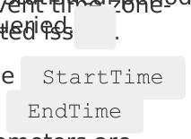
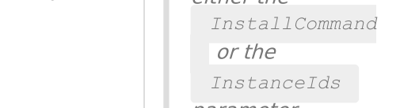
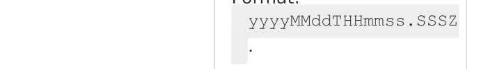
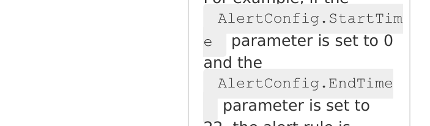
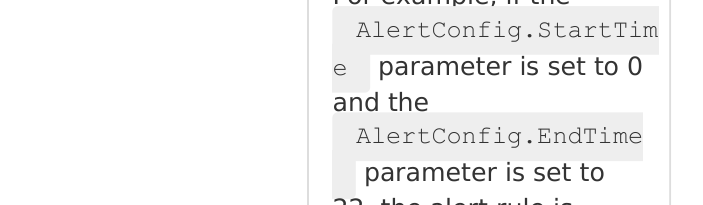

Alibaba Cloud  
Apsara Stack  
CloudMonitor  
Developer Guide  
Product Version: v3.18.6-2607  
Document Version: 20260902

**Table of Contents**

- [1.Preparations](#section-1)
    - [1.1. Obtain the endpoint](#section-1-1)
- [2.API Reference](#section-2)
    - [2.1. Monitoring data on time series metrics of cloud services](#section-2-1)
        - [2.1.1. DescribeMetricLast](#section-2-1-1)
        - [2.1.2. DescribeMetricList](#section-2-1-2)
        - [2.1.3. DescribeMetricMetaList](#section-2-1-3)
        - [2.1.4. DescribeProjectMeta](#section-2-1-4)
        - [2.1.5. DescribeMetricData](#section-2-1-5)
        - [2.1.6. DescribeMetricTop](#section-2-1-6)
        - [2.1.7. DescribeMetricTopList](#section-2-1-7)
        - [2.1.8. DescribeCloudProductResourceTypes](#section-2-1-8)
    - [2.2. Console view configuration](#section-2-2)
        - [2.2.1. DescribeConsoleViews](#section-2-2-1)
    - [2.3. Custom monitoring](#section-2-3)
        - [2.3.1. PutCustomMetric](#section-2-3-1)
        - [2.3.2. BatchDeleteCustomMetricMeta](#section-2-3-2)
        - [2.3.3. CreateCustomMetricMeta](#section-2-3-3)
        - [2.3.4. DescribeCustomMetricList](#section-2-3-4)
        - [2.3.5. DeleteCustomMetric](#section-2-3-5)
    - [2.4. Host monitoring](#section-2-4)
        - [2.4.1. NodeInstall](#section-2-4-1)
        - [2.4.2. DescribeArgusAgentInstallRecord](#section-2-4-2)
        - [2.4.3. DescribeMonitoringAgentStatuses](#section-2-4-3)
        - [2.4.4. DescribeMonitoringAgentHosts](#section-2-4-4)
        - [2.4.5. InstallMonitoringAgent](#section-2-4-5)
        - [2.4.6. DescribeMonitoringAgentProcesses](#section-2-4-6)
        - [2.4.7. PutMonitoringConfig](#section-2-4-7)
        - [2.4.8. DeleteMonitoringAgentProcess](#section-2-4-8)
        - [2.4.9. CreateMonitoringAgentProcess](#section-2-4-9)
        - [2.4.10. DescribeMonitoringConfig](#section-2-4-10)
        - [2.4.11. DescribeMonitoringAgentAccessKey](#section-2-4-11)
        - [2.4.12. UninstallMonitoringAgent](#section-2-4-12)
    - [2.5. Alert service](#section-2-5)
        - [2.5.1. DescribeAlertingMetricRuleResources](#section-2-5-1)
        - [2.5.2. PutResourceMetricRule](#section-2-5-2)
        - [2.5.3. DescribeAlertHistoryList](#section-2-5-3)
        - [2.5.4. DeleteMetricRuleTargets](#section-2-5-4)
        - [2.5.5. DescribeActiveMetricRuleList](#section-2-5-5)
        - [2.5.6. DescribeProductsOfActiveMetricRule](#section-2-5-6)
        - [2.5.7. DeleteMetricRuleResources](#section-2-5-7)
        - [2.5.8. DescribeMetricRuleList](#section-2-5-8)
        - [2.5.9. DescribeMetricRuleCount](#section-2-5-9)
        - [2.5.10. DeleteMetricRules](#section-2-5-10)
        - [2.5.11. DisableMetricRules](#section-2-5-11)
        - [2.5.12. EnableMetricRules](#section-2-5-12)
        - [2.5.13. DeleteContact](#section-2-5-13)
        - [2.5.14. DescribeMetricRuleTargets](#section-2-5-14)
        - [2.5.15. DescribeEventRuleList](#section-2-5-15)
        - [2.5.16. DescribeMetricRuleTemplateList](#section-2-5-16)
        - [2.5.17. DescribeContactList](#section-2-5-17)
        - [2.5.18. ApplyMetricRuleTemplate](#section-2-5-18)
        - [2.5.19. DescribeEventRuleTargetList](#section-2-5-19)
        - [2.5.20. DescribeMetricRuleTemplateAttribute](#section-2-5-20)
        - [2.5.21. DescribeEventRuleAttribute](#section-2-5-21)
        - [2.5.22. DescribeContactListByContactGroup](#section-2-5-22)
        - [2.5.23. PutContact](#section-2-5-23)
        - [2.5.24. DescribeMetricPromQLRange](#section-2-5-24)
        - [2.5.25. PutContactGroup](#section-2-5-25)
        - [2.5.26. PutGroupMetricRule](#section-2-5-26)
        - [2.5.27. CreateMetricRuleResources](#section-2-5-27)
        - [2.5.28. DescribeContactGroupList](#section-2-5-28)
        - [2.5.29. DeleteMetricRuleTemplate](#section-2-5-29)
        - [2.5.30. PutEventRuleTargets](#section-2-5-30)
        - [2.5.31. CreateMetricRuleTemplate](#section-2-5-31)
        - [2.5.32. CreateGroupMetricRules](#section-2-5-32)
        - [2.5.33. DeleteEventRules](#section-2-5-33)
        - [2.5.34. ModifyMetricRuleTemplate](#section-2-5-34)
        - [2.5.35. PutMetricRuleTargets](#section-2-5-35)
        - [2.5.36. DescribeDynamicThresholdBound](#section-2-5-36)
    - [2.6. Event monitoring](#section-2-6)
        - [2.6.1. DescribeSystemEventHistogram](#section-2-6-1)
        - [2.6.2. DescribeSystemEventAttribute](#section-2-6-2)
        - [2.6.3. DescribeSystemEventCount](#section-2-6-3)
        - [2.6.4. SendDryRunSystemEvent](#section-2-6-4)
        - [2.6.5. PutCustomEvent](#section-2-6-5)
        - [2.6.6. DescribeSystemEventMetaList](#section-2-6-6)
        - [2.6.7. DescribeCustomEventCount](#section-2-6-7)
        - [2.6.8. DescribeCustomEventAttribute](#section-2-6-8)
    - [2.7. Custom dashboard](#section-2-7)
        - [2.7.1. CreateDashboardFolder](#section-2-7-1)
        - [2.7.2. ModifyDashboardToFolder](#section-2-7-2)
        - [2.7.3. ModifyDashboardFolder](#section-2-7-3)
        - [2.7.4. DescribeDashboard](#section-2-7-4)
    - [2.8. Application group](#section-2-8)
        - [2.8.1. DescribeMonitorGroups](#section-2-8-1)
        - [2.8.2. DescribeMonitorGroupInstances](#section-2-8-2)
        - [2.8.3. CreateMonitorGroupInstances](#section-2-8-3)
        - [2.8.4. DescribeUnhealthyHostAvailability](#section-2-8-4)
        - [2.8.5. DeleteMonitorGroupInstances](#section-2-8-5)
        - [2.8.6. DescribeMonitorGroupInstanceAttribute](#section-2-8-6)
        - [2.8.7. DescribeHostAvailabilityList](#section-2-8-7)
        - [2.8.8. CreateMonitorGroup](#section-2-8-8)
        - [2.8.9. DeleteMonitorGroup](#section-2-8-9)
        - [2.8.10. CreateHostAvailability](#section-2-8-10)
        - [2.8.11. CreateMonitorGroupNotifyPolicy](#section-2-8-11)
        - [2.8.12. DeleteHostAvailability](#section-2-8-12)
        - [2.8.13. DescribeMonitorGroupCategories](#section-2-8-13)
        - [2.8.14. ModifyMonitorGroupInstances](#section-2-8-14)
        - [2.8.15. ModifyHostAvailability](#section-2-8-15)
        - [2.8.16. PutMonitorGroupDynamicRule](#section-2-8-16)
        - [2.8.17. ModifyMonitorGroup](#section-2-8-17)
        - [2.8.18. DeleteMonitorGroupDynamicRule](#section-2-8-18)
        - [2.8.19. DeleteMonitorGroupNotifyPolicy](#section-2-8-19)
        - [2.8.20. DescribeMonitorGroupNotifyPolicyList](#section-2-8-20)
        - [2.8.21. DescribeMonitorGroupDynamicRules](#section-2-8-21)
    - [2.9. Site monitoring](#section-2-9)
        - [2.9.1. DescribeSiteMonitorData](#section-2-9-1)
        - [2.9.2. DescribeSiteMonitorStatistics](#section-2-9-2)
        - [2.9.3. DescribeSiteMonitorList](#section-2-9-3)
        - [2.9.4. DescribeSiteMonitorISPCityList](#section-2-9-4)
        - [2.9.5. CreateSiteMonitor](#section-2-9-5)
        - [2.9.6. DescribeSiteMonitorAttribute](#section-2-9-6)
        - [2.9.7. DisableSiteMonitors](#section-2-9-7)
        - [2.9.8. EnableSiteMonitors](#section-2-9-8)
        - [2.9.9. DeleteSiteMonitors](#section-2-9-9)
        - [2.9.10. ModifySiteMonitor](#section-2-9-10)
        - [2.9.11. DescribeSiteMonitorQuota](#section-2-9-11)
    - [2.10. Alert center](#section-2-10)
        - [2.10.1. DescribeBatchDetectTaskWithAlertResult](#section-2-10-1)
        - [2.10.2. DescribeNotificationRules](#section-2-10-2)
        - [2.10.3. DescribeAlertList](#section-2-10-3)
        - [2.10.4. DeleteAlertFilterConfigBatch](#section-2-10-4)
        - [2.10.5. ModifyAlertFilterConfig](#section-2-10-5)
        - [2.10.6. DescribeAlertFilterConfig](#section-2-10-6)
        - [2.10.7. DeleteNotificationRules](#section-2-10-7)
        - [2.10.8. ModifyNotificationRule](#section-2-10-8)
        - [2.10.9. CreateAlertFilterConfig](#section-2-10-9)
        - [2.10.10. PutNotificationRule](#section-2-10-10)
    - [2.11. Data subscription](#section-2-11)
        - [2.11.1. CreateMetricPubSync](#section-2-11-1)
        - [2.11.2. UpdateMetricPubSync](#section-2-11-2)
        - [2.11.3. DeleteMetricPubSync](#section-2-11-3)
        - [2.11.4. DescribeMetricPubSyncs](#section-2-11-4)
    - [2.12. Log monitoring](#section-2-12)
        - [2.12.1. PutLogMonitor](#section-2-12-1)
        - [2.12.2. DeleteLogMonitor](#section-2-12-2)
        - [2.12.3. DescribeLogMonitorList](#section-2-12-3)
- [3.Metrics](#section-3)
    - [3.1. Elastic computing](#section-3-1)
        - [3.1.1. Kubernetes container monitoring](#section-3-1-1)
        - [3.1.2. ECS](#section-3-1-2)
        - [3.1.3. BMCP nodes](#section-3-1-3)
        - [3.1.4. BMCP containers](#section-3-1-4)
        - [3.1.5. Bare Metal Computing Platform (BMCP) (Container - Intelligent Computing Cluster)](#section-3-1-5)
        - [3.1.6. Bare Metal Computing Platform (BMCP)](#section-3-1-6)
        - [3.1.7. Bare Metal Management (BMS)](#section-3-1-7)
    - [3.2. Database services](#section-3-2)
        - [3.2.1. ApsaraDB RDS](#section-3-2-1)
        - [3.2.2. ApsaraDB RDS (New)](#section-3-2-2)
        - [3.2.3. PolarDB](#section-3-2-3)
        - [3.2.4. PolarDB databases that use local SSDs](#section-3-2-4)
        - [3.2.5. PolarDB-X 2.0](#section-3-2-5)
            - [3.2.5.1. Compute nodes of PolarDB-X 2.0](#section-3-2-5-1)
            - [3.2.5.2. Data nodes of PolarDB-X 2.0](#section-3-2-5-2)
        - [3.2.6. ApsaraDB for MongoDB (Old)](#section-3-2-6)
        - [3.2.7. ApsaraDB for MongoDB (New)](#section-3-2-7)
        - [3.2.8. Tair (Redis OSS-compatible) (Old)](#section-3-2-8)
        - [3.2.9. Tair (Redis OSS-compatible) (New)](#section-3-2-9)
        - [3.2.10. AnalyticDB for PostgreSQL](#section-3-2-10)
        - [3.2.11. AnalyticDB for PostgreSQL (new)](#section-3-2-11)
        - [3.2.12. DTS](#section-3-2-12)
            - [3.2.12.1. Data Transmission Service DTS(Tracking tasks)](#section-3-2-12-1)
            - [3.2.12.2. Data Transmission Service DTS (migration tasks)](#section-3-2-12-2)
            - [3.2.12.3. Data Transmission Service DTS (sync tasks)](#section-3-2-12-3)
        - [3.2.13. Lindorm](#section-3-2-13)
        - [3.2.14. Lindorm 2.0](#section-3-2-14)
    - [3.3. Storage and CDN](#section-3-3)
        - [3.3.1. NAS](#section-3-3-1)
        - [3.3.2. OSS](#section-3-3-2)
        - [3.3.3. CPFS](#section-3-3-3)
        - [3.3.4. APFS](#section-3-3-4)
        - [3.3.5. EFS-NAS file storage](#section-3-3-5)
    - [3.4. Network](#section-3-4)
        - [3.4.1. NAT Gateway](#section-3-4-1)
        - [3.4.2. SLB](#section-3-4-2)
        - [3.4.3. Application Load Balancer](#section-3-4-3)
        - [3.4.4. EIP](#section-3-4-4)
        - [3.4.5. VPN Gateway](#section-3-4-5)
        - [3.4.6. DNS](#section-3-4-6)
        - [3.4.7. Alibaba Cloud DNS - Tenant forwarded domain names](#section-3-4-7)
        - [3.4.8. Cloud Enterprise Network](#section-3-4-8)
    - [3.5. Middleware services](#section-3-5)
        - [3.5.1. ApsaraMQ for RocketMQ](#section-3-5-1)
        - [3.5.2. Message Queue (tiangong)](#section-3-5-2)
        - [3.5.3. ApsaraMQ for Kafka](#section-3-5-3)
        - [3.5.4. API Gateway](#section-3-5-4)
    - [3.6. Big data](#section-3-6)
        - [3.6.1. DataHub](#section-3-6-1)
        - [3.6.2. Alibaba Cloud Elasticsearch](#section-3-6-2)
        - [3.6.3. MaxCompute](#section-3-6-3)
        - [3.6.4. MaxCompute quota groups](#section-3-6-4)
    - [3.7. Security (Apsara Stack Security)](#section-3-7)
        - [3.7.1. Tenant-side bastion hosts](#section-3-7-1)
        - [3.7.2. Static data masking and watermarking](#section-3-7-2)
        - [3.7.3. Vulnerability scanner engines](#section-3-7-3)
        - [3.7.4. NFV Cloud Firewall](#section-3-7-4)
        - [3.7.5. Web Application Firewall](#section-3-7-5)
    - [3.8. AI and machine learning](#section-3-8)
        - [3.8.1. AI Studio (online service)](#section-3-8-1)
        - [3.8.2. AI Studio (model evaluation)](#section-3-8-2)
        - [3.8.3. AI Studio (Notebook modeling)](#section-3-8-3)
        - [3.8.4. AI Studio (task modeling)](#section-3-8-4)
        - [3.8.5. AI Studio (visual modeling)](#section-3-8-5)
        - [3.8.6. AI Studio for model tuning](#section-3-8-6)
        - [3.8.7. AI Studio (batch inference)](#section-3-8-7)
        - [3.8.8. AI Studio (online service group)](#section-3-8-8)
        - [3.8.9. AI Studio (Resource Pool)](#section-3-8-9)
        - [3.8.10. A-Speed (High-Performance Inference Service)](#section-3-8-10)
        - [3.8.11. Elastic Fault Tolerance Service](#section-3-8-11)

<a id="section-1"></a>

# 1.Preparations

<a id="section-1-1"></a>

## 1.1. Obtain the endpoint

This topic describes how to obtain the endpoint of CloudMonitor.

**Procedure**

1. Log in to the Apsara Uni-manager Operations Console.

2. In the top navigation bar, select **Platform Operation** > **Apsara Infrastructure Management** > **Resource Management**.

3. On the **Product & Cluster O&M** page, search for CMS and click **Cluster Details** in the **Actions** column.

4. On the **Services** tab, click **Details** in the **Actions** column for cms.

5. On the **information of Component** page, select **Registration Variables**, search for **metric.open.endpoint**, and view the value of the endpoint.

<a id="section-2"></a>

# 2.API Reference

<a id="section-2-1"></a>

## 2.1. Monitoring data on time series metrics of cloud services

<a id="section-2-1-1"></a>

### 2.1.1. DescribeMetricLast

Queries the latest monitoring data of a monitored object.

**Request parameters**

| Parameter | Type | Requir ed | Example | Description |
| --- | --- | --- | --- | --- |
| Action | String | Yes | DescribeMetricL ast | The operation that you want to perform. Set the value to DescribeMetricLast. |
| MetricName | String | Yes | CPUUtilization | The name of the monitoring metric. |
| Namespace | String | Yes | acs_ecs_dashbo ard | The namespace of the service. This parameter is used to differentiate services.<br>Specify the value in the acs_Service name format. |

<table>
  <tr>
    <td>Dimensions</td>
    <td>String</td>
    <td>No</td>
    <td>[{"instanceId":" XXXXXX"}]</td>
    <td>The dimensions based on which the monitoring data of the specified resource is queried.<br>The value is a collection of <code> key-</code><code>value </code> pairs. A typical <code> key-</code><code>value </code> pair is <code> instanceId:XXXXXX </code>. You can specify up to 20 instance IDs in each call.<br>Each <code> key </code> or <code> value </code> can be 1 to 64 bytes in length. A key or value that contains more than 64 characters is truncated and the first 64 bytes are retained. The <code> key </code> and <code> value </code> can contain letters, digits, periods (.), hyphens (-), underscores (_), forward slashes (/), and backslashes (\).<br>Note<br>If you set Dimensions to ordered strings in the request, the value of this parameter is a key-value map expressed in JSON strings.</td>
  </tr>
  <tr>
    <td>StartTime</td>
    <td>String</td>
    <td>No</td>
    <td>2019-01-31 10:00:00</td>
    <td>The beginning of the time range to query.<br>This value is a UNIX timestamp representing the number of seconds that have elapsed since January 1, 1970, 00:00:00 UTC.<br>Note<br>You can query data in a time range that spans 31 days at most within the last 270 days.</td>
  </tr>
  <tr>
    <td>EndTime</td>
    <td>String</td>
    <td>No</td>
    <td>2019-01-31 10:10:00</td>
    <td>The end of the time range to query.<br>This value is a UNIX timestamp representing the number of seconds that have elapsed since January 1, 1970, 00:00:00 UTC.<br>Note<br>You can query data within the last 270 days.</td>
  </tr>
  <tr>
    <td>Express</td>
    <td>String</td>
    <td>No</td>
    <td>{"groupby": ["userId","instan ceId"]}</td>
    <td>The expression that is used to calculate the query results in real time.</td>
  </tr>
  <tr>
    <td>Length</td>
    <td>String</td>
    <td>No</td>
    <td>1000</td>
    <td>The number of entries per page.<br>Default value: 1000.</td>
  </tr>
  <tr>
    <td>NextToken</td>
    <td>String</td>
    <td>No</td>
    <td>1576143285000 9dd70bb64cff1f 0fff6c0b08ffff07 3be5fb1e785e2 b020f7fed9b5e1 37bd810a6d6cff 5ae****</td>
    <td>The pagination token.<br>• If the number of results exceeds the maximum number of entries allowed per page, a pagination token is returned.<br>• This pagination token can be used as a request parameter to retrieve a new page of results. If a response does not contain pagination tokens, all query results are returned.</td>
  </tr>
  <tr>
    <td>Period</td>
    <td>String</td>
    <td>No</td>
    <td>60</td>
    <td>The interval at which the monitoring data is queried. In most cases, the interval is the same as that for reporting metric data. Unit: seconds.<br>• If you do not specify this parameter, raw data is queried at the reporting interval specified when the corresponding metric was created.<br>• If a statistical period was specified for the corresponding alert rule, raw data is queried based on the statistical period.</td>
  </tr>
</table>

**Response parameters**

| Parameter | Type | Example | Description |
| --- | --- | --- | --- |
| RequestId | String | 021472A6-25E3-4094-8D00-BA4B6A5486C3 | The request ID. |
| Code | String | 200 | The HTTP status code.<br>Note<br>The HTTP status code 200 indicates that the request was successful. |
| Success | Boolean | true | Indicates whether the request was successful. |
| Period | String | 60 | The interval at which the monitoring data was queried. Unit: seconds. |
| NextToken | String | xxxxxx | The pagination token. |
| Datapoints | String | \[{"timestamp":154 8777660000,"userI d":"123","instanceI d":"i-abc","Minimum":9.92,"Average":9.92, "Maximum":9.92}\] | The monitoring data. |
| Message | String | Success | The returned message. |

**Examples**

Sample requests

```text
http(s)://[Endpoint]/?Action=DescribeMetricLast
&MetricName=CPUUtilization
&Namespace=acs_ecs_dashboard
&<Common request parameters>
```

Sample success responses

`XML`  format

```xml
<QueryMetricListResponse>
    <Period>60</Period>
    <Datapoints>
        <Datapoints>
            <timestamp>1490152860000</timestamp>
            <Maximum>100</Maximum>
            <userId> 123456789876****</userId>
            <Minimum>93.1</Minimum>
            <instanceId>i-abcdefgh12****</instanceId>
            <Average>99.52</Average>
        </Datapoints>
        <Datapoints>
            <timestamp>1490152920000</timestamp>
            <Maximum>100</Maximum>
            <userId> 123456789876**** </userId>
            <Minimum>92.59</Minimum>
            <instanceId>i-abcdefgh12****</instanceId>
            <Average>99.49</Average>
        </Datapoints>
        <Datapoints>
            <timestamp>1490152980000</timestamp>
            <Maximum>100</Maximum>
            <userId>123456789876****</userId>
            <Minimum>92.86</Minimum>
            <instanceId>i-abcdefgh12****</instanceId>
            <Average>99.44</Average>
        </Datapoints>
        <Datapoints>
            <timestamp>1490153040000</timestamp>
            <Maximum>100</Maximum>
            <userId>123456789876****</userId>
            <Minimum>91.43</Minimum>
            <instanceId>i-abcdefgh12****</instanceId>
            <Average>99.36</Average>
        </Datapoints>
        <Datapoints>
            <timestamp>1490153100000</timestamp>
            <Maximum>100</Maximum>
            <userId>123456789876****</userId>
            <Minimum>93.55</Minimum>
            <instanceId>i-abcdefgh12****</instanceId>
            <Average>99.51</Average>
        </Datapoints>
        <Datapoints>
            <timestamp>1490153160000</timestamp>
            <Maximum>100</Maximum>
            <userId>123456789876****</userId>
            <Minimum>93.1</Minimum>
            <instanceId>i-abcdefgh12****</instanceId>
            <Average>99.52</Average>
        </Datapoints>
        <Datapoints>
            <timestamp>1490153220000</timestamp>
            <Maximum>100</Maximum>
            <userId>123456789876****</userId>
            <Minimum>92.59</Minimum>
            <instanceId>i-abcdefgh12****</instanceId>
            <Average>99.42</Average>
        </Datapoints>
        <Datapoints>
            <timestamp>1490153280000</timestamp>
            <Maximum>100</Maximum>
            <userId>123456789876****</userId>
            <Minimum>91.18</Minimum>
            <instanceId>i-abcdefgh12****</instanceId>
            <Average>99.34</Average>
        </Datapoints>
        <Datapoints>
            <timestamp>1490153340000</timestamp>
            <Maximum>100</Maximum>
            <userId>123456789876****</userId>
            <Minimum>92.86</Minimum>
            <instanceId>i-abcdefgh12****</instanceId>
            <Average>99.46</Average>
        </Datapoints>
        <Datapoints>
            <timestamp>1490153400000</timestamp>
            <Maximum>100</Maximum>
            <userId>123456789876****</userId>
            <Minimum>91.18</Minimum>
            <instanceId>i-abcdefgh12****</instanceId>
            <Average>99.35</Average>
        </Datapoints>
    </Datapoints>
    <RequestId>6661EC50-8625-4161-B349-E0DD59002AB7</RequestId>
    <Success>true</Success>
    <Code>200</Code>
</QueryMetricListResponse>
```

`JSON`  format

```json
{
 "Period":"60",
 "Datapoints":[
  {
   "timestamp":1490152860000,
   "Maximum":100,
   "userId":"123456789876****",
   "instanceId":"i-abcdefgh12****",
   "Minimum":93.1,
   "Average":99.52
  },
  {
   "timestamp":1490152920000,
   "Maximum":100,
   "userId":"123456789876****",
   "instanceId":"i-abcdefgh12****",
   "Minimum":92.59,
   "Average":99.49
  },
  {
   "timestamp":1490152980000,
   "Maximum":100,
   "userId":"123456789876****",
   "instanceId":"i-abcdefgh12****",
   "Minimum":92.86,
   "Average":99.44
  },
  {
   "timestamp":1490153040000,
   "Maximum":100,
   "userId":"123456789876****",
   "instanceId":"i-abcdefgh12****",
   "Minimum":91.43,
   "Average":99.36
  },
  {
   "timestamp":1490153100000,
   "Maximum":100,
   "userId":"123456789876****",
   "instanceId":"i-abcdefgh12****",
   "Minimum":93.55,
   "Average":99.51
  },
  {
   "timestamp":1490153160000,
   "Maximum":100,
   "userId":"123456789876****",
   "instanceId":"i-abcdefgh12****",
   "Minimum":93.1,
   "Average":99.52
  },
  {
   "timestamp":1490153220000,
   "Maximum":100,
   "userId":"123456789876****",
   "instanceId":"i-abcdefgh12****",
   "Minimum":92.59,
   "Average":99.42
  },
  {
   "timestamp":1490153280000,
   "Maximum":100,
   "userId":"123456789876****",
   "instanceId":"i-abcdefgh12****",
   "Minimum":91.18,
   "Average":99.34
  },
  {
   "timestamp":1490153340000,
   "Maximum":100,
   "userId":"123456789876****",
   "instanceId":"i-abcdefgh12****",
   "Minimum":92.86,
   "Average":99.46
  },
  {
   "timestamp":1490153400000,
   "Maximum":100,
   "userId":"123456789876****",
   "instanceId":"i-abcdefgh12****",
   "Minimum":91.18,
   "Average":99.35
  }
 ],
 "RequestId":"6A5F022D-AC7C-460E-94AE-B9E75083D027",
 "Success":true,
 "Code":"200"
}
```

<a id="section-2-1-2"></a>

### 2.1.2. DescribeMetricList

Queries the monitoring data of a time series metric for a cloud service within a specified period of time.

For more information about the values of parameters such as Namespace, Metric, Period, and Dimensions for each cloud service, see "Metrics for Apsara Stack services".

**Request parameters**

| Parameter | Type | Requir ed | Example | Description |
| --- | --- | --- | --- | --- |
| Action | String | Yes | DescribeMetricLi st | The operation that you want to perform. Set the value to DescribeMetricList. |
| MetricName | String | Yes | cpu_idle | The metric name. |
| Namespace | String | Yes | acs_ecs_dashbo ard | The namespace of the service.<br>Format: acs_&lt;Service name&gt;. |
| Dimensions | String | Yes | \[{"instanceId": "i-abcdefgh12\*\*\*\*"}\] | The dimensions that specify the resources whose monitoring data you want to query.<br>The value is a collection of key-value pairs. A typical key-value pair is instanceId:XXXXXX. You can specify up to 10 instance IDs in each request.<br>Each key or value can be 1 to 64 bytes in length. A key or value that contains more than 64 characters is truncated and the first 64 bytes are retained. The key and value can contain letters, digits, periods (.), hyphens (-), underscores (_), forward slashes (/), and backslashes (\\).<br>Note<br>Dimensions must be formatted as a JSON string in a specific order. |
| EndTime | String | No | 2019-01-30 00:10:00 | The end of the time range to query.The following formats are supported:<br>• UNIX timestamp: the number of seconds that have elapsed since January 1, 1970, 00:00:00 UTC.<br>• UTC time: the UTC time in the YYYY-MM-DDThh:mm:ssZ format. |
| Express | String | No | {"groupby": \["userId","instan ceId"\]} | The expression that is used to calculate the query results in real time. Only the <code> groupby </code> expression is supported. This expression is similar to the <code> GROUP </code> <code>BY </code> statement that is used in databases. |
| Length | String | No | 1000 | The number of entries per page.Default value: 1000. |
| NextToken | String | No | 1576148535000 9dd70bb64cff1f 0fff750b08ffff07 3be5fb1e785e2 b020f1a949d5e a14aea7fed82f0 1dd87311 | The pagination token.<br>Note<br>You do not need to specify this parameter if you only want to obtain entries on the first page.The pagination token returned in a response can be used as an input parameter for obtaining entries on the next page. If a response contains no pagination tokens, all query results have been returned. |

<table>
  <tr>
    <td>Period</td>
    <td>String</td>
    <td>No</td>
    <td>60</td>
    <td>The interval at which the monitoring data is queried. Unit: seconds. Valid values: 60, 300, and 900, which represent 1 minute, 5 minutes, and 15 minutes, respectively.<br>Note<br>Specify this parameter based on your business requirements. For example, if you set this parameter to 60, only 1,000 records are returned, though a total of 1,440 records are generated. This is because the maximum number of records that can be returned for each query is 1,000. If you set this parameter to 300, 288 records are returned.</td>
  </tr>
  <tr>
    <td>StartTime</td>
    <td>String</td>
    <td>No</td>
    <td>2019-01-30 00:00:00</td>
    <td>The beginning of the time range to query. The following formats are supported:<br>• UNIX timestamp: the number of seconds that have elapsed since January 1, 1970, 00:00:00 UTC.<br>• UTC time: the UTC time in the YYYY-MM-DDThh:mm:ssZ format.<br>Note<br>The period specified by StartTime and EndTime includes the point in time specified by EndTime but does not include the point in time specified by StartTime. The start time must be earlier than the end time.</td>
  </tr>
</table>

**Response parameters**

| Parameter | Type | Example | Description |
| --- | --- | --- | --- |
| RequestId | String | 3121AE7D-4AFF-4C25-8F1D-C8226EBB1F42 | The request ID. |
| Code | String | 200 | The HTTP status code.<br>Note<br>The HTTP status code 200 indicates that the request was successful. |
| Success | Boolean | true | Indicates whether the request was successful. |
| NextToken | String | 15761441850009d d70bb64cff1f0fff6d 0b08ffff073be5fb1 e785e2b020f7fed9 b5e137bd810a6d6 cff5aee816 | The pagination token.<br>Note<br>You do not need to specify this parameter if you only want to obtain entries on the first page. The pagination token returned in a response can be used as an input parameter for obtaining entries on the next page. If a response contains no pagination tokens, all query results have been returned. |
| Period | String | 60 | The interval at which the monitoring data was queried. Unit: seconds. Valid values: 60, 300, and 900. |
| Datapoints | String | \[{"timestamp":154 8777660000,"userI d":"123","instanceI d":"i-abc","Minimum":9.92,"Average":9.92, "Maximum":9.92}\] | The monitoring data. |
| Message | String | Success | The returned message. |

**Examples**

Sample requests

```text
http(s)://[Endpoint]/?Action=DescribeMetricList
&MetricName=cpu_idle
&Namespace=acs_ecs_dashboard
&<Common request parameters>
```

Sample success responses

`XML`  format

```xml
<Period>60</Period>
<Datapoints>
    <timestamp>1490152860000</timestamp>
    <Maximum>100</Maximum>
    <userId>123456789876****</userId>
    <Minimum>93.1</Minimum>
    <instanceId>i-abcdefgh12****</instanceId>
    <Average>99.52</Average>
</Datapoints>
<Datapoints>
    <timestamp>1490152920000</timestamp>
    <Maximum>100</Maximum>
    <userId>123456789876****</userId>
    <Minimum>92.59</Minimum>
    <instanceId>i-abcdefgh12****</instanceId>
    <Average>99.49</Average>
</Datapoints>
<Datapoints>
    <timestamp>1490152980000</timestamp>
    <Maximum>100</Maximum>
    <userId>123456789876****</userId>
    <Minimum>92.86</Minimum>
    <instanceId>i-abcdefgh12****</instanceId>
    <Average>99.44</Average>
</Datapoints>
<Datapoints>
    <timestamp>1490153040000</timestamp>
    <Maximum>100</Maximum>
    <userId>123456789876****</userId>
    <Minimum>91.43</Minimum>
    <instanceId>i-abcdefgh12****</instanceId>
    <Average>99.36</Average>
</Datapoints>
<Datapoints>
    <timestamp>1490153100000</timestamp>
    <Maximum>100</Maximum>
    <userId>123456789876****</userId>
    <Minimum>93.55</Minimum>
    <instanceId>i-abcdefgh12****</instanceId>
    <Average>99.51</Average>
</Datapoints>
<Datapoints>
    <timestamp>1490153160000</timestamp>
    <Maximum>100</Maximum>
    <userId>123456789876****</userId>
    <Minimum>93.1</Minimum>
    <instanceId>i-abcdefgh12****</instanceId>
    <Average>99.52</Average>
</Datapoints>
<Datapoints>
    <timestamp>1490153220000</timestamp>
    <Maximum>100</Maximum>
    <userId>123456789876****</userId>
    <Minimum>92.59</Minimum>
    <instanceId>i-abcdefgh12****</instanceId>
    <Average>99.42</Average>
</Datapoints>
<Datapoints>
    <timestamp>1490153280000</timestamp>
    <Maximum>100</Maximum>
    <userId>123456789876****</userId>
    <Minimum>91.18</Minimum>
    <instanceId>i-abcdefgh12****</instanceId>
    <Average>99.34</Average>
</Datapoints>
<Datapoints>
    <timestamp>1490153340000</timestamp>
    <Maximum>100</Maximum>
    <userId>123456789876****</userId>
    <Minimum>92.86</Minimum>
    <instanceId>i-abcdefgh12****</instanceId>
    <Average>99.46</Average>
</Datapoints>
<Datapoints>
    <timestamp>1490153400000</timestamp>
    <Maximum>100</Maximum>
    <userId>123456789876****</userId>
    <Minimum>91.18</Minimum>
    <instanceId>i-abcdefgh12****</instanceId>
    <Average>99.35</Average>
</Datapoints>
<RequestId>6A5F022D-AC7C-460E-94AE-B9E75083D027</RequestId>
<Success>true</Success>
<Code>200</Code>
```

`JSON`  format

```json
{
 "Period":"60",
 "Datapoints":[
  {
   "timestamp":1490152860000,
   "Maximum":100,
   "userId":"123456789876****",
   "instanceId":"i-abcdefgh12****",
   "Minimum":93.1,
   "Average":99.52
  },
  {
   "timestamp":1490152920000,
   "Maximum":100,
   "userId":"123456789876****",
   "instanceId":"i-abcdefgh12****",
   "Minimum":92.59,
   "Average":99.49
  },
  {
   "timestamp":1490152980000,
   "Maximum":100,
   "userId":"123456789876****",
   "instanceId":"i-abcdefgh12****",
   "Minimum":92.86,
   "Average":99.44
  },
  {
   "timestamp":1490153040000,
   "Maximum":100,
   "userId":"123456789876****",
   "instanceId":"i-abcdefgh12****",
   "Minimum":91.43,
   "Average":99.36
  },
  {
   "timestamp":1490153100000,
   "Maximum":100,
   "userId":"123456789876****",
   "instanceId":"i-abcdefgh12****",
   "Minimum":93.55,
   "Average":99.51
  },
  {
   "timestamp":1490153160000,
   "Maximum":100,
   "userId":"123456789876****",
   "instanceId":"i-abcdefgh12****",
   "Minimum":93.1,
   "Average":99.52
  },
  {
   "timestamp":1490153220000,
   "Maximum":100,
   "userId":"123456789876****",
   "instanceId":"i-abcdefgh12****",
   "Minimum":92.59,
   "Average":99.42
  },
  {
   "timestamp":1490153280000,
   "Maximum":100,
   "userId":"123456789876****",
   "instanceId":"i-abcdefgh12****",
   "Minimum":91.18,
   "Average":99.34
  },
  {
   "timestamp":1490153340000,
   "Maximum":100,
   "userId":"123456789876****",
   "instanceId":"i-abcdefgh12****",
   "Minimum":92.86,
   "Average":99.46
  },
  {
   "timestamp":1490153400000,
   "Maximum":100,
   "userId":"123456789876****",
   "instanceId":"i-abcdefgh12****",
   "Minimum":91.18,
   "Average":99.35
  }
 ],
 "RequestId":"6A5F022D-AC7C-460E-94AE-B9E75083D027",
 "Success":true,
 "Code":"200"
}
```

<a id="section-2-1-3"></a>

### 2.1.3. DescribeMetricMetaList

Queries monitoring item details, including metadata such as the metric name, statistical method, unit, description, dimension, and reporting period.

**Request headers**

This operation uses common request headers only. For more information, see the documentation on common request parameters.

**Request parameters**

| Parameter | Type | Posit ion | Required | Example | Description |
| --- | --- | --- | --- | --- | --- |
| MetricNam e | Strin g | Quer y | No | CPUUtilization | The name of the metric.The system supports exact matching. |
| PageNumb er | Integ er | Quer y | No | 1 | The page number. The count starts from 1.Default value: 1 |
| Namespac e | Strin g | Quer y | No | acs_kvstore | The namespace of the metric. Namespaces are used to distinguish different products. The naming format is acs_product name. You can call the DescribeProjectMeta operation to query the namespace value of each product. |
| Labels | Strin g | Quer y | No | \[{"name":"productCatego ry","value":"kvstore_old"}\] | Filter monitoring items by tag. The format is a JSON array. The element structure is {"name":"tag name","value":"tag value"}. The system supports tags including MetricCategory (monitoring item category), alertEnable (whether to enable alert), alertUnit (alert unit), unitFactor (unit conversion factor), minAlertPeriod (minimum alert period), and productCategory (product category). |
| PageSize | Integ er | Quer y | No | 30 | The number of entries to return on each page.Default value: 30. Valid values: 1 to 100 |

**API description**

Call this operation to query the metadata of monitoring items that Cloud Monitor (CMS) supports. You can use this operation to obtain the metric details of each cloud product, including the metric name, statistical method, unit, and dimension.

**Response parameters**

| Parameter | Type | Example | Description |
| --- | --- | --- | --- |
| Resources | Array | \[{"Namespace":"ac s_ecs","MetricNam e":"CPUUtilization"}\] | The list of monitoring item metadata. |
| -Namespace | String | acs_ecs | The namespace of the metric, which is used to distinguish different products. The naming format is acs_product name. |
| -MetricName | String | CPUUtilization | The name of the metric. |
| -Statistics | String | Average,Minimum, Maximum | The statistical method. Separate multiple statistical methods, such as Average, Minimum, Maximum, Sum, and Count, with commas. |
| -Unit | String | % | The unit. |
| -Description | String | CPU utilization | The description of the monitoring item. |
| -DescriptionJso n | String | {"en-us":"CPUUtilization","zh-cn":"CPU使用率"} | The multilingual description of the monitoring item in JSON format. |
| -Dimensions | String | userId,instanceId | The monitoring dimension. Separate multiple dimensions, such as userId and instanceId, with commas. |
| -Periods | String | 60,300 | The reporting period in seconds. Separate multiple periods with commas. |
| -Labels | String | \[{"name":"alertEna ble","value":"true"}\] | The tag information in JSON array format, which includes the tag name and tag value. |
| -Version | String | 1.0 | The version of the monitoring item. |
| -SubProducts | String | ECS | The name of the sub-product. |
| RequestId | String | 15B664E7-1823-4C84-A59B-1A3BXXXXX | The request ID. |
| Success | Boolean | true | Indicates whether the request is successful. Valid values: true (success) and false (failure) |
| Code | String | 200 | The status code. A value of 200 indicates success. |
| Message | String | successful | The returned message. The system returns successful when the request succeeds. |
| TotalCount | String | 100 | The total number of records. |

**Error codes**

| HTTP status code | Error code | Error message | Description |
| --- | --- | --- | --- |
| 400 | 400 | ParameterInvalid | Invalid parameters. |
| 403 | 403 | AccessForbidden | You do not have permissions to perform operations on the specified resource. |
| 404 | 404 | ResourceNotFound | The specified resource is not found. |
| 500 | 500 | InternalError | The system failed to process the request due to some unknown errors. |

<a id="section-2-1-4"></a>

### 2.1.4. DescribeProjectMeta

Queries the information of monitored services in CloudMonitor.

The information obtained by this operation includes the service description, namespace, and tags.

**Request parameters**

| Parameter | Type | Requir ed | Example | Description |
| --- | --- | --- | --- | --- |
| Action | String | Yes | DescribeProject Meta | The operation that you want to perform. Set the value to DescribeProjectMeta. |
| callerType | String | No | "" | The type of the API caller. |

<table>
  <tr>
    <td>Labels</td>
    <td>String</td>
    <td>No</td>
    <td>[{"name":"prod uct","value":"EC S"}]</td>
    <td>The tags<br>that you specify to filter services. A tag of a metric is used as a special mark of alerts triggered by the metric.<br>For example, a tag can specify the service specification to which an alert belongs and whether an alert rule can be configured for a metric.The format is <code> [{"name":"Tag </code> <code>name","value":"Tag value"},</code><br><code>{"name":"Tag name","value":"Tag</code> <code>value"}] </code>. The following items describe common tags:<br>• alertUnit: the unit of the metric in the alert.<br>Note The original metric value may be too large due to a small unit. In this case, you can use the <code> alertUnit </code> tag to specify an appropriate unit. This tag is used in Cloud Monitor.<br>• minAlertPeriod: the minimum time interval to raise a new alert.Typically, the interval is 1 minute.<br>• metricCategory: the service specification. Example: kvstore_sharding.<br>Note Some services of Apsara Stack have different specifications with the same namespace. The metricCategory tag can be used to distinguish between the specifications.<br>• is_alarm: specifies whether an alert rule can be configured for a metric.<br>Note Apsara Stack has some other tags that are dedicated for Cloud Monitor.We recommend that you do not use such tags.</td>
  </tr>
  <tr>
    <td>PageNumber</td>
    <td>Integer</td>
    <td>No</td>
    <td>1</td>
    <td>The number of the page to return.Default value: 1.</td>
  </tr>
  <tr>
    <td>PageSize</td>
    <td>Integer</td>
    <td>No</td>
    <td>30</td>
    <td>The number of entries per page.Default value: 30.<br>Note Apsara Stack does not limit the value of this parameter. If you want to view all desired entries on a small number of pages, set this parameter to a greater value.</td>
  </tr>
  <tr>
    <td>RequestId</td>
    <td>string</td>
    <td>No</td>
    <td>sdsdsdd</td>
    <td>The request ID.</td>
  </tr>
</table>

**Response parameters**

| Parameter | Type | Example | Description |
| --- | --- | --- | --- |
| Code | String | 200 | The HTTP status code.<br>Note The HTTP status code 200 indicates that the request succeeded. |
| Message | String | success | The returned message. If the request was successful, a success message is returned. If the request failed, an error message is returned. |
| PageNumber | String | 1 | The page number. |
| PageSize | String | 10 | The number of entries per page. |
| RequestId | String | 4C2061B2-3B1B-43BF-A4A4-C53426F479C0 | The request ID. |
| Resources | Array | None | The information of services found. |
| Resource | N/A | None | The information of the service. |
| Description | String | CDN | The description of the service. |
| Labels | String | \[{"groupFlag":true}\] | The tags of metrics.<br>You can specify tags of metrics to filter services. A tag of a metric is used as a special mark of alerts triggered by the metric.<br>For example, a tag can specify the service specification to which an alert belongs and whether an alert rule can be configured for a metric. The format is <code>[{"name":"Tag name","value":"Tag</code><br><code>value"},{"name":"Tag</code> <code>name","value":"Tag value"}] </code>. The following items describe common tags:<br>• alertUnit: the unit of the metric in the alert.<br>Note The original metric value may be too large due to a small unit. In this case, you can use the <code> alertUnit </code> tag to specify an appropriate unit. This tag is used in Cloud Monitor.<br>• minAlertPeriod: the minimum time interval to raise a new alert. Typically, the interval is 1 minute.<br>• metricCategory: the service specification. Example: kvstore_sharding.<br>Note Some services of Apsara Stack have different specifications with the same namespace. The metricCategory tag can be used to distinguish between the specifications.<br>• is_alarm: specifies whether an alert rule can be configured for a metric.<br>Note Apsara Stack has some other tags that are dedicated for Cloud Monitor. We recommend that you do not use such tags. |
| Namespace | String | acs_cdn | The namespace of the service, which is used to distinguish between services. The typical value format is <code>acs_Abbreviation of the service</code> <code>name </code>. |
| Success | Boolean | true | Indicates whether the request was successful. |
| Total | String | 12 | The total number of entries. |

**Examples**

Sample requests

```text
http(s)://[Endpoint]/?Action=DescribeProjectMeta
&<Common request parameters>
```

Sample success responses

> **Note**
>
> The response content varies with the services that are actually monitored.

`JSON`  format

```json
{
 "PageNumber":1,
 "PageSize":5,
 "RequestId":"4C2061B2-3B1B-43BF-A4A4-C53426F479C0",
 "Success":true,
 "Code":200,
 "Total":62,
 "Resources":{
  "Resource":[{
     "Description": "ECS",
     "Labels": "[{\"name\":\"product\",\"value\":\"ECS\"},
{\"name\":\"productCategory\",\"value\":\"ecs,ecs_net_interface,hpc_node,hpc_cluster\"},
{\"name\":\"groupFlag\",\"value\":\"true\"},{\"name\":\"cnName\",\"value\":\"ECS\"},{\"name\":\"enName\",\"value\":\"ECS\"}]",
     "Namespace": "acs_ecs_dashboard"
    },
    
  ]
 }
}
```

<a id="section-2-1-5"></a>

### 2.1.5. DescribeMetricData

Queries the monitoring data of a metric for a specified cloud service.

**Request header**

This operation does not have operation-specific request headers and uses only common request headers. For more information, see the "Common request headers" topic.

**Request parameters**

| Parame ter | Typ e | Locati on | Require d | Example | Description |
| --- | --- | --- | --- | --- | --- |
| Namespac e | Strin g | Query | Yes | acs_ecs_dashboard | The namespace of the cloud service.<br>For more information about the namespaces of cloud services, see Appendix 1: Metrics. |
| MetricNa me | Strin g | Query | Yes | cpu_idle | The metric that is used to monitor the cloud service.<br>For more information about the metrics of cloud services, see Appendix 1: Metrics. |
| Period | Strin g | Query | No | 60 | The statistical period of the metric.<br>Valid values: 15, 60, 900, and 3600.<br>Unit: seconds.<br>• <em>If this parameter</em> <em>is not specified,</em> <em>monitoring data</em> <em>is queried based</em> <em>on the period in</em> <em>which metric</em> <em>values are</em> <em>reported.</em><br>• For more information about the statistical period of a metric that is specified by the <code> MetricName </code> parameter, see Appendix 1: Metrics. |
|  |  |  |  |  | The start of the time range to query monitoring data.<br>• If the <code> StartTime </code> and <code> EndTime </code> parameters are not specified, the monitoring data of the last statistical period is queried.<code>  </code> |
|  |  |  |  |  |  |
| Parame ter | Typ e | Locati on | Require d | Example | • If the <code> StartTime </code> Descriptionand <code> EndTime </code> parameters are |
| StartTime | Strin g | Query | No | 1618368900000 | specified, the monitoring data of the last statistical period in the specified time range is<br><br>queried.<code>    </code> The following examples demonstrate how to determine the period in which monitoring data is queried:<br>• If you set the <code>Period</code> parameter to 15, the specified time range must be less than or equal to 20 minutes. For example, if you set the StartTime parameter to 2021-05-08 08:10:00 and the EndTime parameter to 2021-05-08 08:30:00, the monitoring data of the last 15 seconds in the time range is queried.<br>• If you set the <code>Period</code> parameter to 60 or 900, the specified time range must be less than or equal to 2 hours. For example, if you set the Period parameter to 60, the StartTime parameter to 2021-05-08 08:00:00, and the EndTime parameter to 2021-05-08 10:00:00, the monitoring data of the last 60 seconds in the time range is queried. |
|  |  |  |  |  |  |
| Parame ter | Typ e | Locati on | Require d | Example | • If you set the Description<code>Period</code> parameter to 3600, |
|  |  |  |  |  | the specified time range must be less than or equal to two days. For example, if you set the StartTime parameter to 2021-05-08 08:00:00 and the EndTime parameter to 2021-05-10 08:00:00, the monitoring data of the last 3,600 seconds in the time range is queried.<br>The following formats are supported:<br>• UNIX timestamp: the number of milliseconds that have elapsed since 00:00:00 Thursday, January 1, 1970.<br>• UTC time: the UTC time that follows the YYYY-MM-DDThh:mm:ssZ format.<br>• <em>You must set the </em> <em><code> StartTime </code></em> <em>parameter to a</em> <em>point in time that</em> <em>is later than</em> |
|  |  |  |  |  | <em>00:00:00 UTC on</em> The end of the time<em>Thursday,</em> range to query<em>January 1, 1970.</em>monitoring data.<em>Otherwise, this</em> <em>parameter is</em><br>• If the <code> StartTime </code> <em>invalid.</em>and <code> EndTime </code> parameters are not<br>• We recommend that specified, the you use UNIX monitoring data of the timestamps to last statistical period prevent time zone-<br><br>is queried.<code>  </code>related issues.<br>• If the <code> StartTime </code> and <code> EndTime </code> parameters are specified, the monitoring data of the last statistical period in the specified time range is<br><br>queried.<code>    </code> The following examples demonstrate how to determine the period in which monitoring data is queried: |
|  |  |  |  |  |  |
| Parame ter | Typ e | Locati on | Require d | Example | • If you set the Description<code>Period</code> parameter to 15, |
| EndTime | Strin g | Query | No | 1618368960000 | the specified time range must be less than or equal to 20 minutes. For example, if you set the StartTime parameter to 2021-05-08 08:10:00 and the EndTime parameter to 2021-05-08 08:30:00, the monitoring data of the last 15 seconds in the time range is queried.<br>• If you set the <code>Period</code> parameter to 60 or 900, the specified time range must be less than or equal to 2 hours. For example, if you set the Period parameter to 60, the StartTime parameter to 2021-05-08 08:00:00, and the EndTime parameter to 2021-05-08 10:00:00, the monitoring data of the last 60 seconds in the time range is queried.<br>• If you set the <code>Period</code> parameter to 3600, the specified time range must be less than or equal to two days. For example, if you set the StartTime parameter to 2021-05-08 08:00:00 and the EndTime parameter to 2021-05-10 08:00:00, the monitoring data of the last 3,600 seconds in the time range is queried.<br>The following formats are supported: |
|  |  |  |  |  |  |
| Parame ter | Typ e | Locati on | Require d | Example | • UNIX timestamp: the number ofDescription milliseconds that have elapsed since |
|  |  |  |  |  | 00:00:00 Thursday, January 1, 1970.<br>• UTC time: the UTC time that follows the YYYY-MM-DDThh:mm:ssZ format.<br><em>We recommend</em> <em>that you use UNIX</em> <em>timestamps to</em> <em>prevent time zone-</em><em>related issues.</em> |
| Dimension s | Strin g | Query | No | \[{"instanceId": "i-abcdefgh12\*\*\*\*"}\] | The dimensions that specify the resources whose monitoring data you want to query.<br>Set the value to a collection of key-value pairs. A typical key-value pair is <code>instanceId:i-</code><br><code>2ze2d6j5uhg20x47****</code><code> </code>.<br><em>You can query a</em> <em>maximum of 50</em> <em>instances in a</em> <em>single request.</em> |
| Express | Strin g | Query | No | {"groupby": \["userId","instanceId"\]} | The expression that is used to compute the query results in real time.<br><em>Only the </em> <em><code> groupby </code></em> <em>expression is</em> <em>supported. This</em> <em>expression is</em> <em>similar to the </em> <em><code> GROUP BY </code></em> <em>statement that is</em> <em>used in databases.</em> |


| Parame ter | Typ e | Locati on | Require d | Example | Description |
| --- | --- | --- | --- | --- | --- |
| Length | Strin g | Query | No | 1000 | The number of entries per page.<br>Default value: 1000.<br><em>The maximum</em> <em>value of the Length</em> <em>parameter in a</em> <em>request is 1440.</em> |

**Response parameters**

| Parameter | Type | Example | Description |
| --- | --- | --- | --- |
| Code | String | 200 | The response code.<br><em>The status code 200 indicates that</em> <em>the request was successful.</em> |
| Message | String | The specified resource is not found. | The returned message. |
| RequestId | String | 6A5F022D-AC7C-460E-94AE-B9E75083D027 | The request ID. |
| Datapoints | String | \[{\\"timestamp\\":16 18368900000,\\"Av erage\\":95.829166 6666667,\\"Minimu m\\":65.48,\\"Maxim um\\":100.0}, {\\"timestamp\\":16 18368960000,\\"Av erage\\":95.868333 3333333,\\"Minimu m\\":67.84,\\"Maxim um\\":100.0}\] | The monitoring data. The value includes the following fields:<br>• <code> timestamp </code>: the time when the alert was triggered.<br>• <code> userId </code>: the ID of the user for which the alert was triggered.<br>• <code> instanceId </code>: the ID of the instance for which the alert was triggered.<br>• <code> Minimum </code>, <code> Average </code>, and <code> Maximum </code>: the aggregation methods. |
| Period | String | 60 | The statistical period of the monitoring data.<br>Valid values: 15, 60, 900, and 3600.<br>Unit: seconds. |

**Examples**

Sample requests

```text
http(s)://[Endpoint]/?Action=DescribeMetricData
&Namespace=acs_ecs_dashboard
&MetricName=cpu_idle
&<Common request parameters>
```

Sample success responses

`JSON`  format

```json
{
 "Message":"The specified resource is not found.",
 "RequestId":"6A5F022D-AC7C-460E-94AE-B9E75083D027",
 "Period":"60",
 "Datapoints":"
[{\\\"timestamp\\\":1618368900000,\\\"Average\\\":95.8291666666667,\\\"Minimum\\\":65.48,
\"Maximum\\\":100.0},
{\\\"timestamp\\\":1618368960000,\\\"Average\\\":95.8683333333333,\\\"Minimum\\\":67.84,\
"Maximum\\\":100.0}]",
 "Code":"200"
}
```

**Error codes**

| HTTP status code | Error code | Error message | Description |
| --- | --- | --- | --- |
| 400 | 400 | ParameterInvalid | Illegal parameters. |
| 403 | 403 | AccessForbidden | User not authorized to operate on the specified resource. |
| 404 | 404 | ResourceNotFound | The specified resource is not found. |
| 500 | 500 | InternalError | The request processing has failed due to some unknown error. |

<a id="section-2-1-6"></a>

### 2.1.6. DescribeMetricTop

Queries the latest monitoring data of a metric for a cloud service. The data can be sorted by a specified order.

**Request header**

This operation does not have operation-specific request headers and uses only common request headers. For more information, see the "Common request headers" topic.

**Request parameters**

| Parameter | Type | Loca tion | Required | Example | Description |
| --- | --- | --- | --- | --- | --- |
| Period | Strin g | Quer y | No | 60 | The statistical period of the monitoring data.<br>Valid values: 15, 60, 900, and 3600.<br>Unit: seconds.<br>• If this parameter is not specified, monitoring data is queried based on the period in which metric values are reported.<br>• Statistical periods vary based on the metrics that are specified by <code> MetricName </code>. For more information, see Appendix 1: Metrics. |
| Namespac e | Strin g | Quer y | Yes | acs_ecs_dashboard | The namespace of the cloud service.<br>For more information about the namespaces of cloud services, see Appendix 1: Metrics. |
| MetricNam e | Strin g | Quer y | Yes | cpu_idle | The metric that is used to monitor the cloud service.<br>For more information about metric names, see Appendix 1: Metrics. |
| StartTime | Strin g | Quer y | No | 2021-05-08 08:00:00 | The start of the time range to query monitoring data.<br>• If the <code> StartTime </code> and <code> EndTime </code> parameters are not specified, the monitoring data of the last statistical period is queried.<br>• If the <code> StartTime </code> and <code> EndTime </code> parameters are specified, the monitoring data of the last statistical period in the specified time range is queried. The following examples demonstrate how to determine the period in which monitoring data is queried:<br>• If you set the <code>Period</code> parameter to 15, the specified time range must be less than or equal to 20 minutes.For example, if you set the StartTime parameter to 2021-05-08 08:10:00 and the EndTime parameter to 2021-05-08 08:30:00, the monitoring data of the last 15 seconds in the time range is queried.<br>• If you set the <code>Period</code> parameter to 60 or 900, the specified time range must be less than or equal to 2 hours. For example, if you set the Period parameter to 60, the StartTime parameter to 2021-05-08 08:00:00, and the EndTime parameter to 2021-05-08 10:00:00, the monitoring data of the last 60 seconds in the time range is queried.<br>• If you set the <code>Period</code> parameter to 3600, the specified time range must be less than or equal to two days. For example, if you set the StartTime parameter to 2021-05-08 08:00:00 and the EndTime parameter to 2021-05-10 08:00:00, the monitoring data of the last 3,600 seconds in the time range is queried.<br>The following formats are supported:<br>• UNIX timestamp: the number of milliseconds that have elapsed since 00:00:00 Thursday, January 1, 1970.<br>• UTC time: the UTC time that follows the YYYY-MM-DDThh:mm:ssZ format.<br>• You must set the <code>StartTime</code> parameter to a point in time that is later than 00:00:00 UTC on Thursday, January 1,<br>1970. Otherwise, this parameter is invalid.<br>• We recommend that you use UNIX timestamps to prevent time zone-related issues. |
| EndTime | Strin g | Quer y | No | 2021-05-08 10:00:00 | The end of the time range to query monitoring data.<br>• If the <code> StartTime </code> and <code> EndTime </code> parameters are not specified, the monitoring data of the last statistical period is queried.<br>• If the <code> StartTime </code> and <code> EndTime </code> parameters are specified, the monitoring data of the last statistical period in the specified time range is queried. The following examples demonstrate how to determine the period in which monitoring data is queried:<br>• If you set the <code>Period</code> parameter to 15, the specified time range must be less than or equal to 20 minutes.For example, if you set the StartTime parameter to 2021-05-08 08:10:00 and the EndTime parameter to 2021-05-08 08:30:00, the monitoring data of the last 15 seconds in the time range is queried.<br>• If you set the <code>Period</code> parameter to 60 or 900, the specified time range must be less than or equal to 2 hours. For example, if you set the Period parameter to 60, the StartTime parameter to 2021-05-08 08:00:00, and the EndTime parameter to 2021-05-08 10:00:00, the monitoring data of the last 60 seconds in the time range is queried.<br>• If you set the <code>Period</code> parameter to 3600, the specified time range must be less than or equal to two days. For example, if you set the StartTime parameter to 2021-05-08 08:00:00 and the EndTime parameter to 2021-05-10 08:00:00, the monitoring data of the last 3,600 seconds in the time range is queried.<br>The following formats are supported:<br>• UNIX timestamp: the number of milliseconds that have elapsed since 00:00:00 Thursday, January 1, 1970.<br>• UTC time: the UTC time that follows the YYYY-MM-DDThh:mm:ssZ format.<br><em>We recommend that</em> <em>you use UNIX</em> <em>timestamps to</em> <em>prevent time zone-</em><em>related issues.</em> |
| Dimension s | Strin g | Quer y | No | \[{"instanceId": "i-2ze2d6j5uhg20x47\*\*\*\*"}\] | The monitoring dimensions of the specified resource.<br>Set the value to a collection of <code> key:value </code> pairs.Examples: <code>{"userId":"1208863178</code> <code>61****"} </code> and <code>{"instanceId":"i-</code><br><code>2ze2d6j5uhg20x47****"}</code><code> </code>.<br><em>You can query a</em> <em>maximum of 50</em> <em>instances in a single</em> <em>request.</em> |
| OrgId | Strin g | Quer y | No | 1 | The organization ID. |
| ResourceId | Strin g | Quer y | No |  | The resource ID. |
| Orderby | Strin g | Quer y | No | Average | The field based on which data is sorted. Valid values:<br>• Average<br>• Minimum<br>• Maximum |
| OrderDesc | Strin g | Quer y | No | False | The sorting method. Valid values:<br>• True: sorts data in ascending order.<br>• False (default): sorts data in descending order. |


<table>
  <tr>
    <td>Length</td>
    <td>Strin g</td>
    <td>Quer y</td>
    <td>No</td>
    <td>10</td>
    <td>The number of entries per page.<br>Default value: 10.<br><em>The maximum value</em> <em>of the Length</em> <em>parameter in a</em> <em>request is 1440.</em></td>
  </tr>
  <tr>
    <td>Express</td>
    <td>Strin g</td>
    <td>Quer y</td>
    <td>No</td>
    <td>{"groupby": ["userId","instanceId"]}</td>
    <td>The expression that is used to compute the query results in real time.<br><em>Only the </em><em><code> groupby </code></em> <em>expression is</em> <em>supported. This</em> <em>expression is similar</em> <em>to the GROUP BY</em> <em>statement that is</em> <em>used in databases.</em></td>
  </tr>
  <tr>
    <td>PageSize</td>
    <td>Integ er</td>
    <td>Quer y</td>
    <td>No</td>
    <td>10</td>
    <td>The number of entries per page.</td>
  </tr>
  <tr>
    <td>PageNumb er</td>
    <td>Integ er</td>
    <td>Quer y</td>
    <td>No</td>
    <td>1</td>
    <td>The page number.</td>
  </tr>
</table>

**Response parameters**

| Parameter | Type | Example | Description |
| --- | --- | --- | --- |
| Code | String | 200 | The response code.<br><em>The status code 200 indicates that</em> <em>the request was successful.</em> |
| Message | String | The specified resource is not found. | The returned message. |
| RequestId | String | 3121AE7D-4AFF-4C25-8F1D-C8226EBB1F42 | The request ID. |
| Datapoints | String | \[{\\"order\\":1,\\"time stamp\\":16202875 20000,\\"userId\\":\\" 120886317861\*\*\*\* \\",\\"instanceId\\":\\"i-j6ccf7d5fn335qpo\* \*\*\*\\",\\"Average\\":9 9.92,\\"Minimum\\":9 9.5,\\"Maximum\\":1 00.0,\\"_count\\":1.0}, {\\"order\\":2,\\"times tamp\\":162028752 0000,\\"userId\\":\\"1 20886317861\*\*\*\*\\",\\"instanceId\\":\\"i-0xii2bvf42iqvxbp\*\* \*\*\\",\\"Average\\":99.91,\\"Minimum\\":99.0,\\"Maximum\\":100.0,\\"_count\\":1.0}\] | The monitoring data. |
| Period | String | 60 | The statistical period of the monitoring data. Unit: seconds. Valid values: 15, 60, 900, and 3600. |
| PageNumber | Integer | 1 | The page number. |
| PageSize | Integer | 10 | The number of entries per page. |
| Total | Integer | 100 | The total number of entries returned. |

**Examples**

Sample requests

```text
http(s)://[Endpoint]/?Action=DescribeMetricTop
&Namespace=acs_ecs_dashboard
&MetricName=cpu_idle
&<Common request parameters>
```

Sample success responses

`JSON`  format

```json
{
 "Message":"The specified resource is not found.",
 "RequestId":"3121AE7D-4AFF-4C25-8F1D-C8226EBB1F42",
 "PageSize":"",
 "PageNumber":"",
 "Total":"",
 "Period":"60",
 "Datapoints":"
[{\\\"order\\\":1,\\\"timestamp\\\":1620287520000,\\\"userId\\\":\\\"120886317861****\\\"
\\"instanceId\\\":\\\"i-
j6ccf7d5fn335qpo****\\\",\\\"Average\\\":99.92,\\\"Minimum\\\":99.5,\\\"Maximum\\\":100.0
\\"_count\\\":1.0},
{\\\"order\\\":2,\\\"timestamp\\\":1620287520000,\\\"userId\\\":\\\"120886317861****\\\",
\"instanceId\\\":\\\"i-
0xii2bvf42iqvxbp****\\\",\\\"Average\\\":99.91,\\\"Minimum\\\":99.0,\\\"Maximum\\\":100.0
\\"_count\\\":1.0}]",
 "Code":"200"
}
```

**Error codes**

| HTTP status code | Error code | Error message | Description |
| --- | --- | --- | --- |
| 400 | 400 | ParameterInvalid | Illegal parameters. |
| 403 | 403 | AccessForbidden | User not authorized to operate on the specified resource. |
| 404 | 404 | ResourceNotFound | The specified resource is not found. |
| 500 | 500 | InternalError | The request processing has failed due to some unknown error. |

<a id="section-2-1-7"></a>

### 2.1.7. DescribeMetricTopList

Queries the data of top metrics within a specified time period.

**Request headers**

This operation uses common request headers only. For more information, see the documentation on common request parameters.

**Request parameters**

| Parameter | Type | Posit ion | Required | Example | Description |
| --- | --- | --- | --- | --- | --- |
| StartTime | Strin g | Quer y | Yes | 1640608200000 | The start time when the alert takes effect. |
| EndTime | Strin g | Quer y | Yes | 1640608200000 | The end time when the alert takes effect. |
| Dimension s | Strin g | Quer y | No | \[{"instanceId": "i-abcdefgh12\*\*\*\*"}\] | The monitoring dimensions of the specific resource.<br>Format: a collection of <code> key:value </code> pairs, such as <code>{"userId":"1208863178</code> <code>61****"} </code> and <code>{"instanceId":"i-</code><br><code>2ze2d6j5uhg20x47****"}</code><code> </code>.<br><em>You can batch query</em> <em>up to 50 instances in</em> <em>a single request.</em> |
| OrgId | Strin g | Quer y | No | "" | The organization. |
| ResourceId | Strin g | Quer y | No | eas-r-asdasdasd\*\*\*\* | The resource ID. |
| Orderby | Strin g | Quer y | Yes | Average | The sort field. Valid values:<br>• Average: the average value<br>• Minimum: the minimum value<br>• Maximum: the maximum value |
| OrderDesc | Strin g | Quer y | No | False | The sort order. Valid values:<br>• True: ascending order<br>• False (default): descending order |


<table>
  <tr>
    <td>Category</td>
    <td>Strin g</td>
    <td>Quer y</td>
    <td>No</td>
    <td>ecs</td>
    <td>The abbreviation of the cloud product name.<br>Valid values of N: 1 to 200.<br>To obtain the abbreviation of the cloud product name, see the <code> metricCategory </code> field in the <code> Labels </code> response parameter of the DescribeProjectMeta API.</td>
  </tr>
  <tr>
    <td>Period</td>
    <td>Strin g</td>
    <td>Quer y</td>
    <td>No</td>
    <td>60</td>
    <td>The aggregation period of the monitoring data. Unit: seconds. The value must be an integer multiple of<br>60. The default value is the original reporting period of the monitoring data.</td>
  </tr>
  <tr>
    <td>Namespac e</td>
    <td>Strin g</td>
    <td>Quer y</td>
    <td>Yes</td>
    <td>acs_ecs_dashboard</td>
    <td>The data namespace of the product, which is used to distinguish different products.Naming convention: acs_product name. For more information, see the cloud product monitoring items section.</td>
  </tr>
  <tr>
    <td>MetricNam e</td>
    <td>Strin g</td>
    <td>Quer y</td>
    <td>Yes</td>
    <td>cpu_total</td>
    <td>The name of the monitoring item. For more information, see the cloud product monitoring items section.</td>
  </tr>
</table>

**Response parameters**

| Parameter | Type | Example | Description |
| --- | --- | --- | --- |
| RequestId | String | ACBDBB40-DFB6-4F4C-8957-51FFB233969C | The request ID returned by the cloud product. |
| NextToken | String | IWBjqMYSy0is7zSM Gu16\*\*\*\* | The token used to query the next page. |
| Datapoints | String | - | The list of alert rules. |
| Period | String | 60 | The aggregation period of the monitoring data. Unit: seconds. The default value is the minimum frequency corresponding to the monitoring item, and you do not need to specify this parameter in most cases. |
| Success | Boolean | true | Indicates whether the operation succeeded. Valid values:<br>• true: The operation succeeded.<br>• false: The operation failed. |
| Code | String | 200 | The status code. A value of 200 indicates success. |
| Message | String | Success | The returned message. The system returns a success message when the request succeeds, and returns the failure cause when the request fails. |

**Examples**

Sample requests

```text
http(s)://[Endpoint]/?Action=DescribeMetricTopList
&Namespace=acs_ecs_dashboard
&MetricName=cpu_total
&StartTime=1640608200000
&EndTime=1640608200000
&Orderby=Average
&Common request parameters
```

Sample success responses

`JSON`  format

```json
{
 "Message":"The request succeeded.",
 "RequestId":"ACBDBB40-DFB6-4F4C-8957-51FFB233969C",
 "NextToken":"IWBjqMYSy0is7zSMGu16****",
 "Period":"60",
 "Datapoints":"-",
 "Code":"404",
 "Success":true
}
```

**Error codes**

| HttpCode | Error code | Error message | Description |
| --- | --- | --- | --- |
| 400 | 400 | ParameterInvalid | The parameter is in valid. |
| 403 | 403 | AccessForbidden | You do not have the permissions to operate on the specified resource. |
| 404 | 404 | ResourceNotFound | The specified resource is not found. |
| 500 |  | InternalError | The system failed to process the request due to some unknown errors. |

<a id="section-2-1-8"></a>

### 2.1.8. DescribeCloudProductResourceTypes

Queries the list of resource types that cloud products support.

**Request headers**

This operation uses common request headers only. For more information, see the documentation on common request parameters.

**Response parameters**

| Parameter | Type | Example | Description |
| --- | --- | --- | --- |
| Success | Boolean | true | Indicates whether the request succeeded.Valid values: true (success) and false (failure). |
| Code | Integer | 200 | The HTTP status code. A value of 200 indicates success. |
| Message | String | successful | The response message. The system returns "successful" when the request succeeds. |
| Data | String | \[{"productCode":"e cs","resourceType":"instance"}\] | The list of cloud product resource types in JSON array format. |
| RequestId | String | 15B664E7-1823-4C84-A59B-1A3B\*\*\*\* | The request ID. |

**Error codes**

| HTTP status code | Error code | Error message | Description |
| --- | --- | --- | --- |
| 429 | 429 | ThrottlingException | The request was denied due to request throttling. |
| 500 | 500 | InternalError | The system failed to process the request due to some unknown errors. |
| 400 | 400 | ParameterInvalid | The request parameter is invalid. |
| 401 | 401 | AccessDeniedException | You do not have sufficient permissions to perform this operation. |
| 404 | 404 | ResourceNotFound | The specified resource is not found. |

<a id="section-2-2"></a>

## 2.2. Console view configuration

<a id="section-2-2-1"></a>

### 2.2.1. DescribeConsoleViews

Queries the configuration information of Cloud Monitor (CMS) console views.

**Request headers**

This operation uses common request headers only. For more information, see the documentation on common request parameters.

**Request parameters**

| Parameter | Type | Posit ion | Required | Example | Description |
| --- | --- | --- | --- | --- | --- |
| PageNumb er | Integ er | Quer y | No | 1 | The page number. The starting value is 1. |
| PageSize | Integ er | Quer y | No | 10 | The number of entries per page. Valid values: 1 to 100 |

**Response data**

| Parameter | Type | Example | Description |
| --- | --- | --- | --- |
| RequestId | String | 4C467B38-391A-4321-9C36-1234567890AB | The unique ID of the request. |
| Success | Boolean | true | Indicates whether the request is successful. |
| Code | String | 200 | The error code. The system returns this code when the request fails. |
| Message | String | sucess | The error message. The system returns this message when the request fails. |
|  |  | { "Data": { "Data": \[ { "Output": " {\\"version4_0\\": {\\"productListConfi g\\": {\\"tableConfig\\": {\\"dataSource\\": {\\"filter\\": \[{\\"component\\":\\"I nput\\",\\"name\\":\\"__InstanceName__\\", \\"title\\":{\\"intl\\": {\\"zh_TW\\":\\"執行個體名稱\\",\\"en_US\\":\\"Insta nce Name\\",\\"zh_CN\\":\\ "Instance Name\\",\\"ja_JP\\":\\"インスタンス名\\"}}}, {\\"component\\":\\"I nput\\",\\"name\\":\\"__InstanceId__\\",\\"tit le\\":{\\"intl\\": {\\"zh_TW\\":\\"執行個體Id\\",\\"en_US\\":\\"Inst ance ID\\",\\"zh_CN\\":\\"Inst ance ID\\",\\"ja_JP\\":\\"インスタンスID\\"}}}\],\\"paginati on\\": {\\"pageSizeList\\": \[10,20,50\],\\"localP agination\\":false,\\" pageSize\\":10},\\"c olumns\\": \[{\\"dataIndex\\":\\"__InstanceId__\\",\\"titl e\\":{\\"intl\\": {\\"zh_TW\\":\\"執行個體\\",\\"en_US\\":\\"Insta nce\\",\\"zh_CN\\":\\"In stance\\",\\"ja_JP\\":\\"例\\"}},\\"render\\": {\\"icon\\":\\"rds\\",\\"ic onColor\\":\\"B20\\",\\" description\\":\\" {{record.__Instanc eName__}}\\"}}, {\\"dataIndex\\":\\"Or ganizationName\\",\\ "title\\":{\\"intl\\": {\\"zh_TW\\":\\"組織\\",\\"en_US\\":\\"Orga nization\\",\\"zh_CN\\":\\"Organization\\",\\"j a_JP\\":\\"組織\\"}}}, {\\"dataIndex\\":\\"En gine\\",\\"title\\": {\\"intl\\": {\\"zh_TW\\":\\"資料庫類型\\",\\"en_US\\":\\"DB Type\\",\\"zh_CN\\":\\" Database Engine\\",\\"ja_JP\\":\\" DB タイプ\\"}},\\"render\\": {\\"value\\":\\" {{JSON.parse(reco rd.__Detail__).Engin e}}\\"}}, {\\"dataIndex\\":\\"Re sourceSetName\\",\\ "title\\":{\\"intl\\": {\\"zh_TW\\":\\"資源群組\\",\\"en_US\\":\\"Reso urce Group\\",\\"zh_CN\\":\\ "Resource Set\\",\\"ja_JP\\":\\"リソースグループ\\"}}}, {\\"dataIndex\\":\\"D BInstanceStatus\\",\\ "title\\":{\\"intl\\": {\\"zh_TW\\":\\"運行狀態\\",\\"en_US\\":\\"Statu s\\",\\"zh_CN\\":\\"Stat us\\",\\"ja_JP\\":\\"ステータス\\"}},\\"dataSource\\":\[{\\"label\\": {\\"intl\\": {\\"zh_TW\\":\\"建立中\\",\\"en_US\\":\\"Creat ing\\",\\"zh_CN\\":\\"Cr eating\\",\\"ja_JP\\":\\"作成中\\"}},\\"value\\":\\"CR EATING\\"}, {\\"label\\":{\\"intl\\": {\\"zh_TW\\":\\"運行中\\",\\"en_US\\":\\"Runni ng\\",\\"zh_CN\\":\\"Ru nning\\",\\"ja_JP\\":\\"実行中\\"}},\\"value\\":\\"RU NNING\\"}, {\\"label\\":{\\"intl\\": {\\"zh_TW\\":\\"刪除中\\",\\"en_US\\":\\"Delet ing\\",\\"zh_CN\\":\\"D eleting\\",\\"ja_JP\\":\\"削除中\\"}},\\"value\\":\\"DEL ETING\\"},{\\"label\\": {\\"intl\\": {\\"zh_TW\\":\\"重啟中\\",\\"en_US\\":\\"Rebo oting\\",\\"zh_CN\\":\\" Rebooting\\",\\"ja_JP\\ ":\\"再起動中\\"}},\\"value\\":\\"RE BOOTING\\"}, {\\"label\\":{\\"intl\\": {\\"zh_TW\\":\\"升降級中\\",\\"en_US\\":\\"Upgr ading or degrading\\",\\"zh_C N\\":\\"Upgrading or Downgrading\\",\\"ja _JP\\":\\"アップグレードまたはダウングレードしています\\"}},\\"value\\":\\"DBI NSTANCECLASSCH ANGING\\"}, {\\"label\\":{\\"intl\\": {\\"zh_TW\\":\\"恢複中\\",\\"en_US\\":\\"Reco vering\\",\\"zh_CN\\":\\ "Recovering\\",\\"ja_J P\\":\\"リカバリを進めています\\"}},\\"value\\":\\"TR ANSING\\"}, {\\"label\\":{\\"intl\\": {\\"zh_TW\\":\\"內外網切換中\\",\\"en_US\\":\\"Switc hing between intranet and the Internet\\",\\"zh_CN\\":\\"Switching Between Intranet and Internet\\",\\"ja_JP\\":\\ "イントラネットとインターネットを切り替えています\\"}},\\"value\\":\\"EN GINEVERSIONUPGR ADING\\"}, {\\"label\\":{\\"intl\\": {\\"zh_TW\\":\\"備份恢複中\\",\\"en_US\\":\\"Back up recovering\\",\\"zh_C N\\":\\"Backup and Restoration in Progress\\",\\"ja_JP\\": \\"バックアップしています\\"}},\\"value\\":\\"RES TORING\\"}, {\\"label\\":{\\"intl\\": {\\"zh_TW\\":\\"數據匯入中\\",\\"en_US\\":\\"Impo rting data\\",\\"zh_CN\\":\\"I mporting Data\\",\\"ja_JP\\":\\"データをインポート中\\"}},\\"value\\":\\"IMP ORTING\\"}, {\\"label\\":{\\"intl\\": {\\"zh_TW\\":\\"從其他RDS執行個體導入數據中\\",\\"en_US\\":\\"Impo rting data from other RDS instances\\",\\"zh_CN \\":\\"Importing Data from Other RDS Instances\\",\\"ja_JP\\":\\"他の RDS インスタンスからデータをインポートしています\\"}},\\"value\\":\\"IMP ORTINGFROMOTHE RS\\"},{\\"label\\": {\\"intl\\": {\\"zh_TW\\":\\"內外網切換中\\",\\"en_US\\":\\"Switc hing between intranet and the Internet\\",\\"zh_CN\\":\\"Switching Between Intranet and Internet\\",\\"ja_JP\\":\\ "イントラネットとパブリックネットワークを切り替えています\\"}},\\"value\\":\\"DBI NSTANCENETTYPE CHANGING\\"}, {\\"label\\":{\\"intl\\": {\\"zh_TW\\":\\"容災切換中\\",\\"en_US\\":\\"Switc hing to disaster recovery\\",\\"zh_CN\\ ":\\"DR Failover in Progress\\",\\"ja_JP\\": \\"障害復旧を切り替えています\\"}},\\"value\\":\\"GU ARDSWITCHING\\"}, {\\"label\\":{\\"intl\\": {\\"zh_TW\\":\\"SLL修改\\",\\"en_US\\":\\"SLL modification\\",\\"zh_CN\\":\\"SSL Modifying\\",\\"ja_JP\\ ":\\"SLLの変更\\"}},\\"value\\":\\"SSL _MODIFYING\\"}, {\\"label\\":{\\"intl\\": {\\"zh_TW\\":\\"網絡創建\\",\\"en_US\\":\\"Netw ork creation\\",\\"zh_CN\\ ":\\"Network Creating\\",\\"ja_JP\\": \\"ネットワーク作成\\"}},\\"value\\":\\"NE T_CREATING\\"}, {\\"label\\":{\\"intl\\": {\\"zh_TW\\":\\"帳戶模式升級\\",\\"en_US\\":\\"Acco unt mode upgrade\\",\\"zh_CN\\ ":\\"Account Mode Upgrading\\",\\"ja_JP\\ ":\\"アカウントモードのアップグレード\\"}},\\"value\\":\\"AC COUNT_MODE_UPG RADING\\"}, {\\"label\\":{\\"intl\\": {\\"zh_TW\\":\\"內部克隆\\",\\"en_US\\":\\"Inter nal cloning\\",\\"zh_CN\\": \\"Internal Cloning\\",\\"ja_JP\\":\\ "内部クローニング\\"}},\\"value\\":\\"INS _CLONING\\"}\],\\"ren der\\":{\\"value\\":\\" {{ () =&gt; JSON.parse(record.__Detail__).DBInsta nceStatus.toLocale UpperCase()}}\\"}}, {\\"dataIndex\\":\\"D BInstanceNetType\\ ",\\"title\\":{\\"intl\\": {\\"zh_TW\\":\\"網路\\",\\"en_US\\":\\"Netw ork\\",\\"zh_CN\\":\\"N etwork\\",\\"ja_JP\\":\\"ネットワーク\\"}},\\"dataSource\\":\[{\\"label\\": {\\"intl\\": {\\"zh_TW\\":\\"公網\\",\\"en_US\\":\\"Inter net\\",\\"zh_CN\\":\\"Int ernet\\",\\"ja_JP\\":\\"インターネット\\"}},\\"value\\":\\"INT ERNET\\"}, {\\"label\\":{\\"intl\\": {\\"zh_TW\\":\\"內網\\",\\"en_US\\":\\"Intra net\\",\\"zh_CN\\":\\"Int ranet\\",\\"ja_JP\\":\\"イントラネット\\"}},\\"value\\":\\"INT RANET\\"}\],\\"render \\":{\\"value\\":\\"{{ () =&gt; JSON.parse(record.__Detail__).DBInsta nceNetType.toLoca leUpperCase()}}\\"}}, {\\"dataIndex\\":\\"cp u.Average\\",\\"title\\":{\\"intl\\": {\\"zh_TW\\":\\"CPU使用率\\",\\"en_US\\":\\"CPU Utilization\\",\\"zh_C N\\":\\"CPU Utilization\\",\\"ja_JP\\ ":\\"CPU 使用率\\"}},\\"render\\": {\\"unit\\":\\"%\\",\\"isE mphasize\\":true,\\"v alue\\":\\"{{ (val) =&gt; val ? Number(val ?? 0).toFixed(2) : '-'}}\\"}}, {\\"dataIndex\\":\\"m emory.Average\\",\\" title\\":{\\"intl\\": {\\"zh_TW\\":\\"記憶體使用量率\\",\\"en_US\\":\\"Mem ory Usage\\",\\"zh_CN\\":\\ "Memory Utilization\\",\\"ja_JP\\ ":\\"メモリ使用率\\"}},\\"render\\": {\\"unit\\":\\"%\\",\\"isE mphasize\\":true,\\"v alue\\":\\"{{ (val) =&gt; val ? Number(val ?? 0).toFixed(2) : '-'}}\\"}}, {\\"dataIndex\\":\\"dis k.Average\\",\\"title\\":{\\"intl\\": {\\"zh_TW\\":\\"磁盤使用率\\",\\"en_US\\":\\"DiskU tilization\\",\\"zh_CN\\ ":\\"Disk Utilization\\",\\"ja_JP\\ ":\\"ディスク使用量\\"}},\\"render\\": {\\"unit\\":\\"%\\",\\"isE mphasize\\":true,\\"v alue\\":\\"{{ (val) =&gt; val ? Number(val ?? 0).toFixed(2) : '-'}}\\"}}\],\\"actions\\": \[{\\"request\\": {\\"product\\":\\"asc m\\",\\"action\\":\\"Dat aCenterSearch\\",\\" params\\": {\\"resourceTypes\\": \[\\"rds_instance\\"\],\\" organizationIds\\": \[\\" {{context.Organiz ationIds}}\\"\],\\"retu rnInstanceDetail\\":\\ "true\\",\\"sortField\\":\\"__CreateTime__\\",\\"pageSize\\":\\" {{context.PageSiz e}}\\",\\"regionIds\\": \[\\" {{context.Region}}\\"\],\\"page\\":\\" {{context.PageNu mber}}\\",\\"type\\":\\ "Instance\\"},\\"versi on\\":\\"2019-05-10\\"},\\"format\\": {\\"totalPath\\":\\"tot al\\",\\"dataPath\\":\\" details\\"},\\"actions\\ ":\[{\\"request\\": {\\"product\\":\\"cms\\ ",\\"action\\":\\"Descri beMetricLast\\",\\"pa rams\\": {\\"MetricName\\":\\" CpuUsage\\",\\"Dime nsions\\": \[{\\"instanceId\\":\\" {{record.__Instanc eId__}}\\"}\],\\"Name space\\":\\"acs_rds_d ashboard\\"},\\"versi on\\":\\"2019-01-01\\"},\\"requestCon fig\\": {\\"combo\\":true},\\" format\\": {\\"comboInterface PrimaryKey\\":\\"inst anceId\\",\\"extendP ath\\":\\"cpu\\",\\"main InterfacePrimaryKe y\\":\\"__InstanceId__\\",\\"dataPath\\":\\"Da tapoints\\"}}, {\\"request\\": {\\"product\\":\\"cms\\ ",\\"action\\":\\"Descri beMetricLast\\",\\"pa rams\\": {\\"MetricName\\":\\" MemoryUsage\\",\\" Dimensions\\": \[{\\"instanceId\\":\\" {{record.__Instanc eId__}}\\"}\],\\"Name space\\":\\"acs_rds_d ashboard\\"},\\"versi on\\":\\"2019-01-01\\"},\\"requestCon fig\\": {\\"combo\\":true},\\" format\\": {\\"comboInterface PrimaryKey\\":\\"inst anceId\\",\\"extendP ath\\":\\"memory\\",\\" mainInterfacePrim aryKey\\":\\"__Instan ceId__\\",\\"dataPath \\":\\"Datapoints\\"}}, {\\"request\\": {\\"product\\":\\"cms\\ ",\\"action\\":\\"Descri beMetricLast\\",\\"pa rams\\": {\\"MetricName\\":\\" DiskUsage\\",\\"Dime nsions\\": \[{\\"instanceId\\":\\" {{record.__Instanc eId__}}\\"}\],\\"Name space\\":\\"acs_rds_d ashboard\\"},\\"versi on\\":\\"2019-01-01\\"},\\"requestCon fig\\": {\\"combo\\":true},\\" format\\": {\\"comboInterface PrimaryKey\\":\\"inst anceId\\",\\"extendP ath\\":\\"disk\\",\\"mai nInterfacePrimaryK ey\\":\\"__InstanceId__\\",\\"dataPath\\":\\"D atapoints\\"}}\]}\]}}},\\"baseProductCo nfig\\": {\\"instanceDataKe y\\":\\"__InstanceId__\\",\\"isMetamonSup ported\\":true,\\"nam espace\\":\\"acs_rds_dashboard\\",\\"asc mCategory\\":\\"rds\\ ",\\"appGroupCateg ory\\":\\"RDS____1\\",\\ "metricInstanceKey \\":\\"instanceId\\",\\"d imensionsIncludeR egion\\":false,\\"cate gory\\":\\"rds\\",\\"intl\\ ":{\\"intl\\": {\\"zh_TW\\":\\"Apsar aDB RDS\\",\\"en_US\\":\\"A psaraDB RDS\\",\\"zh_CN\\":\\"A psaraDB RDS\\",\\"ja_JP\\":\\"Ap saraDB RDS\\"}},\\"helperD oc\\": {\\"metricCode\\":\\" DOC.EMBED.CMS.3 \\"},\\"instanceData Desc\\":\\"__Instance Name__\\"},\\"produ ctDetailConfig\\": {\\"tabList\\": \[{\\"subTabList\\": \[{\\"subTabListIntl\\":{\\"intl\\": {\\"zh_TW\\":\\"執行個體\\",\\"en_US\\":\\"Insta nces\\",\\"zh_CN\\":\\"I nstances\\",\\"ja_JP\\": \\"インスタンスリスト\\"}},\\"sectionList\\": \[{\\"sectionChartLis t\\":\[{\\"chartList\\": \[{\\"chartIntl\\": {\\"intl\\": {\\"zh_TW\\":\\"磁盤使用率\\",\\"en_US\\":\\"Disk Usage\\",\\"zh_CN\\":\\ "Disk Utilization\\",\\"ja_JP\\ ":\\"ディスク使用率\\"}},\\"chartUnit\\":\\" %\\",\\"chartStatistic s\\": \[\\"Average\\",\\"Maxi mum\\",\\"Minimum\\ "\],\\"chartMetrics\\": \[{\\"metricStatistics \\": \[\\"Average\\",\\"Maxi mum\\",\\"Minimum\\ "\],\\"metricName\\":\\ "DiskUsage\\",\\"met ricIntl\\":{\\"intl\\": {\\"zh_TW\\":\\"硬碟使用\\",\\"en_US\\":\\"Disk Usage\\",\\"zh_CN\\":\\ "Disk Usage\\",\\"ja_JP\\":\\"ディスク使用量\\"}},\\"metricUnit\\": \\"%\\"}\],\\"chartType \\":\\"line\\",\\"showPr ops\\":{\\"Engine\\": \[\\"MySQL\\",\\"SQLSe rver\\",\\"POLARDB\\"\]},\\"chartGroupBy\\ ":\[\]},{\\"chartIntl\\": {\\"intl\\": {\\"zh_TW\\":\\"IOPS使用率\\",\\"en_US\\":\\"IOPS Usage\\",\\"zh_CN\\":\\ "IOPS Utilization\\",\\"ja_JP\\ ":\\"IOPS 使用率\\"}},\\"chartUnit\\":\\" %\\",\\"chartStatistic s\\": \[\\"Average\\",\\"Maxi mum\\",\\"Minimum\\ "\],\\"chartMetrics\\": \[{\\"metricStatistics \\": \[\\"Average\\",\\"Maxi mum\\",\\"Minimum\\ "\],\\"metricName\\":\\ "IOPSUsage\\",\\"met ricIntl\\":{\\"intl\\": {\\"zh_TW\\":\\"IOPS使用率\\",\\"en_US\\":\\"IOPS Usage\\",\\"zh_CN\\":\\ "IOPS Utilization\\",\\"ja_JP\\ ":\\"IOPS 使用率\\"}},\\"metricUnit\\": \\"%\\"}\],\\"chartType \\":\\"line\\",\\"showPr ops\\":{\\"Engine\\": \[\\"MySQL\\",\\"SQLSe rver\\",\\"POLARDB\\"\]},\\"chartGroupBy\\ ":\[\]},{\\"chartIntl\\": {\\"intl\\": {\\"zh_TW\\":\\"串連數使用率\\",\\"en_US\\":\\"Conn ections Usage\\",\\"zh_CN\\":\\ "Connection Usage\\",\\"ja_JP\\":\\"接続使用率\\"}},\\"chartUnit\\":\\" %\\",\\"chartStatistic s\\": \[\\"Average\\",\\"Maxi mum\\",\\"Minimum\\ "\],\\"chartMetrics\\": \[{\\"metricStatistics \\": \[\\"Average\\",\\"Maxi mum\\",\\"Minimum\\ "\],\\"metricName\\":\\ "ConnectionUsage\\ ",\\"metricIntl\\": {\\"intl\\": {\\"zh_TW\\":\\"串連數使用率\\",\\"en_US\\":\\"Conn ections Usage\\",\\"zh_CN\\":\\ "Connection Usage\\",\\"ja_JP\\":\\"接続使用率\\"}},\\"metricUnit\\": \\"%\\"}\],\\"chartType \\":\\"line\\",\\"showPr ops\\":{\\"Engine\\": \[\\"MySQL\\",\\"SQLSe rver\\",\\"POLARDB\\"\]},\\"chartGroupBy\\ ":\[\]},{\\"chartIntl\\": {\\"intl\\": {\\"zh_TW\\":\\"CPU使用率\\",\\"en_US\\":\\"CPU Utilization\\",\\"zh_C N\\":\\"CPU Utilization\\",\\"ja_JP\\ ":\\"CPU 使用率\\"}},\\"chartUnit\\":\\" %\\",\\"chartStatistic s\\": \[\\"Average\\",\\"Maxi mum\\",\\"Minimum\\ "\],\\"chartMetrics\\": \[{\\"metricStatistics \\": \[\\"Average\\",\\"Maxi mum\\",\\"Minimum\\ "\],\\"metricName\\":\\ "CpuUsage\\",\\"met ricIntl\\":{\\"intl\\": {\\"zh_TW\\":\\"CPU使用率\\",\\"en_US\\":\\"CPU Utilization\\",\\"zh_C N\\":\\"CPU Utilization\\",\\"ja_JP\\ ":\\"CPU 使用率\\"}},\\"metricUnit\\": \\"%\\"}\],\\"chartType \\":\\"line\\",\\"showPr ops\\":{\\"Engine\\": \[\\"MySQL\\",\\"SQLSe rver\\",\\"POLARDB\\"\]},\\"chartGroupBy\\ ":\[\]},{\\"chartIntl\\": {\\"intl\\": {\\"zh_TW\\":\\"記憶體使用量率\\",\\"en_US\\":\\"Mem ory Usage\\",\\"zh_CN\\":\\ "Memory Utilization\\",\\"ja_JP\\ ":\\"メモリ使用率\\"}},\\"chartUnit\\":\\" %\\",\\"chartStatistic s\\": \[\\"Average\\",\\"Maxi mum\\",\\"Minimum\\ "\],\\"chartMetrics\\": \[{\\"metricStatistics \\": \[\\"Average\\",\\"Maxi mum\\",\\"Minimum\\ "\],\\"metricName\\":\\ "MemoryUsage\\",\\" metricIntl\\": {\\"intl\\": {\\"zh_TW\\":\\"記憶體使用量率\\",\\"en_US\\":\\"Mem ory Usage\\",\\"zh_CN\\":\\ "Memory Utilization\\",\\"ja_JP\\ ":\\"メモリ使用率\\"}},\\"metricUnit\\": \\"%\\"}\],\\"chartType \\":\\"line\\",\\"showPr ops\\":{\\"Engine\\": \[\\"MySQL\\",\\"POLAR DB\\",\\"SQLServer\\"\]},\\"chartGroupBy\\": \[\]},{\\"chartIntl\\": {\\"intl\\": {\\"zh_TW\\":\\"MySQ L網路入流量\\",\\"en_US\\":\\"MySQ L Network Inbound Traffic\\",\\"zh_CN\\":\\ "MySQL Inbound Traffic\\",\\"ja_JP\\":\\" MySQL ネットワークインバウンド交通\\"}},\\"chartUnit\\":\\" bits/s\\",\\"chartStati stics\\": \[\\"Average\\",\\"Mini mum\\",\\"Maximum\\ "\],\\"chartMetrics\\": \[{\\"metricStatistics \\": \[\\"Average\\",\\"Mini mum\\",\\"Maximum\\ "\],\\"metricName\\":\\ "MySQL_NetworkIn New\\",\\"metricIntl\\":{\\"intl\\": {\\"zh_TW\\":\\"MySQ L網路入流量\\",\\"en_US\\":\\"MySQ L Network Inbound Traffic\\",\\"zh_CN\\":\\ "MySQL Inbound Traffic\\",\\"ja_JP\\":\\" MySQL ネットワークインバウンド交通\\"}},\\"metricUnit\\": \\"bits/s\\"}\],\\"chartT ype\\":\\"line\\",\\"sho wProps\\": {\\"Engine\\": \[\\"MySQL\\"\]},\\"char tGroupBy\\":\[\]}, {\\"chartIntl\\": {\\"intl\\": {\\"zh_TW\\":\\"MySQ L網路出流量\\",\\"en_US\\":\\"MySQ L Network Outbound Traffic\\",\\"zh_CN\\":\\ "MySQL Outbound Traffic\\",\\"ja_JP\\":\\" MySQL ネットワークアウトバウンド交通\\"}},\\"chartUnit\\":\\" bits/s\\",\\"chartStati stics\\": \[\\"Average\\",\\"Mini mum\\",\\"Maximum\\ "\],\\"chartMetrics\\": \[{\\"metricStatistics \\": \[\\"Average\\",\\"Mini mum\\",\\"Maximum\\ "\],\\"metricName\\":\\ "MySQL_NetworkO utNew\\",\\"metricInt l\\":{\\"intl\\": {\\"zh_TW\\":\\"MySQ L網路出流量\\",\\"en_US\\":\\"MySQ L Network Outbound Traffic\\",\\"zh_CN\\":\\ "MySQL Outbound Traffic\\",\\"ja_JP\\":\\" MySQL ネットワークアウトバウンド交通\\"}},\\"metricUnit\\": \\"bits/s\\"}\],\\"chartT ype\\":\\"line\\",\\"sho wProps\\": {\\"Engine\\": \[\\"MySQL\\"\]},\\"char tGroupBy\\":\[\]}, {\\"chartIntl\\": {\\"intl\\": {\\"zh_TW\\":\\"MySql每秒查詢量\\",\\"en_US\\":\\"MySq l queries per second\\",\\"zh_CN\\": \\"MySQL QPS\\",\\"ja_JP\\":\\"1秒あたりのmysqlクエリ\\"}},\\"chartUnit\\":\\" count/s\\",\\"chartSta tistics\\": \[\\"Average\\"\],\\"cha rtMetrics\\": \[{\\"metricStatistics \\": \[\\"Average\\"\],\\"met ricName\\":\\"MySQL _QPS\\",\\"metricIntl\\ |  |

| Resource | Struct | ":{\\"intl\\": {\\"zh_TW\\":\\"MySql每秒查詢量\\",\\"en_US\\":\\"MySq l queries per second\\",\\"zh_CN\\": \\"MySQL QPS\\",\\"ja_JP\\":\\"1秒あたりのmysqlクエリ\\"}},\\"metricUnit\\": \\"count/s\\"}\],\\"char tType\\":\\"line\\",\\"sh owProps\\": {\\"Engine\\": \[\\"MySQL\\"\]},\\"char tGroupBy\\":\[\]}, {\\"chartIntl\\": {\\"intl\\": {\\"zh_TW\\":\\"データベースエージェント-CPUの使用率\\",\\"en_US\\":\\"Dock er Cpu Usage\\",\\"zh_CN\\":\\ "Database Proxy CPU Utilization\\",\\"ja_JP\\ ":\\"Docker CPU使用率\\"}},\\"chartUnit\\":\\" %\\",\\"chartStatistic s\\": \[\\"Average\\"\],\\"cha rtMetrics\\": \[{\\"metricStatistics \\": \[\\"Average\\"\],\\"met ricName\\":\\"Docker CpuUsage\\",\\"metri cIntl\\":{\\"intl\\": {\\"zh_TW\\":\\"データベースエージェント-CPUの使用率\\",\\"en_US\\":\\"Dock er Cpu Usage\\",\\"zh_CN\\":\\ "Database Proxy CPU Utilization\\",\\"ja_JP\\ ":\\"Docker CPU使用率\\"}},\\"metricUnit\\": \\"%\\"}\],\\"chartType \\":\\"line\\",\\"showPr ops\\":{\\"Engine\\": \[\\"MySQL\\"\]},\\"char tGroupBy\\": \[\\"type\\"\]}, {\\"chartIntl\\": {\\"intl\\": {\\"zh_TW\\":\\"SQLS erver網路入流量\\",\\"en_US\\":\\"SQL Server network inbound | Resource data container |
| --- | --- | --- | --- |
|  |  | traffic\\",\\"zh_CN\\":\\ "SQL Server Inbound Traffic\\",\\"ja_JP\\":\\" SQL Server ネットワークインバウンド交通\\"}},\\"chartUnit\\":\\" bits/s\\",\\"chartStati stics\\": \[\\"Average\\",\\"Mini mum\\",\\"Maximum\\ "\],\\"chartMetrics\\": \[{\\"metricStatistics \\": \[\\"Average\\",\\"Mini mum\\",\\"Maximum\\ "\],\\"metricName\\":\\ "SQLServer_Networ kInNew\\",\\"metricIn tl\\":{\\"intl\\": {\\"zh_TW\\":\\"SQLS erver網路入流量\\",\\"en_US\\":\\"SQL Server network inbound traffic\\",\\"zh_CN\\":\\ "SQL Server Inbound Traffic\\",\\"ja_JP\\":\\" SQL Server ネットワークインバウンド交通\\"}},\\"metricUnit\\": \\"bits/s\\"}\],\\"chartT ype\\":\\"line\\",\\"sho wProps\\": {\\"Engine\\": \[\\"SQLServer\\"\]},\\" chartGroupBy\\":\[\]}, {\\"chartIntl\\": {\\"intl\\": {\\"zh_TW\\":\\"SQLS erver網路出流量\\",\\"en_US\\":\\"SQL Server network outbound traffic\\",\\"zh_CN\\":\\ "SQL Server Outbound Traffic\\",\\"ja_JP\\":\\" SQL Server ネットワークアウトバウンド交通\\"}},\\"chartUnit\\":\\" bits/s\\",\\"chartStati stics\\": \[\\"Average\\",\\"Mini mum\\",\\"Maximum\\ "\],\\"chartMetrics\\": \[{\\"metricStatistics \\": \[\\"Average\\",\\"Mini mum\\",\\"Maximum\\ "\],\\"metricName\\":\\ "SQLServer_Networ kOutNew\\",\\"metric Intl\\":{\\"intl\\": {\\"zh_TW\\":\\"SQLS erver網路出流量\\",\\"en_US\\":\\"SQL Server network outbound traffic\\",\\"zh_CN\\":\\ "SQL Server Outbound Traffic\\",\\"ja_JP\\":\\" SQL Server ネットワークアウトバウンド交通\\"}},\\"metricUnit\\": \\"bits/s\\"}\],\\"chartT ype\\":\\"line\\",\\"sho wProps\\": {\\"Engine\\": \[\\"SQLServer\\"\]},\\" chartGroupBy\\":\[\]}, {\\"chartIntl\\": {\\"intl\\": {\\"zh_TW\\":\\"每CPU平均活躍連接數_PG雲盤\\",\\"en_US\\":\\"Aver age active connections per CPU_PG cloud disk\\",\\"zh_CN\\":\\"A verage Active Connections per CPU_PG Cloud Disk\\",\\"ja_JP\\":\\"Cp u_pgクラウドディスクあたりの平均アクティブ接続\\"}},\\"chartUnit\\":\\" Count\\",\\"chartStati stics\\": \[\\"Average\\"\],\\"cha rtMetrics\\": \[{\\"metricStatistics \\": \[\\"Average\\"\],\\"met ricName\\":\\"Active Connections\\",\\"me tricIntl\\":{\\"intl\\": {\\"zh_TW\\":\\"每CPU平均活躍連接數_PG雲盤\\",\\"en_US\\":\\"Aver age active connections per CPU_PG cloud disk\\",\\"zh_CN\\":\\"A verage Active Connections per CPU_PG Cloud Disk\\",\\"ja_JP\\":\\"Cp u_pgクラウドディスクあたりの平均アクティブ接続\\"}},\\"metricUnit\\": \\"Count\\"}\],\\"chart Type\\":\\"line\\",\\"sh owProps\\": {\\"DBInstanceStora geType\\": \[\\"cloud_ssd\\"\],\\"En gine\\": \[\\"PostgreSQL\\"\]},\\" chartGroupBy\\":\[\]}, {\\"chartIntl\\": {\\"intl\\": {\\"zh_TW\\":\\"INOD E使用率_PG雲端硬碟\\",\\"en_US\\":\\"Inode Usage_PG Disk\\",\\"zh_CN\\":\\"I node Utilization_PG Cloud Disk\\",\\"ja_JP\\":\\"IN ODE 使用率 _PG クラウドディスク\\"}},\\"chartUnit\\":\\" %\\",\\"chartStatistic s\\": \[\\"Average\\"\],\\"cha rtMetrics\\": \[{\\"metricStatistics \\": \[\\"Average\\"\],\\"met ricName\\":\\"InodeU sage\\",\\"metricIntl\\ ":{\\"intl\\": {\\"zh_TW\\":\\"INOD E使用率_PG雲端硬碟\\",\\"en_US\\":\\"Inode Usage_PG Disk\\",\\"zh_CN\\":\\"I node Utilization_PG Cloud Disk\\",\\"ja_JP\\":\\"IN ODE 使用率 _PG クラウドディスク\\"}},\\"metricUnit\\": \\"%\\"}\],\\"chartType \\":\\"line\\",\\"showPr ops\\": {\\"DBInstanceStora geType\\": \[\\"cloud_ssd\\"\],\\"En gine\\": \[\\"PostgreSQL\\"\]},\\" chartGroupBy\\":\[\]}, {\\"chartIntl\\": {\\"intl\\": {\\"zh_TW\\":\\"只讀同步延遲_PG雲盤\\",\\"en_US\\":\\"Read -only synchronization delay_PG cloud disk\\",\\"zh_CN\\":\\"R ead-Only Synchronization Delay_PG Cloud Disk\\",\\"ja_JP\\":\\"読み取り専用同期delay_pgクラウドディスク\\"}},\\"chartUnit\\":\\" Second\\",\\"chartSta tistics\\": \[\\"Average\\"\],\\"cha rtMetrics\\": \[{\\"metricStatistics \\": \[\\"Average\\"\],\\"met ricName\\":\\"ReadL ag\\",\\"metricIntl\\": {\\"intl\\": {\\"zh_TW\\":\\"只讀同步延遲_PG雲盤\\",\\"en_US\\":\\"Read -only synchronization delay_PG cloud disk\\",\\"zh_CN\\":\\"R ead-Only Synchronization Delay_PG Cloud Disk\\",\\"ja_JP\\":\\"読み取り専用同期delay_pgクラウドディスク\\"}},\\"metricUnit\\": \\"Second\\"}\],\\"char tType\\":\\"line\\",\\"sh owProps\\": {\\"DBInstanceStora geType\\": \[\\"cloud_ssd\\"\],\\"En gine\\": \[\\"PostgreSQL\\"\]},\\" chartGroupBy\\":\[\]}, {\\"chartIntl\\": {\\"intl\\": {\\"zh_TW\\":\\"資料庫年齡_PG雲端硬碟\\",\\"en_US\\":\\"Data base Age_PG Disk\\",\\"zh_CN\\":\\"D atabase Age_PG Cloud Disk\\",\\"ja_JP\\":\\"Da tabase Age_PG クラウドディスク\\"}},\\"chartUnit\\":\\" xids\\",\\"chartStatist ics\\": \[\\"Average\\"\],\\"cha rtMetrics\\": \[{\\"metricStatistics \\": \[\\"Average\\"\],\\"met ricName\\":\\"DBAge \\",\\"metricIntl\\": {\\"intl\\": {\\"zh_TW\\":\\"資料庫年齡_PG雲端硬碟\\",\\"en_US\\":\\"Data base Age_PG Disk\\",\\"zh_CN\\":\\"D atabase Age_PG Cloud Disk\\",\\"ja_JP\\":\\"Da tabase Age_PG クラウドディスク\\"}},\\"metricUnit\\": \\"xids\\"}\],\\"chartTy pe\\":\\"line\\",\\"show Props\\": {\\"DBInstanceStora geType\\": \[\\"cloud_ssd\\"\],\\"En gine\\": \[\\"PostgreSQL\\"\]},\\" chartGroupBy\\":\[\]}, {\\"chartIntl\\": {\\"intl\\": {\\"zh_TW\\":\\"只讀流複製狀態_PG雲盤\\",\\"en_US\\":\\"Read -only Stream replication state_pg cloud disk\\",\\"zh_CN\\":\\"R ead-Only Streaming Replication Status_PG Cloud Disk\\",\\"ja_JP\\":\\"読み取り専用ストリーム複製state_pgクラウドディスク\\"}},\\"chartUnit\\":\\" value\\",\\"chartStati stics\\": \[\\"Average\\"\],\\"cha rtMetrics\\": \[{\\"metricStatistics \\": \[\\"Average\\"\],\\"met ricName\\":\\"Stream ingStatus\\",\\"metri cIntl\\":{\\"intl\\": {\\"zh_TW\\":\\"只讀流複製狀態_PG雲盤\\",\\"en_US\\":\\"Read -only Stream replication state_pg cloud disk\\",\\"zh_CN\\":\\"R ead-Only Streaming Replication Status_PG Cloud Disk\\",\\"ja_JP\\":\\"読み取り専用ストリーム複製state_pgクラウドディスク\\"}},\\"metricUnit\\": \\"value\\"}\],\\"chartT ype\\":\\"line\\",\\"sho wProps\\": {\\"DBInstanceStora geType\\": \[\\"cloud_ssd\\"\],\\"En gine\\": \[\\"PostgreSQL\\"\]},\\" chartGroupBy\\":\[\]}, {\\"chartIntl\\": {\\"intl\\": {\\"zh_TW\\":\\"PG_連接數使用率\\",\\"en_US\\":\\"Pg_c onnection usage\\",\\"zh_CN\\":\\ "PG_Connection Usage\\",\\"ja_JP\\":\\"P g_connectionの使用法\\"}},\\"chartUnit\\":\\" %\\",\\"chartStatistic s\\": \[\\"Average\\"\],\\"cha rtMetrics\\": \[{\\"metricStatistics \\": \[\\"Average\\"\],\\"met ricName\\":\\"conn_u sage\\",\\"metricIntl\\ ":{\\"intl\\": {\\"zh_TW\\":\\"Conn_usage\\",\\"en_US\\":\\ "conn_usage\\",\\"zh _CN\\":\\"conn_usage \\",\\"ja_JP\\":\\"Conn_usage\\"}},\\"metric Unit\\":\\"%\\"}\],\\"cha rtType\\":\\"line\\",\\"s howProps\\": {\\"DBInstanceStora geType\\": \[\\"cloud_ssd\\"\],\\"En gine\\": \[\\"PostgreSQL\\"\]},\\" chartGroupBy\\":\[\]}, {\\"chartIntl\\": {\\"intl\\": {\\"zh_TW\\":\\"PG_CP U使用率\\",\\"en_US\\":\\"PG_C PU usage\\",\\"zh_CN\\":\\ "PG_CPU Utilization\\",\\"ja_JP\\ ":\\"Pg_cpu使用率\\"}},\\"chartUnit\\":\\" %\\",\\"chartStatistic s\\": \[\\"Average\\",\\"Maxi mum\\",\\"Value\\"\],\\" chartMetrics\\": \[{\\"metricStatistics \\": \[\\"Average\\",\\"Maxi mum\\",\\"Value\\"\],\\" metricName\\":\\"cp u_usage\\",\\"metricI ntl\\":{\\"intl\\": {\\"zh_TW\\":\\"PG_CP U使用率\\",\\"en_US\\":\\"PG_C PU usage\\",\\"zh_CN\\":\\ "PG_CPU Utilization\\",\\"ja_JP\\ ":\\"Pg_cpu使用率\\"}},\\"metricUnit\\": \\"%\\"}\],\\"chartType \\":\\"line\\",\\"showPr ops\\": {\\"DBInstanceStora geType\\": \[\\"cloud_ssd\\"\],\\"En gine\\": \[\\"PostgreSQL\\"\]},\\" chartGroupBy\\":\[\]}, {\\"chartIntl\\": {\\"intl\\": {\\"zh_TW\\":\\"PG_IO PS使用率\\",\\"en_US\\":\\"PG_I OPS usage\\",\\"zh_CN\\":\\ "PG_IOPS Utilization\\",\\"ja_JP\\ ":\\"Pg_iopsの使用法\\"}},\\"chartUnit\\":\\" %\\",\\"chartStatistic s\\": \[\\"Average\\"\],\\"cha rtMetrics\\": \[{\\"metricStatistics \\": \[\\"Average\\"\],\\"met ricName\\":\\"iops_us age\\",\\"metricIntl\\": {\\"intl\\": {\\"zh_TW\\":\\"PG_IO PS使用率\\",\\"en_US\\":\\"PG_I OPS usage\\",\\"zh_CN\\":\\ "PG_IOPS Utilization\\",\\"ja_JP\\ ":\\"Pg_iopsの使用法\\"}},\\"metricUnit\\": \\"%\\"}\],\\"chartType \\":\\"line\\",\\"showPr ops\\": {\\"DBInstanceStora geType\\": \[\\"cloud_ssd\\"\],\\"En gine\\": \[\\"PostgreSQL\\"\]},\\" chartGroupBy\\":\[\]}, {\\"chartIntl\\": {\\"intl\\": {\\"zh_TW\\":\\"PG_磁盤空間使用率\\",\\"en_US\\":\\"Pg_di sk space usage\\",\\"zh_CN\\":\\ "PG_Disk Space Usage\\",\\"ja_JP\\":\\"P g_diskスペース使用量\\"}},\\"chartUnit\\":\\" %\\",\\"chartStatistic s\\": \[\\"Average\\"\],\\"cha rtMetrics\\": \[{\\"metricStatistics \\": \[\\"Average\\"\],\\"met ricName\\":\\"local_fs _size_usage\\",\\"me tricIntl\\":{\\"intl\\": {\\"zh_TW\\":\\"PG_磁盤空間使用率\\",\\"en_US\\":\\"Pg_di sk space usage\\",\\"zh_CN\\":\\ "PG_Disk Space Usage\\",\\"ja_JP\\":\\"P g_diskスペース使用量\\"}},\\"metricUnit\\": \\"%\\"}\],\\"chartType \\":\\"line\\",\\"showPr ops\\": {\\"DBInstanceStora geType\\": \[\\"cloud_ssd\\"\],\\"En gine\\": \[\\"PostgreSQL\\"\]},\\" chartGroupBy\\":\[\]}, {\\"chartIntl\\": {\\"intl\\": {\\"zh_TW\\":\\"PG_記憶體使用率\\",\\"en_US\\":\\"PG Memory Usage\\",\\"zh_CN\\":\\ "PG_Memory Utilization\\",\\"ja_JP\\ ":\\"PG Memory Usage\\"}},\\"chartU nit\\":\\"%\\",\\"chartSt atistics\\": \[\\"Average\\"\],\\"cha rtMetrics\\": \[{\\"metricStatistics \\": \[\\"Average\\"\],\\"met ricName\\":\\"mem_u sage\\",\\"metricIntl\\ ":{\\"intl\\": {\\"zh_TW\\":\\"PG_記憶體使用率\\",\\"en_US\\":\\"PG Memory Usage\\",\\"zh_CN\\":\\ "PG_Memory Utilization\\",\\"ja_JP\\ ":\\"PG Memory Usage\\"}},\\"metric Unit\\":\\"%\\"}\],\\"cha rtType\\":\\"line\\",\\"s howProps\\": {\\"DBInstanceStora geType\\": \[\\"cloud_ssd\\"\],\\"En gine\\": \[\\"PostgreSQL\\"\]},\\" chartGroupBy\\":\[\]}, {\\"chartIntl\\": {\\"intl\\": {\\"zh_TW\\":\\"磁盤使用率\\",\\"en_US\\":\\"Disk Usage\\",\\"zh_CN\\":\\ "Disk Utilization\\",\\"ja_JP\\ ":\\"ディスク使用率\\"}},\\"chartUnit\\":\\" %\\",\\"chartStatistic s\\": \[\\"Average\\",\\"Maxi mum\\",\\"Minimum\\ "\],\\"chartMetrics\\": \[{\\"metricStatistics \\": \[\\"Average\\",\\"Maxi mum\\",\\"Minimum\\ "\],\\"metricName\\":\\ "DiskUsage\\",\\"met ricIntl\\":{\\"intl\\": {\\"zh_TW\\":\\"硬碟使用\\",\\"en_US\\":\\"Disk Usage\\",\\"zh_CN\\":\\ "Disk Usage\\",\\"ja_JP\\":\\"ディスク使用量\\"}},\\"metricUnit\\": \\"%\\"}\],\\"chartType \\":\\"line\\",\\"showPr ops\\": {\\"DBInstanceStora geType\\": \[\\"local_ssd\\"\],\\"En gine\\": \[\\"PostgreSQL\\"\]},\\" chartGroupBy\\":\[\]}, {\\"chartIntl\\": {\\"intl\\": {\\"zh_TW\\":\\"IOPS使用率\\",\\"en_US\\":\\"IOPS Usage\\",\\"zh_CN\\":\\ "IOPS Utilization\\",\\"ja_JP\\ ":\\"IOPS 使用率\\"}},\\"chartUnit\\":\\" %\\",\\"chartStatistic s\\": \[\\"Average\\",\\"Maxi mum\\",\\"Minimum\\ "\],\\"chartMetrics\\": \[{\\"metricStatistics \\": \[\\"Average\\",\\"Maxi mum\\",\\"Minimum\\ "\],\\"metricName\\":\\ "IOPSUsage\\",\\"met ricIntl\\":{\\"intl\\": {\\"zh_TW\\":\\"IOPS使用率\\",\\"en_US\\":\\"IOPS Usage\\",\\"zh_CN\\":\\ "IOPS Utilization\\",\\"ja_JP\\ ":\\"IOPS 使用率\\"}},\\"metricUnit\\": \\"%\\"}\],\\"chartType \\":\\"line\\",\\"showPr ops\\": {\\"DBInstanceStora geType\\": \[\\"local_ssd\\"\],\\"En gine\\": \[\\"PostgreSQL\\"\]},\\" chartGroupBy\\":\[\]}, {\\"chartIntl\\": {\\"intl\\": {\\"zh_TW\\":\\"串連數使用率\\",\\"en_US\\":\\"Conn ections Usage\\",\\"zh_CN\\":\\ "Connection Usage\\",\\"ja_JP\\":\\"接続使用率\\"}},\\"chartUnit\\":\\" %\\",\\"chartStatistic s\\": \[\\"Average\\",\\"Maxi mum\\",\\"Minimum\\ "\],\\"chartMetrics\\": \[{\\"metricStatistics \\": \[\\"Average\\",\\"Maxi mum\\",\\"Minimum\\ "\],\\"metricName\\":\\ "ConnectionUsage\\ ",\\"metricIntl\\": {\\"intl\\": {\\"zh_TW\\":\\"串連數使用率\\",\\"en_US\\":\\"Conn ections Usage\\",\\"zh_CN\\":\\ "Connection Usage\\",\\"ja_JP\\":\\"接続使用率\\"}},\\"metricUnit\\": \\"%\\"}\],\\"chartType \\":\\"line\\",\\"showPr ops\\": {\\"DBInstanceStora geType\\": \[\\"local_ssd\\"\],\\"En gine\\": \[\\"PostgreSQL\\"\]},\\" chartGroupBy\\":\[\]}, {\\"chartIntl\\": {\\"intl\\": {\\"zh_TW\\":\\"CPU使用率\\",\\"en_US\\":\\"CPU Utilization\\",\\"zh_C N\\":\\"CPU Utilization\\",\\"ja_JP\\ ":\\"CPU 使用率\\"}},\\"chartUnit\\":\\" %\\",\\"chartStatistic s\\": \[\\"Average\\",\\"Maxi mum\\",\\"Minimum\\ "\],\\"chartMetrics\\": \[{\\"metricStatistics \\": \[\\"Average\\",\\"Maxi mum\\",\\"Minimum\\ "\],\\"metricName\\":\\ "CpuUsage\\",\\"met ricIntl\\":{\\"intl\\": {\\"zh_TW\\":\\"CPU使用率\\",\\"en_US\\":\\"CPU Utilization\\",\\"zh_C N\\":\\"CPU Utilization\\",\\"ja_JP\\ ":\\"CPU 使用率\\"}},\\"metricUnit\\": \\"%\\"}\],\\"chartType \\":\\"line\\",\\"showPr ops\\": {\\"DBInstanceStora geType\\": \[\\"local_ssd\\"\],\\"En gine\\": \[\\"PostgreSQL\\"\]},\\" chartGroupBy\\":\[\]}, {\\"chartIntl\\": {\\"intl\\": {\\"zh_TW\\":\\"記憶體使用量率\\",\\"en_US\\":\\"Mem ory Usage\\",\\"zh_CN\\":\\ "Memory Utilization\\",\\"ja_JP\\ ":\\"メモリ使用率\\"}},\\"chartUnit\\":\\" %\\",\\"chartStatistic s\\": \[\\"Average\\",\\"Maxi mum\\",\\"Minimum\\ "\],\\"chartMetrics\\": \[{\\"metricStatistics \\": \[\\"Average\\",\\"Maxi mum\\",\\"Minimum\\ "\],\\"metricName\\":\\ "MemoryUsage\\",\\" metricIntl\\": {\\"intl\\": {\\"zh_TW\\":\\"記憶體使用量率\\",\\"en_US\\":\\"Mem ory Usage\\",\\"zh_CN\\":\\ "Memory Utilization\\",\\"ja_JP\\ ":\\"メモリ使用率\\"}},\\"metricUnit\\": \\"%\\"}\],\\"chartType \\":\\"line\\",\\"showPr ops\\": {\\"DBInstanceStora geType\\": \[\\"local_ssd\\"\],\\"En gine\\": \[\\"PostgreSQL\\"\]},\\" chartGroupBy\\": \[\]}\]}\],\\"sectionIntl\\":{\\"intl\\": {}}}\],\\"dimensions Key\\": \[\\"region\\",\\"instan ceId\\"\]}, {\\"subTabListIntl\\": {\\"intl\\": {\\"zh_TW\\":\\"慢SQL\\",\\"en_US\\":\\"S low SQL\\",\\"zh_CN\\":\\"Sl ow SQL Query\\",\\"ja_JP\\":\\"慢SQL\\"}},\\"sectionLi st\\": \[{\\"sectionIntl\\": {\\"intl\\": {}},\\"sectionModul e\\": {\\"moduleResourc e\\":\[\\" {{CDN_DOMAIN}}/teamix-components/rds-slow-sql/{{VERSION}}/modules/rds-slow-sql.css\\",\\" {{CDN_DOMAIN}}/teamix-components/rds-slow-sql/{{VERSION}}/modules/rds-slow-sql.js\\"\],\\"moduleV ersion\\":\\"3.16.2\\",\\ "moduleName\\":\\"R dsSlowSql\\",\\"modu leParams\\": {\\"instanceId\\":\\" {{__InstanceId__}} \\"}}}\]}\],\\"tabListInt l\\":{\\"intl\\": {\\"zh_TW\\":\\"執行個體\\",\\"en_US\\":\\"Insta nces\\",\\"zh_CN\\":\\"I nstances\\",\\"ja_JP\\": \\"インスタンスリスト\\"}}}\]}}}", "ProductCategory": "rds" }\]}} |  |
| -Data | Array | { "Data": \[ {"Output": " {\\"version4_0\\": {\\"productListConfi g\\": {\\"tableConfig\\": {\\"dataSource\\": {\\"filter\\": \[{\\"component\\":\\"I nput\\",\\"name\\":\\"__InstanceName__\\", \\"title\\":{\\"intl\\": {\\"zh_TW\\":\\"執行個體名稱\\",\\"en_US\\":\\"Insta nce Name\\",\\"zh_CN\\":\\ "实例名称\\",\\"ja_JP\\":\\"インスタンス名\\"}}}, {\\"component\\":\\"I nput\\",\\"name\\":\\"__InstanceId__\\",\\"tit le\\":{\\"intl\\": {\\"zh_TW\\":\\"執行個體Id\\",\\"en_US\\":\\"Inst ance ID\\",\\"zh_CN\\":\\"实例Id\\",\\"ja_JP\\":\\"インスタンスID\\"}}}\],\\"paginati on\\": {\\"pageSizeList\\": \[10,20,50\],\\"localP agination\\":false,\\" pageSize\\":10},\\"c olumns\\": \[{\\"dataIndex\\":\\"__InstanceId__\\",\\"titl e\\":{\\"intl\\": {\\"zh_TW\\":\\"執行個體\\",\\"en_US\\":\\"Insta nce\\",\\"zh_CN\\":\\"实例\\",\\"ja_JP\\":\\"例\\"}},\\"render\\": {\\"icon\\":\\"rds\\",\\"ic onColor\\":\\"B20\\",\\" description\\":\\" {{record.__Instanc eName__}}\\"}}, {\\"dataIndex\\":\\"Or ganizationName\\",\\ "title\\":{\\"intl\\": {\\"zh_TW\\":\\"組織\\",\\"en_US\\":\\"Orga nization\\",\\"zh_CN\\":\\"组织\\",\\"ja_JP\\":\\"組織\\"}}}, {\\"dataIndex\\":\\"En gine\\",\\"title\\": {\\"intl\\": {\\"zh_TW\\":\\"資料庫類型\\",\\"en_US\\":\\"DB Type\\",\\"zh_CN\\":\\"数据库类型\\",\\"ja_JP\\":\\"DB タイプ\\"}},\\"render\\": {\\"value\\":\\" {{JSON.parse(reco rd.__Detail__).Engin e}}\\"}}, {\\"dataIndex\\":\\"Re sourceSetName\\",\\ "title\\":{\\"intl\\": {\\"zh_TW\\":\\"資源群組\\",\\"en_US\\":\\"Reso urce Group\\",\\"zh_CN\\":\\ "资源集\\",\\"ja_JP\\":\\"リソースグループ\\"}}}, {\\"dataIndex\\":\\"D BInstanceStatus\\",\\ "title\\":{\\"intl\\": {\\"zh_TW\\":\\"運行狀態\\",\\"en_US\\":\\"Statu s\\",\\"zh_CN\\":\\"运行状态\\",\\"ja_JP\\":\\"ステータス\\"}},\\"dataSource\\":\[{\\"label\\": {\\"intl\\": {\\"zh_TW\\":\\"建立中\\",\\"en_US\\":\\"Creat ing\\",\\"zh_CN\\":\\"创建中\\",\\"ja_JP\\":\\"作成中\\"}},\\"value\\":\\"CR EATING\\"}, {\\"label\\":{\\"intl\\": {\\"zh_TW\\":\\"運行中\\",\\"en_US\\":\\"Runni ng\\",\\"zh_CN\\":\\"运行中\\",\\"ja_JP\\":\\"実行中\\"}},\\"value\\":\\"RU NNING\\"}, {\\"label\\":{\\"intl\\": {\\"zh_TW\\":\\"刪除中\\",\\"en_US\\":\\"Delet ing\\",\\"zh_CN\\":\\"删除中\\",\\"ja_JP\\":\\"削除中\\"}},\\"value\\":\\"DEL ETING\\"},{\\"label\\": {\\"intl\\": {\\"zh_TW\\":\\"重啟中\\",\\"en_US\\":\\"Rebo oting\\",\\"zh_CN\\":\\"重启中\\",\\"ja_JP\\":\\"再起動中\\"}},\\"value\\":\\"RE BOOTING\\"}, {\\"label\\":{\\"intl\\": {\\"zh_TW\\":\\"升降級中\\",\\"en_US\\":\\"Upgr ading or degrading\\",\\"zh_C N\\":\\"升降级中\\",\\"ja_JP\\":\\"アップグレードまたはダウングレードしています\\"}},\\"value\\":\\"DBI NSTANCECLASSCH ANGING\\"}, {\\"label\\":{\\"intl\\": {\\"zh_TW\\":\\"恢複中\\",\\"en_US\\":\\"Reco vering\\",\\"zh_CN\\":\\ "恢复中\\",\\"ja_JP\\":\\"リカバリを進めています\\"}},\\"value\\":\\"TR ANSING\\"}, {\\"label\\":{\\"intl\\": {\\"zh_TW\\":\\"內外網切換中\\",\\"en_US\\":\\"Switc hing between intranet and the Internet\\",\\"zh_CN\\":\\"内外网切换中\\",\\"ja_JP\\":\\"イントラネットとインターネットを切り替えています\\"}},\\"value\\":\\"EN GINEVERSIONUPGR ADING\\"}, {\\"label\\":{\\"intl\\": {\\"zh_TW\\":\\"備份恢複中\\",\\"en_US\\":\\"Back up recovering\\",\\"zh_C N\\":\\"备份恢复中\\",\\"ja_JP\\":\\"バックアップしています\\"}},\\"value\\":\\"RES TORING\\"}, {\\"label\\":{\\"intl\\": {\\"zh_TW\\":\\"數據匯入中\\",\\"en_US\\":\\"Impo rting data\\",\\"zh_CN\\":\\"数据导入中\\",\\"ja_JP\\":\\"データをインポート中\\"}},\\"value\\":\\"IMP ORTING\\"}, {\\"label\\":{\\"intl\\": {\\"zh_TW\\":\\"從其他RDS執行個體導入數據中\\",\\"en_US\\":\\"Impo rting data from other RDS instances\\",\\"zh_CN \\":\\"从其他RDS实例导入数据中\\",\\"ja_JP\\":\\"他のRDS インスタンスからデータをインポートしています\\"}},\\"value\\":\\"IMP ORTINGFROMOTHE RS\\"},{\\"label\\": {\\"intl\\": {\\"zh_TW\\":\\"內外網切換中\\",\\"en_US\\":\\"Switc hing between intranet and the Internet\\",\\"zh_CN\\":\\"内外网切换中\\",\\"ja_JP\\":\\"イントラネットとパブリックネットワークを切り替えています\\"}},\\"value\\":\\"DBI NSTANCENETTYPE CHANGING\\"}, {\\"label\\":{\\"intl\\": {\\"zh_TW\\":\\"容災切換中\\",\\"en_US\\":\\"Switc hing to disaster recovery\\",\\"zh_CN\\ ":\\"容灾切换中\\",\\"ja_JP\\":\\"障害復旧を切り替えています\\"}},\\"value\\":\\"GU ARDSWITCHING\\"}, {\\"label\\":{\\"intl\\": {\\"zh_TW\\":\\"SLL修改\\",\\"en_US\\":\\"SLL modification\\",\\"zh_CN\\":\\"SLL修改\\",\\"ja_JP\\":\\"SLLの変更\\"}},\\"value\\":\\"SSL _MODIFYING\\"}, {\\"label\\":{\\"intl\\": {\\"zh_TW\\":\\"網絡創建\\",\\"en_US\\":\\"Netw ork creation\\",\\"zh_CN\\ ":\\"网络创建\\",\\"ja_JP\\":\\"ネットワーク作成\\"}},\\"value\\":\\"NE T_CREATING\\"}, {\\"label\\":{\\"intl\\": {\\"zh_TW\\":\\"帳戶模式升級\\",\\"en_US\\":\\"Acco unt mode upgrade\\",\\"zh_CN\\ ":\\"帐户模式升级\\",\\"ja_JP\\":\\"アカウントモードのアップグレード\\"}},\\"value\\":\\"AC COUNT_MODE_UPG RADING\\"}, {\\"label\\":{\\"intl\\": {\\"zh_TW\\":\\"內部克隆\\",\\"en_US\\":\\"Inter nal cloning\\",\\"zh_CN\\": \\"内部克隆\\",\\"ja_JP\\":\\"内部クローニング\\"}},\\"value\\":\\"INS _CLONING\\"}\],\\"ren der\\":{\\"value\\":\\" {{ () =&gt; JSON.parse(record.__Detail__).DBInsta nceStatus.toLocale UpperCase()}}\\"}}, {\\"dataIndex\\":\\"D BInstanceNetType\\ ",\\"title\\":{\\"intl\\": {\\"zh_TW\\":\\"網路\\",\\"en_US\\":\\"Netw ork\\",\\"zh_CN\\":\\"网络\\",\\"ja_JP\\":\\"ネットワーク\\"}},\\"dataSource\\":\[{\\"label\\": {\\"intl\\": {\\"zh_TW\\":\\"公網\\",\\"en_US\\":\\"Inter net\\",\\"zh_CN\\":\\"公网\\",\\"ja_JP\\":\\"インターネット\\"}},\\"value\\":\\"INT ERNET\\"}, {\\"label\\":{\\"intl\\": {\\"zh_TW\\":\\"內網\\",\\"en_US\\":\\"Intra net\\",\\"zh_CN\\":\\"内网\\",\\"ja_JP\\":\\"イントラネット\\"}},\\"value\\":\\"INT RANET\\"}\],\\"render \\":{\\"value\\":\\"{{ () =&gt; JSON.parse(record.__Detail__).DBInsta nceNetType.toLoca leUpperCase()}}\\"}}, {\\"dataIndex\\":\\"cp u.Average\\",\\"title\\":{\\"intl\\": {\\"zh_TW\\":\\"CPU使用率\\",\\"en_US\\":\\"CPU Utilization\\",\\"zh_C N\\":\\"CPU使用率\\",\\"ja_JP\\":\\"CPU 使用率\\"}},\\"render\\": {\\"unit\\":\\"%\\",\\"isE mphasize\\":true,\\"v alue\\":\\"{{ (val) =&gt; val ? Number(val ?? 0).toFixed(2) : '-'}}\\"}}, {\\"dataIndex\\":\\"m emory.Average\\",\\" title\\":{\\"intl\\": {\\"zh_TW\\":\\"記憶體使用量率\\",\\"en_US\\":\\"Mem ory Usage\\",\\"zh_CN\\":\\ "内存使用率\\",\\"ja_JP\\":\\"メモリ使用率\\"}},\\"render\\": {\\"unit\\":\\"%\\",\\"isE mphasize\\":true,\\"v alue\\":\\"{{ (val) =&gt; val ? Number(val ?? 0).toFixed(2) : '-'}}\\"}}, {\\"dataIndex\\":\\"dis k.Average\\",\\"title\\":{\\"intl\\": {\\"zh_TW\\":\\"磁盤使用率\\",\\"en_US\\":\\"DiskU tilization\\",\\"zh_CN\\ ":\\"磁盘使用率\\",\\"ja_JP\\":\\"ディスク使用量\\"}},\\"render\\": {\\"unit\\":\\"%\\",\\"isE mphasize\\":true,\\"v alue\\":\\"{{ (val) =&gt; val ? Number(val ?? 0).toFixed(2) : '-'}}\\"}}\],\\"actions\\": \[{\\"request\\": {\\"product\\":\\"asc m\\",\\"action\\":\\"Dat aCenterSearch\\",\\" params\\": {\\"resourceTypes\\": \[\\"rds_instance\\"\],\\" organizationIds\\": \[\\" {{context.Organiz ationIds}}\\"\],\\"retu rnInstanceDetail\\":\\ "true\\",\\"sortField\\":\\"__CreateTime__\\",\\"pageSize\\":\\" {{context.PageSiz e}}\\",\\"regionIds\\": \[\\" {{context.Region}}\\"\],\\"page\\":\\" {{context.PageNu mber}}\\",\\"type\\":\\ "Instance\\"},\\"versi on\\":\\"2019-05-10\\"},\\"format\\": {\\"totalPath\\":\\"tot al\\",\\"dataPath\\":\\" details\\"},\\"actions\\ ":\[{\\"request\\": {\\"product\\":\\"cms\\ ",\\"action\\":\\"Descri beMetricLast\\",\\"pa rams\\": {\\"MetricName\\":\\" CpuUsage\\",\\"Dime nsions\\": \[{\\"instanceId\\":\\" {{record.__Instanc eId__}}\\"}\],\\"Name space\\":\\"acs_rds_d ashboard\\"},\\"versi on\\":\\"2019-01-01\\"},\\"requestCon fig\\": {\\"combo\\":true},\\" format\\": {\\"comboInterface PrimaryKey\\":\\"inst anceId\\",\\"extendP ath\\":\\"cpu\\",\\"main InterfacePrimaryKe y\\":\\"__InstanceId__\\",\\"dataPath\\":\\"Da tapoints\\"}}, {\\"request\\": {\\"product\\":\\"cms\\ ",\\"action\\":\\"Descri beMetricLast\\",\\"pa rams\\": {\\"MetricName\\":\\" MemoryUsage\\",\\" Dimensions\\": \[{\\"instanceId\\":\\" {{record.__Instanc eId__}}\\"}\],\\"Name space\\":\\"acs_rds_d ashboard\\"},\\"versi on\\":\\"2019-01-01\\"},\\"requestCon fig\\": {\\"combo\\":true},\\" format\\": {\\"comboInterface PrimaryKey\\":\\"inst anceId\\",\\"extendP ath\\":\\"memory\\",\\" mainInterfacePrim aryKey\\":\\"__Instan ceId__\\",\\"dataPath \\":\\"Datapoints\\"}}, {\\"request\\": {\\"product\\":\\"cms\\ ",\\"action\\":\\"Descri beMetricLast\\",\\"pa rams\\": {\\"MetricName\\":\\" DiskUsage\\",\\"Dime nsions\\": \[{\\"instanceId\\":\\" {{record.__Instanc eId__}}\\"}\],\\"Name space\\":\\"acs_rds_d ashboard\\"},\\"versi on\\":\\"2019-01-01\\"},\\"requestCon fig\\": {\\"combo\\":true},\\" format\\": {\\"comboInterface PrimaryKey\\":\\"inst anceId\\",\\"extendP ath\\":\\"disk\\",\\"mai nInterfacePrimaryK ey\\":\\"__InstanceId__\\",\\"dataPath\\":\\"D atapoints\\"}}\]}\]}}},\\"baseProductCo nfig\\": {\\"instanceDataKe y\\":\\"__InstanceId__\\",\\"isMetamonSup ported\\":true,\\"nam espace\\":\\"acs_rds_dashboard\\",\\"asc mCategory\\":\\"rds\\ ",\\"appGroupCateg ory\\":\\"RDS____1\\",\\ "metricInstanceKey \\":\\"instanceId\\",\\"d imensionsIncludeR egion\\":false,\\"cate gory\\":\\"rds\\",\\"intl\\ ":{\\"intl\\": {\\"zh_TW\\":\\"Apsar aDB RDS\\",\\"en_US\\":\\"A psaraDB RDS\\",\\"zh_CN\\":\\"云数据库RDS版\\",\\"ja_JP\\":\\"Apsara DB RDS\\"}},\\"helperD oc\\": {\\"metricCode\\":\\" DOC.EMBED.CMS.3 \\"},\\"instanceData Desc\\":\\"__Instance Name__\\"},\\"produ ctDetailConfig\\": {\\"tabList\\": \[{\\"subTabList\\": \[{\\"subTabListIntl\\":{\\"intl\\": {\\"zh_TW\\":\\"執行個體\\",\\"en_US\\":\\"Insta nces\\",\\"zh_CN\\":\\"实例\\",\\"ja_JP\\":\\"インスタンスリスト\\"}},\\"sectionList\\": \[{\\"sectionChartLis t\\":\[{\\"chartList\\": \[{\\"chartIntl\\": {\\"intl\\": {\\"zh_TW\\":\\"磁盤使用率\\",\\"en_US\\":\\"Disk Usage\\",\\"zh_CN\\":\\ "磁盘使用率\\",\\"ja_JP\\":\\"ディスク使用率\\"}},\\"chartUnit\\":\\" %\\",\\"chartStatistic s\\": \[\\"Average\\",\\"Maxi mum\\",\\"Minimum\\ "\],\\"chartMetrics\\": \[{\\"metricStatistics \\": \[\\"Average\\",\\"Maxi mum\\",\\"Minimum\\ "\],\\"metricName\\":\\ "DiskUsage\\",\\"met ricIntl\\":{\\"intl\\": {\\"zh_TW\\":\\"硬碟使用\\",\\"en_US\\":\\"Disk Usage\\",\\"zh_CN\\":\\ "硬盘使用\\",\\"ja_JP\\":\\"ディスク使用量\\"}},\\"metricUnit\\": \\"%\\"}\],\\"chartType \\":\\"line\\",\\"showPr ops\\":{\\"Engine\\": \[\\"MySQL\\",\\"SQLSe rver\\",\\"POLARDB\\"\]},\\"chartGroupBy\\ ":\[\]},{\\"chartIntl\\": {\\"intl\\": {\\"zh_TW\\":\\"IOPS使用率\\",\\"en_US\\":\\"IOPS Usage\\",\\"zh_CN\\":\\ "IOPS使用率\\",\\"ja_JP\\":\\"IOPS 使用率\\"}},\\"chartUnit\\":\\" %\\",\\"chartStatistic s\\": \[\\"Average\\",\\"Maxi mum\\",\\"Minimum\\ "\],\\"chartMetrics\\": \[{\\"metricStatistics \\": \[\\"Average\\",\\"Maxi mum\\",\\"Minimum\\ "\],\\"metricName\\":\\ "IOPSUsage\\",\\"met ricIntl\\":{\\"intl\\": {\\"zh_TW\\":\\"IOPS使用率\\",\\"en_US\\":\\"IOPS Usage\\",\\"zh_CN\\":\\ "IOPS使用率\\",\\"ja_JP\\":\\"IOPS 使用率\\"}},\\"metricUnit\\": \\"%\\"}\],\\"chartType \\":\\"line\\",\\"showPr ops\\":{\\"Engine\\": \[\\"MySQL\\",\\"SQLSe rver\\",\\"POLARDB\\"\]},\\"chartGroupBy\\ ":\[\]},{\\"chartIntl\\": {\\"intl\\": {\\"zh_TW\\":\\"串連數使用率\\",\\"en_US\\":\\"Conn ections Usage\\",\\"zh_CN\\":\\ "连接数使用率\\",\\"ja_JP\\":\\"接続使用率\\"}},\\"chartUnit\\":\\" %\\",\\"chartStatistic s\\": \[\\"Average\\",\\"Maxi mum\\",\\"Minimum\\ "\],\\"chartMetrics\\": \[{\\"metricStatistics \\": \[\\"Average\\",\\"Maxi mum\\",\\"Minimum\\ "\],\\"metricName\\":\\ "ConnectionUsage\\ ",\\"metricIntl\\": {\\"intl\\": {\\"zh_TW\\":\\"串連數使用率\\",\\"en_US\\":\\"Conn ections Usage\\",\\"zh_CN\\":\\ "连接数使用率\\",\\"ja_JP\\":\\"接続使用率\\"}},\\"metricUnit\\": \\"%\\"}\],\\"chartType \\":\\"line\\",\\"showPr ops\\":{\\"Engine\\": \[\\"MySQL\\",\\"SQLSe rver\\",\\"POLARDB\\"\]},\\"chartGroupBy\\ ":\[\]},{\\"chartIntl\\": {\\"intl\\": {\\"zh_TW\\":\\"CPU使用率\\",\\"en_US\\":\\"CPU Utilization\\",\\"zh_C N\\":\\"CPU使用率\\",\\"ja_JP\\":\\"CPU 使用率\\"}},\\"chartUnit\\":\\" %\\",\\"chartStatistic s\\": \[\\"Average\\",\\"Maxi mum\\",\\"Minimum\\ "\],\\"chartMetrics\\": \[{\\"metricStatistics \\": \[\\"Average\\",\\"Maxi mum\\",\\"Minimum\\ "\],\\"metricName\\":\\ "CpuUsage\\",\\"met ricIntl\\":{\\"intl\\": {\\"zh_TW\\":\\"CPU使用率\\",\\"en_US\\":\\"CPU Utilization\\",\\"zh_C N\\":\\"CPU使用率\\",\\"ja_JP\\":\\"CPU 使用率\\"}},\\"metricUnit\\": \\"%\\"}\],\\"chartType \\":\\"line\\",\\"showPr ops\\":{\\"Engine\\": \[\\"MySQL\\",\\"SQLSe rver\\",\\"POLARDB\\"\]},\\"chartGroupBy\\ ":\[\]},{\\"chartIntl\\": {\\"intl\\": {\\"zh_TW\\":\\"記憶體使用量率\\",\\"en_US\\":\\"Mem ory Usage\\",\\"zh_CN\\":\\ "内存使用率\\",\\"ja_JP\\":\\"メモリ使用率\\"}},\\"chartUnit\\":\\" %\\",\\"chartStatistic s\\": \[\\"Average\\",\\"Maxi mum\\",\\"Minimum\\ "\],\\"chartMetrics\\": \[{\\"metricStatistics \\": \[\\"Average\\",\\"Maxi mum\\",\\"Minimum\\ "\],\\"metricName\\":\\ "MemoryUsage\\",\\" metricIntl\\": {\\"intl\\": {\\"zh_TW\\":\\"記憶體使用量率\\",\\"en_US\\":\\"Mem ory Usage\\",\\"zh_CN\\":\\ "内存使用率\\",\\"ja_JP\\":\\"メモリ使用率\\"}},\\"metricUnit\\": \\"%\\"}\],\\"chartType \\":\\"line\\",\\"showPr ops\\":{\\"Engine\\": \[\\"MySQL\\",\\"POLAR DB\\",\\"SQLServer\\"\]},\\"chartGroupBy\\": \[\]},{\\"chartIntl\\": {\\"intl\\": {\\"zh_TW\\":\\"MySQ L網路入流量\\",\\"en_US\\":\\"MySQ L Network Inbound Traffic\\",\\"zh_CN\\":\\ "MySQL网络入流量\\",\\"ja_JP\\":\\"MySQLネットワークインバウンド交通\\"}},\\"chartUnit\\":\\" bits/s\\",\\"chartStati stics\\": \[\\"Average\\",\\"Mini mum\\",\\"Maximum\\ "\],\\"chartMetrics\\": \[{\\"metricStatistics \\": \[\\"Average\\",\\"Mini mum\\",\\"Maximum\\ "\],\\"metricName\\":\\ "MySQL_NetworkIn New\\",\\"metricIntl\\":{\\"intl\\": {\\"zh_TW\\":\\"MySQ L網路入流量\\",\\"en_US\\":\\"MySQ L Network Inbound Traffic\\",\\"zh_CN\\":\\ "MySQL网络入流量\\",\\"ja_JP\\":\\"MySQLネットワークインバウンド交通\\"}},\\"metricUnit\\": \\"bits/s\\"}\],\\"chartT ype\\":\\"line\\",\\"sho wProps\\": {\\"Engine\\": \[\\"MySQL\\"\]},\\"char tGroupBy\\":\[\]}, {\\"chartIntl\\": {\\"intl\\": {\\"zh_TW\\":\\"MySQ L網路出流量\\",\\"en_US\\":\\"MySQ L Network Outbound Traffic\\",\\"zh_CN\\":\\ "MySQL网络出流量\\",\\"ja_JP\\":\\"MySQLネットワークアウトバウンド交通\\"}},\\"chartUnit\\":\\" bits/s\\",\\"chartStati stics\\": \[\\"Average\\",\\"Mini mum\\",\\"Maximum\\ "\],\\"chartMetrics\\": \[{\\"metricStatistics \\": \[\\"Average\\",\\"Mini mum\\",\\"Maximum\\ "\],\\"metricName\\":\\ "MySQL_NetworkO utNew\\",\\"metricInt l\\":{\\"intl\\": {\\"zh_TW\\":\\"MySQ L網路出流量\\",\\"en_US\\":\\"MySQ L Network Outbound Traffic\\",\\"zh_CN\\":\\ "MySQL网络出流量\\",\\"ja_JP\\":\\"MySQLネットワークアウトバウンド交通\\"}},\\"metricUnit\\": \\"bits/s\\"}\],\\"chartT ype\\":\\"line\\",\\"sho wProps\\": {\\"Engine\\": \[\\"MySQL\\"\]},\\"char tGroupBy\\":\[\]}, {\\"chartIntl\\": {\\"intl\\": {\\"zh_TW\\":\\"MySql每秒查詢量\\",\\"en_US\\":\\"MySq l queries per second\\",\\"zh_CN\\": \\"MySQL每秒查询量\\",\\"ja_JP\\":\\"1秒あたりのmysqlクエリ\\"}},\\"chartUnit\\":\\" count/s\\",\\"chartSta tistics\\": \[\\"Average\\"\],\\"cha rtMetrics\\": \[{\\"metricStatistics \\": \[\\"Average\\"\],\\"met ricName\\":\\"MySQL _QPS\\",\\"metricIntl\\ ":{\\"intl\\": {\\"zh_TW\\":\\"MySql每秒查詢量\\",\\"en_US\\":\\"MySq l queries per second\\",\\"zh_CN\\": \\"MySQL每秒查询量\\",\\"ja_JP\\":\\"1秒あたりのmysqlクエリ\\"}},\\"metricUnit\\": \\"count/s\\"}\],\\"char tType\\":\\"line\\",\\"sh owProps\\": {\\"Engine\\": \[\\"MySQL\\"\]},\\"char tGroupBy\\":\[\]}, {\\"chartIntl\\": {\\"intl\\": {\\"zh_TW\\":\\"データベースエージェント-CPUの使用率\\",\\"en_US\\":\\"Dock er Cpu Usage\\",\\"zh_CN\\":\\ "数据库代理-CPU使用率\\",\\"ja_JP\\":\\"Docker CPU使用率\\"}},\\"chartUnit\\":\\" %\\",\\"chartStatistic s\\": \[\\"Average\\"\],\\"cha rtMetrics\\": \[{\\"metricStatistics \\": \[\\"Average\\"\],\\"met ricName\\":\\"Docker CpuUsage\\",\\"metri cIntl\\":{\\"intl\\": {\\"zh_TW\\":\\"データベースエージェント-CPUの使用率\\",\\"en_US\\":\\"Dock er Cpu Usage\\",\\"zh_CN\\":\\ "数据库代理-CPU使用率\\",\\"ja_JP\\":\\"Docker CPU使用率\\"}},\\"metricUnit\\": \\"%\\"}\],\\"chartType \\":\\"line\\",\\"showPr ops\\":{\\"Engine\\": \[\\"MySQL\\"\]},\\"char tGroupBy\\": \[\\"type\\"\]}, {\\"chartIntl\\": {\\"intl\\": {\\"zh_TW\\":\\"SQLS erver網路入流量\\",\\"en_US\\":\\"SQL Server network inbound traffic\\",\\"zh_CN\\":\\ "SQLServer网络入流量\\",\\"ja_JP\\":\\"SQL Server ネットワークインバウンド交通\\"}},\\"chartUnit\\":\\" bits/s\\",\\"chartStati stics\\": \[\\"Average\\",\\"Mini mum\\",\\"Maximum\\ "\],\\"chartMetrics\\": \[{\\"metricStatistics \\": \[\\"Average\\",\\"Mini mum\\",\\"Maximum\\ "\],\\"metricName\\":\\ "SQLServer_Networ kInNew\\",\\"metricIn tl\\":{\\"intl\\": {\\"zh_TW\\":\\"SQLS erver網路入流量\\",\\"en_US\\":\\"SQL Server network inbound traffic\\",\\"zh_CN\\":\\ "SQLServer网络入流量\\",\\"ja_JP\\":\\"SQL Server ネットワークインバウンド交通\\"}},\\"metricUnit\\": \\"bits/s\\"}\],\\"chartT ype\\":\\"line\\",\\"sho wProps\\": {\\"Engine\\": \[\\"SQLServer\\"\]},\\" chartGroupBy\\":\[\]}, {\\"chartIntl\\": {\\"intl\\": {\\"zh_TW\\":\\"SQLS erver網路出流量\\",\\"en_US\\":\\"SQL Server network outbound traffic\\",\\"zh_CN\\":\\ "SQLServer网络出流量\\",\\"ja_JP\\":\\"SQL Server ネットワークアウトバウンド交通\\"}},\\"chartUnit\\":\\" bits/s\\",\\"chartStati stics\\": \[\\"Average\\",\\"Mini mum\\",\\"Maximum\\ "\],\\"chartMetrics\\": \[{\\"metricStatistics \\": \[\\"Average\\",\\"Mini mum\\",\\"Maximum\\ "\],\\"metricName\\":\\ "SQLServer_Networ kOutNew\\",\\"metric Intl\\":{\\"intl\\": {\\"zh_TW\\":\\"SQLS erver網路出流量\\",\\"en_US\\":\\"SQL Server network outbound traffic\\",\\"zh_CN\\":\\ "SQLServer网络出流量\\",\\"ja_JP\\":\\"SQL Server ネットワークアウトバウンド交通\\"}},\\"metricUnit\\": \\"bits/s\\"}\],\\"chartT ype\\":\\"line\\",\\"sho wProps\\": {\\"Engine\\": \[\\"SQLServer\\"\]},\\" chartGroupBy\\":\[\]}, {\\"chartIntl\\": {\\"intl\\": {\\"zh_TW\\":\\"每CPU平均活躍連接數_PG雲盤\\",\\"en_US\\":\\"Aver age active connections per CPU_PG cloud disk\\",\\"zh_CN\\":\\"每CPU平均活跃连接数_PG云盘\\",\\"ja_JP\\":\\"Cpu_p gクラウドディスクあたりの平均アクティブ接続\\"}},\\"chartUnit\\":\\" Count\\",\\"chartStati stics\\": \[\\"Average\\"\],\\"cha rtMetrics\\": \[{\\"metricStatistics \\": \[\\"Average\\"\],\\"met ricName\\":\\"Active Connections\\",\\"me tricIntl\\":{\\"intl\\": {\\"zh_TW\\":\\"每CPU平均活躍連接數_PG雲盤\\",\\"en_US\\":\\"Aver age active connections per CPU_PG cloud disk\\",\\"zh_CN\\":\\"每CPU平均活跃连接数_PG云盘\\",\\"ja_JP\\":\\"Cpu_p gクラウドディスクあたりの平均アクティブ接続\\"}},\\"metricUnit\\": \\"Count\\"}\],\\"chart Type\\":\\"line\\",\\"sh owProps\\": {\\"DBInstanceStora geType\\": \[\\"cloud_ssd\\"\],\\"En gine\\": \[\\"PostgreSQL\\"\]},\\" chartGroupBy\\":\[\]}, {\\"chartIntl\\": {\\"intl\\": {\\"zh_TW\\":\\"INOD E使用率_PG雲端硬碟\\",\\"en_US\\":\\"Inode Usage_PG Disk\\",\\"zh_CN\\":\\"I NODE使用率_PG云盘\\",\\"ja_JP\\":\\"INODE使用率 _PG クラウドディスク\\"}},\\"chartUnit\\":\\" %\\",\\"chartStatistic s\\": \[\\"Average\\"\],\\"cha rtMetrics\\": \[{\\"metricStatistics \\": \[\\"Average\\"\],\\"met ricName\\":\\"InodeU sage\\",\\"metricIntl\\ ":{\\"intl\\": {\\"zh_TW\\":\\"INOD E使用率_PG雲端硬碟\\",\\"en_US\\":\\"Inode Usage_PG Disk\\",\\"zh_CN\\":\\"I NODE使用率_PG云盘\\",\\"ja_JP\\":\\"INODE使用率 _PG クラウドディスク\\"}},\\"metricUnit\\": \\"%\\"}\],\\"chartType \\":\\"line\\",\\"showPr ops\\": {\\"DBInstanceStora geType\\": \[\\"cloud_ssd\\"\],\\"En gine\\": \[\\"PostgreSQL\\"\]},\\" chartGroupBy\\":\[\]}, {\\"chartIntl\\": {\\"intl\\": {\\"zh_TW\\":\\"只讀同步延遲_PG雲盤\\",\\"en_US\\":\\"Read -only synchronization delay_PG cloud disk\\",\\"zh_CN\\":\\"只读同步延迟_PG云盘\\",\\"ja_JP\\":\\"読み取り専用同期delay_pgクラウドディスク\\"}},\\"chartUnit\\":\\" Second\\",\\"chartSta tistics\\": \[\\"Average\\"\],\\"cha rtMetrics\\": \[{\\"metricStatistics \\": \[\\"Average\\"\],\\"met ricName\\":\\"ReadL ag\\",\\"metricIntl\\": {\\"intl\\": {\\"zh_TW\\":\\"只讀同步延遲_PG雲盤\\",\\"en_US\\":\\"Read -only synchronization delay_PG cloud disk\\",\\"zh_CN\\":\\"只读同步延迟_PG云盘\\",\\"ja_JP\\":\\"読み取り専用同期delay_pgクラウドディスク\\"}},\\"metricUnit\\": \\"Second\\"}\],\\"char tType\\":\\"line\\",\\"sh owProps\\": {\\"DBInstanceStora geType\\": \[\\"cloud_ssd\\"\],\\"En gine\\": \[\\"PostgreSQL\\"\]},\\" chartGroupBy\\":\[\]}, {\\"chartIntl\\": {\\"intl\\": {\\"zh_TW\\":\\"資料庫年齡_PG雲端硬碟\\",\\"en_US\\":\\"Data base Age_PG Disk\\",\\"zh_CN\\":\\"数据库年龄_PG云盘\\",\\"ja_JP\\":\\"Databa se Age_PG クラウドディスク\\"}},\\"chartUnit\\":\\" xids\\",\\"chartStatist ics\\": \[\\"Average\\"\],\\"cha rtMetrics\\": \[{\\"metricStatistics \\": \[\\"Average\\"\],\\"met ricName\\":\\"DBAge \\",\\"metricIntl\\": {\\"intl\\": {\\"zh_TW\\":\\"資料庫年齡_PG雲端硬碟\\",\\"en_US\\":\\"Data base Age_PG Disk\\",\\"zh_CN\\":\\"数据库年龄_PG云盘\\",\\"ja_JP\\":\\"Databa se Age_PG クラウドディスク\\"}},\\"metricUnit\\": \\"xids\\"}\],\\"chartTy pe\\":\\"line\\",\\"show Props\\": {\\"DBInstanceStora geType\\": \[\\"cloud_ssd\\"\],\\"En gine\\": \[\\"PostgreSQL\\"\]},\\" chartGroupBy\\":\[\]}, {\\"chartIntl\\": {\\"intl\\": {\\"zh_TW\\":\\"只讀流複製狀態_PG雲盤\\",\\"en_US\\":\\"Read -only Stream replication state_pg cloud disk\\",\\"zh_CN\\":\\"只读流复制状态_PG云盘\\",\\"ja_JP\\":\\"読み取り専用ストリーム複製state_pgクラウドディスク\\"}},\\"chartUnit\\":\\" value\\",\\"chartStati stics\\": \[\\"Average\\"\],\\"cha rtMetrics\\": \[{\\"metricStatistics \\": \[\\"Average\\"\],\\"met ricName\\":\\"Stream ingStatus\\",\\"metri cIntl\\":{\\"intl\\": {\\"zh_TW\\":\\"只讀流複製狀態_PG雲盤\\",\\"en_US\\":\\"Read -only Stream replication state_pg cloud disk\\",\\"zh_CN\\":\\"只读流复制状态_PG云盘\\",\\"ja_JP\\":\\"読み取り専用ストリーム複製state_pgクラウドディスク\\"}},\\"metricUnit\\": \\"value\\"}\],\\"chartT ype\\":\\"line\\",\\"sho wProps\\": {\\"DBInstanceStora geType\\": \[\\"cloud_ssd\\"\],\\"En gine\\": \[\\"PostgreSQL\\"\]},\\" chartGroupBy\\":\[\]}, {\\"chartIntl\\": {\\"intl\\": {\\"zh_TW\\":\\"PG_連接數使用率\\",\\"en_US\\":\\"Pg_c onnection usage\\",\\"zh_CN\\":\\ "PG_连接数使用率\\",\\"ja_JP\\":\\"Pg_con nectionの使用法\\"}},\\"chartUnit\\":\\" %\\",\\"chartStatistic s\\": \[\\"Average\\"\],\\"cha rtMetrics\\": \[{\\"metricStatistics \\": \[\\"Average\\"\],\\"met ricName\\":\\"conn_u sage\\",\\"metricIntl\\ ":{\\"intl\\": {\\"zh_TW\\":\\"Conn_usage\\",\\"en_US\\":\\ "conn_usage\\",\\"zh _CN\\":\\"conn_usage \\",\\"ja_JP\\":\\"Conn_usage\\"}},\\"metric Unit\\":\\"%\\"}\],\\"cha rtType\\":\\"line\\",\\"s howProps\\": {\\"DBInstanceStora geType\\": \[\\"cloud_ssd\\"\],\\"En gine\\": \[\\"PostgreSQL\\"\]},\\" chartGroupBy\\":\[\]}, {\\"chartIntl\\": {\\"intl\\": {\\"zh_TW\\":\\"PG_CP U使用率\\",\\"en_US\\":\\"PG_C PU usage\\",\\"zh_CN\\":\\ "PG_CPU使用率\\",\\"ja_JP\\":\\"Pg_cpu使用率\\"}},\\"chartUnit\\":\\" %\\",\\"chartStatistic s\\": \[\\"Average\\",\\"Maxi mum\\",\\"Value\\"\],\\" chartMetrics\\": \[{\\"metricStatistics \\": \[\\"Average\\",\\"Maxi mum\\",\\"Value\\"\],\\" metricName\\":\\"cp u_usage\\",\\"metricI ntl\\":{\\"intl\\": {\\"zh_TW\\":\\"PG_CP U使用率\\",\\"en_US\\":\\"PG_C PU usage\\",\\"zh_CN\\":\\ "PG_CPU使用率\\",\\"ja_JP\\":\\"Pg_cpu使用率\\"}},\\"metricUnit\\": \\"%\\"}\],\\"chartType \\":\\"line\\",\\"showPr ops\\": {\\"DBInstanceStora geType\\": \[\\"cloud_ssd\\"\],\\"En gine\\": \[\\"PostgreSQL\\"\]},\\" chartGroupBy\\":\[\]}, {\\"chartIntl\\": {\\"intl\\": {\\"zh_TW\\":\\"PG_IO PS使用率\\",\\"en_US\\":\\"PG_I OPS usage\\",\\"zh_CN\\":\\ "PG_IOPS使用率\\",\\"ja_JP\\":\\"Pg_iop sの使用法\\"}},\\"chartUnit\\":\\" %\\",\\"chartStatistic s\\": \[\\"Average\\"\],\\"cha rtMetrics\\": \[{\\"metricStatistics \\": \[\\"Average\\"\],\\"met ricName\\":\\"iops_us age\\",\\"metricIntl\\": {\\"intl\\": {\\"zh_TW\\":\\"PG_IO PS使用率\\",\\"en_US\\":\\"PG_I OPS usage\\",\\"zh_CN\\":\\ "PG_IOPS使用率\\",\\"ja_JP\\":\\"Pg_iop sの使用法\\"}},\\"metricUnit\\": \\"%\\"}\],\\"chartType \\":\\"line\\",\\"showPr ops\\": {\\"DBInstanceStora geType\\": \[\\"cloud_ssd\\"\],\\"En gine\\": \[\\"PostgreSQL\\"\]},\\" chartGroupBy\\":\[\]}, {\\"chartIntl\\": {\\"intl\\": {\\"zh_TW\\":\\"PG_磁盤空間使用率\\",\\"en_US\\":\\"Pg_di sk space usage\\",\\"zh_CN\\":\\ "PG_磁盘空间使用率\\",\\"ja_JP\\":\\"Pg_diskスペース使用量\\"}},\\"chartUnit\\":\\" %\\",\\"chartStatistic s\\": \[\\"Average\\"\],\\"cha rtMetrics\\": \[{\\"metricStatistics \\": \[\\"Average\\"\],\\"met ricName\\":\\"local_fs _size_usage\\",\\"me tricIntl\\":{\\"intl\\": {\\"zh_TW\\":\\"PG_磁盤空間使用率\\",\\"en_US\\":\\"Pg_di sk space usage\\",\\"zh_CN\\":\\ "PG_磁盘空间使用率\\",\\"ja_JP\\":\\"Pg_diskスペース使用量\\"}},\\"metricUnit\\": \\"%\\"}\],\\"chartType \\":\\"line\\",\\"showPr ops\\": {\\"DBInstanceStora geType\\": \[\\"cloud_ssd\\"\],\\"En gine\\": \[\\"PostgreSQL\\"\]},\\" chartGroupBy\\":\[\]}, {\\"chartIntl\\": {\\"intl\\": {\\"zh_TW\\":\\"PG_記憶體使用率\\",\\"en_US\\":\\"PG Memory Usage\\",\\"zh_CN\\":\\ "PG_内存使用率\\",\\"ja_JP\\":\\"PG Memory Usage\\"}},\\"chartU nit\\":\\"%\\",\\"chartSt atistics\\": \[\\"Average\\"\],\\"cha rtMetrics\\": \[{\\"metricStatistics \\": \[\\"Average\\"\],\\"met ricName\\":\\"mem_u sage\\",\\"metricIntl\\ ":{\\"intl\\": {\\"zh_TW\\":\\"PG_記憶體使用率\\",\\"en_US\\":\\"PG Memory Usage\\",\\"zh_CN\\":\\ "PG_内存使用率\\",\\"ja_JP\\":\\"PG Memory Usage\\"}},\\"metric Unit\\":\\"%\\"}\],\\"cha rtType\\":\\"line\\",\\"s howProps\\": {\\"DBInstanceStora geType\\": \[\\"cloud_ssd\\"\],\\"En gine\\": \[\\"PostgreSQL\\"\]},\\" chartGroupBy\\":\[\]}, {\\"chartIntl\\": {\\"intl\\": {\\"zh_TW\\":\\"磁盤使用率\\",\\"en_US\\":\\"Disk Usage\\",\\"zh_CN\\":\\ "磁盘使用率\\",\\"ja_JP\\":\\"ディスク使用率\\"}},\\"chartUnit\\":\\" %\\",\\"chartStatistic s\\": \[\\"Average\\",\\"Maxi mum\\",\\"Minimum\\ "\],\\"chartMetrics\\": \[{\\"metricStatistics \\": \[\\"Average\\",\\"Maxi mum\\",\\"Minimum\\ "\],\\"metricName\\":\\ "DiskUsage\\",\\"met ricIntl\\":{\\"intl\\": {\\"zh_TW\\":\\"硬碟使用\\",\\"en_US\\":\\"Disk Usage\\",\\"zh_CN\\":\\ "硬盘使用\\",\\"ja_JP\\":\\"ディスク使用量\\"}},\\"metricUnit\\": \\"%\\"}\],\\"chartType \\":\\"line\\",\\"showPr ops\\": {\\"DBInstanceStora geType\\": \[\\"local_ssd\\"\],\\"En gine\\": \[\\"PostgreSQL\\"\]},\\" chartGroupBy\\":\[\]}, {\\"chartIntl\\": {\\"intl\\": {\\"zh_TW\\":\\"IOPS使用率\\",\\"en_US\\":\\"IOPS Usage\\",\\"zh_CN\\":\\ "IOPS使用率\\",\\"ja_JP\\":\\"IOPS 使用率\\"}},\\"chartUnit\\":\\" %\\",\\"chartStatistic s\\": \[\\"Average\\",\\"Maxi mum\\",\\"Minimum\\ "\],\\"chartMetrics\\": \[{\\"metricStatistics \\": \[\\"Average\\",\\"Maxi mum\\",\\"Minimum\\ "\],\\"metricName\\":\\ "IOPSUsage\\",\\"met ricIntl\\":{\\"intl\\": {\\"zh_TW\\":\\"IOPS使用率\\",\\"en_US\\":\\"IOPS Usage\\",\\"zh_CN\\":\\ "IOPS使用率\\",\\"ja_JP\\":\\"IOPS 使用率\\"}},\\"metricUnit\\": \\"%\\"}\],\\"chartType \\":\\"line\\",\\"showPr ops\\": {\\"DBInstanceStora geType\\": \[\\"local_ssd\\"\],\\"En gine\\": \[\\"PostgreSQL\\"\]},\\" chartGroupBy\\":\[\]}, {\\"chartIntl\\": {\\"intl\\": {\\"zh_TW\\":\\"串連數使用率\\",\\"en_US\\":\\"Conn ections Usage\\",\\"zh_CN\\":\\ "连接数使用率\\",\\"ja_JP\\":\\"接続使用率\\"}},\\"chartUnit\\":\\" %\\",\\"chartStatistic s\\": \[\\"Average\\",\\"Maxi mum\\",\\"Minimum\\ "\],\\"chartMetrics\\": \[{\\"metricStatistics \\": \[\\"Average\\",\\"Maxi mum\\",\\"Minimum\\ "\],\\"metricName\\":\\ "ConnectionUsage\\ ",\\"metricIntl\\": {\\"intl\\": {\\"zh_TW\\":\\"串連數使用率\\",\\"en_US\\":\\"Conn ections Usage\\",\\"zh_CN\\":\\ "连接数使用率\\",\\"ja_JP\\":\\"接続使用率\\"}},\\"metricUnit\\": \\"%\\"}\],\\"chartType \\":\\"line\\",\\"showPr ops\\": {\\"DBInstanceStora geType\\": \[\\"local_ssd\\"\],\\"En gine\\": \[\\"PostgreSQL\\"\]},\\" chartGroupBy\\":\[\]}, {\\"chartIntl\\": {\\"intl\\": {\\"zh_TW\\":\\"CPU使用率\\",\\"en_US\\":\\"CPU Utilization\\",\\"zh_C N\\":\\"CPU使用率\\",\\"ja_JP\\":\\"CPU 使用率\\"}},\\"chartUnit\\":\\" %\\",\\"chartStatistic s\\": \[\\"Average\\",\\"Maxi mum\\",\\"Minimum\\ "\],\\"chartMetrics\\": \[{\\"metricStatistics \\": \[\\"Average\\",\\"Maxi mum\\",\\"Minimum\\ "\],\\"metricName\\":\\ "CpuUsage\\",\\"met ricIntl\\":{\\"intl\\": {\\"zh_TW\\":\\"CPU使用率\\",\\"en_US\\":\\"CPU Utilization\\",\\"zh_C N\\":\\"CPU使用率\\",\\"ja_JP\\":\\"CPU 使用率\\"}},\\"metricUnit\\": \\"%\\"}\],\\"chartType \\":\\"line\\",\\"showPr ops\\": {\\"DBInstanceStora geType\\": \[\\"local_ssd\\"\],\\"En gine\\": \[\\"PostgreSQL\\"\]},\\" chartGroupBy\\":\[\]}, {\\"chartIntl\\": {\\"intl\\": {\\"zh_TW\\":\\"記憶體使用量率\\",\\"en_US\\":\\"Mem ory Usage\\",\\"zh_CN\\":\\ "内存使用率\\",\\"ja_JP\\":\\"メモリ使用率\\"}},\\"chartUnit\\":\\" %\\",\\"chartStatistic s\\": \[\\"Average\\",\\"Maxi mum\\",\\"Minimum\\ "\],\\"chartMetrics\\": \[{\\"metricStatistics \\": \[\\"Average\\",\\"Maxi mum\\",\\"Minimum\\ "\],\\"metricName\\":\\ "MemoryUsage\\",\\" metricIntl\\": {\\"intl\\": {\\"zh_TW\\":\\"記憶體使用量率\\",\\"en_US\\":\\"Mem ory Usage\\",\\"zh_CN\\":\\ "内存使用率\\",\\"ja_JP\\":\\"メモリ使用率\\"}},\\"metricUnit\\": \\"%\\"}\],\\"chartType \\":\\"line\\",\\"showPr ops\\": {\\"DBInstanceStora geType\\": \[\\"local_ssd\\"\],\\"En gine\\": \[\\"PostgreSQL\\"\]},\\" chartGroupBy\\": \[\]}\]}\],\\"sectionIntl\\":{\\"intl\\": {}}}\],\\"dimensions Key\\": \[\\"region\\",\\"instan ceId\\"\]}, {\\"subTabListIntl\\": {\\"intl\\": {\\"zh_TW\\":\\"慢SQL\\",\\"en_US\\":\\"S low SQL\\",\\"zh_CN\\":\\"慢SQL\\",\\"ja_JP\\":\\"慢SQL\\"}},\\"sectionLi st\\": \[{\\"sectionIntl\\": {\\"intl\\": {}},\\"sectionModul e\\": {\\"moduleResourc e\\":\[\\" {{CDN_DOMAIN}}/teamix-components/rds-slow-sql/{{VERSION}}/modules/rds-slow-sql.css\\",\\" {{CDN_DOMAIN}}/teamix-components/rds-slow-sql/{{VERSION}}/modules/rds-slow-sql.js\\"\],\\"moduleV ersion\\":\\"3.16.2\\",\\ "moduleName\\":\\"R dsSlowSql\\",\\"modu leParams\\": {\\"instanceId\\":\\" {{__InstanceId__}} \\"}}}\]}\],\\"tabListInt l\\":{\\"intl\\": {\\"zh_TW\\":\\"執行個體\\",\\"en_US\\":\\"Insta nces\\",\\"zh_CN\\":\\"实例\\",\\"ja_JP\\":\\"インスタンスリスト\\"}}}\]}}}", "ProductCategory": "rds" }\]} | Console view configuration list |
| --Input | String | cpu_usage | The input parameter of the monitoring item. |
| --Output | String | CPU Utilization | The display name of the monitoring item. |
| --ProductCatego ry | String | cms | The product category identifier. |

**Examples**

Sample requests

```text
http(s)://[Endpoint]/?Action=DescribeConsoleViews
&Common request parameters
```

Sample success responses `JSON`  format

`XML`  format

**Error codes**

| HttpCode | Error code | Error message | Description |
| --- | --- | --- | --- |
| 400 | ParameterInvalid | Illegal parameters. |  |
| 403 | AccessForbidden | User not authorized to operate on the specified resource. |  |
| 404 | ResourceNotFound | The specified resource is not found. |  |
| 500 | InternalError | The request processing has failed due to some unknown error. |  |

**NDocument supplementary notes**

**Important**: This API is intended only for querying CMS console view configurations. External users and third-party applications must not call it. Its behavior and parameters are subject to change at any time without backward compatibility guarantees.This API queries the view configuration information of the CMS console. External users and third-party applications must not call this API. The API behavior and parameters may change at any time, and backward compatibility is not guaranteed.

<a id="section-2-3"></a>

## 2.3. Custom monitoring

<a id="section-2-3-1"></a>

### 2.3.1. PutCustomMetric

Reports monitoring data.

**Request header**

This operation does not have operation-specific request headers and uses only common request headers. For more information, see the "Common request headers" topic.

**Request parameters**

| Parameter | Type | Loca tion | Required | Example | Description |
| --- | --- | --- | --- | --- | --- |
| MetricList | Repe atLis t | Quer y | Yes |  | The monitoring data. |
| -GroupId | Strin g |  | No | 12345 | The ID of the application group. Valid values of N: 1 to 21.<br><em>If the metric does</em> <em>not belong to any</em> <em>application group,</em> <em>enter 0.</em> |
| -MetricNam e | Strin g |  | No | cpu_total | The metric name. Valid values of N: 1 to 21. For more information, see Appendix 1: Metrics. |
| -Dimension s | Strin g |  | No | {"sampleName1":"value1 ","sampleName2":"value2 "} | The dimensions that specify the resources whose monitoring data you want to query. Valid values of N: 1 to 21.<br>Set the value to a collection of key-value pairs. A typical key-value pair is <code> {"Key":"Value"} </code>.<br>The key or value must be 1 to 64 bytes in length.Excessive characters are truncated.<br>The key or value can contain letters, digits, periods (.), hyphens (-), underscores (_), forward slashes (/), and backslashes (\\).<br><em>Dimensions must be</em> <em>formatted as a JSON</em> <em>string in a specified</em> <em>order.</em> |

<table>
  <tr>
    <td>-Time</td>
    <td>Strin g</td>
    <td></td>
    <td>No</td>
    <td>1508136760000</td>
    <td>The timestamp when the metric data is generated.Valid values of N: 1 to 21.The timestamp can be in one of the following formats:<br>• The UTC timestamp that is in the YYYY-MM-DDThh:mm:ssZ format.Example: 20171012T132456.888 +0800.<br>• The UNIX timestamp of the LONG type.Example: 1508136760000.</td>
  </tr>
  <tr>
    <td>-Type</td>
    <td>Strin g</td>
    <td></td>
    <td>No</td>
    <td>0</td>
    <td>The type of the reported data. Valid values of N: 1 to 21. Valid values:<br>• 0: reports raw data<br>• 1: reports aggregate data<br><em>We recommend that</em> <em>you report</em> <em>aggregate data in</em> <em>both the aggregation</em> <em>periods of 60 s and</em> <em>300 s. Otherwise,</em> <em>you cannot query</em> <em>monitoring data in a</em> <em>time span that is</em> <em>more than seven</em> <em>days.</em></td>
  </tr>
  <tr>
    <td>-Period</td>
    <td>Strin g</td>
    <td></td>
    <td>No</td>
    <td>60</td>
    <td>The aggregation period.Valid values of N: 1 to 21.Unit: seconds. Valid values: 60 and 300.<br><em>If the Type</em> <em>parameter is set to</em> <em>1, the Period</em> <em>parameter is</em> <em>required.</em></td>
  </tr>
  <tr>
    <td>-Values</td>
    <td>Strin g</td>
    <td></td>
    <td>No</td>
    <td>{"value":10.5}</td>
    <td>The collection of metric values. Valid values of N: 1 to 21.<br><em>If the Type</em> <em>parameter is set to</em> <em>0, the keys in this</em> <em>parameter must be</em> <em>set to the specified</em> <em>value. CloudMonitor</em> <em>aggregates raw data</em> <em>in each aggregation</em> <em>period to generate</em> <em>multiple statistical</em> <em>values, such as the</em> <em>maximum value, the</em> <em>count, and the total</em> <em>value.</em></td>
  </tr>
</table>

**Response parameters**

| Parameter | Type | Example | Description |
| --- | --- | --- | --- |
| RequestId | String | 05B36C2C-5F6E-48D5-8B41-CE36DD7EE8E0 | The request ID. |
| Code | String | 200 | The response code.<br><em>The status code 200 indicates that</em> <em>the request was successful.</em> |
| Message | String | The request has failed due to a temporary failure of the server. | The returned message. |

**Examples**

Sample requests

```text
http(s)://[Endpoint]/?Action=PutCustomMetric
&MetricList=null
&<Common request parameters>
```

Sample success responses

`JSON`  format

```json
{
 "Message":"The request has failed due to a temporary failure of the server.",
 "RequestId":"05B36C2C-5F6E-48D5-8B41-CE36DD7EE8E0",
 "Code":"200"
}
```

**Error codes**

| HTTP status code | Error code | Error message | Description |
| --- | --- | --- | --- |
| 400 | 400 | ParameterInvalid | Illegal parameters. |
| 403 | 403 | InvalidAuthorization | Permission denied |
| 404 | 404 | ResourceNotFound | The specified resource is not found. |
| 500 | 500 | InternalError | The request processing has failed due to some unknown error. |

<a id="section-2-3-2"></a>

### 2.3.2. BatchDeleteCustomMetricMeta

Deletes custom monitoring metrics in batches.

**Request headers**

This operation uses common request headers only. For more information, see the documentation on common request parameters.

**Request parameters**

| Parameter | Type | Posit ion | Required | Example | Description |
| --- | --- | --- | --- | --- | --- |
| CustomMe tricNameLi st | Repe atLis t | Quer y | Yes | \["custom_metric_01","cus tom_metric_02"\] | The list of custom metric names to delete. You can specify up to 100 names. |

Batch delete metadata of custom monitoring metrics.

**Response parameters**

| Parameter | Type | Example | Description |
| --- | --- | --- | --- |
| Code | Integer | 200 | The status code. A value of 200 indicates success. |
| Message | String | successful | The response message. The system returns successful when the request succeeds. |
| Success | Boolean | true | Indicates whether the request succeeds.Valid values: true (success) and false (failure) |
| RequestId | String | A\]B664E7-1823-4C84-A59B-1A3BXXXX | The request ID. |

**Examples**

`JSON`  format

```json
{
  "RequestId": "ACBDBB40-DFB6-4F4C-8957-51FFB233969C",
  "Success": true,
  "Code": 200,
  "Message": ""
}
```

**Error codes**

| HTTP status code | Error code | Error message | Description |
| --- | --- | --- | --- |
| 403 | 403 | InvalidAuthorization | Permission denied. |
| 404 | 404 | ResourceNotFound | The specified resource is not found. |
| 400 | 400 | ParameterInvalid | %s |
| 406 | 406 | ExceedingQuota | %s |
| 500 | 500 | InternalError | The system failed to process the request due to some unknown errors. |

<a id="section-2-3-3"></a>

### 2.3.3. CreateCustomMetricMeta

Creates metadata for custom monitoring metrics.

**Request headers**

This operation uses common request headers only. For more information, see the documentation on common request parameters.

**Request parameters**

| Parameter | Type | Posit ion | Required | Example | Description |
| --- | --- | --- | --- | --- | --- |
| Metric | Strin g | Quer y | Yes | custom_cpu_total | The name of the metric, which must be globally unique, start with a letter, and contain only letters, digits, and underscores.The name can be up to 64 characters in length. |
| Period | Strin g | Quer y | Yes | 60 | The monitoring period.Unit: seconds. Valid values: 60, 300, 900, 1800, and 3600 |
| Descriptio n | Strin g | Quer y | Yes | CPU utilization | The description of the metric, which can be up to 500 characters in length. |
| Unit | Strin g | Quer y | Yes | ms | The unit of the metric, such as ms, count, or %.The unit can be up to 20 characters in length. |
| Dimension s | Repe atLis t | Quer y | Yes | \["userId","instanceId","gr oupId"\] | The list of dimensions.You can specify up to 10 dimensions. The userId, instanceId, and groupId dimensions are required.A dimension name must start with a letter and contain only letters, digits, and underscores.The name can be up to 64 characters in length. |
| Statistics | Repe atLis t | Quer y | Yes | \["Average","Maximum"\] | The list of statistical methods. You can specify up to five methods. Valid values: Average, Minimum, Maximum, Sum, and Value |

Create metadata for custom monitoring metrics.

**Response parameters**

| Parameter | Type | Example | Description |
| --- | --- | --- | --- |
| Code | Integer | 200 | The status code. A value of 200 indicates success. |
| Message | String | successful | The returned message. The system returns successful when the request succeeds. |
| Success | Boolean | true | Indicates whether the request succeeds.Valid values: true (success) and false (failure) |
| RequestId | String | 15B664E7-1823-4C84-A59B-1A3BXXXX | The request ID. |

**Examples**

`JSON`  format

```json
{
  "Code": 200,
  "Message": "successful",
  "RequestId": "15B664E7-1823-4C84-A59B-1A3BXXXX",
  "Success": true
}
```

**Error codes**

| HTTP status code | Error code | Error message | Description |
| --- | --- | --- | --- |
| 403 | 403 | InvalidAuthorization | Permission denied. |
| 404 | 404 | ResourceNotFound | The specified resource is not found. |
| 400 | 400 | ParameterInvalid | %s |
| 406 | 406 | ExceedingQuota | %s |
| 500 | 500 | InternalError | The system failed to process the request due to some unknown errors. |

<a id="section-2-3-4"></a>

### 2.3.4. DescribeCustomMetricList

Queries the reported monitoring data.

**Request header**

This operation does not have operation-specific request headers and uses only common request headers. For more information, see the "Common request headers" topic.

**Request parameters**

| Parame ter | Typ e | Locati on | Require d | Example | Description |
| --- | --- | --- | --- | --- | --- |
| GroupId | Strin g | Query | Yes | 7378\*\*\*\* | The ID of the application group.<br>For information about how to query the IDs of application groups, see DescribeMonitorGroups. |
| MetricNa me | Strin g | Query | No | cpu_total | The name of the custom metric. |
| Dimension | Strin g | Query | No | {sampleName1=value1 &amp;sampleName2=value2} | The dimensions that specify the resources whose monitoring data you want to query. |
| Md5 | Strin g | Query | No | 97c25982d9745a23127 6bff27469\*\*\*\* | The MD5 value of the HTTP request body. The MD5 value is a 128-bit hash value used to verify the uniqueness of the reported monitoring data. |
| PageNum ber | Strin g | Query | No | 1 | The page number.<br>Pages start from page 1.Default value: 1. |
| PageSize | Strin g | Query | No | 10 | The number of entries per page.<br>Pages start from page 1.Default value: 10. |

**Response parameters**

| Parameter | Type | Example | Description |
| --- | --- | --- | --- |
| Code | String | 200 | The response code.<br><em>The status code 200 indicates that</em> <em>the request was successful.</em> |
| Message | String | success | The returned message. |
| RequestId | String | 1AF425E4-1DEA-54F2-910A-8117C9686140 | The request ID. |
| Result | String | {\\"all\\":0,\\"size\\":10,\\"param\\": {\\"metric\\":\\" {\\\\\\"metricName\\\\\\":\\\\\\"cpu_total\\\\\\",\\\\\\" groupId\\\\\\":7378\*\*\* \*,\\\\\\"project\\\\\\":\\\\\\"a cs_customMetric_1 20886317861\*\*\*\*\\\\ \\",\\\\\\"dimension\\\\\\": \\\\\\"sampleName1= value1&amp;sampleNa me2=value2\\\\\\",\\\\\\" status\\\\\\":1}\\",\\"ser vice\\":\\"metric-center.aliyun-inc.com\\"},\\"page\\":1,\\"list\\":\[\]} | The reported custom metrics that are found in the query. |

**Examples**

Sample requests

```text
http(s)://[Endpoint]/?Action=DescribeCustomMetricList
&GroupId=7378****
&<Common request parameters>
```

Sample success responses

`JSON`  format

```json
{
 "Message":"success",
 "RequestId":"1AF425E4-1DEA-54F2-910A-8117C9686140",
 "Code":"200",
 "Result":"{\\\"all\\\":0,\\\"size\\\":10,\\\"param\\\":{\\\"metric\\\":\\\"{\\\\\\\"metricName\\\\\\\":\\\\\\\"cpu_total\\\\\\\",\\\\\\\"groupId\\\\\\\":7378****,\\\\\\\"proje
\\\\\\\":\\\\\\\"acs_customMetric_120886317861****\\\\\\\",\\\\\\\"dimension\\\\\\\":\\\\
\"sampleName1=value1&sampleName2=value2\\\\\\\",\\\\\\\"status\\\\\\\":1}\\\",\\\"service
\":\\\"metric-center.aliyun-inc.com\\\"},\\\"page\\\":1,\\\"list\\\":[]}"
}
```

**Error codes**

| HTTP status code | Error code | Error message | Description |
| --- | --- | --- | --- |
| 400 | 400 | ParameterInvalid | Illegal parameters. |
| 403 | 403 | InvalidAuthorization | Permission denied |
| 404 | 404 | ResourceNotFound | The specified resource is not found. |
| 500 | 500 | InternalError | The request processing has failed due to some unknown error. |

<a id="section-2-3-5"></a>

### 2.3.5. DeleteCustomMetric

Deletes the reported monitoring data of a metric.

**Request header**

This operation does not have operation-specific request headers and uses only common request headers. For more information, see the "Common request headers" topic.

**Request parameters**

| Parame ter | Typ e | Locati on | Require d | Example | Description |
| --- | --- | --- | --- | --- | --- |
| GroupId | Strin g | Query | Yes | 3607\*\*\*\* | The ID of the application group. |
| MetricNa me | Strin g | Query | Yes | AdvanceCredit | The metric name. |
| Md5 | Strin g | Query | No | 38796C8CFFEB8F89BB2 A626C7BD7\*\*\*\* | The MD5 value of the HTTP request body. The MD5 value is a 128-bit hash value used to verify the uniqueness of the reported monitoring data.<br><em>Set the value to the</em> <em><code> MD5 value </code></em> <em>returned when you</em> <em>query the reported</em> <em>monitoring data.</em> |
| UUID | Strin g | Query | No | 5497633c-66c5-4eae-abaa-89db5adb\*\*\*\* | The ID of the request for reporting monitoring data.<br><em>Set the value to the</em> <em><code> ID </code></em><em> returned</em> <em>when you query the</em> <em>reported</em> <em>monitoring data.</em><em>We recommend</em> <em>that you set the </em> <em><code> Md5 </code></em><em> parameter.</em> |

**Response parameters**

| Parameter | Type | Example | Description |
| --- | --- | --- | --- |
| Code | String | 200 | The response code.<br><em>The status code 200 indicates that</em> <em>the request was successful.</em> |
| Message | String | success | The returned message. |
| RequestId | String | 05B36C2C-5F6E-48D5-8B41-CE36DD7EE8E0 | The request ID. |

**Examples**

Sample requests

```text
http(s)://[Endpoint]/?Action=DeleteCustomMetric
&GroupId=3607****
&MetricName=AdvanceCredit
&<Common request parameters>
```

Sample success responses

`JSON`  format

```json
{
 "Message":"success",
 "RequestId":"05B36C2C-5F6E-48D5-8B41-CE36DD7EE8E0",
 "Code":"200"
}
```

**Error codes**

| HTTP status code | Error code | Error message | Description |
| --- | --- | --- | --- |
| 400 | 400 | ParameterInvalid | Illegal parameters. |
| 403 | 403 | InvalidAuthorization | Permission denied |
| 404 | 404 | ResourceNotFound | The specified resource is not found. |
| 500 | 500 | InternalError | The request processing has failed due to some unknown error. |

<a id="section-2-4"></a>

## 2.4. Host monitoring

<a id="section-2-4-1"></a>

### 2.4.1. NodeInstall

**Request headers**

This operation does not have operation-specific request headers and uses only common request headers. For more information, see the Common request parameters section of the Common parameters topic.

**Request parameters**

| Parameter | Type | Posit ion | Required | Example | Description |
| --- | --- | --- | --- | --- | --- |
| UserId | Strin g | Quer y | Yes | 123 | The user ID. |
| InstanceId | Strin g | Quer y | Yes | i-abcdefgh12\*\*\*\* | The instance ID. Valid values of N: 1 to 2000. |
| Force | Bool ean | Quer y | No | true | Specifies whether to force the request. |

**Response parameters**

| Parameter | Type | Example | Description |
| --- | --- | --- | --- |
| ErrorCode | Integer | 500 | The status code. |
| ErrorMessage | String | success | The returned message. If the request was successful, a success message is returned. If the request failed, an error message is returned. |
| Success | Boolean | true | Indicates whether the request was successful. |
| RequestId | String | ACBDBB40-DFB6-4F4C-8957-51FFB233969C | abc1234567890 |

**Examples**

Sample requests

```text
http(s)://[Endpoint]/?Action=NodeInstall
&UserId=123
&InstanceId=i-abcdefgh12****
&<Common request parameters>
```

Sample success responses

`JSON`  format

```json
{
 "RequestId":"ACBDBB40-DFB6-4F4C-8957-51FFB233969C",
 "ErrorCode":500,
 "ErrorMessage":"success",
 "Success":true
}
```

`XML`  format

```xml
<RequestId>ACBDBB40-DFB6-4F4C-8957-51FFB233969C</RequestId>
<ErrorCode>500</ErrorCode>
<ErrorMessage>success</ErrorMessage>
<Success>true</Success>
```

**Error codes**

| HTTP status code | Error code | Error message | Description |
| --- | --- | --- | --- |
| 400 | 400 | ParameterInvalid | Illegal parameters. |
| 403 | 403 | AccessForbidden | User not authorized to operate on the specified resource. |
| 404 | 404 | ResourceNotFound | The specified resource is not found. |

Cms 2018-03-08

NodeInstall

<a id="section-2-4-2"></a>

### 2.4.2. DescribeArgusAgentInstallRecord

Queries the installation records of the Argus agent, such as the installation time and status.

**Request headers**

This operation does not have operation-specific request headers and uses only common request headers. For more information, see the "Common request parameters" section of the "Common parameters" topic.

**Request parameters**

| Parame ter | Typ e | Positi on | Require d | Example | Description |
| --- | --- | --- | --- | --- | --- |
| InstanceId | Strin g | Query | Yes | i-abcdefgh12\*\*\*\* | The instance ID. |
| PageSize | Integ er | Query | No | 10 | The number of entries per page. |
| PageNum ber | Integ er | Query | No | 1 | The page number. |
| StartTime | Strin g | Query | No | 2023 | 01 |
| EndTime | Strin g | Query | No | 2023 | 01 |

**Response parameters**

| Parameter | Type | Example | Description |
| --- | --- | --- | --- |
| RequestId | String | req | abc1234567890 |
| Code | String | 404 | The error code. |
| Success | Boolean | true | Indicates whether the request was successful. Valid values: true and false. |
| Resources | String | \[{"id": "res1", "name": "Resource One"}, {"id": "res2", "name": "Resource Two"}\] | The queried resources. |

**Error codes**

| HTTP status code | Error code | Error message | Description |
| --- | --- | --- | --- |
| 400 | 400 | ParameterInvalid | Illegal parameters. |
| 403 | 403 | AccessForbidden | User not authorized to operate on the specified resource. |
| 404 | 404 | ResourceNotFound | The specified resource is not found. |

<a id="section-2-4-3"></a>

### 2.4.3. DescribeMonitoringAgentStatuses

Queries the status of the CloudMonitor agent.

**Request header**

This operation does not have operation-specific request headers and uses only common request headers. For more information, see the "Common request headers" topic.

**Request parameters**

| Parameter | Type | Loca tion | Required | Example | Description |
| --- | --- | --- | --- | --- | --- |
| InstanceId s | Strin g | Quer y | Yes | i-hp3dunahluwajv6f\*\*\*\* | The instance ID. Separate multiple instance IDs with commas (,). |

**Response parameters**

| Parameter | Type | Example | Description |
| --- | --- | --- | --- |
| NodeStatusList | Array |  | The host status information. |
| -InstanceId | String | i-hp3dunahluwajv6f\* \*\*\* | The instance ID. |
| -AutoInstall | Boolean | true | Indicates whether the CloudMonitor agent is automatically installed. Valid values:<br>• true: The CloudMonitor agent is automatically installed.<br>• false: The CloudMonitor agent is not automatically installed. |
| -Status | String | running | The status of the CloudMonitor agent.Valid values:<br>• running: The CloudMonitor agent is running.<br>• stopped: The CloudMonitor agent is stopped.<br>• installing: The CloudMonitor agent is being installed.<br>• install_faild: The CloudMonitor agent fails to be installed.<br>• abnormal: The CloudMonitor agent is not properly installed.<br>• not_installed: The CloudMonitor agent is not installed. |
| -AgentVersion | String |  |  |
| Code | String | 200 | The response code.<br><em>The status code 200 indicates that</em> <em>the request was successful.</em> |
| Message | String | The specified resource is not found. | The returned message. |
| Success | Boolean | true | Indicates whether the request was successful. Valid values:<br>• true<br>• false |
| RequestId | String | 6F8371DF-AB81-41B8-9E1B-5493B3FF0E4F | The request ID. |

**Examples**

Sample requests

```text
http(s)://[Endpoint]/?Action=DescribeMonitoringAgentStatuses
&InstanceIds=i-hp3dunahluwajv6f****
&<Common request parameters>
```

Sample success responses

`JSON`  format

```json
{
 "Message":"The specified resource is not found.",
 "RequestId":"6F8371DF-AB81-41B8-9E1B-5493B3FF0E4F",
 "NodeStatusList":{
  "Status":"running",
  "AutoInstall":true,
  "InstanceId":"i-hp3dunahluwajv6f****"
 },
 "Code":"200",
 "Success":true
}
```

**Error codes**

| HTTP status code | Error code | Error message | Description |
| --- | --- | --- | --- |
| 400 | 400 | ParameterInvalid | Illegal parameters. |
| 403 | 403 | AccessForbidden | User not authorized to operate on the specified resource. |
| 404 | 404 | ResourceNotFound | The specified resource is not found. |
| 500 | 500 | InternalError | The request processing has failed due to some unknown error. |

<a id="section-2-4-4"></a>

### 2.4.4. DescribeMonitoringAgentHosts

Queries all hosts within the current Alibaba Cloud account, including hosts on which the CloudMonitor agent is installed and uninstalled.

**Request header**

This operation does not have operation-specific request headers and uses only common request headers. For more information, see the "Common request headers" topic.

**Request parameters**

| Parame ter | Typ e | Locati on | Require d | Example | Description |
| --- | --- | --- | --- | --- | --- |
| KeyWord | Strin g | Query | No | host1 | The keyword that is used in fuzzy match. |
| HostName | Strin g | Query | No | hostNam1 | The hostname. |
| InstanceId s | Strin g | Query | No | i-a3d1q1pm2f9yr29e\*\*\*\* | The instance ID. |
| SerialNum bers | Strin g | Query | No | a1ab31a3-1234-40f2-9e95-c8caa8f0\*\*\*\* | The serial number of the host.<br>After the CloudMonitor agent is installed on a host, a globally unique serial number is generated. A host that is not provided by Alibaba Cloud has a serial number instead of an instance ID.<br><em>This parameter can</em> <em>be used in exact</em> <em>search for any</em> <em>monitored hosts.</em> |
| PageNum ber | Integ er | Query | No | 1 | The page number. |
| PageSize | Integ er | Query | No | 10 | The number of entries per page. Valid values:<br>• 10<br>• 20<br>• 50<br>• 100 <em>Alibaba Cloud does</em> <em>not limit the</em> <em>maximum value of</em> <em>this parameter.</em><em>However, we</em> <em>recommend that</em> <em>you do not specify</em> <em>a large value to</em> <em>obtain all the</em> <em>instances on a</em> <em>page. If you specify</em> <em>a large value for</em> <em>this parameter, you</em> <em>may fail to obtain</em> <em>the instances due</em> <em>to a timeout error.</em> |
| InstanceR egionId | Strin g | Query | No | cn-hangzhou | The region ID of the instance. |
| Status | Strin g | Query | No | Running | The status of the hosts that you want to query.Valid values:<br>• Running: queries the hosts that are running.<br>• Stopped: queries the hosts that are stopped, are not installed, or fail to be installed. |

**Response parameters**

| Parameter | Type | Example | Description |
| --- | --- | --- | --- |
| Hosts | Array |  | The information about the hosts. |
| -InstanceId | String | i-a2d5q7pm3f9yr21 2\*\*\*\* | The instance ID. |
| -SerialNumber | String | x12335-6cc8-4a22-9f21-1a00a719\*\*\*\* | The serial number of the host. A host that is not provided by Alibaba Cloud has a serial number instead of an instance ID.<br><em>This parameter can be used in exact</em> <em>search for any monitored hosts.</em> |
| -HostName | String | hostIP | The hostname. |
| -AliUid | Long | 103201326074\*\*\*\* | The ID of the Alibaba Cloud account. |
| -OperatingSyst em | String | Linux | The operating system. |
| -IpGroup | String | 192.168.XX.XX | The IP address of the host.<br><em>Multiple IP addresses are separated</em> <em>with commas (,).</em> |
| -Region | String | cn-hangzhou | The region ID of the instance. |
| -AgentVersion | String | 3.4.6 | The version of the agent. |
| -EipAddress | String | 192.168.XX.XX | The elastic IP address (EIP) of the host. |
| -EipId | String | eip-bp16i16k9gcezyfrp \*\*\*\* | The ID of the EIP. |
| -isAliyunHost | Boolean | true | Indicates whether the host is provided by Alibaba Cloud. Valid values:<br>• true: The host is provided by Alibaba Cloud.<br>• false: The host is not provided by Alibaba Cloud. |
| -NatIp | String | 192.168.XX.XX | The IP address of the Network Address Translation (NAT) gateway. |
| -NetworkType | String | vpc | The network type. |
| -InstanceTypeF amily | String | ecs.n4 | The type of the Elastic Compute Service (ECS) instance. |
| Code | String | 200 | The response code.<br><em>The status code 200 indicates that</em> <em>the request was successful.</em> |
| Message | String | The Request is not authorization. | The returned message. |
| Success | Boolean | true | Indicates whether the request was successful. Valid values:<br>• true<br>• false |
| RequestId | String | 63EEBB2A-9E51-41E4-9E83-5DE7F3B292E0 | The request ID. |
| PageTotal | Integer | 50 | The page number. |
| Total | Integer | 10 | The total number of entries returned. |

**Examples**

Sample requests

```text
http(s)://[Endpoint]/?Action=DescribeMonitoringAgentHosts
&<Common request parameters>
```

Sample success responses

`JSON`  format

```json
{
 "Hosts":{
  "OperatingSystem":"Linux",
  "isAliyunHost":true,
  "InstanceId":"i-a2d5q7pm3f9yr212****",
  "AgentVersion":"3.4.6",
  "InstanceTypeFamily":"ecs.n4",
  "NatIp":"192.168.XX.XX",
  "SerialNumber":"x12335-6cc8-4a22-9f21-1a00a719****",
  "NetworkType":"vpc",
  "EipAddress":"192.168.XX.XX",
  "Region":"cn-hangzhou",
  "EipId":"eip-bp16i16k9gcezyfrp****",
  "IpGroup":"192.168.XX.XX",
  "HostName":"hostIP",
  "AliUid":"103201326074****"
 },
 "RequestId":"63EEBB2A-9E51-41E4-9E83-5DE7F3B292E0",
 "Message":"The Request is not authorization.",
 "PageTotal":50,
 "Total":10,
 "Code":"200",
 "Success":true
}
```

**Error codes**

| HTTP status code | Error code | Error message | Description |
| --- | --- | --- | --- |
| 400 | 400 | ParameterInvalid | Illegal parameters. |
| 403 | 403 | AccessForbidden | User not authorized to operate on the specified resource. |
| 404 | 404 | ResourceNotFound | The specified resource is not found. |
| 500 | 500 | InternalError | The request processing has failed due to some unknown error. |

<a id="section-2-4-5"></a>

### 2.4.5. InstallMonitoringAgent

Installs the CloudMonitor agent on one or more Elastic Compute Service (ECS) instances.

**Request header**

This operation does not have operation-specific request headers and uses only common request headers. For more information, see the "Common request headers" topic.

**Request parameters**

| Parame ter | Typ e | Locati on | Require d | Example | Description |
| --- | --- | --- | --- | --- | --- |
| Force | Boole an | Query | No | true | Specifies whether to forcibly install the CloudMonitor agent.Valid values:<br>• true (default)<br>• false |
| InstanceId s | Repe atList | Query | Yes | i-m5e0k0bexac8tykr\*\*\*\* | The IDs of the ECS instances.<br>Valid values of N: 1 to 10.<br><em>You must specify</em> <em>either the </em> <em><code> InstallCommand</code></em> <em><code> </code></em><em> or the </em> <em><code> InstanceIds </code></em> <em>parameter.</em> |



**Response parameters**

| Parameter | Type | Example | Description |
| --- | --- | --- | --- |
| Code | String | 200 | The response code.<br><em>The status code 200 indicates that</em> <em>the request was successful.</em> |
| Message | String | The specified resource is not found. | The returned message. |
| Success | Boolean | true | Indicates whether the request was successful. Valid values:<br>• true<br>• false |
| RequestId | String | 0BDAF8A8-04DC-5F0C-90E4-724D42C41945 | The request ID. |

**Examples**

Sample requests

```text
http(s)://[Endpoint]/?Action=InstallMonitoringAgent
&InstanceIds=i-m5e0k0bexac8tykr****
&<Common request parameters>
```

Sample success responses

`JSON`  format

```json
{
 "Message":"The specified resource is not found.",
 "RequestId":"0BDAF8A8-04DC-5F0C-90E4-724D42C41945",
 "Code":"200",
 "Success":true
}
```

**Error codes**

| HTTP status code | Error code | Error message | Description |
| --- | --- | --- | --- |
| 400 | 400 | ParameterInvalid | Illegal parameters. |
| 403 | 403 | AccessForbidden | User not authorized to operate on the specified resource. |
| 404 | 404 | ResourceNotFound | The specified resource is not found. |
| 500 | 500 | InternalError | The request processing has failed due to some unknown error. |

<a id="section-2-4-6"></a>

### 2.4.6. DescribeMonitoringAgentProcesses

Queries the processes of a specified resource.

**Request header**

This operation does not have operation-specific request headers and uses only common request headers. For more information, see the "Common request headers" topic.

**Request parameters**

| Parame ter | Typ e | Locati on | Require d | Example | Description |
| --- | --- | --- | --- | --- | --- |
| InstanceId | Strin g | Query | Yes | i-hp3hl3cx1pbahzy8\*\*\*\* | The instance ID. |

**Response parameters**

| Parameter | Type | Example | Description |
| --- | --- | --- | --- |
| NodeProcesse s | Array |  | The processes. |
| -ProcessId | Long | 234567 | The process ID. |
| -InstanceId | String | i-hp3hl3cx1pbahzy8 \*\*\*\* | The instance ID. |
| -ProcessName | String | Nginx | The process name. |
| -ProcessUser | String | alice | The user who launches the process. |
| -Command | String | number | The command used to obtain the number of processes. Valid value: <code> number </code>.<br><em>The </em><em><code> number </code></em><em> command obtains the</em> <em>number of processes that match the</em> <em>condition.</em> |
| Code | String | 200 | The response code.<br><em>The status code 200 indicates that</em> <em>the request was successful.</em> |
| Message | String | The specified resource is not found. | The returned message. |
| Success | Boolean | true | Indicates whether the request was successful. Valid values:<br>• true<br>• false |
| RequestId | String | C11C0E85-6862-4F25-8D66-D6A5E0882984 | The request ID. |

**Examples**

Sample requests

```text
http(s)://[Endpoint]/?Action=DescribeMonitoringAgentProcesses
&InstanceId=i-hp3hl3cx1pbahzy8****
&<Common request parameters>
```

Sample success responses

`JSON`  format

```json
{
 "Message":"The specified resource is not found.",
 "RequestId":"C11C0E85-6862-4F25-8D66-D6A5E0882984",
 "NodeProcesses":{
  "ProcessName":"Nginx",
  "InstanceId":"i-hp3hl3cx1pbahzy8****",
  "Command":"number",
  "ProcessUser":"alice",
  "ProcessId":234567
 },
 "Code":"200",
 "Success":true
}
```

**Error codes**

| HTTP status code | Error code | Error message | Description |
| --- | --- | --- | --- |
| 400 | 400 | ParameterInvalid | Illegal parameters. |
| 403 | 403 | AccessForbidden | User not authorized to operate on the specified resource. |
| 404 | 404 | ResourceNotFound | The specified resource is not found. |
| 500 | 500 | InternalError | The request processing has failed due to some unknown error. |

<a id="section-2-4-7"></a>

### 2.4.7. PutMonitoringConfig

Configures global settings for the CloudMonitor agent.

**Request header**

This operation does not have operation-specific request headers and uses only common request headers. For more information, see the "Common request headers" topic.

**Request parameters**

| Parame ter | Typ e | Locati on | Require d | Example | Description |
| --- | --- | --- | --- | --- | --- |
| AutoInstal l | Boole an | Query | No | true | Specifies whether to automatically install the CloudMonitor agent on existing Elastic Compute Service (ECS) instances.Valid values:<br>• true (default value)<br>• false |
| EnableInst allAgentN ewECS | Boole an | Query | No | true | Specifies whether to automatically install the CloudMonitor agent on new ECS instances.Valid values:<br>• true (default value)<br>• false |

**Response parameters**

| Parameter | Type | Example | Description |
| --- | --- | --- | --- |
| Code | Integer | 200 | The response code.<br><em>The status code 200 indicates that</em> <em>the request was successful.</em> |
| Message | String | Specified parameter EnableInstallAgent NewECS is not valid. | The returned message. |
| Success | Boolean | true | Indicates whether the request was successful. Valid values:<br>• true<br>• false |
| RequestId | String | 109C8095-6FAD-4DBB-B013-6ED18CE4C0B1 | The request ID. |

**Examples**

Sample requests

```text
http(s)://[Endpoint]/?Action=PutMonitoringConfig
&<Common request parameters>
```

Sample success responses

`JSON`  format

```json
{
 "Message":"Specified parameter EnableInstallAgentNewECS is not valid.",
 "RequestId":"109C8095-6FAD-4DBB-B013-6ED18CE4C0B1",
 "Code":200,
 "Success":true
}
```

**Error codes**

| HTTP status code | Error code | Error message | Description |
| --- | --- | --- | --- |
| 400 | 400 | InvalidParameter | The specified parameter is not valid. |
| 403 | 403 | InvalidAuthorization | The Request is not authorization. |
| 500 | 500 | InternalError | The request processing has failed due to some unknown error. |

<a id="section-2-4-8"></a>

### 2.4.8. DeleteMonitoringAgentProcess

Disables the monitoring of a specified process on a specified instance.

**Request header**

This operation does not have operation-specific request headers and uses only common request headers. For more information, see the "Common request headers" topic.

**Request parameters**

| Parame ter | Typ e | Locati on | Require d | Example | Description |
| --- | --- | --- | --- | --- | --- |
| InstanceId | Strin g | Query | Yes | i-KpVny6l\*\*\*\* | The instance ID. |
| ProcessNa me | Strin g | Query | No | http | The process name.<br><em>You must specify</em> <em>either the </em> <em><code> ProcessId </code></em><em> or</em> <em>the </em> <em><code> ProcessName </code></em> <em>parameter.</em> |
| ProcessId | Strin g | Query | No | 123\*\*\*\* | The process ID.<br><em>You must specify</em> <em>either the </em> <em><code> ProcessId </code></em><em> or</em> <em>the </em> <em><code> ProcessName </code></em> <em>parameter.</em> |

**Response parameters**

| Parameter | Type | Example | Description |
| --- | --- | --- | --- |
| Message | String | The specified resource is not found. | The returned message. |
| RequestId | String | 971CC023-5A96-452A-BB7C-2483F948BCFD | The request ID. |
| Code | String | 200 | The response code.<br><em>The status code 200 indicates that</em> <em>the request was successful.</em> |
| Success | Boolean | true | Indicates whether the request was successful. Valid values:<br>• true<br>• false |

**Examples**

Sample requests

```text
http(s)://[Endpoint]/?Action=DeleteMonitoringAgentProcess
&InstanceId=i-KpVny6l****
&<Common request parameters>
```

Sample success responses

`JSON`  format

```json
{
 "Message":"The specified resource is not found.",
 "RequestId":"971CC023-5A96-452A-BB7C-2483F948BCFD",
 "Code":"200",
 "Success":true
}
```

**Error codes**

| HTTP status code | Error code | Error message | Description |
| --- | --- | --- | --- |
| 400 | 400 | ParameterInvalid | Illegal parameters. |
| 403 | 403 | AccessForbidden | User not authorized to operate on the specified resource. |
| 404 | 404 | ResourceNotFound | The specified resource is not found. |
| 500 | 500 | InternalError | The request processing has failed due to some unknown error. |

<a id="section-2-4-9"></a>

### 2.4.9. CreateMonitoringAgentProcess

Creates a task to monitor a process.

**Request header**

This operation does not have operation-specific request headers and uses only common request headers. For more information, see the "Common request headers" topic.

**Request parameters**

| Parame ter | Typ e | Locati on | Require d | Example | Description |
| --- | --- | --- | --- | --- | --- |
| ProcessNa me | Strin g | Query | No | java | The process name. |
| InstanceId | Strin g | Query | Yes | i-2ze51wjtwox01r8g\*\*\*\* | The instance ID. |
| ProcessUs er | Strin g | Query | No | admin | The user who launches the process. |

**Response parameters**

| Parameter | Type | Example | Description |
| --- | --- | --- | --- |
| Code | String | 200 | The response code.<br><em>The status code 200 indicates that</em> <em>the request was successful.</em> |
| Message | String | User not authorized to operate on the specified resource. | The returned message. |
| Success | Boolean | true | Indicates whether the request was successful. Valid values:<br>• true<br>• false |
| RequestId | String | 0DFCB47D-E7E1-4CBE-A381-8339F7B300EF | The request ID. |
| Id | Long | 12345 | The process ID. |

**Examples**

Sample requests

```text
http(s)://[Endpoint]/?Action=CreateMonitoringAgentProcess
&InstanceId= i-2ze51wjtwox01r8g****
&<Common request parameters>
```

Sample success responses

`JSON`  format

```json
{
 "Message":"User not authorized to operate on the specified resource.",
 "RequestId":"0DFCB47D-E7E1-4CBE-A381-8339F7B300EF",
 "Id":12345,
 "Code":"200",
 "Success":true
}
```

**Error codes**

| HTTP status code | Error code | Error message | Description |
| --- | --- | --- | --- |
| 400 | 400 | ParameterInvalid | Illegal parameters. |
| 403 | 403 | AccessForbidden | User not authorized to operate on the specified resource. |
| 404 | 404 | ResourceNotFound | The specified resource is not found. |
| 500 | 500 | InternalError | The request processing has failed due to some unknown error. |

<a id="section-2-4-10"></a>

### 2.4.10. DescribeMonitoringConfig

Queries the global configurations of the CloudMonitor agent.

**Request header**

This operation does not have operation-specific request headers and uses only common request headers. For more information, see the "Common request headers" topic.

**Response parameters**

| Parameter | Type | Example | Description |
| --- | --- | --- | --- |
| Code | String | 200 | The response code.<br><em>The status code 200 indicates that</em> <em>the request was successful.</em> |
| Message | String | The Request is not authorization. | The returned message. |
| Success | Boolean | true | Indicates whether the request was successful. Valid values:<br>• true<br>• false |
| RequestId | String | F35654DB-0C9D-4FB3-903F-479BA7663061 | The request ID. |
| AutoInstall | Boolean | false | Specifies whether to automatically install the CloudMonitor agent on existing Elastic Compute Service (ECS) instances. Valid values:<br>• true<br>• false |
| EnableInstallA gentNewECS | Boolean | true | Specifies whether to automatically install the CloudMonitor agent on new ECS instances. Valid values:<br>• true<br>• false |

**Examples**

Sample requests

```text
http(s)://[Endpoint]/?Action=DescribeMonitoringConfig
```

Sample success responses

`JSON`  format

```json
{
 "AutoInstall":false,
 "EnableInstallAgentNewECS":true,
 "RequestId":"F35654DB-0C9D-4FB3-903F-479BA7663061",
 "Message":"The Request is not authorization.",
 "Code":"200",
 "Success":true
}
```

**Error codes**

| HTTP status code | Error code | Error message | Description |
| --- | --- | --- | --- |
| 400 | 400 | InvalidParameter | The specified parameter is not valid. |
| 403 | 403 | InvalidAuthorization | The Request is not authorization. |
| 500 | 500 | InternalError | The request processing has failed due to some unknown error. |

<a id="section-2-4-11"></a>

### 2.4.11. DescribeMonitoringAgentAccessKey

Queries the AccessKey ID and AccessKey secret that are required to install the CloudMonitor agent on a third-party host.

**Request header**

This operation does not have operation-specific request headers and uses only common request headers. For more information, see the "Common request headers" topic.

**Response parameters**

| Parameter | Type | Example | Description |
| --- | --- | --- | --- |
| Code | Integer | 200 | The response code.<br><em>The status code 200 indicates that</em> <em>the request was successful.</em> |
| Message | String | The specified resource is not found. | The returned message. |
| Success | Boolean | true | Indicates whether the request was successful. Valid values:<br>• true<br>• false |
| RequestId | String | C0F655E9-D793-51E6-BD78-CABBCCFC1047 | The request ID. |
| AccessKey | String | E7A27f9\*\*\*\* | The AccessKey ID that is required to install the agent. |
| SecretKey | String | sBjNOUhLylrxMX-Xv1\*\*\*\* | The AccessKey secret that is required to install the agent. |

**Examples**

Sample requests

```text
http(s)://[Endpoint]/?Action=DescribeMonitoringAgentAccessKey
```

Sample success responses

`JSON`  format

```json
{
 "SecretKey":"sBjNOUhLylrxMX-Xv1****",
 "RequestId":"C0F655E9-D793-51E6-BD78-CABBCCFC1047",
 "Message":"The specified resource is not found.",
 "AccessKey":"E7A27f9****",
 "Code":200,
 "Success":true
}
```

**Error codes**

| HTTP status code | Error code | Error message | Description |
| --- | --- | --- | --- |
| 400 | 400 | ParameterInvalid | Illegal parameters. |
| 403 | 403 | AccessForbidden | User not authorized to operate on the specified resource. |
| 404 | 404 | ResourceNotFound | The specified resource is not found. |
| 500 | 500 | InternalError | The request processing has failed due to some unknown error. |

<a id="section-2-4-12"></a>

### 2.4.12. UninstallMonitoringAgent

Uninstalls the CloudMonitor agent from a third-party host.

**Request header**

This operation does not have operation-specific request headers and uses only common request headers. For more information, see the "Common request headers" topic.

**Request parameters**

| Parame ter | Typ e | Locati on | Require d | Example | Description |
| --- | --- | --- | --- | --- | --- |
| InstanceId | Strin g | Query | Yes | host-\*\*\*\* | The ID of the third-party host. |

**Response parameters**

| Parameter | Type | Example | Description |
| --- | --- | --- | --- |
| Code | String | 200 | The response code.<br><em>The status code 200 indicates that</em> <em>the request was successful.</em> |
| Message | String | Successfully | The returned message. |
| Success | Boolean | true | Indicates whether the request was successful. Valid values:<br>• true<br>• false |
| RequestId | String | 466902B9-2842-40B0-B796-00FE772B6EF3 | The request ID. |

**Examples**

Sample requests

```text
http(s)://[Endpoint]/?Action=UninstallMonitoringAgent
&InstanceId=host-****
&<Common request parameters>
```

Sample success responses

`JSON`  format

```json
{
 "Message":"Successfully",
 "RequestId":"466902B9-2842-40B0-B796-00FE772B6EF3",
 "Code":"200",
 "Success":true
}
```

**Error codes**

| HTTP status code | Error code | Error message | Description |
| --- | --- | --- | --- |
| 400 | 400 | ParameterInvalid | Illegal parameters. |
| 403 | 403 | AccessForbidden | User not authorized to operate on the specified resource. |
| 404 | 404 | ResourceNotFound | The specified resource is not found. |
| 412 | 4122 | AgentStateError | Expected agent running state is stopped. |
| 500 | 500 | InternalError | The request processing has failed due to some unknown error. |

<a id="section-2-5"></a>

## 2.5. Alert service

<a id="section-2-5-1"></a>

### 2.5.1. DescribeAlertingMetricRuleResources

Queries the resources that are associated with an alert rule.

**Request headers**

This operation does not have operation-specific request headers and uses only common request headers. For more information, see the "Common request parameters" section of the "Common parameters" topic.

**Request parameters**

| Parameter | Type | Posit ion | Required | Example | Description |
| --- | --- | --- | --- | --- | --- |
| RuleId | Strin g | Quer y | No | ruleId-xxxxxx | The ID of the alert rule. |
| GroupId | Strin g | Quer y | No | 123456 | The ID of the application group. |
| Namespac e | Strin g | Quer y | No | acs_ecs_dashboard | The namespace of the cloud service. |
| Page | Strin g | Quer y | No | 10 | The page number. |
| PageSize | Strin g | Quer y | No | 10 | The number of entries per page. |

**Response parameters**

| Parameter | Type | Example | Description |
| --- | --- | --- | --- |
| Resources | Array | - | The resources that are associated with the alert rule. |
| -RuleId | String | 123456 | The ID of the alert rule. |
| -RuleName | String | rule1 | The name of the alert rule. |
| -GroupId | String | 12345 | The ID of the application group. |
| -Resource | String | 12345 | The associated resource. |
| -Enable | String | true | Indicates whether the role is enabled. |
| -LastAlertTime | String | 1622427900000 | The time when the last alert was triggered for the resource. The value is a timestamp.<br>Unit: milliseconds. |
| -LastModifyTim e | String | 1622827900000 | The time when the alert rule was updated. |
| -StartTime | String | 1622427900000 | The time when the alert rule started to take effect. |
| -MetricValues | String | {\\"timestamp\\":16 23727500000,\\"Su m\\":926,\\"value\\":4 63,\\"Maximum\\":46 3,\\"Minimum\\":463, \\"Average\\":463,\\"S ampleCount\\":2,\\"u serId\\":\\"12088631 7861\*\*\*\*\\",\\"region \\":\\"cn-huhehaote\\",\\"queu e\\":\\"test-0128\\"} | The metric values that triggered the alert.The value is a JSON string. |
| -RetryTimes | String | 3 | The number of retries. |
| -Threshold | String | 5 | The alert threshold. |
| RequestId | String | ACBDBB40-DFB6-4F4C-8957-51FFB233969C | The request ID returned when CloudMonitor calls another cloud service. |
| Success | Boolean | true | Indicates whether the request was successful. Valid values:<br>• true<br>• false |
| Code | Integer | 200 | The HTTP status code. The status code 200 indicates that the request was successful. |
| Message | String | Success | The returned message. If the request was successful, a success message is returned. If the request failed, an error message is returned. |
| Total | Integer | 1000 | The total number of entries. |

**Examples**

Sample requests

```text
http(s)://[Endpoint]/?Action=DescribeAlertingMetricRuleResources
&<Common request parameters>
```

Sample success responses

`JSON`  format

```json
{
 "RequestId":"ACBDBB40-DFB6-4F4C-8957-51FFB233969C",
 "Message":"Success",
 "Total":1000,
 "Resources":[
  {
   "LastAlertTime":"1622427900000",
   "RuleId":"123456",
   "Resource":"12345",
   "StartTime":"1622427900000",
   "Enable":"true",
   "MetricValues":"
{\\\"timestamp\\\":1623727500000,\\\"Sum\\\":926,\\\"value\\\":463,\\\"Maximum\\\":463,\\
Minimum\\\":463,\\\"Average\\\":463,\\\"SampleCount\\\":2,\\\"userId\\\":\\\"120886317861
**\\\",\\\"region\\\":\\\"cn-huhehaote\\\",\\\"queue\\\":\\\"test-0128\\\"}",
   "LastModifyTime":"1622827900000",
   "RuleName":"rule1",
   "RetryTimes":"3",
   "GroupId":"12345",
   "Threshold":"5"
  }
 ],
 "Code":200,
 "Success":true
}
```

`XML`  format

```xml
<RequestId>ACBDBB40-DFB6-4F4C-8957-51FFB233969C</RequestId>
<Message>Success</Message>
<Total>1000</Total>
<Resources>
 <LastAlertTime>1622427900000</LastAlertTime>
 <RuleId>123456</RuleId>
 <Resource>12345</Resource>
 <StartTime>1622427900000</StartTime>
 <Enable>true</Enable>
 <MetricValues>
{\&quot;timestamp\&quot;:1623727500000,\&quot;Sum\&quot;:926,\&quot;value\&quot;:463,\&qu
;Maximum\&quot;:463,\&quot;Minimum\&quot;:463,\&quot;Average\&quot;:463,\&quot;SampleCoun
&quot;:2,\&quot;userId\&quot;:\&quot;120886317861****\&quot;,\&quot;region\&quot;:\&quot;
-huhehaote\&quot;,\&quot;queue\&quot;:\&quot;test-0128\&quot;}</MetricValues>
 <LastModifyTime>1622827900000</LastModifyTime>
 <RuleName>rule1</RuleName>
 <RetryTimes>3</RetryTimes>
 <GroupId>12345</GroupId>
 <Threshold>5</Threshold>
</Resources>
<Code>200</Code>
<Success>true</Success>
```

**Error codes**

| HttpCode | Error code | Error message | Description |
| --- | --- | --- | --- |
| 400 | 400 | ParameterInvalid | Illegal parameters. |
| 403 | 403 | InvalidAuthorization | Permission denied |
| 404 | 404 | ResourceNotFound | The specified resource is not found. |
| 500 | 500 | InternalError | The request processing has failed due to some unknown error. |

Cms

2019-01-01

DescribeAlertingMetricRuleResources

<a id="section-2-5-2"></a>

### 2.5.2. PutResourceMetricRule

Creates or modifies an alert rule for resource monitoring.

**Authorization method**

- You must use an AccessKey (AK) for signature authentication (authType=AK).

**Protocol and method**

- Supported protocols: HTTP and HTTPS (recommend)

- Supported request methods: POST, GET, and PUT

**Considerations**

- For the  `Resources`  parameter, you must pass a URL-encoded resource list in JSON format.

- The  `Escalations.*`  parameters configure alert threshold rules for different alert severity levels (Critical, Warn, and Info).

**Request headers**

This operation uses common request headers only. For more information, see the documentation on common request parameters.This API uses common request headers and has no special request headers. For more information, see the Common Request Parameter documentation.

**Request parameters**

| Paramete r | Typ e | Posi tion | Required | Example | Description |
| --- | --- | --- | --- | --- | --- |
| RuleId | Strin g | Quer y | Yes | rule-abc123 | The ID of the alert rule.For information about how to query the alert rule ID, see DescribeMetricRuleList. |
| RuleName | Strin g | Quer y | No | CPU utilization alert | The name of the alert rule. For information about how to query the alert rule name, see DescribeMetricRuleList. |
| MetricNam e | Strin g | Quer y | Yes | cpu_total | The name of the monitoring item. For information about how to query the monitoring item name, see Cloud service monitoring items. |
| Resources | Strin g | Quer y | Yes | \[{"instanceId":"i-xxxx"}\] | The list of resources in JSON format. You must URL-encode this parameter. |
| ContactGr oups | Strin g | Quer y | Yes | group1,group2 | The alert contact groups.Separate multiple groups with commas (,). |
| Webhook | Strin g | Quer y | No | https://example.com/web hook | The callback URL to which the system sendsthat the system calls by sending a POST request when an alert is triggered. |
| EffectiveIn terval | Strin g | Quer y | No | 00:00-23:59 | The time period during which the alert rule takes effect. |
| NoEffectiv eInterval | Strin g | Quer y | No | 08:00-18:00 | The time period during which the system suppresses alert notifications. |
| SilenceTim e | Integ er | Quer y | No | 86400 | Default value: 86400.Unit: seconds. |
| Period | Strin g | Quer y | No | 300 | Default value: 300. This value specifies the aggregation period of monitoring data. Unit: seconds. |
| Interval | Strin g | Quer y | No | 60 | The number of consecutive probes. |
| EmailSubje ct | Strin g | Quer y | No | \[Alert\] High ECS CPU utilization | The subject of the alert email. |
| Escalation s.Critical.S tatistics | Strin g | Quer y | No | Average | The statistical method for the Critical level. |
| Escalation s.Critical.C omparison Operator | Strin g | Quer y | No | &gt; | The comparison operator for the Critical level. |
| Escalation s.Critical.T hreshold | Strin g | Quer y | No | 90 | The threshold for the Critical level. |
| Escalation s.Critical.Ti mes | Integ er | Quer y | No | 3 | The number of consecutive triggers for the Critical level. |
| Escalation s.Critical.R ange | Integ er | Quer y | No | 3 | The threshold range that triggers an alert. The system triggers an alert when the metric falls within this range, such as exceeding the baseline for 10 consecutive samples. |
| Escalation s.Warn.Sta tistics | Strin g | Quer y | No | Average | The statistical method for the Warn level. |
| Escalation s.Warn.Co mparisonO perator | Strin g | Quer y | No | &gt; | The comparison operator for the Warn level. |
| Escalation s.Warn.Thr eshold | Strin g | Quer y | No | 80 | The threshold for the Warn level. |
| Escalation s.Warn.Ti mes | Integ er | Quer y | No | 3 | The number of consecutive triggers for the Warn level. |
| Escalation s.Warn.Ra nge | Integ er | Quer y | No | 3 | The threshold range that triggers an alert. The system triggers an alert when the metric falls within this range, such as exceeding the baseline for 10 consecutive samples. |
| Escalation s.Info.Stati stics | Strin g | Quer y | No | Average | The statistical method for the Info level. |
| Escalation s.Info.Com parisonOp erator | Strin g | Quer y | No | &gt; | The comparison operator for the Info level. |
| Escalation s.Info.Thre shold | Strin g | Quer y | No | 70 | The threshold for the Info level. |
| Escalation s.Info.Time s | Integ er | Quer y | No | 3 | The number of consecutive triggers for the Info level. |
| Escalation s.Info.Ran ge | Integ er | Quer y | No | 3 | The threshold range that triggers an alert. The system triggers an alert when the metric falls within this range, such as exceeding the baseline for 10 consecutive samples. |
| GroupId | Strin g | Quer y | No | 123456 | The ID of the application group.<br>For information about how to obtain the application group ID, see DescribeMonitorGroups. |
| GroupNam e | Strin g | Quer y | No | testGroup124 | The name of the application group. |
| GroupType | Strin g | Quer y | No | custom | The type of the application group.Example: custom. |
| ResourceG roup | Integ er | Quer y | No | 2 | The ID of the resource group. |
| Departme nt | Integ er | Quer y | No | 3 | The ID of the department, which is the ID of the level-1 organization. |
| NoDataPoli cy | Strin g | Quer y | No | KEEP_LAST_STATE | The no-data policy. Valid values include KEEP_LAST_STATE, which instructs the system to keep the last state. |
| Composite Expression | Strin g | Quer y | No | { "ExpressionList": \[ {"ComparisonOperator": "GreaterThanOrEqualToT hreshold", "MetricName": "cpu_total", "Period": "15", "Statistics": "$Average", "Threshold": 100 }, {"ComparisonOperator": "GreaterThanOrEqualToT hreshold", "MetricName": "memory_usedutilization", "Period": "15", "Statistics": "$Average", "Threshold": 100 } \], "ExpressionListJoin": "\|\|", "Times": "5", "Level": "CRITICAL" } | The multi-metric alert expression. This parameter is a JSON format string that includes ExpressionList (the metric list), ExpressionListJoin (the logical operator, such as &amp;&amp; or \|\|), Times (the number of consecutive times), and Level (the alert severity). You can use this parameter in multi-metric combined alert scenarios. |
| GroupBy | Strin g | Quer y | No | group | The grouping dimension of the alert rule. Valid values: group (by application group), user (by user), and instance (by instance). |
| Options | Strin g | Quer y | No | \[\] | The extended options for the rule. This parameter is a JSON string that passes additional configurations for the alert rule. |
| DynamicAl ertHistory DataRange | Integ er | Quer y | No | 7 | The number of days of historical data for dynamic threshold training. This parameter takes effect only when RuleType is DYNAMIC.Valid values include 7 (7 days), 14 (14 days), and 30 (30 days). More historical data improves model accuracy. We recommend that you set this parameter to 14. |
| DynamicAl ertSensitiv ity | Strin g | Quer y | No | HIGH | The alert sensitivity for dynamic thresholds. This parameter takes effect only when RuleType is DYNAMIC. Valid values: LOW (low sensitivity, which yields fewer false positives but more false negatives), MEDIUM (medium sensitivity), and HIGH (high sensitivity, which yields fewer false negatives but more false positives). |
| RuleType | Strin g | Quer y | No | DYNAMIC | The rule type. Valid values: STATIC (static threshold, the default value) and DYNAMIC (dynamic threshold/ or intelligent threshold). For a dynamic threshold rule, you must set both DynamicAlertSensitivity and DynamicAlertHistoryData Range, and set Escalations.\*.Threshold to the dynamic threshold placeholder function. |
| Namespac e | Strin g | Quer y | Yes | acs_ecs_dashboard | The data namespace of the cloud service. This namespace distinguishes different cloud services.Naming format: acs_ServiceName. |

**Parameter description**

- `Resources` : mMust be a valid JSON array string. Each element must contain a resource identifier field such as instanceId.

- `Escalations.*` : Each alert severity level is configured independently. Alerts will not be triggered for any unconfigured levels.The three alert severity levels have independent configurations. The system does not trigger alerts for unconfigured severity levels.

- `SilenceTime` : After an alert rule triggers, the system does not send duplicate notifications during the cooldown period.

**Response parameters**

| Parameter | Type | Example | Description |
| --- | --- | --- | --- |
| RequestId | String | A3E5D7F1-8B2C-4D9E-A1F0-1234567890AB | The unique ID of the request. You can use this ID for troubleshooting. |
| Success | Boolean | true | Indicates whether the request succeeded. |
| Code | String | 200 | The HTTP status code. A value of 200 indicates success. |
| Message | String | success | The error message. |

**Response description**

- When  `Success`  is  `false` ,  `Code`  and  `Message`  contain specific error information.

- All fields follow the camelCase naming convention.

**Examples**

Sample request

```text
http(s)://[Endpoint]/?Action=PutResourceMetricRule
&RuleId=rule-abc123
&Namespace=acs_ecs_dashboard
&MetricName=cpu_total
&Resources=[{"instanceId":"i-xxxx"}]
&ContactGroups=group1,group2
&Common request parameters
```

Sample success response

`JSON`  format

```json
{
 "Message": {
  "parsererror": {
   "h3": [
    "This page contains the following errors:",
    "Below is a rendering of the page up to the first error."
   ],
   "div": {
    "_style": "font-family:monospace;font-size:12px",
    "__text": "error on line 2 at column 1: Extra content at the end of the document"
   },
   "_style": "display: block; white-space: pre; border: 2px solid #c77; padding: 0 1em 
0 1em; margin: 1em; background-color: #fdd; color: black"
  },
  "__text": "success"
 }
}
```

`XML`  format

```xml
<Message>
 <parsererror  style="display: block; white-space: pre; border: 2px solid #c77; padding: 0 1em 0 1em; margin: 1em; background-color: #fdd; color: black">
  <h3>This page contains the following errors:</h3>
  <h3>Below is a rendering of the page up to the first error.</h3>
  <div  style="font-family:monospace;font-size:12px">error on line 2 at column 1: Extracontent at the end of the document</div>
 </parsererror>success</Message>
```

**Error codes**

| HttpCode | Error code | Error message | Description |
| --- | --- | --- | --- |
| 406 | 406 | ExceedingQuota | Quota exceeded.Exceeding quota limits. |
| 400 | 400 | ParameterInvalid | Invalid parameters. |
| 499 | 499 | %s | %s |
| 204 | 204 | %s | %s |
| 206 | 206 | %s | %s |
| 503 | 503 | %s | %s |
| 400 | 400 | ParameterInvalid | Invalid parameters. |
| 500 | 500 | InternalError | Failed to process the request due to some unknown errors.An unknown error caused the request processing to fail. |
| 403 | 403 | InvalidAuthorization | Access denied due to iInsufficient permissions.Access Denied. |
| 404 | 404 | ResourceNotFound | The specified resource is not found does not exist. |
| 400 | 400 | ParameterInvalid | Invalid parameters.The parameters are invalid. |

**Additional information**

**Best practices**

- Configure Critical and Warn alerts for critical resources.

- Set  `SilenceTime`  to an integer multiple of the monitoring period, such as 300 seconds.

- After you modify a rule, the new configuration takes effect in the next monitoring period.

<a id="section-2-5-3"></a>

### 2.5.3. DescribeAlertHistoryList

Queries historical alerts.

**Request headers**

This operation does not have operation-specific request headers and uses only common request headers. For more information, see the "Common request parameters" section of the "Common parameters" topic.

**Request parameters**

| Parameter | Type | Posit ion | Required | Example | Description |
| --- | --- | --- | --- | --- | --- |
| RuleId | Strin g | Quer y | No | applyTemplate61dc81b5-d357-4cf6-a9b7-9f83c1d5\*\*\*\* | The ID of the alert rule.For more information, see DescribeMetricRuleList. |
| RuleName | Strin g | Quer y | No | ECS_Rule | The name of the alert rule. For more information, see DescribeMetricRuleList. |
| Namespac e | Strin g | Quer y | No | acs_ecs_dashboard | The namespace of the cloud service. For more information, see Metrics for Apsara Stack services. |
| MetricNam e | Strin g | Quer y | No | cpu_total | The metric that is used to monitor the cloud service.For more information, see Metrics for Apsara Stack services. |
| GroupId | Strin g | Quer y | No | 7671\*\*\*\* | The ID of the application group. For more information, see DescribeMonitorGroups. |
| AlertStatus | Strin g | Quer y | No | 2 | Specifies whether alerts are muted. Valid values:<br>• 2 (default): Alerts are muted and are not triggered within the mute period, even if the alert condition is met.<br>• 0: Alerts are triggered or cleared.<br>• 1: The alert rule is ineffective. |
| State | Strin g | Quer y | No | ALARM | The alert status. Valid values:<br>• ALARM (default): Alerts are triggered.<br>• OK: No alerts are triggered. |
| Ascending | Bool ean | Quer y | No | true | The order of alerts. Valid values:<br>• true (default): reverse chronological order<br>• false: chronological order |
| StartTime | Strin g | Quer y | No | 1640237400000 | The start timestamp of the historical alerts that you want to query.<br>Unit: milliseconds. |
| EndTime | Strin g | Quer y | No | 1640608200000 | The end timestamp of the historical alerts that you want to query.<br>Unit: milliseconds. |
| PageSize | Integ er | Quer y | No | 10 | The number of entries per page.<br>Default value: 10. |
| Page | Integ er | Quer y | No | 1 | The page number.<br>Default value: 1 |
| InstanceId | Strin g | Quer y | No | i-abcdefgh12\*\*\*\* | The instance ID. |
| Level | Strin g | Quer y | No | CRITICAL | The alert level. |
| QueryAll | Bool ean | Quer y | No | 1 | N/A |
| ResourceG roup | Integ er | Quer y | No | \*\* | The resource set. |
| Departme nt | Integ er | Quer y | No | \*\* | The ID of the level-1 organization. |
| IncludeEve nt | Bool ean | Quer y | No | false | Specifies whether to query system event-triggered alerts. Default value: false. |
| Category | Strin g | Quer y | No | ecs | The product code. This parameter is valid only for system event-triggered alerts. |

**Response parameters**

| Parameter | Type | Example | Description |
| --- | --- | --- | --- |
| AlarmHistoryLi st | Array | - | The details of historical alerts. |
| -ContactGroups | List | ECS_Group | The alert contact groups. |
| -Contacts | List | - | The alert contacts. |
| -ContactALIIMs | List | - | The alert contact. |
| -ContactSmses | List | - | The mobile number of the alert contact. |
| -ContactMails | List | - | The email address of the alert contact. |
| -RuleId | String | applyTemplate61d c81b5-d357-4cf6-a9b7-9f83c1d5\*\*\*\* | The ID of the alert rule. |
| -AlertName | String | applyTemplate61d c81b5-d357-4cf6-a9b7-9f83c1d5\*\*\*\* | The ID of the alert rule. |
| -GroupId | String | 7671\*\*\*\* | The ID of the application group. |
| -Namespace | String | acs_ecs_dashboard | The namespace of the Alibaba Cloud service. |
| -MetricName | String | cpu_total | The metric name. |
| -Dimensions | String | {\\"instanceId\\":\\"i-bp1cqhiw1za2\*\*\*\*\\ "} | The resources that are monitored. |
| -Expression | String | $Average&gt;=10 | The expression that is used to trigger alerts. |
| -EvaluationCou nt | Integer | 3 | The consecutive number of times for which the metric value meets the alert condition before an alert is triggered. |
| -Value | String | 10.58 | The metric value that was recorded when the alert was triggered or cleared. |
| -AlertTime | Long | 1640586600000 | The time when the alert was triggered.The value is a timestamp. Unit: milliseconds. |
| -LastTime | Long | 360133 | The duration of the alert. Unit: milliseconds. |
| -Level | String | P4 | The severity level and notification methods of the alert. Valid values:<br>&lt;props="china"&gt;- P2: Alert notifications are sent by using phone calls, text messages, emails, and DingTalk chatbots.<br>&lt;props="china"&gt;- P3: Alert notifications are sent by using text messages, emails, and DingTalk chatbots.<br>&lt;props="china"&gt;- P4: Alert notifications are sent by using emails and DingTalk chatbots.<br>&lt;props="china"&gt;- OK: No alerts are triggered.<br>&lt;props="intl"&gt;- P4: Alert notifications are sent by using emails and DingTalk chatbots.<br>&lt;props="intl"&gt;- OK: No alerts are triggered.<br>&lt;props="partner"&gt;- P4: Alert notifications are sent by using emails and DingTalk chatbots.<br>&lt;props="partner"&gt;- OK: No alerts are triggered. |
| -RuleName | String | ECS_Rule | The name of the alert rule. |
| -AlertState | String | ALARM | The alert status. Valid values:<br>• ALARM: Alerts are triggered.<br>• OK: No alerts are triggered. |
| -Status | Integer | 2 | Indicates whether alerts are muted. Valid values:<br>• 2 (default): Alerts are muted and are not triggered within the mute period, even if the alert condition is met.<br>• 0: Alerts are triggered or cleared.<br>• 1: The alert rule is ineffective. |
| -Webhooks | String | https://www.aliyun.com | The callback URL. |
| -WebhookCode | String | - | The webhook code. |
| -InstanceName | String | i-bp1cqhiw1za2\*\*\*\* | The instance name. |
| -MetricData | String | xxx | The metric data. |
| Success | Boolean | true | Indicates whether the request was successful. Valid values:<br>• true<br>• false |
| Code | String | 200 | The HTTP status code.<br>Note<br>The status code 200 indicates that the request was successful. |
| Message | String | The Request is not authorization. | The error message. |
| Total | String | 2 | The total number of entries. |
| RequestId | String | C3C69FBE-2262-541F-A409-C52F380BAE63 | The request ID. |

**Examples**

Sample requests

```text
http(s)://[Endpoint]/?Action=DescribeAlertHistoryList
&<Common request parameters>
```

Sample success responses

`JSON`  format

```json
{
 "AlarmHistoryList":[
  {
   "Status":2,
   "ContactGroups":"",
   "RuleId":"applyTemplate61dc81b5-d357-4cf6-a9b7-9f83c1d5****",
   "EvaluationCount":3,
   "Dimensions":"{\\\"instanceId\\\":\\\"i-bp1cqhiw1za2****\\\"}",
   "ContactMails":"",
   "ContactSmses":"",
   "Namespace":"acs_ecs_dashboard",
   "AlertTime":1640586600000,
   "GroupId":"7671****",
   "InstanceName":"i-bp1cqhiw1za2****",
   "MetricName":"cpu_total",
   "Contacts":"",
   "Expression":"$Average>=10",
   "State":"ALARM",
   "Webhooks":"https://www.aliyun.com",
   "Value":"10.58",
   "Level":"P4",
   "PreLevel":"",
   "RuleName":"ECS_Rule",
   "LastTime":360133,
   "ContactALIIMs":""
  }
 ],
 "Message":"The Request is not authorization.",
 "RequestId":"C3C69FBE-2262-541F-A409-C52F380BAE63",
 "Total":"2",
 "Code":"200",
 "Success":true
}
```

**Error codes**

| HTTP status code | Error code | Error message | Description |
| --- | --- | --- | --- |
| 400 | 400 | ParameterInvalid | Illegal parameters. |
| 403 | 403 | InvalidAuthorization | Permission denied |
| 404 | 404 | ResourceNotFound | The specified resource is not found. |
| 406 | 406 | ExceedingQuota | Exceeding quota limits. |
| 409 | 4091 | ResourceConflict | Concurrent modification of resources. |
| 500 | DEFAULT | InternalError | The request processing has failed due to some unknown error. |

Cms

2019-01-01

DescribeAlertHistoryList

<a id="section-2-5-4"></a>

### 2.5.4. DeleteMetricRuleTargets

Deletes the resources that are associated with an alert rule. This operation supports only Message Service (MNS) resources.

**Request headers**

This operation does not have operation-specific request headers and uses only common request headers. For more information, see the "Common request parameters" section of the "Common parameters" topic.

**Request parameters**

| Parameter | Type | Posit ion | Required | Example | Description |
| --- | --- | --- | --- | --- | --- |
| RuleId | Strin g | Quer y | Yes | ruleId-xxxxxx | The ID of the alert rule. |
| TargetIds | Repe atLis t | Quer y | No | 12345 | The resource ID. |

**Response parameters**

| Parameter | Type | Example | Description |
| --- | --- | --- | --- |
| Success | Boolean | true | Indicates whether the request was successful. Valid values:<br>• true<br>• false |
| Code | String | 200 | The HTTP status code.<br>Note<br>The status code 200 indicates that the request was successful. |
| Message | String | The Request is not authorization. | The error message. |
| RequestId | String | 786E92D2-AC66-4250-B76F-F1E2FCDDBA1C | The request ID. |
| FailIds | Struct | 105 | The IDs of the resources that failed to be deleted. |
| -TargetIds | List | 12345 | The resource ID. |

**Examples**

Sample requests

```text
http(s)://[Endpoint]/?Action=DeleteMetricRuleTargets
&RuleId=ruleId-xxxxxx
&TargetIds=12345
&<Common request parameters>
```

Sample success responses

`JSON`  format

```json
{
 "Message":"The Request is not authorization.",
 "RequestId":"786E92D2-AC66-4250-B76F-F1E2FCDDBA1C",
 "Code":"200",
 "Success":true,
 "FailIds":{
  "TargetIds":""
 }
}
```

**Error codes**

| HttpCode | Error code | Error message | Description |
| --- | --- | --- | --- |
| 400 | 400 | ParameterInvalid | Illegal parameters. |
| 400 | 400 | ParameterInvalid | Illegal parameters. |
| 400 | 400 | ParameterInvalid | Illegal parameters. |
| 500 | DEFAULT | InternalError | The request processing has failed due to some unknown error. |

Cms

2019-01-01

DeleteMetricRuleTargets

<a id="section-2-5-5"></a>

### 2.5.5. DescribeActiveMetricRuleList

Queries the alert rules associated with the proactive alerting feature.

**Request headers**

This operation does not have operation-specific request headers and uses only common request headers. For more information, see the "Common request parameters" section of the "Common parameters" topic.

**Request parameters**

| Parameter | Type | Posit ion | Required | Example | Description |
| --- | --- | --- | --- | --- | --- |

<table>
  <tr>
    <td>Product</td>
    <td>Strin g</td>
    <td>Quer y</td>
    <td>Yes</td>
    <td>ecs</td>
    <td>The abbreviation of the cloud service name. The following services support proactive alerting:<br>• ecs: Elastic Compute Service (ECS)<br>• rds: ApsaraDB RDS<br>• slb: Server Load Balancer (SLB)<br>• redis_standard: ApsaraDB for Redis of the standard architecture<br>• redis_sharding: ApsaraDB for Redis of the cluster architecture<br>• redis_splitrw: ApsaraDB for Redis of the read/write splitting architecture<br>• mongodb: ApsaraDB for MongoDB of the replica set architecture<br>• mongodb_sharding: ApsaraDB for MongoDB of the sharded cluster architecture<br>• hbase: ApsaraDB for HBase<br>• elasticsearch: Elasticsearch<br>• opensearch: OpenSearch</td>
  </tr>
  <tr>
    <td>Namespac e</td>
    <td>Strin g</td>
    <td>Quer y</td>
    <td>Yes</td>
    <td>acs_ecs_dashboard</td>
    <td>The namespace of the Alibaba Cloud service.</td>
  </tr>
</table>

**Response parameters**

| Parameter | Type | Example | Description |
| --- | --- | --- | --- |
| Datapoints | Array | - | The queried alert rules. |
| -RuleId | String | a151cd6023eacee 2f0978e03863cc16 97c89508\*\*\*\* | The ID of the alert rule. |
| -Namespace | String | acs_ecs_dashboard | The namespace of the Alibaba Cloud service. For more information, see DescribeMetricRuleList. |
| -MetricName | String | cpu_total | The metric name. |
| -Period | String | 60 | The aggregation period of monitoring data. Unit: seconds. The default value is the minimum aggregation period, indicating that the metric is polled at the highest frequency. Typically, you do not need to specify the minimum aggregation period. |
| -EffectiveInterv al | String | 00:00-23:59 | The period of time during which the alert rule is effective. |
| -NoEffectiveInt erval | String | 00:00-06:00 | The period of time during which the alert rule is ineffective. |
| -SilenceTime | String | 86400 | The mute period during which CloudMonitor does not resend an alert notification even if the alert condition is met. Unit: seconds. Default value: 86400. |
| -EnableState | Boolean | true | Indicates whether the alert rule is enabled. Valid values:<br>• true: The alert rule is enabled.<br>• false: The alert rule is disabled. |
| -AlertState | String | Enable | The status of the alert rule. |
| -ContactGroups | String | ECS_Group | The alert contact groups. |
| -Webhook | String | http://www.aliyun.c om | The callback URL. |
| -RuleName | String | SystemDefault_acs _rds_dashboard_Cp uUsage | The name of the alert rule. |
| -Resources | String | \[{"resource":"_ALL "}\] | The resources that are associated with the alert rule. A proactive alert rule is associated with all resources. The return value is fixed. |
| -GroupId | String | 12345 | The ID of the application group. |
| -GroupName | String | ECS_Group | The name of the application group. |
| -Dimensions | String | "" | The dimensions that specify the resources whose metric data you want to query.<br>The value is a collection of key-value pairs. A typical key-value pair is <code> instanceId:XXXXXX </code>.<br>The key-value pairs can be 1 to 64 bytes in length. Excessive characters are truncated.<br>The key and value can contain letters, digits, periods (.), hyphens (-), underscores (_), forward slashes (/), and backslashes (\\).<br>Note<br>Dimensions must be formatted as a JSON string in a specific order. |
| -SourceType | String | METRIC | The type of the alert rule. |
| -NoDataPolicy | String | KEEP_LAST_STATE | The method that is used to handle alerts when no monitoring data is found. Valid values:<br>• KEEP_LAST_STATE (default): performs no operation.<br>• INSUFFICIENT_DATA: triggers an alert whose content is "Insufficient data".<br>• OK: considers the status normal. |
| -ExcludeTarget s | String | \["/admin","/api/priv ate"\] | A list of excluded targets that are not processed. |
| -InstanceKey | String | 12345 | A unique key value used to identify a specific instance. |
| -Escalations | Struct | 1,2,3 | The conditions for triggering different levels of alerts. |
| --Info | Struct | 1 | The conditions for triggering Info-level alerts. |
| ---ComparisonOp erator | String | 1 | 1 |
| ---Statistics | String | 1 | 1 |
| ---Threshold | String | 1 | 1 |
| ---Times | String | 1 | 1 |
| ---Range | String | 1 | 1 |
| --Warn | Struct | 1 | The conditions for triggering Warn-level alerts. |
| ---ComparisonOp erator | String | 1 | 1 |
| ---Statistics | String | 1 | 1 |
| ---Threshold | String | 1 | 1 |
| ---Times | String | 1 | 1 |
| ---Range | String | 1 | 1 |
| --Critical | Struct | 1 | The conditions for triggering Critical-level alerts. |
| ---ComparisonOp erator | String | 1 | 1 |
| ---Statistics | String | 1 | 1 |
| ---Threshold | String | 1 | 1 |
| ---Times | String | 1 | 1 |
| ---Range | String | 1 | 1 |
| Success | Boolean | true | Indicates whether the request was successful. Valid values:<br>• true<br>• false |
| Code | String | 200 | The HTTP status code.<br>Note<br>The status code 200 indicates that the request was successful. |
| Message | String | The Request is not authorization. | The error message. |
| RequestId | String | F82E6667-7811-4BA0-842F-5B2DC42BBAAD | The request ID. |

**Examples**

Sample requests

```text
http(s)://[Endpoint]/?Action=DescribeActiveMetricRuleList
&Product=ecs
&<Common request parameters>
```

Sample success responses

`JSON`  format

```json
{
 "Message":"The Request is not authorization.",
 "RequestId":"F82E6667-7811-4BA0-842F-5B2DC42BBAAD",
 "AlertList":[
  {
   "SilenceTime":"86400",
   "ContactGroups":"ECS_Group",
   "NoEffectiveInterval":"00:00-06:00",
   "MailSubject":"ECS_Bucket",
   "RuleId":"ruleIdxxxx",
   "Period":"60",
   "Dimensions":"\"\"",
   "EffectiveInterval":"00:00-23:59",
   "Namespace":"acs_ecs_dashboard",
   "AlertState":"OK",
   "MetricName":"cpu_total",
   "Escalations":[
    {
     "Info":[
      {
       "ComparisonOperator":"",
       "Times":"",
       "Statistics":"",
       "Threshold":""
      }
     ],
     "Critical":[
      {
       "ComparisonOperator":"",
       "Times":"",
       "Statistics":"",
       "Threshold":""
      }
     ],
     "Warn":[
      {
       "ComparisonOperator":"",
       "Times":"",
       "Statistics":"",
       "Threshold":""
      }
     ]
    }
   ],
   "EnableState":true,
   "Webhook":"http://www.aliyun.com",
   "Resources":"[{\"resource\":\"_ALL\"}]",
   "RuleName":"myAlert"
  }
 ],
 "Datapoints":[
  {
   "SilenceTime":"86400",
   "ContactGroups":"ECS_Group",
   "ComparisonOperator":">",
   "EndTime":"24",
   "RuleId":"a151cd6023eacee2f0978e03863cc1697c89508****",
   "StartTime":"00",
   "EvaluationCount":"3",
   "Period":"60",
   "Statistics":"Average",
   "Namespace":"acs_ecs_dashboard",
   "MetricName":"cpu_total",
   "State":"Enable",
   "Enable":"true",
   "Webhook":"http://www.aliyun.com",
   "RuleName":"SystemDefault_acs_rds_dashboard_CpuUsage",
   "Threshold":"90"
  }
 ],
 "Code":"200",
 "Success":true
}
```

**Error codes**

| HTTP status code | Error code | Error message | Description |
| --- | --- | --- | --- |
| 400 | 400 | InvalidParameter | The specified parameter is not valid. |
| 403 | 403 | InvalidAuthorization | The Request is not authorization. |
| 500 | 500 | InternalError | The request processing has failed due to some unknown error. |

Cms

2019-01-01

DescribeActiveMetricRuleList

<a id="section-2-5-6"></a>

### 2.5.6. DescribeProductsOfActiveMetricRule

Queries the cloud services for which the proactive alerting feature is enabled.

**Request headers**

This operation does not have operation-specific request headers and uses only common request headers. For more information, see the "Common request parameters" section of the "Common parameters" topic.

**Response parameters**

| Parameter | Type | Example | Description |
| --- | --- | --- | --- |
| AllProductInitM etricRuleList | Array | - | The cloud services for which the proactive alerting feature is enabled. |
| -AlertInitConfig List | Array | - | The alert rule configurations of the cloud services for which the proactive alerting feature is enabled. |
| --EvaluationCou nt | String | 3 | The consecutive number of times for which the metric value meets the alert condition before an alert is triggered. |
| --MetricName | String | cpu_total | The metric name. |
| --Namespace | String | acs_ecs_dashboard | The namespace of the Alibaba Cloud service. |
| --Period | String | 60 | The time interval. The value is the same as the interval at which metric data is reported. Unit: seconds. |
| --Statistics | String | Average | The method used to calculate the metric value based on which alerts are triggered. |
| --Level | String | CRITICAL | The alert level. |
| --ComparisonOp erator | String | GreaterThanOrEqu alToThreshold | The comparison operator that is used to compare the metric value with the threshold for Critical-level alerts. |
| --Escalations | Struct | - | The threshold and the alert level. |
| ---Info | Struct | 1 or 0 | The conditions for triggering Info-level alerts. |
| ----ComparisonOp erator | String | 1 | 1 |
| ----Statistics | String | 1 | 1 |
| ----Threshold | String | 1 | 1 |
| ----Times | String | 1 | 1 |
| ----Range | String | 1 | 1 |
| ---Warn | Struct | 1 | 1 |
| ----ComparisonOp erator | String | 1 | 1 |
| ----Statistics | String | 1 | 1 |
| ----Threshold | String | 1 | 1 |
| ----Times | String | 1 | 1 |
| ----Range | String | 1 | 1 |
| ---Critical | Struct | 1 | 1 |
| ----ComparisonOp erator | String | 1 | 1 |
| ----Statistics | String | 1 | 1 |
| ----Threshold | String | 1 | 1 |
| ----Times | String | 1 | 1 |
| ----Range | String | 1 | 1 |
| -Product | String | ecs | The abbreviation of the service name. |
| RequestId | String | F82E6667-7811-4BA0-842F-5B2DC42BBAAD | The request ID. |
| Success | Boolean | true | Indicates whether the request was successful. Valid values:<br>• true<br>• false |
| Code | Integer | 200 | The HTTP status code.<br>Note<br>The status code 200 indicates that the request was successful. |
| Message | String | The Request is not authorization. | The error message. |
| Resource | String | ecs,rds | The cloud services for which the proactive alerting feature is enabled. Services are separated with commas (,). Valid values:<br>• ecs: Elastic Compute Service (ECS)<br>• rds: ApsaraDB RDS<br>• slb: Server Load Balancer (SLB)<br>• redis_standard: ApsaraDB for Redis of the standard architecture<br>• redis_sharding: ApsaraDB for Redis of the cluster architecture<br>• redis_splitrw: ApsaraDB for Redis of the read/write splitting architecture<br>• mongodb: ApsaraDB for MongoDB of the replica set architecture<br>• mongodb_sharding: ApsaraDB for MongoDB of the sharded cluster architecture<br>• hbase: ApsaraDB for HBase<br>• elasticsearch: Elasticsearch<br>• opensearch: OpenSearch |

**Examples**

Sample requests

```text
http(s)://[Endpoint]/?Action=DescribeProductsOfActiveMetricRule
```

Sample success responses

`JSON`  format

```json
{
 "Message":"The Request is not authorization.",
 "RequestId":"F82E6667-7811-4BA0-842F-5B2DC42BBAAD",
 "AllProductInitMetricRuleList":[
  {
   "AlertInitConfigList":[
    {
     "MetricName":"",
     "ComparisonOperator":"",
     "EvaluationCount":"",
     "Period":"",
     "Level":"",
     "Statistics":"",
     "Namespace":"",
     "Threshold":""
    }
   ],
   "Product":"ecs"
  }
 ],
 "Datapoints":"ecs,rds",
 "Code":200,
 "Success":true
}
```

**Error codes**

| HttpCode | Error code | Error message | Description |
| --- | --- | --- | --- |
| 400 | 400 | InvalidParameter | The specified parameter is not valid. |
| 403 | 403 | InvalidAuthorization | The Request is not authorization. |
| 406 | 406 | ExceedingQuota | Exceeding quota limits. |
| 500 | DEFAULT | InternalError | The request processing has failed due to some unknown error. |

Cms

2019-01-01

DescribeProductsOfActiveMetricRule

<a id="section-2-5-7"></a>

### 2.5.7. DeleteMetricRuleResources

Disassociates resources from an alert rule.

**Request headers**

This operation does not have operation-specific request headers and uses only common request headers. For more information, see the "Common request parameters" section of the "Common parameters" topic.

**Request parameters**

| Parameter | Type | Posit ion | Required | Example | Description |
| --- | --- | --- | --- | --- | --- |
| RuleId | Strin g | Quer y | No | rr-bp18017n6iolv\*\*\*\* | The ID of the alert rule. |
| Resources | Strin g | Quer y | Yes | \[{"instanceId":"i-uf6hm9lnlzsarrc7\*\*\*\*"}\] | The resources that are associated with the alert rule. |

**Response parameters**

| Parameter | Type | Example | Description |
| --- | --- | --- | --- |
| Success | Boolean | true | Indicates whether the request was successful. Valid values:<br>• true<br>• false |
| Code | String | 200 | The HTTP status code.<br>Note<br>The status code 200 indicates that the request was successful. |
| Message | String | The alert does not exist. | The error message. |
| RequestId | String | D8A35882-90C6-4F03-BBEB-153C180398EA | The request ID. |

**Examples**

Sample requests

```text
http(s)://[Endpoint]/?Action=DeleteMetricRuleResources
&RuleId=rr-bp18017n6iolv****
&Resources=[{"instanceId":"i-uf6hm9lnlzsarrc7****"}]
&<Common request parameters>
```

Sample success responses

`JSON`  format

```json
{
 "Message":"The alert does not exist.",
 "RequestId":"D8A35882-90C6-4F03-BBEB-153C180398EA",
 "Code":"200",
 "Success":true
}
```

**Error codes**

| HttpCode | Error code | Error message | Description |
| --- | --- | --- | --- |
| 403 | 403 | InvalidAuthorization | Permission denied |
| 404 | 404 | ResourceNotFound | The specified resource is not found. |
| 500 | DEFAULT | InternalError | The request processing has failed due to some unknown error. |

Cms

2019-01-01

DeleteMetricRuleResources

<a id="section-2-5-8"></a>

### 2.5.8. DescribeMetricRuleList

Queries a list of alert rules. This operation supports pagination.

**Request headers**

This operation uses common request headers only. For more information, see the documentation on common request parameters.

**Response data**

| Parameter | Type | Example | Description |
| --- | --- | --- | --- |
| Alarms | Array | \[{...}\] | The list of alert rules. |
| -RuleId | String | alarm_rule_001 | The ID of the alert rule. |
| -Namespace | String | acs_ecs_dashboard | The namespace of the service. |
| -MetricName | String | CPUUtilization | The name of the metric. |
| -Period | String | 60 | The monitoring period in seconds. |
| -EffectiveInterv al | String | 00:00-23:59 | The effective time range in the HH:MM-HH:MM format. |
| -NoEffectiveInt erval | String | 00:00-06:00 | The time range during which the rule does not take effect. |
| -SilenceTime | String | 86400 | The silence period in seconds. |
| -EnableState | Boolean | true | Indicates whether the alert rule is enabled. |
| -AlertState | String | OK | The alert status. Valid values: OK, ALERT, and INSUFFICIENT_DATA |
| -ContactGroups | String | default_group | The alert contact group. |
| -Webhook | String | https://example.co m/webhook | The callback Uniform Resource Locator (URL). |
| -TraceResult | String | false | Indicates whether tracing is enabled. |
| -MailSubject | String | CloudMonitor Alert | The subject of the alert email. |
| -RuleName | String | ECS CPU Alert Rule | The name of the alert rule. |
| -Resources | String | \[{"resource":"_ALL ","region":"cn-wulan-env223-d01"}\] | The list of resources for which alarts are generated in JSON array format. |
| -GroupId | String | 12345 | The ID of the application group. |
| -GroupName | String | ECS Group | The name of the application group. |
| -Dimensions | String | \[{"userId":"123456 789","instanceId":"i -xxx"}\] | The dimension information of the resource in JSON array format. |
| -SourceType | String | METRIC | The type of the data source. |
| -NoDataPolicy | String | KEEP_LAST_STATE | The processing policy when no data is available. |
| -Uuid | String | a1b2c3d4-e5f6-7890-abcd-ef1234567890 | The unique ID of the alert rule. |
| -GroupBy | String | userId | The grouping field. |
| -ExcludeTarget s | String | \[\] | The list of excluded targets. |
| -InstanceKey | String | instanceId | The instance identity. |
| -Options | String | {} | The advanced configuration in JSON format. |
| -DynamicAlertS ensitivity | String | medium | The sensitivity of the dynamic alert. |
| -DynamicAlertH istoryDataRan ge | String | 7d | The historical data range of the dynamic alert. |
| -RuleType | String | METRIC | The type of the rule. |
| -TemplateId | Long | 10001 | The ID of the alert template. |
| -CompositeExp ression | Struct | {} | The composite expression configuration. |
| --ExpressionList | Array | \[{...}\] | The list of expressions. |
| ---MetricName | String | CPUUtilization | The name of the metric. |
| ---Period | String | 60 | The monitoring period in seconds. |
| ---Statistics | String | Average | The statistical method. |
| ---ComparisonOp erator | String | GreaterThanThresh old | The comparison operator. |
| ---Threshold | String | 90 | The alert threshold. |
| ---RawExpressio n | String | $Average&gt;90 | The raw expression. |
| ---Id | String | expr_001 | The expression ID. |
| --Level | String | CRITICAL | The alert severity. Valid values: CRITICAL, WARN, and INFO |
| --ExpressionListJ oin | String | &amp;&amp; | The logical operator between expressions.Valid values: &amp;&amp; (AND) and \|\| (OR) |
| --ExpressionRa w | String | $Average&gt;90 | The content of the raw expression. |
| --Times | String | 3 | The number of consecutive triggers. |
| --N | String | 1 | The number of alert retries. |
| -Escalations | Struct | {} | The alert escalation rule configuration. |
| --Critical | Struct | {} | The critical-level alert configuration. |
| ---ComparisonOp erator | String | GreaterThanThresh old | The comparison operator. |
| ---Statistics | String | Average | The statistical method. |
| ---Threshold | String | 90 | The alert threshold. |
| ---Times | String | 3 | The number of consecutive triggers. |
| ---Range | String | {} | The value range. |
| --Warn | Struct | {} | The warning-level alert configuration. |
| ---ComparisonOp erator | String | GreaterThanThresh old | The comparison operator. |
| ---Statistics | String | Average | The statistical method. |
| ---Threshold | String | 90 | The alert threshold. |
| ---Times | String | 3 | The number of consecutive triggers. |
| ---Range | String | {} | The value range. |
| --Info | Struct | {} | The info-level alert configuration. |
| ---ComparisonOp erator | String | GreaterThanThresh old | The comparison operator. |
| ---Statistics | String | Average | The statistical method. |
| ---Threshold | String | 90 | The alert threshold. |
| ---Times | String | 3 | The number of consecutive triggers. |
| ---Range | String | {} | The value range. |
| RequestId | String | 15B664E7-1823-4C84-A59B-1A3BXXXX | The request ID. |
| Success | Boolean | true | Indicates whether the request is successful. Valid values: true (success) and false (failure). |
| Code | Integer | 200 | The status code. A value of 200 indicates success. |
| Message | String | successful | The returned message. |
| Total | String | 10 | The total number of alert rules. |

**Error codes**

| HTTP status code | Error code | Error message | Description |
| --- | --- | --- | --- |
| 400 | 400 | InvalidParameter | The specified parameter is invalid. |
| 403 | 403 | InvalidAuthorization | The request is not authorized. |
| 500 | 500 | InternalError | The system failed to process the request due to some unknown errors. |

<a id="section-2-5-9"></a>

### 2.5.9. DescribeMetricRuleCount

Queries the number of alert rules in each status.

**Request headers**

This operation uses common request headers only. For more information, see the documentation on common request parameters.

**Response parameters**

| Parameter | Type | Example | Description |
| --- | --- | --- | --- |
| Success | Boolean | true | Indicates whether the request is successful. Valid values: true (successful) and false (failed) |
| Code | String | 200 | The status code. A value of 200 indicates success. |
| Message | String | successful | The response message. The system returns successful when the request succeeds. |
| RequestId | String | 15B664E7-1823-4C84-A59B-1A3BXXXX | The request ID. |
| MetricRuleCou nt | Struct | {} | The number of alert rules in each status. |
| -Alarm | Integer | 5 | The number of rules in the Alarm state. |
| -Disable | Integer | 2 | The number of rules in the Disabled state. |
| -Nodata | Integer | 0 | The number of rules in the Nodata state. |
| -Ok | Integer | 10 | The number of rules in the Ok status. |
| -Total | Integer | 17 | The total number of alert rules. |

**Error codes**

| HTTP status code | Error code | Error message | Description |
| --- | --- | --- | --- |
| 400 | 400 | ParameterInvalid | The parameters is invalid. |
| 403 | 403 | InvalidAuthorization | Permission denied. |
| 404 | 404 | ResourceNotFound | The specified resource is not found. |
| 402 | 402 | LimitExceeded | The quota for this customer has been reached. |
| 429 | 429 | ThrottlingException | The request was denied due to request throttling. |
| 500 | 500 | InternalError | The system failed to process the request due to some unknown errors. |

<a id="section-2-5-10"></a>

### 2.5.10. DeleteMetricRules

Deletes specified alert rules.

**Request headers**

This operation uses common request headers only. For more information, see the documentation on common request parameters.

**Response parameters**

| Parameter | Type | Example | Description |
| --- | --- | --- | --- |
| Success | Boolean | true | Indicates whether the request succeeded.Valid values: true (success) and false (failure). |
| Code | String | 200 | The status code. A value of 200 indicates success. |
| Message | String | successful | The response message. The system returns "successful" when the request succeeds. |
| RequestId | String | 15B664E7-1823-4C84-A59B-1A3BXXXX | The request ID. |

**Error codes**

| HttpCode | Error Code | Error message | Description |
| --- | --- | --- | --- |
| 400 | 400 | ParameterInvalid | Invalid parameters. |
| 403 | 403 | InvalidAuthorization | Permission denied. |
| 404 | 404 | ResourceNotFound | The specified resource is not found. |
| 401 | 401 | AccessDeniedException | You do not have sufficient permissions to perform this operation. |
| 402 | 402 | LimitExceeded | The quota for this customer has been reached. |
| 429 | 429 | ThrottlingException | The request was denied due to request throttling. |
| 500 | 500 | InternalError | The request processing failed due to some unknown errors. |

<a id="section-2-5-11"></a>

### 2.5.11. DisableMetricRules

Disables an alert rule.

**Request headers**

This operation does not have operation-specific request headers and uses only common request headers. For more information, see the "Common request parameters" section of the "Common parameters" topic.

**Request parameters**

| Parameter | Type | Posit ion | Required | Example | Description |
| --- | --- | --- | --- | --- | --- |
| RuleId | Repe atLis t | Quer y | Yes | RuleId | The ID of the alert rule. |

**Response parameters**

| Parameter | Type | Example | Description |
| --- | --- | --- | --- |
| Success | Boolean | true or false | Indicates whether the request was successful. Valid values:<br>• true<br>• false |
| Code | String | 200 | The HTTP status code. The status code 200 indicates that the request was successful. |
| Message | String | Success | The returned message. If the request was successful, a success message is returned. If the request failed, an error message is returned. |
| RequestId | String | ACBDBB40-DFB6-4F4C-8957-51FFB233969C | The request ID. |

**Examples**

Sample requests

```text
http(s)://[Endpoint]/?Action=DisableMetricRules
&RuleId=RuleId
&<Common request parameters>
```

Sample success responses

`JSON`  format

```json
{
 "Message":"Success",
 "RequestId":"ACBDBB40-DFB6-4F4C-8957-51FFB233969C",
 "Code":"200",
 "Success":false
}
```

`XML`  format

```xml
<Message  />
<RequestId  />
<Code  />
<Success  />
```

**Error codes**

| HttpCode | Error code | Error message | Description |
| --- | --- | --- | --- |
| 400 | 400 | ParameterInvalid | Illegal parameters. |
| 403 | 403 | InvalidAuthorization | Permission denied |
| 404 | 404 | ResourceNotFound | The specified resource is not found. |
| 401 | 401 | AccessDeniedException | You donot have sufficient access to perform this action. |
| 402 | 402 | LimitExceeded | The quota for this customer had been reached. |
| 429 | 429 | ThrottlingException | The request was denied due to request throttling. |
| 500 | 500 | InternalError | The request processing has failed due to some unknown error. |

Cms

2019-01-01

DisableMetricRules

<a id="section-2-5-12"></a>

### 2.5.12. EnableMetricRules

Enables alert rules.

**Request headers**

This operation does not have operation-specific request headers and uses only common request headers. For more information, see the "Common headers" section of the Common parameters topic.

**Request parameters**

| Parame ter | Typ e | Positi on | Require d | Example | Description |
| --- | --- | --- | --- | --- | --- |
| RuleId | Repe atList | Query | Yes | ab05733c97b7ce239fb1 b53393dc1697c123\*\*\*\* | The ID of the alert rule.You can call the DescribeMetricRuleList operation to obtain the ID of the alert rule.<br>Valid values of N: 1 to 100. |

**Response parameters**

| Parameter | Type | Example | Description |
| --- | --- | --- | --- |
| Success | Boolean | true | Indicates whether the request was successful. |
| Code | String | 200 | The response code. |
| Message | String | success | The returned message. |
| RequestId | String | FF38D33A-67C1-40EB-AB65-FAEE\*\*\*\* | The request ID. |

**Examples**

Sample requests

```text
http(s)://[Endpoint]/?Action=EnableMetricRules
&RuleId=ab05733c97b7ce239fb1b53393dc1697c123****
&<Common request parameters>
```

Sample success responses

`JSON`  format

```json
{
 "Message":"success",
 "RequestId":"FF38D33A-67C1-40EB-AB65-FAEE****",
 "Code":"200",
 "Success":true
}
```

`XML`  format

```xml
<Message>success</Message>
<RequestId>FF38D33A-67C1-40EB-AB65-FAEE****</RequestId>
<Code>200</Code>
<Success>true</Success>
```

**Error codes**

| HTTP status code | Error code | Error message | Description |
| --- | --- | --- | --- |
| 400 | 400 | %s | %s |
| 403 | 403 | %s | %s |
| 404 | 404 | %s | %s |
| 402 | 402 | LimitExceeded | The quota for this customer had been reached. |
| 429 | 429 | ThrottlingException | The request was denied due to request throttling. |
| 500 | 500 | %s | %s |
| 503 | 503 | %s | %s |
| 500 |  | InternalError | The request processing has failed due to some unknown error. |

<a id="section-2-5-13"></a>

### 2.5.13. DeleteContact

Deletes an alert contact.

**Request header**

This operation does not have operation-specific request headers and uses only common request headers. For more information, see the "Common request headers" topic.

**Request parameters**

| Parame ter | Typ e | Locati on | Require d | Example | Description |
| --- | --- | --- | --- | --- | --- |
| ContactNa me | Strin g | Query | Yes | Zhang San | The name of the alert contact. |

**Response parameters**

| Parameter | Type | Example | Description |
| --- | --- | --- | --- |
| Success | Boolean | true | Indicates whether the request was successful. Valid values: true and false. |
| Code | String | 200 | The response code.<br><em>The status code 200 indicates that</em> <em>the request was successful.</em> |
| Message | String | success | The returned message. |
| RequestId | String | 50D4CFE1-01E5-4543-939C-18BC01E3EC1C | The request ID. |

**Examples**

Sample requests

```text
http(s)://[Endpoint]/?Action=DeleteContact
&ContactName=Zhang San
&<Common request parameters>
```

Sample success responses `JSON`  format

```json
{
 "Message":"success",
 "RequestId":"50D4CFE1-01E5-4543-939C-18BC01E3EC1C",
 "Code":"200",
 "Success":true
}
```

**Error codes**

| HTTP status code | Error code | Error message | Description |
| --- | --- | --- | --- |
| 400 | 400 | InvalidParameterValue | Illegal parameters. |
| 403 | 403 | InvalidAuthorization | Permission denied |
| 500 | 500 | InternalError | The request processing has failed due to some unknown error. |

<a id="section-2-5-14"></a>

### 2.5.14. DescribeMetricRuleTargets

Queries the resources that are associated with a specified alert rule.

**Request header**

This operation does not have operation-specific request headers and uses only common request headers. For more information, see the "Common request headers" topic.

**Request parameters**

| Parameter | Type | Loca tion | Required | Example | Description |
| --- | --- | --- | --- | --- | --- |
| RuleId | Strin g | Quer y | Yes | ae06917_75a8c43178ab6 6\*\*\*\* | The ID of the alert rule.<br>For more information about how to query the IDs of alert rules, see DescribeMetricRuleList. |

**Response parameters**

| Parameter | Type | Example | Description |
| --- | --- | --- | --- |
| Targets | Array |  | The information about the resources for which alerts are triggered. |
| -Id | String | 1 | The ID of the resource for which alerts are triggered. |
| -Arn | String | acs:mns:cn-hangzhou:1208863 17861\*\*\*\*:/queues/test/message | The Alibaba Cloud Resource Name (ARN) of the resource. Format: <code> acs:{Service </code> <code>name abbreviation}:{regionId}:</code><br><code>{userId}:/{Resource type}/{Resource</code> <code>name}/message </code>. Example: <code>acs:mns:cn-</code><br><code>hangzhou:120886317861****:/queues/tes</code> <code>t123/message </code>. Fields:<br>• {Service name abbreviation}: the abbreviation of the service name. Valid value: mns.<br>• {userId}: the ID of the Alibaba Cloud account.<br>• {regionId}: the region ID of the message queue or topic.<br>• {Resource type}: the type of the resource that triggers the alert. Valid values:<br>• queues<br>• topics<br>• {Resource name}: the resource name.<br>• If the resource type is <strong>queues</strong>, the resource name is the queue name.<br>• If the resource type is <strong>topics</strong>, the resource name is the topic name. |
| -Level | String | INFO | The alert level. Valid values:<br>• INFO<br>• WARN<br>• CRITICAL |
| Code | String | 200 | The response code.<br><em>The status code 200 indicates that</em> <em>the request was successful.</em> |
| Message | String | User not authorized to operate on the specified resource. | The returned message. |
| RequestId | String | 786E92D2-AC66-4250-B76F-F1E2FCDDBA1C | The request ID. |

**Examples**

Sample requests

```text
http(s)://[Endpoint]/?Action=DescribeMetricRuleTargets
&RuleId=ae06917_75a8c43178ab66****
&<Common request parameters>
```

Sample success responses

`JSON`  format

```json
{
 "Message":"User not authorized to operate on the specified resource.",
 "RequestId":"786E92D2-AC66-4250-B76F-F1E2FCDDBA1C",
 "Targets":{
  "Level":"INFO",
  "Id":"1",
  "Arn":"acs:mns:cn-hangzhou:120886317861****:/queues/test/message"
 },
 "Code":"200"
}
```

**Error codes**

| HTTP status code | Error code | Error message | Description |
| --- | --- | --- | --- |
| 400 | 400 | ParameterInvalid | Illegal parameters. |
| 500 | 500 | InternalError | The request processing has failed due to some unknown error. |

<a id="section-2-5-15"></a>

### 2.5.15. DescribeEventRuleList

Queries event-triggered alert rules.

**Request header**

This operation does not have operation-specific request headers and uses only common request headers. For more information, see the "Common request headers" topic.

**Request parameters**

| Parame ter | Typ e | Locati on | Require d | Example | Description |
| --- | --- | --- | --- | --- | --- |
| NamePrefi x | Strin g | Query | No | test | The name prefix of the event-triggered alert rule. |
| PageNum ber | Strin g | Query | No | 1 | The page number.<br>Pages start from page 1.Default value: 1. |
| PageSize | Strin g | Query | No | 10 | The number of entries per page.<br>Pages start from page 1.Default value: 10. |
| GroupId | Strin g | Query | No | 7378\*\*\*\* | The ID of the application group. |

**Response parameters**

| Parameter | Type | Example | Description |
| --- | --- | --- | --- |
| EventRules | Array |  | The event-triggered alert rule. |
| -EventPattern | Array |  | The mode of the event-triggered alert rule. |
| --NameList | Normal | value | The event name. |
| --LevelList | Normal | value | The levels of the event-triggered alerts. |
| --EventTypeList | Normal | value | The types of the event-triggered alert rules. |
| --Product | String | value | The abbreviation of the Alibaba Cloud service name. |
| -Name | String | test_DefaultEventR ule_7378\*\*\*\* | The name of the event-triggered alert rule. |
| -GroupId | String | 7378\*\*\*\* | The ID of the application group. |
| -EventType | String | SYSTEM | The type of the event-triggered alert rule.Valid values:<br>• SYSTEM: system event-triggered alert rule<br>• CUSTOM: custom event-triggered alert rule |
| -State | String | ENABLED | The status of the event-triggered alert rule. Valid values:<br>• ENABLED<br>• DISABLED |
| -Description | String | Default group event rule. | The description of the event-triggered alert rule. |
| -ContactGroups | String |  | The contact groups. |
| -Webhook | String |  | The API URL. |
| -RuleId | String |  | The rule ID. |
| Success | Boolean | true | Indicates whether the request was successful. Valid values:<br>• true<br>• false |
| Code | String | 200 | The response code.<br><em>The status code 200 indicates that</em> <em>the request was successful.</em> |
| Message | String | User not authorized to operate on the specified resource. | The returned message. |
| RequestId | String | D0E6D82B-16B5-422A-8136-EE5BDC01E415 | The request ID. |
| Total | Integer | 21 | The total number of entries returned. |

**Examples**

Sample requests

```text
http(s)://[Endpoint]/?Action=DescribeEventRuleList
&<Common request parameters>
```

Sample success responses

`JSON`  format

```json
{
 "Message":"User not authorized to operate on the specified resource.",
 "RequestId":"D0E6D82B-16B5-422A-8136-EE5BDC01E415",
 "Total":21,
 "EventRules":{
  "ContactGroups":"",
  "Description":"Default group event rule.",
  "EventType":"SYSTEM",
  "State":"ENABLED",
  "RuleId":"",
  "Webhook":"",
  "-EventPattern":{
   "NameList":"",
   "LevelList":"",
   "EventTypeList":"",
   "Product":""
  },
  "Name":"test_DefaultEventRule_7378****",
  "GroupId":"7378****"
 },
 "Code":"200",
 "Success":true
}
```

**Error codes**

| HttpCo de | Error code | Error message | Description |
| --- | --- | --- | --- |
| 400 | 400 | InvalidParameterValue | Illegal parameters. |
| 500 | 500 | InternalError | The request processing has failed due to some unknown error. |

<a id="section-2-5-16"></a>

### 2.5.16. DescribeMetricRuleTemplateList

Queries alert templates.

**Request header**

This operation does not have operation-specific request headers and uses only common request headers. For more information, see the "Common request headers" topic.

**Request parameters**

| Parameter | Type | Loca tion | Required | Example | Description |
| --- | --- | --- | --- | --- | --- |
| Name | Strin g | Quer y | No | ECS_Template1 | The name of the alert template. |
| Keyword | Strin g | Quer y | No | ECS | The keyword of the alert template name. |
| TemplateI d | Long | Quer y | No | 70\*\*\*\* | The ID of the alert template. |
| PageNumb er | Long | Quer y | No | 1 | The page number.<br>Default value: 1. |
| PageSize | Long | Quer y | No | 10 | The number of entries per page. |
| History | Bool ean | Quer y | No | false | Specifies whether to display the history of applying the alert templates to application groups. Valid values:<br>• true<br>• false (default) |
| IsDefault | Bool ean | Quer y | No |  | The default value. |

**Response parameters**

| Parameter | Type | Example | Description |
| --- | --- | --- | --- |
| Templates | Array |  | The queried alert templates. |
| -ApplyHistories | Array |  | The history of applying the alert templates to application groups. |
| --GroupId | Long | 36070001 | The ID of the application group. |
| --GroupName | String | ECS_Group | The name of the application group. |
| --ApplyTime | Long | 1646055898000 | The timestamp when the alert template was applied to the application group.<br>Unit: milliseconds. |
| -Name | String | ECS_Template1 | The name of the alert template. |
| -NameSpace | String |  | The name of the namespace. |
| -Description | String | ECS CPU utilization | The description of the alert template. |
| -RestVersion | Long | 0 | The version of the alert template.<br>Default value: 0. |
| -TemplateId | Long | 70\*\*\*\* | The ID of the alert template. |
| -GmtCreate | Long | 1646018798000 | The timestamp when the alert template was created.<br>Unit: milliseconds. |
| -GmtModified | Long | 1646054798000 | The timestamp when the alert template was modified.<br>Unit: milliseconds. |
| RequestId | String | 659401C0-6214-5C02-972A-CFA929D717B7 | The request ID. |
| Success | Boolean | true | Indicates whether the request was successful. Valid values:<br>• true<br>• false |
| Code | Integer | 200 | The response code.<br><em>The status code 200 indicates that</em> <em>the request was successful.</em> |
| Message | String | The Request is not authorization. | The returned message. |
| Total | Integer | 2 | The total number of entries returned. |

**Examples**

Sample requests

```text
http(s)://[Endpoint]/?Action=DescribeMetricRuleTemplateList
&<Common request parameters>
```

Sample success responses

`JSON`  format

```json
{
 "Message":"The Request is not authorization.",
 "RequestId":"659401C0-6214-5C02-972A-CFA929D717B7",
 "Total":2,
 "Templates":{
  "GmtCreate":1646018798000,
  "Description":"ECS CPU utilization",
  "-ApplyHistories":{
   "GroupName":"",
   "ApplyTime":"",
   "GroupId":""
  },
  "GmtModified":1646054798000,
  "NameSpace":"",
  "RestVersion":0,
  "TemplateId":"70****",
  "Name":"ECS_Template1"
 },
 "Code":200,
 "Success":true
}
```

**Error codes**

| HTTP status code | Error code | Error message | Description |
| --- | --- | --- | --- |
| 400 | 400 | ParameterInvalid | Illegal parameters. |
| 403 | 403 | AccessForbidden | User not authorized to operate on the specified resource. |
| 404 | 404 | ResourceNotFound | The specified resource is not found. |
| 500 | 500 | InternalError | The request processing has failed due to some unknown error. |

<a id="section-2-5-17"></a>

### 2.5.17. DescribeContactList

Queries alert contacts.

**Request header**

This operation does not have operation-specific request headers and uses only common request headers. For more information, see the "Common request headers" topic.

**Request parameters**

| Parame ter | Typ e | Locati on | Require d | Example | Description |
| --- | --- | --- | --- | --- | --- |
| PageSize | Integ er | Query | No | 10 | The number of entries per page.<br>Default value: 100. |
| PageNum ber | Integ er | Query | No | 1 | The page number.<br>Default value: 1. |
| ContactNa me | Strin g | Query | No | Alice | The name of the alert contact. |

**Response parameters**

| Parameter | Type | Example | Description |
| --- | --- | --- | --- |
| Contacts | Array |  | The alert contacts. |
| -Name | String | Alice | The name of the alert contact. |
| -Desc | String | ECS alert contact | The description. |
| -CreateTime | Long | 1552356159000 | The timestamp when the alert contact was created.<br>Unit: milliseconds. |
| -UpdateTime | Long | 1552356159000 | The timestamp when the alert contact was updated.<br>Unit: milliseconds. |
| -Channels | Struct | Channels | The alert notification methods. |
| --SMS | String | value | The text message. |
| --Mail | String | value | The email address. |
| --AliIM | String | value | The TradeManager. |
| --DingWebHook | String | value | DingWebHook |
| Success | Boolean | true | Indicates whether the request was successful. Valid values:<br>• true<br>• false |
| Code | String | 200 | The response code.<br><em>The status code 200 indicates that</em> <em>the request was successful.</em> |
| Message | String | The Request is not authorization. | The returned message. |
| Total | Integer | 15 | The total number of entries returned. |
| RequestId | String | 06D5ECC2-B9BE-42A4-8FA3-1A610FB08B83 | The request ID. |

**Examples**

Sample requests

```text
http(s)://[Endpoint]/?Action=DescribeContactList
&<Common request parameters>
```

Sample success responses

`JSON`  format

```json
{
 "Message":"The Request is not authorization.",
 "RequestId":"06D5ECC2-B9BE-42A4-8FA3-1A610FB08B83",
 "Contacts":{
  "Desc":"ECS alert contact",
  "CreateTime":1552356159000,
  "UpdateTime":1552356159000,
  "-Channels":{
   "Mail":"",
   "AliIM":"",
   "DingWebHook":"",
   "SMS":""
  },
  "Name":"Alice"
 },
 "Total":15,
 "Code":"200",
 "Success":true
}
```

**Error codes**

| HTTP status code | Error code | Error message | Description |
| --- | --- | --- | --- |
| 400 | 400 | ParameterInvalid | Illegal parameters. |
| 403 | 403 | InvalidAuthorization | Permission denied |
| 404 | 404 | ResourceNotFound | The specified resource is not found. |
| 500 | 500 | InternalError | The request processing has failed due to some unknown error. |

<a id="section-2-5-18"></a>

### 2.5.18. ApplyMetricRuleTemplate

Applies an alert template to an application group to generate an alert rule.

**Request header**

This operation does not have operation-specific request headers and uses only common request headers. For more information, see the "Common request headers" topic.

**Request parameters**

| Parameter | Type | Loca tion | Required | Example | Description |
| --- | --- | --- | --- | --- | --- |
| SilenceTim e | Long | Quer y | No | 86400 | The mute period during which new alert notifications are not sent even if the trigger conditions are met. Unit: seconds. Default value: 86400.<br><em>Only one alert</em> <em>notification is sent</em> <em>during a mute period</em> <em>even if the metric</em> <em>value exceeds the</em> <em>alert threshold</em> <em>during consecutive</em> <em>checks.</em> |
| GroupId | Long | Quer y | Yes | 123456 | The ID of the application group.<br>For more information about how to query the IDs of application groups, see DescribeMonitorGroups. |
| TemplateI ds | Strin g | Quer y | Yes | 700\*\*\*\* | The ID of the alert template.<br>For more information about how to query the IDs of alert templates, see DescribeMetricRuleTempl ateList. |
| EnableStar tTime | Long | Quer y | No | 00 | The start of the time period during which the alert rule is effective.Valid values: 00 to 23. A value of 00 indicates 00:00 and a value of 23 indicates 23:00. |
| EnableEnd Time | Long | Quer y | No | 23 | The end of the time period during which the alert rule is effective.Valid values: 00 to 23. A value of 00 indicates 00:59 and a value of 23 indicates 23:59. |
| NotifyLeve l | Long | Quer y | No | 4 | The alert notification method. Valid values:<br>• China site:<br>• 2: Alert notifications are sent by using phone calls, text messages, emails, TradeManager messages, and DingTalk chatbots.<br>• 3: Alert notifications are sent by using text messages, emails, TradeManager messages, and DingTalk chatbots.<br>• 4: Alert notifications are sent by using TradeManager messages and DingTalk chatbots.<br>• International site: 4: Alert notifications are sent by using TradeManager messages and DingTalk chatbots.<br>• Site for virtual network operators (VNOs): 4: Alert notifications are sent by using TradeManager messages and DingTalk chatbots. |

<table>
  <tr>
    <td>ApplyMode</td>
    <td>Strin g</td>
    <td>Quer y</td>
    <td>No</td>
    <td>GROUP_INSTANCE_FIRST</td>
    <td>The mode in which the alert template is applied.Valid values:<br>• GROUP_INSTANCE_FIRS T: The metrics in the application group take precedence. If a metric specified in the alert template does not exist in the application group, the system does not generate an alert rule for the metric based on the alert template.<br>• ALARM_TEMPLATE_FIRS T: The metrics specified in the alert template take precedence. If a metric specified in the alert template does not exist in the application group, the system still generates an alert rule for the metric based on the alert template.</td>
  </tr>
  <tr>
    <td>Webhook</td>
    <td>Strin g</td>
    <td>Quer y</td>
    <td>No</td>
    <td>https://www.aliyun.com</td>
    <td>The callback URL to which a POST request is sent when an alert is triggered based on the alert rule.</td>
  </tr>
  <tr>
    <td>ContactGr oups</td>
    <td>Strin g</td>
    <td>Quer y</td>
    <td>No</td>
    <td>1</td>
    <td>The alert contact groups.</td>
  </tr>
  <tr>
    <td>ResourceG roupId</td>
    <td>Strin g</td>
    <td>Quer y</td>
    <td>No</td>
    <td>1</td>
    <td>The ID of the resource group.</td>
  </tr>
</table>

**Response parameters**

| Parameter | Type | Example | Description |
| --- | --- | --- | --- |
| RequestId | String | 3F897F3C-020A-4993-95B4-63ABB84F83E6 | The request ID. |
| Success | Boolean | true | Indicates whether the request was successful. Valid values:<br>• true<br>• false |
| Code | Integer | 200 | The response code.<br><em>The status code 200 indicates that</em> <em>the request was successful.</em> |
| Message | String | The specified resource is not found. | The returned message. |
| Resource | Struct |  | The resources that are affected by the alert rule. |
| -AlertResults | Array |  | The resources that are affected by the alert rule. |
| --GroupId | Long | 123456 | The ID of the application group. |
| --RuleId | String | applyTemplate8ab 74c6b-9f27-47ab-8841-de01dc08\*\*\*\* | The ID of the alert rule. |
| --Message | String | alert rule is creating, please wait a few minutes. | The returned message. |
| --RuleName | String | test123 | The name of the alert rule. |
| --Code | String | 200 | The response code.<br>The status code 200 indicates that the request was successful. |
| --Success | Boolean | value | Indicates whether the request was successful. Valid values:<br>true<br>false |
| -GroupId | Long | 123456 | The ID of the application group. |

**Examples**

Sample requests

```text
http(s)://[Endpoint]/?Action=ApplyMetricRuleTemplate
&GroupId=123456
&TemplateIds=700****
&<Common request parameters>
```

Sample success responses

`JSON`  format

```json
{
 "Message":"The specified resource is not found.",
 "RequestId":"3F897F3C-020A-4993-95B4-63ABB84F83E6",
 "Resource":{
  "-AlertResults":{
   "Message":"",
   "RuleId":"",
   "Code":"",
   "RuleName":"",
   "Success":"",
   "GroupId":""
  },
  "GroupId":""
 },
 "Code":200,
 "Success":true
}
```

**Error codes**

| HTTP status code | Error code | Error message | Description |
| --- | --- | --- | --- |
| 400 | 400 | ParameterInvalid | Illegal parameters. |
| 403 | 403 | AccessForbidden | User not authorized to operate on the specified resource. |
| 404 | 404 | ResourceNotFound | The specified resource is not found. |
| 500 | 500 | InternalError | The request processing has failed due to some unknown error. |

<a id="section-2-5-19"></a>

### 2.5.19. DescribeEventRuleTargetList

Queries the details of an event-triggered alert rule.

**Request header**

This operation does not have operation-specific request headers and uses only common request headers. For more information, see the "Common request headers" topic.

**Request parameters**

| Parameter | Type | Loca tion | Required | Example | Description |
| --- | --- | --- | --- | --- | --- |
| RuleName | Strin g | Quer y | Yes | testRule | The name of the event-triggered alert rule. |

**Response parameters**

| Parameter | Type | Example | Description |
| --- | --- | --- | --- |
| ContactParam eters | Array |  | The information about the alert contact groups that receive alert notifications. |
| -ContactGroup Name | String | Default alert contact group | The name of the alert contact group. |
| -Level | String | 3 | The alert notification methods. Valid values:<br>• China site:<br>• 2: Alert notifications are sent by using phone calls, text messages, DingTalk, and emails.<br>• 3: Alert notifications are sent by using text messages, DingTalk, and emails.<br>• 3: Alert notifications are sent by using DingTalk and emails.<br>• International site: 4: Alert notifications are sent by using DingTalk and emails.<br>• Site for virtual network operators (VNOs): 4: Alert notifications are sent by using DingTalk and emails. |
| -Id | String | 2 | The ID of the recipient. |
| FcParameters | Array |  | The information about the recipients in Function Compute. |
| -Region | String | cn-hangzhou | The region where Message Service (MNS) is deployed. |
| -ServiceName | String | service1 | The name of the Function Compute service. |
| -FunctionName | String | fcTest1 | The function name. |
| -Id | String | 2 | The ID of the recipient. |
| -Arn | String | acs:log:cn-hangzhou::project/cms-log-mon\*\*\*/logstore/cx xxx\*\*\* | The Alibaba Cloud Resource Name (ARN) of the function.<br>Format: <code>arn:acs:${Service}:${Region}:${Accou</code> <code>nt}:${ResourceType}/${ResourceId} </code>.Fields:<br>• Service: the code of an Alibaba Cloud service<br>• Region: the region ID<br>• Account: the ID of an Alibaba Cloud account<br>• ResourceType: the resource type<br>• ResourceId: the resource ID |
| MnsParameter s | Array |  | The information about the recipients in MNS. |
| -Region | String | cn-hangzhou | The region where MNS is deployed. |
| -Queue | String | testQueue | The name of the queue. |
| -Id | String | 2 | The ID of the recipient. |
| -Arn | String | acs:log:cn-hangzhou::project/cms-log-mon\*\*\*/logstore/cx xxx\*\*\* | The ARN of the function.<br>Format: <code>arn:acs:${Service}:${Region}:${Accou</code> <code>nt}:${ResourceType}/${ResourceId} </code>.Fields:<br>• Service: the code of an Alibaba Cloud service<br>• Region: the region ID<br>• Account: the ID of an Alibaba Cloud account<br>• ResourceType: the resource type<br>• ResourceId: the resource ID |
| WebhookPara meters | Array |  | The information about the callback URLs that are used to receive alert notifications. |
| -Id | String | 2 | The ID of the recipient. |
| -Protocol | String | HTTP | The protocol type. |
| -Method | String | GET | The HTTP request method. Valid values: GET and POST. |
| -Url | String | http://www.aliyun.c om | The callback URL. |
| SlsParameters | Array |  | The information about the recipients in Simple Log Service. |
| -Id | String | 2 | The ID of the recipient. |
| -Region | String | cn-hangzhou | The region where MNS is deployed. |
| -Project | String | project_test | The project name. |
| -LogStore | String | logstore_test | The Logstore name. |
| -Arn | String | acs:log:cn-hangzhou::project/cms-log-mon\*\*\*/logstore/cx xxx\*\*\* | The ARN of the function.<br>Format: <code>arn:acs:${Service}:${Region}:${Accou</code> <code>nt}:${ResourceType}/${ResourceId} </code>.Fields:<br>• Service: the code of an Alibaba Cloud service<br>• Region: the region ID<br>• Account: the ID of an Alibaba Cloud account<br>• ResourceType: the resource type<br>• ResourceId: the resource ID |
| Code | String | 200 | The response code.<br><em>The status code 200 indicates that</em> <em>the request was successful.</em> |
| Message | String | The Request is not authorization. | The returned message. |
| RequestId | String | 87170bc7-e28a-4c93-b9bf-90a1dbe84736 | The request ID. |

**Examples**

Sample requests

```text
http(s)://[Endpoint]/?Action=DescribeEventRuleTargetList
&RuleName=testRule
&<Common request parameters>
```

Sample success responses

`JSON`  format

```json
{
 "Message":"The Request is not authorization.",
 "RequestId":"87170bc7-e28a-4c93-b9bf-90a1dbe84736",
 "ContactParameters":{
  "ContactGroupName":"Default alert contact group",
  "Level":"3",
  "Id":"1"
 },
 "SlsParameters":{
  "Project":"project_test",
  "LogStore":"logstore_test",
  "Region":"cn-hangzhou",
  "Id":"4",
  "Arn":"acs:log:cn-hangzhou::project/cms-log-mo****/logstore/c***"
 },
 "WebhookParameters":{
  "Id":"5",
  "Method":"GET",
  "Protocol":"HTTP",
  "Url":"http://www.aliyun.com"
 },
 "FcParameters":{
  "FunctionName":"fcTest1",
  "ServiceName":"service1",
  "Region":"cn-qingdao",
  "Id":"3",
  "Arn":"acs:log:cn-hangzhou::project/cms-log-mon***/logstore/cxxxx***"
 },
 "Code":"200",
 "MnsParameters":{
  "Region":"cn-hangzhou",
  "Id":"2",
  "Arn":"acs:log:cn-hangzhou::project/cms-log-mon***/logstore/cxxxx***",
  "Queue":"testQueue"
 }
}
```

**Error codes**

| HTTP status code | Error code | Error message | Description |
| --- | --- | --- | --- |
| 400 | 400 | InvalidParameterValue | Illegal parameters. |
| 500 | 500 | InternalError | The request processing has failed due to some unknown error. |

<a id="section-2-5-20"></a>

### 2.5.20. DescribeMetricRuleTemplateAttribute

Queries the details of an alert template.

**Request header**

This operation does not have operation-specific request headers and uses only common request headers. For more information, see the "Common request headers" topic.

**Request parameters**

| Parame ter | Typ e | Locati on | Require d | Example | Description |
| --- | --- | --- | --- | --- | --- |
| Name | Strin g | Query | No | ECS_Template1 | The name of the alert template. You must specify at least one of the <code> Name </code> and <code>TemplateId</code> parameters.<br>For more information about how to query the names of alert templates, see DescribeMetricRuleTem plateList. |
| TemplateI d | Strin g | Query | No | 70\*\*\*\* | The ID of the alert template. You must specify at least one of the <code> Name </code> and <code>TemplateId</code> parameters.<br>For more information about how to query the names of alert templates, see DescribeMetricRuleTem plateList. |
| IsSystemD efault | Boole an | Query | No | 1 | The default value. |

**Response parameters**

| Parameter | Type | Example | Description |
| --- | --- | --- | --- |
| RequestId | String | 8F3A82AD-DA92-52B0-8EC6-C059D1C3839F | The request ID. |
| Success | Boolean | true | Indicates whether the request was successful. Valid values:<br>• true<br>• false |
| Code | Integer | 200 | The response code.<br><em>The status code 200 indicates that</em> <em>the request was successful.</em> |
| Message | String | The specified resource is not found. | The returned message. |
| Resource | Struct | Resource | The details of the alert template. |
| -AlertTemplate s | Array | AlertTemplates | The details of the alert templates. |
| --RuleName | String | ECS_Rule | The name of the alert rule. |
| --Category | String | ecs | The abbreviation of the Alibaba Cloud service name. |
| --Namespace | String | acs_ecs_dashboard | The namespace of the Alibaba Cloud service. |
| --MetricName | String | cpu_total | The metric name. |
| --Selector | String | {"disk":"/"} | The dimension of the alert. It is an extended field. |
| --Escalations | Struct |  | The threshold and the alert level. |
| ---Info | Struct |  | The conditions that trigger Info-level alerts. |
| ----Statistics | String | Average | The statistical method for Warn-level alerts.<br>The valid values of the Statistics parameter vary based on services. For more information, see Appendix 1: Metrics. |
| ----ComparisonOp erator | String | GreaterThanOrEqu alToThreshold | The comparison operator that is used to compare the metric value with the threshold for Critical-level alerts. Valid values:<br>• GreaterThanOrEqualToThreshold: greater than or equal to the threshold<br>• GreaterThanThreshold: greater than the threshold<br>• LessThanOrEqualToThreshold: less than or equal to the threshold<br>• LessThanThreshold: less than the threshold<br>• NotEqualToThreshold: not equal to the threshold<br>• GreaterThanYesterday: greater than the metric value at the same time yesterday<br>• LessThanYesterday: less than the metric value at the same time yesterday<br>• GreaterThanLastWeek: greater than the metric value at the same time last week<br>• LessThanLastWeek: less than the metric value at the same time last week<br>• GreaterThanLastPeriod: greater than the metric value in the last monitoring cycle<br>• LessThanLastPeriod: less than the metric value in the last monitoring cycle |
| ----Threshold | String | 90 | The threshold for Warn-level alerts. |
| ----Times | Integer | 5 | The consecutive number of times for which the metric value meets the alert condition before a Critical-level alert is triggered. |
| ----Range | Integer | 1 | The scope. |
| ---Warn | Struct |  | The conditions that trigger Warn-level alerts. |
| ----Statistics | String | Average | The statistical method for Warn-level alerts.<br>The valid values of the Statistics parameter vary based on services. For more information, see Appendix 1: Metrics. |
| ----ComparisonOp erator | String | GreaterThanOrEqu alToThreshold | The comparison operator that is used to compare the metric value with the threshold for Critical-level alerts. Valid values:<br>• GreaterThanOrEqualToThreshold: greater than or equal to the threshold<br>• GreaterThanThreshold: greater than the threshold<br>• LessThanOrEqualToThreshold: less than or equal to the threshold<br>• LessThanThreshold: less than the threshold<br>• NotEqualToThreshold: not equal to the threshold<br>• GreaterThanYesterday: greater than the metric value at the same time yesterday<br>• LessThanYesterday: less than the metric value at the same time yesterday<br>• GreaterThanLastWeek: greater than the metric value at the same time last week<br>• LessThanLastWeek: less than the metric value at the same time last week<br>• GreaterThanLastPeriod: greater than the metric value in the last monitoring cycle<br>• LessThanLastPeriod: less than the metric value in the last monitoring cycle |
| ----Threshold | String | 90 | The threshold for Warn-level alerts. |
| ----Times | Integer | 5 | The consecutive number of times for which the metric value meets the alert condition before a Critical-level alert is triggered. |
| ----Range | Integer | 1 | The scope. |
| ---Critical | Struct |  | The conditions that trigger Critical-level alerts. |
| ----Statistics | String | Average | The statistical method for Warn-level alerts.<br>The valid values of the Statistics parameter vary based on services. For more information, see Appendix 1: Metrics. |
| ----ComparisonOp erator | String | GreaterThanOrEqu alToThreshold | The comparison operator that is used to compare the metric value with the threshold for Critical-level alerts. Valid values:<br>• GreaterThanOrEqualToThreshold: greater than or equal to the threshold<br>• GreaterThanThreshold: greater than the threshold<br>• LessThanOrEqualToThreshold: less than or equal to the threshold<br>• LessThanThreshold: less than the threshold<br>• NotEqualToThreshold: not equal to the threshold<br>• GreaterThanYesterday: greater than the metric value at the same time yesterday<br>• LessThanYesterday: less than the metric value at the same time yesterday<br>• GreaterThanLastWeek: greater than the metric value at the same time last week<br>• LessThanLastWeek: less than the metric value at the same time last week<br>• GreaterThanLastPeriod: greater than the metric value in the last monitoring cycle<br>• LessThanLastPeriod: less than the metric value in the last monitoring cycle |
| ----Threshold | String | 90 | The threshold for Warn-level alerts. |
| ----Times | Integer | 5 | The consecutive number of times for which the metric value meets the alert condition before a Critical-level alert is triggered. |
| ----Range | Integer | 1 | The scope. |
| -Name | String | ECS_Template1 | The name of the alert template. |
| -TemplateId | String | 70\*\*\*\* | The ID of the alert template. |
| -RestVersion | String | 1 | The version of the alert template. |
| -Description | String | ECS alert template | The description of the alert template. |

**Examples**

Sample requests

```text
http(s)://[Endpoint]/?Action=DescribeMetricRuleTemplateAttribute
&<Common request parameters>
```

Sample success responses

`JSON`  format

```json
{
 "Message":"The specified resource is not found.",
 "RequestId":"8F3A82AD-DA92-52B0-8EC6-C059D1C3839F",
 "Resource":{
  "Description":"",
  "-AlertTemplates":{
   "MetricName":"",
   "Category":"",
   "--Escalations":{
    "---Info":{
     "ComparisonOperator":"",
     "Times":"",
     "Range":"",
     "Statistics":"",
     "Threshold":""
    },
    "---Critical":{
     "ComparisonOperator":"",
     "Times":"",
     "Range":"",
     "Statistics":"",
     "Threshold":""
    },
    "---Warn":{
     "ComparisonOperator":"",
     "Times":"",
     "Range":"",
     "Statistics":"",
     "Threshold":""
    }
   },
   "RuleName":"",
   "Namespace":"",
   "Selector":""
  },
  "RestVersion":"",
  "TemplateId":"",
  "Name":""
 },
 "Code":200,
 "Success":true
}
```

**Error codes**

| HTTP status code | Error code | Error message | Description |
| --- | --- | --- | --- |
| 400 | 400 | ParameterInvalid | Illegal parameters. |
| 403 | 403 | AccessForbidden | User not authorized to operate on the specified resource. |
| 404 | 404 | ResourceNotFound | The specified resource is not found. |
| 500 | 500 | InternalError | The request processing has failed due to some unknown error. |

<a id="section-2-5-21"></a>

### 2.5.21. DescribeEventRuleAttribute

Queries the details of an event-triggered alert rule.

**Request header**

This operation does not have operation-specific request headers and uses only common request headers. For more information, see the "Common request headers" topic.

**Request parameters**

| Parameter | Type | Loca tion | Required | Example | Description |
| --- | --- | --- | --- | --- | --- |
| RuleName | Strin g | Quer y | Yes | testRule | The name of the event-triggered alert rule.<br>For more information about how to query the names of event-triggered alert rules, see DescribeEventRuleList. |

**Response parameters**

| Parameter | Type | Example | Description |
| --- | --- | --- | --- |
| Success | Boolean | true | Indicates whether the request was successful. Valid values:<br>• true<br>• false |
| Code | String | 200 | The response code.<br><em>The status code 200 indicates that</em> <em>the request was successful.</em> |
| Message | String | The alert does not exist. | The returned message. |
| RequestId | String | 9AA3F210-C03D-4C86-8DB6-21C84FF692A1 | The request ID. |
| Result | Struct |  | The details of the event-triggered alert rule. |
| -Description | String | Default group event rule. | The description of the event-triggered alert rule. |
| -Name | String | test_DefaultEventR ule_7378\*\*\*\* | The name of the event-triggered alert rule. |
| -EventType | String | SYSTEM | The event type. Valid values:<br>SYSTEM: system event-triggered alert rule<br>CUSTOM: custom event-triggered alert rule |
| -GroupId | String | 3607\*\*\*\* | The ID of the application group. |
| -State | String | ENABLED | The status of the event-triggered alert rule. Valid values:<br>• ENABLED<br>• DISABLED |
| -EventPattern | Struct |  | The event pattern. This parameter describes the trigger conditions of an event. |
| --NameList | Normal | Agent_Status_Runn ing | The event name. |
| --StatusList | Normal | Running | The event status. |
| --LevelList | Normal | \["CRITICAL","WARN "\] | The level of the event-triggered alert rule.Valid values:<br>• CRITICAL<br>• WARN<br>• INFO |
| --Product | String | CloudMonitor | The name of the cloud service. |

**Examples**

Sample requests

```text
http(s)://[Endpoint]/?Action=DescribeEventRuleAttribute
&RuleName=testRule
&<Common request parameters>
```

Sample success responses

`JSON`  format

```json
{
 "Message":"The alert does not exist.",
 "RequestId":"9AA3F210-C03D-4C86-8DB6-21C84FF692A1",
 "Code":"200",
 "Success":true,
 "Result":{
  "Description":"",
  "EventType":"",
  "State":"",
  "-EventPattern":{
   "NameList":"",
   "LevelList":"",
   "StatusList":"",
   "Product":""
  },
  "Name":"",
  "GroupId":""
 }
}
```

**Error codes**

| HTTP status code | Error code | Error message | Description |
| --- | --- | --- | --- |
| 400 | 400 | InvalidParameterValue | Illegal parameters. |
| 404 | 404 | ResourceNotFound | The specified resource is not found. |
| 500 | 500 | InternalError | The request processing has failed due to some unknown error. |

<a id="section-2-5-22"></a>

### 2.5.22. DescribeContactListByContactGroup

Queries the alert contacts in an alert contact group.

**Request header**

This operation does not have operation-specific request headers and uses only common request headers. For more information, see the "Common request headers" topic.

**Request parameters**

| Parame ter | Typ e | Locati on | Require d | Example | Description |
| --- | --- | --- | --- | --- | --- |
| ContactGr oupName | Strin g | Query | Yes | CloudMonitor | The name of the alert contact group. |

**Response parameters**

| Parameter | Type | Example | Description |
| --- | --- | --- | --- |
| Contacts | Array |  | The alert contacts that receive alert notifications. |
| -Name | String | Alice | The name of the alert contact. |
| -Desc | String | ECS | The description of the alert contact. |
| -CreateTime | Long | 1552314252000 | The time when the alert contact was created. |
| -UpdateTime | Long | 1552314252000 | The time when the alert contact was modified. |
| -Channels | Struct |  | The alert notification methods. |
| --SMS | String | 1333333\*\*\*\* | The mobile number of the alert contact.<br><em>This parameter is valid only on the</em> <em>China site (aliyun.com).</em> |
|  |  |  |  |
| Parameter | Type | Example | Description |

<table>
  <tr>
    <td>--Mail</td>
    <td>String</td>
    <td>alice@example.co m</td>
    <td>The email address of the alert contact.</td>
  </tr>
  <tr>
    <td>--AliIM</td>
    <td>String</td>
    <td>Alice</td>
    <td>The TradeManager ID of the alert contact.<br><em>This parameter is valid only on the</em> <em>China site (aliyun.com).</em></td>
  </tr>
  <tr>
    <td>--DingWebHook</td>
    <td>String</td>
    <td>https://oapi.dingtal k.com/robot/send? access_token=9bf4 4f8189597d07dfdd 7a123455ffc112*** *</td>
    <td>The webhook URL of the DingTalk chatbot.</td>
  </tr>
  <tr>
    <td>Success</td>
    <td>Boolean</td>
    <td>true</td>
    <td>Indicates whether the request was successful. Valid values:<br>• true<br>• false</td>
  </tr>
  <tr>
    <td>Code</td>
    <td>String</td>
    <td>200</td>
    <td>The response code.<br><em>The status code 200 indicates that</em> <em>the request was successful.</em></td>
  </tr>
  <tr>
    <td>Message</td>
    <td>String</td>
    <td>The group is not exists.</td>
    <td>The returned message.</td>
  </tr>
  <tr>
    <td>RequestId</td>
    <td>String</td>
    <td>06D5ECC2-B9BE-42A4-8FA3-1A610FB08B83</td>
    <td>The request ID.</td>
  </tr>
</table>

**Examples**

Sample requests

```text
http(s)://[Endpoint]/?Action=DescribeContactListByContactGroup
&ContactGroupName=CloudMonitor
&<Common request parameters>
```

Sample success responses

`JSON`  format

```json
{
 "Message":"The group is not exists.",
 "RequestId":"06D5ECC2-B9BE-42A4-8FA3-1A610FB08B83",
 "Contacts":{
  "Desc":"ECS",
  "CreateTime":1552314252000,
  "UpdateTime":1552314252000,
  "-Channels":{
   "Mail":"alice@example.com",
   "AliIM":"Alice",
   "DingWebHook":"https://oapi.dingtalk.com/robot/send?
access_token=9bf44f8189597d07dfdd7a123455ffc112****",
   "SMS":"1333333****"
  },
  "Name":"Alice"
 },
 "Code":"200",
 "Success":true
}
```

**Error codes**

| HTTP status code | Error code | Error message | Description |
| --- | --- | --- | --- |
| 400 | 400 | ParameterInvalid | Illegal parameters. |
| 403 | 403 | InvalidAuthorization | Permission denied |
| 404 | 404 | ResourceNotFound | The specified resource is not found. |
| 500 | 500 | InternalError | The request processing has failed due to some unknown error. |

<a id="section-2-5-23"></a>

### 2.5.23. PutContact

Creates or modifies an alert contact.

**Request header**

This operation does not have operation-specific request headers and uses only common request headers. For more information, see the "Common request headers" topic.

**Request parameters**

| Parame ter | Typ e | Locati on | Require d | Example | Description |
| --- | --- | --- | --- | --- | --- |
| ContactNa me | Strin g | Query | Yes | Alice | The name of the alert contact. |
| Describe | Strin g | Query | Yes | ECS_Instance | The description of the alert contact. |
| Channels.SMS | Strin g | Query | No | 1333333\*\*\*\* | The phone number of the alert contact. After you add or modify a phone number, the recipient receives a text message that contains an activation link. The system adds the recipient to the list of alert contacts only after the recipient activates the phone number.<br>• China site: At least one of the following alert notification targets must be specified: phone number, email address, webhook URL of the DingTalk chatbot, and TradeManager ID.<br>• International site: At least one of the following alert notification targets must be specified: email address and webhook URL of the DingTalk chatbot.<br>• Site for virtual network operators (VNOs): At least one of the following alert notification targets must be specified: email address and webhook URL of the DingTalk chatbot. |
| Channels.Mail | Strin g | Query | No | test@aliyun.com | The email address of the alert contact. After you add or modify an email address, the recipient receives an email that contains an activation link. The system adds the recipient to the list of alert contacts only after the recipient activates the email address.<br>• China site: At least one of the following alert notification targets must be specified: phone number, email address, webhook URL of the DingTalk chatbot, and TradeManager ID.<br>• International site: At least one of the following alert notification targets must be specified: email address and webhook URL of the DingTalk chatbot.<br>• Site for VNOs: At least one of the following alert notification targets must be specified: email address and webhook URL of the DingTalk chatbot. |
| Channels.AliIM | Strin g | Query | No | Jim | The TradeManager ID of the alert contact.<br>• China site: At least one of the following alert notification targets must be specified: phone number, email address, webhook URL of the DingTalk chatbot, and TradeManager ID.<br>• International site: At least one of the following alert notification targets must be specified: email address and webhook URL of the DingTalk chatbot.<br>• Site for VNOs: At least one of the following alert notification targets must be specified: email address and webhook URL of the DingTalk chatbot. |
| Channels.DingWebH ook | Strin g | Query | No | https://oapi.dingtalk.com/robot/send? access_token=7d49515 e8ebf21106a80a9cc4bb 3d247771305d52fb15d6 201234565\*\*\*\* | The webhook URL of the DingTalk chatbot.<br>• China site: At least one of the following alert notification targets must be specified: phone number, email address, webhook URL of the DingTalk chatbot, and TradeManager ID.<br>• International site: At least one of the following alert notification targets must be specified: email address and webhook URL of the DingTalk chatbot.<br>• Site for VNOs: At least one of the following alert notification targets must be specified: email address and webhook URL of the DingTalk chatbot. |

**Response parameters**

| Parameter | Type | Example | Description |
| --- | --- | --- | --- |
| Message | String | The Request is not authorization. | The returned message. |
| RequestId | String | 181C406E-9DE4-484C-9C61-37AE9A1A12EE | The request ID. |
| Code | String | 200 | The response code.<br><em>The status code 200 indicates that</em> <em>the request was successful.</em> |
| Success | Boolean | true | Indicates whether the request was successful. Valid values:<br>• true<br>• false |

**Examples**

Sample requests

```text
http(s)://[Endpoint]/?Action=PutContact
&ContactName=Alice
&Describe=ECS_Instance
&<Common request parameters>
```

Sample success responses

`JSON`  format

```json
{
 "Message":"The Request is not authorization.",
 "RequestId":"181C406E-9DE4-484C-9C61-37AE9A1A12EE",
 "Code":"200",
 "Success":true
}
```

**Error codes**

| HTTP status code | Error code | Error message | Description |
| --- | --- | --- | --- |
| 400 | 400 | InvalidParameterValue | Illegal parameters. |
| 403 | 403 | InvalidAuthorization | Permission denied |
| 500 | 500 | InternalError | The request processing has failed due to some unknown error. |

<a id="section-2-5-24"></a>

### 2.5.24. DescribeMetricPromQLRange

Queries monitoring metric data within a specified time range by using PromQL syntax.

**Request headers**

This operation uses common request headers only. For more information, see the documentation on common request parameters.

**Response parameters**

| Parameter | Type | Example | Description |
| --- | --- | --- | --- |
| Success | Boolean | true | Indicates whether the request is successful. Valid values: true (success) and false (failure) |
| Code | String | 200 | The status code. A value of 200 indicates success. |
| Message | String | successful | The response message. The system returns successful when the request succeeds. |
| RequestId | String | 15B664E7-1823-4C84-A59B-1A3BXXXX | The request ID. |
| Data | Map | {"result": \[{"metric": {"__name__":"CPU Utilization"},"value s": \[\[1625000000,"80.5"\]\]}\]} | The query result data. The API returns the data in PromQL format, including metric names and time series values. |

**Error codes**

| HTTP status code | Error code | Error message | Description |
| --- | --- | --- | --- |
| 400 | 400 | ParameterInvalid | The parameter is invalid. |
| 403 | 403 | AccessForbidden | You do not have the permissions to operate on the specified resource. |
| 404 | 404 | ResourceNotFound | The specified resource is not found. |
| 500 | 500 | InternalError | The system failed to process the request due to some unknown errors. |

<a id="section-2-5-25"></a>

### 2.5.25. PutContactGroup

Creates or modifies an alert contact group.

**Request header**

This operation does not have operation-specific request headers and uses only common request headers. For more information, see the "Common request headers" topic.

**Request parameters**

| Parame ter | Typ e | Locati on | Require d | Example | Description |
| --- | --- | --- | --- | --- | --- |
| ContactGr oupName | Strin g | Query | Yes | ECS_Group | The name of the alert contact group.<br>For information about how to query the names of alert contact groups, see DescribeContactGroupLi st. |
| Describe | Strin g | Query | Yes | ECS_Alert_Group | The description of the alert contact group. |
| ContactNa mes | Repe atList | Query | Yes | Alice | The name of the alert contact. Valid values of N: 1 to 100. |

**Response parameters**

| Parameter | Type | Example | Description |
| --- | --- | --- | --- |
| Success | Boolean | true | Indicates whether the request was successful. Valid values:<br>• true<br>• false |
| Code | String | 200 | The response code.<br><em>The status code 200 indicates that</em> <em>the request was successful.</em> |
| Message | String | Illegal parameters. | The returned message. |
| RequestId | String | B4E30DB6-F069-5D0B-A589-2A89F7D62A57 | The request ID. |

**Examples**

Sample requests

```text
http(s)://[Endpoint]/?Action=PutContactGroup
&ContactGroupName=ECS_Group
&Describe=ECS_Alert_Group
&ContactNames=Alice
&<Common request parameters>
```

Sample success responses

`JSON`  format

```json
{
 "Message":"Illegal parameters.",
 "RequestId":"B4E30DB6-F069-5D0B-A589-2A89F7D62A57",
 "Code":"200",
 "Success":true
}
```

**Error codes**

| HTTP status code | Error code | Error message | Description |
| --- | --- | --- | --- |
| 400 | 400 | InvalidParameterValue | Illegal parameters. |
| 403 | 403 | InvalidAuthorization | Permission denied |
| 500 | 500 | InternalError | The request processing has failed due to some unknown error. |

<a id="section-2-5-26"></a>

### 2.5.26. PutGroupMetricRule

Creates or modifies an alert rule for an application group.

**Request header**

This operation does not have operation-specific request headers and uses only common request headers. For more information, see the "Common request headers" topic.

**Request parameters**

| Parame ter | Typ e | Locati on | Require d | Example | Description |
| --- | --- | --- | --- | --- | --- |
| Id | Repe atList | Query | Yes | 1 | The ID. |

**Response parameters**

| Parameter | Type | Example | Description |
| --- | --- | --- | --- |
| Code | String | 200 | The response code.<br><em>The status code 200 indicates that</em> <em>the request was successful.</em> |
| Message | String | The Request is not authorization. | The error message. |
| Success | Boolean | true | Indicates whether the request was successful. Valid values:<br>• true<br>• false |
| RequestId | String | 461CF2CD-2FC3-4B26-8645-7BD27E7D0F1D | The request ID. |

**Examples**

Sample requests

```text
http(s)://[Endpoint]/?Action=PutGroupMetricRule
&GroupId=17285****
&RuleId=123456
&Category=ECS
&Namespace=acs_ecs_dashboard
&MetricName=cpu_total
&<Common request parameters>
```

Sample success responses

`JSON`  format

```json
{
 "Message":"The Request is not authorization.",
 "RequestId":"461CF2CD-2FC3-4B26-8645-7BD27E7D0F1D",
 "Code":"200",
 "Success":true
}
```

**Error codes**

| HTTP status code | Error code | Error message | Description |
| --- | --- | --- | --- |
| 400 | 400 | ParameterInvalid | Illegal parameters. |
| 403 | 403 | AccessForbidden | User not authorized to operate on the specified resource. |
| 404 | 404 | ResourceNotFound | The specified resource is not found. |
| 409 | 4091 | ResourceConflict | Concurrent modification of resources. |
| 409 | 4092 | ResourceExist | Resources already exist. |
| 500 | 500 | InternalError | The request processing has failed due to some unknown error. |

<a id="section-2-5-27"></a>

### 2.5.27. CreateMetricRuleResources

Associates resources with an alert rule.

**Request header**

This operation does not have operation-specific request headers and uses only common request headers. For more information, see the "Common request headers" topic.

**Request parameters**

| Parame ter | Typ e | Locati on | Require d | Example | Description |
| --- | --- | --- | --- | --- | --- |
| RuleId | Strin g | Query | No | i-2ze3w55tr2rcpejpcfap_5 9c96b85-0339-4f35-ba66-ae4e34d3\*\*\*\* | The ID of the alert rule. |
| Overwrite | Strin g | Query | No | false | Specifies whether to overwrite existing data.Valid values:<br>• true: The resources submitted this time overwrite the previously associated resources.<br>• false: The resources submitted this time do not overwrite the previously associated resources. The associated resources after submission include the previously associated resources and the resources submitted this time. |
| Resources | Strin g | Query | Yes | \[{"instanceId":"i-a2d5q7pm3f9yr29e\*\*\*\*"}\] | The resources that are associated with the alert rule. Set the value to a JSON array.<br><em>You can add up to</em> <em>100 resources each</em> <em>time. An alert rule</em> <em>can be associated</em> <em>with up to 3,000</em> <em>resources.</em> |

**Response parameters**

| Parameter | Type | Example | Description |
| --- | --- | --- | --- |
| Success | Boolean | true | Indicates whether the request was successful. Valid values: true and false. |
| Code | String | 200 | The response code.<br><em>The status code 200 indicates that</em> <em>the request was successful.</em> |
| Message | String | success | The returned message. |
| RequestId | String | 0671A721-0D7A-4F11-BB77-2416325D65AB | The request ID. |

**Examples**

Sample requests

```text
http(s)://[Endpoint]/?Action=CreateMetricRuleResources
&Resources=[{"instanceId":"i-a2d5q7pm3f9yr29e****"}]
&<Common request parameters>
```

Sample success responses

`JSON`  format

```json
{
 "Message":"success",
 "RequestId":"0671A721-0D7A-4F11-BB77-2416325D65AB",
 "Code":"200",
 "Success":true
}
```

**Error codes**

| HTTP status code | Error code | Error message | Description |
| --- | --- | --- | --- |
| 400 | 400 | ParameterInvalid | Illegal parameters. |
| 403 | 403 | InvalidAuthorization | Permission denied |
| 404 | 404 | ResourceNotFound | The specified resource is not found. |
| 500 | 500 | InternalError | The request processing has failed due to some unknown error. |

<a id="section-2-5-28"></a>

### 2.5.28. DescribeContactGroupList

Queries alert contact groups.

**Request header**

This operation does not have operation-specific request headers and uses only common request headers. For more information, see the "Common request headers" topic.

**Request parameters**

| Parameter | Type | Loca tion | Required | Example | Description |
| --- | --- | --- | --- | --- | --- |
| Action | Strin g | Quer y | Yes |  | The action. |
| PageSize | Integ er | Quer y | No | 1 | The number of entries per page. |
| PageNumb er | Integ er | Quer y | No | 10 | The page number. |

**Response parameters**

| Parameter | Type | Example | Description |
| --- | --- | --- | --- |
| ContactGroups | Normal |  | The alert contact groups. |
| Success | Boolean | true | Indicates whether the request was successful. Valid values:<br>• true<br>• false |
| Code | String | 200 | The response code.<br><em>The status code 200 indicates that</em> <em>the request was successful.</em> |
| Message | String | The Request is not authorization. | The returned message. |
| Total | Integer | 22 | The total number of entries returned. |
| RequestId | String | 916EE694-03C2-47B6-85EE-5054E3C168D3 | The request ID. |

**Examples**

Sample requests

```text
http(s)://[Endpoint]/?Action=DescribeContactGroupList
&Action=
&<Common request parameters>
```

Sample success responses

`JSON`  format

```json
{
 "ContactGroups":"",
 "Message":"The Request is not authorization.",
 "RequestId":"916EE694-03C2-47B6-85EE-5054E3C168D3",
 "Total":22,
 "Code":"200",
 "Success":true
}
```

**Error codes**

| HTTP status code | Error code | Error message | Description |
| --- | --- | --- | --- |
| 400 | 400 | ParameterInvalid | Illegal parameters. |
| 403 | 403 | InvalidAuthorization | Permission denied |
| 404 | 404 | ResourceNotFound | The specified resource is not found. |
| 500 | 500 | InternalError | The request processing has failed due to some unknown error. |

<a id="section-2-5-29"></a>

### 2.5.29. DeleteMetricRuleTemplate

Deletes an alert template.

**Request header**

This operation does not have operation-specific request headers and uses only common request headers. For more information, see the "Common request headers" topic.

**Request parameters**

| Parame ter | Typ e | Locati on | Require d | Example | Description |
| --- | --- | --- | --- | --- | --- |
| TemplateI d | Strin g | Query | Yes | 123\*\*\*\* | The ID of the alert template. |

**Response parameters**

| Parameter | Type | Example | Description |
| --- | --- | --- | --- |
| RequestId | String | 7B63F8CF-D48D-4608-A402-04FB5B2B4B6A | The request ID. |
| Success | Boolean | true | Indicates whether the request was successful. Valid values: true and false. |
| Code | Integer | 200 | The response code.<br><em>The status code 200 indicates that</em> <em>the request was successful.</em> |
| Message | String | success | The returned message. |
| Resource | Struct |  | The template information. |
| -TemplateId | String | 123\*\*\*\* | The template ID. |

**Examples**

Sample requests

```text
http(s)://[Endpoint]/?Action=DeleteMetricRuleTemplate
&TemplateId=123****
&<Common request parameters>
```

Sample success responses

`JSON`  format

```json
{
 "Message":"success",
 "RequestId":"7B63F8CF-D48D-4608-A402-04FB5B2B4B6A",
 "Resource":{
  "TemplateId":"123****"
 },
 "Code":200,
 "Success":true
}
```

**Error codes**

| HTTP status code | Error code | Error message | Description |
| --- | --- | --- | --- |
| 400 | 400 | ParameterInvalid | Illegal parameters. |
| 403 | 403 | AccessForbidden | User not authorized to operate on the specified resource. |
| 404 | 404 | ResourceNotFound | The specified resource is not found. |
| 500 | 500 | InternalError | The request processing has failed due to some unknown error. |

<a id="section-2-5-30"></a>

### 2.5.30. PutEventRuleTargets

Adds or modifies the recipients to which alert notifications are sent based on an event-triggered alert rule.

**Request header**

This operation does not have operation-specific request headers and uses only common request headers. For more information, see the "Common request headers" topic.

**Request parameters**

| Parame ter | Typ e | Locati on | Require d | Example | Description |
| --- | --- | --- | --- | --- | --- |
| RuleName | Strin g | Query | Yes | testEventRule | The name of the alert rule. |
| FcParame ters | Repe atList | Query | No |  | The information about the recipients in Function Compute. |
| -Id | Strin g |  | No | 5 | The ID of the recipient that receives alert notifications. Valid values of N: 1 to 5. |
| -Region | Strin g |  | No | cn-hangzhou | The region where Simple Log Service is deployed. Valid values of N: 1 to 5. |
| -ServiceNa me | Strin g |  | No | fc-test | The name of the Function Compute service. Valid values of N: 1 to 5. |
| -FunctionN ame | Strin g |  | No | fc-test | The function name.Valid values of N: 1 to 5. |
| -Arn | Strin g |  | No | acs:log:cn-hangzhou::project/cms-log-mon\*\*\*/logstore/cxxxx\*\* \* | The Alibaba Cloud Resource Name (ARN) of the resource. Valid values of N: 1 to 5.Format: arn:acs:${Service}:${R egion}:${Account}:${R esourceType}/${Resour ceId}.<br>Fields:<br>• Service: the code of a cloud service<br>• Region: the region ID<br>• Account: the ID of an Alibaba Cloud account<br>• ResourceType: the resource type<br>• ResourceId: the resource ID |
| ContactPa rameters | Repe atList | Query | No |  | The information about the alert contact groups that receive alert notifications. |
| -Id | Strin g |  | No | 5 | The ID of the recipient that receives alert notifications. Valid values of N: 1 to 5. |
| -ContactGr oupName | Strin g |  | No | Default alert contact group | The name of the alert contact group. Valid values of N: 1 to 5. |
| -Level | Strin g |  | No | 3 | The alert notification methods. Valid values of N: 1 to 5. Valid values:<br>• China site:<br>• 2: Alert notifications are sent by using phone calls, text messages, DingTalk, and emails.<br>• 3: Alert notifications are sent by using text messages, DingTalk, and emails.<br>• 4: Alert notifications are sent by using DingTalk and emails.<br>• International site: 4: Alert notifications are sent by using DingTalk and emails.<br>• Site for virtual network operators (VNOs): 4: Alert notifications are sent by using DingTalk and emails. |
| -Arn | Strin g |  | No | acs:log:cn-hangzhou::project/cms-log-mon\*\*\*/logstore/cxxxx\*\* \* | The ARN of the resource. Valid values of N: 1 to 5. Format: arn:acs:${Service}:${R egion}:${Account}:${R esourceType}/${Resour ceId}.<br>Fields:<br>• Service: the code of a cloud service<br>• Region: the region ID<br>• Account: the ID of an Alibaba Cloud account<br>• ResourceType: the resource type<br>• ResourceId: the resource ID |
| MnsParam eters | Repe atList | Query | No |  | The information about the recipients in Message Service (MNS). |
| -Id | Strin g |  | No | 5 | The ID of the recipient that receives alert notifications. Valid values of N: 1 to 5. |
| -Region | Strin g |  | No | cn-hangzhou | The region where Simple Log Service is deployed. Valid values of N: 1 to 5. |
| -Queue | Strin g |  | No | queue1 | The queue name. Valid values of N: 1 to 5. |
| -Arn | Strin g |  | No | acs:log:cn-hangzhou::project/cms-log-mon\*\*\*/logstore/cxxxx\*\* \* | The ARN of the resource. Valid values of N: 1 to 5. Format: arn:acs:${Service}:${R egion}:${Account}:${R esourceType}/${Resour ceId}.<br>Fields:<br>• Service: the code of a cloud service<br>• Region: the region ID<br>• Account: the ID of an Alibaba Cloud account<br>• ResourceType: the resource type<br>• ResourceId: the resource ID |
| WebhookP arameters | Repe atList | Query | No |  | The information about the callback URLs that are used to receive alert notifications. |
| -Id | Strin g |  | No | 5 | The ID of the recipient that receives alert notifications. Valid values of N: 1 to 5. |
| -Protocol | Strin g |  | No | http | The protocol name.Valid values of N: 1 to 5.Valid values:<br>• http<br>• telnet<br>• ping |
| -Url | Strin g |  | No | http://www.aliyun.com | The callback URL. Valid values of N: 1 to 5. |
| -Method | Strin g |  | No | GET | The HTTP request method. Valid values of N: 1 to 5.<br>Valid values: GET and POST. |
| SlsParame ters | Repe atList | Query | No | value | The information about the recipients in Simple Log Service. |
| -Id | Strin g |  | No | 5 | The ID of the recipient that receives alert notifications. Valid values of N: 1 to 5. |
| -Region | Strin g |  | No | cn-hangzhou | The region where Simple Log Service is deployed. Valid values of N: 1 to 5. |
| -Project | Strin g |  | No | testproject | The name of the Simple Log Service project.Valid values of N: 1 to 5. |
| -LogStore | Strin g |  | No | testlogstore | The name of the Simple Log Service Logstore.Valid values of N: 1 to 5. |
| -Arn | Strin g |  | No | acs:log:cn-hangzhou::project/cms-log-mon\*\*\*/logstore/cxxxx\*\* \* | The ARN of the resource. Valid values of N: 1 to 5. Format: arn:acs:${Service}:${R egion}:${Account}:${R esourceType}/${Resour ceId}.<br>Fields:<br>• Service: the code of a cloud service<br>• Region: the region ID<br>• Account: the ID of an Alibaba Cloud account<br>• ResourceType: the resource type<br>• ResourceId: the resource ID |

**Response parameters**

| Parameter | Type | Example | Description |
| --- | --- | --- | --- |
| FailedContactP arameters | Array | value | This parameter is returned if the specified alert contact groups in the request failed to be created or modified. |
| -Id | Integer | 2 | The ID of the recipient. |
| -ContactGroup Name | String | Default alert contact group | The name of the alert contact group. |
| -Level | String | 3 | The alert notification methods. Valid values:<br>• China site:<br>• 2: Alert notifications are sent by using phone calls, text messages, DingTalk, and emails.<br>• 3: Alert notifications are sent by using text messages, DingTalk, and emails.<br>• 4: Alert notifications are sent by using DingTalk and emails.<br>• International site: 4: Alert notifications are sent by using DingTalk and emails.<br>• Site for VNOs: 4: Alert notifications are sent by using DingTalk and emails. |
| -Arn | String |  | The ARN of the resource. Valid values of N: 1 to 5. Format: arn:acs:${Service}:${Region}:${Account}:${ResourceType}/${ResourceId}.Fields: Service: the code of a cloud service Region: the region ID Account: the ID of an Alibaba Cloud account ResourceType: the resource type ResourceId: the resource ID |
| FailedMnsPara meters | Array |  | This parameter is returned if the specified queues in the request failed to be created or modified in MNS. |
| -Id | Integer | 2 | The ID of the recipient. |
| -Region | String | cn-hangzhou | The region ID. |
| -Queue | String | testQueue | The queue name. |
| -Arn | String |  | The ARN of the resource. Valid values of N: 1 to 5. Format: arn:acs:${Service}:${Region}:${Account}:${ResourceType}/${ResourceId}.Fields: Service: the code of a cloud service Region: the region ID Account: the ID of an Alibaba Cloud account ResourceType: the resource type ResourceId: the resource ID |
| FailedFcParam eters | Array |  | This parameter is returned if the specified functions in the request failed to be created or modified in Function Compute. |
| -Id | Integer | 2 | The ID of the recipient. |
| -Region | String | cn-hangzhou | The region ID. |
| -ServiceName | String | serviceTest1 | The name of the Function Compute service. |
| -FunctionName | String | functionTest1 | The function name. |
| -Arn | String |  | The ARN of the resource. Valid values of N: 1 to 5. Format: arn:acs:${Service}:${Region}:${Account}:${ResourceType}/${ResourceId}.Fields: Service: the code of a cloud service Region: the region ID Account: the ID of an Alibaba Cloud account ResourceType: the resource type ResourceId: the resource ID |
| Success | Boolean | true | Indicates whether the request was successful. Valid values: true and false. |
| Code | String | 200 | The response code.<br><em>The status code 200 indicates that</em> <em>the request was successful.</em> |
| Message | String | The Request is not authorization. | The returned message. |
| RequestId | String | 409C64DA-CF14-45DF-B463-471C790DD15A | The request ID. |
| FailedParamet erCount | String | 2 | The number of resources that failed to be created or modified. |

**Examples**

Sample requests

```text
http(s)://[Endpoint]/?Action=PutEventRuleTargets
&RuleName=testEventRule
&<Common request parameters>
```

Sample success responses

`JSON`  format

```json
{
 "Message":"The Request is not authorization.",
 "RequestId":"409C64DA-CF14-45DF-B463-471C790DD15A",
 "FailedMnsParameters":{
  "Region":"cn-hangzhou",
  "Id":2,
  "Arn":"acs:log:cn-hangzhou::project/cms-log-mon***/logstore/cxxxx***",
  "Queue":"testQueue"
 },
 "FailedFcParameters":{
  "FunctionName":"functionTest1",
  "ServiceName":"serviceTest1",
  "Region":"cn-hangzhou",
  "Id":1,
  "Arn":"acs:log:cn-hangzhou::project/cms-log-mon***/logstore/cxxxx***"
 },
 "FailedParameterCount":"2",
 "FailedContactParameters":{
  "ContactGroupName":"Default alert contact group",
  "Level":"3",
  "Id":2,
  "Arn":""
 },
 "Code":"200",
 "Success":true
}
```

**Error codes**

| HTTP status code | Error code | Error message | Description |
| --- | --- | --- | --- |
| 400 | 400 | ParameterInvalid | Illegal parameters. |
| 403 | 403 | InvalidAuthorization | Permission denied |
| 404 | 404 | ResourceNotFound | The specified resource is not found. |
| 500 | 500 | InternalError | The request processing has failed due to some unknown error. |

<a id="section-2-5-31"></a>

### 2.5.31. CreateMetricRuleTemplate

Creates an alert template.

**Request header**

This operation does not have operation-specific request headers and uses only common request headers. For more information, see the "Common request headers" topic.

**Request parameters**

| Parameter | Type | Loca tion | Required | Example | Description |
| --- | --- | --- | --- | --- | --- |
| Name | Strin g | Quer y | Yes | Template1 | The name of the alert template. |
| Descriptio n | Strin g | Quer y | No | ECS_Template1 | The description of the alert template. |
| AlertTempl ates | Repe atLis t | Quer y | No |  | The alert templates. |
| -MetricNam e | Strin g |  | Yes | cpu_total | The metric name.<br>Valid values of N: 1 to 200.<br>For information about how to query metrics, see DescribeMetricMetaList or Appendix 1: Metrics. |
| -RuleName | Strin g |  | Yes | ECS_Rule1 | The name of the alert rule.<br>Valid values of N: 1 to 200. |
| -Category | Strin g |  | Yes | ecs | The abbreviation of the cloud service name.<br>Valid values of N: 1 to 200.<br>For information about how to query the abbreviations of cloud service names, see <code> metricCategory </code> in the response parameter <code> Labels </code> of the DescribeProjectMeta operation. |
| -Namespac e | Strin g |  | Yes | acs_ecs_dashboard | The namespace of the cloud service.<br>Valid values of N: 1 to 200.<br>For information about how to query the namespaces of cloud services, see DescribeMetricMetaList or Appendix 1: Metrics. |
| -Period | Integ er |  | No | 60 | The aggregation period of monitoring data. Unit: seconds.<br>The default value is the minimum aggregation period. Generally, you do not need to specify the minimum aggregation period.<br>Valid values of N: 1 to 200. |
| -Selector | Strin g |  | No | {"disk":"/"} | The dimension of the alert. It is an extended field.<br>Valid values of N: 1 to 200.<br>For example, an alert template is applied to an application group, this parameter is set to <code> {"disk":"/"} </code>, and the MetricName parameter is set to <code> DiskUtilization </code>. In this case, the generated alert rule is applied to the root disk partition (<code> "/" </code>) of all instances in the application group to which the alert template is applied.<br><em>For more information</em> <em>about the values of</em> <em>extended fields, see</em> <em>DescribeMetricRuleT</em> <em>emplateAttribute.</em> |
| -Escalation s.Critical.S tatistics | Strin g |  | No | Average | The statistical method for Critical-level alerts.<br>Valid values of N: 1 to 200.<br>The value of this parameter is determined by the <code> Statistics </code> column corresponding to the <code> MetricName </code> parameter of the specified cloud service.The value of this parameter can be Maximum, Minimum, or Average. For more information about how to obtain the value of this parameter, see Appendix 1: Metrics.<br><em>You must select at</em> <em>least one of the</em> <em>Critical, Warn, and</em> <em>Info alert levels and</em> <em>specify the</em> <em>Statistics,</em> <em>ComparisonOperator</em><em>, Threshold, and</em> <em>Times parameters</em> <em>for the selected alert</em> <em>level.</em> |
| -Escalation s.Critical.C omparison Operator | Strin g |  | No | GreaterThanOrEqualToTh reshold | The operator that is used to compare the metric value with the threshold for Critical-level alerts.Valid values:<br>• GreaterThanOrEqualTo Threshold: greater than or equal to the threshold<br>• GreaterThanThreshold: greater than the threshold<br>• LessThanOrEqualToThr eshold: less than or equal to the threshold<br>• LessThanThreshold: less than the threshold<br>• NotEqualToThreshold: not equal to the threshold<br>• GreaterThanYesterday: greater than the metric value at the same time yesterday<br>• LessThanYesterday: less than the metric value at the same time yesterday<br>• GreaterThanLastWeek: greater than the metric value at the same time last week<br>• LessThanLastWeek: less than the metric value at the same time last week<br>• GreaterThanLastPeriod: greater than the metric value in the last monitoring cycle<br>• LessThanLastPeriod: less than the metric value in the last monitoring cycle<br>Valid values of N: 1 to 200.<br><em>You must select at</em> <em>least one of the</em> <em>Critical, Warn, and</em> <em>Info alert levels and</em> <em>specify the</em> <em>Statistics,</em> <em>ComparisonOperator</em><em>, Threshold, and</em> <em>Times parameters</em> <em>for the selected alert</em> <em>level.</em> |
| -Escalation s.Critical.T hreshold | Strin g |  | No | 30 | The threshold for Critical-level alerts.<br>Valid values of N: 1 to 200.<br><em>You must select at</em> <em>least one of the</em> <em>Critical, Warn, and</em> <em>Info alert levels and</em> <em>specify the</em> <em>Statistics,</em> <em>ComparisonOperator</em><em>, Threshold, and</em> <em>Times parameters</em> <em>for the selected alert</em> <em>level.</em> |
| -Escalation s.Critical.Ti mes | Integ er |  | No | 3 | The consecutive number of times for which the metric value meets the alert condition before a Critical-level alert is triggered.<br>Valid values of N: 1 to 200.<br><em>You must select at</em> <em>least one of the</em> <em>Critical, Warn, and</em> <em>Info alert levels and</em> <em>specify the</em> <em>Statistics,</em> <em>ComparisonOperator</em><em>, Threshold, and</em> <em>Times parameters</em> <em>for the selected alert</em> <em>level.</em> |
| -Escalation s.Critical.R ange | Integ er |  | No | 1 | The scope of Critical-level alerts. |

<table>
  <tr>
    <td>-Escalation s.Warn.Sta tistics</td>
    <td>Strin g</td>
    <td></td>
    <td>No</td>
    <td>Average</td>
    <td>The statistical method for Warn-level alerts.<br>Valid values of N: 1 to 200.<br>The value of this parameter is determined by the <code> Statistics </code> column corresponding to the <code> MetricName </code> parameter of the specified cloud service.The value of this parameter can be Maximum, Minimum, or Average. For more information about how to obtain the value of this parameter, see Appendix 1: Metrics.<br><em>You must select at</em> <em>least one of the</em> <em>Critical, Warn, and</em> <em>Info alert levels and</em> <em>specify the</em> <em>Statistics,</em> <em>ComparisonOperator</em><em>, Threshold, and</em> <em>Times parameters</em> <em>for the selected alert</em> <em>level.</em></td>
  </tr>
  <tr>
    <td>-Escalation s.Warn.Co mparisonO perator</td>
    <td>Strin g</td>
    <td></td>
    <td>No</td>
    <td>GreaterThanOrEqualToTh reshold</td>
    <td>The operator that is used to compare the metric value with the threshold for Warn-level alerts.Valid values:<br>• GreaterThanOrEqualTo Threshold: greater than or equal to the threshold<br>• GreaterThanThreshold: greater than the threshold<br>• LessThanOrEqualToThr eshold: less than or equal to the threshold<br>• LessThanThreshold: less than the threshold<br>• NotEqualToThreshold: not equal to the threshold<br>• GreaterThanYesterday: greater than the metric value at the same time yesterday<br>• LessThanYesterday: less than the metric value at the same time yesterday<br>• GreaterThanLastWeek: greater than the metric value at the same time last week<br>• LessThanLastWeek: less than the metric value at the same time last week<br>• GreaterThanLastPeriod: greater than the metric value in the last monitoring cycle<br>• LessThanLastPeriod: less than the metric value in the last monitoring cycle<br>Valid values of N: 1 to 200.<br><em>You must select at</em> <em>least one of the</em> <em>Critical, Warn, and</em> <em>Info alert levels and</em> <em>specify the</em> <em>Statistics,</em> <em>ComparisonOperator</em><em>, Threshold, and</em> <em>Times parameters</em> <em>for the selected alert</em> <em>level.</em></td>
  </tr>
  <tr>
    <td>-Escalation s.Warn.Thr eshold</td>
    <td>Strin g</td>
    <td></td>
    <td>No</td>
    <td>30</td>
    <td>The threshold for Warn-level alerts.<br>Valid values of N: 1 to 200.<br><em>You must select at</em> <em>least one of the</em> <em>Critical, Warn, and</em> <em>Info alert levels and</em> <em>specify the</em> <em>Statistics,</em> <em>ComparisonOperator</em><em>, Threshold, and</em> <em>Times parameters</em> <em>for the selected alert</em> <em>level.</em></td>
  </tr>
  <tr>
    <td>-Escalation s.Warn.Ti mes</td>
    <td>Integ er</td>
    <td></td>
    <td>No</td>
    <td>1</td>
    <td>The consecutive number of times for which the metric value meets the alert condition before a Warn-level alert is triggered.<br>Valid values of N: 1 to 200.<br><em>You must select at</em> <em>least one of the</em> <em>Critical, Warn, and</em> <em>Info alert levels and</em> <em>specify the</em> <em>Statistics,</em> <em>ComparisonOperator</em><em>, Threshold, and</em> <em>Times parameters</em> <em>for the selected alert</em> <em>level.</em></td>
  </tr>
  <tr>
    <td>-Escalation s.Warn.Ra nge</td>
    <td>Integ er</td>
    <td></td>
    <td>No</td>
    <td>1</td>
    <td>The scope of the Warn-level alerts.</td>
  </tr>
  <tr>
    <td>-Escalation s.Info.Stati stics</td>
    <td>Strin g</td>
    <td></td>
    <td>No</td>
    <td>Average</td>
    <td>The statistical method for Info-level alerts.<br>Valid values of N: 1 to 200.<br>The value of this parameter is determined by the <code> Statistics </code> column corresponding to the <code> MetricName </code> parameter of the specified cloud service.The value of this parameter can be Maximum, Minimum, or Average. For more information about how to obtain the value of this parameter, see Appendix 1: Metrics.<br><em>You must select at</em> <em>least one of the</em> <em>Critical, Warn, and</em> <em>Info alert levels and</em> <em>specify the</em> <em>Statistics,</em> <em>ComparisonOperator</em><em>, Threshold, and</em> <em>Times parameters</em> <em>for the selected alert</em> <em>level.</em></td>
  </tr>
  <tr>
    <td>-Escalation s.Info.Com parisonOp erator</td>
    <td>Strin g</td>
    <td></td>
    <td>No</td>
    <td>GreaterThanOrEqualToTh reshold</td>
    <td>The operator that is used to compare the metric value with the threshold for Info-level alerts. Valid values:<br>• GreaterThanOrEqualTo Threshold: greater than or equal to the threshold<br>• GreaterThanThreshold: greater than the threshold<br>• LessThanOrEqualToThr eshold: less than or equal to the threshold<br>• LessThanThreshold: less than the threshold<br>• NotEqualToThreshold: not equal to the threshold<br>• GreaterThanYesterday: greater than the metric value at the same time yesterday<br>• LessThanYesterday: less than the metric value at the same time yesterday<br>• GreaterThanLastWeek: greater than the metric value at the same time last week<br>• LessThanLastWeek: less than the metric value at the same time last week<br>• GreaterThanLastPeriod: greater than the metric value in the last monitoring cycle<br>• LessThanLastPeriod: less than the metric value in the last monitoring cycle<br>Valid values of N: 1 to 200.<br><em>You must select at</em> <em>least one of the</em> <em>Critical, Warn, and</em> <em>Info alert levels and</em> <em>specify the</em> <em>Statistics,</em> <em>ComparisonOperator</em><em>, Threshold, and</em> <em>Times parameters</em> <em>for the selected alert</em> <em>level.</em></td>
  </tr>
  <tr>
    <td></td>
    <td></td>
    <td></td>
    <td></td>
    <td></td>
    <td></td>
  </tr>
  <tr>
    <td>-Escalation s.Info.Thre shold</td>
    <td>Strin g</td>
    <td></td>
    <td>No</td>
    <td>20</td>
    <td>The threshold for Info-level alerts.<br>Valid values of N: 1 to 200.<br><em>You must select at</em> <em>least one of the</em> <em>Critical, Warn, and</em> <em>Info alert levels and</em> <em>specify the</em> <em>Statistics,</em> <em>ComparisonOperator</em><em>, Threshold, and</em> <em>Times parameters</em> <em>for the selected alert</em> <em>level.</em></td>
  </tr>
  <tr>
    <td>-Escalation s.Info.Time s</td>
    <td>Integ er</td>
    <td></td>
    <td>No</td>
    <td>1</td>
    <td>The consecutive number of times for which the metric value meets the alert condition before an Info-level alert is triggered.<br>Valid values of N: 1 to 200.<br><em>You must select at</em> <em>least one of the</em> <em>Critical, Warn, and</em> <em>Info alert levels and</em> <em>specify the</em> <em>Statistics,</em> <em>ComparisonOperator</em><em>, Threshold, and</em> <em>Times parameters</em> <em>for the selected alert</em> <em>level.</em></td>
  </tr>
  <tr>
    <td>-Escalation s.Info.Ran ge</td>
    <td>Integ er</td>
    <td></td>
    <td>No</td>
    <td>1</td>
    <td>The scope of the Info-level alerts.</td>
  </tr>
</table>

**Response parameters**

| Parameter | Type | Example | Description |
| --- | --- | --- | --- |
| RequestId | String | 9763ED1A-4D09-41BF-851E-310421750204 | The request ID. |
| Success | Boolean | true | Indicates whether the request was successful. Valid values:<br>• true<br>• false |
| Code | Integer | 200 | The response code.<br><em>The status code 200 indicates that</em> <em>the request was successful.</em> |
| Message | String | The Request is not authorization. | The returned message. |
| Id | Long | 12345 | The ID of the alert template. |

**Examples**

Sample requests

```text
http(s)://[Endpoint]/?Action=CreateMetricRuleTemplate
&Name=Template1
&<Common request parameters>
```

Sample success responses

`JSON`  format

```json
{
 "Message":"The Request is not authorization.",
 "RequestId":"9763ED1A-4D09-41BF-851E-310421750204",
 "Id":12345,
 "Code":200,
 "Success":true
}
```

**Error codes**

| HTTP status code | Error code | Error message | Description |
| --- | --- | --- | --- |
| 400 | 400 | ParameterInvalid | Illegal parameters. |
| 401 | 401 | AccessDeniedException | You donot have sufficient access to perform this action. |
| 402 | 402 | LimitExceeded | The quota for this customer had been reached. |
| 403 | 403 | InvalidClientTokenId | The X.509 certificate or cms access key ID provided does not exist in our records. |
| 429 | 429 | ThrottlingException | The request was denied due to request throttling. |
| 406 | 406 | ExceedingQuota | Exceeding quota limits. |
| 409 | 4091 | ResourceConflict | Concurrent modification of resources. |
| 500 | 500 | InternalError | The request processing has failed due to some unknown error. |

<a id="section-2-5-32"></a>

### 2.5.32. CreateGroupMetricRules

Creates one or more alert rules for a specified application group.

**Request header**

This operation does not have operation-specific request headers and uses only common request headers. For more information, see the "Common request headers" topic.

**Request parameters**

| Parame ter | Typ e | Locati on | Require d | Example | Description |
| --- | --- | --- | --- | --- | --- |
| GroupId | Long | Query | Yes | 3607\*\*\*\* | The ID of the application group.<br>For information about how to query the IDs of application groups, see DescribeMonitorGroups. |
| GroupMet ricRules | Repe atList | Query | No |  | The metric rules for the application group. |
| -Category | Strin g |  | Yes | ECS | The abbreviation of the cloud service name.<br>Valid values of N: 1 to 200.<br>For information about how to query the abbreviations of cloud service names, see <code> metricCategory </code> in the response parameter <code> Labels </code> of the DescribeProjectMeta operation. |
| -RuleName | Strin g |  | Yes | ECS_Rule1 | The name of the alert rule.<br>Valid values of N: 1 to 200. |
| -RuleId | Strin g | Query | Yes | 456789 | The ID of the alert rule.<br>Valid values of N: 1 to 200. |
| -Namespac e | Strin g |  | Yes | acs_ecs_dashboard | The namespace of the cloud service.<br>Valid values of N: 1 to 200.<br>For information about how to query the namespaces of cloud services, see DescribeMetricMetaList or Appendix 1: Metrics. |
| -MetricNa me | Strin g |  | Yes | cpu_total | The metric name.<br>Valid values of N: 1 to 200.<br>For information about how to query metric names, see DescribeMetricMetaList or Appendix 1: Metrics. |
| -Dimension s | Strin g |  | No | \[{"instanceId":"i-m5e1qg6uo38rztr4\*\*\*\*"}\] | The dimension of the alert rule.<br>Set the value to a set of key-value pairs, for example, <code>userId:120886317861*</code> <code>*** </code> or <code>instanceId:i-</code><br><code>m5e1qg6uo38rztr4****</code><code> </code>. |
| -EffectiveIn terval | Strin g |  | No | 05:31-23:59 | The period of time during which the alert rule is effective. Valid values of N: 1 to 200. |
| -NoEffectiv eInterval | Strin g |  | No | 00:00-05:30 | The period of time during which the alert rule is ineffective. Valid values of N: 1 to 200. |
| -SilenceTi me | Integ er |  | No | 86400 | The mute period during which new alerts are not sent even if the trigger conditions are met.Valid values of N: 1 to 200.<br>Unit: seconds. Default value: 86400. Minimum value: 3600. |
| -Period | Strin g |  | No | 60 | The aggregation period of the metric data.<br>Valid values of N: 1 to 200.<br>Set the <code> Period </code> parameter to an integral multiple of 60. Unit: seconds. Default value: 300. |


| Parame ter | Typ e | Locati on | Require d | Example | Description |
| --- | --- | --- | --- | --- | --- |
| -Interval | Strin g |  | No | 60 | The interval at which CloudMonitor checks whether the alert rule is triggered.<br>Valid values of N: 1 to 200.<br>Unit: seconds. The default value is the lowest frequency at which the metric is polled.<br><em>We recommend</em> <em>that you set the</em> <em>interval to the data</em> <em>aggregation period.</em><em>If the interval is</em> <em>shorter than the</em> <em>data aggregation</em> <em>period, alerts</em> <em>cannot be triggered</em> <em>due to insufficient</em> <em>data.</em> |
| -Webhook | Strin g |  | No | https://www.aliyun.com | The callback URL. Valid values of N: 1 to 200.<br>The callback URL must be accessible over the Internet. CloudMonitor pushes an alert notification to the specified callback URL by sending an HTTP POST request. Only the HTTP protocol is supported. |
| -EmailSubj ect | Strin g |  | No | ECS instance | The subject of the alert notification email.<br>Valid values of N: 1 to 200. |
| -Escalation s.Critical.S tatistics | Strin g | Query | No | Average | The statistical method for Critical-level alerts.<br>Valid values of N: 1 to 200.<br>The value of this parameter is determined by the <code> Statistics </code> column corresponding to the <code>MetricName</code> parameter of the specified cloud service.The value of this parameter can be Maximum, Minimum, or Average. For more information about how to obtain the value of this parameter, see Appendix 1: Metrics.<br><em>You must select at</em> <em>least one of the</em> <em>Critical, Warn, and</em> <em>Info alert levels and</em> <em>specify the</em> <em>Statistics,</em> <em>ComparisonOperat</em> <em>or, Threshold, and</em> <em>Times parameters</em> <em>for the selected</em> <em>alert level.</em> |
|  |  |  |  |  | The operator that is used to compare the metric value with the threshold for Critical-level alerts. Valid values:<br>• GreaterThanOrEqualT oThreshold: greater than or equal to the threshold<br>• GreaterThanThreshol d: greater than the threshold<br>• LessThanOrEqualToTh reshold: less than or equal to the threshold<br>• LessThanThreshold: less than the threshold<br>• NotEqualToThreshold: not equal to the |
|  |  |  |  |  |  |
| Parame ter | Typ e | Locati on | Require d | Example | threshold Description<br>• GreaterThanYesterda y: greater than the |
| -Escalation s.Critical.Comparis onOperato r | Strin g | Query | No | GreaterThanOrEqualToT hreshold | metric value at the same time yesterday<br>• LessThanYesterday: less than the metric value at the same time yesterday<br>• GreaterThanLastWeek: greater than the metric value at the same time last week<br>• LessThanLastWeek: less than the metric value at the same time last week<br>• GreaterThanLastPerio d: greater than the metric value in the last monitoring cycle<br>• LessThanLastPeriod: less than the metric value in the last monitoring cycle<br>Valid values of N: 1 to 200.<br><em>You must select at</em> <em>least one of the</em> <em>Critical, Warn, and</em> <em>Info alert levels and</em> <em>specify the</em> <em>Statistics,</em> <em>ComparisonOperat</em> <em>or, Threshold, and</em> <em>Times parameters</em> <em>for the selected</em> <em>alert level.</em> |
| -Escalation s.Critical.T hreshold | Strin g | Query | No | 90 | The threshold for Critical-level alerts.<br>Valid values of N: 1 to 200.<br><em>You must select at</em> <em>least one of the</em> <em>Critical, Warn, and</em> <em>Info alert levels and</em> <em>specify the</em> <em>Statistics,</em> <em>ComparisonOperat</em> <em>or, Threshold, and</em> <em>Times parameters</em> <em>for the selected</em> <em>alert level.</em> |
| -Escalation s.Critical.T imes | Integ er | Query | No | 3 | The consecutive number of times for which the metric value meets the alert condition before a Critical-level alert is triggered.<br>Valid values of N: 1 to 200.<br><em>You must select at</em> <em>least one of the</em> <em>Critical, Warn, and</em> <em>Info alert levels and</em> <em>specify the</em> <em>Statistics,</em> <em>ComparisonOperat</em> <em>or, Threshold, and</em> <em>Times parameters</em> <em>for the selected</em> <em>alert level.</em> |
| -Escalation s.Warn.St atistics | Strin g | Query | No | Average | The statistical method for Warn-level alerts.<br>Valid values of N: 1 to 200.<br>The value of this parameter is determined by the <code> Statistics </code> column corresponding to the <code>MetricName</code> parameter of the specified cloud service.The value of this parameter can be Maximum, Minimum, or Average. For more information about how to obtain the value of this parameter, see Appendix 1: Metrics.<br><em>You must select at</em> <em>least one of the</em> <em>Critical, Warn, and</em> <em>Info alert levels and</em> <em>specify the</em> <em>Statistics,</em> <em>ComparisonOperat</em> <em>or, Threshold, and</em> <em>Times parameters</em> <em>for the selected</em> <em>alert level.</em> |
|  |  |  |  |  | The operator that is used to compare the metric value with the threshold for Warn-level alerts. Valid values:<br>• GreaterThanOrEqualT oThreshold: greater than or equal to the threshold<br>• GreaterThanThreshol d: greater than the threshold<br>• LessThanOrEqualToTh reshold: less than or equal to the threshold<br>• LessThanThreshold: less than the threshold<br>• NotEqualToThreshold: not equal to the threshold<br>• GreaterThanYesterda y: greater than the |
|  |  |  |  |  |  |
| Parame ter | Typ e | Locati on | Require d | Example | metric value at the same time yesterdayDescription<br>• LessThanYesterday: |
| -Escalation s.Warn.Co mparison Operator | Strin g | Query | No | GreaterThanOrEqualToT hreshold | less than the metric value at the same time yesterday<br>• GreaterThanLastWeek: greater than the metric value at the same time last week<br>• LessThanLastWeek: less than the metric value at the same time last week<br>• GreaterThanLastPerio d: greater than the metric value in the last monitoring cycle<br>• LessThanLastPeriod: less than the metric value in the last monitoring cycle<br>Valid values of N: 1 to 200.<br><em>You must select at</em> <em>least one of the</em> <em>Critical, Warn, and</em> <em>Info alert levels and</em> <em>specify the</em> <em>Statistics,</em> <em>ComparisonOperat</em> <em>or, Threshold, and</em> <em>Times parameters</em> <em>for the selected</em> <em>alert level.</em> |
| -Escalation s.Warn.Th reshold | Strin g | Query | No | 20 | The threshold for Warn-level alerts.<br>Valid values of N: 1 to 200.<br><em>You must select at</em> <em>least one of the</em> <em>Critical, Warn, and</em> <em>Info alert levels and</em> <em>specify the</em> <em>Statistics,</em> <em>ComparisonOperat</em> <em>or, Threshold, and</em> <em>Times parameters</em> <em>for the selected</em> <em>alert level.</em> |
| -Escalation s.Warn.Ti mes | Integ er | Query | No | 3 | The consecutive number of times for which the metric value meets the alert condition before a Warn-level alert is triggered.<br>Valid values of N: 1 to 200.<br><em>You must select at</em> <em>least one of the</em> <em>Critical, Warn, and</em> <em>Info alert levels and</em> <em>specify the</em> <em>Statistics,</em> <em>ComparisonOperat</em> <em>or, Threshold, and</em> <em>Times parameters</em> <em>for the selected</em> <em>alert level.</em> |
| -Escalation s.Info.Stati stics | Strin g | Query | No | Average | The statistical method for Info-level alerts.<br>Valid values of N: 1 to 200.<br>The value of this parameter is determined by the <code> Statistics </code> column corresponding to the <code>MetricName</code> parameter of the specified cloud service.The value of this parameter can be Maximum, Minimum, or Average. For more information about how to obtain the value of this parameter, see Appendix 1: Metrics.<br><em>You must select at</em> <em>least one of the</em> <em>Critical, Warn, and</em> <em>Info alert levels and</em> <em>specify the</em> <em>Statistics,</em> <em>ComparisonOperat</em> <em>or, Threshold, and</em> <em>Times parameters</em> <em>for the selected</em> <em>alert level.</em> |
|  |  |  |  |  |  |
|  |  |  |  |  |  |
| Parame ter | Typ e | Locati on | Require d | Example | The operator that is used to compare theDescription metric value with the threshold for Info-level |
| -Escalation s.Info.Co mparison Operator | Strin g | Query | No | GreaterThanOrEqualToT hreshold | alerts. Valid values:<br>• GreaterThanOrEqualT oThreshold: greater than or equal to the threshold<br>• GreaterThanThreshol d: greater than the threshold<br>• LessThanOrEqualToTh reshold: less than or equal to the threshold<br>• LessThanThreshold: less than the threshold<br>• NotEqualToThreshold: not equal to the threshold<br>• GreaterThanYesterda y: greater than the metric value at the same time yesterday<br>• LessThanYesterday: less than the metric value at the same time yesterday<br>• GreaterThanLastWeek: greater than the metric value at the same time last week<br>• LessThanLastWeek: less than the metric value at the same time last week<br>• GreaterThanLastPerio d: greater than the metric value in the last monitoring cycle<br>• LessThanLastPeriod: less than the metric value in the last monitoring cycle<br>Valid values of N: 1 to 200.<br><em>You must select at</em> <em>least one of the</em> <em>Critical, Warn, and</em> <em>Info alert levels and</em> <em>specify the</em> <em>Statistics,</em> <em>ComparisonOperat</em> <em>or, Threshold, and</em> <em>Times parameters</em> <em>for the selected</em> <em>alert level.</em> |
| -Escalation s.Info.Thre shold | Strin g | Query | No | 10 | The threshold for Info-level alerts.<br>Valid values of N: 1 to 200.<br><em>You must select at</em> <em>least one of the</em> <em>Critical, Warn, and</em> <em>Info alert levels and</em> <em>specify the</em> <em>Statistics,</em> <em>ComparisonOperat</em> <em>or, Threshold, and</em> <em>Times parameters</em> <em>for the selected</em> <em>alert level.</em> |
| -Escalation s.Info.Tim es | Integ er | Query | No | 1 | The consecutive number of times for which the metric value meets the alert condition before an Info-level alert is triggered.<br>Valid values of N: 1 to 200.<br><em>You must select at</em> <em>least one of the</em> <em>Critical, Warn, and</em> <em>Info alert levels and</em> <em>specify the</em> <em>Statistics,</em> <em>ComparisonOperat</em> <em>or, Threshold, and</em> <em>Times parameters</em> <em>for the selected</em> <em>alert level.</em> |

**Response parameters**

| Parameter | Type | Example | Description |
| --- | --- | --- | --- |
| Message | String | The Request is not authorization. | The error message. |
| RequestId | String | 461CF2CD-2FC3-4B26-8645-7BD27E7D0F1D | The request ID. |
| Resources | Array |  | The alert rules. |
| -RuleId | String | 456789 | The ID of the alert rule. |
| -RuleName | String | ECS_Rule1 | The name of the alert rule. |
| -Message | String | Metric not found. | The error message that is returned for the alert rule. |
| -Code | Integer | 200 | The status code that is returned for the alert rule.<br><em>The status code 200 indicates that</em> <em>the alert rule is created.</em> |
| -Success | Boolean | true | Indicates whether the alert rule is created.Valid values:<br>• true<br>• false |
| Code | Integer | 200 | The response code.<br><em>The status code 200 indicates that</em> <em>the request was successful.</em> |
| Success | Boolean | true | Indicates whether the request was successful. Valid values:<br>• true<br>• false |

**Examples**

Sample requests

```text
http(s)://[Endpoint]/?Action=CreateGroupMetricRules
&GroupId=3607****
&<Common request parameters>
```

Sample success responses

`JSON`  format

```json
{
 "Message":"The Request is not authorization.",
 "RequestId":"461CF2CD-2FC3-4B26-8645-7BD27E7D0F1D",
 "Resources":{
  "Message":"Metric not found.",
  "RuleId":"456789",
  "Code":200,
  "RuleName":"ECS_Rule1",
  "Success":true
 },
 "Code":200,
 "Success":true
}
```

**Error codes**

| HTTP status code | Error code | Error message | Description |
| --- | --- | --- | --- |
| 400 | 400 | ParameterInvalid | Illegal parameters. |
| 403 | 403 | InvalidAuthorization | Permission denied |
| 404 | 404 | ResourceNotFound | The specified resource is not found. |
| 409 | 4091 | ResourceConflict | Concurrent modification of resources. |
| 412 | 4121 | ResourcesOverLimit | Resources over limit. |
| 500 | 500 | InternalError | The request processing has failed due to some unknown error. |

<a id="section-2-5-33"></a>

### 2.5.33. DeleteEventRules

Deletes event-triggered alert rules.

**Request header**

This operation does not have operation-specific request headers and uses only common request headers. For more information, see the "Common request headers" topic.

**Request parameters**

| Parame ter | Typ e | Locati on | Require d | Example | Description |
| --- | --- | --- | --- | --- | --- |
| RuleName s | Repe atList | Query | Yes | rule1 | The name of the alert rule. Valid values of N: 1 to 20. |

**Response parameters**

| Parameter | Type | Example | Description |
| --- | --- | --- | --- |
| Success | Boolean | true | Indicates whether the request was successful. Valid values: true and false. |
| Code | String | 200 | The response code.<br><em>The status code 200 indicates that</em> <em>the request was successful.</em> |
| Message | String | success | The returned message. |
| RequestId | String | E5A72B5B-4F44-438C-B68A-147FD5DC53A8 | The request ID. |

**Examples**

Sample requests

```text
http(s)://[Endpoint]/?Action=DeleteEventRules
&RuleNames=rule1
&<Common request parameters>
```

Sample success responses

`JSON`  format

```json
{
 "Message":"success",
 "RequestId":"E5A72B5B-4F44-438C-B68A-147FD5DC53A8",
 "Code":"200",
 "Success":true
}
```

**Error codes**

| HTTP status code | Error code | Error message | Description |
| --- | --- | --- | --- |
| 400 | 400 | InvalidParameterValue | Illegal parameters. |
| 403 | 403 | InvalidAuthorization | Permission denied |
| 500 | 500 | InternalError | The request processing has failed due to some unknown error. |

<a id="section-2-5-34"></a>

### 2.5.34. ModifyMetricRuleTemplate

Modifies an alert template.

**Request header**

This operation does not have operation-specific request headers and uses only common request headers. For more information, see the "Common request headers" topic.

**Request parameters**

| Parame ter | Typ e | Locati on | Require d | Example | Description |
| --- | --- | --- | --- | --- | --- |
| TemplateI d | Long | Query | Yes | 123456 | The ID of the alert template.<br>For more information about how to query the IDs of alert templates, see DescribeMetricRuleTem plateList. |
| Name | Strin g | Query | No | Template_123 | The name of the alert template.<br>For more information about how to query the names of alert templates, see DescribeMetricRuleTem plateList. |
| Descriptio n | Strin g | Query | No | ECS_template1 | The description of the alert template. |
| RestVersi on | Long | Query | Yes | 1 | The version of the alert template. The version changes with the number of times that the alert template is modified.<br>For more information about how to query the versions of alert templates, see DescribeMetricRuleTem plateList. |
| AlertTemp lates | Repe atList | Query | No |  | The alert templates. |
| -MetricNa me | Strin g |  | No | cpu_total | The metric name.<br>Valid values of N: 1 to 200.<br>For information about how to query metrics, see DescribeMetricMetaList or Appendix 1: Metrics. |
| -RuleName | Strin g |  | No | Rule_123 | The name of the alert rule.<br>Valid values of N: 1 to 200. |
| -Category | Strin g |  | No | ecs | The abbreviation of the cloud service name.<br>Valid values of N: 1 to 200.<br>For more information about how to query the abbreviations of cloud service names, see <code> metricCategory </code> in the response parameter <code> Labels </code> of the DescribeProjectMeta operation. |
| -Namespac e | Strin g |  | No | acs_ecs_dashboard | The namespace of the cloud service.<br>Valid values of N: 1 to 200.<br>For more information about how to query the namespaces of cloud services, see DescribeMetricMetaList or Appendix 1: Metrics. |
| -Period | Integ er |  | No | 60 | The statistical period of the monitoring data.<br>Valid values of N: 1 to 200.<br><em>If the value is set to</em> <em>300 seconds, the</em> <em>monitoring data is</em> <em>collected every 300</em> <em>seconds. If the</em> <em>monitoring data is</em> <em>reported every 1</em> <em>minute, the alert</em> <em>system calculates</em> <em>the average,</em> <em>maximum, and</em> <em>minimum values of</em> <em>the monitoring data</em> <em>of 5 minutes and</em> <em>checks whether the</em> <em>aggregated values</em> <em>exceed the</em> <em>threshold. To</em> <em>prevent</em> <em>unexpected alerts,</em> <em>we recommend</em> <em>that you set this</em> <em>parameter together</em> <em>with other</em> <em>parameters.</em> |
| -Selector | Strin g |  | No | {"disk":"/"} | The dimension of the alert. It is an extended field.<br>Valid values of N: 1 to 200.<br>For example, an alert template is applied to an application group, this parameter is set to <code> {"disk":"/"} </code>, and the MetricName parameter is set to <code> DiskUtilization </code>. In this case, the generated alert rule is applied to the root disk partition (<code> "/" </code>) of all instances in the application group to which the alert template is applied.<br><em>For more</em> <em>information about</em> <em>the values of</em> <em>extended fields,</em> <em>see</em> <em>DescribeMetricRule</em> <em>TemplateAttribute.</em> |
| -Escalation s.Critical.S tatistics | Strin g |  | No | Average | The statistical method for Critical-level alerts.<br>Valid values of N: 1 to 200.<br>The value of this parameter is determined by the <code> Statistics </code> column corresponding to the <code>MetricName</code> parameter of the specified cloud service.The value of this parameter can be Maximum, Minimum, or Average. For more information about how to obtain the value of this parameter, see Appendix 1: Metrics.<br><em>You must select at</em> <em>least one of the</em> <em>Critical, Warn, and</em> <em>Info alert levels and</em> <em>specify the</em> <em>Statistics,</em> <em>ComparisonOperat</em> <em>or, Threshold, and</em> <em>Times parameters</em> <em>for the selected</em> <em>alert level.</em> |
|  |  |  |  |  | The operator that is used to compare the metric value with the threshold for Critical-level alerts. Valid values:<br>• GreaterThanOrEqualT oThreshold: greater than or equal to the threshold<br>• GreaterThanThreshol d: greater than the threshold<br>• LessThanOrEqualToTh reshold: less than or equal to the threshold<br>• LessThanThreshold: less than the threshold<br>• NotEqualToThreshold: not equal to the threshold<br>• GreaterThanYesterda |
|  |  |  |  |  |  |
| Parame ter | Typ e | Locati on | Require d | Example | y: greater than the metric value at theDescription same time yesterday |
| -Escalation s.Critical.Comparis onOperato r | Strin g |  | No | GreaterThanOrEqualToT hreshold | • LessThanYesterday: less than the metric value at the same time yesterday<br>• GreaterThanLastWeek: greater than the metric value at the same time last week<br>• LessThanLastWeek: less than the metric value at the same time last week<br>• GreaterThanLastPerio d: greater than the metric value in the last monitoring cycle<br>• LessThanLastPeriod: less than the metric value in the last monitoring cycle<br>Valid values of N: 1 to 200.<br><em>You must select at</em> <em>least one of the</em> <em>Critical, Warn, and</em> <em>Info alert levels and</em> <em>specify the</em> <em>Statistics,</em> <em>ComparisonOperat</em> <em>or, Threshold, and</em> <em>Times parameters</em> <em>for the selected</em> <em>alert level.</em> |
| -Escalation s.Critical.T hreshold | Strin g |  | No | 30 | The threshold for Critical-level alerts.<br>Valid values of N: 1 to 200.<br><em>You must select at</em> <em>least one of the</em> <em>Critical, Warn, and</em> <em>Info alert levels and</em> <em>specify the</em> <em>Statistics,</em> <em>ComparisonOperat</em> <em>or, Threshold, and</em> <em>Times parameters</em> <em>for the selected</em> <em>alert level.</em> |
| -Escalation s.Critical.T imes | Integ er |  | No | 2 | The consecutive number of times for which the metric value meets the alert condition before a Critical-level alert is triggered.<br>Valid values of N: 1 to 200.<br><em>You must select at</em> <em>least one of the</em> <em>Critical, Warn, and</em> <em>Info alert levels and</em> <em>specify the</em> <em>Statistics,</em> <em>ComparisonOperat</em> <em>or, Threshold, and</em> <em>Times parameters</em> <em>for the selected</em> <em>alert level.</em> |
| -Escalation s.Critical.Range | Integ er |  | No | value | The scope of Critical-level alerts. |
| -Escalation s.Warn.St atistics | Strin g |  | No | Average | The statistical method for Warn-level alerts.<br>Valid values of N: 1 to 200.<br>The value of this parameter is determined by the <code> Statistics </code> column corresponding to the <code>MetricName</code> parameter of the specified cloud service.The value of this parameter can be Maximum, Minimum, or Average. For more information about how to obtain the value of this parameter, see Appendix 1: Metrics.<br><em>You must select at</em> <em>least one of the</em> <em>Critical, Warn, and</em> <em>Info alert levels and</em> <em>specify the</em> <em>Statistics,</em> <em>ComparisonOperat</em> <em>or, Threshold, and</em> <em>Times parameters</em> <em>for the selected</em> <em>alert level.</em> |
| -Escalation s.Warn.Co mparison Operator | Strin g |  | No | GreaterThanOrEqualToT hreshold | The operator that is used to compare the metric value with the threshold for Warn-level alerts. Valid values:<br>• GreaterThanOrEqualT oThreshold: greater than or equal to the threshold<br>• GreaterThanThreshol d: greater than the threshold<br>• LessThanOrEqualToTh reshold: less than or equal to the threshold<br>• LessThanThreshold: less than the threshold<br>• NotEqualToThreshold: not equal to the threshold<br>• GreaterThanYesterda y: greater than the metric value at the same time yesterday<br>• LessThanYesterday: less than the metric value at the same time yesterday<br>• GreaterThanLastWeek: greater than the metric value at the same time last week<br>• LessThanLastWeek: less than the metric value at the same time last week<br>• GreaterThanLastPerio d: greater than the metric value in the last monitoring cycle<br>• LessThanLastPeriod: less than the metric value in the last monitoring cycle<br>Valid values of N: 1 to 200. |

<table>
  <tr>
    <td></td>
    <td></td>
    <td></td>
    <td></td>
    <td></td>
    <td colspan="2"></td>
  </tr>
  <tr>
    <td>Parame ter</td>
    <td>Typ e</td>
    <td>Locati on</td>
    <td>Require d</td>
    <td>Example</td>
    <td></td>
    <td><em>You must select at</em> <em>least one of the</em>Description <em>Critical, Warn, and</em></td>
  </tr>
  <tr>
    <td></td>
    <td></td>
    <td></td>
    <td></td>
    <td></td>
    <td></td>
    <td><em>Info alert levels and</em></td>
  </tr>
  <tr>
    <td>-Escalation s.Warn.Th reshold</td>
    <td>Strin g</td>
    <td></td>
    <td>No</td>
    <td>30</td>
    <td></td>
    <td><em>specify the</em>The threshold for Warn-<em>Statistics,</em>level alerts.<em>ComparisonOperat</em> Valid values of N: 1 to <em>or, Threshold, and</em> 200.<em>Times parameters</em> <em>for the selected</em> <em>You must select at</em> <em>alert level.</em><em>least one of the</em> <em>Critical, Warn, and</em> <em>Info alert levels and</em> <em>specify the</em> <em>Statistics,</em> <em>ComparisonOperat</em> <em>or, Threshold, and</em> <em>Times parameters</em> <em>for the selected</em> <em>alert level.</em></td>
  </tr>
  <tr>
    <td>-Escalation s.Warn.Ti mes</td>
    <td>Integ er</td>
    <td></td>
    <td>No</td>
    <td>1</td>
    <td colspan="2">The consecutive number of times for which the metric value meets the alert condition before a Warn-level alert is triggered.<br>Valid values of N: 1 to 200.<br><em>You must select at</em> <em>least one of the</em> <em>Critical, Warn, and</em> <em>Info alert levels and</em> <em>specify the</em> <em>Statistics,</em> <em>ComparisonOperat</em> <em>or, Threshold, and</em> <em>Times parameters</em> <em>for the selected</em> <em>alert level.</em></td>
  </tr>
  <tr>
    <td>-Escalation s.Warn.Ra nge</td>
    <td>Integ er</td>
    <td></td>
    <td>No</td>
    <td>value</td>
    <td colspan="2">The scope of the Warn-level alerts.</td>
  </tr>
</table>

| Parame ter | Typ e | Locati on | Require d | Example | Description |
| --- | --- | --- | --- | --- | --- |
| -Escalation s.Info.Stati stics | Strin g |  | No | Average | The statistical method for Info-level alerts.<br>Valid values of N: 1 to 200.<br>The value of this parameter is determined by the <code> Statistics </code> column corresponding to the <code>MetricName</code> parameter of the specified cloud service.The value of this parameter can be Maximum, Minimum, or Average. For more information about how to obtain the value of this parameter, see Appendix 1: Metrics.<br><em>You must select at</em> <em>least one of the</em> <em>Critical, Warn, and</em> <em>Info alert levels and</em> <em>specify the</em> <em>Statistics,</em> <em>ComparisonOperat</em> <em>or, Threshold, and</em> <em>Times parameters</em> <em>for the selected</em> <em>alert level.</em> |
| -Escalation s.Info.Co mparison Operator | Strin g |  | No | GreaterThanOrEqualToT hreshold | The operator that is used to compare the metric value with the threshold for Info-level alerts. Valid values:<br>• GreaterThanOrEqualT oThreshold: greater than or equal to the threshold<br>• GreaterThanThreshol d: greater than the threshold<br>• LessThanOrEqualToTh reshold: less than or equal to the threshold<br>• LessThanThreshold: less than the threshold<br>• NotEqualToThreshold: not equal to the threshold<br>• GreaterThanYesterda y: greater than the metric value at the same time yesterday<br>• LessThanYesterday: less than the metric value at the same time yesterday<br>• GreaterThanLastWeek: greater than the metric value at the same time last week<br>• LessThanLastWeek: less than the metric value at the same time last week<br>• GreaterThanLastPerio d: greater than the metric value in the last monitoring cycle<br>• LessThanLastPeriod: less than the metric value in the last monitoring cycle<br>Valid values of N: 1 to 200. |

<table>
  <tr>
    <td></td>
    <td></td>
    <td></td>
    <td></td>
    <td></td>
    <td colspan="2"></td>
  </tr>
  <tr>
    <td>Parame ter</td>
    <td>Typ e</td>
    <td>Locati on</td>
    <td>Require d</td>
    <td>Example</td>
    <td></td>
    <td><em>You must select at</em> <em>least one of the</em>Description <em>Critical, Warn, and</em></td>
  </tr>
  <tr>
    <td></td>
    <td></td>
    <td></td>
    <td></td>
    <td></td>
    <td></td>
    <td><em>Info alert levels and</em></td>
  </tr>
  <tr>
    <td>-Escalation s.Info.Thre shold</td>
    <td>Strin g</td>
    <td></td>
    <td>No</td>
    <td>20</td>
    <td></td>
    <td><em>specify the</em> The threshold for Info-<em>Statistics,</em> level alerts.<em>ComparisonOperat</em> Valid values of<em> </em>N: 1 to<em>or, Threshold, and</em> 200.<em>Times parameters</em> <em>for the selected</em> <em>You must select at</em> <em>alert level.</em><em>least one of the</em> <em>Critical, Warn, and</em> <em>Info alert levels and</em> <em>specify the</em> <em>Statistics,</em> <em>ComparisonOperat</em> <em>or, Threshold, and</em> <em>Times parameters</em> <em>for the selected</em> <em>alert level.</em></td>
  </tr>
  <tr>
    <td>-Escalation s.Info.Tim es</td>
    <td>Integ er</td>
    <td></td>
    <td>No</td>
    <td>1</td>
    <td colspan="2">The consecutive number of times for which the metric value meets the alert condition before an Info-level alert is triggered.<br>Valid values of N: 1 to 200.<br><em>You must select at</em> <em>least one of the</em> <em>Critical, Warn, and</em> <em>Info alert levels and</em> <em>specify the</em> <em>Statistics,</em> <em>ComparisonOperat</em> <em>or, Threshold, and</em> <em>Times parameters</em> <em>for the selected</em> <em>alert level.</em></td>
  </tr>
  <tr>
    <td>-Escalation s.Info.Ran ge</td>
    <td>Integ er</td>
    <td></td>
    <td>No</td>
    <td>value</td>
    <td colspan="2">The scope of Info-level alerts.</td>
  </tr>
</table>

**Response parameters**

| Parameter | Type | Example | Description |
| --- | --- | --- | --- |
| RequestId | String | 9E07117F-F6AE-4F1C-81E8-36FBB4892235 | The request ID. |
| Success | Boolean | true | Indicates whether the request was successful. Valid values:<br>• true<br>• false |
| Code | Integer | 200 | The response code.<br><em>The status code 200 indicates that</em> <em>the request was successful.</em> |
| Message | String | The Request is not authorization. | The returned message. |

**Examples**

Sample requests

```text
http(s)://[Endpoint]/?Action=ModifyMetricRuleTemplate
&TemplateId=123456
&RestVersion=1
&<Common request parameters>
```

Sample success responses

`JSON`  format

```json
{
 "Message":"The Request is not authorization.",
 "RequestId":"9E07117F-F6AE-4F1C-81E8-36FBB4892235",
 "Code":200,
 "Success":true
}
```

**Error codes**

| HTTP status code | Error code | Error message | Description |
| --- | --- | --- | --- |
| 400 | 400 | ParameterInvalid | Illegal parameters. |
| 401 | 401 | AccessDeniedException | You donot have sufficient access to perform this action. |
| 402 | 402 | LimitExceeded | The quota for this customer had been reached. |
| 403 | 403 | InvalidClientTokenId | The X.509 certificate or cms access key ID provided does not exist in our records. |
| 429 | 429 | ThrottlingException | The request was denied due to request throttling. |
| 406 | 406 | ExceedingQuota | Exceeding quota limits. |
| 409 | 4091 | ResourceConflict | Concurrent modification of resources. |
| 500 | 500 | InternalError | The request processing has failed due to some unknown error. |

<a id="section-2-5-35"></a>

### 2.5.35. PutMetricRuleTargets

Associates resources with a specified alert rule or modifies the resources that are associated with the alert rule.

**Request header**

This operation does not have operation-specific request headers and uses only common request headers. For more information, see the "Common request headers" topic.

**Request parameters**

| Parame ter | Typ e | Locati on | Require d | Example | Description |
| --- | --- | --- | --- | --- | --- |
| RuleId | Strin g | Query | Yes | ae06917_75a8c43178ab 66\*\*\*\* | The ID of the alert rule.<br>For more information about how to query the IDs of alert rules, see DescribeMetricRuleList. |
| Targets | Repe atList | Query | Yes |  | The targets. |
| -Id | Strin g |  | No | 1 | The ID of the resource for which alerts are triggered.<br>For more information about how to query the IDs of the resources for which alerts are triggered, see DescribeMetricRuleTarg ets. |
| -Arn | Strin g |  | No | acs:mns:cn-hangzhou:12088631786 1\*\*\*\*:/queues/test/mess age | The Alibaba Cloud Resource Name (ARN) of the resource.<br>For more information about how to query the ARNs of resources, see DescribeMetricRuleTarg ets.<br>Format: <code> acs:{Service </code> <code>name abbreviation}:</code><br><code>{regionId}:</code><br><code>{userId}:/{Resource</code><br><code>type}/{Resource</code> <code>name}/message </code>.Example: <code> acs:mns:cn-</code><code>hangzhou:120886317861</code><br><code>****:/queues/test123/</code><code>message </code>. Fields:<br>• {Service name abbreviation}: the abbreviation of the service name. Valid value: mns.<br>• {userId}: the ID of the Alibaba Cloud account.<br>• {regionId}: the region ID of the message queue or topic.<br>• {Resource type}: the type of the resource that triggers the alert.Valid values:<br>• queues<br>• topics<br>• {Resource name}: the resource name.<br>• If the resource type is <strong>queues</strong>, the resource name is the queue name.<br>• If the resource type is <strong>topics</strong>, the resource name is the topic name. |
|  |  |  |  |  |  |
|  |  |  |  |  |  |
| Parame ter | Typ e | Locati on | Require d | Example | Description The alert level. Valid values: |
| -Level | Strin g |  | Yes | \["INFO", "WARN", "CRITICAL"\] | • INFO<br>• WARN<br>• CRITICAL |

**Response parameters**

| Parameter | Type | Example | Description |
| --- | --- | --- | --- |
| Success | Boolean | true | Indicates whether the request was successful. Valid values:<br>• true<br>• false |
| Code | String | 200 | The response code.<br><em>The status code 200 indicates that</em> <em>the request was successful.</em> |
| Message | String | The request processing has failed due to some unknown error. | The returned message. |
| RequestId | String | 6A569B0D-9055-58AF-9E82-BAEAF95C0FD5 | The request ID. |
| FailData | Struct |  | The failed data. |
| -Targets | Array |  | The information about the resources for which alerts are triggered. |
| --Id | String | 1 | The ID of the resource for which alerts are triggered.<br>For more information about how to query the IDs of the resources for which alerts are triggered, see DescribeMetricRuleTargets. |
| --Arn | String | acs:mns:cn-hangzhou:1208863 17861\*\*\*\*:/queues/test/message | The ARN of the resource.<br>For more information about how to query the ARNs of resources, see DescribeMetricRuleTargets.<br>Format: acs:{Service name abbreviation}: {regionId}:{userId}:/{Resource type}/{Resource name}/message.Example: acs:mns:cn-hangzhou:120886317861\*\*\*\*:/queues/test 123/message. Fields:<br>• {Service name abbreviation}: the abbreviation of the service name. Valid value: mns.<br>• {userId}: the ID of the Alibaba Cloud account.<br>• {regionId}: the region ID of the message queue or topic.<br>• {Resource type}: the type of the resource that triggers the alert. Valid values:<br>• queues<br>• topics<br>• {Resource name}: the resource name.<br>• If the resource type is queues, the resource name is the queue name.<br>• If the resource type is topics, the resource name is the topic name. |
| --Level | String | \["INFO", "WARN", "CRITICAL"\] | The alert level. Valid values:<br>• INFO<br>• WARN<br>• CRITICAL |

**Examples**

Sample requests

```text
http(s)://[Endpoint]/?Action=PutMetricRuleTargets
&RuleId=ae06917_75a8c43178ab66****
&Targets=null
&<Common request parameters>
```

Sample success responses

`JSON`  format

```json
{
 "Message":"The request processing has failed due to some unknown error.",
 "RequestId":"6A569B0D-9055-58AF-9E82-BAEAF95C0FD5",
 "FailData":{
  "-Targets":{
   "Level":"[\"INFO\", \"WARN\", \"CRITICAL\"]",
   "Id":"1",
   "Arn":"acs:mns:cn-hangzhou:120886317861****:/queues/test/message"
  }
 },
 "Code":"200",
 "Success":true
}
```

**Error codes**

| HTTP status code | Error code | Error message | Description |
| --- | --- | --- | --- |
| 400 | 400 | ParameterInvalid | Illegal parameters. |
| 403 | 403 | InvalidAuthorization | Permission denied |
| 404 | 404 | ResourceNotFound | The specified resource is not found. |
| 400 | 400 | ParameterInvalid | Illegal parameters. |
| 401 | 401 | AccessDeniedException | You donot have sufficient access to perform this action. |
| 400 | 400 | ParameterInvalid | Illegal parameters. |
| 500 | 500 | InternalError | The request processing has failed due to some unknown error. |

<a id="section-2-5-36"></a>

### 2.5.36. DescribeDynamicThresholdBound

Queries the boundary values of the intelligent threshold (dynamic threshold) for a metric.

**Request headers**

This operation uses common request headers only. For more information, see the documentation on common request parameters.

**Response parameters**

| Parameter | Type | Example | Description |
| --- | --- | --- | --- |
| Datapoints | List | \[{"timestamp":162 5000000000,"lowe rBound":10.5,"upp erBound":90.5}\] | The list of intelligent threshold boundary data in JSON format, which includes timestamps, upper bounds, and lower bounds. |
| Code | String | 200 | The status code. A value of 200 indicates success. |
| Msg | String | successful | The response message. |
| Success | Boolean | true | Indicates whether the request succeeded.Valid values: true (success) and false (failure) |
| RequestId | String | 15B664E7-1823-4C84-A59B-1A3BXXXX | The request ID. |

**Error codes**

| HTTP status code | Error code | Error message | Description |
| --- | --- | --- | --- |
| 400 | 400 | InvalidParameter | The parameter is invalid. |
| 403 | 403 | InvalidAuthorization | The request is not authorized. |
| 500 |  | InternalError | The system failed to process the request due to some unknown errors. |

<a id="section-2-6"></a>

## 2.6. Event monitoring

<a id="section-2-6-1"></a>

### 2.6.1. DescribeSystemEventHistogram

Queries the number of times a system event occurred during each interval within a period of time.

**Request header**

This operation does not have operation-specific request headers and uses only common request headers. For more information, see the "Common request headers" topic.

**Request parameters**

| Parameter | Type | Loca tion | Required | Example | Description |
| --- | --- | --- | --- | --- | --- |
| Product | Strin g | Quer y | No | OSS | The abbreviation of the service name.<br><em>For more information</em> <em>about how to query</em> <em>the abbreviations of</em> <em>cloud service names,</em> <em>see</em> <em>DescribeSystemEven</em> <em>tMetaList.</em> |
| EventType | Strin g | Quer y | No | Exception | The event type.<br><em>For more information</em> <em>about how to query</em> <em>the types of system</em> <em>events, see</em> <em>DescribeSystemEven</em> <em>tMetaList.</em> |
| Name | Strin g | Quer y | No | BucketIngressBandwidth | The event name.<br><em>For more information</em> <em>about how to query</em> <em>the names of system</em> <em>events, see</em> <em>DescribeSystemEven</em> <em>tMetaList.</em> |
| Level | Strin g | Quer y | No | CRITICAL | The level of the event.Valid values:<br>• CRITICAL<br>• WARN<br>• INFO |
| Status | Strin g | Quer y | No | normal | The event status.<br><em>For more information</em> <em>about how to query</em> <em>the status of system</em> <em>events, see</em> <em>DescribeSystemEven</em> <em>tMetaList.</em> |
| GroupId | Strin g | Quer y | No | 12345 | The ID of the application group. |
| SearchKey words | Strin g | Quer y | No | cms | The keywords that are used to search for the event. Valid values:<br>• If you want to search for the system event whose content contains a and b, set the value to <code> a and </code> <code>b </code>.<br>• If you want to search for the system event whose content contains a or b, set the value to <code> a or b </code>. |
| StartTime | Strin g | Quer y | No | 1552209685596 | The start time.<br>This value is a UNIX timestamp representing the number of milliseconds that have elapsed since January 1, 1970, 00:00:00 UTC. |
| EndTime | Strin g | Quer y | No | 1552220485596 | The end time.<br>This value is a UNIX timestamp representing the number of milliseconds that have elapsed since January 1, 1970, 00:00:00 UTC. |
| PageNumb er | Integ er | Quer y | No | 1 | The page number. Valid values: 1 to 1000000000.Default value: 1. |
| PageSize | Integ er | Quer y | No | 10 | The number of entries per page. Valid values: 1 to 1000000000. Default value: 10. |

**Response parameters**

| Parameter | Type | Example | Description |
| --- | --- | --- | --- |
| SystemEventH istograms | Array |  | The information about the number of times the system event occurred during each interval of a time period. |
| -Count | Long | 2 | The number of times the system event occurred. |
| -StartTime | Long | 1552225770000 | The start time.<br>This value is a UNIX timestamp representing the number of milliseconds that have elapsed since January 1, 1970, 00:00:00 UTC. |
| -EndTime | Long | 1552225753000 | The end time.<br>This value is a UNIX timestamp representing the number of milliseconds that have elapsed since January 1, 1970, 00:00:00 UTC. |
| Code | String | 200 | The response code.<br><em>The status code 200 indicates that</em> <em>the request was successful.</em> |
| Message | String | The Request is not authorization. | The returned message. |
| RequestId | String | 486029C9-53E1-44B4-85A8-16A571A043FD | The request ID. |
| Success | String | true | Indicates whether the request was successful. Valid values: true and false. |

**Examples**

Sample requests

```text
http(s)://[Endpoint]/?Action=DescribeSystemEventHistogram
&<Common request parameters>
```

Sample success responses

`JSON`  format

```json
{
 "SystemEventHistograms":{
  "EndTime":1552225753000,
  "StartTime":1552225770000,
  "Count":2
 },
 "Message":"The Request is not authorization.",
 "RequestId":"486029C9-53E1-44B4-85A8-16A571A043FD",
 "Code":"200",
 "Success":"true"
}
```

**Error codes**

| HTTP status code | Error code | Error message | Description |
| --- | --- | --- | --- |
| 400 | 400 | ParameterInvalid | Illegal parameters. |
| 403 | 403 | AccessForbidden | User not authorized to operate on the specified resource. |
| 404 | 404 | ResourceNotFound | The specified resource is not found. |
| 500 | 500 | InternalError | The request processing has failed due to some unknown error. |

<a id="section-2-6-2"></a>

### 2.6.2. DescribeSystemEventAttribute

Queries the details of a system event.

**Request header**

This operation does not have operation-specific request headers and uses only common request headers. For more information, see the "Common request headers" topic.

**Request parameters**

| Parame ter | Typ e | Locati on | Require d | Example | Description |
| --- | --- | --- | --- | --- | --- |
| Product | Strin g | Query | No | oss | The abbreviation of the Alibaba Cloud service name.<br><em>For information</em> <em>about how to obtain</em> <em>the abbreviations</em> <em>of Alibaba Cloud</em> <em>service names, see</em> <em>DescribeSystemEve</em> <em>ntMetaList.</em> |
| EventType | Strin g | Query | No | Exception | The type of the system event.<br><em>For information</em> <em>about how to obtain</em> <em>the types of system</em> <em>events, see</em> <em>DescribeSystemEve</em> <em>ntMetaList.</em> |
| Name | Strin g | Query | No | BucketIngressBandwidth | The name of the system event.<br><em>For information</em> <em>about how to obtain</em> <em>the names of</em> <em>system events, see</em> <em>DescribeSystemEve</em> <em>ntMetaList.</em> |
| Level | Strin g | Query | No | CRITICAL | The level of the system event. Valid values:<br>• CRITICAL<br>• WARN<br>• INFO |
| Status | Strin g | Query | No | normal | The status of the system event.<br><em>For information</em> <em>about how to obtain</em> <em>the status of</em> <em>system events, see</em> <em>DescribeSystemEve</em> <em>ntMetaList.</em> |
| GroupId | Strin g | Query | No | 12346 | The ID of the application group. |
| SearchKey words | Strin g | Query | No | cms | The keywords that are used to search for the system event. Valid values:<br>• If you want to search for the system event whose content contains a and b, set the value to <code> a and </code> <code>b </code>.<br>• If you want to search for the system event whose content contains a or b, set the value to <code> a or </code> <code>b </code>. |
| StartTime | Strin g | Query | No | 1552199984949 | The start time.<br>This value is a UNIX timestamp representing the number of milliseconds that have elapsed since January 1, 1970, 00:00:00 UTC. |
| EndTime | Strin g | Query | No | 1552221584949 | The end time.<br>This value is a UNIX timestamp representing the number of milliseconds that have elapsed since January 1, 1970, 00:00:00 UTC. |
| PageNum ber | Integ er | Query | No | 1 | The page number.<br>Valid values: 1 to 100000000.<br>Default value: 1. |
| PageSize | Integ er | Query | No | 10 | The number of entries per page.<br>Valid values: 1 to 100.<br>Default value: 10. |
| Reverse | Boole an | Query | No |  | To reverse. |

**Response parameters**

| Parameter | Type | Example | Description |
| --- | --- | --- | --- |
| SystemEvents | Array |  | The details of the system events. |
| -Content | String | \[{"product":"Cloud Monitor","content": " {\\"ipGroup\\":\\"112.126.XX.XX,10.163.XX.XX\\",\\"tianjimon Version\\":\\"1.2.22\\"}","groupId":"176,1 77,178,179,180,69 2,120812,1663836,96,2028302","time ":"1552209568000 ","resourceId":"acs: ecs:cn-beijing:173651113 438\*\*\*\*:instance/i-25k35\*\*\*\*","level": "CRITICAL","status":"stopped","instanc eName":"cmssitepr obebj-6","name":"Agent_Status_Stopped","r egionId":"cn-beijing"}\] | The details of the system event. |
| -Product | String | CloudMonitor | The abbreviation of the Alibaba Cloud service name. |
| -Name | String | Agent_Status_Stop ped | The name of the system event. |
| -GroupId | String | 12345 | The ID of the application group. |
| -Num | Long |  |  |
| -Level | String | WARN | The level of the system event. Valid values:<br>• CRITICAL<br>• WARN<br>• INFO |
| -Status | String | normal | The status of the system event. |
| -ResourceId | String | xxxxx-1 | The resource ID. |
| -RegionId | String | cn-hangzhou | The region ID. |
| -InstanceName | String | instanceId1 | The instance name. |
| -Time | Long | 1552199984000 | The time when the event occurred. The value is a timestamp.<br>Unit: milliseconds. |
| Message | String | success | The returned message. If the request was successful, the value <code> success </code> is returned. If the request failed, an error message is returned. |
| RequestId | String | 60912C8D-B340-4253-ADE7-61ACDFD25CFC | The request ID. |
| Code | String | 200 | The response code.<br><em>The status code 200 indicates that</em> <em>the request was successful.</em> |
| Success | String | true | Indicates whether the request was successful. Valid values: true and false. |

**Examples**

Sample requests

```text
http(s)://[Endpoint]/?Action=DescribeSystemEventAttribute
&<Common request parameters>
```

Sample success responses

`JSON`  format

```json
{
 "SystemEvents":{
  "Status":"normal",
  "InstanceName":"instanceId1",
  "ResourceId":"xxxxx-1",
  "Content":"[{\"product\":\"CloudMonitor\",\"content\":\"
{\\\"ipGroup\\\":\\\"112.126.XX.XX,10.163.XX.XX\\\",\\\"tianjimonVersion\\\":\\\"1.2.22\\
}\",\"groupId\":\"176,177,178,179,180,692,120812,1663836,96,2028302\",\"time\":\"15522095
000\",\"resourceId\":\"acs:ecs:cn-beijing:173651113438****:instance/i-
25k35****\",\"level\":\"CRITICAL\",\"status\":\"stopped\",\"instanceName\":\"cmssiteprobe
-6\",\"name\":\"Agent_Status_Stopped\",\"regionId\":\"cn-beijing\"}]",
  "Num":"",
  "Product":"CloudMonitor",
  "Level":"WARN",
  "Time":1552199984000,
  "RegionId":"cn-hangzhou",
  "Name":"Agent_Status_Stopped",
  "GroupId":"12345"
 },
 "Message":"success",
 "RequestId":"60912C8D-B340-4253-ADE7-61ACDFD25CFC",
 "Code":"200",
 "Success":"true"
}
```

**Error codes**

| HTTP status code | Error code | Error message | Description |
| --- | --- | --- | --- |
| 400 | 400 | ParameterInvalid | Illegal parameters. |
| 403 | 403 | AccessForbidden | User not authorized to operate on the specified resource. |
| 404 | 404 | ResourceNotFound | The specified resource is not found. |
| 500 | 500 | InternalError | The request processing has failed due to some unknown error. |

<a id="section-2-6-3"></a>

### 2.6.3. DescribeSystemEventCount

Queries the number of times a system event of a cloud service has occurred.

**Request header**

This operation does not have operation-specific request headers and uses only common request headers. For more information, see the "Common request headers" topic.

**Request parameters**

| Parame ter | Typ e | Locati on | Require d | Example | Description |
| --- | --- | --- | --- | --- | --- |
| Product | Strin g | Query | No | ECS | The name of the cloud service in which the system event occurred.<br>You can call the DescribeSystemEventMe taList operation to obtain the value of the response parameter <code> Product </code>. The value of the Level parameter indicates the levels of system events that occurred for all cloud services in your Alibaba Cloud account. For more information, see DescribeSystemEventMe taList. |
| EventType | Strin g | Query | No | StatusNotification | The event type.<br>You can call the DescribeSystemEventMe taList operation to obtain the value of the response parameter <code> EventType </code>. The value of the EventType parameter indicates the types of system events that occurred for all cloud services in your Alibaba Cloud account.For more information, see DescribeSystemEventMe taList. |
| Name | Strin g | Query | No | Instance:StateChange | The event name.<br>You can call the DescribeSystemEventMe taList operation to obtain the value of the response parameter <code> Name </code>. The value of the Name parameter indicates the names of system events that occurred for all cloud services in your Alibaba Cloud account. For more information, see DescribeSystemEventMe taList. |
| Level | Strin g | Query | No | Info | The level of the event.Valid values:<br>• Critical<br>• Warn<br>• Info<br>You can call the DescribeSystemEventMe taList operation to obtain the value of the response parameter <code> Level </code>. The value of the Level parameter indicates the levels of system events that occurred for all cloud services in your Alibaba Cloud account. For more information, see DescribeSystemEventMe taList. |
| Status | Strin g | Query | No | Normal | The event status.<br>You can call the DescribeSystemEventMe taList operation to obtain the value of the response parameter <code> Status </code>. The value of the Status parameter indicates the status of system events that occurred for all cloud services in your Alibaba Cloud account. For more information, see DescribeSystemEventMe taList. |
| GroupId | Strin g | Query | No | 17285\*\*\*\* | The ID of the application group. |
| SearchKey words | Strin g | Query | No | ECS | The keywords that are used to search for the system event. Valid values:<br>• If you want to search for the system event whose content contains a and b, set the value to <code> a and </code> <code>b </code>.<br>• If you want to search for the system event whose content contains a or b, set the value to <code> a or </code> <code>b </code>. |
| StartTime | Strin g | Query | No | 1635993541000 | The start of the time range to query. Unit: milliseconds. |
| EndTime | Strin g | Query | No | 1635993921000 | The end of the time range to query. Unit: milliseconds. |

**Response parameters**

| Parameter | Type | Example | Description |
| --- | --- | --- | --- |
| SystemEventC ounts | Array |  | The event details. |
| -Content | String | Notification of instance status change | The event description. |
| -Product | String | ECS | The name of the cloud service in which the system event occurred. |
| -Name | String | Instance:StateChan ge | The event name. |
| -GroupId | String | 17285\*\*\*\* | The ID of the application group. |
| -Num | Long | 3 | The number of times the event has occurred. |
|  |  |  |  |
| Parameter | Type | Example | Description |

<table>
  <tr>
    <td>-Level</td>
    <td>String</td>
    <td>Info</td>
    <td>The level of the event. Valid values:<br>• Critical<br>• Warn<br>• Info</td>
  </tr>
  <tr>
    <td>-Status</td>
    <td>String</td>
    <td>Normal</td>
    <td>The event status.</td>
  </tr>
  <tr>
    <td>-ResourceId</td>
    <td>String</td>
    <td>i-rj99xc6cptkk64ml* ***</td>
    <td>The resource ID.</td>
  </tr>
  <tr>
    <td>-RegionId</td>
    <td>String</td>
    <td>cn-hangzhou</td>
    <td>The region ID.</td>
  </tr>
  <tr>
    <td>-InstanceName</td>
    <td>String</td>
    <td>ECS-test</td>
    <td>The instance name.</td>
  </tr>
  <tr>
    <td>-Time</td>
    <td>Long</td>
    <td>1635993751000</td>
    <td>The time when the event occurred. The value is a timestamp. Unit: milliseconds.</td>
  </tr>
  <tr>
    <td>Code</td>
    <td>String</td>
    <td>200</td>
    <td>The response code.<br><em>The status code 200 indicates that</em> <em>the request was successful.</em></td>
  </tr>
  <tr>
    <td>Message</td>
    <td>String</td>
    <td>success</td>
    <td>The returned message.<br>If the request was successful, "successful" is returned. If the request failed, an error message is returned.</td>
  </tr>
  <tr>
    <td>RequestId</td>
    <td>String</td>
    <td>C7A7B776-0ACE-5A93-9B07-DE8008D9CCDF</td>
    <td>The request ID.</td>
  </tr>
  <tr>
    <td>Success</td>
    <td>String</td>
    <td>true</td>
    <td>Indicates whether the request was successful. Valid values:<br>• true<br>• false</td>
  </tr>
</table>

**Examples**

Sample requests

```text
http(s)://[Endpoint]/?Action=DescribeSystemEventCount
&<Common request parameters>
```

Sample success responses

`JSON`  format

```json
{
 "Message":"success",
 "RequestId":"C7A7B776-0ACE-5A93-9B07-DE8008D9CCDF",
 "SystemEventCounts":{
  "Status":"Normal",
  "InstanceName":"ECS-test",
  "ResourceId":"i-rj99xc6cptkk64ml****",
  "Content":"Notification of instance status change",
  "Num":3,
  "Product":"ECS",
  "Level":"Info",
  "Time":1635993751000,
  "RegionId":"cn-hangzhou",
  "Name":"Instance:StateChange",
  "GroupId":"17285****"
 },
 "Code":"200",
 "Success":"true"
}
```

**Error codes**

| HTTP status code | Error code | Error message | Description |
| --- | --- | --- | --- |
| 400 | 400 | ParameterInvalid | Illegal parameters. |
| 403 | 403 | AccessForbidden | User not authorized to operate on the specified resource. |
| 404 | 404 | ResourceNotFound | The specified resource is not found. |
| 500 | 500 | InternalError | The request processing has failed due to some unknown error. |

<a id="section-2-6-4"></a>

### 2.6.4. SendDryRunSystemEvent

Debugs system events for Alibaba Cloud resources.

**Request header**

This operation does not have operation-specific request headers and uses only common request headers. For more information, see the "Common request headers" topic.

**Request parameters**

| Parame ter | Typ e | Locati on | Require d | Example | Description |
| --- | --- | --- | --- | --- | --- |
| Product | Strin g | Query | Yes | ecs | The name of the cloud service.<br><em>For information</em> <em>about the system</em> <em>events supported</em> <em>by CloudMonitor for</em> <em>Alibaba Cloud</em> <em>services, see</em> <em>System events.</em> |
| EventNam e | Strin g | Query | Yes | Agent_Status_Stopped | The event name.<br><em>For more</em> <em>information, see</em> <em>DescribeSystemEve</em> <em>ntMetaList.</em> |
| GroupId | Strin g | Query | No | 123456 | The ID of the application group. |
| EventCont ent | Strin g | Query | No | {"product":"CloudMonito r","resourceId":"acs:ecs: cn-hongkong:17365111343 8\*\*\*\*:instance/{instance Id}","level":"CRITICAL","i nstanceName":"instance Name","regionId":"cn-hangzhou","name":"Age nt_Status_Stopped","con tent": {"ipGroup":"0.0.0.0,0.0.0.1","tianjimonVersion":" 1.2.11"},"status":"stopp ed"} | The event content.<br><em>The value of this</em> <em>parameter is a</em> <em>JSON object. We</em> <em>recommend that</em> <em>you include the </em> <em><code> product </code></em><em>, </em> <em><code> resourceId </code></em><em>,</em> <em>and </em><em><code> regionId </code></em> <em>fields in the JSON</em> <em>object.</em> |

**Response parameters**

| Parameter | Type | Example | Description |
| --- | --- | --- | --- |
| Code | String | 200 | The response code.<br><em>The status code 200 indicates that</em> <em>the request was successful.</em> |
| Message | String | success | The returned message. |
| RequestId | String | 486029C9-53E1-44B4-85A8-16A571A043FD | The request ID. |
| Success | String | true | Indicates whether the request was successful. Valid values:<br>• true<br>• false |

**Examples**

Sample requests

```text
http(s)://[Endpoint]/?Action=SendDryRunSystemEvent
&Product=ecs
&EventName=Agent_Status_Stopped
&<Common request parameters>
```

Sample success responses

`JSON`  format

```json
{
 "Message":"success",
 "RequestId":"486029C9-53E1-44B4-85A8-16A571A043FD",
 "Code":"200",
 "Success":"true"
}
```

**Error codes**

| HTTP status code | Error code | Error message | Description |
| --- | --- | --- | --- |
| 400 | 400 | ParameterInvalid | Illegal parameters. |
| 403 | 403 | AccessForbidden | User not authorized to operate on the specified resource. |
| 404 | 404 | ResourceNotFound | The specified resource is not found. |
| 500 | 500 | InternalError | The request processing has failed due to some unknown error. |

<a id="section-2-6-5"></a>

### 2.6.5. PutCustomEvent

Reports custom events.

**Request header**

This operation does not have operation-specific request headers and uses only common request headers. For more information, see the "Common request headers" topic.

**Request parameters**

| Parame ter | Typ e | Locati on | Require d | Example | Description |
| --- | --- | --- | --- | --- | --- |
| EventInfo | Repe atList | Query | No |  | The event details. |
| -EventNam e | Strin g |  | No | myEvent | The event name. Valid values of N: 1 to 50. |
| -Content | Strin g |  | No | IOException | The event content. Valid values of N: 1 to 50. |
| -Time | Strin g |  | No | 20171013T170923.456 +0800 | The time when the event occurred.<br>Format: <code>yyyyMMddTHHmmss.SSSZ</code><code> </code>.<br>Valid values of N: 1 to 50.<br><em>You can also</em> <em>specify a UNIX</em> <em>timestamp.</em><em>Example:</em> <em>1552199984000.</em><em>Unit: milliseconds.</em> |
| -GroupId | Strin g |  | No | 123456 | The ID of the application group. Valid values of N: 0 to 50.<br>Default value: 0. This value indicates that the event to be reported does not belong to any application group. |



**Response parameters**

| Parameter | Type | Example | Description |
| --- | --- | --- | --- |
| RequestId | String | 131DD9C8-9A32-4428-AD2E-4E3013B6E3A7 | The request ID. |
| Code | String | 200 | The response code.<br><em>The status code 200 indicates that</em> <em>the request was successful.</em> |
| Message | String | success | The returned message. |

**Examples**

Sample requests

```text
http(s)://[Endpoint]/?Action=PutCustomEvent
&<Common request parameters>
```

Sample success responses

`JSON`  format

```json
{
 "Message":"success",
 "RequestId":"131DD9C8-9A32-4428-AD2E-4E3013B6E3A7",
 "Code":"200"
}
```

**Error codes**

| HTTP status code | Error code | Error message | Description |
| --- | --- | --- | --- |
| 400 | 400 | ParameterInvalid | Illegal parameters. |
| 403 | 403 | InvalidAuthorization | Permission denied |
| 404 | 404 | ResourceNotFound | The specified resource is not found. |
| 500 | 500 | InternalError | The request processing has failed due to some unknown error. |

<a id="section-2-6-6"></a>

### 2.6.6. DescribeSystemEventMetaList

Queries the meta information about system events.

**Request header**

This operation does not have operation-specific request headers and uses only common request headers. For more information, see the "Common request headers" topic.

**Response parameters**

| Parameter | Type | Example | Description |
| --- | --- | --- | --- |
| Data | Array |  | The returned metadata information. |
| -Product | String | ADS | The abbreviation of the service name. |
| -Name | String | SelectFailureRate | The event name. |
| -NameDesc | String | High query failure rate | The description of the event name. |
| -Level | String | INFO | The alert level. Valid values:<br>• CRITICAL<br>• WARN<br>• INFO |
| -Status | String | failed | The event status. |
| -StatusDesc | String | Operation Failed | The description of the event status. |
| -EventType | String | Exception | The event type. Valid values:<br>• StatusNotification: fault notifications<br>• Exception: exceptions<br>• Maintenance: O&amp;M |
| RequestId | String | A6582C8B-E67C-4A19-BC15-EAEFEBDC7995 | The request ID. |
| Success | Boolean | true | Indicates whether the request was successful. Valid values:<br>• true<br>• false |
| Code | Integer | 200 | The response code.<br><em>The status code 200 indicates that</em> <em>the request was successful.</em> |
| Message | String | success | The returned message. |

**Examples**

Sample requests

```text
http(s)://[Endpoint]/?Action=DescribeSystemEventMetaList
```

Sample success responses

`JSON`  format

```json
{
 "Message":"success",
 "RequestId":"A6582C8B-E67C-4A19-BC15-EAEFEBDC7995",
 "Data":{
  "Status":"failed",
  "StatusDesc":"Operation Failed",
  "NameDesc":"High query failure rate",
  "EventType":"Exception",
  "Product":"ADS",
  "Level":"INFO",
  "Name":"SelectFailureRate"
 },
 "Code":200,
 "Success":true
}
```

**Error codes**

| HTTP status code | Error code | Error message | Description |
| --- | --- | --- | --- |
| 400 | 400 | ParameterInvalid | Illegal parameters. |
| 403 | 403 | AccessForbidden | User not authorized to operate on the specified resource. |
| 404 | 404 | ResourceNotFound | The specified resource is not found. |
| 500 | 500 | InternalError | The request processing has failed due to some unknown error. |

<a id="section-2-6-7"></a>

### 2.6.7. DescribeCustomEventCount

Queries the number of times that a custom event occurred within a period of time.

**Request header**

This operation does not have operation-specific request headers and uses only common request headers. For more information, see the "Common request headers" topic.

**Request parameters**

| Parame ter | Typ e | Locati on | Require d | Example | Description |
| --- | --- | --- | --- | --- | --- |
| Name | Strin g | Query | No | BABEL_BUY | The event name. |
| Level | Strin g | Query | No | 123 | The level of the event. |
| EventId | Strin g | Query | No | 123 | The event ID. |
| GroupId | Strin g | Query | No | 12345 | The ID of the application group. |
| SearchKey words | Strin g | Query | No | cms | The keywords that are used to search for the event.<br>• If you need to query the event whose content contains A and B, set the value to A and B.<br>• If you need to query the event whose content contains A or B, set the value to A or B. |
| StartTime | Strin g | Query | No | 1552209685596 | The start time.<br>The value is a UNIX timestamp. It is the number of seconds that have elapsed since 00:00:00 UTC, January 1, 1970. |
| EndTime | Strin g | Query | No | 1552220485596 | The end time.<br>The value is a UNIX timestamp. It is the number of seconds that have elapsed since 00:00:00 UTC, January 1, 1970. |

**Response parameters**

| Parameter | Type | Example | Description |
| --- | --- | --- | --- |
| CustomEventC ounts | Array |  | The details of the custom event. |
| -Name | String | BABEL_BUY | The event name. |
| -Num | Integer | 20 | The number of events. |
| -Time | Long | 1552267615000 | The time when the event occurred.<br>The value is a UNIX timestamp. It is the number of seconds that have elapsed since 00:00:00 UTC, January 1, 1970. |
| Code | String | 200 | The response code.<br><em>The status code 200 indicates that</em> <em>the request was successful.</em> |
| Message | String | success | The returned message. If the request was successful, "successful" is returned. If the request failed, an error message is returned. |
| RequestId | String | 60912C8D-B340-4253-ADE7-61ACDFD25CFC | The request ID. |
| Success | Boolean | true | Indicates whether the request was successful. Valid values: true and false. |

**Examples**

Sample requests

```text
http(s)://[Endpoint]/?Action=DescribeCustomEventCount
&<Common request parameters>
```

Sample success responses

`JSON`  format

```json
{
 "CustomEventCounts":{
  "Num":20,
  "Time":1552267615000,
  "Name":"BABEL_BUY"
 },
 "Message":"success",
 "RequestId":"60912C8D-B340-4253-ADE7-61ACDFD25CFC",
 "Code":"200",
 "Success":true
}
```

**Error codes**

| HTTP status code | Error code | Error message | Description |
| --- | --- | --- | --- |
| 400 | 400 | ParameterInvalid | Illegal parameters. |
| 403 | 403 | AccessForbidden | User not authorized to operate on the specified resource. |
| 404 | 404 | ResourceNotFound | The specified resource is not found. |
| 500 | 500 | InternalError | The request processing has failed due to some unknown error. |

<a id="section-2-6-8"></a>

### 2.6.8. DescribeCustomEventAttribute

Queries the details of a custom event.

**Request header**

This operation does not have operation-specific request headers and uses only common request headers. For more information, see the "Common request headers" topic.

**Request parameters**

| Parame ter | Typ e | Locati on | Require d | Example | Description |
| --- | --- | --- | --- | --- | --- |
| Name | Strin g | Query | No | test123 | The event name. |
| Level | Strin g | Query | No | value | The event level. |
| EventId | Strin g | Query | No | 123\*\*\*\* | The event ID. |
| GroupId | Strin g | Query | No | 123\*\*\*\* | The ID of the application group. |
| SearchKey words | Strin g | Query | No | cms | The keywords that are used to search for the event.<br>• If you need to query the custom event whose content contains A and B, set the value to A and B.<br>• If you need to query the custom event whose content contains A or B, set the value to A or B. |
| StartTime | Strin g | Query | No | 1552224365971 | The start time.<br>This value is a UNIX timestamp representing the number of milliseconds that have elapsed since January 1, 1970, 00:00:00 UTC. |
| EndTime | Strin g | Query | No | 1552227965971 | The end time.<br>This value is a UNIX timestamp representing the number of milliseconds that have elapsed since January 1, 1970, 00:00:00 UTC. |
| Reverse | Boole an | Query | No | 1 | To reverse. |
| PageNum ber | Integ er | Query | No | 1 | The page number. |
| PageSize | Integ er | Query | No | 50 | The number of entries per page. |

**Response parameters**

| Parameter | Type | Example | Description |
| --- | --- | --- | --- |
| CustomEvents | Array | value | The event details. |
| -Id | String | 123 | The event ID. |
| -Content | String | requestId:4975A6F 3-19AC-4C01-BAD2-034DA07FEBB5, info: {"autoPay":false,"a utoUseCoupon":fal se,"bid":"26842","b uyerId":118935342 242\*\*\*\*,"commodit ies": \[{"aliyunProduceC ode":"cms","charg eType":"PREPAY"," commodityCode":" cms_call_num","co mponents": \[{"componentCode ":"phone_count","i nstanceProperty": \[{"code":"phone_c ount","value":"500"}\],"moduleAttrStat us":1}\],"duration": 6,"free":false,"orde rParams": {"aliyunProduceCo de":"cms"},"orderT ype":"BUY","prePay PostCharge":false," pricingCycle":"Mon th","quantity":1,"re fundSpecCode":""," renewChange":fals e,"specCode":"cms _call_num","specU pdate":false,"syncT oSubscription":fals e,"upgradeInquireF inancialValue":true}\],"fromApp":"com monbuy","orderPar ams": {"priceCheck":"tru e"},"payerId":1189 35342242\*\*\*\*,"req uestId":"ade3ad32-f58b-45d7-add4-ac542be3d8ec","sk ipChannel":false,"u serId":1189353422 42\*\*\*\*} | The content of the event. |
| -GroupId | String | 12345 | The ID of the application group. |
| -Name | String | BABEL_CHECK | The event name. |
| -Time | String | 1552199984000 | The time when the event occurred.<br>This value is a UNIX timestamp representing the number of milliseconds that have elapsed since January 1, 1970, 00:00:00 UTC. |
| Code | String | 200 | The response code.<br><em>The status code 200 indicates that</em> <em>the request was successful.</em> |
| Message | String | userId:1736511134 38\*\*\*\* and name:"BABEL_CHE CK" | The returned message. |
| RequestId | String | 60912C8D-B340-4253-ADE7-61ACDFD25CFC | The request ID. |
| Success | String | true | Indicates whether the request was successful. Valid values:<br>• true<br>• false |

**Examples**

Sample requests

```text
http(s)://[Endpoint]/?Action=DescribeCustomEventAttribute
&<Common request parameters>
```

Sample success responses

`JSON`  format

```json
{
 "CustomEvents":{
  "Content":"requestId:4975A6F3-19AC-4C01-BAD2-034DA07FEBB5, info:
{\"autoPay\":false,\"autoUseCoupon\":false,\"bid\":\"26842\",\"buyerId\":118935342242****
"commodities\":
[{\"aliyunProduceCode\":\"cms\",\"chargeType\":\"PREPAY\",\"commodityCode\":\"cms_call_nu
",\"components\":[{\"componentCode\":\"phone_count\",\"instanceProperty\":
[{\"code\":\"phone_count\",\"value\":\"500\"}],\"moduleAttrStatus\":1}],\"duration\":6,\"
ee\":false,\"orderParams\":
{\"aliyunProduceCode\":\"cms\"},\"orderType\":\"BUY\",\"prePayPostCharge\":false,\"pricin
ycle\":\"Month\",\"quantity\":1,\"refundSpecCode\":\"\",\"renewChange\":false,\"specCode\
\"cms_call_num\",\"specUpdate\":false,\"syncToSubscription\":false,\"upgradeInquireFinanc
lValue\":true}],\"fromApp\":\"commonbuy\",\"orderParams\":
{\"priceCheck\":\"true\"},\"payerId\":118935342242****,\"requestId\":\"ade3ad32-f58b-45d7-add4-ac542be3d8ec\",\"skipChannel\":false,\"userId\":118935342242****}",
  "Time":"1552199984000",
  "Id":"123",
  "GroupId":"12345",
  "Name":"BABEL_CHECK"
 },
 "Message":"userId:173651113438**** and name:\"BABEL_CHECK\"",
 "RequestId":"60912C8D-B340-4253-ADE7-61ACDFD25CFC",
 "Code":"200",
 "Success":"true"
}
```

**Error codes**

| HTTP status code | Error code | Error message | Description |
| --- | --- | --- | --- |
| 400 | 400 | ParameterInvalid | Illegal parameters. |
| 403 | 403 | AccessForbidden | User not authorized to operate on the specified resource. |
| 404 | 404 | ResourceNotFound | The specified resource is not found. |
| 500 | 500 | InternalError | The request processing has failed due to some unknown error. |

<a id="section-2-7"></a>

## 2.7. Custom dashboard

<a id="section-2-7-1"></a>

### 2.7.1. CreateDashboardFolder

Creates a dashboard folder.

- **Rate limit**: The default API rate limit is 10,000 requests per second, and the default user rate limit is 50 requests per second.

- **API visibility**: This is a private API that only internal systems can call.

- **Authentication method**: AccessKey authentication.

**Request headers**

This operation uses common request headers only. For more information, see the documentation on common request parameters.

**Request parameters**

| Parameter | Type | Posit ion | Required | Example | Description |
| --- | --- | --- | --- | --- | --- |
| Departme nt | Integ er | Quer y | No | 1 | The organization ID. |
| FolderNam e | Strin g | Quer y | Yes | my_dashboard_folder | The name of the dashboard folder. |
| SourceTyp e | Strin g | Quer y | No | custom | The origin type of the resource. Example: custom |

**Response parameters**

| Parameter | Type | Example | Description |
| --- | --- | --- | --- |
| RequestId | String | 4C467B38-391A-5B8B-9B3D-2C7D3F82B3D1 | The unique ID of the request. |
| Code | String | 200 | The business status code. A value of 200 indicates that the operation succeeded. |
| Success | Boolean | true | Indicates whether the operation succeeded. A value of true indicates success. |
| Resource | String | folder-12345 | The unique resource identifier of the newly created dashboard folder. |

**Examples**

Sample requests

```text
http(s)://[Endpoint]/?Action=CreateDashboardFolder
&FolderName=my_dashboard_folder
&Common request parameters
```

Sample success responses `JSON`  format

```json
{
 "RequestId":"4C467B38-391A-5B8B-9B3D-2C7D3F82B3D1",
 "Resource":"folder-12345",
 "Code":"200",
 "Success":true
}
```

**Error codes**

| HttpCode | Error Code | Error message | Description |
| --- | --- | --- | --- |
| 400 | ParameterInvalid | Illegal parameters. | Invalid parameters. |
| 403 | AccessForbidden | User not authorized to operate on the specified resource. | You do not have the permissions to perform operations on the specified resource. |
| 404 | ResourceNotFound | The specified resource is not found. | The specified resource is not found. |
| 500 | InternalError | The request processing has failed due to some unknown error. | An internal error occurred. |

<a id="section-2-7-2"></a>

### 2.7.2. ModifyDashboardToFolder

Moves one or more dashboards to a specified folder.

**Request headers**

This operation uses common request headers only. For more information, see the documentation on common request parameters.

**Request parameters**

| Parameter | Type | Posit ion | Required | Example | Description |
| --- | --- | --- | --- | --- | --- |
| Departme nt | Integ er | Quer y | No | 123456 | The ID of the organization. This parameter identifies the Grafana organization. |
| BoardIdJso nArray | Strin g | Quer y | Yes | \["board_001", "board_002", "board_003"\] | The list of dashboard IDs to move, specified in JSON array format. |
| FolderId | Strin g | Quer y | Yes | 654321 | The unique identifier of the destination folder. |

**Response parameters**

| Parameter | Type | Example | Description |
| --- | --- | --- | --- |
| RequestId | String | ACBDBB40-DFB6-4F4C-8957-51FFB233\*\*\*\* | The unique identifier of the request, which can be used for troubleshooting. |
| Code | String | 200 | The business error code. A value of 200 indicates success. Any other value indicates failure. |
| Success | Boolean | true | Indicates whether the operation succeeded. Valid values: true (success) and false (failure) |

**Examples**

Sample requests

```text
http(s)://[Endpoint]/?Action=ModifyDashboardToFolder
&BoardIdJsonArray=["board_001", "board_002", "board_003"]
&FolderId=123
&Common request parameters
```

Sample success responses

`JSON`  format

```json
{
 "RequestId":"ACBDBB40-DFB6-4F4C-8957-51FFB233969C",
 "Code":"404",
 "Success":true
}
```

**Error codes**

<table>
  <tr>
    <td>HttpCode</td>
    <td>Error code</td>
    <td>Error message</td>
    <td>Description</td>
  </tr>
  <tr>
    <td>500</td>
    <td></td>
    <td>InternalError</td>
    <td>The system failed to process the request due to some unknown errors.</td>
  </tr>
  <tr>
    <td>400</td>
    <td>400</td>
    <td>ParameterInvalid</td>
    <td>The parameter is invalid.</td>
  </tr>
  <tr>
    <td>403</td>
    <td>403</td>
    <td>AccessForbidden</td>
    <td>You do not have the permissions to operate on the specified resource.</td>
  </tr>
  <tr>
    <td>404</td>
    <td>404</td>
    <td>ResourceNotFound</td>
    <td>The specified resource is not found.</td>
  </tr>
</table>

<a id="section-2-7-3"></a>

### 2.7.3. ModifyDashboardFolder

Modifies the name of a specific dashboard folder.

**Request headers**

This operation uses common request headers only. For more information, see the documentation on common request parameters.

**Request parameters**

| Parameter | Type | Posit ion | Required | Example | Description |
| --- | --- | --- | --- | --- | --- |
| Departme nt | Integ er | Quer y | No | 35 | The organization ID that identifies the organization to which the resource belongs. |
| FolderNam e | Strin g | Quer y | Yes | rdFolder | The name of the folder.<br>The name must be 1 to 24 characters in length and can contain letters, digits, underscores (_), periods (.), and hyphens (-). |
| FolderId | Strin g | Quer y | Yes | 123 | The unique ID of the folder to modify. |

**Response parameters**

| Parameter | Type | Example | Description |
| --- | --- | --- | --- |
| RequestId | String | ACBDBB40-DFB6-4F4C-8957-51FFB233969C | The request ID that identifies a request and is used for troubleshooting and tracking. |
| Code | String | 404 | The business error code. Valid values:<br>• 200: The operation succeeded.<br>• Non-200: The operation failed. For specific error codes and descriptions, see the error message section. |
| Success | Boolean | true | Indicates whether the operation succeeded. Valid values:<br>• true: The operation succeeded.<br>• false: The operation failed. |

**Examples**

Sample requests

```text
http(s)://[Endpoint]/?Action=ModifyDashboardFolder
&FolderName=rdFolder
&FolderId=123
&Common request parameters
```

Sample success responses

`JSON`  format

```json
{
 "RequestId":"ACBDBB40-DFB6-4F4C-8957-51FFB233969C",
 "Code":"404",
 "Success":true
}
```

**Error codes**

| HttpCode | Error Code | Error message | Description |
| --- | --- | --- | --- |
| 500 |  | InternalError | The system failed to process the request due to some unknown errors. |
| 400 | 400 | ParameterInvalid | The request parameter is invalid. Check whether the parameter format, type, and value range meet the API requirements. |
| 403 | 403 | AccessForbidden | The user does not have the permissions to operate on the specified resource. Verify that the account permissions and resource ownership are correct. |
| 404 | 404 | ResourceNotFound | The specified resource is not found. Check whether the folder ID (folderId) is correct. |

<a id="section-2-7-4"></a>

### 2.7.4. DescribeDashboard

Queries Cloud Monitor (CMS) dashboard information and filters dashboards by keyword, folder, and pagination.

**Protocol and timeout**

- Supported protocols: HTTP and HTTPS

- Timeout: 5,000 milliseconds

- Request method: POST or GET

**Throttling policy**

- Default QPS per user: 50

- Default API QPS: 10,000

- Throttling unit: seconds

**Request headers**

This operation uses common request headers only. For more information, see the documentation on common request parameters.

**Request parameters**

| Parameter | Type | Posit ion | Required | Example | Description |
| --- | --- | --- | --- | --- | --- |
| PageSize | Integ er | Quer y | No | 10 | The number of entries per page. Valid values: 1 to 100 |
| SourceTyp e | Strin g | Quer y | No | custom | The source type of the dashboard. |
| PageNumb er | Integ er | Quer y | No | 1 | The page number. Pages start from 1. |
| BoardId | Strin g | Quer y | No | board-abc | The ID of the dashboard to query. |
| DefaultBoa rd | Bool ean | Quer y | No | true | Specifies whether to query the default dashboard. |
| Departme nt | Integ er | Quer y | No | 100 | The organization ID, which is also the department ID. |
| AcceptLan guage | Strin g | Quer y | Yes | zh-CN | The language of the response content.Common values: zh-CN for Chinese and en-US for English |
| FolderId | Strin g | Quer y | No | folder-123 | The unique identifier of the folder to which the dashboard belongs. This parameter filters dashboards in a specific folder. |
| Keyword | Strin g | Quer y | No | Monitoring | The keyword in the dashboard name. Fuzzy match is supported. |

- If you do not specify  `RegionId` , the system uses  `cn-hangzhou`  by default.

- `AcceptLanguage`  is a required parameter. Common values:  `zh-CN`  for Chinese and  `en-US`  for English

- Use the pagination parameters  `PageNumber`  and  `PageSize`  together.

**Response parameters**

| Parameter | Type | Example | Description |
| --- | --- | --- | --- |
| RequestId | String | 4C4F-F9D3-4A1B-9F1E-1234567890AB | The unique ID of the request for troubleshooting. |
| Code | String | 200 | The business status code. A value of 200 indicates success. |
| Resources | String | \[{"BoardId":"b-1","Name":"Monito ring Dashboard"}\] | The list of dashboard resources in JSON string format. |
| Success | Boolean | true | Indicates whether the request is successful. Valid values: true (success) and false (failure) |

**Examples**

Request example

```text
http(s)://[Endpoint]/?Action=DescribeDashboard
&AcceptLanguage=zh-CN
&Common request parameters
```

Successful response example

`JSON`  format

```json
{
 "RequestId":"4C4F-F9D3-4A1B-9F1E-1234567890AB",
 "Resources":"[{\"BoardId\":\"b-1\",\"Name\":\"Monitoring Dashboard\"}]",
 "Code":"200",
 "Success":true
}
```

**Error codes**

| HttpCode | Error code | Error message | Description |
| --- | --- | --- | --- |
| 400 | ParameterInvalid | Illegal parameters. | The request parameters are invalid. Check the parameter format and value range. |
| 403 | AccessForbidden | User not authorized to operate on the specified resource. | The current user does not have permissions to access the specified resource. Verify the permission configuration. |
| 404 | ResourceNotFound | The specified resource is not found. | The requested resource is not found. Check the resource ID or path. |
| 500 | InternalError | The request processing has failed due to some unknown error. | An internal server error occurred. Try again later or contact technical support. |

**Notes**

1. The  `Resources`  field is a string in JSON format. You must parse it into an array of objects.

2. The gateway automatically injects internal system parameters such as ResourceOwnerId and SecurityToken. You do not need to pass these parameters explicitly.

3. We recommend that you use the HTTPS protocol for API calls in production environments.

<a id="section-2-8"></a>

## 2.8. Application group

<a id="section-2-8-1"></a>

### 2.8.1. DescribeMonitorGroups

Queries application groups.

**Request header**

This operation does not have operation-specific request headers and uses only common request headers. For more information, see the "Common request headers" topic.

**Request parameters**

| Parameter | Type | Loca tion | Required | Example | Description |
| --- | --- | --- | --- | --- | --- |
| SelectCont actGroups | Bool ean | Quer y | No | true | Specifies whether to include the alert contact groups in the response.Valid values:<br>• true: The alert contact groups are included.<br>• false: The alert contact groups are excluded. |
| PageNumb er | Integ er | Quer y | No | 1 | The page number.<br>Pages start from page 1.Default value: 1. |
| PageSize | Integ er | Quer y | No | 30 | The number of entries per page.<br>Pages start from page 1.Default value: 30. |
| Keyword | Strin g | Quer y | No | test | The search keyword. |
| InstanceId | Strin g | Quer y | No | i-abcdefgh12\*\*\*\* | The instance ID. This parameter is used to query the application group to which the specified instance belongs. |
| GroupNam e | Strin g | Quer y | No | testGroup124 | The name of the application group. |
| ResourceG roupId | Strin g | Quer y | No | 123 | The ID of the resource group. |

**Response parameters**

| Parameter | Type | Example | Description |
| --- | --- | --- | --- |
| Resources | Array |  | The resources that are associated with the application group. |
| -ContactGroups | Array |  | The alert contact group. |
| --Name | String | test | The name. |
| -GroupId | Long | 12345 | The ID of the application group. |
| -GroupName | String | test123 | The name of the application group. |
| -ServiceId | String | 49\*\*\*\* | The ID of the Alibaba Cloud service. |
| -Type | String | custom | The type of the application group. Valid values:<br>• custom: a self-managed application group<br>• ehpc_cluster: an application group that is synchronized from an Elastic High Performance Computing (E-HPC) cluster<br>• kubernetes: an application group that is synchronized from a Container Service for Kubernetes (ACK) cluster |
| -GmtModified | Long | 1603181891000 | The timestamp when the application group was modified. Unit: milliseconds. |
| -GmtCreate | Long | 1603181891000 | The timestamp when the application group was created. Unit: milliseconds. |
| -BindUrl | String | https://aliyun.com | The URL of the ACK cluster from which the application group is synchronized. |
| -ResourceGrou pId | Long | rg-aek2hopjh\*\*\*\*\*\*\* | The resource ID. |
| RequestId | String | F02B299A-D374-4595-9F55-7534D604F132 | The request ID. |
| Success | Boolean | true | Indicates whether the request was successful. Valid values:<br>• true<br>• false |
| Code | Integer | 200 | The response code.<br><em>The status code 200 indicates that</em> <em>the request was successful.</em> |
| Message | String | The specified resource is not found. | The returned message. |
| PageNumber | Integer | 1 | The page number. |
| PageSize | Integer | 30 | The number of entries per page. |
| Total | Integer | 10 | The total number of entries returned. |

**Examples**

Sample requests

```text
http(s)://[Endpoint]/?Action=DescribeMonitorGroups
&<Common request parameters>
```

Sample success responses

`JSON`  format

```json
{
 "RequestId":"F02B299A-D374-4595-9F55-7534D604F132",
 "Message":"The specified resource is not found.",
 "PageSize":30,
 "PageNumber":1,
 "Total":10,
 "Resources":{
  "GroupName":"test123",
  "Type":"custom",
  "GmtCreate":1603181891000,
  "ResourceGroupId":"rg-aek2hopjh*******",
  "-ContactGroups":{
   "Name":""
  },
  "BindUrl":"https://aliyun.com",
  "GmtModified":1603181891000,
  "GroupId":12345,
  "ServiceId":"49****"
 },
 "Code":200,
 "Success":true
}
```

**Error codes**

| HTTP status code | Error code | Error message | Description |
| --- | --- | --- | --- |
| 400 | 400 | ParameterInvalid | Illegal parameters. |
| 401 | 401 | AccessDeniedException | You donot have sufficient access to perform this action. |
| 402 | 402 | LimitExceeded | The quota for this customer had been reached. |
| 403 | 403 | AccessForbidden | The X.509 certificate or cms access key ID provided does not exist in our records. |
| 404 | 404 | ResourceNotFound | The specified resource is not found. |
| 429 | 429 | ThrottlingException | The request was denied due to request throttling. |
| 406 | 406 | ExceedingQuota | Exceeding quota limits. |
| 409 | 4091 | ResourceConflict | Concurrent modification of resources. |
| 500 | 500 | InternalError | The request processing has failed due to some unknown error. |

<a id="section-2-8-2"></a>

### 2.8.2. DescribeMonitorGroupInstances

Queries the resources in an application group.

**Request header**

This operation does not have operation-specific request headers and uses only common request headers. For more information, see the "Common request headers" topic.

**Request parameters**

| Parame ter | Typ e | Locati on | Require d | Example | Description |
| --- | --- | --- | --- | --- | --- |
| PageSize | Integ er | Query | No | 10 | The number of entries per page. Default value: 10. |
| PageNum ber | Integ er | Query | No | 1 | The page number.Default value: 1. |
| GroupId | Long | Query | Yes | 12345 | The ID of the application group. |
|  |  |  |  |  | The abbreviation of the service name. Valid values:<br>• ecs: Elastic Compute Service (ECS) instances provided by Alibaba Cloud and hosts not provided by Alibaba Cloud<br>• rds: ApsaraDB RDS<br>• ads: AnalyticDB<br>• slb: Server Load Balancer (SLB)<br>• vpc: Virtual Private Cloud (VPC)<br>• apigateway: API Gateway<br>• cdn: Alibaba Cloud |
|  |  |  |  |  |  |
| Parame ter | Typ e | Locati on | Require d | Example | Content Delivery Network (CDN)Description<br>• cs: Container Service |
| Category | Strin g | Query | No | ecs | for Swarm<br>• dcdn: Dynamic Content Delivery Network (DCDN)<br>• ddos: Anti-DDoS<br>• eip: Elastic IP Address (EIP)<br>• elasticsearch<br>• emr: E-MapReduce<br>• ess: Auto Scaling<br>• hbase: ApsaraDB for HBase<br>• iot_edge: Link IoT Edge<br>• k8s_pod: pods in Container Service for Kubernetes (ACK)<br>• kvstore_sharding: ApsaraDB for Redis (cluster architecture)<br>• kvstore_splitrw: ApsaraDB for Redis (read/write splitting architecture)<br>• kvstore_standard: ApsaraDB for Redis (standard architecture)<br>• memcache: ApsaraDB for Memcache<br>• mns: Message Service (MNS)<br>• mongodb: ApsaraDB for MongoDB of the replica set architecture<br>• mongodb_cluster: ApsaraDB for MongoDB of the cluster architecture<br>• mongodb_sharding: ApsaraDB for MongoDB of the sharded cluster architecture<br>• mq_topic: MNS topics<br>• ocs: ApsaraDB for Memcache of earlier versions<br>• opensearch: OpenSearch<br>• oss: Object Storage Service (OSS)<br>• polardb: PolarDB<br>• petadata: HybridDB |
|  |  |  |  |  |  |
| Parame ter | Typ e | Locati on | Require d | Example | for MySQL Description<br>• scdn: Secure CDN (SCDN) |
|  |  |  |  |  | • sharebandwidthpacka ges: Internet Shared Bandwidth<br>• sls: Simple Log Service<br>• vpn: VPN Gateway<br>Valid values of N: 1 to 200. |
| Keyword | Strin g | Query | No | s1 | The keyword used to search for instances.Fuzzy search based on instance names is supported. |
| InstanceId s | Strin g | Query | No | i-x1234568 | The instance ID. You can query multiple instances by specifying multiple IDs. |

**Response parameters**

| Parameter | Type | Example | Description |
| --- | --- | --- | --- |
| Resources | Array |  | The information about the resources in the application group. |
| -Id | Long | 12345 | The resource ID. |
| -RegionId | String | cn-hangzhou | The ID of the region where the instance resides. |
| -InstanceId | String | i-2ze3w55tr2r\*\*\*\* | The instance ID. |
| -Category | String | ecs | The abbreviation of the service name. |
| -InstanceName | String | hostIP | The instance name. |
| RequestId | String | 97F2A410-9412-499C-9AD1-76EF7EC02DF2 | The request ID. |
| Success | Boolean | true | Indicates whether the request was successful. |
| Code | Integer | 200 | The response code.<br><em>The status code 200 indicates that</em> <em>the request was successful.</em> |
| Message | String | success | The returned message. |
| PageNumber | Integer | 1 | The page number. |
| PageSize | Integer | 10 | The number of entries per page. |
| Total | Integer | 12 | The total number of entries returned. |

**Examples**

Sample requests

```text
http(s)://[Endpoint]/?Action=DescribeMonitorGroupInstances
&GroupId=12345
&<Common request parameters>
```

Sample success responses

`JSON`  format

```json
{
 "RequestId":"97F2A410-9412-499C-9AD1-76EF7EC02DF2",
 "Message":"success",
 "PageSize":10,
 "PageNumber":1,
 "Total":12,
 "Resources":{
  "InstanceName":"hostIP",
  "Category":"ecs",
  "InstanceId":"i-2ze3w55tr2r****",
  "Id":12345,
  "RegionId":"cn-hangzhou"
 },
 "Code":200,
 "Success":true
}
```

**Error codes**

| HTTP status code | Error code | Error message | Description |
| --- | --- | --- | --- |
| 400 | 400 | ParameterInvalid | Illegal parameters. |
| 401 | 401 | AccessDeniedException | You donot have sufficient access to perform this action. |
| 402 | 402 | LimitExceeded | The quota for this customer had been reached. |
| 403 | 403 | AccessForbidden | The X.509 certificate or cms access key ID provided does not exist in our records. |
| 404 | 404 | ResourceNotFound | The specified resource is not found. |
| 429 | 429 | ThrottlingException | The request was denied due to request throttling. |
| 406 | 406 | ExceedingQuota | Exceeding quota limits. |
| 409 | 4091 | ResourceConflict | Concurrent modification of resources. |
| 500 | 500 | InternalError | The request processing has failed due to some unknown error. |

<a id="section-2-8-3"></a>

### 2.8.3. CreateMonitorGroupInstances

Adds resources to an application group.

**Request header**

This operation does not have operation-specific request headers and uses only common request headers. For more information, see the "Common request headers" topic.

**Request parameters**

| Parameter | Type | Loca tion | Required | Example | Description |
| --- | --- | --- | --- | --- | --- |
| GroupId | Long | Quer y | Yes | 3607\*\*\*\* | The ID of the application group. |
| Instances | Repe atLis t | Quer y | Yes |  | The instances. |
| -Category | Strin g |  | Yes | ecs | The abbreviation of the cloud service name.<br>For more information about how to query the abbreviations of cloud service names, see <code> metricCategory </code> in the response parameter <code> Labels </code> of the DescribeProjectMeta operation. |
| -InstanceId | Strin g |  | Yes | i-2ze26xj5wwy12\*\*\*\* | The instance ID. |
| -RegionId | Strin g |  | Yes | cn-hangzhou | The ID of the region where the instance resides. |
| -InstanceN ame | Strin g |  | Yes | test-instance-ecs | The instance name. |

**Response parameters**

| Parameter | Type | Example | Description |
| --- | --- | --- | --- |
| RequestId | String | 1BC69FEB-56CD-4555-A0E2-02536A24A946 | The request ID. |
| Success | Boolean | true | Indicates whether the request was successful. Valid values:<br>• true<br>• false |
| Code | Integer | 200 | The response code.<br><em>The status code 200 indicates that</em> <em>the request was successful.</em> |
| Message | String | The Request is not authorization. | The returned message. |

**Examples**

Sample requests

```text
http(s)://[Endpoint]/?Action=CreateMonitorGroupInstances
&GroupId=3607****
&Instances=null
&<Common request parameters>
```

Sample success responses

`JSON`  format

```json
{
 "Message":"The Request is not authorization.",
 "RequestId":"1BC69FEB-56CD-4555-A0E2-02536A24A946",
 "Code":200,
 "Success":true
}
```

**Error codes**

| HTTP status code | Error code | Error message | Description |
| --- | --- | --- | --- |
| 400 | 400 | ParameterInvalid | Illegal parameters. |
| 401 | 401 | AccessDeniedException | You donot have sufficient access to perform this action. |
| 402 | 402 | LimitExceeded | The quota for this customer had been reached. |
| 403 | 403 | InvalidClientTokenId | The X.509 certificate or cms access key ID provided does not exist in our records. |
| 429 | 429 | ThrottlingException | The request was denied due to request throttling. |
| 406 | 406 | ExceedingQuota | Exceeding quota limits. |
| 409 | 4091 | ResourceConflict | Concurrent modification of resources. |
| 404 | 404 | ResourceNotFound | The specified resource is not found. |
| 409 | 4091 | ResourceConflict | Concurrent modification of resources. |
| 412 | 4121 | ResourcesOverLimit | Resources over limit. |
| 500 | 500 | InternalError | The request processing has failed due to some unknown error. |

<a id="section-2-8-4"></a>

### 2.8.4. DescribeUnhealthyHostAvailability

Queries unhealthy instances.

**Request header**

This operation does not have operation-specific request headers and uses only common request headers. For more information, see the "Common request headers" topic.

**Request parameters**

| Parameter | Type | Loca tion | Required | Example | Description |
| --- | --- | --- | --- | --- | --- |
| Id | Repe atLis t | Quer y | No | 123456 | The task ID. Valid values of N: 1 to 20. |

**Response parameters**

| Parameter | Type | Example | Description |
| --- | --- | --- | --- |
| UnhealthyList | Array |  | The unhealthy instances that are detected by the specified availability monitoring tasks. |
| -InstanceList | Normal | \["1","2"\] | The queried instances. |
| -Id | Long | 123456 | The task ID. |
| Code | String | 200 | The response code.<br><em>The status code 200 indicates that</em> <em>the request was successful.</em> |
| Message | String | User not authorized to operate on the specified resource. | The returned message. |
| Success | Boolean | true | Indicates whether the request was successful. Valid values:<br>• true<br>• false |
| RequestId | String | ACBDBB40-DFB6-4F4C-8957-51FFB233969C | The request ID. |

**Examples**

Sample requests

```text
http(s)://[Endpoint]/?Action=DescribeUnhealthyHostAvailability
&<Common request parameters>
```

Sample success responses

`JSON`  format

```json
{
 "Message":"User not authorized to operate on the specified resource.",
 "RequestId":"ACBDBB40-DFB6-4F4C-8957-51FFB233969C",
 "Code":"200",
 "Success":true,
 "UnhealthyList":{
  "Id":123456,
  "InstanceList":"[\"1\",\"2\"]"
 }
}
```

**Error codes**

| HTTP status code | Error code | Error message | Description |
| --- | --- | --- | --- |
| 400 | 400 | ParameterInvalid | Illegal parameters. |
| 403 | 403 | AccessForbidden | User not authorized to operate on the specified resource. |
| 404 | 404 | ResourceNotFound | The specified resource is not found. |
| 500 | 500 | InternalError | The request processing has failed due to some unknown error. |

<a id="section-2-8-5"></a>

### 2.8.5. DeleteMonitorGroupInstances

Removes instances from an application group.

**Request header**

This operation does not have operation-specific request headers and uses only common request headers. For more information, see the "Common request headers" topic.

**Request parameters**

| Parameter | Type | Loca tion | Required | Example | Description |
| --- | --- | --- | --- | --- | --- |
| GroupId | Long | Quer y | Yes | 123456 | The ID of the application group. |
| InstanceId List | Strin g | Quer y | Yes | i-a2d5q7pm3f912\*\*\*\*,i-a2d5q7pm3f222\*\*\*\* | The instances to be removed from the application group.Separate multiple instances with commas (,). You can remove a maximum of 20 instances from an application group at a time. |
| Category | Strin g | Quer y | Yes | ecs | The abbreviation of the service name. Valid values:<br>• ECS: Elastic Compute Service (ECS) instances provided by Alibaba Cloud and hosts not provided by Alibaba Cloud<br>• RDS: ApsaraDB RDS<br>• ADS: AnalyticDB<br>• SLB: Server Load Balancer (SLB)<br>• VPC: Virtual Private Cloud (VPC)<br>• APIGATEWAY: API Gateway<br>• CDN: Alibaba Cloud Content Delivery Network (CDN)<br>• CS: Container Service for Swarm<br>• DCDN: Dynamic Content Delivery Network (DCDN)<br>• DDoS: Anti-DDoS<br>• EIP: Elastic IP Address (EIP)<br>• ELASTICSEARCH: Elasticsearch<br>• EMR: E-MapReduce<br>• ESS: Auto Scaling<br>• HBASE: ApsaraDB for Hbase<br>• IOT_EDGE: Link IoT Edge<br>• K8S_POD: pods in Container Service for Kubernetes (ACK)<br>• KVSTORE_SHARDING: ApsaraDB for Redis (cluster architecture)<br>• KVSTORE_SPLITRW: ApsaraDB for Redis (read/write splitting architecture)<br>• KVSTORE_STANDARD: ApsaraDB for Redis (standard architecture)<br>• MEMCACHE: ApsaraDB for Memcache<br>• MNS: Message Service (MNS)<br>• MONGODB: ApsaraDB for MongoDB of the replica set architecture<br>• MONGODB_CLUSTER: ApsaraDB for MongoDB of the cluster architecture<br>• MONGODB_SHARDING: ApsaraDB for MongoDB of the sharded cluster architecture<br>• MQ_TOPIC: MNS topics<br>• OCS: ApsaraDB for Memcache of earlier versions<br>• OPENSEARCH: OpenSearch<br>• OSS: Object Storage Service (OSS)<br>• POLARDB: PolarDB<br>• PETADATA: HybridDB for MySQL<br>• SCDN: Secure CDN (SCDN)<br>• SHAREBANDWIDTHPAC KAGES: Internet Shared Bandwidth<br>• SLS: Simple Log Service |

- VPN: VPN Gateway

**Response parameters**

| Parameter | Type | Example | Description |
| --- | --- | --- | --- |
| RequestId | String | 5351B0F2-26A9-4BC9-87FF-1B74034D12C3 | The request ID. |
| Success | Boolean | true | Indicates whether the request was successful. Valid values: true and false. |
| Code | Integer | 200 | The response code.<br><em>The status code 200 indicates that</em> <em>the request was successful.</em> |
| Message | String | success | The returned message. |

**Examples**

Sample requests

```text
http(s)://[Endpoint]/?Action=DeleteMonitorGroupInstances
&GroupId=123456
&InstanceIdList=i-a2d5q7pm3f912****,i-a2d5q7pm3f222****
&Category=ecs
&<Common request parameters>
```

Sample success responses

`JSON`  format

```json
{
 "Message":"success",
 "RequestId":"5351B0F2-26A9-4BC9-87FF-1B74034D12C3",
 "Code":200,
 "Success":true
}
```

**Error codes**

| HTTP status code | Error code | Error message | Description |
| --- | --- | --- | --- |
| 400 | 400 | ParameterInvalid | Illegal parameters. |
| 403 | 403 | AccessForbidden | User not authorized to operate on the specified resource. |
| 404 | 404 | ResourceNotFound | The specified resource is not found. |
| 500 | 500 | InternalError | The request processing has failed due to some unknown error. |

<a id="section-2-8-6"></a>

### 2.8.6. DescribeMonitorGroupInstanceAttribute

Queries the details of the resources in an application group.

**Request header**

This operation does not have operation-specific request headers and uses only common request headers. For more information, see the "Common request headers" topic.

**Request parameters**

| Parameter | Type | Loca tion | Required | Example | Description |
| --- | --- | --- | --- | --- | --- |
| GroupId | Long | Quer y | Yes | 123456 | The ID of the application group. |
| PageNumb er | Integ er | Quer y | No | 1 | The page number.<br>Valid values: 1 to 1000000000.<br>Default value: 1. |
| PageSize | Integ er | Quer y | No | 10 | The number of entries per page.<br>Valid values: 1 to 1000000000.<br>Default value: 10. |
| Total | Bool ean | Quer y | No | true | Specifies whether to return the total number of resources in the specified application group. Valid values:<br>• true (default)<br>• false |
| Category | Strin g | Quer y | No | ecs | The abbreviation of the cloud service name.<br>For more information about how to query the abbreviations of cloud service names, see the <code> metricCategory </code> tag in the response parameter <code> Labels </code> of the DescribeProjectMeta operation. |
| Keyword | Strin g | Quer y | No | portal | The keyword that is used to search for resources. |
| InstanceId s | Strin g | Quer y | No | i-m5e0k0bexac8tykr\*\*\*\* | The resource ID.Separate multiple resource IDs with commas (,). You can query the details about a maximum of 20 resources in each request. |

**Response parameters**

| Parameter | Type | Example | Description |
| --- | --- | --- | --- |
| Resources | Array |  | The resources that are associated with the application group. |
| -Tags | Array |  | The tags of the resource. |
| --Key | String | key | The tag key. |
| --Value | String | value | The value. |
| -InstanceName | String | hostName | The instance name. |
| -InstanceId | String | i-m5e0k0bexac8tykr \*\*\*\* | The instance ID. |
| -Desc | String | desc_test | The resource description. |
| -NetworkType | String | vpc | The network type. |
| -Category | String | ecs | The name of the cloud service. |
| -Dimension | String | {"instanceId":"i-m5e0k0bexac8tykr \*\*\*\*"} | The dimensions of the resource that is associated with the application group. |
| -Region | Struct |  | The region. |
| --RegionId | String | cn-wulan-env212-d01 | The unit. |
| --AvailabilityZon e | String | value | The availability zone. |
| -Vpc | Struct |  | The information about the virtual private cloud (VPC). |
| --VpcInstanceId | String | value | The VPC ID. |
| --VswitchInstanc eId | String | value | The vSwitch ID. |
| RequestId | String | 9FB8EA79-7279-4482-8D6D-3D28EEDD871A | The request ID. |
| Success | Boolean | true | Indicates whether the request was successful. Valid values:<br>• true<br>• false |
| Code | Integer | 200 | The response code.<br><em>The status code 200 indicates that</em> <em>the request was successful.</em> |
| Message | String | The specified resource is not found. | The returned message. |
| PageNumber | Integer | 1 | The page number. |
| PageSize | Integer | 2 | The number of entries per page. |
| Total | Integer | 12 | The total number of entries returned. |

**Examples**

Sample requests

```text
http(s)://[Endpoint]/?Action=DescribeMonitorGroupInstanceAttribute
&GroupId=123456
&<Common request parameters>
```

Sample success responses

`JSON`  format

```json
{
 "RequestId":"9FB8EA79-7279-4482-8D6D-3D28EEDD871A",
 "Message":"The specified resource is not found.",
 "PageSize":2,
 "PageNumber":1,
 "Total":12,
 "Resources":{
  "InstanceName":"hostName",
  "Desc":"desc_test",
  "Category":"ecs",
  "-Region":{
   "AvailabilityZone":"",
   "RegionId":""
  },
  "InstanceId":"i-m5e0k0bexac8tykr****",
  "NetworkType":"vpc",
  "-Tags":{
   "Value":"",
   "Key":""
  },
  "-Vpc":{
   "VswitchInstanceId":"",
   "VpcInstanceId":""
  },
  "Dimension":"{\"instanceId\":\"i-m5e0k0bexac8tykr****\"}"
 },
 "Code":200,
 "Success":true
}
```

**Error codes**

| HTTP status code | Error code | Error message | Description |
| --- | --- | --- | --- |
| 400 | 400 | ParameterInvalid | Illegal parameters. |
| 401 | 401 | AccessDeniedException | You donot have sufficient access to perform this action. |
| 402 | 402 | LimitExceeded | The quota for this customer had been reached. |
| 403 | 403 | AccessForbidden | The X.509 certificate or cms access key ID provided does not exist in our records. |
| 404 | 404 | ResourceNotFound | The specified resource is not found. |
| 429 | 429 | ThrottlingException | The request was denied due to request throttling. |
| 406 | 406 | ExceedingQuota | Exceeding quota limits. |
| 409 | 4091 | ResourceConflict | Concurrent modification of resources. |
| 500 | 500 | InternalError | The request processing has failed due to some unknown error. |

<a id="section-2-8-7"></a>

### 2.8.7. DescribeHostAvailabilityList

Queries availability monitoring tasks.

**Request header**

This operation does not have operation-specific request headers and uses only common request headers. For more information, see the "Common request headers" topic.

**Request parameters**

| Parameter | Type | Loca tion | Required | Example | Description |
| --- | --- | --- | --- | --- | --- |
| Id | Long | Quer y | No | 123456 | The ID of the availability monitoring task. |
| TaskName | Strin g | Quer y | No | ecs_instance | The name of the availability monitoring task. |
| PageNumb er | Integ er | Quer y | No | 1 | The page number.<br>Pages start from page 1.Default value: 1. |
| PageSize | Integ er | Quer y | No | 10 | The number of entries per page.<br>Pages start from page 1.Default value: 10. |
| GroupId | Long | Quer y | No | 12345 | The ID of the application group. |

**Response parameters**

| Parameter | Type | Example | Description |
| --- | --- | --- | --- |
| TaskList | Array |  | The tasks. |
| -Instances | Normal |  | The instances. |
| -Id | Long | 123456 | The ID of the availability monitoring task. |
| -TaskName | String | ecs_instance | The name of the availability monitoring task. |
| -TaskType | String | HTTP | The task type. Valid values:<br>• PING<br>• TELNET<br>• HTTP |
| -TaskScope | String | GROUP | The range of instances that are monitored by the availability monitoring task. Valid values:<br>• GROUP: All Elastic Compute Service (ECS) instances in the application group are monitored.<br>• GROUP_SPEC_INSTANCE: Specified ECS instances in the application group are monitored. |
| -Disabled | Boolean | false | Indicates whether the availability monitoring task is disabled. Valid values:<br>• true: The availability monitoring task is disabled.<br>• false: The availability monitoring task is enabled. |
| -GroupId | Long | 12345 | The ID of the application group. |
| -GroupName | String | Group_ECS | The name of the application group. |
| -TaskOption | Struct |  | The task option. |
| --HttpURI | String | https://www.aliyun.com | The URI that you want to monitor. This parameter is required if the TaskType parameter is set to HTTP. |
| --TelnetOrPingH ost | String | ssh.aliyun.com | The domain name or IP address that you want to monitor. |
| --HttpResponse Charset | String | UTF-8 | The character set that is used in the HTTP response. |
| --HttpKeyword | String | OK | The response to the HTTP request. |
| --HttpMethod | String | GET | The HTTP request method. Valid values:<br>GET POST HEAD |
| --HttpNegative | Boolean | true | The method to trigger an alert. The alert can be triggered based on whether the specified alert rule is included in the response body. Valid values:<br>• true: If the HTTP response body includes the alert rule, an alert is triggered.<br>• false: If the HTTP response does not include the alert rule, an alert is triggered. |
| --Interval | Integer | 60 | The interval at which detection requests are sent. Unit: seconds. |
| --HttpHeader | String |  | The HTTP request header. |
| --HttpPostConte nt | String | params1=paramsV alue1 | The content of the HTTP POST request. |
| -AlertConfig | Struct |  | The configurations of the alert rule. |
| --EscalationList | Array |  | The trigger conditions of the alert rule. |
| ---MetricName | String | HttpStatus | The metric name. Valid values:<br>• HttpStatus: HTTP status code<br>• HttpLatency: HTTP response time<br>• TelnetStatus: Telnet status code<br>• TelnetLatency: Telnet response time<br>• PingLostRate: Ping packet loss rate |
| ---Aggregate | String | value | The method used to calculate the metric values that trigger alerts. Valid values:<br>• Value: the value of the HTTP status code<br>• Average: the average HTTP response time<br>• Value: the value of the Telnet status code<br>• TelnetLatency: the average Telnet response time<br>• Average: the average Ping packet loss rate |
| ---Operator | String | = | The comparison operator that is used in the alert rule. Valid values:<br><em>= &lt; &lt;= =</em> |
| ---Value | String | 400 | The alert threshold. |
| ---Times | String | 3 | The consecutive number of times for which the metric value is measured before an alert is triggered. |
| --NotifyType | Integer | 1 | The alert notification methods. Valid values:<br>• 2: Alert notifications are sent by using phone calls, text messages, emails, and DingTalk chatbots.<br>• 1: Alert notifications are sent by using text messages, emails, and DingTalk chatbots.<br>• 0: Alert notifications are sent by using emails and DingTalk chatbots. |
| --StartTime | Integer | 0 | The start time. |
| --EndTime | Integer | 22 | The end time. |
| --SilenceTime | Integer | 86400 | The mute period during which new alerts are not sent even if the trigger conditions are met. Unit: seconds. |
| --WebHook | String | https://www.aliyun.com | The callback URL. CloudMonitor pushes an alert notification to the specified callback URL by sending an HTTP POST request.Only the HTTP protocol is supported. |
| Code | String | 200 | The response code.<br><em>The status code 200 indicates that</em> <em>the request was successful.</em> |
| Message | String | The specified resource is not found. | The returned message. |
| Success | Boolean | true | Indicates whether the request was successful. Valid values:<br>• true<br>• false |
| RequestId | String | 4A288E86-45C3-4858-9DB0-6D85B10BD92A | The request ID. |
| Total | Integer | 1 | The total number of entries returned. |

**Examples**

Sample requests

```text
http(s)://[Endpoint]/?Action=DescribeHostAvailabilityList
&<Common request parameters>
```

Sample success responses

`JSON`  format

```json
{
 "Message":"The specified resource is not found.",
 "RequestId":"4A288E86-45C3-4858-9DB0-6D85B10BD92A",
 "TaskList":{
  "Instances":"",
  "GroupName":"Group_ECS",
  "TaskName":"ecs_instance",
  "-AlertConfig":{
   "NotifyType":1,
   "SilenceTime":86400,
   "--EscalationList":{
    "Operator":"=",
    "MetricName":"HttpStatus",
    "Times":"3",
    "Value":"400",
    "Aggregate":"value"
   },
   "EndTime":22,
   "StartTime":0,
   "WebHook":"https://www.aliyun.com"
  },
  "TaskScope":"GROUP",
  "TaskType":"HTTP",
  "Id":123456,
  "Disabled":false,
  "-TaskOption":{
   "HttpHeader":"",
   "HttpPostContent":"params1=paramsValue1
",
   "TelnetOrPingHost":"ssh.aliyun.com
",
   "HttpResponseCharset":"UTF-8
",
   "HttpKeyword":"OK
",
   "HttpURI":"https://www.aliyun.com
",
   "HttpNegative":true,
   "HttpMethod":"GET",
   "Interval":60
  },
  "GroupId":12345
 },
 "Total":1,
 "Code":"200",
 "Success":true
}
```

**Error codes**

| HTTP status code | Error code | Error message | Description |
| --- | --- | --- | --- |
| 400 | 400 | ParameterInvalid | Illegal parameters. |
| 403 | 403 | AccessForbidden | User not authorized to operate on the specified resource. |
| 404 | 404 | ResourceNotFound | The specified resource is not found. |
| 500 | 500 | InternalError | The request processing has failed due to some unknown error. |

<a id="section-2-8-8"></a>

### 2.8.8. CreateMonitorGroup

Creates an application group.

**Request header**

This operation does not have operation-specific request headers and uses only common request headers. For more information, see the "Common request headers" topic.

**Request parameters**

| Parame ter | Typ e | Locati on | Require d | Example | Description |
| --- | --- | --- | --- | --- | --- |
| GroupNa me | Strin g | Query | Yes | ECS_Group | The name of the application group. |
| ContactGr oups | Strin g | Query | No | ECS_Alert_Group | The alert contact group.The alert notifications of the application group are sent to the alert contacts that belong to the alert contact group.<br><em>An alert contact</em> <em>group can contain</em> <em>one or more alert</em> <em>contacts. For more</em> <em>information about</em> <em>how to create alert</em> <em>contacts and alert</em> <em>contact groups, see</em> <em>PutContact and</em> <em>PutContactGroup.</em> |

**Response parameters**

| Parameter | Type | Example | Description |
| --- | --- | --- | --- |
| RequestId | String | 83C89BA6-ABD4-4398-A175-83E86C47A001 | The request ID. |
| Success | Boolean | true | Indicates whether the request was successful. Valid values:<br>• true<br>• false |
| Code | Integer | 200 | The response code.<br><em>The status code 200 indicates that</em> <em>the request was successful.</em> |
| Message | String | The specified resource is not found. | The returned message. |
| GroupId | Long | 1234567 | The ID of the application group. |

**Examples**

Sample requests

```text
http(s)://[Endpoint]/?Action=CreateMonitorGroup
&GroupName=ECS_Group
&<Common request parameters>
```

Sample success responses

`JSON`  format

```json
{
 "Message":"The specified resource is not found.",
 "RequestId":"83C89BA6-ABD4-4398-A175-83E86C47A001",
 "Code":200,
 "Success":true,
 "GroupId":1234567
}
```

**Error codes**

| HTTP status code | Error code | Error message | Description |
| --- | --- | --- | --- |
| 400 | 400 | ParameterInvalid | Illegal parameters. |
| 401 | 401 | AccessDeniedException | You donot have sufficient access to perform this action. |
| 402 | 402 | LimitExceeded | The quota for this customer had been reached. |
| 403 | 403 | InvalidAuthorization | Permission denied |
| 429 | 429 | ThrottlingException | The request was denied due to request throttling. |
| 406 | 406 | ExceedingQuota | Exceeding quota limits. |
| 409 | 4091 | ResourceConflict | Concurrent modification of resources. |
| 404 | 404 | ResourceNotFound | The specified resource is not found. |
| 409 | 4091 | ResourceConflict | Concurrent modification of resources. |
| 409 | 4092 | ResourceExist | Resources already exist. |
| 412 | 4121 | ResourcesOverLimit | Resources over limit. |
| 500 | 500 | InternalError | The request processing has failed due to some unknown error. |

<a id="section-2-8-9"></a>

### 2.8.9. DeleteMonitorGroup

Deletes an application group.

**Request header**

This operation does not have operation-specific request headers and uses only common request headers. For more information, see the "Common request headers" topic.

**Request parameters**

| Parame ter | Typ e | Locati on | Require d | Example | Description |
| --- | --- | --- | --- | --- | --- |
| GroupId | Long | Query | No | 123456 | The ID of the application group. |

**Response parameters**

| Parameter | Type | Example | Description |
| --- | --- | --- | --- |
| RequestId | String | CA35B3AE-4FFD-4A33-AE67-67EF68711EFA | The request ID. |
| Success | Boolean | true | Indicates whether the request was successful.<br>• true<br>• false |
| Code | Integer | 200 | The response code.<br><em>The status code 200 indicates that</em> <em>the request was successful.</em> |
| Message | String | The Request is not authorization. | The returned message. |
| Group | Struct |  | The deleted application groups. |
| -ContactGroups | Array |  | The alert contact groups. |
| --Name | String | ECS_Group | The name of the alert contact group. |
| -GroupName | String | ECS_test | The name of the application group. |

**Examples**

Sample requests

```text
http(s)://[Endpoint]/?Action=DeleteMonitorGroup
&<Common request parameters>
```

Sample success responses

`JSON`  format

```json
{
 "Group":{
  "GroupName":"ECS_test",
  "-ContactGroups":{
   "Name":"ECS_Group"
  }
 },
 "Message":"The Request is not authorization.",
 "RequestId":"CA35B3AE-4FFD-4A33-AE67-67EF68711EFA",
 "Code":200,
 "Success":true
}
```

**Error codes**

| HTTP status code | Error code | Error message | Description |
| --- | --- | --- | --- |
| 403 | 403 | AccessForbidden | User not authorized to operate on the specified resource. |
| 404 | 404 | ResourceNotFound | The specified resource is not found. |
| 409 | 409 | ResourceConflict | Concurrent modification of resources. |
| 400 | 400 | ParameterInvalid | Illegal parameters. |
| 401 | 401 | AccessDeniedException | You donot have sufficient access to perform this action. |
| 402 | 402 | LimitExceeded | The quota for this customer had been reached. |
| 403 | 403 | InvalidClientTokenId | The X.509 certificate or cms access key ID provided does not exist in our records. |
| 429 | 429 | ThrottlingException | The request was denied due to request throttling. |
| 406 | 406 | ExceedingQuota | Exceeding quota limits. |
| 500 | 500 | InternalError | The request processing has failed due to some unknown error. |

<a id="section-2-8-10"></a>

### 2.8.10. CreateHostAvailability

Creates an availability monitoring task.

**Request header**

This operation does not have operation-specific request headers and uses only common request headers. For more information, see the "Common request headers" topic.

**Request parameters**

| Parame ter | Typ e | Locati on | Require d | Example | Description |
| --- | --- | --- | --- | --- | --- |
| GroupId | Long | Query | Yes | 123456 | The ID of the application group. |
| TaskName | Strin g | Query | Yes | task1 | The name of the availability monitoring task. The name must be 4 to 100 characters in length, and can contain letters, digits, and underscores (_). |
| TaskScop e | Strin g | Query | No | GROUP | The range of the instances that are monitored by the availability monitoring task. Valid values:<br>• GROUP: All Elastic Compute Service (ECS) instances in the application group are monitored.<br>• GROUP_SPEC_INSTAN CE: Specified ECS instances in the application group are monitored. The TaskScope parameter must be used in combination with the InstanceList parameter. The InstanceList parameter specifies the ECS instances to be monitored. |
| TaskType | Strin g | Query | Yes | HTTP | The monitoring type of the availability monitoring task. Valid values:<br>• PING<br>• TELNET<br>• HTTP |
| TaskOptio n.HttpURI | Strin g | Query | No | https://www.aliyun.com | The URI that you want to monitor. This parameter is required if the TaskType parameter is set to HTTP. |
| TaskOptio n.TelnetOr PingHost | Strin g | Query | No | www.aliyun.com | The domain name or IP address that you want to monitor.<br><em>This parameter is</em> <em>required if the</em> <em>TaskType</em> <em>parameter is set to</em> <em>PING or TELNET.</em> |
| TaskOptio n.HttpRes ponseCha rset | Strin g | Query | No | UTF-8 | The character set that is used in the HTTP response.<br><em>Valid value: UTF-8.</em> |
| TaskOptio n.HttpRes ponseMat chContent | Strin g | Query | No | ok | The response to the HTTP request. |
| TaskOptio n.HttpMet hod | Strin g | Query | No | GET | The HTTP request method. Valid values:<br>• GET<br>• POST<br>• HEAD <em>This parameter is</em> <em>required if the</em> <em>TaskType</em> <em>parameter is set to</em> <em>HTTP.</em> |
| TaskOptio n.HttpNeg ative | Boole an | Query | No | true | The method to trigger an alert. The alert can be triggered based on whether the specified alert rule is included in the response body. Valid values:<br>• true: If the HTTP response body includes the alert rule, an alert is triggered.<br>• false: If the HTTP response does not include the alert rule, an alert is triggered.<em>This parameter is</em> <em>required if the</em> <em>TaskType</em> <em>parameter is set to</em> <em>HTTP.</em> |
| TaskOptio n.Interval | Integ er | Query | No | 60 | The interval at which detection requests are sent. Unit: seconds.Valid values: 15, 30, 60, 120, 300, 900, 1800, and 3600.<br><em>This parameter is</em> <em>available only for</em> <em>the CloudMonitor</em> <em>agent V3.5.1 or</em> <em>later.</em> |
| TaskOptio n.HttpHea der | Strin g | Query | No | token:testTokenValue | The header of the HTTP request. Format: <code>Parameter</code><br><code>name:Parameter</code> <code>value </code>. Separate multiple parameters with carriage return characters. Example:<br><code>params1:value1</code><br><code>params2:value2</code> |
| TaskOptio n.HttpPost Content | Strin g | Query | No | params1=paramsValue1 | The content of the HTTP POST request. |
| AlertConfi g.NotifyTy pe | Integ er | Query | Yes | 0 | The alert notification methods. Valid values:<br>• China site:<br>• 2: Alert notifications are sent by using phone calls, text messages, emails, and DingTalk chatbots.<br>• 1: Alert notifications are sent by using text messages, emails, and DingTalk chatbots.<br>• 0: Alert notifications are sent by using emails and DingTalk chatbots.<br>• International site: 0: Alert notifications are sent by using emails and DingTalk chatbots.<br>• Site for virtual network operators (VNOs): 0: Alert notifications are sent by using emails and DingTalk chatbots. |
| AlertConfi g.StartTim e | Integ er | Query | No | 0 | The start of the time period during which the alert rule is effective.Valid values: 0 to 23.<br>For example, if the <code>AlertConfig.StartTim</code> <code>e </code> parameter is set to 0 and the <code>AlertConfig.EndTime</code> <code> </code> parameter is set to 22, the alert rule is effective from 00:00:00 to 22:00:00.<br><em>Alert notifications</em> <em>are sent based on</em> <em>the specified</em> <em>threshold only if the</em> <em>alert rule is</em> <em>effective.</em> |
| AlertConfi g.EndTim e | Integ er | Query | No | 22 | The end of the time period during which the alert rule is effective.Valid values: 0 to 23.<br>For example, if the <code>AlertConfig.StartTim</code> <code>e </code> parameter is set to 0 and the <code>AlertConfig.EndTime</code> <code> </code> parameter is set to 22, the alert rule is effective from 00:00:00 to 22:00:00.<br><em>Alert notifications</em> <em>are sent based on</em> <em>the specified</em> <em>threshold only if the</em> <em>alert rule is</em> <em>effective.</em> |
| AlertConfi g.SilenceT ime | Integ er | Query | No | 86400 | The mute period during which new alerts are not sent even if the trigger conditions are met. Unit: seconds. Default value: 86400, which indicates one day. |
| AlertConfi g.WebHoo k | Strin g | Query | No | https://www.aliyun.com/webhook.json | The callback URL. |





| Parame ter | Typ e | Locati on | Require d | Example | Description |
| --- | --- | --- | --- | --- | --- |
| AlertConfi gEscalatio nList | Repe atList | Query | Yes | value | The alert configuration escalation list. |
| -MetricNa me | Strin g |  | Yes | HttpStatus | The metric for which the alert feature is enabled.Valid values of N: 1 to<br>21. Valid values:<br>• HttpStatus: HTTP status code<br>• HttpLatency: HTTP response time<br>• TelnetStatus: Telnet status code<br>• TelnetLatency: Telnet response time<br>• PingLostRate: Ping packet loss rate |
| -Aggregate | Strin g |  | Yes | Value | The method used to calculate the metric values that trigger alerts. Valid values of N: 1 to 21. Valid values:<br>• HttpStatus: Value<br>• HttpLatency: Average<br>• TelnetStatus: Value<br>• TelnetLatency: Average<br>• PingLostRate: Average <em>The value Value</em> <em>indicates the</em> <em>original value and</em> <em>is used for metrics</em> <em>such as status</em> <em>codes. The value</em> <em>Average indicates</em> <em>the average value</em> <em>and is used for</em> <em>metrics, such as</em> <em>the latency and</em> <em>packet loss rate.</em> |
| -Times | Integ er |  | Yes | 3 | The consecutive number of times for which the metric value meets the alert condition before an alert is triggered. Valid values of N: 1 to 21. |
| -Operator | Strin g |  | Yes | &gt; | The comparison operator that is used in the alert rule. Valid values of N: 1 to 21.Valid values:<br><code>• &gt;</code><br><code>• &gt;=</code><br><code>• &lt;</code><br><code>• &lt;=</code><br><code>• =</code> |
| -Value | Strin g |  | Yes | 90 | The alert threshold.Valid values of N: 1 to 21. |
| InstanceLi st | Repe atList | Query | No | i-absdfkwl321\*\*\*\* | The ECS instances that are monitored. Valid values of N: 1 to 21.<br><em>This parameter is</em> <em>required if the </em> <em><code> TaskScope </code></em> <em>parameter is set to </em> <em><code> GROUP_SPEC_INST</code></em> <em><code>ANCE </code></em><em>.</em> |

**Response parameters**

| Parameter | Type | Example | Description |
| --- | --- | --- | --- |
| Code | String | 200 | The response code.<br><em>The status code 200 indicates that</em> <em>the request was successful.</em> |
| Message | String | The specified resource is not found. | The returned message. |
| Success | Boolean | true | Indicates whether the request was successful. Valid values:<br>• true<br>• false |
| RequestId | String | ACBDBB40-DFB6-4F4C-8957-51FFB233969C | The request ID. |
|  |  |  |  |
| Parameter | Type | Example | Description |

<table>
  <tr>
    <td>TaskId</td>
    <td>Long</td>
    <td>12345</td>
    <td>The ID of the availability monitoring task.</td>
  </tr>
</table>

**Examples**

Sample requests

```text
http(s)://[Endpoint]/?Action=CreateHostAvailability
&GroupId=123456
&TaskName=task1
&TaskType=HTTP
&AlertConfig.NotifyType=0
&AlertConfigEscalationList=null
&<Common request parameters>
```

Sample success responses

`JSON`  format

```json
{
 "TaskId":12345,
 "Message":"The specified resource is not found.",
 "RequestId":"ACBDBB40-DFB6-4F4C-8957-51FFB233969C",
 "Code":"200",
 "Success":true
}
```

**Error codes**

| HTTP status code | Error code | Error message | Description |
| --- | --- | --- | --- |
| 400 | 400 | ParameterInvalid | Illegal parameters. |
| 403 | 403 | AccessForbidden | User not authorized to operate on the specified resource. |
| 404 | 404 | ResourceNotFound | The specified resource is not found. |
| 409 | 4091 | ResourceConflict | Concurrent modification of resources. |
| 409 | 4092 | ResourceExist | Resources already exist. |
| 500 | 500 | InternalError | The request processing has failed due to some unknown error. |

<a id="section-2-8-11"></a>

### 2.8.11. CreateMonitorGroupNotifyPolicy

Creates a policy to pause alert notifications for an application group.

**Request header**

This operation does not have operation-specific request headers and uses only common request headers. For more information, see the "Common request headers" topic.

**Request parameters**

| Parame ter | Typ e | Locati on | Require d | Example | Description |
| --- | --- | --- | --- | --- | --- |
| PolicyTyp e | Strin g | Query | Yes | PauseNotify | The policy type. Valid value: PauseNotify. |
| GroupId | Strin g | Query | Yes | 7301\*\*\*\* | The ID of the application group. |
| StartTime | Long | Query | Yes | 1622949300000 | The timestamp that indicates the start time of the validity period for the policy.<br>This value is a UNIX timestamp representing the number of milliseconds that have elapsed since January 1, 1970, 00:00:00 UTC. |
| EndTime | Long | Query | Yes | 1623208500000 | The timestamp that indicates the end time of the validity period for the policy.<br>This value is a UNIX timestamp representing the number of milliseconds that have elapsed since January 1, 1970, 00:00:00 UTC. |

**Response parameters**

| Parameter | Type | Example | Description |
| --- | --- | --- | --- |
| Code | String | 200 | The response code.<br><em>The status code 200 indicates that</em> <em>the request was successful.</em> |
| Message | String | The Request is not authorization. | The returned message. |
| Success | String | true | Indicates whether the request was successful. Valid values:<br>• true<br>• false |
| RequestId | String | 13356BCA-3EC3-4748-A771-2064DA69AEF1 | The request ID. |
| Result | Integer | 1 | The total number of entries returned. |

**Examples**

Sample requests

```text
http(s)://[Endpoint]/?Action=CreateMonitorGroupNotifyPolicy
&PolicyType=PauseNotify
&GroupId=7301****
&StartTime=1622949300000
&EndTime=1623208500000
&<Common request parameters>
```

Sample success responses

`JSON`  format

```json
{
 "Message":"The Request is not authorization.",
 "RequestId":"13356BCA-3EC3-4748-A771-2064DA69AEF1",
 "Code":"200",
 "Success":"true",
 "Result":1
}
```

**Error codes**

| HTTP status code | Error code | Error message | Description |
| --- | --- | --- | --- |
| 400 | 400 | ParameterInvalid | Illegal parameters. |
| 403 | 403 | InvalidAuthorization | Permission denied |
| 404 | 404 | ResourceNotFound | The specified resource is not found. |
| 406 | 406 | ExceedingQuota | Exceeding quota limits. |
| 409 | 4091 | ResourceConflict | Concurrent modification of resources. |
| 500 | 500 | InternalError | The request processing has failed due to some unknown error. |

<a id="section-2-8-12"></a>

### 2.8.12. DeleteHostAvailability

Deletes availability monitoring tasks.

**Request header**

This operation does not have operation-specific request headers and uses only common request headers. For more information, see the "Common request headers" topic.

**Request parameters**

| Parame ter | Typ e | Locati on | Require d | Example | Description |
| --- | --- | --- | --- | --- | --- |
| Id | Repe atList | Query | Yes | 12456 | The task ID. Valid values of N: 1 to 20. |

**Response parameters**

| Parameter | Type | Example | Description |
| --- | --- | --- | --- |
| Code | String | 200 | The response code.<br><em>The status code 200 indicates that</em> <em>the request was successful.</em> |
| Message | String | success | The returned message. |
| Success | Boolean | true | Indicates whether the request was successful. Valid values: true and false. |
| RequestId | String | 57C782E6-B235-4842-AD2B-DB94961761EB | The request ID. |

**Examples**

Sample requests

```text
http(s)://[Endpoint]/?Action=DeleteHostAvailability
&Id=12456
&<Common request parameters>
```

Sample success responses

`JSON`  format

```json
{
 "Message":"success",
 "RequestId":"57C782E6-B235-4842-AD2B-DB94961761EB",
 "Code":"200",
 "Success":true
}
```

**Error codes**

| HTTP status code | Error code | Error message | Description |
| --- | --- | --- | --- |
| 400 | 400 | ParameterInvalid | Illegal parameters. |
| 403 | 403 | AccessForbidden | User not authorized to operate on the specified resource. |
| 404 | 404 | ResourceNotFound | The specified resource is not found. |
| 500 | 500 | InternalError | The request processing has failed due to some unknown error. |

<a id="section-2-8-13"></a>

### 2.8.13. DescribeMonitorGroupCategories

Queries the cloud services to which the resources in an application group belong and the number of resources that belong to each cloud service in the application group.

**Request header**

This operation does not have operation-specific request headers and uses only common request headers. For more information, see the "Common request headers" topic.

**Request parameters**

| Parameter | Type | Loca tion | Required | Example | Description |
| --- | --- | --- | --- | --- | --- |
| GroupId | Long | Quer y | Yes | 123456 | The ID of the application group. |

**Response parameters**

| Parameter | Type | Example | Description |
| --- | --- | --- | --- |
| RequestId | String | 9E0347B0-EBC3-4769-A78D-D96F21C6BB52 | The request ID. |
| Success | Boolean | true | Indicates whether the request was successful. Valid values:<br>• true<br>• false |
| Code | Integer | 200 | The response code.<br><em>The status code 200 indicates that</em> <em>the request was successful.</em> |
| Message | String | The specified resource is not found. | The returned message. |
| MonitorGroup Categories | Struct |  | The cloud services to which the resources in the application group belong and the number of resources that belong to the cloud service. |
| -MonitorGroup Category | Array |  | The cloud services to which the resources in the application group belong and the number of resources that belong to the cloud service. |
| --Category | String | ECS | The abbreviation of the cloud service name.<br>For more information about how to query the abbreviations of cloud service names, see metricCategory in the response parameter Labels of the DescribeProjectMeta operation. |
| --Count | Integer | 1 | The number of resources that belong to the cloud service. |
| -GroupId | Long | 123456 | The ID of the application group. |

**Examples**

Sample requests

```text
http(s)://[Endpoint]/?Action=DescribeMonitorGroupCategories
&GroupId=123456
&<Common request parameters>
```

Sample success responses

`JSON`  format

```json
{
 "Message":"The specified resource is not found.",
 "RequestId":"9E0347B0-EBC3-4769-A78D-D96F21C6BB52",
 "MonitorGroupCategories":{
  "-MonitorGroupCategory":{
   "Category":"ECS",
   "Count":1
  },
  "GroupId":123456
 },
 "Code":200,
 "Success":true
}
```

**Error codes**

| HTTP status code | Error code | Error message | Description |
| --- | --- | --- | --- |
| 403 | 403 | AccessForbidden | User not authorized to operate on the specified resource. |
| 404 | 404 | ResourceNotFound | The specified resource is not found. |
| 400 | 400 | ParameterInvalid | Illegal parameters. |
| 500 | 500 | InternalError | The request processing has failed due to some unknown error. |

<a id="section-2-8-14"></a>

### 2.8.14. ModifyMonitorGroupInstances

Modifies the resources that are added to an application group.

**Request header**

This operation does not have operation-specific request headers and uses only common request headers. For more information, see the "Common request headers" topic.

**Request parameters**

| Parame ter | Typ e | Locati on | Require d | Example | Description |
| --- | --- | --- | --- | --- | --- |
| GroupId | Long | Query | Yes | 12345 | The ID of the application group. |
| Instances | Repe atList | Query | Yes | value | The instances. |
| -Category | Strin g |  | Yes | ECS | The name and specifications of the service to which the instance in the application group belongs. Valid values:<br>• ECS: Elastic Compute Service (ECS) instances provided by Alibaba Cloud and hosts not provided by Alibaba Cloud<br>• RDS: ApsaraDB RDS<br>• ADS: AnalyticDB<br>• SLB: Server Load Balancer (SLB)<br>• VPC: Virtual Private Cloud (VPC)<br>• APIGATEWAY: API Gateway<br>• CDN: Alibaba Cloud Content Delivery Network (CDN)<br>• CS: Container Service for Swarm<br>• DCDN: Dynamic Content Delivery Network (DCDN)<br>• DDoS: Anti-DDoS<br>• EIP: Elastic IP Address (EIP)<br>• ELASTICSEARCH: Elasticsearch<br>• EMR: E-MapReduce<br>• ESS: Auto Scaling<br>• HBASE: ApsaraDB for Hbase<br>• IOT_EDGE: Link IoT Edge<br>• K8S_POD: pods in Container Service for Kubernetes (ACK)<br>• KVSTORE_SHARDING: ApsaraDB for Redis (cluster architecture)<br>• KVSTORE_SPLITRW: ApsaraDB for Redis |
|  |  |  |  |  |  |
| Parame ter | Typ e | Locati on | Require d | Example | (read/write splitting architecture)Description<br>• KVSTORE_STANDARD: |
|  |  |  |  |  | ApsaraDB for Redis (standard architecture)<br>• MEMCACHE: ApsaraDB for Memcache<br>• MNS: Message Service (MNS)<br>• MONGODB: ApsaraDB for MongoDB of the replica set architecture<br>• MONGODB_CLUSTER: ApsaraDB for MongoDB of the cluster architecture<br>• MONGODB_SHARDIN G: ApsaraDB for MongoDB of the sharded cluster architecture<br>• MQ_TOPIC: MNS topics<br>• OCS: ApsaraDB for Memcache of earlier versions<br>• OPENSEARCH: OpenSearch<br>• OSS: Object Storage Service (OSS)<br>• POLARDB: PolarDB<br>• PETADATA: HybridDB for MySQL<br>• SCDN: Secure CDN (SCDN)<br>• SHAREBANDWIDTHPA CKAGES: Internet Shared Bandwidth<br>• SLS: Simple Log Service<br>• VPN: VPN Gateway.Valid values of N: 1 to 2000. |
| -InstanceId | Strin g |  | Yes | i-a2d5q7pm12\*\*\*\* | The instance ID. Valid values of N: 1 to 2000. |
| -RegionId | Strin g |  | Yes | cn-hangzhou | The region ID. Valid values of N: 1 to 2000. |
| -InstanceN ame | Strin g |  | Yes | HostName | The instance name.Valid values of N: 1 to 2000. |

**Response parameters**

| Parameter | Type | Example | Description |
| --- | --- | --- | --- |
| RequestId | String | FEC7EDB3-9B08-4AC0-A42A-329F5D14B95A | The request ID. |
| Success | Boolean | true | Indicates whether the request was successful.<br>• true<br>• false |
| Code | Integer | 200 | The response code.<br><em>The status code 200 indicates that</em> <em>the request was successful.</em> |
| Message | String | success | The returned message. |

**Examples**

Sample requests

```text
http(s)://[Endpoint]/?Action=ModifyMonitorGroupInstances
&GroupId=12345
&Instances=null
&<Common request parameters>
```

Sample success responses

`JSON`  format

```json
{
 "Message":"success",
 "RequestId":"FEC7EDB3-9B08-4AC0-A42A-329F5D14B95A",
 "Code":200,
 "Success":true
}
```

**Error codes**

| HTTP status code | Error code | Error message | Description |
| --- | --- | --- | --- |
| 400 | 400 | ParameterInvalid | Illegal parameters. |
| 401 | 401 | AccessDeniedException | You donot have sufficient access to perform this action. |
| 402 | 402 | LimitExceeded | The quota for this customer had been reached. |
| 403 | 403 | AccessForbidden | The X.509 certificate or cms access key ID provided does not exist in our records. |
| 404 | 404 | ResourceNotFound | The specified resource is not found. |
| 429 | 429 | ThrottlingException | The request was denied due to request throttling. |
| 406 | 406 | ExceedingQuota | Exceeding quota limits. |
| 409 | 4091 | ResourceConflict | Concurrent modification of resources. |
| 409 | 4091 | ResourceConflict | Concurrent modification of resources. |
| 409 | 4091 | ResourceConflict | Concurrent modification of resources. |
| 412 | 4121 | ResourcesOverLimit | Resources over limit. |
| 500 | 500 | InternalError | The request processing has failed due to some unknown error. |

<a id="section-2-8-15"></a>

### 2.8.15. ModifyHostAvailability

Modifies an availability monitoring task.

**Request header**

This operation does not have operation-specific request headers and uses only common request headers. For more information, see the "Common request headers" topic.

**Request parameters**

| Parame ter | Typ e | Locati on | Require d | Example | Description |
| --- | --- | --- | --- | --- | --- |
| GroupId | Long | Query | Yes | 123456 | The ID of the application group. |
| Id | Long | Query | Yes | 12345 | The ID of the availability monitoring task. |
| TaskName | Strin g | Query | Yes | task2 | The name of the availability monitoring task. |
| TaskScop e | Strin g | Query | No | GROUP | The range of the instances that are monitored by the availability monitoring task. Valid values:<br>• GROUP: All Elastic Compute Service (ECS) instances in the application group are monitored.<br>• GROUP_SPEC_INSTAN CE: Specified ECS instances in the application group are monitored. The TaskScope parameter must be used in combination with the InstanceList parameter. The InstanceList parameter specifies the ECS instances to be monitored. |
| TaskOptio n.HttpURI | Strin g | Query | No | https://www.aliyun.com | The URI that you want to monitor. This parameter is required if the TaskType parameter is set to HTTP. |
| TaskOptio n.TelnetOr PingHost | Strin g | Query | No | www.aliyun.com | The domain name or IP address that you want to monitor.<br><em>This parameter is</em> <em>required if the</em> <em>TaskType</em> <em>parameter is set to</em> <em>PING or TELNET.</em><em>For more</em> <em>information about</em> <em>how to set the</em> <em>TaskType</em> <em>parameter, see</em> <em>CreateHostAvailabil</em> <em>ity.</em> |
| TaskOptio n.HttpRes ponseCha rset | Strin g | Query | No | UTF-8 | The character set that is used in the HTTP response.<br><em>Valid value: UTF-8.</em> |
| TaskOptio n.HttpRes ponseMat chContent | Strin g | Query | No | ok | The response to the HTTP request. |
| TaskOptio n.HttpMet hod | Strin g | Query | No | GET | The HTTP request method. Valid values:<br>• GET<br>• POST<br>• HEAD <em>This parameter is</em> <em>required if the</em> <em>TaskType</em> <em>parameter is set to</em> <em>HTTP. For more</em> <em>information about</em> <em>how to set the</em> <em>TaskType</em> <em>parameter, see</em> <em>CreateHostAvailabil</em> <em>ity.</em> |
| TaskOptio n.HttpNeg ative | Boole an | Query | No | true | The method to trigger an alert. The alert can be triggered based on whether the specified alert rule is included in the response body. Valid values:<br>• true: If the HTTP response body includes the alert rule, an alert is triggered.<br>• false: If the HTTP response does not include the alert rule, an alert is triggered.<em>This parameter is</em> <em>required if the</em> <em>TaskType</em> <em>parameter is set to</em> <em>HTTP. For more</em> <em>information about</em> <em>how to set the</em> <em>TaskType</em> <em>parameter, see</em> <em>CreateHostAvailabil</em> <em>ity.</em> |
| TaskOptio n.Interval | Integ er | Query | No | 60 | The interval at which detection requests are sent. Unit: seconds.Valid values: 15, 30, 60, 120, 300, 900, 1800, and 3600.<br><em>This parameter is</em> <em>available only for</em> <em>the CloudMonitor</em> <em>agent V3.5.1 or</em> <em>later.</em> |
| TaskOptio n.HttpHea der | Strin g | Query | No | params1:value1 | The header of the HTTP request. Format: <code>Parameter</code><br><code>name:Parameter</code> <code>value </code>. Separate multiple parameters with carriage return characters. Example:<br><code>params1:value1</code><br><code>params2:value2</code> |
| TaskOptio n.HttpPost Content | Strin g | Query | No | params1=value1 | The content of the HTTP POST request. |
| AlertConfi g.NotifyTy pe | Integ er | Query | Yes | 0 | The alert notification methods. Valid values:<br>• China site:<br>• 2: Alert notifications are sent by using phone calls, text messages, emails, and DingTalk chatbots.<br>• 1: Alert notifications are sent by using text messages, emails, and DingTalk chatbots.<br>• 0: Alert notifications are sent by using emails and DingTalk chatbots.<br>• International site: 0: Alert notifications are sent by using emails and DingTalk chatbots.<br>• Site for virtual network operators (VNOs): 0: Alert notifications are sent by using emails and DingTalk chatbots. |
| AlertConfi g.StartTim e | Integ er | Query | No | 0 | The start of the time period during which the alert rule is effective.Valid values: 0 to 23.<br>For example, if the <code>AlertConfig.StartTim</code> <code>e </code> parameter is set to 0 and the <code>AlertConfig.EndTime</code> <code> </code> parameter is set to 22, the alert rule is effective from 00:00:00 to 22:00:00.<br><em>Alert notifications</em> <em>are sent based on</em> <em>the specified</em> <em>threshold only if the</em> <em>alert rule is</em> <em>effective.</em> |
| AlertConfi g.EndTim e | Integ er | Query | No | 22 | The end of the time period during which the alert rule is effective.Valid values: 0 to 23.<br>For example, if the <code>AlertConfig.StartTim</code> <code>e </code> parameter is set to 0 and the <code>AlertConfig.EndTime</code> <code> </code> parameter is set to 22, the alert rule is effective from 00:00:00 to 22:00:00.<br><em>Alert notifications</em> <em>are sent based on</em> <em>the specified</em> <em>threshold only if the</em> <em>alert rule is</em> <em>effective.</em> |
| AlertConfi g.SilenceT ime | Integ er | Query | No | 86400 | The mute period during which new alerts are not sent even if the trigger conditions are met. Unit: seconds. Default value: 86400, which indicates one day. |
| AlertConfi g.WebHoo k | Strin g | Query | No | https://www.aliyun.com/webhook.json | The callback URL. |


| Parame ter | Typ e | Locati on | Require d | Example | Description |
| --- | --- | --- | --- | --- | --- |
| AlertConfi gEscalatio nList | Repe atList | Query | Yes |  | The alert configurations. |
| -MetricNa me | Strin g |  | Yes | HttpStatus | The metric for which the alert feature is enabled.Valid values of N: 1 to<br>21. Valid values:<br>• HttpStatus: HTTP status code<br>• HttpLatency: HTTP response time<br>• TelnetStatus: Telnet status code<br>• TelnetLatency: Telnet response time<br>• PingLostRate: Ping packet loss rate |
| -Aggregate | Strin g |  | Yes | Value | The method used to calculate the metric values that trigger alerts. Valid values of N: 1 to 21. The value of this parameter varies based on the metric.The following items show the correspondence between metrics and calculation methods:<br>• HttpStatus: Value<br>• HttpLatency: Average<br>• TelnetStatus: Value<br>• TelnetLatency: Average<br>• PingLostRate: Average <em>The value Value</em> <em>indicates the</em> <em>original value and</em> <em>is used for metrics</em> <em>such as status</em> <em>codes. The value</em> <em>Average indicates</em> <em>the average value</em> <em>and is used for</em> <em>metrics, such as</em> <em>the latency and</em> <em>packet loss rate.</em> |
| -Times | Integ er |  | Yes | 3 | The consecutive number of times for which the metric value meets the alert condition before an alert is triggered. Valid values of N: 1 to 21. |
| -Operator | Strin g |  | Yes | &gt; | The comparison operator that is used in the alert rule. Valid values of N: 1 to 21.Valid values:<br><code>• &gt;</code><br><code>• &gt;=</code><br><code>• &lt;</code><br><code>• &lt;=</code><br><code>• =</code> |
| -Value | Strin g |  | Yes | 3 | The alert threshold.Valid values of N: 1 to 21. |
| InstanceLi st | Repe atList | Query | No | i-absdfkwl321\*\*\*\* | The ECS instances that are monitored. Valid values of N: 1 to 21.<br><em>This parameter is</em> <em>required if the </em> <em><code> TaskScope </code></em> <em>parameter is set to </em> <em><code> GROUP_SPEC_INST</code></em> <em><code>ANCE </code></em><em>.</em> |

**Response parameters**

| Parameter | Type | Example | Description |
| --- | --- | --- | --- |
| Code | String | 200 | The response code.<br><em>The status code 200 indicates that</em> <em>the request was successful.</em> |
| Message | String | The specified resource is not found. | The returned message. |
| Success | Boolean | true | Indicates whether the request was successful. Valid values:<br>• true<br>• false |
| RequestId | String | 16E815A3-47E1-4290-87F9-D5C99471FF45 | The request ID. |

**Examples**

Sample requests

```text
http(s)://[Endpoint]/?Action=ModifyHostAvailability
&GroupId=123456
&Id=12345
&TaskName=task2
&AlertConfig.NotifyType=0
&AlertConfigEscalationList=null
&<Common request parameters>
```

Sample success responses

`JSON`  format

```json
{
 "Message":"The specified resource is not found.",
 "RequestId":"16E815A3-47E1-4290-87F9-D5C99471FF45",
 "Code":"200",
 "Success":true
}
```

**Error codes**

| HTTP status code | Error code | Error message | Description |
| --- | --- | --- | --- |
| 400 | 400 | ParameterInvalid | Illegal parameters. |
| 403 | 403 | AccessForbidden | User not authorized to operate on the specified resource. |
| 404 | 404 | ResourceNotFound | The specified resource is not found. |
| 409 | 4091 | ResourceConflict | Concurrent modification of resources. |
| 409 | 4092 | ResourceExist | Resources already exist. |
| 500 | 500 | InternalError | The request processing has failed due to some unknown error. |

<a id="section-2-8-16"></a>

### 2.8.16. PutMonitorGroupDynamicRule

Creates or modifies an alert rule to dynamically add instances that meet the rule to an application group.

**Request header**

This operation does not have operation-specific request headers and uses only common request headers. For more information, see the "Common request headers" topic.

**Request parameters**

| Parameter | Type | Loca tion | Required | Example | Description |
| --- | --- | --- | --- | --- | --- |
| GroupId | Long | Quer y | Yes | 123456 | The ID of the application group. |
| GroupRule s | Repe atLis t | Quer y | Yes | value | None. |
| -Category | Strin g |  | Yes | ecs | The cloud service to which the alert rule is applied. Valid values of N: 1 to 3. Valid values:<br>• ecs: Elastic Compute Service (ECS)<br>• rds: ApsaraDB RDS<br>• slb: Server Load Balancer (SLB) |

<table>
  <tr>
    <td>-FilterRelati on</td>
    <td>Strin g</td>
    <td></td>
    <td>Yes</td>
    <td>and</td>
    <td>The logical operator used between conditional expressions in the alert rule. Valid values of N: 1 to 3. Valid values:<br>• and: The instances that meet all the conditional expressions are automatically added to the application group.<br>• or: The instances that meet one of the conditional expressions are automatically added to the application group.</td>
  </tr>
  <tr>
    <td>-Filters</td>
    <td>Repe atLis t</td>
    <td>Quer y</td>
    <td>Yes</td>
    <td></td>
    <td>The filters.</td>
  </tr>
  <tr>
    <td>--Name</td>
    <td>Strin g</td>
    <td></td>
    <td>Yes</td>
    <td>hostName</td>
    <td>The name of the field based on which instances are filtered. Valid values of N: 1 to 3.<br>Only hostnames are supported. Example: hostName.</td>
  </tr>
  <tr>
    <td>--Function</td>
    <td>Strin g</td>
    <td></td>
    <td>Yes</td>
    <td>contains</td>
    <td>The method that is used to filter instances. Valid values of N: 1 to 3. Valid values:<br>• contains: contains<br>• notContains: does not contain<br>• startWith: starts with a prefix<br>• endWith: ends with a suffix</td>
  </tr>
  <tr>
    <td>--Value</td>
    <td>Strin g</td>
    <td></td>
    <td>Yes</td>
    <td>nginx</td>
    <td>The value to be matched with the specified field.Valid values of N: 1 to 3.</td>
  </tr>
</table>

**Response parameters**

| Parameter | Type | Example | Description |
| --- | --- | --- | --- |
| RequestId | String | 3E73F1AB-D195-438A-BCA7-2F4355789C58 | The request ID. |
| Success | Boolean | true | Indicates whether the request was successful. Valid values:<br>• true<br>• false |
| Code | Integer | 200 | The response code.<br><em>The status code 200 indicates that</em> <em>the request was successful.</em> |
| Message | String | The specified resource is not found. | The returned message. |

**Examples**

Sample requests

```text
http(s)://[Endpoint]/?Action=PutMonitorGroupDynamicRule
&GroupId=123456
&GroupRules=null
&<Common request parameters>
```

Sample success responses

`JSON`  format

```json
{
 "Message":"The specified resource is not found.",
 "RequestId":"3E73F1AB-D195-438A-BCA7-2F4355789C58",
 "Code":200,
 "Success":true
}
```

**Error codes**

| HTTP status code | Error code | Error message | Description |
| --- | --- | --- | --- |
| 400 | 400 | ParameterInvalid | Illegal parameters. |
| 401 | 401 | AccessDeniedException | You donot have sufficient access to perform this action. |
| 402 | 402 | LimitExceeded | The quota for this customer had been reached. |
| 403 | 403 | AccessForbidden | The X.509 certificate or cms access key ID provided does not exist in our records. |
| 404 | 404 | ResourceNotFound | The specified resource is not found. |
| 429 | 429 | ThrottlingException | The request was denied due to request throttling. |
| 406 | 406 | ExceedingQuota | Exceeding quota limits. |
| 409 | 4091 | ResourceConflict | Concurrent modification of resources. |
| 206 | 206 | 206 | 206 |
| 503 | 503 | 503 | 503 |
| 412 | 4121 | OverLimit | Matched instances count was over limit |
| 500 | 500 | InternalError | The request processing has failed due to some unknown error. |

<a id="section-2-8-17"></a>

### 2.8.17. ModifyMonitorGroup

Modifies an application group.

**Request header**

This operation does not have operation-specific request headers and uses only common request headers. For more information, see the "Common request headers" topic.

**Request parameters**

| Parame ter | Typ e | Locati on | Require d | Example | Description |
| --- | --- | --- | --- | --- | --- |
| GroupId | Strin g | Query | Yes | 123456 | The ID of the application group. |
| GroupNa me | Strin g | Query | No | ecs_group | The name of the application group. |
| Type | Strin g | Query | No | value | The type. |
| ContactGr oups | Strin g | Query | No | alarm_ecs_group | The alert contact group. |

**Response parameters**

| Parameter | Type | Example | Description |
| --- | --- | --- | --- |
| RequestId | String | C85A2870-5DF4-4269-BC50-ECB5E4591A80 | The request ID. |
| Success | Boolean | true | Indicates whether the request was successful. Valid values:<br>• true<br>• false |
| Code | Integer | 200 | The response code.<br><em>The status code 200 indicates that</em> <em>the request was successful.</em> |
| Message | String | The specified resource is not found. | The returned message. |

**Examples**

Sample requests

```text
http(s)://[Endpoint]/?Action=ModifyMonitorGroup
&GroupId=123456
&<Common request parameters>
```

Sample success responses

`JSON`  format

```json
{
 "Message":"The specified resource is not found.",
 "RequestId":"C85A2870-5DF4-4269-BC50-ECB5E4591A80",
 "Code":200,
 "Success":true
}
```

**Error codes**

| HTTP status code | Error code | Error message | Description |
| --- | --- | --- | --- |
| 400 | 400 | ParameterInvalid | Illegal parameters. |
| 403 | 403 | AccessForbidden | User not authorized to operate on the specified resource. |
| 404 | 404 | ResourceNotFound | The specified resource is not found. |
| 409 | 4091 | ResourceConflict | Concurrent modification of resources. |
| 409 | 4092 | ResourceExist | Resources already exist. |
| 500 | 500 | InternalError | The request processing has failed due to some unknown error. |

<a id="section-2-8-18"></a>

### 2.8.18. DeleteMonitorGroupDynamicRule

Deletes a rule that is used to dynamically add the instances of a service to an application group.

**Request header**

This operation does not have operation-specific request headers and uses only common request headers. For more information, see the "Common request headers" topic.

**Request parameters**

| Parame ter | Typ e | Locati on | Require d | Example | Description |
| --- | --- | --- | --- | --- | --- |
| GroupId | Long | Query | Yes | 123456 | The ID of the application group. |
| Category | Strin g | Query | Yes | ecs | The service to which the rule applies. Valid values: ecs, rds, and slb. |

**Response parameters**

| Parameter | Type | Example | Description |
| --- | --- | --- | --- |
| RequestId | String | 56B4516A-EB44-4C66-8854-0393B35F636B | The request ID. |
| Success | Boolean | true | Indicates whether the request was successful. Valid values: true and false. |
| Code | Integer | 200 | The response code.<br><em>The status code 200 indicates that</em> <em>the request was successful.</em> |
| Message | String | success | The returned message. |

**Examples**

Sample requests

```text
http(s)://[Endpoint]/?Action=DeleteMonitorGroupDynamicRule
&GroupId=123456
&Category=ecs
&<Common request parameters>
```

Sample success responses

`JSON`  format

```json
{
 "Message":"success",
 "RequestId":"56B4516A-EB44-4C66-8854-0393B35F636B",
 "Code":200,
 "Success":true
}
```

**Error codes**

| HTTP status code | Error code | Error message | Description |
| --- | --- | --- | --- |
| 400 | 400 | ParameterInvalid | Illegal parameters. |
| 401 | 401 | AccessDeniedException | You donot have sufficient access to perform this action. |
| 402 | 402 | LimitExceeded | The quota for this customer had been reached. |
| 403 | 403 | AccessForbidden | The X.509 certificate or cms access key ID provided does not exist in our records. |
| 404 | 404 | ResourceNotFound | The specified resource is not found. |
| 429 | 429 | ThrottlingException | The request was denied due to request throttling. |
| 406 | 406 | ExceedingQuota | Exceeding quota limits. |
| 409 | 4091 | ResourceConflict | Concurrent modification of resources. |
| 500 | 500 | InternalError | The request processing has failed due to some unknown error. |

<a id="section-2-8-19"></a>

### 2.8.19. DeleteMonitorGroupNotifyPolicy

Deletes a policy that is used to pause alert notifications for an application group.

**Request header**

This operation does not have operation-specific request headers and uses only common request headers. For more information, see the "Common request headers" topic.

**Request parameters**

| Parame ter | Typ e | Locati on | Require d | Example | Description |
| --- | --- | --- | --- | --- | --- |
| PolicyTyp e | Strin g | Query | Yes | PauseNotify | The policy type.<br>Valid value: PauseNotify. |
| GroupId | Strin g | Query | No | 6780\*\*\*\* | The ID of the application group. |

**Response parameters**

| Parameter | Type | Example | Description |
| --- | --- | --- | --- |
| Code | String | 200 | The response code.<br><em>The status code 200 indicates that</em> <em>the request was successful.</em> |
| Message | String | The Request is not authorization. | The returned message. |
| Success | String | true | Indicates whether the request was successful. Valid values:<br>• true<br>• false |
| RequestId | String | B7AF834D-D38B-4A46-920B-FE974EB7E135 | The request ID. |
| Result | Integer | 1 | The number of affected rows. |

**Examples**

Sample requests

```text
http(s)://[Endpoint]/?Action=DeleteMonitorGroupNotifyPolicy
&PolicyType=PauseNotify
&<Common request parameters>
```

Sample success responses

`JSON`  format

```json
{
 "Message":"The Request is not authorization.",
 "RequestId":"B7AF834D-D38B-4A46-920B-FE974EB7E135",
 "Code":"200",
 "Success":"true",
 "Result":1
}
```

**Error codes**

| HTTP status code | Error code | Error message | Description |
| --- | --- | --- | --- |
| 400 | 400 | ParameterInvalid | Illegal parameters. |
| 403 | 403 | InvalidAuthorization | Permission denied |
| 404 | 404 | ResourceNotFound | The specified resource is not found. |
| 406 | 406 | ExceedingQuota | Exceeding quota limits. |
| 409 | 4091 | ResourceConflict | Concurrent modification of resources. |
| 500 | 500 | InternalError | The request processing has failed due to some unknown error. |

<a id="section-2-8-20"></a>

### 2.8.20. DescribeMonitorGroupNotifyPolicyList

Queries the policies that are used to pause alert notifications for an application group.

**Request header**

This operation does not have operation-specific request headers and uses only common request headers. For more information, see the "Common request headers" topic.

**Request parameters**

| Parame ter | Typ e | Locati on | Require d | Example | Description |
| --- | --- | --- | --- | --- | --- |
| PolicyTyp e | Strin g | Query | Yes | PauseNotify | The policy type.<br>Valid value: PauseNotify. |
| PageNum ber | Integ er | Query | No | 1 | The page number.Default value: 1. |
| PageSize | Integ er | Query | No | 100 | The number of entries per page. Default value: 10. |
| GroupId | Strin g | Query | No | 6780\*\*\*\* | The ID of the application group. |

**Response parameters**

| Parameter | Type | Examples | Description |
| --- | --- | --- | --- |
| NotifyPolicyLis t | Array |  | The returned policies. |
| -Type | String | PauseNotify | The policy type. |
| -Id | String | 123\*\*\*\* | The policy ID. |
| -StartTime | Long | 1551761781273 | The start of the time range to query.<br>Unit: milliseconds. |
| -EndTime | Long | 1551761781273 | The end of the time range to query.<br>Unit: milliseconds. |
| -GroupId | String | 6780\*\*\*\* | The ID of the application group. |
| Code | String | 200 | The response code.<br><em>The status code 200 indicates that</em> <em>the request was successful.</em> |
| Message | String | The Request is not authorization. | The returned message. |
| Success | String | true | Indicates whether the request was successful. Valid values:<br>• true<br>• false |
| RequestId | String | 6072F026-C441-41A6-B114-35A1E8F8FDD3 | The request ID. |
| Total | Integer | 11 | The total number of entries returned. |

**Examples**

Sample requests

```text
http(s)://[Endpoint]/?Action=DescribeMonitorGroupNotifyPolicyList
&PolicyType=PauseNotify
&<Common request parameters>
```

Sample success responses

`JSON`  format

```json
{
 "NotifyPolicyList":{
  "Type":"PauseNotify",
  "EndTime":1551761781273,
  "StartTime":1551761781273,
  "Id":"123****",
  "GroupId":"6780****"
 },
 "Message":"The Request is not authorization.",
 "RequestId":"6072F026-C441-41A6-B114-35A1E8F8FDD3",
 "Total":11,
 "Code":"200",
 "Success":"true"
}
```

**Error codes**

| HTTP status code | Error code | Error message | Description |
| --- | --- | --- | --- |
| 400 | 400 | ParameterInvalid | Illegal parameters. |
| 403 | 403 | InvalidAuthorization | Permission denied |
| 404 | 404 | ResourceNotFound | The specified resource is not found. |
| 406 | 406 | ExceedingQuota | Exceeding quota limits. |
| 409 | 4091 | ResourceConflict | Concurrent modification of resources. |
| 500 | 500 | InternalError | The request processing has failed due to some unknown error. |

<a id="section-2-8-21"></a>

### 2.8.21. DescribeMonitorGroupDynamicRules

Queries the dynamic rules of an application group.

**Request headers**

This operation does not have operation-specific request headers and uses only common request headers. For more information, see the "Common request parameters" section of the "Common parameters" topic.

**Request parameters**

| Parameter | Type | Posit ion | Required | Example | Description |
| --- | --- | --- | --- | --- | --- |
| GroupId | Long | Quer y | Yes | 123456 | The ID of the application group. |

**Response parameters**

| Parameter | Type | Example | Description |
| --- | --- | --- | --- |
| Resource | Array | 12345 | The resources that are associated with the application group. |
| -Filters | Array | \[{"Key":"KeyState"}\] | The dynamic rules of the application group. |
| --Function | String | all | The function. |
| --Name | String | key1 | The key. |
| --Value | String | value1 | The value. |
| -GroupId | Long | 12345 | The ID of the application group. |
| -Category | String | ecs | The type of the cloud service to which the dynamic rule belongs. Valid values:<br>• ecs: Elastic Compute Service (ECS)<br>• rds: ApsaraDB RDS<br>• slb: Server Load Balancer (SLB) |
| -FilterRelation | String | and | The filter condition. Valid values:<br>• and: queries the instances that meet all alert rules.<br>• or: queries the instances that meet any alert rule. |
| RequestId | String | 2170B94A-1576-4D65-900E-2093037CDAF3 | The request ID. |
| Success | Boolean | true | Indicates whether the request was successful. Valid values:<br>• true<br>• false |
| Code | Integer | 200 | The HTTP status code.<br>Note<br>The status code 200 indicates that the request was successful. |
| Message | String | The specified resource is not found. | The error message. |
| PageNumber | Integer | 1 | The page number. |
| PageSize | Integer | 2 | The number of entries per page. |
| Total | Integer | 10 | The total number of entries. |

**Examples**

Sample requests

```text
http(s)://[Endpoint]/?Action=DescribeMonitorGroupDynamicRules
&GroupId=123456
&<Common request parameters>
```

Sample success responses

`JSON`  format

```json
{
 "Message":"The specified resource is not found.",
 "RequestId":"2170B94A-1576-4D65-900E-2093037CDAF3",
 "Resource":[
  {
   "Filters":[
    {
     "Function":"",
     "Value":"",
     "Name":""
    }
   ],
   "FilterRelation":"and",
   "Category":"ecs"
  }
 ],
 "Code":200,
 "Success":true
}
```

**Error codes**

| HttpCode | Error code | Error message | Description |
| --- | --- | --- | --- |
| 401 | 401 | AccessDeniedException | You donot have sufficient access to perform this action. |
| 402 | 402 | LimitExceeded | The quota for this customer had been reached. |
| 403 | 403 | AccessForbidden | The X.509 certificate or cms access key ID provided does not exist in our records. |
| 404 | 404 | ResourceNotFound | The specified resource is not found. |
| 429 | 429 | ThrottlingException | The request was denied due to request throttling. |
| 406 | 406 | ExceedingQuota | Exceeding quota limits. |
| 409 | 4091 | ResourceConflict | Concurrent modification of resources. |

Cms

2019-01-01

DescribeMonitorGroupDynamicRules

<a id="section-2-9"></a>

## 2.9. Site monitoring

<a id="section-2-9-1"></a>

### 2.9.1. DescribeSiteMonitorData

Queries the fine-grained monitoring data of a site monitoring task.

**Request header**

This operation does not have operation-specific request headers and uses only common request headers. For more information, see the "Common request headers" topic.

**Request parameters**

| Parame ter | Typ e | Locati on | Require d | Example | Description |
| --- | --- | --- | --- | --- | --- |
| TaskId | Strin g | Query | Yes | 49f7b317-7645-4cc9-94fd-ea42e522\*\*\*\* | The task ID. |
| Type | Strin g | Query | No | metric | The type of the monitored object whose monitoring data is to be queried. Valid values:<br>• metric<br>• event |
| MetricNa me | Strin g | Query | Yes | Availability | The metric name. Valid values:<br>• Availability<br>• ResponseTime |
| StartTime | Strin g | Query | No | 1551579637000 | The start of the time range to query. The following formats are supported:<br>• UNIX timestamp: the number of milliseconds that have elapsed since 00:00:00 Thursday, January 1, 1970.<br>• UTC time: the UTC time that follows the YYYY-MM-DDThh:mm:ssZ format. |
| EndTime | Strin g | Query | No | 1551581437000 | The end of the time range to query. Valid values:<br>• UNIX timestamp: the number of milliseconds that have elapsed since 00:00:00 Thursday, January 1, 1970.<br>• UTC time: the UTC time that follows the YYYY-MM-DDThh:mm:ssZ format. |
| Period | Strin g | Query | No | 60 | The statistical period.The value is an integral multiple of 60. Unit: seconds.<br><em>The default value</em> <em>equals the</em> <em>minimum interval</em> <em>at which detection</em> <em>requests are sent</em> <em>to the monitored</em> <em>address.</em> |
| NextToke n | Strin g | Query | No | 49f7b317-7645-4cc9-94fd-ea42e5220930ea42e52 20930ea42e522\*\*\*\* | The pagination token. |
| Length | Integ er | Query | No | 1000 | The number of data points to return. |

**Response parameters**

| Parameter | Type | Examples | Description |
| --- | --- | --- | --- |
| Code | String | 200 | The response code.<br><em>The status code 200 indicates that</em> <em>the request was successful.</em> |
| Message | String | Successful | The returned message. |
| Success | String | true | Indicates whether the request was successful. Valid values: true and false. |
| RequestId | String | 3febb181-0d98-4af9-8b04-7faf36b048b9 | The request ID. |
| Data | String | \[{"Maximum":247, "Mimimum":61,"Av erage":154,"userId ":"127067667954\* \*\*\*","taskId":"49f7b 317-7645-4cc9-94fd-ea42e522\*\*\*\*","ti mestamp":155158 1760000}\] | The monitoring data. |
| NextToken | String | ea42e5220930ea4 2e522\*\*\*\* | The pagination token. |

**Examples**

Sample requests

```text
http(s)://[Endpoint]/?Action=DescribeSiteMonitorData
&TaskId=49f7b317-7645-4cc9-94fd-ea42e522****
&MetricName=Availability
&<Common request parameters>
```

Sample success responses

`JSON`  format

```json
{
 "NextToken":"ea42e5220930ea42e522****",
 "RequestId":"3febb181-0d98-4af9-8b04-7faf36b048b9",
 "Message":"Successful",
 "Data":"
[{\"Maximum\":247,\"Mimimum\":61,\"Average\":154,\"userId\":\"127067667954****\",\"taskId
:\"49f7b317-7645-4cc9-94fd-ea42e522****\",\"timestamp\":1551581760000}]",
 "Code":"200",
 "Success":"true"
}
```

**Error codes**

| HTTP status code | Error code | Error message | Description |
| --- | --- | --- | --- |
| 400 | 400 | ParameterInvalid | Illegal parameters. |
| 401 | 401 | AccessDeniedException | You donot have sufficient access to perform this action. |
| 402 | 402 | LimitExceeded | The quota for this customer had been reached. |
| 403 | 403 | Forbidden | You are not authorized to operate the specified resource. |
| 406 | 406 | ExceedingQuota | Exceeding quota limits. |
| 409 | 4091 | ResourceConflict | Concurrent modification of resources. |
| 429 | 429 | ThrottlingException | The request was denied due to request throttling. |
| 500 | 500 | InternalError | The request processing has failed due to some unknown error. |

<a id="section-2-9-2"></a>

### 2.9.2. DescribeSiteMonitorStatistics

Queries the statistics of a specified metric for a specified site monitoring task.

**Request header**

This operation does not have operation-specific request headers and uses only common request headers. For more information, see the "Common request headers" topic.

**Request parameters**

| Parame ter | Typ e | Locati on | Require d | Example | Description |
| --- | --- | --- | --- | --- | --- |
| TaskId | Strin g | Query | Yes | ef4cdc8b-9dc7-43e7-810e-f950e56c\*\*\*\* | The ID of the site monitoring task.<br>For more information about how to query the IDs of site monitoring tasks, see DescribeSiteMonitorList. |
| TimeRang e | Strin g | Query | No | 1440 | The statistical period.<br>Unit: minutes. Default value: 1440 (one day).Maximum value: 43200 (30 days). |
| StartTime | Strin g | Query | No | 1576142850527 | The start of the time range to query.<br>Unit: milliseconds. The default value is 1 hour ahead of the current time. |
| MetricNa me | Strin g | Query | Yes | Availability | The metric name. Valid values:<br>• Availability<br>• ErrorRate<br>• ResponseTime |

**Response parameters**

| Parameter | Type | Example | Description |
| --- | --- | --- | --- |
| Code | String | 200 | The response code.<br><em>The status code 200 indicates that</em> <em>the request was successful.</em> |
| Message | String | Successful | The returned message. |
| Success | String | true | Indicates whether the request was successful. Valid values:<br>• true<br>• false |
| RequestId | String | 3AD2724D-E317-4BFB-B422-D6691D071BE1 | The request ID. |
| Data | Long | 100 | The statistics. |

**Examples**

Sample requests

```text
http(s)://[Endpoint]/?Action=DescribeSiteMonitorStatistics
&TaskId=ef4cdc8b-9dc7-43e7-810e-f950e56c****
&MetricName=Availability
&<Common request parameters>
```

Sample success responses

`JSON`  format

```json
{
 "Message":"Successful",
 "RequestId":"3AD2724D-E317-4BFB-B422-D6691D071BE1",
 "Data":100,
 "Code":"200",
 "Success":"true"
}
```

**Error codes**

| HTTP status code | Error code | Error message | Description |
| --- | --- | --- | --- |
| 403 | 403 | Forbidden | You are not authorized to operate the specified resource. |
| 401 | 401 | AccessDeniedException | You donot have sufficient access to perform this action. |
| 429 | 429 | ThrottlingException | The request was denied due to request throttling. |
| 400 | 400 | ParameterInvalid | Illegal parameters. |
| 406 | 406 | ExceedingQuota | Exceeding quota limits. |
| 409 | 4091 | ResourceConflict | Concurrent modification of resources. |
| 500 | 500 | InternalError | The request processing has failed due to some unknown error. |

<a id="section-2-9-3"></a>

### 2.9.3. DescribeSiteMonitorList

Queries site monitoring tasks.

**Request header**

This operation does not have operation-specific request headers and uses only common request headers. For more information, see the "Common request headers" topic.

**Request parameters**

| Parame ter | Typ e | Locati on | Require d | Example | Description |
| --- | --- | --- | --- | --- | --- |
| TaskId | Strin g | Query | No | a1ecd34a-8157-44d9-b060-14950837\*\*\*\* | The ID of the site monitoring task. |
| TaskType | Strin g | Query | No | HTTP | The protocol that is used by the site monitoring task. Valid values: HTTP, PING, TCP, UDP, DNS, SMTP, POP3, and FTP. |
| Keyword | Strin g | Query | No | site | The keyword to be matched.<br><em>You can search for</em> <em>tasks by name or</em> <em>address. Fuzzy</em> <em>search is</em> <em>supported.</em> |
| Page | Integ er | Query | No | 1 | The page number.Default value: 1. |
| PageSize | Integ er | Query | No | 10 | The number of entries per page. Default value: 10. |

**Response parameters**

| Parameter | Type | Example | Description |
| --- | --- | --- | --- |
| SiteMonitors | Array |  | The site monitoring tasks. |
| -TaskId | String | f5783760-1b39-4b6b-80e8-453d962a\*\*\*\* | The ID of the site monitoring task. |
| -TaskType | String | TCP | The protocol that is used by the site monitoring task. Valid values: HTTP, PING, TCP, UDP, DNS, SMTP, POP3, and FTP. |
| -Address | String | https://aliyun.com | The URL or IP address that is monitored by the site monitoring task. |
| -TaskState | String | 1 | The task status. Valid values:<br>• 1: The task is enabled.<br>• 2: The task is disabled. |
| -CreateTime | String | 2021-11-01 11:05:18 | The time when the site monitoring task was created. |
| -TaskName | String | New site monitoring task | The name of the site monitoring task. |
| -Interval | String | 1 | The interval at which detection requests are sent. Unit: minutes |
| -UpdateTime | String | 2022-03-08 17:14:31 | The time when the site monitoring task was updated. |
| -OptionsJson | Json |  | The extended options of the site monitoring task. The options vary based on the specified protocol. For more information, see CreateSiteMonitor. |
| Code | String | 200 | The response code.<br><em>The status code 200 indicates that</em> <em>the request was successful.</em> |
| Message | String | successful | The returned message. |
| Success | String | true | Indicates whether the request was successful. Valid values:<br>• true<br>• false |
| RequestId | String | A80DB41C-AF6C-50E1-ADB5-66DCBA3D266B | The request ID. |
| PageNumber | Integer | 1 | The page number. |
| PageSize | Integer | 10 | The number of entries per page. |
| TotalCount | Integer | 1 | The total number of entries returned. |

**Examples**

Sample requests

```text
http(s)://[Endpoint]/?Action=DescribeSiteMonitorList
&<Common request parameters>
```

Sample success responses

`JSON`  format

```json
{
 "TotalCount":1,
 "RequestId":"A80DB41C-AF6C-50E1-ADB5-66DCBA3D266B",
 "Message":"successful",
 "PageSize":10,
 "PageNumber":1,
 "Code":"200",
 "Success":"true",
 "SiteMonitors":{
  "TaskId":"f5783760-1b39-4b6b-80e8-453d962a****",
  "Address":"https://aliyun.com",
  "TaskName":"New site monitoring task",
  "OptionsJson":null,
  "TaskType":"TCP",
  "CreateTime":"2021-11-01 11:05:18",
  "UpdateTime":"2022-03-08 17:14:31",
  "TaskState":"1",
  "Interval":"1"
 }
}
```

**Error codes**

| HTTP status code | Error code | Error message | Description |
| --- | --- | --- | --- |
| 400 | 400 | ParameterInvalid | Illegal parameters. |
| 401 | 401 | AccessDeniedException | You donot have sufficient access to perform this action. |
| 402 | 402 | LimitExceeded | The quota for this customer had been reached. |
| 403 | 403 | Forbidden | You are not authorized to operate the specified resource. |
| 406 | 406 | ExceedingQuota | Exceeding quota limits. |
| 409 | 4091 | ResourceConflict | Concurrent modification of resources. |
| 429 | 429 | ThrottlingException | The request was denied due to request throttling. |
| 500 | 500 | InternalError | The request processing has failed due to some unknown error. |

<a id="section-2-9-4"></a>

### 2.9.4. DescribeSiteMonitorISPCityList

Queries the detection points that are provided by carriers.

**Request header**

This operation does not have operation-specific request headers and uses only common request headers. For more information, see the "Common request headers" topic.

**Request parameters**

| Parame ter | Typ e | Locati on | Require d | Example | Description |
| --- | --- | --- | --- | --- | --- |
| Isp | Strin g | Query | No | China Unicom | The name or ID of the carrier.<br><em>Carrier names</em> <em>support fuzzy</em> <em>match.</em> |
| City | Strin g | Query | No | Guiyang | The name or ID of the city.<br><em>City names support</em> <em>fuzzy match.</em> |

**Response parameters**

| Parameter | Type | Example | Description |
| --- | --- | --- | --- |
| IspCityList | Array |  | The queried detection points. |
| -Isp | String | 232 | The carrier ID. |
| -City | String | 4 | The city ID. |
| -IspName.zh_C N | String | China Unicom | The carrier name.<br><em>This parameter is valid only on the</em> <em>China site (aliyun.com).</em> |
| -CityName.zh_CN | String | Guiyang | The city name.<br><em>This parameter is valid only on the</em> <em>China site (aliyun.com).</em> |
| -Region.zh_CN | String | Guizhou | The province name.<br><em>This parameter is valid only on the</em> <em>China site (aliyun.com).</em> |
| -Country.zh_CN | String | China | The country name.<br><em>This parameter is valid only on the</em> <em>China site (aliyun.com).</em> |
| -IspName.en | String | China-Unicom | The carrier name. |
| -CityName.en | String | Guiyang | The city name. |
| -Region.zh_CN | String | Guizhou | The province name.<br><em>This parameter is valid only on the</em> <em>China site (aliyun.com).</em> |
| -Country.zh_CN | String | China | The country name.<br><em>This parameter is valid only on the</em> <em>China site (aliyun.com).</em> |
| -Region.en | String | Guizhou | The province name. |
| -Country.en | String | China | The country name. |
| Code | String | 200 | The response code.<br><em>The status code 200 indicates that</em> <em>the request was successful.</em> |
| Message | String | successful | The returned message. |
| Success | String | true | Indicates whether the request was successful. Valid values:<br>• true<br>• false |
| RequestId | String | B35D7D84-547B-4E61-B909-48A1F8A0C756 | The request ID. |

**Examples**

Sample requests

```text
http(s)://[Endpoint]/?Action=DescribeSiteMonitorISPCityList
&<Common request parameters>
```

Sample success responses

`JSON`  format

```json
{
 "Message":"successful",
 "RequestId":"B35D7D84-547B-4E61-B909-48A1F8A0C756",
 "Code":"200",
 "Success":"true",
 "IspCityList":{
  "Country.zh_CN":"China",
  "Region.zh_CN":"Guizhou",
  "CityName.en":"Guiyang",
  "Isp":"232",
  "City":"4",
  "IspName.en":"China-Unicom",
  "IspName.zh_CN":"China Unicom",
  "Region.en":"Guizhou",
  "Country.en":"China",
  "CityName.zh_CN":"Guiyang",
 }
}
```

**Error codes**

| HTTP status code | Error code | Error message | Description |
| --- | --- | --- | --- |
| 500 | 500 | InternalError | The request processing has failed due to some unknown error. |

<a id="section-2-9-5"></a>

### 2.9.5. CreateSiteMonitor

Creates a site monitoring task.

**Request header**

This operation does not have operation-specific request headers and uses only common request headers. For more information, see the "Common request headers" topic.

**Request parameters**

| Parame ter | Typ e | Locati on | Require d | Example | Description |
| --- | --- | --- | --- | --- | --- |
| Address | Strin g | Query | Yes | https://www.aliyun.com | The URL or IP address that is monitored by the task. |
| TaskType | Strin g | Query | Yes | HTTP | The protocol that is used by the site monitoring task.<br>Valid values: HTTP, HTTPS, PING, TCP, UDP, DNS, SMTP, POP3, and FTP. |
| TaskName | Strin g | Query | Yes | HanZhou_ECS1 | The name of the site monitoring task.<br>The name must be 4 to 100 characters in length, and can contain letters, digits, and underscores (_). |
| Interval | Strin g | Query | No | 1 | The interval at which detection requests are sent.<br>Valid values: 1, 5, 15, 30, and 60. Unit: minutes.<br>Default value: 1. |
| IspCities | Strin g | Query | No | \[{"city":"546","isp":"465"}, {"city":"572","isp":"465"}, {"city":"738","isp":"465"}\] | The information of the detection points. If you leave this parameter empty, the system randomly selects three detection points.<br>The value is a JSON array. Example: <code>[{"city":"546","isp"</code><br><code>:"465"},</code><br><code>{"city":"572","isp":"</code><br><code>465"},</code><br><code>{"city":"738","isp":"</code> <code>465"}] </code>. The values of the city field indicate Beijing, Hangzhou, and Qingdao.<br>For more information about how to query detection points, see DescribeSiteMonitorISPC ityList. |
| OptionsJso n | Strin g | Query | No | {"time_out":5000} | The extended options of the protocol that is used by the site monitoring task. The options vary based on the protocol. |
| AlertIds | Strin g | Query | No | SystemDefault_acs_ecs_dashboard_InternetOutR ate_Percent | The ID of the alert rule.<br>For more information about how to query the IDs of the existing alert rules in CloudMonitor, see DescribeMetricRuleList. |

**Response parameters**

| Parameter | Type | Example | Description |
| --- | --- | --- | --- |
| Code | String | 200 | The response code.<br><em>The status code 200 indicates that</em> <em>the request was successful.</em> |
| Message | String | Successful | The returned message. |
| Success | String | true | Indicates whether the request was successful. Valid values:<br>• true<br>• false |
| RequestId | String | 68192f5d-0d45-4b98-9724-892813f86c71 | The request ID. |
| AlertRule | String |  | The alert rule. |
| Data | Struct | value | The result of the site monitoring task. |
| -AttachAlertRes ult | Array |  | The result that is returned after you associate the existing alert rule with the site monitoring task. |
| --Message | String | successful | The message that is returned after you associate the existing alert rule with the site monitoring task. |
|  |  |  |  |
| Parameter | Type | Example | Description |

<table>
  <tr>
    <td>--RequestId</td>
    <td>String</td>
    <td>5dd33455-4f65-4b0c-9200-33d66f3f340b</td>
    <td>The ID of the request that was sent to associate the existing alert rule with the site monitoring task.</td>
  </tr>
  <tr>
    <td>--Code</td>
    <td>String</td>
    <td>200</td>
    <td>The status code that is returned after you associate the existing alert rule with the site monitoring task.<br><em>The status code 200 indicates that</em> <em>the request was successful.</em></td>
  </tr>
  <tr>
    <td>--Success</td>
    <td>String</td>
    <td>true</td>
    <td>Indicates whether the existing alert rule was associated with the site monitoring task. Valid values:<br>• true<br>• false</td>
  </tr>
  <tr>
    <td>--RuleId</td>
    <td>String</td>
    <td>SystemDefault_acs _ecs_dashboard_Int ernetOutRate_Perc ent</td>
    <td>The ID of the alert rule.</td>
  </tr>
</table>

**Examples**

Sample requests

```text
http(s)://[Endpoint]/?Action=CreateSiteMonitor
&Address=https://www.aliyun.com
&TaskType=HTTP
&TaskName=HanZhou_ECS1
&<Common request parameters>
```

Sample success responses

`JSON`  format

```json
{
 "Message":"Successful",
 "RequestId":"68192f5d-0d45-4b98-9724-892813f86c71",
 "Data":{
  "-AttachAlertResult":{
   "Message":"successful",
   "RequestId":"5dd33455-4f65-4b0c-9200-33d66f3f340b",
   "RuleId":"SystemDefault_acs_ecs_dashboard_InternetOutRate_Percent",
   "Code":"200",
   "Success":"true"
  }
 },
 "Code":"200",
 "Success":"true",
 "AlertRule":""
}
```

**Error codes**

| HTTP status code | Error code | Error message | Description |
| --- | --- | --- | --- |
| 400 | 400 | ParameterInvalid | Illegal parameters. |
| 401 | 401 | AccessDeniedException | You donot have sufficient access to perform this action. |
| 402 | 402 | LimitExceeded | The quota for this customer had been reached. |
| 403 | 403 | Forbidden | You are not authorized to operate the specified resource. |
| 406 | 406 | ExceedingQuota | Exceeding quota limits. |
| 409 | 4091 | ResourceConflict | Concurrent modification of resources. |
| 429 | 429 | ThrottlingException | The request was denied due to request throttling. |
| 600 | 600 | IllegalAddress | Illegal HTTP address |
| 605 | 605 | OperationError | Operation failed |
| 615 | 615 | TaskNotExists | Task does not exist |
| 650 | 650 | OperatorCityInvalid | Operator City invalid |
| 655 | 655 | OperatorCityInvalid | Operator City invalid |
| 660 | 660 | NameRepeat | Task name repeat |
| 680 | 680 | CreateAlarmError | Create alarm error |
| 695 | 695 | NameNotExists | Task name not exists |
| 500 | 500 | InternalError | The request processing has failed due to some unknown error. |

<a id="section-2-9-6"></a>

### 2.9.6. DescribeSiteMonitorAttribute

Queries the details of a site monitoring task.

**Request header**

This operation does not have operation-specific request headers and uses only common request headers. For more information, see the "Common request headers" topic.

**Request parameters**

| Parame ter | Typ e | Locati on | Require d | Example | Description |
| --- | --- | --- | --- | --- | --- |
| TaskId | Strin g | Query | Yes | cc641dff-c19d-45f3-ad0a-818a0c4f\*\*\*\* | The ID of the site monitoring task. |
| IncludeAle rt | Boole an | Query | No | false | Specifies whether to return the information of the alert rules that are configured for the site monitoring task. Valid values:<br>• true: The system returns the information of the alert rules that are configured for the site monitoring task.<br>• false (default): The system does not return the information of the alert rules that are configured for the site monitoring task. |

**Response parameters**

| Parameter | Type | Example | Description |
| --- | --- | --- | --- |
| MetricRules | Array | value | The information of the alert rules that are configured for the site monitoring task. |
| -RuleId | String | bf071ae_7b7aec38 17b0fdf\*\*\*\* | The ID of the alert rule. |
| -RuleName | String | rule1 | The name of the alert rule. |
| -Namespace | String | acs_networkmonito r | The namespace of the cloud service. |
| -MetricName | String | Availability | The metric name. |
| -OkActions | String | \[ "CloudMonitor"\] | The alert contact group that receives alert notifications. |
| -AlarmActions | String | CloudMonitor | The alert contact group to which alert notifications are sent. |
| -Statistics | String | Availability | The statistical method of the alert rule.Valid values:<br>• Availability: the percentage of available detection points<br>• AvailableNumber: the number of available detection points<br>• ErrorCodeMaximum: a status code for an alert<br>• ErrorCodeMinimum: all status codes for a set of alerts<br>• Average: response time |
| -ActionEnable | String | true | Indicates whether the alert rule is enabled. Valid values:<br>• true: The alert rule is enabled.<br>• false: The alert rule is disabled. |
| -Period | String | 15s | The time interval. The value is the same as the interval at which metric data is reported. Unit: seconds.<br><em>If you specify a statistical period for</em> <em>the alert rule, data is queried based</em> <em>on the statistical period.</em> |
| -ComparisonOp erator | String | GreaterThanYester day | The operator that is used to compare the metric value with the threshold in the alert rule. Valid values:<br><code>• &gt;=</code><br><code>• &gt;</code><br><code>• &lt;=</code><br><code>• &lt;</code><br><code>• =</code><br><code>• !=</code><br>• GreaterThanYesterday: greater than the metric value at the same time yesterday<br>• LessThanYesterday: less than the metric value at the same time yesterday<br>• GreaterThanLastWeek: greater than the metric value at the same time last week<br>• LessThanLastWeek: less than the metric value at the same time last week<br>• GreaterThanLastPeriod: greater than the metric value in the last monitoring cycle<br>• LessThanLastPeriod: less than the metric value in the last monitoring cycle |
| -Threshold | String | 30 | The alert threshold. |
| -EvaluationCou nt | String | 3 | The consecutive number of times for which the metric value meets the alert condition before an alert is triggered. |
| -Level | String | 2 | The alert severity. Valid values:<br>• 1: critical<br>• 2: warning<br>• 3: information |
| -Expression | String | $Availability=30 | The expression that is used to trigger alerts. |
| -StateValue | String | OK | The alert status. Valid values:<br>• OK: The alert rule has no active alerts.<br>• ALARM: The alert rule has active alerts. |
| -Dimensions | String | \[{"taskId": "cc641dff-c19d-45f3-ad0a-818a0c4f\*\*\*\*" }\] | The dimension of the alert rule. |
| Code | String | 200 | The response code.<br><em>The status code 200 indicates that</em> <em>the request was successful.</em> |
| Message | String | successful | The returned message. |
| Success | Boolean | true | Indicates whether the request was successful. Valid values:<br>• true<br>• false |
| RequestId | String | D17DF650-7EBD-54D0-903A-1D4E624D7402 | The request ID. |
| SiteMonitors | Struct |  | The details of the site monitoring task. |
| -IspCities | Array |  | The information of detection points. The information includes the carriers that provide the detection points and the cities where the detection points reside. |
| --CityName | String | Beijing | The city name. |
| --IspName | String | Alibaba Group | The carrier name. |
| --City | String | 738 | The city ID. |
| --Isp | String | 465 | The carrier ID. |
| -TaskType | String | HTTP | The protocol that is used by the site monitoring task. Valid values: HTTP, HTTPS, PING, TCP, UDP, DNS, SMTP, POP3, and FTP. |
| -Address | String | https://aliyun.com | The URL that is monitored by the site monitoring task. |
| -TaskState | String | 1 | The status of the site monitoring task.Valid values:<br>• 1: The task is enabled.<br>• 2: The task is disabled. |
| -TaskName | String | test123 | The name of the site monitoring task. |
| -Interval | String | 1 | The interval at which the site monitoring task is executed. Unit: minutes. Valid values: 1, 5, 15, 30, and 60. |
| -TaskId | String | cc641dff-c19d-45f3-ad0a-818a0c4f\*\*\*\* | The ID of the site monitoring task. |
| -OptionJson | Json |  | The extended options of the site monitoring task. The options vary based on the specified protocol. For more information, see CreateSiteMonitor. |

**Examples**

Sample requests

```text
http(s)://[Endpoint]/?Action=DescribeSiteMonitorAttribute
&TaskId=cc641dff-c19d-45f3-ad0a-818a0c4f****
&<Common request parameters>
```

Sample success responses

`JSON`  format

```json
{
 "MetricRules":{
  "ComparisonOperator":"GreaterThanYesterday",
  "RuleId":"bf071ae_7b7aec3817b0fdf****",
  "Period":"15s",
  "EvaluationCount":"3",
  "Dimensions":"[{\"taskId\": \"cc641dff-c19d-45f3-ad0a-818a0c4f****\" }]",
  "Statistics":"Availability",
  "Namespace":"acs_networkmonitor",
  "AlarmActions":"CloudMonitor",
  "MetricName":"Availability",
  "OkActions":"[ \"CloudMonitor\"]",
  "Expression":"$Availability=30",
  "ActionEnable":"true",
  "StateValue":"OK",
  "Level":"2",
  "RuleName":"rule1",
  "Threshold":"30"
 },
 "Message":"successful",
 "RequestId":"D17DF650-7EBD-54D0-903A-1D4E624D7402",
 "Code":"200",
 "Success":true,
 "SiteMonitors":{
  "OptionJson":"",
  "-IspCities":{
   "IspName":"Alibaba Cloud",
   "Isp":"465",
   "CityName":"Beijing",
   "City":"738"
  },
  "TaskId":"cc641dff-c19d-45f3-ad0a-818a0c4f****",
  "Address":"https://aliyun.com",
  "TaskName":"test123",
  "TaskType":"HTTP",
  "TaskState":"1",
  "Interval":"1"
 }
}
```

**Error codes**

| HTTP status code | Error code | Error message | Description |
| --- | --- | --- | --- |
| 400 | 400 | ParameterInvalid | Illegal parameters. |
| 401 | 401 | AccessDeniedException | You donot have sufficient access to perform this action. |
| 402 | 402 | LimitExceeded | The quota for this customer had been reached. |
| 403 | 403 | Forbidden | You are not authorized to operate the specified resource. |
| 406 | 406 | ExceedingQuota | Exceeding quota limits. |
| 409 | 4091 | ResourceConflict | Concurrent modification of resources. |
| 429 | 429 | ThrottlingException | The request was denied due to request throttling. |
| 615 | 615 | Forbidden | Task Id does not exist |
| 500 | 500 | InternalError | The request processing has failed due to some unknown error. |

<a id="section-2-9-7"></a>

### 2.9.7. DisableSiteMonitors

Disables site monitoring tasks.

**Request header**

This operation does not have operation-specific request headers and uses only common request headers. For more information, see the "Common request headers" topic.

**Request parameters**

| Parame ter | Typ e | Locati on | Require d | Example | Description |
| --- | --- | --- | --- | --- | --- |
| TaskIds | Strin g | Query | Yes | 49f7b317-7645-4cc9-94fd-ea42e522\*\*\*\*,49f7b317-7645-4cc9-94fd-ea42e522\*\*\*\* | The ID of the site monitoring task.Separate multiple IDs with commas (,). |

**Response parameters**

| Parameter | Type | Example | Description |
| --- | --- | --- | --- |
| Code | String | 200 | The response code.<br><em>The status code 200 indicates that</em> <em>the request was successful.</em> |
| Message | String | successful | The returned message. |
| Success | String | true | Indicates whether the request was successful. Valid values:<br>• true<br>• false |
| RequestId | String | 3fcd12e7-d387-42ee-b77e-661c775bb17f | The request ID. |
| Data | String | value | The number of detection points that are affected by the site monitoring tasks. |

**Examples**

Sample requests

```text
http(s)://[Endpoint]/?Action=DisableSiteMonitors
&TaskIds=49f7b317-7645-4cc9-94fd-ea42e522****,49f7b317-7645-4cc9-94fd-ea42e522****
&<Common request parameters>
```

Sample success responses

`JSON`  format

```json
{
 "Message":"successful",
 "RequestId":"3fcd12e7-d387-42ee-b77e-661c775bb17f",
 "Data":null,
 "Code":"200",
 "Success":"true"
}
```

**Error codes**

| HTTP status code | Error code | Error message | Description |
| --- | --- | --- | --- |
| 400 | 400 | ParameterInvalid | Illegal parameters. |
| 401 | 401 | AccessDeniedException | You donot have sufficient access to perform this action. |
| 402 | 402 | LimitExceeded | The quota for this customer had been reached. |
| 403 | 403 | Forbidden | You are not authorized to operate the specified resource. |
| 406 | 406 | ExceedingQuota | Exceeding quota limits. |
| 409 | 4091 | ResourceConflict | Concurrent modification of resources. |
| 429 | 429 | ThrottlingException | The request was denied due to request throttling. |
| 500 | 500 | InternalError | The request processing has failed due to some unknown error. |

<a id="section-2-9-8"></a>

### 2.9.8. EnableSiteMonitors

Enables site monitoring tasks.

**Request header**

This operation does not have operation-specific request headers and uses only common request headers. For more information, see the "Common request headers" topic.

**Request parameters**

| Parame ter | Typ e | Locati on | Require d | Example | Description |
| --- | --- | --- | --- | --- | --- |
| TaskIds | Strin g | Query | Yes | 49f7b317-7645-4cc9-94fd-ea42e522\*\*\*\*,49f7b317-7645-4cc9-94fd-ea42e522\*\*\*\* | The ID of the site monitoring task.Separate multiple IDs with commas (,). |

**Response parameters**

| Parameter | Type | Example | Description |
| --- | --- | --- | --- |
| Code | String | 200 | The response code.<br><em>The status code 200 indicates that</em> <em>the request was successful.</em> |
| Message | String | successful | The returned message. |
| Success | String | true | Indicates whether the request was successful. Valid values:<br>• true<br>• false |
| RequestId | String | 3fcd12e7-d387-42ee-b77e-661c775bb17f | The request ID. |
| Data | String | value | The number of detection points that are affected by the site monitoring tasks. |

**Examples**

Sample requests

```text
http(s)://[Endpoint]/?Action=EnableSiteMonitors
&TaskIds=49f7b317-7645-4cc9-94fd-ea42e522****,49f7b317-7645-4cc9-94fd-ea42e522****
&<Common request parameters>
```

Sample success responses

`JSON`  format

```json
{
 "Message":"successful",
 "RequestId":"3fcd12e7-d387-42ee-b77e-661c775bb17f",
 "Data":null,
 "Code":"200",
 "Success":"true"
}
```

**Error codes**

| HTTP status code | Error code | Error message | Description |
| --- | --- | --- | --- |
| 400 | 400 | ParameterInvalid | Illegal parameters. |
| 401 | 401 | AccessDeniedException | You donot have sufficient access to perform this action. |
| 402 | 402 | LimitExceeded | The quota for this customer had been reached. |
| 403 | 403 | Forbidden | You are not authorized to operate the specified resource. |
| 406 | 406 | ExceedingQuota | Exceeding quota limits. |
| 409 | 4091 | ResourceConflict | Concurrent modification of resources. |
| 429 | 429 | ThrottlingException | The request was denied due to request throttling. |
| 500 | 500 | InternalError | The request processing has failed due to some unknown error. |

<a id="section-2-9-9"></a>

### 2.9.9. DeleteSiteMonitors

Deletes site monitoring tasks.

**Request header**

This operation does not have operation-specific request headers and uses only common request headers. For more information, see the "Common request headers" topic.

**Request parameters**

| Parame ter | Typ e | Locati on | Require d | Example | Description |
| --- | --- | --- | --- | --- | --- |
| TaskIds | Strin g | Query | Yes | 01adacc2-ece5-41b6-afa2-3143ab5d\*\*\*\*,43bd1ead -514f-4524-813e-228ce091\*\*\*\* | The IDs of the site monitoring tasks that you want to delete.Separate multiple task IDs with commas (,). |
| IsDeleteAl arms | Boole an | Query | No | true | Specifies whether to delete the alert rules configured for the site monitoring tasks. Valid values:<br>• true (default)<br>• false |

**Response parameters**

| Parameter | Type | Example | Description |
| --- | --- | --- | --- |
| Code | String | 200 | The response code.<br><em>The status code 200 indicates that</em> <em>the request was successful.</em> |
| Message | String | Success | The returned message. If the request was successful, "successful" is returned. If the request failed, an error message such as <code> TaskId not found </code> is returned. |
| Success | String | true | Indicates whether the request was successful. Valid values: true and false. |
| RequestId | String | 123BCC5D-8B63-48EA-B747-9A8995BE7AA6 | The request ID. |
| Data | String | value | The information about the site monitoring tasks that were deleted. |

**Examples**

Sample requests

```text
http(s)://[Endpoint]/?Action=DeleteSiteMonitors
&TaskIds=01adacc2-ece5-41b6-afa2-3143ab5d****,43bd1ead-514f-4524-813e-228ce091****
&<Common request parameters>
```

Sample success responses

`JSON`  format

```json
{
 "Message":"Success",
 "RequestId":"123BCC5D-8B63-48EA-B747-9A8995BE7AA6",
 "Data":null,
 "Code":"200",
 "Success":"true"
}
```

**Error codes**

| HTTP status code | Error code | Error message | Description |
| --- | --- | --- | --- |
| 400 | 400 | ParameterInvalid | Illegal parameters. |
| 401 | 401 | AccessDeniedException | You donot have sufficient access to perform this action. |
| 402 | 402 | LimitExceeded | The quota for this customer had been reached. |
| 403 | 403 | Forbidden | You are not authorized to operate the specified resource. |
| 406 | 406 | ExceedingQuota | Exceeding quota limits. |
| 409 | 4091 | ResourceConflict | Concurrent modification of resources. |
| 500 | 500 | InternalError | The request processing has failed due to some unknown error. |

<a id="section-2-9-10"></a>

### 2.9.10. ModifySiteMonitor

Modifies a site monitoring task.

**Request header**

This operation does not have operation-specific request headers and uses only common request headers. For more information, see the "Common request headers" topic.

**Request parameters**

| Parame ter | Typ e | Locati on | Require d | Example | Description |
| --- | --- | --- | --- | --- | --- |
| Address | Strin g | Query | No | http://www.aliyun.com | The URL or IP address that is monitored by the task. |
| TaskId | Strin g | Query | Yes | 2c8dbdf9-a3ab-46a1-85a4-f094965e\*\*\*\* | The ID of the site monitoring task. |
| TaskName | Strin g | Query | No | HanZhou_ECS2 | The name of the site monitoring task. The name must be 4 to 100 characters in length, and can contain letters, digits, and underscores (_). |
| Interval | Strin g | Query | No | 1 | The interval at which detection requests are sent. Valid values: 1, 5, and 15. Unit: minutes.Default value: 1. |
| IspCities | Strin g | Query | No | \[{"city":"546","isp":"465"}, {"city":"572","isp":"465"}, {"city":"738","isp":"465"}\] | The information of the detection points. The value is a JSON array.Example: <code>[{"city":"546","isp"</code><br><code>:"465"},</code><br><code>{"city":"572","isp":"</code><br><code>465"},</code><br><code>{"city":"738","isp":"</code> <code>465"}] </code>. The values of the <code> city </code> field indicate Beijing, Hangzhou, and Qingdao.<br><em>You can call the</em> <em>DescribeSiteMonito</em> <em>rISPCityList</em> <em>operation to query</em> <em>detection points.</em><em>For more</em> <em>information, see</em> <em>DescribeSiteMonito</em> <em>rISPCityList. If you</em> <em>leave this</em> <em>parameter empty,</em> <em>the system</em> <em>randomly selects</em> <em>three detection</em> <em>points.</em> |
| OptionsJso n | Strin g | Query | No | {"time_out":5000} | The extended options of the protocol that is used by the site monitoring task. The options vary based on the protocol. |
| AlertIds | Strin g | Query | No | 49f7c317-7645-4cc9-94fd-ea42e122\*\*\*\* | The ID of the alert rule.You can call the DescribeMetricRuleList operation to query the IDs of the existing alert rules in CloudMonitor.For more information, see DescribeMetricRuleList. |

**Response parameters**

| Parameter | Type | Example | Description |
| --- | --- | --- | --- |
| Code | String | 200 | The response code.<br><em>The status code 200 indicates that</em> <em>the request was successful.</em> |
| Message | String | successful | The returned message. |
| Success | String | true | Indicates whether the request was successful. Valid values:<br>• true<br>• false |
| RequestId | String | 68192f5d-0d45-4b98-9724-892813f86c71 | The request ID. |
| Data | String | value | The result of modifying the task. |

**Examples**

Sample requests

```text
http(s)://[Endpoint]/?Action=ModifySiteMonitor
&TaskId=2c8dbdf9-a3ab-46a1-85a4-f094965e****
&<Common request parameters>
```

Sample success responses

`JSON`  format

```json
{
 "Message":"successful",
 "RequestId":"68192f5d-0d45-4b98-9724-892813f86c71",
 "Data":null,
 "Code":"200",
 "Success":"true"
}
```

**Error codes**

| HTTP status code | Error code | Error message | Description |
| --- | --- | --- | --- |
| 400 | 400 | ParameterInvalid | Illegal parameters. |
| 401 | 401 | AccessDeniedException | You donot have sufficient access to perform this action. |
| 402 | 402 | LimitExceeded | The quota for this customer had been reached. |
| 403 | 403 | Forbidden | You are not authorized to operate the specified resource. |
| 406 | 406 | ExceedingQuota | Exceeding quota limits. |
| 409 | 4091 | ResourceConflict | Concurrent modification of resources. |
| 429 | 429 | ThrottlingException | The request was denied due to request throttling. |
| 600 | 600 | IllegalAddress | Illegal HTTP address |
| 605 | 605 | OperationError | Operation failed |
| 615 | 615 | TaskNotExists | Task does not exist |
| 650 | 650 | OperatorInvalid | Operator invalid |
| 650 | 650 | OperatorCityInvalid | Operator City invalid |
| 655 | 655 | OperatorCityInvalid | Operator City invalid |
| 660 | 660 | NameRepeat | Task name repeat |
| 680 | 680 | CreateAlarmError | Create alarm error |
| 695 | 695 | NameNotExists | Task name not exists |
| 500 | 500 | InternalError | The request processing has failed due to some unknown error. |

<a id="section-2-9-11"></a>

### 2.9.11. DescribeSiteMonitorQuota

Queries the quotas and version of site monitoring.

**Request headers**

This operation does not have operation-specific request headers and uses only common request headers. For more information, see the "Common request parameters" section of the "Common parameters" topic.

**Response parameters**

| Parameter | Type | Example | Description |
| --- | --- | --- | --- |
| Code | String | 200 | The HTTP status code.<br>Note<br>The status code 200 indicates that the request was successful. |
| Message | String | Success | The returned message. |
| Success | String | true | Indicates whether the request was successful. Valid values:<br>• true<br>• false |
| RequestId | String | 26860260-76C6-404E-AB7A-EB98D36A6885 | The request ID. |
| Data | Struct | value | The quotas. |
| -SiteMonitorIdc Quota | Integer | 5 | The quota of detection points that are provided by Alibaba Cloud. Five detection points are provided for free. |
| -SiteMonitorOp eratorQuotaQu ota | Integer | 0 | The quota of detection points that are not provided by Alibaba Cloud. Default value: 0. |
| -SiteMonitorTas kQuota | Integer | 10 | The quota of site monitoring tasks. |
| -SiteMonitorQu otaTaskUsed | Integer | 6 | The used quota of site monitoring tasks. |
| -SiteMonitorVer sion | String | V1 | The version of site monitoring. Valid values:<br>• V1<br>• V2 |

**Examples**

Sample requests

```text
http(s)://[Endpoint]/?Action=DescribeSiteMonitorQuota
```

Sample success responses

`JSON`  format

```json
{
 "Message":"Success",
 "RequestId":"26860260-76C6-404E-AB7A-EB98D36A6885",
 "Data":{
  "SiteMonitorVersion":"V1",
  "SecondMonitor":false,
  "SiteMonitorQuotaTaskUsed":6,
  "SiteMonitorOperatorQuotaQuota":0,
  "SiteMonitorTaskQuota":10,
  "SiteMonitorIdcQuota":5
 },
 "Code":"200",
 "Success":"true"
}
```

**Error codes**

| HttpCode | Error code | Error message | Description |
| --- | --- | --- | --- |
| 400 | 400 | ParameterInvalid | Illegal parameters. |
| 401 | 401 | AccessDeniedException | You donot have sufficient access to perform this action. |
| 402 | 402 | LimitExceeded | The quota for this customer had been reached. |
| 403 | 403 | Forbidden | You are not authorized to operate the specified resource. |
| 406 | 406 | ExceedingQuota | Exceeding quota limits. |
| 409 | 4091 | ResourceConflict | Concurrent modification of resources. |
| 500 | DEFAULT | InternalError | The request processing has failed due to some unknown error. |

Cms

2019-01-01

DescribeSiteMonitorQuota

<a id="section-2-10"></a>

## 2.10. Alert center

<a id="section-2-10-1"></a>

### 2.10.1. DescribeBatchDetectTaskWithAlertResult

Queries the list of alert results for a batch detection task.

- **Throttle description**: The system applies a default throttle limit of 10,000 requests per second at the API level and 50 requests per second at the user level.

- **Protocol support**: The API supports HTTP and HTTPS protocols with a timeout of 5,000 milliseconds.

- **Request methods**: The API supports the GET or POST method.

- **Prerequisites**: You must have read-only or higher permissions for the Cloud Monitor (CMS) service.

**Request headers**

This operation uses common request headers only. For more information, see the documentation on common request parameters.

**Request parameters**

| Parameter | Type | Posit ion | Required | Example | Description |
| --- | --- | --- | --- | --- | --- |
| Departme nt | Integ er | Quer y | No | 123456 | The ID of the department, which is the organization ID. |
| AcceptLan guage | Strin g | Quer y | Yes | zh-CN | The language type of the response content. Valid values: zh-CN (Chinese) and en-US (English) |
| PageNumb er | Integ er | Quer y | No | 1 | The page number for paginated queries. The value starts from 1.Default value: 1 |
| AppKey | Strin g | Quer y | No | your_app_key | The unique ID of the application. |
| PageSize | Integ er | Quer y | No | 10 | The number of records to display per page in paginated queries. Valid values: 1 to 100. Default value: 10 |

- `PageNumber`  and  `PageSize`  work together to implement pagination. We recommend that you set appropriate values to avoid excessively large data volumes in a single query.

- `AcceptLanguage`  is a required parameter. The API returns an error if you do not specify this parameter.

**Response data**

| Parameter | Type | Example | Description |
| --- | --- | --- | --- |
| RequestId | String | 4C467B38-391A-5B8B-AF9A-1D3F3D3D3D3D | The unique ID of the request for troubleshooting. |
| Success | Boolean | true | Indicates whether the request is successful. A value of true indicates success, and a value of false indicates failure. |
| Resources | String | \[ {"targetInstanceId": "", "cloudProductType ": "acs_rocketmq_das hboard", "userId": "1871\*\*\*\*1297", "resultType": "OK"}, {"targetInstanceId": "", "cloudProductType ": "acs_maxcompute", "userId": "1871\*\*\*\*1297", "resultType": "OK"}, { "orgFullId": "0.1.3", "targetInstanceId": "r-6adf\*\*\*\*4b74", "cloudProductType ": "acs_kvstore", "appKey": "2", "userId": "1871\*\*\*\*1297", "resultType": "OK"}, { "orgFullId": "0.1.3", "targetInstanceId": "r-6ade\*\*\*\*5604", "cloudProductType ": "acs_kvstore", "appKey": "2", "userId": "1871\*\*\*\*1297", "resultType": "OK"}, { "orgFullId": "0.1.3", "targetInstanceId": "r-6ad4\*\*\*\*4184", "cloudProductType ": "acs_kvstore", "appKey": "2", "userId": "1871\*\*\*\*1297", "resultType": "OK"}, { "orgFullId": "0.1.3", "targetInstanceId": "r-6adf\*\*\*\*c5f4", "cloudProductType ": "acs_kvstore", "appKey": "2", "userId": "1871\*\*\*\*1297", "resultType": "OK"}, { "orgFullId": "0.1.3", "targetInstanceId": "r-6ada\*\*\*\*5284", "cloudProductType ": "acs_kvstore", "appKey": "2", "userId": "1871\*\*\*\*1297", "resultType": "OK"}, { "orgFullId": "0.1.3", "targetInstanceId": "r-6ada\*\*\*\*c094", "cloudProductType ": "acs_kvstore", "appKey": "2", "userId": "1871\*\*\*\*1297", "resultType": "OK"}, { "orgFullId": "0.1.3", "targetInstanceId": "r-6ade\*\*\*\*6224", "cloudProductType ": "acs_kvstore", "appKey": "2", "userId": "1871\*\*\*\*1297", "resultType": "OK"}, { "orgFullId": "0.1.3", "targetInstanceId": "r-6ad3\*\*\*\*86a4", "cloudProductType ": "acs_kvstore", "appKey": "2", "userId": "1871\*\*\*\*1297", "resultType": "OK"}, {"targetInstanceId": "", "cloudProductType ": "acs_dataworks_da shboard", "userId": "1871\*\*\*\*1297", "resultType": "OK"}, { "orgFullId": "0.1.3", "targetInstanceId": "pc-6ad6\*\*\*\*04zo", "cloudProductType ": "acs_polardb_dash board", "appKey": "2", "userId": "1871\*\*\*\*1297", "resultType": "OK"}, { "orgFullId": "0.1.3", "targetInstanceId": "pc-6ad7\*\*\*\*5ntk", "cloudProductType ": "acs_polardb_dash board", "appKey": "2", "userId": "1871\*\*\*\*1297", "resultType": "OK"}, { "orgFullId": "0.1.3", "targetInstanceId": "pc-6adr\*\*\*\*dr57", "cloudProductType ": "acs_polardb_dash board", "appKey": "2", "userId": "1871\*\*\*\*1297", "resultType": "OK"}, { "orgFullId": "0.1.3", "targetInstanceId": "pc-6ad6\*\*\*\*652v", "cloudProductType ": "acs_polardb_dash board", "appKey": "2", "userId": "1871\*\*\*\*1297", "resultType": "OK"}, { "orgFullId": "0.1.3", "targetInstanceId": "pc-6adu\*\*\*\*ll62", "cloudProductType ": "acs_polardb_dash board", "appKey": "2", "userId": "1871\*\*\*\*1297", "resultType": "OK"}, { "orgFullId": "0.1.3", "targetInstanceId": "pc-6ado\*\*\*\*dsoc", "cloudProductType ": "acs_polardb_dash board", "appKey": "2", "userId": "1871\*\*\*\*1297", "resultType": "OK"}, { "orgFullId": "0.1.3", "targetInstanceId": "pc-6adt\*\*\*\*y6b9", "cloudProductType ": "acs_polardb_dash board", "appKey": "2", "userId": "1871\*\*\*\*1297", "resultType": "OK"}, { "orgFullId": "0.1.3", "targetInstanceId": "pc-6adn\*\*\*\*7899", "cloudProductType ": "acs_polardb_dash board", "appKey": "2", "userId": "1871\*\*\*\*1297", "resultType": "OK"}, { "orgFullId": "0.1.3", "targetInstanceId": "pc-6adm\*\*\*\*877n", "cloudProductType ": "acs_polardb_dash board", "appKey": "2", "userId": "1871\*\*\*\*1297", "resultType": "OK"}, { "orgFullId": "0.1.3", "targetInstanceId": "pc-6ad8\*\*\*\*92sp", "cloudProductType ": "acs_polardb_dash board", "appKey": "2", "userId": "1871\*\*\*\*1297", "resultType": "OK"}, { "orgFullId": "0.1.3", "targetInstanceId": "pc-6adq\*\*\*\*0580", "cloudProductType ": "acs_polardb_dash board", "appKey": "2", "userId": "1871\*\*\*\*1297", "resultType": "OK"}, { "orgFullId": "0.1.3", "targetInstanceId": "pc-6ad6\*\*\*\*l1dk", "cloudProductType ": "acs_polardb_dash board", "appKey": "2", "userId": "1871\*\*\*\*1297", "resultType": "OK"}, { "orgFullId": "0.1.3", "targetInstanceId": "pc-6ad1\*\*\*\*spo1", "cloudProductType ": "acs_polardb_dash board", "appKey": "2", "userId": "1871\*\*\*\*1297", "resultType": "OK"}, { "orgFullId": "0.1.3", "targetInstanceId": "pc-6ad1\*\*\*\*1ir8", "cloudProductType ": "acs_polardb_dash board", "appKey": "2", "userId": "1871\*\*\*\*1297", "resultType": "OK"}, { "orgFullId": "0.1.3", "targetInstanceId": "pc-6adb\*\*\*\*j1r0", "cloudProductType ": "acs_polardb_dash board", "appKey": "2", "userId": "1871\*\*\*\*1297", "resultType": "OK"}, { "orgFullId": "0.1.3", "targetInstanceId": "pc-6ad7\*\*\*\*jzhl", "cloudProductType ": "acs_polardb_dash board", "appKey": "2", "userId": "1871\*\*\*\*1297", "resultType": "OK"}, { "orgFullId": "0.1.3", "targetInstanceId": "pc-6adf\*\*\*\*04d5", "cloudProductType ": "acs_polardb_dash board", "appKey": "2", "userId": "1871\*\*\*\*1297", "resultType": "OK"}, { "orgFullId": "0.1.3", "targetInstanceId": "vpc-6ad7\*\*\*\*rp85", "cloudProductType ": "acs_vpc", "appKey": "2", "resultType": "NO_TASK", "taskBizType": "vpc2VpcPing", "errorMsg": "maybe this vpc instance is not connected with other vpc or created just in time and meta data is not sync to cms, please wait." }, {"orgFullId": "0.1.3", "targetInstanceId": "dds-6ad8\*\*\*\*73a4", "cloudProductType ": "acs_mongodb", "appKey": "2", "userId": "1871\*\*\*\*1297", "resultType": "OK"}, { "orgFullId": "0.1.3", "targetInstanceId": "vpc-6ade\*\*\*\*j5tt", "cloudProductType ": "acs_vpc", "appKey": "2", "resultType": "NO_TASK", "taskBizType": "vpc2VpcPing", "errorMsg": "maybe this vpc instance is not connected with other vpc or created just in time and meta data is not sync to cms, please wait." }, {"orgFullId": "0.1.3", "targetInstanceId": "dds-6ada\*\*\*\*1124", "cloudProductType ": "acs_mongodb", "appKey": "2", "userId": "1871\*\*\*\*1297", "resultType": "OK"}, { "orgFullId": "0.1.3", "targetInstanceId": "dds-6ade\*\*\*\*7754", "cloudProductType ": "acs_mongodb", "appKey": "2", "userId": "1871\*\*\*\*1297", "resultType": "OK"}, { "orgFullId": "0.1.3", "targetInstanceId": "dds-6ad7\*\*\*\*f974", "cloudProductType ": "acs_mongodb", "appKey": "2", "userId": "1871\*\*\*\*1297", "resultType": "OK"}, { "orgFullId": "0.1.3", "targetInstanceId": "dds-6ad1\*\*\*\*e014", "cloudProductType ": "acs_mongodb", "appKey": "2", "userId": "1871\*\*\*\*1297", "resultType": "OK"}, {"targetInstanceId": "", "cloudProductType ": "acs_kafka", "userId": "1871\*\*\*\*1297", "resultType": "OK"}, { "orgFullId": "0.1.3", "targetInstanceId": "rm-6ad6\*\*\*\*8y02", "cloudProductType ": "acs_polardblocal", "appKey": "2", "userId": "1871\*\*\*\*1297", "resultType": "OK"}, { "orgFullId": "0.1.3", "targetInstanceId": "gp-6ad5\*\*\*\*nprq", "cloudProductType ": "acs_hybriddb", "appKey": "2", "userId": "1871\*\*\*\*1297", "resultType": "OK"}, { "orgFullId": "0.1.3", "targetInstanceId": "dtsn\*\*\*\*21ic", "cloudProductType ": "acs_dts_dashboar d", "appKey": "2", "userId": "1871\*\*\*\*1297", "resultType": "NO_DATA" }, {"orgFullId": "0.1.3", "targetInstanceId": "dtsu\*\*\*\*q6ma", "cloudProductType ": "acs_dts_dashboar d", "appKey": "2", "userId": "1871\*\*\*\*1297", "resultType": "NO_DATA" }, {"orgFullId": "0.1.3", "targetInstanceId": "dtsj\*\*\*\*a22v", "cloudProductType ": "acs_dts_dashboar d", "appKey": "2", "userId": "1871\*\*\*\*1297", "resultType": "NO_DATA" }, {"orgFullId": "0.1.3", "targetInstanceId": "dtsl\*\*\*\*w7bh", "cloudProductType ": "acs_dts_sync", "appKey": "2", "userId": "1871\*\*\*\*1297", "resultType": "NO_DATA" }, {"targetInstanceId": "", "cloudProductType ": "acs_ntr", "userId": "1871\*\*\*\*1297", "resultType": "OK"} \] | The list of alert results in a JSON format string. You must parse the string before you use it. |
| Code | String | 200 | The business status code. A value of 200 indicates success, and a non-200 value indicates failure. For specific error codes, see the error information section. |

The  `Resources`  field is a JSON format string. After parsing, it becomes an array of objects. Each object contains information such as the job ID, alert count, and task status. For the specific field structure, refer to the business definition.

**Examples**

Sample requests

```text
http(s)://[Endpoint]/?Action=DescribeBatchDetectTaskWithAlertResult
&AcceptLanguage=zh-CN
&Common Request Parameter
```

Sample success responses

`JSON`  format

```json
{
 "RequestId":"4C467B38-391A-5B8B-AF9A-1D3F3D3D3D3D",
 "Resources":"[{\"taskId\":\"task-001\",\"alertCount\":5,\"status\":\"ALARM\"}]",
 "Code":"200",
 "Success":true
}
```

**Error codes**

| HttpCode | Error code | Error message | Description |
| --- | --- | --- | --- |
| 500 | InternalError | The request processing has failed due to some unknown error. | The request processing has failed due to some unknown error. |
| 400 | ParameterInvalid | Illegal parameters. | The parameters are invalid. |
| 403 | AccessForbidden | User not authorized to operate on the specified resource. | You do not have permissions to perform operations on the specified resource. |
| 404 | ResourceNotFound | The specified resource is not found. | The specified resource is not found |

**Additional notes**

1. This API is a private API (visibility=Private). Before you call this API, make sure that your account has the required access permissions.

2. The returned  `Resources`  content is a string. You must parse it into a JSON object before you use it.

3. In a production environment, set appropriate pagination parameters to avoid performance issues caused by pulling excessive data volumes in a single request.

<a id="section-2-10-2"></a>

### 2.10.2. DescribeNotificationRules

Queries the information about a notification policy.

**Request headers**

This operation does not have operation-specific request headers and uses only common request headers. For more information, see the "Common request parameters" section of the "Common parameters" topic.

**Request parameters**

| Parameter | Type | Posit ion | Required | Example | Description |
| --- | --- | --- | --- | --- | --- |
| Status | Strin g | Quer y | No | normal | The status. |
| PageSize | Strin g | Quer y | Yes | 1000 | The number of entries per page. |
| KeyWords | Strin g | Quer y | No | 1 | The keywords. |
| AcceptLan guage | Strin g | Quer y | Yes | zh | The language of the response. |
| PageNumb er | Strin g | Quer y | Yes | 1 | The page number. |
| Departme nt | Strin g | Quer y | No | \*\* | The organization. |

**Response parameters**

| Parameter | Type | Example | Description |
| --- | --- | --- | --- |
| RequestId | String | ACBDBB40-DFB6-4F4C-8957-51FFB233969C | The request ID. |
| Success | Boolean | true | Indicates whether the request was successful. |
| Code | Integer | 200 | The HTTP status code. |
| Message | String | Success | The returned message. |

**Examples**

Sample requests

```text
http(s)://[Endpoint]/?Action=DescribeNotificationRules
&PageSize=
&AcceptLanguage=
&PageNumber=
&Common request parameters
```

Sample success responses

`JSON`  format

```json
{
 "RequestId":"ACBDBB40-DFB6-4F4C-8957-51FFB233969C",
 "Message":"Success",
 "Data":{
  "Pages":"",
  "PageSize":"",
  "List":[
   {
    "Status":"",
    "GmtCreate":"",
    "Description":"",
    "AvailableTime":[
     {
      "Start":"",
      "End":""
     }
    ],
    "FilterCondition":[
     {
      "FilterConditionList":[
       {
        "Operator":"",
        "ValueList":"",
        "Key":""
       }
      ],
      "MatchType":""
     }
    ],
    "Receivers":"",
    "GmtModified":"",
    "Id":"",
    "NotificationTrigger":[
     {
      "ExecTimes":"",
      "Type":"",
      "ExecInterval":"",
      "SilenceInterval":""
     }
    ],
    "Webhook":[
     {
      "RequestParam":"",
      "ContentType":"",
      "CustomHeader":"",
      "Method":"",
      "BodyParamJson":"",
      "Url":"",
      "BodyParam":""
     }
    ],
    "Name":""
   }
  ],
  "CurrentPage":"",
  "Total":""
 },
 "Code":200,
 "Success":true
}
```

`XML`  format

```xml
<RequestId>ACBDBB40-DFB6-4F4C-8957-51FFB233969C</RequestId>
<Message>Success</Message>
<Data>
 <Pages  />
 <PageSize  />
 <List>
  <Status  />
  <GmtCreate  />
  <Description  />
  <AvailableTime>
   <Start  />
   <End  />
  </AvailableTime>
  <FilterCondition>
   <FilterConditionList>
    <Operator  />
    <ValueList  />
    <Key  />
   </FilterConditionList>
   <MatchType  />
  </FilterCondition>
  <Receivers  />
  <GmtModified  />
  <Id  />
  <NotificationTrigger>
   <ExecTimes  />
   <Type  />
   <ExecInterval  />
   <SilenceInterval  />
  </NotificationTrigger>
  <Webhook>
   <RequestParam  />
   <ContentType  />
   <CustomHeader  />
   <Method  />
   <BodyParamJson  />
   <Url  />
   <BodyParam  />
  </Webhook>
  <Name  />
 </List>
 <CurrentPage  />
 <Total  />
</Data>
<Code>200</Code>
<Success>true</Success>
```

**Error codes**

<table>
  <tr>
    <td>HttpCode</td>
    <td>Error code</td>
    <td>Error message</td>
    <td>Description</td>
  </tr>
  <tr>
    <td>400</td>
    <td>400</td>
    <td>ParameterInvalid</td>
    <td>Illegal parameters.</td>
  </tr>
  <tr>
    <td>403</td>
    <td>403</td>
    <td>AccessForbidden</td>
    <td>User not authorized to operate on the specified resource.</td>
  </tr>
  <tr>
    <td>404</td>
    <td>404</td>
    <td>ResourceNotFound</td>
    <td>The specified resource is not found.</td>
  </tr>
</table>

Cms

2019-01-01

DescribeNotificationRules

<a id="section-2-10-3"></a>

### 2.10.3. DescribeAlertList

Retrieves the alert list.

**Request headers**

This operation uses common request headers only. For more information, see the documentation on common request parameters.

**Request parameters**

| Parameter | Type | Posit ion | Required | Example | Description |
| --- | --- | --- | --- | --- | --- |
| AlertSourc e | Strin g | Quer y | No | cms | The alert source. Exact match. |
| AlertBizId | Strin g | Quer y | No | cms_cpu_high_16800000 00000 | The system-generated business alert ID. Exact match. |
| Status | Strin g | Quer y | No | FIRING | The alert status. You can specify multiple values separated by commas.Valid values: FIRING (firing) and CLOSED (resolved) |
| Severity | Strin g | Quer y | No | CRITICAL | The severity. Exact match. Valid values: CRITICAL, HIGH, MEDIUM, and LOW |
| ItemName | Strin g | Quer y | No | i-bp1abc123456 | The name of the alert object. Exact match. |
| Summary | Strin g | Quer y | No | 磁盘使用率 | The alert description.Fuzzy match on both the summary and detail fields. |
| AlertProdu ct | Strin g | Quer y | No | acs_ecs_dashboard | The cloud product identifier. Exact match. |
| PageNum | Integ er | Quer y | Yes | 1 | The page number. Pages start from 1. |
| PageSize | Integ er | Quer y | Yes | 20 | The number of entries per page. |
| StartTime | Strin g | Quer y | No | 1700000000000 | The lower bound of the alert trigger time in milliseconds. This means start_time must be later than or equal to StartTime. |
| EndTime | Strin g | Quer y | No | 1700086400000 | The upper bound of the alert trigger time in milliseconds. This means start_time must be earlier than or equal to EndTime.If you do not specify this parameter, the system uses the current time by default. |
| Departme nt | Integ er | Quer y | Yes | 1234 | The department. |
| TagValue | Strin g | Quer y | No | production | The tag value or rule code. Fuzzy match on the tags or rule_code field. |
| AlertIds | Strin g | Quer y | No | 1001,1002,1003 | The list of alert IDs.Separate multiple IDs with commas. Exact match. |
| RuleName | Strin g | Quer y | No | CPU使用率超过80% | The alert rule name.Fuzzy match. |
| AcceptLan guage | Strin g | Quer y | No | zh-CN | The preferred language of the requester. |
| ActiveStart Time | Strin g | Quer y | No | 1700000000000 | The start time for filtering active alerts in milliseconds. You must specify both this parameter and ActiveEndTime for the filter to take effect. |
| ActiveEnd Time | Strin g | Quer y | No | 1700086400000 | The end time for filtering active alerts in milliseconds. You must specify both this parameter and ActiveStartTime for the filter to take effect. |
| AppKey | Strin g | Quer y | No | myAppKey123 | The application identifier.Exact match. |

**Response parameters**

<table>
  <tr>
    <td>RequestId</td>
    <td>String</td>
    <td>ACBDBB40-DFB6-4F4C-8957-51FFB233969C</td>
    <td>The request ID returned by other cloud products.</td>
  </tr>
  <tr>
    <td>Success</td>
    <td>Boolean</td>
    <td>true</td>
    <td>Indicates whether the operation succeeded.</td>
  </tr>
  <tr>
    <td>Code</td>
    <td>String</td>
    <td>404</td>
    <td>The status code.</td>
  </tr>
  <tr>
    <td>Message</td>
    <td>String</td>
    <td>Request succeeded</td>
    <td>The error message.</td>
  </tr>
  <tr>
    <td>TotalCount</td>
    <td>String</td>
    <td>1</td>
    <td>The total number of records.</td>
  </tr>
  <tr>
    <td>Data</td>
    <td>Array</td>
    <td>{"total":"100","tota lPage":"10","pageS ize":"10","page":"1 ","objectList":[]}</td>
    <td>The returned alert data, including pagination information and the alert object list.</td>
  </tr>
  <tr>
    <td>-Id</td>
    <td>String</td>
    <td>100001</td>
    <td>The auto-increment primary key of the alert.</td>
  </tr>
  <tr>
    <td>-AlertSource</td>
    <td>String</td>
    <td>cms</td>
    <td>The alert source.</td>
  </tr>
  <tr>
    <td>-AlertBizId</td>
    <td>String</td>
    <td>cms_cpu_high_168 0000000000</td>
    <td>The business primary key of the alert.</td>
  </tr>
  <tr>
    <td>-AlertKey</td>
    <td>String</td>
    <td>cms_cpu_rule_i-bp1abc</td>
    <td>The unique ID of the alert. This key combines the alert object and the rule, and is independent of time.</td>
  </tr>
  <tr>
    <td>-Title</td>
    <td>String</td>
    <td>ECS instance CPU utilization too high</td>
    <td>The alert title.</td>
  </tr>
  <tr>
    <td>-DisplayName</td>
    <td>String</td>
    <td>CPU utilization</td>
    <td>The frontend display name.</td>
  </tr>
  <tr>
    <td>-RuleName</td>
    <td>String</td>
    <td>CPU utilization exceeds 80%</td>
    <td>The alert rule name.</td>
  </tr>
  <tr>
    <td>-RuleCode</td>
    <td>String</td>
    <td>cpu_usage_high</td>
    <td>The alert rule code.</td>
  </tr>
  <tr>
    <td>-ItemId</td>
    <td>String</td>
    <td>i-bp1abc123456</td>
    <td>The alert object identifier.</td>
  </tr>
  <tr>
    <td>-ItemName</td>
    <td>String</td>
    <td>Production environment - Web server</td>
    <td>The alert object name.</td>
  </tr>
  <tr>
    <td>-ItemType</td>
    <td>String</td>
    <td>INSTANCE</td>
    <td>The alert object type.</td>
  </tr>
  <tr>
    <td>-ItemLayer</td>
    <td>String</td>
    <td>CLOUD</td>
    <td>The alert layer.</td>
  </tr>
  <tr>
    <td>-Product</td>
    <td>String</td>
    <td>acs_ecs_dashboard</td>
    <td>The cloud product identifier.</td>
  </tr>
  <tr>
    <td>-Severity</td>
    <td>String</td>
    <td>CRITICAL</td>
    <td>The severity. Valid values: CRITICAL, HIGH, MEDIUM, and LOW</td>
  </tr>
  <tr>
    <td>-Status</td>
    <td>String</td>
    <td>FIRING</td>
    <td>The alert status. Valid values: FIRING (alerting) and CLOSED (restored)</td>
  </tr>
  <tr>
    <td>-ProcessStatus</td>
    <td>String</td>
    <td>ACKNOWLEDGED</td>
    <td>The manual processing status.</td>
  </tr>
  <tr>
    <td>-Summary</td>
    <td>String</td>
    <td>CPU utilization remains above 80%. Current value: 95%</td>
    <td>The alert description.</td>
  </tr>
  <tr>
    <td>-Url</td>
    <td>String</td>
    <td>https://cms.console.aliyun.com/alert/d etail/100001</td>
    <td>The alert detail link.</td>
  </tr>
  <tr>
    <td>-StartTime</td>
    <td>Integer</td>
    <td>1700000000000</td>
    <td>The alert trigger time (in millisecond timestamp format).</td>
  </tr>
  <tr>
    <td>-EndTime</td>
    <td>Integer</td>
    <td>1700086400000</td>
    <td>The alert recovery time (in millisecond timestamp format). If the alert is still active, this field is populated with a placeholder future timestamp.</td>
  </tr>
  <tr>
    <td>-ResolvedTime</td>
    <td>Integer</td>
    <td>1700086400000</td>
    <td>The actual recovery time (in millisecond timestamp format).</td>
  </tr>
  <tr>
    <td>-AckTime</td>
    <td>Integer</td>
    <td>1700003600000</td>
    <td>The manual response time (in millisecond timestamp format).</td>
  </tr>
  <tr>
    <td>-Duration</td>
    <td>Integer</td>
    <td>86400000</td>
    <td>The duration (in milliseconds).</td>
  </tr>
  <tr>
    <td>-MessageCount</td>
    <td>Integer</td>
    <td>5</td>
    <td>The number of times the alert message triggered.</td>
  </tr>
  <tr>
    <td>-FirstMessageTi me</td>
    <td>Integer</td>
    <td>1700000000000</td>
    <td>The first trigger time (in millisecond timestamp format).</td>
  </tr>
  <tr>
    <td>-LastMessageTi me</td>
    <td>Integer</td>
    <td>1700080000000</td>
    <td>The most recent trigger time (in millisecond timestamp format).</td>
  </tr>
  <tr>
    <td>-Tags</td>
    <td>Json</td>
    <td>{"region":"cn-hangzhou","env":" prod"}</td>
    <td>The tag information.</td>
  </tr>
  <tr>
    <td>-Detail</td>
    <td>Json</td>
    <td>{"metricName":"cp u_total","threshold":"80"}</td>
    <td>The extended details.</td>
  </tr>
  <tr>
    <td>-UserId</td>
    <td>String</td>
    <td>123456</td>
    <td>The ID of the associated user.</td>
  </tr>
  <tr>
    <td>-OrgId</td>
    <td>String</td>
    <td>123456</td>
    <td>The ID of the organization.</td>
  </tr>
  <tr>
    <td>-OrgNameByUs erId</td>
    <td>String</td>
    <td>Sub-organization A</td>
    <td>The name of the organization corresponding to the user ID.</td>
  </tr>
  <tr>
    <td>-AppKey</td>
    <td>String</td>
    <td>myAppKey123</td>
    <td>The application identifier.</td>
  </tr>
  <tr>
    <td>-ResourceId</td>
    <td>String</td>
    <td>r-bp1abc123456</td>
    <td>The resource ID.</td>
  </tr>
</table>

**Examples**

Sample requests

```text
http(s)://[Endpoint]/?Action=DescribeAlertList
&OrgId=123456
&PageNum=1
&PageSize=20
&Status=FIRING
&Severity=CRITICAL
&StartTime=1700000000000
&EndTime=1700086400000
&Common request parameters
```

Sample success responses

`JSON`  format

```json
{
  "TotalCount": "158",
  "RequestId": "ACBDBB40-DFB6-4F4C-8957-51FFB233969C",
  "Message": "The request is successful.",
  "Code": "200",
  "Success": true,
  "Data": [
    {
      "Id": "100001",
      "AlertSource": "cms",
      "AlertBizId": "cms_cpu_high_1680000000000",
      "AlertKey": "cms_cpu_rule_i-bp1abc",
      "Title": "The CPU utilization of the ECS instance is excessively high.",
      "DisplayName": "CPU utilization",
      "RuleName": "CPU utilization exceeds 80%",
      "RuleCode": "cpu_usage_high",
      "ItemId": "i-bp1abc123456",
      "ItemName": "Production environment - Web server",
      "ItemType": "INSTANCE",
      "ItemLayer": "CLOUD",
      "Product": "acs_ecs_dashboard",
      "Severity": "CRITICAL",
      "Status": "FIRING",
      "ProcessStatus": "ACKNOWLEDGED",
      "Summary": "The CPU utilization continuously exceeds 80%. Current value: 95%.",
      "Url": "https://cms.console.aliyun.com/alert/detail/100001",
      "StartTime": 1700000000000,
      "EndTime": 1700086400000,
      "ResolvedTime": 1700086400000,
      "AckTime": 1700003600000,
      "Duration": 86400000,
      "MessageCount": 5,
      "FirstMessageTime": 1700000000000,
      "LastMessageTime": 1700080000000,
      "Tags": {
        "region": "cn-hangzhou",
        "env": "prod"
      },
      "Detail": {
        "metricName": "cpu_total",
        "threshold": "80"
      },
      "UserId": "123456",
      "OrgId": "123456",
      "OrgNameByUserId": "Sub-organization A",
      "AppKey": "myAppKey123",
      "ResourceId": "r-bp1abc123456"
    }
  ]
}
```

`XML`  format

```xml
<TotalCount  />
<RequestId  />
<Message  />
<Data>
 <EndTime  />
 <ProcessStatus  />
 <ItemType  />
 <Product  />
 <ItemId  />
 <Url  />
 <AlertBizId  />
 <ItemName  />
 <FirstMessageTime  />
 <RuleName  />
 <Tags  />
 <AlertKey  />
 <ItemLayer  />
 <Status  />
 <OrgNameByUserId  />
 <AckTime  />
 <StartTime  />
 <Title  />
 <ResolvedTime  />
 <Severity  />
 <Duration  />
 <AlertSource  />
 <OrgId  />
 <ResourceId  />
 <UserId  />
 <LastMessageTime  />
 <Summary  />
 <Id  />
 <RuleCode  />
 <MessageCount  />
 <Detail  />
</Data>
<Code  />
<Success  />
```

**Error codes**

| HttpCode | Error code | Error message | Description |
| --- | --- | --- | --- |
| 400 | 400 | ParameterInvalid | The parameter is invalid. |
| 403 | 403 | AccessForbidden | The user does not have the permissions to perform operations on the specified resource. |
| 404 | 404 | ResourceNotFound | The specified resource is not found. |
| 500 | 500 | InternalError | The system failed to process the request due to some unknown errors. |

\`\`\`html \`\`\`

<a id="section-2-10-4"></a>

### 2.10.4. DeleteAlertFilterConfigBatch

Deletes a masking policy.

**Request headers**

This operation does not have operation-specific request headers and uses only common request headers. For more information, see the "Common request parameters" section of the "Common parameters" topic.

**Request parameters**

| Parame ter | Typ e | Positi on | Require d | Example | Description |
| --- | --- | --- | --- | --- | --- |
| IdList | Strin g | Query | Yes | 1 | The IDs. |
| Departme nt | Strin g | Query | Yes | \*\* | The organization. |

**Response parameters**

| Parameter | Type | Example | Description |
| --- | --- | --- | --- |
| RequestId | String | ACBDBB40-DFB6-4F4C-8957-51FFB233969C | The request ID returned when CloudMonitor calls another cloud service. |
| Success | Boolean | true | Indicates whether the request was successful. |
| Code | Integer | 404 | The HTTP status code. |
| Message | String | Success | The returned message. |

**Examples**

Sample requests

```text
http(s)://[Endpoint]/?Action=DeleteAlertFilterConfigBatch
&IdList=1
&Department=**
&Common request parameters
```

Sample success responses

`JSON`  format

```json
{
 "RequestId":"",
 "Message":"",
 "Code":"",
 "Success":""
}
```

`XML`  format

```xml
<RequestId  />
<Message  />
<Code  />
<Success  />
```

**Error codes**

| HttpCo de | Error code | Error message | Description |
| --- | --- | --- | --- |
| 400 | 400 | ParameterInvalid | Illegal parameters. |
| 403 | 403 | AccessForbidden | User not authorized to operate on the specified resource. |
| 404 | 404 | ResourceNotFound | The specified resource is not found. |
| 500 | 500 | InternalError | The request processing has failed due to some unknown error. |

<a id="section-2-10-5"></a>

### 2.10.5. ModifyAlertFilterConfig

Updates a masking policy.

**Request headers**

This operation does not have operation-specific request headers and uses only common request headers. For more information, see the "Common request parameters" section of the "Common parameters" topic.

**Request parameters**

| Parame ter | Typ e | Positi on | Require d | Example | Description |
| --- | --- | --- | --- | --- | --- |
| Id | Strin g | Query | Yes | 123456 | The ID of the application group. |
| Name | Strin g | Query | No | test123 | The name of the application group. |
| Departme nt | Strin g | Query | Yes | \*\* | The organization. |
| AlertSourc e | Strin g | Query | No | System Log | The source of the alert. |
| Descriptio n | Strin g | Query | No | ECS_Template1 | The description of the alert template. |
| AlertNam e | Strin g | Query | No | ruleId-xxxxxx | The ID of the alert rule. |
| Forbid | Strin g | Query | No | 0/1 | Specifies whether to prohibit an operation. |
| Severity | Strin g | Query | No | information | The severity level. |
| Dimension | Strin g | Query | No | TENANT | The dimensions that specify the resources whose metric data you want to query. |
| Content | Strin g | Query | No | IOException | The event content. |
| AvailableT ime | Strin g | Query | No | 8 Hours | The period of time that a resource or service is available for use within 24 hours. |

**Response parameters**

| Parameter | Type | Example | Description |
| --- | --- | --- | --- |
| RequestId | String | ACBDBB40-DFB6-4F4C-8957-51FFB233969C | The request ID returned when CloudMonitor calls another cloud service. |
| Success | Boolean | true | Indicates whether the request was successful. |
| Code | Integer | 404 | The HTTP status code. |
| Message | String | Success | The returned message. |

**Examples**

Sample requests

```text
http(s)://[Endpoint]/?Action=ModifyAlertFilterConfig
&Id=123456
&Department=**
&Common request parameters
```

Sample success responses

`JSON`  format

```json
{
 "RequestId":"",
 "Message":"",
 "Code":"",
 "Success":""
}
```

`XML`  format

```xml
<RequestId  />
<Message  />
<Code  />
<Success  />
```

**Error codes**

| HttpCo de | Error code | Error message | Description |
| --- | --- | --- | --- |
| 400 | 400 | ParameterInvalid | Illegal parameters. |
| 403 | 403 | AccessForbidden | User not authorized to operate on the specified resource. |
| 404 | 404 | ResourceNotFound | The specified resource is not found. |
| 500 | 500 | InternalError | The request processing has failed due to some unknown error. |

<a id="section-2-10-6"></a>

### 2.10.6. DescribeAlertFilterConfig

Queries masking policies.

**Request headers**

This operation does not have operation-specific request headers and uses only common request headers. For more information, see the "Common request parameters" section of the "Common parameters" topic.

**Request parameters**

| Parame ter | Typ e | Positi on | Require d | Example | Description |
| --- | --- | --- | --- | --- | --- |
| PageNum | Integ er | Query | Yes | 1 | The page number. |
| PageSize | Integ er | Query | Yes | 1000 | The number of entries per page. |
| Departme nt | Integ er | Query | Yes | \*\* | The organization. |
| Forbid | Boole an | Query | No | 0/1 | Specifies whether to prohibit an operation. |
| Name | Strin g | Query | No | test123 | The name of the application group. |

**Response parameters**

| Parameter | Type | Example | Description |
| --- | --- | --- | --- |
| RequestId | String | ACBDBB40-DFB6-4F4C-8957-51FFB233969C | abc1234567890 |
| Success | Boolean | true | Indicates whether the request was successful. |
| Code | String | 200 | The HTTP status code. |
| Message | String | Success | The returned message. |
| TotalCount | String | 1 | The total number of entries. |

**Examples**

Sample requests

```text
http(s)://[Endpoint]/?Action=DescribeAlertFilterConfig
&PageNum=
&PageSize=
&Department=
&Common request parameters
```

Sample success responses

`JSON`  format

```json
{
 "TotalCount":"",
 "RequestId":"",
 "Message":"",
 "Data":[
  {
   "Forbid":"",
   "OrgId":"",
   "Description":"",
   "AlertName":"",
   "AvailableTime":"",
   "UserId":"",
   "Content":"",
   "Severity":"",
   "Id":"",
   "Dimension":"",
   "AlertSource":"",
   "Name":""
  }
 ],
 "Code":"",
 "Success":""
}
```

`XML`  format

```xml
<TotalCount  />
<RequestId  />
<Message  />
<Data>
 <Forbid  />
 <OrgId  />
 <Description  />
 <AlertName  />
 <AvailableTime  />
 <UserId  />
 <Content  />
 <Severity  />
 <Id  />
 <Dimension  />
 <AlertSource  />
 <Name  />
</Data>
<Code  />
<Success  />
```

**Error codes**

| HttpCo de | Error code | Error message | Description |
| --- | --- | --- | --- |
| 400 | 400 | ParameterInvalid | Illegal parameters. |
| 403 | 403 | AccessForbidden | User not authorized to operate on the specified resource. |
| 404 | 404 | ResourceNotFound | The specified resource is not found. |
| 500 | 500 | InternalError | The request processing has failed due to some unknown error. |

<a id="section-2-10-7"></a>

### 2.10.7. DeleteNotificationRules

Deletes notification policies.

**Request headers**

This operation does not have operation-specific request headers and uses only common request headers. For more information, see the "Common request parameters" section of the "Common parameters" topic.

**Request parameters**

| Parame ter | Typ e | Positi on | Require d | Example | Description |
| --- | --- | --- | --- | --- | --- |
| IdList | Strin g | Query | Yes | 1 | The IDs. |
| Departme nt | Strin g | Query | No | \*\* | The organization. |

**Response parameters**

| Parameter | Type | Example | Description |
| --- | --- | --- | --- |
| RequestId | String | ACBDBB40-DFB6-4F4C-8957-51FFB233969C | The request ID returned when CloudMonitor calls another cloud service. |
| Success | Boolean | true | Indicates whether the request was successful. |
| Code | Integer | 200 | The HTTP status code. |
| Message | String | Success | The returned message. |

**Example**

`JSON`  format

```json
{
 "RequestId":"ACBDBB40-DFB6-4F4C-8957-51FFB233969C",
 "Message":"Success",
 "Code":200,
 "Success":true
}
```

`XML`  format

```xml
<RequestId>ACBDBB40-DFB6-4F4C-8957-51FFB233969C</RequestId>
<Message>Success</Message>
<Code>200</Code>
<Success>true</Success>
```

**Error codes**

| HttpCo de | Error code | Error message | Description |
| --- | --- | --- | --- |
| 400 | 400 | ParameterInvalid | Illegal parameters. |
| 403 | 403 | AccessForbidden | User not authorized to operate on the specified resource. |
| 404 | 404 | ResourceNotFound | The specified resource is not found. |

<a id="section-2-10-8"></a>

### 2.10.8. ModifyNotificationRule

Updates a notification policy.

**Request headers**

This operation does not have operation-specific request headers and uses only common request headers. For more information, see the "Common request parameters" section of the "Common parameters" topic.

**Request parameters**

| Parame ter | Typ e | Positi on | Require d | Example | Description |
| --- | --- | --- | --- | --- | --- |
| RuleId | Long | Query | Yes | ruleId-xxxxxx | The ID of the alert rule. |
| Name | Strin g | Query | No | test123 | The name of the application group. |
| Descriptio n | Strin g | Query | No | ECS_Template1 | The description of the alert template. |
| Receivers | Strin g | Query | No | 123.qq.com | The alert recipients. |
| Status | Strin g | Query | No | normal | The event status. |
| AvailableT ime | Strin g | Query | Yes | All Day | The description. |
| FilterCond ition | Strin g | Query | No | \[dbName:sys\] | The filter condition. |
| Notificatio nTrigger | Strin g | Query | No | 09:00 | A notification is triggered when a new message is received. |
| AcceptLan guage | Strin g | Query | Yes | zh | The language of the response. Valid values: |
| Webhook | Strin g | Query | No | https://www.aliyun.com | The callback URL. |
| Departme nt | Strin g | Query | No | \*\* | The organization. |

**Response parameters**

| Parameter | Type | Example | Description |
| --- | --- | --- | --- |
| RequestId | String | ACBDBB40-DFB6-4F4C-8957-51FFB233969C | abc1234567890 |
| Success | Boolean | true | Indicates whether the request was successful. |
| Code | Integer | 200 | The HTTP status code. |
| Message | String | Success | The returned message. |
| Id | String | 2 | The ID. |

**Examples**

Sample requests

```text
http(s)://[Endpoint]/?Action=ModifyNotificationRule
&RuleId=ruleId-xxxxxx
&AvailableTime=All Day
&AcceptLanguage=zh
&Common request parameters
```

Sample success responses

`JSON`  format

```json
{
 "RequestId":"",
 "Message":"",
 "Id":"",
 "Code":"",
 "Success":""
}
```

`XML`  format

```xml
<RequestId  />
<Message  />
<Id  />
<Code  />
<Success  />
```

**Error codes**

| HttpCo de | Error code | Error message | Description |
| --- | --- | --- | --- |
| 400 | 400 | ParameterInvalid | Illegal parameters. |
| 403 | 403 | AccessForbidden | User not authorized to operate on the specified resource. |
| 404 | 404 | ResourceNotFound | The specified resource is not found. |

<a id="section-2-10-9"></a>

### 2.10.9. CreateAlertFilterConfig

Creates a masking policy.

**Request headers**

This operation does not have operation-specific request headers and uses only common request headers. For more information, see the "Common request parameters" section of the "Common parameters" topic.

**Request parameters**

| Parame ter | Typ e | Positi on | Require d | Example | Description |
| --- | --- | --- | --- | --- | --- |
| Name | Strin g | Query | No | test123 | The name of the application group. |
| Departme nt | Strin g | Query | Yes | \*\* | The organization. |
| Descriptio n | Strin g | Query | No | ECS_Template1 | The description of the alert template. |
| AlertSourc e | Strin g | Query | No | User Behavior | The source of the alert. |
| AlertNam e | Strin g | Query | No | ruleId-xxxxxx | The ID of the alert rule. |
| Severity | Strin g | Query | No | information | The severity level. |
| Dimension | Strin g | Query | No | {sampleName1=value1 &amp;sampleName2=value2} | The dimensions that specify the resources whose metric data you want to query. |
| Content | Strin g | Query | No | IOException | The event content. |
| AvailableT ime | Strin g | Query | No | 8 | The description. |

**Response parameters**

| Parameter | Type | Example | Description |
| --- | --- | --- | --- |
| RequestId | String | ACBDBB40-DFB6-4F4C-8957-51FFB233969C | The request ID returned when CloudMonitor calls another cloud service. |
| Success | Boolean | true | Indicates whether the request was successful. |
| Code | Integer | 404 | The HTTP status code. |
| Message | String | Success | The returned message. |

**Examples**

Sample requests

```text
http(s)://[Endpoint]/?Action=CreateAlertFilterConfig
&Department=**
&Common request parameters
```

Sample success responses

`JSON`  format

```json
{
 "RequestId":"ACBDBB40-DFB6-4F4C-8957-51FFB233969C",
 "Message":"Success",
 "Code":404,
 "Success":true
}
```

`XML`  format

```xml
<RequestId>ACBDBB40-DFB6-4F4C-8957-51FFB233969C</RequestId>
<Message>Success</Message>
<Code>404</Code>
<Success>true</Success>
```

**Error codes**

| HttpCo de | Error code | Error message | Description |
| --- | --- | --- | --- |
| 400 | 400 | ParameterInvalid | Illegal parameters. |
| 403 | 403 | AccessForbidden | User not authorized to operate on the specified resource. |
| 404 | 404 | ResourceNotFound | The specified resource is not found. |

<a id="section-2-10-10"></a>

### 2.10.10. PutNotificationRule

Creates a notification policy.

**Request headers**

This operation does not have operation-specific request headers and uses only common request headers. For more information, see the "Common request parameters" section of the "Common parameters" topic.

**Request parameters**

| Parame ter | Typ e | Positi on | Require d | Example | Description |
| --- | --- | --- | --- | --- | --- |
| Name | Strin g | Query | No | test123 | The name of the application group. |
| Descriptio n | Strin g | Query | No | ECS_Template1 | The description of the alert template. |
| Receivers | Strin g | Query | No | 123.qq.com | The alert recipients. |
| Status | Strin g | Query | No | normal | The event status. |
| AvailableT ime | Strin g | Query | Yes | 8 Hours | The description. |
| FilterCond ition | Strin g | Query | No | \[dbName:sys\] | The filter condition. |
| Notificatio nTrigger | Strin g | Query | No | Geographical location | The notification trigger. |
| AcceptLan guage | Strin g | Query | Yes | zh | The language of the response. |
| Webhook | Strin g | Query | No | https://www.aliyun.com | The callback URL. |

**Response parameters**

| Parameter | Type | Example | Description |
| --- | --- | --- | --- |
| RequestId | String | ACBDBB40-DFB6-4F4C-8957-51FFB233969C | The request ID. |
| Success | Boolean | true | Indicates whether the request was successful. |
| Code | Integer | 404 | The HTTP status code. |
| Message | String | Success | The returned message. |
| Id | String | 2 | The ID. |

**Examples**

Sample requests

```text
http(s)://[Endpoint]/?Action=PutNotificationRule
&AvailableTime=8 Hours
&AcceptLanguage=zh
&Common request parameters
```

Sample success responses

`JSON`  format

```json
{
 "RequestId":"ACBDBB40-DFB6-4F4C-8957-51FFB233969C",
 "Message":"Success",
 "Id":"2",
 "Code":404,
 "Success":true
}
```

`XML`  format

```xml
<RequestId>ACBDBB40-DFB6-4F4C-8957-51FFB233969C</RequestId>
<Message>Success</Message>
<Id>2</Id>
<Code>404</Code>
<Success>true</Success>
```

**Error codes**

| HttpCo de | Error code | Error message | Description |
| --- | --- | --- | --- |
| 400 | 400 | ParameterInvalid | Illegal parameters. |
| 403 | 403 | AccessForbidden | User not authorized to operate on the specified resource. |
| 404 | 404 | ResourceNotFound | The specified resource is not found. |

<a id="section-2-11"></a>

## 2.11. Data subscription

<a id="section-2-11-1"></a>

### 2.11.1. CreateMetricPubSync

Creates a data subscription task.

**Request headers**

This operation does not have operation-specific request headers and uses only common request headers. For more information, see the "Common request parameters" section of the "Common parameters" topic.

**Request parameters**

| Parameter | Type | Posit ion | Required | Example | Description |
| --- | --- | --- | --- | --- | --- |
| Departme nt | Integ er | Quer y | No | \*\* | The organization. |
| Name | Strin g | Quer y | Yes | test123 | The key. |
| ProjectNa meRegex | Strin g | Quer y | No | ProjectName | The project name. |
| MetricNam eRegex | Strin g | Quer y | No | MetricName | The metric name. |
| SlsProject | Strin g | Quer y | No | test-project | The SLS project. |
| SlsLogstor e | Strin g | Quer y | No | test-logstore | The SLS Logstore. |
| SlsAk | Strin g | Quer y | No | 4Fke8a2D1Xp9Bc3dG5f6 H | Ak |
| SlsSk | Strin g | Quer y | No | 1234567890abcdef | Sk |

**Response parameters**

| Parameter | Type | Example | Description |
| --- | --- | --- | --- |
| RequestId | String | ACBDBB40-DFB6-4F4C-8957-51FFB233969C | abc1234567890 |
| Code | String | 404 | The HTTP status code. |
| Message | String | Success | The returned message. |
| Success | Boolean | true | Indicates whether the request was successful. |
| Resource | String | 12345 | The resources. |

**Examples**

Sample requests

```text
http(s)://[Endpoint]/?Action=CreateMetricPubSync
&Name=
&Common request parameters
```

Sample success responses

`JSON`  format

```json
{
 "RequestId":"",
 "Message":"",
 "Resource":"",
 "Code":"",
 "Success":""
}
```

`XML`  format

```xml
<RequestId  />
<Message  />
<Resource  />
<Code  />
<Success  />
```

**Error codes**

| HttpCode | Error code | Error message | Description |
| --- | --- | --- | --- |
| 400 | 400 | ParameterInvalid | Illegal parameters. |
| 403 | 403 | AccessForbidden | User not authorized to operate on the specified resource. |
| 404 | 404 | ResourceNotFound | The specified resource is not found. |

Cms

2019-01-01

CreateMetricPubSync

<a id="section-2-11-2"></a>

### 2.11.2. UpdateMetricPubSync

Updates a data subscription task.

**Request headers**

This operation does not have operation-specific request headers and uses only common request headers. For more information, see the "Common request parameters" section of the "Common parameters" topic.

**Request parameters**

| Parame ter | Typ e | Positi on | Require d | Example | Description |
| --- | --- | --- | --- | --- | --- |
| Id | Long | Query | Yes | 123456 | The task ID. |
| Departme nt | Integ er | Query | No | \*\* | The organization. |
| Name | Strin g | Query | Yes | test123 | The name. |
| ProjectNa meRegex | Strin g | Query | No | ProjectName | The project name. |
| MetricNa meRegex | Strin g | Query | No | MetricName | The metric name. |
| SlsProject | Strin g | Query | No | test-project | sls project |
| SlsLogstor e | Strin g | Query | No | test-logstore | sls log store |
| SlsAk | Strin g | Query | No | 4321XXXXXXXXX1234 | Ak |
| SlsSk | Strin g | Query | No | xxxxxxxxxx | Sk |

**Response parameters**

| Parameter | Type | Example | Description |
| --- | --- | --- | --- |
| RequestId | String | ACBDBB40-DFB6-4F4C-8957-51FFB233969C | The request ID. |
| Code | String | 404 | The HTTP status code. |
| Message | String | Success | The returned message. |
| Success | Boolean | true | Indicates whether the request was successful. |
| Resource | String | 12345 | The resources. |

**Examples**

Sample requests

```text
http(s)://[Endpoint]/?Action=UpdateMetricPubSync
&Id=123456
&Name=test123
&Common request parameters
```

Sample success responses

`JSON`  format

```json
{
 "RequestId":"",
 "Message":"",
 "Resource":"",
 "Code":"",
 "Success":""
}
```

`XML`  format

```xml
<RequestId  />
<Message  />
<Resource  />
<Code  />
<Success  />
```

**Error codes**

| HttpCo de | Error code | Error message | Description |
| --- | --- | --- | --- |
| 400 | 400 | ParameterInvalid | Illegal parameters. |
| 403 | 403 | AccessForbidden | User not authorized to operate on the specified resource. |
| 404 | 404 | ResourceNotFound | The specified resource is not found. |

<a id="section-2-11-3"></a>

### 2.11.3. DeleteMetricPubSync

Deletes a data subscription task.

**Request headers**

This operation does not have operation-specific request headers and uses only common request headers. For more information, see the "Common request parameters" section of the "Common parameters" topic.

**Request parameters**

| Parame ter | Typ e | Positi on | Require d | Example | Description |
| --- | --- | --- | --- | --- | --- |
| Departme nt | Integ er | Query | Yes | \*\* | The organization. |
| Id | Long | Query | Yes | 123456 | The task ID. |

**Response parameters**

| Parameter | Type | Example | Description |
| --- | --- | --- | --- |
| RequestId | String | ACBDBB40-DFB6-4F4C-8957-51FFB233969C | The request ID. |
| Code | String | 404 | The HTTP status code. |
| Success | Boolean | true | Indicates whether the request was successful. |

**Examples**

Sample requests

```text
http(s)://[Endpoint]/?Action=DeleteMetricPubSync
&Department=**
&Id=123456
&Common request parameters
```

Sample success responses

`JSON`  format

```json
{
 "RequestId":"",
 "Code":"",
 "Success":""
}
```

`XML`  format

```xml
<RequestId  />
<Code  />
<Success  />
```

**Error codes**

| HttpCo de | Error code | Error message | Description |
| --- | --- | --- | --- |
| 400 | 400 | ParameterInvalid | Illegal parameters. |
| 403 | 403 | AccessForbidden | User not authorized to operate on the specified resource. |
| 404 | 404 | ResourceNotFound | The specified resource is not found. |

<a id="section-2-11-4"></a>

### 2.11.4. DescribeMetricPubSyncs

Queries data subscription tasks.

**Request headers**

This operation does not have operation-specific request headers and uses only common request headers. For more information, see the "Common request parameters" section of the "Common parameters" topic.

**Request parameters**

| Parame ter | Typ e | Positi on | Require d | Example | Description |
| --- | --- | --- | --- | --- | --- |
| Departme nt | Integ er | Query | Yes | "" | The organization. |

**Response parameters**

| Parameter | Type | Example | Description |
| --- | --- | --- | --- |
| RequestId | String | ACBDBB40-DFB6-4F4C-8957-51FFB233969C | The request ID returned when CloudMonitor calls another cloud service. |
| Code | String | 200 | The HTTP status code. |
| Success | Boolean | true | Indicates whether the request was successful. |
| Resources | String | \[{"resource":"_ALL "}\] | The returned result. |

**Examples**

Sample requests

```text
http(s)://[Endpoint]/?Action=DescribeMetricPubSyncs
```

Sample success responses

`JSON`  format

```json
{
 "RequestId":"ACBDBB40-DFB6-4F4C-8957-51FFB233969C",
 "Resources":"[{\"resource\":\"_ALL\"}]",
 "Code":"200",
 "Success":true
}
```

`XML`  format

```xml
<RequestId>ACBDBB40-DFB6-4F4C-8957-51FFB233969C</RequestId>
<Resources>[{&quot;resource&quot;:&quot;_ALL&quot;}]</Resources>
<Code>200</Code>
<Success>true</Success>
```

**Error codes**

| HttpCo de | Error code | Error message | Description |
| --- | --- | --- | --- |
| 400 | 400 | ParameterInvalid | Illegal parameters. |
| 403 | 403 | AccessForbidden | User not authorized to operate on the specified resource. |
| 404 | 404 | ResourceNotFound | The specified resource is not found. |

<a id="section-2-12"></a>

## 2.12. Log monitoring

<a id="section-2-12-1"></a>

### 2.12.1. PutLogMonitor

Creates or modifies a log monitoring metric.

**Request headers**

This operation does not have operation-specific request headers and uses only common request headers. For more information, see the "Common request parameters" section of the "Common parameters" topic.

**Request parameters**

| Parame ter | Typ e | Positi on | Require d | Example | Description |
| --- | --- | --- | --- | --- | --- |
| LogId | Integ er | Query | No | 16\*\*\*\* | The ID of the log monitoring metric. |
| SlsRegionI d | Strin g | Query | No | cn-hangzhou | The region in which the Simple Log Service (SLS) project resides. |
| SlsProject | Strin g | Query | Yes | test-project | The name of the SLS project. |
| SlsLogstor e | Strin g | Query | Yes | test-logstore | The name of the SLS Logstore. |
| MetricNa me | Strin g | Query | Yes | cpu_total | The metric name. For more information about the metrics for cloud services, see Appendix 1: Metrics. |
| MetricExp ress | Strin g | Query | No | {"extend": {"errorPercent":"5XXNu mber/TotalNumber\*100"}} | The extended field. The extended field allows you to perform basic operations on the aggregation results.<br>For example, if you have calculated TotalNumber and 5XXNumber by aggregating the data.TotalNumber indicates the total number of HTTP requests, and 5XXNumber indicates the number of HTTP requests whose status code is greater than<br>499. You can calculate the server error rate by adding the following formula to the extended field: 5XXNumber/TotalNumbe r\*100.<br>JSON format: {"extend": {"errorPercent":"5XXNu mber/TotalNumber\*100"}}. Description:<br>• extend: required.<br>• errorPercent: the alias of the field generated in the calculation result. You can specify the alias as needed.<br>• 5XXNumber/TotalNum ber\*100: the calculation expression. |
| Unit | Strin g | Query | No | Percent | The unit. |
| ValueFilte rRelation | Strin g | Query | No | and | The logical operator that is used between log filter conditions. Valid values:<br>• and<br>• or<br>Note The ValueFilterRelation and <code>ValueFilter.N.Ke</code> <code>y </code> parameters must be used in pair. |
| Tumbling windows | Strin g | Query | No | 60,300 | The size of the tumbling window for calculation.Unit: seconds.CloudMonitor performs aggregation for each tumbling window. |
| Aggregate s | Repe atList | Query | Yes | AVG | The aggregation logic. |
| -FieldNam e | Strin g |  | Yes | cpu | The name of the field that is specified as the dimension. Valid values of N: 1 to 10. |
| -Function | Strin g |  | Yes | count | The function that is used to aggregate the log data of a statistical period. Valid values of N: 1 to 10. Valid values:<br>• count: counts the number<br>• sum: calculates the total value<br>• avg: calculates the average value<br>• max: calculates the maximum value<br>• min: calculates the minimum value<br>• countps: calculates the counted number of the specified field divided by the total number of seconds within the statistical period<br>• sumps: calculates the total value of the specified field divided by the total number of seconds within the statistical period<br>• distinct: calculates the number of unique values of the specified field within a statistical period |
| -Alias | Strin g |  | Yes | CPUUtilization | The alias of the dimension based on which the data is grouped. Valid values of N: 1 to 10. |
| Groupbys | Strin g | Query | No | 1 | The dimension based on which the data is grouped. This parameter is equivalent to the GROUP BY clause in SQL statements. If you do not specify a dimension, all data is aggregated based on the specified aggregate functions. |
| ValueFilte r | Repe atList | Query | No | v1 | The condition that is used to filter logs. The ValueFilter and ValueFilterRelation parameters are used in pair. The filter condition is equivalent to the WHERE clause in SQL statements. If no filter condition is specified, all logs are processed.Assume that logs contain the Level field, which may be set to Error. If you need to calculate the number of times that logs of the Error level appear every minute, you can set the filter condition to Level=Error and count the number of logs that meet this condition. |
| -Key | Strin g |  | No | lh_source | The name of the log field that is used for matching in the filter condition. Valid values of N: 1 to 10. |
| -Value | Strin g |  | No | test | The field value to be matched in the filter condition. Valid values of N: 1 to 10. |
| -Operator | Strin g |  | No | Operator | The method that is used to match the field value.Valid values of N: 1 to<br>10. Valid values:<br>• <code> contain </code>: contains<br>• <code> notContain </code>: does not contain<br>• <code> &gt; </code>: greater than<br>• <code> &lt; </code>: less than<br>• <code> &gt;= </code>: greater than or equal to<br>• <code> &lt;= </code>: less than or equal to |

**Response parameters**

| Parameter | Type | Example | Description |
| --- | --- | --- | --- |
| RequestId | String | 91561287-0802-5F9C-9BDE-404C50D41B06 | The request ID. |
| Success | Boolean | true | Indicates whether the request was successful. Valid values:<br>• true<br>• false |
| Code | Integer | 200 | The HTTP status code.<br>Note This parameter is deprecated. |
| Message | String | successful | The returned message. Sample result:<br>• If the request was successful, <code> successful </code> is returned.<br>• If the request failed, an error message is returned. Example: <code> alias of </code> <code>aggreate must be set value.</code> |
| PageNumber | Integer | 1 | The page number. |
| PageSize | Integer | 2 | The number of entries per page. |
| LogId | String | 16\*\*\*\* | The ID of the log monitoring metric. |

**Examples**

Sample requests

```text
http(s)://[Endpoint]/?Action=PutLogMonitor
&SlsRegionId=cn-hangzhou
&SlsProject=test-project
&SlsLogstore=test-logstore
&MetricName=cpu_total
&ValueFilterRelation=and
&Aggregates=null
&Common request parameters
```

Sample success responses

`JSON`  format

```json
{
 "Message":"successful",
 "RequestId":"91561287-0802-5F9C-9BDE-404C50D41B06",
 "Code":"200",
 "LogId":"16****",
 "Success":true
}
```

`XML`  format

```xml
<Message>successful</Message>
<RequestId>91561287-0802-5F9C-9BDE-404C50D41B06</RequestId>
<Code>200</Code>
<LogId>16****</LogId>
<Success>true</Success>
```

**Error codes**

| HttpCo de | Error code | Error message | Description |
| --- | --- | --- | --- |
| 400 | 400 | ParameterInvalid | %s |
| 401 | 401 | AccessDeniedException | You donot have sufficient access to perform this action. |
| 402 | 402 | LimitExceeded | The quota for this customer had been reached. |
| 403 | 403 | AccessForbidden | User not authorized to operate on the specified resource. |
| 404 | 404 | ResourceNotFound | The specified resource is not found. |
| 429 | 429 | ThrottlingException | The request was denied due to request throttling. |
| 503 | 503 | %s | %s |
| 409 | 409 | %s | %s |
| 206 | 206 | %s | %s |
| 503 | 503 | %s | %s |
| 500 | DEFAULT | InternalError | The request processing has failed due to some unknown error. |

<a id="section-2-12-2"></a>

### 2.12.2. DeleteLogMonitor

Deletes a log monitoring metric.

**Request headers**

This operation does not have operation-specific request headers and uses only common request headers. For more information, see the "Common request parameters" section of the "Common parameters" topic.

**Request parameters**

| Parame ter | Typ e | Positi on | Require d | Example | Description |
| --- | --- | --- | --- | --- | --- |
| LogId | Integ er | Query | Yes | 12345 | The ID of the log monitoring metric. |

**Response parameters**

| Parameter | Type | Example | Description |
| --- | --- | --- | --- |
| RequestId | String | 42BFFC2B-5E4D-4FDE-BCC6-E91EE33C5967 | The request ID. |
| Success | Boolean | true | Indicates whether the request was successful. Valid values:<br>• true<br>• false |
| Code | Integer | 200 | The HTTP status code.<br>Note The status code 200 indicates that the request was successful. |
| Message | String | metric not exist. | The error message. |
| PageNumber | Integer | 1 | The page number. |
| PageSize | Integer | 2 | The number of entries per page. |

**Examples**

Sample requests

```text
http(s)://[Endpoint]/?Action=DeleteLogMonitor
&LogId=12345
&Common request parameters
```

Sample success responses

`JSON`  format

```json
{
 "Message":"metric not exist.",
 "RequestId":"42BFFC2B-5E4D-4FDE-BCC6-E91EE33C5967",
 "Code":"200",
 "Success":true
}
```

`XML`  format

```xml
<Message>metric not exist.</Message>
<RequestId>42BFFC2B-5E4D-4FDE-BCC6-E91EE33C5967</RequestId>
<Code>200</Code>
<Success>true</Success>
```

**Error codes**

| HttpCo de | Error code | Error message | Description |
| --- | --- | --- | --- |
| 400 | 400 | ParameterInvalid | Illegal parameters. |
| 401 | 401 | AccessDeniedException | You donot have sufficient access to perform this action. |
| 402 | 402 | LimitExceeded | The quota for this customer had been reached. |
| 403 | 403 | AccessForbidden | User not authorized to operate on the specified resource. |
| 404 | 404 | ResourceNotFound | The specified resource is not found. |
| 429 | 429 | ThrottlingException | The request was denied due to request throttling. |
| 406 | 406 | %s | %s |
| 409 | 409 | %s | %s |
| 206 | 206 | %s | %s |
| 503 | 503 | %s | %s |
| 500 | DEFAULT | InternalError | The request processing has failed due to some unknown error. |

<a id="section-2-12-3"></a>

### 2.12.3. DescribeLogMonitorList

Queries log monitoring metrics.

**Request headers**

This operation does not have operation-specific request headers and uses only common request headers. For more information, see the "Common request parameters" section of the "Common parameters" topic.

**Request parameters**

| Parame ter | Typ e | Positi on | Require d | Example | Description |
| --- | --- | --- | --- | --- | --- |
| PageNum ber | Integ er | Query | No | 1 | The page number. |
| PageSize | Integ er | Query | No | 10 | The number of entries per page. Default value: 10. |
| SearchVal ue | Strin g | Query | No | test | The keyword that is used to search for log monitoring metrics.Fuzzy match is supported. |
| GroupId | Long | Query | No | 123456 | The ID of the application group. |

**Response parameters**

| Parameter | Type | Example | Description |
| --- | --- | --- | --- |
| RequestId | String | 01E90080-4300-4FAA-B9AE-161956BC350D | The request ID. |
| Message | String | successful | The returned message. |
| PageSize | Integer | 10 | The number of entries per page. |
| PageNumber | Integer | 1 | The page number. |
| Total | Long | 15 | The total number of entries. |
| Code | String | 200 | The HTTP status code.<br>Note The status code 200 indicates that the request was successful. |
| Success | Boolean | true | Indicates whether the request was successful. Valid values:<br>• true<br>• false |

**Examples**

Sample requests

```text
http(s)://[Endpoint]/?Action=DescribeLogMonitorList
&Common request parameters
```

Sample success responses

`JSON`  format

```json
{
 "RequestId":"01E90080-4300-4FAA-B9AE-161956BC350D",
 "Message":"successful",
 "PageSize":10,
 "PageNumber":1,
 "Total":15,
 "LogMonitorList":[
  {
   "MetricName":"cpu_total",
   "SlsProject":"sls-project-test****",
   "ValueFilter":[
    {
     "Operator":"",
     "Value":"",
     "Key":""
    }
   ],
   "GmtCreate":1577766395000,
   "ValueFilterRelation":"and",
   "SlsLogstore":"testSlS****",
   "LogId":12345,
   "SlsRegionId":"cn-hangzhou",
   "GroupId":12345
  }
 ],
 "Code":"200",
 "Success":true
}
```

`XML`  format

```xml
<RequestId>01E90080-4300-4FAA-B9AE-161956BC350D</RequestId>
<Message>successful</Message>
<PageSize>10</PageSize>
<PageNumber>1</PageNumber>
<Total>15</Total>
<LogMonitorList>
 <MetricName>cpu_total</MetricName>
 <SlsProject>sls-project-test****</SlsProject>
 <ValueFilter>
  <Operator  />
  <Value  />
  <Key  />
 </ValueFilter>
 <GmtCreate>1577766395000</GmtCreate>
 <ValueFilterRelation>and</ValueFilterRelation>
 <SlsLogstore>testSlS****</SlsLogstore>
 <LogId>12345</LogId>
 <SlsRegionId>cn-hangzhou</SlsRegionId>
 <GroupId>12345</GroupId>
</LogMonitorList>
<Code>200</Code>
<Success>true</Success>
```

**Error codes**

| HttpCo de | Error code | Error message | Description |
| --- | --- | --- | --- |
| 400 | 400 | ParameterInvalid | Illegal parameters. |
| 403 | 403 | AccessForbidden | User not authorized to operate on the specified resource. |
| 404 | 404 | ResourceNotFound | The specified resource is not found. |
| 500 | DEFAULT | InternalError | The request processing has failed due to some unknown error. |

<a id="section-3"></a>

# 3.Metrics

This topic describes the metrics available for each service.

CloudMonitor checks the availability of a service based on the metrics for the service. You can configure alarm rules and notification policies for these metrics to stay up-to-date on the running status and performance of monitored service instances.

CloudMonitor can monitor resources of ECS, SLB, ApsaraDB for RDS, OSS, and KVStore for Redis. The following table lists the metrics for each service.

| Metric | Description | Apsara Stack service | Calculation formula | Remarks |
| --- | --- | --- | --- | --- |
| CPU utilization | Measures the CPU utilization of an ECS instance. Unit: %. | ECS | CPU utilization of an ECS instance/Tot al CPU cores of the ECS instance | None |
| Memory usage | Measures the memory usage of an ECS instance. Unit: %. | ECS | Memory usage of an ECS instance/Tot al memory of the ECS instance | When you use the <code> free </code> or <code> top </code> command to query memory usage of a Linux ECS instance, you may find that the memory usage is inconsistent with the actual memory usage displayed in the Apsara Stack Cloud Management (ASCM) console.This is because when CloudMonitor is calculating the memory usage, it does not take the amount of memory used as cache into account. |
| Disk I/O read | Measures the volume of data read from an ECS instance disk per second. Unit: KB/s. | ECS | Total bytes read from an ECS instance disk/Statistic al period | For a Linux ECS instance, the disk I/O data can be obtained by using the iostat tool. If you find that the Linux ECS instance does not have any disk I/O data, check whether iostat has been installed in your ECS instance. If not, Redhat and CentOS users can use yum to install the tool, while Ubuntu and Debian users can use apt-get to install the tool. |
| Disk I/O write | Measures the volume of data written to an ECS instance disk per second. Unit: KB/s. | ECS | Total bytes written to an ECS instance disk/Statistic al period | None |
| Disk usage | Measures the disk usage of an ECS instance. Unit: %. | ECS | Used capacity of an ECS instance disk/Total capacity of the ECS instance disk | None |

<table>
  <tr>
    <td>Inbound traffic</td>
    <td>Measures the inbound network traffic to an ECS instance per second. Unit: Kbit/s.</td>
    <td>ECS</td>
    <td>None</td>
    <td>None</td>
  </tr>
  <tr>
    <td>Outbound traffic</td>
    <td>Measures the outbound network traffic from an ECS instance per second. Unit: Kbit/s.</td>
    <td>ECS</td>
    <td>None</td>
    <td>When the purchased bandwidth is used up, access will fail or requests will slow down. On the monitoring chart, eth0 indicates the internal NIC of the ECS instance, and eth1 indicates the public NIC of the ECS instance.</td>
  </tr>
  <tr>
    <td>Number of TCP connection s</td>
    <td>Measures the total number of TCP connections established by an ECS instance.</td>
    <td>ECS</td>
    <td>None</td>
    <td>None</td>
  </tr>
  <tr>
    <td>Number of processes</td>
    <td>While an alarm rule is configured with this metric, the number of specified processes is counted and the total number displayed.</td>
    <td>ECS</td>
    <td>None</td>
    <td>To monitor the running conditions of processes in an ECS instance, configure an alarm rule with this metric to trigger the alarm when the number of running processes does not equal the actual number of processes.</td>
  </tr>
  <tr>
    <td>Average load</td>
    <td>Measures the average load value of a Linux ECS instance.</td>
    <td>ECS</td>
    <td>None</td>
    <td>The average load value cannot be greater than 1. If your ECS instance has a multi-core processor, the average load value must be divided by the number of CPU cores and the obtained value must be smaller than 1. If the average load value is greater than 1, processes are queued up and the ECS instance slows down.</td>
  </tr>
</table>

> **Note**
>
> For ECS instances, you must install a monitoring plug-in to collect metric data at the operating system level.
>
> Installation method: In the ECS instance list on the **CloudMonitor** page, select the instance to be monitored, and click **Batch Install** below the instance list.
>
> The monitoring chart displays monitoring data 5 to 10 minutes after the monitoring plug-in is installed.

Table 1. Metrics for ApsaraDB for RDS

| Metric | Description | Apsara Stack service | Calculation formula |
| --- | --- | --- | --- |
| CPU utilization | Measures the CPU utilization of an RDS instance. Unit: %. | ApsaraDB for RDS | CPU utilization of an RDS instance/Total CPU cores of the RDS instance |
| Memory usage | Measures the memory usage of an RDS instance. Unit: %. | ApsaraDB for RDS | Used memory of an RDS instance/Total memory of the RDS instance |
| Disk usage | Measures the disk usage of an RDS instance. Unit: %. | ApsaraDB for RDS | None |
| IOPS utilization | Measures the number of I/O requests for an RDS instance per second.Unit: %. | ApsaraDB for RDS | Number of I/O requests for an RDS instance/Statistical period |
| Connectio n utilization | Measures the number of connections between an application and an RDS instance per second. Unit: %. | ApsaraDB for RDS | Number of connections between an application and an RDS instance per second/Statistical period |

Table 2. Metrics for SLB

| Metric | Description | Apsara Stack service | Remarks |
| --- | --- | --- | --- |
| Number of outbound packets sent over a port per second | Measures the number of packets sent by an SLB instance per second. | SLB | None |
| Number of inbound packets received over a port per second | Measures the number of packets received by an SLB instance per second. | SLB | None |
| Amount of data received over a port per second | Measures the traffic consumed to access an SLB instance from the Internet.Unit: Kbit/s. | SLB | None |
| Amount of data sent over a port per second. | Measures the traffic consumed by an SLB instance to access the Internet. Unit: Kbit/s. | SLB | None |
| Number of active connectio ns on a port | Measures the number of connections in the ESTABLISHED state. | SLB | It can be interpreted as, but cannot be equivalent to, the concurrent connections.If persistent connections are used, a connection can transfer multiple file requests at one time. |
| Number of inactive connectio ns on a port | Measures the number of all TCP connections except connections in the ESTABLISHED state. | SLB | None |
| Number of new connectio ns on a port | Measures the average number of times that the status is SYN_SENT at first for a TCP three-way handshake in the statistical period. | SLB | Number of New Port Connections, Number of Active Port Connections, and Number of Inactive Port Connections are all used to measure the number of requests for connecting a client to an SLB instance. |

Table 3. Metrics for OSS

| Metric | Description | Apsara Stack service |
| --- | --- | --- |
| Number of reads | Measures the number of reads of an OSS bucket. | OSS |
| Number of internal errors | Measures the number of errors that occur on an OSS bucket. | OSS |
| Inbound traffic from the Internet | Measures the inbound traffic from the Internet to an OSS bucket per second. Unit: bytes. | OSS |
| Outbound traffic to the Internet | Measures the outbound traffic from an OSS bucket to the Internet per second. Unit: bytes. | OSS |
| Inbound traffic from the internal network | Measures the inbound traffic from the internal network to an OSS bucket per second. Unit: bytes. | OSS |
| Outbound traffic to the internal network | Measures the outbound traffic from an OSS bucket to the internal network per second. Unit: bytes. | OSS |
| Number of writes | Measures the number of writes of an OSS bucket. | OSS |
| Used storage space | Measures the used storage space of an OSS bucket. Unit: bytes. | OSS |
| Number of successful requests | Measures the number of requests with an HTTP status code of 200. | OSS |
| Valid request percentage | Measures the percentage of valid requests to all requests. | OSS |
| Number of valid requests | Measures the number of valid requests. | OSS |
| Inbound and outbound network traffic | Measures the inbound and outbound traffic on the Internet and internal network. | OSS |
| Number of requests with server-side errors | Measures the number of requests with server-side errors. | OSS |
| Percentage of requests with server-side errors | Measures the percentage of total requests whose status code is 4xx. | OSS |
| Percentage of requests with network errors | Measures the percentage of total requests with network errors. | OSS |
| Number of requests with client-side errors | Measures the number of requests with client-side errors. | OSS |
| Number of GET requests | Measures the number of HTTP GET requests. | OSS |
| Number of PUT requests | Measures the number of HTTP PUT requests. | OSS |
| Maximum latency of GetObject requests | Measures the maximum allowable latency of GetObject requests. | OSS |
| Maximum latency of HeadObject requests | Measures the maximum allowable latency of HeadObject requests. | OSS |
| Maximum latency of PutObject requests | Measures the maximum allowable latency of PutObject requests. | OSS |
| Maximum latency of PostObject requests | Measures the maximum allowable latency of PostObject requests. | OSS |

Table 4. Metrics for KVStore for Redis

| Metric | Description | Apsara Stack service | Unit |
| --- | --- | --- | --- |
| CPU utilization | Measures the CPU utilization of a KVStore for Redis instance. | KVStore for Redis | % |
| Memory usage | Measures the percentage of used memory to total memory. | KVStore for Redis | % |
| Used memory | Measures the amount of memory currently in use. | KVStore for Redis | Bytes |
| Number of used connections | Measures the total number of client connections. | KVStore for Redis | N/A |
| Percentage of used connections | Measures the percentage of total connections that are used. | KVStore for Redis | % |
| Write bandwidth | Measures the write traffic per second. | KVStore for Redis | Bytes/s |
| Read bandwidth | Measures the read traffic per second. | KVStore for Redis | Bytes/s |
| Number of failed operations per second | Measures the number of failed operations on a KVStore for Redis instance per second. | KVStore for Redis | N/A |
| Write bandwidth usage | Measures the percentage of total bandwidth used by write operations. | KVStore for Redis | % |
| Read bandwidth usage | Measures the percentage of total bandwidth used by read operations. | KVStore for Redis | % |
| Used QPS | Measures the number of queries per second (QPS). | KVStore for Redis | N/A |
| QPS usage | Measures the QPS utilization rate. | KVStore for Redis | % |
| Average response time | Measures the average response time. | KVStore for Redis | Milliseco nds |
| Maximum response time | Measures the maximum response time. | KVStore for Redis | Milliseco nds |
| Number of failed commands | Measures the number of failed commands. | KVStore for Redis | N/A |
| Hit rate | Measures the current hit rate. | KVStore for Redis | % |
| Inbound traffic | Measures the inbound traffic to a KVStore for Redis instance. | KVStore for Redis | Bytes |
| Inbound bandwidth usage | Measures the inbound bandwidth usage of a KVStore for Redis instance. | KVStore for Redis | % |
| Outbound traffic | Measures the outbound traffic from a KVStore for Redis instance. | KVStore for Redis | Bytes |
| Outbound bandwidth usage | Measures the outbound bandwidth usage of a KVStore for Redis instance. | KVStore for Redis | % |

<a id="section-3-1"></a>

## 3.1. Elastic computing

<a id="section-3-1-1"></a>

### 3.1.1. Kubernetes container monitoring

This topic describes the metrics for Kubernetes container monitoring.

**Cluster**

Set **Namespace** to **acs_k8s**. Set **Period** to an integral multiple of **60**. Default value: 60. Unit: seconds.

| Metric | Unit | MetricName | Dimensions | Description |
| --- | --- | --- | --- | --- |
| cluster.cpu.limit | cores | cluster.cpu.limit | user_id and cluster_name | The maximum number of CPU cores that can be used by a container. |
| cluster.cpu.requ est | cores | cluster.cpu.reque st | user_id and cluster_name | The minimum number of CPU cores requested by a container during scheduling. |
| cluster.cpu.usag e_rate | cores | cluster.cpu.usage _rate | user_id and cluster_name | The CPU utilization. |
| cluster.cpu.utiliz ation | % | cluster.cpu.utiliza tion | user_id and cluster_name | The CPU utilization of the cluster. |
| cluster.filesyste m.available | Bytes | cluster.filesystem.available | user_id and cluster_name | The size of the file system that is available to the cluster. |
| cluster.filesyste m.limit | Bytes | cluster.filesystem.limit | user_id and cluster_name | The maximum number of file systems in the cluster. |
| cluster.memory.limit | Bytes | cluster.memory.li mit | user_id and cluster_name | The maximum memory of the cluster. |
| cluster.memory.request | Bytes | cluster.memory.r equest | user_id and cluster_name | The memory requested by the cluster. |
| cluster.memory.utilization | % | cluster.memory.u tilization | user_id and cluster_name | The memory usage of the cluster. |

**node**

Set **Namespace** to **acs_k8s**. Set **Period** to an integral multiple of **60**. Default value: 60. Unit: seconds.

| Metric | Unit | MetricName | Dimensions | Description |
| --- | --- | --- | --- | --- |
| node.cpu.alloca table | core | node.cpu.allocata ble | userId, cluster, and node | node.cpu.allocatable |
| node.cpu.capaci ty | core | node.cpu.capacit y | userId, cluster, and node | node.cpu.capacity |
| node.cpu.limit | core | node.cpu.limit | userId, cluster, and node | node.cpu.limit |
| node.cpu.overs ale_rate | % | node.cpu.oversal e_rate | userId, cluster, and node | The CPU overcommit rate of a node. |
| node.cpu.reque st | core | node.cpu.request | userId, cluster, and node | node.cpu.request |
| node.cpu.reserv ation | core | node.cpu.reserva tion | userId, cluster, and node | node.cpu.reservation |
| node.cpu.usage _rate | core | node.cpu.usage_r ate | userId, cluster, and node | node.cpu.usage_rate |
| node.cpu.utiliza tion | % | node.cpu.utilizati on | userId, cluster, and node | node.cpu.utilization |
| node.filesystem.available | count | node.filesystem.a vailable | userId, cluster, and node | node.filesystem.available |
| node.filesystem.limit | count | node.filesystem.li mit | userId, cluster, and node | node.filesystem.limit |
| node.filesystem.usage | count | node.filesystem.u sage | userId, cluster, and node | node.filesystem.usage |
| node.memory.al locatable | GB | node.memory.all ocatable | userId, cluster, and node | node.memory.allocatable |
| node.memory.c apacity | count | node.memory.ca pacity | userId, cluster, and node | node.memory.capacity |
| node.memory.li mit | count | node.memory.lim it | userId, cluster, and node | node.memory.limit |
| node.memory.major_page_fau lts | count | node.memory.ma jor_page_faults | userId, cluster, and node | node.memory.major_page_faults |
| node.memory.major_page_fau lts_rate | count | node.memory.ma jor_page_faults_r ate | userId, cluster, and node | node.memory.major_page_faults_rate |
| node.memory.o versale_rate | % | node.memory.ov ersale_rate | userId, cluster, and node | The memory overcommit rate of a node. |
| node.memory.p age_faults | count | node.memory.pa ge_faults | userId, cluster, and node | node.memory.page_faults |
| node.memory.p age_faults_rate | count | node.memory.pa ge_faults_rate | userId, cluster, and node | node.memory.page_faults_rate |
| node.memory.r equest | count | node.memory.req uest | userId, cluster, and node | node.memory.request |
| node.memory.r eservation | count | node.memory.res ervation | userId, cluster, and node | node.memory.reservation |
| node.memory.rs s | count | node.memory.rss | userId, cluster, and node | node.memory.rss |
| node.memory.u sage | count | node.memory.us age | userId, cluster, and node | node.memory.usage |
| node.memory.u tilization | count | node.memory.util ization | userId, cluster, and node | node.memory.utilization |
| node.memory.w orking_set | count | node.memory.wo rking_set | userId, cluster, and node | node.memory.working_set |
| node.network.rx _errors | count | node.network.rx_errors | userId, cluster, and node | node.network.rx_errors |
| node.network.rx _errors_rate | % | node.network.rx_errors_rate | userId, cluster, and node | node.network.rx_errors_rat e |
| node.network.rx _rate | bytes/s | node.network.rx_rate | userId, cluster, and node | node.network.rx_rate |
| node.network.tx _errors_rate | bytes/s | node.network.tx_errors_rate | userId, cluster, and node | node.network.tx_errors_rat e |
| node.network.tx _rate | bytes/s | node.network.tx_rate | userId, cluster, and node | node.network.tx_rate |

**pod**

Set **Namespace** to **acs_k8s**. Set **Period** to an integral multiple of **60**. Default value: 60. Unit: seconds.

| Metric | Unit | MetricName | Dimensions | Description |
| --- | --- | --- | --- | --- |
| pod.cpu.limit | core | pod.cpu.limit | userId, cluster, namespace, type, app, and pod | The maximum amount of CPU resources that can be used by a pod. |
| pod.cpu.oversal e_rate | % | pod.cpu.oversale _rate | userId, cluster, namespace, type, app, and pod | The CPU overcommit rate of a pod. |
| pod.cpu.request | core | pod.cpu.request | userId, cluster, namespace, type, app, and pod | The minimum amount of CPU resources requested by a pod. |
| pod.cpu.usage_rate | core | pod.cpu.usage_ra te | userId, cluster, namespace, type, app, and pod | The CPU usage of a pod. |
| pod.cpu.utilizati on(usage/limit) | % | pod.cpu.utilizatio n | userId, cluster, namespace, type, app, and pod | The CPU utilization of a pod. |
| pod.filesystem.available | B | pod.filesystem.av ailable | userId, cluster, namespace, type, app, and pod | The available size of the file system in a pod. |
| pod.filesystem.li mit | B | pod.filesystem.li mit | userId, cluster, namespace, type, app, and pod | The maximum size of file systems in a pod. |
| pod.filesystem.usage | bytes | pod.filesystem.us age | userId, cluster, namespace, type, app, and pod | The file system usage of a pod. |
| pod.filesystem.utilization | % | pod.filesystem.uti lization | userId, cluster, namespace, type, app, and pod | The file system utilization of a pod. |
| pod.memory.ca che | B | pod.memory.cac he | userId, cluster, namespace, type, app, and pod | The memory resource cache of a pod. |
| pod.filesystem.li mit | B | pod.filesystem.li mit | userId, cluster, namespace, type, app, and pod | The maximum size of file systems in a pod. |
| pod.memory.lim it | B | pod.memory.limit | userId, cluster, namespace, type, app, and pod | The maximum memory that can be allocated to a pod. |
| pod.memory.ov ersale_rate(usa ge/request) | % | pod.memory.over sale_rate | userId, cluster, namespace, type, app, and pod | The memory overcommit rate of a pod. |
| pod.memory.re quest | B | pod.memory.req uest | userId, cluster, namespace, type, app, and pod | The minimum amount of memory resources requested by a pod. |
| pod.memory.rss | B | pod.memory.rss | userId, cluster, namespace, type, app, and pod | The resident set size (RSS) of a pod. |
| pod.memory.uti lization(working _set/limit) | % | pod.memory.utili zation | userId, cluster, namespace, type, app, and pod | The memory usage of a pod. |
| pod.memory.wo rking_set | B | pod.memory.wor king_set | userId, cluster, namespace, type, app, and pod | pod.memory.working_set |
| pod.network.rx_errors_rate | B/s | pod.network.rx_e rrors_rate | userId, cluster, namespace, type, app, and pod | The rate at which receive errors occur in the network of a pod. |
| pod.network.rx_rate | B/s | pod.network.rx_r ate | userId, cluster, namespace, type, app, and pod | The rate at which a pod receives data. |
| pod.network.tx_errors_rate | B/s | pod.network.tx_e rrors_rate | userId, cluster, namespace, type, app, and pod | The rate at which send errors occur in the network of a pod. |
| pod.network.tx_rate | B/s | pod.network.tx_r ate | userId, cluster, namespace, type, app, and pod | The rate at which a pod sends data. |

**deployment**

| Metric | Unit | MetricName | Dimensions | Description |
| --- | --- | --- | --- | --- |
| deployment.cpu.limit | core | deployment.cpu.l imit | userId, cluster, namespace, type, and app | The maximum amount of CPU resource that can be allocated to the Deployment. |
| deployment.cpu.usage_rate | core | deployment.cpu.usage_rate | userId, cluster, namespace, type, and app | The CPU resources used by the Deployment. |
| deployment.file system.availabl e | B | deployment.filesy stem.available | userId, cluster, namespace, type, and app | The size of the file system available to the Deployment. |
| deployment.file system.limit | B | deployment.filesy stem.limit | userId, cluster, namespace, type, and app | The maximum number of file systems that can be used by the Deployment. |
| deployment.file system.usage | bytes | deployment.filesy stem.usage | userId, cluster, namespace, type, and app | The file system usage of the Deployment. |
| deployment.file system.utilizatio n | % | deployment.filesy stem.utilization | userId, cluster, namespace, type, and app | The file system utilization of the Deployment. |
| deployment.me mory.limit | B | deployment.mem ory.limit | userId, cluster, namespace, type, and app | The maximum size of memory that can be allocated to the Deployment. |
| deployment.me mory.request | B | deployment.mem ory.request | userId, cluster, namespace, type, and app | The minimum amount of memory resources requested by the Deployment. |
| deployment.me mory.working_s et | B | deployment.mem ory.working_set | userId, cluster, namespace, type, and app | The working set memory of the Deployment. |
| deployment.net work.rx_errors_r ate | B/s | deployment.netw ork.rx_errors_rate | userId, cluster, namespace, type, and app | The rate at which receive errors occur in the network of the Deployment. |
| deployment.net work.rx_errors_r ate | B/s | deployment.netw ork.rx_errors_rate | userId, cluster, namespace, type, and app | The rate at which receive errors occur in the network of the Deployment. |
| deployment.net work.tx_errors_r ate | B/s | deployment.netw ork.tx_errors_rate | userId, cluster, namespace, type, and app | The rate at which send errors occur in the network of the Deployment. |

<a id="section-3-1-2"></a>

### 3.1.2. ECS

This topic describes the metrics supported by Elastic Compute Service (ECS).

**Basic metrics**

Set the **Namespace** parameter to **acs_ecs_dashboard**. Set the **Period** parameter to an integer multiple of 60. Default value: **60**. Unit: seconds.

> **Note**
>
> The metrics described in the following table are collected from the virtual host layer and are slightly different from metrics collected in the operating system.

| Console-based metric | Unit | API-based metric | Dimension | Description |
| --- | --- | --- | --- | --- |
| (ECS) CPU Utilization | % | CPUUtilization | userId and instanceId | The CPU utilization. |
| (ECS)InternetInRa te(Classic Network) | Bit/s | InternetInRate | userId and instanceId | The rate of inbound traffic over the Internet. |
| (ECS)IntranetInRa te | Bit/s | IntranetInRate | userId and instanceId | The rate of inbound traffic over the intranet. |
| (ECS)InternetOut Rate(Classic Network) | Bit/s | InternetOutRate | userId and instanceId | The rate of outbound traffic over the Internet. |
| (ECS)IntranetOut Rate | Bit/s | IntranetOutRate | userId and instanceId | The rate of outbound traffic over the intranet. |
| (ECS)DiskReadBP S | Bytes/s | DiskReadBPS | userId and instanceId | The number of bytes read from all disks per second. |
| (ECS)DiskWriteBP S | Bytes/s | DiskWriteBPS | userId and instanceId | The number of bytes written to all disks per second. |
| (ECS)DiskReadIO PS | Count/s | DiskReadIOPS | userId and instanceId | The number of read I/O operations per second (IOPS) of all disks. |
| (ECS)DiskWriteIO PS | Count/s | DiskWriteIOPS | userId and instanceId | The number of write IOPS of all disks. |

**Operating system-related metrics**

Set the **Namespace** parameter to **acs_ecs_dashboard**. Set the **Period** parameter to an integer multiple of 15. Default value: **15**. Unit: seconds.

> **Note**
>
> To collect operating system-related metrics of ECS instances, you must install a monitoring plug-in.
>
> To install a monitoring plug-in, perform the following operations: In the left-side navigation pane of the CloudMonitor console, click Cloud Service Monitoring. On the Cloud product monitoring page, click ECS. On the **Host monitoring** page, select the instances that you want to monitor and click **Bulk install or upgrade plug-ins** below the instance list.
>
> Metric data is displayed in the monitoring chart in 5 to 10 minutes after the monitoring plug-in is installed.

| Console-based metric | Unit | API-based metric | Dimension | Description |
| --- | --- | --- | --- | --- |
| (Agent)cpu.total | % | cpu_total | userId and instanceId | The CPU utilization. |
| (Agent)memory.u sed.utilization | % | memory_usedutil ization | userId and instanceId | The memory usage. |
| (Agent)load.15m | N/A | load_15m | userId and instanceId | The system load in the last 15 minutes.<br>Note<br>This metric is not available for Windows. |
| (Agent)load.1m | N/A | load_1m | userId and instanceId | The system load in the last 1 minute.<br>Note<br>This metric is not available for Windows. |
| (Agent)load.5m | N/A | load_5m | userId and instanceId | The system load in the last 5 minutes.<br>Note<br>This metric is not available for Windows. |
| Host.diskusage.ut ilization | % | diskusage_utiliza tion | userId, instanceId, and device | The disk usage. |
| (Agent)fs.inode.u tilization_device | % | fs_inodeutilizatio n | userId, instanceId, and device | The inode usage.<br>Note<br>This metric is available only for Linux. |
| (Agent)disk.read.bps_device | Bytes/s | disk_readbytes | userId, instanceId, and device | The number of bytes read from the disk per second. |
| (Agent)disk.read.i ops_device | Count/s | disk_readiops | userId, instanceId, and device | The number of read IOPS of the disk. |
| (Agent)disk.write.bps_device | Bytes/s | disk_writebytes | userId, instanceId, and device | The number of bytes written to the disk per second. |
| (Agent)disk.write.iops_device | Count/s | disk_writeiops | userId, instanceId, and device | The number of write IOPS of the disk. |
| (Agent)network.t cp.connection_st ate | Count | net_tcpconnectio n | userId, instanceId, and state | The number of TCP connections in each state. |
| (Agent)process.e xpend_pid | N/A | process.expend | userId, instanceId, name, and pid | The detailed statistical metrics for the top 5 processes. |
| (Agent)process.c ount_processnam e | Count | process.number | userId, instanceId, and processName | The number of matched processes. |
| io saturation | % | disk_io_util | userId, instanceId, and device | The I/O saturation. |
| Agent(zombie_pr ocess_number) | Count | zombieProcessNu mber | userId and instanceId | The total number of zombie processes. |
| Agent(total_proce ss_number) | Count | totalProcessNum ber | userId and instanceId | The total number of processes. |
| Agent(swap_parti tion_usage) | % | swapUtilization | userId and instanceId | The usage of the swap partition. |
| Agent(networkou t_drop_ratio) | % | networkout_drop _ratio | userId, instanceId, and device | The loss rate of packets that are sent by network interface controllers (NICs). |
| Agent(networkou t_error_ratio) | % | networkout_error _ratio | userId, instanceId, and device | The sending error rate of NICs. |
| Agent(networkin_drop_ratio) | % | networkin_drop_r atio | userId, instanceId, and device | The loss rate of packets that are received by NICs. |
| Agent(networkin_error_ratio) | % | networkin_error_r atio | userId, instanceId, and device | The receiving error rate of NICs. |

**GPU-related metrics**

Set the **Namespace** parameter to **acs_ecs_dashboard**. Set the **Period** parameter to an integer multiple of 60. Default value: **60**. Unit: seconds.

| Console-based metric | Unit | API-based metric | Dimension | Description |
| --- | --- | --- | --- | --- |
| (Agent)gpu.deco der.utilization_gp uid | % | gpu_decoder_utili zation | userId, instanceId, and gpuId | The decoder usage of a GPU. |
| (Agent)gpu.enco der.utilization_gp uid | % | gpu_encoder_utili zation | userId, instanceId, and gpuId | The encoder usage of a GPU. |
| (Agent)gpu.temp erature_gpuid | °C | gpu_gpu_temper ature | userId, instanceId, and gpuId | The GPU temperature. |
| (Agent)gpu.used utilization_gpuid | % | gpu_gpu_usedutil ization | userId, instanceId, and gpuId | The GPU utilization. |
| (Agent)gpu.mem ory.free.space_gp uid | Bytes | gpu_memory_fre espace | userId, instanceId, and gpuId | The idle video memory of a GPU. |
| (Agent)gpu.mem ory.free.utilizatio n_gpuid | % | gpu_memory_fre eutilization | userId, instanceId, and gpuId | The percentage of the idle video memory of a GPU. |
| (Agent)gpu.mem ory.used.space_g puid | Bytes | gpu_memory_use dspace | userId, instanceId, and gpuId | The used video memory of a GPU. |
| gpu_memory_use dutilization | % | gpu_memory_use dutilization | userId, instanceId, and gpuId | The video memory usage of a GPU. |
| (Agent)gpu.powe r.readingspowerd raw_gpuid | W | gpu_power_readi ngs_power_draw | userId, instanceId, and gpuId | The GPU power. |

**Disk-related metrics**

Set the **Namespace** parameter to **acs_ecs_dashboard**. Set the **Period** parameter to an integer multiple of 60. Default value: **60**. Unit: seconds.

| Console-based metric | Uni t | API-based metric | Dimension | Description |
| --- | --- | --- | --- | --- |
| (Agent) Percentage of cloud disk usage | % | DiskSerialUsePercent | userId, instanceId, and id_serial | The percentage of used disk capacity. |

**Network-related metrics**

Set the **Namespace** parameter to **acs_ecs_dashboard**. Set the **Period** parameter to an integer multiple of 60. Default value: **60**. Unit: seconds.

| Console-based metric | Unit | API-based metric | Dimension | Description |
| --- | --- | --- | --- | --- |
| Inline NIC bandwidth | Bit/s | networkin_rate_avs | userId and instanceId | The number of bits that the NIC receives per second. |
| Outgoing NIC bandwidth | Bit/s | networkout_rate_avs | userId and instanceId | The number of bits that the NIC sends per second. |
| Number of network card incoming packets | Count/s | networkin_packages _avs | userId and instanceId | The number of packets that the NIC receives per second. |
| Number of outgoing network card packets | Count/s | networkout_package s_avs | userId and instanceId | The number of packets that the NIC sends per second. |
| Number of packets with network card inbound error | Count/s | networkin_errorpack ages_avs | userId and instanceId | The number of error packets that the NIC receives per second. |
| Network card outbound error packets | Count/s | networkout_errorpac kages_avs | userId and instanceId | The number of error packets that the NIC sends per second. |
| Number of network connections | Count | net_tcpconnection_a vs | userId and instanceId | The number of connections. |
| Enter VPC-broadband | Bit/s | VPC_PublicTP_Intern etInRate | userId and instanceId | The number of bits that the virtual private cloud (VPC) receives per second. |
| Outbound VPC-broadband | Bit/s | VPC_PublicTP_Intern etOutRate | userId and instanceId | The number of bits that the VPC sends per second. |
| ipv6 packet bit | Bit | ipv6_tx_bytes_sum | userId and instanceId | The number of bits of an outbound IPv6 packet. |
| ipv6 packet receiving bits | Bit | ipv6_rx_bytes_sum | userId and instanceId | The number of bits of an inbound IPv6 packet. |
| Number of ipv6 packages | Count | ipv6_tx_packets_su m | userId and instanceId | The number of outbound IPv6 packets. |
| Number of ipv6 packets received | Count | ipv6_rx_packets_su m | userId and instanceId | The number of inbound IPv6 packets. |
| Number of packets lost to ipv6 outbound security group | Count | ipv6_tx_acl_error_su m | userId and instanceId | The number of outbound IPv6 packets dropped from the security group. |
| Number of packets lost to the security group in the direction of ipv6 | Count | ipv6_rx_acl_error_su m | userId and instanceId | The number of inbound IPv6 packets dropped from the security group. |
| North-south traffic ipv6 statistics contract number | Count | ipv6_tx_igw_packets _avg | userId and instanceId | The number of IPv6 packets that are sent in the north-south traffic. |
| North-south traffic ipv6 statistics number of packets received | Count | ipv6_rx_igw_packets _avg | userId and instanceId | The number of IPv6 packets that are received in the north-south traffic. |
| North-South Traffic ipv6 Statistics Packet Bits | Bit/s | ipv6_tx_igw_bytes_a vg | userId and instanceId | The number of bits of IPv6 packets that are sent per second in the north-south traffic. |
| North-South Traffic ipv6 Statistics Packet Receiving Bits | Bit/s | ipv6_rx_igw_bytes_a vg | userId and instanceId | The number of bits of IPv6 packets that are received per second in the north-south traffic. |

<a id="section-3-1-3"></a>

### 3.1.3. BMCP nodes

This topic describes the metrics for nodes in the Bare Metal Computing Power (BMCP) platform.

Set the **Namespace** parameter to **acs_bms**. Set the **Period** parameter to an integer multiple of 60. Default value: **60**. Unit: seconds.

**Basic metrics**

| Console-based metric | Unit | API-based metric | Dimension | Description |
| --- | --- | --- | --- | --- |
| NODE_CPU_USA GE | % | NODE_CPU_USAG E | instanceId | The CPU utilization. |
| NODE_MEM_US AGE | % | NODE_MEM_USA GE | instanceId | The memory usage. |
| NODE_DISK_US AGE | % | NODE_DISK_USA GE | instanceId | The disk usage. |
| NODE_LOAD1 | value | NODE_LOAD1 | instanceId | The system load in the last minute. |
| NODE_LOAD5 | value | NODE_LOAD5 | instanceId | The system load in the last 5 minutes. |
| NODE_LOAD15 | value | NODE_LOAD15 | instanceId | The system load in the last 15 minutes. |
| TCP_ESTAB | Count | TCP_ESTAB | instanceId | The number of TCP connections. |
| NETWORK_RX | MB/s | NETWORK_RX | instanceId | The outbound bandwidth. |
| NETWORK_TX | MB/s | NETWORK_TX | instanceId | The inbound bandwidth. |

**GPU-related metrics**

| Console-based metric | Unit | API-based metric | Dimension | Description |
| --- | --- | --- | --- | --- |
| GPU_TEMP | °C | GPU_TEMP | instanceId | The GPU temperature. |
| GPU_POWER_US AGE | W | GPU_POWER_USA GE | instanceId | The GPU power. |
| GPU_USAGE | % | GPU_USAGE | instanceId | The GPU utilization. |
| GPU_ENC_USAG E | % | GPU_ENC_USAGE | instanceId | The encoder utilization of the GPU. |
| GPU_DEC_USAG E | % | GPU_DEC_USAGE | instanceId | The decoder utilization of the GPU. |
| GPU_FB_USAGE | % | GPU_FB_USAGE | instanceId | The memory usage of the GPU frame buffer. |
| GPU_SM_CLOCK | MHz | GPU_SM_CLOCK | instanceId | The frequency of the GPU Streaming Multiprocessor (SM) clock. |
| GPU_MEM_CLOC K | MHz | GPU_MEM_CLOCK | instanceId | The frequency of the GPU memory clock. |

**RDMA-related metrics**

| Console-based metric | Unit | API-based metric | Dimension | Description |
| --- | --- | --- | --- | --- |
| rdma_tx_bytes | MB/s | rdma_tx_bytes | instanceId | The throughput sent over the Remote Direct Memory Access (RDMA) network. |
| rdma_rx_bytes | MB/s | rdma_rx_bytes | instanceId | The throughput received over the RDMA network. |
| rdma_out_of_bu ffer | Count | rdma_out_of_buff er | instanceId | The number of buffer overflows that occur in the RDMA network. |
| rdma_out_of_se q | Count | rdma_out_of_seq | instanceId | The number of out-of-order packets in the RDMA network. |
| rdma_cqe_error | Count | rdma_cqe_error | instanceId | The number of local completion queue entries (CQEs) with errors in the RDMA network. |
| rdma_service_m onitor_rnr_nak_r etry_err | Count | rdma_service_mo nitor_rnr_nak_retr y_err | instanceId | The number of Receiver Not Ready (RNR) Negative Acknowledgment (NAK) packets sent from the peer. |

<a id="section-3-1-4"></a>

### 3.1.4. BMCP containers

This topic describes the metrics for containers in the Bare Metal Computing Power (BMCP) platform.

Set the **Namespace** parameter to **acs_bmcp**. Set the **Period** parameter to an integer multiple of 60. Default value: **60**. Unit: seconds.

**Basic metrics**

| Console-based metric | Unit | API-based metric | Dimension | Description |
| --- | --- | --- | --- | --- |
| NODE_CPU_USA GE | % | NODE_CPU_USAG E | instanceId | The CPU utilization. |
| NODE_MEM_US AGE | % | NODE_MEM_USA GE | instanceId | The memory usage. |
| NODE_DISK_US AGE | % | NODE_DISK_USA GE | instanceId | The disk usage. |
| NODE_LOAD1 | Value | NODE_LOAD1 | instanceId | The system load in the last minute. |
| NODE_LOAD5 | Value | NODE_LOAD5 | instanceId | The system load in the last 5 minutes. |
| NODE_LOAD15 | Value | NODE_LOAD15 | instanceId | The system load in the last 15 minutes. |
| TCP_ESTAB | Count | TCP_ESTAB | instanceId | The number of TCP connections. |
| NETWORK_RX | MB/s | NETWORK_RX | instanceId | The outbound bandwidth. |
| NETWORK_TX | MB/s | NETWORK_TX | instanceId | The inbound bandwidth. |

**GPU-related metrics**

| Console-based metric | Unit | API-based metric | Dimension | Description |
| --- | --- | --- | --- | --- |
| GPU_TEMP | °C | GPU_TEMP | instanceId | The GPU temperature. |
| GPU_POWER_US AGE | W | GPU_POWER_USA GE | instanceId | The GPU power. |
| GPU_USAGE | % | GPU_USAGE | instanceId | The GPU utilization. |
| GPU_ENC_USAG E | % | GPU_ENC_USAGE | instanceId | The encoder utilization of the GPU. |
| GPU_DEC_USAG E | % | GPU_DEC_USAGE | instanceId | The decoder utilization of the GPU. |
| GPU_FB_USAGE | % | GPU_FB_USAGE | instanceId | The memory usage of the GPU frame buffer. |

**RDMA-related metrics**

| Console-based metric | Unit | API-based metric | Dimension | Description |
| --- | --- | --- | --- | --- |
| rdma_tx_bytes | MB/s | rdma_tx_bytes | instanceId | The throughput sent over the Remote Direct Memory Access (RDMA) network. |
| rdma_rx_bytes | MB/s | rdma_rx_bytes | instanceId | The throughput received over the RDMA network. |
| rdma_out_of_bu ffer | Count | rdma_out_of_buff er | instanceId | The number of buffer overflows that occur in the RDMA network. |
| rdma_out_of_se q | Count | rdma_out_of_seq | instanceId | The number of out-of-order packets in the RDMA network. |
| rdma_cqe_error | Count | rdma_cqe_error | instanceId | The number of local completion queue entries (CQEs) with errors in the RDMA network. |
| rdma_service_m onitor_rnr_nak_r etry_err | Count | rdma_service_mo nitor_rnr_nak_retr y_err | instanceId | The number of Receiver Not Ready (RNR) Negative Acknowledgment (NAK) packets sent from the peer. |

<a id="section-3-1-5"></a>

### 3.1.5. Bare Metal Computing Platform (BMCP) (Container - Intelligent Computing Cluster)

This topic describes the metrics for the Bare Metal Computing Platform (BMCP) (Container -Intelligent Computing Cluster).

The **Namespace** is **acs_bmcp_ack**. The default **Period** is **60** seconds and can be set to any integer multiple of 60.

**Infrastructure monitoring**

| Metric | Unit | MetricName | Dimensions | Description |
| --- | --- | --- | --- | --- |
| CPU utilization | % | NODE_CPU_USAG E | instanceId,userId | The CPU utilization. |
| Memory usage | % | NODE_MEM_USA GE | instanceId,userId | The memory usage. |
| Disk usage | % | NODE_DISK_USA GE | instanceId,userId | The disk usage. |
| System load 1 | value | NODE_LOAD1 | instanceId,userId | The 1-minute average system load. |
| System load 5 | value | NODE_LOAD5 | instanceId,userId | The 5-minute average system load. |
| System load 15 | value | NODE_LOAD15 | instanceId,userId | The 15-minute average system load. |
| TCP connections | count | TCP_ESTAB | instanceId,userId | The number of TCP connections. |
| Download bandwidth | MB/s | NETWORK_RX | instanceId,userId | The download bandwidth. |
| Inbound bandwidth | MB/s | NETWORK_TX | instanceId,userId | Inbound network bandwidth |

**GPU monitoring**

| Metric | Unit | MetricName | Dimensions | Description |
| --- | --- | --- | --- | --- |
| GPU temperature | ° | GPU_TEMP | instanceId,userId,g pu | The GPU temperature. |
| GPU power | W | GPU_POWER_USA GE | instanceId,userId,g pu | The GPU power usage. |
| GPU utilization | % | GPU_USAGE | instanceId,userId,g pu | The GPU utilization. |
| GPU encoder utilization | % | GPU_ENC_USAGE | instanceId,userId,g pu | The GPU encoder utilization. |
| GPU decoder utilization | % | GPU_DEC_USAGE | instanceId,userId,g pu | The GPU decoder utilization. |
| GPU framebuffer usage | % | GPU_FB_USAGE | instanceId,userId | The GPU framebuffer usage. |

**RDMA monitoring**

| Metric | Unit | MetricName | Dimensions | Description |
| --- | --- | --- | --- | --- |
| RDMA network send throughput | MB/s | rdma_tx_bytes | instanceId,minor,u serId | The RDMA network send throughput. |
| RDMA network receive throughput | MB/s | rdma_rx_bytes | instanceId,minor,u serId | The RDMA network receive throughput. |
| RDMA network buffer overflows | count | rdma_out_of_buff er | instanceId,minor,u serId | The number of RDMA network buffer overflows. |
| RDMA network out-of-sequence datagrams | count | rdma_out_of_seq | instanceId,minor,u serId | The number of out-of-sequence RDMA network datagrams. |
| RDMA local CQE errors | count | rdma_cqe_error | instanceId,minor,u serId | The number of local RDMA CQE errors. |
| Peer RNR NAK packets | count | rdma_service_mo nitor_rnr_nak_retr y_err | instanceId,minor,u serId | The number of peer RNR NAK packets. |

**Aspeed monitoring**

| Metric | Unit | MetricName | Dimensions | Description |
| --- | --- | --- | --- | --- |
| Requests per second (QPS) | counts/s | asllm_num_reque sts_total | instanceId | The number of requests per second (QPS). |
| End-to-end latency | s | e2e_request_late ncy | instanceId,userId,instan ce_name | The end-to-end latency. |
| Initial delay | s | time_to_first_toke n | instanceId,userId,instan ce_name | Initial delay. |
| Inter-token latency | s | inter_token_laten cy | instanceId,userId,instan ce_name | The inter-token latency. |
| In-flight requests | count | num_running_req s | instanceId,userId,instan ce_name | The number of in-flight requests. |
| Queued requests | count | num_queue_reqs | instanceId,userId,instan ce_name | The number of queued requests. |
| Average prompt length | tokens | prompt_tokens | instanceId,userId,instan ce_name | The average prompt length. |
| Prefix cache hit ratio | % | cache_hit_rate | instanceId,userId,instan ce_name | The prefix cache hit ratio. |
| Average generation length | tokens | generation_token s | instanceId,userId,instan ce_name | The average generation length. |
| Generation throughput | tokens/s | gen_throughput | instanceId,userId,instan ce_name | The generation throughput. |
| KV cache usage | % | token_usage | instanceId,userId,instan ce_name | The KV cache usage. |

**Aspeed control plane monitoring**

| Metric | Unit | MetricName | Dimensions | Description |
| --- | --- | --- | --- | --- |
| API requests per second (QPS) | counts/s | aspeed_asllm_nu m_requests_total | instanceId,userId,in stance_name | The number of API requests per second (QPS). |
| API end-to-end latency | s | aspeed_apiserver _request_duration | instanceId,api | The API end-to-end latency. |
| API request success rate | % | aspeed_apiserver _requests_succes s | instanceId,api | The API request success rate. |
| Total failed API workflows | count | aspeed_apiserver _workflow_start_f ailures_total | instanceId,api | The total number of failed API workflows. |

<a id="section-3-1-6"></a>

### 3.1.6. Bare Metal Computing Platform (BMCP)

This topic describes the metrics for Bare Metal Computing Platform (BMCP) (Bare Metal -Supercomputing Cluster).

The **namespace** for these metrics is **acs_bmcp**. The default **period** is **60** seconds and can be set to any integer multiple of 60.

| Metric | Unit | Metric name | Dimensions | Description |
| --- | --- | --- | --- | --- |
| CPU utilization | Percent | NODE_CPU_USAGE | instanceId,userId | The percentage of CPU resources in use. |
| Memory utilization | Percent | NODE_MEM_USAGE | instanceId,userId | The percentage of memory in use. |
| Disk utilization | Percent | NODE_DISK_USAGE | instanceId,userId | The percentage of disk space in use. |
| System load (load1) | Count | NODE_LOAD1 | instanceId,userId | The average system load over the past minute. |
| System load (load5) | Count | NODE_LOAD5 | instanceId,userId | The average system load over the past 5 minutes. |
| System load (load15) | Count | NODE_LOAD15 | instanceId,userId | The average system load over the past 15 minutes. |
| Number of TCP connections | Count | TCP_ESTAB | instanceId,userId | The number of TCP connections in the ESTABLISHED state. |
| Inbound network bandwidth | MB/s | NETWORK_RX | instanceId,userId | The rate of incoming network traffic to the instance. |
| Outbound network bandwidth | MB/s | NETWORK_TX | instanceId,userId | The rate of outgoing network traffic from the instance. |

<a id="section-3-1-7"></a>

### 3.1.7. Bare Metal Management (BMS)

This topic describes the monitoring metrics for Bare Machine Service (BMS).

The **Namespace** is **acs_cgw_bms**. The **Period** defaults to **60** seconds and can also be any multiple of 60.

**Infrastructure monitoring**

| Metric | Unit | MetricName | Dimensions | Description |
| --- | --- | --- | --- | --- |
| CPU utilization | % | NODE_CPU_USAGE | instanceId,userId | The CPU utilization. |
| Memory usage | % | NODE_MEM_USAGE | instanceId,userId | The memory usage. |
| Disk usage | % | NODE_DISK_USAGE | instanceId,userId | The disk usage. |
| System load (1-minute average) | value | NODE_LOAD1 | instanceId,userId | The 1-minute system load average. |
| System load (5-minute average) | value | NODE_LOAD5 | instanceId,userId | The 5-minute system load average. |
| System load (15-minute average) | value | NODE_LOAD15 | instanceId,userId | The 15-minute system load average. |
| TCP connections | counts | TCP_ESTAB | instanceId,userId | The number of TCP connections. |
| Inbound bandwidth | MB/s | NETWORK_RX | instanceId,userId | The inbound bandwidth. |
| Inbound bandwidth | MB/s | NETWORK_TX | instanceId,userId | Inbound network bandwidth |

**GPU monitoring**

| Metric | Unit | MetricName | Dimensions | Description |
| --- | --- | --- | --- | --- |
| GPU temperature | ° | GPU_TEMP | instanceId,userId,gpu | The GPU temperature. |
| GPU power usage | W | GPU_POWER_USAGE | instanceId,userId,gpu | The GPU power usage. |
| GPU utilization | % | GPU_USAGE | instanceId,userId,gpu | The GPU utilization. |
| GPU encoder utilization | % | GPU_ENC_USAGE | instanceId,userId,gpu | The GPU encoder utilization. |
| GPU decoder utilization | % | GPU_DEC_USAGE | instanceId,userId,gpu | The GPU decoder utilization. |
| GPU framebuffer usage | % | GPU_FB_USAGE | instanceId,userId,gpu | The GPU framebuffer usage. |
| GPU SM clock frequency | MHz | GPU_SM_CLOCK | instanceId,userId,gpu | The GPU Streaming Multiprocessor (SM) clock frequency. |
| GPU memory clock frequency | MHz | GPU_MEM_CLOCK | instanceId,userId,gpu | The GPU memory clock frequency. |

<a id="section-3-2"></a>

## 3.2. Database services

<a id="section-3-2-1"></a>

### 3.2.1. ApsaraDB RDS

This topic describes the metrics supported by ApsaraDB RDS.

By default, an old link is used for ApsaraDB RDS. The period of data collection is 60 to 300 seconds.

Set the **Namespace** parameter to **acs_rds_dashboard**. Set the **Period** parameter to an integer multiple of 60 in the range of 60 to 300). Default value: **60**. Unit: seconds.

ApsaraDB RDS supports four types of engines: MySQL, SQL Server, PolarDB O, and PostgreSQL.

**ApsaraDB RDS for MySQL**

| Console-based metric | Unit | API-based metric | Dimension | Description |
| --- | --- | --- | --- | --- |
| ConnectionsUtiliz ation | % | ConnectionUsage | userId and instanceId | The connection utilization. |
| CPU Utilization | % | CpuUsage | userId and instanceId | The CPU utilization. |
| DiskUtilization | % | DiskUsage | userId and instanceId | The disk usage. |
| IOPSUtilization | % | IOPSUsage | userId and instanceId | The number of I/O requests per second. |
| MemoryUtilizatio n | % | MemoryUsage | userId and instanceId | The memory usage. |
| NetworkInRate | Bit/s | MySQL_NetworkI nNew | userId and instanceId | The inbound traffic to the ApsaraDB RDS for MySQL instance per second. |
| NetworkOutRate | Bit/s | MySQL_NetworkO utNew | userId and instanceId | The outbound traffic from the ApsaraDB RDS for MySQL instance per second. |
| MySQL_QPS | Count/s | MySQL_QPS | userId and instanceId | The number of queries per second (QPS) for the ApsaraDB RDS for MySQL instance. |
| Docker Cpu Usage | % | DockerCpuUsage | userId and instanceId | The CPU utilization of the Docker container. |

**ApsaraDB RDS for SQL Server**

| Console-based metric | Unit | API-based metric | Dimension | Description |
| --- | --- | --- | --- | --- |
| ConnectionsUtiliz ation | % | ConnectionUsage | userId and instanceId | The connection utilization. |
| CPU Utilization | % | CpuUsage | userId and instanceId | The CPU utilization. |
| DiskUtilization | % | DiskUsage | userId and instanceId | The disk usage. |
| IOPSUtilization | % | IOPSUsage | userId and instanceId | The number of I/O requests per second. |
| NetworkInRate | Bit/s | SQLServer_Netw orkInNew | userId and instanceId | The inbound traffic to the ApsaraDB RDS for SQL Server instance per second. |
| NetworkOutRate | Bit/s | SQLServer_Netw orkOutNew | userId and instanceId | The outbound traffic from the ApsaraDB RDS for SQL Server instance per second. |

**ApsaraDB RDS for PolarDB O**

| Console-based metric | Unit | API-based metric | Dimension | Description |
| --- | --- | --- | --- | --- |
| ConnectionsUtiliz ation | % | ConnectionUsage | userId and instanceId | The connection utilization. |
| CPU Utilization | % | CpuUsage | userId and instanceId | The CPU utilization. |
| DiskUtilization | % | DiskUsage | userId and instanceId | The disk usage. |
| IOPSUtilization | % | IOPSUsage | userId and instanceId | The number of I/O requests per second. |
| MemoryUtilizatio n | % | MemoryUsage | userId and instanceId | The memory usage. |

**ApsaraDB RDS for PostgreSQL**

- **ApsaraDB RDS for PostgreSQL instances that use local SSDs**

  | Console-based metric | Unit | API-based metric | Dimension | Description |
  | --- | --- | --- | --- | --- |
  | ConnectionsUtiliz ation | % | ConnectionUsag e | userId and instanceId | The connection utilization. |
  | CPU Utilization | % | CpuUsage | userId and instanceId | The CPU utilization. |
  | DiskUtilization | % | DiskUsage | userId and instanceId | The disk usage. |
  | IOPSUtilization | % | IOPSUsage | userId and instanceId | The number of I/O requests per second. |
  | MemoryUtilizatio n | % | MemoryUsage | userId and instanceId | The memory usage. |

- **ApsaraDB RDS for PostgreSQL instances that use cloud disks**

  | Console-based metric | Unit | API-based metric | Dimension | Description |
  | --- | --- | --- | --- | --- |
  | Average active connections per CPU_PG cloud disk | Count | ActiveConnectio ns | userId and instanceId | The average number of active connections per CPU. |
  | Inode Usage_PG Disk | % | InodeUsage | userId and instanceId | The inode usage. |
  | Read-only synchronization delay_PG cloud disk | Seconds | ReadLag | userId and instanceId | The synchronization latency of the read-only instance. |
  | Database Age_PG Disk | xids | DBAge | userId and instanceId | The age of the database. |
  | Read-only Stream replication state_pg cloud disk | Value | StreamingStatus | userId and instanceId | The stream replication status of the read-only instance. Valid values:<br>• 0: disconnected.<br>• 1: normal. |
  | Pg_connection usage | % | conn_usage | userId and instanceId | The connection utilization. |
  | PG_CPU usage | % | cpu_usage | userId and instanceId | The CPU utilization. |
  | PG_IOPS usage | % | iops_usage | userId and instanceId | The IOPS usage. |
  | Pg_disk space usage | % | local_fs_size_usa ge | userId and instanceId | The disk usage. |
  | PG_Memory Usage | % | mem_usage | userId and instanceId | The memory usage. |

<a id="section-3-2-2"></a>

### 3.2.2. ApsaraDB RDS (New)

This topic describes the metrics supported by ApsaraDB RDS (New).

ApsaraDB RDS supports a new link. Data is collected at 60-second intervals.

Set the **Namespace** parameter to **acs_rds_dashboard**. The default value of the **Period** parameter is **60**. Unit: seconds.

ApsaraDB RDS (New) supports three types of engines: MySQL, PolarDB O, and PostgreSQL.

**ApsaraDB RDS for MySQL**

| Console-based metric | Unit | API-based metric | Dimension | Description |
| --- | --- | --- | --- | --- |
| Connection Usage (New) | % | ConnectionUsage _new | userId and instanceId | The connection utilization. |
| CPU usage (new) | % | CpuUsage_new | userId and instanceId | The CPU utilization. |
| Disk usage (new) | % | DiskUsage_new | userId and instanceId | The disk usage. |
| IOPS usage (new) | % | IOPSUsage_new | userId and instanceId | The number of I/O requests per second. |
| Memory usage (new) | % | MemoryUsage_n ew | userId and instanceId | The memory usage. |
| MySQL Network inflow bandwidth (new) | Bit/s | MySQL_NetworkI nNew_new | userId and instanceId | The inbound traffic to the ApsaraDB RDS for MySQL instance per second. |
| MySQL Network outflow bandwidth (new) | Bit/s | MySQL_NetworkO utNew_new | userId and instanceId | The outbound traffic from the ApsaraDB RDS for MySQL instance per second. |
| MySQL queries per second (new) | Count/s | MySQL_QPS_new | userId and instanceId | The number of queries per second (QPS) for the ApsaraDB RDS for MySQL instance. |
| DataDelay | Seconds | DataDelay | userId and instanceId | The latency between primary and secondary instances. |
| RWDelay (New) | Seconds | RWDelay | userId, instanceId, and slave | The read and write latency. |
| ThreadsConnecte d | Count | ThreadsConnecte d | userId and instanceId | The number of thread connections. |
| ThreadsRunning | Count | ThreadsRunning | userId and instanceId | The number of active threads. |
| SlowQueriesPs | Count | SlowQueriesPs | userId and instanceId | The number of slow QPS. |
| Total Wait Time for Row Locks (New) | Milliseconds | InnodbRowLockW aits | userId and instanceId | The total wait time for row locks. |
| Average Wait Time for Row Locks (New) | Milliseconds | InnodbRowLockTi meAvg | userId and instanceId | The average wait time for row locks. |
| Row Lock Waits (New) | Count | InnodbRowLockW aits | userId and instanceId | The number of wait times for row locks. |
| Total Number of Connections (New) | Count | TotalConnections | userId and instanceId | The total number of connections. |

**ApsaraDB RDS for PolarDB O**

| Console-based metric | Unit | API-based metric | Dimension | Description |
| --- | --- | --- | --- | --- |
| Connection Usage (New) | % | ConnectionUsage _new | userId and instanceId | The connection utilization. |
| CPU usage (new) | % | CpuUsage_new | userId and instanceId | The CPU utilization. |
| Disk usage (new) | % | DiskUsage_new | userId and instanceId | The disk usage. |
| IOPS usage (new) | % | IOPSUsage_new | userId and instanceId | The number of I/O requests per second. |
| Memory usage (new) | % | MemoryUsage_n ew | userId and instanceId | The memory usage. |
| PPAS Primary/Standby Disconnect | Count | PPAS_Replication Num | userId and instanceId | The number of disconnections between primary and secondary ApsaraDB RDS for PPAS instances. |
| PPAS primary/standby delay | Seconds | PPAS_Replication Lag | userId and instanceId | The latency between primary and secondary ApsaraDB RDS for PPAS instances. |

**ApsaraDB RDS for PostgreSQL**

- **ApsaraDB RDS for PostgreSQL instances that use local SSDs**

  | Console-based metric | Unit | API-based metric | Dimension | Description |
  | --- | --- | --- | --- | --- |
  | Connection Usage (New) | % | ConnectionUsag e_new | userId and instanceId | The connection utilization. |
  | CPU usage (new) | % | CpuUsage_new | userId and instanceId | The CPU utilization. |
  | Disk usage (new) | % | DiskUsage_new | userId and instanceId | The disk usage. |
  | IOPS usage (new) | % | IOPSUsage_new | userId and instanceId | The number of I/O requests per second. |
  | Memory usage (new) | % | MemoryUsage_n ew | userId and instanceId | The memory usage. |
  | PG primary/standby disconnection | Count | PG_ReplicationN um | userId and instanceId | The number of connections between primary and secondary ApsaraDB RDS for PostgreSQL instances. |
  | PG primary/standby delay | Seconds | PG_ReplicationLa g | userId and instanceId | The latency between primary and secondary ApsaraDB RDS for PostgreSQL instances. |

- **ApsaraDB RDS for PostgreSQL instances that use cloud disks**

  | Console-based metric | Unit | API-based metric | Dimension | Description |
  | --- | --- | --- | --- | --- |
  | Average number of active connections per CPU_PG cloud disk (new) | Count | ActiveConnectio ns_new | userId and instanceId | The average number of active connections per CPU. |
  | Pg_connection usage | % | conn_usage | userId and instanceId | The connection utilization. |
  | PG_CPU usage | % | cpu_usage | userId and instanceId | The CPU utilization. |
  | PG_IOPS usage | % | iops_usage | userId and instanceId | The IOPS usage. |
  | INODE usage_PG cloud disk (new) | % | InodeUsage_new | userId and instanceId | The inode usage. |
  | Pg_disk space usage | % | local_fs_size_usa ge | userId and instanceId | The disk usage. |
  | PG_Memory Usage | % | mem_usage | userId and instanceId | The memory usage. |
  | Read-only synchronization delay_PG cloud disk (new) | Seconds | ReadLag_new | userId and instanceId | The synchronization latency of the read-only instance. |
  | Database age_PG cloud disk (new) | xids | DBAge_new | userId and instanceId | The age of the database. |
  | Read-only Stream Copy Status_PG Cloud Disk (New) | Value | StreamingStatus _new | userId and instanceId | The streaming replication status of the read-only instance. |
  | Number of Primary/Seconda ry Connections (Value 0 indicates disconnected.Value 1 indicates connected.) | Count | PG_ESSD_Replic ationNum | userId and instanceId | The number of connections between primary and secondary ApsaraDB RDS for PostgreSQL instances. |
  | PG cloud disk_primary/sta ndby delay | Seconds | PG_ESSD_Replic ationLag | userId and instanceId | The latency between primary and secondary ApsaraDB RDS for PostgreSQL instances. |

<a id="section-3-2-3"></a>

### 3.2.3. PolarDB

This topic describes the metrics supported by PolarDB.

Set the **Namespace** paramter to **acs_polardb_dashboard**. Set the **Period** paramter to an integer multiple of 60. Default value: **60**. Unit: seconds.

**PolarDB for MySQL**

| Console-based metric | Unit | API-based metric | Dimension | Description |
| --- | --- | --- | --- | --- |
| (PolarDB-M) Connection Usage | % | ConnectionUsa ge_new | userId and instanceId | The connection utilization. |
| (PolarDB-M) CPU usage | % | CpuUsage_new | userId and instanceId | The CPU utilization. |
| (PolarDB-M) Memory Usage | % | MemoryUsage_new | userId and instanceId | The memory usage. |
| Number of active connections | Count | Active_Session _new | userId and instanceId | The number of active connections. |
| Storage Engine IO throughput per second | Count/s | Iops_throughou t_new | userId and instanceId | The I/O throughput of the storage engine per second. |
| Storage engine IO times per second | Count/s | Mps_new | userId and instanceId | The number of I/O operations of the storage engine per second. |
| IO times per second | Count/s | DataIo_Ps_new | userId and instanceId | The number of I/O operations per second. |
| Queries_Ps_new | Count/s | Queries_Ps_ne w | userId and instanceId | The number of queries per second (QPS). |
| Slow queries per second | Count/s | SlowQueries_Ps _new | userId and instanceId | The number of slow queries per second. |
| TPS | Count/s | Tps_M | userId and instanceId | The number of transactions per second (TPS). |

**PolarDB O**

| Console-based metric | Unit | API-based metric | Dimension | Description |
| --- | --- | --- | --- | --- |
| (PolarDB-O)TPS | Count/s | Tps_O | userId and instanceId | The TPS. |
| (PolarDB-O) database CPU usage | % | Cgroup_Cpu_To tal | userId and instanceId | The CPU utilization of the database. |
| Cgroup_Mem_Usage | % | Cgroup_Mem_U sage | userId and instanceId | The memory usage of the database. |
| (PolarDB-O) Connection Usage | % | Connection_Rati o | userId and instanceId | The connection utilization. |
| (PolarDB-O) Connections | Count | Connections_O | userId and instanceId | The number of connections. |
| (PolarDB-O) Active Connections | Count | Active_Connecti ons | userId and instanceId | The number of active connections. |
| (PolarDB-O)PFS reads IOPS | Count | Pfsd_Read_Iops | userId and instanceId | The read IOPS of the Polar file system (PFS). |
| (PolarDB-O)PFS writes IOPS | Count | Pfsd_Write_Iops | userId and instanceId | The write IOPS of the PFS. |
| (PolarDB-O) Database Age | Count | Db_Age | userId and instanceId | The age of the database. |
| (PolarDB-O) Local Disk Usage | % | Local_Disk_Usa ge | userId and instanceId | The local disk usage. |

<a id="section-3-2-4"></a>

### 3.2.4. PolarDB databases that use local SSDs

This topic describes the metrics supported by PolarDB databases that use local SSDs.

Set the **Namespace** parameter to **acs_polardblocal**. Set the **Period** parameter to an integer multiple of 60. Default value: **60**. Unit: seconds.

**PolarDB for MySQL**

| Console-based metric | Unit | API-based metric | Dimension | Description |
| --- | --- | --- | --- | --- |
| Connection Usage (New) | % | ConnectionUsag e_new | userId and instanceId | The connection utilization. |
| CPU usage (new) | % | CpuUsage_new | userId and instanceId | The CPU utilization. |
| Disk usage (new) | % | DiskUsage_new | userId and instanceId | The disk usage. |
| IOPS usage (new) | % | IOPSUsage_new | userId and instanceId | The IOPS usage. |
| Memory usage (new) | % | MemoryUsage_new | userId and instanceId | The memory usage. |
| MySQL Network inflow bandwidth (new) | Bit/s | MySQL_Network InNew_new | userId and instanceId | The inbound traffic to the PolarDB for MySQL instance per second. |
| MySQL Network outflow bandwidth (new) | Bit/s | MySQL_Network OutNew_new | userId and instanceId | The outbound traffic from the PolarDB for MySQL instance per second. |
| MySQL queries per second (new) | Count/s | MySQL_QPS_ne w | userId and instanceId | The number of queries per second for the PolarDB for MySQL instance. |
| DataDelay | Seconds | DataDelay | userId and instanceId | The latency between primary and secondary instances. |
| RWDelay (New) | Seconds | RWDelay | userId, instanceId, and slave | The read and write latency. |
| Threads Connected | Count | ThreadsConnect ed | userId and instanceId | The number of thread connections. |
| ThreadsRunning | Count | ThreadsRunning | userId and instanceId | The number of active threads. |
| SlowQueriesPs | Count | SlowQueriesPs | userId and instanceId | The number of slow queries per second (QPS). |
| Total Wait Time for Row Locks (New) | Millisecon ds | InnodbRowLock Time | userId and instanceId | The total wait time for row locks. |
| Average Wait Time for Row Locks (New) | Millisecon ds | InnodbRowLock TimeAvg | userId and instanceId | The average wait time for row locks. |
| Row Lock Waits (New) | Count | InnodbRowLock Waits | userId and instanceId | The number of wait times for row locks. |
| Total Number of Connections (New) | Count | TotalConnection s | userId and instanceId | The total number of connections. |
| Average number of active MySQL connections | Count/s | MySQL_ActiveS ession | userId and instanceId | The average number of active connections to the PolarDB for MySQL instance. |
| Innodb_row_lock_cur rent_waits | Count | Innodb_row_loc k_current_waits | userId and instanceId | The number of sessions waiting for row locks. |
| mdl_lock_session | Count | mdl_lock_sessio n | userId and instanceId | The number of connections blocked by the MDL lock. |
| lock_deadlocks | Count | lock_deadlocks | userId and instanceId | The number of deadlocks. |

**PolarDB for Oracle and PolarDB for PostgreSQL**

| Console-based metric | Unit | API-based metric | Dimension | Description |
| --- | --- | --- | --- | --- |
| Connection Usage (New) | % | ConnectionUsa ge_new | userId and instanceId | The connection utilization. |
| CPU usage (new) | % | CpuUsage_new | userId and instanceId | The CPU utilization. |
| Disk usage (new) | % | DiskUsage_new | userId and instanceId | The disk usage. |
| IOPS usage (new) | % | IOPSUsage_ne w | userId and instanceId | The IOPS usage. |
| Memory usage (new) | % | MemoryUsage_new | userId and instanceId | The memory usage. |
| PPAS Primary/Standby Disconnect | Count | PPAS_Replicatio nNum | userId and instanceId | The number of disconnections between primary and secondary ApsaraDB RDS for PPAS instances. |
| PPAS primary/standby delay | Seconds | PPAS_Replicatio nLag | userId and instanceId | The latency between primary and secondary ApsaraDB RDS for PPAS instances. |
| PG_ActiveConnectio nsPerCpu | Count | PG_ActiveConn ectionsPerCpu | userId and instanceId | The average number of active connections per core to the PolarDB for Oracle Enterprise Edition database that uses local disks. |
| PG_Database age | xids | PG_DBAge | userId and instanceId | The age of the PolarDB for Oracle Enterprise Edition database that uses local SSDs. |
| PG_SwellTime | Seconds | PG_SwellTime | userId and instanceId | The period during which the PolarDB for Oracle Enterprise Edition database that uses local SSDs experiences storage bloat. |
| PG_CheckpointLaten cyMB | MB | PG_Checkpoint LatencyMB | userId and instanceId | The size of data written to the PolarDB for Oracle Enterprise Edition database that uses local SSDs with a delay during a checkpoint process. |
| PG_InactiveSlots | Count | PG_InactiveSlot s | userId and instanceId | The number of times that the replication slot is disconnected in the PolarDB for Oracle Enterprise Edition database that uses local SSDs. |
| PG_ReplayLatencyIn MB | MB | PG_ReplayLate ncyInMB | userId and instanceId | The size of data written to the PolarDB for Oracle Enterprise Edition database that uses local SSDs with a delay. |

<a id="section-3-2-5"></a>

### 3.2.5. PolarDB-X 2.0

<a id="section-3-2-5-1"></a>

#### 3.2.5.1. Compute nodes of PolarDB-X 2.0

This topic describes the metrics for the compute nodes of PolarDB-X 2.0.

Set the **Namespace** parameter to **acs_drds**. Set the **Period** parameter to an integer multiple of 60. Default value: **60**. Unit: seconds.

| Console-based metric | Unit | API-based metric | Dimension | Description |
| --- | --- | --- | --- | --- |
| CPU usage | % | CPUUtilization | userId and instanceId | The CPU utilization. |
| Number of connections | Count | ConnectionCount | userId and instanceId | The total number of sessions. |
| Average number of logical requests per second | Count | LogicQPS | userId and instanceId | The number of requests per second. |
| Average Logical Response Time | Millisec onds | LogicRT | userId and instanceId | The average response time of logical requests. |
| Memory Usage | % | MemoryUtilization | userId and instanceId | The memory usage. |
| Network input | Bit/s | NetworkInputTraffi c | userId and instanceId | The inbound bandwidth. |
| Network output | Bit/s | NetworkOutputTra ffic | userId and instanceId | The outbound bandwidth. |
| Average number of physical requests per second | Count | PhysicsQPS | userId and instanceId | The physical queries per second (QPS). |
| Average Physical Response Time | Millisec onds | PhysicsRT | userId and instanceId | The physical response time. |
| Number of active sessions | Count | ThreadCount | userId and instanceId | The number of active threads. |
| Heap memory usage | % | HeapMemoryUsag e | userId and instanceId | The heap memory usage. |
| Log directory size | Bytes | LogSize | userId and instanceId | The size of the log directory. |
| Number of errors per second | Count | SecondErrorCount | userId and instanceId | The number of errors per second. |
| Physical slow SQL per second | Count | SecondPhysicalSql Count | userId and instanceId | The number of physical slow SQL QPS. |
| Slow requests per second | Count | SecondRequestCo unt | userId and instanceId | The number of slow queries per second. |
| spill directory size | Bytes | SpillSize | userId and instanceId | The size of the spill directory. |
| Temporary directory size | Bytes | TmpSize | userId and instanceId | The size of the temporary directory. |

<a id="section-3-2-5-2"></a>

#### 3.2.5.2. Data nodes of PolarDB-X 2.0

This topic describes the metrics for the data nodes of PolarDB-X 2.0.

Set the **Namespace** parameter to **acs_rds_dashboard**. Set the **Period** parameter to an integer multiple of 60 in the range of 60 to 300. Default value: **60**. Unit: seconds.

| Console-based metric | Unit | API-based metric | Dimension | Description |
| --- | --- | --- | --- | --- |
| Connection Usage (New) | % | ConnectionUsage_n ew | userId and instanceId | The connection utilization. |
| CPU Utilization (New) | % | CpuUsage_new | userId and instanceId | The CPU utilization. |
| Disk Usage (New) | % | DiskUsage_new | userId and instanceId | The disk usage. |
| IOPS Usage (New) | % | IOPSUsage_new | userId and instanceId | The number of I/O requests per second. |
| Memory Utilization (New) | % | MemoryUsage_new | userId and instanceId | The memory usage. |
| Inbound Bandwidth of an ApsaraDB RDS for MySQL Instance (New) | Bit/s | MySQL_NetworkInN ew_new | userId and instanceId | The inbound traffic to the MySQL data node per second. |
| Outbound Bandwidth of an ApsaraDB RDS for MySQL Instance (New) | Bit/s | MySQL_NetworkOut New_new | userId and instanceId | The outbound traffic from the MySQL data node per second. |
| QPS of an ApsaraDB RDS for MySQL Instance (New) | Count/s | MySQL_QPS_new | userId and instanceId | The number of queries per second (QPS) on the MySQL data node. |

<a id="section-3-2-6"></a>

### 3.2.6. ApsaraDB for MongoDB (Old)

This topic describes the metrics supported by ApsaraDB for MongoDB (Old).

Set the **Namespace** parameter to **acs_mongodb**. Set the **Period** parameter to an integer multiple of 60. Default value: **60**. Unit: seconds.

**Basic metrics**

| Console-based metric | Unit | MetricName | Dimension | Description |
| --- | --- | --- | --- | --- |
| CPU Utilization | % | CPUUtilization | userId, instanceId, and role | The CPU utilization. |
| MemoryUtilizatio n | % | MemoryUtilizatio n | userId, instanceId, and role | The memory usage. |
| DiskUtilization | % | DiskUtilization | userId, instanceId, and role | The disk usage. |
| IOPSUtilization | % | IOPSUtilization | userId, instanceId, and role | The IOPS usage. |
| Connection Usage | % | ConnectionUtiliza tion | userId, instanceId, and role | The connection utilization. |
| QPS | Count | QPS | userId, instanceId, and role | The number of queries per second (QPS). |
| UsedConnections | Count | ConnectionAmou nt | userId, instanceId, and role | The number of used connections. |

**Disk capacity-related metrics**

| Console-based metric | Unit | API-based metric | Dimension | Description |
| --- | --- | --- | --- | --- |
| InstanceUsedDisk Space | Bytes | InstanceDiskAmo unt | userId, instanceId, and role | The disk space occupied by the instance. |
| LogUsedDiskSpac e | Bytes | DataDiskAmount | userId, instanceId, and role | The disk space occupied by data. |
| Disk Space Occupied by Logs | Bytes | LogDiskAmount | userId, instanceId, and role | The disk space occupied by logs. |

**Network request-related metrics**

| Console-based metric | Unit | API-based metric | Dimension | Description |
| --- | --- | --- | --- | --- |
| IntranetIn | Bytes | IntranetIn | userId, instanceId, and role | The inbound traffic over the intranet. |
| IntranetOut | Bytes | IntranetOut | userId, instanceId, and role | The outbound traffic over the intranet. |
| Requests | Count | NumberRequests | userId, instanceId, and role | The number of requests. |

**Operation count-related metrics**

| Console-based metric | Unit | API-based metric | Dimension | Description |
| --- | --- | --- | --- | --- |
| OpCounters for Command | Count | OpCommand | userId, instanceId, and role | The number of Command operations. |
| OpCounters for Delete | Count | OpDelete | userId, instanceId, and role | The number of Delete operations. |
| OpCounters for Getmore | Count | OpGetmore | userId, instanceId, and role | The number of Getmore operations. |
| OpCounters for Insert | Count | OpInsert | userId, instanceId, and role | The number of Insert operations. |
| OpCounters for Query | Count | OpQuery | userId, instanceId, and role | The number of Query operations. |
| OpCounters for Update | Count | OpUpdate | userId, instanceId, and role | The number of Update operations. |

<a id="section-3-2-7"></a>

### 3.2.7. ApsaraDB for MongoDB (New)

This topic describes the metrics supported by ApsaraDB for MongoDB (New).

Set the **Namespace** parameter to **acs_mongodb**. Set the **Period** parameter to an integer multiple of 60. Default value: **60**. Unit: seconds.

**Basic metrics**

| Console-based metric | Unit | API-based metric | Dimension | Description |
| --- | --- | --- | --- | --- |
| CPUUtilization_ne w | % | CPUUtilization_ne w | userId, instanceId, and role | The CPU utilization. |
| MemoryUtilizatio n_new | % | MemoryUtilizatio n_new | userId, instanceId, and role | The memory usage. |
| Disk Usage (New) | % | DiskUtilization_n ew | userId, instanceId, and role | The disk usage. |
| IOPSUtilization_n ew | % | IOPSUtilization_n ew | userId, instanceId, and role | The IOPS usage. |
| ConnectionUtiliza tion_new | % | ConnectionUtiliza tion_new | userId, instanceId, and role | The connection utilization. |
| Visits per second (new) | Count | QPS_new | userId, instanceId, and role | The number of queries per second (QPS). |
| Connection Usage (New) | Count | ConnectionAmou nt_new | userId, instanceId, and role | The number of used connections. |
| Current Total Connections (New) | Count | TotalConnections | userId, instanceId, and role | The total number of current connections. |

**Disk capacity-related metrics**

| Console-based metric | Unit | API-based metric | Dimension | Description |
| --- | --- | --- | --- | --- |
| The amount of disk space occupied by the instance (new) | Bytes | InstanceDiskAmo unt_new | userId, instanceId, and role | The disk space occupied by the instance. |
| Amount of disk space occupied by data (new) | Bytes | DataDiskAmount _new | userId, instanceId, and role | The disk space occupied by data. |
| The amount of disk space occupied by the log (new) | Bytes | LogDiskAmount_new | userId, instanceId, and role | The disk space occupied by logs. |

**Network request-related metrics**

| Console-based metric | Unit | API-based metric | Dimension | Description |
| --- | --- | --- | --- | --- |
| Intranet Inflow (New) | Bytes | IntranetIn_new | userId, instanceId, and role | The inbound traffic over the intranet. |
| Intranet outbound traffic (new) | Bytes | IntranetOut_new | userId, instanceId, and role | The outbound traffic over the intranet. |
| Number of requests (new) | Count | NumberRequests _new | userId, instanceId, and role | The number of requests. |

**Operation count-related metrics**

| Console-based metric | Unit | API-based metric | Dimension | Description |
| --- | --- | --- | --- | --- |
| Number of Command Operations (new) | Count | OpCommand_ne w | userId, instanceId, and role | The number of Command operations. |
| Number of Delete operations (new) | Count | OpDelete_new | userId, instanceId, and role | The number of Delete operations. |
| Number of Getmore operations (new) | Count | OpGetmore_new | userId, instanceId, and role | The number of Getmore operations. |
| Number of Insert operations (new) | Count | OpInsert_new | userId, instanceId, and role | The number of Insert operations. |
| Number of Query operations (new) | Count | OpQuery_new | userId, instanceId, and role | The number of Query operations. |
| Number of Update operations (new) | Count | OpUpdate_new | userId, instanceId, and role | The number of Update operations. |

**Basic metrics (Cluster Edition)**

| Console-based metric | Unit | API-based metric | Dimension | Description |
| --- | --- | --- | --- | --- |
| (Cluster) CPU usage | % | CPUUtilization_new _cluster | userId, instanceId, and role | The CPU utilization. |
| (Cluster Version) Memory Usage | % | MemoryUtilization_new_cluster | userId, instanceId, and role | The memory usage. |
| (Cluster Edition) Disk Usage | % | DiskUtilization_ne w_cluster | userId, instanceId, and role | The disk usage. |
| (Cluster version) IOPS usage | % | IOPSUtilization_ne w_cluster | userId, instanceId, and role | The IOPS usage. |
| (Cluster Edition) Connection Usage | % | ConnectionUtilizati on_new_cluster | userId, instanceId, and role | The connection utilization. |
| (Cluster Version) Visits Per Second | Count | QPS_new_cluster | userId, instanceId, and role | The QPS. |
| (Cluster Edition) Connection Usage | Count | ConnectionAmount _new_cluster | userId, instanceId, and role | The number of used connections. |
| (Cluster Edition) Total Number of Connections | Count | TotalConnections_cluster | userId, instanceId, and role | The total number of current connections. |

**Disk capacity-related metrics (Cluster Edition)**

| Console-based metric | Unit | API-based metric | Dimension | Description |
| --- | --- | --- | --- | --- |
| (Cluster Edition) The amount of disk space occupied by the instance | Bytes | InstanceDiskAmoun t_new_cluster | userId, instanceId, and role | The disk space occupied by the instance. |
| (Cluster Edition) The amount of disk space occupied by data | Bytes | DataDiskAmount_n ew_cluster | userId, instanceId, and role | The disk space occupied by data. |
| (Cluster Edition) The amount of disk space occupied by logs | Bytes | LogDiskAmount_ne w_cluster | userId, instanceId, and role | The disk space occupied by logs. |

**Network request-related metrics (Cluster Edition)**

| Console-based metric | Unit | API-based metric | Dimension | Description |
| --- | --- | --- | --- | --- |
| (Cluster Version) Intranet Inflow | Bytes | IntranetIn_new_cl uster | userId, instanceId, and role | The inbound traffic over the intranet. |
| (Cluster Version) Intranet outbound traffic | Bytes | IntranetOut_new_cluster | userId, instanceId, and role | The outbound traffic over the intranet. |
| (Cluster Version) Number of Requests | Coun t | NumberRequests _new_cluster | userId, instanceId, and role | The number of requests. |

**Operation count-related metrics (Cluster Edition)**

| Console-based metric | Unit | API-based metric | Dimension | Description |
| --- | --- | --- | --- | --- |
| (Cluster Edition) Command Operation Times | Count | OpCommand_new_cluster | userId, instanceId, and role | The number of Command operations. |
| (Cluster version) Delete operations | Count | OpDelete_ne w_cluster | userId, instanceId, and role | The number of Delete operations. |
| (Cluster version) Getmore Operations | Count | OpGetmore_n ew_cluster | userId, instanceId, and role | The number of Getmore operations. |
| (Cluster version) Insert operations | Count | OpInsert_new _cluster | userId, instanceId, and role | The number of Insert operations. |
| (Cluster Version) Query Operation Times | Count | OpQuery_new _cluster | userId, instanceId, and role | The number of Query operations. |
| (Cluster Edition) Update Operation Times | Count | OpUpdate_ne w_cluster | userId, instanceId, and role | The number of Update operations. |

<a id="section-3-2-8"></a>

### 3.2.8. Tair (Redis OSS-compatible) (Old)

This topic describes the metrics supported by Tair (Redis OSS-compatible) (Old).

Set the **Namespace** parameter to **acs_kvstore**. Set the **Period** parameter to an integer multiple of 60. Default value: **60**. Unit: seconds.

| Console-based metric | Unit | Metric | Dimensions | Description |
| --- | --- | --- | --- | --- |
| ConnectionsUtiliz ation | % | ConnectionUsage | userId and instanceId | The connection utilization. |
| CPU Utilization | % | CpuUsage | userId and instanceId | The CPU utilization. |
| Failed Operations | Count | FailedCount | userId and instanceId | The number of failed operations. |
| Cache Inbound Bandwidth | Bytes/s | IntranetIn | userId and instanceId | The inbound traffic over the intranet. |
| Inbound Bandwidth Usage | % | IntranetInRatio | userId and instanceId | The inbound bandwidth usage. |
| Cache Outbound Bandwidth | Bytes/s | IntranetOut | userId and instanceId | The outbound traffic over the intranet. |
| Outbound Bandwidth Usage | % | IntranetOutRatio | userId and instanceId | The outbound bandwidth usage. |
| MemoryUtilizatio n | % | MemoryUsage | userId and instanceId | The memory usage. |
| Used QPS | Count/s | UsedQPS | userId and instanceId | The number of used QPS. |

<a id="section-3-2-9"></a>

### 3.2.9. Tair (Redis OSS-compatible) (New)

This topic describes the metrics supported by Tair (Redis OSS-compatible) (New).

Set the **Namespace** parameter to **acs_kvstore**. Set the **Period** parameter to an integer multiple of 60. Default value: **60**. Unit: seconds.

**Standard Edition instances and Read/write splitting instances of Tair (Redis OSS-compatible)**

> **Note**
>
> Tair (Redis OSS-compatible) Standard Edition instances and Tair (Redis OSS-compatible) Read/write splitting instances share a set of metrics.

| Console-based metric | Unit | API-based metric | Dimension | Description |
| --- | --- | --- | --- | --- |
| Number of Connections Usage (Standard Edition) | % | StandardConnectionU sage | userId and instanceId | The connection utilization. |
| Incoming Bandwidth (Standard Edition) | Kbit/s | StandardIntranetIn | userId and instanceId | The inbound bandwidth. |
| Incoming Bandwidth Utilization (Standard Edition) | % | StandardIntranetInRat io | userId and instanceId | The inbound bandwidth utilization. |
| Outgoing Bandwidth (Standard Edition) | Kbit/s | StandardIntranetOut | userId and instanceId | The outbound bandwidth. |
| Outgoing Bandwidth Usage (Standard Edition) | % | StandardIntranetOutR atio | userId and instanceId | The outbound bandwidth utilization. |
| Memory Usage (Standard Edition) | % | StandardMemoryUsag e | userId and instanceId | The memory usage. |
| QPS usage (standard version) | % | StandardQPSUsage | userId and instanceId | The queries per second (QPS) usage. |
| CPU usage (standard edition) | % | StandardCpuUsage | userId and instanceId | The CPU utilization. |
| Average Visits Per Second (Standard Edition) | Count/s | StandardUsedQPS | userId and instanceId | The average QPS. |
| Total QPS (Standard Edition) | Count/s | StandardTotalQps | userId and instanceId | The total QPS. |
| Current Total Connections (Standard Edition) | Count | StandardTotalConnec tions | userId and instanceId | The total number of current connections. |

**Tair (Redis OSS-compatible) instances that use the cluster architecture**

| Console-based metric | Unit | API-based metric | Dimension | Description |
| --- | --- | --- | --- | --- |
| Connection Usage (Cluster Edition) | % | ShardingConnec tionUsage | userId and instanceId | The connection utilization. |
| Incoming Bandwidth (Cluster Edition) | Kbit/s | ShardingIntranet In | userId and instanceId | The inbound bandwidth. |
| Outgoing Bandwidth (Cluster Edition) | Kbit/s | ShardingIntranet Out | userId and instanceId | The outbound bandwidth. |
| Incoming Bandwidth Usage (Cluster Edition) | % | ShardingIntranet InRatio | userId and instanceId | The inbound bandwidth utilization. |
| Outgoing Bandwidth Usage (Cluster Edition) | % | ShardingIntranet OutRatio | userId and instanceId | The outbound bandwidth utilization. |
| Memory Usage (Cluster Edition) | % | ShardingMemor yUsage | userId and instanceId | The memory usage. |
| QPS usage (cluster version) | % | ShardingQPSUsa ge | userId and instanceId | The QPS utilization. |
| CPU usage (Cluster Edition) | % | ShardingCpuUsa ge | userId and instanceId | The CPU utilization. |
| Average visits per second (cluster version) | Count/s | ShardingUsedQP S | userId and instanceId | The average QPS. |
| Total QPS (cluster version) | Count/s | ShardingTotalQp s | userId and instanceId | The total QPS. |
| Total Current Connections (Cluster Edition) | Count | ShardingTotalCo nnections | userId and instanceId | The total number of current connections. |

**Cluster Edition - Node**

| Console-based metric | Unit | API-based metric | Dimension | Description |
| --- | --- | --- | --- | --- |
| Number of Connections Usage (Node) | % | NodeConnection Usage | userId, instanceId, and nodeId | The connection utilization. |
| Incoming Bandwidth (Node) | Kbit/s | NodeIntranetIn | userId, instanceId, and nodeId | The inbound bandwidth. |
| Outgoing Bandwidth (Node) | Kbit/s | NodeIntranetOut | userId, instanceId, and nodeId | The outbound bandwidth. |
| Incoming Bandwidth Utilization (Node) | % | NodeIntranetInR atio | userId, instanceId, and nodeId | The inbound bandwidth usage. |
| Outgoing Bandwidth Utilization (Node) | % | NodeIntranetOut Ratio | userId, instanceId, and nodeId | The outbound bandwidth usage. |
| Memory Usage (Node) | % | NodeMemoryUs age | userId, instanceId, and nodeId | The memory usage. |
| QPS usage (node) | % | NodeQPSUsage | userId, instanceId, and nodeId | The QPS usage. |
| CPU usage (node) | % | NodeCpuUsage | userId, instanceId, and nodeId | The CPU utilization. |
| Average Visits Per Second (Node) | Count | NodeUsedQPS | userId, instanceId, and nodeId | The average QPS. |
| Total QPS (nodes) | Count/S | NodeTotalQps | userId, instanceId, and nodeId | The total QPS. |
| Total Current Connections (Nodes) | Count | NodeTotalConne ctions | userId, instanceId, and nodeId | The total number of current connections. |

<a id="section-3-2-10"></a>

### 3.2.10. AnalyticDB for PostgreSQL

This topic describes the metrics supported by AnalyticDB for PostgreSQL.

<a id="section-3-2-11"></a>

### 3.2.11. AnalyticDB for PostgreSQL (new)

This topic describes the metrics supported by AnalyticDB for PostgreSQL (new).

<a id="section-3-2-12"></a>

### 3.2.12. DTS

This topic describes the metrics supported by Data Transmission Service (DTS).

Set the **Namespace** parameter to **acs_dts_dashboard**. Set the **Period** parameter to an integer multiple of 60. Default value: **60**. Unit: seconds.

| Console-based metric | unit | API-based metric | Dimension | Description |
| --- | --- | --- | --- | --- |
| ChangeTrackin gLatency | Seconds | ChangeTrackingLatenc y | userId and instanceId | The latency of the change tracking task. |
| Synchronizatio nLatency | Seconds | SynchronizationLatenc y | userId and instanceId | The latency of the data synchronization task. |
| MigrationLaten cy | Seconds | MigrationLatency | userId and instanceId | The latency of the data migration task. |

<a id="section-3-2-12-1"></a>

#### 3.2.12.1. Data Transmission Service DTS(Tracking tasks)

This topic describes the metrics for Data Transmission Service DTS( tracking tasks).

The value for **Namespace** is **acs_dts_dashboard**. The default value for **Period** is **60** seconds. The value must be a multiple of 60.

| Metric | Unit | MetricName | dimensions | Description |
| --- | --- | --- | --- | --- |
| Tracking task latency | s | ChangeTrackingLatency | instanceId | The latency of the tracking task. |
| Failed data transmission tasks | Count | ChangeTrackingJobFailed | instanceId | The data transmission task failed. |
| Total number of tracking task instances | Count | SubscribeInstanceTotal | userId | The total number of tracking task instances. |
| Number of unavailable tracking task instances | Count | SubscribeInstanceUnavai lability | userId | The number of unavailable tracking task instances. |

<a id="section-3-2-12-2"></a>

#### 3.2.12.2. Data Transmission Service DTS (migration tasks)

This topic describes the metrics for Data Transmission Service DTS (migration tasks).

The namespace is **acs_dts_dashboard**. The period is **60** seconds by default, or any multiple of 60.

| Metric | Unit | MetricName | dimensions | Description |
| --- | --- | --- | --- | --- |
| Migration task latency | s | MigrationLatency | instanceId | The latency of the migration task. |
| Failed data transfer tasks | Count | MigrationJobFailed | instanceId | The data transmission task failed. |
| Total migration task instances | Count | MigrationInstanceTotal | userId | The total number of migration task instances. |
| Unavailable migration task instances | Count | MigrationInstanceUnavai lability | userId | The number of unavailable migration task instances. |

<a id="section-3-2-12-3"></a>

#### 3.2.12.3. Data Transmission Service DTS (sync tasks)

This topic describes the metrics for Data Transmission Service DTS (sync tasks).

The value for **Namespace** is **acs_dts_sync**. The default value for **Period** is **60** seconds, and it can be set to any integer multiple of 60.

| Metric | Unit | MetricName | dimensions | Description |
| --- | --- | --- | --- | --- |
| Sync task latency | s | SynchronizationLatency | instanceId | The latency of the sync task. |
| Failed synchronization tasks | Count | SynchronizationJobFailed | instanceId | The data transmission job failed. |
| Total number of sync task instances | Count | SynchronizationInstance Total | userId | The total number of sync task instances. |
| Number of unavailable sync task instances | Count | SynchronizationInstance Unavailability | userId | The number of unavailable sync task instances. |

<a id="section-3-2-13"></a>

### 3.2.13. Lindorm

This topic describes the metrics for Lindorm.

The value for **Namespace** is **acs_lindorm**. The default value for **Period** is **60** seconds. The value can be any multiple of 60.

**LindormTable metrics**

| Metric | Unit | MetricName | Dimensions | Description |
| --- | --- | --- | --- | --- |
| Read requests -Read request volume | rows/s | WTEM_RR_readR equestVolume | instanceId | LindormTable metric: Read Request Count. |
| Read requests -Average read RT | ms | WTEM_RR_readA verageRT | instanceId | The average response time (RT) for read requests. |
| Read requests -Read traffic | value | WTEM_RR_readTr affic | instanceId | The read traffic. |
| Read requests -Get request volume | rows/s | WTEM_RR_getRe questVolume | instanceId | The number of Get requests per second. |
| Read requests -Average Get RT | ms | WTEM_RR_getAv erageRT | instanceId | The average RT for Get requests. |
| Read requests -P99 Get RT | ms | WTEM_RR_getP9 9RT | instanceId | The 99th percentile RT for Get requests. |
| Read requests -Scan request volume | ops/s | WTEM_RR_scanR equestVolume | instanceId | LindormTable Metrics: Read Requests - Scan Requests |
| Read requests -Average Scan RT | ms | WTEM_RR_scanA verageRT | instanceId | The average RT for Scan requests. |
| Read requests -P99 Scan RT | ms | WTEM_RR_scanP 99RT | instanceId | The 99th percentile RT for Scan requests. |
| Write requests -Write request volume | ops/s | WTEM_WR_write RequestVolume | instanceId | The number of write requests per second. |
| Write requests -Average write RT | ms | WTEM_WR_write Requests | instanceId | The average RT for write requests. |
| Write requests -Write traffic | value | WTEM_WR_writeT raffic | instanceId | The write traffic. |
| Write requests -Total Put request volume | ops/s | WTEM_WR_putTo talRequestVolum e | instanceId | The total number of Put requests per second. |
| Write requests -Average Put RT | ms | WTEM_WR_putAv erageRT | instanceId | The average RT for Put requests. |
| Write requests -Put request volume | ops/s | WTEM_WR_putRe questVolume | instanceId | The number of Put requests per second. |
| Write requests -Number of times the Memstore upper limit was exceeded | counts | WTEM_WR_excee dingMemstoreUp perLimit | instanceId | The number of times the Memstore upper limit was exceeded. |
| Write requests -P99 Put RT | ms | WTEM_WR_putP9 9RT | instanceId | The 99th percentile RT for Put requests. |
| SQLv2 - SQL connection count | counts | WTEM_SQLv2_sQ LConnectionCoun t | instanceId | The number of SQL connections. |
| SQLv2 - SELECT request count | ops/s | WTEM_SQLv2_sel ectRequestCount | instanceId | LindormTable metric— SQLv2 SELECT requests |
| SQLv2 - P99 time for SELECT requests | ms | WTEM_SQLv2_sel ectP99RequestTi me | instanceId | The 99th percentile time consumed by SELECT requests. |
| SQLv2 - UPSERT request count | ops/s | WTEM_SQLv2_up sertRequestCoun t | instanceId | The number of UPSERT requests per second. |
| SQLv2 - P99 time for UPSERT requests | ms | WTEM_SQLv2_up sertP99RequestTi me | instanceId | The 99th percentile time consumed by UPSERT requests. |
| SQLv2 - DELETE request count | ops/s | WTEM_SQLv2_del eteRequestCount | instanceId | The number of SQLv2-delete requests. |
| SQLv2 - P99 time for DELETE requests | ms | WTEM_SQLv2_del eteP99RequestTi me | instanceId | The 99th percentile time consumed by DELETE requests. |
| Cluster payload<br>- Number of regions in RS | counts | WTEM_CL_rSRegi onCount | instanceId | The number of regions in the RegionServer (RS). |
| Cluster payload<br>- Handler queue length | counts | WTEM_CL_handle rQueueLength | instanceId | The length of the handler queue. |
| Cluster payload<br>- Compaction queue length | counts | WTEM_CL_compa ctionQueueLengt h | instanceId | The length of the compaction queue. |
| SQLv2 - Median time for DELETE requests | ms | WTEM_SQLv2_del eteMedianReque stTime | instanceId | The median time consumed by DELETE requests. |
| SQLv2 - Median time for UPSERT requests | ms | WTEM_SQLv2_up sertMedianReque stTime | instanceId | The median time consumed by UPSERT requests. |
| SQLv2 - Median time for SELECT requests | ms | WTEM_SQLv2_sel ectMedianReques tTime | instanceId | The median time consumed by SELECT requests. |

**LindormTSDB metrics**

| Metric | Unit | MetricName | Dimensions | Description |
| --- | --- | --- | --- | --- |
| Write volume | points/s | TSEM_WV | instanceId | The number of data points written per second. |
| Failed volume | points/s | TSEM_FV | instanceId | The number of data points that failed to be written per second. |
| Write request volume | ops/s | TSEM_writeReque stVolume | instanceId | The number of write requests per second. |
| Average write RT | ms | TSEM_writeAvera geRT | instanceId | The average RT for write requests. |
| P99 write RT | ms | TSEM_writeRTP99 | instanceId | The 99th percentile RT for write requests. |
| Read request volume | ops/s | TSEM_readReque stVolume | instanceId | The number of read requests per second. |
| Active SQL connections (A negative value indicates that no related metric is available) | counts | TSEM_activeConn ectionsCount | instanceId | The number of active SQL connections. A negative value indicates that no related metric is available. |
| Active statement count | counts | TSEM_activesStat ementCount | instanceId | The number of active statements. |
| Active ResultSet count | counts | TSEM_activeResu ltSetCount | instanceId | The number of active ResultSets. |
| Number of inserted rows | rows/s | TSEM_insertRowC ount | instanceId | The number of rows inserted per second. |
| Number of rows scanned for SELECT | rows/s | TSEM_selectScan RowCount | instanceId | The number of rows scanned by SELECT statements per second. |
| SELECT request count | rows/s | TSEM_selectRequ estCount | instanceId | The number of SELECT requests per second. |
| Average SELECT RT | ms | TSEM_selectAver ageRT | instanceId | The average RT for SELECT requests. |
| P99 time for SELECT | ms | TSEM_selectTime P99 | instanceId | The 99th percentile time consumed by SELECT statements. |
| Client connections | counts | TSEM_clientConn ectionCount | instanceId | The number of client connections. |
| Average RT for multi-value API queries | ms | TSEM_queryAver ageRT_mquery | instanceId | The average RT for multi-value API queries. |
| Average RT for single-value API queries | ms | TSEM_TSEM_quer yAverageRT_quer y | instanceId | The average RT for single-value API queries. |
| P99 RT for multi-value API queries | ms | TSEM_queryRTP9 9_mquery | instanceId | The 99th percentile RT for multi-value API queries. |
| P99 RT for single-value API queries | ms | TSEM_queryRTP9 9_query | instanceId | The 99th percentile RT for single-value API queries. |
| Timeline count | counts | TSEM_timelineCo unt | instanceId | The number of timelines. |

**File engine metrics**

| Metric | Unit | MetricName | Dimensions | Description |
| --- | --- | --- | --- | --- |
| Storage (hot) usage - Storage used | MIB | FEM_SU_storageU sed | instanceId | The amount of hot storage used. |
| Storage (hot) usage - Total storage | MIB | FEM_SU_totalStor age | instanceId | The total amount of hot storage. |
| Storage (hot) usage -dfs_fsnamesyst em_capacitytot al (Lindorm multi-zone) | value | FEM_SU_dfs_fsna mesystem_capaci tytotal | instanceId | The total capacity of the file system. This metric is for Lindorm multi-zone deployments. |
| Storage (hot) usage -dfs_fsnamesyst em_capacityuse d (Lindorm multi-zone) | value | FEM_SU_dfs_fsna mesystem_capaci tyused | instanceId | The used capacity of the file system. This metric is for Lindorm multi-zone deployments. |
| Storage (hot) watermark | % | FEM_sWatermark | instanceId | The watermark of hot storage. |
| NameNode operands (ops/s) -create_file_ops | ops/s | FEM_NO_create_fi le_ops | instanceId | The number of create_file operations on the NameNode per second. |
| NameNode operands (ops/s) -delete_file_ops | ops/s | FEM_NO_delete_fi le_ops | instanceId | The number of delete_file operations on the NameNode per second. |
| NameNode operands (ops/s) -add_block_ops | ops/s | FEM_NO_add_blo ck_ops | instanceId | The number of add_block operations on the NameNode per second. |
| NameNode operands (ops/s) -get_blockloc_op s | ops/s | FEM_NO | instanceId | The number of get_blockloc operations on the NameNode per second. |
| NameNode operands (ops/s) -get_file_info_op s | ops/s | FEM_NO_get_file_info_ops | instanceId | The number of get_file_info operations on the NameNode per second. |
| NameNode operands (ops/s) -list_dir_ops | ops/s | FEM_NO_list_dir_ops | instanceId | The number of list_dir operations on the NameNode per second. |
| NameNode operands (ops/s) -block_report_op s | ops/s | FEM_NO_block_re port_ops | instanceId | The number of block_report operations on the NameNode per second. |
| DataNode read traffic | value | FEM_dataNodeRe adTraffic | instanceId | The read traffic of the DataNode. |
| DataNode write traffic | value | FEM_dataNodeWr iteTraffic | instanceId | The write traffic of the DataNode. |

<a id="section-3-2-14"></a>

### 3.2.14. Lindorm 2.0

This topic describes the metrics for Lindorm 2.0.

The value for **Namespace** is **acs_lindorm_multi_model**. The default value for **Period** is **60** seconds. This value can be any integer multiple of 60.

**Cluster overview**

| Metric | Unit | MetricName | Dimensions | Description |
| --- | --- | --- | --- | --- |
| 5-minute average load (load5) | % | lindorm_cluster_s ystem_load5 | instanceId,compon ent | The average system load over the last 5 minutes. |
| 1-minute average load (load1) | % | lindorm_cluster_s ystem_load1 | instanceId,compon ent | The average system load over the last 1 minute. |
| CPU idle rate | % | lindorm_cluster_c pu_usage_idle | instanceId,compon ent | The percentage of time that the CPU is idle. |
| CPU WIO usage | % | lindorm_cluster_c pu_usage_iowait | instanceId,compon ent | The percentage of time that the CPU is waiting for I/O operations. |
| CPU usage (System) | % | lindorm_cluster_c pu_usage_system | instanceId,compon ent | System CPU utilization. |
| CPU usage (User) | % | lindorm_cluster_c pu_usage_user | instanceId,compon ent | The percentage of CPU time spent in user mode (User). |

**Compute engine**

| Metric | Unit | MetricName | Dimensions | Description |
| --- | --- | --- | --- | --- |
| Cumulative daily usage of the resource group | CU | Idps_total_cuh | instanceId,computeGr oup | The cumulative usage of the resource group for the current day. |
| Real-time memory usage of the resource group | GB | Idps_memory_scale_b y_compute_group | instanceId,computeGr oup | The real-time memory usage of the resource group. |
| Real-time CPU usage of the resource group | core | Idps_cpu_scale_by_co mpute_group | instanceId,computeGr oup | The real-time CPU usage of the resource group. |

**Search engine**

| Metric | Unit | MetricName | Dimensions | Description |
| --- | --- | --- | --- | --- |
| Doc count | Count | search_node_index_level_doc s_count | instanceId | The number of documents. |
| Index doc store size | bytes | search_node_index_level_doc s_total_size_in_bytes | instanceId | The storage size of the index documents. |
| Field data cache details | MiB | search_node_cache_field_dat a_cache_memory_size_in_byt es | instanceId | Details of the fielddata cache |
| Request cache details | MiB | search_node_cache_request_cache_memory_size_in_bytes | instanceId | View cache details. |
| Query cache details | MiB | search_node_cache_query_c ache_memory_size_in_bytes | instanceId | View cache details. |
| Active write thread details | You can choose | search_node_thread_pool_wri te_active | instanceId | The number of active write threads. |
| Queued write thread details | You can choose | search_node_thread_pool_wri te_queue | instanceId | The number of queued write threads. |
| Queued query thread details | Select | search_node_thread_pool_se arch_queue | instanceId | The number of queued query threads. |
| Node query QPS | ms | lindorm_search_node_indices _search_query_rate | instanceId | The number of queries per second (QPS) for the node. |
| Active query thread details | Choose | search_node_thread_pool_se arch_active | instanceId | Query the details of active threads. |
| Node fetch QPS | ops/sec | search_node_fetch_qps | instanceId | The number of fetch operations per second for the node. |
| Node write TPS | ops/sec | search_node_write_tps | instanceId | The number of write transactions per second (TPS) for the node. |

**LindormTable**

| Metric | Unit | MetricName | Dimensions | Description |
| --- | --- | --- | --- | --- |
| Compaction queue length | Count | lindorm_ldserver_compactionQ ueueSize_prom | instanceId | The length of the compaction queue. |
| Handler queue length | Count | lindorm_ldserver_handlerQueue Size_prom | instanceId | The length of the handler queue. |
| Number of regions in the RegionServer (RS) | Count | lindorm_ldserver_regions_prom | instanceId | The number of regions in the RegionServer (RS). |
| Number of Put requests | ops/sec | lindorm_ldserver_putRequestLa tency_num_ops_prom | instanceId | The number of Put requests per second. |
| Write traffic | Value | lindorm_ldserver_writeDataPer SecondKB_prom | instanceId | The write traffic. |
| Number of write requests | ops/sec | lindorm_ldserver_writeRequests _num_ops_prom | instanceId | The number of write requests per second. |
| Number of read requests | rows/se c | lindorm_ldserver_readRequests _num_ops_prom | instanceId | The number of read requests per second. |
| Number of Get requests | rows/se c | lindorm_ldserver_getRequestLa tency_num_ops_prom | instanceId | The number of Get requests per second. |
| Number of Scan requests | ops/sec | lindorm_ldserver_nextrpcReque stLatency_num_ops_prom | instanceId | The number of Scan requests per second. |
| Read traffic | Value | lindorm_ldserver_readDataPerS econdKB_prom | instanceId | The read traffic. |

**LindormTSDB**

| Metric | Unit | MetricName | Dimensions | Description |
| --- | --- | --- | --- | --- |
| Client connections | Count | tsdb_reporter_tsd_connectionmg r_connections_open_prom | instanceId | The number of client connections. |
| Number of Select requests | rows/se c | tsdb_reporter_tsql_connector_qu ery_timer_1min_prom | instanceId | The number of Select requests per second. |
| Number of active statements | Count | tsdb_reporter_tsql_statement_ac tive_counter_prom | instanceId | The number of active statements. |
| Number of active SQL connections (A negative value indicates that the metric is unavailable) | Count | tsdb_reporter_tsql_connection_a ctive_counter_prom | instanceId | The number of active SQL connections. A negative value indicates that this metric is not available. |
| Number of active ResultSets (SQL) | Count | tsdb_reporter_tsql_resultset_acti ve_counter_prom | instanceId | The number of active ResultSets for SQL queries. |

**Vector engine**

| Metric | Unit | MetricName | Dimensions | Description |
| --- | --- | --- | --- | --- |
| Number of VectorProxy client connections | Count | lindorm_vector_n ode_proxy_total_connections | instanceId | The number of client connections to the VectorProxy. |
| Maximum Delete latency | ms | lindorm_vector_n ode_vs_delete_m ax | instanceId | Delete the maximum latency setting. |
| Average Delete latency | ms | lindorm_vector_n ode_vs_delete_m ean | instanceId | The average latency of Delete operations. |
| Maximum Get latency | ms | lindorm_vector_n ode_vs_get_max | instanceId | The maximum latency of Get operations. |
| Average Get latency | ms | lindorm_vector_n ode_vs_get_mean | instanceId | The average latency of Get operations. |
| Maximum GetDistance latency | ms | lindorm_vector_n ode_vs_getdistan ce_max | instanceId | The maximum latency of GetDistance operations. |
| Average GetDistance latency | ms | lindorm_vector_n ode_vs_getdistan ce_mean | instanceId | The average latency of GetDistance operations. |
| Maximum Put latency | ms | lindorm_vector_n ode_vs_put_max | instanceId | The maximum latency of Put operations. |
| Average Put latency | ms | lindorm_vector_n ode_vs_put_mea n | instanceId | The average latency of Put operations. |
| Maximum KnnSearch latency | ms | lindorm_vector_n ode_vs_knnsearc h_max | instanceId | The maximum latency of KnnSearch operations. |
| Average KnnSearch latency | ms | lindorm_vector_n ode_vs_knnsearc h_mean | instanceId | The average latency of KnnSearch operations. |

<a id="section-3-3"></a>

## 3.3. Storage and CDN

<a id="section-3-3-1"></a>

### 3.3.1. NAS

This topic describes the metrics supported by File Storage NAS (NAS).

Set the **Namespace** parameter to **acs_nas**. Set the **Period** parameter to an integer multiple of 60. Default value: **60**. Unit: seconds.

**File system-related metrics**

| Console-based metric | Unit | API-based metric | Dimension | Description |
| --- | --- | --- | --- | --- |
| Aligned Size | Bytes | AlignedSize | userId and fileSystemId | The data volume of General-purpose NAS file systems, excluding the Infrequent Access (IA) storage medium. |
| Storage Usage of IA Storage Medium | Bytes | SecondaryAligned Size | userId and fileSystemId | The data volume of the IA storage medium. |
| File Count | Bytes | FileCount | userId and fileSystemId | The number of files. |
| Read IOPS | Operations/s | IopsRead | userId and fileSystemId | The average read IOPS per minute. |
| Write IOPS | Operations/s | IopsWrite | userId and fileSystemId | The average write IOPS per minute. |
| Read Latency | Milliseconds | LatencyRead | userId and fileSystemId | The average read latency per minute. |
| Write Latency | Milliseconds | LatencyWrite | userId and fileSystemId | The average write latency per minute. |
| Metadata QPS | Requests/s | QpsMeta | userId and fileSystemId | The average QPS of metadata per minute. |
| Metadata delay | Milliseconds | LatencyMeta | userId and fileSystemId | The average latency of metadata. |
| Read Throughput | Bytes/s | ThruputRead | userId and fileSystemId | The average read throughput per minute. |
| Write Throughput | Bytes/s | ThruputWrite | userId and fileSystemId | The average write throughput per minute. |
| Maximum usable capacity | Bytes | Quota | userId and fileSystemId | The maximum available capacity. |
| Maximum number of files | Count | MaxFileCount | userId and fileSystemId | The maximum number of files. |
| ErrorRateRead | % | ErrorRateRead | userId and fileSystemId | The percentage of read operations in which errors occur. |
| ErrorRateWrite | % | ErrorRateWrite | userId and fileSystemId | The percentage of write operations in which errors occur. |
| ErrorRateMeta | % | ErrorRateMeta | userId and fileSystemId | The percentage of metadata-related operations in which errors occur. |

<a id="section-3-3-2"></a>

### 3.3.2. OSS

This topic describes the metrics supported by Object Storage Service (OSS) Set the **Namespace** parameter to **acs_oss_dashboard**. Set the **Period** parameter to an integer multiple of 60. Default value: **60**. Unit: seconds.

**Basic metrics**

| Console-based metric | Unit | API-based metric | Dimension | Description |
| --- | --- | --- | --- | --- |
| RequestValidRate | % | RequestValidRat e | userId and BucketName | The rate of valid requests. |
| The number of valid requests. | Count | ValidRequestCou nt | userId and BucketName | The number of valid requests. |
| TotalRequestCou nt | Count | TotalRequestCou nt | userId and BucketName | The total number of requests. |
| Availability | % | Availability | userId and BucketName | The availability.Stay alert if this metric is lower than 100%. |
| InternetSend | Bytes | InternetSend | userId and BucketName | The outbound traffic over the Internet. |
| InternetRecv | Bytes | InternetRecv | userId and BucketName | The inbound traffic over the Internet. |
| IntranetSend | Bytes | IntranetSend | userId and BucketName | The outbound traffic over the intranet. |
| IntranetRecv | Bytes | IntranetRecv | userId and BucketName | The inbound traffic over the intranet. |
| CDNSend | Bytes | CdnSend | userId and BucketName | The CDN outbound traffic. |
| CDNRecv | Bytes | CdnRecv | userId and BucketName | The CDN inbound traffic. |
| SyncSend | Bytes | SyncSend | userId and BucketName | The outbound traffic that is generated when you use the cross-region replication feature. |
| SyncRecv | Bytes | SyncRecv | userId and BucketName | The inbound traffic that is generated when you use the cross-region replication feature. |
| MeteringStorage Utilization | Bytes | MeteringStorage Utilization | userId and BucketName | The size of the storage in use. |
| Storage Usage | % | MeteringStorage UtilizationPercent | userId and BucketName | The storage usage of the OSS bucket. |

**Request status-related metrics**

| Console-based metric | Unit | API-based metric | Dimension | Description |
| --- | --- | --- | --- | --- |
| ServerErrorCount | Count | ServerErrorCount | userId and BucketName | The number of requests with a server error. |
| ServerErrorRate | % | ServerErrorRate | userId and BucketName | The ratio of requests with a server error. |
| NetworkErrorCou nt | Count | NetworkErrorCou nt | userId and BucketName | The number of requests with a network error. |
| NetworkErrorRate | % | NetworkErrorRat e | userId and BucketName | The ratio of requests with a network error. |
| AuthorizationErro rCount | Count | AuthorizationErro rCount | userId and BucketName | The number of requests with an authorization error. |
| ResourceNotFoun dErrorCount | Count | ResourceNotFoun dErrorCount | userId and BucketName | The number of requests with an error indicating that resources cannot be found. |
| ClientTimeoutErr orCount | Count | ClientTimeoutErr orCount | userId and BucketName | The number of requests with a client timeout error. |
| ClientOtherErrorC ount | Count | ClientOtherError Count | userId and BucketName | The number of requests with other client errors. |
| AuthorizationErro rRate | % | AuthorizationErro rRate | userId and BucketName | The ratio of requests with an authorization error. |
| ResourceNotFoun dErrorRate | % | ResourceNotFoun dErrorRate | userId and BucketName | The ratio of requests with an error indicating that resources cannot be found. |
| Client Timeout Error Request Proportion | % | ClientTimeoutErr orRate | userId and BucketName | The ratio of requests with a client timeout error. |
| ClientOtherErrorR ate | % | ClientOtherError Rate | userId and BucketName | The ratio of requests with other client errors. |
| SuccessCount | Count | SuccessCount | userId and BucketName | The number of successful requests. |
| RedirectCount | Count | RedirectCount | userId and BucketName | The number of redirected requests. |
| SuccessRate | % | SuccessRate | userId and BucketName | The ratio of successful requests. |
| RedirectRate | % | RedirectRate | userId and BucketName | The ratio of redirected requests. |

**Maximum latency-related metrics**

| Console-based metric | Unit | API-based metric | Dimension | Description |
| --- | --- | --- | --- | --- |
| MaxGetObjectE2 eLatency | Milliseconds | MaxGetObjectE2 eLatency | userId and BucketName | The maximum end-to-end (E2E) latency of GetObject requests. |
| MaxGetObjectSer verLatency | Milliseconds | MaxGetObjectSer verLatency | userId and BucketName | The maximum server latency of GetObject requests. |
| MaxHeadObjectE 2eLatency | Milliseconds | MaxHeadObjectE 2eLatency | userId and BucketName | The maximum E2E latency of HeadObject requests. |
| MaxHeadObjectS erverLatency | Milliseconds | MaxHeadObjectS erverLatency | userId and BucketName | The maximum server latency of HeadObject requests. |
| MaxPutObjectE2e Latency | Milliseconds | MaxPutObjectE2e Latency | userId and BucketName | The maximum E2E latency of PutObject requests. |
| MaxPutObjectSer verLatency | Milliseconds | MaxPutObjectSer verLatency | userId and BucketName | The maximum server latency of PutObject requests. |
| MaxAppendObjec tE2eLatency | Milliseconds | MaxAppendObjec tE2eLatency | userId and BucketName | The maximum E2E latency of AppendObject requests. |
| MaxAppendObjec tServerLatency | Milliseconds | MaxAppendObjec tServerLatency | userId and BucketName | The maximum server latency of AppendObject requests. |
| MaxUploadPartE2 eLatency | Milliseconds | MaxUploadPartE2 eLatency | userId and BucketName | The maximum E2E latency of UploadPart requests. |
| MaxUploadPartSe rverLatency | Milliseconds | MaxUploadPartSe rverLatency | userId and BucketName | The maximum server latency of UploadPart requests. |
| MaxUploadPartCo pyE2eLatency | Milliseconds | MaxUploadPartC opyE2eLatency | userId and BucketName | The maximum E2E latency of UploadPartCopy requests. |
| MaxUploadPartCo pyServerLatency | Milliseconds | MaxUploadPartC opyServerLatenc y | userId and BucketName | The maximum server latency of UploadPartCopy requests. |

**Metrics related to successful requests**

| Console-based metric | Unit | API-based metric | Dimension | Description |
| --- | --- | --- | --- | --- |
| GetObjectCount | Count | GetObjectCount | userId and BucketName | The number of successful GetObject requests. |
| HeadObjectCount | Count | HeadObjectCount | userId and BucketName | The number of successful HeadObject requests. |
| PostObjectCount | Count | PostObjectCount | userId and BucketName | The number of successful PostObject requests. |
| AppendObjectCo unt | Count | AppendObjectCo unt | userId and BucketName | The number of successful AppendObject requests. |
| UploadPartCount | Count | UploadPartCount | userId and BucketName | The number of successful UploadPart requests. |
| UploadPartCopyC ount | Count | UploadPartCopyC ount | userId and BucketName | The number of successful UploadPartCopy requests. |
| DeleteObjectCou nt | Count | DeleteObjectCou nt | userId and BucketName | The number of successful DeleteObject requests. |
| DeleteObjectsCo unt | Count | DeleteObjectsCo unt | userId and BucketName | The number of successful DeleteObjects requests. |

<a id="section-3-3-3"></a>

### 3.3.3. CPFS

This topic describes the metrics supported by Cloud Parallel File Storage (CPFS).

Set **Namespace** to **acs_cpfs**. Set **Period** to an integral multiple of 60. Default value: 60. Unit: seconds.

<table>
  <tr>
    <td>Metric</td>
    <td>Unit</td>
    <td>MetricName</td>
    <td>dimensions</td>
    <td>Description</td>
  </tr>
  <tr>
    <td>fs_data_total_kb</td>
    <td>kb</td>
    <td>fs_data_total_kb</td>
    <td>instanceId</td>
    <td>The total capacity of the file system.</td>
  </tr>
  <tr>
    <td>fs_data_free_kb</td>
    <td>kb</td>
    <td>fs_data_free_kb</td>
    <td>instanceId</td>
    <td>The remaining capacity of the file system.</td>
  </tr>
  <tr>
    <td>fs_data_used_kb</td>
    <td>kb</td>
    <td>fs_data_used_kb</td>
    <td>instanceId</td>
    <td>The used capacity of the file system.</td>
  </tr>
  <tr>
    <td>fs_data_used_util</td>
    <td>%</td>
    <td>fs_data_used_util</td>
    <td>instanceId</td>
    <td>The percentage of free space in the file system.</td>
  </tr>
  <tr>
    <td>fs_throughput_bytes_read</td>
    <td>B/s</td>
    <td>fs_throughput_bytes_r ead</td>
    <td>instanceId</td>
    <td>The read throughput of the file system.</td>
  </tr>
  <tr>
    <td>fs_throughput_bytes_written</td>
    <td>B/s</td>
    <td>fs_throughput_bytes_w ritten</td>
    <td>instanceId</td>
    <td>The write throughput of the file system.</td>
  </tr>
  <tr>
    <td>fs_read_iops</td>
    <td>iops</td>
    <td>fs_read_iops</td>
    <td>instanceId</td>
    <td>The read IOPS of the file system.</td>
  </tr>
  <tr>
    <td>fs_write_iops</td>
    <td>iops</td>
    <td>fs_write_iops</td>
    <td>instanceId</td>
    <td>The write IOPS of the file system.</td>
  </tr>
</table>

<a id="section-3-3-4"></a>

### 3.3.4. APFS

This topic describes the metrics of Apple File System (APFS) file systems.

Set the **Namespace** parameter to **acs_apfs**. Set the **Period** parameter to the default value **60** or an integer multiple of 60. Unit: seconds.

| Console metric | Unit | API metric | Dimension | Description |
| --- | --- | --- | --- | --- |
| Total Capacity of the File System | byte | efs_filesystem_total_bytes | instanceId | The total capacity of the file system. |
| Remaining Capacity of the File System | byte | efs_filesystem_free_bytes | instanceId | The remaining capacity of the file system. |
| Used Capacity of the File System | byte | efs_filesystem_used_bytes | instanceId | The used capacity of the file system. |
| used Ratio of the File System | % | efs_filesystem_used_util | instanceId | The percentage of used capacity in the file system. |
| Read Bandwidth of the File System | byte/s | efs_filesystem_read_throug hput | instanceId | The read throughput of the file system. |
| Write Bandwidth of the File System | byte/s | efs_filesystem_write_throug hput | instanceId | The write throughput of the file system. |
| iops Read IOPS of the File System | iops | efs_filesystem_read_iops | instanceId | The read IOPS of the file system. |
| iops Write IOPS of the File System | iops | efs_filesystem_write_iops | instanceId | The write IOPS of the file system. |

<a id="section-3-3-5"></a>

### 3.3.5. EFS-NAS file storage

This topic describes the metrics for NAS file storage.

The default value of **Period** is **60** seconds, or any multiple of 60.

| Metric | Unit | Metric | Dimensions | Description |
| --- | --- | --- | --- | --- |
| Read bandwidth | KB/s | ReadBandwidth | instanceId | Read bandwidth. |
| Write bandwidth | KB/s | WriteBandwidth | instanceId | Write bandwidth. |
| Read latency | us | ReadLatency | instanceId | Read latency. |
| Write latency | us | WriteLatency | instanceId | Write latency. |
| Data write OPS | IOPS | WriteOPS | instanceId | Data write OPS. |
| Data read OPS | IOPS | ReadOPS | instanceId | Data read OPS. |

<a id="section-3-4"></a>

## 3.4. Network

<a id="section-3-4-1"></a>

### 3.4.1. NAT Gateway

This topic describes the metrics supported by NAT gateways.

Set the **Namespace** parameter to **acs_nat_gateway**. Set the **Period** parameter to an integer multiple of 60. Default value: **60**. Unit: seconds.

**Instance-related metrics**

| Console-based metric | Unit | API-based metric | Dimension | Description |
| --- | --- | --- | --- | --- |
| Total number of sessions | Count | curr_num | userId and instanceId | The total number of sessions. |
| Capacity Discard Connections (Cumulative Value) | Count | capacity_drop | userId and instanceId | The number of capacity-dropped connections. |
| Number of new discarded connections (cumulative value) | Count | ratelimit_drop | userId and instanceId | The number of new dropped connections. |
| Capacity Discard Connections Per Second | Count/s | capacity_drop_in c | userId and instanceId | The number of capacity-dropped connections per second. |
| Number of new and discarded connections per second | Count/s | ratelimit_drop_in c | userId and instanceId | The number of new dropped connections per second. |
| Number of new connections per second | Count/s | establish_rate | userId and instanceId | The number of new connections per second. |

**SNAT-related metrics**

| Console-based metric | Unit | API-based metric | Dimension | Description |
| --- | --- | --- | --- | --- |
| snet_rx.rate | Bit/s | snet_rx.rate | userId, instanceId, and snatentryId | The inbound bandwidth. |
| snet_tx.rate | Bit/s | snet_tx.rate | userId, instanceId, and snatentryId | The outbound bandwidth. |

<a id="section-3-4-2"></a>

### 3.4.2. SLB

This topic describes the metrics supported by Server Load Balancer (SLB).

Set the **Namespace** parameter to **acs_slb_dashboard**. Set the **Period** parameter to an integer multiple of 60. Default value: **60**. Unit: seconds.

**Instance-related metrics**

| Console-based metric | Unit | API-based metric | Dimension | Description |
| --- | --- | --- | --- | --- |
| InstanceActiveCon nection | Count | InstanceActiveConnec tion | userId and instanceId | The number of active TCP connections. |
| InstanceInactiveCo nnection | Count | InstanceInactiveConn ection | userId and instanceId | The number of inactive connections per second on the port. |
| InstanceMaxConne ction | Count/s | InstanceMaxConnecti on | userId and instanceId | The number of concurrent connections per second on the port. |
| InstanceNewConne ction | Count | InstanceNewConnecti on | userId and instanceId | The number of new TCP connections. |
| InstancePacketRX | Count/s | InstancePacketRX | userId and instanceId | The number of inbound packets per second. |
| InstancePacketTX | Count/s | InstancePacketTX | userId and instanceId | The number of outbound packets per second. |
| InternetInRate | Bit/s | InstanceTrafficRXNew | userId and instanceId | The inbound bandwidth. |
| InternetOutRate | Bit/s | InstanceTrafficTXNew | userId and instanceId | The outbound bandwidth. |
| UnhealthyServerCo unt | Count | InstanceUnhealthySer verCount | userId and instanceId | The number of unhealthy backend Elastic Compute Service (ECS) instances. |
| InstanceDropConne ction | Count/s | InstanceDropConnecti on | userId and instanceId | The number of connections dropped from the listener per second. |
| InstanceDropTraffic RX | Bit/s | InstanceDropTrafficR X | userId and instanceId | The number of inbound bits dropped from the listener per second. |
| InstanceDropTraffic RX | Bit/s | InstanceDropTrafficT X | userId and instanceId | The number of outbound bits dropped from the listener per second. |
| InstanceDropTraffic RX | Count/s | InstanceDropPacketR X | userId and instanceId | The number of inbound packets dropped from the listener per second. |
| InstanceDropPacke tTX | Count/s | InstanceDropPacketT X | userId and instanceId | The number of outbound packets dropped from the listener per second. |
| Seven-layer instance Qps | Reques ts/s | InstanceSevenFloorQ ps | userId and instanceId | The QPS at Layer 7. |
| InstanceFailConnec tion | Count | InstanceFailConnectio n | userId and instanceId | The number of failed connections on the instance. |

**Port-related metrics**

| Console-based metric | Unit | API-based metric | Dimension | Description |
| --- | --- | --- | --- | --- |
| TCPActiveConnectio n | Count | ActiveConnection | userId, instanceId, and port | The number of active TCP connections per second. |
| TCPInactiveConnect ion | Count | InactiveConnectio n | userId, instanceId, and port | The number of inactive connections per second on the port. |
| MaxConnection | Count/s | MaxConnection | userId, instanceId, and port | The number of concurrent connections per second on the port. |
| TCPNewConnection | Count | NewConnection | userId, instanceId, and port | The number of new TCP connections. |
| PacketInPerSecond | Count/s | PacketRX | userId, instanceId, and port | The number of inbound packets per second. |
| PacketOutPerSecon d | Count/s | PacketTX | userId, instanceId, and port | The number of outbound packets per second. |
| IntranetInRate | Bit/s | TrafficRXNew | userId, instanceId, and port | The inbound bandwidth. |
| IntranetOutRate | Bit/s | TrafficTXNew | userId, instanceId, and port | The outbound bandwidth. |
| UnhealthyServerCo unt | Count | UnhealthyServerC ount | userId, instanceId, and port | The number of unhealthy backend ECS instances. |
| DropConnection | Count/s | DropConnection | userId, instanceId, and port | The number of connections dropped from a listener per second. |
| DropTrafficRX | Bit/s | DropTrafficRX | userId, instanceId, and port | The number of inbound bits dropped from the listener per second. |
| DropTrafficTX | Bit/s | DropTrafficTX | userId, instanceId, and port | The number of outbound bits dropped from the listener per second. |
| DropPacketRX | Count/s | DropPacketRX | userId, instanceId, and port | The number of inbound packets dropped from the listener per second. |
| DropPacketTX | Count/s | DropPacketTX | userId, instanceId, and port | The number of outbound packets dropped per second. |
| Seven layers Qps | Reques ts/s | SevenFloorQps | userId, instanceId, and port | The number of queries per second at Layer 7. |
| Number of connection failures per second | Count | FailConnection | userId, instanceId, and port | The number of failed connections per second. |

<a id="section-3-4-3"></a>

### 3.4.3. Application Load Balancer

This topic describes the metrics for Application Load Balancer.

The **Namespace** is **acs_alb**. The default **Period** is **60** seconds. You can also set the period to an integer multiple of 60.

| Metric | Unit | MetricName | Dimensions | Description |
| --- | --- | --- | --- | --- |
| Maximum concurrent connections | counts | conn_concurrent | instanceId | The maximum number of concurrent connections for the ALB instance. |
| Failed backend TLS handshakes per second | count/s | ups_tls_cps_fail | instanceId | The number of failed TLS handshakes per second on the backend servers of the ALB instance. |
| New connections per second | count/s | cps | instanceId | The number of new connections per second for the ALB instance. |
| Failed backend connections per second | count/s | upstream_conn_error | instanceId | The number of failed connections per second from the ALB instance to its backend servers. |
| Failed TLS handshakes per second | count/s | tls_cps_fail | instanceId | The number of failed TLS handshakes per second for the ALB instance. |
| Redirections per second | count/s | redirect_count | instanceId | The number of redirections per second for the ALB instance. |
| Requests per second | count/s | qps | instanceId | The number of requests per second for the ALB instance. |
| Backend response time | ms | upstream_rt | instanceId | The response time of the backend servers for the ALB instance. |
| Request latency | ms | rt | instanceId | The request latency of the ALB instance. |
| Outbound bandwidth | bps | bytes_out | instanceId | The outbound bandwidth of the ALB instance. |
| Inbound bandwidth | bps | bytes_in | instanceId | The inbound bandwidth of the ALB instance. |
| 2xx status codes per second | count/s | status_code_2xx | instanceId | The number of 2xx status codes per second returned by the ALB instance. |
| 3xx status codes per second | count/s | status_code_3XX | instanceId | The number of 3xx status codes per second returned by the ALB instance. |
| 4xx status codes per second | count/s | status_code_4XX | instanceId | The number of 4xx status codes per second returned by the ALB instance. |
| An SLB instance supports 500 requests per second. | count/s | 500_count | instanceId | The number of 500 status codes per second returned by the ALB instance. |
| 502 status codes per second | count/s | 502_count | instanceId | The number of 502 status codes per second returned by the ALB instance. |
| 503 status codes per second | count/s | 503_count | instanceId | The number of 503 status codes per second returned by the ALB instance. |
| 504 status codes per second | count/s | 504_count | instanceId | The number of 504 status codes per second returned by the ALB instance. |
| 5xx status codes per second | count/s | status_code_5xx | instanceId | The number of 5xx status codes per second returned by the ALB instance. |
| Backend 2xx status codes per second | count/s | upstream_code_2xx | instanceId | The number of 2xx status codes per second returned by the backend servers of the ALB instance. |
| Backend 3xx status codes per second | count/s | upstream_code_3XX | instanceId | The number of 3xx status codes per second returned by the backend servers of the ALB instance. |
| Backend 4xx status codes per second | count/s | upstream_code_4XX | instanceId | The number of 4xx status codes per second returned by the backend servers of the ALB instance. |
| Backend 5xx status codes per second | count/s | upstream_code_5XX | instanceId | The number of 5xx status codes per second returned by the backend servers of the ALB instance. |
| Number of healthy backend servers | counts | statusup | instanceId | The number of healthy backend servers for the ALB instance. |
| Number of unhealthy backend servers | counts | statusdown | instanceId | The number of unhealthy backend servers for the ALB instance. |

<a id="section-3-4-4"></a>

### 3.4.4. EIP

This topic describes the metrics supported by Elastic IP Address (EIP).

Set the **Namespace** parameter to **acs_vpc_eip**. Set the **Period** parameter to an integer multiple of 60. Default value: **60**. Unit: seconds.

| Console-based metric | Unit | API-based metric | Dimension | Description |
| --- | --- | --- | --- | --- |
| net_rx.rate | Bit/s | net_rx.rate | userId and instanceId | The inbound bandwidth. |
| net_rxPkgs.rate | Count/s | net_rxPkgs.rate | userId and instanceId | The rate of inbound packets. |
| net_tx.rate | Bit/s | net_tx.rate | userId and instanceId | The outbound bandwidth. |
| net_txPkgs.rate | Count/s | net_txPkgs.rate | userId and instanceId | The rate of outbound packets. |
| Out Ratelimit Drop Speed | Packets/s | out_ratelimit_dro p_speed | userId and instanceId | The outbound packet loss rate. |
| In Ratelimit Drop Speed | Packets/s | in_ratelimit_drop _speed | userId and instanceId | The inbound packet loss rate. |

<a id="section-3-4-5"></a>

### 3.4.5. VPN Gateway

This topic describes the metrics supported by VPN Gateway.

Set the **Namespace** parameter to **acs_vpn**. Set the **Period** parameter to an integer multiple of 60. Default value: **60**. Unit: seconds.

| Console-based metric | Unit | API-based metric | Dimension | Description |
| --- | --- | --- | --- | --- |
| IPSec.connection.rxPkgs | Packets/s | ipsec.rxPkgs | userId, instanceId, and ipsecId | The rate of inbound packets of the connection. |
| IPSec.connection.txpkgs | Packets/s | ipsec.txPkgs | userId, instanceId, and ipsecId | The rate of outbound packets of the connection. |
| IPSec.connection.rx.rate | Bit/s | ipsec_rx.rate | userId, instanceId, and ipsecId | The number of inbound bits of the connection per second. |
| IPSec.connection.tx.rate | Bit/s | ipsec_tx.rate | userId, instanceId, and ipsecId | The number of outbound bits of the connection per second. |
| SSL Client Count | Count | ssl_client.count | userId and instanceId | The number of connections. |

<a id="section-3-4-6"></a>

### 3.4.6. DNS

This topic describes the metrics supported by DNS.

Set the **Namespace** parameter to **acs_dns_dashboard**. Set the **Period** parameter to an integer multiple of 60. Default value: **60**. Unit: seconds.

| Console-based metric | Unit | API-based metric | Dimension | Description |
| --- | --- | --- | --- | --- |
| Latency | Milliseco nds | Latency | userId and instanceId | The parsing latency. |
| ParsingSucceed ed | Count | ParsingSucceeded | userId and instanceId | The number of successfully parsed records. |
| Total number of analyses | Count | ParsingTotal | userId and instanceId | The total number of parsed records. |

<a id="section-3-4-7"></a>

### 3.4.7. Alibaba Cloud DNS - Tenant forwarded domain names

This topic describes the metrics for tenant forwarded domain names in Alibaba Cloud DNS.

The **Namespace** is **acs_dns_dashboard**. The default **Period** is **60** seconds. You can also set the period to an integer multiple of 60.

| Metric | Unit | MetricName | dimensions | Description |
| --- | --- | --- | --- | --- |
| Number of client IPs | counts | client_count | instanceId,client | The number of client IPs. |
| Domain name resolution success rate | % | ParsingSucceededRa te | instanceId | The success rate of domain name resolution. |
| Response time (qname) | ms | LatencybyQname | instanceId,qname | The response time. |
| Response time | ms | Latency | instanceId | The parsing latency. |
| Number of successful resolutions | counts | ParsingSucceeded | instanceId | The number of successful resolutions. |
| Number of successful resolutions (qname) | counts | ParsingSucceededby Qname | instanceId,qname | The number of successful resolutions. |
| Total number of resolutions | counts | ParsingTotal | instanceId | The total number of parses. |
| Total number of resolutions (qname) | counts | ParsingTotalbyQnam e | instanceId,qname | Total number of parses. |

<a id="section-3-4-8"></a>

### 3.4.8. Cloud Enterprise Network

This topic lists the monitoring metrics for Cloud Enterprise Network.

The **Namespace** is **acs_cbn**. The default **Period** is **60** seconds and can be any integer multiple of 60.

| Metric | Unit | MetricName | Dimensions | Description |
| --- | --- | --- | --- | --- |
| Transit Router inbound traffic rate | bps | TransitRouterInRate | instanceId,trInstan ceId,vpcId | This metric is the sum of the inbound traffic rates from all hosts within the VPC. |
| Transit Router outbound traffic rate | bps | TransitRouterOutRat e | instanceId,trInstan ceId,vpcId | This metric is the sum of the outbound traffic rates to all hosts within the VPC. |
| Transit Router inbound packet rate | pps | TransitRouterInPack etsRate | instanceId,trInstan ceId,vpcId | This metric is the sum of the inbound packet rates from all hosts within the VPC. |
| Transit Router outbound packet rate | pps | TransitRouterOutPac ketsRate | instanceId,trInstan ceId,vpcId | This metric is the sum of the outbound packet rates to all hosts within the VPC. |
| Transit Router packet loss rate | pps | TransitRouterPacket LossRate | instanceId,trInstan ceId,vpcId | The average packet loss rate on the VPC connection. |

<a id="section-3-5"></a>

## 3.5. Middleware services

<a id="section-3-5-1"></a>

### 3.5.1. ApsaraMQ for RocketMQ

This topic describes the metrics supported by ApsaraMQ for RocketMQ.

Set the **Namespace** parameter to **acs_rocketmq_dashboard**. Set the **Period** parameter to an integer multiple of 60. Default value: **60**. Unit: seconds.

**Instance-related metrics**

| Console-based metric | Unit | API-based metric | Dimension | Description |
| --- | --- | --- | --- | --- |
| Message retention duration | Hour | MessageRetentio nPeriod | userId and instanceId | The retention period of the message. |
| ReceiveMessage CountPerInstance | Count/min | ReceiveMessage CountPerInstance | userId and instanceId | The number of messages that the consumer receives per minute. |
| SendMessageCou ntPerInstance | Count/min | SendMessageCou ntPerInstance | userId and instanceId | The number of messages that the producer sends per minute. |
| Consumer(Instan ce) receives messages TPS | Count/min | ReceiveMessage TPSPerInstance | userId and instanceId | The TPS for receiving messages by the consumer per minute. |
| Producer(Instanc<br>e) sends messages TPS | Count/min | SendMessageTPS PerInstance | userId and instanceId | The TPS for sending messages by the producer per minute. |

**Group-related metrics**

| Console-based metric | Unit | API-based metric | Dimension | Description |
| --- | --- | --- | --- | --- |
| ConsumerLagPer Gid | Count | ConsumerLag | userId, instanceId, and groupId | The number of accumulated messages. |
| ReceiveMessage CountPerGid | Count/min | ReceiveMessage CountPerGid | userId, instanceId, and groupId | The number of messages that the consumer receives per minute. |
| SendDLQMessag eCountPerGid | Count/min | SendDLQMessag eCountPerGid | userId, instanceId, and groupId | The number of dead-letter messages generated per minute. |
| Producer(GroupId) Number of messages sent per minute | Count/min | SendMessageCou ntPerGid | userId, instanceId, and groupId | The number of messages that the producer sends per minute. |
| Consumer(GroupI<br>d) receives message TPS | Count/min | ReceiveMessage TPSPerGid | userId, instanceId, and groupId | The TPS for receiving messages by the consumer per minute. |
| Producer(GroupId) sends messages TPS | Count/min | SendMessageTPS PerGid | userId, instanceId, and groupId | The TPS for sending messages by the producer per minute. |

**Topic-related metrics**

| Console-based metric | Unit | API-based metric | Dimension | Description |
| --- | --- | --- | --- | --- |
| ReceiveMessage CountPerTopic | Count/min | ReceiveMessage CountPerTopic | userId, instanceId, and topic | The number of messages that the consumer receives per minute. |
| SendMessageCou ntPerTopic | Count/min | SendMessageCou ntPerTopic | userId, instanceId, and topic | The number of messages sent by the producer per minute. |
| Consumer(Topic) receives message TPS | Count/min | ReceiveMessage TPSPerTopic | userId, instanceId, and topic | The TPS for receiving messages by the consumer per minute. |
| Producer(Topic) sends messages TPS per minute | Count/min | SendMessageTPS PerTopic | userId, instanceId, and topic | The TPS for sending messages by the producer per minute. |

**Group and topic-related metrics**

| Console-based metric | Unit | API-based metric | Dimension | Description |
| --- | --- | --- | --- | --- |
| ConsumerLagPer GidTopic | Count | ConsumerLagPer GidTopic | userId, instanceId, groupId, and topic | The number of accumulated messages. |
| ReceiveMessage CountPerGidTopic | Count/min | ReceiveMessage CountPerGidTopi c | userId, instanceId, groupId, and topic | The number of messages that the consumer receives per minute. |
| SendDLQMessag eCountPerGidTop ic | Count/min | SendDLQMessag eCountPerGidTop ic | userId, instanceId, groupId, and topic | The number of dead-letter messages generated per minute. |
| Producer(GroupId &amp; Topic) Number of messages sent per minute | Count/min | SendMessageCou ntPerGidTopic | userId, instanceId, groupId, and topic | The number of messages that the producer sends per minute. |

<a id="section-3-5-2"></a>

### 3.5.2. Message Queue (tiangong)

This topic describes the metrics for Message Queue (tiangong).

The **Namespace** is acs_mqtiangong_dashboard. The default **Period** is **60** seconds. The period can be any integer multiple of 60 seconds.

| Metric | Unit | MetricName | Dimensions | Description |
| --- | --- | --- | --- | --- |
| Consumer group offset | counts | rocketmq_group_dif f | instanceId | The offset of the consumer group. |
| Consumer group retry offset | counts | rocketmq_group_re trydiff | instanceId | The retry offset of the consumer group. |
| Consumer group dead-letter queue offset | counts | rocketmq_group_dl qdiff | instanceId | The dead-letter queue offset of the consumer group. |
| Number of consumer group instances | counts | rocketmq_group_co unt | instanceId | The number of instances in the consumer group. |
| Number of producer instances | counts | rocketmq_producer _count | instanceId | The number of producer instances. |
| Producer message progress | counts | rocketmq_producer _offset | instanceId | The message progress of the producer. |
| Retry topic message progress | counts | rocketmq_topic_ret ry_offset | instanceId | The message progress of the retry topic. |
| Delayed topic message progress | counts | rocketmq_topic_dlq _offset | instanceId | The message progress of the delayed topic. |
| Messages sent per second by the producer | counts | rocketmq_producer _tps | instanceId | The number of messages sent per second by the producer. |
| Number of messages sent by the producer | counts | rocketmq_producer _message_size | instanceId | The number of messages sent by the producer. |
| Messages consumed per second by the consumer | counts | rocketmq_consume r_tps | instanceId | The number of messages consumed per second by the consumer. |
| Messages consumed per second by the consumer group | counts | rocketmq_group_co nsume_tps | instanceId | The number of messages consumed per second by the consumer group. |
| Number of message retries for the consumer topic | counts | rocketmq_send_bac k_nums | instanceId | The number of message retries for the consumer topic. |
| Consumer group consumption latency | counts | rocketmq_group_ge t_latency_by_storet ime | instanceId | The consumption latency of the consumer group. |
| Consumer group consumption progress | counts | rocketmq_consume r_offset | instanceId | The consumption progress of the consumer group. |
| Number of messages consumed by the consumer group | counts | rocketmq_consume r_message_size | instanceId | The number of messages consumed by the consumer group. |
| Number of messages the client failed to consume | counts | rocketmq_client_co nsume_fail_msg_co unt | instanceId | The number of messages that the client failed to consume. |
| Messages failed to be consumed per second by the client | counts | rocketmq_client_co nsume_fail_msg_tp s | instanceId | The number of messages that the client fails to consume per second. |
| Messages successfully consumed per second by the client | counts | rocketmq_client_co nsume_ok_msg_tps | instanceId | The number of messages successfully consumed per second by the client. |
| Average consumption time per message for the client | counts | rocketmq_client_co nsume_rt | instanceId | The average time the client takes to consume a single message. |
| Client message pull latency | counts | rocketmq_client_co nsumer_pull_rt | instanceId | The latency of message pulls by the client. |
| Messages pulled per second by the client | counts | rocketmq_client_co nsumer_pull_tps | instanceId | The number of messages pulled per second by the client. |

<a id="section-3-5-3"></a>

### 3.5.3. ApsaraMQ for Kafka

This topic describes the metrics supported by ApsaraMQ for Kafka.

<a id="section-3-5-4"></a>

### 3.5.4. API Gateway

This topic describes the metrics for API Gateway.

The value of **Namespace** is **acs_cop**. The default value of **Period** is **60** seconds. The value must be a multiple of 60.

| Metric | Unit | MetricName | Dimensions | Description |
| --- | --- | --- | --- | --- |
| TCP bytes sent | B/s | envoy_http_downstream_cx_tx_bytes_total | instanceId | The number of TCP bytes sent. |
| TCP bytes received | B/s | envoy_http_downstream_cx_rx_bytes_total | instanceId | The number of TCP bytes received. |
| Upstream requests | req/s | envoy_cluster_upstream_r q_total | instanceId | The number of upstream requests. |
| Downstream requests | req/s | envoy_http_downstream_r q_total | instanceId | The number of downstream requests. |
| Average upstream response time | ms | envoy_cluster_upstream_r q_time_average | instanceId | The average response time for upstream requests. |
| Average downstream response time | ms | envoy_http_downstream_r q_time_average | instanceId | The average response time for downstream requests. |
| 99th percentile of upstream response time | ms | envoy_cluster_upstream_r q_time_ninety_nine_perce ntile | instanceId,le | The 99th percentile of the response time for upstream requests. |
| 90th percentile of upstream response time | ms | envoy_cluster_upstream_r q_time_ninety_percentile | instanceId,le | The 90th percentile of the response time for upstream requests. |
| 50th percentile of upstream response time | ms | envoy_cluster_upstream_r q_time_median | instanceId,le | The 50th percentile of the response time for upstream requests. |
| Downstream success rate | % | envoy_http_downstream_r q_success_rate | instanceId | The success rate of downstream requests. |
| 99th percentile of downstream response time | ms | envoy_http_downstream_r q_time_ninety_nine_perce ntile | instanceId,le | The 99th percentile of the response time for downstream requests. |
| 90th percentile of downstream response time | ms | envoy_http_downstream_r q_time_ninety_percentile | instanceId,le | The 90th percentile of the response time for downstream requests. |
| 50th percentile of downstream response time | ms | envoy_http_downstream_r q_time_median | instanceId,le | The 50th percentile of the response time for downstream requests. |
| Upstream success rate | % | envoy_cluster_upstream_r q_success_rate | instanceId | The success rate of upstream requests. |

<a id="section-3-6"></a>

## 3.6. Big data

<a id="section-3-6-1"></a>

### 3.6.1. DataHub

This topic describes the metrics supported by DataHub.

Set the **Namespace** parameter to **acs_datahub**. Set the **Period** parameter to an integer multiple of 60. Default value: **60**. Unit: seconds.

| Console-based metric | Unit | API-based metric | Dimension | Description |
| --- | --- | --- | --- | --- |
| subscription delay time | Seconds | subscribe_delay | userId, regionId, project, topic, and subId | The latency between the time when a user subscribes to data and the current system time. |
| Consumption latency | Seconds | consume_delay | userId, regionId, project, topic, and subId | The latency between the time when a user subscribes to data and the time when the lasted data is generated. |
| Number of accumulated messages | Count | record_stacked | userId, regionId, project, topic, and subId | The amount of accumulated data to be consumed by the subscriber. |

<a id="section-3-6-2"></a>

### 3.6.2. Alibaba Cloud Elasticsearch

<a id="section-3-6-3"></a>

### 3.6.3. MaxCompute

This topic describes the metrics for MaxCompute.

Set **Namespace** to **acs_maxcompute**. Set **Period** to an integral multiple of **60**. Default value: 60. Unit: seconds.

| Metric | Unit | MetricName | Dimensions | Description |
| --- | --- | --- | --- | --- |
| project_used_file_nu mber | count | project_used_file_nu mber | userId,instanceId | The number of files used by the project. |
| project_used_rate | % | project_used_rate | userId,instanceId | The usage of the project space. |
| project_max_size | bytes | project_max_size | userId,instanceId | The maximum space of the project. |
| project_used_size | bytes | project_used_size | userId,instanceId | The space used by the project. |

<a id="section-3-6-4"></a>

### 3.6.4. MaxCompute quota groups

This topic describes the metrics for MaxCompute quota groups.

Set **Namespace** to **acs_maxcompute**. Set **Period** to an integral multiple of **60**. Default value: 60. Unit: seconds.

| Metric | Unit | MetricName | Dimensions | Description |
| --- | --- | --- | --- | --- |
| quota_max_cpu | cu | quota_max_cpu | userId,instanceId | The maximum number of CPU cores in the quota group. |
| quota_min_cpu | cu | quota_min_cpu | userId,instanceId | The minimum number of CPU cores in the quota group. |
| quota_used_cpu | cu | quota_used_cpu | userId,instanceId | The number of CPU cores in use in the quota group. |
| quota_max_memory | GB | quota_max_memory | userId,instanceId | The maximum memory size in the quota group. |
| quota_min_memory | GB | quota_min_memory | userId,instanceId | The minimum memory size in the quota group. |
| quota_used_memory | GB | quota_used_memor y | userId,instanceId | The size of memory in use in the quota group. |
| quota_used_cpu_rate | % | quota_used_cpu_rat e | userId,instanceId | The CPU utilization of the quota group. |
| quota_used_memory_rate | % | quota_used_memor y_rate | userId,instanceId | The memory utilization of the quota group. |

<a id="section-3-7"></a>

## 3.7. Security (Apsara Stack Security)

<a id="section-3-7-1"></a>

### 3.7.1. Tenant-side bastion hosts

This topic describes the metrics for tenant-side bastion hosts.

Set the **Namespace** parameter to **acs_bastionhost**. Set the **Period** parameter to an integer multiple of 60. Default value: **60**. Unit: seconds.

**System-related metrics**

| Console-based metric | Unit | API-based metric | Dimension | Description |
| --- | --- | --- | --- | --- |
| (ECS)CPU usage | % | CPUUtilization | userId and instanceId | The CPU utilization. |
| CPU system usage | % | CPUSysUtilization | userId and instanceId | The CPU utilization in kernel mode. |
| CPU user usage | % | CPUSysUtilization | userId and instanceId | The CPU utilization in user mode. |
| (ECS) memory usage | % | MemoryUtilization | userId and instanceId | The memory usage. |
| (ECS) system load Load1 | Count/s | SystemLoad1 | userId and instanceId | The system load in the last minute. |
| (ECS) system load Load5 | Count/s | SystemLoad5 | userId and instanceId | The system load in the last 5 minutes. |
| (ECS) System load Load15 | Count/s | SystemLoad15 | userId and instanceId | The system load in the last 15 minutes. |
| (ECS) root directory disk usage | % | RootDiskUtilization | userId and instanceId | The disk usage of the root directory. |
| (ECS)Docker directory disk usage | % | DockerDiskUtilizatio n | userId and instanceId | The disk usage of the Docker directory. |
| (ECS) root directory disk remaining | GB | DfRootBfree | userId and instanceId | The available disk space of the root directory. |
| (ECS) root directory disk used | GB | DfRootUsed | userId and instanceId | The used disk space of the root directory. |
| (ECS) Total number of root directory disks | GB | DfRootBtotl | userId and instanceId | The total disk space of the root directory. |
| (ECS)Docker directory disk remaining | GB | DfDockerBfree | userId and instanceId | The available disk space of the Docker directory. |
| (ECS)Docker directory disk used | GB | DfDockerUsed | userId and instanceId | The used disk space of the Docker directory. |
| (ECS) Total number of Docker directory disks | GB | DfDockerBtotl | userId and instanceId | The total disk space of the Docker directory. |
| (ECS) root Inode usage | % | RootInodeUtilization | userId and instanceId | The inode usage of the root directory. |
| (ECS)Docker directory Inode usage | % | DockerInodeUtilizati on | userId and instanceId | The inode usage of the Docker directory. |
| (ECS) network ingress traffic | Bytes/s | TrafficBytin | userId and instanceId | The inbound traffic. |
| (ECS) network egress traffic | Bytes/s | TrafficBytout | userId and instanceId | The outbound traffic. |
| (ECS)tcp links | Count | TcpConnections | userId and instanceId | The number of TCP connections. |
| (ECS) number of processes | Count | ProcessNumber | userId and instanceId | The number of processes. |
| (ECS)NTP service offset | Second s | NtpOffset | userId and instanceId | The offset of the Network Time Protocol (NTP) service. |
| (ECS) Whether the Docker service is running properly | Count/s | DockerService | userId and instanceId | The status of the Docker service. Valid values:<br>• 0: The Docker service does not exist.<br>• 1: The Docker service exists. |

**Business-related metrics**

| Console-based metric | Unit | API-based metric | Dimension | Description |
| --- | --- | --- | --- | --- |
| CountSession | Count | CountSession | instanceId | The number of real-time sessions. |
| CountUser | Count | CountUser | instanceId | The number of users of the bastion host. |
| CountHost | Count | CountHost | instanceId | The number of hosts managed by the bastion host. |
| CountHostQuota | Count | CountHostQuota | instanceId | The quota of hosts that can be managed by the bastion host. |
| CountVisitPolicy | Count | CountVisitPolicy | instanceId | The number of access policies of the bastion host. |
| CountCommandP olicy | Count | CountCommandPolic y | instanceId | The number of command policies of the bastion host. |
| CountWorkorderP olicy | Count | CountWorkorderPolic y | instanceId | The number of ticket policies of the bastion host. |
| CountWarningDay Un | Count | CountWarningDayUn | instanceId | The number of alerts that the bastion host does not handle on the current day. |
| CountWarningDay | Count | CountWarningDay | instanceId | The total number of alerts on the current day. |
| NICBindWidthRx | Mbit/s | NICBindWidthRx | instanceId | The inbound bandwidth of the network interface controller (NIC). |
| NICBindWidthTx | Mbit/s | NICBindWidthTx | instanceId | The outbound bandwidth of the NIC. |
| CountAppServerR un | Count | CountAppServerRun | instanceId | The number of frontend hosts in the normal state. |
| CountAppServerF ault | Count | CountAppServerFault | instanceId | The number of frontend hosts in the abnormal state. |

**Health check-related metrics**

| Console-based metric | Unit | API-based metric | Dimension | Description |
| --- | --- | --- | --- | --- |

<table>
  <tr>
    <td>(Service) Service Health Check</td>
    <td>Count/s</td>
    <td>ServiceHealthCheck</td>
    <td>userId and instanceId</td>
    <td>The status of the health check service. Valid values:<br>• 0: The service does not work as expected.<br>• 1: The service works as expected.</td>
  </tr>
</table>

<a id="section-3-7-2"></a>

### 3.7.2. Static data masking and watermarking

This topic describes the monitoring metrics for static data masking and watermarking.

<a id="section-3-7-3"></a>

### 3.7.3. Vulnerability scanner engines

This topic describes the metrics for vulnerability scanner engines.

Set the **Namespace** parameter to **acs_scanner**. Set the **Period** parameter to an integer multiple of 60. Default value: **60**. Unit: seconds.

**System-related metrics**

| Console-based metric | Unit | API-based metric | Dimension | Description |
| --- | --- | --- | --- | --- |
| (ECS)CPU usage | % | CPUUtilization | userId and instanceId | The CPU utilization. |
| CPU system usage | % | CPUSysUtilization | userId and instanceId | The CPU utilization in kernel mode. |
| CPU user usage | % | CPUUserUtilization | userId and instanceId | The CPU utilization in user mode. |
| (ECS) memory usage | % | MemoryUtilization | userId and instanceId | The memory usage. |
| (ECS) system load Load1 | Count/s | SystemLoad1 | userId and instanceId | The system load in the last minute. |
| (ECS) system load Load5 | Count/s | SystemLoad5 | userId and instanceId | The system load in the last 5 minutes. |
| (ECS) System load Load15 | Count/s | SystemLoad15 | userId and instanceId | The system load in the last 15 minutes. |
| (ECS) root directory disk usage | % | RootDiskUtilization | userId and instanceId | The disk usage of the root directory. |
| (ECS)Docker directory disk usage | % | DockerDiskUtilizatio n | userId and instanceId | The disk usage of the Docker directory. |
| (ECS)Docker directory disk remaining | GB | DfDockerBfree | userId and instanceId | The available disk space of the Docker directory. |
| (ECS)Docker directory disk used | GB | DfDockerUsed | userId and instanceId | The used disk space of the Docker directory. |
| (ECS) Total number of Docker directory disks | GB | DfDockerBtotl | userId and instanceId | The total disk space of the Docker directory. |
| (ECS) root directory disk remaining | GB | DfRootBfree | userId and instanceId | The available disk space of the root directory. |
| (ECS) root directory disk used | GB | DfRootUsed | userId and instanceId | The used disk space of the root directory. |
| (ECS) Total number of root directory disks | GB | DfRootBtotl | userId and instanceId | The total disk space of the root directory. |
| (ECS) root Inode usage | % | RootInodeUtilization | userId and instanceId | The inode usage of the root directory. |
| (ECS)Docker directory Inode usage | % | DockerInodeUtilizati on | userId and instanceId | The inode usage of the Docker directory. |
| (ECS) network ingress traffic | Bytes/s | TrafficBytin | userId and instanceId | The inbound traffic. |
| (ECS) network egress traffic | Bytes/s | TrafficBytout | userId and instanceId | The outbound traffic. |
| (ECS)tcp links | Count/s | TcpConnections | userId and instanceId | The number of TCP connections. |
| (ECS) number of processes | Count | ProcessNumber | userId and instanceId | The number of processes. |
| (ECS)NTP service offset | Second s | NtpOffset | userId and instanceId | The offset of the Network Time Protocol (NTP) service. |
| (ECS) Whether the Docker service is running properly | Count/s | DockerService | userId and instanceId | The status of the Docker service.Valid values:<br>• 0: The Docker service does not exist.<br>• 1: The Docker service exists. |

**Health check-related metrics**

| Console-based metric | Unit | API-based metric | Dimension | Description |
| --- | --- | --- | --- | --- |
| (Service) Service Health Check | Count/s | ServiceHealthCheck | userId and instanceId | The status of the health check service. Valid values:<br>• 0: The service does not work as expected.<br>• 1: The service works as expected. |

<a id="section-3-7-4"></a>

### 3.7.4. NFV Cloud Firewall

This topic describes the metrics for NFV Cloud Firewall.

The value for **Namespace** is **acs_nfv**. The default value for **Period** is **60** seconds or any integer multiple of 60.

| Metric | Unit | MetricName | Dimensions | Description |
| --- | --- | --- | --- | --- |
| (ECS) CPU utilization | % | CPUUtilization | instanceId | CPU utilization. |
| CPU system mode utilization | % | CPUSysUtilization | instanceId | CPU system mode utilization. |
| CPU user mode utilization | % | CPUUserUtilization | instanceId | CPU user mode utilization. |
| (ECS) memory usage | % | MemoryUtilization | instanceId | Memory usage. |
| (ECS) system load Load1 | count/s | SystemLoad1 | instanceId | System load Load1. |
| (ECS) system load Load5 | count/s | SystemLoad5 | instanceId | System load Load5. |
| (ECS) system load Load15 | count/s | SystemLoad15 | instanceId | System load Load15. |
| (ECS) root directory disk usage | % | RootDiskUtilization | instanceId | Root directory disk usage. |
| (ECS) Docker directory disk usage | % | DockerDiskUtilizatio n | instanceId | Docker directory disk usage. |
| (ECS) Docker directory free disk space | GIB/S | DfDockerBfree | instanceId | Free disk space in the Docker directory. |
| (ECS) Docker directory used disk space | GIB/S | DfDockerUsed | instanceId | Used disk space in the Docker directory. |
| (ECS) Docker directory total disk space | GIB/S | DfDockerBtotl | instanceId | Total disk space in the Docker directory. |
| (ECS) root directory free disk space | GIB/S | DfRootBfree | instanceId | Free disk space in the root directory. |
| (ECS) root directory used disk space | GIB/S | DfRootUsed | instanceId | Used disk space in the root directory. |
| (ECS) root directory total disk space | GIB/S | DfRootBtotl | instanceId | Total disk space in the root directory. |
| (ECS) root directory Inode usage | % | RootInodeUtilization | instanceId | Root directory Inode usage. |
| (ECS) Docker directory Inode usage | % | DockerInodeUtilizati on | instanceId | Docker directory Inode usage. |
| (ECS) network inbound traffic | BYTE/S | TrafficBytin | instanceId | Network inbound traffic. |
| (ECS) network outbound traffic | BYTE/S | TrafficBytout | instanceId | Network outbound traffic. |
| (ECS) network inbound packets | count/s | pktIn | instanceId | Network inbound packets. |
| (ECS) network outbound packets | count/s | pktOut | instanceId | Network outbound packets. |
| (ECS) network inbound error packets | count/s | pktErr | instanceId | Network inbound error packets. |
| (ECS) packet loss count | count/s | pktDrp | instanceId | Packet loss count. |
| (ECS) TCP connections | count/s | TcpConnections | instanceId | TCP connections. |
| (ECS) process count | count/s | pktDrp | instanceId | Process count. |
| (Service) service health check | count/s | health | instanceId | Service health check. |

<a id="section-3-7-5"></a>

### 3.7.5. Web Application Firewall

This topic describes the metrics for Web Application Firewall.

The value of **Namespace** is acs_wafonecs. The default value of **Period** is **60** seconds. You can set the period to any integer multiple of 60.

**System monitoring**

| Metric | Unit | MetricName | Dimensions | Description |
| --- | --- | --- | --- | --- |
| (ECS) CPU usage | % | CPUUtilization | instanceId,ecsIn stanceId | CPU usage. |
| CPU system mode usage | % | CPUSysUtilization | instanceId,ecsIn stanceId | CPU usage in system mode. |
| CPU user mode usage | % | CPUUserUtilization | instanceId,ecsIn stanceId | CPU usage in user mode. |
| (ECS) memory usage | % | MemoryUtilization | instanceId,ecsIn stanceId | Memory usage. |
| (ECS) System load 1 | count/s | SystemLoad1 | instanceId,ecsIn stanceId | System load 1. |
| (ECS) System load 5 | count/s | SystemLoad5 | instanceId,ecsIn stanceId | System load 5. |
| (ECS) System load 15 | count/s | SystemLoad15 | instanceId,ecsIn stanceId | System load 15. |
| (ECS) Root directory disk usage | % | RootDiskUtilization | instanceId,ecsIn stanceId | Disk usage of the root directory. |
| (ECS) Docker directory disk usage | % | DockerDiskUtilizatio n | instanceId,ecsIn stanceId | Disk usage of the Docker directory. |
| (ECS) Docker directory free disk space | GiB/s | DfDockerBfree | instanceId,ecsIn stanceId | Free disk space in the Docker directory. |
| (ECS) Docker directory used disk space | GiB/s | DfDockerUsed | instanceId,ecsIn stanceId | Used disk space in the Docker directory. |
| (ECS) Docker directory total disk space | GiB/s | DfDockerBtotl | instanceId,ecsIn stanceId | Total disk space in the Docker directory. |
| (ECS) Root directory free disk space | GiB/s | DfRootBfree | instanceId,ecsIn stanceId | Free disk space in the root directory. |
| (ECS) Root directory used disk space | GiB/s | DfRootUsed | instanceId,ecsIn stanceId | Used disk space in the root directory. |
| (ECS) Root directory total disk space | GiB/s | DfRootBtotl | instanceId,ecsIn stanceId | Total disk space in the root directory. |
| (ECS) Root directory inode usage | % | RootInodeUtilization | instanceId,ecsIn stanceId | Inode usage of the root directory. |
| (ECS) Docker directory inode usage | % | DockerInodeUtilizati on | instanceId,ecsIn stanceId | Inode usage of the Docker directory. |
| (ECS) Inbound network traffic | bytes/s | TrafficBytin | instanceId,ecsIn stanceId | Inbound network traffic. |
| (ECS) Outbound network traffic | bytes/s | TrafficBytout | instanceId,ecsIn stanceId | Outbound network traffic. |
| (ECS) TCP connections | count/s | TcpConnections | instanceId,ecsIn stanceId | The number of TCP connections. |
| (ECS) Number of processes | bytes/s | ProcessNumber | instanceId,ecsIn stanceId | The number of processes. |
| (ECS) NTP service offset | ms | NtpOffset | instanceId,ecsIn stanceId | The NTP service offset. |
| (ECS) Docker service status | count/s | DockerService | instanceId,ecsIn stanceId | Indicates whether the Docker service is running normally. |

**Health check**

| Metric | Unit | MetricName | Dimensions | Description |
| --- | --- | --- | --- | --- |
| (Service) health check | count/s | ServiceHealthCheck | instanceId,ecsIn stanceId | Service health check. |

<a id="section-3-8"></a>

## 3.8. AI and machine learning

<a id="section-3-8-1"></a>

### 3.8.1. AI Studio (online service)

This topic describes the metrics of AI Studio (online service).

Set **Namespace** to **acs_online_service**. Set **Period** to an integral multiple of 60. Default value: **60**. Unit: seconds.

**Task monitoring**

| Metric | Unit | MetricName | Dimensions | Description |
| --- | --- | --- | --- | --- |
| Task CPU Usage | core | task.cpu.usage_rate.sum | taskId | The CPU usage of a task. |
| Task CPU Utilization | % | task.cpu.utilization | taskId | The CPU utilization of a task. |
| Task Working Memory Usage | Bytes | task.memory.workin g_set.sum | taskId | The working memory usage of a task. |
| Task Memory Utilization | % | task.memory.utilizat ion | taskId | The memory utilization of a task. |
| Task Network Receiving Rate | B/s | task.network.rx_rate | taskId | The rate at which the network of a task receives data. |
| Task Network Sending Rate | B/s | task.network.tx_rate | taskId | The rate at which the network of a task sends data. |
| Task DCU Accelerator Card Utilization | % | task.dcu_utilizationr ate | taskId | The DCU accelerator card utilization of a task. |
| Task DCU Memory Usage | Bytes | task.dcu_usedmemo ry_bytes | taskId | The DCU memory usage of a task. |
| Task DCU Memory Utilization | % | task.dcu_usedmemo ry_ratio | taskId | The DCU memory utilization of a task. |
| Task GPU Utilization | % | task.DCGM_CUSTOM _PROCESS_SM_UTIL | taskId | The GPU utilization of a task. |
| Task GPU Memory Usage | MiB | task.DCGM_CUSTOM _PROCESS_MEM_US ED | taskId | The GPU memory usage of a task. |
| Task GPU Memory Utilization | % | task.DCGM_CUSTOM _PROCESS_MEM_US ED_RATIO | taskId | The GPU memory utilization of a task. |

**Pod monitoring**

| Metric | Unit | MetricName | Dimensions | Description |
| --- | --- | --- | --- | --- |
| Pod CPU Usage | core | pod.cpu.usage_rate | taskId,pod_name | The CPU usage of a pod. |
| Pod CPU Utilization | % | pod.cpu.utilization | taskId,pod_name | The CPU utilization of a pod. |
| Pod Working Memory Usage | Bytes | pod.memory.workin g_set | taskId,pod_name | The working memory usage of a pod. |
| Pod Working Memory Utilization | % | pod.memory.utilizati on | taskId,pod_name | The memory utilization of a pod. |
| Pod Network Receiving Rate | B/s | pod.network.rx_rate | taskId,pod_name | The rate at which a pod receives data. |
| Pod Network Sending Rate | B/s | pod.network.tx_rate | taskId,pod_name | The rate at which a pod sends data. |
| Pod DCU Accelerator Card Utilization | % | dcu_utilizationrate | askId,pod_name | The DCU accelerator card utilization of a pod. |
| Pod DCU Memory Usage | Bytes | dcu_usedmemory_b ytes | taskId,pod_name | The DCU memory usage of a pod. |
| Pod DCU Memory Utilization | % | dcu_usedmemory_r atio | taskId,pod_name | The DCU memory utilization of a pod. |
| Pod GPU Utilization | % | DCGM_CUSTOM_PR OCESS_SM_UTIL | taskId,pod_name | The GPU utilization of a pod. |
| Pod GPU Memory Usage | MiB | DCGM_CUSTOM_PR OCESS_MEM_USED | taskId,pod_name | The GPU memory usage of a pod. |
| Pod GPU Memory Utilization | % | DCGM_CUSTOM_PR OCESS_MEM_USED_RATIO | taskId,pod_name | The GPU memory utilization of a pod. |

<a id="section-3-8-2"></a>

### 3.8.2. AI Studio (model evaluation)

This topic describes the metrics of AI Studio (model evaluation).

Set **Namespace** to **acs_model_evaluation**. Set **Period** to an integral multiple of **60**. Default value: 60. Unit: seconds.

| Metric | Unit | MetricName | Dimensions | Description |
| --- | --- | --- | --- | --- |
| Task CPU Usage | core | task.cpu.usage_r ate.sum | taskId | The CPU usage of a task. |
| Task CPU Utilization | % | task.cpu.utilizati on | taskId | The CPU utilization of a task. |
| Task Working Memory Usage | Bytes | task.memory.wo rking_set.sum | taskId | The working memory usage of a task. |
| Task Memory Utilization | % | task.memory.util ization | taskId | The memory utilization of a task. |
| Task Network Receiving Rate | B/s | task.network.rx_r ate | taskId | The rate at which the network of a task receives data. |
| Task Network Sending Rate | B/s | task.network.tx_r ate | taskId | The rate at which the network of a task sends data. |
| Task DCU Accelerator Card Utilization | % | task.dcu_utilizati onrate | taskId | The DCU accelerator card utilization of a task. |
| Task DCU Memory Usage | Bytes | task.dcu_usedm emory_bytes | taskId | The DCU memory usage of a task. |
| Task DCU Memory Utilization | % | task.dcu_usedm emory_bytes | taskId | The DCU memory utilization of a task. |
| Task GPU Utilization | % | task.DCGM_CUS TOM_PROCESS_S M_UTIL | taskId | The GPU utilization of a task. |
| Task GPU Memory Usage | MiB | task.DCGM_CUS TOM_PROCESS_MEM_USED | taskId | The GPU memory usage of a task. |
| Task GPU Memory Utilization | % | task.DCGM_CUS TOM_PROCESS_MEM_USED_RATI O | taskId | The GPU memory utilization of a task. |

<a id="section-3-8-3"></a>

### 3.8.3. AI Studio (Notebook modeling)

This topic describes the metrics of AI Studio (Notebook modeling).

Set **Namespace** to **acs_notebook_modeling**. Set **Period** to an integral multiple of **60**. Default value: 60. Unit: seconds.

| Metric | Unit | MetricName | Dimensions | Description |
| --- | --- | --- | --- | --- |
| Task CPU Usage | core | task.cpu.usage_r ate.sum | taskId | The CPU usage of a task. |
| Task CPU Utilization | % | task.cpu.utilizati on | taskId | The CPU utilization of a task. |
| Task Working Memory Usage | Bytes | task.memory.wo rking_set.sum | taskId | The working memory usage of a task. |
| Task Memory Utilization | % | task.memory.util ization | taskId | The memory utilization of a task. |
| Task Network Receiving Rate | B/s | task.network.rx_r ate | taskId | The rate at which the network of a task receives data. |
| Task Network Sending Rate | B/s | task.network.tx_r ate | taskId | The rate at which the network of a task sends data. |
| Task DCU Accelerator Card Utilization | % | task.dcu_utilizati onrate | instanceId | The DCU accelerator card utilization of a task. |
| Task DCU Memory Usage | Bytes | task.dcu_usedm emory_bytes | instanceId | The DCU memory usage of a task. |
| Task DCU Memory Utilization | % | task.dcu_usedm emory_ratio | instanceId | The DCU memory utilization of a task. |
| Task GPU Utilization | % | task.DCGM_CUS TOM_PROCESS_S M_UTIL | instanceId | The GPU utilization of a task. |
| Task GPU Memory Usage | MiB | task.DCGM_CUS TOM_PROCESS_MEM_USED | instanceId | The GPU memory usage of a task. |
| Task GPU Memory Utilization | % | task.DCGM_CUS TOM_PROCESS_MEM_USED_RATI O | instanceId | The GPU memory utilization of a task. |

<a id="section-3-8-4"></a>

### 3.8.4. AI Studio (task modeling)

This topic describes the metrics of AI Studio (task modeling).

Set **Namespace** to **acs_task_modeling**. Set **Period** to an integral multiple of **60**. Default value: 60. Unit: seconds.

**Task monitoring**

| Metric | Unit | MetricName | Dimensions | Description |
| --- | --- | --- | --- | --- |
| Task CPU Usage | core | task.cpu.usage_rate.sum | taskId | The CPU usage of a task. |
| Task CPU Utilization | % | task.cpu.utilization | taskId | The CPU utilization of a task. |
| Task Working Memory Usage | Bytes | task.memory.workin g_set.sum | taskId | The working memory usage of a task. |
| Task Memory Utilization | % | task.memory.utilizat ion | taskId | The memory utilization of a task. |
| Task Network Receiving Rate | B/s | task.network.rx_rate | taskId | The rate at which the network of a task receives data. |
| Task Network Sending Rate | B/s | task.network.tx_rate | taskId | The rate at which the network of a task sends data. |
| Task DCU Accelerator Card Utilization | % | task.dcu_utilizationr ate | taskId | The DCU accelerator card utilization of a task. |
| Task DCU Memory Usage | Bytes | task.dcu_usedmemo ry_bytes | taskId | The DCU memory usage of a task. |
| Task DCU Memory Utilization | % | task.dcu_usedmemo ry_ratio | taskId | The DCU memory utilization of a task. |
| Task GPU Utilization | % | task.DCGM_CUSTOM _PROCESS_SM_UTIL | taskId | The GPU utilization of a task. |
| Task GPU Memory Usage | MiB | task.DCGM_CUSTOM _PROCESS_MEM_US ED | taskId | The GPU memory usage of a task. |
| Task GPU Memory Utilization | % | task.DCGM_CUSTOM _PROCESS_MEM_US ED_RATIO | taskId | The GPU memory utilization of a task. |

**Pod monitoring**

| Metric | Unit | MetricName | Dimensions | Description |
| --- | --- | --- | --- | --- |
| Pod CPU Usage | core | pod.cpu.usage_rate | taskId,pod_name | The CPU usage of a pod. |
| Pod CPU Utilization | % | pod.cpu.utilization | taskId,pod_name | The CPU utilization of a pod. |
| Pod Working Memory Usage | Bytes | pod.memory.workin g_set | taskId,pod_name | The working memory usage of a pod. |
| Pod Working Memory Utilization | % | pod.memory.utilizati on | taskId,pod_name | The memory utilization of a pod. |
| Pod Network Receiving Rate | B/s | pod.network.rx_rate | taskId,pod_name | The rate at which a pod receives data. |
| Pod Network Sending Rate | B/s | pod.network.tx_rate | taskId,pod_name | The rate at which a pod sends data. |
| Pod DCU Accelerator Card Utilization | % | dcu_utilizationrate | taskId,pod_name | The DCU accelerator card utilization of a pod. |
| Pod DCU Memory Usage | Bytes | dcu_usedmemory_b ytes | taskId,pod_name | The DCU memory usage of a pod. |
| Pod DCU Memory Utilization | % | dcu_usedmemory_r atio | taskId,pod_name | The DCU memory utilization of a pod. |
| Pod GPU Utilization | % | DCGM_CUSTOM_PR OCESS_SM_UTIL | taskId,pod_name | The GPU utilization of a pod. |
| Pod GPU Memory Usage | MiB | DCGM_CUSTOM_PR OCESS_MEM_USED | taskId,pod_name | The GPU memory usage of a pod. |
| Pod GPU Memory Utilization | % | DCGM_CUSTOM_PR OCESS_MEM_USED_RATIO | taskId,pod_name | The GPU memory utilization of a pod. |

<a id="section-3-8-5"></a>

### 3.8.5. AI Studio (visual modeling)

This topic describes the metrics of AI Studio (visual modeling).

Set the **Namespace** parameter to **acs_pipeline_draft**. Set the **Period** parameter to the default value **60** or an integer multiple of 60. Unit: seconds.

| Console metric | Unit | API metric | Dimension | Description |
| --- | --- | --- | --- | --- |
| Task CPU usage | core | task.cpu.usage_rate.sum | taskId | The CPU usage of a task. |
| Task CPU utilization | % | task.cpu.utilization | taskId | The CPU utilization of a task. |
| Task working memory usage | Bytes | task.memory.working _set.sum | taskId | The working memory usage of a task. |
| Task memory utilization | % | task.memory.utilizati on | taskId | The memory utilization of a task. |
| Task network receiving rate | B/s | task.network.rx_rate | taskId | The rate at which the network of a task receives data. |
| Task network transmission rate | B/s | task.network.tx_rate | taskId | The rate at which the network of a task transmits data. |
| Task DCU utilization | % | task.dcu_utilizationra te | instanceId | The DCU utilization of a task. |
| Task DCU memory usage | Bytes | task.dcu_usedmemor y_bytes | instanceId | The DCU memory usage of a task. |
| Task DCU memory utilization | % | task.dcu_usedmemor y_ratio | instanceId | The DCU memory utilization of a task. |
| Task GPU utilization | % | task.DCGM_CUSTOM_PROCESS_SM_UTIL | instanceId | The GPU utilization of a task. |
| Task GPU memory usage | MiB | task.DCGM_CUSTOM_PROCESS_MEM_USED | instanceId | The GPU memory usage of a task. |
| Task GPU memory utilization | % | task.DCGM_CUSTOM_PROCESS_MEM_USED _RATIO | instanceId | The GPU memory utilization of a task. |

<a id="section-3-8-6"></a>

### 3.8.6. AI Studio for model tuning

This topic describes the metrics of AI Studio for model tuning.

Set the **Namespace** parameter to **acs_finetune**. Set the **Period** parameter to the default value **60** or an integer multiple of 60. Unit: seconds.

| Console metric | Unit | API metric | Dimension | Description |
| --- | --- | --- | --- | --- |
| task.cpu.usage_rate.s um | core | task.cpu.usage_rate.sum | taskId | The CPU usage of a task. |
| task.cpu.utilization | % | task.cpu.utilization | taskId | The CPU utilization of a task. |
| task.memory.working _set.sum | Bytes | task.memory.workin g_set.sum | taskId | The working memory usage of a task. |
| task.memory.utilizati on | % | task.memory.utilizat ion | taskId | The memory utilization of a task. |
| task.network.rx_rate | B/s | task.network.rx_rate | taskId | The rate at which the network of a task receives data. |
| task.network.tx_rate | B/s | task.network.tx_rate | taskId | The rate at which the network of a task transmits data. |
| task.dcu_utilizationrat e | % | task.dcu_utilizationr ate | instanceId | The DCU utilization of a task. |
| task.dcu_usedmemor y_bytes | Bytes | task.dcu_usedmemo ry_bytes | instanceId | The DCU memory usage of a task. |
| task.dcu_usedmemor y_ratio | % | task.dcu_usedmemo ry_ratio | instanceId | The DCU memory utilization of a task. |
| task.DCGM_CUSTOM_PROCESS_SM_UTIL | % | task.DCGM_CUSTOM _PROCESS_SM_UTIL | instanceId | The GPU utilization of a task. |
| task.DCGM_CUSTOM_PROCESS_MEM_USED | MiB | task.DCGM_CUSTOM _PROCESS_MEM_US ED | instanceId | The GPU memory usage of a task. |
| task.DCGM_CUSTOM_PROCESS_MEM_USED _RATIO | % | task.DCGM_CUSTOM _PROCESS_MEM_US ED_RATIO | instanceId | The GPU memory utilization of a task. |

<a id="section-3-8-7"></a>

### 3.8.7. AI Studio (batch inference)

This topic describes the metrics of AI Studio (batch inference).

Set the **Namespace** parameter to **acs_batch_inference**. Set the **Period** to the default value **60** or an integer multiple of 60. Unit: seconds.

| Console metric | Unit | API metric | Dimension | Description |
| --- | --- | --- | --- | --- |
| Task CPU usage | core | task.cpu.usage_rate.sum | taskId | The CPU usage of a task. |
| Task CPU utilization | % | task.cpu.utilization | taskId | The CPU utilization of a task. |
| Task working memory usage | Bytes | task.memory.workin g_set.sum | taskId | The working memory usage of a task. |
| Task memory utilization | % | task.memory.utilizat ion | taskId | The memory utilization of a task. |
| Task network receiving rate | B/s | task.network.rx_rate | taskId | The rate at which the network of a task receives data. |
| Task network transmission rate | B/s | task.network.tx_rate | taskId | The rate at which the network of a task transmits data. |
| Task DCU utilization | % | task.dcu_utilizationr ate | instanceId | The DCU utilization of a task. |
| Task DCU memory usage | Bytes | task.dcu_usedmemo ry_bytes | instanceId | The DCU memory usage of a task. |
| Task DCU memory utilization | % | task.dcu_usedmemo ry_ratio | instanceId | The DCU memory utilization of a task. |
| Task GPU utilization | % | task.DCGM_CUSTOM _PROCESS_SM_UTIL | instanceId | The GPU utilization of a task. |
| Task GPU memory usage | MiB | task.DCGM_CUSTOM _PROCESS_MEM_US ED | instanceId | The GPU memory usage of a task. |
| Task GPU memory utilization | % | task.DCGM_CUSTOM _PROCESS_MEM_US ED_RATIO | instanceId | The GPU memory utilization of a task. |

<a id="section-3-8-8"></a>

### 3.8.8. AI Studio (online service group)

This topic describes the metrics of AI Studio (online service group).

Set the **Namespace** parameter to **acs_online_service_group**. Set the **Period** parameter to the default value **60** or an integer multiple of 60. Unit: seconds.

| Console metric | Unit | API metric | Dimension | Description |
| --- | --- | --- | --- | --- |
| Number of tokens input per second(sum) | Count/s | route_upstream_mo del_consumer_metri c_input_token_sump m | serviceGroupId,t askId,ai_consum er | The total number of input tokens per second. |
| Number of tokens input per second | Count/s | route_upstream_mo del_consumer_metri c_input_token | serviceGroupId,t askId,ai_consum er,ai_route | The number of input tokens per second. |
| Number of tokens output per second(sum) | Count/s | route_upstream_mo del_consumer_metri c_output_token_sum pm | serviceGroupId,t askId,ai_consum er | The total number of output tokens per second. |
| Number of tokens output per second | Count/s | route_upstream_mo del_consumer_metri c_output_token | serviceGroupId,t askId,ai_consum er,ai_route | The number of output tokens per second. |
| Response time(sum) | ms | route_upstream_mo del_consumer_metri c_llm_service_durati on_sumpm | serviceGroupId,t askId,ai_consum er | The total response duration. |
| Response time | ms | route_upstream_mo del_consumer_metri c_llm_service_durati on | serviceGroupId,t askId,ai_consum er,ai_route | The response duration. |
| QPS | Count | envoy_cluster_upstr eam_rq | serviceGroupId,t askId | The number of queries per second (QPS). |
| request success rate | % | envoy_cluster_upstr eam_rq_succer_rate | serviceGroupId,t askId | The request success rate. |

<a id="section-3-8-9"></a>

### 3.8.9. AI Studio (Resource Pool)

This topic describes the metrics for AI Studio (Resource Pool).

The **Namespace** value is **acs_resource_pool**. The default **Period** value is **60** seconds or any integer multiple of 60.

**CPU**

| Metric | Unit | MetricName | Dimensions | Description |
| --- | --- | --- | --- | --- |
| CPU utilization at cluster level | % | cluster.cpu.utilizatio n | cluster | CPU utilization at cluster level. |
| CPU usage at cluster level | cores | cluster.cpu.usage_ra te | cluster | CPU usage at cluster level. |
| CPU resource limit | cores | cluster.cpu.limit | cluster | CPU resource limit. |
| CPU resource request | cores | cluster.cpu.request | cluster | CPU resource request. |

**Memory**

| Metric | Unit | MetricName | Dimensions | Description |
| --- | --- | --- | --- | --- |
| Memory usage at cluster level | % | cluster.memory.utili zation | cluster | Memory usage at cluster level. |
| Memory request at cluster level | Bytes | cluster.memory.req uest | cluster | Memory request at cluster level. |
| Memory limit at cluster level | Bytes | cluster.memory.limi t | cluster | Memory limit at cluster level. |

**File system**

| Metric | Unit | MetricName | Dimensions | Description |
| --- | --- | --- | --- | --- |
| File system limit at cluster level | Bytes | cluster.filesystem.li mit | cluster | File system limit at cluster level. |
| Available file system size at cluster level | Bytes | cluster.filesystem.av ailable | cluster | Available file system size at cluster level. |

**GPU**

| Metric | Unit | MetricName | Dimensions | Description |
| --- | --- | --- | --- | --- |
| GPU memory usage at cluster level | MiB | cluster.DCGM_CUST OM_PROCESS_MEM_USED | cluster,device | GPU memory usage at cluster level. |
| GPU memory utilization at cluster level | % | cluster.DCGM_CUST OM_PROCESS_MEM_USED_RATIO | cluster,device | GPU memory utilization at cluster level. |
| GPU utilization at cluster level | % | cluster.DCGM_CUST OM_PROCESS_SM_U TIL | cluster,device | GPU utilization at cluster level. |

<a id="section-3-8-10"></a>

### 3.8.10. A-Speed (High-Performance Inference Service)

This topic describes the monitoring metrics for A-Speed (High-Performance Inference Service).

The **Namespace** is **acs_aspeed**. The **Period** defaults to **60** seconds and can be set to any integer multiple of 60.

**Overview**

| Metric | Unit | MetricName | Dimensions | Description |
| --- | --- | --- | --- | --- |
| Requests per second (QPS) | reqps | asllm_num_requests _total | instanceId,model _name | The number of requests per second (QPS). |
| Running requests | short | num_running_reqs | instanceId,model _name | The number of running requests. |
| Queued requests | short | num_queue_reqs | instanceId,model _name | The number of queued requests. |
| KV Cache hit rate | percent | cache_hit_rate | instanceId,model _name | The KV Cache hit rate. |
| KV Cache usage | percent | token_usage | instanceId,model _name | The KV Cache usage. |
| Total input token length | short | llm_input_tokens_tot al | instanceId,model _name | The total length of input tokens. |
| Average input token length | short | llm_input_tokens_av g | instanceId,model _name | The average length of input tokens. |
| Input token length P90 | short | llm_input_tokens_p9 0 | instanceId,model _name | The 90th percentile of input token length. |
| Input token length P99 | short | llm_input_tokens_p9 9 | instanceId,model _name | The 99th percentile of input token length. |
| Total output token length | short | llm_output_tokens_t otal | instanceId,model _name | The total length of output tokens. |
| Average output token length | short | llm_output_tokens_a vg | instanceId,model _name | The average length of output tokens. |
| Output token length P90 | short | llm_output_tokens_p 90 | instanceId,model _name | The 90th percentile of output token length. |
| Output token length P99 | short | llm_output_tokens_p 99 | instanceId,model _name | The 99th percentile of output token length. |
| Average E2E latency | short | llm_e2e_latency_avg _ms | instanceId,model _name | The average end-to-end latency. |
| E2E latency P90 | short | llm_e2e_latency_p90 _ms | instanceId,model _name | The 90th percentile of end-to-end latency. |
| E2E latency P99 | short | llm_e2e_latency_p99 _ms | instanceId,model _name | The 99th percentile of end-to-end latency. |
| Average TTFT | short | llm_ttft_avg_ms | instanceId,model _name | The average time to first token (TTFT). |
| TTFT P50 | short | llm_ttft_p50_ms | instanceId,model _name | The 50th percentile of time to first token (TTFT). |
| TTFT P90 | short | llm_ttft_p90_ms | instanceId,model _name | The 90th percentile of time to first token (TTFT). |
| TTFT P99 | short | llm_ttft_p99_ms | instanceId,model _name | The 99th percentile of time to first token (TTFT). |
| Average TPOT | short | llm_tpot_avg_ms | instanceId,model _name | The average time per output token (TPOT). |
| TPOT P90 | short | llm_tpot_p90_ms | instanceId,model _name | The 90th percentile of time per output token (TPOT). |
| TPOT P99 | short | llm_tpot_p99_ms | instanceId,model _name | The 99th percentile of time per output token (TPOT). |

**Decode view**

| Metric | Unit | MetricName | Dimensions | Description |
| --- | --- | --- | --- | --- |
| Running requests | short | llm_running_request s_count | instanceId,model _name,pod,role | The number of running requests. |
| Average output token throughput | short | llm_output_token_th roughput_per_sec | instanceId,model _name,pod,role | The average output token throughput. |
| Average TTFT | short | llm_first_ttft_avg_ms | instanceId,model _name,pod,role | The average time to first token (TTFT). |
| TTFT P50 | short | llm_first_ttft_p50_ms | instanceId,model _name,pod,role | The 50th percentile of time to first token (TTFT). |
| TTFT P90 | short | llm_first_ttft_p90_ms | instanceId,model _name,pod,role | The 90th percentile of time to first token (TTFT). |
| TTFT P99 | short | llm_first_ttft_p99_ms | instanceId,model _name,pod,role | The 99th percentile of time to first token (TTFT). |
| Average TPOT | short | llm_first_tpot_avg_m s | instanceId,model _name,pod,role | The average time per output token (TPOT). |
| TPOT P90 | short | llm_first_tpot_p90_m s | instanceId,model _name,pod,role | The 90th percentile of time per output token (TPOT). |
| TPOT P99 | short | llm_first_tpot_p99_m s | instanceId,model _name,pod,role | The 99th percentile of time per output token (TPOT). |
| KV Cache usage | short | llm_gpu_vram_pool_usage_percent_deco de | instanceId,model _name,pod,role | The KV Cache usage during the decode phase. |

**Prefill view**

| Metric | Unit | MetricName | Dimensions | Description |
| --- | --- | --- | --- | --- |
| Input token throughput | short | llm_input_token_thr oughput_per_sec | instanceId,model _name,pod,role | The input token throughput. |
| Queued requests | short | llm_queued_request s_count | instanceId,model _name,pod,role | The number of queued requests during the prefill phase. |
| KV Cache hit rate | short | llm_kv_cache_hit_rat e_percent | instanceId,model _name,pod,role | The KV Cache hit rate during the prefill phase. |
| KV Cache usage | short | llm_gpu_vram_pool_usage_percent_prefi ll | instanceId,model _name,pod,role | The KV Cache usage during the prefill phase. |

<a id="section-3-8-11"></a>

### 3.8.11. Elastic Fault Tolerance Service

This topic lists the metrics for Elastic Fault Tolerance Service.

The **Namespace** is **acs_kea**. The default **Period** is **60** seconds and must be an integer multiple of 60.

**Model monitoring**

| Metric | Unit | MetricName | Dimensions | Description |
| --- | --- | --- | --- | --- |
| Single-GPU TFLOPS | N/A | TFLOPS | instanceId | Measures the number of floating-point operations per second for a single GPU. |
| Training loss | N/A | Loss | instanceId | Measures the training loss. |

**Basic monitoring**

| Metric | Unit | MetricName | Dimensions | Description |
| --- | --- | --- | --- | --- |
| CPU utilization | % | TASK_CPU_USAGE | instanceId,userId | Measures the CPU utilization. |
| Memory utilization | % | TASK_MEM_USAGE | instanceId,userId | Measures the memory utilization. |
| Disk utilization | % | TASK_DISK_USAGE | instanceId,userId | Measures the disk utilization. |
| 1-minute system load | short | TASK_LOAD1 | instanceId,userId | Measures the average system load over the last 1 minute. |
| 5-minute system load | short | TASK_LOAD5 | instanceId,userId | Measures the average system load over the last 5 minutes. |
| 15-minute system load | short | TASK_LOAD15 | instanceId,userId | Measures the average system load over the last 15 minutes. |
| Network outbound bandwidth | MB/s | TASK_NETWORK_TX | instanceId,userId | Measures the outbound data transfer rate. |
| Network inbound bandwidth | MB/s | TASK_NETWORK_RX | instanceId,userId | Measures the inbound data transfer rate. |
| Number of TCP connections | short | TASK_TCP_ESTAB | instanceId,userId | Measures the number of TCP connections in the ESTABLISHED state. |

**GPU monitoring**

| Metric | Unit | MetricName | Dimensions | Description |
| --- | --- | --- | --- | --- |
| GPU memory clock speed | Hz | TASK_GPU_MEM_CL OCK | instanceId,userId,gpu | Measures the GPU memory clock speed. |
| GPU SM clock speed | Hz | TASK_GPU_SM_CLOC K | instanceId,userId,gpu | Measures the streaming multiprocessor (SM) clock speed of the GPU. |
| GPU framebuffer usage | % | TASK_GPU_FB_USAG E | instanceId,userId,gpu | Measures the GPU framebuffer usage. |
| GPU decoder utilization | % | TASK_GPU_DEC_USA GE | instanceId,userId,gpu | Measures the percentage of time the GPU's decoder engine was active. |
| GPU encoder utilization | % | TASK_GPU_ENC_USA GE | instanceId,userId,gpu | Measures the percentage of time the GPU's encoder engine was active. |
| GPU utilization | % | TASK_GPU_USAGE | instanceId,userId,gpu | Measures the percentage of time one or more GPU kernels were executing. |
| GPU power | W | TASK_GPU_POWER_USAGE | instanceId,userId,gpu | Measures the power consumption of the GPU. |
| GPU temperature | °C | TASK_GPU_TEMP | instanceId,userId,gpu | Measures the core temperature of the GPU. |

**RDMA monitoring**

| Metric | Unit | MetricName | Dimensions | Description |
| --- | --- | --- | --- | --- |
| Number of peer RNR NAK packets | short | TASK_RDMA_RNR_N AK | instanceId,userId,minor | Measures the number of received peer Receiver Not Ready (RNR) Negative Acknowledgment (NAK) packets. |
| Local RDMA CQE errors | short | TASK_RDMA_CQE_ER ROR | instanceId,userId,minor | Measures the number of local Completion Queue Entry (CQE) errors. |
| RDMA out-of-sequence datagrams | short | TASK_RDMA_OOS | instanceId,userId,minor | Measures the number of out-of-sequence RDMA datagrams received. |
| RDMA buffer overruns | short | TASK_RDMA_OOB | instanceId,userId,minor | Measures the number of RDMA buffer overruns. |
| RDMA network receive throughput | MB/s | TASK_RDMA_RX_BYT ES | instanceId,userId,minor | Measures the data receive rate over the RDMA network. |
| RDMA network transmit throughput | MB/s | TASK_RDMA_TX_BYT ES | instanceId,userId,minor | Measures the data transmit rate over the RDMA network. |
