Alibaba Cloud  
Apsara Stack  
CloudMonitor  
User Guide  
Product Version: v3.18.6-2607  
Document Version: 20260901

**Table of Contents**

- [1.Overview](#section-1)
- [2.Overview](#section-2)
- [3.Monitoring assistant](#section-3)
- [4.Intelligent exploratory analysis](#section-4)
    - [4.1. UModel exploration](#section-4-1)
    - [4.2. Entity topology exploration](#section-4-2)
- [5.Alert center](#section-5)
    - [5.1. Alert overview](#section-5-1)
    - [5.2. Alert list](#section-5-2)
    - [5.3. Alert rules](#section-5-3)
    - [5.4. Notification policy](#section-5-4)
    - [5.5. Blocking policies](#section-5-5)
- [6.Cloud resource monitoring](#section-6)
    - [6.1. Host monitoring](#section-6-1)
        - [6.1.1. Install the CloudMonitor agent](#section-6-1-1)
        - [6.1.2. Process monitoring](#section-6-1-2)
        - [6.1.3. View host monitoring details](#section-6-1-3)
    - [6.2. Cloud product monitoring](#section-6-2)
        - [6.2.1. Cloud Monitor metrics](#section-6-2-1)
            - [6.2.1.1. Elastic computing](#section-6-2-1-1)
                - [6.2.1.1.1. Kubernetes container monitoring](#section-6-2-1-1-1)
                - [6.2.1.1.2. ECS](#section-6-2-1-1-2)
                - [6.2.1.1.3. BMCP (Node)](#section-6-2-1-1-3)
                - [6.2.1.1.4. BMCP (Bare metal-intelligent computing cluster) metrics](#section-6-2-1-1-4)
                - [6.2.1.1.5. Bare metal computing platform (BMCP) (Container-based intelligent computing cluster)](#section-6-2-1-1-5)
                - [6.2.1.1.6. Bare Metal Computing Platform (BMCP)](#section-6-2-1-1-6)
                - [6.2.1.1.7. Bare Metal Management Service (BMS)](#section-6-2-1-1-7)
            - [6.2.1.2. Database services](#section-6-2-1-2)
                - [6.2.1.2.1. ApsaraDB RDS](#section-6-2-1-2-1)
                - [6.2.1.2.2. ApsaraDB RDS: New connectivity](#section-6-2-1-2-2)
                - [6.2.1.2.3. PolarDB cluster edition](#section-6-2-1-2-3)
                - [6.2.1.2.4. ApsaraDB for PolarDB (primary/standby edition)](#section-6-2-1-2-4)
                - [6.2.1.2.5. PolarDB for AI](#section-6-2-1-2-5)
                    - [6.2.1.2.5.1. PolarDB HTAP Edition (compute node)](#section-6-2-1-2-5-1)
                    - [6.2.1.2.5.2. PolarDB for HTAP (Data Node)](#section-6-2-1-2-5-2)
                - [6.2.1.2.6. ApsaraDB for MongoDB](#section-6-2-1-2-6)
                - [6.2.1.2.7. ApsaraDB for MongoDB (new connection)](#section-6-2-1-2-7)
                - [6.2.1.2.8. ApsaraDB for Redis](#section-6-2-1-2-8)
                - [6.2.1.2.9. ApsaraDB for Redis (New Connection)](#section-6-2-1-2-9)
                - [6.2.1.2.10. AnalyticDB for PostgreSQL](#section-6-2-1-2-10)
                - [6.2.1.2.11. AnalyticDB for PostgreSQL (New Link)](#section-6-2-1-2-11)
                - [6.2.1.2.12. Data Transmission Service (DTS)](#section-6-2-1-2-12)
                    - [6.2.1.2.12.1. DTS: Subscription tasks](#section-6-2-1-2-12-1)
                    - [6.2.1.2.12.2. DTS migration tasks](#section-6-2-1-2-12-2)
                    - [6.2.1.2.12.3. Data Transmission Service (DTS): Synchronization tasks](#section-6-2-1-2-12-3)
                - [6.2.1.2.13. Lindorm](#section-6-2-1-2-13)
                - [6.2.1.2.14. Cloud-native Multimode Database Lindorm 2.0](#section-6-2-1-2-14)
                - [6.2.1.2.15. Multimodal AI Data Lake](#section-6-2-1-2-15)
            - [6.2.1.3. Storage and CDN](#section-6-2-1-3)
                - [6.2.1.3.1. Apsara File Storage NAS](#section-6-2-1-3-1)
                - [6.2.1.3.2. Object Storage Service (OSS)](#section-6-2-1-3-2)
                - [6.2.1.3.3. CPFS](#section-6-2-1-3-3)
                - [6.2.1.3.4. File system APFS](#section-6-2-1-3-4)
                - [6.2.1.3.5. Apsara File Storage NAS](#section-6-2-1-3-5)
            - [6.2.1.4. Network](#section-6-2-1-4)
                - [6.2.1.4.1. NAT Gateway](#section-6-2-1-4-1)
                - [6.2.1.4.2. Server Load Balancer (SLB)](#section-6-2-1-4-2)
                - [6.2.1.4.3. Application Load Balancer](#section-6-2-1-4-3)
                - [6.2.1.4.4. Elastic IP Address](#section-6-2-1-4-4)
                - [6.2.1.4.5. VPN Gateway](#section-6-2-1-4-5)
                - [6.2.1.4.6. Alibaba Cloud DNS - Private zones](#section-6-2-1-4-6)
                - [6.2.1.4.7. Alibaba Cloud DNS: Tenant forwarded domain name](#section-6-2-1-4-7)
                - [6.2.1.4.8. Cloud Enterprise Network](#section-6-2-1-4-8)
            - [6.2.1.5. Middleware services](#section-6-2-1-5)
                - [6.2.1.5.1. ApsaraMQ for RocketMQ](#section-6-2-1-5-1)
                - [6.2.1.5.2. Message Queue (MQ)](#section-6-2-1-5-2)
                - [6.2.1.5.3. ApsaraMQ for Kafka](#section-6-2-1-5-3)
                - [6.2.1.5.4. API Gateway](#section-6-2-1-5-4)
                - [6.2.1.5.5. Enterprise Distributed Application Service (EDAS) (dedicated registry)](#section-6-2-1-5-5)
            - [6.2.1.6. Big data](#section-6-2-1-6)
                - [6.2.1.6.1. DataHub](#section-6-2-1-6-1)
                - [6.2.1.6.2. Alibaba Cloud Elasticsearch](#section-6-2-1-6-2)
                - [6.2.1.6.3. MaxCompute](#section-6-2-1-6-3)
                - [6.2.1.6.4. MaxCompute (quota groups)](#section-6-2-1-6-4)
            - [6.2.1.7. Security (Apsara Stack Security)](#section-6-2-1-7)
                - [6.2.1.7.1. Bastion Host](#section-6-2-1-7-1)
                - [6.2.1.7.2. Static data masking and watermarking](#section-6-2-1-7-2)
                - [6.2.1.7.3. Vulnerability scan engine](#section-6-2-1-7-3)
                - [6.2.1.7.4. NFV Cloud Firewall](#section-6-2-1-7-4)
                - [6.2.1.7.5. Web Application Firewall](#section-6-2-1-7-5)
            - [6.2.1.8. AI and machine learning](#section-6-2-1-8)
                - [6.2.1.8.1. AI Studio (Online Service)](#section-6-2-1-8-1)
                - [6.2.1.8.2. AI Studio (Model Evaluation)](#section-6-2-1-8-2)
                - [6.2.1.8.3. AI Studio (Notebook modeling)](#section-6-2-1-8-3)
                - [6.2.1.8.4. AI Studio (Task Modeling)](#section-6-2-1-8-4)
                - [6.2.1.8.5. AI Studio (Visualized Modeling)](#section-6-2-1-8-5)
                - [6.2.1.8.6. AI Studio (fine-tuning)](#section-6-2-1-8-6)
                - [6.2.1.8.7. AI Studio (Batch Inference)](#section-6-2-1-8-7)
                - [6.2.1.8.8. AI studio (Online service group)](#section-6-2-1-8-8)
                - [6.2.1.8.9. AI Studio (Resource Pool)](#section-6-2-1-8-9)
                - [6.2.1.8.10. A-Speed (High-Performance Inference Service)](#section-6-2-1-8-10)
                - [6.2.1.8.11. Elastic Fault Tolerance Service](#section-6-2-1-8-11)
        - [6.2.2. Manage cloud service monitoring](#section-6-2-2)
    - [6.3. Kubernetes container monitoring](#section-6-3)
    - [6.4. Application group](#section-6-4)
        - [6.4.1. Create an application group](#section-6-4-1)
        - [6.4.2. Manage application groups](#section-6-4-2)
        - [6.4.3. Availability monitoring](#section-6-4-3)
            - [6.4.3.1. Create an availability monitoring task](#section-6-4-3-1)
            - [6.4.3.2. Manage availability monitoring tasks](#section-6-4-3-2)
            - [6.4.3.3. Status codes](#section-6-4-3-3)
    - [6.5. Namespaces](#section-6-5)
        - [6.5.1. Time-series metrics](#section-6-5-1)
        - [6.5.2. System events](#section-6-5-2)
            - [6.5.2.1. Cloud product event monitoring metrics](#section-6-5-2-1)
            - [6.5.2.2. View system event metrics](#section-6-5-2-2)
- [7.AI observability](#section-7)
    - [7.1. Holographic View](#section-7-1)
    - [7.2. Agent](#section-7-2)
    - [7.3. Data center](#section-7-3)
    - [7.4. Model inference](#section-7-4)
    - [7.5. Model training](#section-7-5)
    - [7.6. AI computing power](#section-7-6)
- [8.ARMS Application Monitoring](#section-8)
    - [8.1. Application list](#section-8-1)
    - [8.2. Application topology](#section-8-2)
    - [8.3. Trace analysis](#section-8-3)
- [9.Visualization](#section-9)
    - [9.1. Custom dashboards](#section-9-1)
- [10.Alert service](#section-10)
    - [10.1. Alert history](#section-10-1)
    - [10.2. Alert rules](#section-10-2)
        - [10.2.1. Create an alert rule](#section-10-2-1)
        - [10.2.2. Manage alert rules](#section-10-2-2)
        - [10.2.3. Notification methods supported by Cloud Monitor](#section-10-2-3)
    - [10.3. Alert templates](#section-10-3)
        - [10.3.1. General alert templates](#section-10-3-1)
        - [10.3.2. Create an alert template](#section-10-3-2)
        - [10.3.3. Manage alert templates](#section-10-3-3)
    - [10.4. One-click alarm](#section-10-4)
    - [10.5. Download a report](#section-10-5)
- [11.Availability monitoring](#section-11)
    - [11.1. Availability probe implementation path](#section-11-1)
    - [11.2. Service availability monitoring](#section-11-2)
    - [11.3. Cloud service availability monitoring](#section-11-3)
- [12.Event Center](#section-12)
    - [12.1. System events](#section-12-1)
        - [12.1.1. Cloud service system events](#section-12-1-1)
        - [12.1.2. View system events](#section-12-1-2)
        - [12.1.3. Create a system event-triggered alert rule](#section-12-1-3)
        - [12.1.4. Manage system event-triggered alert rules](#section-12-1-4)
- [13.Statistical analysis](#section-13)
    - [13.1. Monitoring ranking](#section-13-1)
    - [13.2. Data subscription](#section-13-2)
- [14.Access Center](#section-14)
    - [14.1. Log monitoring](#section-14-1)
    - [14.2. Custom monitoring](#section-14-2)
    - [14.3. Report custom events](#section-14-3)

<a id="section-1"></a>

# 1.Overview

CloudMonitor provides an out-of-the-box all-in-one enterprise-grade monitoring solution for you to monitor resources on Apsara Stack.

**Background information**

CloudMonitor provides the following features: cloud service monitoring, host monitoring, alerting, alert center, statistical analysis, event monitoring, application group, report export, namespace, and availability monitoring. You can use CloudMonitor to collect data on the monitoring metrics of various cloud services, such as Elastic Compute Service (ECS), Server Load Balancer (SLB), Object Storage Service (OSS), and Simple Log Service (SLS). The metrics include event-based metrics and custom metrics.

CloudMonitor helps you implement comprehensive and efficient monitoring. You can improve system service availability and reduce the O&M costs of IT infrastructure.

**Usage notes**

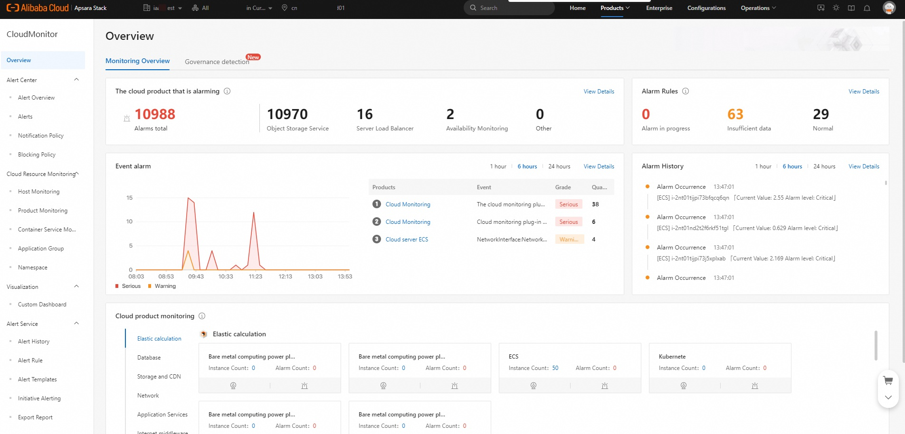

> **Important**
>
> - You can view the business data of CloudMonitor based on different dimensions. To do so, select an organization, a resource set, and a region in the top navigation bar of the CloudMonitor console.
>
> - Do not perform operations in the root organization.

> **Note**
>
> When you view information in a list, take note of the following points:
>
> - The  ,  ,  , and  buttons are displayed above the list. You can adjust the list
>
>   based on your business requirements.
>
>    : refreshes the list.
>
>    : displays information in the default or compact mode.
>
>    : shows or hides specific items in the list. Move the pointer over a display
>
>   item and click the  icon to the right of the display item to adjust the order
>
>   of the items.
>
>    : displays information in full screen mode.
>
> - You can resize the width of columns based on your business requirements. The column width configuration is stored in the local storage of the browser. If you clear the local storage, the configuration becomes invalid.

<a id="section-2"></a>

# 2.Overview

**Background**

In CloudMonitor, use custom roles to assign specific access permissions to operations accounts. When a user logs on, the console displays only monitoring data for product lines permitted by their assigned role. This granular control secures and isolates monitoring data, prevents sensitive information leaks, and simplifies the user interface. It helps operations personnel focus on their designated product lines, improving efficiency and data security.

**Monitoring overview**

The CloudMonitor overview provides a comprehensive view of your resource usage, service status, and overall health on Alibaba Cloud. It sends timely alerts for anomalies so you can respond quickly and ensure your applications run smoothly. The Monitoring Overview page consists of five modules: Cloud Services in Alarm, Alert Rules, Event Alerts, Alert History, and Cloud Service Monitoring.

1. Log on to the Apsara Uni-manager Operation Console.

2. In the top menu bar, click **Products** and choose **Migration & O&M Management** > **O&M and Monitoring** > **CloudMonitor**.

3. In the left-side navigation pane, click **overview**.

4. On the **overview** page, click the **Monitoring Overview** tab to view the overview information.

   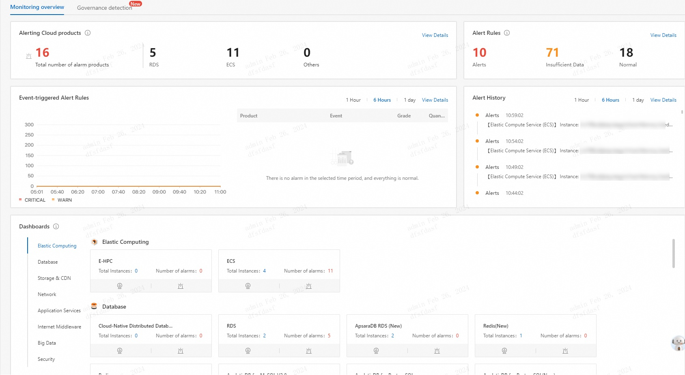

   | Module | Description |
   | --- | --- |
   | Cloud Services in Alarm | • Displays the number of active alerts for cloud services with alerting enabled in CloudMonitor.<br>• Click <strong>View Details</strong> to go to the <strong>Alert History</strong> page and view detailed alert information. |
   | Alert Rules | • Displays the number of alert rules with the status <strong>In Alarm</strong>, <strong>Insufficient</strong> <strong>Data</strong>, or <strong>OK</strong>.<br>Note<br>An <strong>alert rule</strong> may have the <strong>Insufficient Data</strong> status for the following reasons:<br>• The cloud service is not reporting data for the specified metric.<br>• The cloud service instance was deleted.<br>• The cloud service instance was not created in or is missing from the Logstore and requires investigation.<br>• Click <strong>View Details</strong> to go to the <strong>Alert Rules</strong> page and view detailed information about the alert rules. |
   | Event Alerts | • Event alerts report the status of system events for cloud services, helping you quickly analyze and resolve issues when a service fails.<br>• Click <strong>View Details</strong> to go to the <strong>System Events</strong> page and view detailed event alert information. |
   | Alert History | • Shows details of active alerts for all monitored cloud services.<br>• Click <strong>View Details</strong> to go to the <strong>Alert History</strong> page and view detailed alert information. |
   | Cloud Service Monitoring | • CloudMonitor automatically retrieves the total number of instances and alerts for the cloud service resources under your account.<br>• Click the name of a cloud service to go to its monitoring page, where you can view monitoring charts and alert rules for each instance.<br>• Clickto view the alert rules for the cloud service.<br>• Clickto view the monitoring information for the cloud service. |

**Governance and inspection**

The governance and inspection feature analyzes metrics and alert rules for resource instances in the current resource group. It then evaluates metric validity and alert effectiveness to provide recommendations and one-click fixes.

1. On the **overview** page, click the **Governance and Inspection** tab to view the governance and inspection information.

   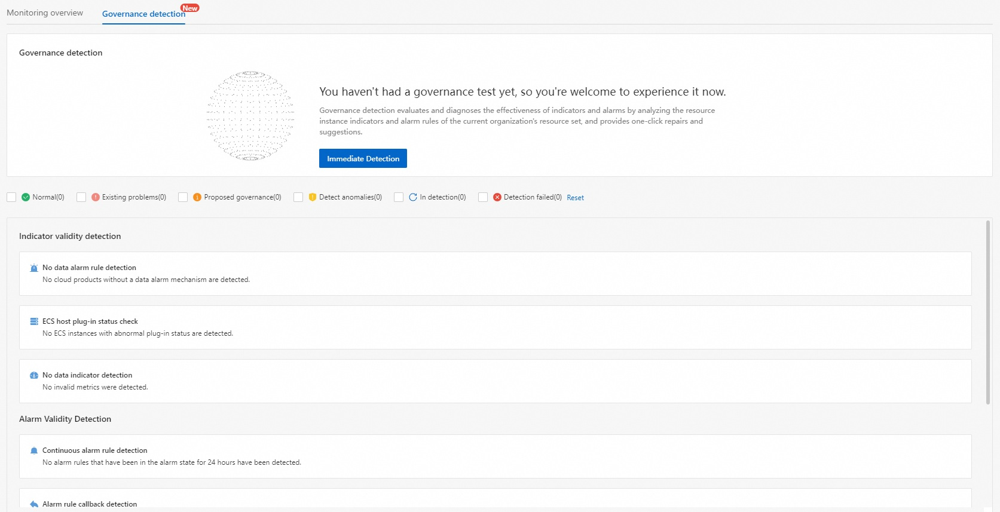

   | Module | Description |
   | --- | --- |
   | Inspection area | In the inspection area, click <strong>Inspect Now</strong> or <strong>Re-inspect</strong>.<br>Note<br>• If no inspection has been run, the button displays <strong>Inspect Now</strong>.<br>• If an inspection has been run, the button displays <strong>Re-inspect</strong>, and the results of the most recent inspection are shown. |

   <table>
     <tr>
       <td>Inspection Details</td>
       <td>If an inspection finds an issue, click <strong>View Details and Governance Guidance</strong> to the right of the inspection item. In the <strong>Inspection Details</strong> panel, you can view information about the inspection mechanism, its scope, and the affected objects.<br>• Metric Validity Inspection<br>• <strong>ECS Plugin Status Inspection</strong>: Checks whether the plugin status for all ECS instances is <code> Running </code>.<br>• <strong>No-Data Alert Rule Inspection</strong>: Verifies that for each cloud service metric, at least one instance in the resource group has an alert rule configured for <code> Insufficient Data </code>.<br>• <strong>No-Data Metric Inspection</strong>: Checks whether all metrics for a cloud service are receiving data.<br>• Alert Effectiveness Inspection<br>• <strong>Persistent Alert Rule Inspection</strong>: Checks whether any alert rule has remained in the <code> In Alarm </code> state for the last 24 hours.<br>• <strong>Alert Rule Callback Inspection</strong>: Checks for failed callbacks from any alert rule within the last 24 hours.<br>• <strong>Invalid Alert Rule Inspection</strong>: Checks for invalid alert rules on your cloud service resources.<br>• <strong>Cloud Service Alert Coverage Inspection</strong>: Checks if any cloud service resources have no alert rules configured.<br>Note<br>• If one-click alerting is enabled for all instances of a cloud service under the top-level organization, all instances of that service are considered covered by alert rules by default.<br>• If an alert rule for a cloud service applies to a specific resource group, all instances of that service within that resource group are considered covered.<br>• An instance is considered covered if at least one of its metrics has an alert rule.</td>
     </tr>
   </table>

<a id="section-3"></a>

# 3.Monitoring assistant

The monitoring assistant is an intelligent O&M assistant integrated into the Cloud Monitor platform. It enables conversation-based management through natural language dialogues and helps you efficiently complete complex O&M tasks such as resource monitoring, alert handling, data queries, and intelligent diagnostics.

**Procedure**

1. Log on to the Apsara Uni-Manager Management Console.

2. In the top menu bar, click **Products** and choose **Migration & O&M Management** > **O&M and Monitoring** > **Cloud Monitor**.

3. In the left-side navigation pane, click **Monitoring Assistant**.

   You can obtain the following information from the interface:

   <ol type="i">

   <li>

   Quick Q&A.

   - Question consultation

     You can query the metric list with one click.

   - Health inspection

     You can perform an availability inspection on all ECS instances with one click.

   - Data query

     You can quickly query the alert rule that was triggered the most times in the last 24 hours.

   - Anomaly diagnosis

     You can quickly analyze the cause of the alert that occurs most frequently.

   <ol type="i" start="2">

   <li>

   Search and filter.

   - On the left side of the interface, you can filter sessions by All, Completed, In Progress, Recent, and Scheduled Task.

   - In the upper-left corner of the interface, click  and enter session content to quickly

     search for sessions.

   </li>

   <li>

   Rename a session

   </li>

   </ol>

   Move the pointer over the session, click  next to the session, select **Rename**, edit the

   name, and press Enter.

   </li>

   <li value="4">

   Pin a session

   Move the pointer over the session, click  next to the session, and select **Pin** to pin the

   target session to the top.

   </li>

   <li>

   Delete a session

   Move the pointer over the session, click  next to the session, and select **Delete** to

   delete the target session.

   </li>

   </ol>

4. New task.

   - Click **New Task** on the left side, enter a command in the input box or upload an

     attachment, and then click  to create and execute a new task. Multiple O&M scenarios

     are supported.

   - You can also switch models in the lower-right corner of the input box.

5. Skills.

   Skills extend the capabilities of Apsara Copilot in conversations. The system provides four preset skills: **Cloud Service Document Retrieval**, **Task Orchestration Planning**, **PDF Document Processing**, and **Excel Spreadsheet Processing**. Custom skills are also supported.

   <ol type="i">

   <li>

   On the **Skills** tab, click **Upload Skill**.

   </li>

   <li>

   In the dialog box, click **Upload Skill**, select a local skill .zip package, and then click **OK**.

   </li>

   </ol>

   > **Note**
   >
   > The package must contain a SKILL.md file after decompression.

   <ol type="i" start="3">

   <li>

   Enable or disable a skill.

   </li>

   </ol>

   Click  next to a custom skill to enable or disable the skill.

   <ol type="i" start="4">

   <li>

   Delete a skill.

   Click  next to a custom skill to delete the skill.

   </li>

   </ol>

6. Memory.

   The system automatically learns user operation habits and stores them as reusable memories. You can also manually create custom workflows or preference settings.

   <ol type="i">

   <li>

   Create a memory

   <ol type="a">

   <li>

   On the **Memory** tab, click **New**, set the title and content, and enter the information that you want the system to remember. Markdown format is supported.

   </li>

   <li>

   Click **Save**.

   </li>

   </ol>

   </li>

   <li>

   Edit a memory.

   </li>

   </ol>

   Move the pointer over the target memory, click the edit icon next to the memory, update the title and content, and then click **Save**.

   <ol type="i" start="3">

   <li>

   Delete a memory.

   </li>

   </ol>

   Move the pointer over the target memory, click the delete icon next to the memory, and then click **Confirm Delete** in the dialog box.

7. Scheduled tasks.

   The system supports automatic execution or manual triggering of periodic O&M tasks as scheduled. You can also create custom scheduled tasks.

   <ol type="i">

   <li>

   Create a task.

   <ol type="a">

   <li>

   On the **CronJob** tab, click **Create Scheduled Task**, and set the task name, schedule time, and execution content.

   </li>

   <li>

   Click **Save** or **Execute Now**.

   </li>

   </ol>

   </li>

   <li>

   Enable or disable a scheduled task.

   </li>

   </ol>

   Click  on the scheduled task card to enable or disable the scheduled task.

   <ol type="i" start="3">

   <li>

   Execute a scheduled task immediately.

   </li>

   </ol>

   Move the pointer over the task card and click **Execute Now** to skip the preset schedule, run the task immediately, and obtain the latest results.

   <ol type="i" start="4">

   <li>

   Edit a task.

   Move the pointer over the task card, click **Edit Task**, update the task name, schedule time, and execution content, and then click **Save** or **Execute Now**.

   </li>

   <li>

   Delete a task.

   Move the pointer over the task card, click **Delete**, and then click **Delete** in the confirmation dialog box.

   </li>

   </ol>

<a id="section-4"></a>

# 4.Intelligent exploratory analysis

<a id="section-4-1"></a>

## 4.1. UModel exploration

UModel exploration is a visual resource relationship graph tool in the CMS platform. It graphically displays various entities and their relationships in the cloud environment to help you intuitively understand complex infrastructure topology.

**Core values**

- Global visibility: View the complete resource network of all nodes and links with one click.

- Relationship insights: Clearly display dependency relationships such as containment and association between resources.

- Quick location: Filter by type or domain to accurately locate target resources.

- Detail perspective: Click any node to view its complete configuration and metadata.

**Procedure**

1. Log on to the Apsara Uni-Manager Management Console.

2. In the top menu bar, click **Products** and choose **Migration & O&M Management** > **O&M and Monitoring** > **CloudMonitor**.

3. In the left-side navigation pane, choose **Intelligent Exploration and Analysis > UModel Exploration.**

4. The current page displays the following information:

   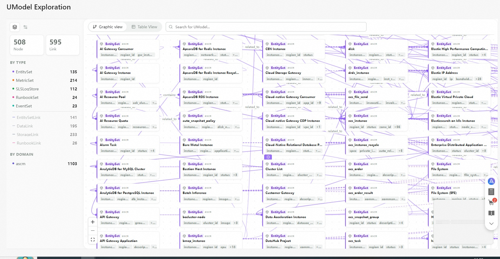

   - Global statistics panel

     It displays the total number of resources in the current view in real time, including the total number of nodes and links.

   - Category filter Filter by the type or domain dimension to focus on a specific subset of resources. Click any type or domain tag to display only the selected items and their nearby associated items in the main view. Stacked filtering continues to apply search, type, or domain filters within the focused scope, and clearing the filters returns you to the complete results.

   - View modes

     It supports the **graph view** and the **table view**. You can switch between the two views, and the system displays the graph view by default.

   - Node card information

     Each node card contains information such as the type identifier, resource name, and domain. Click a card to display detailed information in a pop-up window.

   - Search

     You can quickly locate nodes by type or domain in the search box.

   - Zoom view

     You can zoom in, zoom out, and fit the view in the lower-left corner of the canvas, or scroll the mouse to zoom the view.

5. Settings.

   <ol type="i">

   <li>

   Click the settings icon 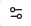 in the upper-left corner to go to the Settings tab.

   </li>

   <li>

   Canvas

   </li>

   </ol>

   This setting controls the visual style of the canvas background, and you can switch the style based on your preferences or scenario requirements. It supports four styles: **None**, **Dots**, **Lines**, and **Crosses**.

   <ol type="i" start="3">

   <li>

   Relationships

   </li>

   </ol>

   This setting defines the semantic level of relationships in the graph and determines which relationships to visualize. It supports the **real view** and the **logical view**.

   <ol type="i" start="4">

   <li>

   Display

   This option remains clear by default. When it is clear, the system renders only elements in the current visible area and dynamically loads elements when you scroll or zoom.

   </li>

   </ol>

<a id="section-4-2"></a>

## 4.2. Entity topology exploration

Entity topology exploration is an instance-level resource relationship visualization tool in Cloud Monitor. It focuses on specific cloud resource instances, such as ECS, RDS, and VPC instances, and their physical or logical connections to display the dynamic network of individual running resource objects.

**Core values**

- Instance perspective: Drill down from the macro architecture to micro instances to view the detailed attributes of each resource.

- Relationship tracing: Clearly display the bindings and dependencies among components such as security groups, network interfaces, and disks.

- Fault localization: Quickly determine the impact scope or root cause path through inbound and outbound relationships.

- Real-time status: Data sources synchronize automatically to reflect the actual topology of the current production environment.

**Procedure**

1. Log on to the Apsara Uni-Manager Management Console.

2. In the top menu bar, click **Products** and choose **Migration & O&M Management** > **O&M and Monitoring** > **CloudMonitor**.

3. In the left-side navigation pane, choose **Intelligent Exploration and Analysis > Entity Topology Exploration.**

4. The current page displays the following information:

   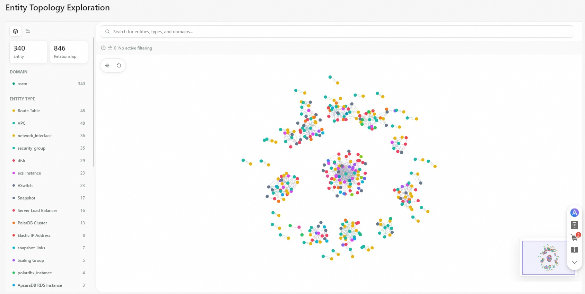

   - Global statistics panel

     This panel displays the resource scale in the current view in real time, including the total number of entities and relationships.

   - Category filtering

     You can filter by domain, entity type, and relationship dimensions to focus on specific resource subsets.

   - Focus

     Click any entity to make the main view display only the selected entity and its nearby entities. You can apply additional filters to continue searching or filtering by type, domain, or relationship within the focused scope. Clear the filters to return to the full results.

   - Entity information

     Each entity includes information such as the IP address, instance name, degree, and ID. Click an entity to view its detailed information in a pop-up window.

   - Search

     You can quickly locate nodes by entity, type, or domain in the search box.

   - Fit view

     Click  Fit View in the upper-left corner of the canvas to fit the view, or scroll the mouse

     wheel to zoom the view.

5. Settings

   <ol type="i">

   <li>

   Click the settings icon  in the upper-left corner to go to the Settings tab.

   </li>

   <li>

   View

   </li>

   </ol>

   You can control the layout algorithm and organization of the topology to adapt to different analysis scenarios:

   Force-directed: An elastic topology suitable for local exploration.

   Grouping: Groups entities by type to facilitate an overview.

   <ol type="i" start="3">

   <li>

   Display

   </li>

   </ol>

   Configure whether to display entity tags, group tags, and thumbnails, and whether to allow dragging entities.

<a id="section-5"></a>

# 5.Alert center

**Benefits**

- Provides a centralized interface to display the alert data of cloud services.

- Provides unified alert policies that can be configured for cloud services.

**Features**

| Feature | Description |
| --- | --- |
| Alert overview | You can view alert statistics and locate issues. |
| Alert list | You can view a list of active alerts, historical alerts, and alert trends. The list of active alerts includes alerts that are in the Pending and Processing states. The list of historical alerts includes alerts that are in the Closed state. |
| Notification policy | You can filter alerts, merge alerts, and reduce noises. This feature is designed to reduce low-priority or unnecessary alert notifications, prevent overflowing alerts and scattered information, and locate high-priority and concerned alerts. |
| Masking policy | You can block integrated alerts based on specific alert conditions. You can specify the time period, alert objects, alert levels, alert sources, and alert names. |

**Alert sources**

Alert data is obtained from the following alert sources:

- Application Real-Time Monitoring Service (ARMS)

- Simple Log Service (SLS)

- CloudMonitor

- DataWorks

- Managed Service for Prometheus

<a id="section-5-1"></a>

## 5.1. Alert overview

CloudMonitor provides a visualized interface to quickly identify abnormal cloud services. You can click a cloud service name to go to the corresponding monitoring list and details page for troubleshooting.

**Procedure**

1. Log on to the Apsara Uni-manager Management Console.

2. In the top navigation bar, choose **Products** > **Migration and O&M Management** > **O&M and Monitoring** > **CloudMonitor**.

3. In the left-side navigation pane, choose **Alert Center > Alert Overview.**

4. The **Alert Overview** page consists of the following seven sections that analyze and collect statistics on alert information from different perspectives.

   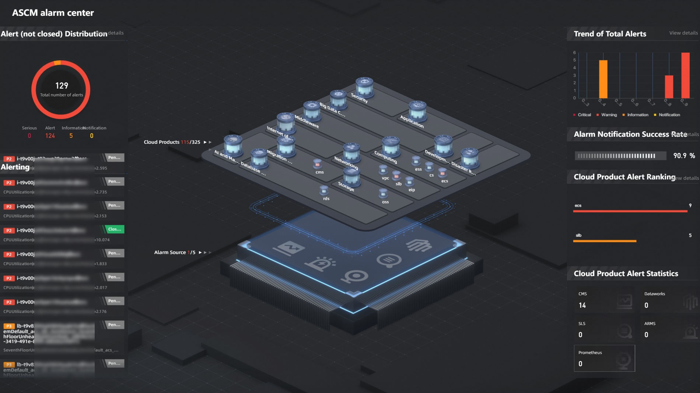

   - **Alert (not closed)**: provides the distribution of active alerts that are not resolved in the resource set of the current organization. The alerts are classified into Critical, Warning, Info, and Notification based on the alert level. Click **Details** to go to the **Alerts** page.

   - **Alerting**: displays the resources that triggered alerts in the resource set of the current organization in real time. Click **Details** to go to the alert details page.

   - **Trend of Total Alerts**: provides the trend of the total number of alerts in the resource set of the current organization over the past seven days.

     - Colors on each bar represent the alert levels. A darker color indicates a higher alert level.

     - A larger area of a color on a bar indicates more alerts of the corresponding levels.

     - Click **Details** to go to the **Alerts** page.

   - **Notification Success Rate**: provides statistics on the success rate of notifications that are configured with notification policies in the resource set of the current organization. Click **Details** to go to the **Notification policy** page.

   - **Alert Ranking**: provides the top list of alerts for all cloud services in the resource set of the current organization. Click **Details** to go to the **Alerts** page.

   - **Cloud Product Alert Statistics**: provides the distribution of alerts from different alert sources in the resource set of the current organization. Click the name of a cloud service to go to the **Alerts** page.

   - Middle section: Click the icon of a cloud service to display the alert status, alert source, and exception instance of the cloud service. Click **View Details** to go to the Instances page.

**What to do next**

After you obtain the alert overview information based on your requirements, you can view alert details in the alert list.

<a id="section-5-2"></a>

## 5.2. Alert list

The alert list displays active alerts, historical alerts, and alert trends. Alerts are grouped into two categories: active alerts, which have a processing status of  `pending`  or  `in progress` , and historical alerts, which have a processing status of  `closed` .

**Procedure**

1. Log in to the Apsara Uni-manager Operation Console.

2. In the top menu bar, click **Products** and choose **Migration & O&M Management** > **O&M and Monitoring** > **CloudMonitor**.

3. In the left-side navigation pane, select **alert center > alert list.**

4. The **alert list** page displays **active alerts** and **historical alerts**. By default, the **active alerts** tab is displayed. Click the **historical alerts** tab to switch to the **historical alerts** tab.

   - At the top of the **active alerts** tab, filter alerts by **alert ID**, **Alert Name**, **severity**, **alert source**, **resource**, **Product**, **alert message**, **extended attributes**, and a time range.

     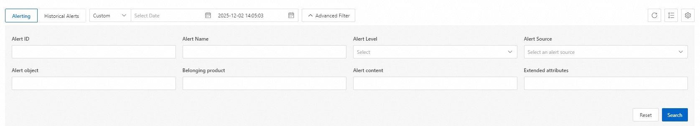

   - The **alert trend** section displays the number of alerts over time.

     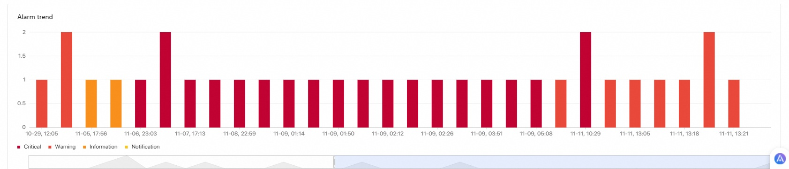

     - In each bar, colored sections represent different severities. Darker colors indicate higher severity.

     - Larger colored sections represent a greater number of alerts for the corresponding severity.

     - Hover over a bar to see the total count of alerts for each severity on that day.

   - The alert list includes columns such as **Alert ID/Name**, **Organization**, **severity**, **resource/Product**, **alert message**, **alert state**, **processing status**, **alert source**, **Occurrences**, **Start Time**, **Last Occurrence**, and **Duration (s).**

     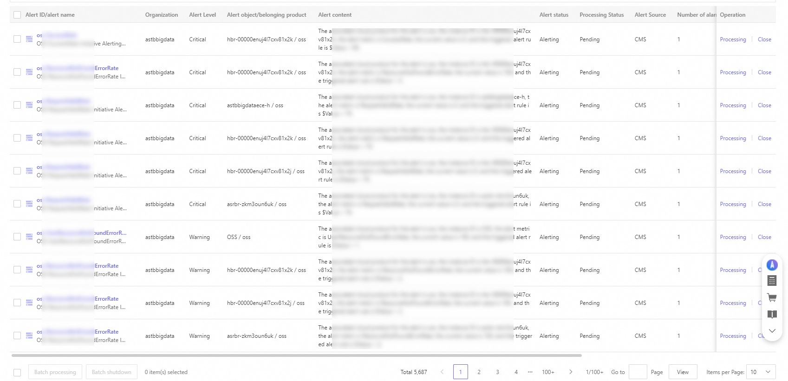

     - Click an alert's **Alert ID/Name** to view its details page.

       - In the upper-right corner of the page, click **Acknowledge** or **Close** to change the alert's processing status. The change is also recorded in the timeline.

       - In the upper-right corner of the page, click **One-click Diagnosis**. Apsara Assistant uses the alert ID to query details, run an automated analysis, and display a detailed summary report.

       - View basic information about the alert in the Basic Information section.

         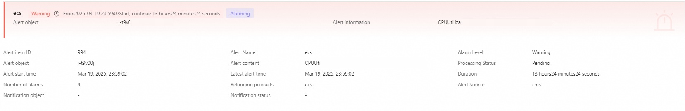

       - View additional information about the alert in the **Extended Attributes** section.

         > **Note**
         >
         > The displayed extended attributes vary depending on the alert.

       - In the **timeline** section, add events such as **Alert Triggered**, **Alert Investigation**, **root cause analysis**, **Alert Closed**, and **Alert Response**.

         Click **Add**. In the **Add Timeline Event** panel, configure **Select Node**, **Time**, and **Description**.

         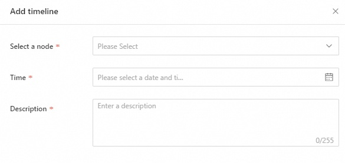

       - The **alert analysis** section shows detailed monitoring metrics and an alert trace diagram.

         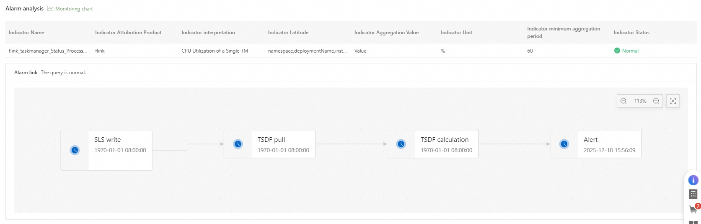

         Click **Monitoring Chart** to specify a custom time range and view the trend chart for monitoring metrics.

         > **Note**
         >
         > The alert analysis section does not appear for alerts that do not originate from CMS.

       - In the **Alert Feedback** section, view the **Alert Validity** and **Alert Accuracy**.

         > **Note**
         >
         > You can provide feedback on an alert's validity and accuracy when you close it.

         

     - Once the triggering condition is resolved, the system periodically updates the alert state based on the corresponding alert rule. If the alert state is not updated promptly, you can manually change its processing status to **in progress** or **closed**.

       - To set the status to **in progress**:

         - Single alert: In the alert list, click **Acknowledge** in the **Actions** column for an alert to change its **processing status** to **in progress**.

         - Multiple alerts: Select the alerts and click **Batch Acknowledge**. This changes their **processing status** to **in progress**.

       - To set the status to **closed**:

         - Single alert: On the **alert list** page, click **Close** in the **Actions** column for an alert. Its **processing status** changes to **closed**, and the alert moves to the **historical alerts** tab.

         - Multiple alerts: Select the alerts and click **Batch Close**. This changes their **processing status** to **closed** and moves them to the **historical alerts** tab.

<a id="section-5-3"></a>

## 5.3. Alert rules

The alert center of Cloud Monitor integrates alert rule capabilities of Application Real-Time Monitoring Service (ARMS), Simple Log Service (SLS), and Managed Service for Prometheus. If the service is not deployed, you cannot use the alert rule capability of the service.

**ARMS**

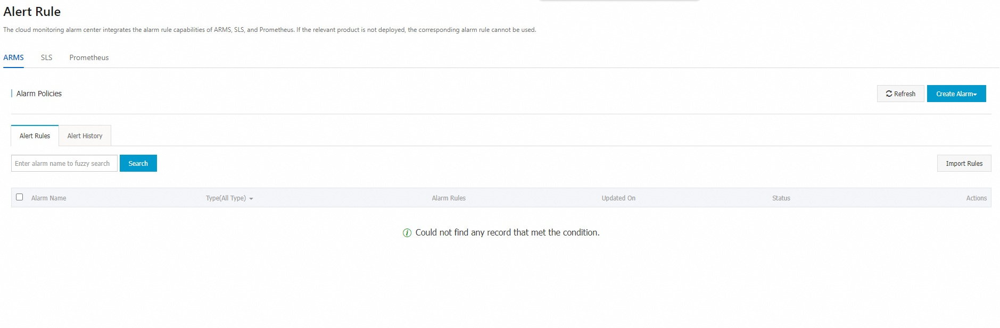

For more information about alert rules in ARMS and the operations that you can perform on historical alerts, see **Application Real-Time Monitoring Service** > **User Guide** > **Alerts** > **Create an alert rule**.

**SLS**

> **Note**
>
> If the system prompts that the operation is unauthorized, click **Authorization operation SLS permissions** and open the page again.

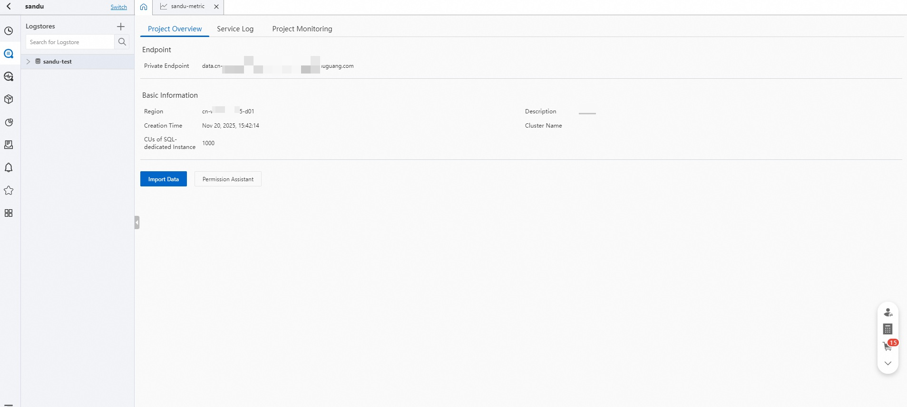

Cloud Monitor allows you to subscribe to the metric store of SLS. For more information, see **Simple Log Service** > **User Guide**.

**Prometheus**

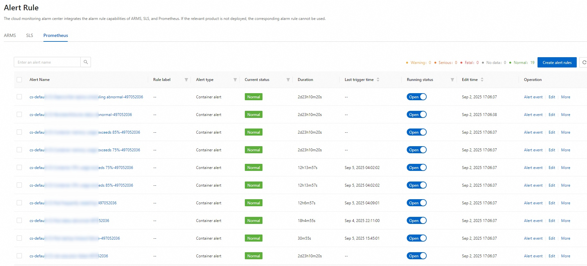

For more information about alert rules in Managed Service for Prometheus and the operations that you can perform on historical alerts, see **Simple Log Service** > **User Guide** > **Alerts** > **Configure an alarm**.

<a id="section-5-4"></a>

## 5.4. Notification policy

A notification policy lets you filter, consolidate, and reduce noise from triggered alerts. It minimizes interruptions from low-priority or unnecessary notifications, addresses alert fatigue and information overload, and helps you focus on high-priority alerts.

**Create notification policy**

**Procedure**

1. Log on to the Apsara Uni-manager Operation Console.

2. In the top menu bar, click **Products** and choose **Migration & O&M Management** > **O&M and Monitoring** > **CloudMonitor**.

3. In the left-side navigation pane, choose **Alert Center > Notification Policy.**

4. On the **Notification Policy** page, click **Create Notification Policy**.

5. In the **Create Notification Policy** panel, configure the parameters as needed.

   **Category**

   **Parameter**

   **Description**

   **Name**

   Enter a name for the notification policy.

   **Basic information**

   **Description**

   Enter a description for the notification policy.

   **Alert source**

   Select one or more alert sources.

   Click **Add alert name** and enter an alert name.

   > **Note**

   **Alert name**

   > You can add multiple alert names.

   Select an alert level. Valid values are **Critical**, **Warning**,

   **Alert level**

   **Info**, and **Notice**.

   **Subscription conditions**

   Click **Add alert object** and enter an alert object.

   **Alert object**

   > **Note**
   >
   > You can add multiple alert objects.

   Click **Add alert content** and enter alert content.

   **Alert content**

   > **Note**
   >
   > You can add multiple alert content entries.

   Select a muting condition. Valid values: **Conditional**

   **Muting**

   **Trigger**, **Trigger and Mute**, **Trigger and Do Not**

   **condition**

   **Mute**, and **Trigger and Mute Until Resolved**.

   > **Note**
   >
   > This parameter is required if you set **Muting**

   **Muting policy**

   **Muting**

   > **condition** to **Conditional Trigger** or **Trigger and**

   **condition**

   > **Mute**.

   **description**

   Enter a description for the muting condition.

   Click **Add effective time** and select a time range. Notifications are sent only during the specified time range.

   > **Note**
   >
   > You can select multiple time periods.

   **Policy period**

   **Effective time**

   > **Important**
   >
   > If you select multiple effective periods, avoid overlapping time ranges to prevent duplicate notifications.

   Select the contacts to notify.

   **Contact/group**

   > **Note**
   >
   > You can add multiple contacts.

   Click **Add webhook** and configure its parameters, such

   **Notification**

   as **URL**, **Method**, **Custom header**, **Request**

   **method**

   **parameters**, **Content type**, and **Body parameter (JSON)**.

   - **URL**: Enter the Webhook URL. You must use a domain name that starts with http or https. IP addresses are not supported.

   - **Method**: Select the request method: **GET** or **POST**.

   - **Custom header**: Click **Add custom header** to configure key-value pairs.

     > **Note**
     >
     > You can configure multiple custom headers.

   - **Request parameters**: Click **Add request parameter** to configure key-value pairs.

     > **Note**
     >
     > You can configure multiple request parameters.

   **Webhook**

   - **Content type**: Select the content type and character encoding for the request payload.

     > **Note**
     >
     > This parameter is required if **Method** is set to POST.

     - **application/json**: The request payload must be a JSON string.

       **Body parameter (JSON)**: Enter the request payload in JSON format.

     - **application/x-www-form-urlencoded**: The request payload is submitted as a form.

       **Body parameters**: Click **Add body parameters** to configure key-value pairs in the request payload.

       > **Note**
       >
       > You can configure multiple body parameters.

   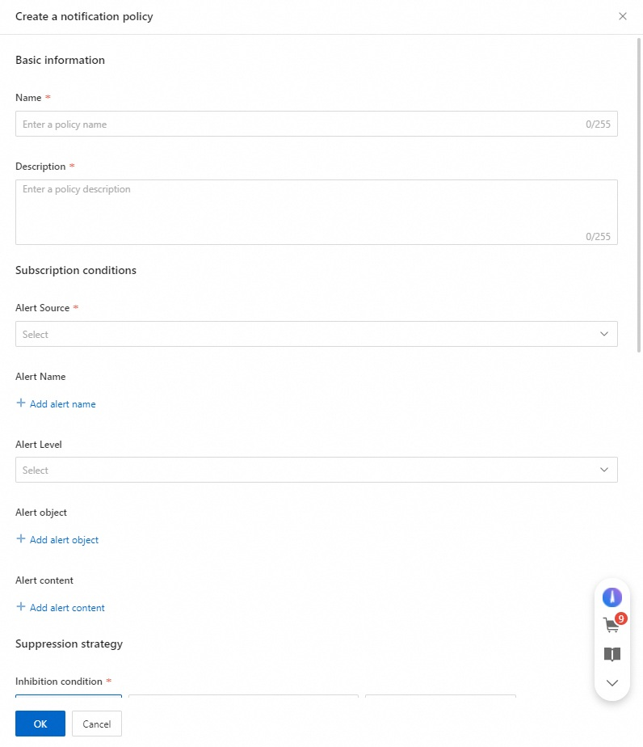

6. Click **OK**.

> **Note**
>
> Cloud Monitor (CMS) uses a large language model to provide intelligent analysis, automatically generating root cause analysis and troubleshooting suggestions in alert notifications. This feature helps you quickly locate faults, makes alerts more actionable, and reduces both manual analysis time and the mean time to respond.

**View notification policy**

**Procedure**

After creating a notification policy, you can view its details.

The **Notification Policy** page shows a list of policies and their details, including **Policy name**, **Policy description**, **Policy status**, **Notification rules**, **Muting condition**, **Effective period**, **Notification history**, **Notification target**, and **Webhook configuration**.

> **Note**
>
> - Use the dropdown lists or the search box at the top of the policy list to quickly find a notification policy.
>
> - Click the  icon next to the Policy status column to filter policies by status.
>
> - Hover over the number in the **Notification rules**, **Effective period**, or **Notification target** column to view details.
>
> - Click the  icon in the **Notification history** column to view the notification
>
>   history from the last three days. The history includes details such as **Alert ID/Alert name**, **Alert level**, **Alert object/Product**, **Alert content**, **Processing status**, **Alert start time**, **Last alert time**, and **Send time**.
>
>   Click **View More** in the upper-right corner to go to the **Message Center > Unread Messages** page.

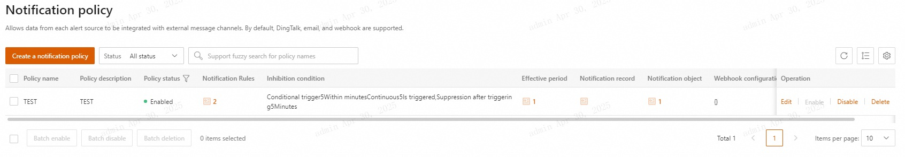

**Modify notification policy**

**Procedure**

You can modify a notification policy to update its details.

1. In the list on the **Notification Policy** page, find the target policy and click **Edit** in the Actions column.

2. In the **Edit Notification Policy** panel, modify the parameters as needed. For details about the parameters, see Create a notification policy.

**Disable notification policy**

**Procedure**

You can disable a policy that you do not currently need.

> **Important**
>
> Before you disable a notification policy, ensure its **Policy status** is **Enabled**.

- Disable a single policy

  <ol type="i">

  <li>

  In the list on the **Notification Policy** page, find the target policy and click **Disable** in the Actions column.

  <ol type="i" start="2">

  <li>

  Click **OK**.

  </li>

  </ol>

  </li>

  </ol>

- Disable policies in batches

  <ol type="i">

  <li>

  In the list on the **Notification Policy** page, select the checkboxes of the target policies.

  <ol type="i" start="2">

  <li>

  Click **Batch disable** below the list.

  </li>

  <li>

  Click **OK**.

  </li>

  </ol>

  </li>

  </ol>

**Enable notification policy**

**Procedure**

You can enable a disabled policy when you need it again.

> **Important**
>
> Before you enable a notification policy, ensure its **Policy status** is **Disabled**.

- Enable a single policy

  <ol type="i">

  <li>

  In the list on the **Notification Policy** page, find the target policy and click **Enable** in the Actions column.

  <ol type="i" start="2">

  <li>

  Click **OK**.

  </li>

  </ol>

  </li>

  </ol>

- Enable policies in batches

  <ol type="i">

  <li>

  In the list on the **Notification Policy** page, select the checkboxes of the target policies.

  <ol type="i" start="2">

  <li>

  Click **Batch enable** below the list.

  </li>

  <li>

  Click **OK**.

  </li>

  </ol>

  </li>

  </ol>

**Delete notification policy**

**Procedure**

You can delete a policy that you no longer need.

- Delete a single policy

  <ol type="i">

  <li>

  In the list on the **Notification Policy** page, find the target policy and click **Delete** in the Actions column.

  <ol type="i" start="2">

  <li>

  Click **OK**.

  </li>

  </ol>

  </li>

  </ol>

- Delete policies in batches

  <ol type="i">

  <li>

  In the list on the **Notification Policy** page, select the checkboxes of the target policies.

  <ol type="i" start="2">

  <li>

  Click **Batch delete** below the list.

  </li>

  <li>

  Click **OK**.

  </li>

  </ol>

  </li>

  </ol>

<a id="section-5-5"></a>

## 5.5. Blocking policies

You can configure a temporary or permanent blocking policy for alerts. The blocked alerts are no longer connected to the system.

**Create a blocking policy**

**Procedure**

1. Log on to the Apsara Uni-manager Management Console.

2. In the top navigation bar, choose **Products** > **Migration and O&M Management** > **O&M and Monitoring** > **CloudMonitor**.

3. In the left-side navigation pane, choose **Alert Center > Blocking Policy.**

4. On the **Masking policy** page, click **Create a masking policy**.

5. In the **Create a masking policy** panel, configure the parameters. The following table describes the parameters.

   **Category**

   **Parameter**

   **Description**

   Enter a name for the blocking

   **Name**

   policy.

   **Basic information**

   Enter a description for the

   **Description**

   blocking policy.

   Select the source of the alerts

   **Alert Source**

   that you want to block.

   Click **Add alert name** and enter an alert name for the blocking policy.

   **Alert Name**

   > **Note**
   >
   > You can add multiple alert names.

   Select an alert level. Valid values: **Critical**, **Warning**,

   **Alarm Level**

   **Information**, and **Notification**.

   **Shielding condition**

   Click **Add alert object** and enter a notification object.

   **Alert object**

   > **Note**
   >
   > You can add multiple notification objects.

   Click **Add alert content** and enter an alert message.

   **Alert content**

   > **Note**
   >
   > You can add multiple alert messages.

   <table>
     <tr>
       <th rowspan="2">Mask settings</th>
       <th>Shielding condition</th>
       <th>Select <strong>Custom Time</strong> or <strong>All</strong> <strong>time, direct shielding</strong>.</th>
     </tr>
     <tr>
       <td>Policy masking time</td>
       <td>Note<br>This parameter is required only when you set the Shielding condition parameter to <strong>Custom</strong> <strong>Time</strong>.<br>Click <strong>Add policy masking</strong> <strong>time</strong> and select a time range.Alerts are blocked only within the time range.<br>Important<br>If you select multiple periods, make sure that they do not overlap.</td>
     </tr>
   </table>

   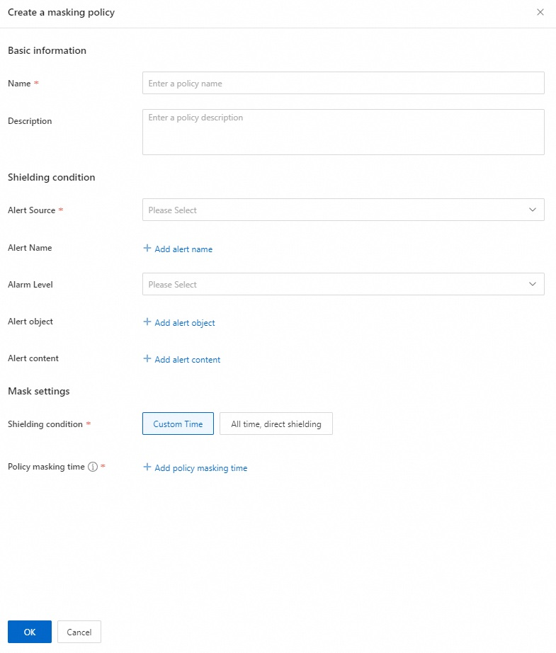

6. Click **OK**.

**View blocking policies**

**Procedure**

After a blocking policy is created, you can view the details of the blocking policy.

On the **Masking policy** page, view the **Policy name**, **Policy description**, **Policy status**, **Masking rules**, and **Masking period**.

> **Note**
>
> - You can select a blocking policy from the drop-down list or enter a policy name in the search box to quickly find a blocking policy.
>
> - You can click the  icon next to Policy status to filter blocking policies.
>
> - You can move the pointer over the number in the **Masking rules** and **Masking period** columns to view the details.

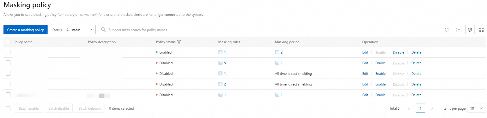

**Modify a blocking policy**

**Procedure**

You can modify an existing blocking policy based on your business requirements.

1. On the **Masking policy** page, find the blocking policy that you want to modify and click **Edit** in the **Operation** column.

2. In the **Edit** panel, modify the parameters based on your business requirements. For more information about the parameters, see Create a blocking policy.

**Disable blocking policies**

**Procedure**

You can disable a blocking policy if you do not need it.

> **Important**
>
> Before you disable a blocking policy, make sure that the **status** of the policy is **Enabled**.

- Disable a single blocking policy

  <ol type="i">

  <li>

  On the **Masking policy** page, find the blocking policy that you want to disable and click **Disable** in the **Operation** column.

  <ol type="i" start="2">

  <li>

  In the message that appears, click **OK**.

  </li>

  </ol>

  </li>

  </ol>

- Disable multiple blocking policies at a time

  <ol type="i">

  <li>

  On the **Masking policy** page, select the blocking policies that you want to disable.

  <ol type="i" start="2">

  <li>

  Click **Batch disable** in the lower-left corner of the policy list.

  </li>

  <li>

  In the message that appears, click **OK**.

  </li>

  </ol>

  </li>

  </ol>

**Enable blocking policies**

**Procedure**

If you need to use a disabled blocking policy again, you can enable the blocking policy.

> **Important**
>
> Before you enable a blocking policy, make sure that the **Policy Status** is **Disabled**.

- Enable a single blocking policy

  <ol type="i">

  <li>

  On the **Masking policy** page, find the blocking policy that you want to enable and click **Enable** in the **Operation** column.

  <ol type="i" start="2">

  <li>

  In the message that appears, click **OK**.

  </li>

  </ol>

  </li>

  </ol>

- Enable multiple blocking policies at a time

  <ol type="i">

  <li>

  On the **Masking policy** page, select the blocking policies that you want to enable.

  <ol type="i" start="2">

  <li>

  Click **Batch enable** in the lower-left corner of the policy list.

  </li>

  <li>

  In the message that appears, click **OK**.

  </li>

  </ol>

  </li>

  </ol>

**Delete blocking policies**

**Procedure**

You can delete the blocking policies that you no longer need.

- Delete a single blocking policy

  <ol type="i">

  <li>

  On the **Masking policy** page, find the blocking policy that you want to delete and click **Delete** in the **Operation** column.

  <ol type="i" start="2">

  <li>

  In the message that appears, click **OK**.

  </li>

  </ol>

  </li>

  </ol>

- Delete multiple blocking policies at a time

  <ol type="i">

  <li>

  On the **Masking policy** page, select the blocking policies that you want to delete.

  <ol type="i" start="2">

  <li>

  Click **Batch delete** in the lower-left corner of the policy list.

  </li>

  <li>

  In the message that appears, click **OK**.

  </li>

  </ol>

  </li>

  </ol>

<a id="section-6"></a>

# 6.Cloud resource monitoring

<a id="section-6-1"></a>

## 6.1. Host monitoring

After the CloudMonitor agent is installed on your Elastic Compute Service (ECS) instances, CloudMonitor can collect various monitoring data of metrics about the operating system that the ECS instances run. You can configure alert rules for the metrics to reduce monitoring costs.

- **Easy-to-use agent**: After the CloudMonitor agent is installed on your ECS instances, CloudMonitor can collect various monitoring data of metrics about the operating system that the ECS instances run.

- **Various metrics**: Host monitoring supports various metrics about the operating system, GPUs, inbound and outbound traffic, disk reads and writes, processes, cloud disks, and Azure VMware Solution (AVS) network.

- **Business-specific process monitoring**: Host monitoring collects the CPU utilization, memory usage, and number of opened files for active processes. This helps you monitor the resource usage of your ECS instances.

- **Flexible alerting**: Host monitoring allows you to manage ECS instances across regions and configure alert rules by application group. This reduces the costs of monitoring management.

<a id="section-6-1-1"></a>

### 6.1.1. Install the CloudMonitor agent

You can install the CloudMonitor agent on Elastic Compute Service (ECS) instances to collect the monitoring data of operating systems.

**Batch install or upgrade the CloudMonitor agent**

1. Log on to the Apsara Uni-manager Management Console.

2. In the top navigation bar, choose **Products** > **Migration and O&M Management** > **O&M and Monitoring** > **CloudMonitor**.

3. In the left-side navigation pane, choose **Cloud Resource Monitoring > Host Monitoring**.

4. On the **Host Monitoring** page, select the ECS instances for which you want to install or upgrade the agent and click **Bulk install or upgrade plug-ins** in the lower-left corner of the instance list.

   > **Note**
   >
   > You can only install the CloudMonitor agent for ECS instances that run the **Linux** and **Windows** operating systems.

5. In the message that appears, click **OK**.

   > **Note**
   >
   > The installation or upgrade process takes approximately five minutes. After the agent changes from the **In Installation** state to the **In operation** state, the CloudMonitor agent is installed or upgraded.

**Install or upgrade the CloudMonitor agent globally**

> **Note**
>
> This operation takes effect on multiple ECS instances and can be performed every 30 minutes.

1. On the **Host Monitoring** page, click **Install/Upgrade Agent**.

2. In the **Install/Upgrade Agent** dialog box, select **Install Only for Uninstalled**, **Only Upgrade for Installed**, or **Install and Upgrade to Latest Version**.

   > **Note**
   >
   > - **Install Only for Uninstalled**: installs the CloudMonitor agent only on the ECS instances that are not installed with the agent.
   >
   > - **Only Upgrade for Installed**: upgrades the CloudMonitor agent for the ECS instances that are installed with the agent.
   >
   > - **Install and Upgrade to Latest Version**: installs and upgrades the CloudMonitor agent to the latest version for all existing ECS instances.

3. Click **Execute Now**.

**Install the CloudMonitor agent on a single ECS instance**

1. Find the ECS instance on which you want to install the CloudMonitor agent and click the 

   icon.

2. In the message that appears, click **OK**.

   > **Note**
   >
   > If the CloudMonitor agent fails to be installed, click the
   >
   > icon in the **Agent Status**
   >
   > 
   >
   > column to view the installation failure details, including **Last Installation Failure Cause**, **Installation History Details**, **Installation Status**, and **Installed Agent Output**.

<a id="section-6-1-2"></a>

### 6.1.2. Process monitoring

By default, process monitoring collects the CPU usage, memory usage, and number of open files for active processes on an Elastic Computing Service (ECS) instance. If you add a process keyword, process monitoring also collects the number of processes that contain the keyword.

**Prerequisites**

The CloudMonitor agent is installed on the ECS instance. For more information, see Install the agent.

**Background information**

CloudMonitor polls and collects process data every 15 seconds. For each process, it records the process name, process ID, user, CPU usage, memory usage, number of open files, and time.

- CPU usage and memory usage of a process: These metrics correspond to the output of the **top** command in Linux.

- Number of open files in a process: This metric corresponds to the output of the **lsof** command in Linux.

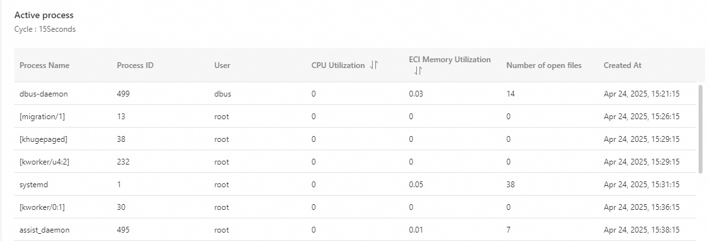

**Add or delete system process keywords**

You can monitor the number of processes on an ECS instance to collect the count of key processes and check their status.

**Procedure**

1. Log on to the Apsara Uni-manager Management Console.

2. In the top menu bar, click **Products** and choose **Migration & O&M Management** > **O&M and Monitoring** > **CloudMonitor**.

3. In the navigation pane on the left, choose **Resource Monitoring > Host Monitoring**.

4. On the **Host Monitoring** page, click the name of the target ECS instance.

5. Click the **Process Monitoring** tab. In the **Process Count** area, click **Add Process** in the upper-right corner.

   - **Add a system process keyword**: In the **Add Process** panel, enter a process name and click **Add Process**.

   - **Delete a system process keyword**: In the **Add Process** panel, find the target process name and click **Delete Process** in the **Operation** column.

**Example of adding a system process keyword**

Assume that the following processes are running on an ECS instance:

```text
 /usr/bin/java -Xmx2300m -Xms2300m org.apache.catalina.startup.Bootstrap 

 /usr/bin/ruby 

 nginx -c /etc/nginx/nginx.conf 
```

After you add six process keywords, the collected results are as follows:

- **ruby**: The collected process count is 1. The keyword matches the process name.

- **nginx**: The collected process count is 1. The keyword matches the process name and parameters.

- **/usr/bin**: The collected process count is 2. The keyword matches the path of two processes.

- **apache.catalina**: The collected process count is 1. The keyword matches part of the parameters.

- **nginx.conf**: The collected process count is 1. The keyword matches part of the parameters.

- **-c**: The collected process count is 1. The keyword matches part of the parameters.

**Set an alert rule for process monitoring**

After you add a process to monitor, you can set an alert rule for it. This ensures that specified contacts receive an alert notification if the process count changes.

**Procedure**

1. In the navigation pane on the left, choose **Resource Monitoring > Host Monitoring**.

2. Click **Create Alert Rule**.

3. In the **Create Alert Rule** panel, click **Create Alert Rule**. For **Metric**, select **(Agent)process.count_processname** from the **Process** category. Then, configure other parameters for the alert rule as needed.

   If multiple processes are configured on the ECS instance, you can click **Create Alert Rule** to set alert rules for multiple processes. For more information about how to set the parameters for an alert rule, see Create an alert rule.

4. Click **OK**.

<a id="section-6-1-3"></a>

### 6.1.3. View host monitoring details

**Procedure**

1. Log on to the Apsara Uni-manager Management Console.

2. In the top menu bar, click **Products** and choose **Migration & O&M Management** > **O&M and Monitoring** > **CloudMonitor**.

3. In the navigation pane on the left, choose **Cloud Resource Monitoring > Host Monitoring**.

4. On the **Host Monitoring** page, view the following information for all instances: **Instance ID/Name**, **Organization/Resource Set**, **Region**, **Instance Status**, **ECS Plug-in Status**, **ECS Plug-in Version**, **Configuration**, **CPU Usage**, **Memory Usage**, **Cloud Disk Usage**, **Operating System**, **Instance Type**, **IP Address**, **VPC ID**, **Image ID**, **Zone ID**, and **Creation Time**. You can also sort the instances by **CPU Usage**, **Memory Usage**, and **Cloud Disk Usage**.

   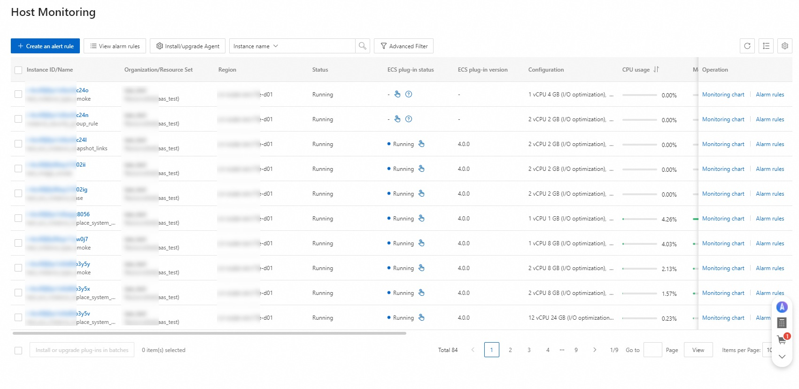

5. Click the name of a target instance or **Monitoring Chart** in the **Actions** column to go to the details page for an Elastic Compute Service (ECS) instance. On this page, you can view specific metrics. For more information about the metrics, see Elastic Compute Service.

   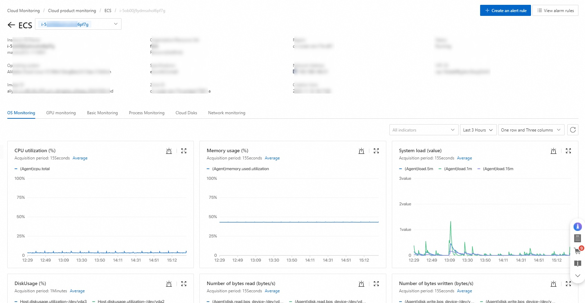

6. Click **Alert Rules** in the **Actions** column for a target instance to go to the **Alert Rules** page. On this page, you can view and manage the alert rules for the instance. For more information, see Manage alert rules.

7. Advanced filtering.

   You can use the advanced search to filter target instances by **Instance Name**, **Instance ID**, **Classic Network Private IP**, **VPC Private IP**, **Public IP**, **Elastic IP Address**, or **ECS Plug-in Status**.

   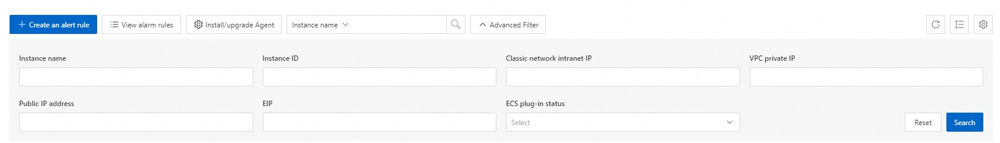

<a id="section-6-2"></a>

## 6.2. Cloud product monitoring

CloudMonitor automatically discovers the cloud products in your account, allowing you to view monitoring charts to check resource status. You can also create alert rules. When a rule is triggered, CloudMonitor sends an alert notification to keep you promptly informed of your resource status.

CloudMonitor supports monitoring for the following cloud products:

> **Note**
>
> For details about the monitoring metrics for each cloud product, see CloudMonitor Metrics Reference.

| Product type | Product name |
| --- | --- |
| Elastic Compute | • Container Monitoring for Kubernetes<br>• ECS<br>• BMCP (nodes)<br>• BMCP (bare metal - AI computing cluster)<br>• BMCP (containers - AI computing cluster)<br>• BMCP (bare metal - HPC cluster)<br>• BMS |
| Database | • ApsaraDB RDS<br>• ApsaraDB RDS (new link)<br>• PolarDB (cluster edition)<br>• PolarDB (primary/secondary edition)<br>• ApsaraDB for Redis<br>• ApsaraDB for Redis (new link)<br>• PolarDB for HTAP<br>• AnalyticDB for PostgreSQL<br>• AnalyticDB for PostgreSQL (new link)<br>• ApsaraDB for MongoDB<br>• ApsaraDB for MongoDB (new link)<br>• DTS<br>• Lindorm<br>• Lindorm 2.0 |
| Storage and CDN | • Apsara File Storage NAS<br>• OSS<br>• CPFS<br>• CPFS<br>• Apsara File Storage NAS |
| Networking | • NAT Gateway<br>• SLB<br>• ALB<br>• VPN Gateway<br>• EIP<br>• Alibaba Cloud DNS<br>• Alibaba Cloud DNS (tenant forwarding domain names) |
| Internet Middleware | • ApsaraMQ for RocketMQ<br>• ApsaraMQ (tiangong)<br>• ApsaraMQ for Kafka<br>• API Gateway<br>• EDAS (dedicated registry) |
| Big Data (DataPlus) | • DataHub<br>• MaxCompute<br>• MaxCompute (quota groups) |
| Security (Security Center) | • Bastionhost<br>• Vulnerability Scanning Engine<br>• Cloud Firewall<br>• WAF |
| Artificial Intelligence and Machine Learning | • PAI-Studio (online services)<br>• PAI-Studio (model evaluation)<br>• PAI-Studio (Notebook modeling)<br>• PAI-Studio (task modeling)<br>• PAI-Studio (visual modeling)<br>• PAI-Studio (model tuning)<br>• PAI-Studio (batch inference)<br>• PAI-Studio (online service groups)<br>• PAI-Studio (resource pools) |

<a id="section-6-2-1"></a>

### 6.2.1. Cloud Monitor metrics

Cloud Monitor uses metrics from your cloud resources to monitor service availability. You can configure alert rules and notification policies for these metrics to stay informed about the health and performance of your service instances.

**Background**

Cloud Monitor's ASCM custom role feature lets you assign different access permissions to O&M accounts. When users with these roles log in to the Cloud Monitor (CMS) platform, they see only the metrics for their authorized product lines. This fine-grained permission control ensures data security by isolating monitoring data and preventing sensitive information leakage. It also simplifies the user interface for O&M personnel, helping them focus on their assigned product lines and improving both operational efficiency and data security.

<a id="section-6-2-1-1"></a>

#### 6.2.1.1. Elastic computing

<a id="section-6-2-1-1-1"></a>

##### 6.2.1.1.1. Kubernetes container monitoring

This document lists the monitoring metrics for Kubernetes container monitoring.

> **Note**
>
> These monitoring items apply to instances that do not support Prometheus monitoring 2.0. For instances that do, go to the Kubernetes container monitoring page.

**Cluster metrics**

The value for **namespace** is **acs_k8s**. The default value for **period** is **60** seconds and can be any multiple of 60.

| Metric | Unit | MetricName | Dimensions | Description |
| --- | --- | --- | --- | --- |
| CPU limit | cpus | cluster.cpu.limit | userId, cluster | The maximum CPU a container can use. |
| CPU request | cpus | cluster.cpu.reque st | userId, cluster | The minimum CPU a container requests for scheduling. |
| Cluster CPU usage | cpus | cluster.cpu.usage _rate | userId, cluster | The total CPU used by the cluster. |
| Cluster CPU utilization | percent | cluster.cpu.utiliza tion | userId, cluster | The CPU utilization of the cluster. |
| Cluster file system available size | bytes | cluster.filesystem.available | userId, cluster | The total available file system space in the cluster. |
| Cluster file system limit | bytes | cluster.filesystem.limit | userId, cluster | The total file system capacity of the cluster. |
| Cluster memory limit | bytes | cluster.memory.li mit | userId, cluster | The combined memory limit of all pods in the cluster. |
| Cluster memory request | bytes | cluster.memory.r equest | userId, cluster | The combined memory request of all pods in the cluster. |
| Cluster memory utilization | percent | cluster.memory.u tilization | userId, cluster | The memory utilization of the cluster. |

**Node metrics**

The value for **namespace** is **acs_k8s**. The default value for **period** is **60** seconds and can be any multiple of 60.

| Metric | Unit | MetricName | Dimensions | Description |
| --- | --- | --- | --- | --- |
| Node CPU allocatable | cpus | node.cpu.allocata ble | userId, cluster, node | The CPU on the node available for pods. |
| Node CPU capacity | cpus | node.cpu.capacit y | userId, cluster, node | The total CPU capacity of the node. |
| Node CPU limit | cpus | node.cpu.limit | userId, cluster, node | The combined CPU limit of all pods on the node. |
| Node CPU oversubscriptio n rate | percent | node.cpu.oversal e_rate | userId, cluster, node | The CPU oversubscription rate of the node. |
| Node CPU request | cpus | node.cpu.request | userId, cluster, node | The combined CPU request of all pods on the node. |
| Node CPU reservation | cpus | node.cpu.reserva tion | userId, cluster, node | The amount of CPU reserved on the node. |
| Node CPU usage rate | cpus | node.cpu.usage_r ate | userId, cluster, node | The amount of CPU used on the node. |
| Node CPU utilization | percent | node.cpu.utilizati on | userId, cluster, node | The percentage of CPU used on the node. |
| Node file system available | short | node.filesystem.a vailable | userId, cluster, node | The amount of available file system space on the node. |
| Node file system limit | short | node.filesystem.li mit | userId, cluster, node | The total file system capacity on the node. |
| Node file system usage | short | node.filesystem.u sage | userId, cluster, node | The amount of file system space used on the node. |
| Node memory allocatable | gbytes | node.memory.all ocatable | userId, cluster, node | The amount of memory on the node that is available for pods. |
| Node memory capacity | short | node.memory.ca pacity | userId, cluster, node | The total memory capacity on the node. |
| Node memory limit | short | node.memory.lim it | userId, cluster, node | The combined memory limit for all pods on the node. |
| Node memory major page faults | short | node.memory.ma jor_page_faults | userId, cluster, node | The number of major page faults on the node. |
| Node memory major page faults rate | short | node.memory.ma jor_page_faults_r ate | userId, cluster, node | The rate of major page faults on the node. |
| Node memory oversubscriptio n rate | percent | node.memory.ov ersale_rate | userId, cluster, node | The memory oversubscription rate of the node. |
| Node memory page faults | short | node.memory.pa ge_faults | userId, cluster, node | The number of page faults on the node. |
| Node memory page faults rate | short | node.memory.pa ge_faults_rate | userId, cluster, node | The rate of page faults on the node. |
| Node memory request | short | node.memory.req uest | userId, cluster, node | The combined memory request for all pods on the node. |
| Node memory reservation | short | node.memory.res ervation | userId, cluster, node | The amount of memory reserved on the node. |
| Node memory RSS | short | node.memory.rss | userId, cluster, node | The amount of Resident Set Size (RSS) memory used on the node. |
| Node memory usage | short | node.memory.us age | userId, cluster, node | The amount of memory used on the node. |
| Node memory utilization | short | node.memory.util ization | userId, cluster, node | The percentage of memory used on the node. |
| Node memory working set | short | node.memory.wo rking_set | userId, cluster, node | The working set memory used on the node. |
| Node network RX errors | short | node.network.rx_errors | userId, cluster, node | The number of network reception errors on the node. |
| Node network RX errors rate | percent | node.network.rx_errors_rate | userId, cluster, node | The error rate during network reception on the node. |
| Node network RX rate | Bps | node.network.rx_rate | userId, cluster, node | The network reception rate of the node. |
| Node network TX errors rate | Bps | node.network.tx_errors_rate | userId, cluster, node | The error rate during network transmission on the node. |
| Node network TX rate | Bps | node.network.tx_rate | userId, cluster, node | The network transmission rate of the node. |

**Pod metrics**

The value for **namespace** is **acs_k8s**. The default value for **period** is **60** seconds and can be any multiple of 60.

| Metric | Unit | MetricName | Dimensions | Description |
| --- | --- | --- | --- | --- |
| Pod CPU limit | cpus | pod.cpu.limit | userId, cluster, namespace, type, app, pod | The maximum CPU the pod can use. |
| Pod CPU oversubscriptio n rate | percent | pod.cpu.oversale _rate | userId, cluster, namespace, type, app, pod | The CPU oversubscription rate of the pod. |
| Pod CPU request | cpus | pod.cpu.request | userId, cluster, namespace, type, app, pod | The minimum CPU the pod requests. |
| Pod CPU usage | cpus | pod.cpu.usage_ra te | userId, cluster, namespace, type, app, pod | The amount of CPU used by the pod. |
| Pod CPU utilization (usage/limit) | percent | pod.cpu.utilizatio n | userId, cluster, namespace, type, app, pod | The pod's CPU usage as a percentage of its limit. |
| Pod file system available size | gbytes | pod.filesystem.av ailable | userId, cluster, namespace, type, app, pod | The available file system space for the pod. |
| Pod file system limit | gbytes | pod.filesystem.li mit | userId, cluster, namespace, type, app, pod | The file system capacity limit for the pod. |
| Pod file system limit | gbytes | pod.filesystem.li mit | userId, cluster, namespace, type, app, pod | The file system capacity limit for the pod. |
| Pod memory limit | gbytes | pod.memory.limit | userId, cluster, namespace, type, app, pod | The maximum amount of memory that the pod is allowed to use. |
| Pod memory oversubscriptio n rate (usage/request) | percent | pod.memory.over sale_rate | userId, cluster, namespace, type, app, pod | The memory oversubscription rate of the pod, calculated as <code> usage / request </code>. |
| Pod memory request | mbytes | pod.memory.requ est | userId, cluster, namespace, type, app, pod | The minimum amount of memory requested by the pod. |
| Pod memory RSS | mbytes | pod.memory.rss | userId, cluster, namespace, type, app, pod | The Resident Set Size (RSS) memory used by the pod. |
| Pod memory utilization (working_set/lim it) | percent | pod.memory.utili zation | userId, cluster, namespace, type, app, pod | The percentage of memory used by the pod, calculated as <code> working_set / limit </code>. |
| Pod memory working set | mbytes | pod.memory.wor king_set | userId, cluster, namespace, type, app, pod | The working set memory used by the pod. |
| Pod network RX error rate | Bps | pod.network.rx_e rrors_rate | userId, cluster, namespace, type, app, pod | The error rate during network reception for the pod. |
| Pod network RX rate | Bps | pod.network.rx_r ate | userId, cluster, namespace, type, app, pod | The rate at which the pod receives network traffic. |
| Pod network TX error rate | Bps | pod.network.tx_e rrors_rate | userId, cluster, namespace, type, app, pod | The error rate during network transmission for the pod. |
| Pod network TX rate | Bps | pod.network.tx_r ate | userId, cluster, namespace, type, app, pod | The rate at which the pod transmits network traffic. |

**Deployment metrics**

| Metric | Unit | MetricName | Dimensions | Description |
| --- | --- | --- | --- | --- |
| Deployment CPU limit | cpus | deployment.cpu.l imit | userId, cluster, namespace, type, app | The combined CPU limit of all pods in the deployment. |
| Deployment CPU usage | cpus | deployment.cpu.usage_rate | userId, cluster, namespace, type, app | The combined CPU usage of all pods in the deployment. |
| Deployment file system available size | bytes | deployment.filesy stem.available | userId, cluster, namespace, type, app | The total available file system space for all pods in the deployment. |
| Deployment file system limit | bytes | deployment.filesy stem.limit | userId, cluster, namespace, type, app | The total file system capacity for all pods in the deployment. |
| Deployment memory limit | bytes | deployment.mem ory.limit | userId, cluster, namespace, type, app | The combined memory limit of all pods in the deployment. |
| Deployment memory request | bytes | deployment.mem ory.request | userId, cluster, namespace, type, app | The combined memory request of all pods in the deployment. |
| Deployment memory working set | bytes | deployment.mem ory.working_set | userId, cluster, namespace, type, app | The combined working set memory of all pods in the deployment. |
| Deployment network RX error rate | Bps | deployment.netw ork.rx_errors_rate | userId, cluster, namespace, type, app | The rate of errors that occurred while the deployment was receiving network traffic. |
| Deployment network RX error rate | Bps | deployment.netw ork.rx_errors_rate | userId, cluster, namespace, type, app | The rate of errors that occurred while the deployment was receiving network traffic. |
| Deployment network TX error rate | Bps | deployment.netw ork.tx_errors_rate | userId, cluster, namespace, type, app | The rate of errors that occurred while the deployment was transmitting network traffic. |

<a id="section-6-2-1-1-2"></a>

##### 6.2.1.1.2. ECS

This topic describes the monitoring metrics for ECS.

**Basic metrics**

The value of **Namespace** is **acs_ecs_dashboard**. The default value of **Period** is **60** seconds. It can be set to any integer multiple of 60.

> **Note**
>
> - If you are connected to a public cloud, you can switch cloud platforms to view metrics for its ECS instances.
>
> - The following metrics are collected at the host (virtualization) layer and may differ slightly from metrics collected within the operating system.

| Metric | Unit | MetricName | Dimensions | Description |
| --- | --- | --- | --- | --- |
| (ECS) CPU utilization | percent | CPUUtilization | userId, instanceId | The percentage of CPU in use. |
| (ECS) internet inbound bandwidth of a classic network | bps | InternetInRate | userId, instanceId | The rate of incoming internet traffic. |
| (ECS) intranet inbound bandwidth | bps | IntranetInRate | userId, instanceId | The rate of incoming intranet traffic. |
| (ECS) internet outbound bandwidth of a classic network | bps | InternetOutRate | userId, instanceId | The rate of outgoing internet traffic. |
| (ECS) intranet outbound bandwidth | bps | IntranetOutRate | userId, instanceId | The rate of outgoing intranet traffic. |
| (ECS) disk read BPS for all disks | Bps | DiskReadBPS | userId, instanceId | Total bytes read from all disks per second. |
| (ECS) disk write BPS for all disks | Bps | DiskWriteBPS | userId, instanceId | Total bytes written to all disks per second. |
| (ECS) disk read IOPS for all disks | ops | DiskReadIOPS | userId, instanceId | Total read operations on all disks per second. |
| (ECS) disk write IOPS for all disks | ops | DiskWriteIOPS | userId, instanceId | Total write operations on all disks per second. |

**Operating system-level metrics**

The **Namespace** is **acs_ecs_dashboard**. The **Period** defaults to **15** seconds and must be an integer multiple of 15.

> **Note**
>
> To collect operating system-level metric data, you must install the monitoring agent on your ECS instances.
>
> To install the monitoring agent, in the left-side navigation pane of the CloudMonitor console, click Host Monitoring. On the **ECS Monitoring List** page, select the instances you want to monitor and click **Batch Install or Upgrade Plug-in** at the bottom of the list.
>
> After you install the monitoring agent, metric data appears on the monitoring charts within 5 to 10 minutes.

| Metric | Unit | MetricName | Dimensions | Description |
| --- | --- | --- | --- | --- |
| (Agent) CPU Utilization | percent | cpu_total | userId, instanceId | The percentage of CPU capacity in use. |
| (Agent) Memory Utilization | percent | memory_usedutiliz ation | userId, instanceId | The percentage of memory in use. |
| (Agent) System Load (15-minute) | None | load_15m | userId, instanceId | The system load over the past 15 minutes.<br>Note<br>This metric is not available on Windows. |
| (Agent) System Load (1-minute) | None | load_1m | userId, instanceId | The system load over the past 1 minute.<br>Note<br>This metric is not available on Windows. |
| (Agent) System Load (5-minute) | None | load_5m | userId, instanceId | The system load over the past 5 minutes.<br>Note<br>This metric is not available on Windows. |
| (Agent) Disk Utilization (per device) | percent | diskusage_utilizati on | userId, instanceId, device | The percentage of disk space in use. |
| (Agent) inode Utilization (per device) | percent | fs_inodeutilization | userId, instanceId, device | The percentage of inodes in use.<br>Note<br>This metric is available only on Linux. |
| (Agent) Disk read Bps (per device) | Bps | disk_readbytes | userId, instanceId, device | Bytes read from the disk per second. |
| (Agent) Disk read IOPS (per device) | ops | disk_readiops | userId, instanceId, device | Disk read requests per second. |
| (Agent) Disk write Bps (per device) | Bps | disk_writebytes | userId, instanceId, device | Bytes written to the disk per second. |
| (Agent) Disk write IOPS (per device) | ops | disk_writeiops | userId, instanceId, device | Disk write requests per second. |
| (Agent) TCP connections by state | Count | net_tcpconnection | userId, instanceId, state | The number of TCP connections in each state. |
| (Agent) Process Count by name | Count | process.number | userId, instanceId, processName | The number of processes with a specific name. |
| (Agent) I/O Saturation (per device) | percent | disk_io_util | userId, instanceId, device | The percentage of time the I/O device is in use. |
| (Agent) Zombie Process Count | Count | zombieProcessNu mber | userId, instanceId | The total number of zombie processes.<br>Note<br>This metric is not available on Windows. |
| (Agent) Process Count | Count | totalProcessNumbe r | userId, instanceId | The total number of processes.<br>Note<br>This metric is not available on Windows. |
| (Agent) Swap Utilization | percent | swapUtilization | userId, instanceId | The percentage of the swap partition in use. |
| (Agent) Outbound Packet Drop Rate (per network interface) | percent | networkout_drop_r atio | userId, instanceId, device | The outbound packet drop rate of the network interface. |
| (Agent) Outbound Packet Error Rate (per network interface) | percent | networkout_error_r atio | userId, instanceId, device | The outbound packet error rate of the network interface. |
| (Agent) Inbound Packet Drop Rate (per network interface) | percent | networkin_drop_rat io | userId, instanceId, device | The inbound packet drop rate of the network interface. |
| (Agent) Inbound Packet Error Rate (per network interface) | percent | networkin_error_ra tio | userId, instanceId, device | The inbound packet error rate of the network interface. |
| (Agent) Number of Open Files | Count | system_open_files | instanceId | The number of open files on the ECS instance. |

**GPU monitoring**

**GPU metric mapping**

> **Important**
>
> - Cloud Monitor has consolidated GPU metrics. After you upgrade the Argusagent, old GPU metrics will be deprecated. This upgrade establishes a unified collection protocol, resolving previous inconsistencies. If you use external systems that rely on these metrics, you must migrate to the new ones.
>
> - After you upgrade Cloud Monitor, it automatically migrates existing alert rules for old GPU metrics to their corresponding new metrics.

**NVIDIA**

| Old metric | Old metric name | New metric | New metric name |
| --- | --- | --- | --- |
| gpu_power_readings_p ower_draw | GPU power (GPU dimension) | gpu_power_readings_p ower_draw_v2 | GPU power (GPU dimension) |
| gpu_gpu_temperature | GPU temperature (GPU dimension) | gpu_gpu_temperature_v2 | GPU temperature (GPU dimension) |
| gpu_gpu_usedutilizatio n | GPU utilization (GPU dimension) | gpu_gpu_usedutilizatio n_v2 | GPU utilization (GPU dimension) |
| gpu_memory_usedutili zation | Video memory utilization (GPU dimension) | gpu_memory_usedutiliz ation_v2 | Video memory utilization (GPU dimension) |
| gpu_memory_freespac e | Free video memory (GPU dimension) | gpu_memory_freespac e_v2 | Free video memory (GPU dimension) |
| gpu_memory_freeutiliz ation | Free video memory percentage (GPU dimension) | gpu_memory_freeutiliz ation_v2 | Free video memory percentage (GPU dimension) |
| gpu_memory_usedspac e | Used video memory (GPU dimension) | gpu_memory_usedspac e_v2 | Used video memory (GPU dimension) |
| gpu_encoder_utilizatio n | Encoder utilization (GPU dimension) | gpu_encoder_utilization _v2 | Encoder utilization (GPU dimension) |
| gpu_decoder_utilizatio n | Decoder utilization (GPU dimension) | gpu_decoder_utilization _v2 | Decoder utilization (GPU dimension) |
| / | / | gpu_tx_throughput_v2 | TX throughput (GPU dimension) |
| / | / | gpu_rx_throughput_v2 | RX throughput (GPU dimension) |
| / | / | gpu_fan_speed_v2 | Fan speed (GPU dimension) |
| / | / | gpu_power_utilization_v2 | GPU power utilization (GPU dimension) |

**Hygon**

| Old metric | Old metric name | New metric | New metric name |
| --- | --- | --- | --- |
| gpu_power_readings_po wer_draw_hygon | (Agent) Hygon power (Hygon dimension) | gpu_power_readings_p ower_draw_v2 | GPU power (GPU dimension) |
| gpu_gpu_temperature_hygon | (Agent) Hygon temperature (Hygon dimension) | gpu_gpu_temperature_v2 | GPU temperature (GPU dimension) |
| gpu_gpu_usedutilization _hygon | (Agent) Hygon utilization (Hygon dimension) | gpu_gpu_usedutilizatio n_v2 | GPU utilization (GPU dimension) |
| gpu_memory_usedutiliz ation_hygon | (Agent) Video memory utilization (Hygon dimension) | gpu_memory_usedutili zation_v2 | Video memory utilization (GPU dimension) |
| / | / | gpu_memory_freespac e_v2 | Free video memory (GPU dimension) |
| / | / | gpu_memory_freeutiliz ation_v2 | Free video memory percentage (GPU dimension) |
| / | / | gpu_memory_usedspa ce_v2 | Used video memory (GPU dimension) |
| / | / | gpu_power_utilization_v2 | GPU power utilization (GPU dimension) |

**Ascend**

| Old metric | Old metric name | New metric | New metric name |
| --- | --- | --- | --- |
| gpu_power_readings_po wer_draw_ascend | (Agent) Ascend power (Ascend dimension) | gpu_power_readings_p ower_draw_v2 | GPU power (GPU dimension) |
| gpu_gpu_temperature_ascend | (Agent) Ascend temperature (Ascend dimension) | gpu_gpu_temperature_v2 | GPU temperature (GPU dimension) |
| gpu_gpu_usedutilization _ascend | (Agent) Ascend utilization (Ascend dimension) | gpu_gpu_usedutilizatio n_v2 | GPU utilization (GPU dimension) |
| gpu_memory_usedutiliz ation_ascend | (Agent) Video memory utilization (Ascend dimension) | gpu_memory_usedutiliz ation_v2 | Video memory utilization (GPU dimension) |
| / | / | gpu_memory_freespac e_v2 | Free video memory (GPU dimension) |
| / | / | gpu_memory_freeutiliz ation_v2 | Free video memory percentage (GPU dimension) |
| / | / | gpu_memory_usedspac e_v2 | Used video memory (GPU dimension) |

**APG**

| Old metric | Old metric name | New metric | New metric name |
| --- | --- | --- | --- |
| gpu_power_readings_po wer_draw_ppu | (Agent) Ppu power (Ppu dimension) | gpu_power_readings_p ower_draw_v2 | GPU power (GPU dimension) |
| gpu_gpu_temperature_p pu | (Agent) Ppu temperature (Ppu dimension) | gpu_gpu_temperature_v2 | GPU temperature (GPU dimension) |
| gpu_gpu_usedutilization_ppu | (Agent) Ppu utilization (Ppu dimension) | gpu_gpu_usedutilizatio n_v2 | GPU utilization (GPU dimension) |
| gpu_memory_usedutiliza tion_ppu | (Agent) Video memory utilization (Ppu dimension) | gpu_memory_usedutili zation_v2 | Video memory utilization (GPU dimension) |
| / | / | gpu_memory_freespac e_v2 | Free video memory (GPU dimension) |
| / | / | gpu_memory_freeutiliz ation_v2 | Free video memory percentage (GPU dimension) |
| / | / | gpu_memory_usedspac e_v2 | Used video memory (GPU dimension) |
| / | / | gpu_encoder_utilizatio n_v2 | Encoder utilization (GPU dimension) |
| / | / | gpu_decoder_utilizatio n_v2 | Decoder utilization (GPU dimension) |
| / | / | gpu_tx_throughput_v2 | TX throughput (GPU dimension) |
| / | / | gpu_rx_throughput_v2 | RX throughput (GPU dimension) |
| / | / | gpu_fan_speed_v2 | Fan speed (GPU dimension) |
| / | / | gpu_power_utilization_v2 | GPU power utilization (GPU dimension) |

**GPU metrics**

The **namespace** is **acs_ecs_dashboard**. The default **period** is **60** seconds and can be any multiple of 60.

| Metric | Unit | Metric name | Dimensions | Description |
| --- | --- | --- | --- | --- |
| GPU decoder utilization | percen t | gpu_decoder_utili zation_v2 | instanceId,gpuId | Utilization of the GPU decoder. |
| GPU encoder utilization | percen t | gpu_encoder_utili zation_v2 | instanceId,gpuId | Utilization of the GPU encoder. |
| GPU temperature | celsius | gpu_gpu_tempera ture_v2 | instanceId,gpuId | Temperature of the GPU. |
| GPU utilization | percen t | gpu_gpu_usedutili zation_v2 | instanceId,gpuId | Overall GPU utilization. |
| Free video memory | bytes | gpu_memory_free space_v2 | instanceId,gpuId | Amount of free video memory. |
| Free video memory percentage | percen t | gpu_memory_free utilization_v2 | instanceId,gpuId | Percentage of free video memory. |
| Used video memory | bytes | gpu_memory_use dspace_v2 | instanceId,gpuId | Amount of used video memory. |
| Video memory utilization | percen t | gpu_memory_use dutilization_v2 | instanceId,gpuId | The percentage of video memory in use. |
| GPU power | watt | gpu_power_readin gs_power_draw_v 2 | instanceId,gpuId | Power consumed by the GPU. |
| GPU TX throughput | KB/s | gpu_tx_throughpu t_v2 | instanceId,gpuId | GPU transmit throughput. |
| GPU RX throughput | KB/s | gpu_rx_throughpu t_v2 | instanceId,gpuId | GPU receive throughput. |
| GPU fan speed | percen t | gpu_fan_speed_v2 | instanceId,gpuId | Fan speed as a percentage of its maximum speed. |
| GPU power utilization | percen t | gpu_power_utiliza tion_v2 | instanceId,gpuId | GPU power consumption as a percentage of its maximum rated power. |

**Process monitoring**

The Process Monitoring tab displays active processes, including their **process name**, **process ID**, **user**, **CPU usage**, **memory usage**, **open file count**, and **time**.

**Cloud disks**

The **Namespace** is **acs_ecs_dashboard**. The **Period** defaults to **60** seconds and can be any multiple of 60.

| Metric | Unit | MetricName | Dimensions | Description |
| --- | --- | --- | --- | --- |
| (Agent) cloud disk utilization | percen t | DiskSerialUsePercent | userId, instanceId, id_serial | (Agent) The percentage of the cloud disk's capacity in use. |
| (Agent) Total cloud disk capacity | gbytes | DiskSerialTotal | instanceId, id_serial | The total capacity of the cloud disk. |
| (Agent) Used cloud disk capacity | mbyte s | DiskSerialUsed | instanceId, id_serial | The used capacity of the cloud disk. |
| (Agent) Free cloud disk capacity | mbyte s | DiskSerialFree | instanceId, id_serial | The free capacity of the cloud disk. |
| Total capacity of all attached cloud disks | gbytes | DiskSerialTotal_Sum | instanceId | The total capacity of all attached cloud disks. |
| Total used capacity of all attached cloud disks | mbyte s | DiskSerialUsed_Sum | instanceId | The total used capacity of all attached cloud disks. |
| Total utilization of all attached cloud disks | percen t | DiskSerialUsePercent_Sum | instanceId | The utilization percentage of all attached cloud disks. |
| Disk read latency | micros econds | DiskReadLatency | instanceId, diskId | The read latency of the cloud disk. |
| Disk write latency | micros econds | DiskWriteLatency | instanceId, diskId | The write latency of the cloud disk. |
| Disk write bandwidth | bytes | DiskWriteBytes | instanceId, diskId | The write bandwidth of the cloud disk. |
| Disk read bandwidth | bytes | DiskReadBytes | instanceId, diskId | The read bandwidth of the cloud disk. |
| Disk write IOPS | short | DiskIOPSWrite | instanceId, diskId | The write IOPS of the cloud disk. |
| Disk read IOPS | short | DiskIOPSRead | instanceId, diskId | The read IOPS of the cloud disk. |

**Network monitoring**

The value for **Namespace** is **acs_ecs_dashboard**. The default value for **Period** is **60** seconds, and it can be any integer multiple of 60.

| Metric | Unit | MetricName | Dimensions | Description |
| --- | --- | --- | --- | --- |
| Inbound NIC Bandwidth | Bps | networkin_rate_avs | userId, instanceId | The inbound bandwidth of the NIC. |
| Outbound NIC Bandwidth | Bps | networkout_rate_avs | userId, instanceId | The outbound bandwidth of the NIC. |
| Inbound Packets on NIC | ops | networkin_packages_avs | userId, instanceId | The number of inbound packets on the NIC per second. |
| Outbound Packets on NIC | ops | networkout_package s_avs | userId, instanceId | The number of outbound packets on the NIC per second. |
| Inbound Error Packets on NIC | ops | networkin_errorpack ages_avs | userId, instanceId | The number of inbound error packets on the NIC per second. |
| Outbound Error Packets on NIC | ops | networkout_errorpac kages_avs | userId, instanceId | The number of outbound error packets on the NIC per second. |
| Network Connections | Count | net_tcpconnection_a vs | userId, instanceId | The number of network connections. |
| Inbound VPC Bandwidth | bps | VPC_PublicTP_Intern etInRate | userId, instanceId | The inbound bandwidth for the VPC. |
| Outbound VPC Bandwidth | bps | VPC_PublicTP_Intern etOutRate | userId, instanceId | The outbound bandwidth for the VPC. |
| IPv6 Transmitted Bits | bits | ipv6_tx_bytes_sum | userId, instanceId | The number of transmitted IPv6 bits. |
| IPv6 Received Bits | bits | ipv6_rx_bytes_sum | userId, instanceId | The number of received IPv6 bits. |
| IPv6 Transmitted Packets | Count | ipv6_tx_packets_sum | userId, instanceId | The number of transmitted IPv6 packets. |
| IPv6 Received Packets | Count | ipv6_rx_packets_sum | userId, instanceId | The number of received IPv6 packets. |
| IPv6 Outbound Dropped Packets by Security Group | Count | ipv6_tx_acl_error_su m | userId, instanceId | The number of outbound IPv6 packets dropped by the security group. |
| IPv6 Inbound Dropped Packets by Security Group | Count | ipv6_rx_acl_error_su m | userId, instanceId | The number of inbound IPv6 packets dropped by the security group. |
| North-South Traffic IPv6 Transmitted Packets | Count | ipv6_tx_igw_packets_avg | userId, instanceId | The number of transmitted IPv6 packets for north-south traffic. |
| North-South Traffic IPv6 Received Packets | Count | ipv6_rx_igw_packets _avg | userId, instanceId | The number of received IPv6 packets for north-south traffic. |
| North-South Traffic IPv6 Transmitted Bits | bps | ipv6_tx_igw_bytes_av g | userId, instanceId | The rate of transmitted IPv6 bits for north-south traffic. |
| North-South Traffic IPv6 Received Bits | bps | ipv6_rx_igw_bytes_a vg | userId, instanceId | The rate of received IPv6 bits for north-south traffic. |

**CPU credit**

> **Note**
>
> These metrics are available only for the  `ecs.t5`  instance type. They are not available for other instance families.

| Metric | Unit | MetricName | Dimensions | Description |
| --- | --- | --- | --- | --- |
| Advanced CPU credit | short | AdvanceCredit | instanceId,gpuId | The number of advanced CPU credits. |
| Consumed CPU credit | short | BurstCredit | instanceId,gpuId | The number of consumed CPU credits. |
| Surplus CPU credit | short | NotpaidSurplusCredit | instanceId,gpuId | The number of surplus CPU credits. |
| Accumulated CPU credit | short | TotalCredit | instanceId,gpuId | The number of accumulated CPU credits. |

<a id="section-6-2-1-1-3"></a>

##### 6.2.1.1.3. BMCP (Node)

This document lists the monitoring metrics for BMCP nodes.

The **Namespace** is **acs_bms**. The default **Period** is **60** seconds and can be set to an integer multiple of 60.

**Basic monitoring**

| Metric | Unit | MetricName | Dimensions | Description |
| --- | --- | --- | --- | --- |
| CPU usage | percent | NODE_CPU_USAG E | instanceId,userId | The percentage of CPU resources in use. |
| Memory usage | percent | NODE_MEM_USA GE | instanceId,userId | The percentage of memory in use. |
| Disk usage | percent | NODE_DISK_USA GE | instanceId,userId | The percentage of disk space in use. |
| System load (1-min) | N/A | NODE_LOAD1 | instanceId,userId | The average system load over the past minute. |
| System load (5-min) | N/A | NODE_LOAD5 | instanceId,userId | The average system load over the past 5 minutes. |
| System load (15-min) | N/A | NODE_LOAD15 | instanceId,userId | The average system load over the past 15 minutes. |
| TCP connections | Count | TCP_ESTAB | instanceId,userId | The number of TCP connections in the ESTABLISHED state. |
| Network ingress bandwidth | MB/s | NETWORK_RX | instanceId,userId | The rate of incoming traffic on all network interfaces. |
| Network egress bandwidth | MB/s | NETWORK_TX | instanceId,userId | The rate of outgoing traffic on all network interfaces. |

**GPU monitoring**

| Metric | Unit | MetricName | Dimensions | Description |
| --- | --- | --- | --- | --- |
| GPU temperature | °C | GPU_TEMP | instanceId,userId,g pu | The temperature of the GPU. |
| GPU power usage | watt | GPU_POWER_USA GE | instanceId,userId,g pu | The power drawn by the GPU. |
| GPU utilization | percent | GPU_USAGE | instanceId,userId,g pu | The percentage of GPU compute resources in use. |
| GPU encoder utilization | percent | GPU_ENC_USAGE | instanceId,userId,g pu | The percentage of the GPU's encoder engine in use. |
| GPU decoder utilization | percent | GPU_DEC_USAGE | instanceId,userId,g pu | The percentage of the GPU's decoder engine in use. |
| GPU frame buffer usage | percent | GPU_FB_USAGE | instanceId,userId,g pu | The percentage of GPU frame buffer memory in use. |
| GPU SM clock | hertz | GPU_SM_CLOCK | instanceId,userId,g pu | The clock frequency of the GPU Streaming Multiprocessor (SM). |
| GPU memory clock | hertz | GPU_MEM_CLOCK | instanceId,userId,g pu | The clock frequency of the GPU memory. |

**RDMA monitoring**

| Metric | Unit | MetricName | Dimensions | Description |
| --- | --- | --- | --- | --- |
| RDMA network transmit throughput | MB/s | rdma_tx_bytes | instanceId,userId, minor | The rate of data transmitted over the RDMA network. |
| RDMA network receive throughput | MB/s | rdma_rx_bytes | instanceId,userId, minor | The rate of data received over the RDMA network. |
| RDMA network out of buffer | Count | rdma_out_of_buff er | instanceId,userId, minor | The number of RDMA network buffer overflows. |
| RDMA network out-of-sequence datagrams | Count | rdma_out_of_seq | instanceId,userId, minor | The number of out-of-sequence RDMA network datagrams. |
| RDMA local CQE errors | Count | rdma_cqe_error | instanceId,userId, minor | The number of local Completion Queue Entry (CQE) errors. |
| RDMA peer RNR NAK packets | Count | rdma_service_mo nitor_rnr_nak_retr y_err | instanceId,userId, minor | The number of peer Receiver Not Ready (RNR) Negative Acknowledgment (NAK) packets. |

<a id="section-6-2-1-1-4"></a>

##### 6.2.1.1.4. BMCP (Bare metal-intelligent computing cluster) metrics

This topic describes the metrics for BMCP (Bare Metal-Intelligent Computing Cluster).

**Namespace** is **acs_bmcp**. The default **Period** is **60** seconds, and can be set to any integer multiple of 60.

**Basic monitoring**

| Parameter | Unit | MetricName | Dimensions | Description |
| --- | --- | --- | --- | --- |
| CPU utilization | percent | NODE_CPU_USAG E | instanceId,userId | The percentage of CPU resources in use. |
| Memory utilization | percent | NODE_MEM_USA GE | instanceId,userId | The percentage of memory in use. |
| Disk utilization | percent | NODE_DISK_USA GE | instanceId,userId | The percentage of disk space in use. |
| 1-minute load average | Count | NODE_LOAD1 | instanceId,userId | The average system load over the last minute. |
| 5-minute load average | Count | NODE_LOAD5 | instanceId,userId | The average system load over the last 5 minutes. |
| 15-minute load average | Count | NODE_LOAD15 | instanceId,userId | The average system load over the last 15 minutes. |
| Number of established TCP connections | Count | TCP_ESTAB | instanceId,userId | The total number of TCP connections in the ESTABLISHED state. |
| Inbound network bandwidth | MB/s | NETWORK_RX | instanceId,userId | The rate of data received by the network interface, in megabytes per second. |
| Outbound network bandwidth | MB/s | NETWORK_TX | instanceId,userId | The rate of data sent by the network interface, in megabytes per second. |

**GPU monitoring**

| Parameter | Unit | MetricName | Dimensions | Description |
| --- | --- | --- | --- | --- |
| GPU temperature | Celsius | GPU_TEMP | instanceId,userId,g pu | The temperature of the GPU, in degrees Celsius. |
| GPU power usage | Watt | GPU_POWER_USA GE | instanceId,userId,g pu | The power consumed by the GPU, in Watts. |
| GPU utilization | percent | GPU_USAGE | instanceId,userId,g pu | The percentage of time the GPU is busy with processing tasks. |
| GPU encoder utilization | percent | GPU_ENC_USAGE | instanceId,userId,g pu | The percentage of time the GPU's video encoder engine is in use. |
| GPU decoder utilization | percent | GPU_DEC_USAGE | instanceId,userId,g pu | The percentage of time the GPU's video decoder engine is in use. |
| GPU framebuffer utilization | percent | GPU_FB_USAGE | instanceId,userId | The percentage of the GPU's framebuffer memory in use. |

**RDMA monitoring**

| Parameter | Unit | MetricName | Dimensions | Description |
| --- | --- | --- | --- | --- |
| RDMA network transmit throughput | MB/s | rdma_tx_bytes | instanceId,minor,u serId | The rate of data transmitted over the RDMA network, in megabytes per second. |
| RDMA network receive throughput | MB/s | rdma_rx_bytes | instanceId,minor,u serId | The rate of data received over the RDMA network, in megabytes per second. |
| Number of RDMA network buffer overflows | Count | rdma_out_of_buff er | instanceId,minor,u serId | The total number of times an RDMA network buffer has overflowed. |
| Number of out-of-sequence RDMA network datagrams | Count | rdma_out_of_seq | instanceId,minor,u serId | The total number of RDMA network datagrams that arrived out of order. |
| Number of local RDMA CQE errors | Count | rdma_cqe_error | instanceId,minor,u serId | The total number of errors recorded in the local RDMA Completion Queue Entry (CQE). |
| Number of peer RNR NAK packets | Count | rdma_service_mo nitor_rnr_nak_retr y_err | instanceId,minor,u serId | The total number of Receiver Not Ready (RNR) Negative Acknowledgement (NAK) packets received from a peer. |

<a id="section-6-2-1-1-5"></a>

##### 6.2.1.1.5. Bare metal computing platform (BMCP) (Container-based intelligent computing cluster)

This topic lists the metrics for Bare Metal Computing Platform (BMCP) (Container-based Intelligent Computing Cluster).

The value for **Namespace** is **acs_bmcp_ack**. The default value for **Period** is **60** seconds, and must be a multiple of 60.

**Basic monitoring**

| Metric | Unit | MetricName | Dimensions | Description |
| --- | --- | --- | --- | --- |
| CPU utilization | percent | NODE_CPU_USAG E | instanceId,userId | The percentage of CPU resources in use. |
| Memory utilization | percent | NODE_MEM_USA GE | instanceId,userId | The percentage of memory in use. |
| Disk utilization | percent | NODE_DISK_USA GE | instanceId,userId | The percentage of disk space in use. |
| System load1 | short | NODE_LOAD1 | instanceId,userId | The system load average over the past 1 minute. |
| System load5 | short | NODE_LOAD5 | instanceId,userId | The system load average over the past 5 minutes. |
| System load15 | short | NODE_LOAD15 | instanceId,userId | The system load average over the past 15 minutes. |
| Number of TCP connections | short | TCP_ESTAB | instanceId,userId | The number of established TCP connections. |
| Network inbound bandwidth | MB/s | NETWORK_RX | instanceId,userId | The rate at which the instance receives data. |
| Network outbound bandwidth | MB/s | NETWORK_TX | instanceId,userId | The rate at which the instance sends data. |

**GPU monitoring**

| Metric | Unit | MetricName | Dimensions | Description |
| --- | --- | --- | --- | --- |
| GPU temperature | °C | GPU_TEMP | instanceId,userId,g pu | The temperature of the GPU. |
| GPU power | W | GPU_POWER_USA GE | instanceId,userId,g pu | The power consumption of the GPU. |
| GPU utilization | percent | GPU_USAGE | instanceId,userId,g pu | The percentage of GPU processing capacity in use. |
| GPU encoder utilization | percent | GPU_ENC_USAGE | instanceId,userId,g pu | The utilization of the GPU's dedicated video encoder. |
| GPU decoder utilization | percent | GPU_DEC_USAGE | instanceId,userId,g pu | The utilization of the GPU's dedicated video decoder. |
| GPU framebuffer usage | percent | GPU_FB_USAGE | instanceId,userId | The percentage of the GPU's framebuffer memory in use. |

**RDMA monitoring**

| Metric | Unit | MetricName | Dimensions | Description |
| --- | --- | --- | --- | --- |
| RDMA network transmit throughput | MB/s | rdma_tx_bytes | instanceId,minor,u serId | The data transmission rate over the RDMA network. |
| RDMA network receive throughput | MB/s | rdma_rx_bytes | instanceId,minor,u serId | The data receiving rate over the RDMA network. |
| RDMA network buffer overflow count | short | rdma_out_of_buff er | instanceId,minor,u serId | The number of times the RDMA network buffer has overflowed. |
| RDMA network out-of-sequence packet count | short | rdma_out_of_seq | instanceId,minor,u serId | The number of RDMA network packets that arrived out of sequence. |
| RDMA local CQE error count | short | rdma_cqe_error | instanceId,minor,u serId | The number of local Completion Queue Entry (CQE) errors. |
| peer RNR NAK packet count | short | rdma_service_mo nitor_rnr_nak_retr y_err | instanceId,minor,u serId | The number of peer Receiver Not Ready (RNR) Negative Acknowledgment (NAK) packets. |

<a id="section-6-2-1-1-6"></a>

##### 6.2.1.1.6. Bare Metal Computing Platform (BMCP)

This topic describes the metrics for Bare Metal Computing Platform (BMCP) (Bare Metal -Supercomputing Cluster).

The **namespace** for these metrics is **acs_bmcp**. The default **period** is **60** seconds and can be set to any integer multiple of 60.

| Metric | Unit | Metric name | Dimensions | Description |
| --- | --- | --- | --- | --- |
| CPU utilization | Percent | NODE_CPU_USAGE | instanceId,userId | The percentage of CPU resources in use. |
| Memory utilization | Percent | NODE_MEM_USAGE | instanceId,userId | The percentage of memory in use. |
| Disk utilization | Percent | NODE_DISK_USAGE | instanceId,userId | The percentage of disk space in use. |
| System load (load1) | Count | NODE_LOAD1 | instanceId,userId | The average system load over the past minute. |
| System load (load5) | Count | NODE_LOAD5 | instanceId,userId | The average system load over the past 5 minutes. |
| System load (load15) | Count | NODE_LOAD15 | instanceId,userId | The average system load over the past 15 minutes. |
| Number of TCP connections | Count | TCP_ESTAB | instanceId,userId | The number of TCP connections in the ESTABLISHED state. |
| Inbound network bandwidth | MB/s | NETWORK_RX | instanceId,userId | The rate of incoming network traffic to the instance. |
| Outbound network bandwidth | MB/s | NETWORK_TX | instanceId,userId | The rate of outgoing network traffic from the instance. |

<a id="section-6-2-1-1-7"></a>

##### 6.2.1.1.7. Bare Metal Management Service (BMS)

This topic describes the monitoring metrics for Bare Metal Management Service (BMS).

The **Namespace** is **acs_cgw_bms**. The default **Period** is **60** seconds and can be set to any integer multiple of 60.

**Basic monitoring**

| Metric | Unit | MetricName | Dimensions | Description |
| --- | --- | --- | --- | --- |
| CPU utilization | percent | NODE_CPU_USAGE | instanceId,userId | The percentage of CPU resources in use. |
| Memory utilization | percent | NODE_MEM_USAGE | instanceId,userId | The percentage of memory in use. |
| Disk utilization | percent | NODE_DISK_USAGE | instanceId,userId | The percentage of disk space in use. |
| System load (1-minute average) | — | NODE_LOAD1 | instanceId,userId | The system load, averaged over the last minute. |
| System load (5-minute average) | — | NODE_LOAD5 | instanceId,userId | The system load, averaged over the last 5 minutes. |
| System load (15-minute average) | — | NODE_LOAD15 | instanceId,userId | The system load, averaged over the last 15 minutes. |
| TCP connections | count | TCP_ESTAB | instanceId,userId | The number of TCP connections in the ESTABLISHED state. |
| Network receive bandwidth | MB/s | NETWORK_RX | instanceId,userId | The rate of incoming traffic across all network interfaces. |
| Network transmit bandwidth | MB/s | NETWORK_TX | instanceId,userId | The rate of outgoing traffic across all network interfaces. |
| Disk read throughput | MB/s | NODE_DISK_READ | instanceId,userId | The read throughput across all disk devices. |
| Disk write throughput | MB/s | NODE_DISK_WRITE | instanceId,userId | The write throughput across all disk devices. |

**GPU monitoring**

| Metric | Unit | MetricName | Dimensions | Description |
| --- | --- | --- | --- | --- |
| GPU temperature | Celsius | GPU_TEMP | instanceId,userId,gpu | The temperature of the GPU processor. |
| GPU power usage | watt | GPU_POWER_USAGE | instanceId,userId,gpu | The power drawn by the GPU. |
| GPU utilization | percent | GPU_USAGE | instanceId,userId,gpu | The percentage of time that one or more kernels were executing on the GPU. |
| GPU encoder utilization | percent | GPU_ENC_USAGE | instanceId,userId,gpu | The utilization of the GPU's video encoder engine. |
| GPU decoder utilization | percent | GPU_DEC_USAGE | instanceId,userId,gpu | The utilization of the GPU's video decoder engine. |
| GPU frame buffer utilization | percent | GPU_FB_USAGE | instanceId,userId,gpu | The percentage of the GPU's frame buffer memory in use. |
| GPU SM clock frequency | MHz | GPU_SM_CLOCK | instanceId,userId,gpu | The clock speed of the GPU's Streaming Multiprocessors (SMs). |
| GPU memory clock frequency | MHz | GPU_MEM_CLOCK | instanceId,userId,gpu | The clock speed of the GPU's memory. |

<a id="section-6-2-1-2"></a>

#### 6.2.1.2. Database services

<a id="section-6-2-1-2-1"></a>

##### 6.2.1.2.1. ApsaraDB RDS

This topic describes the metrics for ApsaraDB RDS.

By default, ApsaraDB RDS collects data every 60 to 300 seconds using a legacy data pipeline.

The **Namespace** is **acs_rds_dashboard**, and the default **Period** is **60-300** seconds.

ApsaraDB RDS supports four database engines: ApsaraDB RDS for MySQL, ApsaraDB RDS for SQL Server, ApsaraDB RDS for PolarDB-O, and ApsaraDB RDS for PostgreSQL.

**ApsaraDB RDS for MySQL**

| Metric | Unit | Metric name | Dimensions | Description |
| --- | --- | --- | --- | --- |
| Connection usage | percent | ConnectionUsage | userId, instanceId | Percentage of connections in use. |
| CPU usage | percent | CpuUsage | userId, instanceId | Percentage of CPU utilization. |
| Disk usage | percent | DiskUsage | userId, instanceId | Percentage of disk space used. |
| IOPS usage | percent | IOPSUsage | userId, instanceId | Percentage of IOPS capacity used. |
| Memory usage | percent | MemoryUsage | userId, instanceId | Percentage of memory used. |
| MySQL network inbound bandwidth | bps | MySQL_NetworkI nNew | userId, instanceId | The inbound network bandwidth used by the instance. |
| MySQL network outbound bandwidth | bps | MySQL_NetworkO utNew | userId, instanceId | The outbound network bandwidth used by the instance. |
| MySQL queries per second (QPS) | queries/sec | MySQL_QPS | userId, instanceId | The number of queries processed per second. |
| Database proxy CPU usage | percent | DockerCpuUsage | userId, instanceId | CPU usage of the database proxy service. |

**ApsaraDB RDS for SQL Server**

| Metric | Unit | Metric name | Dimensions | Description |
| --- | --- | --- | --- | --- |
| Connection usage | percent | ConnectionUsage | userId, instanceId | Percentage of connections in use. |
| CPU usage | percent | CpuUsage | userId, instanceId | Percentage of CPU utilization. |
| Disk usage | percent | DiskUsage | userId, instanceId | Percentage of disk space used. |
| IOPS usage | percent | IOPSUsage | userId, instanceId | Percentage of IOPS capacity used. |
| SQL Server network inbound bandwidth | bps | SQLServer_Netw orkInNew | userId, instanceId | The inbound network bandwidth used by the instance. |
| SQL Server network outbound bandwidth | bps | SQLServer_Netw orkOutNew | userId, instanceId | The outbound network bandwidth used by the instance. |

**ApsaraDB RDS for PolarDB-O**

| Metric | Unit | Metric name | Dimensions | Description |
| --- | --- | --- | --- | --- |
| Connection usage | percent | ConnectionUsage | userId, instanceId | Percentage of connections in use. |
| CPU usage | percent | CpuUsage | userId, instanceId | Percentage of CPU utilization. |
| Disk usage | percent | DiskUsage | userId, instanceId | Percentage of disk space used. |
| IOPS usage | percent | IOPSUsage | userId, instanceId | Percentage of IOPS capacity used. |
| Memory usage | percent | MemoryUsage | userId, instanceId | Percentage of memory used. |

**ApsaraDB RDS for PostgreSQL**

- **ApsaraDB RDS for PostgreSQL Local SSD Edition**

  | Metric | Unit | Metric name | Dimensions | Description |
  | --- | --- | --- | --- | --- |
  | Connection usage | percent | ConnectionUsag e | userId, instanceId | Percentage of connections in use. |
  | CPU usage | percent | CpuUsage | userId, instanceId | Percentage of CPU utilization. |
  | Disk usage | percent | DiskUsage | userId, instanceId | Percentage of disk space used. |
  | IOPS usage | percent | IOPSUsage | userId, instanceId | Percentage of IOPS capacity used. |
  | Memory usage | percent | MemoryUsage | userId, instanceId | Percentage of memory used. |

- **ApsaraDB RDS for PostgreSQL Cloud Disk Edition**

  | Metric | Unit | Metric name | Dimensions | Description |
  | --- | --- | --- | --- | --- |
  | Average active connections per CPU | count | ActiveConnectio ns | userId, instanceId | The average number of active connections per CPU. |
  | INODE usage | percent | InodeUsage | userId, instanceId | Percentage of INODEs used. |
  | Read-only synchronization latency | seconds | ReadLag | userId, instanceId | The data replication delay to read-only instances. |
  | Database age | transactions | DBAge | userId, instanceId | The age of the oldest transaction ID.High values indicate a risk of transaction ID wraparound. |
  | Read-only stream replication status | — | StreamingStatus | userId, instanceId | The stream replication status of the read-only instance.<br>• 0: Disconnected.<br>• 1: Normal. |
  | Connection usage | percent | conn_usage | userId, instanceId | Percentage of connections in use. |
  | CPU usage | percent | cpu_usage | userId, instanceId | Percentage of CPU utilization. |
  | IOPS usage | percent | iops_usage | userId, instanceId | Percentage of IOPS capacity used. |
  | Disk usage | percent | local_fs_size_usa ge | userId, instanceId | Percentage of disk space used. |
  | Memory usage | percent | mem_usage | userId, instanceId | Percentage of memory used. |

<a id="section-6-2-1-2-2"></a>

##### 6.2.1.2.2. ApsaraDB RDS: New connectivity

This topic describes the monitoring metrics for ApsaraDB for RDS (new link).

ApsaraDB for RDS now supports links with a 60-second collection period.

The **namespace** is **acs_rds_dashboard**, and the default **period** is **60** seconds.

ApsaraDB for RDS supports three engines: MySQL, PolarDB for Oracle, and PostgreSQL.

**RDS MySQL**

| Metric | Unit | Metric name | Dimensions | Description |
| --- | --- | --- | --- | --- |
| Connection usage (New) | percent | ConnectionUsage_new | instanceId | The percentage of available connections in use. |
| CPU usage (New) | percent | CpuUsage_new | instanceId | The percentage of CPU resources in use. |
| Disk usage (New) | percent | DiskUsage_new | instanceId | The percentage of total disk space in use. |
| IOPS usage (New) | percent | IOPSUsage_new | instanceId | The percentage of provisioned IOPS in use. |
| Memory usage (New) | percent | MemoryUsage_ne w | instanceId | The percentage of total memory in use. |
| MySQL Network In New (New) | bps | MySQL_NetworkIn New_new | instanceId | The rate of incoming network traffic to the instance. |
| MySQL Network Out New (New) | bps | MySQL_NetworkOu tNew_new | instanceId | The rate of outgoing network traffic from the instance. |
| User data size | MB | M_UserDataSize | instanceId | The amount of disk space occupied by user data. |
| Sys data size | MB | M_SysDataSize | instanceId | The amount of disk space occupied by system data. |
| Ins size | MB | M_InsSize | instanceId | The total disk space used by the instance. |
| Instance disk size | MB | M_InstanceDiskSiz e | instanceId | The total disk space used by the instance. |
| Data disk size | MB | M_DataDiskSize | instanceId | The disk space used by MySQL data. |
| Tmp disk size | MB | M_TmpDiskSize | instanceId | The disk space used by MySQL temporary files. |
| Other disk size | MB | M_OtherDiskSize | instanceId | The disk space used by other MySQL files. |
| Log disk size | MB | M_LogDiskSize | instanceId | The disk space used by MySQL log files. |
| Slow query log size | MB | M_SlowLogSize | instanceId | The disk space used by the slow query log. |
| Relay log size | MB | M_RelayLogSize | instanceId | The disk space used by the relay log. |
| Redo log size | MB | M_RedoLogSize | instanceId | The disk space used by the redo log. |
| General log size | MB | M_GeneralLogSize | instanceId | The disk space used by the general log. |
| Binlog size | MB | M_BinLogSize | instanceId | The disk space used by the binlog. |
| MySQL QPS (New) | ops | MySQL_QPS_new | instanceId | The number of queries the instance processes per second. |
| Data delay | seconds | DataDelay | instanceId | The replication lag of the standby instance. |
| RW delay | seconds | RWDelay | instanceId | The latency of read and write operations. |
| Threads connected | short | ThreadsConnected | instanceId | The number of currently connected threads. |
| Threads running | short | ThreadsRunning | instanceId | The number of active (not sleeping) threads. |
| Slow queries ps (New) | short | SlowQueriesPs | instanceId | The number of slow queries per second. |
| Innodb row lock waits (New) | short | InnodbRowLockWa its | instanceId | The number of times a thread waited for an InnoDB row lock. |
| Innodb row lock time avg (New) | milliseconds | InnodbRowLockTi meAvg | instanceId | The average time spent waiting for an InnoDB row lock. |
| Innodb row lock waits (New) | short | InnodbRowLockWa its | instanceId | The number of times a thread waited for an InnoDB row lock. |
| Total connections (New) | short | TotalConnections | instanceId | The total number of current connections. |
| Disk usage data (New) | percent | DiskUsage_data_n ew | instanceId | The percentage of data disk space in use. |
| MySQL active session | short | MySQL_ActiveSessi on | instanceId | The average number of active MySQL sessions. |
| Total sessions | short | M_TotalSessions | instanceId | The total number of sessions. |
| Queries ps | ops | M_Queries_ps | instanceId | The total number of SQL statements per second. |
| TPS | ops | M_TPS | instanceId | The number of transactions per second for the MySQL instance. |
| Slow queries ps (New) | short | SlowQueriesPs | instanceId | The number of slow queries per second. |
| Com replace select | ops | M_ComReplaceSel ect | instanceId | The number of <code>REPLACE ...</code><code>SELECT </code> statements per second. |
| Com insert select | ops | M_ComInsertSelect | instanceId | The number of <code>INSERT ...</code><code>SELECT </code> statements per second. |
| Com replace | ops | M_ComReplace | instanceId | The number of <code>REPLACE</code> statements per second. |
| Com insert | ops | M_ComInsert | instanceId | The number of <code>INSERT</code> statements per second. |
| Com delete | ops | M_ComDelete | instanceId | The number of <code>DELETE</code> statements per second. |
| Inno data written | KB/s | M_Inno_Data_Writt en | instanceId | The amount of data written to the storage engine per second. |
| InnoDB data read | KB/s | M_InnoDBDataRea d | instanceId | The amount of data read from InnoDB tables per second. |
| InnoDB data written | KB/s | M_InnoDBDataWrit ten | instanceId | The amount of data written to InnoDB tables per second. |
| InnoDB row update | ops | M_InnoDBRowUpd ate | instanceId | The number of rows updated in InnoDB tables per second. |
| InnoDB row read | ops | M_InnoDBRowRea d | instanceId | The number of rows read from InnoDB tables per second. |
| InnoDB row insert | ops | M_InnoDBRowInser t | instanceId | The number of rows inserted into InnoDB tables per second. |
| InnoDB row delete | ops | M_InnoDBRowDele te | instanceId | The number of rows deleted from InnoDB tables per second. |
| InnoDB log writes | ops | M_InnoDBLogWrite s | instanceId | The number of physical writes to the InnoDB redo log file per second. |
| InnoDB log write requests | ops | M_InnoDBLogWrite Requests | instanceId | The number of write requests to the InnoDB redo log per second. |
| InnoDB log fsyncs | ops | M_InnoDBLogFsyn c | instanceId | The number of <code>fsync()</code> operations to the InnoDB redo log file per second. |
| InnoDB num open files | short | M_InnoDBNumOpe nFiles | instanceId | The number of files currently held open by InnoDB. |
| InnoDB row lock time ps | milliseconds | M_InnoDBRowLock TimePs | instanceId | The total time spent waiting for row locks in InnoDB per second. |
| Innodb row lock waits | short | InnodbRowLockWa its | instanceId | The number of waits for a row lock. |
| Innodb row lock time | milliseconds | InnodbRowLockTi me | instanceId | The total time spent waiting for InnoDB row locks. |
| Innodb row lock time avg (New) | milliseconds | InnodbRowLockTi meAvg | instanceId | The average time spent waiting for a row lock. |
| Innodb row lock current waits | short | Innodb_row_lock_c urrent_waits | instanceId | The number of sessions currently waiting for a row lock. |
| Innodb row lock current waits delta | short | M_Innodb_row_loc k_current_waits_de lta | instanceId | The change in the number of sessions waiting for a row lock. |
| Key usage ratio | percent | M_Key_Usage_Rati o | instanceId | The utilization of the MyISAM key buffer. |
| Key read hit ratio | percent | M_Key_Read_Hit_R atio | instanceId | The read hit rate of the MyISAM key buffer. |
| Key write hit ratio | percent | M_Key_Write_Hit_R atio | instanceId | The write hit rate of the MyISAM key buffer. |
| Myisam KeyR W | ops | M_Myisam_KeyR_W | instanceId | The number of index blocks written to the MyISAM key cache per second. |
| Myisam keyR R | ops | M_Myisam_keyR_R | instanceId | The number of index blocks read from the MyISAM key cache per second. |
| Myisam KeyR | ops | M_Myisam_KeyR | instanceId | The number of index blocks read from disk per second. |
| Myisam KeyW | ops | M_Myisam_KeyW | instanceId | The number of index blocks written to disk per second. |
| Ibuf use ratio | percent | M_IbufUseRatio | instanceId | The utilization of the MySQL InnoDB buffer pool. |
| Ibuf read hit | percent | M_IbufReadHit | instanceId | The read hit rate of the MySQL InnoDB buffer pool. |
| Ibuf dirty ratio | percent | M_IbufDirtyRatio | instanceId | The percentage of dirty pages in the MySQL InnoDB buffer pool. |
| Ibuf request W | ops | M_IbufRequestW | instanceId | The number of logical write requests to the InnoDB buffer pool per second. |
| Ibuf request R | ops | M_IbufRequestR | instanceId | The number of logical read requests from the InnoDB buffer pool per second. |
| Ibuf pool reads | ops | M_ibufPoolReads | instanceId | The number of physical reads from disk per second, which occur when a page is not found in the buffer pool. |
| Slave SQL running | short | M_SlaveSQLRunnin g | instanceId | Indicates whether the SQL thread on the replica instance is running. |
| Slave IO running | short | M_SlaveIORunning | instanceId | Indicates whether the I/O thread on the replica instance is running. |
| Standby sync lag | seconds | M_StandbySyncLa g | instanceId | The replication lag between the primary instance and the standby instance. |
| Temp disk table creates | ops | M_TempDiskTable Creates | instanceId | The number of temporary tables created on disk per second. |
| mdl lock session | short | mdl_lock_session | instanceId | The number of connections blocked by metadata locks (MDL). |
| lock deadlocks | short | lock_deadlocks | instanceId | The total number of deadlocks detected. |

**PolarDB for Oracle**

| Metric | Unit | MetricName | Dimensions | Description |
| --- | --- | --- | --- | --- |
| Connection usage | perce nt | ConnectionUsage | userId, instanceId | The percentage of connections currently in use. |
| CPU usage | perce nt | CpuUsage | userId, instanceId | The percentage of CPU currently in use. |
| Disk usage | perce nt | DiskUsage | userId, instanceId | The percentage of disk space currently in use. |
| IOPS usage | perce nt | IOPSUsage | userId, instanceId | The percentage of IOPS currently in use. |
| Memory usage | perce nt | MemoryUsage | userId, instanceId | The percentage of memory currently in use. |
| PolarDB-O Enterprise Edition (local disk): Inactive slots | short | PG_InactiveSlots | instanceId | The number of inactive replication slots on a PolarDB-O Enterprise Edition local disk instance. |
| PolarDB-O Enterprise Edition (local disk): Replay latency (MB) | MB | PG_ReplayLatencyI nMB | instanceId | The replay latency on a PolarDB-O Enterprise Edition local disk instance. |
| PolarDB-O Enterprise Edition (local disk): Checkpoint latency (MB) | MB | PG_CheckpointLate ncyMB | instanceId | The checkpoint latency on a PolarDB-O Enterprise Edition local disk instance. |
| PolarDB-O Enterprise Edition (local disk): Swell time | secon ds | PG_SwellTime | instanceId | The swell time on a PolarDB-O Enterprise Edition local disk instance. |
| PolarDB-O Enterprise Edition (local disk): Database age | short | PG_O_DBAge | instanceId | The age of the transaction ID on a PolarDB-O Enterprise Edition local disk instance. |
| PolarDB-O Enterprise Edition (local disk): Average active connections per core | short | PG_ActiveConnecti onsPerCpu | instanceId | The average number of active connections per CPU core on a PolarDB-O Enterprise Edition local disk instance. |
| PPAS primary/standby disconnection | short | PPAS_ReplicationN um | userId, instanceId | The connection status between the primary and standby PPAS instances. |
| PPAS replication lag | secon ds | PPAS_ReplicationL ag | userId, instanceId | The replication lag between the primary and standby PPAS instances. |

**RDS PostgreSQL**

- **RDS for PostgreSQL (local SSD)**

  | Metric | Unit | MetricName | Dimensions | Description |
  | --- | --- | --- | --- | --- |
  | Connection usage (New) | percent | ConnectionUsag e_new | userId, instanceId | The percentage of available connections that are in use. |
  | CPU utilization (New) | percent | CpuUsage_new | userId, instanceId | The percentage of CPU resources in use. |
  | Disk usage (New) | percent | DiskUsage_new | userId, instanceId | The percentage of disk space in use. |
  | IOPS usage (New) | percent | IOPSUsage_new | userId, instanceId | The percentage of IOPS capacity in use. |
  | Memory usage (New) | percent | MemoryUsage_n ew | userId, instanceId | The percentage of memory in use. |
  | Primary-standby connections | short | PG_ReplicationN um | userId, instanceId | The number of connections between the primary and standby instances. |
  | Primary-standby replication lag | seconds | PG_ReplicationLa g | userId, instanceId | The replication lag between the primary and standby instances. |

- **RDS for PostgreSQL (cloud disk)**

  | Metric | Unit | MetricName | Dimensions | Description |
  | --- | --- | --- | --- | --- |
  | Average active connections per CPU (New) | short | ActiveConnectio ns_new | userId, instanceId | The average number of active connections per CPU. |
  | Connection usage | percent | conn_usage | userId, instanceId | The percentage of available connections that are in use. |
  | CPU utilization | percent | cpu_usage | userId, instanceId | The percentage of CPU resources in use. |
  | IOPS usage | percent | iops_usage | userId, instanceId | The percentage of IOPS capacity in use. |
  | Inode usage (New) | percent | InodeUsage_new | userId, instanceId | The percentage of inodes in use. |
  | Disk space usage | percent | local_fs_size_usa ge | userId, instanceId | The percentage of disk space in use. |
  | Memory usage | percent | mem_usage | userId, instanceId | The percentage of memory in use. |
  | Read-only instance replication lag (New) | seconds | ReadLag_new | userId, instanceId | The replication lag of the read-only instance. |
  | Database age (New) | short | DBAge_new | userId, instanceId | The age of the database, a metric used to prevent transaction ID wraparound. |
  | Read-only instance streaming replication status (New) | short | StreamingStatus _new | userId, instanceId | The status of streaming replication for the read-only instance. |
  | Primary-standby connections | short | PG_ESSD_Replic ationNum | userId, instanceId | The number of connections between the primary and standby instances. |
  | Primary-standby replication lag | seconds | PG_ESSD_Replic ationLag | userId, instanceId | The replication lag between the primary and standby instances. |

<a id="section-6-2-1-2-3"></a>

##### 6.2.1.2.3. PolarDB cluster edition

This topic describes the monitoring metrics for the PolarDB cluster edition.

The **namespace** is **acs_polardb_dashboard**; the **Period** defaults to **60** seconds and must be an integer multiple of 60.

**PolarDB for MySQL**

**Basic metrics**

| Parameter | Unit | Metric | Dimensions | Description |
| --- | --- | --- | --- | --- |
| connection usage | % | ConnectionUsa ge_new | Average,Minimum, Maximum | The percentage of connections in use. |
| CPU utilization | % | CpuUsage_new | Average,Minimum, Maximum | The percentage of CPU resources in use. |
| memory utilization | % | MemoryUsage_new | Average,Minimum, Maximum | The percentage of memory in use. |
| active connections | Count | Active_Session _new | Average,Minimum, Maximum | The number of active connections. |
| storage engine I/O throughput | ops | Iops_throughou t_new | Average,Minimum, Maximum | The I/O throughput of the storage engine. |
| storage engine IOPS | ops | Mps_new | Average,Minimum, Maximum | The number of I/O operations per second (IOPS) for the storage engine. |
| IOPS | ops | DataIo_Ps_new | Average,Minimum, Maximum | The I/O operations per second (IOPS). |
| queries per second | ops | Queries_Ps_ne w | Average,Minimum, Maximum | The number of queries per second. |
| slow queries per second | ops | SlowQueries_Ps _new | Average,Minimum, Maximum | The number of slow queries per second. |
| TPS | ops | Tps_M | Average,Minimum, Maximum | The number of transactions per second (TPS). |
| blkTag usage | % | BlktagUsage | Average | The percentage of blkTags in use. |
| remaining blkTags | Count | BlktagLeft | Average | The number of remaining blkTags. |
| inode usage | % | InodeUsage | Average | The percentage of inodes in use. |
| remaining inodes | Count | InodeLeft | Average | The number of remaining inodes. |
| disk space utilization | % | DiskUsage | Average | The percentage of disk space in use. |
| remaining disk space | mbytes | DiskLeft | Average | The amount of remaining disk space. |
| health check | Status | healthCheck | instanceId | The health check status. A value of 1 indicates that the instance is healthy. |

**Orca engine monitoring**

| Parameter | Unit | Metric | Dimensions | Description |
| --- | --- | --- | --- | --- |
| Orca total DB size | mbytes | data_Innodb_or ca_dbsize | instanceId,nodeId | The total database size for the Orca engine. |
| Orca string size | mbytes | data_Innodb_or ca_string_size | instanceId,nodeId | The size of string data in the Orca engine. |
| Orca hash size | mbytes | data_innodb_orc a_hash_size | instanceId,nodeId | The size of hash data in the Orca engine. |
| Orca list size | mbytes | data_Innodb_or ca_list_size | instanceId,nodeId | The size of list data in the Orca engine. |
| Orca set size | mbytes | data_Innodb_or ca_set_size | instanceId,nodeId | The size of set data in the Orca engine. |
| Orca zset size | mbytes | data_Innodb_or ca_zset_size | instanceId,nodeId | The size of sorted set (zset) data in the Orca engine. |
| Orca read requests per second | ops | data_Innodb_or ca_read_reques ts_per_sec | instanceId,nodeId | The number of read requests per second for the Orca engine. |
| Orca write requests per second | ops | data_Innodb_or ca_write_reques ts_per_sec | instanceId,nodeId | The number of write requests per second for the Orca engine. |
| Orca keys purged per second | ops | data_Innodb_or ca_purge_keys_per_sec | instanceId,nodeId | The number of keys purged per second by the Orca engine. |
| Orca average command latency | microsec onds | data_Innodb_or ca_cmd_avg_lat ency | instanceId,nodeId | The average command latency for the Orca engine. |
| Orca total connections | Count | data_Innodb_or ca_total_connec tions | instanceId,nodeId | The total number of connections to the Orca engine. |
| Orca active connections per second | ops | data_Innodb_or ca_active_conne ctions_per_sec | instanceId,nodeId | The number of active connections per second for the Orca engine. |
| Orca established connections per second | ops | data_Innodb_or ca_established_connections_per _sec | instanceId,nodeId | The number of connections established per second to the Orca engine. |

**PolarDB for Oracle**

| Metric | Unit | Metric | Dimensions | Description |
| --- | --- | --- | --- | --- |
| (PolarDB-O) database CPU utilization | percent | Cgroup_Cpu_To tal | Average,Minimu m,Maximum | Database CPU utilization. |
| (PolarDB-O) database memory utilization | percent | Cgroup_Mem_U sage | Average,Minimu m,Maximum | Database memory utilization. |
| (PolarDB-O) connection utilization | percent | Connection_Rati o | Average,Minimu m,Maximum | Connection utilization. |
| (PolarDB-O) disk space utilization | percent | Local_Disk_Usa ge | Average,Minimu m,Maximum | Disk space utilization. |
| (PolarDB-O) connections | short | Connections_O | Average,Minimu m,Maximum | Number of connections. |
| (PolarDB-O) active connections | short | Active_Connecti ons | Average,Minimu m,Maximum | Number of active connections. |
| (PolarDB-O) TPS | ops | Tps_O | Average,Minimu m,Maximum | Transactions per second (TPS). |
| (PolarDB-O) PFS read IOPS | short | Pfsd_Read_Iops | Average,Minimu m,Maximum | PFS read IOPS. |
| (PolarDB-O) PFS write IOPS | short | Pfsd_Write_Iops | Average,Minimu m,Maximum | PFS write IOPS. |
| (PolarDB-O) database age | short | Db_Age | Average,Minimu m,Maximum | Database age. |

**PolarDB for PostgreSQL**

| Metric | Unit | Metric name | Dimensions | Description |
| --- | --- | --- | --- | --- |
| (PolarDB-PG) CPU utilization | % | PG_CPUUtilizatio n | instance ID | The CPU utilization of the instance. |
| (PolarDB-PG) Memory utilization | % | PG_MemoryUtiliz ation | instance ID | The memory utilization of the instance. |
| (PolarDB-PG) Connection utilization | % | PG_ConnectionU sage | instance ID | The percentage of connections in use. |
| (PolarDB-PG) Disk usage | % | PG_DiskUsage | instance ID | The percentage of disk space in use. |
| (PolarDB-PG) Database user-mode CPU utilization | % | PG_CgroupCPUU ser | instance ID | The percentage of CPU time that the database process spends in user mode. |
| (PolarDB-PG) Database space usage | % | PG_PLSBlkUsage | instance ID | The percentage of database space in use. |
| (PolarDB-PG) Connections | Count | PG_PolarDBConn ections | instance ID | The number of connections. |
| (PolarDB-PG) Active connections | Count | PG_PolarDBActiv eConnections | instance ID | The number of active connections. |
| (PolarDB-PG) Average active connections per core | Count | PG_ActiveConnP erCore | instance ID | The average number of active connections per CPU core. |
| (PolarDB-PG) PFS read IOPS | IOPS | PG_ReadIOPS | instance ID | PFS read I/O operations per second. |
| (PolarDB-PG) PFS write IOPS | IOPS | PG_WriteIOPS | instance ID | PFS write I/O operations per second. |
| (PolarDB-PG) TPS | transactio ns/sec | PG_TPS | instance ID | Transactions per second. |
| (PolarDB-PG) Used PFS blocks | Count | PG_PLSBlkUsed | instance ID | The number of used PFS blocks. |
| (PolarDB-PG) Total PFS blocks | Count | PG_PLSBlkTotal | instance ID | The total number of PFS blocks. |
| (PolarDB-PG) Standby replay latency | MB | PG_ReplyLatency | instance ID | The replay latency on the standby node. |
| (PolarDB-PG) Logical replication latency | MB | PG_LogicalLaten cy | instance ID | The logical replication latency. |
| (PolarDB-PG) Checkpoint latency | MB | PG_CheckpointLa tency | instance ID | The checkpoint latency. |
| (PolarDB-PG) Lag between WAL LSN and replay LSN | MB | PG_WPAPLatency | instance ID | The data lag between the Write-Ahead Log (WAL) LSN and the replay LSN. |
| (PolarDB-PG) Lag between WAL LSN and consistency LSN | MB | PG_WPCPLatency | instance ID | The data lag between the WAL LSN and the consistency LSN. |
| (PolarDB-PG) Lag between replay LSN and consistency LSN | MB | PG_APCPLatency | instance ID | The data lag between the replay LSN and the consistency LSN. |
| (PolarDB-PG) Slot status (replica) | none | PG_ReplSlotStatu s | instance ID | The status of the replication slot for the replica node. A value of 1 indicates an active slot. |
| (PolarDB-PG) Slot status (standby) | none | PG_StandbySlotS tatus | instance ID | The status of the replication slot for the standby node. A value of 1 indicates an active slot. |
| (PolarDB-PG) Maximum database age | Count | PG_DBAge | instance ID | The maximum age of the database, measured in transactions. A high value indicates that a VACUUM operation is required to prevent transaction ID wraparound. |
| (PolarDB-PG) Longest transaction duration | seconds | PG_SwellTime | instance ID | The duration of the longest-running transaction. |
| Database proxy memory utilization | % | MemRatio | user ID, instance ID | The memory utilization of the database proxy. |
| Database proxy CPU utilization | % | CpuRatio | user ID, instance ID | The CPU utilization of the database proxy. |

**PolarDB for PostgreSQL (Distributed Edition)**

| Metric | Unit | Metric name | Dimensions | Description |
| --- | --- | --- | --- | --- |
| CPU utilization | % | data_cpu_user_u sage | instance ID, node ID | The CPU utilization of the node. |
| Memory utilization | % | data_cgroup_me m_usage | instance ID, node ID | The memory utilization of the node. |
| Cache hit ratio | % | data_hit_ratio | instance ID, node ID | The cache hit ratio of the node. |
| Data space utilization | % | data_local_data_dir_size | instance ID, node ID | The percentage of data space used on the node. |
| Log space utilization | % | data_local_pg_lo g_dir_size | instance ID, node ID | The percentage of log space used on the node. |
| Active connections | Count | data_active_conn ections | instance ID, node ID | The number of active connections on the node. |
| Total connections | Count | data_connection s | instance ID, node ID | The total number of connections on the node. |
| Connection utilization | % | data_connection _ratio | instance ID, node ID | The percentage of connections in use on the node. |
| Transactions per second | transactio ns/sec | data_tps | instance ID, node ID | The number of transactions per second (TPS) on the node. |
| Replication lag (replica) | MB | data_replay_late ncy_in_mb | instance ID, node ID | The replication lag on the replica node. |
| Maximum database age | Count | data_db_age | instance ID, node ID | The maximum age of the database on the node, measured in transactions. A high value indicates that a VACUUM operation is required to prevent transaction ID wraparound. |

<a id="section-6-2-1-2-4"></a>

##### 6.2.1.2.4. ApsaraDB for PolarDB (primary/standby edition)

This topic describes the monitoring metrics for PolarDB (Primary/Replica Edition).

The **namespace** is **acs_polardblocal**; **period** defaults to **60** seconds and must be an integer multiple of 60.

**MySQL engine**

**Basic monitoring**

| Metric | Unit | Metric | Dimensions | Description |
| --- | --- | --- | --- | --- |
| MySQL Queries Per Second (New) | ops | MySQL_QPS_new | instanceId | The number of MySQL queries per second (QPS). |
| MySQL Transactions Per Second | ops | M_TPS | instanceId | The number of MySQL transactions per second (TPS). |
| MySQL Average Active Connections (New) | count | MySQL_ActiveSe ssion | instanceId | The average number of active MySQL connections. |
| Number of Deadlocks | short | lock_deadlocks | instanceId | The number of deadlocks. |
| Current Total Connections | short | TotalConnections | instanceId | The current total number of connections. |
| Failed Connections | ops | FailedCount | Average | The number of failed connections. |
| Slow Queries Per Second (New) | short | SlowQueriesPs | instanceId | The number of slow queries per second. |
| Read/Write Latency (New) | seconds | RWDelay | instanceId, slave | The read/write latency. |
| CPU Utilization (New) | percent | CpuUsage_new | instanceId | The CPU utilization. |
| Memory Utilization (New) | percent | MemoryUsage_n ew | instanceId | The memory utilization. |
| MySQL Temporary Disk Usage | kbytes | M_TmpDiskSize | instanceId | The disk space used by MySQL temporary files. |
| MySQL Other Disk Usage | kbytes | M_OtherDiskSize | instanceId | The disk space used by other MySQL files. |
| MySQL Log Disk Usage | kbytes | M_LogDiskSize | instanceId | The disk space used by MySQL log files. |
| IOPS Utilization (New) | percent | IOPSUsage_new | instanceId | The IOPS utilization. |
| Disk Utilization (New) | percent | DiskUsage_new | instanceId | The disk utilization. |
| Slow Log Usage | kbytes | M_SlowLogSize | instanceId | The disk space used by the slow log. |
| Relay Log Usage | kbytes | M_RelayLogSize | instanceId | The disk space used by the relay log. |
| Redo Log Usage | kbytes | M_RedoLogSize | instanceId | The disk space used by the redo log. |
| General Log Usage | kbytes | M_GeneralLogSiz e | instanceId | The disk space used by the general log. |
| Binlog Usage | kbytes | M_BinLogSize | instanceId | The disk space used by the binlog. |
| InnoDB Open Files | short | M_InnoDBNumO penFiles | instanceId | The number of files currently opened by InnoDB. |
| MySQL Network Ingress Bandwidth (New) | bps | MySQL_NetworkI nNew_new | instanceId | The network ingress bandwidth of the MySQL instance. |
| MySQL Network Egress Bandwidth (New) | bps | MySQL_Network OutNew_new | instanceId | The network egress bandwidth of the MySQL instance. |
| MySQL Average Active Connections | short | MySQL_ActiveSe ssion | instanceId | The average number of active MySQL connections. |
| Connected Threads (New) | short | ThreadsConnect ed | instanceId | The number of connected threads. |
| Running Threads (New) | short | ThreadsRunning | instanceId | The number of running threads. |
| Connection Utilization (New) | percent | ConnectionUsag e_new | instanceId | The connection utilization. |
| MySQL Replace Select Operations Per Second | ops | M_ComReplaceS elect | instanceId | The number of MySQL <code> REPLACE </code><code>... SELECT</code> operations per second. |
| MySQL Replace Operations Per Second | ops | M_ComReplace | instanceId | The number of MySQL <code>REPLACE</code> operations per second. |
| MySQL Insert Select Operations Per Second | ops | M_ComInsertSele ct | instanceId | The number of MySQL <code> INSERT </code><code>... SELECT</code> operations per second. |
| MySQL Insert Operations Per Second | ops | M_ComInsert | instanceId | The number of MySQL <code> INSERT </code> operations per second. |
| MySQL Delete Operations Per Second | ops | M_ComDelete | instanceId | The number of MySQL <code> DELETE </code> operations per second. |
| MySQL InnoDB Rows Read Per Second | ops | M_InnoDBRowRe ad | instanceId | The number of rows read from InnoDB per second. |
| MySQL InnoDB Rows Updated Per Second | ops | M_InnoDBRowUp date | instanceId | The number of rows updated in InnoDB per second. |
| MySQL InnoDB Rows Inserted Per Second | ops | M_InnoDBRowIns ert | instanceId | The number of rows inserted into InnoDB per second. |
| MySQL InnoDB Rows Deleted Per Second | ops | M_InnoDBRowDe lete | instanceId | The number of rows deleted from InnoDB per second. |
| MySQL Logical Writes Per Second | ops | M_IbufRequestW | instanceId | The number of logical writes per second. |
| MySQL Logical Reads Per Second | ops | M_IbufRequestR | instanceId | The number of logical reads per second. |
| MySQL Physical Reads Per Second | ops | M_ibufPoolReads | instanceId | The number of physical reads per second. |
| MySQL Buffer Pool Utilization | percent | M_IbufUseRatio | instanceId | The utilization of the InnoDB buffer pool. |
| MySQL Buffer Pool Read Hit Rate | percent | M_IbufReadHit | instanceId | The read hit rate of the InnoDB buffer pool. |
| MySQL Buffer Pool Dirty Pages Percentage | percent | M_IbufDirtyRatio | instanceId | The percentage of dirty pages in the InnoDB buffer pool. |
| MySQL InnoDB Data Written Per Second | B/s | M_InnoDBDataW ritten | instanceId | The amount of data written to InnoDB per second. |
| MySQL InnoDB Data Read Per Second | B/s | M_InnoDBDataRe ad | instanceId | The amount of data read from InnoDB per second. |
| MySQL InnoDB Log Fsyncs Per Second | ops | M_InnoDBLogFsy nc | instanceId | The number of <code> fsync() </code> writes per second to the redo log file. |
| MySQL InnoDB Log Physical Writes Per Second | ops | M_InnoDBLogWri tes | instanceId | The number of physical writes to the redo log file per second. |
| MySQL InnoDB Log Write Requests Per Second | ops | M_InnoDBLogWri teRequests | instanceId | The number of write requests to the redo log file per second. |
| Row Lock Waits (New) | short | InnodbRowLock Waits | instanceId | The number of row lock waits. |
| Average Row Lock Wait Time (New) | millisecond s | InnodbRowLockTi meAvg | instanceId | The average time spent waiting for a row lock. |
| Total Row Lock Wait Time (New) | millisecond s | InnodbRowLockTi me | instanceId | The total time spent waiting for row locks. |
| MySQL InnoDB Row Lock Wait Time Per Second | millisecond s | M_InnoDBRowLo ckTimePs | instanceId | The time spent waiting for row locks per second in InnoDB. |
| Connections Blocked by MDL | short | mdl_lock_session | instanceId | The number of connections blocked by a metadata lock (MDL). |
| Sessions Waiting for Row Lock | short | Innodb_row_lock _current_waits | instanceId | The number of sessions currently waiting for a row lock. |
| Semi-synchronous to Asynchronous Degradation | short | SemiSyncDegrad ation | instanceId | Indicates whether replication has degraded from semi-synchronous to asynchronous. |
| Read-only Instance Latency | seconds | DataDelay | instanceId | The replication lag of the read-only instance. |
| Read-only Instance I/O Thread Status (Monitored on slave node) | short | M_SlaveIORunnin g | instanceId | The status of the I/O thread on the read-only instance, monitored on the slave node. <code> 1 </code>: running, <code> 0 </code>: not running. |
| Read-only Instance SQL Thread Status (Monitored on slave node) | short | M_SlaveSQLRunn ing | instanceId | The status of the SQL thread on the read-only instance, monitored on the slave node. <code> 1 </code>: running, <code> 0 </code>: not running. |

**Network monitoring**

| Metric | Unit | MetricName | Dimensions | Description |
| --- | --- | --- | --- | --- |
| IPv4 inbound traffic | KB/s | SLB_VipTraffic_I PV4 | instanceId | The volume of inbound IPv4 traffic. |
| IPv4 inbound packets | packets/s | SLB_VipPackets _IPV4 | instanceId | The number of inbound IPv4 packets per second. |
| IPv4 packet loss rate | % | SLB_VipPacketL oss_IPV4 | instanceId | The percentage of lost IPv4 packets. |
| IPv4 active connections | Count | SLB_VipActiveC onnections_IPV4 | instanceId | The number of active IPv4 connections. |
| IPv4 new connections | connection s/s | SLB_VipNewCon nections_IPV4 | instanceId | The number of new IPv4 connections per second. |
| IPv6 inbound traffic | KB/s | SLB_VipTraffic_I PV6 | instanceId | The volume of inbound IPv6 traffic. |
| IPv6 inbound packets | packets/s | SLB_VipPackets _IPV6 | instanceId | The number of inbound IPv6 packets per second. |
| IPv6 active connections | Count | SLB_VipActiveC onnections_IPV6 | instanceId | The number of active IPv6 connections. |
| IPv6 new connections | connection s/s | SLB_VipNewCon nections_IPV6 | instanceId | The number of new IPv6 connections per second. |
| IPv6 packet loss rate | % | SLB_VipPacketL oss_IPV6 | instanceId | The percentage of lost IPv6 packets. |

**PolarDB for PostgreSQL**

| Metric | Unit | MetricName | Dimensions | Description |
| --- | --- | --- | --- | --- |
| Connection usage | percent | ConnectionUsa ge_new | instanceId | The instance's connection usage. |
| CPU usage | percent | CpuUsage_new | instanceId | The instance's CPU usage. |
| Disk usage | percent | DiskUsage_new | instanceId | The instance's disk usage. |
| IOPS usage | percent | IOPSUsage_ne w | instanceId | The instance's IOPS usage. |
| Memory usage | percent | MemoryUsage_new | instanceId | The instance's memory usage. |
| PPAS primary/standby disconnection | count | PPAS_Replicatio nNum | instanceId | The number of active primary/standby replicas. A mismatch with the expected count indicates a disconnection. |
| PPAS replication lag | seconds | PPAS_Replicatio nLag | instanceId | The replication lag from the primary to the standby instance. |
| PolarDB-O Enterprise Edition (Local Disk): Active connections per vCPU | count | PG_ActiveConn ectionsPerCpu | instanceId | The average number of active connections per vCPU. |
| PolarDB-O Enterprise Edition (Local Disk): Database age | count | PG_DBAge | instanceId | The age of the oldest transaction ID. A high value increases the risk of a transaction ID wraparound failure. |
| PolarDB-O Enterprise Edition (Local Disk): Database bloat | seconds | PG_SwellTime | instanceId | An estimate of database bloat, where a higher value indicates greater severity. |
| PolarDB-O Enterprise Edition (Local Disk): Checkpoint latency | MB | PG_Checkpoint LatencyMB | instanceId | The amount of data by which the latest checkpoint is lagging. |
| PolarDB-O Enterprise Edition (Local Disk): Inactive replication slots | count | PG_InactiveSlot s | instanceId | The number of inactive replication slots. These can hold back the xmin horizon and cause database bloat or transaction ID wraparound issues. |
| PolarDB-O Enterprise Edition (Local Disk): Replay latency | MB | PG_ReplayLate ncyInMB | instanceId | The amount of data by which the standby's replay process lags the primary. |
| Postmaster process CPU usage | percent | PostmasterCpu Usage | instanceId | The CPU usage of the Postmaster process. |
| Superuser connections | count | SuperuserConn ections | userId,instanceId | The number of connections established by superusers. |

**PolarDB PPAS engine**

| Metric | Unit | Metric name | Dimensions | Description |
| --- | --- | --- | --- | --- |
| CPU usage (New) | percent | CpuUsage_new | instanceId | The CPU usage percentage. |
| Memory usage (New) | percent | MemoryUsage_new | instanceId | The memory usage percentage. |
| IOPS usage (New) | percent | IOPSUsage_ne w | instanceId | The IOPS usage percentage. |
| Disk usage (New) | percent | DiskUsage_new | instanceId | The disk usage percentage. |
| Connection usage (New) | percent | ConnectionUsa ge_new | instanceId | The connection usage percentage. |
| PPAS primary/standby disconnection | count | PPAS_Replicatio nNum | instanceId | The number of connected standby instances. A value of 0 indicates a disconnection. |
| PPAS primary/standby replication lag | seconds | PPAS_Replicatio nLag | instanceId | The replication lag between the primary and standby instances. |
| PolarDB-O enterprise edition (local disk): Average active connections per core | count | PG_ActiveConn ectionsPerCpu | instanceId | The average number of active connections per CPU core. |
| PolarDB-O enterprise edition (local disk): Swell time | seconds | PG_SwellTime | instanceId | The duration of database bloat. |
| PolarDB-O enterprise edition (local disk): Database age | count | PG_DBAge | instanceId | The age of the oldest transaction ID. A high value increases the risk of transaction ID wraparound. |
| PolarDB-O enterprise edition (local disk): Checkpoint latency | MB | PG_Checkpoint LatencyMB | instanceId | The amount of data (in MB) that the checkpoint process has not yet written to disk. |
| PolarDB-O enterprise edition (local disk): Inactive slots | count | PG_InactiveSlot s | instanceId | The number of inactive replication slots, which can prevent the primary instance from reclaiming storage space. |
| PolarDB-O enterprise edition (local disk): Replay latency | MB | PG_ReplayLate ncyInMB | instanceId | The amount of Write-Ahead Logging (WAL) data (in MB) that has not been replayed on the standby instance. |
| Superuser connections | count | SuperuserConn ections | userId,instanceId | The number of superuser connections. |

<a id="section-6-2-1-2-5"></a>

##### 6.2.1.2.5. PolarDB for AI

<a id="section-6-2-1-2-5-1"></a>

###### 6.2.1.2.5.1. PolarDB HTAP Edition (compute node)

This topic describes the metrics for PolarDB HTAP Edition (compute node).

The value for **namespace** is **acs_drds**. The **Period** defaults to **60** seconds or to an integer multiple of 60.

**Compute resource instance**

| Metric | Unit | MetricName | Dimensions | Description |
| --- | --- | --- | --- | --- |
| CPU utilization | percent | InstanceCgroupCp uUsage | instanceId | The CPU utilization. |
| QPS | ops | InstanceNodeReqC ount | instanceId | Queries per second (QPS). |
| TPS | ops | InstanceTxCount | instanceId | Transactions per second (TPS). |
| Average response time | microse conds | InstanceNodeReqR T | instanceId | The average response time. |
| Health check | count | healthCheck | instanceId | The status of the health check. |
| Total sessions | count | InstanceNodeActiv eConn | instanceId | The total number of sessions. |
| Active sessions | count | InstanceNodeRunni ngCount | instanceId | The number of active sessions. |
| Logical slow SQL | count | InstanceNodeSlow ReqCount | instanceId | The number of logical slow SQL queries. |
| Physical slow SQL | count | InstanceNodePhySl owReqCount | instanceId | The number of physical slow SQL queries. |
| Inbound network traffic | B/s | InstanceNodeNetw orkInBytes | instanceId | The inbound network traffic. |
| Outbound network traffic | B/s | InstanceNodeNetw orkOutBytes | instanceId | The outbound network traffic. |

**Compute resource node**

| Metric | Unit | MetricName | Dimensions | Description |
| --- | --- | --- | --- | --- |
| CPU utilization | percent | CPUUtilization | instanceId,nodeId | The CPU utilization. |
| Host memory utilization | percent | MemoryUtilization | instanceId,nodeId | The memory utilization of the host. |
| Heap memory usage | percent | HeapMemoryUsage | instanceId,nodeId | The heap memory usage. |
| Connections | count | ConnectionCount | instanceId,nodeId | The number of connections. |
| QPS | ops | NodeQPS | instanceId,nodeId | Queries per second. |
| TPS | ops | cm_node_tx_count | instanceId,nodeId | Transactions per second. |
| Average logical requests per second | count | LogicQPS | instanceId,nodeId | The average number of logical requests per second. |
| Average logical response time | millisec onds | LogicRT | instanceId,nodeId | The average logical response time. |
| Average physical requests per second | count | PhysicsQPS | instanceId,nodeId | The average number of physical requests per second. |
| Average physical response time | millisec onds | PhysicsRT | instanceId,nodeId | The average physical response time. |
| Total sessions | count | NodeActiveConn | instanceId,nodeId | The total number of sessions. |
| Active sessions | count | NodeRunningCount | instanceId,nodeId | The number of active sessions. |
| Errors per second | count | SecondErrorCount | instanceId,nodeId | The number of errors per second. |
| Logical slow SQL | count | NodeSlowReqCount | instanceId,nodeId | The number of logical slow SQL queries. |
| Physical slow SQL | count | NodePhySlowReqC ount | instanceId,nodeId | The number of physical slow SQL queries. |
| Inbound network traffic | bit/s | NetworkInputTraffic | instanceId,nodeId | The inbound network traffic. |
| Outbound network traffic | bit/s | NetworkOutputTraf fic | instanceId,nodeId | The outbound network traffic. |
| Log directory size | bytes | LogSize | instanceId,nodeId | The size of the log directory. |
| Spill directory size | bytes | SpillSize | instanceId,nodeId | The size of the spill directory. |
| Temporary directory size | bytes | TmpSize | instanceId,nodeId | The size of the temporary directory. |
| Young GC time | millisec onds | cm_node_jvmstats_ygc_collector_time | instanceId,nodeId | Duration of the Young Generation garbage collection (GC). |
| Full GC time | millisec onds | cm_node_jvmstats_fgc_collector_time | instanceId,nodeId | Duration of the Full GC. |

**Data resource node**

| Metric | Unit | MetricName | Dimensions | Description |
| --- | --- | --- | --- | --- |
| CPU utilization | percent | CpuUsage_new | instanceId | The CPU utilization. |
| Memory utilization | percent | MemoryUsage_new | instanceId | The memory utilization. |
| IOPS utilization | percent | IOPSUsage_new | instanceId | The IOPS utilization. |
| Disk usage | percent | DiskUsage_new | instanceId | The disk usage. |
| Connection usage | percent | ConnectionUsage_new | instanceId | The connection usage. |
| Health check | count | healthCheck | instanceId | The status of the health check. |
| MySQL inbound bandwidth | bit/s | MySQL_NetworkInN ew_new | instanceId | The MySQL inbound bandwidth. |
| MySQL outbound bandwidth | bit/s | MySQL_NetworkOut New_new | instanceId | The MySQL outbound bandwidth. |
| MySQL QPS | ops | MySQL_QPS_new | instanceId | Number of MySQL queries per second. |
| Inbound traffic | KB/s | InputTrafficPS | userId,instanceId | The inbound traffic. |
| Outbound traffic | KB/s | OutputTrafficPS | userId,instanceId | The outbound traffic. |
| Instance space usage | MB | data_ins_size | instanceId | Total storage space used by the instance. |
| Data space usage | MB | data_data_size | instanceId | The storage space used by data. |
| Log space usage | MB | data_log_size | instanceId | The storage space used by logs. |
| Temporary space usage | MB | data_tmp_size | instanceId | The space used by temporary files. |
| Other space usage | MB | data_other_size | instanceId | The space used by other files. |
| Rows deleted per second | ops | InnodbRowsDelete dPS | userId,instanceId | The number of rows deleted per second. |
| Rows inserted per second | ops | InnodbRowsInserte dPS | userId,instanceId | The number of rows inserted per second. |
| Rows read per second | ops | InnodbRowsReadPS | userId,instanceId | The number of rows read per second. |
| Rows updated per second | ops | InnodbRowsUpdate dPS | userId,instanceId | The number of rows updated per second. |
| Data read per second | KB/s | InnodbDataReadPS | userId,instanceId | The amount of data read per second. |
| Data written per second | KB/s | InnodbDataWritten PS | userId,instanceId | The amount of data written per second. |
| Slow SQL queries per second | ops | SlowQueriesPS | userId,instanceId | The number of slow SQL queries per second. |
| Temporary tables on disk per second | ops | CreatedTmpDiskTa blesPS | userId,instanceId | The number of temporary tables created on disk per second. |
| Buffer pool read requests per second | ops | InnodbBufferPoolR eadReqPS | userId,instanceId | The number of buffer pool read requests per second. |
| Buffer pool write requests per second | ops | InnodbBufferPoolW riteReqPS | userId,instanceId | The number of buffer pool write requests per second. |
| Row lock waits | count | InnodbRowLockWai ts | userId,instanceId | The number of row lock waits. |
| Total lock wait time | millisec onds | InnodbRowLockTim e | userId,instanceId | The total lock wait time. |
| Average lock wait time | millisec onds | InnodbRowLockTim eAvg | userId,instanceId | The average lock wait time. |
| Replica lag | seconds | SlaveLag | userId,instanceId | The time delay between the primary node and the replica. |
| Replica SQL thread state | none | SlaveSqlThread | userId,instanceId | The state of the replica SQL thread. |
| Active sessions | count | ActiveSession | userId,instanceId | The number of active sessions. |
| Total sessions | count | TotalSession | userId,instanceId | The total number of sessions. |

**Log resource node**

| Metric | Unit | MetricName | Dimensions | Description |
| --- | --- | --- | --- | --- |
| CPU utilization | percent | CgroupCpuUsage | instanceId,nodeId | The CPU utilization. |
| Memory usage | percent | DumperHeapUsag e | instanceId,nodeId | The memory usage. |
| Processing delay | millisec onds | DumperDelay | instanceId,nodeId | The processing delay. |
| Processed data volume | B/s | DumperBPS | instanceId,nodeId | The amount of data processed per second. |
| Processed events | ops | DumperEPS | instanceId,nodeId | The number of events processed per second. |
| Processed transactions | ops | DumperTPS | instanceId,nodeId | The number of transactions processed per second. |

<a id="section-6-2-1-2-5-2"></a>

###### 6.2.1.2.5.2. PolarDB for HTAP (Data Node)

This topic describes the monitoring metrics for PolarDB for HTAP (Data Node).

The value for **Namespace** is **acs_polarxsn_dashboard**. The default value for **Period** is **60-300** seconds and must be an integer multiple of 60.

| Metric | Unit | MetricName | Dimensions | Description |
| --- | --- | --- | --- | --- |
| CPU utilization | percent | CpuUsage_new | instanceId | The CPU utilization. |
| Memory utilization | percent | MemoryUsage_new | instanceId | The memory utilization. |
| IOPS utilization | percent | IOPSUsage_new | instanceId | The IOPS utilization. |
| Disk utilization | percent | DiskUsage_new | instanceId | The disk utilization. |
| Connection utilization | percent | ConnectionUsage_new | instanceId | The connection utilization. |
| Health check | short | healthCheck | instanceId | The health check status. |
| MySQL inbound network bandwidth | bps | MySQL_NetworkInN ew_new | instanceId | The inbound network bandwidth of the MySQL service. |
| MySQL outbound network bandwidth | bps | MySQL_NetworkOut New_new | instanceId | The outbound network bandwidth of the MySQL service. |
| MySQL QPS | ops | MySQL_QPS_new | instanceId | The number of MySQL queries per second (QPS). |
| Inbound traffic | KBs | InputTrafficPS | userId,instanceId | The rate of inbound traffic. |
| Outbound traffic | KBs | OutputTrafficPS | userId,instanceId | The rate of outbound traffic. |
| Instance space usage | mbytes | data_ins_size | instanceId | The storage space used by the instance. |
| Data space usage | mbytes | data_data_size | instanceId | The storage space used for data. |
| Log space usage | mbytes | data_log_size | instanceId | The storage space used by logs. |
| Temporary space usage | mbytes | data_tmp_size | instanceId | The storage space used by temporary files. |
| Other space usage | mbytes | data_other_size | instanceId | The storage space used by other files. |
| Rows deleted per second | ops | InnodbRowsDelete dPS | userId,instanceId | The number of rows deleted per second. |
| Rows inserted per second | ops | InnodbRowsInserte dPS | userId,instanceId | The number of rows inserted per second. |
| Rows read per second | ops | InnodbRowsReadPS | userId,instanceId | The number of rows read per second. |
| Rows updated per second | ops | InnodbRowsUpdate dPS | userId,instanceId | The number of rows updated per second. |
| Data read per second | KBs | InnodbDataReadPS | userId,instanceId | The amount of data read per second. |
| Data written per second | KBs | InnodbDataWritten PS | userId,instanceId | The amount of data written per second. |
| Slow queries | ops | SlowQueriesPS | userId,instanceId | The number of slow queries per second. |
| Temporary disk tables | bytes | CreatedTmpDiskTa blesPS | userId,instanceId | The number of temporary tables created on disk per second. |
| Buffer pool reads per second | ops | InnodbBufferPoolR eadReqPS | userId,instanceId | The number of buffer pool read requests per second. |
| Buffer pool writes per second | ops | InnodbBufferPoolW riteReqPS | userId,instanceId | The number of buffer pool write requests per second. |
| Row lock waits | short | InnodbRowLockWai ts | userId,instanceId | The number of row lock waits. |
| Total lock wait time | millisec onds | InnodbRowLockTim e | userId,instanceId | The total time spent waiting for row locks. |
| Average lock wait time | millisec onds | InnodbRowLockTim eAvg | userId,instanceId | The average time spent waiting for a row lock. |
| Replica lag | seconds | SlaveLag | userId,instanceId | The time in seconds that the replica lags behind the primary instance. |
| Replica SQL thread status | none | SlaveSqlThread | userId,instanceId | The status of the replica's SQL thread. |
| Active sessions | short | ActiveSession | userId,instanceId | The number of active sessions. |
| Total sessions | short | TotalSession | userId,instanceId | The total number of sessions. |

<a id="section-6-2-1-2-6"></a>

##### 6.2.1.2.6. ApsaraDB for MongoDB

This topic describes the monitoring metrics for ApsaraDB for MongoDB.

The **Namespace** is **acs_mongodb**; the **Period** defaults to **60** seconds and can be set to any multiple of 60.

**Basic metrics**

| Metric | Unit | MetricName | Dimensions | Description |
| --- | --- | --- | --- | --- |
| CPU utilization | percent | CPUUtilization | userId, instanceId, role | CPU utilization, in percent. |
| Memory utilization | percent | MemoryUtilizatio n | userId, instanceId, role | Memory utilization, in percent. |
| Disk utilization | percent | DiskUtilization | userId, instanceId, role | Disk utilization, in percent. |
| IOPS utilization | percent | IOPSUtilization | userId, instanceId, role | IOPS utilization, in percent. |
| Connection utilization | percent | ConnectionUtiliza tion | userId, instanceId, role | Connection utilization, in percent. |
| QPS | short | QPS | userId, instanceId, role | The number of requests per second. |
| Number of connections | short | ConnectionAmou nt | userId, instanceId, role | The number of active connections. |

**Disk capacity**

| Metric | Unit | MetricName | Dimensions | Description |
| --- | --- | --- | --- | --- |
| Instance disk usage | bytes | InstanceDiskAmo unt | userId, instanceId, role | The total disk space that the instance uses. |
| Data disk usage | bytes | DataDiskAmount | userId, instanceId, role | The disk space that data files use. |
| Log disk usage | bytes | LogDiskAmount | userId, instanceId, role | The disk space that log files use. |

**Network requests**

| Metric | Unit | MetricName | Dimensions | Description |
| --- | --- | --- | --- | --- |
| Intranet inbound traffic | bytes | IntranetIn | userId, instanceId, role | The intranet inbound traffic. |
| Intranet outbound traffic | bytes | IntranetOut | userId, instanceId, role | The intranet outbound traffic. |
| Number of requests | short | NumberRequests | userId, instanceId, role | The total number of requests received. |

**Operation counts**

| Metric | Unit | MetricName | Dimensions | Description |
| --- | --- | --- | --- | --- |
| Number of commands | short | OpCommand | userId, instanceId, role | The number of commands executed. |
| Number of delete operations | short | OpDelete | userId, instanceId, role | The number of delete operations executed. |
| Number of getmore operations | short | OpGetmore | userId, instanceId, role | The number of getmore operations executed. |
| Number of insert operations | short | OpInsert | userId, instanceId, role | The number of insert operations executed. |
| Number of query operations | short | OpQuery | userId, instanceId, role | The number of query operations executed. |
| Number of update operations | short | OpUpdate | userId, instanceId, role | The number of update operations executed. |

<a id="section-6-2-1-2-7"></a>

##### 6.2.1.2.7. ApsaraDB for MongoDB (new connection)

This topic describes the metrics for ApsaraDB for MongoDB.

The **namespace** is **acs_mongodb**. The **period** defaults to **60** seconds and must be an integer multiple of 60.

**Replica set instance**

**Basic metrics**

| Metric | Unit | MetricName | Dimensions | Description |
| --- | --- | --- | --- | --- |
| CPU utilization (New) | percent | CPUUtilization_new | userId, instanceId, role | The percentage of CPU resources used. |
| Memory utilization (New) | percent | MemoryUtilization_new | userId, instanceId, role | The percentage of memory in use. |
| Disk utilization (New) | percent | DiskUtilization_new | userId, instanceId, role | The percentage of disk space in use. |
| IOPS utilization (New) | percent | IOPSUtilization_ne w | userId, instanceId, role | The percentage of IOPS capacity used. |
| Connection utilization (New) | percent | ConnectionUtilizati on_new | userId, instanceId, role | The percentage of available connections in use. |
| QPS (New) | short | QPS_new | userId, instanceId, role | The number of requests per second. |
| Number of connections used (New) | short | ConnectionAmount _new | userId, instanceId, role | The number of connections in use. |
| Total connections (New) | short | TotalConnections | userId, instanceId, role | The total number of active connections. |
| Primary-standby delay | seconds | PrimaryStandbyDel ay | instanceId, nodeId | The data replication delay between the primary and standby nodes. |
| Average command response time (New) | microseco nds | commands_avg_rt_new | instanceId, nodeId | The average response time for command operations. |
| Average read response time (New) | microseco nds | reads_avg_rt_new | instanceId, nodeId | The average response time for read operations. |
| Average write response time (New) | microseco nds | writes_avg_rt_new | instanceId, nodeId | The average response time for write operations. |
| Flow control enabled (New) | short | flowControl_is_ena bled_new | instanceId, nodeId | Specifies if flow control is enabled.A value of 1 indicates enabled, and 0 indicates disabled. |
| Flow control lagged (New) | short | flowControl_is_lagg ed_new | instanceId, nodeId | Specifies if flow control is lagging.A value of 1 indicates lagging, and 0 indicates not lagging. |
| Flow control lag count (New) | short | flowControl_is_lagg ed_count_new | instanceId, nodeId | The number of times flow control has lagged. |
| Flow control target lag (seconds) (New) | seconds | flowControl_target_lag_seconds_new | instanceId, nodeId | The target lag in seconds for flow control. |
| Flow control target rate limit (New) | short | flowControl_target_rate_limit_new | instanceId, nodeId | The target rate limit for flow control. |
| Flow control acquiring time (New) | microseco nds | flowControl_time_a cquiring_micros_ne w | instanceId, nodeId | The time spent acquiring flow control resources. |
| Page fault count (New) | short | extra_info_page_fa ults_new | instanceId, nodeId | The number of page faults. |
| Oplog time interval (New) | hours | oplog_time_interva l_new | instanceId, nodeId | The duration of the operation log (oplog). |

**Disk capacity**

| Metric | Unit | MetricName | Dimensions | Description |
| --- | --- | --- | --- | --- |
| Instance disk usage (New) | bytes | InstanceDiskAmo unt_new | userId, instanceId, role | The disk space used by the instance. |
| Data disk usage (New) | bytes | DataDiskAmount _new | userId, instanceId, role | The disk space used by data. |
| Log disk usage (New) | bytes | LogDiskAmount_new | userId, instanceId, role | The disk space used by logs. |

**Network requests**

| Metric | Unit | MetricName | Dimensions | Description |
| --- | --- | --- | --- | --- |
| Intranet inbound traffic (New) | bytes | IntranetIn_new | userId, instanceId, role | The total inbound traffic over the intranet. |
| Intranet outbound traffic (New) | bytes | IntranetOut_new | userId, instanceId, role | The total outbound traffic over the intranet. |
| Number of requests (New) | short | NumberRequests _new | userId, instanceId, role | The total number of requests. |

**Number of operations**

| Metric | Unit | MetricName | Dimensions | Description |
| --- | --- | --- | --- | --- |
| Command operations (New) | short | OpCommand_ne w | userId, instanceId, role | The number of Command operations. |
| Delete operations (New) | short | OpDelete_new | userId, instanceId, role | The number of Delete operations. |
| GetMore operations (New) | short | OpGetmore_new | userId, instanceId, role | The number of GetMore operations. |
| Insert operations (New) | short | OpInsert_new | userId, instanceId, role | The number of Insert operations. |
| Query operations (New) | short | OpQuery_new | userId, instanceId, role | The number of Query operations. |
| Update operations (New) | short | OpUpdate_new | userId, instanceId, role | The number of Update operations. |

**Sharded cluster instance**

**Basic metrics (cluster edition)**

| Metric | Unit | MetricName | Dimensions | Description |
| --- | --- | --- | --- | --- |
| CPU utilization | percen t | CPUUtilization_new _cluster | userId, instanceId, role | The percentage of CPU resources used. |
| Memory utilization | percen t | MemoryUtilization_new_cluster | userId, instanceId, role | The percentage of memory used. |
| Disk utilization | percen t | DiskUtilization_ne w_cluster | userId, instanceId, role | The percentage of disk space used. |
| IOPS utilization | percen t | IOPSUtilization_ne w_cluster | userId, instanceId, role | The percentage of I/O operations per second (IOPS) capacity used. |
| Connection utilization | percen t | ConnectionUtilizati on_new_cluster | userId, instanceId, role | The percentage of available connections in use. |
| QPS | count/s | QPS_new_cluster | userId, instanceId, role | Queries per second (QPS). |
| Number of connections | count | ConnectionAmount _new_cluster | userId, instanceId, role | The number of active connections. |
| Total connections | count | TotalConnections_cluster | userId, instanceId, role | The total number of established connections. |
| Primary-standby delay | second s | PrimaryStandbyDel ay | instanceId, nodeId | The data replication delay between the primary and standby nodes. |
| Average command response time | micros econds | commands_avg_rt_new | instanceId, nodeId | The average response time for command operations. |
| Average read response time | micros econds | reads_avg_rt_new | instanceId, nodeId | The average response time for read operations. |
| Average write response time | micros econds | writes_avg_rt_new | instanceId, nodeId | The average response time for write operations. |
| Flow control enabled | count | flowControl_is_ena bled_new | instanceId, nodeId | Whether flow control is enabled.1 means enabled; 0 means disabled. |
| Flow control lagged | count | flowControl_is_lagg ed_new | instanceId, nodeId | Whether flow control is lagged.1 means lagged; 0 means not lagged. |
| Flow control lag count | count | flowControl_is_lagg ed_count_new | instanceId, nodeId | The number of times flow control has lagged. |
| Flow control target lag | second s | flowControl_target _lag_seconds_new | instanceId, nodeId | The target lag in seconds for flow control. |
| Flow control target rate limit | count | flowControl_target _rate_limit_new | instanceId, nodeId | The target rate limit for flow control. |
| Flow control acquiring time | micros econds | flowControl_time_a cquiring_micros_ne w | instanceId, nodeId | The time spent acquiring flow control resources. |
| Page faults | count | extra_info_page_fa ults_new | instanceId, nodeId | The number of page faults. |
| Oplog time window | hours | oplog_time_interva l_sharding | instanceId, nodeId | The time frame covered by the operation log (oplog). |

**Disk capacity (cluster edition)**

| Metric | Unit | MetricName | Dimensions | Description |
| --- | --- | --- | --- | --- |
| Instance disk usage | bytes | InstanceDiskAmoun t_new_cluster | userId, instanceId, role | The amount of disk space used by the instance. |
| Data disk usage | bytes | DataDiskAmount_n ew_cluster | userId, instanceId, role | The amount of disk space used by data files. |
| Log disk usage | bytes | LogDiskAmount_ne w_cluster | userId, instanceId, role | The amount of disk space used by log files. |

**Network requests (cluster edition)**

| Metric | Unit | MetricName | Dimensions | Description |
| --- | --- | --- | --- | --- |
| Intranet inbound traffic | bytes | IntranetIn_new_cl uster | userId, instanceId, role | The inbound intranet traffic. |
| Intranet outbound traffic | bytes | IntranetOut_new_cluster | userId, instanceId, role | The outbound intranet traffic. |
| Number of requests | count | NumberRequests _new_cluster | userId, instanceId, role | The total number of requests. |

**Operations (cluster edition)**

| Metric | Unit | MetricName | Dimensions | Description |
| --- | --- | --- | --- | --- |
| Command operations | count | OpCommand_new_cluster | userId, instanceId, role | The number of command operations. |
| Delete operations | count | OpDelete_ne w_cluster | userId, instanceId, role | The number of delete operations. |
| getMore operations | count | OpGetmore_n ew_cluster | userId, instanceId, role | The number of getMore operations. |
| Insert operations | count | OpInsert_new _cluster | userId, instanceId, role | The number of insert operations. |
| Query operations | count | OpQuery_new _cluster | userId, instanceId, role | The number of query operations. |
| Update operations | count | OpUpdate_ne w_cluster | userId, instanceId, role | The number of update operations. |

<a id="section-6-2-1-2-8"></a>

##### 6.2.1.2.8. ApsaraDB for Redis

This topic lists the monitoring metrics for ApsaraDB for Redis.

The **Namespace** is **acs_kvstore**. The default **Period** is **60** seconds and must be an integer multiple of 60.

| Metric name | Unit | Metric | Dimensions | Description |
| --- | --- | --- | --- | --- |
| Connection usage | percent | ConnectionUsage | userId, instanceId | The percentage of available connections in use. |
| CPU usage | percent | CpuUsage | userId, instanceId | The percentage of CPU in use. |
| Number of failed operations | ops | FailedCount | userId, instanceId | The total number of operations that failed. |
| Inbound internal network traffic | Bps | IntranetIn | userId, instanceId | The inbound traffic rate for the instance over the internal network. |
| Write bandwidth usage | percent | IntranetInRatio | userId, instanceId | The percentage of available write bandwidth in use. |
| Outbound internal network traffic | Bps | IntranetOut | userId, instanceId | The outbound traffic rate for the instance over the internal network. |
| Read bandwidth usage | percent | IntranetOutRatio | userId, instanceId | The percentage of available read bandwidth in use. |
| Memory usage | percent | MemoryUsage | userId, instanceId | The percentage of memory in use. |
| Used QPS | ops | UsedQPS | userId, instanceId | The number of commands the instance processes per second. |

<a id="section-6-2-1-2-9"></a>

##### 6.2.1.2.9. ApsaraDB for Redis (New Connection)

This topic describes the monitoring metrics for ApsaraDB for Redis (new architecture).

**Namespace** is **acs_kvstore**; the **period** defaults to **60** seconds and must be an integer multiple of 60.

**Cluster Edition**

**Instance metrics**

| Item | Unit | Metric | Dimension s | Description |
| --- | --- | --- | --- | --- |
| CPU utilization (cluster edition) | % | ShardingCpuUsage | instanceId | CPU utilization of the instance. |
| Memory utilization (cluster edition) | % | ShardingMemoryUsage | instanceId | Memory utilization of the instance. |
| Lua script memory usage (cluster edition) | bytes | ShardingUsedMemoryLu a | instanceId | The memory used by Lua scripts in the instance. |
| Inbound bandwidth (cluster edition) | KB/s | ShardingIntranetIn | instanceId | Inbound bandwidth of the instance. |
| Outbound bandwidth (cluster edition) | KB/s | ShardingIntranetOut | instanceId | Outbound bandwidth of the instance. |
| Inbound bandwidth utilization (cluster edition) | % | ShardingIntranetInRatio | instanceId | Inbound bandwidth utilization of the instance. |
| Outbound bandwidth utilization (cluster edition) | % | ShardingIntranetOutRati o | instanceId | Outbound bandwidth utilization of the instance. |
| Total connections (cluster edition) | count | ShardingTotalConnection s | instanceId | The total number of connections to the instance. |
| Used connections (cluster edition) | count | ShardingUsedConnection | instanceId | The number of connections in use on the instance. |
| Failed connections (cluster edition) | count | ShardingErrorConnection s | instanceId | The number of failed connection attempts to the instance. |
| Connections from proxies to data nodes (cluster edition) | count | ShardingAdminClients | instanceId | The number of connections from proxies to data nodes in the instance. |
| Connection utilization (cluster edition) | % | ShardingConnectionUsag e | instanceId | Connection utilization of the instance. |
| Total QPS (cluster edition) | ops | ShardingTotalQps | instanceId | The total queries per second (QPS) for the instance. |
| Read QPS (cluster edition) | ops | ShardingGetQps | instanceId | The read QPS for the instance. |
| Write QPS (cluster edition) | ops | ShardingPutQps | instanceId | The write QPS for the instance. |
| Other QPS (cluster edition) | ops | ShardingOtherQps | instanceId | The QPS for operations other than reads and writes on the instance. |
| QPS utilization (cluster edition) | % | ShardingQPSUsage | instanceId | QPS utilization of the instance. |
| Processed QPS (cluster edition) | ops | ShardingUsedQPS | instanceId | The number of queries processed per second by the instance. |
| Total commands processed (cluster edition) | count | ShardingTotalCommands Processed | instanceId | The total number of commands processed by the instance. |
| Slow query count (cluster edition) | count | ShardingSlowlogCount | instanceId | The number of slow queries in the instance. |
| Change in slow query count (cluster edition) | count | ShardingSlowlogCountD elta | instanceId | The change in the number of slow queries for the instance. |
| Average response time (cluster edition) | ms | ShardingAvgRt | instanceId | The average response time of the instance. |
| Keyspace hit ratio (cluster edition) | % | ShardingHitRate | instanceId | The keyspace hit ratio of the instance. |
| Blocked clients (cluster edition) | count | ShardingBlockedClients | instanceId | The number of clients waiting on a blocking command for the instance. |
| Replication lag (cluster edition) | KB | ShardingSyncDelayTime | instanceId | The replication lag of the instance, measured in kilobytes. |
| Number of keys (cluster edition) | count | ShardingKeys | instanceId | The total number of keys in the instance. |

**Data node**

| Monitoring item | Unit | Metric | Dimensions | Description |
| --- | --- | --- | --- | --- |
| CPU utilization (node) | percent | NodeCpuUsage | instanceId,node Id | CPU utilization of the node. |
| Memory utilization (node) | percent | NodeMemoryUsage | instanceId,node Id | Memory utilization of the node. |
| Memory usage (node) | bytes | NodeUsedMemory | instanceId,node Id | Memory usage of the node. |
| Lua script memory usage (node) | bytes | NodeUsedMemoryLua | instanceId,node Id | Memory usage of Lua scripts on the node. |
| Inbound bandwidth utilization (node) | percent | NodeIntranetInRatio | instanceId,node Id | Inbound bandwidth utilization of the node. |
| Outbound bandwidth utilization (node) | percent | NodeIntranetOutRatio | instanceId,node Id | Outbound bandwidth utilization of the node. |
| Inbound bandwidth (node) | KB/s | NodeIntranetIn | instanceId,node Id | Inbound bandwidth of the node. |
| Outbound bandwidth (node) | KB/s | NodeIntranetOut | instanceId,node Id | Outbound bandwidth of the node. |
| Current total connections (node) | count | NodeTotalConnections | instanceId,node Id | Total number of connections to the node. |
| Used connections (node) | count | NodeUsedConnection | instanceId,node Id | Number of used connections on the node. |
| Connection utilization (node) | percent | NodeConnectionUsage | instanceId,node Id | Connection utilization of the node. |
| Proxy-to-DB connections (node) | count | NodeAdminClients | instanceId,node Id | Number of connections from the Proxy to the data node. |
| Total QPS (node) | QPS | NodeTotalQps | instanceId,node Id | Total QPS of the node. |
| Average requests per second (node) | RPS | NodeUsedQPS | instanceId,node Id | Average number of requests per second on the node. |
| QPS utilization (node) | percent | NodeQPSUsage | instanceId,node Id | QPS utilization of the node. |
| Write QPS (node) | QPS | NodePutQps | instanceId,node Id | Write QPS of the node. |
| Other QPS (node) | QPS | NodeOtherOps | instanceId,node Id | QPS of other operations on the node. |
| Read QPS (node) | QPS | NodeGetQps | instanceId,node Id | Read QPS of the node. |
| Total commands processed (node) | count | NodeTotalCommandsPr ocessed | instanceId,node Id | Total number of commands processed by the node. |
| Average response time (node) | ms | NodeAvgRt | instanceId,node Id | Average response time of the node. |
| Hit rate (node) | percent | NodeHitRate | instanceId,node Id | Cache hit rate of the node. |
| Maximum latency (node) | ms | NodeMaxRt | instanceId,node Id | Maximum latency of the node. |
| Blocked clients (node) | count | NodeBlockedClients | instanceId,node Id | Number of clients blocked on the node. |
| Replication lag (node) | KB | NodeSyncDelayTime | instanceId,node Id | Replication lag in kilobytes on the node. |
| Total expired keys (node) | count | NodeExpiredKeys | instanceId,node Id | Total number of expired keys on the node. |
| Keys with expiration (node) | count | NodeExpires | instanceId,node Id | Number of keys with an expiration time set on the node. |
| Key misses per second (node) | misses/s | NodeMisses | instanceId,node Id | Number of key misses per second on the node. |
| Expired keys per second (node) | keys/s | NodeExpiredKeysPerSe cond | instanceId,node Id | Number of expired keys per second on the node. |
| Evicted keys per second (node) | keys/s | NodeEvictedKeysPerSe cond | instanceId,node Id | Number of evicted keys per second on the node. |
| Total evicted keys (node) | count | NodeEvictedKeys | instanceId,node Id | Total number of evicted keys on the node. |
| Number of keys (node) | count | NodeKeys | instanceId,node Id | Number of keys in the node's cache. |
| Failed operations per second (node) | ops | NodeFailedCount | instanceId,node Id | Number of failed operations per second on the node. |

**Proxy node**

| Monitoring item | Unit | Metric | Dimensions | Description |
| --- | --- | --- | --- | --- |
| Proxy CPU utilization (Cluster Edition) | percent | ShardingProxyCpuUs age | instanceId, nodeId | The CPU utilization of the proxy node. |
| Proxy egress traffic rate (Cluster Edition) | bytes | ShardingProxyIntrane tOut | instanceId, nodeId | The egress traffic rate of the proxy node. |
| Average COUNT request size (Cluster Edition) | bytes | ShardingProxyAvgRe questSize | instanceId, nodeId | The average size of a COUNT request on the proxy node. |
| Maximum COUNT request size (Cluster Edition) | bytes | ShardingProxyMaxRe questSize | instanceId, nodeId | The maximum size of a COUNT request on the proxy node. |
| Average COUNT response size (Cluster Edition) | bytes | ShardingProxyAvgRes ponseSize | instanceId, nodeId | The average size of a COUNT response from the proxy node. |
| Maximum COUNT response size (Cluster Edition) | bytes | ShardingProxyMaxRe sponseSize | instanceId, nodeId | The maximum size of a COUNT response from the proxy node. |
| Proxy total QPS (Cluster Edition) | QPS | ShardingProxyTotalQ ps | instanceId, nodeId | The total QPS on the proxy node. |
| Proxy read QPS (Cluster Edition) | QPS | ShardingProxyGetQps | instanceId, nodeId | The read QPS on the proxy node. |
| Proxy write QPS (Cluster Edition) | QPS | ShardingProxyPutQps | instanceId, nodeId | The write QPS on the proxy node. |
| Average latency (Cluster Edition) | microsec onds | ShardingProxyAvgRt | instanceId, nodeId | The average request latency on the proxy node. |
| Maximum latency (Cluster Edition) | microsec onds | ShardingProxyMaxRt | instanceId, nodeId | The maximum request latency on the proxy node. |
| Used connections (Cluster Edition) | connectio ns | ShardingProxyConnec tionUsage | instanceId, nodeId | The number of active connections on the proxy node. |

**Standard**

| Metric | Unit | Metric name | Dimensions | Description |
| --- | --- | --- | --- | --- |
| cpu usage (Standard Edition) | % | StandardCpuUsage | instanceId | The percentage of CPU used. |
| memory usage (Standard Edition) | % | StandardMemoryUsage | instanceId | The percentage of memory used. |
| used memory (Standard Edition) | MB | StandardUsedMemory | instanceId | The amount of memory used. |
| Lua script memory usage (Standard Edition) | MB | StandardUsedMemoryL ua | instanceId | The amount of memory used by Lua scripts. |
| inbound traffic rate (Standard Edition) | MB/s | StandardIntranetIn | instanceId | The rate of inbound traffic. |
| outbound traffic rate (Standard Edition) | MB/s | StandardIntranetOut | instanceId | The rate of outbound traffic. |
| inbound bandwidth utilization (Standard Edition) | % | StandardIntranetInRati o | instanceId | The percentage of inbound bandwidth used. |
| outbound bandwidth utilization (Standard Edition) | % | StandardIntranetOutRa tio | instanceId | The percentage of outbound bandwidth used. |
| total current connections (Standard Edition) | count | StandardTotalConnecti ons | instanceId | The total number of current connections. |
| Connections in use (Standard Edition) | count | StandardUsedConnecti on | instanceId | The number of connections in use. |
| failed connections (Standard Edition) | count | StandardErrorConnecti ons | instanceId | The number of failed connection attempts. |
| connection utilization (Standard Edition) | % | StandardConnectionUs age | instanceId | The percentage of connection capacity used. |
| proxy-to-DB connections (Standard Edition) | count | StandardAdminClients | instanceId | The number of connections from a proxy to a DB node. |
| total QPS (Standard Edition) | ops | StandardTotalQps | instanceId | The total number of queries per second (QPS). |
| write QPS (Standard Edition) | ops | StandardPutQps | instanceId | The number of write queries per second. |
| read QPS (Standard Edition) | ops | StandardGetQps | instanceId | The number of read queries per second. |
| other QPS (Standard Edition) | ops | StandardOtherOps | instanceId | The number of queries per second for other operations. |
| QPS utilization (Standard Edition) | % | StandardQPSUsage | instanceId | The percentage of QPS capacity used. |
| total commands processed (Standard Edition) | count | StandardTotalComman dsProcessed | instanceId | The total number of commands processed. |
| maximum latency (Standard Edition) | ms | StandardMaxRt | instanceId,nod eId | The maximum request processing latency. |
| slow query count (Standard Edition) | count | StandardSlowlogCount | instanceId | The number of slow queries. |
| slow query count delta (Standard Edition) | count | StandardSlowlogCount Delta | instanceId | The change in the slow query count. |
| average requests per second (Standard Edition) | ops | StandardUsedQPS | instanceId | The average number of requests per second. |
| average response time (Standard Edition) | ms | StandardAvgRt | instanceId | The average request response time. |
| data node hit rate (Standard Edition) | % | StandardHitRate | instanceId | The cache hit rate for the data node. |
| blocked clients (Standard Edition) | count | StandardBlockedClient s | instanceId | The number of clients waiting on a blocking command. |
| replication latency (Standard Edition) | s | StandardSyncDelayTim e | instanceId | The latency of data replication. |

**Read/write splitting**

**Instance-wide**

| Metric | Unit | Metric | Dimensions | Description |
| --- | --- | --- | --- | --- |
| Lua script memory usage | bytes | SplitrwUsedMemoryLua | instanceId | The amount of memory used by Lua scripts. |
| Total commands processed | count | SplitrwTotalCommands Processed | instanceId | The total number of commands processed by the instance. |
| Read QPS | ops | SplitrwGetQps | instanceId | The number of read queries per second for the instance. |
| Write QPS | ops | SplitrwPutQps | instanceId | The number of write queries per second for the instance. |
| Other QPS | ops | SplitrwOtherOps | instanceId | The number of queries per second for other operations. |
| Key misses per second | ops | SplitrwMisses | instanceId | The number of key misses per second. |
| Expired keys per second | ops | SplitrwExpiredKeysPerS econd | instanceId | The number of keys that expire per second due to TTL. |
| Evicted keys per second | ops | SplitrwEvictedKeysPerS econd | instanceId | The number of keys evicted per second due to memory limits. |
| Number of keys in cache | count | SplitrwKeys | instanceId | The total number of keys in the cache. |
| Number of keys with an expiration time | count | SplitrwExpires | instanceId | The number of keys that have an expiration time (TTL) set. |
| Total expired keys | count | SplitrwExpiredKeys | instanceId | The total number of keys that have expired. |
| Connections from proxy to data nodes | count | SplitrwAdminClients | instanceId | The number of connections from proxy nodes to data nodes. |
| Slow query count | count | SplitrwSlowlogCount | instanceId | The total number of slow queries. |
| Change in slow query count | count | SplitrwSlowlogCountDe lta | instanceId | The change in the number of slow queries during the measurement period. |
| Blocked clients | count | SplitrwBlockedClients | instanceId | The number of clients currently blocked after executing a blocking command. |
| Binlog synchronization latency | kB | SplitrwSyncDelayTime | instanceId | The data size difference between the current synchronization point and the latest entry in the Binlog. |

**Data node**

| Metric | Unit | Metric | Dimensions | Description |
| --- | --- | --- | --- | --- |
| Average response time | ms | SplitrwNodeAvgRt | instanceId,nod eId | The average response time for requests to the data node. |
| Memory usage percentage | percen t | SplitrwNodeMemoryUs age | instanceId,nod eId | The percentage of memory used by the data node. |
| Memory usage | bytes | SplitrwNodeUsedMemo ry | instanceId,nod eId | The amount of memory used by the data node. |
| Lua script memory usage | bytes | SplitrwNodeUsedMemo ryLua | instanceId,nod eId | The amount of memory used by Lua scripts on the data node. |
| Inbound bandwidth | kB/s | SplitrwNodeIntranetIn | instanceId,nod eId | The inbound network traffic rate for the data node. |
| Outbound bandwidth | kB/s | SplitrwNodeIntranetOu t | instanceId,nod eId | The outbound network traffic rate for the data node. |
| Inbound bandwidth usage | percen t | SplitrwNodeIntranetInR atio | instanceId,nod eId | The percentage of inbound bandwidth used by the data node. |
| Outbound bandwidth usage | percen t | SplitrwNodeIntranetOu tRatio | instanceId,nod eId | The percentage of outbound bandwidth used by the data node. |
| Total connections | count | SplitrwNodeTotalConne ctions | instanceId,nod eId | The total number of current connections to the data node. |
| Connection usage | percen t | SplitrwNodeConnection Usage | instanceId,nod eId | The percentage of available connections that are in use on the data node. |
| Connections from proxy to data nodes | count | SplitrwNodeAdminClien ts | instanceId,nod eId | The number of connections from proxy nodes to the data node. |
| Total QPS | ops | SplitrwNodeTotalQps | instanceId,nod eId | The total number of queries per second for the data node. |
| Other QPS | ops | SplitrwNodeOtherOps | instanceId,nod eId | The QPS for other operations on the data node. |
| QPS usage | percen t | SplitrwNodeQPSUsage | instanceId,nod eId | The percentage of the QPS limit used by the data node. |
| Write QPS | ops | SplitrwNodePutQps | instanceId,nod eId | The number of write queries per second for the data node. |
| Read QPS | ops | SplitrwNodeGetQps | instanceId,nod eId | The number of read queries per second for the data node. |
| Average response time | ms | SplitrwNodeAvgRt | instanceId,nod eId | The average response time for requests to the data node. |
| Hit rate | percen t | SplitrwNodeHitRate | instanceId,nod eId | The cache hit rate of the data node. |
| Max response time | ms | SplitrwNodeMaxRt | instanceId,nod eId | The maximum response time for requests to the data node. |
| Binlog synchronization latency | kB | SplitrwNodeSyncDelay Time | instanceId,nod eId | The data size difference on the data node between the current synchronization point and the latest entry in the Binlog. |
| QPS | ops | SplitrwNodeUsedQPS | instanceId,nod eId | The number of queries per second for the data node. |
| Number of keys in cache | count | SplitrwNodeKeys | instanceId,nod eId | The total number of keys in the cache on the data node. |
| Number of keys with an expiration time | count | SplitrwNodeExpires | instanceId,nod eId | The number of keys on the data node that have an expiration time (TTL) set. |
| Total expired keys | count | SplitrwNodeExpiredKey s | instanceId,nod eId | The total number of keys that have expired on the data node. |
| Total evicted keys | count | SplitrwNodeEvictedKey s | instanceId,nod eId | The total number of keys evicted on the data node. |
| Key misses per second | ops | SplitrwNodeMisses | instanceId,nod eId | The number of key misses per second on the data node. |
| Expired keys per second | ops | SplitrwNodeExpiredKey sPerSecond | instanceId,nod eId | The number of keys that expire per second on the data node. |
| Evicted keys per second | ops | SplitrwNodeEvictedKey sPerSecond | instanceId,nod eId | The number of keys evicted per second on the data node. |
| Blocked clients | count | SplitrwNodeBlockedCli ents | instanceId,nod eId | The number of clients currently blocked on the data node. |
| Total commands processed | count | SplitrwNodeTotalComm andsProcessed | instanceId,nod eId | The total number of commands processed by the data node. |
| Failed operations | ops | SplitrwNodeFailedCoun t | instanceId,nod eId | The number of failed operations per second on the data node. |

**Proxy node**

| Metric | Unit | Metric | Dimensions | Description |
| --- | --- | --- | --- | --- |
| Proxy CPU usage | percen t | SplitrwProxyCpuUsage | instanceId,nod eId | The CPU usage of the proxy node. |
| Proxy outbound traffic rate | B/s | SplitrwProxyIntranetOu t | instanceId,nod eId | The rate of outbound network traffic from the proxy node. |
| Proxy average request size | bytes | SplitrwProxyAvgReque stSize | instanceId,nod eId | The average size of a request on the proxy node. |
| Proxy max request size | bytes | SplitrwProxyMaxReque stSize | instanceId,nod eId | The maximum size of a request on the proxy node. |
| Proxy total QPS | ops | SplitrwProxyTotalQps | instanceId,nod eId | The total number of requests per second on the proxy node. |
| Proxy write QPS | ops | SplitrwProxyPutQps | instanceId,nod eId | The number of write requests per second on the proxy node. |
| Proxy read QPS | ops | SplitrwProxyGetQps | instanceId,nod eId | The number of read requests per second on the proxy node. |
| Average response time | μs | SplitrwProxyAvgRt | instanceId,nod eId | The average response time for requests to the proxy node. |
| Max response time | μs | SplitrwProxyMaxRt | instanceId,nod eId | The maximum response time for requests to the proxy node. |
| Used connections | count | SplitrwProxyConnectio nUsage | instanceId,nod eId | The number of connections in use on the proxy node. |

<a id="section-6-2-1-2-10"></a>

##### 6.2.1.2.10. AnalyticDB for PostgreSQL

This topic lists the monitoring metrics for AnalyticDB for PostgreSQL.

The default **Period** is **60** seconds and can be set to any multiple of 60.

**Integrated storage and compute**

| Metric | Unit | MetricName | Dimensions | Description |
| --- | --- | --- | --- | --- |
| Connection usage | % | ConnectionUsage | userId, instanceId, role | The percentage of connections in use. |
| CPU usage | % | CpuUsage | userId, instanceId, role | The percentage of CPU resources used. |
| Disk usage | % | DiskUsage | userId, instanceId, role | The percentage of disk space used. |
| I/O throughput usage | % | IOPSUsage | userId, instanceId, role | The percentage of I/O throughput capacity used. |
| Memory usage | % | MemoryUsage | userId, instanceId, role | The percentage of memory in use. |

**Reserved storage**

| Metric | Unit | MetricName | Dimensions | Description |
| --- | --- | --- | --- | --- |
| Coordinator node connections | Count | adbpg_conn_count | instance_id,<br>instance_compon ent, hostname | Number of connections to the coordinator node. |
| Node disk usage | MB | node_disk_used_m b | instance_id,<br>instance_compon ent, hostname | Disk space used by the node. |
| Node CPU usage | % | node_cpu_used_per cent | instance_id,<br>instance_compon ent, hostname | The percentage of CPU resources used by the node. |
| Node memory usage | % | node_mem_used_p ercent | instance_id,<br>instance_compon ent, hostname | The percentage of memory used by the node. |
| Node IOPS | count s/s | node_disk_iops | instance_id,<br>instance_compon ent, hostname | I/O operations per second (IOPS) of the node. |
| Node disk usage percentage | % | node_disk_used_pe rcent | instance_id,<br>instance_compon ent, hostname | The percentage of disk space used by the node. |
| Instance disk usage | MB | adbpg_instance_dis k_used_mb | instance_id | Disk space used by the instance. |
| Instance disk usage percentage | % | adbpg_instance_dis k_usage_percent | instance_id | The percentage of disk space used by the instance. |
| Number of unhealthy coordinator nodes | Count | adbpg_master_cnt_unhealth | instance_id | Number of unhealthy coordinator nodes. |
| Number of abnormal segment nodes | Count | adbpg_segment_cn t_unhealth | instance_id | Number of abnormal segment nodes. |
| Number of unsynchronized coordinator nodes | Count | adbpg_master_cnt_repl_not_sync | instance_id | Number of unsynchronized coordinator nodes. |
| Number of unsynchronized segment nodes | Count | adbpg_segment_cn t_repl_not_sync | instance_id | Number of unsynchronized segment nodes. |
| Blocked queries | Count | adbpg_query_block ed | instance_id | Number of blocked queries in the instance. |
| Queued queries | Count | adbpg_query_queu ed | instance_id | Number of queued queries in the instance. |
| Active connections | Count | adbpg_conn_active | instance_id | Number of active connections to the instance. |
| Active queries | Count | adbpg_query_activ e | instance_id | Number of active queries in the instance. |
| Idle connections | Count | adbpg_conn_idle | instance_id | Number of idle connections to the instance. |

<a id="section-6-2-1-2-11"></a>

##### 6.2.1.2.11. AnalyticDB for PostgreSQL (New Link)

This topic describes the metrics for AnalyticDB for PostgreSQL (New Link).

The **Namespace** is **acs_hybriddb**. The default **Period** is **60** seconds and can be set to any multiple of 60.

**Integrated storage and computing (master node)**

| Metric | Unit | MetricName | Dimensions | Description |
| --- | --- | --- | --- | --- |
| \[Integrated storage and computing\] master node connection usage (New) | % | ConnectionUsageMa ster | instanceId, role | The connection usage of the master node. |
| \[Integrated storage and computing\] master node CPU usage (New) | % | CpuUsageMaster | instanceId, role | The CPU usage of the master node. |
| \[Integrated storage and computing\] master node disk usage (New) | % | DiskUsageMaster | instanceId, role | The disk usage of the master node. |
| \[Integrated storage and computing\] master node IOPS usage (New) | % | IOPSUsageMaster | instanceId, role | The IOPS usage of the master node. |
| \[Integrated storage and computing\] master node memory usage (New) | % | MemoryUsageMaster | instanceId, role | The memory usage of the master node. |
| \[Integrated storage and computing\] connection usage | % | ConnectionUsage | instanceId, role | The connection usage of the instance. |
| \[Integrated storage and computing\] CPU usage | % | CpuUsage | instanceId, role | The CPU usage of the instance. |
| \[Integrated storage and computing\] disk usage | % | DiskUsage | instanceId, role | The disk usage of the instance. |
| \[Integrated storage and computing\] IOPS usage | % | IOPSUsage | instanceId, role | The IOPS usage of the instance. |
| \[Integrated storage and computing\] memory usage | % | MemoryUsage | instanceId, role | The memory usage of the instance. |

**Integrated storage and computing (compute group node)**

| Metric | Unit | MetricName | Dimensions | Description |
| --- | --- | --- | --- | --- |
| \[Integrated storage and computing\] compute group node CPU usage (New) | % | CpuUsageSegment | instanceId, role | The CPU usage of the compute group node. |
| \[Integrated storage and computing\] compute group node disk usage (New) | % | DiskUsageSegment | instanceId, role | The disk usage of the compute group node. |
| \[Integrated storage and computing\] compute group node IOPS usage (New) | % | IOPSUsageSegment | instanceId, role | The IOPS usage of the compute group node. |
| \[Integrated storage and computing\] compute group node memory usage (New) | % | MemoryUsageSegm ent | instanceId, role | The memory usage of the compute group node. |

**Reserved storage (master node)**

| Metric | Unit | MetricName | Dimensions | Description |
| --- | --- | --- | --- | --- |
| \[Reserved storage\] Number of unhealthy master coordinator nodes (New) | short | adbpg_master_cnt_u nhealth_master | instanceId | The number of unhealthy master coordinator nodes. |
| \[Reserved storage\] Number of active connections for the master instance (New) | short | adbpg_conn_active_master | instanceId | The number of active connections to the master instance. |
| \[Reserved storage\] Number of idle connections for the master instance (New) | short | adbpg_conn_idle_m aster | instanceId | The number of idle connections to the master instance. |
| \[Reserved storage\] Number of connections to master coordinator nodes (New) | short | adbpg_conn_count_master | instanceId, instance_component, hostname | The number of connections to the master coordinator nodes. |
| \[Reserved storage\] Number of queued queries on the master instance (New) | short | adbpg_query_queue d_master | instanceId | The number of queued queries on the master instance. |
| \[Reserved storage\] Number of active queries on the master instance (New) | short | adbpg_query_active _master | instanceId | The number of active queries on the master instance. |
| \[Reserved storage\] Number of out-of-sync master coordinator nodes (New) | short | adbpg_master_cnt_r epl_not_sync_maste r | instanceId | The number of master coordinator nodes that are out of sync. |
| \[Reserved storage\] CPU usage per master node (New) | % | node_cpu_used_per cent_master | instanceId, instance_component, hostname | The CPU usage of each master node. |
| \[Reserved storage\] Memory usage per master node (New) | % | node_mem_used_pe rcent_master | instanceId, instance_component, hostname | The memory usage of each master node. |

**Reserved storage (compute group node)**

| Metric | Unit | MetricName | Dimensions | Description |
| --- | --- | --- | --- | --- |
| \[Reserved storage\] instance disk usage for compute group nodes (New) | % | adbpg_instance_disk_usage_percent_segm ent | instanceId | The disk usage of the compute group node instance. |
| \[Reserved storage\] CPU usage per compute group node (New) | % | node_cpu_used_perc ent_segment | instanceId | The CPU usage of each compute group node. |
| \[Reserved storage\] Memory usage per compute group node (New) | % | node_mem_used_per cent_segment | instanceId | The memory usage of each compute group node. |
| \[Reserved storage\] Disk usage per compute group node (New) | % | node_disk_used_perc ent_segment | instanceId | The disk usage of each compute group node. |
| \[Reserved storage\] local data read IOPS (New) | ops | node_disk_iops_read_segment | instanceId | The read IOPS for local data. |
| \[Reserved storage\] local data write IOPS (New) | ops | node_disk_iops_write _segment | instanceId | The write IOPS for local data. |
| \[Reserved storage\] size of local data files (New) | mbyte s | adbpg_local_data_dir _size_segment | instanceId | The size of local data files. |

<a id="section-6-2-1-2-12"></a>

##### 6.2.1.2.12. Data Transmission Service (DTS)

<a id="section-6-2-1-2-12-1"></a>

###### 6.2.1.2.12.1. DTS: Subscription tasks

This topic describes the metrics for Data Transmission Service (DTS) subscription tasks.

The namespace is **acs_dts_dashboard**. The period defaults to **60** seconds and can be any integer multiple of 60.

| Metric | Unit | MetricName | dimensions | Description |
| --- | --- | --- | --- | --- |
| Subscription task latency | seconds | ChangeTrackingLatency | instanceId | The latency of a subscription task. |
| Failed subscription tasks | Count | ChangeTrackingJobFailed | instanceId | The number of failed subscription tasks. |
| Total subscription task instances | Count | SubscribeInstanceTotal | userId | Total number of subscription task instances. |
| Unavailable subscription task instances | Count | SubscribeInstanceUnavai lability | userId | Number of unavailable subscription task instances. |

<a id="section-6-2-1-2-12-2"></a>

###### 6.2.1.2.12.2. DTS migration tasks

This topic lists the metrics for Data Transmission Service (DTS) migration tasks.

The **namespace** is **acs_dts_dashboard**. The default **period** is **60** seconds, or any integer multiple of 60.

| Metric | Unit | MetricName | Dimensions | Description |
| --- | --- | --- | --- | --- |
| Migration latency | seconds | MigrationLatency | instanceId | The latency of the migration task. |
| Failed migration tasks | Count | MigrationJobFailed | instanceId | The number of failed migration tasks. |
| Total migration task instances | Count | MigrationInstanceTotal | userId | The total number of migration task instances. |
| Unavailable migration task instances | Count | MigrationInstanceUnavai lability | userId | The number of unavailable migration task instances. |

<a id="section-6-2-1-2-12-3"></a>

###### 6.2.1.2.12.3. Data Transmission Service (DTS): Synchronization tasks

This topic describes the monitoring metrics for Data Transmission Service (DTS) synchronization tasks.

The **Namespace** is **acs_dts_sync**. The default **Period** is **60** seconds and can be set to any integer multiple of 60.

| Metric | Unit | MetricName | Dimensions | Description |
| --- | --- | --- | --- | --- |
| Synchronization Latency | seconds | SynchronizationLatency | instanceId | The latency of the synchronization task. |
| Failed Synchronization Jobs | Count | SynchronizationJobFailed | instanceId | The number of failed synchronization tasks. |
| Total Synchronization Instances | Count | SynchronizationInstance Total | userId | The total number of synchronization task instances. |
| Unavailable Synchronization Instances | Count | SynchronizationInstance Unavailability | userId | The number of unavailable synchronization task instances. |

<a id="section-6-2-1-2-13"></a>

##### 6.2.1.2.13. Lindorm

This document describes the monitoring metrics for Lindorm.

The **Namespace** is **acs_lindorm**. The default **Period** is **60** seconds and can be any integer multiple of 60.

**Wide-column engine metrics**

| Metric | Unit | Metric name | Dimensions | Description |
| --- | --- | --- | --- | --- |
| Read request volume | ops | WTEM_RR_readR equestVolume | instanceId | The number of read requests sent to the wide-column engine. |
| Average read RT | millisec onds | WTEM_RR_readA verageRT | instanceId | The average response time (RT) of read requests to the wide-column engine. |
| Read traffic | short | WTEM_RR_readTr affic | instanceId | The read traffic of the wide-column engine. |
| Get request volume | ops | WTEM_RR_getRe questVolume | instanceId | The number of Get requests sent to the wide-column engine. |
| Average Get RT | millisec onds | WTEM_RR_getAv erageRT | instanceId | The average response time (RT) of Get requests to the wide-column engine. |
| Get P99 RT | millisec onds | WTEM_RR_getP9 9RT | instanceId | The 99th percentile response time (P99 RT) of Get requests to the wide-column engine. |
| Scan request volume | ops | WTEM_RR_scanR equestVolume | instanceId | The number of Scan requests sent to the wide-column engine. |
| Average Scan RT | millisec onds | WTEM_RR_scanA verageRT | instanceId | The average response time (RT) of Scan requests to the wide-column engine. |
| Scan P99 RT | millisec onds | WTEM_RR_scanP 99RT | instanceId | The 99th percentile response time (P99 RT) of Scan requests to the wide-column engine. |
| Write request volume | ops | WTEM_WR_write RequestVolume | instanceId | The number of write requests sent to the wide-column engine. |
| Average write RT | millisec onds | WTEM_WR_write Requests | instanceId | The average response time (RT) of write requests to the wide-column engine. |
| Write traffic | short | WTEM_WR_writeT raffic | instanceId | The write traffic of the wide-column engine. |
| Total Put request volume | ops | WTEM_WR_putTo talRequestVolum e | instanceId | The total number of Put requests sent to the wide-column engine. |
| Average Put RT | millisec onds | WTEM_WR_putAv erageRT | instanceId | The average response time (RT) of Put requests to the wide-column engine. |
| Put request volume | ops | WTEM_WR_putRe questVolume | instanceId | The number of Put requests sent to the wide-column engine. |
| Memstore upper limit exceeded count | short | WTEM_WR_excee dingMemstoreUp perLimit | instanceId | The number of times write requests exceed the Memstore upper limit. |
| Put P99 RT | millisec onds | WTEM_WR_putP9 9RT | instanceId | The 99th percentile response time (P99 RT) of Put requests to the wide-column engine. |
| SQLv2 connection count | short | WTEM_SQLv2_sQ LConnectionCoun t | instanceId | The number of SQLv2 connections to the wide-column engine. |
| SELECT request count | ops | WTEM_SQLv2_sel ectRequestCount | instanceId | The number of SQLv2 SELECT requests. |
| SELECT P99 request time | millisec onds | WTEM_SQLv2_sel ectP99RequestTi me | instanceId | The 99th percentile request time for SQLv2 SELECT requests. |
| UPSERT request count | ops | WTEM_SQLv2_up sertRequestCoun t | instanceId | The number of SQLv2 UPSERT requests. |
| UPSERT P99 request time | millisec onds | WTEM_SQLv2_up sertP99RequestTi me | instanceId | The 99th percentile request time for SQLv2 UPSERT requests. |
| DELETE request count | ops | WTEM_SQLv2_del eteRequestCount | instanceId | The number of SQLv2 DELETE requests. |
| DELETE P99 request time | millisec onds | WTEM_SQLv2_del eteP99RequestTi me | instanceId | The 99th percentile request time for SQLv2 DELETE requests. |
| Number of regions on RegionServers | short | WTEM_CL_rSRegi onCount | instanceId | The number of regions on RegionServers. |
| Handler queue length | short | WTEM_CL_handle rQueueLength | instanceId | The length of the handler queue. |
| Compaction queue length | short | WTEM_CL_compa ctionQueueLengt h | instanceId | The length of the compaction queue. |
| DELETE median request time | millisec onds | WTEM_SQLv2_del eteMedianReque stTime | instanceId | The median request time for SQLv2 DELETE requests. |
| UPSERT median request time | millisec onds | WTEM_SQLv2_up sertMedianReque stTime | instanceId | The median request time for SQLv2 UPSERT requests. |
| SELECT median request time | millisec onds | WTEM_SQLv2_sel ectMedianReques tTime | instanceId | The median request time for SQLv2 SELECT requests. |

**Time series engine metrics**

| Metric | Unit | Metric name | Dimensions | Description |
| --- | --- | --- | --- | --- |
| Write volume | ops | TSEM_WV | instanceId | The number of data points written to the time series engine. |
| Failure volume | ops | TSEM_FV | instanceId | The number of failed write operations in the time series engine. |
| Write request volume | ops | TSEM_writeReque stVolume | instanceId | The number of write requests sent to the time series engine. |
| Average write RT | millisec onds | TSEM_writeAvera geRT | instanceId | The average response time (RT) for write operations in the time series engine. |
| P99 write RT | millisec onds | TSEM_writeRTP99 | instanceId | The 99th percentile response time (P99 RT) for write operations in the time series engine. |
| Read request volume | ops | TSEM_readReque stVolume | instanceId | The number of read requests sent to the time series engine. |
| Active SQL connection count | short | TSEM_activeConn ectionsCount | instanceId | The number of active SQL connections. A negative value indicates that this metric is not available. |
| Active Statement count | short | TSEM_activesStat ementCount | instanceId | The number of active SQL statements. |
| Active ResultSet count | short | TSEM_activeResu ltSetCount | instanceId | The number of active ResultSets. |
| Inserted row count | ops | TSEM_insertRowC ount | instanceId | The number of rows inserted into the time series engine. |
| SELECT scanned row count | ops | TSEM_selectScan RowCount | instanceId | The number of rows scanned by SELECT queries in the time series engine. |
| SELECT request count | ops | TSEM_selectRequ estCount | instanceId | The number of SELECT requests sent to the time series engine. |
| Average SELECT RT | millisec onds | TSEM_selectAver ageRT | instanceId | The average response time (RT) of SELECT requests to the time series engine. |
| SELECT P99 request time | millisec onds | TSEM_selectTime P99 | instanceId | The 99th percentile request time for SELECT requests to the time series engine. |
| Client connection count | short | TSEM_clientConn ectionCount | instanceId | The number of client connections to the time series engine. |
| Average query RT (multi-value API) | millisec onds | TSEM_queryAver ageRT_mquery | instanceId | The average response time (RT) for multi-value API queries. |
| Average query RT (single-value API) | millisec onds | TSEM_queryAver ageRT_query | instanceId | The average response time (RT) for single-value API queries. |
| P99 query RT (multi-value API) | millisec onds | TSEM_queryRTP9 9_mquery | instanceId | The 99th percentile response time (P99 RT) for multi-value API queries. |
| P99 query RT (single-value API) | millisec onds | TSEM_queryRTP9 9_query | instanceId | The 99th percentile response time (P99 RT) for single-value API queries. |
| Timeline count | short | TSEM_timelineCo unt | instanceId | The number of timelines in the time series engine. |

**File engine metrics**

| Metric | Unit | Metric name | Dimensions | Description |
| --- | --- | --- | --- | --- |
| Hot storage used | mbytes | FEM_SU_storageU sed | instanceId | The amount of used hot storage in the file engine. |
| Total hot storage | mbytes | FEM_SU_totalStor age | instanceId | The total amount of hot storage in the file engine. |
| Total file system capacity (multi-AZ) | short | FEM_SU_dfs_fsna mesystem_capaci tytotal | instanceId | The total capacity of the distributed file system (DFS) for multi-AZ Lindorm instances. |
| Used file system capacity (multi-AZ) | short | FEM_SU_dfs_fsna mesystem_capaci tyused | instanceId | The used capacity of the distributed file system (DFS) for multi-AZ Lindorm instances. |
| Hot storage watermark | percent | FEM_sWatermark | instanceId | The usage watermark for hot storage in the file engine. |
| NameNode: Create file operations | ops | FEM_NO_create_fi le_ops | instanceId | The number of file creation operations per second on the NameNode. |
| NameNode: Delete file operations | ops | FEM_NO_delete_fi le_ops | instanceId | The number of file deletion operations per second on the NameNode. |
| NameNode: Add block operations | ops | FEM_NO_add_blo ck_ops | instanceId | The number of block addition operations per second on the NameNode. |
| NameNode: Get block location operations | ops | FEM_NO_get_bloc k_location_ops | instanceId | The number of block location retrieval operations per second on the NameNode. |
| NameNode: Get file info operations | ops | FEM_NO_get_file_info_ops | instanceId | The number of file information retrieval operations per second on the NameNode. |
| NameNode: List directory operations | ops | FEM_NO_list_dir_ops | instanceId | The number of directory listing operations per second on the NameNode. |
| NameNode: Block report operations | ops | FEM_NO_block_re port_ops | instanceId | The number of block report operations per second on the NameNode. |
| DataNode read traffic | short | FEM_dataNodeRe adTraffic | instanceId | The read traffic of the DataNode in the file engine. |
| DataNode write traffic | short | FEM_dataNodeWr iteTraffic | instanceId | The write traffic of the DataNode in the file engine. |

<a id="section-6-2-1-2-14"></a>

##### 6.2.1.2.14. Cloud-native Multimode Database Lindorm 2.0

This topic describes the metrics for Cloud-native Multimode Database Lindorm 2.0.

The **Namespace** is **acs_lindorm_multi_model**. The **Period** defaults to **60** seconds but can be set to any integer multiple of 60.

**Cluster overview**

| Metric | Unit | MetricName | Dimensions | Description |
| --- | --- | --- | --- | --- |
| 5-minute average load (load5) | % | lindorm_cluster_s ystem_load5 | instanceId,compon ent | The average system load over the last five minutes. |
| 1-minute average load (load1) | % | lindorm_cluster_s ystem_load1 | instanceId,compon ent | The average system load over the last minute. |
| CPU idle rate | % | lindorm_cluster_c pu_usage_idle | instanceId,compon ent | The percentage of time the CPU was idle. |
| CPU I/O wait usage | % | lindorm_cluster_c pu_usage_iowait | instanceId,compon ent | The percentage of time the CPU was waiting for I/O operations. |
| CPU utilization (System) | % | lindorm_cluster_c pu_usage_system | instanceId,compon ent | The percentage of CPU time used by the kernel. |
| CPU utilization (User) | % | lindorm_cluster_c pu_usage_user | instanceId,compon ent | The percentage of CPU time used by user-space processes. |

**Compute engine**

| Metric | Unit | MetricName | Dimensions | Description |
| --- | --- | --- | --- | --- |
| Cumulative daily usage of the resource group | CU-hours | Idps_total_cuh | instanceId,computeGr oup | The cumulative usage of the resource group for the current day. |
| Real-time memory usage of the resource group | GB | Idps_memory_scale_b y_compute_group | instanceId,computeGr oup | The current memory usage of the resource group. |
| Real-time CPU usage of the resource group | cpus | Idps_cpu_scale_by_co mpute_group | instanceId,computeGr oup | The current CPU usage of the resource group. |

**Search engine**

| Metric | Unit | MetricName | Dimensions | Description |
| --- | --- | --- | --- | --- |
| Doc count | Count | search_node_index_level_do cs_count | instanceId | The total number of documents. |
| Index doc store size | bytes | search_node_index_level_do cs_total_size_in_bytes | instanceId | The size of the index document store. |
| Field data cache size | MB | search_node_cache_field_dat a_cache_memory_size_in_by tes | instanceId | The size of the field data cache. |
| Request cache size | MB | search_node_cache_request_cache_memory_size_in_byte s | instanceId | The size of the request cache. |
| Query cache size | MB | search_node_cache_query_c ache_memory_size_in_bytes | instanceId | The size of the query cache. |
| Number of active write threads | Count | search_node_thread_pool_wr ite_active | instanceId | The number of active write threads. |
| Number of queued write threads | Count | search_node_thread_pool_wr ite_queue | instanceId | The number of queued write threads. |
| Number of queued search threads | Count | search_node_thread_pool_se arch_queue | instanceId | The number of queued search threads. |
| Node query QPS | QPS | lindorm_search_node_indices _search_query_rate | instanceId | The number of queries per second (QPS) on the node. |
| Number of active search threads | Count | search_node_thread_pool_se arch_active | instanceId | The number of active search threads. |
| Node fetch QPS | ops | search_node_fetch_qps | instanceId | The number of fetch operations per second (QPS) on the node. |
| Node write TPS | ops | search_node_write_tps | instanceId | The number of write transactions per second (TPS) on the node. |

**Wide-column engine**

| Metric | Unit | MetricName | Dimensions | Description |
| --- | --- | --- | --- | --- |
| Compaction queue length | Count | lindorm_ldserver_compactionQ ueueSize_prom | instanceId | The length of the compaction queue. |
| Handler queue length | Count | lindorm_ldserver_handlerQueue Size_prom | instanceId | The length of the handler queue. |
| Number of regions in a region server | Count | lindorm_ldserver_regions_prom | instanceId | The number of regions in a region server (RS). |
| Number of Put requests | ops | lindorm_ldserver_putRequestLa tency_num_ops_prom | instanceId | The number of Put requests. |
| Write traffic | KB/s | lindorm_ldserver_writeDataPer SecondKB_prom | instanceId | The volume of write traffic in kilobytes per second. |
| Number of write requests | ops | lindorm_ldserver_writeRequests _num_ops_prom | instanceId | The number of write requests. |
| Number of read requests | ops | lindorm_ldserver_readRequests _num_ops_prom | instanceId | The number of read requests. |
| Number of Get requests | ops | lindorm_ldserver_getRequestLa tency_num_ops_prom | instanceId | The number of Get requests. |
| Number of Scan requests | ops | lindorm_ldserver_nextrpcReque stLatency_num_ops_prom | instanceId | The number of Scan requests. |
| Read traffic | KB/s | lindorm_ldserver_readDataPerS econdKB_prom | instanceId | The volume of read traffic in kilobytes per second. |

**Time-series engine**

| Metric | Unit | MetricName | Dimensions | Description |
| --- | --- | --- | --- | --- |
| Number of client connections | Count | tsdb_reporter_tsd_connectionmg r_connections_open_prom | instanceId | The total number of open client connections. |
| Number of Select requests | ops | tsdb_reporter_tsql_connector_qu ery_timer_1min_prom | instanceId | The rate of Select requests per second. |
| Number of active statements | Count | tsdb_reporter_tsql_statement_ac tive_counter_prom | instanceId | The number of active statements. |
| Number of active SQL connections (a negative value indicates that the metric is unavailable) | Count | tsdb_reporter_tsql_connection_a ctive_counter_prom | instanceId | The number of active SQL connections. A negative value indicates that the metric is unavailable. |
| Number of active result sets (SQL) | Count | tsdb_reporter_tsql_resultset_acti ve_counter_prom | instanceId | The total number of active SQL result sets. |

**Vector engine**

| Metric | Unit | MetricName | Dimensions | Description |
| --- | --- | --- | --- | --- |
| Number of VectorProxy client connections | Count | lindorm_vector_n ode_proxy_total_connections | instanceId | The number of client connections to VectorProxy. |
| Maximum delete latency | millisec onds | lindorm_vector_n ode_vs_delete_m ax | instanceId | The maximum latency for delete operations. |
| Average delete latency | millisec onds | lindorm_vector_n ode_vs_delete_m ean | instanceId | The average latency for delete operations. |
| Maximum get latency | millisec onds | lindorm_vector_n ode_vs_get_max | instanceId | The maximum latency for get operations. |
| Average get latency | millisec onds | lindorm_vector_n ode_vs_get_mean | instanceId | The average latency for get operations. |
| Maximum GetDistance latency | millisec onds | lindorm_vector_n ode_vs_getdistan ce_max | instanceId | The maximum latency for GetDistance operations. |
| Average GetDistance latency | millisec onds | lindorm_vector_n ode_vs_getdistan ce_mean | instanceId | The average latency for GetDistance operations. |
| Maximum put latency | millisec onds | lindorm_vector_n ode_vs_put_max | instanceId | The maximum latency for put operations. |
| Average put latency | millisec onds | lindorm_vector_n ode_vs_put_mea n | instanceId | The average latency for put operations. |
| Maximum k-NN search latency | millisec onds | lindorm_vector_n ode_vs_knnsearc h_max | instanceId | The maximum latency for k-NN search operations. |
| Average k-NN search latency | millisec onds | lindorm_vector_n ode_vs_knnsearc h_mean | instanceId | The average latency for k-NN search operations. |

**Stream engine**

| Metric | Unit | MetricName | Dimensions | Description |
| --- | --- | --- | --- | --- |
| Number of TaskManagers | Count | lindorm_jobmanager_num_registered_task_managers | instanceId,comp onent | The number of registered TaskManagers. |
| Number of running jobs | Count | lindorm_jobmanager_num_running_jobs | instanceId,comp onent | The total number of currently running jobs. |
| Total task slots | Count | lindorm_jobmanager_t ask_slots_total | instanceId,comp onent | The total number of task slots. |
| Available task slots | Count | lindorm_jobmanager_t ask_slots_available | instanceId,comp onent | The number of available task slots. |

**Columnar storage engine**

| Metric | Unit | MetricName | Dimensions | Description |
| --- | --- | --- | --- | --- |
| Number of SQL protocol connections | Count | lindorm_ldserver_sql_mysql_server _connection_gau ge | instanceId,compon ent | The number of SQL protocol connections. |
| Query prepare phase duration | nanose conds | lindorm_cloumn_l dserver_sql_prep are_timer_mean | instanceId,compon ent | The time taken for the query prepare phase. |

<a id="section-6-2-1-2-15"></a>

##### 6.2.1.2.15. Multimodal AI Data Lake

This document describes the monitoring metrics for Multimodal AI Data Lake.

The **Namespace** is  `acs_adle` . The default **Period** is **60** seconds and can be set to any multiple of 60.

| Metric | Unit | MetricName | Dimensions | Description |
| --- | --- | --- | --- | --- |
| Average CPU utilization across the cluster | percent | cluster_cpu_utiliz ation | instanceId,exported_inst ance,SessionName | The average CPU utilization across the cluster. |
| Total CPU cores in the cluster | cpus | ray_node_cpu_co unt_max | instanceId,exported_inst ance,SessionName | The total number of CPU cores in the cluster. |
| Node physical memory usage (including heap memory and object storage) | bytes | ray_node_mem_u sed | instanceId,exported_inst ance,SessionName | Physical memory used by a node, including heap memory and object storage. |
| Head node physical memory usage | bytes | ray_node_mem_u sed_head | instanceId,exported_inst ance,SessionName | Physical memory usage of the head node. |
| Total physical memory in the cluster | bytes | ray_node_mem_t otal | instanceId,exported_inst ance,SessionName | The total physical memory in the cluster. |
| Total shared memory usage of the cluster | bytes | ray_node_mem_s hared_bytes | instanceId,exported_inst ance,SessionName | The total shared memory used by the cluster. |
| Total physical memory in the cluster (component view) | bytes | ray_node_mem_t otal_max | instanceId,exported_inst ance,SessionName | The total physical memory in the cluster, as displayed in the component view. |
| Node disk usage | bytes | ray_node_disk_us age | instanceId,exported_inst ance,SessionName | The disk space used by a node. |
| Head node disk usage | bytes | ray_node_disk_us age_head | instanceId,exported_inst ance,SessionName | The disk space used by the head node. |
| Node disk write speed | Bps | ray_node_disk_io _write_speed | instanceId,exported_inst ance,SessionName | The disk write speed of a node. |
| Head node disk write speed | Bps | ray_node_disk_io _write_speed_hea d | instanceId,exported_inst ance,SessionName | The disk write speed of the head node. |
| Node disk read speed | Bps | ray_node_disk_io _read_speed | instanceId,exported_inst ance,SessionName | The disk read speed of a node. |
| Head node disk read speed | Bps | ray_node_disk_io _read_speed_hea d | instanceId,exported_inst ance,SessionName | The disk read speed of the head node. |
| Node disk read IOPS | iops | ray_node_disk_re ad_iops | instanceId,exported_inst ance,SessionName | The number of disk read operations per second for a node. |
| Node disk write IOPS | iops | ray_node_disk_wr ite_iops | instanceId,exported_inst ance,SessionName | The number of disk write operations per second for a node. |
| Total memory allocated by the Ray object store | bytes | ray_object_store_memory_total | instanceId,exported_inst ance,SessionName | The total memory allocated by the Ray object store. |
| Node network receive speed | Bps | ray_node_networ k_receive_speed | instanceId,exported_inst ance,SessionName | The rate at which a node receives data from the network. |
| Node network send speed | Bps | ray_node_networ k_send_speed | instanceId,exported_inst ance,SessionName | The rate at which a node sends data to the network. |
| Per-node logical GPU usage (Ray scheduler) | short | ray_resources_gp u_used | instanceId,exported_inst ance,SessionName | The logical GPU resources used by each node, as tracked by the Ray scheduler. |
| Total logical GPU resources at the Ray scheduler level | short | ray_resources_gp u_max | instanceId,exported_inst ance,SessionName | The total logical GPU resources, as tracked by the Ray scheduler. |
| Number of running Ray jobs | short | ray_running_jobs | instanceId,exported_inst ance,SessionName | The number of Ray jobs that are currently running. |
| Cumulative number of completed Ray jobs | short | ray_finished_jobs _total | instanceId,exported_inst ance,SessionName | The cumulative number of Ray jobs that have been completed. |

<a id="section-6-2-1-3"></a>

#### 6.2.1.3. Storage and CDN

<a id="section-6-2-1-3-1"></a>

##### 6.2.1.3.1. Apsara File Storage NAS

This topic lists the monitoring metrics for Apsara File Storage NAS.

The namespace is acs_nas. The default **Period** is 60 seconds and can be any multiple of 60.

**fileSystemId dimension**

| Metric | Unit | MetricName | Dimensions | Description |
| --- | --- | --- | --- | --- |
| General-purpose NAS data volume (excluding Infrequent Access storage) | bytes | AlignedSize | userId, fileSystemId | The amount of data in a General-purpose NAS file system, excluding data in Infrequent Access storage. |
| Infrequent Access storage data volume | bytes | SecondaryAligned Size | userId, fileSystemId | The amount of data in Infrequent Access storage. |
| file count | count | FileCount | userId, fileSystemId | The total number of files. |
| read IOPS | op/s | IopsRead | userId, fileSystemId | Average read IOPS over one minute. |
| write IOPS | op/s | IopsWrite | userId, fileSystemId | Average write IOPS over one minute. |
| read latency | ms | LatencyRead | userId, fileSystemId | Average read latency over one minute. |
| write latency | ms | LatencyWrite | userId, fileSystemId | Average write latency over one minute. |
| metadata QPS | op/s | QpsMeta | userId, fileSystemId | The average QPS for metadata operations over one minute. |
| metadata latency | ms | LatencyMeta | userId, fileSystemId | The average latency of metadata operations. |
| read throughput | Bps | ThruputRead | userId, fileSystemId | Average read throughput over one minute. |
| write throughput | Bps | ThruputWrite | userId, fileSystemId | Average write throughput over one minute. |
| Storage quota | bytes | Quota | userId, fileSystemId | The maximum storage capacity of the file system. |
| file count quota | short | MaxFileCount | userId, fileSystemId | The maximum number of files allowed in the file system. |
| read operation error rate | percent | ErrorRateRead | userId, fileSystemId | The average error rate of read operations over one minute. |
| write operation error rate | percent | ErrorRateWrite | userId, fileSystemId | The average error rate of write operations over one minute. |
| metadata operation error rate | percent | ErrorRateMeta | userId, fileSystemId | The average error rate of metadata operations over one minute. |
| storage utilization | percent | StorageUtilization Rate | userId, fileSystemId | The percentage of used storage capacity. |

<a id="section-6-2-1-3-2"></a>

##### 6.2.1.3.2. Object Storage Service (OSS)

This topic describes the metrics for Object Storage Service (OSS).

The value for **Namespace** is **acs_oss_dashboard**. The default **Period** is **60** seconds and can be set to any multiple of 60.

**Service overview**

| Metric | Unit | Metric name | Dimensions | Description |
| --- | --- | --- | --- | --- |
| Valid request rate | % | RequestValidRat e | userId, bucket | The percentage of valid requests. |
| Valid request count | Count | ValidRequestCou nt | userId, bucket | The total number of valid requests. |
| Total request count | Count | TotalRequestCou nt | userId, bucket | The total number of requests. |
| Availability | % | Availability | userId, bucket | The service availability. A value below 100% may indicate a problem. |
| Internet outbound traffic | bytes | InternetSend | userId, bucket | The amount of Internet outbound traffic. |
| Internet inbound traffic | bytes | InternetRecv | userId, bucket | The amount of Internet inbound traffic. |
| Intranet outbound traffic | bytes | IntranetSend | userId, bucket | The amount of intranet outbound traffic. |
| Intranet inbound traffic | bytes | IntranetRecv | userId, bucket | The amount of intranet inbound traffic. |
| CDN outbound traffic | bytes | CdnSend | userId, bucket | The amount of CDN outbound traffic. |
| CDN inbound traffic | bytes | CdnRecv | userId, bucket | The amount of CDN inbound traffic. |
| Cross-region replication outbound traffic | bytes | SyncSend | userId, bucket | The total outbound traffic from cross-region replication. |
| Cross-region replication inbound traffic | bytes | SyncRecv | userId, bucket | The total inbound traffic for cross-region replication. |
| Storage size | bytes | MeteringStorage Utilization | userId, bucket | The total storage in use. |
| Storage size (GB) | GB | MeteringStorage UtilizationGB | bucket, region, storage type | Total storage in use, in gigabytes (GB). |
| Storage utilization | % | MeteringStorage UtilizationPercent | userId, bucket | The percentage of used storage capacity in a bucket. |
| Storage capacity | bytes | MeteringStorages Capacity | bucket | The total storage capacity. |

**Request status details**

| Metric | Unit | Metric name | Dimensions | Description |
| --- | --- | --- | --- | --- |
| Server-side error count | Count | ServerErrorCount | userId, bucket | The total number of server-side error requests (5xx errors). |
| Server-side error rate | % | ServerErrorRate | userId, bucket | The percentage of server-side error requests. |
| Network error count | Count | NetworkErrorCou nt | userId, bucket | Total network error requests. |
| Network error rate | % | NetworkErrorRat e | userId, bucket | The percentage of network error requests. |
| Authorization error count | Count | AuthorizationErro rCount | userId, bucket | Total authorization error requests. |
| Resource not found error count | Count | ResourceNotFoun dErrorCount | userId, bucket | The total number of resource not found errors (404 errors). |
| Client-side timeout error count | Count | ClientTimeoutErr orCount | userId, bucket | Total requests that timed out on the client side. |
| Other client-side error count | Count | ClientOtherError Count | userId, bucket | Total other client-side error requests. |
| Authorization error rate | % | AuthorizationErro rRate | userId, bucket | The percentage of authorization error requests. |
| Resource not found error rate | % | ResourceNotFoun dErrorRate | userId, bucket | The percentage of resource not found error requests. |
| Client-side timeout error rate | % | ClientTimeoutErr orRate | userId, bucket | The percentage of client-side timeout requests. |
| Other client-side error rate | % | ClientOtherError Rate | userId, bucket | The percentage of other client-side error requests. |
| Successful request count | Count | SuccessCount | userId, bucket | Total successful requests (2xx status codes). |
| Redirect request count | Count | RedirectCount | userId, bucket | Total redirection requests (3xx status codes). |
| Successful request rate | % | SuccessRate | userId, bucket | The percentage of successful requests. |
| Redirect request rate | % | RedirectRate | userId, bucket | The percentage of redirection requests. |

**Maximum latency**

| Metric | Unit | Metric name | Dimensions | Description |
| --- | --- | --- | --- | --- |
| Maximum E2E latency for GetObject requests | milliseconds | MaxGetObjectE2 eLatency | bucket | The maximum end-to-end (E2E) latency for GetObject requests. |
| Maximum server latency for GetObject requests | milliseconds | MaxGetObjectSer verLatency | bucket | The maximum server-side processing latency for GetObject requests. |
| Maximum E2E latency for HeadObject requests | milliseconds | MaxHeadObjectE 2eLatency | bucket | The maximum end-to-end (E2E) latency for HeadObject requests. |
| Maximum server latency for HeadObject requests | milliseconds | MaxHeadObjectS erverLatency | bucket | The maximum server-side processing latency for HeadObject requests. |
| Maximum E2E latency for PutObject requests | milliseconds | MaxPutObjectE2e Latency | bucket | The maximum end-to-end (E2E) latency for PutObject requests. |
| Maximum server latency for PutObject requests | milliseconds | MaxPutObjectSer verLatency | bucket | The maximum server-side processing latency for PutObject requests. |
| Maximum server latency for PostObject requests | milliseconds | MaxPostObjectSe rverLatency | bucket | The maximum server-side processing latency for PostObject requests. |
| Maximum E2E latency for PostObject requests | milliseconds | MaxPostObjectE2 eLatency | bucket | The maximum end-to-end (E2E) latency for PostObject requests. |
| Maximum E2E latency for AppendObject requests | milliseconds | MaxAppendObjec tE2eLatency | bucket | The maximum end-to-end (E2E) latency for AppendObject requests. |
| Maximum server latency for AppendObject requests | milliseconds | MaxAppendObjec tServerLatency | bucket | The maximum server-side processing latency for AppendObject requests. |
| Maximum E2E latency for UploadPart requests | milliseconds | MaxUploadPartE2 eLatency | bucket | The maximum end-to-end (E2E) latency for UploadPart requests. |
| Maximum server latency for UploadPart requests | milliseconds | MaxUploadPartSe rverLatency | bucket | The maximum server-side processing latency for UploadPart requests. |
| Maximum E2E latency for UploadPartCopy requests | milliseconds | MaxUploadPartC opyE2eLatency | bucket | The maximum end-to-end (E2E) latency for UploadPartCopy requests. |
| Maximum server latency for UploadPartCopy requests | milliseconds | MaxUploadPartC opyServerLatenc y | bucket | The maximum server-side processing latency for UploadPartCopy requests. |

**Successful requests by operation**

| Metric | Unit | Metric name | Dimensions | Description |
| --- | --- | --- | --- | --- |
| Successful GetObject requests | Count | GetObjectCount | userId, bucket | Total successful GetObject requests. |
| Successful HeadObject requests | Count | HeadObjectCount | userId, bucket | Total successful HeadObject requests. |
| Successful PostObject requests | Count | PostObjectCount | userId, bucket | Total successful PostObject requests. |
| Successful AppendObject requests | Count | AppendObjectCo unt | userId, bucket | Total successful AppendObject requests. |
| Successful UploadPart requests | Count | UploadPartCount | userId, bucket | Total successful UploadPart requests. |
| Successful UploadPartCopy requests | Count | UploadPartCopyC ount | userId, bucket | Total successful UploadPartCopy requests. |
| Successful DeleteObject requests | Count | DeleteObjectCou nt | userId, bucket | Total successful DeleteObject requests. |
| Successful DeleteObjects requests | Count | DeleteObjectsCo unt | userId, bucket | Total successful DeleteObjects requests. |

<a id="section-6-2-1-3-3"></a>

##### 6.2.1.3.3. CPFS

This topic describes the monitoring metrics for CPFS.

**namespace** is **acs_cpfs**. The default **Period** is 60 seconds and can be any multiple of 60.

<table>
  <tr>
    <td>Metric</td>
    <td>Unit</td>
    <td>MetricName</td>
    <td>dimensions</td>
    <td>Description</td>
  </tr>
  <tr>
    <td>Total capacity</td>
    <td>kbytes</td>
    <td>fs_data_total_kb</td>
    <td>instanceId</td>
    <td>The total capacity of the file system.</td>
  </tr>
  <tr>
    <td>Free capacity</td>
    <td>kbytes</td>
    <td>fs_data_free_kb</td>
    <td>instanceId</td>
    <td>The free capacity of the file system.</td>
  </tr>
  <tr>
    <td>Used capacity</td>
    <td>kbytes</td>
    <td>fs_data_used_kb</td>
    <td>instanceId</td>
    <td>The used capacity of the file system.</td>
  </tr>
  <tr>
    <td>Storage utilization</td>
    <td>percent</td>
    <td>fs_data_used_util</td>
    <td>instanceId</td>
    <td>The percentage of storage capacity that is in use.</td>
  </tr>
  <tr>
    <td>Read bandwidth</td>
    <td>B/s</td>
    <td>fs_throughput_bytes_r ead</td>
    <td>instanceId</td>
    <td>The rate of bytes read from the file system.</td>
  </tr>
  <tr>
    <td>Write bandwidth</td>
    <td>B/s</td>
    <td>fs_throughput_bytes_w ritten</td>
    <td>instanceId</td>
    <td>The rate of bytes written to the file system.</td>
  </tr>
  <tr>
    <td>Read IOPS</td>
    <td>IOPS</td>
    <td>fs_read_iops</td>
    <td>instanceId</td>
    <td>The number of read operations per second.</td>
  </tr>
  <tr>
    <td>Write IOPS</td>
    <td>IOPS</td>
    <td>fs_write_iops</td>
    <td>instanceId</td>
    <td>The number of write operations per second.</td>
  </tr>
</table>

<a id="section-6-2-1-3-4"></a>

##### 6.2.1.3.4. File system APFS

This topic lists the metrics for File System APFS.

The **namespace** is **acs_apfs**; the **period** defaults to **60** seconds and can be set to any integer multiple of 60.

| Metric name | Unit | Metric ID | Dimension | Description |
| --- | --- | --- | --- | --- |
| total file system capacity | bytes | efs_filesystem_total_bytes | instanceId | The total capacity of the file system. |
| free file system capacity | bytes | efs_filesystem_free_bytes | instanceId | The free capacity of the file system. |
| used file system capacity | bytes | efs_filesystem_used_bytes | instanceId | The used capacity of the file system. |
| file system utilization | percent | efs_filesystem_used_util | instanceId | The utilization percentage of the file system. |
| read throughput | Bps | efs_filesystem_read_throug hput | instanceId | The read throughput of the file system. |
| write throughput | Bps | efs_filesystem_write_throug hput | instanceId | The write throughput of the file system. |
| read IOPS | IOPS | efs_filesystem_read_iops | instanceId | The read IOPS of the file system. |
| write IOPS | IOPS | efs_filesystem_write_iops | instanceId | The write IOPS of the file system. |

<a id="section-6-2-1-3-5"></a>

##### 6.2.1.3.5. Apsara File Storage NAS

This topic describes the monitoring metrics for Apsara File Storage NAS.

The default for **Period** is **60** seconds. You can also set it to an integer multiple of 60.

| Metric | Unit | API | Dimensions | Description |
| --- | --- | --- | --- | --- |
| Read bandwidth | KB/s | <code>ReadBandwidth</code> | <code>instanceId</code> | The rate at which data is read from the file system, in kilobytes per second. |
| Write bandwidth | KB/s | <code>WriteBandwidth</code> | <code>instanceId</code> | The rate at which data is written to the file system, in kilobytes per second. |
| Read latency | Microseconds | <code>ReadLatency</code> | <code>instanceId</code> | The average time for a read operation. |
| Write latency | Microseconds | <code>WriteLatency</code> | <code>instanceId</code> | The average time for a write operation. |
| Write IOPS | IOPS | <code>WriteOPS</code> | <code>instanceId</code> | The number of write operations per second. |
| Read IOPS | IOPS | <code>ReadOPS</code> | <code>instanceId</code> | The number of read operations per second. |

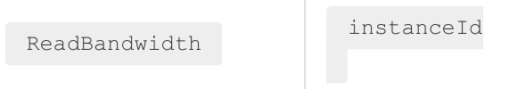

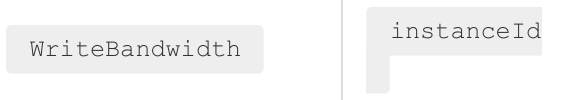

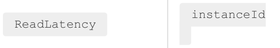

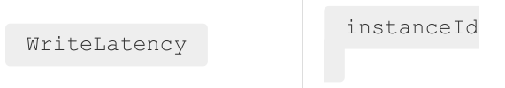

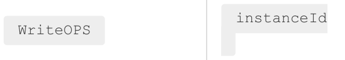

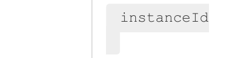

<a id="section-6-2-1-4"></a>

#### 6.2.1.4. Network

<a id="section-6-2-1-4-1"></a>

##### 6.2.1.4.1. NAT Gateway

This topic lists the monitoring metrics for NAT Gateway.

The namespace is **acs_nat_gateway**. The default period is **60** seconds, but you can set it to any integer multiple of 60.

> **Note**
>
> If you are connected to a public cloud, you can switch platforms to view its NAT Gateway monitoring metrics.

**Instance metrics**

| Metric | Unit | MetricName | Dimensions | Description |
| --- | --- | --- | --- | --- |
| Total sessions | Count | curr_num | userId, instanceId | The total number of concurrent connections. |
| Connections dropped due to capacity limit (cumulative) | Count | capacity_drop | userId, instanceId | The total number of connections dropped because the capacity limit was reached. |
| New connections dropped (cumulative) | Count | ratelimit_drop | userId, instanceId | The total number of new connections that were dropped. |
| Connections dropped per second due to capacity limit | Count/s | capacity_drop_in c | userId, instanceId | The number of connections dropped per second because the capacity limit was reached. |
| New connections dropped per second | Count/s | ratelimit_drop_in c | userId, instanceId | The rate at which new connections are dropped. |
| New connections per second | Count/s | establish_rate | userId, instanceId | The rate at which new connections are established. |

**SNAT metrics**

| Metric | Unit | MetricName | Dimensions | Description |
| --- | --- | --- | --- | --- |
| Inbound bandwidth | Bytes/s | snet_rx.rate | userId, instanceId, snatentryId | The rate of incoming traffic. |
| Outbound bandwidth | Bytes/s | snet_tx.rate | userId, instanceId, snatentryId | The rate of outgoing traffic. |

<a id="section-6-2-1-4-2"></a>

##### 6.2.1.4.2. Server Load Balancer (SLB)

This topic lists the metrics for Server Load Balancer (SLB).

The **Namespace** is **acs_slb_dashboard**. The default **Period** is **60** seconds and can be set to any integer multiple of 60.

> **Note**
>
> If you are connected to a public cloud, you can switch between platforms to view metrics for your SLB instances.

**Instance metrics**

| Metric | Unit | MetricName | Dimensions | Description |
| --- | --- | --- | --- | --- |
| Inbound bandwidth | bps | InstanceTrafficRXNew | instanceId | The inbound bandwidth of the instance. |
| Outbound bandwidth | bps | InstanceTrafficTXNew | instanceId | The outbound bandwidth of the instance. |
| Total inbound bandwidth | bps | InstanceTrafficRXNew_SUM | instanceId | The total inbound bandwidth. |
| Total outbound bandwidth | bps | InstanceTrafficTXNew_S UM | instanceId | The total outbound bandwidth. |
| New connections | Count/s | InstanceNewConnectio n | instanceId | The number of new connections established per second by the instance. |
| Inbound packets | pps | InstancePacketRX | userId, instanceId | The number of inbound packets received per second by the instance. |
| Outbound packets | pps | InstancePacketTX | userId, instanceId | The number of outbound packets sent per second by the instance. |
| Active connections | Count | InstanceActiveConnecti on | userId, instanceId | The number of active connections to the instance. |
| Inactive connections | Count | InstanceInactiveConnec tion | userId, instanceId | The number of inactive connections to the instance. |
| Concurrent connections | Count | InstanceMaxConnection | userId, instanceId | The number of concurrent connections to the instance. |
| Dropped connections | Count/s | InstanceDropConnectio n | userId, instanceId | The number of connections dropped per second by the instance. |
| Dropped inbound bandwidth | bps | InstanceDropTrafficRX | userId, instanceId | The inbound bandwidth dropped by the instance. |
| Dropped outbound bandwidth | bps | InstanceDropTrafficTX | userId, instanceId | The outbound bandwidth dropped by the instance. |
| Dropped inbound packets | pps | InstanceDropPacketRX | userId, instanceId | The number of inbound packets dropped per second by the instance. |
| Dropped outbound packets | pps | InstanceDropPacketTX | userId, instanceId | The number of outbound packets dropped per second by the instance. |
| Unhealthy backend ECS instances | Count | InstanceUnhealthyServ erCount | instanceId | The number of backend ECS instances that fail health checks. |
| Healthy backend servers | Count | InstanceHeathyServerC ount | instanceId | The number of backend servers for the instance that pass health checks. |
| Layer 7 instance QPS | QPS | InstanceSevenFloorQps | userId, instanceId | The queries per second (QPS) of the Layer 7 instance. |
| Failed connections | Count | InstanceFailConnection | userId, instanceId | The number of failed connections for the instance. |
| Layer 7 backend health check failure rate | % | InstanceSeventhFloorU nhealthyServerRate | instanceId, rip | The failure rate of Layer 7 health checks on a backend server of the instance. |
| Maximum connection utilization | % | InstanceMaxConnection Rate | instanceId | The instance's connection utilization. |
| Layer 7 QPS utilization | % | InstanceSevenFloorQps Rate | instanceId | The QPS utilization of the Layer 7 instance. |

**Port metrics**

| Metric | Unit | MetricName | Dimensions | Description |
| --- | --- | --- | --- | --- |
| Inbound bandwidth | bps | TrafficRXNew | userId, instanceId, port | The inbound bandwidth for the listener. |
| Outbound bandwidth | bps | TrafficTXNew | userId, instanceId, port | The outbound bandwidth for the listener. |
| Total inbound port bandwidth | bps | TrafficRXNew_SUM | instanceId, port | The total inbound bandwidth for the listener. |
| Total outbound port bandwidth | bps | TrafficTXNew_SUM | instanceId, port | The total outbound bandwidth for the listener. |
| New connections | Count/s | NewConnection | userId, instanceId, port | The number of new TCP connections established per second for the listener. |
| Inbound packets | pps | PacketRX | userId, instanceId, port | The number of inbound packets received per second by the listener. |
| Outbound packets | pps | PacketTX | userId, instanceId, port | The number of outbound packets sent per second by the listener. |
| Active connections | Count | ActiveConnection | userId, instanceId, port | The number of active TCP connections to the listener. |
| Inactive connections | Count | InactiveConnectio n | userId, instanceId, port | The number of inactive TCP connections to the listener. |
| Concurrent connections | Count | MaxConnection | userId, instanceId, port | The number of concurrent connections to the listener. |
| Dropped connections | Count/s | DropConnection | userId, instanceId, port | The number of connections dropped per second by the listener. |
| Dropped inbound bandwidth | bps | DropTrafficRX | userId, instanceId, port | The inbound bandwidth dropped by the listener. |
| Dropped outbound bandwidth | bps | DropTrafficTX | userId, instanceId, port | The outbound bandwidth dropped by the listener. |
| Dropped inbound packets | pps | DropPacketRX | userId, instanceId, port | The number of inbound packets dropped per second by the listener. |
| Dropped outbound packets | pps | DropPacketTX | userId, instanceId, port | The number of outbound packets dropped per second by the listener. |
| Unhealthy backend ECS instances | Count | UnhealthyServerC ount | userId, instanceId, port | The number of backend ECS instances associated with the listener that fail health checks. |
| Healthy backend ECS instances | Count | HeathyServerCoun t | instanceId, port, vip | The number of backend ECS instances that pass the health check. |
| Layer 7 QPS | QPS | SevenFloorQps | userId, instanceId, port | The queries per second (QPS) for the Layer 7 listener. |
| Failed connections | Count/s | FailConnection | userId, instanceId, port | The number of failed connections per second. |
| Layer 7 backend health check failure rate | % | SeventhFloorUnhe althyServerRate | instanceId, rip | The failure rate of Layer 7 health checks on a backend server for the listener. |

<a id="section-6-2-1-4-3"></a>

##### 6.2.1.4.3. Application Load Balancer

This topic describes the metrics for Application Load Balancer.

The value for **Namespace** is **acs_alb**. The default value for **Period** is **60** seconds, and the value must be a multiple of 60.

| Metric | Unit | Metric name | Dimensions | Description |
| --- | --- | --- | --- | --- |
| Maximum concurrent connections | short | conn_concurrent | instanceId | The maximum number of concurrent connections for a load balancer instance. |
| Failed backend TLS handshakes per second | ops | ups_tls_cps_fail | instanceId | The number of failed TLS handshakes per second between a load balancer instance and its backend servers. |
| New connections per second | ops | cps | instanceId | The number of new connections established per second to a load balancer instance. |
| Backend connection errors per second | ops | upstream_conn_error | instanceId | The number of failed connections per second from a load balancer instance to its backend servers. |
| Failed TLS handshakes per second | ops | tls_cps_fail | instanceId | The number of failed TLS handshakes per second between clients and a load balancer instance. |
| Redirections per second | ops | redirect_count | instanceId | The number of redirection actions processed per second by a load balancer instance. |
| Requests per second | ops | qps | instanceId | The number of requests processed per second by a load balancer instance. |
| Backend response time | millisec onds | upstream_rt | instanceId | The response time of a load balancer instance's backend servers. |
| Request latency | millisec onds | rt | instanceId | The request latency of a load balancer instance. |
| Outbound bandwidth | bps | bytes_out | instanceId | The outbound bandwidth of a load balancer instance. |
| Inbound bandwidth | bps | bytes_in | instanceId | The inbound bandwidth of a load balancer instance. |
| 2xx responses per second | ops | status_code_2xx | instanceId | The number of 2xx status codes generated per second by a load balancer instance. |
| 3xx responses per second | ops | status_code_3XX | instanceId | The number of 3xx status codes generated per second by a load balancer instance. |
| 4xx responses per second | ops | status_code_4XX | instanceId | The number of 4xx status codes generated per second by a load balancer instance. |
| 500 responses per second | ops | 500_count | instanceId | The number of 500 status codes generated per second by a load balancer instance. |
| 502 responses per second | ops | 502_count | instanceId | The number of 502 status codes generated per second by a load balancer instance. |
| 503 responses per second | ops | 503_count | instanceId | The number of 503 status codes generated per second by a load balancer instance. |
| 504 responses per second | ops | 504_count | instanceId | The number of 504 status codes generated per second by a load balancer instance. |

<table>
  <tr>
    <td>5xx responses per second</td>
    <td>ops</td>
    <td>status_code_5xx</td>
    <td>instanceId</td>
    <td>The number of 5xx status codes generated per second by a load balancer instance.</td>
  </tr>
  <tr>
    <td>Backend 2xx responses per second</td>
    <td>ops</td>
    <td>upstream_code_2xx</td>
    <td>instanceId</td>
    <td>The number of 2xx status codes returned per second by a load balancer instance's backend servers.</td>
  </tr>
  <tr>
    <td>Backend 3xx responses per second</td>
    <td>ops</td>
    <td>upstream_code_3XX</td>
    <td>instanceId</td>
    <td>The number of 3xx status codes returned per second by a load balancer instance's backend servers.</td>
  </tr>
  <tr>
    <td>Backend 4xx responses per second</td>
    <td>ops</td>
    <td>upstream_code_4XX</td>
    <td>instanceId</td>
    <td>The number of 4xx status codes returned per second by a load balancer instance's backend servers.</td>
  </tr>
  <tr>
    <td>Backend 5xx responses per second</td>
    <td>ops</td>
    <td>upstream_code_5XX</td>
    <td>instanceId</td>
    <td>The number of 5xx status codes returned per second by a load balancer instance's backend servers.</td>
  </tr>
  <tr>
    <td>Healthy server count</td>
    <td>short</td>
    <td>statusup</td>
    <td>instanceId</td>
    <td>The number of healthy servers registered with a load balancer instance.</td>
  </tr>
  <tr>
    <td>Unhealthy server count</td>
    <td>short</td>
    <td>statusdown</td>
    <td>instanceId</td>
    <td>The number of unhealthy servers registered with a load balancer instance.</td>
  </tr>
</table>

<a id="section-6-2-1-4-4"></a>

##### 6.2.1.4.4. Elastic IP Address

This topic lists the metrics for Elastic IP Address.

The **namespace** is **acs_vpc_eip**. The default **period** is **60** seconds and can be any integer multiple of 60.

> **Note**
>
> If you use a public cloud, switch to the correct cloud platform to view its Elastic IP Address metrics.

| Metric name | Unit | Metric ID | Dimensions | Description |
| --- | --- | --- | --- | --- |
| inbound bandwidth | bps | net_rx.rate | userId, instanceId | The rate of inbound network traffic. |
| outbound bandwidth | bps | net_tx.rate | userId, instanceId | The rate of outbound network traffic. |
| inbound packet rate | pps | net_rxPkgs.rate | userId, instanceId | The rate of inbound network packets. |
| outbound packet rate | pps | net_txPkgs.rate | userId, instanceId | The rate of outbound network packets. |
| outbound rate-limit packet drop rate | pps | out_ratelimit_drop_speed | userId, instanceId | The rate of outbound packets dropped due to rate limiting. |
| inbound rate-limit packet drop rate | pps | in_ratelimit_drop_s peed | userId, instanceId | The rate of inbound packets dropped due to rate limiting. |
| inbound bandwidth usage | percent | net_rx.rate_usage | instanceId | The percentage of available inbound bandwidth in use. |
| outbound bandwidth usage | percent | net_tx.rate_usage | instanceId | The percentage of available outbound bandwidth in use. |

<a id="section-6-2-1-4-5"></a>

##### 6.2.1.4.5. VPN Gateway

This article describes the monitoring metrics for VPN Gateway.

The **namespace** is **acs_vpn**. The default **Period** is **60** seconds and can be set to any integer multiple of 60.

| Metric | Unit | Metric name | Dimensions | Description |
| --- | --- | --- | --- | --- |
| inbound packet rate | pps | ipsec.rxPkgs | userId, instanceId, ipsecId | The number of inbound packets per second. |
| outbound packet rate | pps | ipsec.txPkgs | userId, instanceId, ipsecId | The number of outbound packets per second. |
| inbound bandwidth | bps | ipsec_rx.rate | userId, instanceId, ipsecId | Inbound traffic in bits per second. |
| outbound bandwidth | bps | ipsec_tx.rate | userId, instanceId, ipsecId | Outbound traffic in bits per second. |
| number of connections | short | ssl_client.count | userId, instanceId | The number of active SSL-VPN connections. |

<a id="section-6-2-1-4-6"></a>

##### 6.2.1.4.6. Alibaba Cloud DNS - Private zones

This article describes the monitoring metrics for private zones in Alibaba Cloud DNS.

The **namespace** is **acs_dns_dashboard**. The **period** is **60** seconds by default and can be any integer multiple of 60.

| Metric | Unit | MetricName | Dimensions | Description |
| --- | --- | --- | --- | --- |
| Latency | milliseco nds | Latency | instanceId | The parsing latency. |
| Successful parsing count | count | ParsingSucceeded | instanceId | The number of successful parsing requests. |
| Total parsing count | count | ParsingTotal | instanceId | The total number of parsing requests. |
| Client IP count | count | client_count | instanceId,client | The number of unique client IPs. |
| Parsing success rate | percent | ParsingSucceededRa te | instanceId | The success rate of parsing requests. |
| Latency (qname) | milliseco nds | LatencybyQname | instanceId,qname | The parsing latency for a specific domain name (qname). |
| Successful parsing count (qname) | count | ParsingSucceededby Qname | instanceId,qname | The number of successful parsing requests for a specific domain name (qname). |
| Total parsing count (qname) | count | ParsingTotalbyQnam e | instanceId,qname | The total number of parsing requests for a specific domain name (qname). |

<a id="section-6-2-1-4-7"></a>

##### 6.2.1.4.7. Alibaba Cloud DNS: Tenant forwarded domain name

This topic describes the metrics for tenant forwarded domain names in Alibaba Cloud DNS.

The **Namespace** is **acs_dns_dashboard**. The **Period** defaults to **60** seconds and can be any integer multiple of 60.

| Metric | Unit | MetricName | Dimensions | Description |
| --- | --- | --- | --- | --- |
| client IP count | Count | client_count | instanceId,client | The number of client IPs. |
| domain name resolution success rate | Percent | ParsingSucceededRa te | instanceId | The percentage of successful domain name resolutions. |
| response time (qname) | Milliseco nds | LatencybyQname | instanceId,qname | The response time for a query, aggregated by domain name (qname). |
| response time | Milliseco nds | Latency | instanceId | The response time for a resolution. |
| successful resolution count | Count | ParsingSucceeded | instanceId | The number of successful resolutions. |
| successful resolution count (qname) | Count | ParsingSucceededby Qname | instanceId,qname | The number of successful resolutions, aggregated by domain name (qname). |
| total resolution count | Count | ParsingTotal | instanceId | The total number of resolutions. |
| total resolution count (qname) | Count | ParsingTotalbyQnam e | instanceId,qname | The total number of resolutions, aggregated by domain name (qname). |

<a id="section-6-2-1-4-8"></a>

##### 6.2.1.4.8. Cloud Enterprise Network

This topic lists the monitoring metrics for Cloud Enterprise Network.

The **Namespace** is **acs_cbn**. The default **Period** is **60** seconds and can be any integer multiple of 60.

| Metric | Unit | MetricName | Dimensions | Description |
| --- | --- | --- | --- | --- |
| Transit Router inbound traffic rate | bps | TransitRouterInRate | instanceId,trInstan ceId,vpcId | This metric is the sum of the inbound traffic rates from all hosts within the VPC. |
| Transit Router outbound traffic rate | bps | TransitRouterOutRat e | instanceId,trInstan ceId,vpcId | This metric is the sum of the outbound traffic rates to all hosts within the VPC. |
| Transit Router inbound packet rate | pps | TransitRouterInPack etsRate | instanceId,trInstan ceId,vpcId | This metric is the sum of the inbound packet rates from all hosts within the VPC. |
| Transit Router outbound packet rate | pps | TransitRouterOutPac ketsRate | instanceId,trInstan ceId,vpcId | This metric is the sum of the outbound packet rates to all hosts within the VPC. |
| Transit Router packet loss rate | pps | TransitRouterPacket LossRate | instanceId,trInstan ceId,vpcId | The average packet loss rate on the VPC connection. |

<a id="section-6-2-1-5"></a>

#### 6.2.1.5. Middleware services

<a id="section-6-2-1-5-1"></a>

##### 6.2.1.5.1. ApsaraMQ for RocketMQ

This article describes the metrics for ApsaraMQ for RocketMQ.

The value of **Namespace** is **acs_rocketmq_dashboard**. The default value of **Period** is **60** seconds and can also be an integer multiple of 60.

**Instance dimension**

| Metric | Unit | MetricName | Dimensions | Description |
| --- | --- | --- | --- | --- |
| Message retention period | hours | MessageRetentio nPeriod | userId,instanceId | The duration for which messages are retained. |
| Messages received per minute (instance) | ops | ReceiveMessage CountPerInstance | userId,instanceId | The number of messages consumers receive per minute. |
| Messages sent per minute (instance) | ops | SendMessageCou ntPerInstance | userId,instanceId | The number of messages producers send per minute. |
| Consumer receive TPS (instance) | ops | ReceiveMessage TPSPerInstance | userId,instanceId | The rate, in transactions per second (TPS), at which consumers on the instance receive messages. |
| Producer send TPS (instance) | ops | SendMessageTPS PerInstance | userId,instanceId | The rate, in transactions per second (TPS), at which producers on the instance send messages. |

**Group ID dimension**

| Metric | Unit | MetricName | Dimensions | Description |
| --- | --- | --- | --- | --- |
| Consumer lag (group) | Count | ConsumerLag | userId,instanceId,groupId | The number of backlogged messages for the consumer group. |
| Consumer lag (by consumer IP) | Count | ConsumerLagPer GidTopic | instanceId,groupI d,topic,consumer Ip | The number of backlogged messages for a specific consumer IP address in the group. |
| Messages received per minute (group) | ops | ReceiveMessage CountPerGid | userId,instanceId,groupId | The number of messages consumers in the group receive per minute. |
| Dead-letter messages per minute (group) | ops | SendDLQMessag eCountPerGid | userId,instanceId,groupId | The number of dead-letter messages generated per minute for the consumer group. |
| Dead-letter messages per minute (by consumer IP) | ops | SendDLQMessag eCountPerGidByC onsumerIp | instanceId,groupI d,consumerIp | • The number of dead-letter messages generated per minute, attributed to a specific consumer IP address in the group.<br>• Hover over the metric's line chart to view the consumer IP address. |
| Messages sent per minute (group) | ops | SendMessageCou ntPerGid | userId,instanceId,groupId | The number of messages producers send per minute. |
| Consumer receive TPS (group) | ops | ReceiveMessage TPSPerGid | userId,instanceId,groupId | The rate, in transactions per second (TPS), at which consumers in the group receive messages. |
| Producer send TPS (group) | ops | SendMessageTPS PerGid | userId,instanceId,groupId | The rate, in transactions per second (TPS), at which producers send messages. |

**Topic dimension**

| Metric | Unit | MetricName | Dimensions | Description |
| --- | --- | --- | --- | --- |
| Messages received per minute (topic) | ops | ReceiveMessage CountPerTopic | userId,instanceId,topic | The number of messages consumers receive from the topic per minute. |
| Messages sent per minute (topic) | ops | SendMessageCou ntPerTopic | userId,instanceId,topic | The number of messages producers send to the topic per minute. |
| Consumer receive TPS (topic) | ops | ReceiveMessage TPSPerTopic | userId,instanceId,topic | The rate, in transactions per second (TPS), at which consumers receive messages from the topic. |
| Producer send TPS (topic) | ops | SendMessageTPS PerTopic | userId,instanceId,topic | The rate, in transactions per second (TPS), at which producers send messages to the topic. |

**Topic and group dimension**

| Metric | Unit | MetricName | Dimensions | Description |
| --- | --- | --- | --- | --- |
| Consumer lag (group &amp; topic) | Count | ConsumerLagPer GidTopic | userId,instanceId,groupId,topic | The number of backlogged messages in the topic for the consumer group. |
| Consumer lag (by group, topic, and consumer IP) | Count | ConsumerLagPer GidTopicByConsu merIp | instanceId,groupI d,topic,consumer Ip | The number of backlogged messages in the topic for a specific consumer IP address in the group. |
| Messages received per minute (group &amp; topic) | ops | ReceiveMessage CountPerGidTopi c | userId,instanceId,groupId,topic | The number of messages consumers in the group receive from the topic per minute. |
| Dead-letter messages per minute (group &amp; topic) | ops | SendDLQMessag eCountPerGidTop ic | userId,instanceId,groupId,topic | The number of dead-letter messages generated per minute from the topic for the consumer group. |
| Dead-letter messages per minute (by consumer IP) | ops | SendDLQMessag eCountPerGidTop icByConsumerIp | instanceId,groupI d,topic,consumer Ip | The number of dead-letter messages generated per minute from the topic, attributed to a specific consumer IP address in the group. |
| Messages sent per minute (group &amp; topic) | ops | SendMessageCou ntPerGidTopic | userId,instanceId,groupId,topic | The number of messages producers send to the topic per minute. |

<a id="section-6-2-1-5-2"></a>

##### 6.2.1.5.2. Message Queue (MQ)

This topic describes the monitoring metrics for Message Queue (MQ).

The **Namespace** is  `acs_mqtiangong_dashboard` . The default **Period** is **60** seconds and must be a multiple of 60.

| Metric | Unit | Metric name | Dimensions | Description |
| --- | --- | --- | --- | --- |
| Consumer group instances | count | rocketmq_group_co unt | instanceId | The number of consumer group instances. |
| Producer instances | count | rocketmq_producer _count | instanceId | The number of producer instances. |
| Producer TPS | message s/s | rocketmq_producer _tps | instanceId | The number of messages produced per second. |
| Messages produced | count | rocketmq_producer _message_size | instanceId | The number of messages produced. |
| Consumer TPS | message s/s | rocketmq_consume r_tps | instanceId | The number of messages consumed per second. |
| Consumer group TPS | message s/s | rocketmq_group_co nsume_tps | instanceId | The number of messages consumed by a consumer group per second. |

<a id="section-6-2-1-5-3"></a>

##### 6.2.1.5.3. ApsaraMQ for Kafka

This topic describes the metrics for ApsaraMQ for Kafka.

The value of **namespace** is **acs_kafka**. The default **period** is **60** seconds, and the value must be a multiple of 60.

**Broker**

| Metric | Unit | MetricName | Dimensions | Description |
| --- | --- | --- | --- | --- |
| Broker inbound traffic | bytes | instance_kafka_server_br okertopicmetrics_bytesin _total | userId, instanceId | The inbound message traffic to the broker. |
| Broker outbound traffic | bytes | instance_kafka_server_br okertopicmetrics_bytesou t_total | userId, instanceId | The outbound message traffic from the broker. |
| Broker produce request rate | Count | instance_kafka_server_br okertopicmetrics_totalpro ducerequests_total | userId, instanceId | The rate of produce requests received by the broker. |
| Messages produced | Count | instance_kafka_server_br okertopicmetrics_messag esin_total | userId, instanceId | The total number of messages produced to the broker. |
| Broker fetch request rate | Count | instance_kafka_server_br okertopicmetrics_totalfet chrequests_total | userId, instanceId | The rate of fetch requests received by the broker. |
| Abnormal HA partitions | Count | instance_abnormal_ha_p artitioncount | instanceId | The number of partitions in an abnormal high-availability (HA) state. |
| Normal HA partitions | Count | instance_normal_ha_parti tioncount | instanceId | The number of partitions in a normal high-availability (HA) state. |
| Instance disk usage | bytes | instance_disk_usage_size | instanceId | The disk space used by the instance. |
| Broker connection count | Count | instance_kafka_socket_se rver_connection_count | instanceId, pod | The number of connections to the broker. |

**Topic**

| Metric | Unit | MetricName | Dimensions | Description |
| --- | --- | --- | --- | --- |
| Topic inbound traffic | bytes | topic_kafka_server_broke rtopicmetrics_bytesin_tot al | userId, instanceId | The inbound message traffic to the topic. |
| Topic outbound traffic | bytes | topic_kafka_server_broke rtopicmetrics_bytesout_t otal | userId, instanceId | The outbound message traffic from the topic. |
| Topic produce request rate | Count | topic_kafka_server_broke rtopicmetrics_totalproduc erequests_total | userId, instanceId | The rate of produce requests for the topic. |
| Topic fetch request rate | Count | topic_kafka_server_broke rtopicmetrics_totalfetchre quests_total | userId, instanceId | The rate of fetch requests for the topic. |
| Messages produced | Count | topic_kafka_server_broke rtopicmetrics_messagesi n_total | userId, instanceId | The total number of messages produced to the topic. |

**Group**

| Metric | Unit | MetricName | Dimensions | Description |
| --- | --- | --- | --- | --- |
| Consumer lag | Count | group_kafka_hk_consume r_group_lag | userId, instanceId | The number of unconsumed messages in the consumer group. |

<a id="section-6-2-1-5-4"></a>

##### 6.2.1.5.4. API Gateway

This topic describes the monitoring metrics for API Gateway.

The **Namespace** is **acs_cop**. The default **Period** is **60** seconds, and the value must be a multiple of 60.

| Metric | Unit | Metric name | Dimensions | Description |
| --- | --- | --- | --- | --- |
| TCP sent bytes | Bps | envoy_http_downstream_cx_tx_bytes_total | instanceId | The number of TCP bytes sent per second. |
| TCP received bytes | Bps | envoy_http_downstream_cx_rx_bytes_total | instanceId | The number of TCP bytes received per second. |
| upstream QPS | reqps | envoy_cluster_upstream_r q_by_code | instanceId,res ponse_code_cl ass | Upstream queries per second. |
| downstream QPS | reqps | envoy_http_downstream_r q_by_code | instanceId,res ponse_code_cl ass | Downstream queries per second. |
| upstream request count | Count | envoy_cluster_upstream_r q_total | instanceId | Total number of upstream requests. |
| downstream request count | Count | envoy_http_downstream_r q_total | instanceId | Total number of downstream requests. |
| Average upstream request response time | millisecon ds | envoy_cluster_upstream_r q_time_average | instanceId | Average response time for upstream requests. |
| Average downstream request response time | millisecon ds | envoy_http_downstream_r q_time_average | instanceId | Average response time for downstream requests. |
| 99th percentile of upstream request response time | millisecon ds | envoy_cluster_upstream_r q_time_ninety_nine_perce ntile | instanceId,le | 99th percentile of response time for upstream requests. |
| 90th percentile of upstream request response time | millisecon ds | envoy_cluster_upstream_r q_time_ninety_percentile | instanceId,le | 90th percentile of response time for upstream requests. |
| 50th percentile of upstream request response time | millisecon ds | envoy_cluster_upstream_r q_time_median | instanceId,le | 50th percentile (median) of response time for upstream requests. |
| downstream success rate | percent | envoy_http_downstream_r q_success_rate | instanceId | Success rate of downstream requests. |
| 99th percentile of downstream request response time | millisecon ds | envoy_http_downstream_r q_time_ninety_nine_perce ntile | instanceId,le | 99th percentile of response time for downstream requests. |
| 90th percentile of downstream request response time | millisecon ds | envoy_http_downstream_r q_time_ninety_percentile | instanceId,le | 90th percentile of response time for downstream requests. |
| 50th percentile of downstream request response time | millisecon ds | envoy_http_downstream_r q_time_median | instanceId,le | 50th percentile (median) of response time for downstream requests. |
| upstream success rate | percent | envoy_cluster_upstream_r q_success_rate | instanceId | Success rate of upstream requests. |

<a id="section-6-2-1-5-5"></a>

##### 6.2.1.5.5. Enterprise Distributed Application Service (EDAS) (dedicated registry)

This article describes the monitoring metrics for Enterprise Distributed Application Service (EDAS).

The **namespace** is **acs_edas**. The default **period** is **60** seconds and can be any integer multiple of 60.

**Basic monitoring**

| Metric | Unit | Metric name | Dimensions | Description |
| --- | --- | --- | --- | --- |
| Runnable thread count | count | jvm_threads_states_thread s_runnable_pql | userId,instance Id,pod | The count of runnable threads. |
| Waiting thread count | count | jvm_threads_states_thread s_waiting_pql | userId,instance Id,pod | The count of waiting threads. |
| Blocked thread count | count | jvm_threads_states_thread s_blocked_pql | userId,instance Id,pod | The count of blocked threads. |
| Percentage of active old-generation memory after GC | % | jvm_old_gen_live_percen_p ql | userId,instance Id,pod | The percentage of active memory in the old generation after a major garbage collection. |
| CPU load | % | system_load_average_1m_pql | userId,instance Id,pod | The 1-minute average system load. |
| CPU usage | % | system_cpu_usage_total_p ql | userId,instance Id,pod | The percentage of CPU utilization. |
| Ratio of GC pause duration to observation interval | % | gc_pause_ratio_pql | userId,instance Id,pod | The percentage of the observation interval spent on garbage collection (GC) pauses. |
| Percentage of busy Tomcat threads | % | tomcat_threads_busy_thre ads_pql | userId,instance Id,pod | The percentage of busy Tomcat threads. |
| HTTP client count | count | nacos_monitor_client_http _pql | userId,instance Id,pod | The count of HTTP clients. |
| CS client count | count | nacos_monitor_client_cs_p ql | userId,instance Id,pod | The count of CS clients. |
| gRPC client count | count | nacos_monitor_client_grpc _pql | userId,instance Id,pod | The count of gRPC clients. |
| Nacos service count across instances | count | nacos_monitor_service_na cos_pql | userId,instance Id,pod | The count of Nacos services across instances. |
| Minimum Nacos service count across instances | count | nacos_monitor_service_mi n_nacos_pql | userId,instance Id,pod | The minimum count of Nacos services across instances. |
| Minimum CS service count across instances | count | nacos_monitor_service_mi n_cs_pql | userId,instance Id,pod | The minimum count of CS services across instances. |
| Maximum CS service count across instances | count | nacos_monitor_service_ma x_cs_pql | userId,instance Id,pod | The maximum count of CS services across instances. |
| CS service count across instances | count | nacos_monitor_service_cs_pql | userId,instance Id,pod | The count of CS services across instances. |
| Error rate of config subscribe API calls (HTTP) | % | nacos_monitor_op_second s_count_config_listen_http _pql | userId,instance Id,pod | The error rate of configuration subscribe API calls over HTTP. |
| Error rate of config subscribe API calls (gRPC) | % | nacos_monitor_op_second s_count_config_listen_grpc _pql | userId,instance Id,pod | The error rate of configuration subscribe API calls over gRPC. |
| Error rate of config remove API calls (HTTP) | % | nacos_monitor_op_second s_count_config_remove_ht tp_pql | userId,instance Id,pod | The error rate of configuration remove API calls over HTTP. |
| Error rate of config remove API calls (gRPC) | % | nacos_monitor_op_second s_count_config_remove_gr pc_pql | userId,instance Id,pod | The error rate of configuration remove API calls over gRPC. |
| Error rate of config publish API calls (HTTP) | % | nacos_monitor_op_second s_count_config_publish_htt p_pql | userId,instance Id,pod | The error rate of configuration publish API calls over HTTP. |
| Error rate of config publish API calls (gRPC) | % | nacos_monitor_op_second s_count_config_publish_gr pc_pql | userId,instance Id,pod | The error rate of configuration publish API calls over gRPC. |
| Error rate of config get API calls (HTTP) | % | nacos_monitor_op_second s_count_config_get_http_p ql | userId,instance Id,pod | The error rate of configuration get API calls over HTTP. |
| Error rate of config get API calls (gRPC) | % | nacos_monitor_op_second s_count_config_get_grpc_p ql | userId,instance Id,pod | The error rate of configuration get API calls over gRPC. |
| 95th percentile latency of config API calls | ms | nacos_monitor_op_second s_config_quantile95_pql | userId,instance Id,pod | The 95th percentile latency of config API calls. |
| 95th percentile latency of naming API calls | ms | nacos_monitor_op_second s_naming_quantile95_pql | userId,instance Id,pod | The 95th percentile latency of naming API calls. |
| Error rate of naming heartbeat API calls (HTTP) | % | nacos_monitor_op_second s_count_naming_beat_http _pql | userId,instance Id,pod | The error rate of naming heartbeat API calls over HTTP. |
| Error rate of naming heartbeat API calls (gRPC) | % | nacos_monitor_op_second s_count_naming_beat_grpc _pql | userId,instance Id,pod | The error rate of naming heartbeat API calls over gRPC. |
| Error rate of naming heartbeat API calls (CS) | % | nacos_monitor_op_second s_count_naming_beat_cs_p ql | userId,instance Id,pod | The error rate of naming heartbeat API calls over CS. |
| Error rate of naming data synchronization API calls (CS) | % | nacos_monitor_op_second s_count_naming_sync_cs_p ql | userId,instance Id,pod | The error rate of naming data synchronization API calls over CS. |
| Error rate of naming data synchronization API calls (gRPC) | % | nacos_monitor_op_second s_count_naming_sync_grp c_pql | userId,instance Id,pod | The error rate of naming data synchronization API calls over gRPC. |
| Error rate of naming push API calls (CS) | % | nacos_monitor_op_second s_count_naming_push_cs_pql | userId,instance Id,pod | The error rate of naming push API calls over CS. |
| Error rate of naming push API calls (gRPC) | % | nacos_monitor_op_second s_count_naming_push_grp c_pql | userId,instance Id,pod | The error rate of naming push API calls over gRPC. |
| Error rate of naming register API calls (HTTP) | % | nacos_monitor_op_second s_count_naming_register_http_pql | userId,instance Id,pod | The error rate of naming register API calls over HTTP. |
| Error rate of naming register API calls (gRPC) | % | nacos_monitor_op_second s_count_naming_register_grpc_pql | userId,instance Id,pod | The error rate of naming register API calls over gRPC. |
| Error rate of naming register API calls (CS) | % | nacos_monitor_op_second s_count_naming_register_c s_pql | userId,instance Id,pod | The error rate of naming register API calls over CS. |
| Error rate of naming deregister API calls (HTTP) | % | nacos_monitor_op_second s_count_naming_deregiste r_http_pql | userId,instance Id,pod | The error rate of naming deregister API calls over HTTP. |
| Error rate of naming deregister API calls (gRPC) | % | nacos_monitor_op_second s_count_naming_deregiste r_grpc_pql | userId,instance Id,pod | The error rate of naming deregister API calls over gRPC. |
| Error rate of naming deregister API calls (CS) | % | nacos_monitor_op_second s_count_naming_deregiste r_cs_pql | userId,instance Id,pod | The error rate of naming deregister API calls over CS. |
| Error rate of naming subscribe API calls (HTTP) | % | nacos_monitor_op_second s_count_naming_listen_htt p_pql | userId,instance Id,pod | The error rate of naming subscribe API calls over HTTP. |
| Error rate of naming subscribe API calls (gRPC) | % | nacos_monitor_op_second s_count_naming_listen_grp c_pql | userId,instance Id,pod | The error rate of naming subscribe API calls over gRPC. |
| Error rate of naming subscribe API calls (CS) | % | nacos_monitor_op_second s_count_naming_listen_cs_pql | userId,instance Id,pod | The error rate of naming subscribe API calls over CS. |

**Advanced monitoring**

| Metric | Unit | Metric name | Dimensions | Description |
| --- | --- | --- | --- | --- |
| QPS of key naming API calls (CS) | QPS | nacos_monitor_op_seconds _count_qps_naming_cs_pql | userId,instance Id | The queries per second (QPS) of key naming API calls over CS. |
| QPS of key naming API calls (gRPC) | QPS | nacos_monitor_op_seconds _count_qps_naming_grpc_pql | userId,instance Id | The QPS of key naming API calls over gRPC. |
| QPS of key naming API calls (HTTP) | QPS | nacos_monitor_op_seconds _count_qps_naming_http_p ql | userId,instance Id | The QPS of key naming API calls over HTTP. |
| QPS of key config API calls (gRPC) | QPS | nacos_monitor_op_seconds _count_qps_config_grpc_pq l | userId,instance Id | The QPS of key config API calls over gRPC. |
| QPS of key config API calls (HTTP) | QPS | nacos_monitor_op_seconds _count_qps_config_http_pq l | userId,instance Id | The QPS of key config API calls over HTTP. |

<a id="section-6-2-1-6"></a>

#### 6.2.1.6. Big data

<a id="section-6-2-1-6-1"></a>

##### 6.2.1.6.1. DataHub

This topic lists the monitoring metrics for DataHub.

The **namespace** is **acs_datahub**. The **period** defaults to **60** seconds and can be set to any integer multiple of 60.

| Metric | Unit | Metric name | Dimensions | Description |
| --- | --- | --- | --- | --- |
| Subscription latency | seconds | subscribe_delay | userId, regionId, project, topic, subId | The delay (in seconds) between a subscribed record's timestamp and the current system time. |
| Consumption latency | seconds | consume_delay | userId, regionId, project, topic, subId | The delay (in seconds) between the latest available record's timestamp and the currently consumed record's timestamp. |
| Message backlog | seconds | record_stacked | userId, regionId, project, topic, subId | The age (in seconds) of the oldest unconsumed record in a subscription. |

<a id="section-6-2-1-6-2"></a>

##### 6.2.1.6.2. Alibaba Cloud Elasticsearch

<a id="section-6-2-1-6-3"></a>

##### 6.2.1.6.3. MaxCompute

This topic describes the monitoring metrics for MaxCompute.

The **Namespace** is **acs_maxcompute**. The default **Period** is **60** seconds and can be any multiple of 60.

| Metric | Unit | Metric name | Dimensions | Description |
| --- | --- | --- | --- | --- |
| Number of project files | count | project_used_file_nu mber | userId,instanceId | The number of files used by the project. |
| Project space usage | percent | project_used_rate | userId,instanceId | The space usage rate of the project. |
| Maximum project space | bytes | project_max_size | userId,instanceId | The maximum space allocated to the project. |
| Used project space | bytes | project_used_size | userId,instanceId | The space used by the project. |

<a id="section-6-2-1-6-4"></a>

##### 6.2.1.6.4. MaxCompute (quota groups)

This topic lists the metrics for MaxCompute quota groups.

The **Namespace** is **acs_maxcompute**. The **Period** is **60** seconds by default but can be any integer multiple of 60.

| Metric | Unit | MetricName | Dimensions | Description |
| --- | --- | --- | --- | --- |
| Maximum CPU cores of a quota group | short | quota_max_cpu | userId,instanceId | The maximum number of CPU cores that the quota group can use. |
| Guaranteed CPU cores of a quota group | short | quota_min_cpu | userId,instanceId | The minimum number of CPU cores reserved for the quota group. |
| Used CPU cores of a quota group | short | quota_used_cpu | userId,instanceId | The number of CPU cores that the quota group currently uses. |
| Maximum memory size of a quota group | gbytes | quota_max_memory | userId,instanceId | The maximum amount of memory available to the quota group. |
| Guaranteed memory size of a quota group | gbytes | quota_min_memory | userId,instanceId | The minimum amount of memory reserved for the quota group. |
| Used memory size of a quota group | gbytes | quota_used_memor y | userId,instanceId | The amount of memory that the quota group currently uses. |
| CPU utilization of a quota group | percent | quota_used_cpu_rat e | userId,instanceId | The percentage of CPU resources used by the quota group. |
| Memory utilization of a quota group | percent | quota_used_memor y_rate | userId,instanceId | The percentage of memory used by the quota group. |

<a id="section-6-2-1-7"></a>

#### 6.2.1.7. Security (Apsara Stack Security)

<a id="section-6-2-1-7-1"></a>

##### 6.2.1.7.1. Bastion Host

This document describes the monitoring metrics for Bastion Host.

The default value of **Namespace** is **acs_bastionhost**. The default value for **Period** is **60** seconds; any integer multiple of 60 is also supported.

**System monitoring**

| Metric | Unit | MetricName | Dimensions | Description |
| --- | --- | --- | --- | --- |
| (ECS) CPU utilization | percent | CPUUtilization | userId, instanceId | The CPU utilization of the ECS instance. |
| CPU system utilization | percent | CPUSysUtilization | userId, instanceId | The percentage of CPU time spent in system (kernel) mode. |
| CPU user utilization | percent | CPUUserUtilization | userId, instanceId | The percentage of CPU time spent in user mode. |
| (ECS) memory utilization | percent | MemoryUtilization | userId, instanceId | The memory utilization of the ECS instance. |
| (ECS) system load Load1 | Count | SystemLoad1 | userId, instanceId | The average system load over the last 1 minute on the ECS instance. |
| (ECS) system load Load5 | Count | SystemLoad5 | userId, instanceId | The average system load over the last 5 minutes on the ECS instance. |
| (ECS) system load Load15 | Count | SystemLoad15 | userId, instanceId | The average system load over the last 15 minutes on the ECS instance. |
| (ECS) Root directory disk utilization | percent | RootDiskUtilization | userId, instanceId | The disk utilization of the root directory on the ECS instance. |
| (ECS) Docker directory disk utilization | percent | DockerDiskUtilizatio n | userId, instanceId | The disk utilization of the Docker directory on the ECS instance. |
| (ECS) Free disk space in root directory | GB | DfRootBfree | userId, instanceId | The free disk space in the root directory of the ECS instance. |
| (ECS) Used disk space in root directory | GB | DfRootUsed | userId, instanceId | The used disk space in the root directory of the ECS instance. |
| (ECS) Total disk space in root directory | GB | DfRootBtotl | userId, instanceId | The total disk space of the root directory on the ECS instance. |
| (ECS) Free disk space in Docker directory | GB | DfDockerBfree | userId, instanceId | The free disk space in the Docker directory of the ECS instance. |
| (ECS) Used disk space in Docker directory | GB | DfDockerUsed | userId, instanceId | The used disk space in the Docker directory of the ECS instance. |
| (ECS) Total disk space in Docker directory | GB | DfDockerBtotl | userId, instanceId | The total disk space of the Docker directory on the ECS instance. |
| (ECS) Root directory inode utilization | percent | RootInodeUtilization | userId, instanceId | The inode utilization of the root directory on the ECS instance. |
| (ECS) Docker directory inode utilization | percent | DockerInodeUtilizati on | userId, instanceId | The inode utilization of the Docker directory on the ECS instance. |
| (ECS) inbound network traffic | Bps | TrafficBytin | userId, instanceId | The inbound network traffic of the ECS instance. |
| (ECS) outbound network traffic | Bps | TrafficBytout | userId, instanceId | The outbound network traffic of the ECS instance. |
| (ECS) TCP connections | Count | TcpConnections | userId, instanceId | The number of TCP connections on the ECS instance. |
| (ECS) Number of processes | Count | ProcessNumber | userId, instanceId | The number of processes on the ECS instance. |
| (ECS) NTP service offset | millisec onds | NtpOffset | userId, instanceId | The time offset of the NTP service on the ECS instance. |
| (ECS) Docker service status | State | DockerService | userId, instanceId | The value can be 0 or 1.<br>• 0: The Docker service is unhealthy.<br>• 1: The Docker service is healthy. |

**Service monitoring**

| Metric | Unit | MetricName | Dimensions | Description |
| --- | --- | --- | --- | --- |
| Number of real-time sessions | Count | CountSession | instanceId | The current number of active real-time sessions. |
| Number of users | Count | CountUser | instanceId | The number of users on the Bastion Host instance. |
| Number of managed hosts | Count | CountHost | instanceId | The number of hosts that the Bastion Host instance manages. |
| Managed host quota | Count | CountHostQuota | instanceId | The maximum number of hosts that the Bastion Host instance can manage. |
| Number of access policies | Count | CountVisitPolicy | instanceId | The number of access policies on the Bastion Host instance. |
| Number of command policies | Count | CountCommandPolic y | instanceId | The number of command policies on the Bastion Host instance. |
| Number of work order policies | Count | CountWorkorderPolic y | instanceId | The number of work order policies on the Bastion Host instance. |
| Number of unhandled alerts for the day | Count | CountWarningDayUn | instanceId | The number of unhandled alerts generated for the day. |
| Total number of alerts for the day | Count | CountWarningDay | instanceId | The total number of alerts generated for the day. |
| Network interface bandwidth (received) | Bps | NICBindWidthRx | instanceId | The inbound bandwidth of the network interface. |
| Network interface bandwidth (sent) | Bps | NICBindWidthTx | instanceId | The outbound bandwidth of the network interface. |
| Number of normal app servers | Count | CountAppServerRun | instanceId | The number of healthy app servers. |
| Number of abnormal app servers | Count | CountAppServerFault | instanceId | The number of unhealthy app servers. |

**Health check**

| Metric | Unit | MetricName | Dimensions | Description |
| --- | --- | --- | --- | --- |
| Service health check | State | ServiceHealthCheck | userId, instanceId | The value can be 0 or 1.<br>• 0: The service is unhealthy.<br>• 1: The service is healthy. |

<a id="section-6-2-1-7-2"></a>

##### 6.2.1.7.2. Static data masking and watermarking

This topic describes the monitoring metrics for static data masking and watermarking.

<a id="section-6-2-1-7-3"></a>

##### 6.2.1.7.3. Vulnerability scan engine

This topic describes the monitoring metrics for the vulnerability scan engine.

The **Namespace** is **acs_scanner**. The default **Period** is **60** seconds and can be any integer multiple of 60.

**System monitoring**

| Metric | Unit | MetricName | Dimensions | Description |
| --- | --- | --- | --- | --- |
| (ECS) CPU utilization | percent | CPUUtilization | userId, instanceId | The percentage of CPU resources used by the instance. |
| CPU system utilization | percent | CPUSysUtilization | userId, instanceId | The percentage of CPU time spent in system (kernel) mode. |
| CPU user utilization | percent | CPUUserUtilization | userId, instanceId | The percentage of CPU time spent in user mode. |
| (ECS) Memory utilization | percent | MemoryUtilization | userId, instanceId | The percentage of memory used by the instance. |
| (ECS) System load (1-minute average) | count | SystemLoad1 | userId, instanceId | The average system load over the last minute. |
| (ECS) System load (5-minute average) | count | SystemLoad5 | userId, instanceId | The average system load over the last 5 minutes. |
| (ECS) System load (15-minute average) | count | SystemLoad15 | userId, instanceId | The average system load over the last 15 minutes. |
| (ECS) Root directory disk utilization | percent | RootDiskUtilization | userId, instanceId | The percentage of disk space used in the root directory. |
| (ECS) Docker directory disk utilization | percent | DockerDiskUtilizatio n | userId, instanceId | The percentage of disk space used in the Docker directory. |
| (ECS) Available disk space in Docker directory | GB | DfDockerBfree | userId, instanceId | The available disk space in the Docker directory. |
| (ECS) Used disk space in Docker directory | GB | DfDockerUsed | userId, instanceId | The used disk space in the Docker directory. |
| (ECS) Total disk space in Docker directory | GB | DfDockerBtotl | userId, instanceId | The total disk space in the Docker directory. |
| (ECS) Available disk space in root directory | GB | DfRootBfree | userId, instanceId | The available disk space in the root directory. |
| (ECS) Used disk space in root directory | GB | DfRootUsed | userId, instanceId | The used disk space in the root directory. |
| (ECS) Total disk space in root directory | GB | DfRootBtotl | userId, instanceId | The total disk space in the root directory. |
| (ECS) Root directory inode utilization | percent | RootInodeUtilization | userId, instanceId | The percentage of inodes used in the root directory. |
| (ECS) Docker directory inode utilization | percent | DockerInodeUtilizati on | userId, instanceId | The percentage of inodes used in the Docker directory. |
| (ECS) Inbound traffic | Bytes/s | TrafficBytin | userId, instanceId | The rate of incoming network traffic. |
| (ECS) Outbound traffic | Bytes/s | TrafficBytout | userId, instanceId | The rate of outgoing network traffic. |
| (ECS) TCP connections | count | TcpConnections | userId, instanceId | The number of TCP connections. |
| (ECS) Number of processes | count | ProcessNumber | userId, instanceId | The number of processes. |
| (ECS) NTP service offset | millisec onds | NtpOffset | userId, instanceId | The time difference between the instance clock and the NTP time source. |
| (ECS) Docker service status | ops | DockerService | userId, instanceId | Indicates the status of the Docker service. Valid values: 0 and 1.<br>• 0: The Docker service is not running or is not installed.<br>• 1: The Docker service is running. |

**Health check**

| Metric | Unit | MetricName | Dimensions | Description |
| --- | --- | --- | --- | --- |
| (Service) Health check | ops | ServiceHealthCheck | userId, instanceId | Indicates the health of the service. Valid values: 0 and 1.<br>• 0: The service is unhealthy.<br>• 1: The service is healthy. |

<a id="section-6-2-1-7-4"></a>

##### 6.2.1.7.4. NFV Cloud Firewall

This topic lists the monitoring metrics for NFV Cloud Firewall.

The **Namespace** is **acs_nfv**. The default **Period** is **60** seconds and can be any integer multiple of 60.

| Metric | Unit | Metric name | Dimension | Description |
| --- | --- | --- | --- | --- |
| ECS CPU utilization | percent | CPUUtilization | instanceId | The percentage of CPU used by the instance. |
| System mode CPU utilization | percent | CPUSysUtilization | instanceId | The percentage of CPU time that the instance spent in system mode. |
| User mode CPU utilization | percent | CPUUserUtilization | instanceId | The percentage of CPU time that the instance spent in user mode. |
| ECS memory utilization | percent | MemoryUtilization | instanceId | The percentage of memory used by the instance. |
| ECS system load (1-minute) | count | SystemLoad1 | instanceId | The system load averaged over 1 minute. |
| ECS system load (5-minute) | count | SystemLoad5 | instanceId | The system load averaged over 5 minutes. |
| ECS system load (15-minute) | count | SystemLoad15 | instanceId | The system load averaged over 15 minutes. |
| ECS root directory disk utilization | percent | RootDiskUtilization | instanceId | The percentage of disk space used in the root directory. |
| ECS Docker directory disk utilization | percent | DockerDiskUtilizatio n | instanceId | The percentage of disk space used in the Docker directory. |
| ECS remaining Docker directory disk space | GB | DfDockerBfree | instanceId | The amount of free disk space in the Docker directory. |
| ECS used Docker directory disk space | GB | DfDockerUsed | instanceId | The amount of used disk space in the Docker directory. |
| ECS total Docker directory disk space | GB | DfDockerBtotl | instanceId | The total disk space of the Docker directory. |
| ECS remaining root directory disk space | GB | DfRootBfree | instanceId | The amount of free disk space in the root directory. |
| ECS used root directory disk space | GB | DfRootUsed | instanceId | The amount of used disk space in the root directory. |
| ECS total root directory disk space | GB | DfRootBtotl | instanceId | The total disk space of the root directory. |
| ECS root directory inode utilization | percent | RootInodeUtilization | instanceId | The percentage of inodes used in the root directory. |
| ECS Docker directory inode utilization | percent | DockerInodeUtilizati on | instanceId | The percentage of inodes used in the Docker directory. |
| ECS ingress traffic | Bps | TrafficBytin | instanceId | The rate of incoming traffic, in bytes per second. |
| ECS egress traffic | Bps | TrafficBytout | instanceId | The rate of outgoing traffic, in bytes per second. |
| ECS ingress packets | ops | pktIn | instanceId | The rate of incoming packets, in packets per second. |
| ECS egress packets | ops | pktOut | instanceId | The rate of outgoing packets, in packets per second. |
| ECS ingress packet errors | ops | pktErr | instanceId | The rate of incoming packets with errors, in packets per second. |
| ECS dropped packets | ops | pktDrp | instanceId | The rate of dropped packets, in packets per second. |
| ECS TCP connections | count | TcpConnections | instanceId | The total number of active TCP connections. |
| ECS process count | count | ProcessCount | instanceId | The total number of running processes. |
| Service health check |  | health | instanceId | The health of the service: 1 = healthy, 0 = unhealthy. |

<a id="section-6-2-1-7-5"></a>

##### 6.2.1.7.5. Web Application Firewall

This topic lists the monitoring metrics for Web Application Firewall.

The value of **Namespace** is acs_wafonecs. The default value of **Period** is **60** seconds, and can be any integer multiple of 60.

**System monitoring**

| Metric | Unit | MetricName | Dimensions | Description |
| --- | --- | --- | --- | --- |
| (ECS) CPU usage | percent | CPUUtilization | instanceId,ecsIn stanceId | The percentage of CPU usage. |
| CPU system utilization | percent | CPUSysUtilization | instanceId,ecsIn stanceId | The percentage of CPU time spent in system (kernel) mode. |
| CPU user utilization | percent | CPUUserUtilization | instanceId,ecsIn stanceId | The percentage of CPU time spent in user mode. |
| (ECS) memory usage | percent | MemoryUtilization | instanceId,ecsIn stanceId | The percentage of memory usage. |
| (ECS) system load 1 | ops | SystemLoad1 | instanceId,ecsIn stanceId | The average system load over the past 1 minute. |
| (ECS) system load 5 | ops | SystemLoad5 | instanceId,ecsIn stanceId | The average system load over the past 5 minutes. |
| (ECS) system load 15 | ops | SystemLoad15 | instanceId,ecsIn stanceId | The average system load over the past 15 minutes. |
| (ECS) root directory disk usage | percent | RootDiskUtilization | instanceId,ecsIn stanceId | The root directory's disk usage percentage. |
| (ECS) Docker directory disk usage | percent | DockerDiskUtilizatio n | instanceId,ecsIn stanceId | The Docker directory's disk usage percentage. |
| (ECS) Free disk space in the Docker directory | ops | DfDockerBfree | instanceId,ecsIn stanceId | The free disk space in the Docker directory. |
| (ECS) Used disk space in the Docker directory | ops | DfDockerUsed | instanceId,ecsIn stanceId | The used disk space in the Docker directory. |
| (ECS) Total disk space in the Docker directory | ops | DfDockerBtotl | instanceId,ecsIn stanceId | The total disk space in the Docker directory. |
| (ECS) Free disk space in the root directory | ops | DfRootBfree | instanceId,ecsIn stanceId | The free disk space in the root directory. |
| (ECS) Used disk space in the root directory | ops | DfRootUsed | instanceId,ecsIn stanceId | The used disk space in the root directory. |
| (ECS) Total disk space in the root directory | ops | DfRootBtotl | instanceId,ecsIn stanceId | The total disk space in the root directory. |
| (ECS) root directory inode usage | percent | RootInodeUtilization | instanceId,ecsIn stanceId | The root directory's inode usage percentage. |
| (ECS) Docker directory inode usage | percent | DockerInodeUtilizati on | instanceId,ecsIn stanceId | The Docker directory's inode usage percentage. |
| (ECS) network inbound traffic | Bps | TrafficBytin | instanceId,ecsIn stanceId | The rate of incoming network traffic. |
| (ECS) network outbound traffic | Bps | TrafficBytout | instanceId,ecsIn stanceId | The rate of outgoing network traffic. |
| (ECS) TCP connections | ops | TcpConnections | instanceId,ecsIn stanceId | The total number of TCP connections. |
| (ECS) process count | ops | ProcessNumber | instanceId,ecsIn stanceId | The total number of processes. |
| (ECS) NTP service offset | millisec onds | NtpOffset | instanceId,ecsIn stanceId | The time offset of the NTP service. |
| (ECS) Docker service status | ops | DockerService | instanceId,ecsIn stanceId | Indicates the status of the Docker service. A value of 1 indicates the service is running correctly, while 0 indicates it is not. |

**Health check**

| Metric | Unit | MetricName | Dimensions | Description |
| --- | --- | --- | --- | --- |
| (Service) service health check | ops | ServiceHealthCheck | instanceId,ecsIn stanceId | Indicates the service health status. A value of 1 indicates a healthy status, while 0 indicates an unhealthy one. |

**Business monitoring**

| Metric | Unit | MetricName | Dimensions | Description |
| --- | --- | --- | --- | --- |
| Shutting down Nginx worker count | short | nginx_worker_count | instanceId,ecsIn stanceId | The number of Nginx worker processes in the shutting down state. |
| concurrent connections | short | concurrent_connecti ons | instanceId,ecsIn stanceId | The number of concurrent connections. |
| new connections per second | ops | cps | instanceId,ecsIn stanceId | The number of new connections established per second. |
| TCP retransmission rate | percent | tcp_retransmission_r ate | instanceId,ecsIn stanceId | The percentage of TCP segments that are retransmitted. |
| backlog of half-open connections | short | syn_recv_num | instanceId,ecsIn stanceId | The number of connections in the SYN_RECV state. |
| detection queries per second (QPS) | ops | detect_qps | instanceId,ecsIn stanceId | The number of requests detected per second. |
| average processing latency | millisec onds | avg_req_handle_tim e | instanceId,ecsIn stanceId | The average time to process a request. |
| average detection time | millisec onds | avg_req_detect_tim e | instanceId,ecsIn stanceId | The average time to detect threats in a request. |

<a id="section-6-2-1-8"></a>

#### 6.2.1.8. AI and machine learning

<a id="section-6-2-1-8-1"></a>

##### 6.2.1.8.1. AI Studio (Online Service)

This topic describes the metrics for AI Studio (Online Service).

The **namespace** is **acs_online_service**. The default value of **Period** is **60** seconds, but it can also be an integer multiple of 60.

> **Note**
>
> DCU and NPU metrics are displayed only for the corresponding accelerator types.

**Task monitoring**

| Metric | Unit | Metric name | Dimensions | Description |
| --- | --- | --- | --- | --- |
| Task CPU usage | cpus | task.cpu.usage_rate.sum | taskId | The number of CPU cores used by the task. |
| Task CPU utilization | percent | task.cpu.utilization | taskId | The percentage of CPU resources used by the task. |
| Task working set memory usage | bytes | task.memory.workin g_set.sum | taskId | The working set memory used by the task. |
| Task memory utilization | percent | task.memory.utilizat ion | taskId | The percentage of memory resources used by the task. |
| Task network receive rate | Bps | task.network.rx_rate | taskId | The rate at which the task receives network data. |
| Task network transmit rate | Bps | task.network.tx_rate | taskId | The rate at which the task transmits network data. |
| Task GPU utilization | percent | task.DCGM_CUSTOM _PROCESS_SM_UTIL | taskId,pod_name | The percentage of GPU processing power used by the task. |
| Task GPU memory usage | mbytes | task.DCGM_CUSTOM _PROCESS_MEM_US ED | taskId,pod_name | The amount of GPU memory used by the task. |
| Task GPU memory utilization | percent | task.DCGM_CUSTOM _PROCESS_MEM_US ED_RATIO | taskId,pod_name | The percentage of GPU memory used by the task. |
| Task DCU accelerator utilization | percent | task.dcu_utilizationr ate | taskId | The percentage of DCU accelerator processing power used by the task. |
| Task DCU accelerator memory usage | bytes | task.dcu_usedmemo ry_bytes | taskId | The amount of DCU accelerator memory used by the task. |
| Task DCU accelerator memory utilization | percent | task.dcu_usedmemo ry_ratio | taskId | The percentage of DCU accelerator memory used by the task. |
| Task NPU accelerator utilization | percent | container_npu_utiliz ation | taskId,pod_name,id | The percentage of NPU accelerator processing power used by the task. |
| Task NPU accelerator memory usage | mbytes | container_npu_used _memory | taskId,pod_name,id | The amount of NPU accelerator memory used by the task. |
| Task NPU accelerator memory utilization | percent | container_npu_used _memory_ratio | taskId,pod_name,id | The percentage of NPU accelerator memory used by the task. |

**Pod monitoring**

| Metric | Unit | Metric name | Dimensions | Description |
| --- | --- | --- | --- | --- |
| Pod CPU usage | cpus | pod.cpu.usage_rate | taskId,pod_name | The number of CPU cores used by the pod. |
| Pod CPU utilization | percent | pod.cpu.utilization | taskId,pod_name | The percentage of CPU resources used by the pod. |
| Pod working set memory usage | bytes | pod.memory.workin g_set | taskId,pod_name | The working set memory used by the pod. |
| Pod memory utilization | percent | pod.memory.utilizati on | taskId,pod_name | The percentage of memory resources used by the pod. |
| Pod network receive rate | Bps | pod.network.rx_rate | taskId,pod_name | The rate at which the pod receives network data. |
| Pod network transmit rate | Bps | pod.network.tx_rate | taskId,pod_name | The rate at which the pod transmits network data. |
| Pod GPU utilization | percent | DCGM_CUSTOM_PR OCESS_SM_UTIL | taskId,pod_name,device | The percentage of GPU processing power used by the pod. |
| Pod GPU memory usage | mbytes | DCGM_CUSTOM_PR OCESS_MEM_USED | taskId,pod_name,device | The amount of GPU memory used by the pod. |
| Pod GPU memory utilization | percent | DCGM_CUSTOM_PR OCESS_MEM_USED_RATIO | taskId,pod_name,device | The percentage of GPU memory used by the pod. |
| Pod DCU accelerator utilization | percent | dcu_utilizationrate | taskId,pod_name | The percentage of DCU accelerator processing power used by the pod. |
| Pod DCU accelerator memory usage | bytes | dcu_usedmemory_b ytes | taskId,pod_name | The amount of DCU accelerator memory used by the pod. |
| Pod DCU accelerator memory utilization | percent | dcu_usedmemory_r atio | taskId,pod_name | The percentage of DCU accelerator memory used by the pod. |
| Pod NPU accelerator utilization | percent | container_npu_utiliz ation | taskId,pod_name,id | The percentage of NPU accelerator processing power used by the pod. |
| Pod NPU accelerator memory usage | mbytes | container_npu_used _memory | taskId,pod_name,id | The amount of NPU accelerator memory used by the pod. |
| Pod NPU accelerator memory utilization | percent | container_npu_used _memory_ratio | taskId,pod_name,id | The percentage of NPU accelerator memory used by the pod. |

**Gateway monitoring**

| Metric | Unit | Metric name | Dimensions | Description |
| --- | --- | --- | --- | --- |
| Input tokens per second (Total) | ops | route_upstream_mo del_consumer_metri c_input_token_sump m | taskId,ai_consu mer | The total number of input tokens processed per second. |
| Output tokens per second (Total) | ops | route_upstream_mo del_consumer_metri c_output_token_sum pm | taskId,ai_consu mer | The total number of output tokens generated per second. |
| Response duration (Total) | millisec onds | route_upstream_mo del_consumer_metri c_llm_service_durati on_sumpm | taskId,ai_consu mer | The total time spent processing requests. |
| QPS | request s/s | envoy_cluster_upstr eam_rq | taskId,response_code_class | The number of queries per second. |
| Request success rate | percent | envoy_cluster_upstr eam_rq_succer_rate | taskId | The percentage of successful requests. |
| Time to first token | millisec onds | route_upstream_mo del_consumer_metri c_llm_first_token_del ay | taskId,ai_consu mer,ai_route | The time elapsed from a request to the generation of the first response token. |

**Topology association**

On the **Topology association** tab, you can view the relationships between instances, clusters, and nodes. Click **Details** in the upper-right corner of a node or cluster card to view metric details.

<a id="section-6-2-1-8-2"></a>

##### 6.2.1.8.2. AI Studio (Model Evaluation)

This topic describes the metrics for AI Studio (Model Evaluation).

The **namespace** is **acs_model_evaluation**. The default **period** is **60** seconds and can be set to any integer multiple of 60.

> **Note**
>
> Metrics for DCUs and NPUs are shown only for their respective accelerator types.

| Metric | Unit | MetricName | Dimensions | Description |
| --- | --- | --- | --- | --- |
| Task CPU usage | cpus | task.cpu.usage_r ate.sum | taskId | The number of CPU cores used by the task. |
| Task CPU utilization | percen t | task.cpu.utilizati on | taskId | The percentage of CPU capacity used by the task. |
| Task working set memory usage | bytes | task.memory.wo rking_set.sum | taskId | The amount of physical memory (working set) used by the task. |
| Task memory utilization | percen t | task.memory.util ization | taskId | The percentage of allocated memory used by the task. |
| Task network receive rate | Bps | task.network.rx_r ate | taskId | The rate at which the task receives data from the network. |
| Task network send rate | Bps | task.network.tx_r ate | taskId | The rate at which the task sends data to the network. |
| Task DCU accelerator utilization | percen t | task.dcu_utilizati onrate | taskId | The percentage of the DCU accelerator's capacity used by the task. |
| Task DCU accelerator memory usage | bytes | task.dcu_usedm emory_bytes | taskId | The amount of memory used by the task on the DCU accelerator. |
| Task DCU accelerator memory utilization | percen t | task.dcu_usedm emory_ratio | taskId | The percentage of memory used by the task on the DCU accelerator. |
| Task GPU utilization | percen t | task.DCGM_CUS TOM_PROCESS_S M_UTIL | taskId,pod_name, device | The percentage of the GPU's capacity used by the task. |
| Task GPU memory usage | mbytes | task.DCGM_CUS TOM_PROCESS_MEM_USED | taskId,pod_name, device | The amount of GPU memory used by the task. |
| Task GPU memory utilization | percen t | task.DCGM_CUS TOM_PROCESS_MEM_USED_RATI O | taskId,pod_name, device | The percentage of GPU memory used by the task. |
| Task NPU accelerator utilization | percen t | task.container_n pu_utilization | taskId,pod_name | The percentage of the NPU accelerator's capacity used by the task. |
| Task NPU accelerator memory usage | mbytes | task.container_n pu_used_memor y | taskId,pod_name | The amount of memory used by the task on the NPU accelerator. |
| Task NPU accelerator memory utilization | percen t | task.container_n pu_used_memor y_ratio | taskId,pod_name | The percentage of memory used by the task on the NPU accelerator. |

<a id="section-6-2-1-8-3"></a>

##### 6.2.1.8.3. AI Studio (Notebook modeling)

This topic describes the monitoring metrics for AI Studio (Notebook Modeling).

The **namespace** is **acs_notebook_modeling**. The default **period** is **60** seconds, but you can set it to any integer multiple of 60.

> **Note**
>
> Metrics for DCUs and NPUs apply only to instance types that include these accelerators.

| Metric | Unit | MetricName | Dimensions | Description |
| --- | --- | --- | --- | --- |
| Task CPU usage | cpus | task.cpu.usage_r ate.sum | taskId | The number of CPU cores used by the task. |
| Task CPU utilization | percen t | task.cpu.utilizati on | taskId | The CPU utilization of the task, as a percentage. |
| Task working set usage | bytes | task.memory.wo rking_set.sum | taskId | The amount of working set memory used by the task. |
| Task memory utilization | percen t | task.memory.util ization | taskId | The memory utilization of the task, as a percentage. |
| Task network receive rate | Bps | task.network.rx_r ate | taskId | The rate at which the task receives data over the network. |
| Task network transmit rate | Bps | task.network.tx_r ate | taskId | The rate at which the task transmits data over the network. |
| Task DCU accelerator utilization | percen t | task.dcu_utilizati onrate | taskId | The DCU accelerator utilization for the task, as a percentage. |
| Task DCU accelerator memory usage | bytes | task.dcu_usedm emory_bytes | taskId | The memory usage of the DCU accelerator for the task. |
| Task DCU accelerator memory utilization | percen t | task.dcu_usedm emory_ratio | taskId | The DCU accelerator memory utilization for the task, as a percentage. |
| Task GPU utilization | percen t | task.DCGM_CUS TOM_PROCESS_S M_UTIL | taskId,pod_name, device | The GPU utilization for the task, as a percentage. |
| Task GPU memory usage | mbytes | task.DCGM_CUS TOM_PROCESS_MEM_USED | taskId,pod_name, device | The GPU memory usage for the task. |
| Task GPU memory utilization | percen t | task.DCGM_CUS TOM_PROCESS_MEM_USED_RATI O | taskId,pod_name, device | The GPU memory utilization for the task, as a percentage. |
| Task NPU accelerator utilization | percen t | task.container_n pu_utilization | taskId,pod_name,i d | The NPU accelerator utilization for the task, as a percentage. |
| Task NPU accelerator memory usage | mbytes | task.container_n pu_used_memor y | taskId,pod_name,i d | The memory usage of the NPU accelerator for the task. |
| Task NPU accelerator memory utilization | percen t | task.container_n pu_used_memor y_ratio | taskId,pod_name,i d | The NPU accelerator memory utilization for the task, as a percentage. |

**Topology association**

On the **Topology** tab, you can view the associations between instances, clusters, and nodes.

<a id="section-6-2-1-8-4"></a>

##### 6.2.1.8.4. AI Studio (Task Modeling)

This topic describes the metrics for AI Studio (Task Modeling).

The **namespace** is **acs_task_modeling**. The **period** defaults to **60** seconds and can be any integer multiple of 60.

> **Note**
>
> Metrics related to DCUs, GPUs, and NPUs are displayed only when you use the corresponding hardware types.

**Task monitoring**

| Metric | Unit | Metric name | Dimensions | Description |
| --- | --- | --- | --- | --- |
| Task CPU usage | cpus | task.cpu.usage_rate.sum | taskId | The CPU usage of the task. |
| Task CPU utilization | percent | task.cpu.utilization | taskId | The CPU utilization of the task. |
| Task working set usage | bytes | task.memory.workin g_set.sum | taskId | The working set usage of the task. |
| Task memory utilization | percent | task.memory.utilizat ion | taskId | The memory utilization of the task. |
| Task network receive rate | Bps | task.network.rx_rate | taskId | The network receive rate of the task. |
| Task network transmit rate | Bps | task.network.tx_rate | taskId | The network transmit rate of the task. |
| Task DCU accelerator card utilization | percent | task.dcu_utilizationr ate | taskId | The DCU accelerator card utilization of the task. |
| Task DCU memory usage | bytes | task.dcu_usedmemo ry_bytes | taskId | The DCU memory usage of the task. |
| Task DCU memory usage ratio | percent | task.dcu_usedmemo ry_ratio | taskId | The DCU memory usage ratio of the task. |
| Task GPU utilization | percent | task.DCGM_CUSTOM _PROCESS_SM_UTIL | taskId,pod_name | The GPU utilization of the task. |
| Task GPU memory usage | mbytes | task.DCGM_CUSTOM _PROCESS_MEM_US ED | taskId,pod_name | The GPU memory usage of the task. |
| Task GPU memory usage ratio | percent | task.DCGM_CUSTOM _PROCESS_MEM_US ED_RATIO | taskId,pod_name | The GPU memory usage ratio of the task. |
| Task NPU accelerator card utilization | percent | task.container_npu_utilization | taskId,pod_name | The NPU accelerator card utilization of the task. |
| Task NPU memory usage | mbytes | task.container_npu_used_memory | taskId,pod_name | The NPU memory usage of the task. |
| Task NPU memory usage ratio | percent | task.container_npu_used_memory_ratio | taskId,pod_name | The NPU memory usage ratio of the task. |

**Pod monitoring**

| Metric | Unit | Metric name | Dimensions | Description |
| --- | --- | --- | --- | --- |
| Pod CPU usage | cpus | pod.cpu.usage_rate | taskId,pod_name | The CPU usage of the pod. |
| Pod CPU utilization | percent | pod.cpu.utilization | taskId,pod_name | The CPU utilization of the pod. |
| Pod working set usage | bytes | pod.memory.workin g_set | taskId,pod_name | The working set usage of the pod. |
| Pod memory utilization | percent | pod.memory.utilizati on | taskId,pod_name | The memory utilization of the pod. |
| Pod network receive rate | Bps | pod.network.rx_rate | taskId,pod_name | The network receive rate of the pod. |
| Pod network transmit rate | Bps | pod.network.tx_rate | taskId,pod_name | The network transmit rate of the pod. |
| Pod DCU accelerator card utilization | percent | dcu_utilizationrate | taskId,pod_name | The DCU accelerator card utilization of the pod. |
| Pod DCU memory usage | bytes | dcu_usedmemory_b ytes | taskId,pod_name | The DCU memory usage of the pod. |
| Pod DCU memory usage ratio | percent | dcu_usedmemory_r atio | taskId,pod_name | The DCU memory usage ratio of the pod. |
| Pod GPU utilization | percent | DCGM_CUSTOM_PR OCESS_SM_UTIL | taskId,pod_name,device | The GPU utilization of the pod. |
| Pod GPU memory usage | mbytes | DCGM_CUSTOM_PR OCESS_MEM_USED | taskId,pod_name,device | The GPU memory usage of the pod. |
| Pod GPU memory usage ratio | percent | DCGM_CUSTOM_PR OCESS_MEM_USED_RATIO | taskId,pod_name,device | The GPU memory usage ratio of the pod. |
| Pod NPU accelerator card utilization | percent | container_npu_utiliz ation | taskId,pod_name,id | The NPU accelerator card utilization of the pod. |
| Pod NPU memory usage | mbytes | container_npu_used _memory | taskId,pod_name,id | The NPU memory usage of the pod. |
| Pod NPU memory usage ratio | percent | container_npu_used _memory_ratio | taskId,pod_name,id | The NPU memory usage ratio of the pod. |

**Topology**

On the Topology tab, you can view associated instances, clusters, and nodes.

<a id="section-6-2-1-8-5"></a>

##### 6.2.1.8.5. AI Studio (Visualized Modeling)

This topic describes the metrics for AI Studio (Visualized Modeling).

The **Namespace** is **acs_pipeline_draft**. The default **Period** is **60** seconds and can be set to any integer multiple of 60.

> **Note**
>
> Metrics for DCUs and NPUs are available only for tasks that use these accelerators.

| Metric | Unit | MetricName | Dimensions | Description |
| --- | --- | --- | --- | --- |
| Task CPU usage | cpus | task.cpu.usage_rate.s um | taskId | The total number of CPU cores used by the task. |
| Task CPU utilization | percent | task.cpu.utilization | taskId | The CPU utilization of the task, expressed as a percentage. |
| Task working set memory usage | bytes | task.memory.working _set.sum | taskId | The task's working set memory usage, in bytes. |
| Task memory utilization | percent | task.memory.utilizati on | taskId | The memory utilization of the task, expressed as a percentage. |
| Task network receive rate | Bps | task.network.rx_rate | taskId | The task's network receive rate, in bytes per second. |
| Task network transmit rate | Bps | task.network.tx_rate | taskId | The task's network transmit rate, in bytes per second. |
| Task DCU accelerator utilization | percent | task.dcu_utilizationra te | taskId | The DCU accelerator utilization by the task, expressed as a percentage. |
| Task DCU accelerator graphics memory usage | bytes | task.dcu_usedmemor y_bytes | taskId | The amount of DCU accelerator graphics memory used by the task, in bytes. |
| Task DCU accelerator graphics memory utilization | percent | task.dcu_usedmemor y_ratio | taskId | The DCU accelerator graphics memory utilization by the task, expressed as a percentage. |
| Task GPU utilization | percent | task.DCGM_CUSTOM_PROCESS_SM_UTIL | taskId,pod_n ame,device | The GPU utilization by the task, expressed as a percentage. |
| Task GPU graphics memory usage | mbytes | task.DCGM_CUSTOM_PROCESS_MEM_USED | taskId,pod_n ame,device | The amount of GPU graphics memory used by the task, in megabytes. |
| Task GPU graphics memory utilization | percent | task.DCGM_CUSTOM_PROCESS_MEM_USED _RATIO | taskId,pod_n ame,device | The GPU graphics memory utilization by the task, expressed as a percentage. |
| Task NPU accelerator utilization | percent | task.container_npu_u tilization | taskId,pod_n ame,id | The NPU accelerator utilization by the task, expressed as a percentage. |
| Task NPU accelerator graphics memory usage | mbytes | task.container_npu_u sed_memory | taskId,pod_n ame,id | The amount of NPU accelerator graphics memory used by the task, in megabytes. |
| Task NPU accelerator graphics memory utilization | percent | task.container_npu_u sed_memory_ratio | taskId,pod_n ame,id | The NPU accelerator graphics memory utilization by the task, expressed as a percentage. |

<a id="section-6-2-1-8-6"></a>

##### 6.2.1.8.6. AI Studio (fine-tuning)

This document lists the metrics for AI Studio (fine-tuning).

The **namespace** is  `acs_finetune` . The **period** defaults to **60** seconds and can be any integer multiple of 60.

> **Note**
>
> Metrics for DCUs, GPUs, and NPUs appear only for tasks that use the corresponding accelerator type.

**Task monitoring**

| Metric | Unit | MetricName | Dimensions | Description |
| --- | --- | --- | --- | --- |
| Task CPU usage | cpus | task.cpu.usage_rate.sum | taskId | The number of CPU cores used by the task. |
| Task CPU utilization | percent | task.cpu.utilization | taskId | The percentage of CPU resources used by the task. |
| Task working set memory usage | bytes | task.memory.workin g_set.sum | taskId | The working set memory usage of the task, in bytes. |
| Task memory utilization | percent | task.memory.utilizat ion | taskId | The percentage of memory resources used by the task. |
| Task network receive rate | Bps | task.network.rx_rate | taskId | The rate at which the task receives network data, in bytes per second. |
| Task network send rate | Bps | task.network.tx_rate | taskId | The rate at which the task sends network data, in bytes per second. |
| Task DCU accelerator utilization | percent | task.dcu_utilizationr ate | taskId | The utilization of the DCU accelerator used by the task. |
| Task DCU accelerator memory usage | bytes | task.dcu_usedmemo ry_bytes | taskId | The memory usage of the DCU accelerator used by the task, in bytes. |
| Task DCU accelerator memory utilization | percent | task.dcu_usedmemo ry_ratio | taskId | The memory utilization of the DCU accelerator used by the task. |
| Task GPU accelerator utilization | percent | task.DCGM_CUSTOM _PROCESS_SM_UTIL | taskId,pod_name,device | The utilization of the GPU accelerator used by the task. |
| Task GPU accelerator memory usage | MB | task.DCGM_CUSTOM _PROCESS_MEM_USE D | taskId,pod_name,device | The memory usage of the GPU accelerator used by the task, in megabytes. |
| Task GPU accelerator memory utilization | percent | task.DCGM_CUSTOM _PROCESS_MEM_USE D_RATIO | taskId,pod_name,device | The memory utilization of the GPU accelerator used by the task. |
| Task NPU accelerator utilization | percent | task.container_npu_utilization | taskId,pod_name | The utilization of the NPU accelerator used by the task. |
| Task NPU accelerator memory usage | MB | task.container_npu_used_memory | taskId,pod_name | The memory usage of the NPU accelerator used by the task, in megabytes. |
| Task NPU accelerator memory utilization | percent | task.container_npu_used_memory_ratio | taskId,pod_name | The memory utilization of the NPU accelerator used by the task. |

**Pod monitoring**

| Metric | Unit | MetricName | Dimensions | Description |
| --- | --- | --- | --- | --- |
| Pod CPU usage | cpus | pod.cpu.usage_rate | taskId,pod_name | The number of CPU cores used by the pod. |
| Pod CPU utilization | percent | pod.cpu.utilization | taskId,pod_name | The percentage of CPU resources used by the pod. |
| Pod working set memory usage | bytes | pod.memory.workin g_set | taskId,pod_name | The working set memory usage of the pod, in bytes. |
| Pod memory utilization | percent | pod.memory.utilizati on | taskId,pod_name | The percentage of memory resources used by the pod. |
| Pod network receive rate | Bps | pod.network.rx_rate | taskId,pod_name | The rate at which the pod receives network data, in bytes per second. |
| Pod network send rate | Bps | pod.network.tx_rate | taskId,pod_name | The rate at which the pod sends network data, in bytes per second. |
| Pod DCU accelerator utilization | percent | dcu_utilizationrate | taskId,pod_name | The utilization of the DCU accelerator used by the pod. |
| Pod DCU accelerator memory usage | bytes | dcu_usedmemory_b ytes | taskId,pod_name | The memory usage of the DCU accelerator used by the pod, in bytes. |
| Pod DCU accelerator memory utilization | percent | dcu_usedmemory_r atio | taskId,pod_name | The memory utilization of the DCU accelerator used by the pod. |
| Pod GPU accelerator utilization | percent | DCGM_CUSTOM_PR OCESS_SM_UTIL | taskId,pod_name,device | The utilization of the GPU accelerator used by the pod. |
| Pod GPU accelerator memory usage | MB | DCGM_CUSTOM_PR OCESS_MEM_USED | taskId,pod_name,device | The memory usage of the GPU accelerator used by the pod, in megabytes. |
| Pod GPU accelerator memory utilization | percent | DCGM_CUSTOM_PR OCESS_MEM_USED_RATIO | taskId,pod_name,device | The memory utilization of the GPU accelerator used by the pod. |
| Pod NPU accelerator utilization | percent | container_npu_utiliz ation | taskId,pod_name,id | The utilization of the NPU accelerator used by the pod. |
| Pod NPU accelerator memory usage | MB | container_npu_used _memory | taskId,pod_name,id | The memory usage of the NPU accelerator used by the pod, in megabytes. |
| Pod NPU accelerator memory utilization | percent | container_npu_used _memory_ratio | taskId,pod_name,id | The memory utilization of the NPU accelerator used by the pod. |

<a id="section-6-2-1-8-7"></a>

##### 6.2.1.8.7. AI Studio (Batch Inference)

This topic lists the metrics for AI Studio (Batch Inference).

The **Namespace** is **acs_batch_inference**. The default **Period** is **60** seconds and can be any integer multiple of 60.

> **Note**
>
> Metrics for DCUs and NPUs appear only for their corresponding accelerator types.

| Metric | Unit | MetricName | Dimensions | Description |
| --- | --- | --- | --- | --- |
| Task CPU usage | cores | task.cpu.usage_rate.sum | taskId | The number of CPU cores that the task uses. |
| Task CPU utilization | % | task.cpu.utilization | taskId | The task's CPU utilization percentage. |
| Task working set memory usage | Bytes | task.memory.workin g_set.sum | taskId | The amount of working set memory that the task uses. |
| Task memory utilization | % | task.memory.utilizat ion | taskId | The task's memory utilization percentage. |
| Task network receive rate | Bytes/s | task.network.rx_rate | taskId | The rate at which the task receives network data. |
| Task network transmit rate | Bytes/s | task.network.tx_rate | taskId | The rate at which the task transmits network data. |
| Task DCU accelerator utilization | % | task.dcu_utilizationr ate | taskId | The task's DCU accelerator utilization percentage. |
| Task DCU accelerator memory usage | Bytes | task.dcu_usedmemo ry_bytes | taskId | The amount of accelerator memory used by the task on a DCU. |
| Task DCU accelerator memory utilization | % | task.dcu_usedmemo ry_ratio | taskId | The task's DCU accelerator memory utilization percentage. |
| Task GPU utilization | % | task.DCGM_CUSTOM _PROCESS_SM_UTIL | taskId,pod_name,device | The task's GPU utilization percentage. |
| Task GPU memory usage | MB | task.DCGM_CUSTOM _PROCESS_MEM_US ED | taskId,pod_name,device | The amount of memory used by the task on a GPU. |
| Task GPU memory utilization | % | task.DCGM_CUSTOM _PROCESS_MEM_US ED_RATIO | taskId,pod_name,device | The task's GPU memory utilization percentage. |
| Task NPU accelerator utilization | % | task.container_npu_utilization | taskId,pod_name,id | The task's NPU accelerator utilization percentage. |
| Task NPU accelerator memory usage | MB | task.container_npu_used_memory | taskId,pod_name,id | The amount of accelerator memory used by the task on an NPU. |
| Task NPU accelerator memory utilization | % | task.container_npu_used_memory_ratio | taskId,pod_name,id | The task's NPU accelerator memory utilization percentage. |

**Topology correlation**

The **Topology** tab displays correlation details for instances, clusters, and nodes.

<a id="section-6-2-1-8-8"></a>

##### 6.2.1.8.8. AI studio (Online service group)

This topic lists the monitoring metrics for AI Studio (Online Service Group).

The value for **namespace** is **acs_online_service_group**. The default **period** is **60** seconds, or any integer multiple of 60.

| Metric | Unit | Metric name | Dimensions | Description |
| --- | --- | --- | --- | --- |
| Input tokens per second | tokens/s | route_upstream_mo del_consumer_metri c_input_token | serviceGroupId,t askId,ai_consum er,ai_route | The rate at which the service processes input tokens. |
| Output tokens per second | tokens/s | route_upstream_mo del_consumer_metri c_output_token | serviceGroupId,t askId,ai_consum er,ai_route | The rate at which the service generates output tokens. |
| Response time | millisec onds | route_upstream_mo del_consumer_metri c_llm_service_durati on | serviceGroupId,t askId,ai_consum er,ai_route | The time elapsed from when a request is received until a final response is sent. |
| QPS | queries/s | envoy_cluster_upstr eam_rq | serviceGroupId,t askId | The rate of queries processed by the service. |
| Request success rate | percent | envoy_cluster_upstr eam_rq_succer_rate | serviceGroupId,t askId | The percentage of successful requests. |
| First token latency | millisec onds | route_upstream_mo del_consumer_metri c_llm_first_token_del ay | serviceGroupId,t askId,ai_consum er,ai_route | The time elapsed between receiving a request and generating the first response token. |

<a id="section-6-2-1-8-9"></a>

##### 6.2.1.8.9. AI Studio (Resource Pool)

This topic lists the monitoring metrics for AI Studio (Resource Pool).

The **Namespace** for these metrics is **acs_resource_pool**. The default **Period** is **60** seconds, but you can set it to any integer multiple of 60.

**EGS instance type**

**CPU**

| Metric | Unit | MetricName | Dimensions | Description |
| --- | --- | --- | --- | --- |
| Cluster CPU utilization | percent | cluster.cpu.utilizatio n | cluster | The percentage of total CPU capacity used by the cluster. |
| Cluster CPU usage | cores | cluster.cpu.usage_ra te | cluster | The number of CPU cores used by the cluster. |
| CPU resource limit | cores | cluster.cpu.limit | cluster | The CPU resource limit for the cluster. |
| CPU resource request | cores | cluster.cpu.request | cluster | The CPU resource request for the cluster. |

**Memory**

| Metric | Unit | MetricName | Dimensions | Description |
| --- | --- | --- | --- | --- |
| Cluster memory utilization | percent | cluster.memory.utili zation | cluster | The percentage of total memory used by the cluster. |
| Cluster memory request | bytes | cluster.memory.req uest | cluster | The amount of memory, in bytes, requested by the cluster. |
| Cluster memory limit | bytes | cluster.memory.limi t | cluster | The maximum amount of memory, in bytes, that the cluster can use. |

**File system**

| Metric | Unit | MetricName | Dimensions | Description |
| --- | --- | --- | --- | --- |
| Cluster file system limit | bytes | cluster.filesystem.li mit | cluster | The file system storage limit for the cluster. |
| Cluster file system available size | bytes | cluster.filesystem.av ailable | cluster | The available file system space in the cluster. |

**GPU**

| Metric | Unit | MetricName | Dimensions | Description |
| --- | --- | --- | --- | --- |
| Cluster GPU memory usage | MB | cluster.DCGM_CUST OM_PROCESS_MEM_USED | cluster,device | The amount of GPU memory used in the cluster. |
| Cluster GPU memory utilization | percent | cluster.DCGM_CUST OM_PROCESS_MEM_USED_RATIO | cluster,device | The GPU memory utilization of the cluster. |
| Cluster GPU utilization | percent | cluster.DCGM_CUST OM_PROCESS_SM_U TIL | cluster,device | The percentage of time the cluster's GPU cores were active. |

**Bare metal instance type**

**Basic monitoring**

| Metric | Unit | MetricName | Dimensions | Description |
| --- | --- | --- | --- | --- |
| CPU utilization | percent | NODE_CPU_USAGE | instanceId,userId | The CPU utilization of the instance. |
| Memory utilization | percent | NODE_MEM_USAGE | instanceId,userId | The memory utilization of the instance. |
| Disk utilization | percent | NODE_DISK_USAGE | instanceId,userId | The disk utilization of the instance. |
| System load (1-minute average) | count | NODE_LOAD1 | instanceId,userId | The average system load over the last minute. |
| System load (5-minute average) | count | NODE_LOAD5 | instanceId,userId | The average system load over the last 5 minutes. |
| System load (15-minute average) | count | NODE_LOAD15 | instanceId,userId | The average system load over the last 15 minutes. |
| Number of TCP connections | count | TCP_ESTAB | instanceId,userId | The number of established TCP connections. |
| Inbound bandwidth | MB/s | NETWORK_RX | instanceId,userId | The rate of incoming network traffic. |
| Outbound bandwidth | MB/s | NETWORK_TX | instanceId,userId | The rate of outgoing network traffic. |

**GPU monitoring**

| Metric | Unit | MetricName | Dimensions | Description |
| --- | --- | --- | --- | --- |
| GPU temperature | °C | GPU_TEMP | instanceId,userId,gpu | The GPU's temperature. |
| GPU power usage | W | GPU_POWER_USAGE | instanceId,userId,gpu | The GPU's power consumption. |
| GPU utilization | percent | GPU_USAGE | instanceId,userId,gpu | The GPU utilization of the instance. |
| GPU encoder utilization | percent | GPU_ENC_USAGE | instanceId,userId,gpu | The utilization of the GPU's video encoder. |
| GPU decoder utilization | percent | GPU_DEC_USAGE | instanceId,userId,gpu | The utilization of the GPU's video decoder. |
| GPU framebuffer utilization | percent | GPU_FB_USAGE | instanceId,userId,gpu | The utilization of the GPU's framebuffer memory. |

**RDMA monitoring**

| Metric | Unit | MetricName | Dimensions | Description |
| --- | --- | --- | --- | --- |
| RDMA transmit throughput | MB/s | rdma_tx_bytes | instanceId,userId,minor | The rate of data transmitted by the RDMA network. |
| RDMA receive throughput | MB/s | rdma_rx_bytes | instanceId,userId,minor | The rate of data received by the RDMA network. |
| RDMA network buffer overflows | count | rdma_out_of_buffer | instanceId,userId,minor | The number of times the RDMA network buffer has overflowed. |
| RDMA network out-of-sequence packets | count | rdma_out_of_seq | instanceId,userId,minor | The number of RDMA network packets that arrived out of sequence. |
| RDMA local CQE errors | count | rdma_cqe_error | instanceId,userId,minor | The number of errors recorded in the local RDMA Completion Queue Entry (CQE). |
| RDMA peer RNR NAK packets | count | rdma_service_monit or_rnr_nak_retry_err | instanceId,userId,minor | The number of Receiver Not Ready (RNR) Negative Acknowledgment (NAK) packets received from the peer. |

<a id="section-6-2-1-8-10"></a>

##### 6.2.1.8.10. A-Speed (High-Performance Inference Service)

This topic describes the monitoring metrics for A-Speed (High-Performance Inference Service).

The **Namespace** is **acs_aspeed**. The **Period** defaults to **60** seconds and can be set to any integer multiple of 60.

**Overview**

| Metric | Unit | MetricName | Dimensions | Description |
| --- | --- | --- | --- | --- |
| Requests per second (QPS) | reqps | asllm_num_requests _total | instanceId,model _name | The number of requests per second (QPS). |
| Running requests | short | num_running_reqs | instanceId,model _name | The number of running requests. |
| Queued requests | short | num_queue_reqs | instanceId,model _name | The number of queued requests. |
| KV Cache hit rate | percent | cache_hit_rate | instanceId,model _name | The KV Cache hit rate. |
| KV Cache usage | percent | token_usage | instanceId,model _name | The KV Cache usage. |
| Total input token length | short | llm_input_tokens_tot al | instanceId,model _name | The total length of input tokens. |
| Average input token length | short | llm_input_tokens_av g | instanceId,model _name | The average length of input tokens. |
| Input token length P90 | short | llm_input_tokens_p9 0 | instanceId,model _name | The 90th percentile of input token length. |
| Input token length P99 | short | llm_input_tokens_p9 9 | instanceId,model _name | The 99th percentile of input token length. |
| Total output token length | short | llm_output_tokens_t otal | instanceId,model _name | The total length of output tokens. |
| Average output token length | short | llm_output_tokens_a vg | instanceId,model _name | The average length of output tokens. |
| Output token length P90 | short | llm_output_tokens_p 90 | instanceId,model _name | The 90th percentile of output token length. |
| Output token length P99 | short | llm_output_tokens_p 99 | instanceId,model _name | The 99th percentile of output token length. |
| Average E2E latency | short | llm_e2e_latency_avg _ms | instanceId,model _name | The average end-to-end latency. |
| E2E latency P90 | short | llm_e2e_latency_p90 _ms | instanceId,model _name | The 90th percentile of end-to-end latency. |
| E2E latency P99 | short | llm_e2e_latency_p99 _ms | instanceId,model _name | The 99th percentile of end-to-end latency. |
| Average TTFT | short | llm_ttft_avg_ms | instanceId,model _name | The average time to first token (TTFT). |
| TTFT P50 | short | llm_ttft_p50_ms | instanceId,model _name | The 50th percentile of time to first token (TTFT). |
| TTFT P90 | short | llm_ttft_p90_ms | instanceId,model _name | The 90th percentile of time to first token (TTFT). |
| TTFT P99 | short | llm_ttft_p99_ms | instanceId,model _name | The 99th percentile of time to first token (TTFT). |
| Average TPOT | short | llm_tpot_avg_ms | instanceId,model _name | The average time per output token (TPOT). |
| TPOT P90 | short | llm_tpot_p90_ms | instanceId,model _name | The 90th percentile of time per output token (TPOT). |
| TPOT P99 | short | llm_tpot_p99_ms | instanceId,model _name | The 99th percentile of time per output token (TPOT). |

**Decode view**

| Metric | Unit | MetricName | Dimensions | Description |
| --- | --- | --- | --- | --- |
| Running requests | short | llm_running_request s_count | instanceId,model _name,pod,role | The number of running requests. |
| Average output token throughput | short | llm_output_token_th roughput_per_sec | instanceId,model _name,pod,role | The average output token throughput. |
| Average TTFT | short | llm_first_ttft_avg_ms | instanceId,model _name,pod,role | The average time to first token (TTFT). |
| TTFT P50 | short | llm_first_ttft_p50_ms | instanceId,model _name,pod,role | The 50th percentile of time to first token (TTFT). |
| TTFT P90 | short | llm_first_ttft_p90_ms | instanceId,model _name,pod,role | The 90th percentile of time to first token (TTFT). |
| TTFT P99 | short | llm_first_ttft_p99_ms | instanceId,model _name,pod,role | The 99th percentile of time to first token (TTFT). |
| Average TPOT | short | llm_first_tpot_avg_m s | instanceId,model _name,pod,role | The average time per output token (TPOT). |
| TPOT P90 | short | llm_first_tpot_p90_m s | instanceId,model _name,pod,role | The 90th percentile of time per output token (TPOT). |
| TPOT P99 | short | llm_first_tpot_p99_m s | instanceId,model _name,pod,role | The 99th percentile of time per output token (TPOT). |
| KV Cache usage | short | llm_gpu_vram_pool_usage_percent_deco de | instanceId,model _name,pod,role | The KV Cache usage during the decode phase. |

**Prefill view**

| Metric | Unit | MetricName | Dimensions | Description |
| --- | --- | --- | --- | --- |
| Input token throughput | short | llm_input_token_thr oughput_per_sec | instanceId,model _name,pod,role | The input token throughput. |
| Queued requests | short | llm_queued_request s_count | instanceId,model _name,pod,role | The number of queued requests during the prefill phase. |
| KV Cache hit rate | short | llm_kv_cache_hit_rat e_percent | instanceId,model _name,pod,role | The KV Cache hit rate during the prefill phase. |
| KV Cache usage | short | llm_gpu_vram_pool_usage_percent_prefi ll | instanceId,model _name,pod,role | The KV Cache usage during the prefill phase. |

<a id="section-6-2-1-8-11"></a>

##### 6.2.1.8.11. Elastic Fault Tolerance Service

This topic lists the metrics for Elastic Fault Tolerance Service.

The **Namespace** is **acs_kea**. The default **Period** is **60** seconds and must be an integer multiple of 60.

**Model monitoring**

| Metric | Unit | MetricName | Dimensions | Description |
| --- | --- | --- | --- | --- |
| Single-GPU TFLOPS | N/A | TFLOPS | instanceId | Measures the number of floating-point operations per second for a single GPU. |
| Training loss | N/A | Loss | instanceId | Measures the training loss. |

**Basic monitoring**

| Metric | Unit | MetricName | Dimensions | Description |
| --- | --- | --- | --- | --- |
| CPU utilization | % | TASK_CPU_USAGE | instanceId,userId | Measures the CPU utilization. |
| Memory utilization | % | TASK_MEM_USAGE | instanceId,userId | Measures the memory utilization. |
| Disk utilization | % | TASK_DISK_USAGE | instanceId,userId | Measures the disk utilization. |
| 1-minute system load | short | TASK_LOAD1 | instanceId,userId | Measures the average system load over the last 1 minute. |
| 5-minute system load | short | TASK_LOAD5 | instanceId,userId | Measures the average system load over the last 5 minutes. |
| 15-minute system load | short | TASK_LOAD15 | instanceId,userId | Measures the average system load over the last 15 minutes. |
| Network outbound bandwidth | MB/s | TASK_NETWORK_TX | instanceId,userId | Measures the outbound data transfer rate. |
| Network inbound bandwidth | MB/s | TASK_NETWORK_RX | instanceId,userId | Measures the inbound data transfer rate. |
| Number of TCP connections | short | TASK_TCP_ESTAB | instanceId,userId | Measures the number of TCP connections in the ESTABLISHED state. |

**GPU monitoring**

| Metric | Unit | MetricName | Dimensions | Description |
| --- | --- | --- | --- | --- |
| GPU memory clock speed | Hz | TASK_GPU_MEM_CL OCK | instanceId,userId,gpu | Measures the GPU memory clock speed. |
| GPU SM clock speed | Hz | TASK_GPU_SM_CLOC K | instanceId,userId,gpu | Measures the streaming multiprocessor (SM) clock speed of the GPU. |
| GPU framebuffer usage | % | TASK_GPU_FB_USAG E | instanceId,userId,gpu | Measures the GPU framebuffer usage. |
| GPU decoder utilization | % | TASK_GPU_DEC_USA GE | instanceId,userId,gpu | Measures the percentage of time the GPU's decoder engine was active. |
| GPU encoder utilization | % | TASK_GPU_ENC_USA GE | instanceId,userId,gpu | Measures the percentage of time the GPU's encoder engine was active. |
| GPU utilization | % | TASK_GPU_USAGE | instanceId,userId,gpu | Measures the percentage of time one or more GPU kernels were executing. |
| GPU power | W | TASK_GPU_POWER_USAGE | instanceId,userId,gpu | Measures the power consumption of the GPU. |
| GPU temperature | °C | TASK_GPU_TEMP | instanceId,userId,gpu | Measures the core temperature of the GPU. |

**RDMA monitoring**

| Metric | Unit | MetricName | Dimensions | Description |
| --- | --- | --- | --- | --- |
| Number of peer RNR NAK packets | short | TASK_RDMA_RNR_N AK | instanceId,userId,minor | Measures the number of received peer Receiver Not Ready (RNR) Negative Acknowledgment (NAK) packets. |
| Local RDMA CQE errors | short | TASK_RDMA_CQE_ER ROR | instanceId,userId,minor | Measures the number of local Completion Queue Entry (CQE) errors. |
| RDMA out-of-sequence datagrams | short | TASK_RDMA_OOS | instanceId,userId,minor | Measures the number of out-of-sequence RDMA datagrams received. |
| RDMA buffer overruns | short | TASK_RDMA_OOB | instanceId,userId,minor | Measures the number of RDMA buffer overruns. |
| RDMA network receive throughput | MB/s | TASK_RDMA_RX_BYT ES | instanceId,userId,minor | Measures the data receive rate over the RDMA network. |
| RDMA network transmit throughput | MB/s | TASK_RDMA_TX_BYT ES | instanceId,userId,minor | Measures the data transmit rate over the RDMA network. |

<a id="section-6-2-2"></a>

### 6.2.2. Manage cloud service monitoring

On the cloud service monitoring page, you can view monitoring charts for cloud product resources to understand their operational status. You can also set alert rules to monitor the status of your resources. When an alert rule is triggered, Cloud Monitor automatically sends an alert notification. This lets you be promptly informed about the status of your resources.

> **Important**
>
> - In the root organization, you can only view monitoring charts and alert rules. You cannot manage alert rules.

**View monitoring charts**

On the monitoring page of a target cloud product, you can view the operational status of its resources and the usage of each metric.

1. Log on to the Apsara Uni-manager Management Console.

2. In the top menu bar, click **Products** and choose **Migration & O&M Management** > **O&M and Monitoring** > **CloudMonitor**.

3. In the navigation pane on the left, choose **Resource Monitoring > Cloud Service Monitoring**.

4. On the **Cloud Service Monitoring** page, click the target cloud product.

5. On the monitoring page of the target cloud product, find the target resource and click **Monitoring Chart** in the **Operation** column. The monitoring charts for that resource are displayed.

   > **Note**
   >
   > - After you select a time period, the chart displays the monitoring data for that period.
   >
   > - You can view data from the last 7 days at most.

   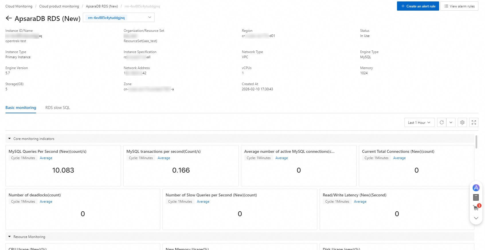

**View alert rules**

On the monitoring page of a target cloud product, you can view all alert rules for the cloud product or for a specific instance within the current organization and resource set.

1. On the monitoring page of the target cloud product, click **View Alert Rules** above the list, or find the target resource instance and click **Alert Rule** in the **Operation** column.

2. You are redirected to the **Alert Rule** page. On this page, you can view all alert rules for the cloud product or for a specified resource in the current organization and resource set. The information includes **Product Name**, **Rule Name**, **Status**, **Associated Instance**, **Alert Condition Description**, **Enable**, **Notification Recipient**, **Validity**, and **Rule Execution Record**.

   > **Note**
   >
   > - On the monitoring page of the target cloud product, you can click **Create Alert Rule** at the top of the page to create a custom alert rule for the cloud product. For more information, see Create an alert rule.
   >
   > - For other alert rule operations, see Manage alert rules.

   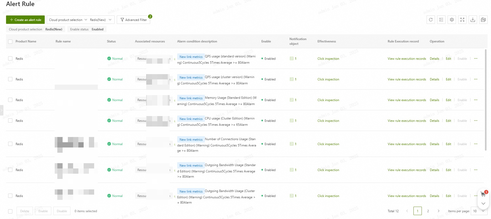

<a id="section-6-3"></a>

## 6.3. Kubernetes container monitoring

Use Kubernetes Container Monitoring to monitor basic resources in your K8s clusters, nodes, and pods. This helps you track cluster health and promptly identify and resolve issues.

**Background information**

Kubernetes Container Monitoring provides the following features:

- Monitor K8s clusters and configure alerting.

- Synchronize and display a list of your K8s clusters, including their names, IDs, health status, and node counts.

- Provide monitoring charts for individual clusters, covering metrics for CPU, memory, and file systems.

- Define alert rules for CPU, memory, and file system metrics on individual clusters.

- Support Prometheus Monitoring 2.0, offering detailed monitoring for core components, nodes, applications, networks, GPUs, and Big Data/AI.

**Procedure**

1. Log on to the Apsara Uni-manager Operation Console.

2. In the top menu bar, click **Products** and choose **Migration & O&M Management** > **O&M and Monitoring** > **CloudMonitor**.

3. In the left navigation bar, select **Cloud Resource Monitoring > Kubernetes Container Monitoring**.

4. On the **Kubernetes Container Monitoring** page, view the list of K8s clusters. The list includes columns such as **Instance ID/Name**, **Organization/Resource Group**, **Region**, **Instance Status**, **Prometheus Monitoring 2.0**, **CPU Utilization**, **Memory Utilization**, **Cluster ID**, **Cluster Type**, **Cluster Version**, **Node Count**, **Network Mode**, **Availability Zone ID**, **Security Group ID**, and **VPC ID**.

   > **Note**
   >
   > - On the **Kubernetes Container Monitoring** page, click **Alert Rules** in the **Actions** column for a cluster to open the **Alert Rules** tab. For more information, see Alert rules.
   >
   > - Click **Create Alert Rule** above the list to add a new alert rule. For parameter details, see Create an alert rule.

5. View instance details.

   - For an instance that does not support Prometheus Monitoring 2.0, click its instance ID/name to go to the cluster details page.

     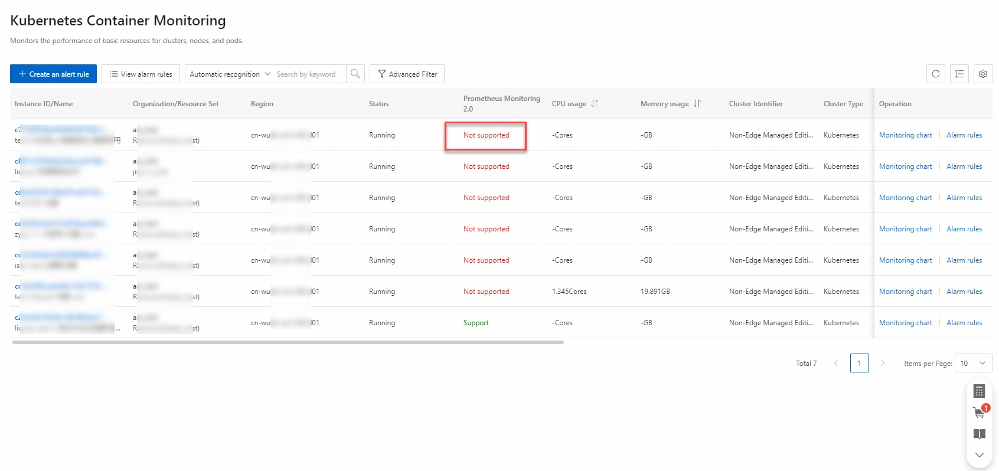

     - In the basic information section, view the **Cluster Name**, **Cluster ID**, **Cluster Type**, **Version**, and **Virtual Private Cloud (VPC)**.

     - On the **Monitoring Charts** tab, view the monitoring charts for the cluster's CPU, memory, and file system metrics. You can set the time range to **1 Hour**, **3 Hours**, **6 Hours**, **12 Hours**, **1 Day**, **3 Days**, **7 Days**, or a custom range.

       > **Note**
       >
       > - On the **Kubernetes Container Monitoring** page, you can also click **Monitoring Charts** in the **Actions** column for a cluster to go directly to the **Monitoring Charts** tab.
       >
       > - You can display the charts in **one column**, **two columns**, or **three columns**. You can select the layout from the drop-down list on the right.
       >
       > - Click the  icon on the right of a metric chart to add a rule description and
       >
       >   create an alert rule. For parameter details, see Create an alert rule.
       >
       > - Click the
       >
       >   icon on the right of a metric chart to view it in full screen.
       >
       >   

     - On the **Node** tab, view the **Instance Name/ID**, **Status**, **CPU Utilization**, and **Memory Utilization** for the nodes in the current cluster. Click an instance name/ID or click **View Details** in the **Actions** column to go to the node details page.

       - In the basic information section, view the **Instance Name** and **Cluster ID**.

       - On the **Monitoring Charts** tab, view the monitoring charts for CPU, memory, file system, and network metrics. You can set the time range to **1 Hour**, **3 Hours**, **6 Hours**, **12 Hours**, **1 Day**, **3 Days**, **7 Days**, **14 Days**, or a custom range.

         > **Note**
         >
         > - You can display the charts with **1 per row**, **2 per row**, or **3 per row**. You can select the layout from the drop-down list on the right.
         >
         > - Click the
         >
         >   icon on the right of a metric chart to view it in full screen.
         >
         >   

       - On the **Pod List** tab, view the list of pods associated with the current node. The list includes the **Instance Name**, **CPU Usage**, and **Memory Usage**. Click an **Instance Name/ID** or **View Details** in the Actions column to go to the pod details page.

         - In the basic information section, view the **Instance Name** and **namespace**.

         - On the **Monitoring Charts** tab, view the monitoring charts for the pod's CPU, memory, file system, and network metrics. You can set the time range to **1 Hour**, **3 Hours**, **6 Hours**, **12 Hours**, **1 Day**, **3 Days**, **7 Days**, **14 Days**, or a custom range.

           > **Note**
           >
           > - You can display the charts with **1 per row**, **2 per row**, or **3 per row**. You can select the layout from the drop-down list on the right.
           >
           > - Click the
           >
           >   icon on the right of a metric chart to view it in full screen.
           >
           >   

     - On the **Workload** tab, view the **Instance Name**, **CPU Usage**, and **Memory Usage** of the workloads in the cluster. Click an **Instance Name** or **View Details** in the Actions column to go to the instance details page.

       > **Note**
       >
       > - Click the **Namespace** drop-down list to switch namespaces.
       >
       > - Click **Deployment**, **StatefulSet**, **DaemonSet**, **CronJob**, **Job**, or **Pod** above the instance list to filter the instances.
       >
       >   - **Deployment**: Monitors Deployments within a namespace. The list shows the instance name, CPU Usage, and Memory Usage. The details view provides metrics such as CPU allocation limit, CPU usage, available file system size limit, and network receive/send rates. It also lists the pods associated with the workload and provides links to their monitoring details.
       >
       >   - **StatefulSet**: Monitors StatefulSets within a namespace. The list shows the instance name, CPU Usage, and Memory Usage. The details view provides metrics such as CPU allocation limit, CPU usage, available file system size limit, and network receive/send rates. It also lists the pods associated with the workload and provides links to their monitoring details.
       >
       >   - **DaemonSet**: Monitors DaemonSets within a namespace. The list shows the instance name, CPU Usage, and Memory Usage. The details view provides metrics such as CPU allocation limit, CPU usage, available file system size limit, and network receive/send rates. It also lists the pods associated with the workload and provides links to their monitoring details.
       >
       >   - **CronJob**: Monitors CronJobs within a namespace. The list shows the instance name, CPU Usage, and Memory Usage. The details view provides metrics such as CPU allocation limit, CPU usage, available file system size limit, and network receive/send rates. It also lists the pods associated with the workload and provides links to their monitoring details.
       >
       >   - **Job**: Monitors Jobs within a namespace. The list shows the instance name, CPU Usage, and Memory Usage. The details view provides metrics such as CPU allocation limit, CPU usage, available file system size limit, and network receive/send rates. It also lists the pods associated with the workload and provides links to their monitoring details.
       >
       >   - **Pod**: Provides a list of pods in the cluster, including pod name, CPU Usage, and Memory Usage, with links to detailed monitoring for each pod.

       - In the basic information section, view the **Instance Name** and **namespace**.

       - On the **Monitoring Charts** tab, view the monitoring charts for CPU, memory, file system, and network metrics. You can set the time range to **1 Hour**, **3 Hours**, **6 Hours**, **12 Hours**, **1 Day**, **3 Days**, **7 Days**, **14 Days**, or a custom range.

         > **Note**
         >
         > - You can display the charts with **1 per row**, **2 per row**, or **3 per row**. You can select the layout from the drop-down list on the right.
         >
         > - Click the
         >
         >   icon on the right of a metric chart to view it in full screen.
         >
         >   

       - On the **Pod List** tab, view the list of pods associated with the current workload. The list includes the **Instance Name**, **CPU Usage**, and **Memory Usage**. Click an instance name or **View Details** in the Actions column to go to the pod details page.

         - In the basic information section, view the **Instance Name** and **namespace**.

         - On the **Monitoring Charts** tab, view the monitoring charts for the pod's CPU, memory, file system, and network metrics. You can set the time range to **1 Hour**, **3 Hours**, **6 Hours**, **12 Hours**, **1 Day**, **3 Days**, **7 Days**, **14 Days**, or a custom range.

           > **Note**
           >
           > - You can display the charts with **1 per row**, **2 per row**, or **3 per row**. You can select the layout from the drop-down list on the right.
           >
           > - Click the
           >
           >   icon on the right of a metric chart to view it in full screen.
           >
           >   

     - On the **Event List** tab, you can view up to 100 of the most recent event records reported for the current instance in the last six hours. The list includes **Event Name**, **Event Level**, **Event Status**, **Event Content**, and **Time**.

       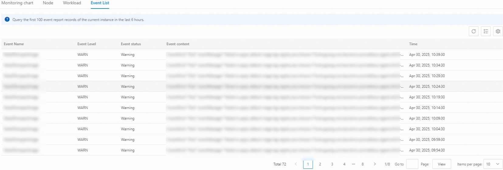

   - For an instance that supports Prometheus Monitoring 2.0, click its instance ID/name to go to the cluster details page.

     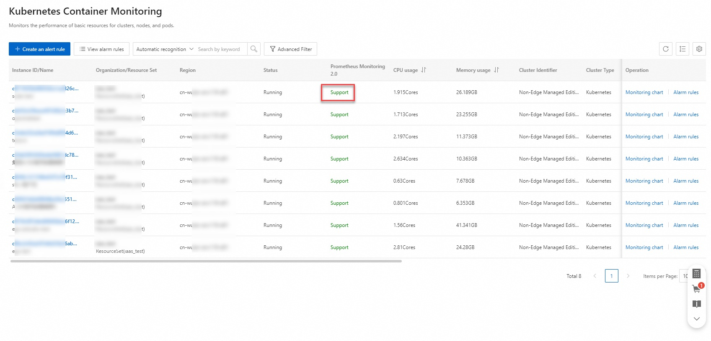

     - The platform provides the following dashboards: **Monitoring Overview**, **Core Component Monitoring**, **Node Monitoring**, **Application Monitoring**, **Network Monitoring**, **GPU Monitoring**, **Big Data/AI**, **Resource Profile**, and **Other**.

       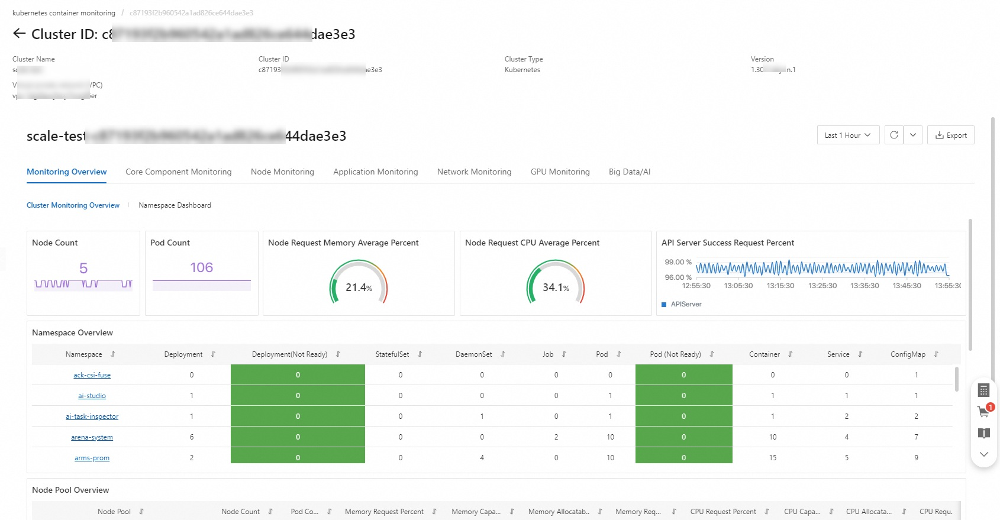

     - On the **Cluster Details** page, you can quickly create an alert rule for any monitored metric.

       <ol type="a">

       <li>

       Click the  icon on the right of a metric and click **Create Alert**.

       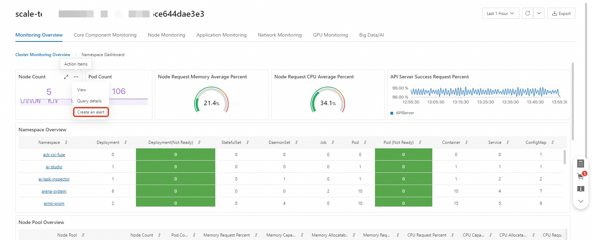

       </li>

       <li>

       In the **Create Alert** dialog box, click **Create Alert** in the **Actions** column. This action redirects you to the **Create Alert Rule** page in the Prometheus Monitoring 2.0 console. For more information, see the *Prometheus Monitoring User Guide*.

       </li>

       </ol>

     - On the cluster details page, click **Export** to export a custom dashboard.

       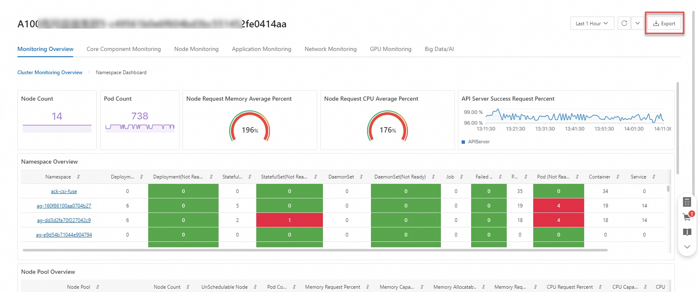

6. View Prometheus Monitoring 2.0 metrics.

   In the left-side navigation pane, click **Metric Warehouse**. For the cloud product, select **Kubernetes Container Monitoring**. You can view metric collection information for **node.cpu.utilization (prometheus2)**, **node.memory.utilization (prometheus2)**, **pod memory utilization(working_set/limit) (prometheus2)**, **pod cpu utilization(usage/limit) (prometheus2)**, **cluster-level cpu utilization (prometheus2)**, and **cluster-level memory utilization (prometheus2)**.

   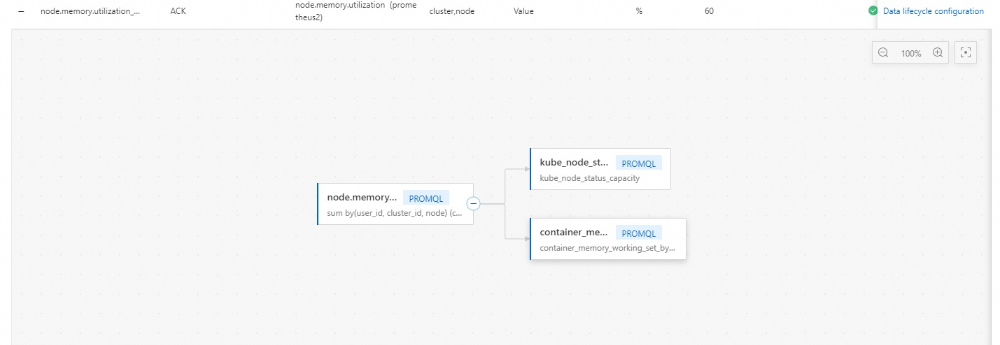

7. For more information about Prometheus Monitoring 2.0, see the *Prometheus Monitoring Us er Guide*.

<a id="section-6-4"></a>

## 6.4. Application group

Application groups allow you to manage Elastic Compute Service (ECS) instances by group based on your business requirements. You can use an application group to manage business-specific ECS instances in a centralized manner. You can manage the alert rules and view monitoring data of different application groups. This greatly simplifies management complexity and improves efficiency.

<a id="section-6-4-1"></a>

### 6.4.1. Create an application group

Application groups allow you to manage resources across different cloud products and regions. You can group resources based on your business needs, manage alarm rules for the group, and view its monitoring data to improve your operational efficiency.

**Procedure**

1. Log on to the Apsara Uni-manager console.

2. In the top menu bar, click **Products** and choose **Migration & O&M Management** > **O&M and Monitoring** > **CloudMonitor**.

3. In the left-side navigation pane, choose **Cloud Resource Monitoring > Application Groups**.

4. On the **Application Groups** page, click **Create Application Group**.

5. In the **Create Application Group** panel, set the following parameters.

   | Parameter | Description |
   | --- | --- |
   | Instance creation method | • <strong>Create by Instance Name/Tag</strong>: Dynamically matches resources within a specific resource set or all resources in your organization by instance name or tag name.<br>• <strong>Manual creation</strong>: Choose this method to manage a fixed set of existing instances.<br>• <strong>Dynamic creation</strong>: This method uses a resource set and exclusion logic to automatically add new instances to the application group. |
   | Application group name | The name of the application group. |
   | Resource set scope | Note<br>This parameter is displayed only when <strong>Instance creation method</strong> is set to <strong>Create by Instance Name/Tag</strong>.<br><strong>Specify Resource Set is selected by default</strong>. |
   | Resource set selection | Select the target resource set from your organization. |
   | Alert contact | Select one or more alert contacts from the drop-down list. |
   | Add resource item | Note<br>Use this parameter when the <strong>Instance creation method</strong> is set to <strong>Manual</strong> <strong>creation</strong> or <strong>Create by Instance Name/Tag</strong>.<br>In the resource item, configure <strong>Cloud product selection</strong>, <strong>Rule relationship</strong>, <strong>Rule configuration</strong>, and <strong>Add instances</strong>. |
   | Exclude resource item | Note<br>Use this configuration item when the instance creation method is dynamic creation.<br>In the resource item, configure <strong>Cloud product selection</strong> and <strong>Batch exclude</strong> <strong>instances</strong>. |

6. Click **OK**.

<a id="section-6-4-2"></a>

### 6.4.2. Manage application groups

You can modify or delete application groups on the Application Group page in the Cloud Monitor console.

**Procedure**

1. Log in to the Apsara Uni-manager Management Console.

2. In the top menu bar, click **Products** and choose **Migration & O&M Management** > **O&M and Monitoring** > **CloudMonitor**.

3. In the left-side navigation pane, choose **Cloud Resource Monitoring > Application Group**. On the **Application Group** page, perform the following operations.

   | Operation | Procedure |
   | --- | --- |
   | View the information about an application group | i. Optional. In the top navigation bar, select an organization. On the <strong>Application Group</strong> page, enter an application group name or ID to search for the application group.<br>ii. Click the name of the application group whose information you want to view. On the details page of the application group, click tabs in the left-side pane to view the corresponding information.<br>• <strong>Group Overview</strong>: displays the <strong>basic information</strong> about the application group and the <strong>associated cloud services</strong>.<br>• <strong>Group Resources</strong>: displays the details of the resources in the application group.<br>• <strong>Availability Monitoring</strong>: displays the availability monitoring data of all Elastic Compute Service (ECS) instances in the current application group. For more information, see Create an availability monitoring task. |
   | Modify an application group | i. Optional. In the top navigation bar, select an organization. On the <strong>Application Group</strong> page, enter an application group name or ID to search for the application group.<br>ii. Move the pointer over theicon in the application group card and click <strong>Edit Group</strong>.<br>iii. In the <strong>Edit application groups</strong> panel, modify the parameter settings of the application group.<br>iv. After the modification is complete, click <strong>OK</strong>. |
   | Delete an application group | Note<br>If you delete an application group, all alert rules and event-triggered alerts of the application group are deleted. The instances in the application group are automatically migrated back to the pool that contains all instances.<br>i. Optional. In the top navigation bar, select an organization. On the <strong>Application Group</strong> page, enter an application group name or ID to search for the application group.<br>ii. On the Application Group page, delete one or more application groups.<br>• Delete a single application group<br>a. Move the pointer over theicon in the application group card and click <strong>Delete a group</strong>.<br>b. In the <strong>Confirm to delete a group</strong> message, click <strong>OK</strong>.<br>• Delete multiple application groups at a time<br>a. Select the application groups that you want to delete and click <strong>Batch deletion</strong> in the lower-left corner of the application group list.<br>b. In the <strong>Confirm batch deletion Group</strong> message, click <strong>OK</strong>. |

<a id="section-6-4-3"></a>

### 6.4.3. Availability monitoring

<a id="section-6-4-3-1"></a>

#### 6.4.3.1. Create an availability monitoring task

CloudMonitor provides the availability monitoring feature to help you check whether a local service or cloud server responds as expected. You can specify the path and port for the local service or cloud server. If the local service or cloud server times out or returns an error code, CloudMonitor sends an alert notification. This way, you can troubleshoot the issue at the earliest opportunity.

**Procedure**

> **Note**
>
> Availability monitoring allows you to use Elastic Compute Service (ECS) instances as the monitoring nodes.

1. Log on to the Apsara Uni-manager Management Console.

2. In the top navigation bar, choose **Products** > **Migration and O&M Management** > **O&M and Monitoring** > **CloudMonitor**.

3. In the left-side navigation pane, choose **Cloud Resource Monitoring > Application Group**.

4. On the **Application Group** page, find the application group that you want to manage and click its name.

5. On the details page of the application group, click **Availability Monitoring** in the left-side pane.

6. Click **Add Availability Monitoring**. In the **Create/Modify Availability Monitor** panel, configure the parameters and then click **OK**. The following table describes the parameters.

   **Parameter**

   **Description**

   The name of the availability monitoring task. The name

   **Task Name**

   must be 4 to 50 characters in length, and can contain letters, digits, underscores (_), and hyphens (-).

   Select one or more instances that you want to monitor in the application group.

   **Probe Source**

   > **Note**
   >
   > If you create more than 500 tasks for an instance, some tasks may fail.

   **Detection**

   The object that you want to monitor. Default value: **URL or**

   **target**

   **IP**.

   The detection method. Valid values: **HTTP(S)**, **TELNET**, and **PING**.

   - **HTTP(S)**: sends HTTP or HTTPS requests to detect the health status of the specified object. You need to enter the URL of the object. Example: http://localhost:8081/check_health.html.

   **Probe Type**

   - **TELNET**: runs the TELNET command to detect the health status of the specified object. You need to enter the IP address and port number of the object. Example: 192.168.1.1:22.

   - **PING**: runs the PING command to detect the health status of the specified object. You need to enter the IP addresses of the object. Example: 192.168.1.1.

   The request method. Valid values: **HEAD**, **GET** and **POST**.

   > **Note**

   **Request Method**

   > This parameter is displayed only if the **Detection target** parameter is set to **URL or IP** and the **Probe Type** parameter is set to **HTTP(S)**.

   The interval at which detection requests are sent. Default value: 1Minutes.

   > **Note**
   >
   > - This parameter is displayed only if the **Detection target** parameter is set to **URL or IP** and the **Probe Type** parameter is set to **HTTP(S)**.
   >
   > - You can click **Advanced Configuration** to

   **Monitoring**

   > configure this parameter for the alert rule.

   **frequency**

   **Create Task**

   The headers of the HTTP or HTTPS request.

   Format:  `parameter1:value1` .

   Separate multiple headers with commas (,).

   > **Note**

   **Headers**

   > - If the **Detection target** parameter is set to **URL or IP** and the **Probe Type** parameter is set to **HTTP(S)**, you can click **Advanced Configuration** to configure this parameter.
   >
   > - You can click **Advanced Configuration** to configure this parameter for the alert rule.

   > **Note**
   >
   > - If the **Detection target** parameter is set to **URL or IP**, the **Probe Type** parameter is set to **HTTP(S)**, and the **Request Method** parameter is set to **POST**, you can click **Advanced Configuration** to configure this parameter.

   **Submitted**

   > - You can click **Advanced Configuration** to

   **Content**

   > configure this parameter for the alert rule.

   The content is submitted in POST requests during site monitoring. This parameter is displayed only if you set the Request Method parameter to POST.

   Format: parameter1=value1&parameter2=value2.

   The response content that you want to match and the method to match the response content.

   If you specify response content, the monitoring task checks whether the first 64 KB of the HTTP response body contains the response content that you specify. Valid values:

   - **Alarm if it contains matching content**

   **Match Response**

   - **Does not contain matching content will alarm**

   **Content**

   > **Note**
   >
   > If the **Detection target** parameter is set to **URL or IP** and the **Probe Type** parameter is set to **HTTP(S)**, you can click **Advanced Configuration** to configure this parameter.

   The range of the status codes that you want to match. CloudMonitor generates an alert if the returned status code meets the alert condition. For more information about status codes, see Status codes.

   **Status Code**

   If the **status code** or **response time** reaches the specified threshold, an alert is triggered and a notification is sent to the specified alert contact group.

   The periods of the response time that you want to match. CloudMonitor generates an alert if the response time meets the alert condition. Unit: milliseconds.

   **Response time**

   If the **status code** or **response time** reaches the specified threshold, an alert is triggered and a notification is sent to the specified alert contact group.

   The alert level and the methods that are used to send alert notifications. Valid alert levels:

   - **Critical**

   **Alarm Level**

   - **Warn**

   - **Info**

   The URL that can be accessed over the Internet. CloudMonitor sends POST requests to push alert notifications to the specified URL.

   **Alarm callback**

   > **Note**
   >
   > You can enter only an HTTP URL.

   **Alarm Settings**

   The interval at which CloudMonitor resends an alert notification if the alert is not cleared. Valid values: **5Minutes**, **10Minutes**, **15Minutes**, **30Minutes**, **60Minutes**, **3Hours**, **6Hours**, **12Hours**, and **24Hours**.

   CloudMonitor sends an alert notification when a metric value reaches the threshold. If the metric value reaches the threshold again within the mute period, CloudMonitor

   **Channel**

   does not resend an alert notification. If the alert is not

   **Silence Period**

   cleared after the mute period ends, CloudMonitor resends an alert notification.

   > **Note**
   >
   > You can click **Advanced Configuration** to configure this parameter for the alert rule.

   The period during which the alert rule is effective. CloudMonitor sends alert notifications within the effective period and only records alerts beyond the effective period.

   **Effective time**

   > **Note**
   >
   > You can click **Advanced Configuration** to configure this parameter for the alert rule.

<a id="section-6-4-3-2"></a>

#### 6.4.3.2. Manage availability monitoring tasks

You can modify, disable, enable, and delete availability monitoring tasks on the **Availability Monitoring** tab of an application group in CloudMonitor.

**Procedure**

1. Log on to the Apsara Uni-manager Management Console.

2. In the top navigation bar, choose **Products** > **Migration and O&M Management** > **O&M and Monitoring** > **CloudMonitor**.

3. In the left-side navigation pane, choose **Cloud Resource Monitoring > Application Group**.

4. On the **Application Group** page, find the application group that you want to manage and click its name.

5. On the details page of the application group, click the **Availability Monitoring** tab in the left-side pane. On the **Availability Monitoring** tab, perform operations to manage availability monitoring tasks.

   | Operation | Procedure |
   | --- | --- |
   | View availability monitoring charts | i. Find the availability monitoring task that you want to manage and<br>click theicon in the <strong>Operation</strong> column to view the monitoring<br>details.<br>ii. Select one or more monitored instances from the drop-down list.<br>iii. Select a monitoring time range based on your business requirements.You can select <strong>1 Hour</strong>, <strong>6 Hours</strong>, <strong>12 Hours</strong>, <strong>1 Day</strong>, <strong>3 Days</strong>, <strong>7 Days</strong>, or <strong>14 Days</strong> or specify a time range.<br>iv. View the trend charts of the selected instances within the specified monitoring time range. |
   | Modify an availability monitoring task | i. Find the availability monitoring task that you want to modify and click <strong>Modification</strong> in the <strong>Operation</strong> column.<br>ii. In the <strong>Create/Modify Availability Monitor</strong> panel, modify the parameters as prompted. For more information about the parameters, see Create an availability monitoring task.<br>iii. After the modification is complete, click <strong>OK</strong>. |
   | Disable or enable availability monitoring tasks | Note<br>You can disable one or more availability monitoring tasks in the <strong>Enable</strong> state, or enable one or more availability monitoring tasks in the <strong>Disable</strong> state.<br>• Disable or enable a single availability monitoring task<br>a. Click <strong>Disable</strong> or <strong>Enable</strong> in the <strong>Operation</strong> column of the task.<br>b. In the <strong>Disable</strong> or <strong>Enable</strong> message, click <strong>OK</strong>.<br>• Disable or enable multiple availability monitoring tasks at a time<br>a. Select the availability monitoring tasks that you want to disable or enable and click <strong>Batch Disable</strong> or <strong>Batch Enable</strong> in the lower-left corner of the task list.<br>b. In the <strong>Disable</strong> or <strong>Enable</strong> message, click <strong>OK</strong>. |
   | Delete one or more availability monitoring tasks | • Delete a single availability monitoring task<br>a. Find the availability monitoring task that you want to delete and click <strong>Delete</strong> in the <strong>Operation</strong> column.<br>b. In the <strong>Delete</strong> message, click <strong>OK</strong>.<br>• Delete multiple availability monitoring tasks at a time<br>a. Select the availability monitoring tasks that you want to delete and click <strong>Batch Delete</strong> in the lower-left corner of the task list.<br>b. In the <strong>Delete</strong> message, click <strong>OK</strong>. |

<a id="section-6-4-3-3"></a>

#### 6.4.3.3. Status codes

If an error occurs when you use the availability monitoring feature of Cloud Monitor to check the availability of a specified path or port, the corresponding status code is returned.

The following table describes status codes.

<table>
  <tr>
    <th>Protocol</th>
    <th>Status code</th>
    <th>Description</th>
  </tr>
  <tr>
    <td rowspan="3">HTTP</td>
    <td>200</td>
    <td>The request is successful.</td>
  </tr>
  <tr>
    <td>610</td>
    <td>The status code returned because the connection times out.If Cloud Monitor does not receive a response within 5 seconds after Cloud Monitor sends an HTTP request, Cloud Monitor determines that the connection times out.</td>
  </tr>
  <tr>
    <td>611</td>
    <td>The status code returned because the monitoring fails.</td>
  </tr>
  <tr>
    <td rowspan="3">Telnet</td>
    <td>200</td>
    <td>The request is successful.</td>
  </tr>
  <tr>
    <td>630</td>
    <td>The status code returned because the connection times out.If Cloud Monitor does not receive a response within 5 seconds after Cloud Monitor sends a Telnet request, Cloud Monitor determines that the connection times out.</td>
  </tr>
  <tr>
    <td>631</td>
    <td>The status code returned because the monitoring fails.</td>
  </tr>
</table>

<a id="section-6-5"></a>

## 6.5. Namespaces

<a id="section-6-5-1"></a>

### 6.5.1. Time-series metrics

The time-series metrics feature in Metric Store provides a unified portal where you can query metrics for your cloud services and view their definitions, calculation methods, and other details.

**Background**

- Time-series metrics include all metrics for cloud services that are integrated with Cloud Monitor. The displayed product and metric names are consistent with those in the Cloud Monitor metric descriptions.

- This feature provides lineage analysis for each metric, tracing dependencies from creation (virtual metrics) and source metrics (real metrics) to the underlying data sources (Project and Logstore). This helps you trace data dependencies and troubleshoot data-related issues.

- Monitoring charts help you analyze and visualize metric data.

**View time-series metrics**

1. Log on to the Apsara Uni-manager console.

2. In the top menu bar, click **Products** and choose **Migration & O&M Management** > **O&M and Monitoring** > **CloudMonitor**.

3. In the left-side navigation pane, choose **Cloud Resource Monitoring > Metric Store**. The **Time-series Metrics** tab appears by default.

4. In the **Cloud Service List** on the left, click a target cloud service to view its corresponding metrics in the list on the right.

   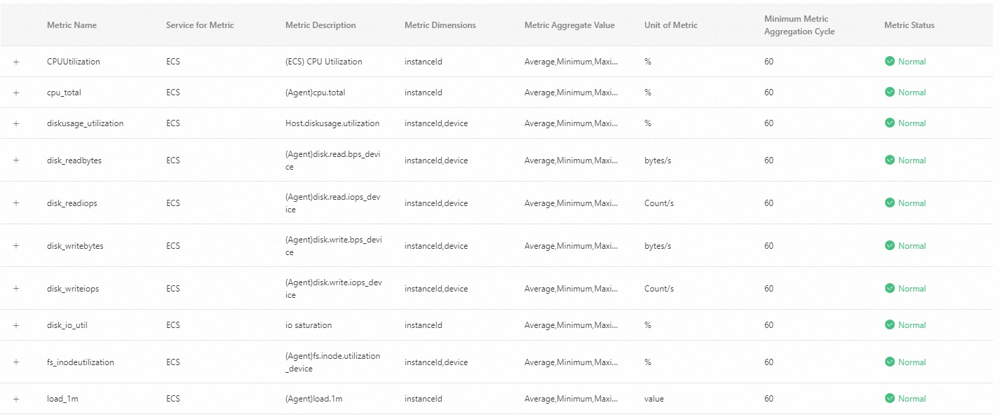

   > **Note**
   >
   > You can search for metrics by **Metric Name** and **Product**. Fuzzy search is supported.

5. Click the  icon to the left of a metric name to expand its details and view the metric

   lineage. The lineage shows the data dependencies for the metric, from the initial SQL creation to the final data source in an SLS Project and Logstore, as well as the DIM table in Cloud Monitor.

   > **Note**
   >
   > Not all cloud service metrics have DIM table data.

   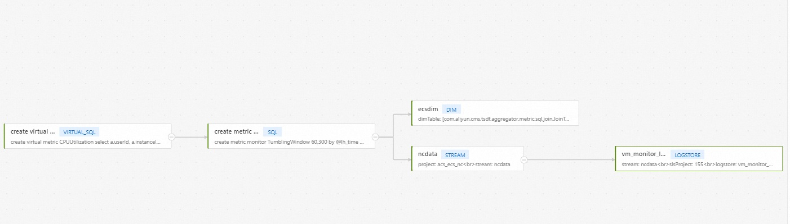

6. Click each stage to open the **Availability Monitoring Details** page. On the **Inspection Item Details** page, check for data. Use the inspection item results to determine whether the problem occurred with the raw data, during intermediate processing, or during final aggregation and calculation. If an error occurs, the inspection item results display a prompt to help you troubleshoot and track the issue.

   | Stage | Inspection item |
   | --- | --- |
   | Virtual metric | • Check if the virtual metric has data.<br>• Check for field mismatches between the virtual metric and the source metric.<br>• Check for field mismatches between the virtual metric and Tablestore query results. |
   | Real metric | • Check if the real metric has data.<br>• Check for field mismatches between the metric and Tablestore query results.<br>• Check the latency of the metric. |
   | DIM table | • Perform a sampling check to verify that instances have corresponding DIM data. |
   | Stream | • Check if the current metric has synthetic data to be collected.<br>• Check if data for the current metric has reached the ISLOT module.<br>• Check if data for the current metric is ready to be persisted to Tablestore.<br>• Check if the current stream contains a UDF. |
   | Logstore | • Check if records from the current Logstore are being consumed by ISLSLoader.<br>• Check if data is being ingested into ISLSLoader from the current Logstore.<br>• Check if the current Logstore contains data that matches the metric.<br>• Check if the current Logstore exists and contains data.<br>• Check if the shards for the current Logstore meet requirements. |

7. On the **Monitoring Details** page of **Availability Monitoring Details** for virtual and real metrics, enter an instance ID, set the aggregation value and time, and click **Query** to view the metric monitoring chart.

   | Parameter | Description |
   | --- | --- |
   | Namespace | The namespace to which the metric belongs. This field is pre-filled. |
   | Metric name | The name of the metric. This field is pre-filled. |
   | Instance ID | Enter the instance ID of the cloud service that you want to query. |
   | Aggregation | The method for aggregating metric data.<br>Note<br>The supported aggregation methods vary by cloud service metric. |
   | Time | The time range for the monitoring data. Options include 1 hour, 4 hours, 12 hours, and custom. |
   | SLS data | This parameter is available only on the monitoring details page for real metrics.<br>Indicates whether SLS data is available. |
   | Monitoring chart | Displays a chart showing the metric data trend based on the specified parameters.<br>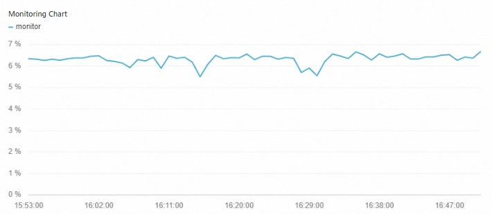 |

**Configure the data retention period**

> **Important**
>
> - Data lifecycle settings apply only to metric data.
>
> - Evaluate your Tablestore capacity before proceeding.
>
> - Configuration by organization, resource group, or individual metric is not supported. The settings apply to all metrics integrated with Cloud Monitor.

**Add a configuration**

1. On the **Time-series Metrics** tab, select a cloud service from the list, and then click **Data Lifecycle Configuration** in the **Actions** column for a metric.

2. In the **Data Lifecycle Configuration** dialog box, select **Add** from the **Operation** drop-down list. In the **data lifecycle configuration** field, enter the data retention period in days (a value from 0 to 1825). The default retention period is 31 days, and the maximum is 5 years (1825 days).

3. Click **OK**.

**Modify a configuration**

You can modify an existing data retention period.

1. On the **Time-series Metrics** tab, select a cloud service from the list, and then click **Data Lifecycle Configuration** in the **Actions** column for the metric.

2. In the **Data Lifecycle Configuration** dialog box, select **Edit** from the **Operation** drop-down list. In the **data lifecycle configuration** field, enter the new data retention period in days (a value from 0 to 1825).

3. Click **OK**.

**Delete a configuration**

You can delete an existing data retention period configuration. After deletion, the retention period for the metric reverts to the default of 31 days.

1. On the **Time-series Metrics** tab, select a cloud service from the list, and then click **Data Lifecycle Configuration** in the **Actions** column for the metric.

2. In the **Data Lifecycle Configuration** dialog box, select **Delete** from the **Operation** drop-down list.

3. Click **OK**.

<a id="section-6-5-2"></a>

### 6.5.2. System events

<a id="section-6-5-2-1"></a>

#### 6.5.2.1. Cloud product event monitoring metrics

This topic describes the names, descriptions, levels, statuses, and types of system events for Alibaba Cloud products.

**CloudMonitor event monitoring metrics**

| Event<br>name | Event Archivi ng<br>Produc t | Event<br>Description | Event<br>Level | Event<br>Status | Event<br>type |
| --- | --- | --- | --- | --- | --- |
| Agent_Status_Stopped | CloudM onitor | Plugin heartbeat stops | CRITICAL | stoppe d | StatusNotif ication |
| Agent_Status_Running | CloudM onitor | Plugin heartbeat resumes | CRITICAL | runnin g | StatusNotif ication |

**ApsaraDB for PolarDB (Legacy) event monitoring metrics**

| Event<br>name | Event Archivi ng<br>Product | Event<br>Description | Event<br>Level | Event<br>Status | Event<br>type |
| --- | --- | --- | --- | --- | --- |
| Instance:HASwitch | PolarDB | Instance HA switchover alert | WARN | Normal | Maintenance |
| Instance:Locked | PolarDB | Instance lock alert | CRITICAL | Error | Error |

**ApsaraDB RDS event monitoring metrics**

| Event<br>name | Source<br>Product | Event<br>Description | Event<br>Level | Event<br>Status | Event<br>type |
| --- | --- | --- | --- | --- | --- |
| Instance:HASwitch | RDS | Instance HA switchover alert | WARN | Normal | Maintenance |
| Instance:Locked | RDS | Instance lock alert | CRITICAL |  |  |

**AIStudio event monitoring metrics**

| Event name | Source Product | Description | Level | Status | Event type |
| --- | --- | --- | --- | --- | --- |
| Instance:OnlineService.Execute.Succeeded | AIStudio | Online service execution succeeded | INFO | TaskSucc eeded | Maintenance |
| Instance:Notebook.Exe cute.Succeeded | AIStudio | Notebook instance ran successfully | INFO | TaskSucc eeded | Maintenance |
| Instance:BatchInferenc e.Execute.Failed | AIStudio | Batch inference task failed | CRITICAL | TaskFaile d | StatusNotifica tion |
| Instance:BatchInferenc e.Execute.Succeeded | AIStudio | Batch inference task succeeded | INFO | TaskSucc eeded | Maintenance |
| Instance:BatchInferenc e.Execute.Running | AIStudio | Batch inference task started | INFO | TaskRun ning | Maintenance |
| Instance:BatchInferenc e.Queue.Failed | AIStudio | Batch inference task queuing failed | CRITICAL | TaskQue ueFailed | StatusNotifica tion |
| Instance:PipelineRun.E xecute.Terminated | AIStudio | Visualization modeling task manually stopped | INFO | TaskStop ped | Maintenance |
| Instance:PipelineRun.E xecute.Failed | AIStudio | Visualization modeling task failed | CRITICAL | TaskFaile d | StatusNotifica tion |
| Instance:PipelineRun.E xecute.Succeeded | AIStudio | Visualization modeling task succeeded | INFO | TaskSucc eeded | Maintenance |
| Instance:PipelineRun.E xecute.Running | AIStudio | Visualization modeling task started | INFO | TaskStar ting | Maintenance |
| Instance:Finetune.Exec ute.Failed | AIStudio | Model fine-tuning task failed | CRITICAL | TaskFaile d | StatusNotifica tion |
| Instance:Finetune.Exec ute.Succeeded | AIStudio | Model fine-tuning task succeeded | INFO | TaskSucc eeded | Maintenance |
| Instance:Finetune.Exec ute.Running | AIStudio | Model fine-tuning task started | INFO | TaskRun ning | Maintenance |
| Instance:Finetune.Que ue.Failed | AIStudio | Model fine-tuning task queuing failed | CRITICAL | TaskQue ueFailed | Maintenance |
| Instance:ModelQuant.E xecute.Failed | AIStudio | Model quantization task failed | CRITICAL | TaskFaile d | Maintenance |
| Instance:ModelQuant.E xecute.Succeeded | AIStudio | Model quantization task succeeded | INFO | TaskSucc eeded | StatusNotifica tion |
| Instance:ModelQuant.E xecute.Running | AIStudio | Model quantization task started | INFO | TaskRun ning | Maintenance |
| Instance:ModelQuant.Q ueue.Failed | AIStudio | Model quantization task queuing failed | CRITICAL | TaskQue ueFailed | StatusNotifica tion |
| Instance:DataAcc.Exec ute.Failed | AIStudio | Data accelerator failed to run | CRITICAL | TaskFaile d | StatusNotifica tion |
| Instance:ModelEvaluati on.Execute.Succeeded | AIStudio | Model evaluation task succeeded | INFO | TaskSucc eeded | Maintenance |
| Instance:ModelEvaluati on.Execute.Failed | AIStudio | Model evaluation task failed | CRITICAL | TaskFaile d | StatusNotifica tion |
| Instance:OnlineService.Execute.Failed | AIStudio | Online service execution failed | CRITICAL | Executio nFailed | StatusNotifica tion |
| Instance:OnlineService.Create.Failed | AIStudio | Online service creation failed | CRITICAL | Creation Failed | StatusNotifica tion |
| Instance:TaskModeling.Execute.running | AIStudio | Task modeling started | INFO | TaskRun ning | Maintenance |
| Instance:TaskModeling.Execute.Failed | AIStudio | Task modeling failed | CRITICAL | TaskFaile d | StatusNotifica tion |
| Instance:TaskModeling.Execute.Succeeded | AIStudio | Task modeling succeeded | INFO | TaskSucc eeded | Maintenance |
| Action:Notebook.Expor t.Failed | AIStudio | Failed to export Notebook instance image | CRITICAL | TaskFaile d | StatusNotifica tion |
| Instance:DataAcc.Crea te.Failed | AIStudio | Data accelerator creation failed | CRITICAL | Creation Failed | StatusNotifica tion |
| Action:Image.Accelerat e.Failed | AIStudio | Custom image acceleration failed | CRITICAL | TaskFaile d | StatusNotifica tion |
| Instance:TaskModeling.Queue.Failed | AIStudio | Task modeling queuing failed | CRITICAL | TaskQue ueFailed | StatusNotifica tion |
| Instance:TaskModeling.Start.Failed | AIStudio | Task modeling failed to start | CRITICAL | TaskStar tFailed | StatusNotifica tion |
| Instance:Notebook.Cre ate.Failed | AIStudio | Notebook instance creation failed | CRITICAL | Creation Failed | StatusNotifica tion |
| Instance:Notebook.Exe cute.Failed | AIStudio | Notebook instance failed to run | CRITICAL | Executio nFailed | StatusNotifica tion |

**Certificate Management Service event monitoring metrics**

| Event name | Related Produc ts | Description | Level | Status | Event type |
| --- | --- | --- | --- | --- | --- |
| Certificate.Expired.Mo nitoring | CAS | Certificate has expired | CRITICAL | CRITIC AL | StatusNotif ication |
| Certificate.Expiration.Monitoring | CAS | Certificate is about to expire | CRITICAL | CRITIC AL | StatusNotif ication |

**Hybrid Disaster Recovery event monitoring metrics**

| Event name | Related produc t | Description | Level | Status | Event type |
| --- | --- | --- | --- | --- | --- |
| PrimarySiteVpc:Delete d | HDR | Production site VPC was deleted | CRITICAL | Failed | StatusNotif ication |
| SecondarySiteVpc:Del eted | HDR | Disaster recovery site VPC was deleted | CRITICAL | Failed | StatusNotif ication |
| PrimarySiteNetwork:D eleted | HDR | Production site network was deleted | CRITICAL | Failed | StatusNotif ication |
| SecondarySiteNetwor k:Deleted | HDR | Disaster recovery site network was deleted | CRITICAL | Failed | StatusNotif ication |
| PrimarySecurityGroup:Deleted | HDR | Production site security group was deleted | CRITICAL | Failed | StatusNotif ication |
| SecondarySecurityGro up:Deleted | HDR | Disaster recovery site security group was deleted | CRITICAL | Failed | StatusNotif ication |
| SecurityGroup:Inconsi stency | HDR | Inconsistent security group policies | CRITICAL | Failed | StatusNotif ication |
| ProductSiteNetwork:In consistency | HDR | Abnormal change in production site network information | CRITICAL | Failed | StatusNotif ication |
| DrSiteNetwork:Inconsi stency | HDR | Abnormal change in disaster recovery site network information | CRITICAL | Failed | StatusNotif ication |
| ProductSiteStorage:In consistency | HDR | Abnormal change in production site storage information | CRITICAL | Failed | StatusNotif ication |
| DrSiteStorage:Inconsi stency | HDR | Abnormal change in disaster recovery site storage information | CRITICAL | Failed | StatusNotif ication |
| PrimarySiteComputati on:Inconsistency | HDR | Abnormal change in production site computing information | CRITICAL | Failed | StatusNotif ication |
| DrSiteComputation:In consistency | HDR | Abnormal change in disaster recovery site computing information | CRITICAL | Failed | StatusNotif ication |
| ReplicationGroup:Inco nsistency | HDR | Abnormal replication group information | CRITICAL | Failed | StatusNotif ication |
| ReplicationPair:Incons istency | HDR | Abnormal replication pair information | CRITICAL | Failed | StatusNotif ication |
| Gateway:Inconsistenc y | HDR | Abnormal gateway | CRITICAL | Failed | StatusNotif ication |
| ShadowEcs:Inconsiste ncy | HDR | Failures in ECS instance replication | CRITICAL | Failed | StatusNotif ication |

**Backup Management Platform event monitoring metrics**

| Event<br>name | Event Archivi ng<br>Produc t | Event<br>Description | Event<br>Level | Event<br>Status | Event<br>type |
| --- | --- | --- | --- | --- | --- |
| BackupPlan | ASRBR | Alerts related to backup plans | CRITICAL | FAILED | StatusNotif ication |
| RecoveryTask | ASRBR | Alerts related to restore jobs | CRITICAL | FAILED | StatusNotif ication |
| MigratePlan | ASRBR | Alerts related to migration plans | CRITICAL | FAILED | StatusNotif ication |
| LICENSE | ASRBR | Alerts related to license usage | CRITICAL | FAILED | Maintenan ce |

**Resource Orchestration Service event monitoring metrics**

| Event<br>name | Event Rules<br>Produc t | Event<br>Description | Event<br>Level | Event<br>Status | Event<br>type |
| --- | --- | --- | --- | --- | --- |
| Stack:StatusChange | ros | Stack status changed | INFO | Normal | StatusNotif ication |
| StackResource:Status Change | ros | Stack resource status changed | INFO | Normal | StatusNotif ication |
| StackGroup:Operation StatusChange | ros | Stack group operation status changed | INFO | Normal | StatusNotif ication |

**Elastic Compute Service (ECS) event monitoring metrics**

| Event<br>name | Event Archivi ng<br>Produc t | Event<br>Description | Event<br>Level | Event<br>Status | Event<br>type |
| --- | --- | --- | --- | --- | --- |
| Disk:ConvertToPostpai dCompleted | ECS | Disk converted to pay-as-you-go | INFO | Normal | StatusNotif ication |
| Disk:DiskOperationCo mpleted | ECS | Disk operation completed | INFO | Normal | StatusNotif ication |
| Disk:ErrorDetected:Ex ecuted | ECS | Local disk corruption alert ended | CRITICAL | Execut ed | Exception |
| Disk:ErrorDetected:Ex ecuting | ECS | Local disk corruption alert started | CRITICAL | Executi ng | Exception |
| Disk:OverduePayment Release | ECS | Disk released due to overdue payment | CRITICAL | Normal | StatusNotif ication |
| Disk:Stalled:Executed | ECS | Severe disk performance impact ended | CRITICAL | Execut ed | Exception |
| Disk:Stalled:Executing | ECS | Severe disk performance impact started | CRITICAL | Executi ng | Exception |
| Instance:AutoReactiva teCompleted | ECS | Automatic restart completed | INFO | Normal | StatusNotif ication |
| Instance:BurstablePer formanceRestricted | ECS | Burstable instance performance is restricted | WARN | Normal | StatusNotif ication |
| Instance:InstanceFailu re.PerformanceImpact:Executed | ECS | Potential instance performance impact ended (instance failure) | WARN | Execut ed | Exception |
| Instance:InstanceFailu re.PerformanceImpact:Executing | ECS | Potential instance performance impact started (instance failure) | WARN | Executi ng | Exception |
| Instance:InstanceFailu re.Reboot:Executed | ECS | Instance restart ended (instance failure) | CRITICAL | Execut ed | Exception |
| Instance:InstanceFailu re.Reboot:Executing | ECS | Instance restart started (instance failure) | CRITICAL | Executi ng | Exception |
| Instance:LiveMigratio nAcrossDDH | ECS | Instance hot migrated between dedicated hosts | INFO | Normal | StatusNotif ication |
| Instance:Performance ModeChange | ECS | Burstable instance performance mode switched | INFO | Normal | StatusNotif ication |
| Instance:PreemptibleI nstanceInterruption | ECS | Spot instance interruption notification | WARN | Normal | StatusNotif ication |
| Instance:Security.Tpm Alert:Executed | ECS | TPM security warning ended | WARN | Execut ed | Exception |
| Instance:Security.Tpm Alert:Executing | ECS | TPM security warning started | WARN | Executi ng | Exception |
| Instance:StateChange | ECS | Instance status change notification | INFO | Normal | StatusNotif ication |
| Instance:SystemFailur e.Delete:Avoided | ECS | Automatic instance release avoided (instance creation failed) | CRITICAL | Avoide d | Exception |
| Instance:SystemFailur e.Delete:Executed | ECS | Automatic instance release completed (instance creation failed) | CRITICAL | Execut ed | Exception |
| Instance:SystemFailur e.Delete:Executing | ECS | Automatic instance release in progress (instance creation failed) | CRITICAL | Executi ng | Exception |
| Instance:SystemFailur e.PerformanceImpact: Executed | ECS | Instance performance impact ended (system error) | WARN | Execut ed | Exception |
| Instance:SystemFailur e.PerformanceImpact: Executing | ECS | Instance performance impact started (system error) | WARN | Executi ng | Exception |
| Instance:SystemFailur e.Reboot:Executed | ECS | Instance restart ended (system error) | CRITICAL | Execut ed | Exception |
| Instance:SystemFailur e.Reboot:Executing | ECS | Instance restart started (system error) | CRITICAL | Executi ng | Exception |
| Instance:SystemFailur e.Reboot:Failed | ECS | Instance restart failed (system error) | CRITICAL | Failed | Exception |
| Instance:SystemFailur e.Redeploy:Avoided | ECS | Instance redeployment avoided (system error) | CRITICAL | Avoide d | Exception |
| Instance:SystemFailur e.Redeploy:Canceled | ECS | Instance redeployment canceled (system error) | CRITICAL | Cancel ed | Exception |
| Instance:SystemFailur e.Redeploy:Executed | ECS | Instance redeployment completed (system error) | CRITICAL | Execut ed | Exception |
| Instance:SystemFailur e.Redeploy:Executing | ECS | Instance redeployment in progress (system error) | CRITICAL | Executi ng | Exception |
| Instance:SystemFailur e.Stop:Executed | ECS | Instance stop completed (system error) | CRITICAL | Execut ed | Exception |
| Instance:SystemFailur e.Stop:Executing | ECS | Instance stop started (system error) | CRITICAL | Executi ng | Exception |
| Instance:SystemMaint enance.IsolateErrorDi sk:Avoided | ECS | Corrupted disk isolation for system maintenance was avoided | CRITICAL | Avoide d | Maintenan ce |
| Instance:SystemMaint enance.IsolateErrorDi sk:Canceled | ECS | Corrupted disk isolation for system maintenance was canceled | CRITICAL | Cancel ed | Maintenan ce |
| Instance:SystemMaint enance.IsolateErrorDi sk:Executed | ECS | Corrupted disk isolation for system maintenance was completed | CRITICAL | Execut ed | Maintenan ce |
| Instance:SystemMaint enance.IsolateErrorDi sk:Executing | ECS | Corrupted disk isolation for system maintenance is in progress | CRITICAL | Executi ng | Maintenan ce |
| Instance:SystemMaint enance.IsolateErrorDi sk:Failed | ECS | Corrupted disk isolation for system maintenance failed | CRITICAL | Failed | Maintenan ce |
| Instance:SystemMaint enance.IsolateErrorDi sk:Inquiring | ECS | Inquiring about corrupted disk isolation for system maintenance | CRITICAL | Inquirin g | Maintenan ce |
| Instance:SystemMaint enance.PerformanceI mpact:Executed | ECS | Potential instance performance impact ended (system maintenance) | CRITICAL | Execut ed | Maintenan ce |
| Instance:SystemMaint enance.PerformanceI mpact:Executing | ECS | Potential instance performance impact started (system maintenance) | CRITICAL | Executi ng | Maintenan ce |
| Instance:SystemMaint enance.ReInitErrorDis k:Avoided | ECS | Corrupted disk re-initialization for system maintenance was avoided | CRITICAL | Avoide d | Maintenan ce |
| Instance:SystemMaint enance.ReInitErrorDis k:Canceled | ECS | Corrupted disk re-initialization for system maintenance was canceled | CRITICAL | Cancel ed | Maintenan ce |
| Instance:SystemMaint enance.ReInitErrorDis k:Executed | ECS | Corrupted disk re-initialization for system maintenance was completed | CRITICAL | Execut ed | Maintenan ce |
| Instance:SystemMaint enance.ReInitErrorDis k:Executing | ECS | Corrupted disk re-initialization for system maintenance is in progress | CRITICAL | Executi ng | Maintenan ce |
| Instance:SystemMaint enance.ReInitErrorDis k:Failed | ECS | Corrupted disk re-initialization for system maintenance failed | CRITICAL | Failed | Maintenan ce |
| Instance:SystemMaint enance.ReInitErrorDis k:Inquiring | ECS | Re-initializing the faulty disk due to system maintenance | CRITICAL | Inquirin g | Maintenan ce |
| Instance:SystemMaint enance.Reboot:Avoide d | ECS | Scheduled instance restart avoided (system maintenance) | CRITICAL | Avoide d | Maintenan ce |
| Instance:SystemMaint enance.Reboot:Cancel ed | ECS | Scheduled instance restart canceled (system maintenance) | CRITICAL | Cancel ed | Maintenan ce |
| Instance:SystemMaint enance.Reboot:Execut ed | ECS | Scheduled instance restart completed (system maintenance) | CRITICAL | Execut ed | Maintenan ce |
| Instance:SystemMaint enance.Reboot:Execut ing | ECS | Scheduled instance restart in progress (system maintenance) | CRITICAL | Executi ng | Maintenan ce |
| Instance:SystemMaint enance.Reboot:Failed | ECS | Scheduled instance restart failed (system maintenance) | CRITICAL | Failed | Maintenan ce |
| Instance:SystemMaint enance.Reboot:Inquiri ng | ECS | Inquiring about scheduled instance restart (system maintenance) | CRITICAL | Inquirin g | Maintenan ce |
| Instance:SystemMaint enance.Reboot:Sched uled | ECS | Scheduled instance restart notification (system maintenance) | CRITICAL | Schedu led | Maintenan ce |
| Instance:SystemMaint enance.RebootAndIsol ateErrorDisk:Avoided | ECS | The issue was mitigated during system maintenance by restarting the instance and fencing the faulty disk. | CRITICAL | Avoide d | Maintenan ce |
| Instance:SystemMaint enance.RebootAndIsol ateErrorDisk:Canceled | ECS | Instance restart and corrupted disk isolation for system maintenance was canceled | CRITICAL | Cancel ed | Maintenan ce |
| Instance:SystemMaint enance.RebootAndIsol ateErrorDisk:Executed | ECS | Instance restart and corrupted disk isolation for system maintenance was completed | CRITICAL | Execut ed | Maintenan ce |
| Instance:SystemMaint enance.RebootAndIsol ateErrorDisk:Executin g | ECS | Instance restart and corrupted disk isolation for system maintenance is in progress | CRITICAL | Executi ng | Maintenan ce |
| Instance:SystemMaint enance.RebootAndIsol ateErrorDisk:Inquiring | ECS | Inquiring about instance restart and corrupted disk isolation for system maintenance | CRITICAL | Inquirin g | Maintenan ce |
| Instance:SystemMaint enance.RebootAndReI nitErrorDisk:Avoided | ECS | The issue was resolved by a maintenance restart of the instance and a re-initialization of the faulty disk. | CRITICAL | Avoide d | Maintenan ce |
| Instance:SystemMaint enance.RebootAndReI nitErrorDisk:Canceled | ECS | Instance restart and corrupted disk re-initialization for system maintenance was canceled | CRITICAL | Cancel ed | Maintenan ce |
| Instance:SystemMaint enance.RebootAndReI nitErrorDisk:Executed | ECS | Instance restart and corrupted disk re-initialization for system maintenance was completed | CRITICAL | Execut ed | Maintenan ce |
| Instance:SystemMaint enance.RebootAndReI nitErrorDisk:Executing | ECS | Instance restart and corrupted disk re-initialization for system maintenance is in progress | CRITICAL | Executi ng | Maintenan ce |
| Instance:SystemMaint enance.RebootAndReI nitErrorDisk:Inquiring | ECS | Inquiring about instance restart and corrupted disk re-initialization for system maintenance | CRITICAL | Inquirin g | Maintenan ce |
| Instance:SystemMaint enance.Redeploy:Avoi ded | ECS | Scheduled instance redeployment avoided (system maintenance) | CRITICAL | Avoide d | Maintenan ce |
| Instance:SystemMaint enance.Redeploy:Can celed | ECS | Scheduled instance redeployment canceled (system maintenance) | CRITICAL | Cancel ed | Maintenan ce |
| Instance:SystemMaint enance.Redeploy:Exe cuted | ECS | Scheduled instance redeployment completed (system maintenance) | CRITICAL | Execut ed | Maintenan ce |
| Instance:SystemMaint enance.Redeploy:Exe cuting | ECS | Scheduled instance redeployment in progress (system maintenance) | CRITICAL | Executi ng | Maintenan ce |
| Instance:SystemMaint enance.Redeploy:Inqu iring | ECS | Inquiring about scheduled instance redeployment (system maintenance) | CRITICAL | Inquirin g | Maintenan ce |
| Instance:SystemMaint enance.Redeploy:Sch eduled | ECS | Scheduled instance redeployment notification (system maintenance) | CRITICAL | Schedu led | Maintenan ce |
| Instance:SystemMaint enance.Stop:Avoided | ECS | Scheduled instance stop avoided (system maintenance) | CRITICAL | Avoide d | Maintenan ce |
| Instance:SystemMaint enance.Stop:Canceled | ECS | Scheduled instance stop canceled (system maintenance) | CRITICAL | Cancel ed | Maintenan ce |
| Instance:SystemMaint enance.Stop:Executed | ECS | Scheduled instance stop completed (system maintenance) | CRITICAL | Execut ed | Maintenan ce |
| Instance:SystemMaint enance.Stop:Executin g | ECS | Scheduled instance stop in progress (system maintenance) | CRITICAL | Executi ng | Maintenan ce |
| Instance:SystemMaint enance.Stop:Failed | ECS | Scheduled instance stop failed (system maintenance) | CRITICAL | Failed | Maintenan ce |
| Instance:SystemMaint enance.Stop:Schedule d | ECS | Scheduled instance stop notification (system maintenance) | CRITICAL | Schedu led | Maintenan ce |
| NetworkInterface:Net workInterfaceOperate Completed | ECS | Network interface controller (NIC) operation completed | INFO | Normal | StatusNotif ication |
| Snapshot:CreateSnap shotCompleted | ECS | Disk snapshot creation completed | INFO | Normal | StatusNotif ication |
| Instance:VmLivemigra teException | ECS | Abnormal VM status after hot migration | WARN | Normal | StatusNotif ication |
| Instance:VmDownCau sedByNcDown | ECS | VM down due to NC breakdown | WARN | Normal | StatusNotif ication |
| Instance:VmDownEnd | ECS | VM breakdown recovery event | WARN | Execut ed | StatusNotif ication |
| Instance:VmPanicEve nt | ECS | Abnormal VM PANIC restart, possibly due to internal virtual machine issues | WARN | Normal | StatusNotif ication |
| Instance:VmCrashEve nt | ECS | Abnormal VM crash event | WARN | Normal | StatusNotif ication |
| Instance:InstanceFailu re.Reboot:Inquiring | ECS | Instance restart (customer confirmation) | CRITICAL | Inquirin g | StatusNotif ication |
| Instance:InstanceFailu re.Reboot:Scheduled | ECS | Instance restart (scheduled execution) | CRITICAL | Schedu led | StatusNotif ication |
| Instance:InstanceFailu re.Reboot:Avoided | ECS | Instance restart (execution avoided) | CRITICAL | Avoide d | StatusNotif ication |
| Instance:InstanceFailu re.Reboot:Canceled | ECS | Instance restart (canceled) | CRITICAL | Cancel ed | StatusNotif ication |
| Instance:InstanceFailu re.Reboot:Failed | ECS | Instance restart (failed) | CRITICAL | Failed | StatusNotif ication |
| Instance:InstanceFailu re.Alert:Inquiring | ECS | Instance alert (customer confirmation) | WARN | Inquirin g | StatusNotif ication |
| Instance:SystemFailur e.PerformanceImpact: Canceled | ECS | Major system performance impact (canceled) | WARN | Cancel ed | StatusNotif ication |
| Instance:SystemFailur e.PerformanceImpact: Avoided | ECS | Major system performance impact (execution avoided) | WARN | Avoide d | StatusNotif ication |
| Instance:SystemFailur e.PerformanceImpact: Scheduled | ECS | Major system performance impact (scheduled execution) | WARN | Schedu led | StatusNotif ication |
| Instance:SystemFailur e.PerformanceImpact: Inquiring | ECS | Major system performance impact (customer confirmation) | WARN | Inquirin g | StatusNotif ication |
| Instance:InstanceFailu re.Alert:Failed | ECS | Instance alert (failed) | WARN | Failed | StatusNotif ication |
| Instance:InstanceFailu re.Alert:Canceled | ECS | Instance alert (canceled) | WARN | Cancel ed | StatusNotif ication |
| Instance:InstanceFailu re.Alert:Executed | ECS | Instance alert (executed) | WARN | Execut ed | StatusNotif ication |
| Instance:InstanceFailu re.Alert:Executing | ECS | Instance alert (executing) | WARN | Executi ng | StatusNotif ication |
| Instance:InstanceFailu re.Alert:Avoided | ECS | Instance alert (execution avoided) | WARN | Avoide d | StatusNotif ication |
| Instance:InstanceFailu re.Alert:Scheduled | ECS | Instance alert (scheduled execution) | WARN | Schedu led | StatusNotif ication |
| Instance:SystemMaint enance.LiveMigrate:E xecuted | ECS | Off-peak analysis, hot migration (executed) | INFO | Execut ed | Maintenan ce |
| Instance:SystemMaint enance.LiveMigrate:A voided | ECS | Off-peak analysis, hot migration (executing) | INFO | Execut ed | Maintenan ce |
| Instance:SystemMaint enance.LiveMigrate:A voided | ECS | Off-peak analysis, hot migration (execution avoided) | INFO | Avoide d | Maintenan ce |
| Instance:SystemMaint enance.LiveMigrate:S cheduled | ECS | Off-peak analysis, hot migration (scheduled execution) | INFO | Schedu led | Maintenan ce |
| Instance:SystemMaint enance.LiveMigrate:In quiring | ECS | Off-peak analysis, hot migration (customer confirmation) | INFO | Inquirin g | Maintenan ce |
| Instance:SystemMaint enance.LiveMigrate:F ailed | ECS | Off-peak analysis, hot migration (failed) | INFO | Failed | Maintenan ce |
| Instance:SystemMaint enance.LiveMigrate:C anceled | ECS | Off-peak analysis, hot migration (canceled) | INFO | Cancel ed | Maintenan ce |
| Instance:SystemFailur e.Reboot:Canceled | ECS | System restart (canceled) | CRITICAL | Cancel ed | StatusNotif ication |
| Instance:SystemFailur e.Reboot:Avoided | ECS | System restart (execution avoided) | CRITICAL | Avoide d | StatusNotif ication |
| Instance:SystemFailur e.Reboot:Scheduled | ECS | System restart (scheduled execution) | CRITICAL | Schedu led | StatusNotif ication |
| Instance:SystemFailur e.Reboot:Inquiring | ECS | System restart (customer confirmation) | CRITICAL | Inquirin g | StatusNotif ication |
| Instance:SystemFailur e.PerformanceImpact: Failed | ECS | Major system performance impact (failed) | WARN | Failed | StatusNotif ication |
| Instance:SystemFailur e.PerformanceAffect:I nquiring | ECS | System performance impact (customer confirmation) | WARN | Inquirin g | StatusNotif ication |
| Instance:SystemFailur e.Alert:Failed | ECS | System alert (failed) | INFO | Failed | StatusNotif ication |
| Instance:SystemFailur e.Alert:Canceled | ECS | System alert (canceled) | INFO | Cancel ed | StatusNotif ication |
| Instance:SystemFailur e.Alert:Executed | ECS | System alert (executed) | INFO | Execut ed | StatusNotif ication |
| Instance:SystemFailur e.Alert:Executing | ECS | System alert (executing) | INFO | Executi ng | StatusNotif ication |
| Instance:SystemFailur e.Alert:Avoided | ECS | System alert (execution avoided) | INFO | Avoide d | StatusNotif ication |
| Instance:SystemFailur e.Alert:Scheduled | ECS | System alert (scheduled execution) | INFO | Schedu led | StatusNotif ication |
| Instance:SystemFailur e.Alert:Inquiring | ECS | System alert (customer confirmation) | INFO | Inquirin g | StatusNotif ication |
| Instance:Redeploy:Fai led | ECS | VM redeployment (local disk, failed) | CRITICAL | Failed | StatusNotif ication |
| Instance:Redeploy:Ca nceled | ECS | VM redeployment (local disk, canceled) | CRITICAL | Cancel ed | StatusNotif ication |
| Instance:Redeploy:Ex ecuted | ECS | VM redeployment (local disk, executed) | CRITICAL | Execut ed | StatusNotif ication |
| Instance:Redeploy:Ex ecuting | ECS | VM redeployment (local disk, executing) | CRITICAL | Executi ng | StatusNotif ication |
| Instance:Redeploy:Av oided | ECS | VM redeployment (local disk, execution avoided) | CRITICAL | Avoide d | StatusNotif ication |
| Instance:Redeploy:Sc heduled | ECS | VM redeployment (local disk, scheduled execution) | CRITICAL | Schedu led | StatusNotif ication |
| Instance:Redeploy:Inq uiring | ECS | VM redeployment (local disk, customer confirmation) | CRITICAL | Inquirin g | StatusNotif ication |
| Instance:Reboot:Faile d | ECS | VM redeployment (failed) | CRITICAL | Failed | StatusNotif ication |
| Instance:Reboot:Canc eled | ECS | VM redeployment (canceled) | CRITICAL | Cancel ed | StatusNotif ication |
| Instance:Reboot:Exec uted | ECS | VM redeployment (executed) | CRITICAL | Execut ed | StatusNotif ication |
| Instance:Reboot:Exec uting | ECS | VM redeployment (executing) | CRITICAL | Executi ng | StatusNotif ication |
| Instance:Reboot:Avoid ed | ECS | VM redeployment (execution avoided) | CRITICAL | Avoide d | StatusNotif ication |
| Instance:Reboot:Sche duled | ECS | VM redeployment (scheduled execution) | CRITICAL | Schedu led | StatusNotif ication |
| Instance:Reboot:Inqui ring | ECS | VM redeployment (customer confirmation) | CRITICAL | Inquirin g | StatusNotif ication |
| Instance:SystemFailur e.PerformanceAffect:F ailed | ECS | System performance impact (failed) | WARN | Failed | StatusNotif ication |
| Instance:SystemFailur e.PerformanceAffect:C anceled | ECS | System performance impact (canceled) | WARN | Cancel ed | StatusNotif ication |
| Instance:SystemFailur e.PerformanceAffect:E xecuted | ECS | System performance impact (executed) | WARN | Execut ed | StatusNotif ication |
| Instance:SystemFailur e.PerformanceAffect:E xecuting | ECS | System performance impact (executing) | WARN | Executi ng | StatusNotif ication |
| Instance:SystemFailur e.PerformanceAffect:A voided | ECS | System performance impact (execution avoided) | WARN | Avoide d | StatusNotif ication |
| Instance:SystemFailur e.PerformanceAffect:S cheduled | ECS | System performance impact (scheduled execution) | WARN | Schedu led | StatusNotif ication |

**Disaster Recovery Management Platform event monitoring metrics**

| Event<br>name | Even t Archi ving<br>Prod uct | Event<br>Description | Event<br>Level | Event<br>Status | Event<br>type |
| --- | --- | --- | --- | --- | --- |
| ProtectGroupStatus:Fa iled | asrdr | Protection group status failed | CRITICAL | Failed | Exception |
| ProtectGroupLatency: Exceeded | asrdr | High protection group synchronization latency | CRITICAL | Exceeded | Exception |
| RecoveryPlanRTO:Exc eeded | asrdr | High disaster recovery plan RTO | CRITICAL | Exceeded | Exception |
| RecoveryPlanStatus:F ailed | asrdr | Disaster recovery plan execution status failed | CRITICAL | Failed | Exception |
| ProtectGroupCapacity: Insufficiency | asrdr | Insufficient protection group capacity | WARN | Insufficiency | Maintenance |
| ProtectEntityCapacity: Insufficiency | asrdr | Insufficient synchronization entity capacity | WARN | Insufficiency | Maintenance |
| RecoveryPlanCapacity:Insufficiency | asrdr | Insufficient disaster recovery plan capacity | WARN | Insufficiency | Maintenance |
| ProtectEntityLoad:Exc eeded | asrdr | Synchronization entity task load exceeded | CRITICAL | Exceeded | Maintenance |

**Bare Metal Computing Platform event monitoring metrics**

| Event<br>name | Even t Archi ving<br>Appli cable prod ucts | Event<br>Description | Event<br>Level | Event<br>Status | Event<br>type |
| --- | --- | --- | --- | --- | --- |
| BMCP_INSTANCE_HEA RTBEAT_LOST | bmcp | BMCP instance heartbeat lost | CRITICAL | failed | Exception |
| GPU_XID_ERROR | bmcp | GPU XID notification | INFO | failed | StatusNotific ation |
| GPU_XID_RPC_TIMEOU T | bmcp | GPU GSP CORE RPC timeout | WARN | failed | Exception |
| GPU_XID_CONTAINED_ECC_ERR_FAILURE | bmcp | GPU memory ECC suppression failed | WARN | failed | Exception |
| GPU_XID_CONTAINED_ECC_ERR | bmcp | GPU memory ECC suppression succeeded | INFO | failed | StatusNotific ation |
| GPU_XID_HIGH_ECC_E RR_RATE | bmcp | High single-bit GPU memory ECC error rate | WARN | failed | Exception |
| GPU_XID_FALLEN_OFF _BUS | bmcp | GPU driver failure | CRITICAL | failed | Recovery |
| GPU_XID_NVLINK_ERR OR | bmcp | GPU NVLINK connection failed | WARN | failed | Maintenance |
| GPU_XID_RETIREMENT _OR_ROW_REMAPPING _FAILURE | bmcp | Failed to record RETIREMENT or REMAPPING | WARN | failed | Exception |
| GPU_XID_RETIREMENT _OR_ROW_REMAPPING _RECORDING | bmcp | RETIREMENT or REMAPPING event detected | INFO | failed | StatusNotific ation |
| GPU_XID_MICROCONT ROLLER_HALT | bmcp | GPU microcontroller halt alert | WARN | failed | Maintenance |
| GPU_XID_MICROCONT ROLLER_BREAKPOINT | bmcp | GPU microcontroller breakpoint alert | WARN | failed | Maintenance |
| GPU_XID_DOUBLE_BIT _ECC_ERROR | bmcp | Multi-bit GPU memory error | INFO | failed | Exception |
| GPU_XID_MEMORY_PA GE_FAULT | bmcp | GPU memory page fault | WARN | failed | Exception |
| GPU_XID_GRAPHICSEN GINE_EXCEPTION | bmcp | GPU computing engine exception | INFO | failed | Exception |
| GPU_SMI_KERNEL_INT ERRUPT_ISSUE | bmcp | Interrupt communication exception alert | INFO | failed | Exception |
| GPU_SMI_TEMPHIGH | bmcp | GPU high temperature alert | WARN | failed | Exception |
| GPU_SMI_THROTTLE | bmcp | GPU throttling alert | WARN | failed | Exception |
| GPU_SMI_ROWREMAP PING_ERR | bmcp | GPU ROW remapping failed | WARN | failed | Maintenance |
| GPU_SMI_ECC_UC_ERR _HIGH | bmcp | UCE count exceeded limit alert | WARN | failed | Recovery |
| GPU_SMI_TOPO_NS | bmcp | GPU TOPO abnormal | WARN | failed | Maintenance |
| GPU_SMI_FAN_SPEED_MSGERROR | bmcp | Unable to query GPU fan speed | INFO | failed | Exception |
| GPU_PCIE_BANDWIDT H_DOWNGRADE | bmcp | PCIe bandwidth downgraded | WARN | failed | Maintenance |
| GPU_PCIE_GPU_LOST | bmcp | PCIe detected a dropped card | CRITICAL | failed | Recovery |
| GPU_SMI_LINK_STATU S_INACTIVE | bmcp | GPU NVLINK connection inactive | WARN | failed | Maintenance |
| GPU_SMI_ROMERR | bmcp | GPU INFOROM corrupted | WARN | failed | Maintenance |
| GPU_SMI_DRIVER_NOT _LOADED | bmcp | NVIDIA driver not loaded | WARN | failed | Maintenance |
| GPU_SMI_POWER_LOS T | bmcp | External power cable not connected | CRITICAL | failed | Maintenance |
| GPU_SMI_GPU_LOST | bmcp | GPU card count from smi command does not match expected count | CRITICAL | failed | Recovery |
| GPU_SMI_EXISTENCE | bmcp | SMI command not found on a machine where lspci command detects a GPU device | WARN | failed | Recovery |

**ApsaraDB RDS event monitoring metrics**

| Event<br>name | Event Archivi ng<br>Applica ble Produc ts | Event<br>Description | Event<br>Level | Event<br>Status | Event<br>type |
| --- | --- | --- | --- | --- | --- |
| Instance:HASwitch | RDS | Instance HA switchover alert | WARN | Normal | Maintenan ce |
| Instance:Locked | RDS | Instance lock alert | CRITICAL | Error | Error |

**ApsaraDB for MongoDB event monitoring metrics**

| Event<br>name | Event archivi ng<br>Produc t | Event<br>Description | Event<br>Level | Event<br>Status | Event<br>type |
| --- | --- | --- | --- | --- | --- |
| Instance:HASwitch | MongoD B | Instance HA switchover alert | WARN | Normal | Maintenan ce |

**Container Monitoring for Kubernetes event monitoring metrics**

| Event<br>name | Event archivi ng<br>Produc t | Event<br>Description | Event<br>Level | Event<br>Status | Event<br>type |
| --- | --- | --- | --- | --- | --- |
| ContainerUnhealthy | CS | Container:Unhealthy | WARN | WARNI NG | Exception |
| FailedNodeAllocatable Enforcement | CS | Node:FailedNodeAllocat ableEnforcement | WARN | WARNI NG | Exception |
| FailedToMakePodData Directories | CS | Pod:Failed | WARN | WARNI NG | Exception |
| NodeRebooted | CS | Node:NodeRebooted | WARN | WARNI NG | Exception |
| BackOffPullImage | CS | Image:BackOff | INFO | NORMA L | Maintenan ce |
| NodeNotReady | CS | Node:NodeNotReady | WARN | WARNI NG | Exception |
| FailedPrepareDynamic Resources | CS | Node:FailedPrepareDyn amicResources | WARN | WARNI NG | Exception |
| ContainerGCFailed | CS | Node:ContainerGCFaile d | WARN | WARNI NG | Exception |
| ImageGCFailed | CS | Node:ImageGCFailed | WARN | WARNI NG | Exception |
| PreemptContainer | CS | Container:Preempting | WARN | WARNI NG | Exception |
| SuccessfulAttachVolu me | CS | Node:SuccessfulAttach Volume | INFO | NORMA L | Maintenan ce |
| FailedPreStopHook | CS | Pod:FailedPreStopHook | WARN | WARNI NG | Exception |
| FailedValidation | CS | Pod:FailedValidation | WARN | WARNI NG | Exception |
| KillingContainer | CS | Container:Killing | INFO | NORMA L | Maintenan ce |
| NodeShutdown | CS | Node:Shutdown | WARN | WARNI NG | Exception |
| BackOffStartContainer | CS | Container:BackOff | WARN | WARNI NG | Exception |
| FailedToInspectImage | CS | Image:InspectFailed | WARN | WARNI NG | Exception |
| FailedToStartContaine r | CS | Container:Failed | WARN | WARNI NG | Exception |
| InvalidDiskCapacity | CS | Node:InvalidDiskCapaci ty | WARN | WARNI NG | Exception |
| NodeSchedulable | CS | Node:NodeSchedulable | INFO | NORMA L | Maintenan ce |
| FailedToCreateContai ner | CS | Container:Failed | WARN | WARNI NG | Exception |
| FailedToPullImage | CS | Image:Failed | INFO | NORMA L | Maintenan ce |
| ExceededGracePeriod | CS | Container:ExceededGra cePeriod | WARN | WARNI NG | Exception |
| VolumeResizeFailed | CS | Pod:VolumeResizeFaile d | WARN | WARNI NG | Exception |
| ContainerProbeWarnin g | CS | Container:ProbeWarnin g | WARN | WARNI NG | Exception |
| PulledImage | CS | Image:Pulled | INFO | NORMA L | Maintenan ce |
| PullingImage | CS | Image:Pulling | INFO | NORMA L | Maintenan ce |
| PossibleMemoryBacke dVolumesOnDisk | CS | Node:PossibleMemoryB ackedVolumesOnDisk | WARN | WARNI NG | Exception |
| FailedToCreatePodCo ntainer | CS | Pod:FailedCreatePodCo ntainer | WARN | WARNI NG | Exception |
| FailedMountOnFilesyst emMismatch | CS | Node:FailedMountOnFil esystemMismatch | WARN | WARNI NG | Exception |
| CreatedContainer | CS | Container:Created | INFO | NORMA L | Maintenan ce |
| FreeDiskSpaceFailed | CS | Node:FreeDiskSpaceFail ed | WARN | WARNI NG | Exception |
| SuccessfulNodeAllocat ableEnforcement | CS | Node:NodeAllocatableE nforced | WARN | WARNI NG | Exception |
| NodeNotSchedulable | CS | Node:NodeNotSchedula ble | INFO | NORMA L | Maintenan ce |
| FailedPostStartHook | CS | Pod:FailedPostStartHoo k | WARN | WARNI NG | Exception |
| NodeReady | CS | Node:NodeReady | INFO | NORMA L | Maintenan ce |
| Starting Kubelet | CS | Node:Starting | INFO | NORMA L | Maintenan ce |
| SuccessfulMountVolu me | CS | Pod:SuccessfulMountVo lume | INFO | NORMA L | Maintenan ce |
| FailedMapVolume | CS | Pod:FailedMapVolume | WARN | WARNI NG | Exception |
| FailedAttachVolume | CS | Node:FailedAttachVolu me | WARN | WARNI NG | Exception |
| FailedCreatePodSand Box | CS | Pod:FailedCreatePodSa ndBox | WARN | WARNI NG | Exception |
| SandboxChanged | CS | Pod:SandboxChanged | WARN | WARNI NG | Exception |
| FailedMountVolume | CS | Pod:FailedMount | WARN | WARNI NG | Exception |
| FailedSync | CS | Pod:FailedSync | WARN | WARNI NG | Exception |
| VolumeResizeSuccess | CS | Pod:VolumeResizeSucc essful | INFO | NORMA L | Maintenan ce |
| NetworkNotReady | CS | Pod:NetworkNotReady | WARN | WARNI NG | Exception |
| FileSystemResizeFaile d | CS | Pod:FileSystemResizeFa iled | WARN | WARNI NG | Exception |
| StartedContainer | CS | Container:Started | INFO | NORMA L | Maintenan ce |
| CgroupV1 | CS | Node:CgroupV1 | WARN | WARNI NG | Exception |
| WarnAlreadyMounted Volume | CS | Pod:AlreadyMountedVol ume | WARN | WARNI NG | Exception |
| FailedToKillPod | CS | Pod:FailedKillPod | WARN | WARNI NG | Exception |
| KubeletSetupFailed | CS | Node:KubeletSetupFaile d | WARN | WARNI NG | Exception |
| ErrImageNeverPullPoli cy | CS | Image:ErrImageNeverP ull | INFO | NORMA L | Maintenan ce |

**Cloud-native data warehouse AnalyticDB for PostgreSQL event monitoring metrics**

| Event<br>name | Event Archivi ng<br>Produc t | Event<br>Description | Event<br>Level | Event<br>Status | Event<br>type |
| --- | --- | --- | --- | --- | --- |
| Instance:Locked | GPDB | GPDB instance locked | CRITICAL | Error | Exception |

**Auto Scaling event monitoring metrics**

| Event<br>name | Event Archivi ng<br>Produc t | Event<br>Description | Event<br>Level | Event<br>Status | Event<br>type |
| --- | --- | --- | --- | --- | --- |
| AUTOSCALING:SCHED ULE_TASK_EXPIRING | ESS | Auto Scaling scheduled task expiration reminder | INFO | normal | StatusNotif ication |
| AUTOSCALING:SCALE_REJECT | ESS | Auto Scaling group scaling activity rejected | WARN | warn | StatusNotif ication |
| AUTOSCALING:SCALE_OUT_WARN | ESS | Auto Scaling group scale-out activity partially successful | WARN | warn | StatusNotif ication |
| AUTOSCALING:SCALE_OUT_SUCCESS | ESS | Auto Scaling group scale-out activity successful | INFO | normal | StatusNotif ication |
| AUTOSCALING:SCALE_OUT_START | ESS | Auto Scaling group scale-out activity started | INFO | normal | StatusNotif ication |
| AUTOSCALING:SCALE_OUT_ERROR | ESS | Auto Scaling group scale-out activity failed | CRITICAL | unnor mal | StatusNotif ication |
| AUTOSCALING:SCALE_IN_ERROR | ESS | Auto Scaling group scale-in activity failed | CRITICAL | unnor mal | StatusNotif ication |
| AUTOSCALING:SCALE_IN_WARN | ESS | Auto Scaling group scale-in activity partially successful | WARN | warn | StatusNotif ication |
| AUTOSCALING:SCALE_IN_SUCCESS | ESS | Auto Scaling group scale-in activity successful | INFO | normal | StatusNotif ication |
| AUTOSCALING:SCALE_IN_START | ESS | Auto Scaling group scale-in activity started | INFO | normal | StatusNotif ication |

**ApsaraDB for Redis event monitoring metrics**

| Event<br>name | Event Archivi ng<br>Produc t | Event<br>Description | Event<br>Level | Event<br>Status | Event<br>type |
| --- | --- | --- | --- | --- | --- |
| Instance:HASwitch | Redis | Instance HA switchover alert | WARN | Normal | Maintenan ce |

<a id="section-6-5-2-2"></a>

#### 6.5.2.2. View system event metrics

The **System Event** tab on the **Namespace** page provides a centralized platform for you to query the system event metrics of cloud services. This allows you to query the information about each system event metric, including the level, status, and type of the metric.

**Background information**

- The **System Event** tab displays only information such as events and products that have been connected to CloudMonitor.

- The system event metrics on the **System Event** tab are the same as those that are described in the Cloud service system events topic.

**Procedure**

1. Log on to the Apsara Uni-manager Management Console.

2. In the top navigation bar, choose **Products** > **Migration and O&M Management** > **O&M and Monitoring** > **CloudMonitor**.

3. In the left-side navigation pane, choose **Cloud Resource Monitoring > Namespace**.

4. On the **Namespace** page, click the **System Event** tab.

5. In the left-side **Alibaba Cloud Services** section, click a cloud service. Then, the system event metrics of the cloud service are displayed in the right-side section.

   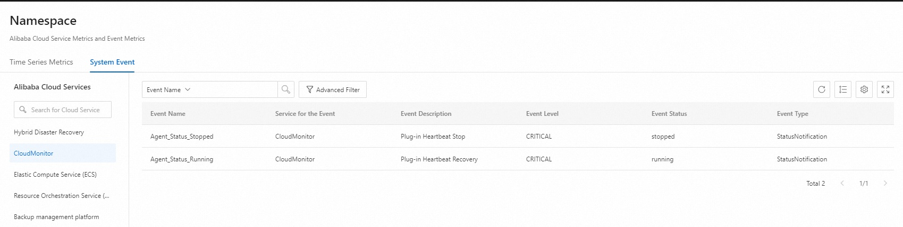

<a id="section-7"></a>

# 7.AI observability

<a id="section-7-1"></a>

## 7.1. Holographic View

Holographic View provides a unified, entity-centric portal for exploring and analyzing all cloud service instances monitored by AI observability in Cloud Monitor. You can query entities to quickly locate and analyze them, seamlessly transitioning from a global perspective to a detailed view.

**Background**

In AI observability, an entity is any object that can be independently identified and monitored. Examples include:

- AI compute entities: BMCP clusters, BMCP nodes, BMS hosts, ACK containers, and apfs/cpfs storage systems.

- AI middleware: AI gateway entities.

- AI training and inference: task entities generated by AI Studio, such as notebook modeling, task modeling, visual modeling, online services, A-Speed, and offline inference.

- AI agents: agent entities generated by OP.

- AI data centers: data processing tasks generated by OP.

Entity queries break down the siloed views of traditional monitoring, which are typically organized by product or metric, and build a panoramic catalog of your monitored assets. Key benefits include:

- Unified inventory: Gain a clear view of all entity types and specific entity instances defined in AI observability, categorized by domain and type.

- Correlation analysis: Start with any entity to explore its status, performance metrics, associated logs, traces, and topological relationships for one-stop problem diagnosis and analysis.

**Procedure**

1. Log on to the Apsara Uni-manager console.

2. In the top menu bar, click **Products** and choose **Migration & O&M Management** > **O&M and Monitoring** > **CloudMonitor**.

3. In the left-side navigation pane, choose **AI observability > Holographic View**. By default, the system displays the **Global View** for **All Spaces** over the **Last 6 Hours**.

   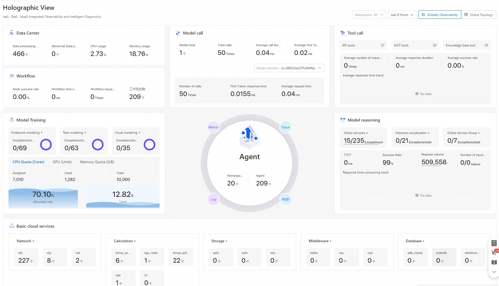

   - Data Center

     Displays details for **Data Processing Tasks**, **Abnormal Data Processing Tasks**, **CPU utilization**, and **memory utilization**.

     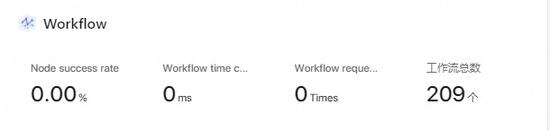

   - Workflow

     Displays details for **node success rate**, **workflow duration**, **Workflow Requests**, and **Total Workflows**.

     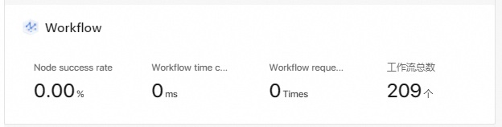

   - Model Calls

     - Displays details for **Total Models**, **Total Calls**, **Average Call Duration**, and **average time to first token**.

       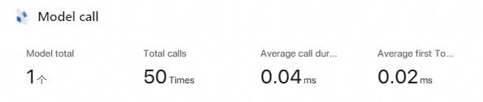

     - Select a specific model to view its **Number of Calls**, **time to first token**, and **Average Request Time**.

       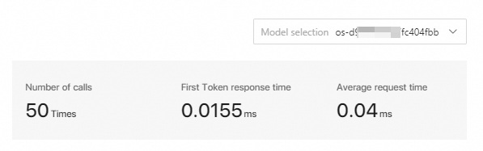

   - Tool Calls

     Displays the number of **API Tools**, **MCP Tools**, and **Knowledge Base Tools**, as well as **Average Requests**, **Average Response Duration**, **Average Success Rate**, and the **Average Response Time Trend**.

     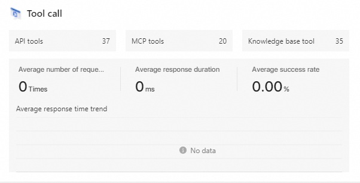

   - Model Training

     - Displays the total and abnormal counts for **notebook modeling**, **task modeling**, and **visual modeling** instances.

       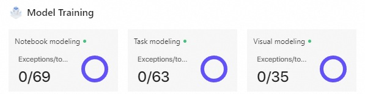

       Click a number on the card to open the **Model Training** page and view instance details.

       

     - Displays the **Allocated**, **Used**, and **Total** values, as well as the **allocation rate** and **usage rate** for **CPU quota (cores)**.

       

   - Agent

     Displays the number of **namespaces** and **agents**.

     

     Click Metric, Trace, Log, or POD to view agent details.

     

   - Model Inference

     - Displays the total and abnormal counts for **Online Services**, **inference acceleration**, and **Online Service Groups** instances.

       

       Click a number on the card to go to the **Model Inference** page and view instance details.

       

     - Displays details for **TTFT**, **Success Rate**, **Requests**, and **Input/Output Tokens**.

       

   - Basic cloud services

     - Displays the number of instances for **Network**, **Compute**, **Storage**, **Middleware**, and **Database**.

       

     - Click an instance count on a card to open the corresponding cloud product monitoring page and view instance monitoring details.

4. In the upper-right corner of the page, click **Global Topology** to switch to the **Global Topology** tab, where you can view monitoring details for MaaS, PaaS, and IaaS.

   

   - In the upper-left corner, click **one-click diagnosis** to view diagnostics for abnormal instances.

     - Click **Instance Details** to view the instance's detailed topology.

       

     - Click **one-click diagnosis** on an alert summary card to run an intelligent diagnosis with Apsara Assistant.

       

     - The left side of the page shows details for SFM products, including **Number of Instances**, **Number of Abnormal Alerts**, **Available Instance Ratio**, and **Abnormal Instance Ratio**, as well as any active alerts.

       

   - Hover over a service in the topology diagram to view its **Number of Instances**, **Available Instance Ratio**, **Instances with Abnormal Alerts**, **Specifications**, and **Capability Layer**.

     

<a id="section-7-2"></a>

## 7.2. Agent

The agent module displays information to help you analyze exceptions, performance, and traffic.

**Procedure**

1. Log in to the Apsara Uni-manager Management Console.

2. In the top menu bar, click **Products** and choose **Migration & O&M Management** > **O&M and Monitoring** > **CloudMonitor**.

3. In the left-side navigation pane, choose **AI Observability > Agents.**

4. View the detailed monitoring information of workspaces.

   On the **Workspace** tab, click **Details** in the **Operation** column of the target workspace to view its metrics. For more information, see SFM.

   

5. View the detailed monitoring information of basic resources.

   On the **Basic Resources** tab, click **Details** in the **Operation** column of the target instance to view its metrics. For more information, see Kubernetes container monitoring.

<a id="section-7-3"></a>

## 7.3. Data center

The Data Center page lets you monitor data processing tasks and underlying operations.

**Procedure**

1. Log on to the Apsara Uni-manager Operation Console.

2. In the top menu bar, click **Products** and choose **Migration & O&M Management** > **O&M and Monitoring** > **CloudMonitor**.

3. In the navigation pane on the left, select **AI Observability > Data Center.**

4. On the **Data Center** page, in the **Actions** column for the workspace instance, click **Details**.

   

5. The **Workspace** details page shows the **Instance name, Resource set**, **Organization**, **Created at**, and monitoring metrics for **CPU**, **Memory**, and **Network**.

   

<a id="section-7-4"></a>

## 7.4. Model inference

The model inference module displays information related to online services, online service groups, and batch inference. You can view the following metrics: CPU usage, memory usage, disk usage, and network I/O.

**Procedure**

1. Log in to the Apsara Uni-manager Management Console.

2. In the top menu bar, click **Products** and choose **Migration & O&M Management** > **O&M and Monitoring** > **CloudMonitor**.

3. In the left-side navigation pane, choose **AI Observability > Model Inference.**

4. View the monitoring data of online services.

   On the **Online Services** tab, click **Details** in the **Operation** column of the target online service to view its metrics. For more information, see AI Studio (Online Service).

   

5. View the monitoring data of an online service group.

   On the **Online Service Group** tab, click **Details** in the **Operation** column of the target online service group to view its metrics. For more information, see AI studio (Online service group).

   

6. View the monitoring data of batch inference.

   On the **Batch Inference** tab, click **Details** in the **Operation** column of the target instance to view its metrics. For more information, see AI Studio (Batch Inference).

   

<a id="section-7-5"></a>

## 7.5. Model training

The model training module displays information about notebook modeling, model tuning, visual modeling, model evaluation, and task modeling. You can view the following information: CPU, memory, disk, and network I/O usage of tasks and CPU, memory, and disk usage of task-related pods.

**Procedure**

1. Log in to the Apsara Uni-manager Management Console.

2. In the top menu bar, click **Products** and choose **Migration & O&M Management** > **O&M and Monitoring** > **CloudMonitor**.

3. In the left-side navigation pane, choose **AI Observability > Model Training.**

4. View the detailed monitoring information of notebook modeling.

   On the **Notebook Modeling** tab, click **Details** in the **Operation** column of the target instance to view the notebook modeling metrics. For more information, see AI Studio (Notebook modeling).

   

5. View the detailed monitoring information of task modeling.

   On the **Task Modeling** tab, click **Details** in the **Operation** column of the target instance to view the task modeling metrics. For more information, see AI Studio (Task Modeling).

   

6. View the detailed monitoring information of model tuning.

   On the **Model Tuning** tab, click **Details** in the **Operation** column of the target instance to view the model tuning metrics. For more information, see AI Studio (model tuning).

   

7. View the detailed monitoring information of visual modeling.

   On the **Visual Modeling** tab, click **Details** in the **Operation** column of the target instance to view the visual modeling metrics. For more information, see AI Studio (Visualized Modeling).

   

8. View the detailed monitoring information of model evaluation.

   On the **Model Evaluation** tab, click **Details** in the **Operation** column of the target instance to view the model evaluation metrics. For more information, see AI Studio (Model Evaluation).

   

<a id="section-7-6"></a>

## 7.6. AI computing power

AI computing power consists of AI computing, AI storage, and AI gateways. Metrics for AI computing include basic resource usage such as CPU, memory, and disk resources, GPU utilization, temperature, and RDMA networks. Metrics for AI storage include storage usage, IOPS, and bandwidth. Metrics for AI gateways include uplink and downlink requests, success rate, and duration.

**Procedure**

1. Log in to the Apsara Uni-manager Management Console.

2. In the top menu bar, click **Products** and choose **Migration & O&M Management** > **O&M and Monitoring** > **CloudMonitor**.

3. In the left-side navigation pane, choose **AI Observability > AI Computing Power.**

4. Click the AI Computing tab.

   - View the detailed monitoring information of Bare Metal Computing Power (BMCP) nodes.

     On the **BMCP (Node)** tab, click **Details** in the **Operation** column of the target instance to view the metrics of BMCP nodes. For more information, see BMCP nodes.

     

   - View the detailed monitoring information of BMCP supercomputing clusters.

     On the **BMCP (Bare Metal - Supercomputing Cluster)** tab, click **Details** in the **Operation** column of the target instance to view the metrics of BMCP supercomputing clusters. For more information, see BMCP (BMS EHPC Cluster).

     

   - View the detailed monitoring information of BMCP intelligent computing clusters.

     On the **BMCP (Bare Metal - Intelligent Computing Cluster)** tab, click **Details** in the **Operation** column of the target instance to view the metrics of BMCP intelligent computing clusters. For more information, see BMCP (Bare Metal - Intelligent Computing Power Cluster).

     

   - View the detailed monitoring information of Container Service for Kubernetes (ACK)-intelligent computing clusters.

     On the **BMCP (Container - Intelligent Computing Cluster)** tab, click **Details** in the **Operation** column of the target instance to view the metrics of ACK-intelligent computing clusters. For more information, see Bare Metal Computing Platform (BMCP) (Container - Intelligent Computing Cluster).

     

5. Click the AI Storage tab.

   - View the detailed monitoring information of ApsaraStack Parallel File System (APFS).

     On the **APFS** tab, click **Details** in the **Operation** column of the target instance to view the metrics of APFS. For more information, see APFS.

     

   - View the detailed monitoring information of Cloud Parallel File Storage (CPFS).

     On the **CPFS** tab, click **Details** in the **Operation** column of the target instance to view the metrics of CPFS. For more information, see CPFS.

     

6. View the detailed monitoring information of AI gateways.

   On the **AI Gateway** tab, click **Details** in the **Operation** column of the target instance to view the metrics of AI gateways. For more information, see API Gateway.

   

<a id="section-8"></a>

# 8.ARMS Application Monitoring

ARMS Application Monitoring is an Application Performance Management (APM) product that helps you quickly locate faulty and slow interfaces, reproduce call parameters, and identify system bottlenecks to significantly improve the efficiency of online problem diagnosis.

<a id="section-8-1"></a>

## 8.1. Application list

On the **Application List** page, you can view applications connected to Application Monitoring.

**Procedure**

1. Log on to the Apsara Uni-Manager Management Console.

2. In the top menu bar, click **Products** and choose **Migration & O&M Management** > **O&M and Monitoring** > **CloudMonitor**.

3. In the left-side navigation pane, choose **ARMS Application Monitoring > Application List**.

4. On the **Application List** page, view the applications connected to Application Monitoring.

   

   | Parameter/Featur e | Description |
   | --- | --- |
   | Connect applications | Connect applications to Application Monitoring. For more information, see the User Guide of Application Real-Time Monitoring Service (ARMS). |
   | Application name | The name of the application. |
   | Tag | You can filter applications by tag. |
   | Metric | This column displays the values or status of the following metrics after you connect the application:<br>• Health Score<br>• Requests<br>• Errors<br>• Response time<br>• Exceptions<br>• Response time in the last 10 minutes |
   | Actions | <strong>Settings</strong>: Go to the application settings page.<br>You can perform the following operations on the application settings page:<br>• Customize monitoring parameters.<br>• Manage tags.<br>• Customize monitoring methods.<br>• Delete applications.<br>For more information, see the User Guide of Application Real-Time Monitoring Service (ARMS). |

<a id="section-8-2"></a>

## 8.2. Application topology

The application topology in Application Real-Time Monitoring Service (ARMS) displays the upstream and downstream dependencies of a specified application.

**View application topology**

1. Log on to the Apsara Uni-Manager Management Console.

2. In the top menu bar, click **Products** and choose **Migration & O&M Management** > **O&M and Monitoring** > **CloudMonitor**.

3. In the left-side navigation pane, choose **Application Real-Time Monitoring Service (ARMS) > Application Topology**.

   On the Global Topology page, you can perform the following operations:

   - Click the plus icon or scroll the mouse wheel up to zoom in on the application topology.

   - Click the minus icon or scroll the mouse wheel down to zoom out of the application topology.

   - Click the RESET icon to restore the application topology to its default size.

   - Click a node to highlight the topology associated with the node.

   - Move the pointer over a node or a dot on the line between nodes to view the following information:

     - Service name

     - QPS: Queries Per Second

     - RT: Response time (in milliseconds)

     - ERROR: Error QPS

**Create a view**

You can create a custom topology by using the view creation feature.

1. On the Global Topology page, click **Create View**, enter a **View Name** in the dialog box that appears, and select the target core application.

2. Click **Edit View** and perform the following operations to adjust the topology:

   <ol type="i">

   <li>

   Right-click a node to view the upstream, downstream, and details of the node, copy the node information, or remove the node.

   </li>

   <li>

   Double-click a node to expand the downstream of the node.

   </li>

   <li>

   Move the pointer over a node or a dot on the line between nodes to view the following

   </li>

   </ol>

   information:

   <ol type="a">

   <li>

   Service name

   </li>

   <li>

   QPS: Queries Per Second

   </li>

   </ol>

   <ol type="i" start="100">

   <li>

   RT: Response time (in milliseconds)

   </li>

   <li value="500">

   ERROR: Error QPS

   </li>

   </ol>

3. Click **OK** to complete the creation.

**Edit or delete a view**

You can further edit a custom topology after you create it.

> **Note**
>
> You cannot edit or delete the default view.

1. Select the view that you want to edit from the drop-down list on the right of **Create View**, and then click **Edit**.

2. You can modify the name of the view in the dialog box that appears.

3. Click **Edit View**, modify the view, and then click **OK**.

4. If you do not need the current topology, you can also click **Delete** in the upper-right corner.

**More operations**

For more operations, see the Application Real-Time Monitoring Service (ARMS) User Guide.

<a id="section-8-3"></a>

## 8.3. Trace analysis

Tracing Analysis provides developers of distributed applications with tools for complete trace restoration, request volume statistics, trace topology, and application dependency analysis. This feature helps developers quickly analyze and diagnose performance bottlenecks in distributed application architectures and improves development and diagnosis efficiency in the microservice era.

1. Log on to the Apsara Uni-Manager Management Console.

2. In the top menu bar, click **Products** and choose **Migration & O&M Management** > **O&M and Monitoring** > **CloudMonitor**.

3. In the left-side navigation pane, choose **ARMS Application Monitoring > Trace analysis**.

4. Click **Quick Start** to download the Tracing Analysis guide.

5. Click **View Endpoint Information**. In the **Cluster Information** section of the **Endpoint Information** tab, turn on the **Show Token** switch.

6. In the **Related Information** column of the following table, click the Edit icon next to the message that prompts you to bind a Prometheus address for data shipping. Enter the Prometheus instance name and the Remote Write address, and then click **OK**. ARMS then ships the received metrics to this Prometheus instance.

   

**More operations**

For more operations, see the Application Real-Time Monitoring Service (ARMS) User Guide.

<a id="section-9"></a>

# 9.Visualization

<a id="section-9-1"></a>

## 9.1. Custom dashboards

You can create custom dashboards to monitor, analyze, and display key metrics. This offers an intuitive and efficient way to understand and manage your data.

**Preset dashboards**

The following preset dashboards are available:

- API Gateway

- Alibaba Cloud DNS

- Message Queue

- Elasticsearch on K8s

- OSS

- SLB

- ECS

- ApsaraDB for Redis (Cluster Edition)

- ApsaraDB for Redis (Standard Edition/Read/Write Splitting Edition)

- ApsaraDB RDS for PostgreSQL (Cloud Disk)

- ApsaraDB RDS for PostgreSQL (Local SSD)

- ApsaraDB for PolarDB

- ApsaraDB RDS for MySQL

**Create a directory**

1. Log on to the Apsara Uni-manager console.

2. In the top menu bar, click **Products** and choose **Migration & O&M Management** > **O&M and Monitoring** > **CloudMonitor**.

3. In the left-side navigation pane, choose **Visualization > Custom Dashboard**.

4. At the top of the page, click **Create Directory**.

5. In the text box, enter a name for the directory.

6. Press Enter.

**Rename a directory**

> **Important**
>
> You cannot rename preset directories.

1. On the **Custom Dashboard** page, click the  icon to the right of the directory.

2. In the text box, enter a new name for the directory.

3. Press Enter.

**Delete a directory**

> **Important**
>
> - You cannot delete preset directories.
>
> - When you delete a directory, all dashboards within it are also deleted. This action cannot be undone.

1. On the **Custom Dashboard** page, click the  icon to the right of the directory.

2. In the dialog box that appears, click **OK**.

**Create a dashboard**

> **Important**
>
> You must create a directory before creating a dashboard. Otherwise, the dashboard cannot be saved.

1. On the **Custom Dashboard** page, click **Create Dashboard** at the top of the page.

2. In the **Create Dashboard** dialog box, enter a **Dashboard Name**, select a **Dashboard Directory**, then click **OK**.

   

3. On the dashboard page, you can create cards and row containers.

   - **Create a card**

     <ol type="a">

     <li>

     Click **New Card**, then select **New Card**.

     </li>

     <li>

     On the new card page, configure the chart's **Data Configuration**, **Data Transformation** (optional), and **Chart Configuration** (optional).

     - **Data Configuration**: Click **Add Query**, then select the **cloud product**, **metric**, **aggregation method**, and **monitoring scope**.

       > **Note**
       >
       > You can add multiple data configurations.

       

     - (Optional) **Data Transformation**: Click **Add Data Transformation > Data Filtering** and select the data columns you want to filter. Click **Add Data Transformation > Column Rename** to rename data columns. Click **Add Data Transformation > Table Join** to merge multiple tables into a single table. This transformation applies only to tables.

       > **Important**
       >
       > You must complete the Data Configuration before applying data transformations.

       

     - (Optional) **Chart Configuration**: Configure the chart type, chart elements, axes, legend, reference lines, reference areas, and more.

       

     </li>

     </ol>

     <ol type="i" start="100">

     <li>

     After you finish the configuration, click **Apply to Dashboard** above the chart.

     > **Note**
     >
     > - To discard your changes, click **Cancel** above the chart.
     >
     > - Click the **Last 1 Hour** drop-down list above the chart to select or customize the time range for the chart.

     

     </li>

     </ol>

   - **Add a row container**

     <ol type="a">

     <li>

     On the dashboard page, click **New Card** and select **New Row Container**.

     </li>

     <li>

     Hover over the row container and click the  icon to edit the row name.

     > **Note**
     >
     > To delete the row container, hover over it and click the
     >
     > icon.
     >
     > 

     </li>

     </ol>

4. After adding cards and row containers, you can customize the dashboard layout.

   - In the **Layout Template** drop-down list at the upper-right corner of the canvas, select **1 per row**, **2 per row**, **3 per row**, or **4 per row**.

   - Drag cards to rearrange their positions.

   - Click the  icon at the upper-right corner of a card to perform actions such as **Edit**,

     **Copy**, **Delete**, or **View**.

5. (Optional) Click the **Last 1 Hour** drop-down list at the top of the dashboard to select or customize the monitoring time range for the entire dashboard.

   > **Note**
   >
   > The time range set on the card editing page is a temporary override that applies only within the editor. When you return to the dashboard, the dashboard-level time range takes precedence.

6. (Optional) Click the drop-down list to the right of  to set the automatic refresh interval for

   the dashboard.

   > **Note**
   >
   > Selecting Off disables automatic refresh.

7. (Optional) At the top of the dashboard, click the  icon to view or edit the dashboard's

   basic settings and JSON mode.

   

   - **Basic Settings**

     In Basic Settings, you can view or modify the dashboard name and the editable switch.

     > **Note**
     >
     > If this switch is on, you can modify the dashboard's contents and layout. If it is off, these actions are disabled.

   - **JSON mode**

     In JSON mode, you can edit the dashboard by modifying its JSON code. Click **Preview** to

     verify your changes, then click the  icon to save.

8. Click the  icon to save the dashboard.

**Modify dashboard content and layout**

> **Important**
>
> You cannot modify the content or layout of preset dashboards.

1. On the **Custom Dashboard** page, select a directory, then click the name of the dashboard you want to modify from the list on the right.

2. On the dashboard details page, modify the cards, row containers, and layout as needed. For more information, see Create a dashboard.

**Rename a dashboard**

> **Important**
>
> You cannot rename preset dashboards.

1. On the **Custom Dashboard** page, click the target directory. In the dashboard list on the right, click **Edit** in the Actions column of the dashboard.

2. In the **Edit Dashboard** dialog box, enter a new name for the dashboard.

3. Click **OK**.

**Move a dashboard**

> **Important**
>
> You cannot move preset dashboards.

- **Move a single dashboard**

  <ol type="i">

  <li>

  On the **Custom Dashboard** page, click the target directory. In the dashboard list on the right, click **Edit** in the Actions column of the dashboard.

  </li>

  <li>

  In the **Edit Dashboard** dialog box, select a new directory for the dashboard.

  </li>

  <li>

  Click **OK**.

  </li>

  </ol>

- **Move dashboards in bulk**

  <ol type="i">

  <li>

  On the **Custom Dashboard** page, click the target directory. In the dashboard list on the right, select the checkboxes for the dashboards you want to move.

  </li>

  <li>

  At the bottom of the page, click **Move**.

  </li>

  <li>

  In the **Bulk Move Dashboards** dialog box, select a destination directory.

  </li>

  <li>

  Click **OK**.

  </li>

  </ol>

**Copy a dashboard**

Copying a dashboard allows you to quickly create a new one with the same configuration.

1. On the **Custom Dashboard** page, click the target directory. In the dashboard list on the right, click **Copy** in the Actions column of the dashboard you want to copy.

2. In the **Copy Dashboard** dialog box, enter a new name for the dashboard and select a destination directory.

3. Click **OK**.

**Set a default dashboard**

> **Important**
>
> - You can only set one dashboard as the default.
>
> - Setting a dashboard as the default replaces the previous one. This dashboard is then displayed automatically when you navigate to the Custom Dashboard page.
>
>   To return to the directory page from the default dashboard, click the  icon in the
>
>   upper-left corner.

1. On the **Custom Dashboard** page, click the target directory. In the dashboard list on the right, click **Set as Default Dashboard** in the Actions column of the dashboard you want to set as default.

2. Click **OK**.

**Delete a dashboard**

> **Important**
>
> You cannot delete preset dashboards.

- **Delete a single dashboard**

  <ol type="i">

  <li>

  On the **Custom Dashboard** page, click the target directory. In the dashboard list on the right, click **Delete** in the Actions column of the dashboard you want to delete.

  </li>

  <li>

  Click **OK**.

  </li>

  </ol>

- **Delete dashboards in bulk**

  <ol type="i">

  <li>

  On the **Custom Dashboard** page, click the target directory. In the dashboard list on the right, select the checkboxes for the dashboards you want to delete.

  </li>

  <li>

  At the bottom of the page, click **Delete**.

  </li>

  <li>

  Click **OK**.

  </li>

  </ol>

**Intelligent analysis**

Intelligent Analysis generates summaries by combining dashboard metric data with information from your cloud resources.

1. On the **Custom Dashboard** page, select the target dashboard and click its name to go to the dashboard details page.

2. On the dashboard details page, click **Intelligent Analysis** for a specific metric. Apsara Assistant then summarizes the metric data for the dashboard's current time range.

   

   You can also ask questions in the Apsara Assistant dialog box. It analyzes data trends, anomalies, metric correlations, and historical data from the dashboard to provide in-depth insights and summary reports.

<a id="section-10"></a>

# 10.Alert service

You can manage alert rules, alert history, and alert templates in the Alert Service module of CloudMonitor. You can configure alert rules to specify how CloudMonitor checks monitoring data. If monitoring data triggers the alert rules, CloudMonitor sends alert notifications. When an alert is generated, CloudMonitor records the alert information in the alert history. You can review and analyze the alert history to troubleshoot issues and make predictions. Alert templates simplify the process of creating and maintaining alert rules when you need to manage a large number of cloud resources. This helps you monitor cloud services more efficiently.

<a id="section-10-1"></a>

## 10.1. Alert history

You can filter alert history by cloud service, instance, and alert level. You can also export and download the alert history to your on-premises machine for data analysis.

**Procedure**

1. Log in to the Apsara Uni-manager Management Console.

2. In the top menu bar, click **Products** and choose **Migration & O&M Management** > **O&M and Monitoring** > **CloudMonitor**.

3. In the left-side navigation pane, choose **Alerting** > **Alert History**.

4. Optional. On the **Alert History** page, you can filter historical alerts by selecting the **Cloud product selection**, **Rule ID**, **Rule name**, **Instance ID**, **Alarm Level**, and Start and end time filter condition.

   > **Note**
   >
   > This page does not display faulty Data Transmission Service (DTS) instances.

5. On the Alert History page, perform the required operations. The following table describes the operations that you can perform.

   | Operation | Description |
   | --- | --- |
   | View the alert history | On the <strong>Alert History</strong> page, view the information about alerts in the following columns: <strong>Product Name</strong>, <strong>Faulty instance</strong>, <strong>Occurrence time</strong>, <strong>Rule name</strong>, <strong>Status</strong>, <strong>Grade</strong>, and <strong>Notification object</strong>. Find an alert record that you want to view and click the rule name in the Rule Name column to view the details of the alert rule.<br>Note<br>By default, you can query the alert history within the previous two days. |
   | Export and download alert history | i. On the <strong>Alert History</strong> page, click theicon in the upper-<br>right corner.<br>ii. In the <strong>Export task</strong> dialog box, configure the <strong>Time Selection</strong> and <strong>Task name</strong> parameters and click <strong>OK</strong>.<br>iii. In the left-side navigation pane, click <strong>Report Export</strong>. On the <strong>Report Export</strong> page, click the <strong>Alarm History</strong> tab.<br>iv. On the Alarm History tab, find the export task that you created and click <strong>Download Report Task</strong> in the <strong>Operation</strong> column.<br>v. In the <strong>Download Report Task</strong> message, click <strong>OK</strong>.<br>Note<br>The report is in the <strong>.xlsx</strong> format. You can find the downloaded report in the default download directory of your browser. |

<a id="section-10-2"></a>

## 10.2. Alert rules

You can configure alert rules for host monitoring metrics and instances in cloud service monitoring. You can apply an alert rule to all resources, an application group, or an instance. Alert Service sends alert notifications to contacts by using emails, DingTalk messages, and webhook URLs.

> **Note**
>
> You cannot manage alert rules in the root organization.

<a id="section-10-2-1"></a>

### 10.2.1. Create an alert rule

Cloud Monitor lets you create alert rules for integrated cloud products like ECS. These rules trigger alerts when metrics cross specified thresholds and promptly notify designated users.

**Background**

During the effective period of an alert rule, Cloud Monitor checks at the specified detection frequency if a metric has crossed its threshold. If it does, Cloud Monitor triggers an alert and sends it to the designated alert contacts or notification platforms.

> **Note**
>
> - Except for ApsaraDB for RDS (legacy link), which has a detection frequency of 60 to 300 seconds, all other cloud products have a minimum detection frequency of one minute.
>
> - You can configure message accumulation alert thresholds for ApsaraMQ for Kafka on a per-topic basis, which allows you to set different thresholds for each topic.

**Procedure**

1. Log on to the Apsara Uni-manager Operation Management Console.

2. In the top navigation bar, click **Products**, and then choose **Migration & O&M Management** > **O&M and Monitoring** > **Cloud Monitor**.

3. In the left-side navigation pane, choose **Alerting** > **Alert Rules**.

4. Above the list, click **Create Alert Rule**.

5. In the **Create Alert Rule** panel, configure the parameters as needed.

   | Parameter | Description |
   | --- | --- |
   | Product selection | Select the cloud product to monitor. |
   | Resource range | The resources to which the alert rule applies. The available options may vary depending on the cloud product.<br>• <strong>Instance</strong>: Select one or more target instances from the resource set of the current organization.<br>• <strong>Resource Set</strong>: Select a target resource set in the current organization and region.<br>• <strong>Application group</strong>: Select an application group in the current organization and region.<br>• <strong>All Resources</strong>: This option is not selectable by default. |
   | Resource selection | Based on your selection for <strong>resource range</strong>, select the specific resource instances, resource sets, or application groups. |
   | Rule type | The following rule types are supported: <strong>single-metric rule</strong>, <strong>multi-metric rule</strong>, and <strong>intelligent threshold rule</strong>. |

   <table>
     <tr>
       <td>Rule description</td>
       <td>Defines the condition that triggers an alert. When monitoring data meets this condition, an alert is sent.<br>To configure the rule description:<br>• The rule type is <strong>single-metric rule</strong><br>a. Click <strong>Rule description</strong>.<br>b. In the <strong>Rule description</strong> panel, set parameters such as <strong>rule name</strong>, <strong>metric</strong> <strong>dimension</strong>, <strong>metric</strong>, <strong>aggregation period</strong>, and <strong>threshold and alert</strong> <strong>level</strong>.<br>Note<br>The metric dimension is displayed only when <strong>Instance Dimension</strong> is selected for the resource range.<br>c. Click <strong>Confirm</strong>.<br>• The rule type is <strong>Multi-metric rule</strong><br>a. Click <strong>Create multi-metric rule</strong>.<br>b. In the <strong>Create Multi-metric Rule</strong> panel, set the <strong>Rule Name</strong>, <strong>Threshold</strong> <strong>and Alert Level</strong>, <strong>Multi-metric Alert Rule</strong>, <strong>Multi-metric Relationship</strong>, and <strong>Trigger Count</strong>.<br>c. Click <strong>OK</strong>.<br>• The rule type is <strong>Intelligent threshold rule</strong><br>a. Click <strong>Create intelligent threshold alert</strong>.<br>b. In the <strong>Create intelligent threshold alert</strong> panel, set parameters such as <strong>Rule name</strong>, <strong>Metric</strong>, <strong>Metric dimension</strong>, <strong>Statistics</strong>, <strong>Statistical period</strong>, <strong>Threshold and alert level</strong>, <strong>Alert condition</strong>, <strong>Alert sensitivity</strong>, <strong>Trigger</strong> <strong>condition</strong>, and <strong>Monitoring chart preview</strong>.<br>c. Click <strong>OK</strong>.</td>
     </tr>
     <tr>
       <td>Mute period</td>
       <td>The interval before a notification is resent for an unresolved alert. Valid values: <strong>5 Minutes</strong>, <strong>15 Minutes</strong>, <strong>30 Minutes</strong>, <strong>1 Hour</strong>, <strong>3 Hours</strong>, <strong>6 Hours</strong>, <strong>12 Hours</strong>, and <strong>24 Hours</strong>.<br>When a metric crosses its threshold, Cloud Monitor sends an alert. If the metric remains in an alert state, no further notifications are sent during the mute period. If the metric has not recovered after the mute period, Cloud Monitor sends another notification.<br>For example, if the <strong>mute period</strong> is set to <strong>12 Hours</strong> and a metric that exceeded its threshold has not returned to normal within 12 hours of the initial alert, Cloud Monitor sends another alert notification.</td>
     </tr>
     <tr>
       <td>Effective period</td>
       <td>The time range during which the alert rule is active. The rule only evaluates metrics during this period.</td>
     </tr>
     <tr>
       <td>Webhook</td>
       <td>The callback URL to which Cloud Monitor sends alert notifications via POST requests.<br>Note<br>The webhook URL must be a publicly accessible domain name. IP addresses are not supported.</td>
     </tr>
     <tr>
       <td>Missing data handling method</td>
       <td>The action to take when monitoring data is missing.<br>• Do Nothing<br>• Send No-Data Alert<br>Note<br>If an instance is deleted, you will receive no-data alerts for 24 hours.</td>
     </tr>
     <tr>
       <td>Alert contact</td>
       <td>Select the alert contact groups or individual users who will receive notifications.<br>The default alert contact group for a cloud account is an empty group that can be used to test whether the alert rule works as expected.</td>
     </tr>
   </table>

6. Click **OK**.

**Rule description parameters**

| Parameter | Description |
| --- | --- |
| Rule name | Enter a name for the alert rule. |
| Metric | Select a metric from all metrics available for the selected cloud product. For details about each metric, see the metric reference for the cloud product. |
| Aggregation period | Set the aggregation period for the metric.<br>Note<br>The aggregation period is the time window used to summarize and calculate raw monitoring data, for example, by calculating the sum, average, or maximum value. |
| Metric dimension | Specifies dimensions other than the instance ID. This parameter is displayed only when <strong>Resource Range</strong> is set to <strong>Instance Dimension</strong>. |
| Threshold and alert level (Unit: %) | • The alert level can be <strong>critical</strong>, <strong>warning</strong>, or <strong>info</strong>.<br>• Depending on the selected metric, the monitoring data aggregation types include <strong>Average</strong>, <strong>Minimum</strong>, <strong>Maximum</strong>, and <strong>Value</strong>.<br>• You can set the evaluation window to <strong>Consecutive</strong>, <strong>5 periods</strong>, <strong>10 periods</strong>, <strong>15</strong> <strong>periods</strong>, <strong>30 periods</strong>, or <strong>60 periods</strong>.<br>• The operator used to compare the actual metric value with the threshold. The following operators are supported: <strong>&gt;</strong>, <strong>&gt;=</strong>, <strong>&lt;</strong>, <strong>&lt;=</strong>, <strong>=</strong>, <strong>!=</strong>, <strong>day-over-day</strong> <strong>increase</strong>, <strong>day-over-day decrease</strong>, <strong>period-over-period increase</strong>, <strong>period-</strong><strong>over-period decrease</strong>, <strong>increment over yesterday</strong>, <strong>decrement over</strong> <strong>yesterday</strong>, <strong>increment over the previous period</strong>, and <strong>decrement over the</strong> <strong>previous period</strong>. You can also set a threshold and trigger count. An alert is generated when the defined condition is met for the specified number of times. |

**Selected comparison methods**

| Comparison method | Definition | Threshold | Trigger count | Period |
| --- | --- | --- | --- | --- |
| day-over-day increase/decreas e | Compares the metric value of the current period with the value from the same time period on the previous day. | An anomaly is detected if the increase or decrease exceeds the specified threshold. | An alert is triggered if the condition is met for the specified number of consecutive periods. | The time window for data collection or statistical calculation. |
| period-over-period increase/decreas e | Compares the metric value of the current period with the value of the previous consecutive period to calculate the percentage increase or decrease. | An anomaly is detected if the increase or decrease exceeds the specified threshold. | An alert is triggered if the condition is met for the specified number of consecutive periods. | The time window for data collection or statistical calculation. |

<table>
  <tr>
    <td>increment/decre ment over the previous period</td>
    <td>The difference or percentage change between the metric value of the current period and the value of the previous period of the same length.</td>
    <td>An anomaly is detected if the increment is greater than the specified threshold.</td>
    <td>An alert is triggered if the condition is met for the specified number of consecutive periods.</td>
    <td>The time window for data collection or statistical calculation.</td>
  </tr>
  <tr>
    <td>increment/decre ment over yesterday</td>
    <td>Compares the metric value of the current statistical period with the value from the same time window on the previous day to calculate the absolute difference (increment).</td>
    <td>An anomaly is detected if the increment is greater than the specified threshold.</td>
    <td>An alert is triggered if the condition is met for the specified number of consecutive periods.</td>
    <td>The time window for data collection or statistical calculation.</td>
  </tr>
</table>

**Configuration example**

This example shows how to create an alert rule named  `example`  for an ECS instance. The rule monitors the CPU utilization of the target ECS instance and triggers a critical alert when the maximum CPU utilization is greater than or equal to 70% in three out of five detection periods.

The rule description configuration for this scenario is shown in the following figure.


<a id="section-10-2-2"></a>

### 10.2.2. Manage alert rules

Use the alert rules page to modify, disable, enable, and delete alert rules.

**Procedure**

1. Log on to the Apsara Uni-manager O&M console.

2. In the top navigation bar, click **Products** and choose **Migration and O&M Management** > **O&M and Monitoring** > **Cloud Monitor**.

3. In the left-side navigation pane, choose **Alerting** > **Alert Rules**.

4. Find the target alert rule and take the required action.

   | Task | Steps |
   | --- | --- |
   | View alert rule details | In the <strong>Actions</strong> column of the target alert rule, click <strong>Details</strong>. You can view the alert rule details on the <strong>Alert Rules, Alert History, and Faulty Resources</strong> tabs. |
   | Check rule validity | In the <strong>Validity</strong> column of the target alert rule, click <strong>Inspect</strong>. The inspection result is then displayed in the same column.<br>Note<br>• If the inspection fails, click <strong>Inspection Result</strong>. The panel that appears shows the results for the <strong>Alert Rule Execution</strong> <strong>Anomaly Detection</strong>, <strong>Alert Rule Loading Detection</strong>, <strong>Invalid</strong> <strong>Alert Rule Detection</strong>, and <strong>Alert Rule Callback Detection</strong> checks.<br>• Click <strong>Re-inspect</strong> to run the inspection again. |
   | View rule execution records | In the <strong>Rule Execution Records</strong> column of the target alert rule, click <strong>View</strong> <strong>Rule Execution Records</strong>. In the <strong>Alert Rule Execution Records</strong> panel, you can filter the records by time range. |
   | Modify an alert rule | • Edit a single rule<br>a. In the <strong>Actions</strong> column of the target alert rule, click <strong>Edit.</strong><br>b. In the <strong>Modify Alert Rule</strong> panel, modify the rule parameters. For more information about the configuration parameters, see Create an alert rule.<br>c. Click <strong>OK</strong>.<br>• Batch edit<br>a. Select the target alert rules, and then click <strong>Batch Edit</strong> in the lower-left corner of the list.<br>b. In the <strong>Modify Alert Rule</strong> panel, modify the rule parameters. For more information about the configuration parameters, see Create an alert rule.<br>c. Click <strong>OK</strong>. |
   | Disable an alert rule | If a cloud product is undergoing maintenance or an upgrade, disable its alert rules to avoid receiving unnecessary notifications.<br>Note<br>Before you disable an alert rule, make sure its <strong>Status</strong> is <strong>Enabled</strong>.<br>• Disable a single rule<br>a. In the <strong>Actions</strong> column of the target alert rule, click theicon, and then click <strong>Disable.</strong><br>b. In the <strong>Disable Alert Rule</strong> dialog box, click <strong>OK.</strong><br>• Batch disable<br>a. Select the target alert rules, and then click <strong>More</strong>&gt;<strong>Disable</strong> in the lower-left corner of the list.<br>b. In the <strong>Disable Alert Rule</strong> dialog box, click <strong>OK</strong>. |
   | Enable an alert rule | After the maintenance or upgrade is complete, re-enable the disabled alert rules.<br>Note<br>First, confirm that the alert rule's <strong>Status</strong> is <strong>Disabled</strong>, and then select <strong>Enable</strong>.<br>• Enable a single rule<br>a. In the <strong>Actions</strong> column of the target alert rule, click <strong>Enable.</strong><br>b. In the <strong>Enable Alert Rule</strong> dialog box, click <strong>OK.</strong><br>• Batch enable<br>a. Select the target alert rules, and then click <strong>More</strong>&gt;<strong>Enable</strong> in the lower-left corner of the list.<br>b. In the <strong>Enable Alert Rule</strong> dialog box, click <strong>OK</strong>. |
   | Delete an alert rule | • Delete a single rule<br>a. In the Actions column of the target alert rule, click theicon, and then click <strong>Delete</strong>.<br>b. In the <strong>Delete Alert Rule</strong> dialog box, click <strong>OK</strong>.<br>• Batch delete<br>a. Select the target alert rules, and then click Delete in the lower-left corner of the list.<br>b. In the <strong>Delete Alert Rule</strong> dialog box, click <strong>OK</strong>. |
   | Export and download alert rules | i. On the <strong>Alert Rules</strong> page, click<strong>Export Report</strong>.<br>ii. In the <strong>Export Task</strong> dialog box, enter a <strong>Task Name</strong>.<br>iii. Click <strong>OK</strong>.<br>iv. In the left-side navigation pane, click <strong>Report Export</strong>.<br>v. On the <strong>Alert Rules</strong> tab, find the target report and click <strong>Download Report</strong> <strong>Task</strong> in the <strong>Actions</strong> column.<br>vi. In the <strong>Download Report Task</strong> dialog box, click <strong>OK</strong>. |
   | Migrate legacy rules | i. On the <strong>Alert Rules</strong> page, click.<br>ii. In the panel that appears, select the legacy cloud products that you want to view. A list of their corresponding legacy rules is then displayed.<br>iii. The following operations are available for legacy rules:<br>• Create a new rule that corresponds to a legacy rule.<br>• Create a new rule and delete the corresponding legacy rule.<br>• Delete a legacy rule.<br>iv. Click <strong>OK</strong>. |

<a id="section-10-2-3"></a>

### 10.2.3. Notification methods supported by Cloud Monitor

Cloud Monitor can send alert notifications by using DingTalk, emails, webhook URLs, and the Apsara Uni-manager Operations Console.

**Send notifications by using DingTalk and emails**

- **Configure alert contacts**

  When you create an alert notification policy, you can add contacts or contact groups. For more information about how to create an alert notification policy, see Notification policy.

- **Send notifications to the selected users by using DingTalk or emails**

  You need to configure the DingTalk or email notification method for the selected alert contacts, and specify their DingTalk secrets or email addresses. You can create or modify the DingTalk secrets and email addresses, and configure the notification methods when you create or modify users. For more information, see the "Create a user" topic in Apsara Uni-manager Management Console User Guide.

  

  The DingTalk secret is optional:

  - If you have specified a secret, notifications are sent by using the specified secret.

  - If you have not specified a secret, notifications are sent by using the secret of the message gateway of the Apsara Uni-manager Management Console.

    

    For more information about how to configure the message gateway of the Apsara Uni-manager Management Console, see the "Message gateways" topic in Apsara Uni-manager Management Console User Guide.

    > **Note**
    >
    > You need to contact Alibaba Cloud technical support to activate the corresponding network channel service.

**Send notifications using webhook URLs**

Cloud Monitor sends POST requests to the domain names that are configured by users. Therefore, you must configure a service to receive POST requests sent by Cloud Monitor.

**Configure a service**

If you want to use your platform to handle alerts and have a service to receive requests sent by Cloud Monitor, you can configure the alert callback settings when you create an alert notification policy. For more information about how to create an alert notification policy, see Notification policy.

> **Important**
>
> - You must specify a domain name instead of an IP address when you configure the alert callback settings.
>
> - The URL that you specify must be connected to the networks of the alert center of Cloud Monitor and the primary and secondary data centers.

**Request method**

By default, the POST method is used. If any parameters are required, you must specify them in the request URL.

**Request parameters**

When a notification policy is triggered, Cloud Monitor sends a POST request to the callback URL. The following table describes the parameters of a POST request.

| Parameter | Description |
| --- | --- |
| lastTime | The duration of the alert. |
| itemType | The type of alert object. Default value: <strong>CLOUD_INSTANCE</strong>. |
| messageCount | The total number of times that the alert rule is triggered. |
| processStatus | The status of the alert. Valid values:<br>• TRIGGERED<br>• ACKNOWLEDGED<br>• TRANSFERRED<br>• RESOLVED |
| enrichFiled | The alert center enrich field. The enrich result is returned in the tags field. |
| title | The title of the alert message. |
| duration | The duration of the alert. |
| extendTagMapForMerger | The extended information. |
| ruleName | The name of the original rule. |
| startTime | The start time of the alert. |
| createDate | The time when the alert was generated. |
| severity | The severity level of the alert. Valid values:<br>• P(0)<br>• P1(1)<br>• P2(2)<br>• P3(3)<br>• P4(4)<br>• UNKNOWN(8) |
| summary | The alert digest. |
| product | The service for which the alert is triggered. |
| modifyDate | The time when the alert information was updated. |
| alertSource | The source of the alert. Valid values:<br>• CMS<br>• DW<br>• ARMS<br>• Prometheus<br>• SLS<br>• Sunfire |
| hitRuleData | Indicates whether the alert hits the alert notification policy.You can ignore this parameter because notifications are sent only when alerts hit the notification policy. |
| lastMessageTime | The most recent time when the alert was triggered. |
| severityNum | The severity level. |
| userId | The primary key of the level-1 organization, which identifies the level-1 organization to which the alert source belongs. |
| tags | The tags of the alert. |
| itemLayer | The corresponding layer. CLOUD indicates the cloud platform. |
| detail | The detailed alert content. |
| endTime | The time when the alert was cleared. The parameter is valid only when the alert is cleared. |
| status | The status of the alert. Valid values:<br>• OPEN(0, "Alerting")<br>• OBSERVING(1, "Monitoring")<br>• CLOSED(2, "Cleared") |

**Troubleshooting**

If you fail to receive notifications through the callback URL after you complete the configuration, check the network connectivity by using the following method:

Run the  `curl -X POST '{"Alarm":"cms-test"}' 'http://(webhook that you specified)'` command in the alert center container to check network connectivity.

If other exceptions occur, contact the technical support.

**Send notifications by using the Apsara Uni-manager Operations Console**

By default, Cloud Monitor receives alert notifications in the Apsara Uni-manager Operations Console. Cloud Monitor can use the Apsara Uni-manager Operations Console to send alert notifications. For more information, contact the technical support.

<a id="section-10-3"></a>

## 10.3. Alert templates

<a id="section-10-3-1"></a>

### 10.3.1. General alert templates

CloudMonitor provides pre-configured, general-purpose alert templates for cloud products such as ECS, RDS, OSS, SLB, EIP, Private DNS, and ApsaraDB for Redis. You can apply these templates directly to resource sets and application groups to quickly enable monitoring and alerting for common metrics. You can also clone a general-purpose alert template and customize its alert rules to create a custom template that meets your business needs.

General alert templates provide pre-configured alert rules based on common cloud product use cases and best practices, so you can quickly monitor the running status of your resources.

**ECS**

**Default template**

<table>
  <tr>
    <th>Metric</th>
    <th>Threshold</th>
    <th>Consecu tive times</th>
    <th>Severity level</th>
    <th>Description</th>
  </tr>
  <tr>
    <td rowspan="2">cpu_total</td>
    <td>&gt;=85.00%</td>
    <td>5</td>
    <td>INFO</td>
    <td>Triggers an alert if an ECS instance's CPU utilization is 85% or greater for 5 consecutive times.</td>
  </tr>
  <tr>
    <td>&gt;=95.00%</td>
    <td>5</td>
    <td>WARN</td>
    <td>Triggers an alert if an ECS instance's CPU utilization is 95% or greater for 5 consecutive times.</td>
  </tr>
  <tr>
    <td>memory_use dutilization</td>
    <td>&gt;=80.00%</td>
    <td>5</td>
    <td>INFO</td>
    <td>Triggers an alert if an ECS instance's memory utilization is 80% or greater for 5 consecutive times.</td>
  </tr>
  <tr>
    <td rowspan="2">diskusage_u tilization</td>
    <td>&gt;=85.00%</td>
    <td>5</td>
    <td>INFO</td>
    <td>Triggers an alert if an ECS instance's disk space utilization is 85% or greater for 5 consecutive times.</td>
  </tr>
  <tr>
    <td>&gt;=95.00%</td>
    <td>5</td>
    <td>WARN</td>
    <td>Triggers an alert if an ECS instance's disk space utilization is 95% or greater for 5 consecutive times.</td>
  </tr>
</table>

**Best practice template**

<table>
  <tr>
    <th>Metric</th>
    <th>Threshold</th>
    <th>Consecu tive times</th>
    <th>Severity level</th>
    <th>Description</th>
  </tr>
  <tr>
    <td rowspan="2">cpu_total</td>
    <td>&gt; 90.00%</td>
    <td>3</td>
    <td>CRITICAL</td>
    <td>Triggers an alert if an ECS instance's average CPU utilization exceeds 90% for 3 consecutive times.</td>
  </tr>
  <tr>
    <td>&gt; 80.00%</td>
    <td>3</td>
    <td>WARN</td>
    <td>Triggers an alert if an ECS instance's average CPU utilization exceeds 80% for 3 consecutive times.</td>
  </tr>
  <tr>
    <td rowspan="2">cpu_total</td>
    <td>&gt; 90.00%</td>
    <td>3</td>
    <td>CRITICAL</td>
    <td>Triggers an alert if an ECS instance's average CPU utilization exceeds 90% for 3 consecutive times.</td>
  </tr>
  <tr>
    <td>&gt; 80.00%</td>
    <td>3</td>
    <td>WARN</td>
    <td>Triggers an alert if an ECS instance's average CPU utilization exceeds 80% for 3 consecutive times.</td>
  </tr>
  <tr>
    <td rowspan="2">diskusage_u tilization</td>
    <td>&gt; 95.00%</td>
    <td>3</td>
    <td>CRITICAL</td>
    <td>Triggers an alert if an ECS instance's average disk space utilization exceeds 95% for 3 consecutive times.</td>
  </tr>
  <tr>
    <td>&gt; 85.00%</td>
    <td>3</td>
    <td>WARN</td>
    <td>Triggers an alert if an ECS instance's average disk space utilization exceeds 85% for 3 consecutive times.</td>
  </tr>
  <tr>
    <td rowspan="2">disk_io_util</td>
    <td>&gt; 90</td>
    <td>3</td>
    <td>CRITICAL</td>
    <td>Triggers an alert if an ECS instance's average I/O saturation exceeds 90 for 3 consecutive times.</td>
  </tr>
  <tr>
    <td>&gt; 80</td>
    <td>3</td>
    <td>WARN</td>
    <td>Triggers an alert if an ECS instance's average I/O saturation exceeds 80 for 3 consecutive times.</td>
  </tr>
  <tr>
    <td rowspan="2">memory_use dutilization</td>
    <td>&gt; 90.00%</td>
    <td>3</td>
    <td>CRITICAL</td>
    <td>Triggers an alert if an ECS instance's average memory utilization exceeds 90% for 3 consecutive times.</td>
  </tr>
  <tr>
    <td>&gt; 80.00%</td>
    <td>3</td>
    <td>WARN</td>
    <td>Triggers an alert if an ECS instance's average memory utilization exceeds 80% for 3 consecutive times.</td>
  </tr>
  <tr>
    <td>DiskReadIOP S</td>
    <td>&gt;= 90</td>
    <td>3</td>
    <td>CRITICAL</td>
    <td>Triggers an alert if the average read IOPS for all cloud disks is 90 or greater for 3 consecutive times.</td>
  </tr>
</table>

Triggers an alert if the average write IOPS

DiskWriteIO

>= 90

3

CRITICAL

for all cloud disks is 90 or greater for 3

PS

consecutive times.

gpu_decode

Triggers an alert if an instance's average

r_utilization_

> 30.00%

3

CRITICAL

GPU decoder utilization exceeds 30% for 3

v2

consecutive times.

gpu_encode

Triggers an alert if an instance's average

r_utilization_

> 30.00%

3

CRITICAL

GPU encoder utilization exceeds 30% for 3

v2

consecutive times.

Triggers an alert if an instance's average

> 90.00%

3

CRITICAL

GPU utilization exceeds 90% for 3 consecutive times.

gpu_gpu_us edutilization

Triggers an alert if an instance's average

_v2

GPU utilization exceeds 70% for 3

> 70.00%

3

WARN

consecutive times.

gpu_memor

Triggers an alert if an instance's average

y_freeutiliza

> 20.00%

3

CRITICAL

GPU free memory utilization exceeds 20%

tion_v2

for 3 consecutive times.

gpu_memor

Triggers an alert if an instance's average

y_usedutiliz

> 80.00%

3

CRITICAL

GPU memory utilization exceeds 80% for 3

ation_v2

consecutive times.

Triggers an alert if the average network

>= 15.00%

3

CRITICAL

interface inbound error rate is 15% or greater for 3 consecutive times.

networkin_e rror_ratio

Triggers an alert if the average network

>= 10.00%

3

WARN

interface inbound error rate is 10% or greater for 3 consecutive times.

Triggers an alert if the average network

>= 15.00%

3

CRITICAL

interface inbound packet drop rate is 15% or greater for 3 consecutive times.

networkin_d rop_ratio

Triggers an alert if the average network

>= 10.00%

3

WARN

interface inbound packet drop rate is 10% or greater for 3 consecutive times.

Triggers an alert if the average network

>= 15.00%

3

CRITICAL

interface outbound error rate is 15% or greater for 3 consecutive times.

networkout_ error_ratio

Triggers an alert if the average network

WARN

>= 10.00%

3

interface outbound error rate is 10% or greater for 3 consecutive times.

Triggers an alert if the average network

>= 15.00%

3

CRITICAL

interface outbound packet drop rate is 15% or greater for 3 consecutive times.

networkout_ drop_ratio

Triggers an alert if the average network

>= 10.00%

3

WARN

interface outbound packet drop rate is 10% or greater for 3 consecutive times.

Triggers an alert if an instance's average

swapUtilizati

> 20.00%

3

CRITICAL

swap partition utilization exceeds 20% for

on

3 consecutive times.

Triggers an alert if the average cloud disk

>= 90.00%

3

CRITICAL

utilization is 90% or greater for 3 consecutive times.

DiskSerialUs ePercent

Triggers an alert if the average cloud disk

>= 80.00%

3

WARN

utilization is 80% or greater for 3 consecutive times.

**ApsaraDB RDS**

**ApsaraDB RDS (New)**

**Default template**

Applies to ApsaraDB RDS instances that run the MySQL, PolarDB for Oracle, or SQL Server database engine.

| Metric | Threshold | Consec utive periods | Severity | Description |
| --- | --- | --- | --- | --- |
| ConnectionUsa ge_new | &gt;=80.00% | 5 | INFO | Sends an alert when the connection usage for an RDS instance is 80% or higher for five consecutive periods. |
| CpuUsage_new | &gt;=65.00% | 5 | INFO | Sends an alert when the CPU utilization for an RDS instance is 65% or higher for five consecutive periods. |
| DataDelay | &gt;=10 | 5 | WARN | Sends an alert when the latency for an RDS read-only instance is 10 seconds or longer for five consecutive periods. |
| DiskUsage_ne w | &gt;=70.00% | 5 | INFO | Sends an alert when the disk utilization for an RDS instance is 70% or higher for five consecutive periods. |
| IOPSUsage_ne w | &gt;=80.00% | 5 | INFO | Sends an alert when the IOPS utilization for an RDS instance is 80% or higher for five consecutive periods. |
| MemoryUsage_new | &gt;=80.00% | 5 | INFO | Sends an alert when the memory utilization for an RDS instance is 80% or higher for five consecutive periods. |

**ApsaraDB RDS for PostgreSQL**

**Default template**

Applies only to ApsaraDB RDS for PostgreSQL instances.

| Metric | Threshold | Consec utive periods | Severity | Description |
| --- | --- | --- | --- | --- |
| cpu_usage | &gt;=80.00% | 5 | INFO | Sends an alert when the CPU utilization for an ApsaraDB RDS for PostgreSQL instance is 80% or higher for five consecutive periods. |
| mem_usage | &gt;=80.00% | 5 | INFO | Sends an alert when the memory utilization for an ApsaraDB RDS for PostgreSQL instance is 80% or higher for five consecutive periods. |
| local_fs_size_us age | &gt;=85.00% | 5 | WARN | Sends an alert when the disk utilization for an ApsaraDB RDS for PostgreSQL instance is 85% or higher for five consecutive periods. |
| ReadLag_new | &gt;=7200 | 5 | INFO | Sends an alert when the replication lag for an ApsaraDB RDS for PostgreSQL read-only instance is 7,200 seconds or longer for five consecutive periods. |

**ApsaraDB RDS**

**Best practice template**

**Consec utive**

**Severit**

**Metric**

**Threshold**

**Description**

**periods**

**y**

Sends an alert when the average disk

> 90.00%

3

Critical

utilization is greater than 90% for three consecutive periods.

DiskUsage_ne w

Sends an alert when the average disk

> 80.00%

3

WARN

utilization is greater than 80% for three consecutive periods.

Sends an alert when the average

ConnectionUs

> 80.00%

3

WARN

connection usage is greater than 80% for

age_new

three consecutive periods.

Sends an alert when the average CPU

> 90.00%

3

Critical

utilization is greater than 90% for three consecutive periods.

CpuUsage_ne w

Sends an alert when the average CPU

3

WARN

utilization is greater than 80% for three

> 80.00%

consecutive periods.

Sends an alert when the average memory

> 90.00%

3

Critical

utilization is greater than 90% for three consecutive periods.

MemoryUsage _new

Sends an alert when the average memory

> 80.00%

3

WARN

utilization is greater than 80% for three consecutive periods.

Sends an alert when the average IOPS

> 95.00%

3

Critical

utilization is greater than 95% for three consecutive periods.

IOPSUsage_ne w

Sends an alert when the average IOPS

> 90.00%

3

WARN

utilization is greater than 90% for three consecutive periods.

Sends an alert when the average CPU utilization for a PostgreSQL instance is

> 80.00%

3

Critical

greater than 80% for three consecutive periods.

cpu_usage

Sends an alert when the average CPU utilization for a PostgreSQL instance is

> 70.00%

3

WARN

greater than 70% for three consecutive periods.

Sends an alert when the average connection usage for a PostgreSQL instance

> 80.00%

3

Critical

is greater than 80% for three consecutive periods.

conn_usage

Sends an alert when the average connection usage for a PostgreSQL instance

> 70.00%

3

WARN

is greater than 70% for three consecutive periods.

Sends an alert when the average IOPS utilization for a PostgreSQL instance is

> 95.00%

3

Critical

greater than 95% for three consecutive periods.

iops_usage

Sends an alert when the average IOPS utilization for a PostgreSQL instance is

> 90.00%

3

WARN

greater than 90% for three consecutive periods.

Sends an alert when the average disk utilization for a PostgreSQL instance is

> 85.00%

3

Critical

greater than 85% for three consecutive periods.

local_fs_size_u sage

Sends an alert when the average disk utilization for a PostgreSQL instance is

> 75.00%

3

WARN

greater than 75% for three consecutive periods.

Sends an alert when the average memory utilization for a PostgreSQL instance is

> 80.00%

3

Critical

greater than 80% for three consecutive periods.

mem_usage

Sends an alert when the average memory utilization for a PostgreSQL instance is

> 70.00%

3

WARN

greater than 70% for three consecutive periods.

Sends an alert when the average inode utilization for the cloud disks of a

> 80.00%

3

Critical

PostgreSQL instance is greater than 80% for three consecutive periods.

InodeUsage_n ew

Sends an alert when the average inode utilization for the cloud disks of a

> 70.00%

3

WARN

PostgreSQL instance is greater than 70% for three consecutive periods.

**Object storage service (OSS)**

**Default template**

| Metric | Threshold | Consec utive occurre nces | Severit y level | Description |
| --- | --- | --- | --- | --- |
| Availability | &lt;100% | 3 | INFO | The availability of the OSS bucket drops below 100% three times in a row. |

**Best practice template**

**Consec**

**Thres**

**utive**

**Severit**

**Metric**

**Description**

**hold**

**occurre**

**y level**

**nces**

>95.0

The user-level valid request rate exceeds

3

Critical

0%

95% three times in a row.

UserRequestValidR ate

>90.0

The user-level valid request rate exceeds

3

WARN

0%

90% three times in a row.

>=30.

The client-side authorization error rate is

3

Critical

00%

30% or higher three times in a row.

AuthorizationErrorR ate

>=20.

The client-side authorization error rate is

WARN

3

00%

20% or higher three times in a row.

The availability is 80% or lower three times

<=80

3

Critical

in a row.

Availability

The availability is 90% or lower three times

<=90

3

WARN

in a row.

The rate of other client-side errors exceeds

>4

3

Critical

4% three times in a row.

ClientOtherErrorRat e

The rate of other client-side errors exceeds

>1

3

WARN

1% three times in a row.

ClientTimeoutError

The client-side timeout error rate exceeds

>1

3

Critical

Rate

1% three times in a row.

The network error rate exceeds 1% three

NetworkErrorRate

>1

3

Critical

times in a row.

The redirect rate exceeds 1% three times in

RedirectRate

>1

3

Critical

a row.

<70.0

The valid request rate drops below 70%

3

Critical

0%

three times in a row.

RequestValidRate

<90.0

The valid request rate drops below 90%

3

WARN

0%

three times in a row.

The rate of client-side 'resource not found'

>5

3

Critical

errors exceeds 5% three times in a row.

ResourceNotFound ErrorRate

The rate of client-side 'resource not found'

>2

3

WARN

errors exceeds 2% three times in a row.

The server-side error rate exceeds 5% three

>5

Critical

3

times in a row.

ServerErrorRate

The server-side error rate exceeds 3% three

>3

3

WARN

times in a row.

The successful request rate drops below

<95%

3

Critical

95% three times in a row.

SuccessRate

The successful request rate drops below

<99%

3

WARN

99% three times in a row.

The user-level rate of client-side

UserAuthorizationE

>5

3

WARN

authorization errors exceeds 5% three times

rrorRate

in a row.

The user-level availability drops below 95%

< 95

3

Critical

three times in a row.

UserAvailability

The user-level availability drops below 99%

< 99

3

WARN

three times in a row.

UserClientOtherErr

The user-level rate of other client-side errors

> 5

3

WARN

orRate

exceeds 5% three times in a row.

UserClientTimeoutE

The user-level client-side timeout error rate

> 5

3

WARN

rrorRate

exceeds 5% three times in a row.

UserNetworkErrorR

The user-level network error rate exceeds

> 5

3

WARN

ate

5% three times in a row.

The user-level redirect rate exceeds 20%

> 20

3

Critical

three times in a row.

UserRedirectRate

The user-level redirect rate exceeds 10%

> 10

3

WARN

three times in a row.

The user-level rate of client-side 'resource

UserResourceNotFo

> 1

3

WARN

not found' errors exceeds 1% three times in

undErrorRate

a row.

UserServerErrorRat

The user-level server-side error rate exceeds

> 5

3

Critical

e

5% three times in a row.

The user-level successful request rate drops

UserSuccessRate

< 80

3

Critical

below 80% three times in a row.

Storage size exceeds 800 GB three times in

> 800

3

Critical

a row.

MeteringStorageUti lizationGB

Storage size exceeds 28 GB three times in a

> 28

3

WARN

row.

Storage utilization exceeds 95% three times

> 95%

3

Critical

in a row.

MeteringStorageUti lizationPercent

Storage utilization exceeds 80% three times

> 80%

3

WARN

in a row.

**SLB**

**Default template**

**Consec utive**

**Alert**

**times**

**Metric**

**Threshold**

**Description**

**level**

The inbound traffic of an SLB instance is

>=4000000000

1

WARN

greater than or equal to 4 Gbps (4,000,000,000 bits/s).

InstanceTraffi cRXNew_SUM

The inbound traffic of an SLB instance is

>=4500000000

1

Critical

greater than or equal to 4.5 Gbps (4,500,000,000 bits/s).

The outbound traffic of an SLB instance

>=4000000000

1

WARN

is greater than or equal to 4 Gbps (4,000,000,000 bits/s).

InstanceTraffi cTXNew_SUM

The outbound traffic of an SLB instance

>=4500000000

1

Critical

is greater than or equal to 4.5 Gbps (4,500,000,000 bits/s).

An SLB instance receives 16,000 or

>=16000

1

WARN

more new connections per second.

InstanceNewC onnection

An SLB instance receives 18,000 or

>=18000

1

Critical

more new connections per second.

An SLB instance has 160,000 or more

>=160000

1

WARN

maximum concurrent connections.

InstanceMaxC onnection

An SLB instance has 180,000 or more

>=180000

1

Critical

maximum concurrent connections.

An SLB instance drops 10 or more

>=10

3

WARN

connections per second for 3 consecutive periods.

An SLB instance drops 200 or more connections per second for 3 consecutive periods.

InstanceDrop

>=200

3

Critical

Connection

<table>
  <tr>
    <td rowspan="2">InstanceDrop TrafficRX</td>
    <td>&gt;=100000</td>
    <td>3</td>
    <td>WARN</td>
    <td>Dropped inbound traffic per second for an SLB instance is greater than or equal to 100,000 bits for 3 consecutive periods.</td>
  </tr>
  <tr>
    <td>&gt;=2000000</td>
    <td>3</td>
    <td>Critical</td>
    <td>Dropped inbound traffic per second for an SLB instance is greater than or equal to 2,000,000 bits for 3 consecutive periods.</td>
  </tr>
  <tr>
    <td rowspan="2">InstanceDrop TrafficTX</td>
    <td>&gt;=100000</td>
    <td>3</td>
    <td>WARN</td>
    <td>Dropped outbound traffic per second for an SLB instance is greater than or equal to 100,000 bits for 3 consecutive periods.</td>
  </tr>
  <tr>
    <td>&gt;=2000000</td>
    <td>3</td>
    <td>Critical</td>
    <td>Dropped outbound traffic per second for an SLB instance is greater than or equal to 2,000,000 bits for 3 consecutive periods.</td>
  </tr>
  <tr>
    <td>InstanceUnhe althyServerCo unt</td>
    <td>Increases by 1 compared to the same time on the previous day</td>
    <td>3</td>
    <td>WARN</td>
    <td>The number of unhealthy backend ECS instances for an SLB instance increases by at least one compared to the same time on the previous day for 3 consecutive periods.</td>
  </tr>
</table>

**Best practice template**

**Thr**

**Consec**

**Alert**

**Metric**

**esh**

**utive**

**Description**

**level**

**old**

**times**

>

The maximum concurrent connection

80.0

3

Critical

utilization for the instance exceeds 80% for 3

0%

consecutive periods.

InstanceMaxConnec tionRate

>

The maximum concurrent connection

70.0

3

WARN

utilization for the instance exceeds 70% for 3

0%

consecutive periods.

>

The QPS utilization for a Layer 7 instance

80.0

3

Critical

exceeds 80% for 3 consecutive periods.

0%

InstanceSevenFloor QpsRate

>

The QPS utilization for a Layer 7 instance

70.0

3

WARN

exceeds 70% for 3 consecutive periods.

0%

The average number of failed connections for

>=

3

Critical

the instance is 4 or more for 3 consecutive

4

periods.

InstanceFailConnect ion

The average number of failed connections for

>=

3

WARN

the instance is 1 or more for 3 consecutive

1

periods.

>

The health check failure rate for backend

50.0

3

Critical

servers of a Layer 7 instance exceeds 50% for

0%

3 consecutive periods.

SeventhFloorUnheal thyServerRate

>

The health check failure rate for backend

10.0

3

WARN

servers of a Layer 7 instance exceeds 10% for

0%

3 consecutive periods.

>

The health check failure rate for backend

50.0

3

Critical

servers of a Layer 7 instance exceeds 50% for

0%

3 consecutive periods.

InstanceSeventhFlo orUnhealthyServerR ate

>

The health check failure rate for backend

10.0

3

WARN

servers of a Layer 7 instance exceeds 10% for

0%

3 consecutive periods.

> 450

The average inbound traffic for the instance

000

1

Critical

exceeds 4.5 Gbps (4,500,000,000 bits/s).

000 0

InstanceTrafficRXNe w

> 400

The average inbound traffic for the instance

000

1

WARN

exceeds 4 Gbps (4,000,000,000 bits/s).

000 0

> 450

The average outbound traffic for the instance

000

1

Critical

exceeds 4.5 Gbps (4,500,000,000 bits/s).

000 0

InstanceTrafficTXNe

>

w

400

The average outbound traffic for the instance

000

1

WARN

exceeds 4 Gbps (4,000,000,000 bits/s).

000 0

>

The average new connection rate for the

180

1

Critical

instance exceeds 18,000 per second.

00

InstanceNewConnec tion

>

The average new connection rate for the

160

1

WARN

instance exceeds 16,000 per second.

00

>

The maximum concurrent connections for the

180

1

Critical

instance exceeds 180,000.

000

InstanceMaxConnec tion

>

The maximum concurrent connections for the

160

1

WARN

instance exceeds 160,000.

000

The average number of dropped connections

>

3

Critical

for the instance exceeds 200 per second for 3

200

consecutive periods.

InstanceDropConne ction

The average number of dropped connections

>

3

WARN

for the instance exceeds 10 per second for 3

10

consecutive periods.

The average dropped inbound traffic for the

>

instance exceeds 2,000,000 bits per second

200

for 3 consecutive periods.

3

Critical

000 0

InstanceDropTraffic RX

>

The average dropped inbound traffic for the

100

3

WARN

instance exceeds 100,000 bits per second for

000

3 consecutive periods.

>

The average dropped outbound traffic for the

200

3

Critical

instance exceeds 2,000,000 bits per second

000

for 3 consecutive periods.

0

>

The average dropped outbound traffic for the

100

3

WARN

instance exceeds 100,000 bits per second for

InstanceDropTraffic

000

3 consecutive periods.

TX

<table>
  <tr>
    <td>InstanceUnhealthyS erverCount</td>
    <td>Incr eas es by 1% com par ed to the sam e tim e on the pre viou s day</td>
    <td>3</td>
    <td>WARN</td>
    <td>The number of unhealthy backend ECS instances for the instance increases by 1% compared to the same time on the previous day for 3 consecutive periods.</td>
  </tr>
</table>

**Elastic IP Address**

**Default template**

| Metric | Thr esh old | Consec utive periods | Severit y | Description |
| --- | --- | --- | --- | --- |
| out_ratelimit_drop_s peed | &gt;0.00% | 3 | INFO | Alerts when the outbound rate-limit packet drop rate for an EIP instance exceeds 0.00% for three consecutive periods. |
| in_ratelimit_drop_sp eed | &gt;0.00% | 3 | INFO | Alerts when the inbound rate-limit packet drop rate for an EIP instance exceeds 0.00% for three consecutive periods. |

**Best practice template**

| Metric | Thr esh old | Consec utive periods | Severit y | Description |
| --- | --- | --- | --- | --- |
| out_ratelimit_drop_s peed | &gt;0.00% | 3 | INFO | Alerts when the outbound rate-limit packet drop rate, averaged over three consecutive periods, exceeds 0.00%. |
| in_ratelimit_drop_sp eed | &gt;0.00% | 3 | INFO | Alerts when the inbound rate-limit packet drop rate, averaged over three consecutive periods, exceeds 0.00%. |

**Apsara Stack DNS**

**Default template**

<table>
  <tr>
    <th>Metric</th>
    <th>Threshol d</th>
    <th>Consec utive count</th>
    <th>Alarm level</th>
    <th>Description</th>
  </tr>
  <tr>
    <td rowspan="2">ParsingTotal</td>
    <td>&gt;40000</td>
    <td>3</td>
    <td>WARN</td>
    <td>The total resolutions for a DNS domain exceeds 40,000 for 3 consecutive periods.</td>
  </tr>
  <tr>
    <td>&gt;45000</td>
    <td>3</td>
    <td>Critical</td>
    <td>The total resolutions for a DNS domain exceeds 45,000 for 3 consecutive periods.</td>
  </tr>
</table>

**Best practice template**

<table>
  <tr>
    <th>Metric</th>
    <th>Threshol d</th>
    <th>Consec utive count</th>
    <th>Alarm level</th>
    <th>Description</th>
  </tr>
  <tr>
    <td>latency</td>
    <td>&gt;300</td>
    <td>3</td>
    <td>WARN</td>
    <td>The latency for a DNS domain exceeds 300 for 3 consecutive periods.</td>
  </tr>
  <tr>
    <td rowspan="2">ParsingTotal</td>
    <td>&gt;45000</td>
    <td>3</td>
    <td>Critical</td>
    <td>The total resolutions for a DNS domain exceeds 45,000 for 3 consecutive periods.</td>
  </tr>
  <tr>
    <td>&gt;40000</td>
    <td>3</td>
    <td>WARN</td>
    <td>The total resolutions for a DNS domain exceeds 40,000 for 3 consecutive periods.</td>
  </tr>
</table>

**ApsaraDB for Redis**

**ApsaraDB for Redis Standard Edition**

**Default template**

| Metric | Threshold | Consec utive periods | Alarm level | Rule description |
| --- | --- | --- | --- | --- |
| StandardCpuU sage | &gt;=65.00% | 5 | WARN | The CPU utilization of the Redis instance is greater than or equal to 65% for 5 consecutive periods. |
| StandardIntra netInRatio | &gt;=80.00% | 5 | WARN | The inbound bandwidth utilization of the Redis instance is greater than or equal to 80% for 5 consecutive periods. |
| StandardIntra netOutRatio | &gt;=80.00% | 5 | WARN | The outbound bandwidth utilization of the Redis instance is greater than or equal to 80% for 5 consecutive periods. |
| StandardMem oryUsage | &gt;=80.00% | 5 | WARN | The memory utilization of the Redis instance is greater than or equal to 80% for 5 consecutive periods. |
| StandardQPSU sage | &gt;=80.00% | 5 | WARN | The QPS utilization of the Redis instance is greater than or equal to 80% for 5 consecutive periods. |
| StandardConn ectionUsage | &gt;=80.00% | 5 | WARN | The connection utilization of the Redis instance is greater than or equal to 80% for 5 consecutive periods. |

**Best practice template**

**Consec**

**Alarm**

**Metric**

**Threshold**

**utive**

**Rule description**

**level**

**periods**

The average CPU utilization (Standard

> 80.00%

3

Critical

Edition/read/write splitting) is greater than 80% for 3 consecutive periods.

StandardCpuU sage

The average CPU utilization (Standard

> 65.00%

3

WARN

Edition/read/write splitting) is greater than 65% for 3 consecutive periods.

The average outbound bandwidth utilization

StandardIntra

> 80.00%

3

WARN

(Standard Edition/read/write splitting) is

netOutRatio

greater than 80% for 3 consecutive periods.

The average inbound bandwidth utilization

StandardIntra

> 80.00%

5

WARN

(Standard Edition/read/write splitting) is

netInRatio

greater than 80% for 5 consecutive periods.

The average connection utilization

StandardConn

> 80.00%

WARN

(Standard Edition/read/write splitting) is

3

ectionUsage

greater than 80% for 3 consecutive periods.

The average memory utilization (Standard

> 90.00%

3

Critical

Edition/read/write splitting) is greater than 90% for 3 consecutive periods.

StandardMem oryUsage

The average memory utilization (Standard

> 80.00%

3

WARN

Edition/read/write splitting) is greater than 80% for 3 consecutive periods.

The average QPS utilization (Standard

StandardQPSU

> 80.00%

3

WARN

Edition/read/write splitting) is greater than

sage

80% for 3 consecutive periods.

The average data node hit rate (Standard

StandardHitRa

< 80.00%

3

WARN

Edition/read/write splitting) is less than 80%

te

for 3 consecutive periods.

**ApsaraDB for Redis Cluster Edition**

**Default template**

| Metric | Threshol d | Consec utive periods | Alarm level | Rule description |
| --- | --- | --- | --- | --- |
| ShardingCpuU sage | &gt;=65.00 % | 5 | WARN | The CPU utilization of the Redis instance is greater than or equal to 65% for 5 consecutive periods. |
| ShardingIntra netIn | &gt;=80.00 % | 5 | WARN | The inbound bandwidth utilization of the Redis instance is greater than or equal to 80% for 5 consecutive periods. |
| ShardingIntra netOut | &gt;=80.00 % | 5 | WARN | The outbound bandwidth utilization of the Redis instance is greater than or equal to 80% for 5 consecutive periods. |
| ShardingMem oryUsage | &gt;=80.00 % | 5 | WARN | The memory utilization of the Redis instance is greater than or equal to 80% for 5 consecutive periods. |
| ShardingQPSU sage | &gt;=80.00 % | 5 | WARN | The QPS utilization of the Redis instance is greater than or equal to 80% for 5 consecutive periods. |
| ShardingConn ectionUsage | &gt;=80.00 % | 5 | WARN | The connection utilization of the Redis instance is greater than or equal to 80% for 5 consecutive periods. |

**Best practice template**

<table>
  <tr>
    <th>Metric</th>
    <th>Threshol d</th>
    <th>Consec utive periods</th>
    <th>Alarm level</th>
    <th>Rule description</th>
  </tr>
  <tr>
    <td>NodeHitRate</td>
    <td>&lt; 80.00%</td>
    <td>3</td>
    <td>WARN</td>
    <td>The average node hit rate is less than 80% for 3 consecutive periods.</td>
  </tr>
  <tr>
    <td>NodeConnecti onUsage</td>
    <td>&gt; 80.00%</td>
    <td>3</td>
    <td>WARN</td>
    <td>The average node connection utilization is greater than 80% for 3 consecutive periods.</td>
  </tr>
  <tr>
    <td>NodeIntranetI nRatio</td>
    <td>&gt; 80.00%</td>
    <td>3</td>
    <td>WARN</td>
    <td>The average node inbound bandwidth utilization is greater than 80% for 3 consecutive periods.</td>
  </tr>
  <tr>
    <td>NodeIntranet OutRatio</td>
    <td>&gt; 80.00%</td>
    <td>3</td>
    <td>WARN</td>
    <td>The average node outbound bandwidth utilization is greater than 80% for 3 consecutive periods.</td>
  </tr>
  <tr>
    <td>NodeQPSUsag e</td>
    <td>&gt; 70.00%</td>
    <td>3</td>
    <td>WARN</td>
    <td>The average node QPS utilization is greater than 70% for 3 consecutive periods.</td>
  </tr>
  <tr>
    <td>NodeTotalCon nections</td>
    <td>&gt; 24000</td>
    <td>3</td>
    <td>WARN</td>
    <td>The average total connections per node is greater than 24,000 for 3 consecutive periods.</td>
  </tr>
  <tr>
    <td>NodeCpuUsag e</td>
    <td>&gt; 70.00%</td>
    <td>3</td>
    <td>WARN</td>
    <td>The average node CPU utilization is greater than 70% for 3 consecutive periods.</td>
  </tr>
  <tr>
    <td rowspan="2">ShardingTotal Qps</td>
    <td>&gt; 80.00%</td>
    <td>3</td>
    <td>Critical</td>
    <td>The average total QPS (Cluster Edition) is greater than 80% for 3 consecutive periods.</td>
  </tr>
  <tr>
    <td>&gt; 50.00%</td>
    <td>3</td>
    <td>WARN</td>
    <td>The average total QPS (Cluster Edition) is greater than 50% for 3 consecutive periods.</td>
  </tr>
  <tr>
    <td>ShardingHitRa te</td>
    <td>&lt; 50.00%</td>
    <td>3</td>
    <td>WARN</td>
    <td>The average data node hit rate (Cluster Edition) is less than 50% for 3 consecutive periods.</td>
  </tr>
  <tr>
    <td>ShardingCpuU sage</td>
    <td>&gt;= 70.00%</td>
    <td>3</td>
    <td>WARN</td>
    <td>The average CPU utilization (Cluster Edition) is greater than or equal to 70% for 3 consecutive periods.</td>
  </tr>
  <tr>
    <td>ShardingIntra netOutRatio</td>
    <td>&gt;= 70.00%</td>
    <td>3</td>
    <td>WARN</td>
    <td>The average outbound bandwidth utilization (Cluster Edition) is greater than or equal to 70% for 3 consecutive periods.</td>
  </tr>
  <tr>
    <td>ShardingIntra netInRatio</td>
    <td>&gt;= 80.00%</td>
    <td>5</td>
    <td>WARN</td>
    <td>The average inbound bandwidth utilization (Cluster Edition) is greater than or equal to 80% for 5 consecutive periods.</td>
  </tr>
  <tr>
    <td>ShardingConn ectionUsage</td>
    <td>&gt;= 80.00%</td>
    <td>5</td>
    <td>WARN</td>
    <td>The average connection utilization (Cluster Edition) is greater than or equal to 80% for 5 consecutive periods.</td>
  </tr>
  <tr>
    <td>ShardingMem oryUsage</td>
    <td>&gt;= 80.00%</td>
    <td>3</td>
    <td>WARN</td>
    <td>The average memory utilization (Cluster Edition) is greater than or equal to 80% for 3 consecutive periods.</td>
  </tr>
  <tr>
    <td>ShardingQPSU sage</td>
    <td>&gt;= 70.00%</td>
    <td>3</td>
    <td>WARN</td>
    <td>The average QPS utilization (Cluster Edition) is greater than or equal to 70% for 3 consecutive periods.</td>
  </tr>
</table>

**Elasticsearch on k8s**

**Best practice template**

**Consec**

**Alert**

**Metric**

**Threshold**

**utive**

**Description**

**level**

**count**

PendingTaskC

Alerts if the pending task count exceeds 0

> 0

3

WARN

ount

for 3 consecutive periods.

Alerts if the average node CPU utilization

> 90.00%

3

Critical

exceeds 90% for 3 consecutive periods.

NodeCPUUtil

Alerts if the average node CPU utilization

> 80.00%

3

WARN

exceeds 80% for 3 consecutive periods.

Alerts if the average node disk utilization

> 85.00%

3

Critical

exceeds 85% for 3 consecutive periods.

NodeDiskUtil

Alerts if the average node disk utilization

> 80.00%

3

WARN

exceeds 80% for 3 consecutive periods.

Alerts if the average node heap memory utilization exceeds 85% for 3 consecutive

> 85.00%

3

Critical

periods.

NodeHeapMe moryUtil

Alerts if the average node heap memory

> 80.00%

3

WARN

utilization exceeds 80% for 3 consecutive periods.

Alerts if the average node Old GC rate is 5

OldGCRate

>= 5

3

WARN

or greater for 3 consecutive periods.

Alerts if the average node Old GC duration

OldGCCostTim

>= 1000

3

WARN

is 1,000 ms or longer for 3 consecutive

e

periods.

Alerts if the average search duration is

AvgSearchTim

>= 30000

3

WARN

30,000 ms or longer for 3 consecutive

e

periods.

Alerts if the average node search latency is

NodeSearchLa

>= 30000

3

WARN

30,000 ms or longer for 3 consecutive

tency

periods.

**Apsara File Storage NAS**

**Best practice template**

<table>
  <tr>
    <th>Metric</th>
    <th>Threshold</th>
    <th>Consec utive times</th>
    <th>Alert level</th>
    <th>Description</th>
  </tr>
  <tr>
    <td rowspan="2">StorageUtilizat ionRate</td>
    <td>&gt;90.00%</td>
    <td>3</td>
    <td>Critical</td>
    <td>The storage utilization is greater than 90% for 3 consecutive checks.</td>
  </tr>
  <tr>
    <td>&gt;85.00%</td>
    <td>3</td>
    <td>Warning</td>
    <td>The storage utilization is greater than 85% for 3 consecutive checks.</td>
  </tr>
</table>

**Vulnerability scanning engine**

**Best practice template**

**Consec**

**Alert**

**Metric**

**Threshold**

**utive**

**Description**

**level**

**count**

CPU utilization of an ECS instance exceeds

> 85.00%

3

Critical

85% for 3 consecutive periods.

CPUUtilization

CPU utilization of an ECS instance exceeds

> 70.00%

3

Warning

70% for 3 consecutive periods.

<table>
  <tr>
    <td rowspan="2">CPUSysUtilizati on</td>
    <td>&gt; 30.00%</td>
    <td>3</td>
    <td>Critical</td>
    <td>CPU system utilization of an ECS instance exceeds 30% for 3 consecutive periods.</td>
  </tr>
  <tr>
    <td>&gt; 20.00%</td>
    <td>3</td>
    <td>Warning</td>
    <td>CPU system utilization of an ECS instance exceeds 20% for 3 consecutive periods.</td>
  </tr>
  <tr>
    <td rowspan="2">CPUUserUtiliza tion</td>
    <td>&gt; 50.00%</td>
    <td>3</td>
    <td>Critical</td>
    <td>CPU user utilization of an ECS instance exceeds 50% for 3 consecutive periods.</td>
  </tr>
  <tr>
    <td>&gt; 30.00%</td>
    <td>3</td>
    <td>Warning</td>
    <td>CPU user utilization of an ECS instance exceeds 30% for 3 consecutive periods.</td>
  </tr>
  <tr>
    <td rowspan="2">MemoryUtiliza tion</td>
    <td>&gt; 80.00%</td>
    <td>3</td>
    <td>Critical</td>
    <td>Memory utilization of an ECS instance exceeds 80% for 3 consecutive periods.</td>
  </tr>
  <tr>
    <td>&gt; 70.00%</td>
    <td>3</td>
    <td>Warning</td>
    <td>Memory utilization of an ECS instance exceeds 70% for 3 consecutive periods.</td>
  </tr>
  <tr>
    <td>RootDiskUtiliz ation</td>
    <td>&gt; 80.00%</td>
    <td>3</td>
    <td>Critical</td>
    <td>Root directory disk utilization of an ECS instance exceeds 80% for 3 consecutive periods.</td>
  </tr>
  <tr>
    <td>DockerDiskUtil ization</td>
    <td>&gt; 80.00%</td>
    <td>3</td>
    <td>Critical</td>
    <td>Docker directory disk utilization of an ECS instance exceeds 80% for 3 consecutive periods.</td>
  </tr>
  <tr>
    <td>RootInodeUtili zation</td>
    <td>&gt; 80.00%</td>
    <td>3</td>
    <td>Critical</td>
    <td>Root directory inode utilization of an ECS instance exceeds 80% for 3 consecutive periods.</td>
  </tr>
  <tr>
    <td>DockerInodeUt ilization</td>
    <td>&gt; 80.00%</td>
    <td>3</td>
    <td>Critical</td>
    <td>Docker directory inode utilization of an ECS instance exceeds 80% for 3 consecutive periods.</td>
  </tr>
</table>

**Bare Metal Computing Platform (BMCP)**

**Best practices template**

**Consec utive**

**Alert**

**Metric**

**Threshold**

**Description**

**occurr**

**level**

**ences**

CPU usage exceeds 90% for three

>90.00%

3

Critical

consecutive periods.

NODE_CPU_U SAGE

CPU usage exceeds 80% for three

>80.00%

3

WARN

consecutive periods.

Memory usage exceeds 90% for three

>90.00%

3

Critical

consecutive periods.

NODE_MEM_ USAGE

Memory usage exceeds 80% for three

>80.00%

3

WARN

consecutive periods.

Disk usage exceeds 95% for three

>95.00%

3

Critical

consecutive periods.

NODE_DISK_ USAGE

Disk usage exceeds 85% for three

>85.00%

3

WARN

consecutive periods.

GPU temperature exceeds 85°C for

>85

3

Critical

three consecutive periods.

GPU_TEMP

GPU temperature exceeds 70°C for

>70

3

WARN

three consecutive periods.

- NVIDIA > 400

  GPU power usage exceeds the following thresholds for three consecutive

- Huawei (Ascend

  periods:

  910. > 400

       - NVIDIA > 400

- Hygon (K100) > 400

  3

  Critical

  - Huawei (Ascend 910) > 400

- Muxi (C500) >

  - Hygon (K100) > 400

  400

  - Muxi (C500) > 400

- Tianshu

  - Tianshu (Tiangai) > 400

  (Tiangai) > 400

GPU_POWER _USAGE

- NVIDIA > 360

  GPU power usage exceeds the following thresholds for three consecutive

- Huawei (Ascend

  periods:

  910. > 360

       - NVIDIA > 360

- Hygon (K100) > 270

  3

  WARN

  - Huawei (Ascend 910) > 360

- Muxi (C500) >

  - Hygon (K100) > 270

  315

  - Muxi (C500) > 315

- Tianshu

  - Tianshu (Tiangai) > 315

  (Tiangai) > 315

  GPU utilization exceeds 90% for three

>90.00%

3

Critical

consecutive periods.

GPU_USAGE

GPU utilization exceeds 80% for three

>80.00%

3

WARN

consecutive periods.

**Bare metal computing platform (BMCP) for container clusters**

**Best practice template**

**Consec**

**Alert**

**Metric**

**Threshold**

**utive**

**Description**

**level**

**count**

The alert triggers when CPU usage exceeds

> 90.00%

3

Critical

90% for 3 consecutive checks.

NODE_CPU_US AGE

The alert triggers when CPU usage exceeds

> 80.00%

3

WARN

80% for 3 consecutive checks.

The alert triggers when memory usage

> 90.00%

3

Critical

exceeds 90% for 3 consecutive checks.

NODE_MEM_U SAGE

The alert triggers when memory usage

> 80.00%

3

WARN

exceeds 80% for 3 consecutive checks.

The alert triggers when disk usage exceeds

> 95.00%

3

Critical

95% for 3 consecutive checks.

NODE_DISK_U SAGE

The alert triggers when disk usage exceeds

> 85.00%

3

WARN

85% for 3 consecutive checks.

The alert triggers when GPU temperature

> 85°C

3

Critical

exceeds 85°C for 3 consecutive checks.

The alert triggers when GPU temperature

> 70°C

3

WARN

exceeds 70°C for 3 consecutive checks.

GPU_TEMP

<table>
  <tr>
    <td rowspan="2">GPU_POWER_USAGE</td>
    <td>• NVIDIA &gt; 400 W<br>• Huawei (Ascend<br>910) &gt; 400 W<br>• Hygon (k100) &gt; 400 W<br>• MetaX (c500) &gt; 400 W<br>• Tianshu (Tiangai) &gt; 400 W</td>
    <td>3</td>
    <td>Critical</td>
    <td>The alert triggers when GPU power usage exceeds the applicable threshold below for 3 consecutive checks:<br>• NVIDIA: &gt; 400 W<br>• Huawei (Ascend 910): &gt; 400 W<br>• Hygon (k100): &gt; 400 W<br>• MetaX (c500): &gt; 400 W<br>• Tianshu (Tiangai): &gt; 400 W</td>
  </tr>
  <tr>
    <td>• NVIDIA &gt; 360 W<br>• Huawei (Ascend<br>910) &gt; 360 W<br>• Hygon (k100) &gt; 270 W<br>• MetaX (c500) &gt; 315 W<br>• Tianshu (Tiangai) &gt; 315 W</td>
    <td>3</td>
    <td>WARN</td>
    <td>The alert triggers when GPU power usage exceeds the applicable threshold below for 3 consecutive checks:<br>• NVIDIA: &gt; 360 W<br>• Huawei (Ascend 910): &gt; 360 W<br>• Hygon (k100): &gt; 270 W<br>• MetaX (c500): &gt; 315 W<br>• Tianshu (Tiangai): &gt; 315 W</td>
  </tr>
  <tr>
    <td rowspan="2">GPU_USAGE</td>
    <td>&gt; 90.00%</td>
    <td>3</td>
    <td>Critical</td>
    <td>The alert triggers when GPU utilization exceeds 90% for 3 consecutive checks.</td>
  </tr>
  <tr>
    <td>&gt; 80.00%</td>
    <td>3</td>
    <td>WARN</td>
    <td>The alert triggers when GPU utilization exceeds 80% for 3 consecutive checks.</td>
  </tr>
</table>

**Container Service for Kubernetes (ACK)**

**Best practice template**

<table>
  <tr>
    <th>Metric</th>
    <th>Threshold</th>
    <th>Consec utive times</th>
    <th>Severity</th>
    <th>Description</th>
  </tr>
  <tr>
    <td rowspan="2">cluster.cpu.util ization</td>
    <td>&gt;80.00%</td>
    <td>3</td>
    <td>Critical</td>
    <td>Triggers an alert when the cluster's cpu utilization exceeds 80% for 3 consecutive times.</td>
  </tr>
  <tr>
    <td>&gt;70.00%</td>
    <td>3</td>
    <td>WARN</td>
    <td>Triggers an alert when the cluster's cpu utilization exceeds 70% for 3 consecutive times.</td>
  </tr>
  <tr>
    <td rowspan="2">cluster.memor y.utilization</td>
    <td>&gt;80.00%</td>
    <td>3</td>
    <td>Critical</td>
    <td>Triggers an alert when the cluster's memory utilization exceeds 80% for 3 consecutive times.</td>
  </tr>
  <tr>
    <td>&gt;70.00%</td>
    <td>3</td>
    <td>WARN</td>
    <td>Triggers an alert when the cluster's memory utilization exceeds 70% for 3 consecutive times.</td>
  </tr>
  <tr>
    <td>node.cpu.over sale_rate</td>
    <td>&gt;1.5</td>
    <td>3</td>
    <td>Critical</td>
    <td>Triggers an alert when a node's CPU oversubscription ratio (usage/request) exceeds 1.5 for 3 consecutive times.</td>
  </tr>
  <tr>
    <td rowspan="2">node.cpu.utiliz ation</td>
    <td>&gt;80.00%</td>
    <td>3</td>
    <td>Critical</td>
    <td>Triggers an alert when the cpu utilization of a node exceeds 80% for 3 consecutive times.</td>
  </tr>
  <tr>
    <td>&gt;70.00%</td>
    <td>3</td>
    <td>WARN</td>
    <td>Triggers an alert when the cpu utilization of a node exceeds 70% for 3 consecutive times.</td>
  </tr>
  <tr>
    <td>node.memory.oversale_rate</td>
    <td>&gt; 1.5</td>
    <td>3</td>
    <td>Critical</td>
    <td>Triggers an alert when a node's memory oversubscription ratio (usage/request) exceeds 1.5 for 3 consecutive times.</td>
  </tr>
  <tr>
    <td>node.network.rx_errors_rate</td>
    <td>&gt;0%</td>
    <td>3</td>
    <td>Critical</td>
    <td>Triggers an alert when the packet reception error rate on a node is greater than 0 for 3 consecutive times.</td>
  </tr>
  <tr>
    <td rowspan="2">pod.cpu.utiliza tion</td>
    <td>&gt;80.00%</td>
    <td>3</td>
    <td>Critical</td>
    <td>Triggers an alert when the cpu utilization (usage/limit) of a pod exceeds 80% for 3 consecutive times.</td>
  </tr>
  <tr>
    <td>&gt;70.00%</td>
    <td>3</td>
    <td>WARN</td>
    <td>Triggers an alert when the cpu utilization (usage/limit) of a pod exceeds 70% for 3 consecutive times.</td>
  </tr>
  <tr>
    <td>pod.memory.u tilization</td>
    <td>&gt;70.00%</td>
    <td>3</td>
    <td>WARN</td>
    <td>Triggers an alert when the memory utilization (working_set/limit) of a pod exceeds 70% for 3 consecutive times.</td>
  </tr>
</table>

**Message Queue for Apache Kafka**

**Best practice template**

| Metric | Threshold | Consec utive times | Severity level | Description |
| --- | --- | --- | --- | --- |
| group_kafka_h k_consumer_g roup_lag | &gt; 0 | 3 | Critical | The group-level message backlog is greater than 0 three times in a row. |

**Message Queue for RocketMQ**

**Best practice template**

<table>
  <tr>
    <th>Metric</th>
    <th>Threshold</th>
    <th>Consec utive count</th>
    <th>Alert severity</th>
    <th>Description</th>
  </tr>
  <tr>
    <td rowspan="2">MessageReten tionPeriod</td>
    <td>&gt;= 40</td>
    <td>3</td>
    <td>Critical</td>
    <td>Triggers an alert when the average message retention period is 40 or greater for 3 consecutive periods.</td>
  </tr>
  <tr>
    <td>&gt;= 30</td>
    <td>3</td>
    <td>Warning</td>
    <td>Triggers an alert when the average message retention period is 30 or greater for 3 consecutive periods.</td>
  </tr>
</table>

**Bastion host**

**Best practice template**

**Consec**

**Alert**

**Metric**

**Threshold**

**utive**

**Description**

**level**

**times**

(ECS) Average CPU utilization exceeds 85%

> 85.00%

3

Critical

three times in a row.

CPUUtilization

(ECS) Average CPU utilization exceeds 70%

> 70.00%

3

WARN

three times in a row.

CPUSysUtilizati

(ECS) Average CPU system utilization

> 25.00%

Critical

3

on

exceeds 25% three times in a row.

(ECS) Average CPU user utilization exceeds

> 80.00%

3

Critical

80% three times in a row.

CPUUserUtiliza tion

(ECS) Average CPU user utilization exceeds

> 60.00%

3

WARN

60% three times in a row.

(ECS) Average memory utilization exceeds

> 85.00%

3

Critical

85% three times in a row.

MemoryUtiliza tion

(ECS) Average memory utilization exceeds

> 70.00%

3

WARN

70% three times in a row.

(ECS) Average root directory disk utilization

> 80.00%

3

Critical

exceeds 80% three times in a row.

RootDiskUtiliz ation

(ECS) Average root directory disk utilization

> 60.00%

3

WARN

exceeds 60% three times in a row.

(ECS) Average Docker directory disk

> 80.00%

3

Critical

utilization exceeds 80% three times in a row.

DockerDiskUtil ization

(ECS) Average Docker directory disk

> 60.00%

3

WARN

utilization exceeds 60% three times in a row.

(ECS) Average root directory inode

RootInodeUtili

> 80.00%

3

Critical

utilization exceeds 80% three times in a

zation

row.

**Data Transmission Service (DTS): Synchronization task**

**Best practice template**

<table>
  <tr>
    <th>Metric</th>
    <th>Threshold</th>
    <th>Consec utive occurre nces</th>
    <th>Alarm level</th>
    <th>Description</th>
  </tr>
  <tr>
    <td rowspan="2">Synchronizatio nLatency</td>
    <td>&gt; 20</td>
    <td>3</td>
    <td>Critical</td>
    <td>Synchronization latency &gt; 20 for 3 consecutive occurrences.</td>
  </tr>
  <tr>
    <td>&gt; 10</td>
    <td>3</td>
    <td>Warning</td>
    <td>Synchronization latency &gt; 10 for 3 consecutive occurrences.</td>
  </tr>
</table>

**Data transmission service (DTS): Subscription task**

**Best practice template**

<table>
  <tr>
    <th>Metric</th>
    <th>Threshold</th>
    <th>Consec utive periods</th>
    <th>Severity level</th>
    <th>Rule description</th>
  </tr>
  <tr>
    <td rowspan="2">ChangeTracki ngLatency</td>
    <td>&gt; 20</td>
    <td>3</td>
    <td>Critical</td>
    <td>Subscription task latency exceeds 20 for 3 consecutive periods</td>
  </tr>
  <tr>
    <td>&gt; 10</td>
    <td>3</td>
    <td>Warning</td>
    <td>Subscription task latency exceeds 10 for 3 consecutive periods</td>
  </tr>
</table>

**Data Transmission Service (DTS): Migration tasks**

**Best practice template**

<table>
  <tr>
    <th>Metric</th>
    <th>Threshold</th>
    <th>Consec utive occurre nces</th>
    <th>Alarm level</th>
    <th>Description</th>
  </tr>
  <tr>
    <td rowspan="2">MigrationLate ncy</td>
    <td>&gt; 20</td>
    <td>3</td>
    <td>Critical</td>
    <td>Migration task latency exceeds 20 for 3 consecutive checks.</td>
  </tr>
  <tr>
    <td>&gt; 10</td>
    <td>3</td>
    <td>Warning</td>
    <td>Migration task latency exceeds 10 for 3 consecutive checks.</td>
  </tr>
</table>

**MaxCompute**

**Best practice template**

| Metric | Threshold | Consec utive periods | Alert level | Description |
| --- | --- | --- | --- | --- |
| project_used_r ate | &gt; 90.00% | 3 | WARN | Alerts when project utilization exceeds 90% for 3 consecutive periods. |

**MaxCompute (quota group)**

**Default template**

| Metric | Threshold | Consec utive count | Alarm level | Description |
| --- | --- | --- | --- | --- |
| quota_used_c pu_rate | &gt;= 90.00% | 3 | Critical | Alerts when the CPU utilization of the quota group is greater than or equal to 90% for 3 consecutive periods. |
| quota_used_m emory_rate | &gt;= 90.00% | 3 | Warning | Alerts when the memory utilization of the quota group is greater than or equal to 90% for 3 consecutive periods. |

**Best practice template**

| Metric | Threshold | Consec utive count | Alarm level | Description |
| --- | --- | --- | --- | --- |
| quota_used_c pu_rate | &gt;= 90.00% | 3 | Critical | Alerts when the CPU utilization of the quota group is greater than or equal to 90% for 3 consecutive periods. |
| quota_used_m emory_rate | &gt;= 90.00% | 3 | Warning | Alerts when the memory utilization of the quota group is greater than or equal to 90% for 3 consecutive periods. |

**ApsaraDB for MongoDB**

**Best practice template**

**Consec utive**

**Alert**

**Metric**

**Threshold**

**Description**

**occurre**

**level**

**nces**

Average CPU utilization exceeds 80% for 3

> 80.00%

3

Critical

consecutive checks.

CPUUtilization _new

Average CPU utilization exceeds 60% for 3

> 60.00%

3

WARN

consecutive checks.

Average memory utilization exceeds 85%

> 85.00%

3

Critical

for 3 consecutive checks.

MemoryUtiliza tion_new

Average memory utilization exceeds 70%

> 70.00%

3

WARN

for 3 consecutive checks.

Average disk utilization exceeds 80% for 3

> 80.00%

3

Critical

consecutive checks.

DiskUtilization _new

Average disk utilization exceeds 70% for 3

> 70.00%

3

WARN

consecutive checks.

Average IOPS utilization exceeds 90% for 3

> 90.00%

3

Critical

consecutive checks.

IOPSUtilization _new

Average IOPS utilization exceeds 80% for 3

> 80.00%

3

WARN

consecutive checks.

Average connection utilization exceeds

> 80.00%

3

Critical

80% for 3 consecutive checks.

ConnectionUtil ization_new

Average connection utilization exceeds

3

WARN

> 70.00%

70% for 3 consecutive checks.

Average CPU utilization for the cluster

> 80.00%

3

Critical

edition exceeds 80% for 3 consecutive checks.

CPUUtilization _new_cluster

Average CPU utilization for the cluster

> 60.00%

3

WARN

edition exceeds 60% for 3 consecutive checks.

Average memory utilization for the cluster

> 85.00%

3

Critical

edition exceeds 85% for 3 consecutive checks.

MemoryUtiliza tion_new_clust

Average memory utilization for the cluster

er

edition exceeds 70% for 3 consecutive

> 70.00%

3

WARN

checks.

Average disk utilization for the cluster

> 80.00%

3

Critical

edition exceeds 80% for 3 consecutive checks.

DiskUtilization _new_cluster

Average disk utilization for the cluster

> 70.00%

3

WARN

edition exceeds 70% for 3 consecutive checks.

Average IOPS utilization for the cluster

> 90.00%

3

Critical

edition exceeds 90% for 3 consecutive checks.

IOPSUtilization _new_cluster

Average IOPS utilization for the cluster

> 70.00%

3

WARN

edition exceeds 70% for 3 consecutive checks.

Average connection utilization for the

> 80.00%

3

Critical

cluster edition exceeds 80% for 3 consecutive checks.

ConnectionUtil ization_new_cl uster

Average connection utilization for the

> 70.00%

3

WARN

cluster edition exceeds 70% for 3 consecutive checks.

**PolarDB HTAP Edition (compute node)**

**Best practice template**

<table>
  <tr>
    <th>Metric</th>
    <th>Threshold</th>
    <th>Consec utive count</th>
    <th>Severity</th>
    <th>Rule description</th>
  </tr>
  <tr>
    <td>CPUUtilization</td>
    <td>&gt; 70.00%</td>
    <td>3</td>
    <td>WARN</td>
    <td>Triggers an alert if the average CPU utilization exceeds 70% for 3 consecutive periods.</td>
  </tr>
  <tr>
    <td rowspan="2">MemoryUtiliza tion</td>
    <td>&gt; 80.00%</td>
    <td>3</td>
    <td>Critical</td>
    <td>Triggers an alert if the average memory utilization exceeds 80% for 3 consecutive periods.</td>
  </tr>
  <tr>
    <td>&gt; 70.00%</td>
    <td>3</td>
    <td>WARN</td>
    <td>Triggers an alert if the average memory utilization exceeds 70% for 3 consecutive periods.</td>
  </tr>
  <tr>
    <td rowspan="2">HeapMemoryU sage</td>
    <td>&gt; 80.00%</td>
    <td>3</td>
    <td>Critical</td>
    <td>Triggers an alert if the average heap memory usage exceeds 80% for 3 consecutive periods.</td>
  </tr>
  <tr>
    <td>&gt; 70.00%</td>
    <td>3</td>
    <td>WARN</td>
    <td>Triggers an alert if the average heap memory usage exceeds 70% for 3 consecutive periods.</td>
  </tr>
</table>

**AnalyticDB for PostgreSQL**

**Best practice template**

| Metric | Threshold | Evaluat ion period | Alert level | Description |
| --- | --- | --- | --- | --- |

Alerts when the average master node connection usage in compute-storage

> 90.00%

3

Critical

integrated mode exceeds 90% for three consecutive periods.

ConnectionUs ageMaster

Alerts when the average master node connection usage in compute-storage

> 70.00%

3

WARN

integrated mode exceeds 70% for three consecutive periods.

Alerts when the average master node CPU usage in compute-storage integrated mode

> 90.00%

3

Critical

exceeds 90% for three consecutive periods.

CpuUsageMas ter

Alerts when the average master node CPU usage in compute-storage integrated mode

> 70.00%

3

WARN

exceeds 70% for three consecutive periods.

Alerts when the average master node disk usage in compute-storage integrated mode

> 90.00%

3

Critical

exceeds 90% for three consecutive periods.

DiskUsageMas ter

Alerts when the average master node disk usage in compute-storage integrated mode

> 75.00%

3

WARN

exceeds 75% for three consecutive periods.

Alerts when the average master node IOPS usage in compute-storage integrated mode

> 90.00%

3

Critical

exceeds 90% for three consecutive periods.

IOPSUsageMas ter

Alerts when the average master node IOPS usage in compute-storage integrated mode

> 70.00%

3

WARN

exceeds 70% for three consecutive periods.

Alerts when the average master node memory usage in compute-storage

> 90.00%

3

Critical

integrated mode exceeds 90% for three consecutive periods.

MemoryUsage

Alerts when the average master node

Master

memory usage in compute-storage

> 80.00%

3

WARN

integrated mode exceeds 80% for three consecutive periods.

Alerts when the average segment node CPU usage in compute-storage integrated

> 90.00%

3

Critical

mode exceeds 90% for three consecutive periods.

CpuUsageSeg ment

Alerts when the average segment node CPU usage in compute-storage integrated

> 80.00%

3

WARN

mode exceeds 80% for three consecutive periods.

Alerts when the average segment node disk usage in compute-storage integrated

> 90.00%

3

Critical

mode exceeds 90% for three consecutive periods.

DiskUsageSeg ment

Alerts when the average segment node disk usage in compute-storage integrated

> 75.00%

3

WARN

mode exceeds 75% for three consecutive periods.

Alerts when the average segment node IOPS usage in compute-storage integrated

> 90.00%

3

Critical

mode exceeds 90% for three consecutive periods.

IOPSUsageSeg

Alerts when the average segment node

ment

IOPS usage in compute-storage integrated mode exceeds 70% for three consecutive periods.

> 70.00%

3

WARN

Alerts when the average segment node memory usage in compute-storage

> 90.00%

3

Critical

integrated mode exceeds 90% for three consecutive periods.

MemoryUsage Segment

Alerts when the average segment node memory usage in compute-storage

> 80.00%

3

WARN

integrated mode exceeds 80% for three consecutive periods.

Alerts when the average master node CPU

> 90.00%

3

Critical

usage in reserved storage mode exceeds 90% for three consecutive periods.

node_cpu_use d_percent_ma ster

Alerts when the average master node CPU

> 70.00%

3

WARN

usage in reserved storage mode exceeds 70% for three consecutive periods.

Alerts when the average master node memory usage in reserved storage mode

> 90.00%

3

Critical

exceeds 90% for three consecutive periods.

node_mem_us ed_percent_m aster

Alerts when the average master node memory usage in reserved storage mode

> 80.00%

3

WARN

exceeds 80% for three consecutive periods.

Alerts when the average segment node CPU usage in reserved storage mode

> 90.00%

3

Critical

exceeds 90% for three consecutive periods.

node_cpu_use d_percent_seg ment

Alerts when the average segment node CPU usage in reserved storage mode

> 70.00%

3

WARN

exceeds 70% for three consecutive periods.

Alerts when the average segment node memory usage in reserved storage mode

> 90.00%

3

Critical

exceeds 90% for three consecutive periods.

node_mem_us ed_percent_se gment

Alerts when the average segment node memory usage in reserved storage mode

> 80.00%

3

WARN

exceeds 80% for three consecutive periods.

Alerts when the average segment node disk usage in reserved storage mode exceeds 90% for three consecutive periods.

> 90.00%

3

Critical

node_disk_use d_percent_seg ment

Alerts when the average segment node disk usage in reserved storage mode

> 75.00%

3

WARN

exceeds 75% for three consecutive periods.

Alerts when the average segment node instance disk usage in reserved storage mode exceeds 90% for three consecutive periods.

> 90.00%

3

Critical

adbpg_instanc e_disk_usage_ percent_segm ent

Alerts when the average segment node instance disk usage in reserved storage

> 75.00%

3

WARN

mode exceeds 75% for three consecutive periods.

**Alibaba Cloud DNS**

**Default template**

| Metric | Threshold | Consec utive times | Alert level | Description |
| --- | --- | --- | --- | --- |
| Total queries | &gt; 40000 | 3 | WARN | Triggers an alert when total queries exceed 40,000 for 3 consecutive times. |
| Total queries | &gt; 45000 | 3 | Critical | Triggers an alert when total queries exceed 45,000 for 3 consecutive times. |

**Best practice template**

<table>
  <tr>
    <th>Metric</th>
    <th>Threshold</th>
    <th>Consec utive times</th>
    <th>Alert level</th>
    <th>Description</th>
  </tr>
  <tr>
    <td rowspan="2">Total queries</td>
    <td>&gt; 45000</td>
    <td>3</td>
    <td>Critical</td>
    <td>Triggers an alert when total queries exceed 45,000 for 3 consecutive times.</td>
  </tr>
  <tr>
    <td>&gt; 40000</td>
    <td>3</td>
    <td>WARN</td>
    <td>Triggers an alert when total queries exceed 40,000 for 3 consecutive times.</td>
  </tr>
  <tr>
    <td>Latency</td>
    <td>&gt; 300</td>
    <td>3</td>
    <td>WARN</td>
    <td>Triggers an alert when latency exceeds 300 for 3 consecutive times.</td>
  </tr>
</table>

<a id="section-10-3-2"></a>

### 10.3.2. Create an alert template

When you manage a large number of cloud resources, you can use alert templates to save alert rules for metrics from various cloud services. This lets you apply a template directly when you create or modify alert rules, avoiding repetitive configuration.

**Background**

Alert templates work with application groups. To simplify alert rule management, create an application group, an alert template, and then apply the template to that group. For more information, see Create an application group.

**Procedure**

1. Log on to the Apsara Uni-manager Operation Console.

2. In the top menu bar, click **Products** and choose **Migration & O&M Management** > **O&M and Monitoring** > **CloudMonitor**.

3. In the left-side navigation pane, choose **Alerting Service** > **Alert Templates**.

4. Click the **Custom Templates** tab, and then click **Create Alert Template**.

5. In the **Create Alert Template** panel, configure the following parameters.

   | Parameter | Description |
   | --- | --- |
   | Template name | The name of the alert template. It can be up to 30 characters long and can contain Chinese characters, letters, digits, and underscores (_). |
   | Template description | (Optional) A description of the alert template, up to 100 characters long. |
   | Cloud service | Click <strong>Add Product</strong>, select a cloud service, click <strong>Add Alert Rule</strong> to configure an alert rule, and then click <strong>OK</strong>. |

   

   The following table describes the parameters for a threshold-based alert rule.

   | Parameter | Description |
   | --- | --- |
   | Rule name | The name of the threshold-based alert rule. |
   | Metric name | The name of the metric to monitor. For details about the metrics for each cloud service, see CloudMonitor Metric Reference. |
   | Metric aggregation period | The time period over which metric data is aggregated for evaluation. |
   | Operator | The operator used to compare the metric value against the threshold. An alert is triggered if this condition is met.<br>Supported operators include <strong>&gt;</strong>, <strong>&gt;=</strong>, <strong>&lt;</strong>, <strong>&lt;=</strong>, <strong>=</strong>, <strong>!=</strong>, <strong>increase over the same</strong> <strong>period yesterday</strong>, <strong>decrease over the same period yesterday</strong>, <strong>increase</strong> <strong>over the previous period</strong>, <strong>decrease over the previous period</strong>, <strong>increase</strong> <strong>over yesterday</strong>, <strong>decrease over yesterday</strong>, <strong>increase over the last period</strong>, and <strong>decrease over the last period</strong>. |
   | Threshold and alert level | • The alert level can be <strong>Critical</strong>, <strong>Warning</strong>, or <strong>Info</strong>.<br>• The aggregation method for metric data can be <strong>Average</strong>, <strong>Minimum</strong>, or <strong>Maximum</strong>.<br>• The number of consecutive periods during which the condition must be met to trigger an alert. Options include <strong>Consecutive</strong>, <strong>5 consecutive periods</strong>, <strong>10 consecutive periods</strong>, <strong>15 consecutive periods</strong>, <strong>30 consecutive</strong> <strong>periods</strong>, and <strong>60 consecutive periods</strong>.<br>• An alert is triggered when the metric value meets the threshold for the specified number of consecutive periods. |

   

6. After adding all required alert rules, click **OK**.

<a id="section-10-3-3"></a>

### 10.3.3. Manage alert templates

You can modify, clone, export, and delete alert templates on the **Alert Templates** page in CloudMonitor.

**Procedure**

1. Log on to the Apsara Uni-manager Management Console.

2. In the top navigation bar, choose **Products** > **Migration and O&M Management** > **O&M and Monitoring** > **CloudMonitor**.

3. In the left-side navigation pane, choose **Alert Service** > **Alert Templates**.

4. On the **Alert Templates** page, select an alert template and perform the required operations. The following table describes the operations that you can perform on alert templates.

   | Operation | Procedure |
   | --- | --- |
   | View an alert template | On the <strong>General Template</strong> tab, find the alert template that you want to view and click <strong>View</strong> in the <strong>Operation</strong> column. |
   | Modify an alert template | i. On the <strong>Custom Template</strong> tab, find the alert template that you want to modify and click <strong>Edit</strong> in the <strong>Operation</strong> column.<br>ii. In the panel that appears, modify the information about the alert template.<br>iii. Click <strong>OK</strong>.<br>Note<br>You cannot modify default templates. |
   | Clone an alert template | You can clone an alert template to copy the template configurations to create a new alert template.<br>i. Find the alert template that you want to clone and click <strong>Clone</strong> in the <strong>Operation</strong> column.<br>ii. In the panel that appears, configure the alert template as required.<br>iii. Click <strong>OK</strong>. |
   | Delete one or more alert templates | Warning<br>Deleted alert templates cannot be restored.<br>Note<br>You cannot delete default templates.<br>• Delete a single alert template<br>a. On the <strong>Custom Template</strong> tab, find the alert template that you want to delete and click <strong>Delete</strong> in the <strong>Operation</strong> column.<br>b. In the message that appears, click <strong>OK</strong>.<br>• Delete multiple alert templates at a time<br>a. On the <strong>Custom Template</strong> tab, select the alert templates that you want to delete and click <strong>Batch deletion</strong> in the lower-left corner of the alert template list.<br>b. In the message that appears, click <strong>OK</strong>. |
   | Apply one or more alert templates to application groups or resource sets | Alert templates must be used together with application groups. You can apply alert templates to application groups to create alert rules for resources from different cloud services. Make sure that application groups, resource sets, and alert templates are available.<br>Important<br>After you select an alert template and apply the alert template to an application group or a resource set, CloudMonitor deletes the existing alert rules that are created based on the original alert template except for the process monitoring and availability monitoring rules. Then, CloudMonitor creates new alert rules based on the new alert template. We recommend that you apply an alert template to up to five application groups or resource sets. Otherwise, the alert template may fail to take effect for some application groups or resource sets.<br>• Apply an alert template to application groups or resource sets<br>a. Find the alert template that you want to apply to application groups and click <strong>Application Template</strong> in the <strong>Operation</strong> column.<br>b. In the <strong>Apply templates to groups</strong> dialog box, configure the following parameters: <strong>Overwrite/append</strong>, <strong>Resource type</strong>, <strong>Resource set selection</strong>, <strong>Application Group selection</strong>, <strong>Silence channel period</strong>, <strong>Effective time</strong>, <strong>Alert callback</strong>, and <strong>Alert contact</strong>.<br>c. Click <strong>OK</strong>.<br>• Apply multiple alert templates to application groups or resource sets<br>a. Select the alert templates that you want to apply and click <strong>Batch Application Template</strong> in the lower-left corner.<br>b. In the <strong>Apply templates to groups</strong> dialog box, configure the following parameters: <strong>Overwrite/append</strong>, <strong>Resource type</strong>, <strong>Resource set selection</strong>, <strong>Application Group selection</strong>, <strong>Silence channel period</strong>, <strong>Effective time</strong>, <strong>Alert callback</strong>, and <strong>Alert contact</strong>.<br>c. Click <strong>OK</strong>. |

   <table>
     <tr>
       <td>Create a report export task and download a report on alert templates</td>
       <td>i. On the <strong>Alert Templates</strong> page, click theicon.<br>ii. In the <strong>Export task</strong> dialog box, set the <strong>Task name</strong> parameter.<br>iii. Click <strong>OK</strong>.<br>iv. In the left-side navigation pane, click <strong>Export Report</strong>. On the <strong>Export Report</strong> page, click the <strong>Alarm Template</strong> tab.<br>v. On the <strong>Alarm Template</strong> tab, find the report that you want to download and click <strong>Download Report Task</strong> in the <strong>Operation</strong> column.<br>vi. In the <strong>Download Report Task</strong> message, click <strong>OK</strong>.<br>Note<br>The report is in the <strong>.xlsx</strong> format. You can find the downloaded report in the default download directory of your browser.</td>
     </tr>
   </table>

<a id="section-10-4"></a>

## 10.4. One-click alarm

Enable one-click alarm to apply default alarm rules to all instances of a cloud product in your organization.

**Background**

- You can enable or disable the one-click alarm feature for each cloud product.

- When you enable one-click alarm for a cloud product, CloudMonitor automatically creates and enables a set of preset alarm rules for its key metrics.

- After you enable one-click alarm for a cloud product, the alarm rules apply to all existing and new instances in your organization.

- After you enable one-click alarm for a cloud product, you can add, modify, delete, or disable rules as needed.

- After you enable the one-click alarm feature, if an alarm rule is triggered, CloudMonitor generates an alert in the alert history. By default, CloudMonitor also sends a notification to the alarm contact of your Alibaba Cloud account.

- After you disable one-click alarm for a cloud product, all corresponding alarm rules are deleted.

- For information about the default metrics for cloud products, see General alarm templates.

**Procedure**

1. Log on to the Apsara Uni-manager console.

2. In the top menu bar, click **Products** and choose **Migration & O&M Management** > **O&M and Monitoring** > **CloudMonitor**.

3. In the left-side navigation pane, choose **Alarm service** > **one-click alarm**.

4. Perform the required task.

   | Actions | Procedure |
   | --- | --- |
   | Enable one-click alarm | <br>i. In the <strong>one-click alarm</strong> column for the target cloud product, click the<br>switch to enable its alarms.<br><br>: Indicates that alarms are disabled.<br><br>: Indicates that alarms are enabled.<br>ii. Click <strong>Enable</strong>.<br>Important<br>After you enable one-click alarm, the corresponding alarm rules are added and enabled on the <strong>Alarm service</strong> &gt;<strong> alarm rules</strong> page.<br>iii. Click theicon next to the cloud product to view its alarm rules. |
   | Disable one-click alarm | <br>i. In the <strong>one-click alarm</strong> column for the target cloud product, click the<br>switch to disable its alarms.<br>ii. Click <strong>Disable</strong>.<br>Important<br>After you disable one-click alarm, the corresponding alarm rules are deleted from the <strong>Alarm service</strong> &gt;<strong> alarm rules</strong> page. |
   | Add an alarm rule | i. Next to a cloud product with one-click alarm enabled, click theicon.<br>ii. Click <strong>Create alarm rule</strong>.<br>iii. In the <strong>Create alarm rule</strong> panel, configure parameters such as <strong>Rule name</strong>, <strong>Metric</strong>, <strong>Metric aggregation period</strong>, and <strong>Threshold and alert level</strong>.<br>iv. Click <strong>Confirm</strong> in the <strong>Create alarm rule</strong> panel.<br>v. Configure <strong>Silence period</strong>, <strong>Effective period</strong>, <strong>Alarm callback</strong>, <strong>Missing</strong> <strong>data handling</strong>, and <strong>Alarm contact</strong>.<br>vi. Click <strong>OK</strong>.<br>Note<br>CloudMonitor merges and displays rules of different severity levels for the same metric as a single rule. |
   | Enable or disable an alarm rule | i. Click theicon next to a cloud product for which one-click alarm is<br>enabled.<br>ii. Enable or disable a rule.<br>• To disable an active rule, click <strong>Disable</strong> in the <strong>Actions</strong> column. The corresponding rule on the <strong>Alarm service</strong> &gt;<strong> alarm rules</strong> page is also disabled.<br>• To enable an inactive rule, click <strong>Enable</strong> in the <strong>Actions</strong> column. The corresponding rule on the <strong>Alarm service</strong> &gt;<strong> alarm rules</strong> page is also enabled. |
   | Modify an alarm rule | i. Click theicon next to a cloud product for which one-click alarm is<br>enabled.<br>ii. Modify rules individually or in batches.<br>• Modify a single rule<br>a. In the <strong>Actions</strong> column for the rule, click <strong>Edit</strong>.<br>b. In the <strong>Modify alarm rule</strong> panel, modify the rule settings as needed.<br>c. Click <strong>OK</strong>.<br>• Modify rules in batches<br>a. Select the rules that you want to modify.<br>b. Click <strong>Batch Edit</strong> below the rule list.<br>c. In the <strong>Batch Edit</strong> dialog box, modify parameters such as <strong>Silence</strong> <strong>period</strong>, <strong>Effective period</strong>, <strong>Alarm callback</strong>, <strong>Missing data handling</strong>, and <strong>Alarm contact group</strong>.<br>d. Click <strong>Confirm</strong>. |
   | Delete an alarm rule | i. Click theicon next to a cloud product for which one-click alarm is<br>enabled.<br>ii. In the Actions column for the rule, click <strong>Delete</strong>.<br>Important<br>Once deleted, the corresponding rule is also deleted from the <strong>Alarm</strong> <strong>service</strong> &gt;<strong> alarm rules</strong> page. This action is irreversible.<br>iii. In the confirmation dialog box, click <strong>Delete</strong>. |

   <table>
     <tr>
       <td>Exclude instances in batches</td>
       <td>i. Click theicon next to a cloud product for which one-click alarm is<br>enabled.<br>ii. Select the target rules and click <strong>Batch exclude instances</strong>.<br>iii. In the dialog box, select an <strong>Exclusion policy</strong>. You can choose <strong>Overwrite</strong> or <strong>Append</strong>. Then, select the target instances and click <strong>OK</strong>.<br>Note<br>Excluded instances will not trigger alerts, even if the rule conditions are met.</td>
     </tr>
     <tr>
       <td>Check rule validity</td>
       <td>i. Click theicon next to a cloud product for which one-click alarm is<br>enabled.<br>ii. In the <strong>Validity</strong> column of the alarm rule, click <strong>Click to Check</strong>. The result appears in the <strong>Validity</strong> column.<br>Note<br>• If the check result is abnormal, you can click <strong>Check Result</strong>. In the panel that appears, view the results for <strong>Alarm rule execution</strong> <strong>exception detection</strong>, <strong>Alarm rule loading detection</strong>, <strong>Invalid</strong> <strong>alarm rule detection</strong>, and <strong>Alarm rule callback detection</strong>.<br>• Click <strong>Check Again</strong> to re-run the validity check.</td>
     </tr>
     <tr>
       <td>View rule execution history</td>
       <td>i. Click theicon next to a cloud product for which one-click alarm is<br>enabled.<br>ii. In the <strong>Rule execution history</strong> column of the alarm rule, click <strong>View rule</strong> <strong>execution history</strong>. The <strong>Alarm rule execution history</strong> panel opens, where you can filter the history by time range.</td>
     </tr>
   </table>

<a id="section-10-5"></a>

## 10.5. Download a report

You can export reports of the alert history, alert rules, and alert templates, and then download the reports to your local device.

**Background information**

- Before you download the reports of the alert history, alert rules, and alert templates, make sure that the reports are exported.

- The downloaded reports are in the **.xlsx** format. You can find the downloaded reports in the default download directory of your browser.

**Procedure**

1. Log on to the Apsara Uni-manager Management Console.

2. In the top navigation bar, choose **Products** > **Migration and O&M Management** > **O&M and Monitoring** > **CloudMonitor**.

3. In the left-side navigation pane, choose **Alert Service > Export Report**.

4. On the **Export Report** page, you can perform the following operations.

   | Operation | Procedure |
   | --- | --- |
   | Download a report | i. Click the <strong>Alarm History</strong>, <strong>Alarm Rules</strong>, or <strong>Alarm Template</strong> tab.<br>ii. Optional. Filter reports by <strong>report status</strong>.<br>iii. Find the report that you want to download and click <strong>Download</strong> <strong>Report Task</strong> in the <strong>Operation</strong> column.<br>iv. In the <strong>Download report task</strong> message, click <strong>OK</strong>. |
   | Delete a report task | i. Click the <strong>Alarm History</strong>, <strong>Alarm Rules</strong>, or <strong>Alarm Template</strong> tab.<br>ii. Optional. Filter reports by <strong>report status</strong>.<br>iii. Find the report task that you want to delete and click <strong>Delete</strong> <strong>Report Task</strong> in the <strong>Operation</strong> column.<br>iv. In the Delete report task message, click <strong>OK</strong>. |

<a id="section-11"></a>

# 11.Availability monitoring

<a id="section-11-1"></a>

## 11.1. Availability probe implementation path

**Background**

Availability probing verifies whether a cloud service target delivers services as expected from a valid network location. This process does not monitor resource usage or merely read the status of the cloud service control plane. Instead, the probe source actively initiates network or protocol requests, converts the results into CMS metrics, and evaluates alerts.

A typical probing relationship is as follows:

```text
1 Cloud service resource/instance
2        |
3        | Generates the probe target address, port, or URL
4        v
5 Probe source ECS (CMS Agent) -- PING / HTTP GET / TELNET --> Target
6        |
7        | Reports results such as PingLostRate, HttpStatus, and TelnetStatus
8        v
9 CMS tasks and alert rules
10        |
11        | Aggregates results and identifies OK / CRITICAL / NO_DATA
12        v
13 Availability query API, console, and notifications
```

**Overall implementation flow**

**Resource and metadata preparation**

CMS first reads instance information and network specifications for resources such as ECS, OSS, OTS, NAS, and DNS from resource data, including fields such as VPC, IP, domain name, port, connection string, and HTTP path.

The system first filters probe source ECS instances:

- Select only ECS instances with complete metadata and available network attributes.

- Determine whether an ECS instance remains a valid probe candidate based on recent data.

- Build candidate sets based on VPC, network type, security group, and Agent version.

- Use candidate ECS instances with an Agent version no lower than  `4.0.0.1`  for DNS probing.

If the target VPC lacks available probes, CMS does not forge a normal result. Instead, it records the reason as "no available ECS probes" or "insufficient probes" and does not create the target task.

**Periodic task generation and refresh**

The system registers periodic tasks during initialization, with a default refresh interval of 600 seconds and an initial delay of 120 seconds. Each refresh cycle performs the following actions:

1. Read resource and network metadata.

2. Build probe source candidate sets.

3. Select one or more probe sources for each target.

4. Create or update automatic probing tasks.

5. Close expired or inapplicable tasks.

6. Update the reasons for unprobeable targets, such as unavailable probes or missing specifications.

Automatic task names include  `SuspectedUnavailability`  and the product probe type to help locate the source in CMS tasks and alert records.

**Probing task execution**

Task parameters include the probe source ECS, target instance ID, target address, target product, task type, and probing mode. The system currently uses three main execution methods:

| Type | Execution action | Typical result metrics |
| --- | --- | --- |
| PING | Send ICMP probes from the probe source to the target IP. | <code> PingLostRate </code> and <code> PingLatency </code> |
| HTTP GET | Access the target domain name, IP, and path from the probe source. | <code> HttpStatus </code> and <code> HttpLatency </code> |
| TELNET | Connect to the target address and port from the probe source. | <code> TelnetStatus </code> and <code> TelnetLatency </code> |

**Availability rules other than active probing**

Active PING, HTTP, and TELNET probing provides only one source of data for availability evaluation. CMS currently also uses the following rule chains:

| Rule type | Evaluation criteria | Applicable scenarios | Typical results |
| --- | --- | --- | --- |
| Product health metric rules | Metrics reported by the product, such as <code> healthCheck </code>, <code> ClusterStatus </code>, and <code>ServiceHealthCheck</code> | The status of the cluster, instance, or service | The system triggers an alert when a metric reaches the unavailability threshold. |
| Product service failure metric rules | Business metrics such as the failure count, failure rate, failed task count, and lost heartbeats | Data transfer, AI tasks, file services, and background tasks | The system triggers an alert when a failure metric exceeds the threshold. |


<table>
  <tr>
    <td>Composite metric rules</td>
    <td>Combinations of multiple metric expressions that require consecutive triggers</td>
    <td>Complex exception scenarios that require joint evaluation of multiple metrics, such as high resource usage with a simultaneous increase in the service failure rate, or service health exceptions with continuous heartbeat loss</td>
    <td>The system triggers an alert when consecutive triggers of multi-metric combination conditions reach the threshold, which effectively reduces false positives caused by single-metric fluctuations.</td>
  </tr>
</table>

**Alerts and result evaluation**

CMS binds probing metrics to the alert rules of automatic tasks. A rule includes at least the following elements:

- The metric name, such as  `PingLostRate`  or  `HttpStatus` .

- The aggregation method, such as the single-point value  `Value`  or the average value  `Average` .

- The operator and threshold.

- The number of consecutive hits  `Times` .

- The alert level and notification configuration.

"Three consecutive times" is a typical configuration for many default rules to reduce false positives caused by transient network jitter. The system determines whether to trigger an alert based on the actual alert configuration saved for the task, and the default thresholds in this document do not replace your environment configuration.

When you query  `DescribeBatchDetectTaskWithAlertResult` , the CMS server performs the following actions:

1. Query automatically generated tasks.

2. Query the exception alert instances associated with these tasks.

3. Map exception alerts to  `CRITICAL` ,  `WARNING` ,  `INFO` , or  `NO_DATA` .

4. Assign  `OK`  to tasks without exception alerts.

5. Merge duplicate results by probe type and target instance.

**Failure scenarios and results**

| Scenario | Description |
| --- | --- |
| The probe target returns an abnormal status or packet loss. | The target service or network path may be abnormal. |
| No ECS probes are available. | Currently, no probe sources meet the conditions. |
| Target specifications are missing. | The system cannot obtain the target IP address, domain name, port, or path. |
| No data. | The task did not generate valid data for evaluation. |
| No exception alerts. | The system created the task, and no alerts currently match the conditions. |
| The task expired. | The automatic task exceeded the refresh validity period or is no longer applicable. |

**How to query availability results**

CMS provides external query APIs with the organization as the core input, and supports pagination and resource sets. The APIs return automatic probe tasks and their alert results, and the server merges the underlying tasks, target instances, and alert statuses into product-oriented results.

The organization-level availability summary uses active probe tasks and product metric alert results as the primary inputs, and aggregates them by product, target instance, and rule type.

<a id="section-11-2"></a>

## 11.2. Service availability monitoring

Service availability monitoring periodically probes specified paths and ports to verify their responsiveness. If a probe times out or returns a status code error, CloudMonitor sends an alert to help you quickly identify unresponsive services. You can use any ECS instance as a probe source.

**Create an availability monitoring task**

1. Log on to the Apsara Uni-manager Operation Console.

2. In the top menu bar, click **Products** and choose **Migration & O&M Management** > **O&M and Monitoring** > **CloudMonitor**.

3. In the left navigation bar, select **Availability Monitoring > Service Availability Monitoring**.

4. Click **Add Availability Monitoring**. In the **Create Availability Monitoring** panel, complete the configuration wizard. The following tables describe the parameters.

   <ol type="i">

   <li>

   Create task

   | Parameter | Description |
   | --- | --- |
   | Task name | The name of the availability monitoring task. The name can contain letters, digits, underscores (_), hyphens (-), and Chinese characters. The name must be 4 to 50 characters in length. |
   | Probe source | Select one or more instances to use as probe sources. |
   | Probe target | The default value is <strong>URL or IP</strong>. |
   | Probe type | The supported probe types are <strong>HTTP(S)</strong>, <strong>TELNET</strong>, and <strong>PING</strong>.<br>• <strong>HTTP(S)</strong>: Probes the health of the target by sending an HTTP(S) request. You must enter the URL of the probe target. For example, <code> http://localhost:8081/check_health.html </code>.<br>• <strong>TELNET</strong>: Probes the health of the target by sending a TELNET command. You must enter the IP address and port number of the probe target. For example, <code> 192.168.1.1:22 </code>.<br>• <strong>PING</strong>: Probes the health of the target by sending a PING command. You must enter the IP address of the probe target. For example, <code> 192.168.1.1 </code>. |
   | Port | If you set <strong>probe type</strong> to <strong>TELNET</strong>, you must enter the target port number. |
   | Request method | The probe's request method. Supported methods include <strong>HEAD</strong>, <strong>GET</strong>, and <strong>POST</strong>.<br>Note<br>This parameter is required when <strong>probe target</strong> is set to <strong>URL or IP</strong> and <strong>probe type</strong> is set to <strong>HTTP(S)</strong>. |

   <table>
     <tr>
       <td>Advanced settings</td>
       <td>Note<br>If <strong>probe target</strong> is set to <strong>URL or IP</strong> and <strong>probe type</strong> is set to <strong>HTTP(S)</strong>, you can click <strong>advanced settings</strong> to configure the following parameters.<br>• Request parameters<br>• <strong>Headers</strong>: The HTTP or HTTPS headers for the site probe.<br>Format: <code> key1:value1 </code>, followed by a new line for <code> key2:value2 </code>.<br>• <strong>POST body</strong>: The content submitted in a POST request. This parameter is required when using the POST request method. Only English characters are supported.<br>Format: <code> parameter1=value1&amp;parameter2=value2 </code>.<br>• <strong>Match response content</strong>: The method and content for response matching.<br>If you specify content to match, the probe reads the first 64 KB of the HTTP server response body to find the specified string.<br>The matching methods are:<br>• Alert if response contains the content<br>• Alert if response does not contain the content<br>• User authentication<br>• <strong>HTTP authentication username</strong>: The username for HTTP authentication.<br>• <strong>HTTP authentication password</strong>: The password for HTTP authentication.<br>• <strong>Monitoring frequency</strong>: The probe interval. The value is 15 seconds.</td>
     </tr>
   </table>

   </li>

   <li>

   Alert settings

   | Parameter | Description |
   | --- | --- |

   <table>
     <tr>
       <td>Alert rule</td>
       <td>• For HTTP(S) or TELNET probes, you must configure status code and response time rules.<br>• For PING probes, you must configure packet loss rate and response time rules.<br>Note<br>• <strong>Status code</strong>: An alert is triggered when the detected status code matches the alert condition. For more information, see Status code description.<br>• <strong>Packet loss rate</strong>: An alert is triggered when the detected packet loss rate meets the alert condition.<br>• <strong>Response time</strong>: An alert is triggered when the detected response time meets the alert condition. The unit is milliseconds (ms).<br>• An alert is triggered and sent to the alert contact group if any of the thresholds for <strong>status code</strong>, <strong>packet loss rate</strong>, or <strong>response</strong> <strong>time</strong> is reached.</td>
     </tr>
     <tr>
       <td>Alert level</td>
       <td>The severity level of the alert. Options include:<br>• Critical<br>• Warning<br>• Info</td>
     </tr>
     <tr>
       <td>Alert callback</td>
       <td>A publicly accessible URL where CloudMonitor can send alert information via POST requests.<br>Note<br>Only the HTTP protocol is supported.</td>
     </tr>
     <tr>
       <td>Configure alert contact group</td>
       <td>Select the alert contacts or alert contact groups you want to notify.</td>
     </tr>
   </table>

   <table>
     <tr>
       <td>Advanced settings</td>
       <td>Note<br>Click <strong>advanced settings</strong> to configure the following parameters for the alert rule.<br>• <strong>Silence period</strong>: The interval for resending an alert notification for an unresolved issue.<br>Options: <strong>5 minutes</strong>, <strong>10 minutes</strong>, <strong>15 minutes</strong>, <strong>30 minutes</strong>, <strong>60 minutes</strong>, <strong>3 hours</strong>, <strong>6 hours</strong>, <strong>12 hours</strong>, and <strong>24 hours</strong>.<br>After an alert is triggered, CloudMonitor sends no further notifications for the same issue during the silence period. If the issue persists after this period, a new alert is sent.<br>• <strong>Effective time</strong>: The time range during which the alert rule is active. Alerts triggered outside this period are recorded in history but do not generate notifications.</td>
     </tr>
   </table>

   </li>

   <li>

   Creation result

   After the task is created, you can view it in the list of availability monitoring tasks.

   </li>

   </ol>

**View an availability monitoring task**

1. On the **Service Availability Monitoring** page, view the task list, which displays information such as **Task name/Task ID**, **Monitoring status**, **Probe target**, **Probe type**, **Machines with probe errors**, **Machines with agent errors**, **Total machines**, **Availability**, and **Average latency**.

   

2. In the **Actions** column for the target task, click  to view the monitoring details.

3. At the top of the page, view the monitoring task's basic information.

   

4. From the dropdown list, select one or more instances to monitor.

5. Select a time range for monitoring based on your needs. You can choose **1 Hour**, **6 Hours**, **12 Hours**, **1 Day**, **3 Days**, **7 Days**, **14 Days**, or a custom range.

6. View the trend charts for the selected instance(s) over the specified time range.

   

**Modify an availability monitoring task**

You can modify the configuration of an existing availability monitoring task.

1. On the **Service Availability Monitoring** page, find the task you want to modify and click **Modify** in the \*\*Actions\*\* column.

2. In the **Modify Availability Monitoring** panel, update the parameters as needed. For details about the parameters, see Create an availability monitoring task.

**Disable an availability monitoring task**

You can disable a task to temporarily stop probing a resource.

> **Important**
>
> Before you disable a task, make sure its **Monitoring Status** is **Enabled**.

- Disable a single task

  <ol type="i">

  <li>

  On the **Service Availability Monitoring** page, find the task and click **Disable** in the \*\*Actions\*\* column.

  </li>

  <li>

  Click **OK**.

  </li>

  </ol>

- Disable tasks in batch

  <ol type="i">

  <li>

  On the **Service Availability Monitoring** page, select the checkboxes next to the tasks you want to disable.

  </li>

  <li>

  Click **Batch Disable** at the bottom of the list.

  </li>

  <li>

  Click **OK**.

  </li>

  </ol>

**Enable an availability monitoring task**

You can enable a disabled task to resume probing.

> **Important**
>
> Before you enable a task, make sure its **Monitoring Status** is **Disabled**.

- Enable a single task

  <ol type="i">

  <li>

  On the **Service Availability Monitoring** page, find the task and click **Enable** in the \*\*Actions\*\* column.

  </li>

  <li>

  Click **OK**.

  </li>

  </ol>

- Enable tasks in batch

  <ol type="i">

  <li>

  On the **Service Availability Monitoring** page, select the checkboxes next to the tasks you want to enable.

  </li>

  <li>

  Click **Batch Enable** at the bottom of the list.

  </li>

  <li>

  Click **OK**.

  </li>

  </ol>

**Delete an availability monitoring task**

You can delete a task when it is no longer needed.

- Delete a single task

  <ol type="i">

  <li>

  On the **Service Availability Monitoring** page, find the task and click **Delete** in the \*\*Actions\*\* column.

  </li>

  <li>

  Click **OK**.

  </li>

  </ol>

- Delete tasks in batch

  <ol type="i">

  <li>

  On the **Service Availability Monitoring** page, select the checkboxes next to the tasks you want to delete.

  </li>

  <li>

  Click **Batch Delete** at the bottom of the list.

  </li>

  <li>

  Click **OK**.

  </li>

  </ol>

<a id="section-11-3"></a>

## 11.3. Cloud service availability monitoring

This feature uses probes on ECS instances to check the connectivity of your cloud service instances via ICMP and TCP. It supports instances with VPC or public addresses, but not instances in a classic network.

**Background**

- After you enable Cloud Service Availability Monitoring for a top-level organization and complete the initial configuration, CloudMonitor automatically creates and maintains availability detection tasks for your services.

- All detection sources are ArgusAgent probes running on ECS instances.

- CloudMonitor uses the custom role feature in ASCM to assign different access permissions to O&M accounts. When an account logs on, the console only displays data for the product lines authorized for that account's role. This improves security by preventing data leaks and increases efficiency by allowing personnel to focus on their assigned responsibilities.

**Limitations**

- Only one detection task can be created per top-level organization.

- Before creating a detection task, you must authorize the top-level organization and ensure the RAM service role is visible within it. Otherwise, creating probes for the classic network may fail.

  To grant the authorization, log on to the Apsara Uni-manager Operation Console, click **Configuration** in the top navigation bar, and select **RAM service role**. Click **Create RAM service role**, and for **Service Name**, select **CloudMonitor**.

  

- Global network connectivity for an ECS instance means that its vSwitch or the instance itself is connected to SNAT.

- The ECS instance used as a detection source must have ArgusAgent version 3.5.10 or later installed. To probe public targets, such as a public-facing SLB instance, the ECS instance must also have global network connectivity. If no eligible ECS instances are found within the specified detection scope, the detection task is not created.

- If an ECS detection source no longer meets the requirements, it is automatically replaced with a new, compliant ECS instance. If no suitable replacement can be found, the task is disabled.

  > **Important**
  >
  > If an alert is triggered by a detection source that is later replaced, the alert may persist for up to 24 hours.

  An ECS detection source may be automatically replaced in the following scenarios:

  - The ECS instance is released.

  - The ArgusAgent on the ECS instance disconnects.

  - The detection target has a public address, but either the target or the ECS detection source loses its global network connectivity due to operational changes.

  - The detection target has a VPC address, but the VPC of the ECS detection source is changed.

  - The detection target is a VPC, and the actual probed object is an ECS instance within that VPC. The probe is blocked due to a change in the security group of the target ECS instance.

  - The detection target is an ApsaraDB for Redis instance, and a change to its IP address whitelist blocks the probe.

- Detection tasks for SLB, ApsaraDB RDS, and ApsaraDB for Redis instances are categorized by VPC addresses and public addresses. Probing targets in a classic network is not supported. If an instance has both a VPC address and a public address (such as an EIP), only the VPC address is probed.

  - An ECS detection source for a VPC target must be in the same VPC as the target.

  - An ECS detection source for a public network target must have global network connectivity.

  - If a detection target only has a classic network address, the Cloud Service Availability Monitoring feature cannot be used.

- For ECS detection, instances within the same default security group probe each other using Ping.

- For VPC detection, one ECS instance is selected from each of two connected VPCs to probe each other. If the probes fail due to security group rules, a notification is displayed on the page.

- The detection method is Ping for SLB and Telnet for ApsaraDB RDS and ApsaraDB for Redis. An SLB instance cannot be probed by an ECS instance that is part of its backend server group. Similarly, an SLB instance automatically created for an ACK cluster cannot be probed by an ECS instance serving as a node in that cluster.

- The system automatically adapts to the addition or removal of detection sources and targets with a maximum delay of 20 minutes. However, status changes are not currently supported. This means that if a target instance is no longer in a  `Running/Healthy`  state but still exists, the availability probe continues to run.

- Currently supported cloud services: Elastic Compute Service (ECS), ApsaraDB RDS, ApsaraDB for Redis, Server Load Balancer (SLB), Alibaba Cloud DNS, Object Storage Service (OSS), Network Attached Storage (NAS), Tablestore, PolarDB (Primary/Standby Edition), Data Transmission Service (DTS), Elasticsearch, PolarDB for Xscale (Data Node), PolarDB (Cluster Edition), Lindorm, AnalyticDB for PostgreSQL, ApsaraDB for MongoDB (Sharded Cluster), DataWorks, Apsara File Storage (APFS), Cloud Parallel File System (CPFS), Bare Metal Compute Platform (BMCP) (Node), MaxCompute, Bare Metal Management Service (BMS), Realtime Compute for Apache Flink, ApsaraMQ for RocketMQ, ApsaraMQ for Kafka, Container Service for Kubernetes (ACK) Monitoring, Bastionhost (Tenant), Database Audit, Data Masking and Watermarking, Privileged Access Management (PAM), Vulnerability Scan Engine, AnalyticDB for MySQL 3.0, AI Studio (Task Modeling), AI Studio (Model Evaluation), AI Studio (Notebook Modeling), AI Studio (Online Service), AI Studio (Batch Inference), AI Studio (Model Tuning), and Hologres.

**View detection results**

**Procedure**

1. Log on to the Apsara Uni-manager Operation Console.

2. In the top menu bar, click **Products** and choose **Migration & O&M Management** > **O&M and Monitoring** > **CloudMonitor**.

3. In the left navigation bar, select **Availability Monitoring > Cloud Service Availability Monitoring**.

4. On the **Detection Results** tab, you can filter the results by selecting a **Cloud Service** or **Detection Type**, or by entering an **Instance ID**. The total number of instances for the cloud service and their operational statuses are displayed at the bottom of the page.

   

   > **Note**
   >
   > - Red indicates that the instance has an availability alert.
   >
   > - Gray indicates that no alert was generated for the instance.
   >
   > - Green indicates that the instance is running normally.

   - Click the color block for a successful instance. In the pop-up window, click **Detection Details** to view its monitoring details.

   - Click the color block for a failed instance. In the pop-up window, click **Detection Details** to view the failure message. Click **Associated Alerts** to view the related alert details in the alert list.

5. On the **Detection Results** tab, click **View Alert Rules** in the upper-right corner of a service module to view the details of its associated rules in a dialog box.

   

**One-click detection**

**Exclude instances**

1. On the **Cloud Service Availability Monitoring** page, select the **One-Click Detection** tab.

2. In the **Actions** column for the target cloud service, click **Exclude Instances**. In the dialog box that appears, select the instances to exclude.

3. Click **OK**.

**Disable detection**

1. On the **Cloud Service Availability Monitoring** page, select the **One-Click Detection** tab.

2. In the **Actions** column for the target cloud service, click **Disable**.

3. Click **OK**.

**Enable detection**

1. On the **Cloud Service Availability Monitoring** page, select the **One-Click Detection** tab.

2. In the **Actions** column for a cloud service with detection disabled, click **Enable**.

3. Click **OK**.

**View tasks and rules**

1. On the **Cloud Service Availability Monitoring** page, select the **One-Click Detection** tab.

2. Click the  icon to the left of the target cloud service.

3. Task Management

   <ol type="i">

   <li>

   On the **Task Management** tab, you can view task details for the cloud service, including **Task name/ID**, **Monitoring status**, **Detection target**, **Abnormal machines (detection)**, **Abnormal machines (agent)**, **Total machines**, and **Detection type**.

   </li>

   <li>

   In the **Actions** column for the target task, click **Details** to view monitoring details.

   </li>

   </ol>

   

4. Rule Management

   On the **Rule Management** tab, you can view rule details for the current cloud service.

   

<a id="section-12"></a>

# 12.Event Center

The Event Center module provides a unified portal for you to query and manage system events of CloudMonitor, Elastic Compute Service (ECS), Hybrid Disaster Recovery (HDR), ASR for Backup and Recovery, and Resource Orchestration Service (ROS). You can view the status of the cloud services and receive alert notifications. This helps you troubleshoot business exceptions at the earliest opportunity.

<a id="section-12-1"></a>

## 12.1. System events

<a id="section-12-1-1"></a>

### 12.1.1. Cloud service system events

These tables list the Alibaba Cloud services supported by CloudMonitor and their system events. For more information on event metrics, see Cloud Product Event Monitoring Metrics Description in the metrics repository.

**CloudMonitor**

| Service | System events |
| --- | --- |
| CloudMonitor | • Agent Heartbeat Stopped<br>• Agent Heartbeat Recovered |

**Certificate Management Service**

| Service | System events |
| --- | --- |
| Certificate Management Service | • Certificate Expired<br>• Certificate About to Expire |

**KEA**

| Service | System events |
| --- | --- |
| KEA | • Training Task Started<br>• Training Task Finished<br>• Training Task Failed<br>• Training Node Switched |

**Hybrid Cloud Disaster Recovery (HDR)**

| Service | System events |
| --- | --- |
| Hybrid Cloud Disaster Recovery | • Production Site VPC Deleted<br>• Disaster Recovery Site VPC Deleted<br>• Production Site Network Deleted<br>• Disaster Recovery Site Network Deleted<br>• Production Site Security Group Deleted<br>• Disaster Recovery Site Security Group Deleted<br>• Inconsistent Security Group Policy<br>• Abnormal Change in Production Site Network Information<br>• Abnormal Change in Disaster Recovery Site Network Information<br>• Abnormal Change in Production Site Storage Information<br>• Abnormal Change in Disaster Recovery Site Storage Information<br>• Abnormal Change in Production Site Compute Information<br>• Abnormal Change in Disaster Recovery Site Compute Information<br>• Abnormal Replication Group Information<br>• Abnormal Replication Pair Information<br>• Gateway Exception<br>• Replicated ECS Instance Exception |

**Backup Management Platform (ASR-BR)**

| Service | System events |
| --- | --- |
| Backup Management Platform | • Backup Plan Alarm<br>• Recovery Task Alarm<br>• Migration Plan Alarm<br>• License Usage Alarm |

**Resource Orchestration Service (ROS)**

| Service | System events |
| --- | --- |
| Resource Orchestration Service | • Stack Status Changed<br>• Stack Resource Status Changed<br>• Stack Group Operation Status Changed |

**Elastic Compute Service (ECS)**

| Service | System events |
| --- | --- |
| Elastic Compute Service (ECS) | • Disk Conversion to Pay-As-You-Go Completed<br>• Disk Operation Completed<br>• Local Disk Damage Alarm Ended<br>• Local Disk Damage Alarm Started<br>• Disk Released (Account in Arrears)<br>• Disk Performance Severely Affected Ended<br>• Disk Performance Severely Affected Started<br>• Automatic Reboot Completed<br>• Burstable Instance Performance Restricted<br>• Potential Instance Performance Impact Ended (Instance Error)<br>• Potential Instance Performance Impact Started (Instance Error)<br>• Instance Restart Finished (Instance Error)<br>• Instance Restart Started (Instance Error)<br>• Instance Live Migration Between dedicated hosts<br>• Burstable Instance Performance Mode Switched<br>• Preemptible Instance Interruption Notification<br>• TPM Security Warning Ended<br>• TPM Security Warning Started<br>• Instance Status Change Notification<br>• Instance Automatic Release Avoided (Instance Creation Failed)<br>• Instance Automatic Release Completed (Instance Creation Failed)<br>• Instance Automatic Release in Progress (Instance Creation Failed)<br>• Instance Performance Impact Ended (System Error)<br>• Instance Performance Impact Started (System Error)<br>• Instance Restart Finished (System Error)<br>• Instance Restart Started (System Error)<br>• Instance Restart Failed (System Error)<br>• Instance Redeployment Avoided (System Error)<br>• Instance Redeployment Canceled (System Error)<br>• Instance Redeployment Completed (System Error)<br>• Instance Redeployment in Progress (System Error)<br>• Scheduled Instance Redeployment Notification (System Error)<br>• Instance Stop Completed (System Error)<br>• Instance Stop Started (System Error)<br>• Bad Disk Isolation for System Maintenance Avoided<br>• Bad Disk Isolation for System Maintenance Canceled<br>• Bad Disk Isolation for System Maintenance Completed<br>• Bad Disk Isolation for System Maintenance in Progress<br>• Bad Disk Isolation for System Maintenance Failed<br>• Bad Disk Isolation for System Maintenance Pending Confirmation<br>• Potential Instance Performance Impact Ended (System Maintenance)<br>• Potential Instance Performance Impact Started (System Maintenance)<br>• Bad Disk Re-initialization for System Maintenance Avoided<br>• Bad Disk Re-initialization for System Maintenance Canceled<br>• Bad Disk Re-initialization for System Maintenance Completed<br>• Bad Disk Re-initialization for System Maintenance in Progress<br>• Bad Disk Re-initialization for System Maintenance Failed<br>• Bad Disk Re-initialization for System Maintenance Pending Confirmation<br>• Scheduled Instance Restart Avoided (System Maintenance)<br>• Scheduled Instance Restart Canceled (System Maintenance)<br>• Scheduled Instance Restart Completed (System Maintenance)<br>• Scheduled Instance Restart in Progress (System Maintenance)<br>• Scheduled Instance Restart Failed (System Maintenance)<br>• Scheduled Instance Restart Pending Confirmation (System Maintenance)<br>• Scheduled Instance Restart Notification (System Maintenance)<br>• Instance Restart and Bad Disk Isolation for System Maintenance Avoided<br>• Instance Restart and Bad Disk Isolation for System Maintenance Canceled<br>• Instance Restart and Bad Disk Isolation for System Maintenance Completed<br>• Instance Restart and Bad Disk Isolation for System Maintenance in Progress<br>• Instance Restart and Bad Disk Isolation for System Maintenance Pending Confirmation<br>• Instance Restart and Bad Disk Re-initialization for System Maintenance Avoided<br>• Instance Restart and Bad Disk Re-initialization for System Maintenance Canceled<br>• Instance Restart and Bad Disk Re-initialization for System Maintenance Completed<br>• Instance Restart and Bad Disk Re-initialization for System Maintenance in Progress<br>• Instance Restart and Bad Disk Re-initialization for System Maintenance Pending Confirmation<br>• Scheduled Instance Redeployment Avoided (System Maintenance)<br>• Scheduled Instance Redeployment Canceled (System Maintenance)<br>• Scheduled Instance Redeployment Completed (System Maintenance)<br>• Scheduled Instance Redeployment in Progress (System Maintenance)<br>• Scheduled Instance Redeployment Pending Confirmation (System Maintenance)<br>• Scheduled Instance Redeployment Notification (System Maintenance)<br>• Scheduled Instance Stop Avoided (System Maintenance)<br>• Scheduled Instance Stop Canceled (System Maintenance)<br>• Scheduled Instance Stop Completed (System Maintenance)<br>• Scheduled Instance Stop in Progress (System Maintenance)<br>• Scheduled Instance Stop Failed (System Maintenance)<br>• Scheduled Instance Stop Notification (System Maintenance)<br>• Elastic Network Interface Operation Completed<br>• Disk Snapshot Creation Completed<br>• Abnormal VM Status After Live Migration<br>• VM Down due to NC Down<br>• VM Down Recovery Event<br>• Abnormal VM PANIC Reboot, Potentially due to Internal VM Exception<br>• VM Abnormal Crash Event<br>• Instance Restart (Customer Confirmed)<br>• Instance Restart (Scheduled)<br>• Instance Restart (Avoided)<br>• Instance Restart (Canceled)<br>• Instance Restart (Failed)<br>• Instance Alert (Customer Confirmed)<br>• Instance Alert (Scheduled)<br>• Instance Alert (Avoided)<br>• Instance Alert (In Progress)<br>• Instance Alert (Completed)<br>• Instance Alert (Canceled)<br>• Instance Alert (Failed)<br>• Major System Performance Impact (Customer Confirmed)<br>• Major System Performance Impact (Scheduled)<br>• Major System Performance Impact (Avoided)<br>• Major System Performance Impact (Canceled)<br>• Major System Performance Impact (Failed)<br>• System Restart (Customer Confirmed)<br>• System Restart (Scheduled)<br>• System Restart (Avoided)<br>• System Restart (Canceled)<br>• Off-Peak Analysis, Live Migration (Customer Confirmed)<br>• Off-Peak Analysis, Live Migration (Scheduled)<br>• Off-Peak Analysis, Live Migration (Avoided)<br>• Off-Peak Analysis, Live Migration (In Progress)<br>• Off-Peak Analysis, Live Migration (Completed)<br>• Off-Peak Analysis, Live Migration (Canceled)<br>• Off-Peak Analysis, Live Migration (Failed)<br>• System Alert (Customer Confirmed)<br>• System Alert (Scheduled)<br>• System Alert (Avoided)<br>• System Alert (In Progress)<br>• System Alert (Completed)<br>• System Alert (Canceled)<br>• System Alert (Failed)<br>• System Performance Impact (Customer Confirmed)<br>• System Performance Impact (Scheduled)<br>• System Performance Impact (Avoided)<br>• System Performance Impact (In Progress)<br>• System Performance Impact (Completed)<br>• System Performance Impact (Canceled)<br>• System Performance Impact (Failed)<br>• VM Redeployment (Customer Confirmed)<br>• VM Redeployment (Scheduled)<br>• VM Redeployment (Avoided)<br>• VM Redeployment (In Progress)<br>• VM Redeployment (Completed)<br>• VM Redeployment (Canceled)<br>• VM Redeployment (Failed)<br>• VM Redeployment (Local Disk, Customer Confirmed)<br>• VM Redeployment (Local Disk, Scheduled)<br>• VM Redeployment (Local Disk, Avoided)<br>• VM Redeployment (Local Disk, In Progress)<br>• VM Redeployment (Local Disk, Completed)<br>• VM Redeployment (Local Disk, Canceled)<br>• VM Redeployment (Local Disk, Failed) |

**Site Recovery (ASR-DR)**

| Service | System events |
| --- | --- |
| Site Recovery | • Protection Group Failure<br>• High Protection Group Sync Latency<br>• Disaster Recovery Plan RTO<br>• Disaster Recovery Plan Execution Failed<br>• Sync Entity Task Overloaded<br>• Insufficient Protection Group Capacity<br>• Insufficient Sync Entity Capacity<br>• Insufficient Disaster Recovery Plan Capacity |

**Bare Metal Computing Platform (BMCP)**

| Service | System events |
| --- | --- |

<table>
  <tr>
    <td>Bare Metal Computing Platform</td>
    <td>• GPU Count Mismatch<br>• NVLink Status Abnormal<br>• PCIE Device Count Mismatch (GPU Related)<br>• GPU-Related PCIE Speed Reduction<br>• GPU XID 79 Error<br>• GPU multi-bit memory error<br>• GPU NVLink disconnection<br>• GPU NVLink connection failure<br>• GPU NVLink fault<br>• GPU PCIe link bandwidth degradation<br>• GPU GSP core RPC timeout<br>• GPU controller halt<br>• GPU Microcontroller Breakpoint Alert<br>• GPU compute engine error<br>• Xid 79: The GPU has fallen off the bus.<br>• The nvidia-smi command returns ERR for GPU fan information<br>• The GPU count does not match the specifications for the instance type.<br>• The GPU is unavailable due to a driver failure.<br>• GPU PCIe device rev card drop<br>• The external power cord is unplugged.<br>• Nvidia card failure<br>• NPU card failure<br>• DCU card failure<br>• XPU card failure<br>• PG machine hardware failure<br>• Detecting an XID failure</td>
  </tr>
</table>

**PAI-Studio**

| Service | System events |
| --- | --- |

<table>
  <tr>
    <td>PAI-Studio</td>
    <td>• Online Service Execution Succeeded<br>• Notebook Instance Run Succeeded<br>• Batch Inference Task Execution Failed<br>• Batch Inference Task Execution Succeeded<br>• Batch Inference Task Execution Started<br>• Batch Inference Task Queuing Failed<br>• Visualized Modeling Task Manually Stopped<br>• Visualized Modeling Task Execution Failed<br>• Visualized Modeling Task Execution Succeeded<br>• Visualized Modeling Task Execution Started<br>• Model Tuning Task Execution Failed<br>• Model Tuning Task Execution Succeeded<br>• Model Tuning Task Execution Started<br>• Model Tuning Task Queuing Failed<br>• Model Quantization Task Execution Failed<br>• Model Quantization Task Execution Succeeded<br>• Model Quantization Task Execution Started<br>• Model Quantization Task Queuing Failed<br>• Data Accelerator Run Failed<br>• Model Evaluation Task Succeeded<br>• Model Evaluation Task Failed<br>• Online Service Execution Failed<br>• Online Service Creation Failed<br>• Task Modeling Execution Started<br>• Task Modeling Execution Failed<br>• Task Modeling Execution Succeeded<br>• Notebook Instance Export Image Failed<br>• Data Accelerator Creation Failed<br>• Custom Image Acceleration Failed<br>• Task Modeling Queuing Failed<br>• Task Modeling Startup Failed<br>• Notebook Instance Creation Failed<br>• Notebook Instance Run Failed</td>
  </tr>
</table>

**ApsaraDB for RDS**

| Service | System events |
| --- | --- |
| ApsaraDB for RDS | • Instance HA Switch Alarm<br>• Instance Lock Alarm |

**ApsaraDB for MongoDB**

| Service | System events |
| --- | --- |
| ApsaraDB for MongoDB | Instance HA Switch Alarm |

**Prometheus Service**

| Service | System events |
| --- | --- |
| Prometheus Service | • Container:Unhealthy<br>• Node:FailedNodeAllocatableEnforcement<br>• Pod:Failed<br>• Node:NodeRebooted<br>• Image:BackOff<br>• Node:NodeNotReady<br>• Node:FailedPrepareDynamicResources<br>• Node:ContainerGCFailed<br>• Node:ImageGCFailed<br>• Container:Preempting<br>• Node:SuccessfulAttachVolume<br>• Pod:FailedPreStopHook<br>• Pod:FailedValidation<br>• Container:Killing<br>• Node:Shutdown<br>• Container:BackOff<br>• Image:InspectFailed<br>• Container:Failed<br>• Node:InvalidDiskCapacity<br>• Node:NodeSchedulable<br>• Container:Failed<br>• Image:Failed<br>• Container:ExceededGracePeriod<br>• Pod:VolumeResizeFailed<br>• Container:ProbeWarning<br>• Image:Pulled<br>• Image:Pulling<br>• Node:PossibleMemoryBackedVolumesOnDisk<br>• Pod:FailedCreatePodContainer<br>• Node:FailedMountOnFilesystemMismatch<br>• Container:Created<br>• Node:FreeDiskSpaceFailed<br>• Node:NodeAllocatableEnforced<br>• Node:NodeNotSchedulable<br>• Pod:FailedPostStartHook<br>• Node:NodeReady<br>• Node:Starting<br>• Pod:SuccessfulMountVolume<br>• Pod:FailedMapVolume<br>• Node:FailedAttachVolume<br>• Pod:FailedCreatePodSandBox<br>• Pod:SandboxChanged<br>• Pod:FailedMount<br>• Pod:FailedSync<br>• Pod:VolumeResizeSuccessful<br>• Pod:NetworkNotReady<br>• Pod:FileSystemResizeFailed<br>• Container:Started<br>• Node:CgroupV1<br>• Pod:AlreadyMountedVolume<br>• Pod:FailedKillPod<br>• Node:KubeletSetupFailed<br>• Image:ErrImageNeverPull |

**AnalyticDB for PostgreSQL**

| Service | System events |
| --- | --- |
| AnalyticDB for PostgreSQL | GPDB Instance Locked |

**Auto Scaling**

| Service | System events |
| --- | --- |

<table>
  <tr>
    <td>Auto Scaling</td>
    <td>• Scheduled Auto Scaling Task Expiration Reminder<br>• Scaling Group Activity Execution Rejected<br>• Scaling Group Scale-out Activity Partially Succeeded<br>• Scaling Group Scale-out Activity Succeeded<br>• Scaling Group Scale-out Activity Started<br>• Scaling Group Scale-out Activity Failed<br>• Scaling Group Scale-in Activity Failed<br>• Scaling Group Scale-in Activity Partially Succeeded<br>• Scaling Group Scale-in Activity Succeeded<br>• Scaling Group Scale-in Activity Started</td>
  </tr>
</table>

**ApsaraDB for Redis**

| Service | System events |
| --- | --- |
| ApsaraDB for Redis | Instance HA Switch Alarm |

<a id="section-12-1-2"></a>

### 12.1.2. View system events

Cloud Monitor provides the event monitoring feature to help you query and analyze system events that are generated for various cloud services. The feature allows you to track the use of cloud services.

**Background information**

- The System Event tab displays only information such as events and services that have been integrated with Cloud Monitor.

- For more information about the cloud services and system events that are supported by the event monitoring feature, see System events of cloud services.

**Procedure**

1. Log in to the Apsara Uni-manager Management Console.

2. In the top menu bar, click **Products** and choose **Migration & O&M Management** > **O&M and Monitoring** > **CloudMonitor**.

3. In the left-side navigation pane, choose **Event Center > System Event**.

4. Click the **Event Monitoring** tab. On the **Event Monitoring** tab, select a cloud service, an event level, an event name, and a time range.

5. View the event monitoring chart.

   

   - The x-axis indicates the time, and the y-axis indicates the number of events.

   - Move the pointer over the distribution chart to view the **start time**, **end time**, and **number of events**.

6. In the System Events section, view the event information. Find the event that you want to view and click **Details** in the Operation column. In the System events detail panel, you can view the event details in **JSON** format.

   > **Note**
   >
   > System events are reported to the alert center. You can view the alert details on the **Alert Center** > **Alert List** page.

<a id="section-12-1-3"></a>

### 12.1.3. Create a system event-triggered alert rule

You can create alert rules for system events of cloud services. If an exception occurs, an alert is generated and CloudMonitor sends notifications to alert contacts. This helps you analyze and troubleshoot issues.

**Procedure**

1. Log on to the Apsara Uni-manager Management Console.

2. In the top navigation bar, choose **Products** > **Migration and O&M Management** > **O&M and Monitoring** > **CloudMonitor**.

3. In the left-side navigation pane, choose **Event Center > System Events**.

4. On the **System Events** page, click the **Event Alarm rules** tab, and then click **Create Event Alerts Rules**.

5. In the **Create Event Alerts Rules** panel, configure parameters. The following table describes the parameters.

   | Parameter | Description |
   | --- | --- |
   | Alarm rule name | The name of the system event-triggered alert rule. The name must be 1 to 30 characters in length and can contain letters, digits, and underscores (_). |
   | Product | The cloud service to which the system event-triggered alert rule is applied. For more information about the cloud services that are supported by CloudMonitor, see Cloud service system events. |
   | Event Level | The level of the event that triggers alerts. For more information about the event levels that are supported by each cloud service, see Event metrics of cloud services. |
   | Event Name | The name of the event that triggers alerts. For more information about the events that are supported by each cloud service, see Event metrics of cloud services. |
   | Alarm callback | The callback URL to which CloudMonitor sends alert notifications by using the POST request method.<br>Note<br>The callback URL must be accessible for CloudMonitor. You can enter only an HTTP URL. IP addresses are not supported. |
   | Alarm contact | The alert contacts or alert contact groups that receive alert notifications. |

6. Click **OK**.

<a id="section-12-1-4"></a>

### 12.1.4. Manage system event-triggered alert rules

You can modify, disable, enable, and delete system event-triggered alert rules on the **System Events** page in CloudMonitor.

**Procedure**

1. Log on to the Apsara Uni-manager Management Console.

2. In the top navigation bar, choose **Products** > **Migration and O&M Management** > **O&M and Monitoring** > **CloudMonitor**.

3. In the left-side navigation pane, choose **Event Center** > **System Events**.

4. On the **System Events** page, click the **Event Alarm rules** tab. On the **Event Alarm rules** tab, find the system event-triggered alert rule that you want to manage and perform required operations. The following table describes supported operations.

   | Operation | Procedure |
   | --- | --- |
   | Modify a system event-triggered alert rule | i. Find the system event-triggered alert rule that you want to modify, and click <strong>Edit</strong> in the <strong>Operation</strong> column. In the panel that appears, modify the following parameters: <strong>Alarm rule name</strong>, <strong>Product</strong>, <strong>Event Level</strong>, and <strong>Event Name</strong>. For more information about the parameters, see Create a system event-triggered alert rule.<br>ii. Click <strong>OK</strong>. |
   | Disable one or more system event-triggered alert rules | Note<br>You can disable only event-triggered alert rules that are in the <strong>Enabled</strong> state. After you disable an alert rule, the alert rule no longer takes effect.<br>• Disable a single system event-triggered alert rule<br>a. Find the system event-triggered alert rule that you want to disable and click <strong>Disable</strong> in the <strong>Operation</strong> column.<br>b. In the message that appears, click <strong>OK</strong>.<br>• Disable multiple system event-triggered alert rules at a time<br>a. Select the system event-triggered alert rules that you want to disable and click <strong>Disable</strong> in the lower-left corner of the alert rule list.<br>b. In the message that appears, click <strong>OK</strong>. |
   | Enable one or more system event-triggered alert rules | You can enable system event-triggered alert rules that are disabled.<br>Note<br>You can enable only event-triggered alert rules that are in the <strong>Disabled</strong> state.<br>• Enable a single system event-triggered alert rule<br>a. Find the system event-triggered alert rule that you want to enable and click <strong>Enable</strong> in the <strong>Operation</strong> column.<br>b. In the message that appears, click <strong>OK</strong>.<br>• Enable multiple system event-triggered alert rules at a time<br>a. Select the system event-triggered alert rules that you want to enable and click <strong>Enable</strong> in the lower-left corner of the alert rule list.<br>b. In the message that appears, click <strong>OK</strong>. |
   | Delete one or more system event-triggered alert rules | • Delete a single system event-triggered alert rule<br>a. Find the system event-triggered alert rule that you want to delete and click <strong>Delete</strong> in the <strong>Operation</strong> column.<br>b. In the message that appears, click <strong>OK</strong>.<br>• Delete multiple system event-triggered alert rules at a time<br>a. Select the system event-triggered alert rules that you want to delete and click <strong>Delete</strong> in the lower-left corner of the alert rule list.<br>b. In the message that appears, click <strong>OK</strong>. |
   | View the records of system event-triggered alerts | After an event-triggered alert rule is created or enabled, CloudMonitor records the information about alerts that are generated based on the alert rule.<br>i. Click the <strong>Event Alarm history</strong> tab.<br>ii. Optional. Enter a <strong>rule ID</strong> or <strong>rule name</strong> and specify a time range and <strong>product</strong>. The information about the alert rule is displayed: <strong>Product</strong>, <strong>Rule name</strong>, <strong>Instance name</strong>, <strong>Event Name</strong>, <strong>Event Level</strong>, and <strong>Alarm</strong> <strong>time</strong>. |

<a id="section-13"></a>

# 13.Statistical analysis

You can use CloudMonitor to analyze the monitoring data of all supported cloud services in a specified organization.

<a id="section-13-1"></a>

## 13.1. Monitoring ranking

The monitoring ranking feature lets you analyze monitoring data for all cloud services managed by CloudMonitor within a specified organization.

**Limitations**

- Data ranking is available for only the first 1,000 instances of a cloud service in the current organization. If this limit is exceeded, the data cannot be ranked.

- Some metrics of Data Transmission Service (DTS) and Object Storage Service (OSS) do not support ranking.

**Procedure**

1. Log on to the Apsara Uni-manager Operations Console.

2. In the top menu bar, click **Products** and choose **Migration & O&M Management** > **O&M and Monitoring** > **CloudMonitor**.

3. In the left-side navigation pane, choose **Statistical Analysis > Monitoring Ranking.**

4. In the filter pane, select the target cloud service.

   

5. Filter instances.

   <ol type="i">

   <li>

   Click **filter** and set the filter conditions as needed.

   

   > **Note**
   >
   > You can click **Add Item** to set multiple filter conditions.

   </li>

   <li>

   Click **sort** to set the sort conditions.

   </li>

   </ol>

   > **Note**
   >
   > **sort**: You can sort data in ascending order (smallest to largest) or descending order (largest to smallest).

   

   <ol type="i" start="3">

   <li>

   Click **field** to select the fields to display.

   </li>

   </ol>

6. (Optional) Click **export data** at the top of the page, set the export scope, customize the task name, and then click **OK**.

   

<a id="section-13-2"></a>

## 13.2. Data subscription

You can create a data subscription to view the data within the current primary organization.

**Limitations**

The data subscription feature involves creating a task and then consuming the data from Log Service (SLS). Because data subscriptions are specific to a primary organization, you must create a separate subscription for each organization whose data you want to access.

**Create a subscription task**

**Procedure**

> **Important**
>
> You can create a maximum of five data subscription tasks. To request a limit increase, contact Apsara Stack technical support.

1. Log on to the Apsara Uni-manager console.

2. In the top navigation bar, click **Products** and choose **Migration & O&M** > **O&M and Monitoring** > **Cloud Monitor**.

3. In the left-side navigation pane, choose **Statistical Analysis > Data Subscription.**

4. Click **Create Subscription**. On the **Create Subscription** page, set the parameters for **basic information** and **SLS configurations** as detailed in the table below, then click **OK**.

   **Category**

   **Parameter**

   **Description**

   **Task Name**

   The name of the data subscription task.

   **Time Range**

   By default, the subscription starts when the task is created.

   Select the scope of the data to subscribe to.

   **Data Scope**

   The default is **Some Products/Metrics**, which subscribes to metrics from specific cloud products.

   **Basic information**

   Click **Add Item** to select products and metrics. You can add multiple items.

   - **Cloud Product Selection**: Select a cloud product.

   **Product/Metric**

   - **Metric Scope**: Select the scope of metrics to subscribe to.

   **Selection**

   The default is **Some Metrics**, which subscribes to specific metrics from the selected cloud product.

   - **Metric Selection**: Select one or more metrics from the cloud product.

   **Obtain SLS**

   Click to go to the Log Service page to obtain the configuration

   **Configuration**

   values described below.

   **Address**

   **slsProject**

   The name of the Project.

   The name of the Logstore.

   **SLS configuratio**

   **slsLogstore**

   > **Note**

   **ns**

   > Each Logstore can be used for only one subscription.

   **SlsAk**

   The AccessKey ID (AK) of the primary organization.

   The AccessKey Secret (SK) of the primary organization.

   **SlsSk**

   > **Note**
   >
   > To obtain the AK and SK of a primary organization:
   >
   > <ol type="i">
   >
   > <li>
   >
   > Log on to the Apsara Uni-manager console.
   >
   > </li>
   >
   > <li>
   >
   > Choose **Enterprise > Resource Management > Organization Management**,
   >
   > </li>
   >
   > </ol>
   >
   > select the target organization, and click **Manage AccessKey** in the **Basic Information** section. The **Manage AccessKey** page displays the organization's AK and SK.
   >
   > 

   

**View subscription tasks**

**Procedure**

Once a task is created, you can view its details.

The list on the **Data Subscription** page displays details for each task, including its **Subscription Name**, **Subscription Scope**, **Subscription Status**, **SlsLogstore/SlsProject**, **Running Status**, and **Creation Time**.

**Edit a subscription task**

**Procedure**

You can modify an existing data subscription task.

1. On the **Data Subscription** page, find the task you want to modify and click **Edit** in the **Actions** column.

2. In the **Edit** panel, modify the parameters. For parameter details, see Create a subscription task.

3. Click **OK**.

**Delete a subscription task**

**Procedure**

You can delete tasks that you no longer need.

1. On the **Data Subscription** page, find the task you want to delete and click **Delete** in the **Actions** column.

2. Click **OK**.

**Disable a subscription task**

**Procedure**

You can temporarily disable a data subscription task.

> **Important**
>
> Before you disable a data subscription task, make sure its **Subscription Status** is **Enabled**.

1. On the **Data Subscription** page, find the task you want to disable and click **Disable** in the **Actions** column.

2. Click **OK**.

**Enable a subscription task**

**Procedure**

You can enable a disabled task to resume its data subscription.

> **Important**
>
> Before you enable a data subscription task, make sure its **Subscription Status** is **Disabled**.

1. On the **Data Subscription** page, find the task you want to enable and click **Enable** in the **Actions** column.

2. Click **OK**.

**View data in SLS Procedure**

1. In the task list, find the subscription you want to view and note its **SlsLogstore/SlsProject** value.

2. Log on to the Apsara Uni-manager console.

3. In the top navigation bar, click Products, and then choose **Storage > Storage Data Service > Log Service (SLS)**.

4. On the Log Service page, find and click the Project whose name matches the **slsProject** you noted earlier.

5. Using the **slsLogstore** value from step 1, find and click the corresponding Logstore name on the **Project** page. You can then view the subscribed data, including details such as instance name, IP address, and resource ownership.

   

<a id="section-14"></a>

# 14.Access Center

<a id="section-14-1"></a>

## 14.1. Log monitoring

You can monitor keywords in Simple Log Service (SLS) logs and detect potential issues at the earliest opportunity. This improves system stability and O&M efficiency.

**Create a log monitoring metric**

**Procedure**

You can create a log monitoring metric to track and analyze log data in real time.

1. Log on to the Apsara Uni-manager Management Console.

2. In the top navigation bar, choose **Products** > **Migration and O&M Management** > **O&M and Monitoring** > **CloudMonitor**.

3. In the left-side navigation pane, choose **Access Center** > **Log Monitoring**.

4. On the **Log Monitoring** page, click **Create Log Monitoring**.

5. In the **Create Log Monitoring** panel, configure parameters in the following steps: **Basic information**, **Log Data Source**, and **Compute Configuration**.

   <ol type="i">

   <li>

   In the **Basic information** step, enter a name in the **Monitoring Item Name** field and click **Next step**.

   > **Note**
   >
   > A metric name must be unique in a level-1 organization.

   

   </li>

   <li>

   In the **Log Data Source** step, configure the **SLS log source**, **SlsProject**, and **SlsLogstore** parameters and click **Next step**.

   > **Note**
   >
   > - **SLS log source**: the source of the log data. Default value: Redline.
   >
   > - **SlsProject**: the name of the project in SLS.
   >
   > - **SlsLogstore**: the name of the Logstore in SLS.

   

   </li>

   <li>

   In the **Compute Configuration** step, configure the **Unit**, **Aggregation cycle**, **Statistical Methods**, **Log Filtering**, and **Group By** parameters, and then click **Submit**.

   | Parameter | Description |
   | --- | --- |
   | Unit | The unit of the metric. |
   | Aggregati on cycle | The statistical period of the metric. Unit: minutes.<br>Valid values: <strong>1 minute</strong>, <strong>2 minutes</strong>, <strong>3 minutes</strong>, <strong>4 minutes</strong>, <strong>5 minutes</strong>, <strong>10</strong> <strong>minutes</strong>, <strong>15 minutes</strong>, <strong>20 minutes</strong>, <strong>30 minutes</strong>, and <strong>60 Minutes</strong>. |

   <table>
     <tr>
       <td>Statistical Methods</td>
       <td>The statistical methods that are used to aggregate log data within a statistical period. If the values of log fields are of the numeric type, you can use all the supported aggregate functions. Otherwise, you can use only the COUNT and COUNTPS aggregate functions.<br>Valid values: <strong>Count</strong>, <strong>Sum</strong>, <strong>Maximum</strong>, <strong>Minimum</strong>, <strong>Average</strong>, <strong>value</strong>, <strong>sumps</strong>, and <strong>countps</strong>.<br>• <strong>Count</strong>: calculates the number of values of the specified field within a statistical period.<br>• <strong>Sum</strong>: calculates the sum of the values of the specified field within a statistical period.<br>• <strong>Maximum</strong>: calculates the maximum value of the specified field within a statistical period.<br>• <strong>Min</strong>: calculates the minimum value of the specified field within a statistical period.<br>• <strong>Average</strong>: calculates the average of the values of the specified field within a statistical period.<br>• <strong>value</strong>: calculates the random sampling of the values of the specified field within a statistical period.<br>• <strong>sumps</strong>: calculates the sum of the values of the specified field divided by the total number of seconds within a statistical period.<br>• <strong>countps</strong>: calculates the number of values of the specified field divided by the total number of seconds within a statistical period.<br>For example, if you want to calculate the number of values of the _sql_rendered field, add an entry for the <strong>Statistical Methods</strong> parameter. Enter _sql_rendered in the first column as the log field and select <strong>Count</strong> from the drop-down list in the second column. Then, _sql_rendered__count is automatically entered in the column after as.</td>
     </tr>
     <tr>
       <td>Log Filtering</td>
       <td>The conditions that are used to filter log data. This parameter is equivalent to the WHERE clause in SQL.<br>For example, the _sql_rendered field is used and the keyword to be monitored in the values of the field is ERROR. In this case, enter _sql_rendered in the first column, select <strong>Contains</strong> from the drop-down list in the second column, and then enter ERROR in the third column.<br>Important<br>The name of the log field that you use to filter data cannot contain Chinese characters.</td>
     </tr>
     <tr>
       <td>Group By</td>
       <td>The dimensions based on which data is aggregated. This parameter is equivalent to the GROUP BY clause in SQL.<br>Log data is grouped by the specified dimension. If you do not specify a dimension, all data is aggregated based on the specified aggregate function.</td>
     </tr>
   </table>

   

   </li>

   </ol>

**View the details of a metric**

**Procedure**

After a log monitoring metric is created, you can view the details of the metric, including the basic information, monitoring charts, and alert rules.

1. On the **Log Monitoring** page, view the information about a metric in the following columns: **Monitoring Items**, **Data source (Region/Logstore/Project)**, **Log Filtering**, and **Creation time**.

2. In the metric list, find the metric that you want to view and click **Details** in the **Operation** column.

3. On the details page of the metric, view the details of the metric.

   - In the basic information section, view the following parameters: **Monitoring Items**, **Geography**, **Logstore**, **SlsProject**, and **Creation time**.

     

   - On the **Monitoring chart** tab, view the monitoring charts of the metric. You can view the monitoring data generated within the previous **1 hour**, **3 hours**, **6 hours**, **12 hours**, **1 day**, **3 days**, **7 days**, and **14 days**, or **a custom time range**.

     > **Note**
     >
     > You can click **Create alarm rules** to create an alert rule. For more information, see Create an alert rule.

     

   - On the **Alarm Rules** tab, view the alert rules of the metric.

     > **Note**
     >
     > - You can click **Create alarm rules** to create an alert rule. For more information, see Create an alert rule.
     >
     > - You can click buttons in the **Operation** column to manage alert rules. For more information, see Manage alert rules.

     

**Modify a metric**

**Procedure**

If the information about a metric changes, you can modify the metric.

> **Note**
>
> The name of a metric cannot be modified.

1. On the **Log Monitoring** page, find the metric that you want to modify and click **Edit** in the **Operation** column.

2. In the **Edit Log Monitoring** panel, follow the steps in the wizard to modify the metric based on your business requirements. For more information about the parameters, see the Create a log monitoring metric section of this topic.

**Copy a metric**

**Procedure**

You can copy a metric to quickly create a metric that is the same as the copied metric. You can fine-tune the new metric based on your business requirements.

1. On the **Log Monitoring** page, find the metric that you want to copy and click **Copy** in the **Operation** column.

2. In the **Replication Log Monitoring** panel, follow the steps in the wizard to modify the metric based on your business requirements. For more information, see Create an alert rule.

**Delete a metric Procedure**

You can delete a metric that is no longer needed.

1. On the **Log Monitoring** page, find the metric that you want to delete and click **Delete** in the **Operation** column.

2. In the **Delete monitoring items** message, click **OK**.

<a id="section-14-2"></a>

## 14.2. Custom monitoring

Metric monitoring provides an API for reporting custom metrics. You can collect metrics from your business, report them to CloudMonitor, and configure alert rules to receive notifications.

**Background**

CloudMonitor (CMS) supports monitoring only for preset cloud product metrics. For products that are not covered, you can define custom metrics and report the metric data using an API.

**Metric monitoring**

**Add a metric**

1. Log on to the Apsara Uni-manager Management Console.

2. In the top menu bar, click **Products** and choose **Migration & O&M Management** > **O&M and Monitoring** > **CloudMonitor**.

3. In the navigation pane on the left, choose **Integration Center** > **Custom Monitoring**.

4. On the **Custom Monitoring** page, click the **Metric Monitoring** tab, and then click **Add Metric**.

   | Configuration item | Description |
   | --- | --- |
   | Metric Name | Enter a metric name. The name can contain letters, digits, and underscores (_). The name can be up to 64 characters long. |
   | Metric Description | Enter a description for the metric. The description can be up to 500 characters long. |
   | Metric Period | Select a metric period. Valid values: <strong>1 Minute</strong>, <strong>5 Minutes</strong>, <strong>15</strong> <strong>Minutes</strong>, <strong>30 Minutes</strong>, and <strong>60 Minutes</strong>. |
   | Metric Unit | Enter a unit for the metric. CloudMonitor performs unit conversions for the following units:<br>• Bandwidth-related units<br>BYTE, KIB, MIB, GIB, TIB, PIB, EIB, and ZIB<br>• Rate-related units<br>BYTE/S, KIB/S, MIB/S, GIB/S, TIB/S, PIB/S, EIB/S, and ZIB/S |
   | Metric Dimension | Enter dimensions for the metric. The system selects userId, instanceId, and groupId by default. |
   | Statistical Method | Select a statistical method for the metric. Valid values: <strong>Average</strong>, <strong>Maximum</strong>, <strong>Minimum</strong>, <strong>Sum</strong>, and <strong>Value</strong>. |

   > **Note**
   >
   > After the metric is added, CloudMonitor starts receiving the reported monitoring data in approximately 10 minutes.

5. After you configure the parameters, click **OK**. The new metric appears on the Metric Monitoring tab.

   

**Query a metric**

1. On the **Metric Monitoring** tab, click the name of the metric.

2. On the **Metric Query** page, select an **Instance ID**, **Metric Dimension**, **Statistical Method**, and **Time Range**. The monitoring details for the metric are displayed in the **Query Result** section.

**Edit a metric**

1. On the **Metric Monitoring** tab, find the target metric and click **Modify** in the **Actions** column.

   

2. In the **Modify Metric** dialog box, you can modify the **Metric Description**, **Metric Period**, **Metric Unit**, **Metric Dimension**, and **Statistical Method**.

   

   > **Note**
   >
   > If you modify the **Metric Period**, **Metric Unit**, **Metric Dimension**, or **Statistical Method**, the associated alert rules may become invalid. You may need to manually modify the alert rules on the Alert Rules tab.

3. When you are finished, click **OK**.

**Clone a metric**

1. On the **Metric Monitoring** tab, find the target metric and click **Clone** in the **Actions** column.

   

2. In the **Clone Metric** dialog box, you can modify the metric name and other configuration items. When you are finished, click **OK**.

**Delete a metric**

1. On the **Metric Monitoring** tab, find the target metric and click **Delete** in the **Actions** column.

   

2. Click **OK** in the confirmation dialog box to delete the metric.

   > **Note**
   >
   > Deleted metrics cannot be recovered. Proceed with caution.

**Alert rules**

**Create an alert rule**

1. On the **Custom Monitoring** page, click the **Alert Rules** tab, and then click **Create Alert Rule**.

   | Configuration item | Description |
   | --- | --- |
   | Resource Scope | The scope of resources associated with the alert rule. The default value is <strong>All Resources</strong>. |
   | Rule Type | The default value is <strong>Single Metric Rule</strong>. |
   | Alert Rule Description | The body of the alert rule. An alert rule is triggered when monitoring data meets the alert conditions.<br>i. Click <strong>Create Alert Rule</strong>.<br>ii. In the <strong>Create Alert Rule</strong> panel, set the <strong>Rule Name</strong>, <strong>Metric</strong>, <strong>Metric Aggregation Period</strong>, <strong>Threshold, And Alert Level</strong>.<br>iii. Click <strong>Confirm</strong>. |
   | Mute For | The interval at which an alert notification is resent if the alert is not resolved. Valid values: <strong>5 Minutes</strong>, <strong>15 Minutes</strong>, <strong>30 Minutes</strong>, <strong>1</strong> <strong>Hour</strong>, <strong>3 Hours</strong>, <strong>6 Hours</strong>, <strong>12 Hours</strong>, and <strong>24 Hours</strong>.<br>When a metric exceeds its threshold, an alert is triggered. If the metric continues to exceed the threshold during the mute period, no more alert notifications are sent. If the metric has not recovered after the mute period, CloudMonitor sends another alert notification.<br>For example, if you set <strong>Mute For</strong> to <strong>12 Hours</strong>, CloudMonitor sends another alert notification if the metric that exceeded its threshold has not recovered 12 hours after the first alert was triggered. |
   | Effective Period | The period during which the alert rule is active. The alert rule checks whether monitoring data exceeds the threshold only during this period. |
   | Alert Callback | The webhook address that receives alert messages pushed by CloudMonitor through POST requests.<br>Note<br>The alert callback URL must be a domain name that is accessible to CloudMonitor. Only the HTTP protocol is supported. You cannot enter an IP address. |
   | No Data Processing Method | The method for handling alerts when no monitoring data is available.<br>• Do Not Process<br>• Send No-data Alert |
   | Alert Contact | Select the user group or user to which alert information is sent.<br>The default alert contact group for an Alibaba Cloud account is an empty account. You can use it to test the validity of alert rules. |

2. Click **OK**.

**Manage alert rules**

1. On the **Custom Monitoring** page, click the **Alert Rules** tab.

2. Find the alert rule that you want to manage and perform the required operation.

   | Task | Procedure |
   | --- | --- |
   | View alert rule details | Click <strong>Details</strong> in the <strong>Actions</strong> column of the target alert rule. You can view the details of the alert rule in the <strong>Alert Rule/Alert History/Faulty Resource</strong> panel. |
   | Check rule validity | Click <strong>Click To Inspect</strong> in the <strong>Validity</strong> column of the target alert rule. You can view the inspection result in the Validity column.<br>Note<br>• If the inspection result is abnormal, click <strong>Detection Result</strong>. In the panel that appears, view the results for <strong>Alert Rule Execution</strong> <strong>Anomaly Detection</strong>, <strong>Alert Rule Loading Detection</strong>, <strong>Invalid</strong> <strong>Alert Rule Detection</strong>, and <strong>Alert Rule Callback Detection</strong>.<br>• Click <strong>Re-detect</strong> to check the rule validity again. |
   | View rule execution records | Click <strong>View Rule Execution Records</strong> in the <strong>Rule Execution Records</strong> column of the target alert rule. In the <strong>Alert Rule Execution Records</strong> panel, you can filter the execution records by time range. |
   | Modify an alert rule | i. Click <strong>Edit</strong> in the <strong>Actions</strong> column of the target alert rule<strong>.</strong><br>ii. In the <strong>Modify Alert Rule</strong> panel, modify the alert rule.<br>iii. After you finish the modifications, click <strong>OK</strong>. |
   | Disable an alert rule | When you need to manually stop a service for maintenance or an upgrade, you can disable the alert rule to avoid receiving many useless alert notifications caused by manual changes.<br>Note<br>Before you disable an alert rule, make sure that its <strong>Status</strong> is <strong>Normal</strong>.<br>• Disable a single rule<br>a. Click theicon in the <strong>Actions</strong> column of the target alert rule, and click Disable.<br>b. In the <strong>Disable Alert Rule</strong> dialog box, click <strong>OK.</strong><br>• Disable rules in a batch<br>a. Select the check boxes of the target alert rules, and then click <strong>Disable</strong> in the lower-left corner of the list.<br>b. In the <strong>Disable Alert Rule</strong> dialog box, click <strong>OK</strong>. |

   <table>
     <tr>
       <td>Enable an alert rule</td>
       <td>After you complete the maintenance or upgrade of a cloud product, you can re-enable a disabled alert rule.<br>Note<br>Before you enable an alert rule, make sure that its <strong>Status</strong> is <strong>Disabled</strong> before you <strong>Enable</strong> it.<br>• Enable a single rule<br>a. Click <strong>Enable</strong> in the <strong>Actions</strong> column of the target alert rule<strong>.</strong><br>b. In the <strong>Enable Alert Rule</strong> dialog box, click <strong>OK.</strong><br>• Enable rules in a batch<br>a. Select the check boxes of the target alert rules, and then click <strong>Enable</strong> in the lower-left corner of the list.<br>b. In the <strong>Enable Alert Rule</strong> dialog box, click <strong>OK</strong>.</td>
     </tr>
     <tr>
       <td>Delete an alert rule</td>
       <td>• Delete a single rule<br>a. Click theicon in the Actions column of the target alert rule, and then click <strong>Delete</strong>.<br>b. In the <strong>Delete Alert Rule</strong> dialog box, click <strong>OK</strong>.<br>• Delete rules in a batch<br>a. Select the check boxes of the target alert rules, and then click Delete in the lower-left corner of the list.<br>b. In the <strong>Delete Alert Rule</strong> dialog box, click <strong>OK</strong>.</td>
     </tr>
   </table>

<a id="section-14-3"></a>

## 14.3. Report custom events

CloudMonitor provides the event monitoring feature that allows you to report custom events. You can collect and report the exception events that occur in your business to CloudMonitor. You can also configure alert rules to receive alert notifications for custom events.

**Prerequisites**

The monitoring data of custom events is reported to CloudMonitor.

**Event monitoring**

**Report event monitoring data**

1. Log on to the Apsara Uni-manager Management Console.

2. In the top navigation bar, choose **Products** > **Migration and O&M Management** > **O&M and Monitoring** > **CloudMonitor**.

3. In the left-side navigation pane, choose **Access Center** > **Custom Event** to go to the **Custom Event** page.

4. On the **Event Monitoring** tab, click **Data reporting**.

5. In the **SDK Data reporting** panel, view the data in the **Increase dependency POM** and **Sample code** sections to complete data reporting.

**View custom events**

1. On the **Event Monitoring** tab of the **Custom Event** page, enter an event name and a keyword, and select an event level and a time range.

2. View the column chart that shows the distribution of reported custom events and the list of custom events.

   - **Column chart of custom event distribution**

     

   - **Custom event list**

     > **Note**
     >
     > To create an alert rule for a custom event, find the custom event and click **Create an Event Alarm rule** in the **Operation** column. In the **Create an Event Alarm rule** panel, configure parameters to create an alert rule for the custom event. For more information, see the Create an event-triggered alert rule section of this topic.

     

**Event-triggered alert rules**

**Create an event-triggered alert rule**

1. On the **Custom Event** page, click the **Event alarm rules** tab.

2. On the Event alarm rules tab, click **Create an Event Alarm rule**. In the **Create an Event Alarm rule** panel, configure the following parameters to create an event-triggered alert rule.

   | Parameter | Description |
   | --- | --- |
   | Alarm rule name | The name of the event-triggered alert rule. |
   | Event Name | The name of the custom event for which the alert rule is created. |
   | Event alarm level | The alert level of the custom event. Valid values: <strong>Emergency</strong>, <strong>Warning</strong>, and <strong>Prompt</strong>. |
   | Rule Description | The details of the event-triggered alert rule. For example, you can specify that an alert is triggered if the custom event is generated three times or more within 5 minutes. |
   | Contact Group | The alert contacts or alert contact groups that receive alert notifications. |
   | Alarm callback | The callback URL to which CloudMonitor sends alert notifications by using the POST request method.<br>Note<br>The callback URL must be accessible for CloudMonitor. You can enter only an HTTP URL. IP addresses are not supported. |

   

3. Click **OK**.

**Modify an event-triggered alert rule**

1. On the **Event alarm rules** tab, find the alert rule that you want to modify and click **Modification** in the **Operation** column.

2. In the **Modify Event Alarm rules** panel, modify the parameters of the alert rule.

   > **Note**
   >
   > The name of the custom event cannot be modified.

   

3. Click **OK**.

**Disable one or more event-triggered alert rules**

> **Note**
>
> - If you do not need to receive alert notifications about a custom event, you can disable the event-triggered alert rules that are created for the custom event.
>
> - You can disable the custom event-triggered alert rules that are in the **Enable** state.

- **Disable a single event-triggered alert rule**

  <ol type="i">

  <li>

  On the **Event alarm rules** tab, find the alert rule that you want to disable and click **Disable** in the **Operation** column.

  </li>

  <li>

  In the **Disable alarm rules** message, click **OK**.

  </li>

  </ol>

- **Disable multiple event-triggered alert rules at a time**

  <ol type="i">

  <li>

  On the **Event alarm rules** tab, select the alert rules that you want to disable.

  </li>

  <li>

  Click **Disable** in the lower-left corner.

  </li>

  <li>

  In the **Disable alarm rules** message, click **OK**.

  </li>

  </ol>

**Enable one or more event-triggered alert rules**

> **Note**
>
> You can enable the custom event-triggered alert rules that are in the **Disable** state.

- **Enable a single event-triggered alert rule**

  <ol type="i">

  <li>

  On the **Event alarm rules** tab, find the alert rule that you want to enable and click **Enable** in the **Operation** column.

  </li>

  <li>

  In the **Enable alarm rules** message, click **OK**.

  </li>

  </ol>

- **Enable multiple event-triggered alert rules at a time**

  <ol type="i">

  <li>

  On the **Event alarm rules** tab, select the alert rules that you want to enable.

  </li>

  <li>

  Click **Enable** in the lower-left corner.

  </li>

  <li>

  In the **Enable alarm rules** message, click **OK**.

  </li>

  </ol>

**Delete one or more event-triggered alert rules**

> **Note**
>
> After you delete a custom event-triggered alert rule, CloudMonitor no longer sends the related alert notifications to you.

- **Delete a single event-triggered alert rule**

  <ol type="i">

  <li>

  On the **Event alarm rules** tab, find the alert rule that you want to delete and click **Delete** in the **Operation** column.

  </li>

  <li>

  In the **Delete alarm rules** message, click **OK**.

  </li>

  </ol>

- **Delete multiple event-triggered alert rules at a time**

  <ol type="i">

  <li>

  On the **Event alarm rules** tab, select the alert rules that you want to delete.

  </li>

  <li>

  Click **Delete** in the lower-left corner.

  </li>

  <li>

  In the **Delete alarm rules** message, click **OK**.

  </li>

  </ol>

**Event-triggered alert history**

**View the records of event-triggered alerts**

1. On the **Custom Event** page, click the **Event Alarm History** tab.

2. On the Event Alarm History tab, enter a **rule ID** and **rule name**, and select a time range.

3. The event-triggered alerts that meet the specified conditions are displayed on the Event Alarm History tab. You can view the alert information, including the rule name, rule ID, time when the alert was generated, event name, and event level.

   
