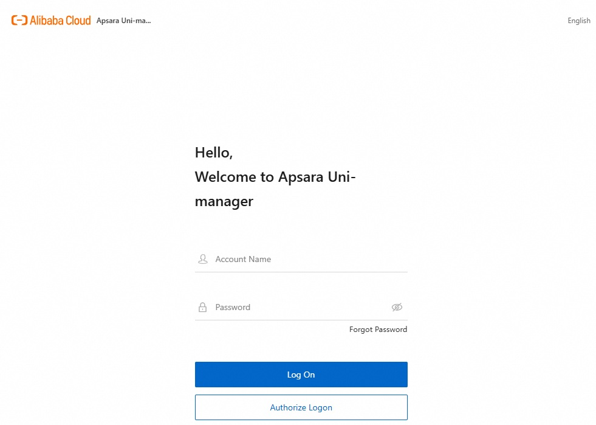

Alibaba Cloud  
Apsara Stack  
Alibaba Cloud DNS  
Alibaba Cloud DNS (Within  
Cloud) User Guide  
Product Version: V3.18.3  
Document Version: 20250612

**Table of Contents**

- [1.What is Apsara Stack DNS?](#section-1)
- [2.User roles and permissions](#section-2)
- [3.Log on to the Apsara Stack DNS console](#section-3)
- [4.DNS within cloud](#section-4)
    - [4.1. Internal DNS resolution management](#section-4-1)
        - [4.1.1. Global internal domain names](#section-4-1-1)
            - [4.1.1.1. Overview](#section-4-1-1-1)
            - [4.1.1.2. View an internal domain name](#section-4-1-1-2)
            - [4.1.1.3. Add a global internal domain name](#section-4-1-1-3)
            - [4.1.1.4. Add a description for a domain name](#section-4-1-1-4)
            - [4.1.1.5. Delete a global internal domain name](#section-4-1-1-5)
            - [4.1.1.6. Delete multiple global internal domain names at a time](#section-4-1-1-6)
            - [4.1.1.7. Add a DNS record for a global internal domain name](#section-4-1-1-7)
            - [4.1.1.8. View operation logs](#section-4-1-1-8)
        - [4.1.2. Global forwarding configurations](#section-4-1-2)
            - [4.1.2.1. Global forwarding domain names](#section-4-1-2-1)
                - [4.1.2.1.1. Overview](#section-4-1-2-1-1)
                - [4.1.2.1.2. View global forwarding domain names](#section-4-1-2-1-2)
                - [4.1.2.1.3. Add a domain name](#section-4-1-2-1-3)
                - [4.1.2.1.4. Add a description for a domain name](#section-4-1-2-1-4)
                - [4.1.2.1.5. Modify the configurations of a domain name](#section-4-1-2-1-5)
                - [4.1.2.1.6. Delete a global forwarding domain name](#section-4-1-2-1-6)
                - [4.1.2.1.7. Delete multiple global forwarding domain names at a time](#section-4-1-2-1-7)
                - [4.1.2.1.8. View operation logs](#section-4-1-2-1-8)
            - [4.1.2.2. Global default forwarding configurations](#section-4-1-2-2)
                - [4.1.2.2.1. Enable default forwarding](#section-4-1-2-2-1)
                - [4.1.2.2.2. Modify default forwarding configurations](#section-4-1-2-2-2)
                - [4.1.2.2.3. Disable default forwarding](#section-4-1-2-2-3)
        - [4.1.3. Global recursive resolution](#section-4-1-3)
            - [4.1.3.1. Recursive ACL policy](#section-4-1-3-1)
                - [4.1.3.1.1. Overview](#section-4-1-3-1-1)
                - [4.1.3.1.2. Add an ACL policy](#section-4-1-3-1-2)
                - [4.1.3.1.3. Modify an ACL policy](#section-4-1-3-1-3)
                - [4.1.3.1.4. Add a description for an ACL policy](#section-4-1-3-1-4)
                - [4.1.3.1.5. Delete an ACL policy](#section-4-1-3-1-5)
                - [4.1.3.1.6. Delete multiple ACL policies at a time](#section-4-1-3-1-6)
                - [4.1.3.1.7. View operation logs](#section-4-1-3-1-7)
            - [4.1.3.2. Global default recursion](#section-4-1-3-2)
                - [4.1.3.2.1. Enable global recursive resolution](#section-4-1-3-2-1)
                - [4.1.3.2.2. Disable global recursive resolution](#section-4-1-3-2-2)
        - [4.1.4. Cache management](#section-4-1-4)
            - [4.1.4.1. Query cached DNS records](#section-4-1-4-1)
            - [4.1.4.2. Clear cached DNS records](#section-4-1-4-2)
    - [4.2. IP Address Line Configuration](#section-4-2)
        - [4.2.1. View global lines](#section-4-2-1)
        - [4.2.2. Create a global line](#section-4-2-2)
        - [4.2.3. Change the priority of a global line](#section-4-2-3)
        - [4.2.4. Modify a global line](#section-4-2-4)
        - [4.2.5. Delete a global line](#section-4-2-5)
        - [4.2.6. Delete multiple global lines at a time](#section-4-2-6)
        - [4.2.7. View operation logs](#section-4-2-7)
- [5.Private DNS](#section-5)
    - [5.1. PrivateZone (DNS Standard Edition only)](#section-5-1)
        - [5.1.1. Tenant internal domain name](#section-5-1-1)
            - [5.1.1.1. View a domain name](#section-5-1-1-1)
            - [5.1.1.2. Add a domain name](#section-5-1-1-2)
            - [5.1.1.3. Configure DNS records for a domain name](#section-5-1-1-3)
            - [5.1.1.4. Bind an organization to a VPC](#section-5-1-1-4)
            - [5.1.1.5. Unbind a domain name from a VPC](#section-5-1-1-5)
            - [5.1.1.6. Add a description for a domain name](#section-5-1-1-6)
            - [5.1.1.7. Delete a tenant internal domain name](#section-5-1-1-7)
            - [5.1.1.8. Delete multiple domain names at a time](#section-5-1-1-8)
            - [5.1.1.9. View a resolution policy](#section-5-1-1-9)
            - [5.1.1.10. Manage tags](#section-5-1-1-10)
            - [5.1.1.11. View operation logs](#section-5-1-1-11)
        - [5.1.2. Tenant forwarding configurations](#section-5-1-2)
            - [5.1.2.1. Tenant forwarding domain names](#section-5-1-2-1)
                - [5.1.2.1.1. View a tenant forwarding domain name](#section-5-1-2-1-1)
                - [5.1.2.1.2. Create a tenant forwarding domain name](#section-5-1-2-1-2)
                - [5.1.2.1.3. Modify the forwarding configurations of a domain name](#section-5-1-2-1-3)
                - [5.1.2.1.4. Bind an organization to a VPC](#section-5-1-2-1-4)
                - [5.1.2.1.5. Unbind a domain name from a VPC](#section-5-1-2-1-5)
                - [5.1.2.1.6. Add a description for a tenant forwarding domain name](#section-5-1-2-1-6)
                - [5.1.2.1.7. Delete a tenant forwarding domain name](#section-5-1-2-1-7)
                - [5.1.2.1.8. Delete multiple tenant forwarding domain names at a time](#section-5-1-2-1-8)
                - [5.1.2.1.9. Manage tags](#section-5-1-2-1-9)
                - [5.1.2.1.10. View operation logs](#section-5-1-2-1-10)
            - [5.1.2.2. Tenant default forwarding configurations](#section-5-1-2-2)
                - [5.1.2.2.1. View default forwarding configurations](#section-5-1-2-2-1)
                - [5.1.2.2.2. Add a default forwarding configuration](#section-5-1-2-2-2)
                - [5.1.2.2.3. Bind an organization to a VPC](#section-5-1-2-2-3)
                - [5.1.2.2.4. Unbind a domain name from a VPC](#section-5-1-2-2-4)
                - [5.1.2.2.5. Modify a default forwarding configuration](#section-5-1-2-2-5)
                - [5.1.2.2.6. Add a default forwarding configuration](#section-5-1-2-2-6)
                - [5.1.2.2.7. Delete a default forwarding configuration](#section-5-1-2-2-7)
                - [5.1.2.2.8. Delete multiple default forwarding configurations](#section-5-1-2-2-8)
                - [5.1.2.2.9. Manage tags](#section-5-1-2-2-9)
                - [5.1.2.2.10. View operation logs](#section-5-1-2-2-10)
    - [5.2. Private lines](#section-5-2)
        - [5.2.1. Query private lines](#section-5-2-1)
        - [5.2.2. Create a private line](#section-5-2-2)
        - [5.2.3. Change the priority of a private line](#section-5-2-3)
        - [5.2.4. Modify a private line](#section-5-2-4)
        - [5.2.5. Delete a private line](#section-5-2-5)
        - [5.2.6. Delete multiple private lines at a time](#section-5-2-6)
        - [5.2.7. View operation logs](#section-5-2-7)
- [6.Global scheduling](#section-6)
    - [6.1. Scheduling instances](#section-6-1)
        - [6.1.1. Search for a scheduling instance](#section-6-1-1)
        - [6.1.2. Create a scheduling instance](#section-6-1-2)
        - [6.1.3. Modify the configurations of a scheduling instance](#section-6-1-3)
        - [6.1.4. Configure a scheduling instance](#section-6-1-4)
            - [6.1.4.1. Create an access policy for a scheduling instance](#section-6-1-4-1)
            - [6.1.4.2. Modify an access policy](#section-6-1-4-2)
            - [6.1.4.3. Delete an access policy for a scheduling instance](#section-6-1-4-3)
        - [6.1.5. Delete a scheduling instance](#section-6-1-5)
        - [6.1.6. View operation logs](#section-6-1-6)
    - [6.2. Address pool](#section-6-2)
        - [6.2.1. Search for address pools](#section-6-2-1)
        - [6.2.2. Create an address pool](#section-6-2-2)
        - [6.2.3. Modify the configurations of an address pool](#section-6-2-3)
        - [6.2.4. Delete an address pool](#section-6-2-4)
        - [6.2.5. Create a health check task for an address pool](#section-6-2-5)
        - [6.2.6. View operation logs](#section-6-2-6)
- [7.System management](#section-7)
    - [7.1. Nodes](#section-7-1)
        - [7.1.1. View a node](#section-7-1-1)
        - [7.1.2. Create an emergency group](#section-7-1-2)
        - [7.1.3. Add a description for a node](#section-7-1-3)
        - [7.1.4. Set a follower node as the leader node](#section-7-1-4)
    - [7.2. Logs](#section-7-2)
        - [7.2.1. Query alert logs](#section-7-2-1)

# 1.What is Apsara Stack DNS?

Apsara Stack DNS is a service that runs on Apsara Stack to resolve domain names. You can configure rules to map domain names to IP addresses. Then, Apsara Stack DNS distributes domain name requests from clients to cloud resources, business systems on your internal networks, or the business resources of Internet service providers (ISPs).

Apsara Stack DNS provides DNS resolution in virtual private clouds (VPCs). You can perform the following operations in your VPC by using Apsara Stack DNS:

- Access other ECS instances deployed in your VPC.

- Access cloud service instances provided by Apsara Stack.

- Access custom enterprise business systems.

- Access Internet services and businesses.

- Establish network connections between DNS and user-created DNS over a leased line.

- Manage internal domain names.

- Manage DNS records of internal domain names.

- Manage forwarding configurations.

- Manage recursive resolution configurations.

# 2.User roles and permissions

| Role | Permission |
| --- | --- |
| System administrator | A user of this role has read, write, and execute permissions on all level-1 organization resources, global resources, and system configurations. |
| Level-1 organization administrator | A user of this role has read, write, and execute permissions on level-1 organization resources to which the user belongs, but does not have permissions on level-1 organization resources, global resources, or system configurations to which other users belong. |
| Lower-level organization administrator | A user of this role does not have permissions on Apsara Stack DNS. The user does not have permissions on level-1 organization resources to which the user belongs, and does not have permissions on level-1 organization resources, global resources, or system configurations to which other users belong. |
| Resource user | A user of this role does not have permissions on Apsara Stack DNS. The user does not have permissions on level-1 organization resources to which the user belongs, and does not have permissions on level-1 organization resources, global resources, or system configurations to which other users belong. |
| Other roles | A user of this role does not have permissions on Apsara Stack DNS. The user does not have permissions on level-1 organization resources to which the user belongs, and does not have permissions on level-1 organization resources, global resources, or system configurations to which other users belong. |

# 3.Log on to the Apsara Stack DNS console

This topic describes how to log on to the Apsara Stack DNS console by using Google Chrome.

**Prerequisites**

- You need to obtain the endpoint of the Apsara Uni-manager Management Console from the deployment personnel.

- A browser is available. We recommend using Google Chrome.

**Procedure**

1. Enter the URL of the Apsara Uni-manager Management Console in the address bar and press Enter.

   

   > **Note**
   >
   > - You can click the current language in the upper-right corner to switch to another language.
   >
   > - The Authorized Login button is displayed only when a global IdP is configured in third-party authentication. You can customize the name of the Authorized Login button based on your requirements.
   >
   > - If you need to click Continue to access multiple times or cannot find the entry to the Apsara Uni-manager Management Console because of an expired browser certificate or HTTPS authentication enabled in the environment, you must install a certificate for normal access. Click **Browser certificate installation** in the upper-right corner to open the browser certificate installation guide.

2. Enter your username and password.

   > **Note**
   >
   > - Obtain the username and password for the Apsara Uni-manager Management Console from the operations administrator.
   >
   > - The first time you log on to the Apsara Uni-manager Management Console, you must change your account password as prompted. For security purposes, the password must be 10 to 32 characters in length. It must contain all of the following character types: uppercase letters, lowercase letters, digits, and special characters. The following special characters are supported: ! @ # $ %

3. Click **Account Logon**.

4. If multi-factor authentication (MFA) is enabled for your account, perform the corresponding operations in the following scenarios:

   - You log on to the Apsara Uni-manager Management Console for the first time after MFA is enabled by the administrator.

     <ol type="a">

     <li>

     On the Bind Virtual MFA Device page, bind an MFA device.

     </li>

     <li>

     Enter the username and password again as in Step 2 and click **Log On**.

     </li>

     </ol>

     <ol type="i" start="100">

     <li>

     Enter a six-digit MFA verification code and click **Authenticate**.

     </li>

     </ol>

   - You have enabled MFA and bound an MFA device.

     Enter a six-digit MFA verification code and click **Authenticate**.

     > **Note**
     >
     > For more information, see the **Bind a virtual MFA device to enable**
     >
     > **MFA** topic in **Apsara Uni-manager Management Console User Guide**.

5. In the top navigation bar, choose **Products > Networking > DNS within Cloud**.

# 4.DNS within cloud

## 4.1. Internal DNS resolution management

Internal DNS resolution management allows you to manage global internal domain names, global forwarding configurations, and global recursive resolution configurations that you have created in Apsara Stack.

### 4.1.1. Global internal domain names

#### 4.1.1.1. Overview

All the operations of this feature require administrator privileges.

#### 4.1.1.2. View an internal domain name

**Procedure**

1. Log on to the Apsara Stack DNS console.

2. In the left-side navigation pane, choose **Internal Domains > Global Internal Domains**.

3. In the **Domain Name** search box, enter the domain name that you want to view.

4. Click **Search**. The search result is displayed.

#### 4.1.1.3. Add a global internal domain name

This topic describes how to add a global internal domain name in the Apsara Stack Domain Name System (DNS) console.

**Procedure**

1. Log on to the Apsara Stack DNS console.

2. In the left-side navigation pane, click . On the page that appears, click the **Global Internet Domain Name** tab.

3. Click Add Domain Name.

4. In the Add Global Internal Domain Name dialog box, enter the domain name that you want to add in the **Global Internal Domain Name** field.

5. Select Primary Domain Name or Secondary Domain Name from the **Current Domain Name Type** drop-down list.

6. 

7. If you select Secondary Domain Name, you must set the **DNS Server Address of Primary Domain Name** parameter. The value of this parameter can only be an IPv4 or IPv6 address in the ip:port format.

8. Turn on **Enable TSIG Key Authentication** based on your business requirements.

9. Click **OK**.

#### 4.1.1.4. Add a description for a domain name

This topic describes how to add a description for a domain name in the Apsara Uni-manager Management Console.

**Background information**

You can add a description for a domain name to help you identify it. For example, you can add a hostname or internal system information to describe a domain name.

**Procedure**

1. Log on to the Apsara Stack DNS console.

2. In the left-side navigation pane, choose **Internal Domain Names > Global Internal Domain Name**.

3. Find the domain name for which you want to add a description, click the

   icon in the

   

   Actions column, and then select **Description**.

4. In the dialog box that appears, enter a description.

5. Click **OK**.

#### 4.1.1.5. Delete a global internal domain name

This topic describes how to delete a global internal domain name in the Apsara Stack Domain Name System (DNS) console.

**Procedure**

1. Log on to the Apsara Stack DNS console.

2. In the left-side navigation pane, click . On the page that appears, click the **Global Internet Domain Name** tab.

3. Find the domain name that you want to delete and click **Delete** in the Actions column.

4. In the message that appears, click **OK**.

#### 4.1.1.6. Delete multiple global internal domain names at a time

This topic describes how to delete multiple global internal domain names at a time in the Apsara Stack Domain Name System (DNS) console.

**Procedure**

1. Log on to the Apsara Stack DNS console.

2. In the left-side navigation pane, click . On the page that appears, click the **Global Internet Domain Name** tab.

3. Select one or more domain names that you want to delete and click **Batch Delete** below the domain name list.

4. In the message that appears, click **OK**.

#### 4.1.1.7. Add a DNS record for a global internal domain name

This topic describes how to add a Domain Name System (DNS) record for a global internal domain name in the Apsara Stack DNS console.

**Procedure**

1. Log on to the Apsara Stack DNS console.

2. In the left-side navigation pane, click . On the page that appears, click the **Global Internet Domain Name** tab.

3. Find the domain name for which you want to add a DNS record and click **Configure DNS Records** in the Actions column or click the value in the **Record Sets** column to go to the **DNS Settings** page.

4. On the DNS Settings page, click **Add DNS Record** in the upper-left corner.

5. In the **Add DNS Record** dialog box, set the following parameters: Record name, Record Type, TTL (Seconds), Load Balancing Policy, Resolution Line, and Record Values. Then, click **OK**.

   The following tables describe the settings of the Load Balancing Policy parameter for different types of DNS records.

   - A record

     | Load Balancing Policy | Description |
     | --- | --- |
     | Polling | You can specify up to 100 unique IPv4 addresses. Each address must be in a separate row. Make sure that the IPv4 addresses are valid. Examples: • 192.168.1.1 • 192.168.1.2 • 192.168.1.3 |
     | Weight | You can specify up to 100 unique IPv4 addresses. Each address must be in a separate row. Requirements: • Use the format of \[IPv4 address\] \[Weight\] to specify each IPv4 address. Separate the IPv4 address and weight value with a space. • Make sure that the IPv4 addresses are valid. • The weight value must be an integer ranging from 0 to 999. A larger value indicates a greater weight. Examples: • 192.168.1.1 20 • 192.168.1.1 30 • 192.168.1.1 50 |

   - AAAA record

     | Load Balancing Policy | Description |
     | --- | --- |
     | Polling | You can specify up to 100 unique IPv6 addresses. Each address must be in a separate row. Make sure that the IPv6 addresses are valid. Examples: • 2400:3200::6666 • 2400:3200::6688 • 2400:3200::8888 |
     | Weight | You can specify up to 100 unique IPv6 addresses. Each address must be in a separate row. Requirements: • Use the format of \[IPv6 address\] \[Weight\] to specify each IPv6 address. Separate the IPv6 address and weight value with a space. • Make sure that the IPv6 addresses are valid. • The weight value must be an integer ranging from 0 to 999. A larger value indicates a greater weight. Examples: • 2400:3200::6666 20 • 2400:3200::6688 20 • 2400:3200::8888 60 |

   - Canonical name (CNAME) record

     | Load Balancing Policy | Description |
     | --- | --- |
     | Polling | You can enter only one domain name. The domain name must be a fully qualified domain name (FQDN) that ends with a period (.) and can be up to 255 characters in length. Example: www.example.com. |

     <table>
       <tr>
         <td>Weight</td>
         <td>You can specify up to 100 unique domain names. Each domain name must be in a separate row. Requirements: • Use the format of [Domain name] [Weight] to specify each domain name. Separate the domain name and weight value with a space. • The domain name must be an FQDN that ends with a period (.) and can be up to 255 characters in length. • The weight value must be an integer ranging from 0 to 999. A larger value indicates a greater weight. Examples: • www1.example.com. 20 • www2.example.com. 20 • www3.example.com. 60</td>
       </tr>
     </table>

   - Mail exchanger (MX) record

     | Load Balancing Policy | Description |
     | --- | --- |
     | Polling | You can specify up to 100 unique email server hostnames. Each hostname must be in a separate row. Requirements: • Use the format of \[Priority\] \[Email server hostname\] to specify each hostname. Separate the priority and hostname with a space. • The priority value must be an integer ranging from 0 to 999. A smaller value indicates a higher priority. • The email server hostname must be an FQDN that ends with a period (.) and can be up to 255 characters in length. Examples: • 10 mailserver1.example.com. • 20 mailserver2.example.com. |

   - Text (TXT) record

     | Load Balancing Policy | Description |
     | --- | --- |
     | Polling | You can specify up to 100 unique character strings. Each string must be in a separate row. A string must be 1 to 255 characters in length. No row can be left empty. Example: "v=spf1 ip4:192.168.0.1/16 ip6:2001::1/96 ~all". |

   - Pointer (PTR) record

     | Load Balancing Policy | Description |
     | --- | --- |
     | Polling | You can specify up to 100 unique domain names. Each domain name must be in a separate row. Each domain name must be an FQDN that ends with a period (.) and can be up to 255 characters in length. Examples: • www1.example.com. • www2.example.com. • www3.example.com. |

   - Service (SRV) record

     | Load Balancing Policy | Description |
     | --- | --- |
     | Polling | You can specify up to 100 unique application server hostnames. Each hostname must be in a separate row. Requirements: • Use the format of \[Priority\] \[Weight\] \[Port number\] \[Application server hostname\] to specify each hostname. Separate every two consecutive items with a space. • The priority value must be an integer ranging from 0 to 999. A smaller value indicates a higher priority. • The weight value must be an integer ranging from 0 to 999. A larger value indicates a greater weight. • The port number must be an integer ranging from 0 to 65535. The value indicates the TCP or UDP port used for network communications. • The application server hostname must be an FQDN that ends with a period (.) and can be up to 255 characters in length. Examples: • 1 10 8080 www1.example.com. • 2 20 8081 www2.example.com. |

   - Name Authority Pointer (NAPTR) record

     | Load Balancing Policy | Description |
     | --- | --- |
     | Polling | You can specify up to 100 unique NAPTR records. Each record must be in a separate row. Requirements: • Use the format of \[Serial number\] \[Priority\] \[Flag\] \[Service information\] \[Regular expression\] \[Substitute domain name\] to specify each record. Separate every two consecutive items with a space. • The serial number must be an integer ranging from 0 to 999. A smaller value indicates a higher priority. • The priority value must be an integer ranging from 0 to 999. A smaller value indicates a higher priority. If two records have the same serial number, the one with a higher priority takes effect first. • The flag value can be left empty or be a character from A to Z, a to z, or 0 to 9. The flag value is not case-sensitive and must be enclosed in double quotation marks (""). • The service information can be left empty or be a string of 1 to 32 characters. The value must start with a letter and be enclosed in double quotation marks (""). • The regular expression can be left empty or be a string of 1 to 255 characters enclosed in double quotation marks (""). • The substitute domain name must be an FQDN that ends with a period (.) and can be up to 255 characters in length. Examples: • 100 50 "S" "Z3950+I2L+I2C" "" _z3950._tcp.example.com. • 100 50 "S" "RCDS+I2C" "" _rcds._udp.example.com. • 100 50 "S" "HTTP+I2L+I2C+I2R" "" _http._tcp.example.com. |

   - CAA record

     | Load Balancing Policy | Description |
     | --- | --- |

     <table>
       <tr>
         <td>Polling</td>
         <td>You can specify up to 100 unique CAA records. Each record must be in a separate row. Requirements: • Use the format of [Certificate authority flag] [Certificate property tag] [Authorization information] to specify each record. Separate every two consecutive items with a space. • The certificate authority flag must be an integer ranging from 0 to 255. • The certificate property tag can be issue, issuewild, or iodef. • The authorization information must be 1 to 255 characters in length and enclosed in double quotation marks (""). Examples: • 0 issue "caa.example.com" • 0 issuewild ";" • 0 iodef "mailto:example@example.com"</td>
       </tr>
     </table>

   - Name server (NS) record

     | Load Balancing Policy | Description |
     | --- | --- |
     | Polling | You can specify up to 100 unique DNS server addresses. Each address must be in a separate row. Each DNS server address must be an FQDN that ends with a period (.) and can be up to 255 characters in length. It cannot be a wildcard domain name. Examples: • ns1.example.com. • ns2.example.com. |

6. After you add DNS records, perform the following operations on the DNS Settings page based on your business requirements:

   - Add a description for a DNS record

     Find the DNS record for which you want to add a description and click **Add Description** in the Actions column. In the dialog box that appears, enter a description in the Add Description field and click **OK**.

   - Delete a DNS record

     Find the DNS record that you want to delete and click **Delete** in the Actions column. In the message that appears, click **OK**.

   - Modify a DNS record

     Find the DNS record that you want to modify and click **Modify** in the Actions column. In the Modify DNS Record dialog box, modify the parameters based on your business requirements and click **OK**.

   - Delete multiple DNS records at a time Select the DNS records that you want to delete and click **Batch Delete** in the lower-left corner of the page. In the message that appears, click **OK**.

   - Search for a DNS record

     You can search for a DNS record by using the keyword of the record name.

#### 4.1.1.8. View operation logs

**Procedure**

1. Log on to the Apsara Stack Domain Name System (DNS) console.

2. Click **Global Domain Names > Global Internet Domain Name**.

3. Find the global internal domain name whose operation logs you want to view and click **Operation Log** in the **Actions** column.

4. Go to the **Operation Log** page.

5. Use one of the following methods to find the operation whose logs you want to view:

   - Select a filter option from the drop-down list and enter the corresponding information in the search box to search for qualified operations.

   - Click **Advanced Filter**, specify multiple filter options, and then click **Search** to search for qualified operations.

     > **Note**
     >
     > You can select multiple filter options to narrow down search results.

6. Find the operation whose logs you want to view and click **Operation Details** in the **Operation** column.

7. In the **Operation Details** panel, you can view detailed operation logs, including **Basic Information** and **API Call Details**.

### 4.1.2. Global forwarding configurations

#### 4.1.2.1. Global forwarding domain names

##### 4.1.2.1.1. Overview

All operations on global forwarding domain names require system administrator permissions.

Apsara Stack DNS forwards specific domain names to other DNS servers for resolution.

Apsara Stack DNS can forward requests with or without recursion.

- In the mode of forwarding without recursion, only the specified DNS server is used to resolve domain names. If the resolution fails or times out, a message is returned to the DNS client to indicate that the current request fails.

- In the mode of forwarding with recursion, the specified DNS server is preferentially used to resolve domain names. If the resolution fails, the local DNS server is used.

##### 4.1.2.1.2. View global forwarding domain names

This topic describes how to view global forwarding domain names in the Apsara Uni-manager Management Console. This operation requires administrator permissions.

**Procedure**

1. Log on to the Apsara Stack DNS console.

2. In the left-side navigation pane, choose **Internal Domain Names > Forwarding Settings > Global Forwarding Domain Names**.

3. In the **Domain Name** search box, enter the domain name that you want to query and click **Search**.

##### 4.1.2.1.3. Add a domain name

This topic describes how to add a domain name in the Apsara Uni-manager Management Console. This operation requires administrator permissions.

**Procedure**

1. Log on to the Apsara Stack DNS console.

2. In the left-side navigation pane, choose **Internal Domain Names > Forwarding Settings > Global Forwarding Domain Names**.

3. Click **Add Domain Name**.

4. In the dialog box that appears, configure Global Forwarding Domain, Forwarding Mode, and Forwarder IP Addresses. Then, click **OK**.

##### 4.1.2.1.4. Add a description for a domain name

This topic describes how to add a description for a domain name in the Apsara Uni-manager Management Console. This operation requires administrator permissions.

**Background information**

You can add a description for a domain name to help you identify it. For example, you can describe a domain name by using a hostname or internal system information.

**Procedure**

1. Log on to the Apsara Stack DNS console.

2. In the left-side navigation pane, choose **Internal Domain Names > Forwarding Settings > Global Forwarding Domain Names**.

3. Select the domain name for which you want to add a description, click

   in the Actions

   

   column, and then select **Description**.

4. In the dialog box that appears, enter a description and click **OK**.

##### 4.1.2.1.5. Modify the configurations of a domain name

This topic describes how to modify the configurations of a global forwarding domain name in the Apsara Uni-manager Management Console. This operation requires system administrator permissions.

**Procedure**

1. Log on to the Apsara Stack Domain Name System (DNS) console. For more information, see Log on to the Apsara Stack DNS console.

2. Choose **DNS within Cloud > Global Domain Name within Cloud** in the left-side navigation pane. On the page that appears, click the **Global Forwarding Configurations** tab and click the Global Forwarding Domain Names subtab.

3. Find the domain name whose configurations you want to modify and click **Modify** in the Actions column.

4. In the dialog box that appears, modify the Forwarding Mode and Destination IP Address parameters based on your business requirements and click **OK**.

##### 4.1.2.1.6. Delete a global forwarding domain name

This topic describes how to delete a global forwarding domain name in the Apsara Stack Domain Name System (DNS) console. This operation requires system administrator permissions.

**Procedure**

1. Log on to the Apsara Stack DNS console.

2. In the left-side navigation pane, choose **DNS within Cloud > Global Domain Name within Cloud**. On the page that appears, click the **Global Forwarding Configurations** tab and click the Global Forwarding Domain Names subtab.

3. Find the domain name that you want to delete and click Delete in the Actions column.

4. In the message that appears, click **OK**.

##### 4.1.2.1.7. Delete multiple global forwarding domain names at a time

This topic describes how to delete multiple global forwarding domain names at a time in the Apsara Stack Domain Name System (DNS) console. This operation requires system administrator permissions.

**Procedure**

1. Log on to the Apsara Stack DNS console.

2. In the left-side navigation pane, choose **DNS within Cloud > Global Domain Name within Cloud**. On the page that appears, click the **Global Forwarding Configurations** tab and click the Global Forwarding Domain Names subtab.

3. Select one or more domain names that you want to delete and click Batch Delete below the domain name list.

4. In the message that appears, click **OK**.

##### 4.1.2.1.8. View operation logs

**Procedure**

1. Log on to the Apsara Stack Domain Name System (DNS) console.

2. Click **Global Domain Names > Global Forwarding Configurations > Global Forwarding Domain Names**

3. Find the global forwarding domain name whose operation logs you want to view and click **Operation Log** in the **Actions** column.

4. Go to the **Operation Log** page.

5. Use one of the following methods to find the operation whose logs you want to view:

   - Select a filter option from the drop-down list and enter the corresponding information in the search box to search for qualified operations.

   - Click **Advanced Filter**, specify multiple filter options, and then click **Search** to search for qualified operations.

     > **Note**
     >
     > You can select multiple filter options to narrow down search results.

6. Find the operation whose logs you want to view and click **Operation Details** in the **Operation** column.

7. In the **Operation Details** panel, you can view detailed operation logs, including **Basic Information** and **API Call Details**.

#### 4.1.2.2. Global default forwarding configurations

##### 4.1.2.2.1. Enable default forwarding

This topic describes how to enable default forwarding in the Apsara Stack Domain Name System (DNS) console. This operation requires administrator permissions.

**Procedure**

1. Log on to the Apsara Stack DNS console.

2. In the left-side navigation pane, choose **DNS within Cloud > Global Domain Name within Cloud**. On the Global Domain Names page, click the **Global Forwarding Configurations** tab and click the Global Default Forwarding Configurations subtab.

3. Turn on Default Forwarding.

4. Set the Default Forwarding Mode and Destination IP Address parameters.

| Parameter | Description |
| --- | --- |
| Default Forwarding Mode | The forwarding mode of the domain name. For both domain name-based forwarding and default forwarding, the following two forwarding modes are supported: • Forward All Mode: forwards DNS requests to the destination DNS server. If the destination DNS server does not obtain a resolution result, a message is returned to the DNS client indicating that the request failed. • Forward First Mode: A specified DNS server is preferentially used to resolve domain names. If the specified DNS server does not obtain a resolution result, the local DNS server is used for recursive queries over the Internet. If you enter only internal IP addresses in the Destination IP Address text box, unexpected results may occur during recursive resolution. For example, a domain name used for internal network services may be resolved to a public IP address. |
| Destination IP Address | The destination IP addresses. Note You can specify up to five unique IPv4 or IPv6 addresses. Each address must be in a separate row. |

1. Click **Submit**.

##### 4.1.2.2.2. Modify default forwarding configurations

This topic describes how to modify default forwarding configurations in the Apsara Stack Domain Name System (DNS) console. This operation requires system administrator permissions.

**Procedure**

1. Log on to the Apsara Stack DNS console.

2. In the left-side navigation pane, choose **DNS within Cloud > Global Domain Name within Cloud**. On the Global Domain Names page, click the **Global Forwarding Configurations** tab and click the Global Default Forwarding Configurations subtab.

3. Modify the settings of the Default Forwarding Mode and Destination IP Address parameters based on your business requirements.

| Parameter | Description |
| --- | --- |
| Default Forwarding Mode | The forwarding mode of the domain name. For both domain name-based forwarding and default forwarding, the following two forwarding modes are supported: • Forward All Mode: forwards DNS requests to the destination DNS server. If the destination DNS server cannot obtain a result, a message is returned to the DNS client indicating that the request failed. • Forward First Mode: A specified DNS server is preferentially used to resolve domain names. If the specified DNS server cannot obtain a result, the local DNS server is used for recursive queries over the Internet. If you enter only internal IP addresses in the Destination IP Address text box, unexpected results may occur during recursive resolution. For example, a domain name used for internal network services may be resolved to a public IP address. |
| Destination IP Address | The destination IP addresses. Note You can specify up to five unique IPv4 or IPv6 addresses. Each address must be in a separate row. |

1. Click **Submit**.

##### 4.1.2.2.3. Disable default forwarding

This topic describes how to disable default forwarding in the Apsara Stack Domain Name System (DNS) console. This operation requires system administrator permissions.

**Procedure**

1. Log on to the Apsara Stack DNS console.

2. In the left-side navigation pane, choose **DNS within Cloud > Global Domain Name within Cloud**. On the Global Domain Names page, click the **Global Forwarding Configurations** tab and click the Global Default Forwarding Configurations subtab.

3. Turn off Default Forwarding.

4. Click **Submit**.

### 4.1.3. Global recursive resolution

#### 4.1.3.1. Recursive ACL policy

##### 4.1.3.1.1. Overview

Recursive access control list (ACL) policies are used to specify whether to recursively send DNS requests to the Internet.

> **Note**
>
> Recursive resolution defined in such ACL policies takes precedence over global recursive resolution.

##### 4.1.3.1.2. Add an ACL policy

This topic describes how to add an access control list (ACL) policy in the Apsara Stack Domain Name System (DNS) console. This operation requires system administrator permissions.

**Procedure**

1. Log on to the Apsara Stack DNS console.

2. In the left-side navigation pane, click **Global Domain Name within Cloud**. On the **Global Domain Names** page, click the **Global Recursive Resolution** tab, and then click the **Recursive ACL Policy** subtab.

3. Click **Add**.

4. In the dialog box that appears, set the following parameters: **ACL Policy Name**, **Request Source**, **Enable Recursion**, and **Description**.

| Parameter | Description |
| --- | --- |
| ACL Policy Name | Required. The name is globally unique in recursive ACL policies. For more information about naming conventions, see Basic conventions for user interfaces. |
| Request Source | Required. You can select multiple lines that you configured on the Global Line page. If a line has been selected for another ACL policy, the line cannot be selected here. |
| Enable Recursion | Required. Recursive resolution is allowed if you turn on this switch. |
| Description | Optional. |

5. Click **OK**.

##### 4.1.3.1.3. Modify an ACL policy

This topic describes how to modify an access control list (ACL) policy in the Apsara Stack Domain Name System (DNS) console. This operation requires system administrator permissions.

**Procedure**

1. Log on to the Apsara Stack DNS console.

2. In the left-side navigation pane, click **Global Domain Name within Cloud**. On the **Global Domain Names** page, click the **Global Recursive Resolution** tab, and then click the **Recursive ACL Policy** subtab.

3. Find the ACL policy that you want to modify and click **Modify** in the Actions column.

4. In the dialog box that appears, modify the settings of the **Policy Name**, **Request Source**, and **Enable Recursion** parameters based on your business requirements.

| Parameter | Description |
| --- | --- |
| Policy Name | Required. The name is globally unique in recursive ACL policies. For more information about naming conventions, see Basic conventions for user interfaces. |
| Request Source | Required. You can select multiple lines that you configured on the Global Line page. If a line has been selected for another ACL policy, the line cannot be selected here. |
| Enable Recursion | Required. Recursive resolution is allowed if you turn on this switch. |

5. Click **OK**.

##### 4.1.3.1.4. Add a description for an ACL policy

This topic describes how to add a description for an access control list (ACL) policy in the Apsara Stack Domain Name System (DNS) console. This operation requires system administrator permissions.

**Procedure**

1. Log on to the Apsara Stack DNS console.

2. In the left-side navigation pane, click **Global Domain Name within Cloud**. On the **Global Domain Names** page, click the **Global Recursive Resolution** tab, and then click the **Recursive ACL Policy** subtab.

3. Find the domain name for which you want to add a description and click **Description** in the Actions column.

4. In the dialog box that appears, enter a description in the Description field.

5. Click **OK**.

##### 4.1.3.1.5. Delete an ACL policy

You can delete an access control list (ACL) policy in the Apsara Stack Domain Name System (DNS) console. This operation requires system administrator permissions.

**Procedure**

1. Log on to the Apsara Stack DNS console.

2. In the left-side navigation pane, click **Global Domain Name within Cloud**. On the **Global Domain Names** page, click the **Global Recursive Resolution** tab, and then click the **Recursive ACL Policy** subtab.

3. Find the ACL policy that you want to delete and click Delete in the Actions column.

4. In the message that appears, click **OK**.

##### 4.1.3.1.6. Delete multiple ACL policies at a time

You can delete multiple access control list (ACL) policies at a time in the Apsara Stack Domain Name System (DNS) console. This operation requires system administrator permissions.

**Procedure**

1. Log on to the Apsara Stack DNS console.

2. In the left-side navigation pane, click **Global Domain Name within Cloud**. On the **Global Domain Names** page, click the **Global Recursive Resolution** tab, and then click the **Recursive ACL Policy** subtab.

3. Select one or more ACL policies and click **Batch Delete** in the lower-left corner of the page.

4. In the message that appears, click **OK**.

##### 4.1.3.1.7. View operation logs

**Procedure**

1. Log on to the Apsara Stack Domain Name System (DNS) console.

2. In the left-side navigation pane, click **Global Domain Name within Cloud > Global Domain Names > Global Recursive Resolution > Recursive ACL Policy**.

3. Find the recursive ACL policy whose operation logs you want to view and click **Operation Log** in the **Actions** column.

4. Go to the **Operation Log** page.

5. Use one of the following methods to find the operation whose logs you want to view:

   - Select a filter option from the drop-down list and enter the corresponding information in the search box to search for qualified operations.

   - Click **Advanced Filter**, specify multiple filter options, and then click **Search** to search for qualified operations.

     > **Note**
     >
     > You can select multiple filter options to narrow down search results.

6. Find the operation whose logs you want to view and click **Operation Details** in the **Operation** column.

7. In the **Operation Details** panel, you can view detailed operation logs, including **Basic Information** and **API Call Details**.

#### 4.1.3.2. Global default recursion

##### 4.1.3.2.1. Enable global recursive resolution

**Prerequisites**

System administrator permissions are granted to your account.

**Procedure**

1. Log on to the Apsara Stack Domain Name System (DNS) console.

2. In the left-side navigation pane, click **Global Domain Name within Cloud**. On the Global Domain Names page, click the **Global Recursive Resolution** tab, and then click the Global Default Recursion subtab.

3. Turn on **Global Recursive Resolution**.

4. Click **Submit**.

##### 4.1.3.2.2. Disable global recursive resolution

**Prerequisites**

System administrator permissions are granted to your account.

**Procedure**

1. Log on to the Apsara Stack Domain Name System (DNS) console.

2. In the left-side navigation pane, click **Global Domain Name within Cloud**. On the Global Domain Names page, click the **Global Recursive Resolution** tab, and then click the Global Default Recursion subtab.

3. Turn off **Global Recursive Resolution**.

4. Click **Submit**.

### 4.1.4. Cache management

Domain names that are queried by using global forwarding or recursion are cached.

#### 4.1.4.1. Query cached DNS records

You can query cached Domain Name System (DNS) records in the Apsara Stack DNS console. This operation requires system administrator permissions.

**Procedure**

1. Log on to the Apsara Stack DNS console.

2. In the left-side navigation pane, click **Global Domain Name within Cloud.** .

3. Select a record type from the **Type** drop-down list and enter a domain name.

#### 4.1.4.2. Clear cached DNS records

You can clear cached Domain Name System (DNS) records in the Apsara Stack DNS console. This operation requires system administrator permissions.

**Procedure**

1. Log on to the Apsara Stack DNS console.

2. In the left-side navigation pane, click **Global Domain Name within Cloud**

3. Click **Clear Cache**.

4. In the dialog box that appears, set the following parameters: **Service Instance**, **Domain name**, and **Domain Name Matching Method**.

| Parameter | Description |
| --- | --- |
| Service Instance | You can select multiple service instances. Only the learner nodes on the Nodes page can be selected. The instance names are displayed in the format of Resolution Node (Service instance IP address). |
| Domain Name | Enter a domain name. |
| Domain Name Matching Method | You can select Suffix Match or Exact Match. Suffix Match is selected by default. If you select Suffix Match, the cached DNS records of all the domain names with the same suffix as the domain name that you specified are cleared. If you select Exact Match, only the cached DNS records of the domain name that you specified are cleared. |

5. Click **OK**.

## 4.2. IP Address Line Configuration

The IP Address Line Configuration tab allows you to define lines based on IP addresses. The lines are used to group request sources to achieve intelligent load balancing.

### 4.2.1. View global lines

You can view the list of global lines in the Apsara Stack Domain Name System (DNS) console.

**Procedure**

1. Log on to the Apsara Stack DNS console.

2. In the left-side navigation pane, click **Global Line**.

3. On the Global Line page, select **Line Name** or **IP** from the drop-down list, enter the corresponding keyword in the search box, and then click the Search icon.

### 4.2.2. Create a global line

You can create a global line in the Apsara Stack Domain Name System (DNS) console.

**Procedure**

1. Log on to the Apsara Stack DNS console.

2. In the left-side navigation pane, click **Global Line**.

3. On the Global Line page, click **Add Line**.

4. In the dialog box that appears, set the **Line Name** parameter.

5. Select an option from the **Sorting Method** drop-down list.

6. Specify at least one or both of **IPv4 Address Range** and **IPv6 Address Range**.

7. Click **OK**.

### 4.2.3. Change the priority of a global line

You can change the priority of a global line in the Apsara Stack Domain Name System (DNS) console.

**Procedure**

1. Log on to the Apsara Stack DNS console.

2. In the left-side navigation pane, click **Global Line**.

3. On the Global Line page, find the desired line and click **Sort** in the **Actions** column.

4. In the dialog box that appears, select an option from the **Sorting Method** drop-down list and click OK.

5.

### 4.2.4. Modify a global line

You can modify a global line in the Apsara Stack Domain Name System (DNS) console.

**Procedure**

1. Log on to the Apsara Stack DNS console.

2. In the left-side navigation pane, click **Global Line**.

3. On the Global Line page, find the desired line and click **Modify** in the **Actions** column.

4. In the Modify Line dialog box, change the value of the **Line Name** parameter.

5. Change the value of **IPv4 Address Range** or **IPv6 Address Range** based on your business requirements.

6. Click **OK**.

### 4.2.5. Delete a global line

You can delete a global line in the Apsara Stack Domain Name System (DNS) console.

**Procedure**

1. Log on to the Apsara Stack DNS console.

2. In the left-side navigation pane, click **Global Line**.

3. On the Global Line page, find the desired line and click **Delete** in the **Actions** column.

4. In the message that appears, click **OK**.

### 4.2.6. Delete multiple global lines at a time

You can delete multiple global lines in the Apsara Stack Domain Name System (DNS) console.

**Procedure**

1. Log on to the Apsara Stack DNS console.

2. In the left-side navigation pane, click **Global Line**

3. On the Global Line page, select one or more lines and click **Batch Delete** below the line list.

4. In the message that appears, click **OK**.

### 4.2.7. View operation logs

**Procedure**

1. Log on to the Apsara Stack Domain Name System (DNS) console.

2. Click **Query Source** in the left-side navigation pane.

3. Find the global line whose operation logs you want to view and click **Operation Log** in the **Actions** column.

4. Go to the **Operation Log** page.

5. Use one of the following methods to find the operation whose logs you want to view:

   - Select a filter option from the drop-down list and enter the corresponding information in the search box to search for qualified operations.

   - Click **Advanced Filter**, specify multiple filter options, and then click **Search** to search for qualified operations.

     > **Note**
     >
     > You can select multiple filter options to narrow down search results.

6. Find the operation whose logs you want to view and click **Operation Details** in the **Operation** column.

7. In the **Operation Details** panel, you can view detailed operation logs, including **Basic Information** and **API Call Details**.

# 5.Private DNS

## 5.1. PrivateZone (DNS Standard Edition only)

The PrivateZone feature allows you to create VPC-specific tenant domain names. You can bind the domain names to VPCs as required to achieve tenant isolation.

### 5.1.1. Tenant internal domain name

#### 5.1.1.1. View a domain name

**Procedure**

1. Log on to the Apsara Stack DNS console.

2. In the left-side navigation pane, choose **Forwarding Configurations > Tenant Internal Domains**.

3. In the **Domain Name** search box, enter the domain name that you want to view.

4. Click Search. The search result is displayed.

#### 5.1.1.2. Add a domain name

**Procedure**

1. Log on to the Apsara Stack DNS console.

2. In the left-side navigation pane, choose **Forwarding Configurations > Tenant Internal Domains**.

3. Click **Add Domain Name**.

4. In the dialog box that appears, set Tenant Internal Domain Name.

5. Click **OK**.

#### 5.1.1.3. Configure DNS records for a domain name

**Procedure**

1. Log on to the Apsara Stack Domain Name System (DNS) console.

2. In the left-side navigation pane, choose **Private DNS > Private DNS**. On the Private Domain Names for VPC page, click the Tenant Internal Domain Name tab.

3. Find the domain name for which you want to configure DNS records and click **Configure DNS Records** in the Actions column or click the value in the **Record Sets** column to go to the **DNS Settings** page.

4. On the DNS Settings page, click **Add DNS Record** in the upper-left corner.

5. In the **Add DNS Record** dialog box, set the following parameters: Record name, Record Type, TTL (Seconds), Load Balancing Policy, Resolution Line, and Record Values. Then, click **OK**.

   The following tables describe the settings of the Load Balancing Policy parameter that correspond to different types of DNS records.

   - A record

     | Load Balancing Policy | Description |
     | --- | --- |
     | Polling | You can specify up to 100 unique IPv4 addresses. Each address must be in a separate row. Make sure that the IPv4 addresses are valid. Examples: • 192.168.1.1 • 192.168.1.2 • 192.168.1.3 |
     | Weight | You can specify up to 100 unique IPv4 addresses. Each address must be in a separate row. Requirements: • Use the format of \[IPv4 address\] \[Weight\] to specify each IPv4 address. Separate the IPv4 address and weight value with a space. • Make sure that the IPv4 addresses are valid. • The weight value must be an integer ranging from 0 to 999. A larger value indicates a greater weight. Examples: • 192.168.1.1 20 • 192.168.1.1 30 • 192.168.1.1 50 |

   - AAAA record

     | Load Balancing Policy | Description |
     | --- | --- |
     | Polling | You can specify up to 100 unique IPv6 addresses. Each address must be in a separate row. Make sure that the IPv6 addresses are valid. Examples: • 2400:3200::6666 • 2400:3200::6688 • 2400:3200::8888 |
     | Weight | You can specify up to 100 unique IPv6 addresses. Each address must be in a separate row. Requirements: • Use the format of \[IPv6 address\] \[Weight\] to specify each IPv6 address. Separate the IPv6 address and weight value with a space. • Make sure that the IPv6 addresses are valid. • The weight value must be an integer ranging from 0 to 999. A larger value indicates a greater weight. Examples: • 2400:3200::6666 20 • 2400:3200::6688 20 • 2400:3200::8888 60 |

   - Canonical name (CNAME) record

     | Load Balancing Policy | Description |
     | --- | --- |
     | Polling | You can enter only one domain name. The domain name must be a fully qualified domain name (FQDN) that ends with a period (.) and can be up to 255 characters in length. Example: www.example.com. |
     | Weight | You can specify up to 100 unique domain names. Each domain name must be in a separate row. Requirements: • Use the format of \[Domain name\] \[Weight\] to specify each domain name. Separate the domain name and weight value with a space. • Each domain name must be an FQDN that ends with a period (.) and can be up to 255 characters in length. • The weight value must be an integer ranging from 0 to 999. A larger value indicates a greater weight. Examples: • www1.example.com. 20 • www2.example.com. 20 • www3.example.com. 60 |

   - Mail exchanger (MX) record

     | Load Balancing Policy | Description |
     | --- | --- |
     | Polling | You can specify up to 100 unique email server hostnames. Each hostname must be in a separate row. Requirements: • Use the format of \[Priority\] \[Email server hostname\] to specify each hostname. Separate the priority and hostname with a space. • The priority value must be an integer ranging from 0 to 999. A smaller value indicates a higher priority. • The email server hostname must be an FQDN that ends with a period (.) and can be up to 255 characters in length. Examples: • 10 mailserver1.example.com. • 20 mailserver2.example.com. |

   - Text (TXT) record

     | Load Balancing Policy | Description |
     | --- | --- |
     | Polling | You can specify up to 100 unique character strings. Each string must be in a separate row. Each string must be 1 to 255 characters in length. No row can be left empty. Example: "v=spf1 ip4:192.168.0.1/16 ip6:2001::1/96 ~all" |

   - Pointer (PTR) record

     | Load Balancing Policy | Description |
     | --- | --- |
     | Polling | You can specify up to 100 unique domain names. Each domain name must be in a separate row. Each domain name must be an FQDN that ends with a period (.) and can be up to 255 characters in length. Examples: • www1.example.com. • www2.example.com. • www3.example.com. |

   - Service (SRV) record

     | Load Balancing Policy | Description |
     | --- | --- |
     | Polling | You can specify up to 100 unique application server hostnames. Each hostname must be in a separate row. Requirements: • Use the format of \[Priority\] \[Weight\] \[Port number\] \[Application server hostname\] to specify each hostname. Separate every two consecutive items with a space. • The priority value must be an integer ranging from 0 to 999. A smaller value indicates a higher priority. • The weight value must be an integer ranging from 0 to 999. A larger value indicates a greater weight. • The port number must be an integer ranging from 0 to 65535. The value indicates the TCP or UDP port used for network communications. • The application server hostname must be an FQDN that ends with a period (.) and can be up to 255 characters in length. Examples: • 1 10 8080 www1.example.com. • 2 20 8081 www2.example.com. |

   - Name Authority Pointer (NAPTR) record

     | Load Balancing Policy | Description |
     | --- | --- |

     <table>
       <tr>
         <td>Polling</td>
         <td>You can specify up to 100 unique NAPTR records. Each record must be in a separate row. Requirements: • Use the format of [Serial number] [Priority] [Flag] [Service information] [Regular expression] [Substitute domain name] to specify each record. Separate every two consecutive items with a space. • The serial number must be an integer ranging from 0 to 999. A smaller value indicates a higher priority. • The priority value must be an integer ranging from 0 to 999. A smaller value indicates a higher priority. If two records have the same serial number, the one with a higher priority takes effect first. • The flag value can be left empty or be a character from A to Z, a to z, or 0 to 9. The flag value is not case-sensitive and must be enclosed in double quotation marks (""). • The service information can be left empty or be a string of 1 to 32 characters. The value must start with a letter and be enclosed in double quotation marks (""). • The regular expression can be left empty or be a string of 1 to 255 characters enclosed in double quotation marks (""). • The substitute domain name must be an FQDN that ends with a period (.) and can be up to 255 characters in length. Examples: • 100 50 "S" "Z3950+I2L+I2C" "" _z3950._tcp.example.com. • 100 50 "S" "RCDS+I2C" "" _rcds._udp.example.com. • 100 50 "S" "HTTP+I2L+I2C+I2R" "" _http._tcp.example.com.</td>
       </tr>
     </table>

   - Certification Authority Authorization (CAA) record

     | Load Balancing Policy | Description |
     | --- | --- |

     <table>
       <tr>
         <td>Polling</td>
         <td>You can specify up to 100 unique CAA records. Each record must be in a separate row. Requirements: • Use the format of [Certificate authority flag] [Certificate property tag] [Authorization information] to specify each record. Separate every two consecutive items with a space. • The certificate authority flag must be an integer ranging from 0 to 255. • The certificate property tag can be issue, issuewild, or iodef. • The authorization information must be 1 to 255 characters in length and enclosed in double quotation marks (""). Examples: • 0 issue "caa.example.com" • 0 issuewild ";" • 0 iodef "mailto:example@example.com"</td>
       </tr>
     </table>

   - Name server (NS) record

     | Load Balancing Policy | Description |
     | --- | --- |
     | Polling | You can specify up to 100 unique DNS server addresses. Each address must be in a separate row. Each DNS server address must be an FQDN that ends with a period (.) and can be up to 255 characters in length. It cannot be a wildcard domain name. Examples: • ns1.example.com. • ns2.example.com. |

6. After you add DNS records, perform the following operations on the DNS Settings page based on your business requirements:

   - Add a description for a DNS record

     Find the DNS record for which you want to add a description and click **Add Description** in the Actions column. In the dialog box that appears, enter a description in the Add Description field and click **OK**.

   - Delete a DNS record

     Find the DNS record that you want to delete and click **Delete** in the Actions column. In the message that appears, click **OK**.

   - Modify a DNS record

     Find the DNS record that you want to modify and click **Modify** in the Actions column. In the Modify DNS Record dialog box, modify the parameter settings based on your business requirements and click**OK**.

   - Delete multiple DNS records at a time

     Select the DNS records that you want to delete at a time and click **Batch Delete** in the lower-left corner of the page. In the message that appears, click **OK**.

   - Search for a DNS record

     You can search for a DNS record by using the keyword of the record name.

#### 5.1.1.4. Bind an organization to a VPC

Tenant domain names are isolated based on VPCs. To ensure that the DNS forwarding configurations take effect, you must bind the organization of domain names to a VPC.

**Procedure**

1. Log on to the Apsara Stack DNS console.

2. In the left-side navigation pane, choose **Forwarding Configurations > Tenant Internal Domains**.

3. Find the target domain name, click the

   icon in the Actions column, and select

   

   **Associate VPCs**.

4. Select one or more VPCs from the list of VPCs to Select, click the right arrow to add them to the list of VPCs Selected, and then click **OK**.

#### 5.1.1.5. Unbind a domain name from a VPC

This topic describes how to unbind a domain name from a VPC.

**Procedure**

1. Log on to the Apsara Stack DNS console.

2. In the left-side navigation pane, choose **Forwarding Configurations > Tenant Internal Domains**.

3. Find the target domain name and click the number in the **VPCs Associated** column.

4. On the **VPCs Associated** page, find the target VPC, click the

   icon in the **Actions**

   

   column, and then select **Disassociate**. Make sure that the unbound VPC is no longer displayed on the VPCs Associated page.

#### 5.1.1.6. Add a description for a domain name

**Procedure**

1. Log on to the Apsara Stack DNS console.

2. In the left-side navigation pane, choose **Forwarding Configurations > Tenant Internal Domains**.

3. Find the target domain name, click the

   icon in the Actions column, and then select

   

   **Description**.

4. In the dialog box that appears, enter a description.

5. Click **OK**.

#### 5.1.1.7. Delete a tenant internal domain name

**Procedure**

1. Log on to the Apsara Stack Domain Name System (DNS) console.

2. In the left-side navigation pane, choose **Private DNS > Private Domain Name for VPC**.

3. On the Private Domain Names for VPC page, click the Tenant Internal Domain Name tab, find the domain name that you want to delete and click Delete in the Actions column.

4. In the message that appears, click **OK**.

#### 5.1.1.8. Delete multiple domain names at a time

**Procedure**

1. Log on to the Apsara Stack Domain Name System (DNS) console.

2. In the left-side navigation pane, choose **Private DNS > Private Domain Name for VPC**.

3. On the Private Domain Names for VPC page, click the Tenant Internal Domain Name tab, select one or more tenant internal domain names that you want to delete and click **Batch Delete** below the domain name list.

4. In the message that appears, click OK.

#### 5.1.1.9. View a resolution policy

This topic describes how to view the details of a resolution policy.

**Procedure**

1. Log on to the Apsara Stack DNS console.

2. In the left-side navigation pane, choose **Forwarding Configurations > Tenant Internal Domains**.

3. Find the target domain name, click the

   icon in the Actions column, and then select

   

   Configure DNS Records.

4. View the resolution policy in the DNS Records list.

#### 5.1.1.10. Manage tags

**Procedure**

1. Log on to the Apsara Stack Domain Name System (DNS) console.

2. In the left-side navigation pane, click **Private Domain Name for VPC**. On the page that appears, click the **Tenant Internal Domain Name** tab.

3. In the top navigation bar, select the region where your tenant internal domain name resides.

4. On the **Tenant Internal Domain Name** tab, find the desired tenant internal domain name, move the pointer over the **Tag** column, and then click the  icon.

5. In the **Edit Tags** dialog box, click **Add**, set the parameters described in the following table, and then click **OK**.

   | Parameter | Description |
   | --- | --- |
   | Tag Key | You can select or enter a tag key. The tag key can be up to 64 characters in length and cannot start with <code> aliyun </code> or <code> acs: </code>. The tag key cannot contain <code> http:// </code> or <code> https:// </code>. |
   | Tag Value | You can select or enter a tag value. The tag value can be up to 128 characters in length and cannot start with <code> aliyun </code> or <code> acs: </code>. The tag value cannot contain <code> http:// </code> or <code> https:// </code>. |

6. Go back to the **Tenant Internal Domain Name** tab. Select **Filter by Tag** from the drop-down list. Then, select a tag key and tag value to filter tenant internal domain names.

7. In the lower part of the **Tenant Internal Domain Name** tab, select more than one domain name and click **Batch Add Tags** to add tags for these domain names at a time, or click **Batch Remove Tags** to remove tags from these domain names at a time.

#### 5.1.1.11. View operation logs

**Procedure**

1. Log on to the Apsara Stack Domain Name System (DNS) console.

2. Click **Private Domain Names for VPC > Tenant Internal Domain Name**.

3. Find the tenant internal domain name whose operation logs you want to view and click **Operation Log** in the **Actions** column.

4. Go to the **Operation Log** page.

5. Use one of the following methods to find the operation whose logs you want to view:

   - Select a filter option from the drop-down list and enter the corresponding information in the search box to search for qualified operations.

   - Click **Advanced Filter**, specify multiple filter options, and then click **Search** to search for qualified operations.

     > **Note**
     >
     > You can select multiple filter options to narrow down search results.

6. Find the operation whose logs you want to view and click **Operation Details** in the **Operation** column.

7. In the **Operation Details** panel, you can view detailed operation logs, including **Basic Information** and **API Call Details**.

### 5.1.2. Tenant forwarding configurations

#### 5.1.2.1. Tenant forwarding domain names

##### 5.1.2.1.1. View a tenant forwarding domain name

**Procedure Procedure**

1. Log on to the Apsara Stack DNS console.

2. In the left-side navigation pane, choose **Forwarding Configurations > Tenant Forwarding Settings > Tenant Forwarding Domains**.

3. In the **Domain Name** search box, enter the domain name that you want to view.

4. Click **Search**. The search result is displayed.

##### 5.1.2.1.2. Create a tenant forwarding domain name

**Procedure**

1. Log on to the Apsara Stack Domain Name System (DNS) console.

2. In the left-side navigation pane, choose **Private DNS > Private Domain Name for VPC**. On the Private Domain Names for VPC page, click the Tenant Forwarding Configurations tab and click the **Tenant Forwarding Domain Names** subtab.

3. Click Add Domain Name.

4. In the dialog box that appears, set the following parameters: **Organization**, **Resource Set**, Tenant Forwarding Domain Name, Forwarding Mode, and DestinationIP Address.

   | Parameter | Description |
   | --- | --- |
   | Tenant Forwarding Domain Name | The tenant forwarding domain name that you want to create. Take note of the following rules: • The domain name must be 1 to 254 characters in length. This includes the period (.) at the end. • The domain name can contain multiple domain name segments that are separated by periods (.). A domain name segment must be 1 to 63 characters in length. The domain name cannot contain consecutive periods (.). • The domain name can contain only letters, digits, hyphens (-), and underscores (_). • The domain name must start with a letter, digit, or underscore (_) and end with a letter, digit, or period (.). • The domain name is not case-sensitive. • The domain name must end with a period (.). |
   | Forwarding Mode | The forwarding mode of the domain name. For both domain name-based forwarding and default forwarding, the following forwarding modes are supported: • Forward All Mode: forwards DNS requests to the destination DNS server.If the destination DNS server cannot resolve a domain name, a message is returned to the DNS client indicating that the request failed. • Forward First Mode: A specified DNS server is preferentially used to resolve domain names. If the specified DNS server cannot resolve a domain name, the local DNS server is used. If you enter only internal IP addresses in the Destination IP Address field, unexpected results may occur during recursive resolution. For example, a domain name used for internal network services may be resolved to a public IP address. |
   | Destination IP Address | The destination IP addresses. Note You can specify up to five unique IPv4 or IPv6 addresses. Each address must be in a separate row. |

5. Click **OK**.

##### 5.1.2.1.3. Modify the forwarding configurations of a domain name

**Procedure**

1. Log on to the Apsara Stack DNS console.

2. In the left-side navigation pane, choose **Forwarding Configurations > Tenant Forwarding Settings > Tenant Forwarding Domains**.

3. Find the target domain name, click the

   icon in the Actions column, and then select

   

   **Modify**.

4. In the dialog box that appears, change the value of **Forwarding Mode** or **Forwarder IP Addresses**.

5. Click **OK**.

##### 5.1.2.1.4. Bind an organization to a VPC

Tenant domain names are isolated based on VPCs. You must bind the organization of domain names to a VPC before the DNS forwarding configurations can take effect.

**Procedure**

1. Log on to the Apsara Stack DNS console.

2. In the left-side navigation pane, choose **Forwarding Configurations > Tenant Forwarding Settings > Tenant Forwarding Domains**.

3. Find the target domain name, click the

   icon in the Actions column, and then select

   

   **Associate VPCs**.

4. Select one or more VPCs from the list of VPCs to Select, click the right arrow to add them to the list of VPCs Selected, and then click **OK**.

##### 5.1.2.1.5. Unbind a domain name from a VPC

This topic describes how to unbind a domain name from a VPC.

**Procedure**

1. Log on to the Apsara Stack DNS console.

2. In the left-side navigation pane, choose **Forwarding Configurations > Tenant Forwarding Settings > Tenant Forwarding Domains**.

3. Find the target domain name and click the number in the **VPCs Associated** column.

4. On the VPCs Associated page, find the target VPC, click the

   icon in the Actions column,

   

   and then select **Disassociate**. Make sure that the unbound VPC is no longer displayed on the VPCs Associated page.

##### 5.1.2.1.6. Add a description for a tenant forwarding domain name

**Procedure**

1. Log on to the Apsara Stack DNS console.

2. In the left-side navigation pane, choose **Forwarding Configurations > Tenant Forwarding Settings > Tenant Forwarding Domains**.

3. Find the target domain name, click the

   icon in the Actions column, and then select

   

   **Description**.

4. In the dialog box that appears, enter a description.

5. Click **OK**.

##### 5.1.2.1.7. Delete a tenant forwarding domain name

**Procedure**

1. Log on to the Apsara Stack Domain Name System (DNS) console.

2. In the left-side navigation pane, choose **Private DNS > Private Domain Name for VPC**. On the Private Domain Names for VPC page, click the Tenant Forwarding Configurations tab and click the **Tenant Forwarding Domain Names** subtab.

3. Find the tenant forwarding domain name that you want to delete and click **Delete** in the Actions column.

4. In the message that appears, click OK.

##### 5.1.2.1.8. Delete multiple tenant forwarding domain names at a time

**Procedure**

1. Log on to the Apsara Stack Domain Name System (DNS) console.

2. In the left-side navigation pane, choose **Private DNS > Private Domain Name for VPC**. On the Private Domain Names for VPC page, click the Tenant Forwarding Configurations tab and click the **Tenant Forwarding Domain Names** subtab.

3. Select one or more domain names that you want to delete and click Batch Delete in the lower-left corner of the tab.

4. In the message that appears, click OK.

##### 5.1.2.1.9. Manage tags

**Procedure**

1. Log on to the Apsara Stack Domain Name System (DNS) console.

2. In the left-side navigation pane, click **Private Domain Name for VPC**. On the page that appears, click the **Tenant Forwarding Configurations tab, and then click the Tenant Forwarding Domain Names** subtab.

3. In the top navigation bar, select the region where your tenant forwarding domain name resides.

4. On the **Tenant Forwarding Domain Names** tab, find the desired tenant forwarding domain name, move the pointer over the **Tag** column, and then click the  icon.

5. In the **Edit Tags** dialog box, click **Add**, set the parameters described in the following table, and then click **OK**.

   | Parameter | Description |
   | --- | --- |
   | Tag Key | You can select or enter a tag key. The tag key can be up to 64 characters in length and cannot start with <code> aliyun </code> or <code> acs: </code>. The tag key cannot contain <code> http:// </code> or <code> https:// </code>. |
   | Tag Value | You can select or enter a tag value. The tag value can be up to 128 characters in length and cannot start with <code> aliyun </code> or <code> acs: </code>. The tag value cannot contain <code> http:// </code> or <code> https:// </code>. |

6. Go back to the **Tenant Forwarding Domain Names** tab. Select **Filter by Tag** from the drop-down list. Then, select a tag key and tag value to filter tenant forwarding domain names.

7. In the lower part of the **Tenant Forwarding Domain Names** tab, select more than one tenant forwarding domain name and click **Batch Add Tags** to add tags for these domain names at a time, or click **Batch Remove Tags** to remove tags from these domain names at a time.

##### 5.1.2.1.10. View operation logs

**Procedure**

1. Log on to the Apsara Stack Domain Name System (DNS) console.

2. Click **Private Domain Names for VPC > Tenant Forwarding Configurations > Tenant Forwarding Domain Names**.

3. Find the tenant forwarding domain name whose operation logs you want to view and click **Operation Log** in the **Actions** column.

4. Go to the **Operation Log** page.

5. Use one of the following methods to find the operation whose logs you want to view:

   - Select a filter option from the drop-down list and enter the corresponding information in the search box to search for qualified operations.

   - Click **Advanced Filter**, specify multiple filter options, and then click **Search** to search for qualified operations.

     > **Note**
     >
     > You can select multiple filter options to narrow down search results.

6. Find the operation whose logs you want to view and click **Operation Details** in the **Operation** column.

7. In the **Operation Details** panel, you can view detailed operation logs, including **Basic Information** and **API Call Details**.

#### 5.1.2.2. Tenant default forwarding configurations

##### 5.1.2.2.1. View default forwarding configurations

**Prerequisites**

You have the permissions of a system administrator or level-1 organization administrator.

**Procedure**

1. Log on to the Apsara Stack DNS console.

2. In the left-side navigation pane, choose **Forwarding Configurations > Tenant Forwarding Settings > Tenant Default Forwarding**.

##### 5.1.2.2.2. Add a default forwarding configuration

**Prerequisites**

You have the permissions of a system administrator or level-1 organization administrator.

**Procedure**

1. Log on to the Apsara Stack DNS console.

2. In the left-side navigation pane, choose **Forwarding Configurations > Tenant Forwarding Settings > Tenant Default Forwarding**.

3. Click **Add Settings**.

4. In the dialog box that appears, configure parameters such as Forwarding Mode and Forwarder IP Addresses.

   | Parameter | Description |
   | --- | --- |

   <table>
     <tr>
       <td>Forwarding Mode</td>
       <td>For both domain name-based forwarding and default forwarding, the following two forwarding modes are available: • Forward All Requests without Recursion: Only a specified DNS server is used to resolve domain names. If the specified DNS server cannot resolve the domain names, a message is returned to the DNS client to indicate that the query failed. • Forward All Requests with Recursion: A specified DNS server is preferentially used to resolve domain names. If the specified DNS server cannot resolve the domain names, a local DNS server is used instead. If you enter internal IP addresses in the Forwarder IP Addresses field, unexpected results may occur during recursive resolution. For example, a domain name used for internal network services may be resolved to a public IP address.</td>
     </tr>
     <tr>
       <td>Forwarder IP Addresses</td>
       <td>A list of destination IP addresses. Note Multiple IP addresses are separated with semicolons (;).</td>
     </tr>
   </table>

5. Click **OK**.

##### 5.1.2.2.3. Bind an organization to a VPC

Tenant domain names are isolated based on VPCs. You must bind the organization of domain names to a VPC before the DNS forwarding configurations can take effect.

**Prerequisites**

You have the permissions of a system administrator or level-1 organization administrator.

**Procedure**

1. Log on to the Apsara Stack DNS console.

2. In the left-side navigation pane, choose **Forwarding Configurations > Tenant Forwarding Settings > Tenant Default Forwarding**.

3. Find the target organization, click the

   icon in the Actions column, and then select

   

   **Associate VPCs**.

4. Select one or more VPCs from the list of VPCs to Select, click the right arrow to add them to the list of VPCs Selected, and then click **OK**.

##### 5.1.2.2.4. Unbind a domain name from a VPC

This topic describes how to unbind a domain name from a VPC.

**Procedure**

1. Log on to the Apsara Stack DNS console.

2. In the left-side navigation pane, choose **Forwarding Configurations > Tenant Forwarding Settings > Tenant Default Forwarding**.

3. Find the target domain name and click the number in the **VPCs Associated** column.

4. On the VPCs Associated page, find the target VPC, click the

   icon in the Actions column,

   

   and then select **Disassociate**. Make sure that the unbound VPC is no longer displayed on the VPCs Associated page.

##### 5.1.2.2.5. Modify a default forwarding configuration

**Prerequisites**

You have the permissions of a system administrator or level-1 organization administrator.

**Procedure**

1. Log on to the Apsara Stack DNS console.

2. In the left-side navigation pane, choose **Forwarding Configurations > Tenant Forwarding Settings > Tenant Default Forwarding**.

3. Find the target organization, click the

   icon in the Actions column, and then select

   

   **Modify**.

4. In the dialog box that appears, change the value of **Forwarding Mode** or **Forwarder IP Addresses**.

5. Click **OK**.

##### 5.1.2.2.6. Add a default forwarding configuration

**Prerequisites**

You have the permissions of a system administrator or level-1 organization administrator.

**Procedure**

1. Log on to the Apsara Stack DNS console.

2. In the left-side navigation pane, choose **Forwarding Configurations > Tenant Forwarding Settings > Tenant Default Forwarding**.

3. Find the target organization, click the

   icon in the Actions column, and then select

   

   **Description**.

4. In the dialog box that appears, enter **Description**.

5. Click **OK**.

##### 5.1.2.2.7. Delete a default forwarding configuration

**Prerequisites**

You have the permissions of a system administrator or level-1 organization administrator.

**Procedure**

1. Log on to the Apsara Stack DNS console.

2. In the left-side navigation pane, choose **Forwarding Configurations > Tenant Forwarding Settings > Tenant Default Forwarding**.

3. Find the target organization, click the

   icon in the Actions column, and then select

   

   **Delete**.

4. In the dialog box that appears, click **OK**.

##### 5.1.2.2.8. Delete multiple default forwarding configurations

**Prerequisites**

You have the permissions of a system administrator or level-1 organization administrator.

**Procedure**

1. Log on to the Apsara Stack DNS console.

2. In the left-side navigation pane, choose **Forwarding Configurations > Tenant Forwarding Settings > Tenant Default Forwarding**.

3. Select one or more domain names that you want to delete and click **Delete** in the upper-right corner.

4. In the message that appears, click **OK**.

##### 5.1.2.2.9. Manage tags

**Procedure**

1. Log on to the Apsara Stack Domain Name System (DNS) console.

2. In the left-side navigation pane, click **Private Domain Name for VPC**. On the page that appears, click the **Tenant Forwarding Configurations tab, and then click the Tenant Default Forwarding Configurations subtab**.

3. In the top navigation bar, select the region for your tenant default forwarding configurations.

4. On the **Tenant Default Forwarding Configurations** tab, find the desired tenant default forwarding configuration, move the pointer over the **Tag** column, and then click the  icon.

5. In the **Edit Tags** dialog box, click **Add**, set the parameters described in the following table, and then click **OK**.

   | Parameter | Description |
   | --- | --- |
   | Tag Key | You can select or enter a tag key. The tag key can be up to 64 characters in length and cannot start with <code> aliyun </code> or <code> acs: </code>. The tag key cannot contain <code> http:// </code> or <code> https:// </code>. |
   | Tag Value | You can select or enter a tag value. The tag value can be up to 128 characters in length and cannot start with <code> aliyun </code> or <code> acs: </code>. The tag value cannot contain <code> http:// </code> or <code> https:// </code>. |

6. Go back to the **Tenant Default Forwarding Configurations** tab. Select **Filter by Tag** from the drop-down list, and then select a tag key and tag value to filter tenant default forwarding configurations.

7. In the lower part of the **Tenant Default Forwarding Configurations** tab, select more than one tenant default forwarding configuration and click **Batch Add Tags** to add tags for these tenant default forwarding configurations at a time, or click **Batch Remove Tags** to remove tags from these tenant default forwarding configurations at a time.

##### 5.1.2.2.10. View operation logs

**Procedure**

1. Log on to the Apsara Stack Domain Name System (DNS) console.

2. Click **Private Domain Names for VPC > Tenant Forwarding Configurations > Tenant Forwarding Domain Names**.

3. Find the tenant's default forwarding configuration whose operation logs you want to view and click **Operation Log** in the **Actions** column.

4. Go to the **Operation Log** page.

5. Use one of the following methods to find the operation whose logs you want to view:

   - Select a filter option from the drop-down list and enter the corresponding information in the search box to search for qualified operations.

   - Click **Advanced Filter**, specify multiple filter options, and then click **Search** to search for qualified operations.

     > **Note**
     >
     > You can select multiple filter options to narrow down search results.

6. Find the operation whose logs you want to view and click **Operation Details** in the **Operation** column.

7. In the **Operation Details** panel, you can view detailed operation logs, including **Basic Information** and **API Call Details**.

## 5.2. Private lines

Apsara Stack DNS allows you to define lines based on IP addresses on the Private Line page. The lines are used to group request sources to achieve intelligent load balancing. The lines can be referenced by private domain names for VPCs.

### 5.2.1. Query private lines

You can query the list of private lines in the Apsara Stack Domain Name System (DNS) console.

**Procedure**

1. Log on to the Apsara Stack DNS console.

2. In the left-side navigation pane, click **Private Line**.

3. On the Private Line page, select **Line Name** or **IP** from the drop-down list, enter the corresponding keyword in the search box, and then click the Search icon.

### 5.2.2. Create a private line

You can create a private line in the Apsara Stack Domain Name System (DNS) console.

**Procedure**

1. Log on to the Apsara Stack DNS console.

2. In the left-side navigation pane, click **Private Line**.

3. On the Private Line page, click **Add Line**.

4. In the dialog box that appears, set the **Line Name** parameter.

5. Select an option from the **Sorting Method** drop-down list.

6. Specify at least one or both of **IPv4 Address Range** and **IPv6 Address Range**.

7. Click **OK**.

### 5.2.3. Change the priority of a private line

You can change the priority of a private line in the Apsara Stack Domain Name System (DNS) console.

**Procedure**

1. Log on to the Apsara Stack DNS console.

2. In the left-side navigation pane, click **Private Line**.

3. On the Private Line page, find the desired private line and click **Sort** in the **Actions** column.

4. In the dialog box that appears, select an option from the **Sorting Method** drop-down list and click OK.

5.

### 5.2.4. Modify a private line

You can modify a private line in the Apsara Stack Domain Name System (DNS) console.

**Procedure**

1. Log on to the Apsara Stack DNS console.

2. In the left-side navigation pane, click **Private Line**

3. Find the desired private line and click **Modify** in the **Actions** column.

4. In the dialog box that appears, modify the **line name**.

5. Specify at least one or both of **IPv4 Address Range** and **IPv6 Address Range**.

6. Click **OK**.

### 5.2.5. Delete a private line

You can delete a private line in the Apsara Stack Domain Name System (DNS) console.

**Procedure**

1. Log on to the Apsara Stack DNS console.

2. In the left-side navigation pane, click **Private Line**.

3. On the Private Line page, find the desired private line and click **Delete** in the **Actions** column.

4. In the message that appears, click **OK**.

### 5.2.6. Delete multiple private lines at a time

You can delete multiple private lines at a time in the Apsara Stack Domain Name System (DNS) console.

**Procedure**

1. Log on to the Apsara Stack DNS console.

2. In the left-side navigation pane, click **Private Line**

3. On the Private Line page, select one or more private lines and click **Batch Delete** in the lower-left corner of the page.

4. In the message that appears, click **OK**.

### 5.2.7. View operation logs

**Procedure**

1. Log on to the Apsara Stack Domain Name System (DNS) console.

2. Click **Private Line** in the left-side navigation pane.

3. Find the private line whose operation logs you want to view and click **Operation Log** in the **Actions** column.

4. Go to the **Operation Log** page.

5. Use one of the following methods to find the operation whose logs you want to view:

   - Select a filter option from the drop-down list and enter the corresponding information in the search box to search for qualified operations.

   - Click **Advanced Filter**, specify multiple filter options, and then click **Search** to search for qualified operations.

     > **Note**
     >
     > You can select multiple filter options to narrow down search results.

6. Find the operation whose logs you want to view and click **Operation Details** in the **Operation** column.

7. In the **Operation Details** panel, you can view detailed operation logs, including **Basic Information** and **API Call Details**.

# 6.Global scheduling

## 6.1. Scheduling instances

The Scheduling Instance page displays all existing scheduling instances. You can create, delete, modify, and configure scheduling instances on this page. You must associate an address pool and a scheduling domain with the instance.

### 6.1.1. Search for a scheduling instance

You can search for a scheduling instance in the Apsara Stack Domain Name System (DNS) console.

**Procedure**

1. Log on to the Apsara Stack DNS console.

2. In the left-side navigation pane, choose **Global Scheduling > Scheduling Instance**.

3. On the **Scheduling Instance** page, enter the keyword of the desired scheduling instance name.

The desired scheduling instance is displayed.

### 6.1.2. Create a scheduling instance

You must associate a scheduling instance with a scheduling domain name and an address pool.

**Procedure**

1. Log on to the Apsara Stack Domain Name System (DNS) console.

2. In the left-side navigation pane, choose **Global Scheduling > Scheduling Instance**.

3. On the page that appears, click **Create Scheduling Instance**.

4. In the Create Scheduling Instance dialog box, specify the following parameters: Name, Scheduling Domain Name, Organization, Region, Scheduling Domain, and Global TTL.

| Parameter | Description |
| --- | --- |
| Name | The name of the scheduling instance. |
| Scheduling Domain Name | The domain name associated with the scheduling instance. |
| Organization | The organization you selected is displayed by default. |
| Region | The region. |
| Scheduling Domain | You can select a global internal domain name you created or a tenant internal domain name within the selected organization. . |
| Global TTL | The period for caching DNS results. Unit: seconds. |

6. Click **OK**.

### 6.1.3. Modify the configurations of a scheduling instance

**Procedure**

1. Log on to the Apsara Stack Domain Name System (DNS) console.

2. In the left-side navigation pane, choose **Global Scheduling > Scheduling Instance**.

3. On the page that appears, find the desired scheduling instance and click **Modify** in the **Actions** column.

4. In the Modify Scheduling Instance dialog box, modify the settings of the **Name**, **Scheduling Domain Name**, and **Global TTL** parameters based on your business requirements.

| Parameter | Description |
| --- | --- |
| Name | The name of the scheduling instance. |
| Scheduling Domain Name | The domain name associated with the scheduling instance. |
| Global TTL | The period for caching DNS results. Unit: seconds. |

5. Click **OK**.

### 6.1.4. Configure a scheduling instance

You can create, delete, modify, and query access policies for scheduling instances.

1. Log on to the Apsara Stack Domain Name System (DNS) console. In the left-side navigation pane, choose **Global Scheduling** > **Scheduling Instance**.

2. Find the instance that you want to configure and click **Edit** in the **Actions** column.

3. The Access Policy page displays the information about the access policies that you have created for the scheduling instance in the **Name**, **DNS Query Sources**, **Address Pool in Use, Switchover Policy, and Address Pool** columns.

4. Click the **+** icon before an access policy to view its details, including information about the **primary and secondary address pools**.

5. Click Edit in the Actions column of the address policy that you want to modify. On the Edit Access Policy dialog box, specify the **Address Pool Switchover Policy** parameter. The default value is **Automatic**. You can change the value to **Manual**. If you set the Address Pool Switchover Policy parameter to **Automatic**, the system automatically selects an available address pool. If you set the Address Pool Switchover Policy parameter to **Manual**, you must specify whether to use the **primary address pool** or **secondary address pool**.

> **Note**
>
> Whether an address pool is available is determined based on the number of normal addresses in the address pool and the minimum number of available addresses in the address pool that you specify when you configure the access policy. If the number of normal addresses in the address pool is less than the specified minimum number of available addresses in the address pool, the address pool is considered unavailable. You can perform a health check to obtain the number of normal addresses in the address pool.

Processing logic for automatic switchover

<table>
  <tr>
    <td>State of the primary address pool</td>
    <td>State of the secondary address pool</td>
    <td>Compariso n between the numbers of normal addresses in the primary and secondary address pools</td>
    <td>Effective address pool (list of available addresses)</td>
  </tr>
  <tr>
    <td>Available</td>
    <td>Available</td>
    <td>-</td>
    <td>Primary address pool (The available addresses include the normal addresses that are intelligently returned and the addresses that are always online. Abnormal addresses that are intelligently returned are deleted, or their weight values are set to 0.)</td>
  </tr>
  <tr>
    <td>Available</td>
    <td>Unavailabl e</td>
    <td>-</td>
    <td>Primary address pool (The available addresses include the normal addresses that are intelligently returned and the addresses that are always online. Abnormal addresses that are intelligently returned are deleted, or their weight values are set to 0.)</td>
  </tr>
  <tr>
    <td>Unavailabl e</td>
    <td>Available</td>
    <td>-</td>
    <td>Secondary address pool (The available addresses include the normal addresses that are intelligently returned and the addresses that are always online. Abnormal addresses that are intelligently returned are deleted, or their weight values are set to 0.)</td>
  </tr>
  <tr>
    <td>Unavailabl e</td>
    <td>Unavailabl e</td>
    <td>Number of normal addresses in the primary address pool &gt; Number of normal addresses in the secondary address pool</td>
    <td>Primary address pool (The available addresses include the normal addresses that are intelligently returned and the addresses that are always online. Abnormal addresses that are intelligently returned are deleted, or their weight values are set to 0.)</td>
  </tr>
  <tr>
    <td>Unavailabl e</td>
    <td>Unavailabl e</td>
    <td>Number of normal addresses in the primary address pool &lt; Number of normal addresses in the secondary address pool</td>
    <td>Secondary address pool (The available addresses include the normal addresses that are intelligently returned and the addresses that are always online. Abnormal addresses that are intelligently returned are deleted, or their weight values are set to 0.)</td>
  </tr>
  <tr>
    <td>Unavailabl e</td>
    <td>Unavailabl e</td>
    <td>Number of normal addresses in the primary address pool = Number of normal addresses in the secondary address pool &gt; 0</td>
    <td>Primary address pool (The available addresses include the normal addresses that are intelligently returned and the addresses that are always online. Abnormal addresses that are intelligently returned are deleted, or their weight values are set to 0.)</td>
  </tr>
</table>

<table>
  <tr>
    <td>Unavailabl e</td>
    <td>Unavailabl e</td>
    <td>Number of normal addresses in the primary address pool = Number of normal addresses in the secondary address pool = 0</td>
    <td>If the DNS request source is a custom line, the system clears the DNS configurations of the line instead of selecting an address pool. This means that the configurations of the custom line are deleted. If the DNS request source is the global default line, the system selects the primary address pool. This means that the system returns all the configured addresses without considering their return modes.</td>
  </tr>
</table>

When the system compares the numbers of normal addresses between the primary and secondary address pools, normal addresses include the normal addresses that are intelligently returned and all addresses that are always online (with the health status ignored). The abnormal addresses that are intelligently returned and all addresses that are always offline (with the health status ignored) are excluded.

The following table describes the processing logic for address types if a line is selected in two access policies.

<table>
  <tr>
    <td>Scenarios</td>
    <td colspan="2">Address type for the effective address pool in two access policies</td>
    <td>Processing logic</td>
  </tr>
  <tr>
    <td>Same DNS request source: Scenario 1</td>
    <td>IPv4</td>
    <td>IPv6</td>
    <td>IPv4 and IPv6 addresses take effect at the same time.</td>
  </tr>
  <tr>
    <td>Same DNS request source: Scenario 2</td>
    <td>IPv4</td>
    <td>Domain Name</td>
    <td>Addresses of the domain name type take effect.</td>
  </tr>
  <tr>
    <td>Same DNS request source: Scenario 3</td>
    <td>IPv6</td>
    <td>Domain Name</td>
    <td>Addresses of the domain name type take effect.</td>
  </tr>
</table>

#### 6.1.4.1. Create an access policy for a scheduling instance

You can create multiple access policies for a scheduling instance to return different addresses based on different Domain Name System (DNS) request sources.

**Procedure**

1. Log on to the Apsara Stack DNS console.

2. In the left-side navigation pane, choose **Global Scheduling > Scheduling Instance**.

3. On the Scheduling Instance page, find the desired scheduling instance and click **Set** in the Actions column.

4. On the **Access Policy** page, click **Create Access Policy** in the upper-left corner.

5. In the **Create Access Policy** dialog box, set the following parameters: Access Policy, Whether Source of DNS Queries Is Global Default, DNS Query Source, Primary Address Pool, Minimum Number of Available Primary Address Pools, Secondary Address Pool, Minimum Number of Available Secondary Address Pools, and Address Pool Switchover Policy. Then, click **OK**. Whether Source of DNS Queries Is Global Default is turned off by default. If you turn on Whether Source of DNS Queries Is Global Default, you do not need to set the DNS Query Source parameter.

| Parameter | Description |
| --- | --- |
| Access Policy | The name of the access policy that you want to create for the scheduling instance. This parameter is required. |
| Whether Source of DNS Queries Is Global Default | This switch is turned off by default. You must separately configure global default lines. Do not select these lines and other types of lines at the same time. This parameter is required. You can specify either Whether Source of DNS Queries Is Global Default or DNS Query Source. |
| DNS Query Source | You must select an existing global line or private line. This parameter is required. You can specify either Whether Source of DNS Queries Is Global Default or DNS Query Source. |
| Primary Address Pool | The primary address pool. You can select a primary address pool of the IPv4, IPv6, or Domain Name type from the drop-down list based on your business requirements. This parameter is required. |
| Minimum Number of Available Primary Address Pools | The minimum number of available addresses in the primary address pool. If the number of healthy addresses in the address pool is less than the minimum number of available addresses in the address pool, the address pool is deemed unavailable. This parameter is required. The value of this parameter must be an integer ranging from 1 to 100. |
| Secondary Address Pool | The secondary address pool. You can select a secondary address pool of the IPv4, IPv6, or Domain Name type from the drop-down list based on your business requirements. This parameter is optional. |
| Minimum Number of Available Secondary Address Pools | The minimum number of available addresses in the secondary address pool.If the number of healthy addresses in the address pool is less than the minimum number of available addresses in the address pool, the address pool is deemed unavailable. This parameter is optional. The value of this parameter must be an integer ranging from 1 to 100. |
| Address Pool Switchover Policy | The address pool switchover policy. Valid values: Automatic and Manual.Default value: Automatic. If you select <strong>Automatic</strong>, the system automatically selects an available address pool. If you select <strong>Manual</strong>, you must select a primary address pool or a secondary address pool. |

The following table describes the limits on the address types of the primary and secondary address pools for two access policies that have the same DNS request source.

<table>
  <tr>
    <td>Scenario</td>
    <td>Address type of the primary address pool (access policy 1)</td>
    <td>Address type of the secondary address pool (access policy 2)</td>
    <td>Processing logic</td>
  </tr>
  <tr>
    <td>Same DNS request source: scenario 1</td>
    <td>IPv4</td>
    <td>IPv4</td>
    <td>The address pools are allowed to be added.</td>
  </tr>
  <tr>
    <td>Same DNS request source: scenario 2</td>
    <td>IPv4</td>
    <td>IPv6</td>
    <td>The address pools are not allowed to be added.</td>
  </tr>
  <tr>
    <td>Same DNS request source: scenario 3</td>
    <td>IPv4</td>
    <td>Domain Name</td>
    <td>The address pools are allowed to be added.</td>
  </tr>
  <tr>
    <td>Same DNS request source: scenario 4</td>
    <td>IPv6</td>
    <td>IPv4</td>
    <td>The address pools are not allowed to be added.</td>
  </tr>
  <tr>
    <td>Same DNS request source: scenario 5</td>
    <td>IPv6</td>
    <td>IPv6</td>
    <td>The address pools are allowed to be added.</td>
  </tr>
  <tr>
    <td>Same DNS request source: scenario 6</td>
    <td>IPv6</td>
    <td>Domain Name</td>
    <td>The address pools are allowed to be added.</td>
  </tr>
  <tr>
    <td>Same DNS request source: scenario 7</td>
    <td>Domain Name</td>
    <td>IPv6</td>
    <td>The address pools are allowed to be added.</td>
  </tr>
  <tr>
    <td>Same DNS request source: scenario 8</td>
    <td>Domain Name</td>
    <td>IPv4</td>
    <td>The address pools are allowed to be added.</td>
  </tr>
  <tr>
    <td>Same DNS request source: scenario 9</td>
    <td>Domain Name</td>
    <td>Domain Name</td>
    <td>The address pools are allowed to be added.</td>
  </tr>
</table>

The following tables describe the limits on the address types of primary address pools and secondary address pools for two access policies that have the same DNS request source.

<table>
  <tr>
    <td>Scenario</td>
    <td>Address type of the primary address pool (access policy 1)</td>
    <td>Address type of the primary address pool (access policy 2)</td>
    <td>Processing logic</td>
  </tr>
  <tr>
    <td>Same DNS request source: scenario 1</td>
    <td>IPv4</td>
    <td>IPv6</td>
    <td>The address pools are allowed to be added, and they can coexist.</td>
  </tr>
  <tr>
    <td>Same DNS request source: scenario 2</td>
    <td>IPv4</td>
    <td>IPv4</td>
    <td>The address pools are not allowed to be added, and they cannot coexist.</td>
  </tr>
  <tr>
    <td>Same DNS request source: scenario 3</td>
    <td>IPv4</td>
    <td>Domain Name</td>
    <td>The address pools are not allowed to be added, and they cannot coexist.</td>
  </tr>
  <tr>
    <td>Same DNS request source: scenario 4</td>
    <td>IPv6</td>
    <td>IPv6</td>
    <td>The address pools are not allowed to be added, and they cannot coexist.</td>
  </tr>
  <tr>
    <td>Same DNS request source: scenario 5</td>
    <td>Domain Name</td>
    <td>IPv6</td>
    <td>The address pools are not allowed to be added, and they cannot coexist.</td>
  </tr>
  <tr>
    <td>Same DNS request source: scenario 6</td>
    <td>Domain Name</td>
    <td>Domain Name</td>
    <td>The address pools are allowed to be added, and they can coexist.However, the following conditions must be met: 1. The two primary address pools are the same. 2. Both of the secondary address pools exist.One secondary address pool is of the IPv4 address type and the other is of the IPv6 address type.</td>
  </tr>
</table>

<table>
  <tr>
    <td>Scenario</td>
    <td>Address type of the secondary address pool (access policy 1)</td>
    <td>Address type of the secondary address pool (access policy 2)</td>
    <td>Processing logic</td>
  </tr>
  <tr>
    <td>Same DNS request source: scenario 1</td>
    <td>IPv4</td>
    <td>IPv6</td>
    <td>The address pools are allowed to be added, and they can coexist.</td>
  </tr>
  <tr>
    <td>Same DNS request source: scenario 2</td>
    <td>IPv4</td>
    <td>IPv4</td>
    <td>The address pools are not allowed to be added, and they cannot coexist.</td>
  </tr>
  <tr>
    <td>Same DNS request source: scenario 3</td>
    <td>IPv4</td>
    <td>Domain Name</td>
    <td>The address pools are not allowed to be added, and they cannot coexist.</td>
  </tr>
  <tr>
    <td>Same DNS request source: scenario 4</td>
    <td>IPv6</td>
    <td>IPv6</td>
    <td>The address pools are not allowed to be added, and they cannot coexist.</td>
  </tr>
  <tr>
    <td>Same DNS request source: scenario 5</td>
    <td>Domain Name</td>
    <td>IPv6</td>
    <td>The address pools are not allowed to be added, and they cannot coexist.</td>
  </tr>
  <tr>
    <td>Same DNS request source: scenario 6</td>
    <td>Domain Name</td>
    <td>Domain Name</td>
    <td>The address pools are allowed to be added, and they can coexist.However, the following conditions must be met: 1. The two secondary address pools are the same. 2.Both of the primary address pools exist.One primary address pool is of the IPv4 address type and the other is of the IPv6 address type.</td>
  </tr>
</table>

#### 6.1.4.2. Modify an access policy

> **Important**
>
> If you do not change the primary or secondary address pool when you modify an access policy, no primary/secondary switchover is triggered. If you change one of the address pools, the system applies the following processing rules:
>
> 1. Manual switchover mode: If the secondary address pool is deleted, the system forcibly switches services to the primary address pool. If the secondary address pool is not deleted, the effective address pool does not change.
>
> 2. Automatic switchover mode: The system determines the address pool that takes effect based on the status of the newly selected address pools. Exercise caution when you change the address pools.

1. On the Access Policy page, find the access policy that you want to modify and click **Edit** in the Actions column.

2. In the Edit Access Policy dialog box, modify the **Access Policy**, **DNS Query Source**, **Primary Address Pool**, and Secondary Address Pool parameters. If you turn on Whether Source of DNS Queries Is Global Default, you cannot set the DNS Query Source parameter to configure multiple lines. You can leave the Secondary Address Pool parameter empty, but the Primary Address Pool parameter is required.

3. The address types of the primary and secondary address pools are automatically identified based on the address pools that you specify. For example, you can specify address pools of the IPv4, IPv6, or domain name address type. Then, modify the **Minimum Number of Available Primary Address Pools** parameter. If the number of healthy addresses in an address pool is less than the value of this parameter, the address pool is determined to be unavailable. The value of the Minimum Number of Available Primary Address Pools parameter must be an integer ranging from 1 to 100.

4. Modify the **Address Pool Switchover Policy** parameter. The default value is **Automatic**. You can change the value to **Manual**. If you set the Address Pool Switchover Policy parameter to **Automatic**, the system automatically selects an available address pool. If you set the Address Pool Switchover Policy parameter to **Manual**, you must manually specify whether to use the **primary address pool** or **secondary address pool**.

5. Click **OK**.

#### 6.1.4.3. Delete an access policy for a scheduling instance

**Procedure**

1. Log on to the Apsara Stack Domain Name System (DNS) console.

2. In the left-side navigation pane, choose **Global Scheduling > Scheduling Instance**.

3. On the Scheduling Instance page, find the desired scheduling instance and click **Edit** in the Actions column.

4. On the **Access Policy** page, find the access policy that you want to delete and click **Delete** in the Actions column.

5. In the message that appears, click **OK**.

### 6.1.5. Delete a scheduling instance

You can delete a scheduling instance that you no longer need in the Apsara Stack Domain Name System (DNS) console.

**Procedure**

1. Log on to the Apsara Stack DNS console.

2. In the left-side navigation pane, choose **Global Scheduling > Scheduling Instance**.

3. On the Scheduling Instance page, find the scheduling instance that you no longer need and click **Delete** in the **Actions** column. Alternatively, select one or more scheduling instances and click **Batch Delete** below the instance list.

4. In the message that appears, click **OK**.

### 6.1.6. View operation logs

**Procedure**

1. Log on to the Apsara Stack Domain Name System (DNS) console.

2. In the left-side navigation pane, click **Scheduling Instances > Scheduling Instance**.

3. Find the scheduling instance whose operation logs you want to view and click **Operation Log** in the **Actions** column.

4. Go to the **Operation Log** page.

5. Use one of the following methods to find the operation whose logs you want to view:

   - Select a filter option from the drop-down list and enter the corresponding information in the search box to search for qualified operations.

   - Click **Advanced Filter**, specify multiple filter options, and then click **Search** to search for qualified operations.

     > **Note**
     >
     > You can select multiple filter options to narrow down search results.

6. Find the operation whose logs you want to view and click **Operation Details** in the **Operation** column.

7. In the **Operation Details** panel, you can view detailed operation logs, including **Basic Information** and **API Call Details**.

## 6.2. Address pool

You can manage address pools on the Address Pool page. For example, you can associate address pools with the access policies of scheduling instances. Address pools are categorized into the following three types: IPv4, IPv6, and domain name. The Load Balancing Policy (Among Addresses) of an address pool can be set to Round-robin Scheduling or Weight.

1. Log on to the Apsara Stack DNS console. For more information, see Log on to the Apsara Stack DNS console.

2. In the left-side navigation pane, choose **Global Scheduling** > **Address Pool**.

3. The Address Pool page displays information about the created address pools in the Address Pool Name/ID, Address Type, Load Balancing Policy, Addresses, Created At, and Last Modified At columns. You can also click the options in the Actions column to perform specific operations on an address pool.

4. Click the plus icon (+) before an address pool. In the section that appears, you can view the addresses in the address pool as well as the return modes and health status of the addresses.

### 6.2.1. Search for address pools

This topic describes how to search for address pools.

**Procedure**

1. Log on to the Apsara Stack Domain Name System (DNS) console.

2. In the left-side navigation pane, choose **Global Scheduling > Address Pool**.

3. On the **Address Pool** page, select **Address Pool Name** or **Include IP Addresses** from the drop-down list, and then enter a keyword for search. Alternatively, click **Advanced Filter**, specify **Address Pool Name** or **Include IP Addresses**, and then click Search.

### 6.2.2. Create an address pool

You can define a list of addresses that form an address pool and associate the address pool with the access policies that you configure for scheduling instances.

**Procedure**

1. Log on to the Apsara Stack Domain Name System (DNS) console.

2. In the left-side navigation pane, choose **Global Scheduling > Address Pool**.

3. On the **Address Pool** page, click **Create Address Pool** in the upper-left corner.

4. In the **Create Address Pool** dialog box, set the following parameters: Address Pool Name, Address Type, Load Balancing Policy (Among Addresses), and Addresses. Then, click **OK**.

| Parameter | Description |
| --- | --- |
| Address Pool Name | The name of the address pool. The name can be up to 20 characters in length. |
| Address Type | You can select IPv4, IPv6, or Domain Name from the drop-down list. This configuration cannot be changed. |
| Load Balancing Policy (Among Addresses) | You can select Round-robin Scheduling or Weight from the drop-down list. This configuration cannot be modified. |
| Mode | The mode of the address you add. Valid values: • Automatically Returned: The system determines whether the address is available based on the health check result of the address. • Always Online: The system ignores the health check result of the address and sets the address to be always available. The health check task is still running. • Always Offline: The system ignores the health check result of the address and sets the address to be always unavailable. The health check task is still running. |

The following tables describe the settings of the Load Balancing Policy (Among Addresses) parameter for different address types.

- IPv4

  | Load Balancing Policy (Among Addresses) | Description |
  | --- | --- |
  | Round-robin Scheduling | You can specify up to 100 unique IPv4 addresses. Each address must be in a separate row. Make sure that the IPv4 addresses are valid. Examples: • 192.168.1.1 • 192.168.1.2 • 192.168.1.3 |
  | Weight | You can specify up to 100 unique IPv4 addresses. Each address must be in a separate row. Requirements: • Use the format of \[IPv4 address\] \[Weight\] to specify each IPv4 address.Separate the IPv4 address and weight value with a space. • Make sure that the IPv4 addresses are valid. • The weight value must be an integer ranging from 0 to 999. A larger value indicates a greater weight. Examples: • 192.168.1.1 20 • 192.168.1.1 30 • 192.168.1.1 50 |

- IPv6

  | Load Balancing Policy (Among Addresses) | Description |
  | --- | --- |
  | Round-robin Scheduling | You can specify up to 100 unique IPv6 addresses. Each address must be in a separate row. Make sure that the IPv6 addresses are valid. Examples: • 2400:3200::6666 • 2400:3200::6688 • 2400:3200::8888 |
  | Weight | You can specify up to 100 unique IPv6 addresses. Each address must be in a separate row. Requirements: • Use the format of \[IPv6 address\] \[Weight\] to specify each IPv6 address.Separate the IPv6 address and weight value with a space. • Make sure that the IPv6 addresses are valid. • The weight value must be an integer ranging from 0 to 999. A larger value indicates a greater weight. Examples: • 2400:3200::6666 20 • 2400:3200::6688 20 • 2400:3200::8888 60 |

- Domain Name

  | Load Balancing Policy (Among Addresses) | Description |
  | --- | --- |
  | Round-robin Scheduling | You can enter only one domain name. The domain name must be a fully qualified domain name (FQDN) that ends with a period (.). The domain name can be up to 255 characters in length. Example: www.example.com. |
  | Weight | You can specify up to 100 unique domain names. Each domain name must be in a separate row. Requirements: • Use the format of \[Domain name\] \[Weight\] to specify each domain name. Separate the domain name and weight value with a space. • Each domain name must be an FQDN that ends with a period (.) and can be up to 255 characters in length. • The weight value must be an integer ranging from 0 to 999. A larger value indicates a greater weight. Examples: • www1.example.com. 20 • www2.example.com. 20 • www3.example.com. 60 |

5. Click **OK**.

### 6.2.3. Modify the configurations of an address pool

> **Important**
>
> After you modify the configurations of an address pool, the health check results of all addresses in the address pool are reset to normal if the health check feature is enabled. If the address pool has been associated with specific access policies and automatic switchover is enabled, a primary/secondary switchover may be triggered. Proceed with caution when you modify the configurations of an address pool.

**Procedure**

1. Log on to the Apsara Stack Domain Name System (DNS) console.

2. In the left-side navigation pane, choose **Global Scheduling > Address Pool**.

3. On the **Address Pool** page, find the address pool that you want to modify and click **Modify** in the Actions column.

4. In the **Modify Address Pool** dialog box, modify the settings of the Address Pool Name and Addresses parameters, and then click **OK**.

| Parameter | Description |
| --- | --- |
| Address Pool Name | The name of the address pool. The name can be up to 20 characters in length. |
| Mode | The mode of the address you add. Valid values: • Automatically Returned: The system determines whether the address is available based on the health check result of the address. • Always Online: The system ignores the health check result of the address and sets the address to be always available. The health check task is still running. • Always Offline: The system ignores the health check result of the address and sets the address to be always unavailable. The health check task is still running. |

The following tables describe the settings of the Load Balancing Policy (Among Addresses) parameter for different address types.

- IPv4

  | Load Balancing Policy (Among Addresses) | Description |
  | --- | --- |
  | Round-robin Scheduling | You can specify up to 100 unique IPv4 addresses. Each address must be in a separate row. Make sure that the IPv4 addresses are valid. Examples: • 192.168.1.1 • 192.168.1.2 • 192.168.1.3 |
  | Weight | You can specify up to 100 unique IPv4 addresses. Each address must be in a separate row. Requirements: • Use the format of \[IPv4 address\] \[Weight\] to specify each IPv4 address.Separate the IPv4 address and weight value with a space. • Make sure that the IPv4 addresses are valid. • The weight value must be an integer ranging from 0 to 999. A larger value indicates a greater weight. Examples: • 192.168.1.1 20 • 192.168.1.1 30 • 192.168.1.1 50 |

- IPv6

  | Load Balancing Policy (Among Addresses) | Description |
  | --- | --- |
  | Round-robin Scheduling | You can specify up to 100 unique IPv6 addresses. Each address must be in a separate row. Make sure that the IPv6 addresses are valid. Examples: • 2400:3200::6666 • 2400:3200::6688 • 2400:3200::8888 |

  <table>
    <tr>
      <td>Weight</td>
      <td>You can specify up to 100 unique IPv6 addresses. Each address must be in a separate row. Requirements: • Use the format of [IPv6 address] [Weight] to specify each IPv6 address.Separate the IPv6 address and weight value with a space. • Make sure that the IPv6 addresses are valid. • The weight value must be an integer ranging from 0 to 999. A larger value indicates a greater weight. Examples: • 2400:3200::6666 20 • 2400:3200::6688 20 • 2400:3200::8888 60</td>
    </tr>
  </table>

- Domain Name

  | Load Balancing Policy (Among Addresses) | Description |
  | --- | --- |
  | Round-robin Scheduling | You can enter only one domain name. The domain name must be a fully qualified domain name (FQDN) that ends with a period (.). The domain name can be up to 255 characters in length. Example: www.example.com. |
  | Weight | You can specify up to 100 unique domain names. Each domain name must be in a separate row. Requirements: • Use the format of \[Domain name\] \[Weight\] to specify each domain name. Separate the domain name and weight value with a space. • Each domain name must be an FQDN that ends with a period (.) and can be up to 255 characters in length. • The weight value must be an integer ranging from 0 to 999. A larger value indicates a greater weight. Examples: • www1.example.com. 20 • www2.example.com. 20 • www3.example.com. 60 |

5. Click **OK**.

### 6.2.4. Delete an address pool

**Procedure**

1. Log on to the Apsara Stack Domain Name System (DNS) console.

2. In the left-side navigation pane, choose **Global Scheduling > Address Pool**.

3. On the Address Pool page, find the address pool that you want to delete and click **Delete** in the **Actions** column. Alternatively, select one or more address pools and click **Batch Delete** in the lower-left corner of the page.

4. In the message that appears, click **OK**.

### 6.2.5. Create a health check task for an address pool

You can perform health checks on the addresses in an address pool. Only the addresses whose health check results are normal can be returned.

**Procedure**

1. Log on to the Apsara Stack Domain Name System (DNS) console.

2. In the left-side navigation pane, choose **Global Scheduling > Address Pool**.

3. On the **Address Pool** page, find the desired address pool and click **Health Check** in the Actions column.

4. On the **Health Check** page, click **Create Health Check Task** in the upper-left corner.

5. In the **Create Health Check Task** dialog box, turn on **Health Check** based on your business requirements and set the remaining parameters.

   Supported

   Item

   Parameter

   Description

   protocols

   The port number that is used for health checks on the address pool. The value

   HTTP, HTTPS, TCP,

   Port

   must be an integer ranging from 1 to

   and UDP

   65535. This parameter cannot be empty.

   The HTTP or HTTPS path that is used for health checks on the address pool. This path is used to check whether the HTTP or HTTPS service of an address in the address pool is normal. If the HTTP status

   URL

   code returned from this path is 2xx or 3xx,

   HTTP and HTTPS

   the HTTP or HTTPS service is normal. The system automatically adds a forward slash (/) before the path. The path can be empty. The default value is /. The path can be up to 255 characters in length.

   The host configuration that is used for health checks. If you do not specify this

   Host

   HTTP and HTTPS

   Protocol

   parameter, the primary domain name is

   settings

   used.

   The minimum value of the HTTP status code when the health check result is

   Returned

   abnormal. The system determines that the

   Code Greater

   HTTP and HTTPS

   result of a health check is abnormal if the

   Than

   HTTP status code returned is greater than or equal to the value of this parameter.

   ICMP

   ICMP

   Interval

   The time interval at which health checks are performed on the

   (seconds)

   address pool.

   Health check

   Timeout

   The timeout period for which the system waits after an exception

   settings

   Period (ms)

   occurs.

   Number of

   The minimum number of consecutive health check retries before

   Retries

   the status of an address is deemed abnormal.

   Node settings

   Node

6. Click **OK**.

7. After you add a health check task, you can perform the following operations on the health check task:

   - Delete the health check task

     Find the health check task in the task list and click **Delete** in the Actions column. In the message that appears, click **OK**.

   - Modify the health check task

     Find the health check task in the task list and click **Edit** in the Actions column. In the dialog box that appears, modify the parameter settings based on your business requirements and click **OK**.

### 6.2.6. View operation logs

**Procedure**

1. Log on to the Apsara Stack Domain Name System (DNS) console.

2. In the left-side navigation pane, click **Scheduling Instances > Address Pool** tab.

3. Find the address pool whose operation logs you want to view and click **Operation Log** in the **Actions** column.

4. Go to the **Operation Log** page.

5. Use one of the following methods to find the operation whose logs you want to view:

   - Select a filter option from the drop-down list and enter the corresponding information in the search box to search for qualified operations.

   - Click **Advanced Filter**, specify multiple filter options, and then click **Search** to search for qualified operations.

     > **Note**
     >
     > You can select multiple filter options to narrow down search results.

6. Find the operation whose logs you want to view and click **Operation Details** in the **Operation** column.

7. In the **Operation Details** panel, you can view detailed operation logs, including **Basic Information** and **API Call Details**.

# 7.System management

## 7.1. Nodes

The Nodes page displays the DNS servers that serve as nodes. On this page, you can monitor the role and status of each node and check data consistency after synchronization.

### 7.1.1. View a node

You can view the information about a node in the Apsara Stack Domain Name System (DNS) console.

**Procedure**

1. Log on to the Apsara Stack DNS console.

2. In the left-side navigation pane, choose **Systems > Nodes**.

3. On the Nodes page, find the node that you want to view and check the information displayed in the **Service Instance IP Address**, **Service Instance Role**, **Working Mode**, **Working Status**, **Latest Synchronization Log ID**, **Service Address**, and **Description** columns. You can also view the operations that you can perform on the node in the **Actions** column.

### 7.1.2. Create an emergency group

You can create an emergency group in the Apsara Stack Domain Name System (DNS) console.

**Procedure**

1. Log on to the Apsara Stack DNS console.

2. In the left-side navigation pane, choose **Systems > Nodes**.

3. On the Nodes page, click **Create Emergency Group** in the upper-left corner.

4. In the Create Emergency Group dialog box, turn on **Emergency Group** based on your business requirements. If you turn on Emergency Group, you need to set the Service Instance parameter.

### 7.1.3. Add a description for a node

You can add a description for a node in the Apsara Stack Domain Name System (DNS) console.

**Procedure**

1. Log on to the Apsara Stack DNS console.

2. In the left-side navigation pane, choose **Systems > Nodes**.

3. Find the desired service instance IP address and click **Add Description** in the Actions column.

4. In the dialog box that appears, enter a description in the **Add Description** field.

5. Click **OK**.

### 7.1.4. Set a follower node as the leader node

You can set a follower node as the leader node in the Apsara Stack Domain Name System (DNS) console.

**Procedure**

1. Log on to the Apsara Stack DNS console.

2. In the left-side navigation pane, choose **Systems > Nodes**.

3. Find the desired service instance IP address and click **Switch to Primary** in the Actions column.

4. In the **Switch to Primary** message, click **OK**. Then, the system sets the selected node as the new leader of the cluster for data synchronization.

## 7.2. Logs

The Logs page displays the alert information about the DNS server cluster.

### 7.2.1. Query alert logs

**Procedure**

1. Log on to the Apsara Stack Domain Name System (DNS) console.

2. In the left-side navigation pane, choose **Systems > Logs**.

3. On the Logs page, select the type of alert log that you want to query from the drop-down list in the upper-left corner. You can select All, Primary/Secondary Address Pool Switchover, Address Pool Unavailable, Address Pool Restored to Available, Address Unavailable, or Address Restored to Available. Then, enter a keyword in the search box and specify the start time and end time for the query.

4. Check the information displayed in the **Time**, **Object**, **Behavior**, and **Content** columns.
