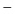

Alibaba Cloud  
Apsara Stack  
Apsara Stack DNS  
Apsara Stack DNS (Within  
Cloud) User Guide  
Product Version: v3.18.6-2607  
Document Version: 20260828

**Table of Contents**

- [1.What is Apsara Stack DNS?](#section-1)
- [2.User roles and permissions](#section-2)
- [3.Log on to the Apsara Stack DNS console](#section-3)
- [4.DNS within cloud](#section-4)
    - [4.1. Internal DNS resolution management](#section-4-1)
        - [4.1.1. Overview](#section-4-1-1)
        - [4.1.2. Global internal domain names](#section-4-1-2)
            - [4.1.2.1. Add and manage global internal domain names](#section-4-1-2-1)
            - [4.1.2.2. Parsing configuration](#section-4-1-2-2)
                - [4.1.2.2.1. Add and manage DNS records](#section-4-1-2-2-1)
        - [4.1.3. Global forwarding configurations](#section-4-1-3)
            - [4.1.3.1. Overview](#section-4-1-3-1)
            - [4.1.3.2. Global forwarding domain names](#section-4-1-3-2)
                - [4.1.3.2.1. Add and manage forwarding domain names](#section-4-1-3-2-1)
            - [4.1.3.3. Enable default forwarding](#section-4-1-3-3)
        - [4.1.4. Global recursive resolution](#section-4-1-4)
            - [4.1.4.1. Overview](#section-4-1-4-1)
            - [4.1.4.2. Recursive ACL policy](#section-4-1-4-2)
                - [4.1.4.2.1. Add and manage ACL policies](#section-4-1-4-2-1)
            - [4.1.4.3. Enable global recursive resolution](#section-4-1-4-3)
        - [4.1.5. Manage cached records](#section-4-1-5)
    - [4.2. IP Address Line Configuration](#section-4-2)
        - [4.2.1. Add and manage global lines](#section-4-2-1)
- [5.Private DNS](#section-5)
    - [5.1. PrivateZone (DNS Standard Edition only)](#section-5-1)
        - [5.1.1. Tenant internal domain name](#section-5-1-1)
            - [5.1.1.1. Add and manage tenant internal domain names](#section-5-1-1-1)
            - [5.1.1.2. Parsing configuration](#section-5-1-1-2)
                - [5.1.1.2.1. Add and manage DNS records](#section-5-1-1-2-1)
            - [5.1.1.3. Associate a domain name with a VPC](#section-5-1-1-3)
            - [5.1.1.4. Disassociate a domain name from a VPC](#section-5-1-1-4)
        - [5.1.2. Tenant forwarding configurations](#section-5-1-2)
            - [5.1.2.1. Tenant forwarding domain names](#section-5-1-2-1)
                - [5.1.2.1.1. Add and manage tenant forwarding domain names](#section-5-1-2-1-1)
                - [5.1.2.1.2. Associate a domain name with a VPC](#section-5-1-2-1-2)
                - [5.1.2.1.3. Disassociate a domain name from a VPC](#section-5-1-2-1-3)
            - [5.1.2.2. Tenant default forwarding configurations](#section-5-1-2-2)
                - [5.1.2.2.1. Add and manage default forwarding configurations](#section-5-1-2-2-1)
                - [5.1.2.2.2. Associate a tenant default forwarding configuration with a VPC](#section-5-1-2-2-2)
                - [5.1.2.2.3. Disassociate a tenant default forwarding configuration from a VPC](#section-5-1-2-2-3)
    - [5.2. Private lines](#section-5-2)
        - [5.2.1. Add and manage private lines](#section-5-2-1)
- [6.Global scheduling](#section-6)
    - [6.1. Scheduling instances](#section-6-1)
        - [6.1.1. Create and manage scheduling instances](#section-6-1-1)
        - [6.1.2. Configure a scheduling instance](#section-6-1-2)
            - [6.1.2.1. Create and manage access policies for a scheduling instance](#section-6-1-2-1)
    - [6.2. Address pool](#section-6-2)
        - [6.2.1. Create and manage address pools](#section-6-2-1)
        - [6.2.2. Perform health checks](#section-6-2-2)
- [7.System management](#section-7)
    - [7.1. Manage logs](#section-7-1)
- [8.Manage tags](#section-8)
- [9.View operation logs](#section-9)

# 1.What is Apsara Stack DNS?

Apsara Stack DNS is a service that provides Domain Name System (DNS) resolution in an Apsara Stack environment. It lets you set rules and policies to map domain names to IP addresses, which redirects domain name requests from clients to resources such as cloud resources, business systems on a corporate intranet, or service resources from an Internet Service Provider (ISP).

Apsara Stack DNS provides basic DNS resolution and scheduling services for Virtual Private Cloud (VPC) environments. You can use Apsara Stack DNS in your VPC to perform the following operations:

- Access other ECS instances deployed in your VPC.

- Access cloud service instances provided by Apsara Stack.

- Access custom enterprise business systems.

- Access Internet services and businesses.

- Establish network connections between DNS and user-created DNS over a leased line.

# 2.User roles and permissions

| Role | Permission |
| --- | --- |
| System administrator | A user of this role has read, write, and execute permissions on all level-1 organization resources, global resources, and system configurations. |
| Level-1 organization administrator | A user of this role has read, write, and execute permissions on level-1 organization resources to which the user belongs, but does not have permissions on level-1 organization resources, global resources, or system configurations to which other users belong. |
| Lower-level organization administrator | A user of this role does not have permissions on Apsara Stack DNS. The user does not have permissions on level-1 organization resources to which the user belongs, and does not have permissions on level-1 organization resources, global resources, or system configurations to which other users belong. |
| Resource user | A user of this role does not have permissions on Apsara Stack DNS. The user does not have permissions on level-1 organization resources to which the user belongs, and does not have permissions on level-1 organization resources, global resources, or system configurations to which other users belong. |
| Other roles | A user of this role does not have permissions on Apsara Stack DNS. The user does not have permissions on level-1 organization resources to which the user belongs, and does not have permissions on level-1 organization resources, global resources, or system configurations to which other users belong. |

# 3.Log on to the Apsara Stack DNS console

This topic describes how to log on to the Apsara Stack DNS console using Google Chrome.

**Prerequisites**

- The URL of the console that is obtained from the deployment personnel.

- A supported browser is used. We recommend that you use Google Chrome.

**Procedure**

1. Enter the URL of the Apsara Uni-manager Management Console in the address bar and press the Enter key.

   

   > **Note**
   >
   > - You can select a language from the drop-down list in the upper-right corner of the page.
   >
   > - 由于浏览器证书过期或环境开启HTTPS认证等出现多次单击继续访问或无Apsara Uni-manager运营控制台地址入口等现象，此时需要安装证书才能正常访问。单击页面右上角的**浏览器证书安装**，可打开浏览器证书安装指南。

2. Enter the correct username and password.

   Obtain the username and password that you use to log on to the Apsara Uni-manager Management Console from the operations administrator.

   > **Note**
   >
   > - **First logon**
   >
   >   The first time that you log on to the Apsara Uni-manager Management Console, you need to change the password of your account. Follow the instructions to complete the password change. For security purposes, the password must be 10 to 32 characters in length. It must contain all of the following character types: uppercase letters, lowercase letters, digits, and special characters. The following special characters are supported: ! @ # $ %
   >
   > - **Forgot password**
   >
   >   If you forgot your password, click Forgot Password and enter the username of your account, the email address that was used to create your account, and the verification code. Then, a URL is sent to the specified email address. You can click the URL to reset the password.

3. Click **Log On**.

4. If your account has MFA (Multi-Factor Authentication) enabled, perform the following operations based on your scenario:

   - Scenario 1: You log on to the Apsara Uni-manager Management Console for the first time after MFA is enabled by the administrator.

     <ol type="a">

     <li>

     On the Bind Virtual MFA Device page, follow the instructions to bind an MFA device.

     </li>

     <li>

     Re-enter your username and password as described in Step 2, and click **Log On**.

     </li>

     </ol>

     <ol type="i" start="100">

     <li>

     Enter the 6-digit MFA code and click **Authenticate**.

     </li>

     </ol>

   - Scenario 2: You have enabled MFA and bound an MFA device.

     Enter the 6-digit MFA code and click **Authenticate**.

     > **Note**
     >
     > For information about how to bind and enable MFA, see the **Security Center** > **Multi-factor Authentication** > **Manage Multi-factor Authentication** section in the Apsara Uni-manager Management Console User Guide.

5. In the top menu bar, choose **Products > Network > Alibaba Cloud DNS**.

# 4.DNS within cloud

## 4.1. Internal DNS resolution management

Internal DNS resolution management allows you to manage global internal domain names, global forwarding configurations, and global recursive resolution configurations that you have created in Apsara Stack.

### 4.1.1. Overview

This feature is designed for multicloud integration scenarios. It syncs configuration information globally across multiple clouds to provide global domain name resolution for all applications.

### 4.1.2. Global internal domain names

#### 4.1.2.1. Add and manage global internal domain names

This topic describes how to add and manage global internal domain names.

**Add a domain name**

1. Log on to the DNS console.

2. In the navigation pane on the left, choose **Intra-cloud Domain Name Service > Intra-cloud Global Domain Name**.

3. On the **Intra-cloud Global Domain Name** page, click the **Global Internal Domain Name** tab.

4. Click the **Add Domain Name** button.

5. In the **Add Global Internal Domain Name** dialog box, configure the domain name based on the following information.

   | Parameter | Description |
   | --- | --- |

   <table>
     <tr>
       <td>Global Internal Domain Name</td>
       <td>Enter the global internal domain name. Note i. A domain name cannot exceed 220 characters in length, including the trailing period (.). ii. A domain name consists of segments separated by periods (.).Each segment cannot exceed 63 characters and cannot be empty. This means you cannot use consecutive periods. iii. A domain name can contain only letters (a-z, A-Z), digits (0-9), hyphens (-), and underscores (_). Other characters are not allowed. iv. Domain names are not case-sensitive. v. The domain name must end with a period (.).</td>
     </tr>
     <tr>
       <td>Current Domain Name Type</td>
       <td>Select the type of the current domain name. • Primary Domain Name • Secondary Domain Name</td>
     </tr>
     <tr>
       <td>DNS Server Address Of Primary Domain Name</td>
       <td>Enter the DNS server address of the primary domain name. The DNS data is synchronized to the secondary domain name from this address. Enter one address per line. You can enter up to five addresses. Only IP addresses are supported. Both IPv4 and IPv6 addresses are supported. Use the ip:port format. Note This parameter is required only when you set <strong>Current Domain</strong> <strong>Name Type</strong> to <strong>Secondary Domain Name</strong>.</td>
     </tr>
     <tr>
       <td>Enable TSIG Key Authentication</td>
       <td>Select whether to enable TSIG key authentication. Note This parameter is available only when you set <strong>Current Domain</strong> <strong>Name Type</strong> to <strong>Secondary Domain Name</strong>.</td>
     </tr>
     <tr>
       <td>TSIG Key Name</td>
       <td>Enter the TSIG key name. The value must be an integer from 1 to 65535 and specified in a format such as "1/200" or "80/80". The value "-1/-1" represents unrestricted ports and cannot be set as a standalone value. Note This parameter is required if you enable <strong>TSIG Key</strong> <strong>Authentication</strong>.</td>
     </tr>
     <tr>
       <td>TSIG Key Algorithm</td>
       <td>Enter the TSIG key algorithm. Note This parameter is required if you enable <strong>TSIG Key</strong> <strong>Authentication</strong>.</td>
     </tr>
     <tr>
       <td>TSIG Key Value</td>
       <td>Enter the TSIG key value. Note This parameter is required if you enable <strong>TSIG Key</strong> <strong>Authentication</strong>.</td>
     </tr>
   </table>

6. Click **OK**.

**More operations**

**View the domain list**

On the **Global Internal Domain Name** page, you can view a list of your added domain names.

- Use the **Advanced Filter** to perform a fuzzy search by **Domain Name**.

- Click the  icon in the upper-right corner of the list to customize the list. You can show or

  hide columns and drag columns to change their order.

**Modify a domain name**

> **Note**
>
> Only secondary domain names can be modified. Primary domain names cannot be modified.

1. On the **Global Internal Domain Name** page, find the domain name that you want to modify and click **Modify** in the **Actions** column.

2. In the **Modify Global Internal Domain Name** dialog box, modify the parameters and click **OK**.

   For more information about the parameters, see Add a domain name.

**Add remarks to a domain name**

1. On the **Global Internal Domain Name** page, find the domain name to which you want to add remarks and click **Add Remark** in the **Actions** column.

2. In the **Add Remark For Global Internal Domain Name** dialog box, enter a remark in the **Remark** field and click **OK**.

**Delete a domain name**

> **Note**
>
> When a domain name is deleted, all its DNS records are also deleted. Proceed with caution.

1. (Method 1) On the **Global Internal Domain Name** page, find the domain name that you want to delete. In the **Actions** column, click the  icon and then click **Delete**.

   (Method 2) On the **Global Internal Domain Name** page, select the checkbox of one or more domain names that you want to delete, and click **Batch Delete** in the lower-left corner.

2. In the dialog box that appears, click **OK**.

**View operation logs**

On the **Global Internal Domain Name** page, click **Operation Logs** in the **Actions** column to view the operation logs for the corresponding domain name. For more information, see View operation logs.

#### 4.1.2.2. Parsing configuration

##### 4.1.2.2.1. Add and manage DNS records

This topic describes how to add a Domain Name System (DNS) record for a global internal domain name in the Apsara Stack DNS console.

**Add a DNS record**

> **Important**
>
> You can add DNS records only for primary domain names, not for secondary domain names. DNS records for a secondary domain are synchronized from the DNS servers of the added primary domain name.

1. Log on to the DNS console.

2. In the navigation pane on the left, choose **Intra-cloud Domain Name Service > Intra-cloud Global Domain Name**.

3. On the **Intra-cloud Global Domain Name** page, click the **Global Internal Domain Name** tab.

4. On the **Global Internet Domain Name** tab, find the global domain name that you want to manage and click the total number in the **Record Sets** column or click **Configure DNS Records** in the **Actions** column.

5. On the **DNS Settings** page, click **Add DNS Record** in the upper-left corner.

6. In the **Add DNS Record** dialog box that appears, configure the parameters described in the following table and then click **OK**.

   | Parameter | Description |
   | --- | --- |
   | Record Name | Enter a name for the DNS record. The domain name will be appended to the DNS record name. Note The record name consists of a domain name prefix and a domain name suffix. The domain name prefix may be the single-character asterisk (\*) to indicate a wildcard DNS record. Otherwise, the prefix must meet the following format requirements: i. A domain name can be up to 254 characters in length, including the period (.) at the end. ii. A domain name is divided into multiple labels separated by periods (.).Each label must be 1 to 63 characters in length. The domain name cannot contain consecutive periods (.). iii. A domain name can contain letters (a–z and A–Z), digits (0–9), hyphens (-), and underscores (_). iv. A domain name must start with a letter, digit, or underscore (_) and end with a letter, digit, or period (.). v. A domain name is not case-sensitive. vi. A period (.) at the end of the domain name is optional. If you omit the period (.), the system will append a period (.) when saving the name. Assuming the domain name suffix is example.com., the following are common DNS records: • Website: If you leave the host field empty, the resulting domain name is example.com. • Website: If you set the host field to www, the resulting domain name is www.example.com. • Email server: If you set the host field to mail, the resulting domain name is mail.example.com. • Wireless application: If you set the host field to m, the resulting domain name is m.example.com. • Mobile app: If you set the host field to webapp, the resulting domain name is webapp.example.com. • Wildcard DNS record: If you set the host field to an asterisk (\*), the resulting domain name is \*.example.com, which matches all subdomain names of example.com. • Subdomain: If you set the host field to abc, the resulting domain name is abc.example.com. |
   | Load Balancing Policy | Select a load balancing policy. You can select <strong>Polling</strong> or <strong>Weight</strong>. |
   | Record Type | Select a record type. • If you select <strong>Polling</strong> for <strong>Load Balancing Policy</strong>, you can select one of the following types: • A - Points a domain name to an IPv4 address • AAAA - Points a domain name to an IPv6 address • CNAME - Points one domain name to another • MX - Points a domain name to an email server address • TXT - Serves as a Sender Policy Framework (SPF) record to protect against spam (maximum length: 255 characters) • PTR - Points an IP address to a domain name • SRV - Specifies the servers that host specific services. • NAPTR - Records the Naming Authority Pointer (NAPTR) and is usually used in ENUM • CAA - Specifies which certificate authorities (CAs) are allowed to issue certificates for a domain name • NS - Points a subdomain to other DNS servers • If you select <strong>Weight</strong> for <strong>Load Balancing Policy</strong>, you can select one of the following types: • A - Points a domain name to an IPv4 address • AAAA - Points a domain name to an IPv6 address • CNAME - Points one domain name to another |
   | TTL (Seconds) | Enter a time-to-live (TTL) value for a record. TTL specifies how long a DNS record is cached by local DNS servers. The value must be an integer from 0 to 2147483647, and 0 indicates that the record is not cached. Default value: 300. If your service addresses change frequently, set a small TTL value. Otherwise, set a large TTL value. |
   | Resolution Line | Select a global line. You can select multiple lines. |

   <table>
     <tr>
       <td>Record Values</td>
       <td>Add record values. • <strong>Value</strong>: Enter the value of the record based on the <strong>Record Type</strong> parameter.For more information, see Record value description. • <strong>Weight</strong>: Enter a weight value. The weight value must be an integer ranging from 0 to 999. A larger value indicates a greater weight. This parameter is required only if you select <strong>Weight</strong> for <strong>Load Balancing</strong> <strong>Policy</strong>. Note • You can click <strong>Add Entry</strong> to add multiple record values. • Click the icon in the <strong>Actions</strong> column of a record value to remove  it.</td>
     </tr>
   </table>

   **Record value description**

   | Record Type | Record value format |
   | --- | --- |
   | A - Points a domain name to an IPv4 address | You can specify up to 100 unique IPv4 addresses. Each address must be in a separate row. Make sure that the IPv4 addresses are valid. Examples: • 192.168.1.1 • 192.168.1.2 • 192.168.1.3 |
   | AAAA - Points a domain name to an IPv6 address | You can specify up to 100 unique IPv6 addresses. Each address must be in a separate row. Make sure that the IPv6 addresses are valid. Examples: • 2400:3200::6666 • 2400:3200::6688 • 2400:3200::8888 |
   | CNAME - Points one domain name to another | You can enter only one domain name. Use a fully qualified domain name (FQDN) that ends with a period (.). It must be 1 to 254 ASCII characters in length. Example: www.example.com. |
   | MX - Points a domain name to an email server address | You can specify up to 100 unique email server hostnames.Each hostname must be in a separate row. Use the format of \[Priority\] \[Email server hostname\] to specify each hostname. Separate the priority and hostname with a space. • The priority value must be an integer ranging from 0 to 999. A smaller value indicates a higher priority. • The email server hostname must be an FQDN that ends with a period (.). It must be 1 to 254 ASCII characters in length. Examples: • 10 mailserver1.example.com. • 20 mailserver2.example.com. |
   | TXT - Serves as a Sender Policy Framework (SPF) record to protect against spam (maximum length: 255 characters) | You can specify up to 100 unique character strings. Each string must be in a separate row. A string must be 1 to 254 ASCII characters in length. Do not leave any row blank. Example: v=spf1 ip4:192.168.0.1/16 ip6:2001::1/96 ~all |
   | PTR - Points an IP address to a domain name | You can specify up to 100 unique domain names. Each domain name must be in a separate row. Use an FQDN that ends with a period (.). It must be 1 to 254 ASCII characters in length. Examples: • www1.example.com. • www2.example.com. • www3.example.com. |

   <table>
     <tr>
       <td>SRV - Specifies the servers that host specific services.</td>
       <td>You can specify up to 100 unique application server hostnames. Each hostname must be in a separate row. Use the format of [Priority] [Weight] [Port number] [Application server hostname] to specify each hostname.Separate every two consecutive items with a space. • The priority value must be an integer ranging from 0 to 999. A smaller value indicates a higher priority. • The weight value must be an integer ranging from 0 to 999. A larger value indicates a greater weight. • The port number must be an integer ranging from 0 to 65535. The value indicates the TCP or UDP port number used for network communications. • The application server hostname must be an FQDN that ends with a period (.). It must be 1 to 254 ASCII characters in length. Examples: • 1 10 8080 www1.example.com. • 2 20 8081 www2.example.com.</td>
     </tr>
     <tr>
       <td>NAPTR - Records the Naming Authority Pointer (NAPTR) and is usually used in ENUM</td>
       <td>You can specify up to 100 unique NAPTR records. Each record must be in a separate row. Use the format of [Serial number] [Priority] [Flag] [Service information] [Regular expression] [Substitute domain name] to specify each record. Separate every two consecutive items with a space. • The serial number must be an integer ranging from 0 to 999. A smaller value indicates a higher priority. • The priority value must be an integer ranging from 0 to 999. A smaller value indicates a higher priority. If two records have the same serial number, the one with a higher priority takes effect first. • The flag value can be left empty or be a character from A to Z, a to z, or 0 to 9. The flag value is not case-sensitive and must be enclosed in double quotation marks (""). • The service information can be left blank or be a string of 1 to 32 ASCII characters in length. It must start with a letter and be enclosed in double quotation marks (""). • The regular expression can be left blank or be a string of 1 to 255 ASCII characters in length enclosed in double quotation marks (""). • The substitute domain name must be an FQDN that ends with a period (.). It must be 1 to 254 ASCII characters in length. Examples: • 100 50 "S" "Z3950+I2L+I2C" "" _z3950._tcp.example.com. • 100 50 "S" "RCDS+I2C" "" _rcds._udp.example.com. • 100 50 "S" "HTTP+I2L+I2C+I2R" "" _http._tcp.example.com.</td>
     </tr>
     <tr>
       <td>CAA - Specifies which certificate authorities (CAs) are allowed to issue certificates for a domain name</td>
       <td>You can specify up to 100 unique CAA records. Each record must be in a separate row. Use the format of [Certificate authority flag] [Certificate property tag] [Authorization information] to specify each record. Separate every two consecutive items with a space. • The certificate authority flag must be an integer ranging from 0 to 255. • The certificate property tag can be issue, issuewild, or iodef. • The value of the authorization information cannot be null and must be 1 to 254 ASCII characters in length. It must be enclosed in double quotation marks ("). Examples: • 0 issue "caa.example.com" • 0 issuewild ";" • 0 iodef "mailto:example@example.com"</td>
     </tr>
     <tr>
       <td>NS - Points a subdomain to other DNS servers</td>
       <td>You can specify up to 100 unique DNS server addresses.Each address must be in a separate row. Use an FQDN that ends with a period (.). It must be 1 to 254 ASCII characters in length. Wildcard domain names are not allowed. Examples: • ns1.example.com. • ns2.example.com.</td>
     </tr>
   </table>

**What to do next**

After you add DNS records, perform the following operations on the DNS Settings page based on your business requirements:

- Search for a DNS record

  Click Advanced Filter and enter a record name in the **Record name** field for fuzzy search.

- View load balancing policies (weight)

  Find the DNS record that you want to view and click **Weight** in the **Load Balancing Policy** column. In the dialog box that appears, view the policy details.

- Modify a DNS record

  Find the DNS record that you want to modify and click **Modify** in the **Actions** column. In the dialog box that appears, modify the information and click **OK**. For more information, see Add a DNS record.

- Add a description to a DNS record

  Find the DNS record to which you want to add a description, and click **Description** in the **Actions** column. In the dialog box that appears, enter a description in the **Description** text box and click **OK**.

- Delete a DNS record

  Find the DNS record that you want to delete, click **Delete** in the **Actions** column, and click **OK**.

- Delete multiple DNS records at a time Select the DNS records that you want to delete at a time and click **Batch Delete** in the lower-left corner of the record list. In the message that appears, click **OK**.

### 4.1.3. Global forwarding configurations

#### 4.1.3.1. Overview

All operations on global forwarding domain names require system administrator permissions.

Apsara Stack DNS forwards specific domain names to other DNS servers for resolution.

Apsara Stack DNS can forward requests with or without recursion.

- In the mode of forwarding without recursion, only the specified DNS server is used to resolve domain names. If the resolution fails or times out, a message is returned to the DNS client to indicate that the current request fails.

- In the mode of forwarding with recursion, the specified DNS server is preferentially used to resolve domain names. If the resolution fails, the local DNS server is used.

#### 4.1.3.2. Global forwarding domain names

##### 4.1.3.2.1. Add and manage forwarding domain names

This topic describes how to add and manage global forwarding domain names in the Apsara Uni-manager Management Console. This operation requires administrator permissions.

**Add a domain name**

1. Log on to the DNS console.

2. In the navigation pane on the left, choose **Intra-cloud Domain Name Service > Intra-cloud Global Domain Name**.

3. In the left-side navigation pane, click **Cloud-Internal Global Domain Name**. On the page that appears, click the **Global Forwarding Configurations** tab, and then click the **Global Forwarding Domain Names** subtab.

4. On the **Global Forwarding Domain Names** tab, click **Add Domain Name**.

5. In the **Add Global Forwarding Domain Name** dialog box, configure the parameters described in the following table and click **OK**.

   | Parameter | Description |
   | --- | --- |

   <table>
     <tr>
       <td>Global Forwarding Domain Name</td>
       <td>Enter a global forwarding domain name. The domain name must meet the following requirements: • The domain name must be 1 to 254 characters in length. This includes the period (.) at the end. • The domain name is divided into multiple labels separated by periods (.). Each label must be 1 to 63 characters in length. The domain name cannot contain consecutive periods (.). • The domain name can contain letters (a–z and A–Z), digits (0–9), hyphens (-), and underscores (_). • The domain name must start with a letter, digit, or underscore (_) and end with a letter, digit, or period (.). • The domain name is not case-sensitive. • The domain name must end with a period (.).</td>
     </tr>
     <tr>
       <td>Forwarding Mode</td>
       <td>Select a forwarding mode. For both domain name-based forwarding and default forwarding, the following two forwarding modes are supported: • Forward All Mode (Recommended)-Forward All Requests <strong>Without Recursion</strong>: forwards DNS requests to the destination DNS server. If the destination DNS server does not obtain a resolution result, a message is returned to the DNS client indicating that the request failed. • Forward First Mode-Recursive Degradation upon Forwarding <strong>Failure to Internet</strong>: A specified DNS server is preferentially used to resolve domain names. If the specified DNS server does not obtain a resolution result, the local DNS server is used for recursive queries over the Internet. Important If you enter only internal IP addresses in the Destination IP Address text box, unexpected results may occur during recursive resolution.For example, a domain name used for internal network services may be resolved to a public IP address.</td>
     </tr>
   </table>

   <table>
     <tr>
       <td>Destination IP Address</td>
       <td>Enter the forwarding destination IP addresses. Format requirements • Standard IPv4 address Examples: 192.168.1.1 192.168.1.2 • Standard IPv6 address Examples: 2400:3200::6666 2400:3200::6688 Note You can specify up to five unique IPv4 or IPv6 addresses. Each address must be in a separate row.</td>
     </tr>
   </table>

**What to do next**

> **Note**
>
> Global forwarding domain names forwarded to OPSDNS cannot be modified or deleted. User-defined domain names can be modified, annotated, or deleted.

**View the list of domain names**

On the Global Forwarding Domain Names tab, you can view domain names in the list.

- Click **Advanced Filter** and enter a record name in the **Domain Name** field for fuzzy search.

- Click the  icon in the upper-right corner of the domain name list to select the columns

  that you want to show or hide. You can also drag the columns to adjust the order.

**Add a description to a domain name**

You can add a description for a domain name to help you identify it. For example, you can specify a hostname or internal system information to describe a domain name.

1. On the **Global Forwarding Domain Names** tab, find the domain name to which you want to add a description and click **Description** in the **Actions** column.

2. In the **Add Description** dialog box, enter a description in the **Description** text box and click **OK**.

**Modify a domain name**

1. On the **Global Forwarding Domain Names** tab, find the domain name that you want to modify and click **Modify** in the **Actions** column.

2. In the **Modify Global Forwarding Domain Name** dialog box, modify the **Forwarding Mode** and **Destination IP Address** parameters based on your business requirements and click **OK**.

**Delete a domain name**

1. Method 1: On the **Global Forwarding Domain Names** tab, find the domain name that you want to delete, click the  icon in the **Actions** column to expand the menu, and then

   click **Delete**.

   Method 2: On the **Global Forwarding Domain Names** tab, select one or multiple domain names that you want to delete and click **Batch Delete** in the lower-left corner of the domain name list.

2. In the message that appears, click **OK**.

**View operation logs**

On the **Global Forwarding Domain Names** tab, find the domain name whose operation logs you want to view and click **Operation Log** in the **Actions** column. For more information, see View operation logs.

#### 4.1.3.3. Enable default forwarding

This topic describes how to enable default forwarding in the Apsara Uni-manager Management Console. This operation requires administrator permissions.

**Procedure**

> **Note**
>
> If default forwarding is disabled, forwarders are not used to resolve Domain Name System (DNS) queries for non-internal domain names. For example, DNS queries cannot be forwarded to external DNS servers.

1. Log on to the DNS console.

2. In the navigation pane on the left, choose **Intra-cloud Domain Name Service > Intra-cloud Global Domain Name**.

3. In the left-side navigation pane, click **Cloud-Internal Global Domain Name**. On the Global Domain Names page, click the **Global Forwarding Configurations** tab, and then click the **Global Default Forwarding Configurations** subtab.

4. Configure global default forwarding rules based on the following information.

   | Parameter | Description |
   | --- | --- |
   | Default Forwarding | Specifies whether default forwarding is enabled. |

   <table>
     <tr>
       <td>Default Forwarding Mode</td>
       <td>If default forwarding is enabled, select the forwarding mode. For both domain name-based forwarding and default forwarding, the following two forwarding modes are supported: • Forward All Mode (Recommended)-Forward All Requests <strong>Without Recursion</strong>: forwards DNS requests to the destination DNS server. If the destination DNS server does not obtain a resolution result, a message is returned to the DNS client indicating that the request failed. • Forward First Mode-Recursive Degradation upon Forwarding <strong>Failure to Internet</strong>: A specified DNS server is preferentially used to resolve domain names. If the specified DNS server does not obtain a resolution result, the local DNS server is used for recursive queries over the Internet. Important If you enter only internal IP addresses in the Destination IP Address text box, unexpected results may occur during recursive resolution. For example, a domain name used for internal network services may be resolved to a public IP address.</td>
     </tr>
     <tr>
       <td>Destination IP Address</td>
       <td>If default forwarding is enabled, enter destination IP addresses. Format requirements • Standard IPv4 address Examples: 192.168.1.1 192.168.1.2 • Standard IPv6 address Examples: 2400:3200::6666 2400:3200::6688 Note You can specify up to five unique IPv4 or IPv6 addresses. Each address must be in a separate row.</td>
     </tr>
     <tr>
       <td>Last Modified At</td>
       <td>Displays the time when the global default forwarding configuration was last modified.</td>
     </tr>
   </table>

5. Click **Submit**.

### 4.1.4. Global recursive resolution

#### 4.1.4.1. Overview

Recursive access control list (ACL) policies are used to specify whether to recursively send DNS requests to the Internet.

> **Note**
>
> Recursive resolution defined in such ACL policies takes precedence over global recursive resolution.

#### 4.1.4.2. Recursive ACL policy

##### 4.1.4.2.1. Add and manage ACL policies

This topic describes how to add an access control list (ACL) policy in the Apsara Uni-manager Management Console. This operation requires administrator permissions.

**Add an ACL policy**

1. Log on to the DNS console.

2. In the navigation pane on the left, choose **Intra-cloud Domain Name Service > Intra-cloud Global Domain Name**.

3. In the left-side navigation pane, click **Cloud-Internal Global Domain Name**. On the Global Domain Names page, click the **Global Recursive Resolution** tab, and then click the **Recursive ACL Policy** subtab.

4. Click **Add**.

5. In the **Add** dialog box, configure the following parameters.

   | Parameter | Description |
   | --- | --- |
   | ACL Policy Name | Enter an ACL policy name. The ACL policy name must be globally unique within the recursive ACL list. |
   | Request Source | Select a request source. You can only select lines that you configured on the Global Line page. If a line has been selected for another ACL policy, the line cannot be selected here. You can select multiple lines. |
   | Enable Recursion | Specify whether to turn off <strong>Enable Recursion</strong> based on your business requirements. |
   | Description | Enter a description. |

5. Click **OK**.

**What to do next**

After you add an ACL policy, you can perform the following operations on the **Recursive ACL Policy** tab.

- Query ACL policies

  - Click **Advanced Filter** and enter an ACL policy name in the **ACL Policy Name** field for fuzzy search.

  - Click the  icon in the upper-right corner of the ACL policy list to select the columns that

    you want to show or hide. You can also drag the columns to adjust the order.

- Modify an ACL policy

  Find the ACL policy that you want to modify and click **Modify** in the **Actions** column. In the dialog box that appears, modify the information and click **OK**. For more information, see Add an ACL policy.

- Add a description for an ACL policy

  Find the ACL policy to which you want to add a description, and click **Description** in the **Actions** column. In the dialog box that appears, enter a description in the **Description** text box and click **OK**.

- Delete an ACL policy

  - Single deletion: Click **Delete** in the **Actions** column of the ACL policy you want to delete. In the dialog box that appears, click **OK**.

  - Batch deletion: Select multiple ACL policies that you want to delete, and click **Batch Delete** in the lower-left corner of the page. In the dialog box that appears, click **OK**.

- View operation logs

  Find the ACL policy whose operation logs you want to view and click **Operation Logs** in the **Actions** column. For more information, see View operation logs.

#### 4.1.4.3. Enable global recursive resolution

**Prerequisites**

Only system administrators can manage recursive configurations. All other roles have no permissions.

**Procedure**

> **Note**
>
> - If recursive resolution is enabled, recursive Domain Name System (DNS) queries can be performed. For example, public domain names can be resolved.
>
> - If recursive resolution is disabled, recursive DNS queries cannot be performed. For example, public domain names can no longer be resolved.

1. Log on to the DNS console.

2. In the navigation pane on the left, choose **Intra-cloud Domain Name Service > Intra-cloud Global Domain Name**.

3. In the left-side navigation pane, click **Cloud-Internal Global Domain Name**. On the Global Domain Names page, click the **Global Recursive Resolution** tab, and then click the **Global Default Recursion** subtab.

4. Turn on or off **Global Recursive Resolution** and then click **Submit**.

### 4.1.5. Manage cached records

Domain names that are queried by using global forwarding or recursion are cached. This topic describes how to view and clear the cached records in the Apsara Uni-manager Management Console. This operation requires administrator permissions.

**Procedure**

1. Log on to the DNS console.

2. In the navigation pane on the left, choose **Intra-cloud Domain Name Service > Intra-cloud Global Domain Name**.

3. On the **Global Domain Names** page, click the **Cache Management** tab to view the cached records.

   You can select a type from the **Type** drop-down list or enter a domain name in the **Domain Name** input box to view the cached records.

4. Clear cached records.

   Click **Clear Cache**. In the **Clear Cache** dialog box, configure the following parameters and click **OK**.

   | Parameter | Description |
   | --- | --- |
   | Service Instance | Select a service instance. You can only select the learner nodes on the Nodes page. The instance names are displayed in the format of <strong>Resolution Node (Service</strong> <strong>instance IP address)</strong>. |
   | Domain Name | Enter a domain name. |
   | Domain Name Matching Method | Select a matching method for domain names. • If you select <strong>Suffix Match</strong>, the cached DNS records of all the domain names with the same suffix as the domain name that you specified are cleared. • If you select <strong>Exact Match</strong>, only the cached DNS records of the domain name that you specified are cleared. |

## 4.2. IP Address Line Configuration

The IP Address Line Configuration tab allows you to define lines based on IP addresses. The lines are used to group request sources to achieve intelligent load balancing.

### 4.2.1. Add and manage global lines

This topic describes how to add a global line in the Apsara Uni-manager Management Console.

**Add a global line**

1. Log on to the DNS console.

2. In the left-side navigation pane, choose **Cloud-Internal Global Domain Name > Global Line**.

3. On the **Global Line** page, click **Add Line**.

4. In the **Add Line** dialog box, configure the parameters described in the following table<strong>.</strong>

   | Parameter | Description |
   | --- | --- |
   | Line Name | Enter a line name. |
   | Sorting Method | Select a sorting method. • Insert at the Beginning • Insert at the End • Insert Before Selected Line Note The sequence number of a line indicates the priority of the line. A smaller sequence number indicates a higher priority. |
   | Insert Before Current Line | Select the line before which the new line will be inserted. Note This parameter is required if you set the <strong>Sorting Method</strong> parameter to <strong>Insert Before Selected Line</strong>. |
   | IPv4 Address Range | Enter an IPv4 address range. Specify at least one of the following parameters: <strong>IPv4 Address Range</strong> and <strong>IPv6 Address Range</strong>. Make sure that the IPv4 addresses are valid. Examples: 192.168.1.1 192.168.1.2 Note You can specify up to 1,000 unique IPv4 addresses. Each address must be in a separate row. |

   <table>
     <tr>
       <td>IPv6 Address Range</td>
       <td>Enter an IPv6 address range. Specify at least one of the following parameters: <strong>IPv4 Address Range</strong> and <strong>IPv6 Address Range</strong>. Make sure that the IPv6 addresses are valid. Examples: 2400:3200::6666 2400:3200::6688 Note You can specify up to 1,000 unique IPv6 addresses. Each address must be in a separate row.</td>
     </tr>
   </table>

5. Click **OK**.

**What to do next**

After you add a global line, you can perform the following operations on the **Global Line** page.

- Query global lines

  - Click **Advanced Filter** and enter a line name and IP address in the **Line Name** and **IP** fields, respectively, for fuzzy search.

  - Click the  icon in the upper-right corner of the line list to select the columns that you

    want to show or hide. You can also drag the columns to adjust the order.

- Modify a global line

  Find the line you want to modify and click **Modify** in the **Actions** column. In the dialog box that appears, modify the **Line Name**, **IPv4 Address Range**, and **IPv6 Address Range** parameters, and then click **OK**.

  > **Note**
  >
  > Specify at least one of the following parameters: **IPv4 Address Range** and **IPv6 Address Range**.

- Modify the sorting method

  Find the line whose sorting method you want to modify and click **Sort** in the **Actions** column. In the dialog box that appears, select a sorting method from the **Sorting Method** drop-down list, and then click **OK**.

- Delete a global line

  > **Important**
  >
  > If you want to delete a line, you must disassociate the line from all scheduling instances and the resolution configurations of global lines.

  - Single deletion: Click **Delete** in the **Actions** column of the line you want to delete. In the dialog box that appears, click **OK**.

  - Batch deletion: Select multiple lines that you want to delete, and click **Batch Delete** in the lower-left corner of the page. In the dialog box that appears, click **OK**.

- View operation logs

  Find the line whose operation logs you want to view and click **Operation Logs** in the **Actions** column. For more information, see View operation logs.

# 5.Private DNS

## 5.1. PrivateZone (DNS Standard Edition only)

The PrivateZone feature allows you to create VPC-specific tenant domain names. You can bind the domain names to VPCs as required to achieve tenant isolation.

### 5.1.1. Tenant internal domain name

#### 5.1.1.1. Add and manage tenant internal domain names

**Add a domain name**

1. Log on to the DNS console.

2. In the left-side navigation pane, choose **Private Network DNS Service > VPN Private Domain Name**.

3. On the **Private Domain Names for VPC** page, click the **Tenant Internal Domain Name** tab

4. Click **Add Domain Name**.

5. In the **Add Tenant Internal Domain Name** dialog box, configure the parameters described in the following table and click **OK.**

   - **Organization:** Select an organization.

   - **Resource Set:** Select a resource set.

   - **Tenant Internal Domain Name**: Enter the tenant internal domain name, for example, example.com.

**What to do next**

**View the list of domain names**

On the **Tenant Internal Domain Name** tab, you can view domain names in the list.

- You can search for the desired domain names by specifying advanced filter conditions.

- Click the  icon in the upper-right corner of the domain name list to select the columns

  that you want to show or hide. You can also drag the columns to adjust the order.

**Add a description to a domain name**

1. On the **Tenant Internal Domain Name** tab, find the domain name to which you want to add a description and click **Description** in the **Actions** column.

2. In the **Add Description** dialog box, enter a description in the **Description** text box and click **OK**.

**Delete a domain name**

1. Method 1: On the **Tenant Internal Domain Name** tab, find the domain name that you want to delete, click the  icon in the **Actions** column to expand the menu, and then click

   **Delete**.

   Method 2: On the **Tenant Internal Domain Name** tab, select one or multiple domain names that you want to delete and click **Batch Delete** in the lower-left corner of the domain name list.

2. In the message that appears, click **OK**.

**View operation logs**

On the **Tenant Internal Domain Name** tab, find the domain name whose operation logs you want to view and click **Operation Logs** in the **Actions** column. For more information, see View operation logs.

**Manage tags**

On the **Tenant Internal Domain Name** tab, you can add tags to domain names for management. For more information, see Manage tags.

**View the monitoring data**

1. On the **Tenant Internal Domain Name** tab, find the private domain name that you want

   to manage and click the  icon in the **Monitoring** column.

2. In the **Monitoring** panel, you can view the cloud monitoring data of the target domain name, such as **Latency**, **ParsingSucceeded**, **Total number of analyses**, **Client IP count**, **DNS Resolution Success Rate**, **LatencybyQname**, **ParsingSucceededbyQname**, and **ParsingTotalbyQname**.

   You can query data by time range or metric.

#### 5.1.1.2. Parsing configuration

##### 5.1.1.2.1. Add and manage DNS records

**Adds a DNS record**

1. Log on to the DNS console.

2. In the left-side navigation pane, choose **Private Network DNS Service > VPN Private Domain Name**.

3. On the **Private Domain Names for VPC** page, click the **Tenant Internal Domain Name** tab

4. On the **Tenant Internal Domain Name** tab, find the private domain name that you want to manage and click the total number in the **Record Sets** column or click **Configure DNS Description** in the **Actions** column.

5. On the **DNS Settings** page, click **Add DNS Record** in the upper-left corner.

6. On the **DNS Settings** page, click Add DNS Record in the upper-left corner. In the dialog box that appears, configure the parameters described in the following table and then click **OK**.

   | Parameter | Description |
   | --- | --- |
   | Record Name | Enter a name for the DNS record. The domain name will be appended to the DNS record name. Note The record name consists of a domain name prefix and a domain name suffix. The domain name prefix may be the single-character asterisk (\*) to indicate a wildcard DNS record. Otherwise, the prefix must meet the following format requirements: i. A domain name can be up to 254 characters in length, including the period (.) at the end. ii. A domain name is divided into multiple labels separated by periods (.).Each label must be 1 to 63 characters in length. The domain name cannot contain consecutive periods (.). iii. A domain name can contain letters (a–z and A–Z), digits (0–9), hyphens (-), and underscores (_). iv. A domain name must start with a letter, digit, or underscore (_) and end with a letter, digit, or period (.). v. A domain name is not case-sensitive. vi. A period (.) at the end of the domain name is optional. If you omit the period (.), the system will append a period (.) when saving the name. Assuming the domain name suffix is example.com., the following are common DNS records: • Website: If you leave the host field empty, the resulting domain name is example.com. • Website: If you set the host field to www, the resulting domain name is www.example.com. • Email server: If you set the host field to mail, the resulting domain name is mail.example.com. • Wireless application: If you set the host field to m, the resulting domain name is m.example.com. • Mobile app: If you set the host field to webapp, the resulting domain name is webapp.example.com. • Wildcard DNS record: If you set the host field to an asterisk (\*), the resulting domain name is \*.example.com, which matches all subdomain names of example.com. • Subdomain: If you set the host field to abc, the resulting domain name is abc.example.com. |
   | Load Balancing Policy | Select a load balancing policy. You can select <strong>Polling</strong> or <strong>Weight</strong>. |
   | Record Type | Select a record type. • If you select <strong>Polling</strong> for <strong>Load Balancing Policy</strong>, you can select one of the following types: • A - Points a domain name to an IPv4 address • AAAA - Points a domain name to an IPv6 address • CNAME - Points one domain name to another • MX - Points a domain name to an email server address • TXT - Serves as a Sender Policy Framework (SPF) record to protect against spam (maximum length: 255 characters) • PTR - Points an IP address to a domain name • SRV - Specifies the servers that host specific services. • NAPTR - Records the Naming Authority Pointer (NAPTR) and is usually used in ENUM • CAA - Specifies which certificate authorities (CAs) are allowed to issue certificates for a domain name • NS - Points a subdomain to other DNS servers • If you select <strong>Weight</strong> for <strong>Load Balancing Policy</strong>, you can select one of the following types: • A - Points a domain name to an IPv4 address • AAAA - Points a domain name to an IPv6 address • CNAME - Points one domain name to another |
   | TTL (Seconds) | Enter a time-to-live (TTL) value for a record. TTL specifies how long a DNS record is cached by local DNS servers. The value must be an integer from 0 to 2147483647, and 0 indicates that the record is not cached. Default value: 300. If your service addresses change frequently, set a small TTL value. Otherwise, set a large TTL value. |
   | Resolution Line | Select a line. You can select one or more lines. |
   | Record Values | Add record values. • <strong>Value</strong>: Enter the value of the record based on the <strong>Record Type</strong> parameter.For more information, see Record value description. • <strong>Weight</strong>: Enter a weight value. The weight value must be an integer ranging from 0 to 999. A larger value indicates a greater weight. This parameter is required only if you select <strong>Weight</strong> for <strong>Load Balancing</strong> <strong>Policy</strong>. Note • You can click <strong>Add Entry</strong> to add multiple record values. • Click the icon in the <strong>Actions</strong> column of a record value to remove  it. |

   **Record value description**

   | Record type | Record value format |
   | --- | --- |
   | A - Points a domain name to an IPv4 address | You can specify up to 100 unique IPv4 addresses. Each address must be in a separate row. Make sure that the IPv4 addresses are valid. Examples: • 192.168.1.1 • 192.168.1.2 • 192.168.1.3 |
   | AAAA - Points a domain name to an IPv6 address | You can specify up to 100 unique IPv6 addresses. Each address must be in a separate row. Make sure that the IPv6 addresses are valid. Examples: • 2400:3200::6666 • 2400:3200::6688 • 2400:3200::8888 |
   | CNAME - Points one domain name to another | You can enter only one domain name. Use a fully qualified domain name (FQDN) that ends with a period (.). It must be 1 to 254 ASCII characters in length. Example: www.example.com. |
   | MX - Points a domain name to an email server address | You can specify up to 100 unique email server hostnames.Each hostname must be in a separate row. Use the format of \[Priority\] \[Email server hostname\] to specify each hostname. Separate the priority and hostname with a space. • The priority value must be an integer ranging from 0 to 999. A smaller value indicates a higher priority. • The email server hostname must be an FQDN that ends with a period (.). It must be 1 to 254 ASCII characters in length. Examples: • 10 mailserver1.example.com. • 20 mailserver2.example.com. |
   | TXT - Serves as a Sender Policy Framework (SPF) record to protect against spam (maximum length: 255 characters) | You can specify up to 100 unique character strings. Each string must be in a separate row. A string must be 1 to 254 ASCII characters in length. Do not leave any row blank. Example: v=spf1 ip4:192.168.0.1/16 ip6:2001::1/96 ~all |
   | PTR - Points an IP address to a domain name | You can specify up to 100 unique domain names. Each domain name must be in a separate row. Use an FQDN that ends with a period (.). It must be 1 to 254 ASCII characters in length. Examples: • www1.example.com. • www2.example.com. • www3.example.com. |
   | SRV - Specifies the servers that host specific services. | You can specify up to 100 unique application server hostnames. Each hostname must be in a separate row. Use the format of \[Priority\] \[Weight\] \[Port number\] \[Application server hostname\] to specify each hostname.Separate every two consecutive items with a space. • The priority value must be an integer ranging from 0 to 999. A smaller value indicates a higher priority. • The weight value must be an integer ranging from 0 to 999. A larger value indicates a greater weight. • The port number must be an integer ranging from 0 to 65535. The value indicates the TCP or UDP port used for network communications. • The application server hostname must be an FQDN that ends with a period (.). It must be 1 to 254 ASCII characters in length. Examples: • 1 10 8080 www1.example.com. • 2 20 8081 www2.example.com. |

   <table>
     <tr>
       <td>NAPTR - Records the Naming Authority Pointer (NAPTR) and is usually used in ENUM</td>
       <td>You can specify up to 100 unique NAPTR records. Each record must be in a separate row. Use the format of [Serial number] [Priority] [Flag] [Service information] [Regular expression] [Substitute domain name] to specify each record. Separate every two consecutive items with a space. • The serial number must be an integer ranging from 0 to 999. A smaller value indicates a higher priority. • The priority value must be an integer ranging from 0 to 999. A smaller value indicates a higher priority. If two records have the same serial number, the one with a higher priority takes effect first. • The flag value can be left empty or be a character from A to Z, a to z, or 0 to 9. The flag value is not case-sensitive and must be enclosed in double quotation marks (""). • The service information can be left blank or be a string of 1 to 32 ASCII characters in length. It must start with a letter and be enclosed in double quotation marks (""). • The regular expression can be left blank or be a string of 1 to 255 ASCII characters in length enclosed in double quotation marks (""). • The substitute domain name must be an FQDN that ends with a period (.). It must be 1 to 254 ASCII characters in length. Examples: • 100 50 "S" "Z3950+I2L+I2C" "" _z3950._tcp.example.com. • 100 50 "S" "RCDS+I2C" "" _rcds._udp.example.com. • 100 50 "S" "HTTP+I2L+I2C+I2R" "" _http._tcp.example.com.</td>
     </tr>
     <tr>
       <td>CAA - Specifies which certificate authorities (CAs) are allowed to issue certificates for a domain name</td>
       <td>You can specify up to 100 unique CAA records. Each record must be in a separate row. Use the format of [Certificate authority flag] [Certificate property tag] [Authorization information] to specify each record. Separate every two consecutive items with a space. • The certificate authority flag must be an integer ranging from 0 to 255. • The certificate property tag can be issue, issuewild, or iodef. • The value of the authorization information cannot be null and must be 1 to 254 ASCII characters in length. It must be enclosed in double quotation marks ("). Examples: • 0 issue "caa.example.com" • 0 issuewild ";" • 0 iodef "mailto:example@example.com"</td>
     </tr>
     <tr>
       <td>NS - Points a subdomain to other DNS servers</td>
       <td>You can specify up to 100 unique DNS server addresses.Each address must be in a separate row. Use an FQDN that ends with a period (.). It must be 1 to 254 ASCII characters in length. Wildcard domain names are not allowed. Examples: • ns1.example.com. • ns2.example.com.</td>
     </tr>
   </table>

**What to do next**

After you add DNS records, perform the following operations on the DNS Settings page based on your business requirements:

- Search for a DNS record

  Click **Advanced Filter** and enter a record name in the **Record name** field for fuzzy search.

- View load balancing policies (weight)

  Find the DNS record that you want to view and click **Weight** in the Load Balancing Policy column. In the dialog box that appears, view the policy details.

- Modify a DNS record

  Find the DNS record that you want to modify and click **Modify** in the **Actions** column. In the dialog box that appears, modify the information and click **OK**. For more information, see Add a DNS record.

- Add a description to a DNS record

  Find the DNS record to which you want to add a description, and click **Description** in the **Actions** column. In the dialog box that appears, enter a description in the **Description** text box and click **OK**.

- Delete a DNS record

  Find the DNS record that you want to delete, click **Delete** in the **Actions** column, and click **OK**.

- Delete multiple DNS records at a time

  Select the DNS records that you want to delete at a time and click **Batch Delete** in the lower-left corner of the record list. In the message that appears, click **OK**.

#### 5.1.1.3. Associate a domain name with a VPC

Tenant resources are isolated based on virtual private clouds (VPCs). Simply configuring domain name resolution data does not take effect by default. You must associate the domain name with a VPC for it to take effect.

**Procedure**

1. Log on to the DNS console.

2. In the left-side navigation pane, choose **Private Network DNS Service > VPN Private Domain Name**.

3. On the **Private Domain Names for VPC** page, click the **Tenant Internal Domain Name** tab

4. On the **Tenant Internal Domain Name** tab, find the private domain name that you want to manage and click **Associate VPC** in the **Actions** column.

5. In the **Associate VPC** dialog box, select a region from the **Region** drop-down list, select a VPC that you want to associate with the domain name from the **Associate VPC** drop-down list, and then click **OK**.

   **You can select multiple VPCs for association.**

#### 5.1.1.4. Disassociate a domain name from a VPC

This topic describes how to disassociate a domain name from a virtual private cloud (VPC).

**Procedure**

1. Log on to the DNS console.

2. In the left-side navigation pane, choose **Private Network DNS Service > VPN Private Domain Name**.

3. On the **Private Domain Names for VPC** page, click the **Tenant Internal Domain Name** tab

4. On the **Tenant Internal Domain Name** tab, find the private domain name that you want to manage and click the total number in the **Associated VPCs** column.

5. Method 1: On the **VPCs** page, find the VPC that you want to disassociate and click **Disassociate** in the **Actions** column.

   Method 2: On the **VPCs** page, select one or multiple VPCs that you want to disassociate and click **Batch Unbind** in the lower-left corner of the VPC list.

6. In the message that appears, click **OK**.

The VPC from which you disassociate the domain name is no longer displayed on the VPCs page.

### 5.1.2. Tenant forwarding configurations

#### 5.1.2.1. Tenant forwarding domain names

##### 5.1.2.1.1. Add and manage tenant forwarding domain names

**Add a domain name**

1. Log on to the DNS console.

2. In the left-side navigation pane, choose **Private Network DNS Service > VPN Private Domain Name**.

3. On the **Private Domain Names for VPC**, choose **Tenant Forwarding Configurations > Tenant Forwarding Domain Names**.

4. On the **Tenant Forwarding Domain Names** tab, click **Add Domain Name**.

5. In the **Add Tenant Forwarding Domain Name** dialog box, configure the parameters described in the following table and click **OK**.

   | Parameter | Description |
   | --- | --- |
   | Organization | Select an organization. |
   | Resource Set | Select a resource set. |
   | Tenant Forwarding Domain Name | Enter a tenant forwarding domain name. The domain name must meet the following requirements: • The domain name must be 1 to 254 characters in length. This includes the period (.) at the end. • The domain name is divided into multiple labels separated by periods (.). Each label must be 1 to 63 characters in length. The domain name cannot contain consecutive periods (.). • The domain name can contain letters (a–z, A–Z), digits (0–9), hyphens (-), and underscores (_). • The domain name must start with a letter, digit, or underscore (_) and end with a letter, digit, or period (.). • The domain name is not case-sensitive. • The domain name must end with a period (.). |
   | Forwarding Mode | Select a forwarding mode. For both domain name-based forwarding and default forwarding, the following two forwarding modes are supported: • Forward All Mode (Recommended)-Forward All Requests <strong>Without Recursion</strong>: forwards DNS requests to the destination DNS server. If the destination DNS server does not obtain a resolution result, a message is returned to the DNS client indicating that the request failed. • Forward First Mode-Recursive Degradation upon Forwarding <strong>Failure to Internet</strong>: A specified DNS server is preferentially used to resolve domain names. If the specified DNS server does not obtain a resolution result, the local DNS server is used for recursive queries over the Internet. Important If you enter only internal IP addresses in the Destination IP Address text box, unexpected results may occur during recursive resolution.For example, a domain name used for internal network services may be resolved to a public IP address. |
   | Destination IP Address | Enter the forwarding destination IP addresses. Format requirements • Standard IPv4 address Examples: 192.168.1.1 192.168.1.2 • Standard IPv6 address Examples: 2400:3200::6666 2400:3200::6688 Note You can specify up to five unique IPv4 or IPv6 addresses. Each address must be in a separate row. |

**What to do next**

**View the list of domain names**

On the **Tenant Forwarding Domain Names** tab, you can view domain names in the list.

- You can search for the desired domain names by specifying advanced filter conditions.

- Click the  icon in the upper-right corner of the domain name list to select the columns

  that you want to show or hide. You can also drag the columns to adjust the order.

- Click the  icon to the right of a specific column name to sort domain names.

**Modify a domain name**

1. On the **Tenant Forwarding Domain Names** tab, find the domain name that you want to modify and click **Modify** in the **Actions** column.

2. In the **Modify Tenant Forwarding Domain Name** dialog box, modify the **Forwarding Mode** and **Destination IP Address** parameters based on your business requirements and click **OK**.

   For more information about the parameters, see Add a domain name.

**Add a description to a domain name**

1. On the **Tenant Forwarding Domain Names** tab, find the domain name to which you want to add a description and click **Description** in the **Actions** column.

2. In the **Add Description** dialog box, enter a description in the **Description** text box and click **OK**.

**Delete a domain name**

1. Method 1: On the **Tenant Forwarding Domain Names** tab, find the domain name that you want to delete, click the  icon in the **Actions** column to expand the menu, and then

   click **Delete**.

   Method 2: On the **Tenant Forwarding Domain Names** tab, select one or multiple domain names that you want to delete and click **Batch Delete** in the lower-left corner of the domain name list.

2. In the message that appears, click **OK**.

**View operation logs**

On the **Tenant Forwarding Domain Names** tab, find the domain name whose operation logs you want to view and click **Operation Log** in the **Actions** column. For more information, see View operations logs.

**Manage tags**

On the **Tenant Forwarding Domain Names** tab, you can add tags to domain names for management. For more information, see Manage tags.

##### 5.1.2.1.2. Associate a domain name with a VPC

Tenant resources are isolated based on virtual private clouds (VPCs). Simply configuring domain name resolution data does not take effect by default. You must associate the domain name with a VPC for it to take effect.

**Procedure**

1. Log on to the DNS console.

2. In the left-side navigation pane, choose **Private Network DNS Service > VPN Private Domain Name**.

3. On the **Private Domain Names for VPC**, choose **Tenant Forwarding Configurations > Tenant Forwarding Domain Names**.

4. On the Tenant Forwarding Domain Names tab, find the domain name that you want to manage and click **Associate VPC** in the **Actions** column.

5. In the **Associate VPC** dialog box, select a region from the **Region** drop-down list, select a VPC that you want to associate with the domain name from the **Associate VPC** drop-down list, and then click **OK**.

   You can select multiple VPCs.

##### 5.1.2.1.3. Disassociate a domain name from a VPC

This topic describes how to disassociate a domain name from a virtual private cloud (VPC).

**Procedure**

1. Log on to the DNS console.

2. In the left-side navigation pane, choose **Private Network DNS Service > VPN Private Domain Name**.

3. On the **Private Domain Names for VPC**, choose **Tenant Forwarding Configurations > Tenant Forwarding Domain Names**.

4. On the Tenant Forwarding Domain Names tab, find the domain name that you want to manage and click the total number in the **Associated VPCs** column.

5. Method 1: On the **VPCs** page, find the VPC that you want to disassociate and click **Disassociate** in the **Actions** column.

   Method 2: On the **VPCs** page, select one or multiple VPCs that you want to disassociate and click **Batch Unbind** in the lower-left corner of the VPC list.

6. In the message that appears, click **OK**.

The VPC from which you disassociate the domain name is no longer displayed on the VPCs page.

#### 5.1.2.2. Tenant default forwarding configurations

##### 5.1.2.2.1. Add and manage default forwarding configurations

**Limits**

Your account is granted the permissions of a system administrator or level-1 organization administrator.

**Add a default forwarding configuration**

1. Log on to the DNS console.

2. In the left-side navigation pane, choose **Private Network DNS Service > VPN Private Domain Name**.

3. On the **Private Domain Names for VPC** page, choose **Tenant Forwarding Configurations > Tenant Default Forwarding Configurations**.

4. On the **Tenant Default Forwarding Configurations** tab, click **Add Configuration**.

5. In the **Add Tenant Default Forwarding Settings** dialog box, configure the parameters described in the following table and click **OK**.

   | Parameter | Description |
   | --- | --- |
   | Organization | Select an organization. |
   | Resource Set | Select a resource set. |

   <table>
     <tr>
       <td>Forwarding Mode</td>
       <td>Select a forwarding mode. For both domain name-based forwarding and default forwarding, the following two forwarding modes are supported: • Forward All Mode (Recommended)-Forward All Requests <strong>Without Recursion</strong>: forwards DNS requests to the destination DNS server. If the destination DNS server does not obtain a resolution result, a message is returned to the DNS client indicating that the request failed. • Forward First Mode-Recursive Degradation upon <strong>Forwarding Failure to Internet</strong>: A specified DNS server is preferentially used to resolve domain names. If the specified DNS server does not obtain a resolution result, the local DNS server is used for recursive queries over the Internet. Important If you enter only internal IP addresses in the Destination IP Address text box, unexpected results may occur during recursive resolution. For example, a domain name used for internal network services may be resolved to a public IP address.</td>
     </tr>
     <tr>
       <td>Destination IP Address</td>
       <td>Enter the forwarding destination IP addresses. Format requirements • Standard IPv4 address Examples: 192.168.1.1 192.168.1.2 • Standard IPv6 address Examples: 2400:3200::6666 2400:3200::6688 Note You can specify up to five unique IPv4 or IPv6 addresses.Each address must be in a separate row.</td>
     </tr>
   </table>

**What to do next**

**View the list of domain names**

On the **Tenant Default Forwarding Configurations tab**, you can view configurations in the list.

- You can search for the desired configurations by specifying advanced filter conditions.

- Click the  icon in the upper-right corner of the configuration list to select the columns

  that you want to show or hide. You can also drag the columns to adjust the order.

- Click the  icon to the right of a specific column name to sort configurations.

**Modify a domain name**

1. On the **Tenant Default Forwarding Configurations** tab, find the configuration that you want to modify and click **Modify** in the **Actions** column.

2. In the **Modify Default Forwarding Settings** dialog box, modify the **Forwarding Mode** and **Destination IP Address** parameters based on your business requirements and click **OK**.

   For more information about the parameters, see Add configurations.

**Add a description to a domain name**

1. On the **Tenant Default Forwarding Configurations** tab, find the domain name to which you want to add a description and click **Description** in the **Actions** column.

2. In the **Description** dialog box, enter a description in the **Description** text box and click **OK**.

**Delete a domain name**

1. Method 1: On the **Tenant Default Forwarding Configurations** tab, find the configuration that you want to delete, click the  icon in the **Actions** column to expand the

   menu, and then click **Delete**.

   Method 2: On the **Tenant Default Forwarding Configurations** tab, select one or multiple configurations that you want to delete and click **Batch Delete** in the lower-left corner of the domain name list.

2. In the message that appears, click **OK**.

**View operation logs**

On the **Tenant Default Forwarding Configurations** tab, find the configuration whose operation logs you want to view and click **Operation Log** in the **Actions** column. For more information, see View operations logs.

**Manage tags**

On the **Tenant Default Forwarding Configurations** tab, you can add tags to configurations for management. For more information, see Manage tags.

##### 5.1.2.2.2. Associate a tenant default forwarding configuration with a VPC

Tenant resources are isolated based on virtual private clouds (VPCs). Simply configuring domain name resolution data does not take effect by default. You must associate the domain name with a VPC for it to take effect.

**Limits**

Your account is granted the permissions of a system administrator or level-1 organization administrator.

**Procedure**

1. Log on to the DNS console.

2. In the left-side navigation pane, choose **Private Network DNS Service > VPN Private Domain Name**.

3. On the **Private Domain Names for VPC** page, choose **Tenant Forwarding Configurations > Tenant Default Forwarding Configurations**.

4. On the Tenant Default Forwarding Configurations tab, find the configuration that you want to manage and click **Associate VPC** in the **Actions** column.

5. In the **Associate VPC** dialog box, select a region from the **Region** drop-down list, select a VPC that you want to associate with the domain name from the **Associate VPC** drop-down list, and then click **OK**.

   You can select multiple VPCs.

##### 5.1.2.2.3. Disassociate a tenant default forwarding configuration from a VPC

This topic describes how to disassociate a tenant default forwarding configuration from a virtual private cloud (VPC).

**Procedure**

1. Log on to the DNS console.

2. In the left-side navigation pane, choose **Private Network DNS Service > VPN Private Domain Name**.

3. On the **Private Domain Names for VPC** page, choose **Tenant Forwarding Configurations > Tenant Default Forwarding Configurations**.

4. On the Tenant Default Forwarding Configurations tab, find the configuration that you want to manage and click the total number in the **Associated VPCs** column.

5. Method 1: On the **VPCs** page, find the VPC that you want to disassociate and click **Disassociate** in the **Actions** column.

   Method 2: On the **VPCs** page, select one or multiple VPCs that you want to disassociate and click **Batch Unbind** in the lower-left corner of the VPC list.

6. In the message that appears, click **OK**.

The VPC from which you disassociate the configuration is no longer displayed on the VPCs page.

## 5.2. Private lines

Apsara Stack DNS allows you to define lines based on IP addresses on the Private Line page. The lines are used to group request sources to achieve intelligent load balancing. The lines can be referenced by private domain names for VPCs.

### 5.2.1. Add and manage private lines

A private line is an address library that identifies the source of a Domain Name System (DNS) request. This topic describes how to add and manage private lines.

**Add a private line**

1. Log on to the DNS console.

2. In the left-side navigation pane, choose **Private Network DNS Service > Private Line**.

3. On the **Private Line** page, click **Add Line**.

4. In the **Add Line** dialog box, configure the parameters described in the following table and click **OK**.

   | Parameter | Description |
   | --- | --- |
   | Organization | Select an organization. |
   | Resource Set | Select a resource set. |
   | Line Name | Enter a name in the Line Name field. |
   | Sorting Method | Select a sorting method. • Insert at Beginning • Insert at End • Insert Before Selected Line Note The sequence number of a line indicates the priority of the line. A smaller sequence number indicates a higher priority. |
   | Insert Before Current Line | Select the line before which the new line will be inserted. Note This parameter is required if you set the <strong>Sorting Method</strong> parameter to <strong>Insert Before Selected Line</strong>. |
   | IPv4 Address Range | Enter an IPv4 address range. Specify at least one of the following parameters: <strong>IPv4 Address Range</strong> and <strong>IPv6 Address Range</strong> Make sure that the IPv4 addresses are valid. Examples: 192.168.1.1 192.168.1.2 Note You can specify up to 1,000 unique IPv4 addresses. Each address must be in a separate row. |
   | IPv6 Address Range | Enter an IPv6 address range. Specify at least one of the following parameters: <strong>IPv4 Address Range</strong> and <strong>IPv6 Address Range</strong> Make sure that the IPv6 addresses are valid. Examples: 2400:3200::6666 2400:3200::6688 Note You can specify up to 1,000 unique IPv6 addresses. Each address must be in a separate row. |

**What to do next**

**Query lines**

On the **Private Line** page, you can view the information about the added private lines.

- You can enter a keyword or specify advanced filter conditions to search for a specific private line.

- Click the  icon in the upper-right corner of the private line list to select the columns that

  you want to show or hide. You can also drag the columns to adjust the order.

- Click the  icon to the right of a specific column name to sort private lines.

**Modify a line**

1. On the **Private Line** page, find the line that you want to modify and click **Modify** in the **Actions** column.

2. In the dialog box that appears, modify the **Line Name**, **IPv4 Address Range**, and **IPv6 Address Range** parameters, and click **OK**.

   > **Note**
   >
   > Specify at least one of the following parameters: **IPv4 Address Range** and **IPv6 Address Range**.

**Modify the sorting method**

1. On the **Private Line** page, find the line whose sorting method you want to modify and click **Sort** in the **Actions** column.

2. In the dialog box that appears, configure the **Sorting Method** parameter and click **OK**.

**Delete a line**

> **Note**
>
> Before you delete a line, make sure that no scheduling instance is associated with the line.

1. Method 1: On the **Private Line** page, find the line that you want to delete and click **Delete** in the **Actions** column.

   Method 2: On the **Private Line** page, select the lines that you want to delete and click **Batch Delete** in the lower-left corner of the private line list.

2. In the message that appears, click **OK**.

**View operation logs**

On the **Private Line** page, find the line whose operation logs you want to view and click **Operation Logs** in the **Actions** column. For more information, see View operation logs.

**Manage tags**

On the **Private Line** page, you can add tags to private lines for management. For more information, see Manage tags.

# 6.Global scheduling

## 6.1. Scheduling instances

The Scheduling Instance page displays all existing scheduling instances. You can create, delete, modify, and configure scheduling instances on this page. You must associate an address pool and a scheduling domain with the instance.

### 6.1.1. Create and manage scheduling instances

A scheduling instance is a scheduling unit of Global Traffic Manager (GTM). Traffic for a specified domain name is scheduled based on the scheduling instance. This topic describes how to create and manage scheduling instances.

**Create a scheduling instance**

1. Log on to the DNS console.

2. In the left-side navigation pane, choose **Global Traffic Scheduling > Scheduling Instance**.

3. On the **Scheduling Instance** page, click **Create Scheduling Instance**.

4. In the dialog box that appears, configure the parameters that are described in the following table, and then click **OK**.

   | Parameter | Description |
   | --- | --- |
   | Name | Enter a name for the scheduling instance. |
   | Scheduling Domain Name | Enter a domain name for the scheduling instance. |
   | Organization | Select an organization. By default, the current system organization is displayed. The organization is used to filter private domain names for virtual private clouds (VPCs) in the scheduling domain. Scheduling instances do not belong to any organization. |
   | Region | Select a region. The region is used to filter VPC private domain names in the scheduling domain. Scheduling instances do not belong to any region. |
   | Scheduling Domain | Select a global domain name on Apsara Stack or a VPC private domain name. This configuration cannot be changed. |
   | Global TTL | Enter a time-to-live (TTL) value for a record (in seconds). TTL specifies how long a DNS record is cached by local DNS servers. The value must be an integer from 0 to 2147483647, and 0 indicates that the record is not cached. If your service addresses change frequently, set a small TTL value. Otherwise, set a large TTL value. |

**What to do next**

After you create a scheduling instance, you can perform the following operations on the **Scheduling Instance** page.

- Search for a scheduling instance

  - Click **Advanced Filter** and enter a scheduling instance name in the **Name** field for fuzzy search.

  - Click the  icon in the upper-right corner of the scheduling instance list to select the

    columns that you want to show or hide. You can also drag the columns to adjust the order.

- Modify the configurations of a scheduling instance

  Find the scheduling instance whose configurations you want to modify and click **Modify** in the **Actions** column. In the dialog box that appears, modify the information and click **OK**. For more information, see Create a scheduling instance.

- Delete a scheduling instance

  > **Important**
  >
  > After you delete a scheduling instance, domain names using the instance cannot be resolved. Proceed with caution.

  - Single deletion: Click **Delete** in the **Actions** column of the instance you want to delete. In the dialog box that appears, click **OK**.

  - Batch deletion: Select multiple scheduling instances that you want to delete, and click **Batch Delete** in the lower-left corner of the page. In the dialog box that appears, click **OK**.

- View operation logs

  Find the scheduling instance whose operation logs you want to view and click **Operation Log** in the **Actions** column. For more information, see View operations logs.

### 6.1.2. Configure a scheduling instance

You can create, delete, modify, and query access policies for scheduling instances.

**Execution policy for automatic switchover (access policy processing logic)**

> **Note**
>
> - Whether an address pool is available is determined based on the number of normal addresses in the address pool and the minimum number of available addresses in the address pool that you specify when you configure the access policy. If the number of normal addresses in the address pool is less than the specified minimum number of available addresses in the address pool, the address pool is considered unavailable. You can perform a health check to obtain the number of normal addresses in the address pool.
>
> - Healthy addresses include intelligently returned healthy addresses and all always-online addresses, regardless of their health check status. Healthy addresses do not include intelligently returned abnormal addresses or any always-offline addresses, regardless of their health check status.

| Primary address pool status | Secondar y address pool status | Sub-condition (comparison of healthy address counts) | Active address pool (list of available addresses) |
| --- | --- | --- | --- |
| Available | Available | - | Primary address pool (The available addresses include the normal addresses that are intelligently returned and the addresses that are always online. Abnormal addresses that are intelligently returned are deleted, or their weight values are set to 0.) |
| Available | Unavailabl e | - | Primary address pool (The available addresses include the normal addresses that are intelligently returned and the addresses that are always online. Abnormal addresses that are intelligently returned are deleted, or their weight values are set to 0.) |
| Unavailabl e | Available | - | Secondary address pool (The available addresses include the normal addresses that are intelligently returned and the addresses that are always online. Abnormal addresses that are intelligently returned are deleted, or their weight values are set to 0.) |
| Unavailabl e | Unavailabl e | Primary to Standby | Primary address pool (The available addresses include the normal addresses that are intelligently returned and the addresses that are always online. Abnormal addresses that are intelligently returned are deleted, or their weight values are set to 0.) |
| Unavailabl e | Unavailabl e | Primary &lt; Secondary | Secondary address pool (The available addresses include the normal addresses that are intelligently returned and the addresses that are always online. Abnormal addresses that are intelligently returned are deleted, or their weight values are set to 0.) |
| Unavailabl e | Unavailabl e | Number of normal addresses in the primary address pool = Number of normal addresses in the secondary address pool &gt; 0 | Primary address pool (The available addresses include the normal addresses that are intelligently returned and the addresses that are always online. Abnormal addresses that are intelligently returned are deleted, or their weight values are set to 0.) |
| Unavailabl e | Unavailabl e | Both Primary and Secondary are 0. | If the DNS request source is a custom line, the system clears the DNS configurations of the line instead of selecting an address pool. This means that the configurations of the custom line are deleted. If the DNS request source is the global default line, the system selects the primary address pool. This means that the system returns all the configured addresses without considering their return modes. |

**Handling record type conflicts after a switchover**

**For the same DNS request source,** this section describes how to handle record type conflicts after a switchover. A conflict occurs when the same line is included in more than one access policy. The following logic applies to the specific line that is in conflict.

<table>
  <tr>
    <th>Scenario</th>
    <th colspan="2">Address type: Active address pool in two access policies</th>
    <th>Processing logic</th>
  </tr>
  <tr>
    <td>Same DNS request source: Scenario 1</td>
    <td>IPv4</td>
    <td>IPv6</td>
    <td>IPv4 and IPv6 addresses take effect at the same time.</td>
  </tr>
  <tr>
    <td>Same DNS request source: Scenario 2</td>
    <td>IPv4</td>
    <td>Domain Name</td>
    <td>Domain name takes effect</td>
  </tr>
  <tr>
    <td>Same DNS request source: Scenario 3</td>
    <td>IPv6</td>
    <td>Domain Name</td>
    <td>Domain name takes effect</td>
  </tr>
</table>

- Conflict restrictions for primary and secondary address pool types

  | Scenario | Primary address pool (Access policy 1) | Secondary address pool (Access policy 2) | Processing logic |
  | --- | --- | --- | --- |
  | Same DNS request source: Scenario 1 | IPv4 | IPv4 | Addition allowed |
  | Same DNS request source: Scenario 2 | IPv4 | IPv6 | Addition not allowed |
  | Same DNS request source: Scenario 3 | IPv4 | Domain Name | Addition allowed |
  | Same DNS request source: Scenario 4 | IPv6 | IPv4 | Addition not allowed |
  | Same DNS request source: Scenario 5 | IPv6 | IPv6 | Addition allowed |
  | Same DNS request source: Scenario 6 | IPv6 | Domain Name | Addition allowed |
  | Same DNS request source: Scenario 7 | Domain Name | IPv6 | Addition allowed |
  | Same DNS request source: Scenario 8 | Domain Name | IPv4 | Addition allowed |
  | Same DNS request source: Scenario 9 | Domain Name | Domain Name | Addition allowed |

- Conflict restrictions for multiple address types

  | Scenario | Primary address pool (Access policy 1) | Primary address pool (Access policy 2) | Processing logic |
  | --- | --- | --- | --- |
  | Same DNS request source: Scenario 1 | IPv4 | IPv6 | Addition and coexistence allowed |
  | Same DNS request source: Scenario 2 | IPv4 | IPv4 | Addition and coexistence not allowed |
  | Same DNS request source: Scenario 3 | IPv4 | Domain Name | Addition and coexistence not allowed |
  | Same DNS request source: Scenario 4 | IPv6 | IPv6 | Addition and coexistence not allowed |
  | Same DNS request source: Scenario 5 | Domain Name | IPv6 | Addition and coexistence not allowed |
  | Same DNS request source: Scenario 6 | Domain Name | Domain Name | Addition and coexistence are allowed if the following conditions are met: i. The two primary address pools must be the same address pool. ii. One secondary address pool must be IPv4, and the other must be IPv6. |

  | Scenario | Secondary address pool (Access policy 1) | Secondary address pool (Access policy 2) | Processing logic |
  | --- | --- | --- | --- |
  | Same DNS request source: Scenario 1 | IPv4 | IPv6 | Addition and coexistence allowed |
  | Same DNS request source: Scenario 2 | IPv4 | IPv4 | Addition and coexistence not allowed |
  | Same DNS request source: Scenario 3 | IPv4 | Domain Name | Addition and coexistence not allowed |
  | Same DNS request source: Scenario 4 | IPv6 | IPv6 | Addition and coexistence not allowed |
  | Same DNS request source: Scenario 5 | Domain Name | IPv6 | Addition and coexistence not allowed |
  | Same DNS request source: Scenario 6 | Domain Name | Domain Name | Addition and coexistence are allowed if the following conditions are met: i. The two secondary address pools must be the same address pool. ii. One primary address pool must be IPv4, and the other must be IPv6. |

#### 6.1.2.1. Create and manage access policies for a scheduling instance

Access policies include the configurations of intelligent Domain Name System (DNS) resolution, primary and secondary address pools, and the policy for switching the address pool in use. You can create multiple access policies for an instance. You can configure different address pools for access requests from different networks or regions. This routes visitors to the nearest node and implements automatic failover.

**Create an access policy**

1. Log on to the DNS console.

2. In the left-side navigation pane, choose **Global Traffic Scheduling > Scheduling Instance**.

3. On the **Scheduling Instance** page, find the instance that you want to manage and click **Edit** in the **Actions** column.

4. On the **Access Policy** page, click **Create Access Policy** in the upper-left corner.

5. On the Access Policy page, click **Create Access Policy**. In the dialog box that appears, configure the parameters described in the following table, and then click **OK**.

   | Parameter | Description |
   | --- | --- |
   | Access Policy | Enter a name for the access policy. This parameter is required. |
   | Whether Source of DNS Queries Is Global Default | Specify whether to enable <strong>Whether Source of DNS Queries Is</strong> <strong>Global Default</strong>. By default, this feature is <strong>disabled</strong>. If you enable this feature, all users accessing the application service will use the address pool configured in this policy. You must separately configure global default lines. Do not select these lines with other types of lines at the same time. |
   | DNS Query Source | Select <strong>Global Line</strong> or <strong>Private Line</strong>. The DNS query source is used to implement intelligent DNS resolution. You can select multiple query sources. Note This parameter is required only if <strong>Whether Source of DNS</strong> <strong>Queries Is Global Default</strong> is <strong>disabled</strong>. |
   | Primary Address Pool | Select an available primary address pool. The primary address pool is the default address pool for user access.If the primary address pool is unavailable, the system automatically switches between the primary address pool and the secondary address pool based on the <strong>address pool switchover policy</strong>. |
   | Primary Address Pool | The type of the selected primary address pool, including IPv4, IPv6, and Domain Name. |
   | Minimum Number of Available Primary Address Pools | Enter an integer from 1 to 100 as the minimum number of available addresses. This parameter is required. If the number of healthy addresses in an address pool is less than the minimum number of available addresses, the address pool is considered unavailable. |
   | Secondary Address Pool | Select an available secondary address pool. |
   | Secondary Address Pool Type | The type of the selected secondary address pool, including IPv4, IPv6, and Domain Name. |
   | Minimum Number of Available Secondary Address Pools | Enter the minimum number of available addresses. This parameter is optional. If the number of healthy addresses in the address pool is less than the minimum number of available addresses, the address pool is considered unavailable. Enter an integer from 1 to 100. |
   | Address Pool Switchover Policy | Configure the address pool switchover policy. Default value: <strong>Automatic</strong>. • <strong>Automatic</strong>: The system switches between the primary address pool and the secondary address pool based on their availability.The primary address pool is used when both pools are available. • <strong>Manual</strong>: You need to manually specify the address pool to be used. |
   | Address Pool | Select the address pool to be used. You can select <strong>Primary Address</strong> <strong>Pool</strong> or <strong>Slave Address Pool</strong>. Note This parameter is required only if you set the <strong>Address Pool</strong> <strong>Switchover Policy</strong> parameter to <strong>Manual</strong>. |

**What to do next**

- Query access policies

  - Click **Advanced Filter** and enter a policy name in the **Policy Name** field for fuzzy search.

  - Click the **+** icon to the left of the access policy name to view its details, including information about the **primary and secondary address pools**.

  - Click the name of an address pool to view the details of the **primary and secondary address pools**.

- Modify an access policy

  > **Important**
  >
  > You can modify an access policy to resolve different address pools based on different DNS request sources.
  >
  > If you do not change the primary or secondary address pool when you modify an access policy, no primary/secondary switchover will be triggered. If you change one of the address pools, the system applies the following rules:
  >
  > <ol type="i">
  >
  > <li>
  >
  > Manual switchover mode: If the secondary address pool is deleted, the system forcibly switches traffic to the primary address pool. If the secondary address pool is not deleted, the effective address pool does not change.
  >
  > </li>
  >
  > <li>
  >
  > Automatic switchover mode: The system determines the address pool that takes
  >
  > </li>
  >
  > </ol>
  >
  > effect based on the availability of the newly selected address pools. Exercise caution when you change the address pools.

  Find the access policy that you want to modify and click **Edit** in the **Actions** column. In the dialog box that appears, modify the information and click **OK**. For more information, see Create an access policy.

- Delete an access policy

  Find the access policy that you want to delete and click **Delete** in the **Actions** column. In the dialog box that appears, click **OK**.

## 6.2. Address pool

### 6.2.1. Create and manage address pools

Address pools are used to associate scheduling instances. This topic describes how to create and manage address pools.

**Create an address pool**

You can define a list of addresses that form an address pool. These addresses can be associated with the access policies that you configure for scheduling instances.

1. Log on to the DNS console.

2. In the left-side navigation pane, choose **Global Traffic Scheduling > Address Pool**.

3. On the **Address Pool** page, click **Create Address Pool** in the upper-left corner.

4. In the **Create Address Pool** dialog box, configure the parameters described in the following table. Then, click **OK**.

   | Parameter | Description |
   | --- | --- |
   | Address Pool Name | Enter an address pool name. The name can be up to 20 characters in length. |
   | Address Type | Select the type of the address pool. You can select <strong>IPv4</strong>, <strong>IPv6</strong>, or <strong>Domain Name</strong>. This configuration cannot be changed. |
   | Load Balancing Policy (Among Addresses) | Select a load balancing policy for addresses. This configuration cannot be changed. • <strong>Round-robin Scheduling</strong>: returns all addresses in the address pool for domain name system (DNS) requests from any source. All addresses are sorted in round-robin mode each time they are returned. • <strong>Weight</strong>: returns all addresses based on the weight values. You can configure a different weight value for each address. |
   | Addresses | Add Address • <strong>Address</strong>: Enter an address based on the <strong>Address Type</strong> parameter.For more information, see Address formats. • <strong>Mode</strong>: Select a mode for the address. • <strong>Automatically Returned</strong>: The system determines whether the address is available based on the health check result of the address. • <strong>Always Online</strong>: The system ignores the health check result of the address and sets the address to be always available. The health check task is still running. • <strong>Always Offline</strong>: The system ignores the health check result of the address and sets the address to be always unavailable. The health check task is still running. • <strong>Weight</strong>: Enter a weight value. The weight value must be an integer ranging from 0 to 999. A larger value indicates a greater weight. This parameter is required only if you select <strong>Weight</strong> for <strong>Load</strong> <strong>Balancing Policy (Among Addresses)</strong>. Note • Click <strong>Add Address</strong> to add multiple addresses. • Delete an address: Find the address that you want to delete and click <strong>Delete</strong> in the <strong>Actions</strong> column. |

   **Address formats**

   | Address type | Address format |
   | --- | --- |
   | IPv4 | You can specify up to 100 unique IPv4 addresses. Each address must be in a separate row. Make sure that the IPv4 addresses are valid. Examples: • 192.168.1.1 • 192.168.1.2 • 192.168.1.3 |
   | IPv6 | You can specify up to 100 unique IPv6 addresses. Each address must be in a separate row. Make sure that the IPv6 addresses are valid. Examples: • 2400:3200::6666 • 2400:3200::6688 • 2400:3200::8888 |
   | Domain Name | You can enter only one domain name. A fully qualified domain name (FQDN) for which the last character is a period (.). It can contain up to 254 ASCII characters in length. Example: www.example.com. |

**What to do next**

**View addresses**

On the **Address Pool** page, you can view information about the existing address pools.

- You can search for the desired address pool by specifying filter conditions.

- Click the  icon in the upper-right corner of the address pool list to select the columns

  that you want to show or hide. You can also drag the columns to adjust the order.

- Click the  or  icon to the left of the address pool to expand or collapse the address list

  showing address mode and health status.

**Modify an address pool**

> **Important**
>
> After you modify the configurations of an address pool, the health check results of all addresses in the address pool are reset to normal if the health check feature is enabled. If the address pool has been associated with specific access policies and automatic switchover is enabled, a primary/secondary switchover may be triggered. Proceed with caution when you modify the configurations of an address pool.

1. On the **Address Pool** page, find the IP address pool that you want to modify and click **Modify** in the **Actions** column.

2. In the **Modify Address Pool** dialog box, modify the settings of the **Address Pool Name** and **Addresses** parameters, and then click **OK**.

   For more information about the parameters, see Create an address pool.

**Delete an address pool**

> **Important**
>
> Before you delete an address pool, make sure that no scheduling instance is associated with the address pool.

1. Method 1: On the **Address Pool** page, find the address pool that you want to delete and click **Delete** in the **Actions** column.

   Method 2: On the **Address Pool** page, select one or multiple address pools that you want to delete and click **Batch Delete** in the lower-left corner of the address pool list.

2. In the message that appears, click **OK**.

**View operation logs**

On the **Address Pool** page, find the address pool whose operation logs you want to view and click **Operation Logs** in the **Actions** column. For more information, see View operations logs.

### 6.2.2. Perform health checks

Only the addresses whose health check results are normal can be returned. This topic describes how to perform health checks on the addresses in an address pool.

**Create a health check**

1. Log on to the DNS console.

2. In the left-side navigation pane, choose **Global Traffic Scheduling > Address Pool**.

3. On the **Address Pool** page, find the address pool that you want to manage and click **Health Check** in the **Actions** column.

4. On the **Health Check** page, click **Create Health Check Task**.

5. In the **Create Health Check Task** dialog box, configure the parameters described in the following table, and then click **OK**.

   | Parameter | Description |
   | --- | --- |
   | Health Check | Select whether to enable <strong>Health Check</strong>. |
   | Protocol | Select a health check protocol. • HTTPS • HTTP • TCP • UDP • ICMP |
   | Port | Enter the port number used to perform health checks on the address pool. Default value: 80. The value must be an integer ranging from 1 to 65535. This parameter cannot be empty. Note This parameter is required when you select <strong>HTTPS</strong>, <strong>HTTP</strong>, <strong>TCP</strong>, or <strong>UDP</strong> for <strong>Protocol</strong>. |
   | Host | Enter the Host header configuration for the health check. Example: www.example.com. If this parameter is left empty, the primary domain name is used by default. Note This parameter is required when you select <strong>HTTPS</strong> or <strong>HTTP</strong> for <strong>Protocol</strong>. |
   | URL | Enter the URL path used for HTTP or HTTPS health checks. A 2xx or 3xx status code returned from this path indicates that the service is normal. The path can be left empty. The system automatically adds a forward slash (/) before the path. The default value is /. The path can be up to 255 characters in length. Note This parameter is required when you select <strong>HTTPS</strong> or <strong>HTTP</strong> for <strong>Protocol</strong>. |
   | Returned Code Greater Than | Enter the HTTP status code threshold. A response status code greater than this value indicates an unhealthy address. Default value: 400. Note This parameter is required when you select <strong>HTTPS</strong> or <strong>HTTP</strong> for <strong>Protocol</strong>. |
   | Interval (seconds) | Enter the time interval at which health checks are performed on the address pool. Default value: 15. |
   | Timeout Period (s) | Enter the timeout period after an exception occurs. Default value: 3. |
   | Retries | Enter the number of retries for failed health checks. Default value: 1. |
   | Node | Select a virtual private cloud (VPC) network node. You must select at least two nodes. |

**What to do next**

**View the health check task list**

On the **Health Check** page, you can view information about the existing health check tasks.

Click the  icon in the upper-right corner of the health check task list to select the columns

that you want to show or hide. You can also drag the columns to adjust the order.

**Modify a health check task**

1. On the **Health Check** page, find the health check task that you want to modify and click **Edit** in the **Actions** column.

2. In the message that appears, click **OK**.

   For more information about the parameters, see Create a health check.

**Delete a health check task**

1. On the **Health Check** page, find the health check task that you want to delete and click **Delete** in the **Actions** column.

2. In the message that appears, click **OK**.

# 7.System management

## 7.1. Manage logs

This topic describes how to view the alert information of a Domain Name System (DNS) cluster.

**Procedure**

1. Log on to the DNS console.

2. In the left-side navigation pane, choose **System Management > Log Management**.

3. On the **Logs** page, view the alert information of the DNS cluster in the following columns: **Time**, **Object**, **Behavior**, and **Content**.

   - Click the  icon in the upper-right corner to show or hide items in the alert log list. You

     can also drag and drop the items to adjust their order.

   - Click the drop-down list in the upper-left corner of the alert log list to filter alert logs that you want to view by selecting alert types.

     You can select **All**, **Primary/Secondary Address Pool Switchover**, **Address Pool Unavailable**, **Address Pool Restored to Available**, **Address Unavailable**, or **Address Restored to Available**.

   - Enter a **keyword** to filter alert logs that you want to view.

   - Select a time period to filter alert logs that you want to view.

# 8.Manage tags

Alibaba Cloud DNS supports tags. You can use tags to mark and classify instances, such as tenant internal domain names, tenant forwarding domain name lists, tenant default forwarding configurations, and private lines. This helps you search for and group resources. This topic describes how to manage and use tags.

**Overview**

Managing many instances can be difficult. You can use tags to group your instances. This makes searching and filtering easier.

A tag is a mark assigned to an instance. Each tag consists of a key-value pair. Note the following about tags:

- You can manage tags for the following instances: tenant internal domain names, tenant forwarding domain name lists, tenant default forwarding configurations, and private lines.

- The tag key for each tag on a single instance must be unique.

- You can modify or delete the key and value of a tag at any time. If an instance is deleted, all tags attached to it are also deleted. This operation does not affect tags attached to other instances.

- You can attach a maximum of 20 tags to an instance. This quota cannot be increased.

**Attach tags**

1. 

2. In the navigation bar, select the instance type.

3. Attach tags to instances.

   - Add a tag to a single instance

     <ol type="a">

     <li>

     On the page for the corresponding instance type, find the target instance, hover over

     the  icon in the **Tag** column, and click **Edit** in the pop-up box.

     </li>

     <li>

     In the **Edit Tags** dialog box, configure the tag based on the following information. Click **Add** to attach multiple tags. Then, click **OK**.

     | Parameter | Description |
     | --- | --- |
     | Tag Key | The key of the tag. You can select an existing tag key or enter a new one. A tag key can be up to 64 characters in length. It cannot start with <code> aliyun </code> or <code> acs: </code>. It cannot contain <code> http:// </code> or <code> https:// </code>. |
     | Tag Value | The value of the tag. You can select an existing tag value or enter a new one. A tag value can be up to 128 characters in length. It cannot start with <code> aliyun </code> or <code> acs: </code>. It cannot contain <code> http:// </code> or <code> https:// </code>. |

     </li>

     </ol>

     <ol type="i" start="100">

     <li>

     In the **Tags Edited** dialog box, confirm the result and then click **Close**.

     </li>

     </ol>

   - Add tags to multiple instances

     <ol type="a">

     <li>

     On the page for the instance type, select the check boxes of the target instances. Then, click **Batch Add Tags** in the lower-left corner.

     </li>

     <li>

     In the **Batch Add Tags** dialog box, add a **Tag Key** and a **Tag Value**. Then, click **OK**.

     </li>

     </ol>

     <ol type="i" start="100">

     <li>

     In the **Tags Edited** dialog box, confirm the result and then click **Close**.

     </li>

     </ol>

**Detach tags**

1. 

2. In the navigation bar, select the instance type.

3. Detach tags from instances.

   - Detaching a tag from a single instance

     <ol type="a">

     <li>

     On the page for the corresponding instance type, find the target instance, hover over

     the  icon in the **Tags** column, and click **Edit** in the pop-up menu.

     </li>

     <li>

     In the **Edit Tags** dialog box, click the  icon to the right of the target tag. Then, click

     **OK**.

     </li>

     </ol>

     <ol type="i" start="100">

     <li>

     In the **Tags Edited** dialog box, click **Close**.

     </li>

     </ol>

   - Detach tags from multiple instances

     <ol type="a">

     <li>

     On the instance page, select the check boxes for the target instances from which you want to detach tags. Then, click **Batch Detach Tags** in the lower-left corner.

     </li>

     <li>

     In the **Batch Detach Tags** dialog box, select the tags that you want to detach from the **Tags To Detach** list. Then, click **OK**.

     </li>

     </ol>

     <ol type="i" start="100">

     <li>

     In the **Tags Edited** dialog box, confirm the result, and then click **Close**.

     </li>

     </ol>

**Search for instances by tag**

After you attach tags to instances, you can use the tags to quickly find them.

1. 

2. In the navigation bar, select the instance type.

3. On the page for the instance type, choose **Advanced Search > Filter By Tag**.

4. In the dialog box that appears, select a **Tag Key** and a **Tag Value**. Then, click **Search**. The system filters the instances based on the selected tag key and tag value.

# 9.View operation logs

You can view the operation logs for your Alibaba Cloud DNS instances. These logs provide information such as the instance status, the source and time of an operation, and API call details. This information helps you analyze and trace historical operations.

**Procedure**

1. 

2. In the navigation bar, select a specific instance type.

3. On the instance list page, find the target instance and click **Operation Log** in the **Actions** column.

4. On the **Operation Log** page, view the operation logs.

   > **Note**
   >
   > - The default log retention period is 720 days. To change this period, an administrator must adjust the settings in Configuration > Log Storage Configuration.
   >
   > - If you extend the log retention period, historical log data is not backfilled.

5. **Optional:** Filter the operation records using filter conditions such as **Action** and **Operator**. The supported filter conditions are listed in the following table.

   | Filter condition | Description |
   | --- | --- |
   | Operator | Enter the operator who performed the change operation. |
   | Action | Select the name of the change operation for the target instance. This is the API name. |
   | Execution Status | Select an execution status of <strong>Successful</strong> or <strong>Failed</strong>. |
   | Source IP | Enter the source IP address. |
   | Time | Select the time range you want to view. |

6. **Optional:** For a target management event, click **Operation Details** in the **Actions** column. In the **Operation Details** panel that appears, view the **Basic Details** and **API Call Details**.
