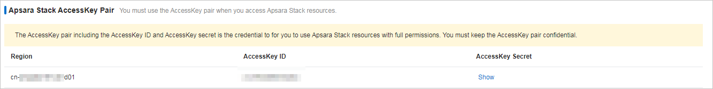
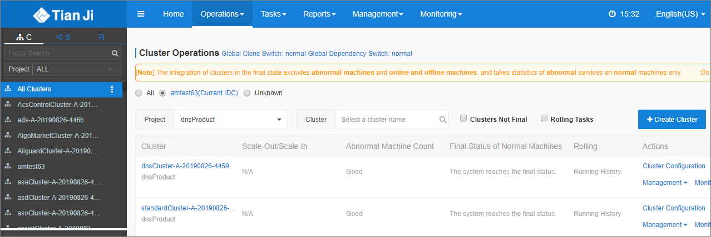
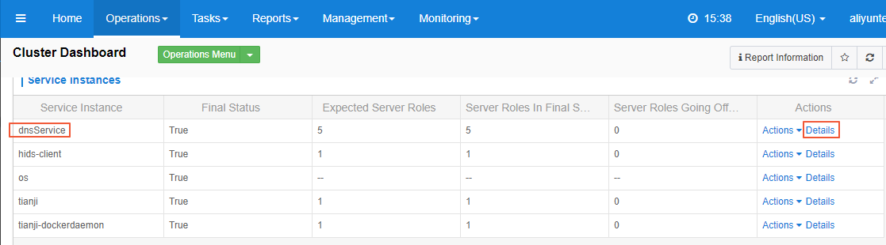
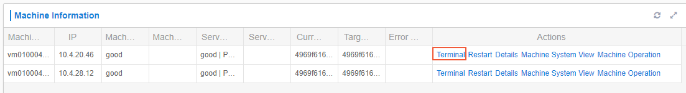

Alibaba Cloud  
Apsara Stack  
Apsara Stack DNS  
Developer Guide  
Product Version: v3.18.6-2607  
Document Version: 20260828

**Table of Contents**

- [1.Preparations](#section-1)
    - [1.1. Obtain the information and the endpoint of an API operation](#section-1-1)
    - [1.2. Obtain an AccessKey pair](#section-1-2)
    - [1.3. Obtain common header parameters](#section-1-3)
    - [1.4. Obtain access credentials assigned by STS](#section-1-4)
- [2.Use POP to make API calls](#section-2)
    - [2.1. Preparations](#section-2-1)
    - [2.2. SDK for Java](#section-2-2)
    - [2.3. SDK for Go](#section-2-3)
    - [2.4. SDK for Python](#section-2-4)
- [3.API Reference](#section-3)
    - [3.1. Overview](#section-3-1)
        - [3.1.1. Calling methods](#section-3-1-1)
        - [3.1.2. Supported formats](#section-3-1-2)
        - [3.1.3. Instructions](#section-3-1-3)
        - [3.1.4. Time format](#section-3-1-4)
    - [3.2. List of operations by function](#section-3-2)
    - [3.3. Prerequisites](#section-3-3)
        - [3.3.1. Obtain an AccessKey pair](#section-3-3-1)
        - [3.3.2. Obtain an endpoint](#section-3-3-2)
    - [3.4. SDK example](#section-3-4)
        - [3.4.1. Create a client](#section-3-4-1)
        - [3.4.2. Cloud API reference](#section-3-4-2)
            - [3.4.2.1. TransferLeadership](#section-3-4-2-1)
            - [3.4.2.2. DescribeDnsGtmAgents](#section-3-4-2-2)
            - [3.4.2.3. DeletePrivateDefaultForwardZone](#section-3-4-2-3)
            - [3.4.2.4. UpdatePrivateZoneRecord](#section-3-4-2-4)
            - [3.4.2.5. AddGlobalLine](#section-3-4-2-5)
            - [3.4.2.6. UpdateGlobalZoneRecord](#section-3-4-2-6)
            - [3.4.2.7. DescribePrivateForwardZones](#section-3-4-2-7)
            - [3.4.2.8. DeleteRecursorAcl](#section-3-4-2-8)
            - [3.4.2.9. DeleteZoneVpc](#section-3-4-2-9)
            - [3.4.2.10. DescribeNodes](#section-3-4-2-10)
            - [3.4.2.11. AddPrivateDefaultForwardZone](#section-3-4-2-11)
            - [3.4.2.12. FlushCache](#section-3-4-2-12)
            - [3.4.2.13. DescribeDnsGtmAddressPools](#section-3-4-2-13)
            - [3.4.2.14. DeleteDnsGtmAddressPool](#section-3-4-2-14)
            - [3.4.2.15. UpdatePrivateDefaultForwardZoneRemark](#section-3-4-2-15)
            - [3.4.2.16. AddGlobalZoneRecord](#section-3-4-2-16)
            - [3.4.2.17. DeletePrivateForwardZone](#section-3-4-2-17)
            - [3.4.2.18. DescribeGlobalForwardZones](#section-3-4-2-18)
            - [3.4.2.19. DescribeResolveConf](#section-3-4-2-19)
            - [3.4.2.20. DescribePrivateLines](#section-3-4-2-20)
            - [3.4.2.21. UpdatePrivateLine](#section-3-4-2-21)
            - [3.4.2.22. DescribeConflictPrivateZones](#section-3-4-2-22)
            - [3.4.2.23. DeleteDnsGtmMonitor](#section-3-4-2-23)
            - [3.4.2.24. DeletePrivateZone](#section-3-4-2-24)
            - [3.4.2.25. DescribeDnsGtmMonitor](#section-3-4-2-25)
            - [3.4.2.26. AddPrivateLine](#section-3-4-2-26)
            - [3.4.2.27. DescribeDnsGtmAccessStrategies](#section-3-4-2-27)
            - [3.4.2.28. UpdatePrivateForwardZone](#section-3-4-2-28)
            - [3.4.2.29. AddGlobalForwardZone](#section-3-4-2-29)
            - [3.4.2.30. DescribeConflictGlobalZones](#section-3-4-2-30)
            - [3.4.2.31. UpdatePrivateZoneRecordRemark](#section-3-4-2-31)
            - [3.4.2.32. UpdateDnsGtmInstance](#section-3-4-2-32)
            - [3.4.2.33. AddDnsGtmAccessStrategy](#section-3-4-2-33)
            - [3.4.2.34. UpdateDnsGtmInstanceRemark](#section-3-4-2-34)
            - [3.4.2.35. SetGlobalDefaultForward](#section-3-4-2-35)
            - [3.4.2.36. DescribePrivateDefaultForwardZones](#section-3-4-2-36)
            - [3.4.2.37. DescribeGlobalZones](#section-3-4-2-37)
            - [3.4.2.38. DescribeGlobalZoneRecords](#section-3-4-2-38)
            - [3.4.2.39. UpdateGlobalLine](#section-3-4-2-39)
            - [3.4.2.40. EnableRecursor](#section-3-4-2-40)
            - [3.4.2.41. DescribeGlobalLines](#section-3-4-2-41)
            - [3.4.2.42. DescribeMetrics](#section-3-4-2-42)
            - [3.4.2.43. DescribeDNSServerAddrs](#section-3-4-2-43)
            - [3.4.2.44. UpdateGlobalZoneRemark](#section-3-4-2-44)
            - [3.4.2.45. DescribeGlobalDefaultForward](#section-3-4-2-45)
            - [3.4.2.46. AddGlobalZone](#section-3-4-2-46)
            - [3.4.2.47. UpdatePrivateZoneRemark](#section-3-4-2-47)
            - [3.4.2.48. AddDnsGtmMonitor](#section-3-4-2-48)
            - [3.4.2.49. UpdateDnsGtmAddressPool](#section-3-4-2-49)
            - [3.4.2.50. UpdatePrivateLinePriority](#section-3-4-2-50)
            - [3.4.2.51. DeleteDnsGtmInstance](#section-3-4-2-51)
            - [3.4.2.52. UpdateGlobalLinePriority](#section-3-4-2-52)
            - [3.4.2.53. AddDnsGtmInstance](#section-3-4-2-53)
            - [3.4.2.54. DescribeCache](#section-3-4-2-54)
            - [3.4.2.55. DescribeDnsGtmInstances](#section-3-4-2-55)
            - [3.4.2.56. EnableEmergencyGroup](#section-3-4-2-56)
            - [3.4.2.57. DisableEmergencyGroup](#section-3-4-2-57)
            - [3.4.2.58. AddGlobalZone](#section-3-4-2-58)
            - [3.4.2.59. UpdateRecursorAclRemark](#section-3-4-2-59)
            - [3.4.2.60. UpdateGlobalForwardZone](#section-3-4-2-60)
            - [3.4.2.61. AddPrivateZone](#section-3-4-2-61)
            - [3.4.2.62. AddPrivateForwardZone](#section-3-4-2-62)
            - [3.4.2.63. UpdateDnsGtmAccessStrategy](#section-3-4-2-63)
            - [3.4.2.64. UpdateGlobalForwardZoneRemark](#section-3-4-2-64)
            - [3.4.2.65. DeletePrivateLine](#section-3-4-2-65)
            - [3.4.2.66. BindZoneVpc](#section-3-4-2-66)
            - [3.4.2.67. DeleteDnsGtmAccessStrategy](#section-3-4-2-67)
            - [3.4.2.68. DeleteGlobalForwardZone](#section-3-4-2-68)
            - [3.4.2.69. UpdateGlobalZone](#section-3-4-2-69)
            - [3.4.2.70. UpdateRecursorAcl](#section-3-4-2-70)
            - [3.4.2.71. UpdateGlobalZoneRecordRemark](#section-3-4-2-71)
            - [3.4.2.72. DescribeRecursorAcls](#section-3-4-2-72)
            - [3.4.2.73. DescribePrivateZones](#section-3-4-2-73)
            - [3.4.2.74. AddRecursorAcl](#section-3-4-2-74)
            - [3.4.2.75. UpdateDnsGtmMonitor](#section-3-4-2-75)
            - [3.4.2.76. DescribePrivateZoneRecords](#section-3-4-2-76)
            - [3.4.2.77. DescribeGlobalZones](#section-3-4-2-77)
            - [3.4.2.78. DescribeDnsGtmLogs](#section-3-4-2-78)
            - [3.4.2.79. DeleteGlobalZone](#section-3-4-2-79)
            - [3.4.2.80. UpdateNode](#section-3-4-2-80)
            - [3.4.2.81. AddPrivateZoneRecord](#section-3-4-2-81)
            - [3.4.2.82. AddDnsGtmAddressPool](#section-3-4-2-82)
            - [3.4.2.83. UpdatePrivateForwardZoneRemark](#section-3-4-2-83)
            - [3.4.2.84. BindForwardZoneVpc](#section-3-4-2-84)
            - [3.4.2.85. DeleteForwardZoneVpc](#section-3-4-2-85)
            - [3.4.2.86. UpdatePrivateDefaultForwardZone](#section-3-4-2-86)
            - [3.4.2.87. DeleteGlobalLine](#section-3-4-2-87)
            - [3.4.2.88. DeleteGlobalZoneRecord](#section-3-4-2-88)
            - [3.4.2.89. DeletePrivateZoneRecord](#section-3-4-2-89)
        - [3.4.3. Cross-cloud API reference](#section-3-4-3)
            - [3.4.3.1. Query node management list: DescribeNodes](#section-3-4-3-1)
            - [3.4.3.2. Modify the priority of a UniversalLine cross-cloud DNS line: UpdateUniversalLinePriority](#section-3-4-3-2)
            - [3.4.3.3. Enable emergency group: EnableEmergencyGroup](#section-3-4-3-3)
            - [3.4.3.4. Add UniversalZone global shared domain name: AddUniversalZone](#section-3-4-3-4)
            - [3.4.3.5. Modify the remark of a cross-cloud shared domain DNS record: UpdateUniversalZoneRecordRemark](#section-3-4-3-5)
            - [3.4.3.6. Disable emergency group: DisableEmergencyGroup](#section-3-4-3-6)
            - [3.4.3.7. Modify the remark of a UniversalZone cross-cloud shared domain name: UpdateUniversalZoneRemark](#section-3-4-3-7)
            - [3.4.3.8. Delete UniversalLine cross-cloud DNS line: DeleteUniversalLine](#section-3-4-3-8)
            - [3.4.3.9. Modify UniversalLine cross-cloud resolution line: UpdateUniversalLine](#section-3-4-3-9)
            - [3.4.3.10. Modify DNS records of cross-cloud shared domain names: UpdateUniversalZoneRecord](#section-3-4-3-10)
            - [3.4.3.11. Modify a node: UpdateNode](#section-3-4-3-11)
            - [3.4.3.12. Delete a cross-cloud shared domain name: DeleteUniversalZone](#section-3-4-3-12)
            - [3.4.3.13. Switch a secondary node to the primary node: TransferLeadership](#section-3-4-3-13)
            - [3.4.3.14. Query UniversalLine cross-cloud DNS line list: DescribeUniversalLines](#section-3-4-3-14)
            - [3.4.3.15. Add UniversalLine cross-cloud DNS line: AddUniversalLine](#section-3-4-3-15)
            - [3.4.3.16. Delete a UniversalZone DNS record: DeleteUniversalZoneRecord](#section-3-4-3-16)
            - [3.4.3.17. Get UniversalZone record list: DescribeUniversalZoneRecords](#section-3-4-3-17)
            - [3.4.3.18. Get UniversalZone list: DescribeUniversalZones](#section-3-4-3-18)
            - [3.4.3.19. Add a UniversalZone DNS record: AddUniversalZoneRecord](#section-3-4-3-19)

<a id="section-1"></a>

# 1.Preparations

<a id="section-1-1"></a>

## 1.1. Obtain the information and the endpoint of an API operation

To call an API operation of a cloud service, you must obtain the information about the operation, including the service code, operation name, and API version.

**Background information**

The API information on the debugging page of the Apsara Uni-manager Management Console is for reference only. For more information about how to call API operations, see the developer guides of cloud services. If the information on the debugging page is different from that in the developer guide of a cloud service, the information in the developer guide prevails.

**Procedure**

1. Log on to the Apsara Uni-manager Management Console.

2. In the top navigation bar, choose **Products** > **Application Services** > **OpenAPI Explorer**.

3. On the **OpenAPI Explorer** page, choose **API Integration** > **API Debugging** in the top navigation bar.

   

4. In the left-side navigation pane, select the cloud service that you want to manage.

5. Select an API version from the **Version** drop-down list.

6. In the API operation list, you can view all API operations of the current version.

7. Click the operation that you want to call. Obtain the endpoint from the Endpoint parameter on the Parameter tab.

   

<a id="section-1-2"></a>

## 1.2. Obtain an AccessKey pair

An AccessKey pair consists of an AccessKey ID and an AccessKey secret. The AccessKey pair is used to implement symmetric encryption to verify the identity of the requester. The AccessKey ID is used to identify a user. The AccessKey secret is used to encrypt the signature string. This topic describes how to obtain an AccessKey pair.

**Prerequisites**

Only operations administrators and level-1 organization administrators can obtain the AccessKey pair of an organization.

**Background information**

We recommend that you use the AccessKey pair of a personal account to call the API operations of the Apsara Uni-manager Management Console and cloud services. When you use the AccessKey pair of a personal account, you must configure header parameters as described in the following table for access control.

| Parameter | Description |
| --- | --- |
| x-acs-regionid | The region ID, such as cn-hangzhou-\*. |
| x-acs-organizationid | The ID of the organization in the Apsara Uni-manager Management Console. |
| x-acs-resourcegroupid | The ID of the resource set in the Apsara Uni-manager Management Console. |
| x-acs-instanceid | The ID of the instance on which you want to perform operations. |

> **Warning**
>
> The AccessKey pairs of personal accounts are under control of the Apsara
>
> Uni-manager Management Console permission system. AccessKey pairs of organization accounts have higher permissions. For security purposes, organization operations must be approved by administrators.

**Obtain the AccessKey pair of a personal account**

To obtain the AccessKey pair of a personal account, perform the following operations:

1. Log on to the Apsara Uni-manager Management Console.

2. In the upper-right corner of the homepage, move the pointer over the profile picture and click **User Information**.

3. In the **Apsara Stack AccessKey Pair** section, view your AccessKey pair.

   

   > **Note**
   >
   > The AccessKey pair consists of an AccessKey ID and an AccessKey secret.
   >
   > AccessKey pairs allow you to access Apsara Stack resources with full permissions for your account. You must keep your AccessKey pair confidential.

**Obtain the AccessKey pair of an organization**

To obtain the AccessKey pair of an organization, perform the following operations:

1. Log on to the Apsara Uni-manager Management Console as an administrator.

2. In the top navigation bar, click **Enterprise**.

3. In the left-side navigation pane of the **Enterprise** page, click **Organizations**.

4. In the organization navigation tree, click an organization name.

5. In the Current Organization section, click **Obtain an accesskey**.

6. In the AccessKey message, view the AccessKey pair of the organization.

   > **Note**
   >
   > An AccessKey pair is automatically allocated to each level-1 organization.
   >
   > Subordinate organizations use the same AccessKey pair of their level-1 organization.

<a id="section-1-3"></a>

## 1.3. Obtain common header parameters

When calling API operations, you must provide multiple header parameters. This topic describes how to obtain these parameters and explains some response parameters.

**Obtain a region ID**

1. Log on to the Apsara Uni-manager Management Console as an administrator.

2. In the top navigation bar, click **Enterprise**.

3. In the left-side navigation pane, choose **Resource Management** > **Regions**.

4. Click the name of the organization.

5. In the **Region List** section on the right, view the **Region Name**, which is the region ID.

**Obtain an organization ID**

You must call a specific API operation to obtain the organization ID. You can obtain the organization ID by using the online debugging feature in the Apsara Uni-manager Management Console.

1. Log on to the Apsara Uni-manager Management Console as an administrator.

2. Click **Products** in the top navigation bar and select **Developer Tools** > **API & Tools** > **Developer Portal**.

3. On the **Developer Portal** page, choose **API Integration** > **API Debugging**.

4. Click the  button and select **Cloud Platform** > **Unified Cloud Management**

   **Platform**. For **Version**, select **2019-05-10**.

5. Enter  `GetOrganizationList`  in the text box for online debugging. Enter the name of the target organization in the name parameter and call the operation. After the call is successful, view the **Call Result** section and find the **id** value, which is the organization ID. For more information, see the *GetOrganizationList* section in the *Apsara Uni-manager Mana gement Console Developer Guide*.

**Obtain a resource set ID**

You must call a specific API operation to obtain the resource set ID. You can obtain the resource set ID by using the online debugging feature in the Apsara Uni-manager Management Console.

1. Log on to the Apsara Uni-manager Management Console as an administrator.

2. Click **Products** in the top navigation bar and select **Developer Tools** > **API & Tools** > **Developer Portal**.

3. On the **Developer Portal** page, choose **API Integration** > **API Debugging**.

4. Click the  button and select **Cloud Platform** > **Unified Cloud Management**

   **Platform**. For **Version**, select **2019-05-10**.

5. Enter  `ListResourceGroup`  in the text box for online debugging. After the call is successful, view the **Call Result** section and find the **id** value, which is the resource set ID. For more information, see the *ListResourceGroup* section in the *Apsara Uni-manager Management Co nsole Developer Guide*.

**Obtain an instance ID**

You can obtain an instance ID from the cloud service instance list in the Apsara Uni-manager Management Console. This topic uses API Gateway as an example to describe how to obtain an instance ID:

1. Log on to the Apsara Uni-manager Management Console.

2. In the top navigation bar, choose **Products** > **Development And Tools** > **Development And O&M** > **API Gateway**.

3. In the left-side navigation pane, click **Instances**.

4. View the **Instance ID** in the instance list.

**Response parameters**

The following response parameters are returned by default when you call operations to query the instances of cloud services.

| Parameter | Description |
| --- | --- |
| ResourceGroupName | The name of the resource set. |
| ResourceGroup | The ID of the resource set. |
| DepartmentName | The name of the organization. |
| Department | The organization ID. |

<a id="section-1-4"></a>

## 1.4. Obtain access credentials assigned by STS

This topic describes how to use Security Token Service (STS) to call API operations in Apsara Stack.

**Background information**

STS allows you to manage temporary access credentials for your Apsara Stack resources. You can use STS to call API operations.

**Procedure**

1. Obtain the Apsara Stack Resource Name (ARN) of your  `Resource Access Management (RAM) role` .

   <ol type="i">

   <li>

   Log on to the Apsara Uni-manager Management Console.

   </li>

   <li>

   In the upper-right corner of the homepage, click the profile picture and then click **User**

   </li>

   </ol>

   **Information**.

   <ol type="i" start="3">

   <li>

   On the page that appears, click **View Current Role Policy**.

   </li>

   </ol>

   In the **View Policies of Current Role** dialog box, view the ARN of your  `RAM role` .

2. Use the following code to obtain an AccessKey ID ( `stsAK` ), AccessKey secret ( `stsSK` ), and STS token ( `stsToken` ) by assuming the  `RAM role` .

   ```java
   public static void main(String[] args) {
        ASClient asClient = new ASClient();
        // Specify the description of the call source.
           asClient.setSdkSource("test");
        // Specify the ARN.
           String assumeRole = AssumeRole(asClient, "<RAM Role>");

           JSONObject assumeRoleJson = JSONObject.parseObject(assumeRole);

           JSONObject credentials = assumeRoleJson.getJSONObject("Credentials");

           // Obtain the access credentials assigned by STS.
           String stsAK = credentials.getString("AccessKeyId");
           String stsSK = credentials.getString("AccessKeySecret");
           String stsToken = credentials.getString("SecurityToken");
   }

   public static String AssumeRole(ASClient asClient, String roleArn) {

           Map<String, String> headers = new HashMap<>();

           Map<String, Object> reqParams = new HashMap<>();

           reqParams.put("action", "AssumeRole");

           reqParams.put("Product", "Sts");

           reqParams.put("Version", "2015-04-01");

           reqParams.put("regionId", regionId);

        // The AccessKey ID of the current user.
           reqParams.put("AccessKeyId", <The AccessKey ID of the current user>);
        // The AccessKey secret of the current user.
           reqParams.put("AccessKeySecret", <The AccessKey secret of the current user>);

           reqParams.put("roleSessionName", "StsUser");

           reqParams.put("roleArn", roleArn);

           return asClient.doRequest(endpoint, headers, reqParams);
   }
   ```

3. Use the access credentials assigned by STS to call an API operation of a cloud service. In this example, the Elastic Compute Service (ECS) API is used.

   ```java
   public static void main(String[] args) {
        ASClient asClient = new ASClient();
           asClient.setSdkSource("test");
     // Call an API operation of ECS.
           String ecsRes = DescribeZones(asClient,<stsAK>,<stsSK>,<stsToken>);
   }


   public static String DescribeZones(ASClient asClient, String stsAK, String stsSK, String stsToken) {

           Map<String, String> headers = new HashMap<>();

           Map<String, Object> reqParams = new HashMap<>();

           reqParams.put("action", "DescribeZones");

           reqParams.put("Product", "Ecs");

           reqParams.put("Version", "2014-05-26");

           reqParams.put("regionId", "<your-RegionID>");

           // Specify the AccessKey ID, AccessKey secret, and STS token.
           reqParams.put("AccessKeyId", <stsAK>);
           reqParams.put("AccessKeySecret", <stsSK>);
           reqParams.put("SecurityToken", <stsToken>);

           return asClient.doRequest(endpoint, headers, reqParams, HttpMethod.GET);

       }
   ```

<a id="section-2"></a>

# 2.Use POP to make API calls

<a id="section-2-1"></a>

## 2.1. Preparations

You can use the point of presence (POP) gateway to call API operations in Apsara Stack in the same way as in Alibaba Cloud public cloud. This topic describes the preparations before you use the POP gateway to call API operations.

**Background information**

To enable you to call API operations in the same way as that in Alibaba Cloud public cloud and have a more convenient and consistent experience, we recommend that you use the POP gateway to call API operations in Apsara Stack.

**Obtain service endpoints**

**Obtain an endpoint in OpenAPI Explorer**

1. Log on to the Apsara Uni-manager Management Console.

2. In the top navigation bar, choose **Products** > **Application Services** > **OpenAPI Explorer**.

3. On the **OpenAPI Explorer** page, choose **API Integration** > **API Debugging** in the top navigation bar.

   

4. In the left-side navigation pane, select the cloud service that you want to manage.

5. Select an API version from the **Version** drop-down list.

6. In the API operation list, you can view all API operations of the current version.

7. Click the operation that you want to call. Obtain the endpoint from the Endpoint parameter on the Parameter tab.

   

**Obtain an endpoint in Apsara Infrastructure Management**

To use the POP gateway to call API operations in Apsara Stack, you must obtain the required service endpoints. You can obtain service endpoints from Apsara Stack onsite O&M engineers

You can also obtain service endpoints by yourself. In this example, API Gateway is used.

1. Log on to the Apsara Uni-manager Operations Console.

2. In the top navigation bar, choose **Platform Operation** > **Apsara Infrastructure Management** > **O&M Tools**.

3. In the left-side navigation pane, choose **O&M Tools** > **Service Registration Variable Dashboard**.

4. On the Service Registration Variable Dashboard page, click **Advanced Filter**.

5. Enter  `apigateway`  in the Service Registration field and click **Search**.

6. In the **Service Registration** column of the  `apigateway`  service, click the  icon.

7. Click the text information in the **Service Registration** column of the  `apigateway`  service. In the **Registration Variables** message, obtain the endpoint from the value of apigateway.openapi.endpoint.

**Obtain common parameters**

You must obtain the parameters required when you use the POP gateway to call API operations, such as the organization ID, resource set ID, region ID, and instance ID. For more information, see Obtain the values of common request headers.

<a id="section-2-2"></a>

## 2.2. SDK for Java

Before you use an SDK for Java to call the API of a cloud service over the point of presence (POP) gateway, you must check the style of the service API. A service API can be of the Remote Procedure Call (RPC) or Resource-Oriented Architecture (ROA) style.

**Usage notes**

We recommend that you use CommonRequest to call Apsara Stack APIs. To view the recommended SDK version and sample code, log on to the Apsara Uni-manager Management Console and choose **Products** > **Application Services** > **OpenAPI Explorer** in the top navigation bar. On the OpenAPI Explorer page, choose **API Integration** > **SDK Sample Code** in the top navigation bar.

> **Important**
>
> We recommend that you do not download SDKs from the SDK Center and use them in Apsara Stack. SDKs for the public cloud may not support Apsara Stack APIs and may have compatibility issues. Proceed with caution.

**Examples**

The following sample code provides an example on how to call RPC APIs. In this example, the DescribeApiGroups operation of API Gateway is called, and the API version is 2016-07-14.

Sample code:

```xml
import com.aliyuncs.CommonRequest;
import com.aliyuncs.CommonResponse;
import com.aliyuncs.DefaultAcsClient;
import com.aliyuncs.IAcsClient;
import com.aliyuncs.exceptions.ClientException;
import com.aliyuncs.exceptions.ServerException;
import com.aliyuncs.http.MethodType;
import com.aliyuncs.profile.DefaultProfile;

public class DescribeApiGroups {

    public static void main(String[] args) {
        // Create and initialize a DefaultAcsClient instance. 
        DefaultProfile profile = DefaultProfile.getProfile("<your-regionid>", "
<yourAccessKeyId>", "<yourAccessSecret>");

        // Ignore SSL certificate validation.
        // HttpClientConfig clientConfig = HttpClientConfig.getDefault();
        // clientConfig.setIgnoreSSLCerts(true);
        // Specify the connection timeout period.
        // clientConfig.setConnectionTimeoutMillis(3000L);
        // Specify the read timeout period.
        // clientConfig.setReadTimeoutMillis(10000L);
        // profile.setHttpClientConfig(clientConfig);
        
        IAcsClient client = new DefaultAcsClient(profile);
        // Create an API request and specify the request parameters. 
        CommonRequest request = new CommonRequest();
        // Specify the request method.
        request.setSysMethod(MethodType.POST);
        // Specify the service endpoint.
        request.setSysDomain("<apigatewayEndpoint>");
        // Specify the API version.
        request.setSysVersion("2016-07-14");
        // Specify the service code.
        request.setSysLocationProduct("apigateway");
        // Specify the name of the API operation.
        request.setSysAction("DescribeApiGroups");
        
        // If you use Security Token Service (STS) to call RPC API operations, you mustspecify the SecurityToken parameter.
        // request.putBodyParameter("SecurityToken", "<your-SecurityToken>");

        // Specify service-related parameters.
        request.putQueryParameter("PageSize", "10");
        request.putQueryParameter("PageNumber", "1");

        // Required. The call source.
        request.putHeadParameter("x-acs-caller-sdk-source", "ApiTestDemo");
        // Optional. The region ID. This parameter is required for Apsara Stack V3.15.0and earlier.
        request.putHeadParameter("x-acs-regionid", "<your-regionid>");
        // Optional. The resource set ID.
        request.putHeadParameter("x-acs-resourcegroupid", "<your-resourcegroupid>");
        // Required. The organization ID.
        request.putHeadParameter("x-acs-organizationid", "<your-organizationid>");
        // Optional. The instance ID. This parameter is required for modify and delete operations.
        // request.putHeadParameter("x-acs-instanceid", "<your-instanceid>");

        try {
            // Initiate the request and handle the response or exceptions. 
            CommonResponse response = client.getCommonResponse(request);
            System.out.println(response.getData());
        } catch (ServerException e) {
            e.printStackTrace();
        } catch (ClientException e) {
            System.out.println("ErrCode:" + e.getErrCode());
            System.out.println("ErrMsg:" + e.getErrMsg());
            System.out.println("RequestId:" + e.getRequestId());
        }

    }
}
```

The following sample code provides an example on how to call ROA APIs. In this example, the GetNamespaceList operation of Container Registry is called, and the API version is 2016-06-07.

Sample code:

```xml
import com.aliyuncs.CommonRequest;
import com.aliyuncs.CommonResponse;
import com.aliyuncs.DefaultAcsClient;
import com.aliyuncs.IAcsClient;
import com.aliyuncs.exceptions.ClientException;
import com.aliyuncs.exceptions.ServerException;
import com.aliyuncs.http.MethodType;
import com.aliyuncs.profile.DefaultProfile;

public class GetNamespaceList {

    public static void main(String[] args) {
        // Create and initialize a DefaultAcsClient instance. 
        DefaultProfile profile = DefaultProfile.getProfile("<your-regionid>", "
<yourAccessKeyId>", "<yourAccessSecret>");

        // Ignore SSL certificate validation.
        // HttpClientConfig clientConfig = HttpClientConfig.getDefault();
        // clientConfig.setIgnoreSSLCerts(true);
        // Specify the connection timeout period.
        // clientConfig.setConnectionTimeoutMillis(3000L);
        // Specify the read timeout period.
        // clientConfig.setReadTimeoutMillis(10000L);
        // profile.setHttpClientConfig(clientConfig);
        
        IAcsClient client = new DefaultAcsClient(profile);
        // Create an API request and specify the request parameters. 
        CommonRequest request = new CommonRequest();

        // Set the request protocol to HTTPS.
        request.setSysProtocol(ProtocolType.HTTP);
        // Specify the request method.
        request.setSysMethod(MethodType.GET);
        // Specify the service endpoint.
        request.setSysDomain("<crEndpoint>");
        // Specify the API version.
        request.setSysVersion("2016-06-07");
        // Specify the uriPattern parameter, which is required for ROA APIs.
        request.setSysUriPattern("/namespace");
        // Specify the service code.
        request.setSysLocationProduct("cr");
        // Specify the name of the API operation.
        request.setSysAction("GetNamespaceList");

        // Required. The call source.
        request.putHeadParameter("x-acs-caller-sdk-source", "ApiTestDemo");
        // Optional. The region ID. This parameter is required for Apsara Stack V3.15.0and earlier.
        request.putHeadParameter("x-acs-regionid", "<your-regionid>");
        // Optional. The resource set ID.
        request.putHeadParameter("x-acs-resourcegroupid", "<your-resourcegroupid>");
        // Required. The organization ID.
        request.putHeadParameter("x-acs-organizationid", "<your-organizationid>");
        // Optional. The instance ID. This parameter is required for modify and delete operations.
        // request.putHeadParameter("x-acs-instanceid", "<your-instanceid>");


        // If you use access credentials assigned by STS to call ROA API operations, you must add the x-acs-security-token field to the header.
        // request.putHeadParameter("x-acs-security-token", "<your-securitytoken>");

        try {
            // Initiate the request and handle the response or exceptions. 
            CommonResponse response = client.getCommonResponse(request);
            System.out.println(response.getData());
        } catch (ServerException e) {
            e.printStackTrace();
        } catch (ClientException e) {
            System.out.println("ErrCode:" + e.getErrCode());
            System.out.println("ErrMsg:" + e.getErrMsg());
            System.out.println("RequestId:" + e.getRequestId());
        }

    }
}
```

> **Important**
>
> By default, if you send API requests over HTTPS, the SDK enables certificate verification to verify the validity of SSL/TLS certificates. If no certificate is configured in the development environment, an error that indicates the certificate verification fails is reported.
>
> To ensure communication security in the production environment, we recommend that you enable certificate verification. If certificate verification must be ignored in the test environment, you can specify the following setting:
>
> Java
>
> ```text
> HttpClientConfig clientConfig = HttpClientConfig.getDefault();
> // Disable certificate verification for the client.
> clientConfig.setIgnoreSSLCerts(true)
> ```

<a id="section-2-3"></a>

## 2.3. SDK for Go

This topic describes how to use SDK for Go over the point of presence (POP) gateway.

**Usage notes**

We recommend that you use CommonRequest to call Apsara Stack APIs. To view the recommended SDK version and sample code, log on to the Apsara Uni-manager Management Console and choose **Products** > **Application Services** > **OpenAPI Explorer** in the top navigation bar. On the OpenAPI Explorer page, choose **API Integration** > **SDK Sample Code** in the top navigation bar.

> **Important**
>
> We recommend that you do not download SDKs from the SDK Center and use them in Apsara Stack. SDKs for the public cloud may not support Apsara Stack APIs and may have compatibility issues. Proceed with caution.

**Background information**

Remote Procedure Call (RPC) and Resource-Oriented Architecture (ROA) APIs are supported.

**Examples**

The following sample code provides an example on how to call RPC APIs. In this example, the DescribeApiGroups operation of API Gateway is called, and the API version is 2016-07-14.

Sample code:

```go
package main

import (
    "fmt"
    "github.com/aliyun/alibaba-cloud-sdk-go/sdk"
    "github.com/aliyun/alibaba-cloud-sdk-go/sdk/requests"
  
)

func main() {
    client, err := sdk.NewClientWithAccessKey("<your-RegionID>", "<AccessKey ID>", "<AccessKey Secret>")

    request := requests.NewCommonRequest()
    
    request.Method = "POST"
    request.Domain = "<ApigatewayEndpoint>"
    request.Version = "2016-07-14"
    request.ApiName = "DescribeApiGroups"
    request.Product = "apigateway"
    // If you use Security Token Service (STS) to call RPC API operations, you must specify the SecurityToken parameter.
    // request.QueryParams["SecurityToken"]="<your-SecurityToken>"

    // Required. The call source.
    request.Headers["x-acs-caller-sdk-source"] = "ApiTestDemo"
    // Optional. The region ID. This parameter is required for Apsara Stack V3.15.0 andearlier.
    request.Headers["x-acs-regionid"] = "<your-RegionID>"
    // Optional. The resource set ID.
    request.Headers["x-acs-resourcegroupid"] = "<your-ResourceGroupID>"
    // Required. The organization ID.
    request.Headers["x-acs-organizationid"] = "<your-OrganizationID>"
    // Optional. The instance ID. This parameter is required for modify and delete operations.
    // request.Headers["x-acs-instanceid"] = "<your-InstanceID>"

    response, err := client.ProcessCommonRequest(request)
    if err != nil {
        panic(err)
    }
    fmt.Print(response.GetHttpContentString())
}
```

The following sample code provides an example on how to call ROA APIs. In this example, the GetNamespaceList operation of Container Registry is called, and the API version is 2016-06-07.

Sample code:

```xml
package main

import (
 "fmt"
 "github.com/aliyun/alibaba-cloud-sdk-go/sdk"
 "github.com/aliyun/alibaba-cloud-sdk-go/sdk/requests"
 "os"
)


func main() {
    client, err := sdk.NewClientWithAccessKey("<your-regionid>", "<yourAccessKeyId>", "
<yourAccessSecret>")
 request := requests.NewCommonRequest()

 request.Method = "GET"
 request.Domain = "<crEndpoint>"
 request.Version = "2016-06-07"
 request.ApiName = "GetNamespaceList"
 request.Product = "cr"

 request.PathPattern = "/namespace"
 // If you use STS to call ROA API operations, you must specify the x-acs-security-
token header.
 // request.Headers["x-acs-security-token"] = "<your-SecurityToken>"
 // Required. The call source.
 request.Headers["x-acs-caller-sdk-source"] = "ApiTestDemo"
    // Optional. The region ID. This parameter is required for Apsara Stack V3.15.0 andearlier.
    request.Headers["x-acs-regionid"] = "<your-RegionID>"
    // Optional. The resource set ID.
    request.Headers["x-acs-resourcegroupid"] = "<your-ResourceGroupID>"
    // Required. The organization ID.
    request.Headers["x-acs-organizationid"] = "<your-OrganizationID>"
 // Optional. The instance ID. This parameter is required for modify and delete operations.
 // request.Headers["x-acs-instanceid"] = "<your-InstanceID>"

 response, err := client.ProcessCommonRequest(request)
 if err != nil {
  panic(err)
 }
 fmt.Print(response.GetHttpContentString())
}
```

**Proxy configuration**

You can configure proxies for API calls in one of the following ways:

- Configure proxies by using environment variables.

  Set the HTTP_PROXY, HTTPS_PROXY, or NO_PROXY environment variable.

  Sample code:

  ```go
  import (
      "os"
  )
  func main(){
   os.Setenv("HTTP_PROXY", "http://x.x.x.x:xxxx") // Set the HTTP_PROXY environment variable.
   os.Setenv("HTTPS_PROXY", "https://x.x.x.x:xxxx") // Set the HTTPS_PROXY environment variable.
  }
  ```

- Configure proxies on the client.

  Sample code:

  ```text
  // The proxies that are configured on the client take precedence over those that are configured by using environment variables.
  client.SetHttpProxy("http://x.x.x.x:xxxx")   // Configure the HTTP proxy.
  client.GetHttpProxy()                          // Query the HTTP proxy.

  client.SetHttpsProxy("https://x.x.x.x:xxxx")   // Configure the HTTPS proxy.
  client.GetHttpsProxy()                           // Query the HTTPS proxy.

  client.SetNoProxy("127.0.0.1,localhost")     // Configure the proxy whitelist.
  client.GetNoProxy()                          // Query the proxy whitelist.
  ```

**SSL verification**

**Description**

You can configure SSL verification for requests.

- If you set the HTTPSInsecure parameter to  `true` , certificate verification is disabled. To ensure connection security, we recommend that you enable certificate verification.

- If you set the HTTPSInsecure parameter to  `false` , certificate verification is enabled. By default, certificate authority (CA) certificates on the operating systems are used.

**Default value**

```text
 false 
```

**Configuration methods**

> **Important**
>
> By default, if you send API requests over HTTPS, the SDK enables certificate verification to verify the validity of SSL/TLS certificates. If no certificate is configured in the development environment, an error that indicates the certificate verification fails is reported. To ensure communication security in the production environment, we recommend that you enable certificate verification. If certificate verification must be ignored in the test environment, you can specify the following settings:

```text
// If you configure the HTTPSInsecure parameter for a request, the setting takes effectonly on the current request.
request.SetHTTPSInsecure(true)                           // Set the HTTPSInsecure parame
ter to true for the request.
isInsecure := request.GetHTTPSInsecure()                 // Query the setting of the HTT
PSInsecure parameter for the request.
```

If you do not configure the HTTPSInsecure parameter for a request, the setting for a client takes effect.

```text
// If you configure the HTTPSInsecure parameter for the client, the setting takes effect on all requests that are initiated by the client. 
client.SetHTTPSInsecure(true)                         // Set the HTTPSInsecure parameter 
to true for the client.
isInsecure := client.GetHTTPSInsecure()               // Query the setting of the HTTPSI
nsecure parameter for the client.
```

<a id="section-2-4"></a>

## 2.4. SDK for Python

This topic describes how to use SDK for Python over the point of presence (POP) gateway.

**Usage notes**

We recommend that you use CommonRequest to call Apsara Stack APIs. To view the recommended SDK version and sample code, log on to the Apsara Uni-manager Management Console and choose **Products** > **Application Services** > **OpenAPI Explorer** in the top navigation bar. On the OpenAPI Explorer page, choose **API Integration** > **SDK Sample Code** in the top navigation bar.

> **Important**
>
> We recommend that you do not download SDKs from the SDK Center and use them in Apsara Stack. SDKs for the public cloud may not support Apsara Stack APIs and may have compatibility issues. Proceed with caution.

**Background information**

Only remote procedure call (RPC) APIs are supported.

**Example**

The following sample code provides an example on how to make an API call. In this example, the DescribeInstances operation of Elastic Compute Service (ECS) is called, and the API version is 2014-05-26.

Sample code:

```python
from aliyunsdkcore.client import AcsClient
import os
from aliyunsdkcore.request import CommonRequest

# Create an AcsClient instance.
client = AcsClient(
    "<AccessKey ID>",
    "<AccessKey Secret>",
    "<your-RegionID>",
    timeout=1000,  # Specify the timeout period.
    verify=False, # Disable SSL certificate verification. To enable SSL certificate verification, specify verify='<The path of the certificate>'.
);
# Set the following parameters for the HTTPS request protocol:
# client.set_verify(False)
# os.environ["HTTPS_PROXY"] = "http://127.0.0.1:8080"

# os.environ["HTTP_PROXY"] = "http://127.0.0.1:8080"
def describe_api_groups():
    # Create an API request and specify the required parameters.
    request = CommonRequest()

    # If you use Security Token Service (STS) to call RPC API operations, you must specify the SecurityToken parameter.
    # params = {"PageSize":"10","PageNumber":"1","SecurityToken":"<your-
SecurityToken>"};
    params = {"PageSize":"10","PageNumber":"1"};
    request.set_query_params(params)

    headers = {
        # Required. The call source.
        "x-acs-caller-sdk-source":"ApiTestDemo",
        # Optional. The region ID. This parameter is required for Apsara Stack Enterprise Edition V3.15.0 and earlier.
        "x-acs-regionid":"<your-RegionID>",
        # Optional. The resource set ID.
        "x-acs-resourcegroupid":"<your-ResourceGroupID>",
        # Required. The organization ID.
        "x-acs-organizationid":"<your-OrganizationID>"
        # Optional. The instance ID. This parameter is required for modify and delete operations.
        # "x-acs-instanceid":"<your-InstanceID>"

    }
    request.set_headers(headers)
    request.set_version("2016-07-14")
    request.set_action_name("DescribeApiGroups")
    request.set_endpoint("<ApigatewayEndpoint>")   // Replace <ApigatewayEndpoint> withthe actual endpoint.
    request.set_product("apigateway")
    request.set_method("POST")

    # Initiate the API request and display the response.
    response = client.do_action_with_exception(request)
    print(response)


if __name__ == '__main__':
    print("Hello Aliyun OpenApi!")
    describe_api_groups()
```

**Proxy configuration**

You can configure a proxy for API calls by setting the HTTP_PROXY or HTTPS_PROXY environment variable.

Sample code:

```text
# Configure the HTTPS proxy. 
os.environ["HTTPS_PROXY"] = "http://x.x.x.x:xxxx"

# Configure the HTTP proxy.
os.environ["HTTP_PROXY"] = "https://x.x.x.x:xxxx"
```

**HTTPS configuration**

This section describes related configurations for sending API requests over HTTPS.

**Use HTTPS**

By default, the SDKs use HTTPS as the request protocol.

```python
from aliyunsdkecs.request.v20140526.DescribeInstancesRequest import 
DescribeInstancesRequest
from aliyunsdkcore.client import AcsClient
client = AcsClient(
    region_id='<region_id>',  # The region ID.
)

request = DescribeInstancesRequest()
request.set_protocol_type('https')  # Set the protocol to HTTPS.

client.do_action_with_exception(request)   
```

**Disable certificate verification**

> **Important**
>
> - By default, if you send API requests over HTTPS, the SDK enables certificate verification to verify the validity of SSL/TLS certificates. If no certificate is configured in the development environment, an error that indicates the certificate verification fails is reported.
>
> - To ensure communication security in the production environment, we recommend that you enable certificate verification. If certificate verification must be ignored in the test environment, you can set the  `verify`  parameter to false.

```python
from aliyunsdkcore.client import AcsClient
client = AcsClient(
    region_id='<region_id>',  # The region ID.
    verify=False  # Disable SSL certificate verification.
)
```

**Enable certificate verification**

```python
from aliyunsdkcore.client import AcsClient
client = AcsClient(
    region_id='<region_id>',  # The region ID.
    verify='./cacert.pem'  # The path of the certificate authority (CA) certificate.
)
```

<a id="section-3"></a>

# 3.API Reference

<a id="section-3-1"></a>

## 3.1. Overview

<a id="section-3-1-1"></a>

### 3.1.1. Calling methods

You can use a pair of AccessKey ID and AccessKey Secret to call API operations. You can use SDKs of different languages, or create a client based on the signature description provided by the POP gateway.

<a id="section-3-1-2"></a>

### 3.1.2. Supported formats

- AccessKey ID and AccessKey Secret of an Apsara Stack tenant account

- Temporary AccessKey ID and AccessKey Secret of an Apsara Stack tenant account

- AccessKey ID and AccessKey Secret of a RAM user account

- Temporary AccessKey ID and AccessKey Secret of a RAM user account

<a id="section-3-1-3"></a>

### 3.1.3. Instructions

- The AccessKey ID is used to identify users.

- The AccessKey Secret is used to compute the request signature.

<a id="section-3-1-4"></a>

### 3.1.4. Time format

Unless otherwise specified, the time string is a UTC+0 time in the format of YYYY-MM-DDTHH:mm:ssZ. For example, 2018-01-16T09:00:01Z indicates 17:00:01 on January 16, 2018, in China Standard Time (UTC+8).

<a id="section-3-2"></a>

## 3.2. List of operations by function

DNS V2.0 provides the following API operations.

| API | Description |
| --- | --- |
| ObtainGlobalAuthZoneList | Obtains global authoritative zones |
| ObtainGlobalAuthRecordList | Obtains global authoritative RRSets |
| AddGlobalRrSet | Adds global RRSets |
| DeleteGlobalRrSet | Deletes global RRSets |
| UpdateGlobalRrSet | Updates global RRSets |
| RemarkGlobalRrSet | Configures descriptions for global RRSets |

<a id="section-3-3"></a>

## 3.3. Prerequisites

<a id="section-3-3-1"></a>

### 3.3.1. Obtain an AccessKey pair

An AccessKey pair consists of an AccessKey ID and an AccessKey secret. The AccessKey pair is used to implement symmetric encryption to verify the identity of the requester. The AccessKey ID is used to identify a user. The AccessKey secret is used to encrypt the signature string. This topic describes how to obtain an AccessKey pair.

**Prerequisites**

Only operations administrators and level-1 organization administrators can obtain the AccessKey pair of an organization.

**Background information**

We recommend that you use the AccessKey pair of a personal account to call the API operations of the Apsara Uni-manager Management Console and cloud services. When you use the AccessKey pair of a personal account, you must configure header parameters as described in the following table for access control.

| Parameter | Description |
| --- | --- |
| x-acs-regionid | The region ID, such as cn-hangzhou-\*. |
| x-acs-organizationid | The ID of the organization in the Apsara Uni-manager Management Console. |
| x-acs-resourcegroupid | The ID of the resource set in the Apsara Uni-manager Management Console. |
| x-acs-instanceid | The ID of the instance on which you want to perform operations. |

> **Warning**
>
> The AccessKey pairs of personal accounts are under control of the Apsara
>
> Uni-manager Management Console permission system. AccessKey pairs of organization accounts have higher permissions. For security purposes, organization operations must be approved by administrators.

**Obtain the AccessKey pair of a personal account**

To obtain the AccessKey pair of a personal account, perform the following operations:

1. Log on to the Apsara Uni-manager Management Console.

2. In the upper-right corner of the homepage, move the pointer over the profile picture and click **User Information**.

3. In the **Apsara Stack AccessKey Pair** section, view your AccessKey pair.

   

   > **Note**
   >
   > The AccessKey pair consists of an AccessKey ID and an AccessKey secret.
   >
   > AccessKey pairs allow you to access Apsara Stack resources with full permissions for your account. You must keep your AccessKey pair confidential.

**Obtain the AccessKey pair of an organization**

To obtain the AccessKey pair of an organization, perform the following operations:

1. Log on to the Apsara Uni-manager Management Console as an administrator.

2. In the top navigation bar, click **Enterprise**.

3. In the left-side navigation pane of the **Enterprise** page, click **Organizations**.

4. In the organization navigation tree, click an organization name.

5. In the Current Organization section, click **Obtain an accesskey**.

6. In the AccessKey message, view the AccessKey pair of the organization.

   > **Note**
   >
   > An AccessKey pair is automatically allocated to each level-1 organization.
   >
   > Subordinate organizations use the same AccessKey pair of their level-1 organization.

<a id="section-3-3-2"></a>

### 3.3.2. Obtain an endpoint

**Procedure**

1. Log on to the Apsara Infrastructure Management Framework console as an administrator.

2. In the top navigation bar, choose **Operations > Cluster Operations**.

3. On the **Cluster Operations** page, select dnsProduct from the **Project** drop-down list.

   

4. In the Service Instances section, click **Details** in the Actions column corresponding to dnsService.

   

5. In the Machine Information section, click **Terminal** in the Actions column corresponding to a server to go to the console.

   

6. Run the  `sudo docker ps -l`  command to obtain the ID of the current container.

7. Run the  `sudo docker inspect ${container id} |grep env`  command to obtain the endpoint of the current environment. The endpoint is the value corresponding to pop_out_endpoint (the string starting with "api.").

<a id="section-3-4"></a>

## 3.4. SDK example

<a id="section-3-4-1"></a>

### 3.4.1. Create a client

You need to specify a region ID, AccessKey ID, and AccessKey Secret to create a client.

**Go SDK**

```text
1.    if client, err := genesisdns.NewClientWithAccessKey(RegionId, AccessKey, 
AccessSecret); err == nil  {
2.      //Normal business logic
3.    } else {
4.      //Business logic to handle exceptions
5.    }
```

**Python SDK**

```text
1.    from aliyunsdkcore.client import AcsClient
2.    from aliyunsdkcore.acs_exception.exceptions import ClientException
3.    from aliyunsdkcore.acs_exception.exceptions import ServerException
4.
5.
6.    client = AcsClient("<access-key-id>",
7.       "<access-key-secret>",
8.       "<region-id>");
```

**Java SDK**

```java
1.    public static void main(String[] args) {
2.         DefaultProfile profile = DefaultProfile.getProfile("{regionid}","{ak}", "{secret}");
3.         IAcsClient client = new DefaultAcsClient(profile);
4.    }
```

<a id="section-3-4-2"></a>

### 3.4.2. Cloud API reference

<a id="section-3-4-2-1"></a>

#### 3.4.2.1. TransferLeadership

Switches a secondary node to become the primary node.

**Request headers**

This operation does not have operation-specific request headers and uses only common request headers. For more information, see the "Common request parameters" topic.

**Request parameters**

| Parame ter | Typ e | Positi on | Require d | Example | Description |
| --- | --- | --- | --- | --- | --- |
| Id | Strin g | Body | Yes | 343778269185 | The node ID. |

**Response parameters**

| Parameter | Type | Example | Description |
| --- | --- | --- | --- |
| RequestId | String | 101D8AB1-26D3-4C06-8D0E-2E133B5075A0 | The request ID. |
| Id | String | 343778269185 | The ID of the node to become the primary node. |
| Message | String | error message | The error message returned. |
| Code | String | error code | The error code returned. |

**Examples**

Sample requests

```text
http(s)://[Endpoint]/?Action=TransferLeadership
&Id=343778269185
&Common request parameters
```

Sample success responses

`JSON`  format

```json
{
 "RequestId":"101D8AB1-26D3-4C06-8D0E-2E133B5075A0",
 "Message":"error message",
 "Id":"343778269185",
 "Code":"error code"
}
```

`XML`  format

```xml
<RequestId>101D8AB1-26D3-4C06-8D0E-2E133B5075A0
</RequestId>
<Message>error message
</Message>
<Id>343778269185</Id>
<Code>error code
</Code>
```

<a id="section-3-4-2-2"></a>

#### 3.4.2.2. DescribeDnsGtmAgents

Queries a list of probe nodes for checking the health of addresses in address pools.

**Request headers**

This operation does not have operation-specific request headers and uses only common request headers. For more information, see the "Common request parameters" topic.

**Request parameters**

| Parame ter | Typ e | Positi on | Require d | Example | Description |
| --- | --- | --- | --- | --- | --- |
| PageNum ber | Integ er | Body | No | 1 | The page number. |
| PageSize | Integ er | Body | No | 10 | The number of entries per page. |

**Response parameters**

| Parameter | Type | Example | Description |
| --- | --- | --- | --- |
| Data | Array |  |  |
| -Id | String | 1 | The ID of the probe node. |
| -Ip | String | 127.0.0.1 | The IP address of the probe node. |
| -Dimension | String | \["region","vpcId","z one"\], | The probe dimensions. Valid values:<br>• region: The probe scope is defined by a specific region.<br>• vpcId: The probe scope is defined by a specific virtual private cloud (VPC).<br>• zone: The probe scope is defined by a specific zone. |
| -DimensionValu e | String | \["chengdu","az1",""\] | The values of the probe dimensions. |
| -AssignedTaskC ount | Integer | 0 | The default range, which is 0 to 1000. |
| RequestId | String | 101D8AB1-26D3-4C06-8D0E-2E133B5075A0 | The request ID. |
| Message | String | error message | The error message returned. |
| Code | String | error code | The error code returned. |
| TotalItems | Integer | 10 | The total number of entries. |
| PageNumber | Integer | 1 | The page number. |
| PageSize | Integer | 10 | The number of entries per page. |

**Examples**

Sample requests

```text
http(s)://[Endpoint]/?Action=DescribeDnsGtmAgents
&Common request parameters
```

Sample success responses

`JSON`  format

```json
{
 "RequestId":"101D8AB1-26D3-4C06-8D0E-2E133B5075A0",
 "Message":"error message",
 "PageSize":10,
 "PageNumber":1,
 "Data":{
  "DimensionValue":"[\"chengdu\",\"az1\",\"\"]",
  "Ip":"127.0.0.1",
  "AssignedTaskCount":0,
  "Id":"1",
  "Dimension":"[\"region\",\"vpcId\",\"zone\"],"
 },
 "TotalItems":10,
 "Code":"error code"
}
```

`XML`  format

```xml
<RequestId>101D8AB1-26D3-4C06-8D0E-2E133B5075A0
</RequestId>
<Message>error message</Message>
<PageSize>10</PageSize>
<PageNumber>1</PageNumber>
<Data>
 <DimensionValue>[&quot;chengdu&quot;,&quot;az1&quot;,&quot;&quot;]</DimensionValue>
 <Ip>127.0.0.1</Ip>
 <AssignedTaskCount>0</AssignedTaskCount>
 <Id>1</Id>
 <Dimension>[&quot;region&quot;,&quot;vpcId&quot;,&quot;zone&quot;],</Dimension>
</Data>
<TotalItems>10</TotalItems>
<Code>error code</Code>
```

<a id="section-3-4-2-3"></a>

#### 3.4.2.3. DeletePrivateDefaultForwardZone

Deletes a tenant-specific default forwarding domain name.

**Request headers**

This operation does not have operation-specific request headers and uses only common request headers. For more information, see the "Common request parameters" topic.

**Request parameters**

| Parame ter | Typ e | Positi on | Require d | Example | Description |
| --- | --- | --- | --- | --- | --- |
| Id | Strin g | Body | Yes | e8605e05-4320-4ef5-983d-c5dd48d05b49 | The ID of the tenant-specific default forwarding domain name. |

**Response parameters**

| Parameter | Type | Example | Description |
| --- | --- | --- | --- |
| RequestId | String | 101D8AB1-26D3-4C06-8D0E-2E133B5075A0 | The request ID. |
| Message | String | error message | The error message returned. |
| Code | String | error code | The error code returned. |
| Id | String | e8605e05-4320-4ef5-983d-c5dd48d05b49 | The ID of the tenant-specific default forwarding domain name. |

**Examples**

Sample requests

```text
http(s)://[Endpoint]/?Action=DeletePrivateDefaultForwardZone
&Common request parameters
```

Sample success responses

`JSON`  format

```json
{
 "RequestId":"101D8AB1-26D3-4C06-8D0E-2E133B5075A0",
 "Message":"error message",
 "Id":"e8605e05-4320-4ef5-983d-c5dd48d05b49",
 "Code":"error code"
}
```

`XML`  format

```xml
<RequestId>101D8AB1-26D3-4C06-8D0E-2E133B5075A0
</RequestId>
<Message>error message
</Message>
<Id>e8605e05-4320-4ef5-983d-c5dd48d05b49
</Id>
<Code>error code
</Code>
```

<a id="section-3-4-2-4"></a>

#### 3.4.2.4. UpdatePrivateZoneRecord

Modifies a DNS record for a tenant-specific internal domain name.

**Request headers**

This operation does not have operation-specific request headers and uses only common request headers. For more information, see the "Common request parameters" topic.

**Request parameters**

| Parame ter | Typ e | Positi on | Require d | Example | Description |
| --- | --- | --- | --- | --- | --- |
| Id | Strin g | Body | Yes | e8605e05-4320-4ef5-983d-c5dd48d05b49 | The DNS record ID. |
| ZoneId | Strin g | Body | Yes | 56bab908-04e0-44ee-b126-1cbdbcd24507 | The ID of the tenant-specific internal domain name. |
| Name | Strin g | Body | No | www | The name of the DNS record. |
| Type | Strin g | Body | Yes | A | The type of the DNS record. Valid values:<br>• A: maps a domain name to an IPv4 address.<br>• AAAA: maps a domain name to an IPv6 address.<br>• CNAME: maps a domain name to another domain name.<br>• MX: maps a domain name to a mail server address.<br>• TXT: serves as a Sender Policy Framework (SPF) record to prevent email spam. The text can be up to 255 characters in length.<br>• PTR: maps an IP address to a domain name.<br>• SRV: specifies the servers that host specific services.<br>• NAPTR: records the Naming Authority Pointer (NAPTR) and is typically used for ENUM.<br>• CAA: specifies authorized certificate authorities (CAs) for a domain name.<br>• NS: maps a domain name to the specified DNS servers. |
| Ttl | Integ er | Body | Yes | 300 | The time-to-live (TTL) of the DNS record. |
| LbaStrate gy | Strin g | Body | Yes | ALL_RR | The load balancing policy. Valid values:<br>• ALL_RR: returns all addresses without applying a weight.<br>• RATIO: returns addresses by weight. |
| RDatas | Repe atList | Body | Yes |  | The list of record values. |
| -Value | Strin g |  | Yes | 1.1.1.1 | The value. |
| -LbaWeigh t | Integ er |  | No | 100 | The load balancing weight. You do not need to specify this parameter if LbaStrategy is set to ALL_RR. |
| LineIds | Strin g | Body | Yes | \["default"\] | The line IDs. |
| Remark | Strin g | Body | No | remark | The description of the DNS record. |

**Response parameters**

| Parameter | Type | Example | Description |
| --- | --- | --- | --- |
| RequestId | String | 101D8AB1-26D3-4C06-8D0E-2E133B5075A0 | The request ID. |
| Message | String | error message | The error message returned. |
| Code | String | error code | The error code returned. |
| Id | String | e8605e05-4320-4ef5-983d-c5dd48d05b49 | The DNS record ID. |

**Examples**

Sample requests

```text
http(s)://[Endpoint]/?Action=UpdatePrivateZoneRecord
&Common request parameters
```

Sample success responses

`JSON`  format

```json
{
 "RequestId":"101D8AB1-26D3-4C06-8D0E-2E133B5075A0",
 "Message":"error message",
 "Id":"e8605e05-4320-4ef5-983d-c5dd48d05b49",
 "Code":"error code"
}
```

`XML`  format

```xml
<RequestId>101D8AB1-26D3-4C06-8D0E-2E133B5075A0
</RequestId>
<Message>error message</Message>
<Id>e8605e05-4320-4ef5-983d-c5dd48d05b49
</Id>
<Code>error code</Code>
```

<a id="section-3-4-2-5"></a>

#### 3.4.2.5. AddGlobalLine

Creates a global line.

**Request headers**

This operation does not have operation-specific request headers and uses only common request headers. For more information, see the "Common request parameters" topic.

**Request parameters**

| Parame ter | Typ e | Positi on | Require d | Example | Description |
| --- | --- | --- | --- | --- | --- |
| Name | Strin g | Body | Yes | name | The name of the line. |
| Priority | Integ er | Body | Yes | 1 | The priority of the line. A value of 1 indicates the highest priority. A larger value indicates a lower priority. |
| V4Addres ses | Strin g | Body | No | \["1.1.1.1","2.2.2.2"\] | The IPv4 addresses. You must specify at least one of V4Addresses and V6Addresses. |
| V6Addres ses | Strin g | Body | No | \["2400:3200::7777"\] | The IPv6 addresses. You must specify at least one of V4Addresses and V6Addresses. |

**Response parameters**

| Parameter | Type | Example | Description |
| --- | --- | --- | --- |
| RequestId | String | 101D8AB1-26D3-4C06-8D0E-2E133B5075A0 | The request ID. |
| Message | String | error message | The error message returned. |
| Code | String | error code | The error code returned. |
| Id | String | e8605e05-4320-4ef5-983d-c5dd48d05b49 | The line ID. |

**Examples**

Sample requests

```text
http(s)://[Endpoint]/?Action=AddGlobalLine
&Name=name
&Priority=1
&Common request parameters
```

Sample success responses

`JSON`  format

```json
{
 "RequestId":"101D8AB1-26D3-4C06-8D0E-2E133B5075A0",
 "Message":"error message",
 "Id":"e8605e05-4320-4ef5-983d-c5dd48d05b49",
 "Code":"error code"
}
```

`XML`  format

```xml
<RequestId>101D8AB1-26D3-4C06-8D0E-2E133B5075A0
</RequestId>
<Message>error message
</Message>
<Id>e8605e05-4320-4ef5-983d-c5dd48d05b49
</Id>
<Code>error code
</Code>
```

<a id="section-3-4-2-6"></a>

#### 3.4.2.6. UpdateGlobalZoneRecord

Modifies a DNS record for a global internal domain name.

**Request headers**

This operation does not have operation-specific request headers and uses only common request headers. For more information, see the "Common request parameters" topic.

**Request parameters**

| Parame ter | Typ e | Positi on | Require d | Example | Description |
| --- | --- | --- | --- | --- | --- |
| Id | Strin g | Body | Yes | e8605e05-4320-4ef5-983d-c5dd48d05b49 | The DNS record ID. |
| ZoneId | Strin g | Body | Yes | 56bab908-04e0-44ee-b126-1cbdbcd24507 | The ID of the global internal domain name. |
| Name | Strin g | Body | No | www | The name of the DNS record. |
| Type | Strin g | Body | Yes | A | The type of the DNS record. Valid values:<br>• A: maps a domain name to an IPv4 address.<br>• AAAA: maps a domain name to an IPv6 address.<br>• CNAME: maps a domain name to another domain name.<br>• MX: maps a domain name to a mail server address.<br>• TXT: serves as a Sender Policy Framework (SPF) record to prevent email spam. The text can be up to 255 characters in length.<br>• PTR: maps an IP address to a domain name.<br>• SRV: specifies the servers that host specific services.<br>• NAPTR: records the Naming Authority Pointer (NAPTR) and is typically used for ENUM.<br>• CAA: specifies authorized certificate authorities (CAs) for a domain name.<br>• NS: maps a domain name to the specified DNS servers. |
| Ttl | Integ er | Body | Yes | 300 | The time-to-live (TTL) of the DNS record. |
| LbaStrate gy | Strin g | Body | Yes | ALL_RR | The load balancing policy. Valid values:<br>• ALL_RR: returns all addresses without applying a weight.<br>• RATIO: returns addresses by weight. |
| RDatas | Repe atList | Body | Yes |  | The list of record values. |
| -Value | Strin g |  | Yes | 1.1.1.1 | The value. |
| -LbaWeigh t | Integ er |  | No | 100 | The load balancing weight. You do not need to specify this parameter if LbaStrategy is set to ALL_RR. |
| LineIds | Strin g | Body | Yes | \["default"\] | The line IDs. |
| Remark | Strin g | Body | No | remark | The description of the DNS record. |

**Response parameters**

| Parameter | Type | Example | Description |
| --- | --- | --- | --- |
| RequestId | String | 101D8AB1-26D3-4C06-8D0E-2E133B5075A0 | The request ID. |
| Message | String | error message | The error message returned. |
| Code | String | error code | The error code returned. |
| Id | String | e8605e05-4320-4ef5-983d-c5dd48d05b49 | The DNS record ID. |

**Examples**

Sample requests

```text
http(s)://[Endpoint]/?Action=UpdateGlobalZoneRecord
&Common request parameters
```

Sample success responses

`JSON`  format

```json
{
 "RequestId":"101D8AB1-26D3-4C06-8D0E-2E133B5075A0",
 "Message":"error message",
 "Id":"e8605e05-4320-4ef5-983d-c5dd48d05b49",
 "Code":"error code"
}
```

`XML`  format

```xml
<RequestId>101D8AB1-26D3-4C06-8D0E-2E133B5075A0
</RequestId>
<Message>error message
</Message>
<Id>e8605e05-4320-4ef5-983d-c5dd48d05b49
</Id>
<Code>error code
</Code>
```

<a id="section-3-4-2-7"></a>

#### 3.4.2.7. DescribePrivateForwardZones

Queries a list of tenant-specific forwarding configurations.

**Request headers**

This operation does not have operation-specific request headers and uses only common request headers. For more information, see the "Common request parameters" topic.

**Request parameters**

| Parame ter | Typ e | Positi on | Require d | Example | Description |
| --- | --- | --- | --- | --- | --- |
| PageNum ber | Integ er | Body | No | 1 | The page number. |
| PageSize | Integ er | Body | No | 10 | The number of entries per page. |
| Name | Strin g | Body | No | com. | The queried domain name. Partial match is supported. |
| RegionId | Strin g | Body | Yes | cn-region-env1-d01 | The region ID. |

**Response parameters**

| Parameter | Type | Example | Description |
| --- | --- | --- | --- |
| Data | Array |  |  |
| -Forwarders | String | \["1.1.1.1"\] | The IP addresses of the DNS servers used for forwarding. |
| -RegionAndVpc s | Array |  | The information about the associated virtual private clouds (VPCs) and region ID. |
| --Vpcs | Array |  | The VPCs with which the tenant-specific forwarding configuration is associated. |
| ---Id | String | vpc-9gd80vqxu8zq5j5s t90yx | The VPC ID. |
| ---Name | String | vpc-name | The name of the VPC. |
| --RegionId | String | cn-region-env1-d01 | The region ID of the VPC. |
| -Id | String | e8605e05-4320-4ef5-983d-c5dd48d05b49 | The ID of the forwarding domain name. |
| -Name | String | com. | The name of the forwarding domain name. |
| -CallerUid | String | 126760529569940 0 | The caller ID. This is a system parameter. |
| -VpcCount | Integer | 1 | The number of associated VPCs. |
| -Remark | String | remark | The description of the tenant-specific forwarding configuration. |
| -ForwardMode | String | FORWARD_ONLY | The forwarding mode. Valid values:<br>• FORWARD_ONLY (recommended): forwards all requests without recursion.<br>• FORWARD_FIRST: falls back to recursive queries of public DNS servers if forwarding fails. |
| -CreateTimesta mp | Long | 1702460677 | The time when the tenant-specific forwarding configuration was created. This value is a UNIX timestamp representing the number of seconds that have elapsed since January 1, 1970, 00:00:00 UTC. |
| -UpdateTimest amp | Long | 1702460677 | The time when the tenant-specific forwarding configuration was last modified. This value is a UNIX timestamp representing the number of seconds that have elapsed since January 1, 1970, 00:00:00 UTC. |
| RequestId | String | 101D8AB1-26D3-4C06-8D0E-2E133B5075A0 | The request ID. |
| Message | String | error message | The error message returned. |
| Code | String | error code | The error code returned. |
| TotalItems | Integer | 10 | The total number of entries. |
| PageNumber | Integer | 1 | The page number. |
| PageSize | Integer | 10 | The number of entries per page. |

**Examples**

Sample requests

```text
http(s)://[Endpoint]/?Action=DescribePrivateForwardZones
&Common request parameters
```

Sample success responses

`JSON`  format

```json
{
 "RequestId":"101D8AB1-26D3-4C06-8D0E-2E133B5075A0",
 "Message":"error message",
 "PageSize":10,
 "PageNumber":1,
 "Data":{
  "VpcCount":1,
  "ForwardMode":"FORWARD_ONLY",
  "Forwarders":"[\"1.1.1.1\"]",
  "Id":"e8605e05-4320-4ef5-983d-c5dd48d05b49",
  "UpdateTimestamp":1702460677,
  "CreateTimestamp":1702460677,
  "CallerUid":"1267605295699400",
  "-RegionAndVpcs":{
   "--Vpcs":{
    "Id":"vpc-9gd80vqxu8zq5j5st90yx",
    "Name":"vpc-name"
   },
   "RegionId":""
  },
  "Name":"com.",
  "Remark":"remark"
 },
 "TotalItems":10,
 "Code":"error code"
}
```

`XML`  format

```xml
<RequestId>101D8AB1-26D3-4C06-8D0E-2E133B5075A0
</RequestId>
<Message>error message</Message>
<PageSize>10</PageSize>
<PageNumber>1</PageNumber>
<Data>
 <VpcCount>1</VpcCount>
 <ForwardMode>FORWARD_ONLY</ForwardMode>
 <Forwarders>[&quot;1.1.1.1&quot;]</Forwarders>
 <Id>e8605e05-4320-4ef5-983d-c5dd48d05b49
 </Id>
 <UpdateTimestamp>1702460677</UpdateTimestamp>
 <CreateTimestamp>1702460677</CreateTimestamp>
 <CallerUid>1267605295699400
 </CallerUid>
 <-RegionAndVpcs>
  <--Vpcs>
   <Id>vpc-9gd80vqxu8zq5j5st90yx
   </Id>
   <Name>vpc-name</Name>
  </--Vpcs>
  <RegionId  />
 </-RegionAndVpcs>
 <Name>com.</Name>
 <Remark>remark</Remark>
</Data>
<TotalItems>10</TotalItems>
<Code>error code</Code>
```

<a id="section-3-4-2-8"></a>

#### 3.4.2.8. DeleteRecursorAcl

Deletes a recursive access control list (ACL) configuration.

**Request headers**

This operation does not have operation-specific request headers and uses only common request headers. For more information, see the "Common request parameters" topic.

**Request parameters**

| Parame ter | Typ e | Positi on | Require d | Example | Description |
| --- | --- | --- | --- | --- | --- |
| Id | Strin g | Body | Yes | e8605e05-4320-4ef5-983d-c5dd48d05b49 | The ID of the recursive ACL configuration. |

**Response parameters**

| Parameter | Type | Example | Description |
| --- | --- | --- | --- |
| RequestId | String | 101D8AB1-26D3-4C06-8D0E-2E133B5075A0 | The request ID. |
| Message | String | error message | The error message returned. |
| Code | String | error code | The error code returned. |
| Id | String | e8605e05-4320-4ef5-983d-c5dd48d05b49 | The ID of the recursive ACL configuration. |

**Examples**

Sample requests

```text
http(s)://[Endpoint]/?Action=DeleteRecursorAcl
&Common request parameters
```

Sample success responses

`JSON`  format

```json
{
 "RequestId":"101D8AB1-26D3-4C06-8D0E-2E133B5075A0",
 "Message":"error message",
 "Id":"e8605e05-4320-4ef5-983d-c5dd48d05b49",
 "Code":"error code"
}
```

`XML`  format

```xml
<RequestId>101D8AB1-26D3-4C06-8D0E-2E133B5075A0
</RequestId>
<Message>error message
</Message>
<Id>e8605e05-4320-4ef5-983d-c5dd48d05b49
</Id>
<Code>error code
</Code>
```

<a id="section-3-4-2-9"></a>

#### 3.4.2.9. DeleteZoneVpc

Disassociates one or more virtual private clouds (VPCs) from a tenant-specific internal domain name.

**Request headers**

This operation does not have operation-specific request headers and uses only common request headers. For more information, see the "Common request parameters" topic.

**Request parameters**

| Parame ter | Typ e | Positi on | Require d | Example | Description |
| --- | --- | --- | --- | --- | --- |
| Vpcs | Repe atList | Body | Yes |  | The VPCs to be disassociated. |
| -Id | Strin g |  | Yes | vpc-9gd80vqxu8zq5j5st90yx | The VPC ID. |
| -Name | Strin g |  | No | vpc-name | The name of the VPC. |
| RegionId | Strin g | Body | Yes | cn-region-env1-d01 | The region ID of the VPC. |
| Id | Strin g | Body | Yes | 56bab908-04e0-44ee-b126-1cbdbcd24507 | The ID of the tenant-specific internal domain name. |

**Response parameters**

| Parameter | Type | Example | Description |
| --- | --- | --- | --- |
| RequestId | String | 101D8AB1-26D3-4C06-8D0E-2E133B5075A0 | The request ID. |
| Message | String | error message | The error message returned. |
| Code | String | error code | The error code returned. |

**Examples**

Sample requests

```text
http(s)://[Endpoint]/?Action=DeleteZoneVpc
&Common request parameters
```

Sample success responses

`JSON`  format

```json
{
 "RequestId":"101D8AB1-26D3-4C06-8D0E-2E133B5075A0",
 "Message":"error message",
 "Code":"error code"
}
```

`XML`  format

```xml
<RequestId>101D8AB1-26D3-4C06-8D0E-2E133B5075A0</RequestId>
<Message>error message</Message>
<Code>error code</Code>
```

<a id="section-3-4-2-10"></a>

#### 3.4.2.10. DescribeNodes

Queries a list of nodes.

**Request headers**

This operation does not have operation-specific request headers and uses only common request headers. For more information, see the "Common request parameters" topic.

**Request parameters**

| Parame ter | Typ e | Positi on | Require d | Example | Description |
| --- | --- | --- | --- | --- | --- |
| PageNum ber | Integ er | Body | No | 1 | The page number. |
| PageSize | Integ er | Body | No | 10 | The number of entries per page. |

**Response parameters**

| Parameter | Type | Example | Description |
| --- | --- | --- | --- |
| Data | Array |  |  |
| -AnycastAddr | String | 10.1.0.12,10.1.0.13 | The anycast IP addresses. |
| -Id | String | 343778269185 | The node ID. |
| -LocalAddr | String | 10.1.24.1 | The IP address of the node. |
| -RegionId | String | cn-region-env1-d01 | The region ID. |
| -Description | String | description | The description of the node. |
| -Role | String | leader | The role of the node. Valid values:<br>• leader: The node is a leader node and participates in election.<br>• follower: The node is a follower node and participates in election.<br>• learner: The node is a learner node and does not participate in election.<br>• candidate: The node is a candidate node in an abnormal state. |
| -Index | Integer | 1 | The ID of the last synchronized log. |
| -IsOnline | Boolean | true | The operational status of the node. Valid values:<br>• true: normal.<br>• false: offline. |
| -IsInEmergency | Boolean | false | Indicates whether the node is added to an emergency group. Valid values:<br>• true<br>• false |
| RequestId | String | 101D8AB1-26D3-4C06-8D0E-2E133B5075A0 | The request ID. |
| Total | Integer | 10 | The total number of entries. |
| PageNumber | Integer | 1 | The page number. |
| PageSize | Integer | 10 | The number of entries per page. |
| Message | String | error message | The error message returned. |
| Code | String | error code | The error code returned. |

**Examples**

Sample requests

```text
http(s)://[Endpoint]/?Action=DescribeNodes
&Common request parameters
```

Sample success responses `JSON`  format

```json
{
 "RequestId":"101D8AB1-26D3-4C06-8D0E-2E133B5075A0",
 "PageSize":10,
 "Message":"error message",
 "PageNumber":1,
 "Total":10,
 "Data":{
  "Role":"leader",
  "Description":"description",
  "AnycastAddr":"10.1.0.12,10.1.0.13",
  "IsInEmergency":false,
  "Index":1,
  "Id":"343778269185",
  "RegionId":"cn-region-env1-d01",
  "LocalAddr":"10.1.24.1",
  "IsOnline":true
 },
 "Code":"error code"
}
```

`XML`  format

```xml
<RequestId>101D8AB1-26D3-4C06-8D0E-2E133B5075A0
</RequestId>
<PageSize>10</PageSize>
<Message>error message
</Message>
<PageNumber>1</PageNumber>
<Total>10</Total>
<Data>
 <Role>leader</Role>
 <Description>description</Description>
 <AnycastAddr>10.1.0.12,10.1.0.13
 </AnycastAddr>
 <IsInEmergency>false</IsInEmergency>
 <Index>1</Index>
 <Id>343778269185
 </Id>
 <RegionId>cn-region-env1-d01
 </RegionId>
 <LocalAddr>10.1.24.1</LocalAddr>
 <IsOnline>true</IsOnline>
</Data>
<Code>error code
</Code>
```

<a id="section-3-4-2-11"></a>

#### 3.4.2.11. AddPrivateDefaultForwardZone

Creates a tenant-specific default forwarding configuration.

**Request headers**

This operation does not have operation-specific request headers and uses only common request headers. For more information, see the "Common request parameters" topic.

**Request parameters**

| Parame ter | Typ e | Positi on | Require d | Example | Description |
| --- | --- | --- | --- | --- | --- |
| ForwardM ode | Strin g | Body | Yes | FORWARD_ONLY | The forwarding mode.Valid values:<br>• FORWARD_ONLY (recommended): forwards all requests without recursion.<br>• FORWARD_FIRST: falls back to recursive queries of public DNS servers if forwarding fails. |
| Forwarder s | Strin g | Body | Yes | \["1.1.1.1","1.1.1.2"\] | The IP addresses of the DNS servers used for forwarding. |
| RegionId | Strin g | Body | Yes | cn-region-env1-d01 | The region ID. |

**Response parameters**

| Parameter | Type | Example | Description |
| --- | --- | --- | --- |
| RequestId | String | 101D8AB1-26D3-4C06-8D0E-2E133B5075A0 | The request ID. |
| Message | String | error message | The error message returned. |
| Code | String | error code | The error code returned. |
| Id | String | e8605e05-4320-4ef5-983d-c5dd48d05b49 | The ID of the tenant-specific default forwarding configuration. |

**Examples**

Sample requests

```text
http(s)://[Endpoint]/?Action=AddPrivateDefaultForwardZone
&Common request parameters
```

Sample success responses `JSON`  format

```json
{
 "RequestId":"101D8AB1-26D3-4C06-8D0E-2E133B5075A0",
 "Message":"error message",
 "Id":"e8605e05-4320-4ef5-983d-c5dd48d05b49",
 "Code":"error code"
}
```

`XML`  format

```xml
<RequestId>101D8AB1-26D3-4C06-8D0E-2E133B5075A0
</RequestId>
<Message>error message
</Message>
<Id>e8605e05-4320-4ef5-983d-c5dd48d05b49
</Id>
<Code>error code
</Code>
```

<a id="section-3-4-2-12"></a>

#### 3.4.2.12. FlushCache

Clears the DNS cache.

**Request headers**

This operation does not have operation-specific request headers and uses only common request headers. For more information, see the "Common request parameters" topic.

**Request parameters**

| Parame ter | Typ e | Positi on | Require d | Example | Description |
| --- | --- | --- | --- | --- | --- |
| Name | Strin g | Body | Yes | com. | The domain name for cache clearing. |
| IncludeSu bDomain | Boole an | Body | Yes | true | The domain name matching mode. Valid values:<br>• true: suffix match.<br>• false: exact match. |
| MemberId | Long | Body | Yes | 343778263564 | The node ID. |

**Response parameters**

| Parameter | Type | Example | Description |
| --- | --- | --- | --- |
| RequestId | String | 101D8AB1-26D3-4C06-8D0E-2E133B5075A0 | The request ID. |
| Message | String | error message | The error message returned. |
| Code | String | error code | The error code returned. |

**Examples**

Sample requests

```text
http(s)://[Endpoint]/?Action=FlushCache
&Common request parameters
```

Sample success responses

`JSON`  format

```json
{
 "RequestId":"101D8AB1-26D3-4C06-8D0E-2E133B5075A0",
 "Message":"error message",
 "Code":"error code"
}
```

`XML`  format

```xml
<RequestId>101D8AB1-26D3-4C06-8D0E-2E133B5075A0
</RequestId>
<Message>error message
</Message>
<Code>error code
</Code>
```

<a id="section-3-4-2-13"></a>

#### 3.4.2.13. DescribeDnsGtmAddressPools

Queries a list of address pools.

**Request headers**

This operation does not have operation-specific request headers and uses only common request headers. For more information, see the "Common request parameters" topic.

**Request parameters**

| Parame ter | Typ e | Positi on | Require d | Example | Description |
| --- | --- | --- | --- | --- | --- |
| Ip | Strin g | Body | No | 1.1.1.1 | The IP address in the address pool. Fuzzy search is supported. |
| Id | Strin g | Body | No | e8605e05-4320-4ef5-983d-c5dd48d05b49 | The address pool ID. |
| Name | Strin g | Body | No | name | The name of the address pool. Fuzzy search is supported. |
| PageNum ber | Integ er | Body | No | 1 | The page number. |
| PageSize | Integ er | Body | No | 10 | The number of entries per page. |

**Response parameters**

| Parameter | Type | Example | Description |
| --- | --- | --- | --- |
| Data | Array |  |  |
| -Addrs | Array |  |  |
| --Value | String | 1.1.1.1 | The address value. |
| --Mode | String | SMART | The health check mode of the address.Valid values:<br>• SMART: returns the address only if it is healthy.<br>• ONLINE: always returns the address.<br>• OFFLINE: never returns the address. |
| --LbaWeight | Integer | 100 | The load balancing weight. You do not need to specify this parameter if LbaStrategy is set to ALL_RR. |
| --Available | Boolean | true | Indicates whether the address is available.Valid values:<br>• true<br>• false |
| -Id | String | e8605e05-4320-4ef5-983d-c5dd48d05b49 | The address pool ID. |
| -Name | String | name | The name of the address pool. |
| -Type | String | A | The type of the address pool. Valid values:<br>• A: indicates a pool of IPv4 addresses.<br>• AAAA: indicates a pool of IPv6 addresses.<br>• CNAME: indicates a pool of domain names. |
| -LbaStrategy | String | ALL_RR | The load balancing policy. Valid values:<br>• ALL_RR: returns all addresses without applying a weight.<br>• RATIO: returns addresses by weight. |
| -CreateTimesta mp | Long | 1702460677 | The time when the address pool was created. This value is a UNIX timestamp representing the number of seconds that have elapsed since January 1, 1970, 00:00:00 UTC. |
| -UpdateTimest amp | Long | 1702460677 | The time when the address pool was last modified. This value is a UNIX timestamp representing the number of seconds that have elapsed since January 1, 1970, 00:00:00 UTC. |
| RequestId | String | 101D8AB1-26D3-4C06-8D0E-2E133B5075A0 | The request ID. |
| Message | String | error message | The error message returned. |
| Code | String | error code | The error code returned. |
| MonitoredAddr essCount | Integer | 1 | The number of health check tasks. |
| TotalItems | Integer | 10 | The total number of entries. |
| PageNumber | Integer | 1 | The page number. |
| PageSize | Integer | 10 | The number of entries per page. |

**Examples**

Sample requests

```text
http(s)://[Endpoint]/?Action=DescribeDnsGtmAddressPools
&Common request parameters
```

Sample success responses

`JSON`  format

```json
{
 "MonitoredAddressCount":1,
 "RequestId":"101D8AB1-26D3-4C06-8D0E-2E133B5075A0",
 "Message":"error message",
 "PageSize":10,
 "PageNumber":1,
 "Data":{
  "Type":"A",
  "LbaStrategy":"ALL_RR",
  "-Addrs":{
   "LbaWeight":100,
   "Mode":"SMART",
   "Value":"1.1.1.1",
   "Available":true
  },
  "Id":"e8605e05-4320-4ef5-983d-c5dd48d05b49",
  "UpdateTimestamp":1702460677,
  "CreateTimestamp":1702460677,
  "Name":"name"
 },
 "TotalItems":10,
 "Code":"error code"
}
```

`XML`  format

```xml
<MonitoredAddressCount>1</MonitoredAddressCount>
<RequestId>101D8AB1-26D3-4C06-8D0E-2E133B5075A0
</RequestId>
<Message>error message</Message>
<PageSize>10</PageSize>
<PageNumber>1</PageNumber>
<Data>
 <Type>A</Type>
 <LbaStrategy>ALL_RR</LbaStrategy>
 <-Addrs>
  <LbaWeight>100</LbaWeight>
  <Mode>SMART</Mode>
  <Value>1.1.1.1</Value>
  <Available>true</Available>
 </-Addrs>
 <Id>e8605e05-4320-4ef5-983d-c5dd48d05b49
 </Id>
 <UpdateTimestamp>1702460677</UpdateTimestamp>
 <CreateTimestamp>1702460677</CreateTimestamp>
 <Name>name</Name>
</Data>
<TotalItems>10</TotalItems>
<Code>error code</Code>
```

<a id="section-3-4-2-14"></a>

#### 3.4.2.14. DeleteDnsGtmAddressPool

Deletes an address pool.

**Request headers**

This operation does not have operation-specific request headers and uses only common request headers. For more information, see the "Common request parameters" topic.

**Request parameters**

| Parame ter | Typ e | Positi on | Require d | Example | Description |
| --- | --- | --- | --- | --- | --- |
| Id | Strin g | Body | Yes | e8605e05-4320-4ef5-983d-c5dd48d05b49 | The address pool ID. |

**Response parameters**

| Parameter | Type | Example | Description |
| --- | --- | --- | --- |
| RequestId | String | 101D8AB1-26D3-4C06-8D0E-2E133B5075A0 | The request ID. |
| Message | String | error message | The error message returned. |
| Code | String | error code | The error code returned. |
|  |  |  |  |
| Parameter | Type | Example | Description |

<table>
  <tr>
    <td>Id</td>
    <td>String</td>
    <td>e8605e05-4320-4ef5-983d-c5dd48d05b49</td>
    <td>The address pool ID.</td>
  </tr>
</table>

**Examples**

Sample requests

```text
http(s)://[Endpoint]/?Action=DeleteDnsGtmAddressPool
&Common request parameters
```

Sample success responses

`JSON`  format

```json
{
 "RequestId":"101D8AB1-26D3-4C06-8D0E-2E133B5075A0",
 "Message":"error message",
 "Id":"e8605e05-4320-4ef5-983d-c5dd48d05b49",
 "Code":"error code"
}
```

`XML`  format

```xml
<RequestId>101D8AB1-26D3-4C06-8D0E-2E133B5075A0
</RequestId>
<Message>error message
</Message>
<Id>e8605e05-4320-4ef5-983d-c5dd48d05b49
</Id>
<Code>error code
</Code>
```

<a id="section-3-4-2-15"></a>

#### 3.4.2.15. UpdatePrivateDefaultForwardZoneRemark

Modifies the description of a tenant-specific default forwarding configuration.

**Request headers**

This operation does not have operation-specific request headers and uses only common request headers. For more information, see the "Common request parameters" topic.

**Request parameters**

| Parame ter | Typ e | Positi on | Require d | Example | Description |
| --- | --- | --- | --- | --- | --- |
| Id | Strin g | Body | Yes | e8605e05-4320-4ef5-983d-c5dd48d05b49 | The ID of the tenant-specific default forwarding configuration. |
| Remark | Strin g | Body | No | remark | The description of the tenant-specific default forwarding configuration. |

**Response parameters**

| Parameter | Type | Example | Description |
| --- | --- | --- | --- |
| RequestId | String | 101D8AB1-26D3-4C06-8D0E-2E133B5075A0 | The request ID. |
| Message | String | error message | The error message returned. |
| Code | String | error code | The error code returned. |
| Id | String | e8605e05-4320-4ef5-983d-c5dd48d05b49 | The ID of the tenant-specific default forwarding configuration. |

**Examples**

Sample requests

```text
http(s)://[Endpoint]/?Action=UpdatePrivateDefaultForwardZoneRemark
&Id=e8605e05-4320-4ef5-983d-c5dd48d05b49

&Common request parameters
```

Sample success responses

`JSON`  format

```json
{
 "RequestId":"101D8AB1-26D3-4C06-8D0E-2E133B5075A0",
 "Message":"error message",
 "Id":"e8605e05-4320-4ef5-983d-c5dd48d05b49",
 "Code":"error code"
}
```

`XML`  format

```xml
<RequestId>101D8AB1-26D3-4C06-8D0E-2E133B5075A0
</RequestId>
<Message>error message
</Message>
<Id>e8605e05-4320-4ef5-983d-c5dd48d05b49
</Id>
<Code>error code
</Code>
```

<a id="section-3-4-2-16"></a>

#### 3.4.2.16. AddGlobalZoneRecord

Creates a DNS record for a global internal domain name.

**Request headers**

This operation does not have operation-specific request headers and uses only common request headers. For more information, see the "Common request parameters" topic.

**Request parameters**

| Parame ter | Typ e | Positi on | Require d | Example | Description |
| --- | --- | --- | --- | --- | --- |
| ZoneId | Strin g | Body | Yes | 56bab908-04e0-44ee-b126-1cbdbcd24507 | The ID of the global internal domain name. |
| Name | Strin g | Body | No | www | The name of the DNS record. |
| Type | Strin g | Body | Yes | A | The type of the DNS record. Valid values:<br>• A: maps a domain name to an IPv4 address.<br>• AAAA: maps a domain name to an IPv6 address.<br>• CNAME: maps a domain name to another domain name.<br>• MX: maps a domain name to a mail server address.<br>• TXT: serves as a Sender Policy Framework (SPF) record to prevent email spam. The text can be up to 255 characters in length.<br>• PTR: maps an IP address to a domain name.<br>• SRV: specifies the servers that host specific services.<br>• NAPTR: records the Naming Authority Pointer (NAPTR) and is typically used for ENUM.<br>• CAA: specifies authorized certificate authorities (CAs) for a domain name.<br>• NS: maps a domain name to the specified DNS servers. |
| Ttl | Integ er | Body | Yes | 300 | The time-to-live (TTL) of the DNS record. |
| LbaStrate gy | Strin g | Body | Yes | ALL_RR | The load balancing policy. Valid values:<br>• ALL_RR: returns all addresses without applying a weight.<br>• RATIO: returns addresses by weight. |
| Remark | Strin g | Body | No | Description | The description of the DNS record. |
| RDatas | Repe atList | Body | Yes |  | The list of record values. |
| -Value | Strin g |  | Yes | 1.1.1.1 | The value. |
| -LbaWeigh t | Integ er |  | No | 100 | The load balancing weight. You do not need to specify this parameter if LbaStrategy is set to ALL_RR. |
| LineIds | Strin g | Body | Yes | \["default"\] | The line IDs. |

**Response parameters**

| Parameter | Type | Example | Description |
| --- | --- | --- | --- |
| RequestId | String | 101D8AB1-26D3-4C06-8D0E-2E133B5075A0 | The request ID. |
| Message | String | error message | The error message returned. |
| Code | String | error code | The error code returned. |
| Id | String | 56bab908-04e0-44ee-b126-1cbdbcd24507 | The DNS record ID. |

**Examples**

Sample requests

```text
http(s)://[Endpoint]/?Action=AddGlobalZoneRecord?
ZoneId=aaa&Name=www&Type=A&Ttl=300&LbaStrategy=RATIO&Remark=remark&LineIds=
["default"]&RDatas.1.Value=1.1.1.1&RDatas.1.LbaWeight=100
&Common request parameters
```

Sample success responses

`JSON`  format

```json
{
 "RequestId":"101D8AB1-26D3-4C06-8D0E-2E133B5075A0",
 "Message":"error message",
 "Id":"56bab908-04e0-44ee-b126-1cbdbcd24507",
 "Code":"error code"
}
```

`XML`  format

```xml
<RequestId>101D8AB1-26D3-4C06-8D0E-2E133B5075A0</RequestId>
<Message>error message</Message>
<Id>56bab908-04e0-44ee-b126-1cbdbcd24507</Id>
<Code>error code</Code>
```

<a id="section-3-4-2-17"></a>

#### 3.4.2.17. DeletePrivateForwardZone

Deletes a tenant-specific forwarding domain name.

**Request headers**

This operation does not have operation-specific request headers and uses only common request headers. For more information, see the "Common request parameters" topic.

**Request parameters**

| Parame ter | Typ e | Positi on | Require d | Example | Description |
| --- | --- | --- | --- | --- | --- |
| Id | Strin g | Body | Yes | e8605e05-4320-4ef5-983d-c5dd48d05b49 | The ID of the tenant-specific forwarding domain name. |

**Response parameters**

| Parameter | Type | Example | Description |
| --- | --- | --- | --- |
| RequestId | String | 101D8AB1-26D3-4C06-8D0E-2E133B5075A0 | The request ID. |
| Message | String | error message | The error message returned. |
| Code | String | error code | The error code returned. |
| Id | String | e8605e05-4320-4ef5-983d-c5dd48d05b49 | The ID of the tenant-specific forwarding domain name. |

**Examples**

Sample requests

```text
http(s)://[Endpoint]/?Action=DeletePrivateForwardZone
&Common request parameters
```

Sample success responses

`JSON`  format

```json
{
 "RequestId":"101D8AB1-26D3-4C06-8D0E-2E133B5075A0",
 "Message":"error message",
 "Id":"e8605e05-4320-4ef5-983d-c5dd48d05b49",
 "Code":"error code"
}
```

`XML`  format

```xml
<RequestId>101D8AB1-26D3-4C06-8D0E-2E133B5075A0
</RequestId>
<Message>error message
</Message>
<Id>e8605e05-4320-4ef5-983d-c5dd48d05b49
</Id>
<Code>error code
</Code>
```

<a id="section-3-4-2-18"></a>

#### 3.4.2.18. DescribeGlobalForwardZones

Queries a list of global forwarding domain names.

**Request headers**

This operation does not have operation-specific request headers and uses only common request headers. For more information, see the "Common request parameters" topic.

**Request parameters**

| Parame ter | Typ e | Positi on | Require d | Example | Description |
| --- | --- | --- | --- | --- | --- |
| PageNum ber | Integ er | Body | No | 1 | The page number. |
| PageSize | Integ er | Body | No | 10 | The number of entries per page. |
| Name | Strin g | Body | No | com. | The queried domain name. Partial match is supported. |

**Response parameters**

| Parameter | Type | Example | Description |
| --- | --- | --- | --- |
| Data | Array |  |  |
| -Forwarders | String | \["1.1.1.1"\] | The IP addresses of the DNS servers used for forwarding. |
| -RegionAndVpc s | Array |  | The information about the associated virtual private clouds (VPCs) and region ID. |
| --Vpcs | Array |  | The VPCs with which the global forwarding domain name is associated. |
| ---Id | String | vpc-9gd80vqxu8zq5j5s t90yx | The VPC ID. |
| ---Name | String | vpc-name | The name of the VPC. |
| --RegionId | String | cn-region-env1-d01 | The region ID of the VPC. |
| -Id | String | e8605e05-4320-4ef5-983d-c5dd48d05b49 | The ID of the forwarding domain name. |
| -Name | String | com. | The name of the forwarding domain name. |
| -CallerUid | String | 126760529569940 0 | The caller ID. This is a system parameter. |
| -VpcCount | Integer | 1 | The number of associated VPCs. |
| -Remark | String | remark | The description of the global forwarding domain name. |
| -ForwardMode | String | FORWARD_ONLY | The forwarding mode. Valid values:<br>• FORWARD_ONLY (recommended): forwards all requests without recursion.<br>• FORWARD_FIRST: falls back to recursive queries of public DNS servers if forwarding fails. |
| -CreateTimesta mp | Long | 1702460677 | The time when the global forwarding domain name was created. This value is a UNIX timestamp representing the number of seconds that have elapsed since January 1, 1970, 00:00:00 UTC. |
| -UpdateTimest amp | Long | 1702460677 | The time when the global forwarding domain name was last modified. This value is a UNIX timestamp representing the number of seconds that have elapsed since January 1, 1970, 00:00:00 UTC. |
| RequestId | String | 101D8AB1-26D3-4C06-8D0E-2E133B5075A0 | The request ID. |
| Message | String | error message | The error message returned. |
| Code | String | error code | The error code returned. |
| TotalItems | Integer | 10 | The total number of entries. |
| PageNumber | Integer | 1 | The page number. |
| PageSize | Integer | 10 | The number of entries per page. |

**Examples**

Sample requests

```text
http(s)://[Endpoint]/?Action=DescribeGlobalForwardZones
&Common request parameters
```

Sample success responses

`JSON`  format

```json
{
 "RequestId":"101D8AB1-26D3-4C06-8D0E-2E133B5075A0",
 "Message":"error message",
 "PageSize":10,
 "PageNumber":1,
 "Data":{
  "VpcCount":1,
  "ForwardMode":"FORWARD_ONLY",
  "Forwarders":"[\"1.1.1.1\"]",
  "Id":"e8605e05-4320-4ef5-983d-c5dd48d05b49",
  "UpdateTimestamp":1702460677,
  "CreateTimestamp":1702460677,
  "CallerUid":"1267605295699400",
  "-RegionAndVpcs":{
   "--Vpcs":{
    "Id":"vpc-9gd80vqxu8zq5j5st90yx",
    "Name":"vpc-name"
   },
   "RegionId":"cn-region-env1-d01"
  },
  "Name":"com.",
  "Remark":"remark"
 },
 "TotalItems":10,
 "Code":"error code"
}
```

`XML`  format

```xml
<RequestId>101D8AB1-26D3-4C06-8D0E-2E133B5075A0
</RequestId>
<Message>error message
</Message>
<PageSize>10</PageSize>
<PageNumber>1</PageNumber>
<Data>
 <VpcCount>1</VpcCount>
 <ForwardMode>FORWARD_ONLY</ForwardMode>
 <Forwarders>[&quot;1.1.1.1&quot;]</Forwarders>
 <Id>e8605e05-4320-4ef5-983d-c5dd48d05b49
 </Id>
 <UpdateTimestamp>1702460677</UpdateTimestamp>
 <CreateTimestamp>1702460677</CreateTimestamp>
 <CallerUid>1267605295699400</CallerUid>
 <-RegionAndVpcs>
  <--Vpcs>
   <Id>vpc-9gd80vqxu8zq5j5st90yx
   </Id>
   <Name>vpc-name</Name>
  </--Vpcs>
  <RegionId>cn-region-env1-d01
  </RegionId>
 </-RegionAndVpcs>
 <Name>com.</Name>
 <Remark>remark</Remark>
</Data>
<TotalItems>10</TotalItems>
<Code>error code
</Code>
```

<a id="section-3-4-2-19"></a>

#### 3.4.2.19. DescribeResolveConf

Queries the global recursion configuration.

**Request headers**

This operation does not have operation-specific request headers and uses only common request headers. For more information, see the "Common request parameters" topic.

**Response parameters**

| Parameter | Type | Example | Description |
| --- | --- | --- | --- |
| RequestId | String | 101D8AB1-26D3-4C06-8D0E-2E133B5075A0 | The request ID. |
| Code | String | error code | The error code returned. |
| Enable | Boolean | true | Specifies whether to enable recursion.Valid values:<br>• true<br>• false |

**Examples**

Sample requests

```text
http(s)://[Endpoint]/?Action=DescribeResolveConf
```

Sample success responses

`JSON`  format

```json
{
 "RequestId":"101D8AB1-26D3-4C06-8D0E-2E133B5075A0",
 "UpdateTime":"1702460677",
 "Enable":true,
 "UpdateTimestamp":1702460677,
 "Code":"error code"
}
```

`XML`  format

```xml
<RequestId>101D8AB1-26D3-4C06-8D0E-2E133B5075A0
</RequestId>
<UpdateTime>1702460677</UpdateTime>
<Enable>true</Enable>
<UpdateTimestamp>1702460677</UpdateTimestamp>
<Code>error code
</Code>
```

<a id="section-3-4-2-20"></a>

#### 3.4.2.20. DescribePrivateLines

Queries a list of a private lines.

**Request headers**

This operation does not have operation-specific request headers and uses only common request headers. For more information, see the "Common request parameters" topic.

**Request parameters**

| Parame ter | Typ e | Positi on | Require d | Example | Description |
| --- | --- | --- | --- | --- | --- |
| Ip | Strin g | Body | No | 1.1.1.1 | The queried IP address.Fuzzy search is supported for IPv4 addresses, and only exact search is supported for IPv6 addresses. |
| Name | Strin g | Body | No | name | The name of the line.Partial match is supported. |
| PageNum ber | Integ er | Body | No | 1 | The page number. |
| PageSize | Integ er | Body | No | 10 | The number of entries per page. |
| RegionId | Strin g | Body | No | cn-region-env1-d01 | The region ID. |

**Response parameters**

| Parameter | Type | Example | Description |
| --- | --- | --- | --- |
| Data | Array |  |  |
| -V4Addresses | String | \["1.1.1.1"\] | The list of IPv4 addresses. |
| -V6Addresses | String | \["2400:3200::7777 "\] | The list of IPv6 addresses. |
| -Id | String | e8605e05-4320-4ef5-983d-c5dd48d05b49 | The address pool ID. |
| -Name | String | name | The name of the line. |
| -Priority | Integer | 1 | The priority of the line. A value of 1 indicates the highest priority. A larger value indicates a lower priority. |
| -CreateTimesta mp | Long | 1702460677 | The time when the private line was created. This value is a UNIX timestamp representing the number of seconds that have elapsed since January 1, 1970, 00:00:00 UTC. |
| -UpdateTimest amp | Long | 1702460677 | The time when the private line was last modified. This value is a UNIX timestamp representing the number of seconds that have elapsed since January 1, 1970, 00:00:00 UTC. |
| RequestId | String | 101D8AB1-26D3-4C06-8D0E-2E133B5075A0 | The request ID. |
| Message | String | error message | The error message returned. |
| Code | String | error code | The error code returned. |
| TotalItems | Integer | 10 | The total number of entries. |
| PageNumber | Integer | 1 | The page number. |
| PageSize | Integer | 10 | The number of entries per page. |

**Examples**

Sample requests

```text
http(s)://[Endpoint]/?Action=DescribePrivateLines
&Common request parameters
```

Sample success responses

`JSON`  format

```json
{
 "RequestId":"101D8AB1-26D3-4C06-8D0E-2E133B5075A0",
 "Message":"error message",
 "PageSize":10,
 "PageNumber":1,
 "Data":{
  "V4Addresses":"[\"1.1.1.1\"]",
  "V6Addresses":"[\"2400:3200::7777\"]",
  "Priority":1,
  "Id":"e8605e05-4320-4ef5-983d-c5dd48d05b49",
  "UpdateTimestamp":1702460677,
  "CreateTimestamp":1702460677,
  "Name":"name"
 },
 "TotalItems":10,
 "Code":"error code"
}
```

`XML`  format

```xml
<RequestId>101D8AB1-26D3-4C06-8D0E-2E133B5075A0
</RequestId>
<Message>error message</Message>
<PageSize>10</PageSize>
<PageNumber>1</PageNumber>
<Data>
 <V4Addresses>[&quot;1.1.1.1&quot;]</V4Addresses>
 <V6Addresses>[&quot;2400:3200::7777&quot;]</V6Addresses>
 <Priority>1</Priority>
 <Id>e8605e05-4320-4ef5-983d-c5dd48d05b49
 </Id>
 <UpdateTimestamp>1702460677</UpdateTimestamp>
 <CreateTimestamp>1702460677</CreateTimestamp>
 <Name>name</Name>
</Data>
<TotalItems>10</TotalItems>
<Code>error code</Code>
```

<a id="section-3-4-2-21"></a>

#### 3.4.2.21. UpdatePrivateLine

Modifies a private line.

**Request headers**

This operation does not have operation-specific request headers and uses only common request headers. For more information, see the "Common request parameters" topic.

**Request parameters**

| Parame ter | Typ e | Positi on | Require d | Example | Description |
| --- | --- | --- | --- | --- | --- |
| Id | Strin g | Body | Yes | e8605e05-4320-4ef5-983d-c5dd48d05b49 | The line ID. |
| Name | Strin g | Body | Yes | name | The name of the line. |
| Priority | Integ er | Body | Yes | 1 | The priority of the line. A value of 1 indicates the highest priority. A larger value indicates a lower priority. |
| V4Addres ses | Strin g | Body | No | \["1.1.1.1","2.2.2.2"\] | The IPv4 addresses. You must specify at least one of V4Addresses and V6Addresses. |
| V6Addres ses | Strin g | Body | No | \["2400:3200::7777"\] | The IPv6 addresses. You must specify at least one of V4Addresses and V6Addresses. |

**Response parameters**

| Parameter | Type | Example | Description |
| --- | --- | --- | --- |
| RequestId | String | 101D8AB1-26D3-4C06-8D0E-2E133B5075A0 | The request ID. |
| Message | String | error message | The error message returned. |
| Code | String | error code | The error code returned. |
| Id | String | e8605e05-4320-4ef5-983d-c5dd48d05b49 | The line ID. |

**Examples**

Sample requests

```text
http(s)://[Endpoint]/?Action=UpdatePrivateLine
&Common request parameters
```

Sample success responses

`JSON`  format

```json
{
 "RequestId":"101D8AB1-26D3-4C06-8D0E-2E133B5075A0",
 "Message":"error message",
 "Id":"e8605e05-4320-4ef5-983d-c5dd48d05b49",
 "Code":"error code"
}
```

`XML`  format

```xml
<RequestId>101D8AB1-26D3-4C06-8D0E-2E133B5075A0
</RequestId>
<Message>error message
</Message>
<Id>e8605e05-4320-4ef5-983d-c5dd48d05b49
</Id>
<Code>error code
</Code>
```

<a id="section-3-4-2-22"></a>

#### 3.4.2.22. DescribeConflictPrivateZones

Queries the domain names that conflict with a private domain name in a virtual private cloud (VPC).

**Request headers**

This operation does not have operation-specific request headers and uses only common request headers. For more information, see the "Common request parameters" topic.

**Request parameters**

| Parame ter | Typ e | Positi on | Require d | Example | Description |
| --- | --- | --- | --- | --- | --- |
| Name | Strin g | Body | No | com. | The domain name.Partial match is supported. |

**Response parameters**

| Parameter | Type | Example | Description |
| --- | --- | --- | --- |
| Data | Array |  |  |
| -Id | String | e8605e05-4320-4ef5-983d-c5dd48d05b49 | The domain ID. |
| -Name | String | com. | The domain name. |
| -IsForward | Boolean | true | Indicates whether the domain name is a forwarding domain name. Valid values:<br>• true<br>• false |
| RequestId | String | 101D8AB1-26D3-4C06-8D0E-2E133B5075A0 | The request ID. |
| TotalItems | Integer | 10 | The total number of entries. |
| Message | String | error message | The error message returned. |
| Code | String | error code | The error code returned. |

**Examples**

Sample requests

```text
http(s)://[Endpoint]/?Action=DescribeConflictPrivateZones
&Common request parameters
```

Sample success responses

`JSON`  format

```json
{
 "RequestId":"101D8AB1-26D3-4C06-8D0E-2E133B5075A0",
 "Message":"error message",
 "Data":{
  "Id":"e8605e05-4320-4ef5-983d-c5dd48d05b49",
  "IsForward":true,
  "Name":"com."
 },
 "TotalItems":10,
 "Code":"error code"
}
```

`XML`  format

```xml
<RequestId>101D8AB1-26D3-4C06-8D0E-2E133B5075A0
</RequestId>
<Message>error message
</Message>
<Data>
 <Id>e8605e05-4320-4ef5-983d-c5dd48d05b49
 </Id>
 <IsForward>true</IsForward>
 <Name>com.
 </Name>
</Data>
<TotalItems>10</TotalItems>
<Code>error code
</Code>
```

<a id="section-3-4-2-23"></a>

#### 3.4.2.23. DeleteDnsGtmMonitor

Deletes a health check configuration for address pools.

**Request headers**

This operation does not have operation-specific request headers and uses only common request headers. For more information, see the "Common request parameters" topic.

**Request parameters**

| Parame ter | Typ e | Positi on | Require d | Example | Description |
| --- | --- | --- | --- | --- | --- |
| Id | Strin g | Body | Yes | e8605e05-4320-4ef5-983d-c5dd48d05b49 | The ID of the health check configuration. |

**Response parameters**

| Parameter | Type | Example | Description |
| --- | --- | --- | --- |
| RequestId | String | 101D8AB1-26D3-4C06-8D0E-2E133B5075A0 | The request ID. |
| Message | String | error message | The error message returned. |
| Code | String | error code | The error code returned. |
| Id | String | e8605e05-4320-4ef5-983d-c5dd48d05b49 | The ID of the health check configuration. |

**Examples**

Sample requests

```text
http(s)://[Endpoint]/?Action=DeleteDnsGtmMonitor
&Common request parameters
```

Sample success responses

`JSON`  format

```json
{
 "RequestId":"101D8AB1-26D3-4C06-8D0E-2E133B5075A0",
 "Message":"error message",
 "Id":"e8605e05-4320-4ef5-983d-c5dd48d05b49",
 "Code":"error code"
}
```

`XML`  format

```xml
<RequestId>101D8AB1-26D3-4C06-8D0E-2E133B5075A0
</RequestId>
<Message>error message
</Message>
<Id>e8605e05-4320-4ef5-983d-c5dd48d05b49
</Id>
<Code>error code
</Code>
```

<a id="section-3-4-2-24"></a>

#### 3.4.2.24. DeletePrivateZone

Deletes a tenant-specific internal domain name.

**Request headers**

This operation does not have operation-specific request headers and uses only common request headers. For more information, see the "Common request parameters" topic.

**Request parameters**

| Parame ter | Typ e | Positi on | Require d | Example | Description |
| --- | --- | --- | --- | --- | --- |
| Id | Strin g | Body | Yes | e8605e05-4320-4ef5-983d-c5dd48d05b49 | The domain ID. |

**Response parameters**

| Parameter | Type | Example | Description |
| --- | --- | --- | --- |
| RequestId | String | 101D8AB1-26D3-4C06-8D0E-2E133B5075A0 | The request ID. |
| Message | String | error message | The error message returned. |
| Code | String | error code | The error code returned. |
| Id | String | e8605e05-4320-4ef5-983d-c5dd48d05b49 | The ID of the tenant-specific internal domain name. |

**Examples**

Sample requests

```text
http(s)://[Endpoint]/?Action=DeletePrivateZone
&Common request parameters
```

Sample success responses

`JSON`  format

```json
{
 "RequestId":"101D8AB1-26D3-4C06-8D0E-2E133B5075A0",
 "Message":"error message",
 "Id":"e8605e05-4320-4ef5-983d-c5dd48d05b49",
 "Code":"error code"
}
```

`XML`  format

```xml
<RequestId>101D8AB1-26D3-4C06-8D0E-2E133B5075A0
</RequestId>
<Message>error message
</Message>
<Id>e8605e05-4320-4ef5-983d-c5dd48d05b49
</Id>
<Code>error code
</Code>
```

<a id="section-3-4-2-25"></a>

#### 3.4.2.25. DescribeDnsGtmMonitor

Queries health check configurations for address pools.

**Request headers**

This operation does not have operation-specific request headers and uses only common request headers. For more information, see the "Common request parameters" topic.

**Request parameters**

| Parame ter | Typ e | Positi on | Require d | Example | Description |
| --- | --- | --- | --- | --- | --- |
| GtmAddre ssPoolId | Strin g | Body | Yes | 56bab908-04e0-44ee-b126-1cbdbcd24507 | The address pool ID. |
| PageNum ber | Integ er | Body | No | 1 | The page number. |
| PageSize | Integ er | Body | No | 10 | The number of entries per page. |

**Response parameters**

| Parameter | Type | Example | Description |
| --- | --- | --- | --- |
| Data | Array |  |  |
| -AgentIds | String | \["agent-id1","agent-id1"\] | The list of probe node IDs. |
| -Id | String | e8605e05-4320-4ef5-983d-c5dd48d05b49 | The ID of the health check configuration. |
| -ProtocolType | String | HTTP | The health check protocol. Valid values:<br>• ICMP<br>• TCP<br>• UDP<br>• HTTP<br>• HTTPS |
| -Enable | String | true | Specifies whether to enable probe. Valid values:<br>• true<br>• false |
| -MonitorExtend Info | String | {"code":200,"path":"index.htm","host":"aliyun.com"} | The extended information. The required parameters vary based on the health check protocol.<br>• Parameters required for HTTP or HTTPS: port: the port used for the health check.host: the value of the Host header in the request. path: the URL path for the request. code: the threshold status code. The health check fails if the returned status code is greater than or equal to this value.<br>• Parameter required for TCP or UDP: port: the port used for the health check.<br>• Parameters required for ICMP: None. |
| -Interval | Integer | 15 | The health check interval. Unit: seconds. |
| -Timeout | Integer | 3 | The timeout. Unit: seconds. |
| -EvaluationCou nt | Integer | 5 | The number of retries. |
| -CreateTimesta mp | Long | 1702460677 | The time when the health check configuration was created. This value is a UNIX timestamp representing the number of seconds that have elapsed since January 1, 1970, 00:00:00 UTC. |
| -UpdateTimest amp | Long | 1702460677 | The time when the health check configuration was last modified. This value is a UNIX timestamp representing the number of seconds that have elapsed since January 1, 1970, 00:00:00 UTC. |
| RequestId | String | 101D8AB1-26D3-4C06-8D0E-2E133B5075A0 | The request ID. |
| Message | String | error message | The error message returned. |
| Code | String | error code | The error code returned. |
| TotalItems | Integer | 10 | The total number of entries. |
| PageNumber | Integer | 1 | The page number. |
| PageSize | Integer | 10 | The number of entries per page. |

**Examples**

Sample requests

```text
http(s)://[Endpoint]/?Action=DescribeDnsGtmMonitor
&Common request parameters
```

Sample success responses

`JSON`  format

```json
{
 "RequestId":"101D8AB1-26D3-4C06-8D0E-2E133B5075A0",
 "Message":"error message",
 "PageSize":10,
 "PageNumber":1,
 "Data":{
  "ProtocolType":"HTTP",
  "Timeout":3,
  "AgentIds":"[\"agent-id1\",\"agent-id1\"]",
  "Enable":"true",
  "EvaluationCount":5,
  "Id":"e8605e05-4320-4ef5-983d-c5dd48d05b49",
  "MonitorExtendInfo":"{\"code\":200,\"path\":\"index.htm\",\"host\":\"aliyun.com\"}",
  "UpdateTimestamp":1702460677,
  "CreateTimestamp":1702460677,
  "Interval":15
 },
 "TotalItems":10,
 "Code":"error code"
}
```

`XML`  format

```xml
<RequestId>101D8AB1-26D3-4C06-8D0E-2E133B5075A0
</RequestId>
<Message>error message</Message>
<PageSize>10</PageSize>
<PageNumber>1</PageNumber>
<Data>
 <ProtocolType>HTTP</ProtocolType>
 <Timeout>3</Timeout>
 <AgentIds>[&quot;agent-id1&quot;,&quot;agent-id1&quot;]
 </AgentIds>
 <Enable>true</Enable>
 <EvaluationCount>5</EvaluationCount>
 <Id>e8605e05-4320-4ef5-983d-c5dd48d05b49
 </Id>
 <MonitorExtendInfo>
{&quot;code&quot;:200,&quot;path&quot;:&quot;index.htm&quot;,&quot;host&quot;:&quot;aliyu
com&quot;}</MonitorExtendInfo>
 <UpdateTimestamp>1702460677</UpdateTimestamp>
 <CreateTimestamp>1702460677</CreateTimestamp>
 <Interval>15</Interval>
</Data>
<TotalItems>10</TotalItems>
<Code>error code</Code>
```

<a id="section-3-4-2-26"></a>

#### 3.4.2.26. AddPrivateLine

Creates a private line.

**Request headers**

This operation does not have operation-specific request headers and uses only common request headers. For more information, see the "Common request parameters" topic.

**Request parameters**

| Parame ter | Typ e | Positi on | Require d | Example | Description |
| --- | --- | --- | --- | --- | --- |
| Name | Strin g | Body | Yes | name | The name of the line. |
| Priority | Integ er | Body | Yes | 1 | The priority of the line. A value of 1 indicates the highest priority. A larger value indicates a lower priority. |
| V4Addres ses | Strin g | Body | No | \["1.1.1.1","2.2.2.2"\] | The IPv4 addresses. You must specify at least one of V4Addresses and V6Addresses. |
| V6Addres ses | Strin g | Body | No | \["2400:3200::7777"\] | The IPv6 addresses. You must specify at least one of V4Addresses and V6Addresses. |
| RegionId | Strin g | Body | Yes | cn-region-env1-d01 | The region ID. |

**Response parameters**

| Parameter | Type | Example | Description |
| --- | --- | --- | --- |
| RequestId | String | 101D8AB1-26D3-4C06-8D0E-2E133B5075A0 | The request ID. |
| Message | String | error message | The error message returned. |
| Code | String | error code | The error code returned. |
| Id | String | e8605e05-4320-4ef5-983d-c5dd48d05b49 | The line ID. |

**Examples**

Sample requests

```text
http(s)://[Endpoint]/?Action=AddPrivateLine
&Name=name
&Priority=1
&RegionId=cn-region-env1-d01

&Common request parameters
```

Sample success responses

`JSON`  format

```json
{
 "RequestId":"101D8AB1-26D3-4C06-8D0E-2E133B5075A0",
 "Message":"error message",
 "Id":"e8605e05-4320-4ef5-983d-c5dd48d05b49",
 "Code":"error code"
}
```

`XML`  format

```xml
<RequestId>101D8AB1-26D3-4C06-8D0E-2E133B5075A0
</RequestId>
<Message>error message
</Message>
<Id>e8605e05-4320-4ef5-983d-c5dd48d05b49
</Id>
<Code>error code
</Code>
```

<a id="section-3-4-2-27"></a>

#### 3.4.2.27. DescribeDnsGtmAccessStrategies

Queries a list of access policies.

**Request headers**

This operation does not have operation-specific request headers and uses only common request headers. For more information, see the "Common request parameters" topic.

**Request parameters**

| Parame ter | Typ e | Positi on | Require d | Example | Description |
| --- | --- | --- | --- | --- | --- |
| GtmInstan ceId | Strin g | Body | Yes | 56bab908-04e0-44ee-b126-1cbdbcd24507 | The ID of the Global Traffic Manager (GTM) instance. |
| Name | Strin g | Body | No | name | The name of the access policy. Partial match is supported. |
| PageNum ber | Integ er | Body | No | 1 | The page number. |
| PageSize | Integ er | Body | No | 10 | The number of entries per page. |

**Response parameters**

| Parameter | Type | Example | Description |
| --- | --- | --- | --- |
| Data | Array |  |  |
| -LineIds | String | \["default"\] | The line IDs. |
| -Id | String | e8605e05-4320-4ef5-983d-c5dd48d05b49 | The ID of the access policy. |
| -Name | String | name | The name of the access policy. |
| -GtmInstanceId | String | 56bab908-04e0-44ee-b126-1cbdbcd24507 | The ID of the GTM instance. |
| -DefaultGtmAd dressPoolType | String | IPV4 | The type of the primary address pool.Valid values:<br>• DOMAIN: indicates a pool of domain names.<br>• IPv6: indicates a pool of IPv6 addresses.<br>• IPv4: indicates a pool of IPv4 addresses. |
| -DefaultGtmAd dressPoolId | String | b42155a3-029f-4d56-bfcb-0c82657dc7c7 | The ID of the primary address pool. |
| -DefaultGtmAd dressPoolNam e | String | address-pool-name1 | The name of the primary address pool. |
| -DefaultMinAva ilableAddrNum | Integer | 1 | The minimum number of available addresses in the primary address pool. |
| -DefaultAvailab leAddrNum | Integer | 2 | The number of available addresses in the primary address pool. |
| -FailoverGtmAd dressPoolId | String | 90b574f8-6978-46e4-be85-159232b981a7 | The ID of the secondary address pool. |
| -FailoverGtmAd dressPoolNam e | String | address-pool-name2 | The name of the secondary address pool. |
| -FailoverGtmAd dressPoolType | String | IPV4 | The type of the secondary address pool.Valid values:<br>• DOMAIN: indicates a pool of domain names.<br>• IPv6: indicates a pool of IPv6 addresses.<br>• IPv4: indicates a pool of IPv4 addresses. |
| -FailoverMinAv ailableAddrNu m | Integer | 1 | The minimum number of available addresses in the secondary address pool. |
| -FailoverAvaila bleAddrNum | Integer | 2 | The number of available addresses in the secondary address pool. |
| -SpecifiedGtmA ddressPool | String | DEFAULT | The active address pool that you manually specify. Valid values:<br>• DEFAULT: the primary address pool.<br>• FAILOVER: the secondary address pool. |
| -SwitchMode | String | BY_PROBE_RESULT | The policy that determines which address pool (primary or secondary) is active.Valid values:<br>• BY_HAND: manually determines which address pool is active.<br>• BY_PROBE_RESULT: automatically determines which address pool is active. |
| -InUseGtmAddr essPoolId | String | b42155a3-029f-4d56-bfcb-0c82657dc7c7 | The ID of the address pool in use. |
| -InUseGtmAddr essPoolName | String | address-pool-name1 | The name of the address pool in use. |
| RequestId | String | 101D8AB1-26D3-4C06-8D0E-2E133B5075A0 | The request ID. |
| Message | String | error message | The error message returned. |
| Code | String | error code | The error code returned. |
| TotalItems | Integer | 10 | The total number of entries. |
| PageNumber | Integer | 1 | The page number. |
| PageSize | Integer | 10 | The number of entries per page. |

**Examples**

Sample requests

```text
http(s)://[Endpoint]/?Action=DescribeDnsGtmAccessStrategies
&Common request parameters
```

Sample success responses

`JSON`  format

```json
{
 "RequestId":"101D8AB1-26D3-4C06-8D0E-2E133B5075A0",
 "Message":"error message",
 "PageSize":10,
 "PageNumber":1,
 "Data":{
  "FailoverMinAvailableAddrNum":1,
  "DefaultGtmAddressPoolName":"address-pool-name1",
  "FailoverGtmAddressPoolType":"IPV4",
  "LineIds":"[\"default\"]",
  "DefaultAvailableAddrNum":2,
  "SpecifiedGtmAddressPool":"DEFAULT",
  "DefaultGtmAddressPoolId":"b42155a3-029f-4d56-bfcb-0c82657dc7c7",
  "SwitchMode":"BY_PROBE_RESULT",
  "FailoverAvailableAddrNum":2,
  "Name":"name",
  "DefaultMinAvailableAddrNum":1,
  "FailoverGtmAddressPoolId":"90b574f8-6978-46e4-be85-159232b981a7",
  "DefaultGtmAddressPoolType":"IPV4",
  "FailoverGtmAddressPoolName":"address-pool-name2",
  "InUseGtmAddressPoolName":"address-pool-name1",
  "Id":"e8605e05-4320-4ef5-983d-c5dd48d05b49",
  "GtmInstanceId":"56bab908-04e0-44ee-b126-1cbdbcd24507",
  "InUseGtmAddressPoolId":"b42155a3-029f-4d56-bfcb-0c82657dc7c7"
 },
 "TotalItems":10,
 "Code":"error code"
}
```

`XML`  format

```xml
<RequestId>101D8AB1-26D3-4C06-8D0E-2E133B5075A0
</RequestId>
<Message>error message
</Message>
<PageSize>10</PageSize>
<PageNumber>1</PageNumber>
<Data>
 <FailoverMinAvailableAddrNum>1</FailoverMinAvailableAddrNum>
 <DefaultGtmAddressPoolName>address-pool-name1</DefaultGtmAddressPoolName>
 <FailoverGtmAddressPoolType>IPV4</FailoverGtmAddressPoolType>
 <LineIds>[&quot;default&quot;]</LineIds>
 <DefaultAvailableAddrNum>2</DefaultAvailableAddrNum>
 <SpecifiedGtmAddressPool>DEFAULT</SpecifiedGtmAddressPool>
 <DefaultGtmAddressPoolId>b42155a3-029f-4d56-bfcb-0c82657dc7c7
 </DefaultGtmAddressPoolId>
 <SwitchMode>BY_PROBE_RESULT</SwitchMode>
 <FailoverAvailableAddrNum>2</FailoverAvailableAddrNum>
 <Name>name</Name>
 <DefaultMinAvailableAddrNum>1</DefaultMinAvailableAddrNum>
 <FailoverGtmAddressPoolId>90b574f8-6978-46e4-be85-159232b981a7
 </FailoverGtmAddressPoolId>
 <DefaultGtmAddressPoolType>IPV4</DefaultGtmAddressPoolType>
 <FailoverGtmAddressPoolName>address-pool-name2</FailoverGtmAddressPoolName>
 <InUseGtmAddressPoolName>address-pool-name1</InUseGtmAddressPoolName>
 <Id>e8605e05-4320-4ef5-983d-c5dd48d05b49</Id>
 <GtmInstanceId>56bab908-04e0-44ee-b126-1cbdbcd24507</GtmInstanceId>
 <InUseGtmAddressPoolId>b42155a3-029f-4d56-bfcb-0c82657dc7c7
 </InUseGtmAddressPoolId>
</Data>
<TotalItems>10</TotalItems>
<Code>error code
</Code>
```

<a id="section-3-4-2-28"></a>

#### 3.4.2.28. UpdatePrivateForwardZone

Modifies a tenant-specific forwarding domain name.

**Request headers**

This operation does not have operation-specific request headers and uses only common request headers. For more information, see the "Common request parameters" topic.

**Request parameters**

| Parame ter | Typ e | Positi on | Require d | Example | Description |
| --- | --- | --- | --- | --- | --- |
| Id | Strin g | Body | Yes | 56bab908-04e0-44ee-b126-1cbdbcd24507 | The ID of the tenant-specific forwarding domain name. |
| Name | Strin g | Body | Yes | com. | The name of the tenant-specific forwarding domain name. |
| ForwardM ode | Strin g | Body | Yes | FORWARD_ONLY | The forwarding mode.Valid values:<br>• FORWARD_ONLY (recommended): forwards all requests without recursion.<br>• FORWARD_FIRST: falls back to recursive queries of public DNS servers if forwarding fails. |
| Forwarder s | Strin g | Body | Yes | \["1.1.1.1","1.1.1.2"\] | The IP addresses of the DNS servers used for forwarding. |
| Remark | Strin g | Body | No | remark | The description of the tenant-specific forwarding domain name. |

**Response parameters**

| Parameter | Type | Example | Description |
| --- | --- | --- | --- |
| RequestId | String | 101D8AB1-26D3-4C06-8D0E-2E133B5075A0 | The request ID. |
| Message | String | error message | The error message returned. |
| Code | String | error code | The error code returned. |
| Id | String | 56bab908-04e0-44ee-b126-1cbdbcd24507 | The ID of the tenant-specific forwarding domain name. |

**Examples**

Sample requests

```text
http(s)://[Endpoint]/?Action=UpdatePrivateForwardZone
&Common request parameters
```

Sample success responses `JSON`  format

```json
{
 "RequestId":"101D8AB1-26D3-4C06-8D0E-2E133B5075A0",
 "Message":"error message",
 "Id":"56bab908-04e0-44ee-b126-1cbdbcd24507",
 "Code":"error code"
}
```

`XML`  format

```xml
<RequestId>101D8AB1-26D3-4C06-8D0E-2E133B5075A0
</RequestId>
<Message>error message</Message>
<Id>56bab908-04e0-44ee-b126-1cbdbcd24507</Id>
<Code>error code</Code>
```

<a id="section-3-4-2-29"></a>

#### 3.4.2.29. AddGlobalForwardZone

Creates a global forwarding domain name.

**Request headers**

This operation does not have operation-specific request headers and uses only common request headers. For more information, see the "Common request parameters" topic.

**Request parameters**

| Parame ter | Typ e | Positi on | Require d | Example | Description |
| --- | --- | --- | --- | --- | --- |
| Name | Strin g | Body | Yes | com. | The name of the forwarding domain name. |
| ForwardM ode | Strin g | Body | Yes | FORWARD_ONLY | The forwarding mode.Valid values:<br>• FORWARD_ONLY (recommended): forwards all requests without recursion.<br>• FORWARD_FIRST: falls back to recursive queries of public DNS servers if forwarding fails. |
| Forwarder s | Strin g | Body | Yes | \["1.1.1.1"\] | The IP addresses of the DNS servers used for forwarding. |

**Response parameters**

| Parameter | Type | Example | Description |
| --- | --- | --- | --- |
| RequestId | String | 101D8AB1-26D3-4C06-8D0E-2E133B5075A0 | The request ID. |
| Message | String | error message | The error message returned. |
| Code | String | error code | The error code returned. |
| Id | String | e8605e05-4320-4ef5-983d-c5dd48d05b49 | The ID of the forwarding domain name. |

**Examples**

Sample requests

```text
http(s)://[Endpoint]/?Action=AddGlobalForwardZone
&Common request parameters
```

Sample success responses

`JSON`  format

```json
{
 "RequestId":"101D8AB1-26D3-4C06-8D0E-2E133B5075A0",
 "Message":"error message",
 "Id":"e8605e05-4320-4ef5-983d-c5dd48d05b49",
 "Code":"error code"
}
```

`XML`  format

```xml
<RequestId>101D8AB1-26D3-4C06-8D0E-2E133B5075A0
</RequestId>
<Message>error message
</Message>
<Id>e8605e05-4320-4ef5-983d-c5dd48d05b49
</Id>
<Code>error code
</Code>
```

<a id="section-3-4-2-30"></a>

#### 3.4.2.30. DescribeConflictGlobalZones

Queries domain names that conflict with a global domain name on Apsara Stack.

**Request headers**

This operation does not have operation-specific request headers and uses only common request headers. For more information, see the "Common request parameters" topic.

**Request parameters**

| Parame ter | Typ e | Positi on | Require d | Example | Description |
| --- | --- | --- | --- | --- | --- |
| Name | Strin g | Body | No | com. | The domain name.Partial match is supported. |

**Response parameters**

| Parameter | Type | Example | Description |
| --- | --- | --- | --- |
| Data | Array |  |  |
| -Id | String | e8605e05-4320-4ef5-983d-c5dd48d05b49 | The domain ID. |
| -Name | String | com. | The domain name. |
| -IsForward | Boolean |  | Indicates whether the domain name is a forwarding domain name. Valid values:<br>• true<br>• false |
| RequestId | String | 101D8AB1-26D3-4C06-8D0E-2E133B5075A0 | The request ID. |
| TotalItems | Integer | 10 | The total number of entries. |
| Message | String | error message | The error message returned. |
| Code | String | error code | The error code returned. |

**Examples**

Sample requests

```text
http(s)://[Endpoint]/?Action=DescribeConflictGlobalZones
&Common request parameters
```

Sample success responses

`JSON`  format

```json
{
 "RequestId":"101D8AB1-26D3-4C06-8D0E-2E133B5075A0",
 "Message":"error message",
 "Data":{
  "Id":"e8605e05-4320-4ef5-983d-c5dd48d05b49",
  "IsForward":"",
  "Name":"com."
 },
 "TotalItems":10,
 "Code":"error code"
}
```

`XML`  format

```xml
<RequestId>101D8AB1-26D3-4C06-8D0E-2E133B5075A0
</RequestId>
<Message>error message
</Message>
<Data>
 <Id>e8605e05-4320-4ef5-983d-c5dd48d05b49
 </Id>
 <IsForward  />
 <Name>com.</Name>
</Data>
<TotalItems>10</TotalItems>
<Code>error code
</Code>
```

<a id="section-3-4-2-31"></a>

#### 3.4.2.31. UpdatePrivateZoneRecordRemark

Modifies the description of a DNS record for a tenant-specific internal domain name.

**Request headers**

This operation does not have operation-specific request headers and uses only common request headers. For more information, see the "Common request parameters" topic.

**Request parameters**

| Parame ter | Typ e | Positi on | Require d | Example | Description |
| --- | --- | --- | --- | --- | --- |
| Id | Strin g | Body | Yes | e8605e05-4320-4ef5-983d-c5dd48d05b49 | The DNS record ID. |
| Remark | Strin g | Body | No | remark | The description of the DNS record. |

**Response parameters**

| Parameter | Type | Example | Description |
| --- | --- | --- | --- |
| RequestId | String | 101D8AB1-26D3-4C06-8D0E-2E133B5075A0 | The request ID. |
| Message | String | error message | The error message returned. |
| Code | String | error code | The error code returned. |
| Id | String | e8605e05-4320-4ef5-983d-c5dd48d05b49 | The description of the DNS record. |

**Examples**

Sample requests

```text
http(s)://[Endpoint]/?Action=UpdatePrivateZoneRecordRemark
&Common request parameters
```

Sample success responses

`JSON`  format

```json
{
 "RequestId":"101D8AB1-26D3-4C06-8D0E-2E133B5075A0",
 "Message":"error message",
 "Id":"e8605e05-4320-4ef5-983d-c5dd48d05b49",
 "Code":"error code"
}
```

`XML`  format

```xml
<RequestId>101D8AB1-26D3-4C06-8D0E-2E133B5075A0
</RequestId>
<Message>error message
</Message>
<Id>e8605e05-4320-4ef5-983d-c5dd48d05b49
</Id>
<Code>error code
</Code>
```

<a id="section-3-4-2-32"></a>

#### 3.4.2.32. UpdateDnsGtmInstance

Modifies the information about a Global Traffic Manager (GTM) instance.

**Request headers**

This operation does not have operation-specific request headers and uses only common request headers. For more information, see the "Common request parameters" topic.

**Request parameters**

| Parame ter | Typ e | Positi on | Require d | Example | Description |
| --- | --- | --- | --- | --- | --- |
| Id | Strin g | Body | Yes | e8605e05-4320-4ef5-983d-c5dd48d05b49 | The ID of the GTM instance. |
| Name | Strin g | Body | Yes | name | The name of the GTM instance. |
| ZoneId | Strin g | Body | Yes | 56bab908-04e0-44ee-b126-1cbdbcd24507 | The ID of the scheduling domain. |
| Ttl | Integ er | Body | Yes | 300 | The time-to-live (TTL) of the cached record. |
| Prefix | Strin g | Body | Yes | www | The name of the scheduling domain. |

**Response parameters**

| Parameter | Type | Example | Description |
| --- | --- | --- | --- |
| RequestId | String | 101D8AB1-26D3-4C06-8D0E-2E133B5075A0 | The request ID. |
| Message | String | error message | The error message returned. |
| Code | String | error code | The error code returned. |
| Id | String | e8605e05-4320-4ef5-983d-c5dd48d05b49 | The ID of the GTM instance. |

**Examples**

Sample requests

```text
http(s)://[Endpoint]/?Action=UpdateDnsGtmInstance
&Common request parameters
```

Sample success responses

`JSON`  format

```json
{
 "RequestId":"101D8AB1-26D3-4C06-8D0E-2E133B5075A0",
 "Message":"error message",
 "Id":"e8605e05-4320-4ef5-983d-c5dd48d05b49",
 "Code":"error code"
}
```

`XML`  format

```xml
<RequestId>101D8AB1-26D3-4C06-8D0E-2E133B5075A0
</RequestId>
<Message>error message
</Message>
<Id>e8605e05-4320-4ef5-983d-c5dd48d05b49
</Id>
<Code>error code</Code>
```

<a id="section-3-4-2-33"></a>

#### 3.4.2.33. AddDnsGtmAccessStrategy

Creates an access policy.

**Request headers**

This operation does not have operation-specific request headers and uses only common request headers. For more information, see the "Common request parameters" topic.

**Request parameters**

| Parame ter | Typ e | Positi on | Require d | Example | Description |
| --- | --- | --- | --- | --- | --- |
| GtmInstan ceId | Strin g | Body | Yes | 56bab908-04e0-44ee-b126-1cbdbcd24507 | The ID of the Global Traffic Manager (GTM) instance. |
| Name | Strin g | Body | Yes | name | The name of the access policy. |
| LineIds | Strin g | Body | Yes | \["default"\] | The line IDs. |
| DefaultGt mAddress PoolType | Strin g | Body | Yes | IPV4 | The type of the primary address pool. Valid values:<br>• DOMAIN: indicates a pool of domain names.<br>• IPv6: indicates a pool of IPv6 addresses.<br>• IPv4: indicates a pool of IPv4 addresses. |
| DefaultGt mAddress PoolId | Strin g | Body | Yes | b42155a3-029f-4d56-bfcb-0c82657dc7c7 | The ID of the primary address pool. |
| DefaultMi nAvailable AddrNum | Integ er | Body | Yes | 1 | The minimum number of available addresses in the primary address pool. |
| FailoverGt mAddress PoolId | Strin g | Body | No | 90b574f8-6978-46e4-be85-159232b981a7 | The ID of the secondary address pool. |
| FailoverGt mAddress PoolType | Strin g | Body | No | IPV4 | The type of the secondary address pool.Valid values:<br>• DOMAIN: indicates a pool of domain names.<br>• IPv6: indicates a pool of IPv6 addresses.<br>• IPv4: indicates a pool of IPv4 addresses. |
| FailoverMi nAvailable AddrNum | Integ er | Body | No | 1 | The minimum number of available addresses in the secondary address pool. |
| Specified GtmAddre ssPool | Strin g | Body | No | DEFAULT | The active address pool that you manually specify. Valid values:<br>• DEFAULT: the primary address pool.<br>• FAILOVER: the secondary address pool. |
| SwitchMo de | Strin g | Body | Yes | BY_HAND | The policy that determines which address pool (primary or secondary) is active.Valid values:<br>• BY_HAND: manually determines which address pool is active.<br>• BY_PROBE_RESULT: automatically determines which address pool is active. |

**Response parameters**

| Parameter | Type | Example | Description |
| --- | --- | --- | --- |
| RequestId | String | 101D8AB1-26D3-4C06-8D0E-2E133B5075A0 | The request ID. |
| Message | String | error message | The error message returned. |
| Code | String | error code | The error code returned. |
| Id | String | e8605e05-4320-4ef5-983d-c5dd48d05b49 | The ID of the access policy. |

**Examples**

Sample requests

```text
http(s)://[Endpoint]/?Action=AddDnsGtmAccessStrategy
&Common request parameters
```

Sample success responses

`JSON`  format

```json
{
 "RequestId":"101D8AB1-26D3-4C06-8D0E-2E133B5075A0",
 "Message":"error message",
 "Id":"e8605e05-4320-4ef5-983d-c5dd48d05b49",
 "Code":"error code"
}
```

`XML`  format

```xml
<RequestId>101D8AB1-26D3-4C06-8D0E-2E133B5075A0
</RequestId>
<Message>error message
</Message>
<Id>e8605e05-4320-4ef5-983d-c5dd48d05b49
</Id>
<Code>error code
</Code>
```

<a id="section-3-4-2-34"></a>

#### 3.4.2.34. UpdateDnsGtmInstanceRemark

Modifies the description of a Global Traffic Manager (GTM) instance.

**Request headers**

This operation does not have operation-specific request headers and uses only common request headers. For more information, see the "Common request parameters" topic.

**Request parameters**

| Parame ter | Typ e | Positi on | Require d | Example | Description |
| --- | --- | --- | --- | --- | --- |
| Id | Strin g | Body | Yes | e8605e05-4320-4ef5-983d-c5dd48d05b49 | The ID of the GTM instance. |
| Remark | Strin g | Body | No | remark | The description of the GTM instance. |

**Response parameters**

| Parameter | Type | Example | Description |
| --- | --- | --- | --- |
| RequestId | String | 101D8AB1-26D3-4C06-8D0E-2E133B5075A0 | The request ID. |
| Message | String | error message | The error message returned. |
| Code | String | error code | The error code returned. |
| Id | String | e8605e05-4320-4ef5-983d-c5dd48d05b49 | The ID of the GTM instance. |

**Examples**

Sample requests

```text
http(s)://[Endpoint]/?Action=UpdateDnsGtmInstanceRemark
&Common request parameters
```

Sample success responses

`JSON`  format

```json
{
 "RequestId":"101D8AB1-26D3-4C06-8D0E-2E133B5075A0",
 "Message":"error message",
 "Id":"e8605e05-4320-4ef5-983d-c5dd48d05b49",
 "Code":"error code"
}
```

`XML`  format

```xml
<RequestId>101D8AB1-26D3-4C06-8D0E-2E133B5075A0
</RequestId>
<Message>error message
</Message>
<Id>e8605e05-4320-4ef5-983d-c5dd48d05b49
</Id>
<Code>error code
</Code>
```

<a id="section-3-4-2-35"></a>

#### 3.4.2.35. SetGlobalDefaultForward

Specifies a global default forwarding configuration.

**Request headers**

This operation does not have operation-specific request headers and uses only common request headers. For more information, see the "Common request parameters" topic.

**Request parameters**

| Parame ter | Typ e | Positi on | Require d | Example | Description |
| --- | --- | --- | --- | --- | --- |
| Enable | Boole an | Body | No | true | Specifies whether to enable recursion. Valid values:<br>• true<br>• false |
| ForwardM ode | Strin g | Body | No | FORWARD_ONLY | The forwarding mode.Valid values:<br>• FORWARD_ONLY (recommended): forwards all requests without recursion.<br>• FORWARD_FIRST: falls back to recursive queries of public DNS servers if forwarding fails. |
| Forwarder s | Strin g | Body | No | \["2.2.2.2","3.3.3.3"\] | The IP addresses of the DNS servers used for forwarding. |

**Response parameters**

| Parameter | Type | Example | Description |
| --- | --- | --- | --- |
| RequestId | String | 101D8AB1-26D3-4C06-8D0E-2E133B5075A0 | The request ID. |
| Code | String | error code | The error code returned. |

**Examples**

Sample requests

```text
http(s)://[Endpoint]/?Action=SetGlobalDefaultForward
&Common request parameters
```

Sample success responses

`JSON`  format

```json
{
 "RequestId":"101D8AB1-26D3-4C06-8D0E-2E133B5075A0",
 "Code":"error code"
}
```

`XML`  format

```xml
<RequestId>101D8AB1-26D3-4C06-8D0E-2E133B5075A0
</RequestId>
<Code>error code
</Code>
```

<a id="section-3-4-2-36"></a>

#### 3.4.2.36. DescribePrivateDefaultForwardZones

Queries tenant-specific default forwarding configurations.

**Request headers**

This operation does not have operation-specific request headers and uses only common request headers. For more information, see the "Common request parameters" topic.

**Request parameters**

| Parame ter | Typ e | Positi on | Require d | Example | Description |
| --- | --- | --- | --- | --- | --- |
| PageNum ber | Integ er | Body | No | 1 | The page number. |
| PageSize | Integ er | Body | No | 10 | The number of entries per page. |
| RegionId | Strin g | Body | Yes | cn-region-env1-d01 | The region ID. |

**Response parameters**

| Parameter | Type | Example | Description |
| --- | --- | --- | --- |
| Data | Array |  |  |
| -Forwarders | String | \["1.1.11.1"\] | The IP addresses of the DNS servers used for forwarding. |
| -RegionAndVpc s | Array |  | The information about the associated virtual private clouds (VPCs) and region ID. |
| --Vpcs | Array |  | The VPCs with which the tenant-specific default forwarding configuration is associated. |
| ---Id | String | vpc-9gd80vqxu8zq5j5s t90yx | The VPC ID. |
| ---Name | String | vpc-name | The name of the VPC. |
| --RegionId | String | cn-region-env1-d01 | The region ID of the VPC. |
| -Id | String | e8605e05-4320-4ef5-983d-c5dd48d05b49 | The ID of the tenant-specific default forwarding configuration. |
| -CallerUid | String | 126760529569940 0 | The caller ID. This is a system parameter. |
| -VpcCount | Integer | 1 | The number of associated VPCs. |
| -Remark | String | remark | The description of the tenant-specific default forwarding configuration. |
| -ForwardMode | String | FORWARD_ONLY | The forwarding mode. Valid values:<br>• FORWARD_ONLY (recommended): forwards all requests without recursion.<br>• FORWARD_FIRST: falls back to recursive queries of public DNS servers if forwarding fails. |
| -CreateTimesta mp | Long | 1702460677 | The time when the tenant-specific default forwarding configuration was created. This value is a UNIX timestamp representing the number of seconds that have elapsed since January 1, 1970, 00:00:00 UTC. |
| -UpdateTimest amp | Long | 1702460677 | The time when the tenant-specific default forwarding configuration was last modified. This value is a UNIX timestamp representing the number of seconds that have elapsed since January 1, 1970, 00:00:00 UTC. |
| RequestId | String | 101D8AB1-26D3-4C06-8D0E-2E133B5075A0 | The request ID. |
| Message | String | error message | The error message returned. |
| Code | String | error code | The error code returned. |
| TotalItems | Integer | 10 | The total number of entries. |
| PageNumber | Integer | 1 | The page number. |
| PageSize | Integer | 10 | The number of entries per page. |

**Examples**

Sample requests

```text
http(s)://[Endpoint]/?Action=DescribePrivateDefaultForwardZones
&Common request parameters
```

Sample success responses

`JSON`  format

```json
{
 "RequestId":"101D8AB1-26D3-4C06-8D0E-2E133B5075A0",
 "Message":"error message",
 "PageSize":10,
 "PageNumber":1,
 "Data":{
  "VpcCount":1,
  "ForwardMode":"FORWARD_ONLY",
  "Forwarders":"[\"1.1.11.1\"]",
  "Id":"e8605e05-4320-4ef5-983d-c5dd48d05b49",
  "UpdateTimestamp":1702460677,
  "CreateTimestamp":1702460677,
  "CallerUid":"1267605295699400",
  "-RegionAndVpcs":{
   "--Vpcs":{
    "Id":"vpc-9gd80vqxu8zq5j5st90yx",
    "Name":"vpc-name"
   },
   "RegionId":"cn-region-env1-d01"
  },
  "Remark":"remark"
 },
 "TotalItems":10,
 "Code":"error code"
}
```

`XML`  format

```xml
<RequestId>101D8AB1-26D3-4C06-8D0E-2E133B5075A0
</RequestId>
<Message>error message
</Message>
<PageSize>10</PageSize>
<PageNumber>1</PageNumber>
<Data>
 <VpcCount>1</VpcCount>
 <ForwardMode>FORWARD_ONLY</ForwardMode>
 <Forwarders>[&quot;1.1.11.1&quot;]</Forwarders>
 <Id>e8605e05-4320-4ef5-983d-c5dd48d05b49
 </Id>
 <UpdateTimestamp>1702460677</UpdateTimestamp>
 <CreateTimestamp>1702460677</CreateTimestamp>
 <CallerUid>1267605295699400</CallerUid>
 <-RegionAndVpcs>
  <--Vpcs>
   <Id>vpc-9gd80vqxu8zq5j5st90yx
   </Id>
   <Name>vpc-name
   </Name>
  </--Vpcs>
  <RegionId>cn-region-env1-d01
  </RegionId>
 </-RegionAndVpcs>
 <Remark>remark</Remark>
</Data>
<TotalItems>10</TotalItems>
<Code>error code
</Code>
```

<a id="section-3-4-2-37"></a>

#### 3.4.2.37. DescribeGlobalZones

Queries a list of global internal domain names.

**Request headers**

This operation does not have operation-specific request headers and uses only common request headers. For more information, see the "Common request parameters" topic.

**Request parameters**

| Parame ter | Typ e | Positi on | Require d | Example | Description |
| --- | --- | --- | --- | --- | --- |
| PageNum ber | Integ er | Body | No | 1 | The page number. |
| PageSize | Integ er | Body | No | 10 | The number of entries per page. |
| Name | Strin g | Body | No | com. | The queried domain name. Partial match is supported. |

**Response parameters**

| Parameter | Type | Example | Description |
| --- | --- | --- | --- |
| Data | Array |  |  |
| -Masters | String | \["1.1.1.1:53","2.2.2.2:53"\] | The DNS server address of the primary domain name. |
| -Id | String | e8605e05-4320-4ef5-983d-c5dd48d05b49 | The domain ID. |
| -Name | String | com. | The domain name. |
| -KeyName | String | my-tsig | The name of the Transaction Signature (TSIG) key. KeyName, KeyAlgorithm, and KeySecret must all be provided or all omitted. |
| -KeyAlgorithm | String | HMAC-SHA512 | The algorithm used for the TSIG key.KeyName, KeyAlgorithm, and KeySecret must all be provided or all omitted. |
| -KeySecret | String | Ok1qR5IW1ajVka5 cHPEJQIXfLyx5V3P SkFBROAzOn21Jum Dq6nIpoj6H8rfj5Uo +Ok55ZWQ0Wgrf3 02fDscHLw== | The value of the TSIG key. KeyName, KeyAlgorithm, and KeySecret must all be provided or all omitted. |
| -RecordCount | Integer | 1 | The total number of DNS records. |
| -GtmInstanceC ount | Integer | 0 | The total number of Global Traffic Manager (GTM) instances created. |
| -Remark | String | remark | The description of the global internal domain name. |
| -CreateTimesta mp | Long | 1702460677 | The time when the global internal domain name was created. This value is a UNIX timestamp representing the number of seconds that have elapsed since January 1, 1970, 00:00:00 UTC. |
| -UpdateTimest amp | Long | 1702460677 | The time when the global internal domain name was last modified. This value is a UNIX timestamp representing the number of seconds that have elapsed since January 1, 1970, 00:00:00 UTC. |
| RequestId | String | 101D8AB1-26D3-4C06-8D0E-2E133B5075A0 | The request ID. |
| TotalItems | Integer | 10 | The total number of entries. |
| PageNumber | Integer | 1 | The page number. |
| PageSize | Integer | 10 | The number of entries per page. |
| Message | String | error message | The error message returned. |
| Code | String | error code | The error code returned. |

**Examples**

Sample requests

```text
http(s)://[Endpoint]/?Action=DescribeGlobalZones
&Common request parameters
```

Sample success responses

`JSON`  format

```json
{
 "RequestId":"101D8AB1-26D3-4C06-8D0E-2E133B5075A0",
 "PageSize":10,
 "Message":"error message",
 "PageNumber":1,
 "Data":{
  "KeyName":"my-tsig",
  "Masters":"[\"1.1.1.1:53\",\"2.2.2.2:53\"]",
  "GtmInstanceCount":"",
  
"KeySecret":"Ok1qR5IW1ajVka5cHPEJQIXfLyx5V3PSkFBROAzOn21JumDq6nIpoj6H8rfj5Uo+Ok55ZWQ0Wgrf
2fDscHLw==",
  "Id":"e8605e05-4320-4ef5-983d-c5dd48d05b49",
  "UpdateTimestamp":1702460677,
  "RecordCount":1,
  "CreateTimestamp":1702460677,
  "Name":"com.",
  "KeyAlgorithm":"HMAC-SHA512",
  "Remark":"remark"
 },
 "TotalItems":10,
 "Code":"error code"
}
```

`XML`  format

```xml
<RequestId>101D8AB1-26D3-4C06-8D0E-2E133B5075A0
</RequestId>
<PageSize>10</PageSize>
<Message>error message</Message>
<PageNumber>1</PageNumber>
<Data>
 <KeyName>my-tsig</KeyName>
 <Masters>[&quot;1.1.1.1:53&quot;,&quot;2.2.2.2:53&quot;]</Masters>
 <GtmInstanceCount  />
 
<KeySecret>Ok1qR5IW1ajVka5cHPEJQIXfLyx5V3PSkFBROAzOn21JumDq6nIpoj6H8rfj5Uo+Ok55ZWQ0Wgrf30
DscHLw==</KeySecret>
 <Id>e8605e05-4320-4ef5-983d-c5dd48d05b49
 </Id>
 <UpdateTimestamp>1702460677</UpdateTimestamp>
 <RecordCount>1</RecordCount>
 <CreateTimestamp>1702460677</CreateTimestamp>
 <Name>com.</Name>
 <KeyAlgorithm>HMAC-SHA512</KeyAlgorithm>
 <Remark>remark</Remark>
</Data>
<TotalItems>10</TotalItems>
<Code>error code</Code>
```

<a id="section-3-4-2-38"></a>

#### 3.4.2.38. DescribeGlobalZoneRecords

Queries DNS records for a global internal domain name.

**Request headers**

This operation does not have operation-specific request headers and uses only common request headers. For more information, see the "Common request parameters" topic.

**Request parameters**

| Parame ter | Typ e | Positi on | Require d | Example | Description |
| --- | --- | --- | --- | --- | --- |
| ZoneId | Strin g | Body | Yes | 56bab908-04e0-44ee-b126-1cbdbcd24507 | The domain ID. |
| PageNum ber | Integ er | Body | No | 1 | The page number. |
| PageSize | Integ er | Body | No | 10 | The number of entries per page. |
| Name | Strin g | Body | No | name | The queried domain name. Partial match is supported. |

**Response parameters**

| Parameter | Type | Example | Description |
| --- | --- | --- | --- |
| Data | Array |  |  |
| -LineIds | String | \["default"\] | The global line IDs. |
| -RDatas | Array |  |  |
| --Value | String | 1.1.1.1 | The value. |
| --LbaWeight | String | 100 | The load balancing weight. You do not need to specify this parameter if LbaStrategy is set to ALL_RR. |
| -Id | String | e8605e05-4320-4ef5-983d-c5dd48d05b49 | The DNS record ID. |
| -Name | String | www | The name of the DNS record. |
| -ZoneId | String | 56bab908-04e0-44ee-b126-1cbdbcd24507 | The domain ID. |
| -ZoneName | String | com. | The domain name. |
| -Type | String | A | The type of the DNS record. Valid values:<br>• A: maps a domain name to an IPv4 address.<br>• AAAA: maps a domain name to an IPv6 address.<br>• CNAME: maps a domain name to another domain name.<br>• MX: maps a domain name to a mail server address.<br>• TXT: serves as a Sender Policy Framework (SPF) record to prevent email spam. The text can be up to 255 characters in length.<br>• PTR: maps an IP address to a domain name.<br>• SRV: specifies the servers that host specific services.<br>• NAPTR: records the Naming Authority Pointer (NAPTR) and is typically used for ENUM.<br>• CAA: specifies authorized certificate authorities (CAs) for a domain name.<br>• NS: maps a domain name to the specified DNS servers. |
| -Ttl | Integer | 300 | The time-to-live (TTL) of the DNS record.Unit: seconds. |
| -LbaStrategy | String | ALL_RR | The load balancing policy. Valid values:<br>• ALL_RR: returns all addresses without applying a weight.<br>• RATIO: returns addresses by weight. |
| -Remark | String | remark | The description of the DNS record. |
| -CreateTimesta mp | Long | 1702460677 | The time when the DNS record was created. This value is a UNIX timestamp representing the number of seconds that have elapsed since January 1, 1970, 00:00:00 UTC. |
| -UpdateTimest amp | Long | 1702460677 | The time when the DNS record was last modified. This value is a UNIX timestamp representing the number of seconds that have elapsed since January 1, 1970, 00:00:00 UTC. |
| RequestId | String | 101D8AB1-26D3-4C06-8D0E-2E133B5075A0 | The request ID. |
| Message | String | error message | The error message returned. |
| Code | String | error code | The error code returned. |
| TotalItems | Integer | 10 | The total number of entries. |
| PageNumber | Integer | 1 | The page number. |
| PageSize | Integer | 10 | The number of entries per page. |

**Examples**

Sample requests

```text
http(s)://[Endpoint]/?Action=DescribeGlobalZoneRecords
&Common request parameters
```

Sample success responses

`JSON`  format

```json
{
 "RequestId":"101D8AB1-26D3-4C06-8D0E-2E133B5075A0",
 "Message":"error message",
 "PageSize":10,
 "PageNumber":1,
 "Data":{
  "ZoneName":"com.",
  "Type":"A",
  "ZoneId":"56bab908-04e0-44ee-b126-1cbdbcd24507",
  "LbaStrategy":"ALL_RR",
  "-RDatas":{
   "LbaWeight":"100",
   "Value":"1.1.1.1"
  },
  "LineIds":"[\"default\"]",
  "Id":"e8605e05-4320-4ef5-983d-c5dd48d05b49",
  "UpdateTimestamp":1702460677,
  "Ttl":300,
  "CreateTimestamp":1702460677,
  "Name":"www",
  "Remark":"remark"
 },
 "TotalItems":10,
 "Code":"error code"
}
```

`XML`  format

```xml
<RequestId>101D8AB1-26D3-4C06-8D0E-2E133B5075A0
</RequestId>
<Message>error message</Message>
<PageSize>10</PageSize>
<PageNumber>1</PageNumber>
<Data>
 <ZoneName>com.</ZoneName>
 <Type>A</Type>
 <ZoneId>56bab908-04e0-44ee-b126-1cbdbcd24507
 </ZoneId>
 <LbaStrategy>ALL_RR</LbaStrategy>
 <-RDatas>
  <LbaWeight>100</LbaWeight>
  <Value>1.1.1.1</Value>
 </-RDatas>
 <LineIds>[&quot;default&quot;]</LineIds>
 <Id>e8605e05-4320-4ef5-983d-c5dd48d05b49
 </Id>
 <UpdateTimestamp>1702460677</UpdateTimestamp>
 <Ttl>300</Ttl>
 <CreateTimestamp>1702460677</CreateTimestamp>
 <Name>www</Name>
 <Remark>remark</Remark>
</Data>
<TotalItems>10</TotalItems>
<Code>error code</Code>
```

<a id="section-3-4-2-39"></a>

#### 3.4.2.39. UpdateGlobalLine

Modifies a global line.

**Request headers**

This operation does not have operation-specific request headers and uses only common request headers. For more information, see the "Common request parameters" topic.

**Request parameters**

| Parame ter | Typ e | Positi on | Require d | Example | Description |
| --- | --- | --- | --- | --- | --- |
| Id | Strin g | Body | Yes | e8605e05-4320-4ef5-983d-c5dd48d05b49 | The line ID. |
| Name | Strin g | Body | Yes | name | The name of the line. |
| Priority | Integ er | Body | Yes | 1 | The priority of the line. A value of 1 indicates the highest priority. A larger value indicates a lower priority. |
| V4Addres ses | Strin g | Body | No | \["1.1.1.1","2.2.2.2"\] | The IPv4 addresses. You must specify at least one of V4Addresses and V6Addresses. |
| V6Addres ses | Strin g | Body | No | \["2400:3200::7777"\] | The IPv6 addresses. You must specify at least one of V4Addresses and V6Addresses. |

**Response parameters**

| Parameter | Type | Example | Description |
| --- | --- | --- | --- |
| RequestId | String | 101D8AB1-26D3-4C06-8D0E-2E133B5075A0 | The request ID. |
| Message | String | error message | The error message returned. |
| Code | String | error code | The error code returned. |
| Id | String | e8605e05-4320-4ef5-983d-c5dd48d05b49 | The line ID. |

**Examples**

Sample requests

```text
http(s)://[Endpoint]/?Action=UpdateGlobalLine
&Common request parameters
```

Sample success responses

`JSON`  format

```json
{
 "RequestId":"",
 "Message":"error message",
 "Id":"e8605e05-4320-4ef5-983d-c5dd48d05b49",
 "Code":"error code"
}
```

`XML`  format

```xml
<RequestId  />
<Message>error message
</Message>
<Id>e8605e05-4320-4ef5-983d-c5dd48d05b49
</Id>
<Code>error code
</Code>
```

<a id="section-3-4-2-40"></a>

#### 3.4.2.40. EnableRecursor

Specifies whether to enable recursion.

**Request headers**

This operation does not have operation-specific request headers and uses only common request headers. For more information, see the "Common request parameters" topic.

**Request parameters**

| Parame ter | Typ e | Positi on | Require d | Example | Description |
| --- | --- | --- | --- | --- | --- |
| Enable | Boole an | Body | Yes | true | Specifies whether to enable recursion. Valid values:<br>• true<br>• false |

**Response parameters**

| Parameter | Type | Example | Description |
| --- | --- | --- | --- |
| RequestId | String | 101D8AB1-26D3-4C06-8D0E-2E133B5075A0 | The request ID. |
| Code | String | error code | The error code returned. |

**Examples**

Sample requests

```text
http(s)://[Endpoint]/?Action=EnableRecursor
&Enable=true
&Common request parameters
```

Sample success responses

`JSON`  format

```json
{
 "RequestId":"101D8AB1-26D3-4C06-8D0E-2E133B5075A0",
 "Code":"error code"
}
```

`XML`  format

```xml
<RequestId>101D8AB1-26D3-4C06-8D0E-2E133B5075A0
</RequestId>
<Code>error code
</Code>
```

<a id="section-3-4-2-41"></a>

#### 3.4.2.41. DescribeGlobalLines

Queries a list of global lines.

**Request headers**

This operation does not have operation-specific request headers and uses only common request headers. For more information, see the "Common request parameters" topic.

**Request parameters**

| Parame ter | Typ e | Positi on | Require d | Example | Description |
| --- | --- | --- | --- | --- | --- |
| Ip | Strin g | Body | No | 1.1.1.1 | The queried IP address.Fuzzy search is supported for IPv4 addresses, and only exact search is supported for IPv6 addresses. |
| Name | Strin g | Body | No | name | The name of the line.Partial match is supported. |
| PageNum ber | Integ er | Body | No | 1 | The page number. |
| PageSize | Integ er | Body | No | 10 | The number of entries per page. |

**Response parameters**

| Parameter | Type | Example | Description |
| --- | --- | --- | --- |
| Data | Array |  |  |
| -V4Addresses | String | \["1.1.1.1"\] | The list of IPv4 addresses. |
| -V6Addresses | String | \["2400:3200::7777 "\] | The list of IPv6 addresses. |
| -Id | String | e8605e05-4320-4ef5-983d-c5dd48d05b49 | The line ID. |
| -Name | String | name | The name of the line. |
| -Priority | Integer | 1 | The priority of the line. A value of 1 indicates the highest priority. A larger value indicates a lower priority. |
| -CreateTimesta mp | Long | 1702460677 | The time when the line was created. This value is a UNIX timestamp representing the number of seconds that have elapsed since January 1, 1970, 00:00:00 UTC. |
| -UpdateTimest amp | Long | 1702460677 | The time when the line was last modified.This value is a UNIX timestamp representing the number of seconds that have elapsed since January 1, 1970, 00:00:00 UTC. |
| RequestId | String | 101D8AB1-26D3-4C06-8D0E-2E133B5075A0 | The request ID. |
| Message | String | error message | The error message returned. |
| Code | String | error code | The error code returned. |
| TotalItems | Integer | 10 | The total number of entries. |
| PageNumber | Integer | 1 | The page number. |
| PageSize | Integer | 10 | The number of entries per page. |

**Examples**

Sample requests

```text
http(s)://[Endpoint]/?Action=DescribeGlobalLines
&Common request parameters
```

Sample success responses

`JSON`  format

```json
{
 "RequestId":"101D8AB1-26D3-4C06-8D0E-2E133B5075A0",
 "Message":"error message",
 "PageSize":10,
 "PageNumber":1,
 "Data":{
  "V4Addresses":"[\"1.1.1.1\"]",
  "V6Addresses":"[\"2400:3200::7777\"]",
  "Priority":1,
  "Id":"e8605e05-4320-4ef5-983d-c5dd48d05b49",
  "UpdateTimestamp":1702460677,
  "CreateTimestamp":1702460677,
  "Name":"name"
 },
 "TotalItems":10,
 "Code":"error code"
}
```

`XML`  format

```xml
<RequestId>101D8AB1-26D3-4C06-8D0E-2E133B5075A0
</RequestId>
<Message>error message
</Message>
<PageSize>10</PageSize>
<PageNumber>1</PageNumber>
<Data>
 <V4Addresses>[&quot;1.1.1.1&quot;]</V4Addresses>
 <V6Addresses>[&quot;2400:3200::7777&quot;]</V6Addresses>
 <Priority>1</Priority>
 <Id>e8605e05-4320-4ef5-983d-c5dd48d05b49
 </Id>
 <UpdateTimestamp>1702460677</UpdateTimestamp>
 <CreateTimestamp>1702460677</CreateTimestamp>
 <Name>name</Name>
</Data>
<TotalItems>10</TotalItems>
<Code>error code
</Code>
```

<a id="section-3-4-2-42"></a>

#### 3.4.2.42. DescribeMetrics

Queries the queries per second (QPS) data.

**Request headers**

This operation does not have operation-specific request headers and uses only common request headers. For more information, see the "Common request parameters" topic.

**Response parameters**

| Parameter | Type | Example | Description |
| --- | --- | --- | --- |
| Data | Array |  |  |
| -Id | String | 343778269185 | The node ID. |
| -CmdAddr | String | 10.200.2.12:80 | The IP address and port number of the resolution node. |
| -QPS | String | 1 | The QPS data. |
| RequestId | String | 101D8AB1-26D3-4C06-8D0E-2E133B5075A0 | The request ID. |
| Total | Integer | 10 | The total number of entries. |
| PageNumber | Integer | 1 | The page number. |
| PageSize | Integer | 10 | The number of entries per page. |
| Message | String | error message | The error message returned. |
| Code | String | error code | The error code returned. |

**Examples**

Sample requests

```text
http(s)://[Endpoint]/?Action=DescribeMetrics
```

Sample success responses

`JSON`  format

```json
{
 "RequestId":"101D8AB1-26D3-4C06-8D0E-2E133B5075A0",
 "PageSize":10,
 "Message":"error message",
 "PageNumber":1,
 "Total":10,
 "Data":{
  "QPS":"1",
  "CmdAddr":"10.200.2.12:80",
  "Id":"343778269185"
 },
 "Code":"error code"
}
```

`XML`  format

```xml
<RequestId>101D8AB1-26D3-4C06-8D0E-2E133B5075A0
</RequestId>
<PageSize>10</PageSize>
<Message>error message
</Message>
<PageNumber>1</PageNumber>
<Total>10</Total>
<Data>
 <QPS>1</QPS>
 <CmdAddr>10.200.2.12:80</CmdAddr>
 <Id>343778269185</Id>
</Data>
<Code>error code
</Code>
```

<a id="section-3-4-2-43"></a>

#### 3.4.2.43. DescribeDNSServerAddrs

Queries a list of anycast IP addresses of the DNS service.

**Request headers**

This operation does not have operation-specific request headers and uses only common request headers. For more information, see the "Common request parameters" topic.

**Request parameters**

| Parame ter | Typ e | Positi on | Require d | Example | Description |
| --- | --- | --- | --- | --- | --- |
| RegionId | Strin g | Body | Yes | cn-region-env1-d01 | The region ID. |

**Response parameters**

| Parameter | Type | Example | Description |
| --- | --- | --- | --- |
| Addrs | String | \["10.200.0.12", "10.200.0.13"\] | The anycast IP addresses. |
| RequestId | String | 101D8AB1-26D3-4C06-8D0E-2E133B5075A0 | The request ID. |
| Message | String | error message | The error message returned. |
| Code | String | error code | The error code returned. |

**Examples**

Sample requests

```text
http(s)://[Endpoint]/?Action=DescribeDNSServerAddrs
&Common request parameters
```

Sample success responses

`JSON`  format

```json
{
 "Addrs":"[\"10.200.0.12\", \"10.200.0.13\"]",
 "RequestId":"101D8AB1-26D3-4C06-8D0E-2E133B5075A0",
 "Message":"error message",
 "Code":"error code"
}
```

`XML`  format

```xml
<Addrs>
[&quot;10.200.0.12&quot;, &quot;10.200.0.13&quot;]</Addrs>
 <RequestId>101D8AB1-26D3-4C06-8D0E-2E133B5075A0
 </RequestId>
 <Message>error message
 </Message>
 <Code>error code
 </Code>
```

<a id="section-3-4-2-44"></a>

#### 3.4.2.44. UpdateGlobalZoneRemark

Modifies the description of a global internal domain name.

**Request headers**

This operation does not have operation-specific request headers and uses only common request headers. For more information, see the "Common request parameters" topic.

**Request parameters**

| Parame ter | Typ e | Positi on | Require d | Example | Description |
| --- | --- | --- | --- | --- | --- |
| Id | Strin g | Body | Yes | e8605e05-4320-4ef5-983d-c5dd48d05b49 | The domain ID. |
| Remark | Strin g | Body | No | remark | The description of the global internal domain name. |

**Response parameters**

| Parameter | Type | Example | Description |
| --- | --- | --- | --- |
| RequestId | String | 101D8AB1-26D3-4C06-8D0E-2E133B5075A0 | The request ID. |
| Message | String | error message | The error message returned. |
| Code | String | error code | The error code returned. |
| Id | String | e8605e05-4320-4ef5-983d-c5dd48d05b49 | The domain ID. |

**Examples**

Sample requests

```text
http(s)://[Endpoint]/?Action=UpdateGlobalZoneRemark
&Common request parameters
```

Sample success responses

`JSON`  format

```json
{
 "RequestId":"101D8AB1-26D3-4C06-8D0E-2E133B5075A0",
 "Message":"error message",
 "Id":"e8605e05-4320-4ef5-983d-c5dd48d05b49",
 "Code":"error code"
}
```

`XML`  format

```xml
<RequestId>101D8AB1-26D3-4C06-8D0E-2E133B5075A0
</RequestId>
<Message>error message
</Message>
<Id>e8605e05-4320-4ef5-983d-c5dd48d05b49
</Id>
<Code>error code
</Code>
```

<a id="section-3-4-2-45"></a>

#### 3.4.2.45. DescribeGlobalDefaultForward

Queries the global default forwarding configuration.

**Request headers**

This operation does not have operation-specific request headers and uses only common request headers. For more information, see the "Common request parameters" topic.

**Response parameters**

| Parameter | Type | Example | Description |
| --- | --- | --- | --- |
| Forwarders | String | \["2.2.2.2","3.3.3.3"\] | The IP addresses of the DNS servers used for forwarding. |
| RequestId | String | 101D8AB1-26D3-4C06-8D0E-2E133B5075A0 | The request ID. |
| Code | String | error code | The error code returned. |
| UpdateTimest amp | Long | 1702460677 | The time when the global default forwarding configuration was last modified. This value is a UNIX timestamp representing the number of seconds that have elapsed since January 1, 1970, 00:00:00 UTC. |
| Enable | Boolean | true | Indicates whether forwarding is enabled.Valid values:<br>• true<br>• false |
| ForwardMode | String |  | The forwarding mode. Valid values:<br>• FORWARD_ONLY (recommended): forwards all requests without recursion.<br>• FORWARD_FIRST: falls back to recursive queries of public DNS servers if forwarding fails. |

**Examples**

Sample requests

```text
http(s)://[Endpoint]/?Action=DescribeGlobalDefaultForward
```

Sample success responses

`JSON`  format

```json
{
 "RequestId":"101D8AB1-26D3-4C06-8D0E-2E133B5075A0",
 "ForwardMode":"",
 "Forwarders":"[\"2.2.2.2\",\"3.3.3.3\"]",
 "Enable":true,
 "UpdateTimestamp":1702460677,
 "Code":"error code"
}
```

`XML`  format

```xml
<RequestId>101D8AB1-26D3-4C06-8D0E-2E133B5075A0
</RequestId>
<ForwardMode  />
<Forwarders>[&quot;2.2.2.2&quot;,&quot;3.3.3.3&quot;]</Forwarders>
<Enable>true</Enable>
<UpdateTimestamp>1702460677</UpdateTimestamp>
<Code>error code
</Code>
```

<a id="section-3-4-2-46"></a>

#### 3.4.2.46. AddGlobalZone

Creates a global internal domain name.

**Request headers**

This operation does not have operation-specific request headers and uses only common request headers. For more information, see the "Common request parameters" topic.

**Request parameters**

| Parame ter | Typ e | Positi on | Require d | Example | Description |
| --- | --- | --- | --- | --- | --- |
| Name | Strin g | Body | Yes | com. | The domain name, which must end with a period (.). |

**Response parameters**

| Parameter | Type | Example | Description |
| --- | --- | --- | --- |
| RequestId | String | 101D8AB1-26D3-4C06-8D0E-2E133B5075A0 | The request ID. |
| Message | String | error message | The error message returned. |
| Code | String | error code | The error code returned. |
| Id | String | e8605e05-4320-4ef5-983d-c5dd48d05b49 | The ID of the global internal domain name. |

**Examples**

Sample requests

```text
http(s)://[Endpoint]/?Action=DeletePrivateDefaultForwardZone
&Name=com.
&Common request parameters
```

Sample success responses

`JSON`  format

```json
{
 "RequestId":"101D8AB1-26D3-4C06-8D0E-2E133B5075A0",
 "Message":"error message",
 "Id":"e8605e05-4320-4ef5-983d-c5dd48d05b49",
 "Code":"error code"
}
```

`XML`  format

```xml
<RequestId>101D8AB1-26D3-4C06-8D0E-2E133B5075A0
</RequestId>
<Message>error message
</Message>
<Id>e8605e05-4320-4ef5-983d-c5dd48d05b49
</Id>
<Code>error code
</Code>
```

<a id="section-3-4-2-47"></a>

#### 3.4.2.47. UpdatePrivateZoneRemark

Modifies the description of a tenant-specific internal domain name.

**Request headers**

This operation does not have operation-specific request headers and uses only common request headers. For more information, see the "Common request parameters" topic.

**Request parameters**

| Parame ter | Typ e | Positi on | Require d | Example | Description |
| --- | --- | --- | --- | --- | --- |
| Id | Strin g | Body | Yes | e8605e05-4320-4ef5-983d-c5dd48d05b49 | The ID of the tenant-specific internal domain name. |
| Remark | Strin g | Body | No | remark | The description of the tenant-specific internal domain name. |

**Response parameters**

| Parameter | Type | Example | Description |
| --- | --- | --- | --- |
| RequestId | String | 101D8AB1-26D3-4C06-8D0E-2E133B5075A0 | The request ID. |
| Message | String | error message | The error message returned. |
| Code | String | error code | The error code returned. |
| Id | String | e8605e05-4320-4ef5-983d-c5dd48d05b49 | The ID of the tenant-specific internal domain name. |

**Examples**

Sample requests

```text
http(s)://[Endpoint]/?Action=UpdatePrivateZoneRemark
&Common request parameters
```

Sample success responses

`JSON`  format

```json
{
 "RequestId":"101D8AB1-26D3-4C06-8D0E-2E133B5075A0",
 "Message":"error message",
 "Id":"e8605e05-4320-4ef5-983d-c5dd48d05b49",
 "Code":"error code"
}
```

`XML`  format

```xml
<RequestId>101D8AB1-26D3-4C06-8D0E-2E133B5075A0
</RequestId>
<Message>error message
</Message>
<Id>e8605e05-4320-4ef5-983d-c5dd48d05b49
</Id>
<Code>error code
</Code>
```

<a id="section-3-4-2-48"></a>

#### 3.4.2.48. AddDnsGtmMonitor

Creates a health check configuration for address pools.

**Request headers**

This operation does not have operation-specific request headers and uses only common request headers. For more information, see the "Common request parameters" topic.

**Request parameters**

| Parame ter | Typ e | Positi on | Require d | Example | Description |
| --- | --- | --- | --- | --- | --- |
| ProtocolTy pe | Strin g | Body | Yes | HTTP | The health check protocol. Valid values:<br>• ICMP<br>• TCP<br>• UDP<br>• HTTP<br>• HTTPS |
| GtmAddre ssPoolId | Strin g | Body | Yes | 56bab908-04e0-44ee-b126-1cbdbcd24507 | The address pool ID. |
| Enable | Boole an | Body | Yes | true | Specifies whether to enable probe. Valid values: true false |
| MonitorEx tendInfo | Json | Body | No | {"code":200,"path":"ind ex.htm","host":"aliyun.c om"} | The extended information. The required parameters vary based on the health check protocol.<br>• Parameters required for HTTP or HTTPS: port: the port used for the health check.host: the value of the Host header in the request. path: the URL path for the request. code: the threshold status code.The health check fails if the returned status code is greater than or equal to this value.<br>• Parameter required for TCP or UDP: port: the port used for the health check.<br>• Parameters required for ICMP: None. |
| Interval | Integ er | Body | Yes | 15 | The health check interval. Unit: seconds. |
| Timeout | Integ er | Body | Yes | 3 | The timeout. Unit: seconds. |
| Evaluation Count | Integ er | Body | Yes | 5 | The number of retries. |
| AgentIds | Strin g | Body | Yes | \["agent-id1","agent-id1"\] | The list of probe node IDs. |

**Response parameters**

| Parameter | Type | Example | Description |
| --- | --- | --- | --- |
| RequestId | String | 101D8AB1-26D3-4C06-8D0E-2E133B5075A0 | The request ID. |
| Message | String | error message | The error message returned. |
| Code | String | error code | The error code returned. |
| Id | String | e8605e05-4320-4ef5-983d-c5dd48d05b49 | The address pool ID. |

**Examples**

Sample requests

```text
http(s)://[Endpoint]/?Action=AddDnsGtmMonitor
&Common request parameters
```

Sample success responses

`JSON`  format

```json
{
 "RequestId":"101D8AB1-26D3-4C06-8D0E-2E133B5075A0",
 "Message":"error message",
 "Id":"e8605e05-4320-4ef5-983d-c5dd48d05b49",
 "Code":"error code"
}
```

`XML`  format

```xml
<RequestId>101D8AB1-26D3-4C06-8D0E-2E133B5075A0
</RequestId>
<Message>error message
</Message>
<Id>e8605e05-4320-4ef5-983d-c5dd48d05b49
</Id>
<Code>error code
</Code>
```

<a id="section-3-4-2-49"></a>

#### 3.4.2.49. UpdateDnsGtmAddressPool

Modifies an address pool.

**Request headers**

This operation does not have operation-specific request headers and uses only common request headers. For more information, see the "Common request parameters" topic.

**Request parameters**

| Parame ter | Typ e | Positi on | Require d | Example | Description |
| --- | --- | --- | --- | --- | --- |
| Id | Strin g | Body | Yes | e8605e05-4320-4ef5-983d-c5dd48d05b49 | The address pool ID. |
| Name | Strin g | Body | Yes | name | The name of the address pool. |
| Type | Strin g | Body | Yes | A | The type of the address pool. Valid values:<br>• A: indicates a pool of IPv4 addresses.<br>• AAAA: indicates a pool of IPv6 addresses.<br>• CNAME: indicates a pool of domain names. |
| LbaStrate gy | Strin g | Body | Yes | ALL_RR | The load balancing policy. Valid values:<br>• ALL_RR: returns all addresses without applying a weight.<br>• RATIO: returns addresses by weight. |
| Addr | Repe atList | Body | Yes |  |  |
| -Value | Strin g |  | Yes | 1.1.1.1 | The address value. |
| -Mode | Strin g |  | Yes | SMART | The health check mode of the address. Valid values:<br>• SMART: returns the address only if it is healthy.<br>• ONLINE: always returns the address.<br>• OFFLINE: never returns the address. |
| -LbaWeigh t | Integ er |  | No | 100 | The load balancing weight. You do not need to specify this parameter if LbaStrategy is set to ALL_RR. |

**Response parameters**

| Parameter | Type | Example | Description |
| --- | --- | --- | --- |
| RequestId | String | 101D8AB1-26D3-4C06-8D0E-2E133B5075A0 | The request ID. |
| Message | String | error message | The error message returned. |
| Code | String | error code | The error code returned. |
| Id | String | e8605e05-4320-4ef5-983d-c5dd48d05b49 | The address pool ID. |

**Examples**

Sample requests

```text
http(s)://[Endpoint]/?Action=UpdateDnsGtmAddressPool
&Common request parameters
```

Sample success responses

`JSON`  format

```json
{
 "RequestId":"101D8AB1-26D3-4C06-8D0E-2E133B5075A0",
 "Message":"error message",
 "Id":"e8605e05-4320-4ef5-983d-c5dd48d05b49",
 "Code":"error code"
}
```

`XML`  format

```xml
<RequestId>101D8AB1-26D3-4C06-8D0E-2E133B5075A0
</RequestId>
<Message>error message
</Message>
<Id>e8605e05-4320-4ef5-983d-c5dd48d05b49
</Id>
<Code>error code
</Code>
```

<a id="section-3-4-2-50"></a>

#### 3.4.2.50. UpdatePrivateLinePriority

Modifies the priority of a private line.

**Request headers**

This operation does not have operation-specific request headers and uses only common request headers. For more information, see the "Common request parameters" topic.

**Request parameters**

| Parame ter | Typ e | Positi on | Require d | Example | Description |
| --- | --- | --- | --- | --- | --- |
| Id | Strin g | Body | Yes | e8605e05-4320-4ef5-983d-c5dd48d05b49 | The line ID. |
| Priority | Integ er | Body | Yes | 1 | The priority of the line. A value of 1 indicates the highest priority. A larger value indicates a lower priority. |

**Response parameters**

| Parameter | Type | Example | Description |
| --- | --- | --- | --- |
| RequestId | String | 101D8AB1-26D3-4C06-8D0E-2E133B5075A0 | The request ID. |
| Message | String | error message | The error message returned. |
| Code | String | error code | The error code returned. |
| Id | String | e8605e05-4320-4ef5-983d-c5dd48d05b49 | The line ID. |

**Examples**

Sample requests

```text
http(s)://[Endpoint]/?Action=UpdatePrivateLinePriority
&Common request parameters
```

Sample success responses

`JSON`  format

```json
{
 "RequestId":"101D8AB1-26D3-4C06-8D0E-2E133B5075A0",
 "Message":"error message",
 "Id":"e8605e05-4320-4ef5-983d-c5dd48d05b49",
 "Code":"error code"
}
```

`XML`  format

```xml
<RequestId>101D8AB1-26D3-4C06-8D0E-2E133B5075A0
</RequestId>
<Message>error message
</Message>
<Id>e8605e05-4320-4ef5-983d-c5dd48d05b49
</Id>
<Code>error code
</Code>
```

<a id="section-3-4-2-51"></a>

#### 3.4.2.51. DeleteDnsGtmInstance

Deletes a Global Traffic Manager (GTM) instance.

**Request headers**

This operation does not have operation-specific request headers and uses only common request headers. For more information, see the "Common request parameters" topic.

**Request parameters**

| Parame ter | Typ e | Positi on | Require d | Example | Description |
| --- | --- | --- | --- | --- | --- |
| Id | Strin g | Body | Yes | e8605e05-4320-4ef5-983d-c5dd48d05b49 | The ID of the GTM instance. |

**Response parameters**

| Parameter | Type | Example | Description |
| --- | --- | --- | --- |
| RequestId | String | 101D8AB1-26D3-4C06-8D0E-2E133B5075A0 | The request ID. |
| Message | String | error message | The error message returned. |
| Code | String | error code | The error code returned. |
| Id | String | e8605e05-4320-4ef5-983d-c5dd48d05b49 | The ID of the GTM instance. |

**Examples**

Sample requests

```text
http(s)://[Endpoint]/?Action=DeleteDnsGtmInstance
&Common request parameters
```

Sample success responses

`JSON`  format

```json
{
 "RequestId":"101D8AB1-26D3-4C06-8D0E-2E133B5075A0",
 "Message":"error message",
 "Id":"e8605e05-4320-4ef5-983d-c5dd48d05b49",
 "Code":"error code"
}
```

`XML`  format

```xml
<RequestId>101D8AB1-26D3-4C06-8D0E-2E133B5075A0
</RequestId>
<Message>error message
</Message>
<Id>e8605e05-4320-4ef5-983d-c5dd48d05b49
</Id>
<Code>error code
</Code>
```

<a id="section-3-4-2-52"></a>

#### 3.4.2.52. UpdateGlobalLinePriority

Modifies the priority of a global line.

**Request headers**

This operation does not have operation-specific request headers and uses only common request headers. For more information, see the "Common request parameters" topic.

**Request parameters**

| Parame ter | Typ e | Positi on | Require d | Example | Description |
| --- | --- | --- | --- | --- | --- |
| Id | Strin g | Body | Yes | e8605e05-4320-4ef5-983d-c5dd48d05b49 | The line ID. |
| Priority | Integ er | Body | Yes | 1 | The priority of the line. A value of 1 indicates the highest priority. A larger value indicates a lower priority. |

**Response parameters**

| Parameter | Type | Example | Description |
| --- | --- | --- | --- |
| RequestId | String | 101D8AB1-26D3-4C06-8D0E-2E133B5075A0 | The request ID. |
| Message | String | error message | The error message returned. |
| Code | String | error code | The error code returned. |
| Id | String | e8605e05-4320-4ef5-983d-c5dd48d05b49 | The line ID. |

**Examples**

Sample requests

```text
http(s)://[Endpoint]/?Action=UpdateGlobalLinePriority
&Common request parameters
```

Sample success responses

`JSON`  format

```json
{
 "RequestId":"101D8AB1-26D3-4C06-8D0E-2E133B5075A0",
 "Message":"error message",
 "Id":"e8605e05-4320-4ef5-983d-c5dd48d05b49",
 "Code":"error code"
}
```

`XML`  format

```xml
<RequestId>101D8AB1-26D3-4C06-8D0E-2E133B5075A0
</RequestId>
<Message>error message
</Message>
<Id>e8605e05-4320-4ef5-983d-c5dd48d05b49
</Id>
<Code>error code
</Code>
```

<a id="section-3-4-2-53"></a>

#### 3.4.2.53. AddDnsGtmInstance

Creates a Global Traffic Manager (GTM) instance.

**Request headers**

This operation does not have operation-specific request headers and uses only common request headers. For more information, see the "Common request parameters" topic.

**Request parameters**

| Parame ter | Typ e | Positi on | Require d | Example | Description |
| --- | --- | --- | --- | --- | --- |
| Name | Strin g | Body | Yes | name | The name of the GTM instance. |
| ZoneId | Strin g | Body | Yes | 56bab908-04e0-44ee-b126-1cbdbcd24507 | The ID of the scheduling domain. |
| Ttl | Integ er | Body | Yes | 300 | The time-to-live (TTL) of the cached record. |
| Prefix | Strin g | Body | Yes | www | The name of the scheduling domain. |

**Response parameters**

| Parameter | Type | Example | Description |
| --- | --- | --- | --- |
| RequestId | String | 101D8AB1-26D3-4C06-8D0E-2E133B5075A0 | The request ID. |
| Message | String | error message | The error message returned. |
| Code | String | error code | The error code returned. |
| Id | String | e8605e05-4320-4ef5-983d-c5dd48d05b49 | The ID of the GTM instance. |

**Examples**

Sample requests

```text
http(s)://[Endpoint]/?Action=AddDnsGtmInstance
&Common request parameters
```

Sample success responses

`JSON`  format

```json
{
 "RequestId":"101D8AB1-26D3-4C06-8D0E-2E133B5075A0",
 "Message":"error message",
 "Id":"e8605e05-4320-4ef5-983d-c5dd48d05b49",
 "Code":"error code"
}
```

<a id="section-3-4-2-54"></a>

#### 3.4.2.54. DescribeCache

Queries the cached DNS records.

**Request headers**

This operation does not have operation-specific request headers and uses only common request headers. For more information, see the "Common request parameters" topic.

**Request parameters**

| Parame ter | Typ e | Positi on | Require d | Example | Description |
| --- | --- | --- | --- | --- | --- |
| Name | Strin g | Body | No | com. | The cached domain name. Partial match is supported. |
| Type | Strin g | Body | No | A | The type of the cached record. Valid values:<br>• A: maps a domain name to an IPv4 address.<br>• AAAA: maps a domain name to an IPv6 address.<br>• CNAME: maps a domain name to another domain name.<br>• MX: maps a domain name to a mail server address.<br>• TXT: serves as a Sender Policy Framework (SPF) record to prevent email spam. The text can be up to 255 characters in length.<br>• PTR: maps an IP address to a domain name.<br>• SRV: specifies the servers that host specific services.<br>• NAPTR: records the Naming Authority Pointer (NAPTR) and is typically used for ENUM.<br>• CAA: specifies authorized certificate authorities (CAs) for a domain name.<br>• NS: maps a domain name to the specified DNS servers. |

**Response parameters**

| Parameter | Type | Example | Description |
| --- | --- | --- | --- |
| Data | Array |  |  |
| -RRset | Array |  |  |
| --Rdatas | String | \["10.200.0.4"\] | The list of resolved IP addresses. |
| --Name | String | com. | The cached domain name. |
| --Type | String | A | The type of the cached record. Valid values:<br>• A: maps a domain name to an IPv4 address.<br>• AAAA: maps a domain name to an IPv6 address.<br>• CNAME: maps a domain name to another domain name.<br>• MX: maps a domain name to a mail server address.<br>• TXT: serves as an SPF record to prevent email spam. The text can be up to 255 characters in length.<br>• PTR: maps an IP address to a domain name.<br>• SRV: specifies the servers that host specific services.<br>• NAPTR: records the NAPTR and is typically used for ENUM.<br>• CAA: specifies authorized CAs for a domain name.<br>• NS: maps a domain name to the specified DNS servers. |
| --Ttl | String | 300 | The time-to-live (TTL) of the cached record. |
| -Id | String | 343778269185 | The node ID. |
| -CmdAddr | String | 10.200.2.12:80 | The IP address of the service instance. |
| RequestId | String | 101D8AB1-26D3-4C06-8D0E-2E133B5075A0 | The request ID. |
| Message | String | error message | The error message returned. |
| Code | String | error code | The error code returned. |

**Examples**

Sample requests

```text
http(s)://[Endpoint]/?Action=DescribeCache
&Common request parameters
```

Sample success responses `JSON`  format

```json
{
 "RequestId":"101D8AB1-26D3-4C06-8D0E-2E133B5075A0",
 "Message":"error message",
 "Data":{
  "-RRset":{
   "Type":"A",
   "Rdatas":"[\"10.200.0.4\"]",
   "Ttl":"300",
   "Name":"com."
  },
  "CmdAddr":"10.200.2.12:80",
  "Id":"343778269185"
 },
 "Code":"error code"
}
```

`XML`  format

```xml
<RequestId>101D8AB1-26D3-4C06-8D0E-2E133B5075A0
</RequestId>
<Message>error message
</Message>
<Data>
 <-RRset>
  <Type>A</Type>
  <Rdatas>[&quot;10.200.0.4&quot;]</Rdatas>
  <Ttl>300</Ttl>
  <Name>com.</Name>
 </-RRset>
 <CmdAddr>10.200.2.12:80</CmdAddr>
 <Id>343778269185</Id>
</Data>
<Code>error code</Code>
```

<a id="section-3-4-2-55"></a>

#### 3.4.2.55. DescribeDnsGtmInstances

Queries a list of Global Traffic Manager (GTM) instances.

**Request headers**

This operation does not have operation-specific request headers and uses only common request headers. For more information, see the "Common request parameters" topic.

**Request parameters**

| Parame ter | Typ e | Positi on | Require d | Example | Description |
| --- | --- | --- | --- | --- | --- |
| Name | Strin g | Body | No | name | The name of the GTM instance. Partial match is supported. |
| PageNum ber | Integ er | Body | No | 1 | The page number. |
| PageSize | Integ er | Body | No | 10 | The number of entries per page. |

**Response parameters**

| Parameter | Type | Example | Description |
| --- | --- | --- | --- |
| Data | Array |  |  |
| -Id | String | 56bab908-04e0-44ee-b126-1cbdbcd24507 | The ID of the GTM instance. |
| -Name | String | name | The name of the GTM instance. |
| -ZoneId | String | e8605e05-4320-4ef5-983d-c5dd48d05b49 | The ID of the scheduling domain. |
| -ZoneName | String | com. | The domain name. |
| -Prefix | String | www | The name of the scheduling domain. |
| -Ttl | Integer | 300 | The global time-to-live (TTL). |
| -CreateTimesta mp | Long | 1702460677 | The time when the GTM instance was created. This value is a UNIX timestamp representing the number of seconds that have elapsed since January 1, 1970, 00:00:00 UTC. |
| -UpdateTimest amp | Long | 1702460677 | The time when the GTM instance was last modified. This value is a UNIX timestamp representing the number of seconds that have elapsed since January 1, 1970, 00:00:00 UTC. |
| RequestId | String | 101D8AB1-26D3-4C06-8D0E-2E133B5075A0 | The request ID. |
| Message | String | error message | The error message returned. |
| Code | String | error code | The error code returned. |
| TotalItems | Integer | 10 | The total number of entries. |
| PageNumber | Integer | 1 | The page number. |
| PageSize | Integer | 10 | The number of entries per page. |

**Examples**

Sample requests

```text
http(s)://[Endpoint]/?Action=DescribeDnsGtmInstances
&Common request parameters
```

Sample success responses

`JSON`  format

```json
{
 "RequestId":"101D8AB1-26D3-4C06-8D0E-2E133B5075A0",
 "Message":"error message",
 "PageSize":10,
 "PageNumber":1,
 "Data":{
  "ZoneName":"com.",
  "ZoneId":"e8605e05-4320-4ef5-983d-c5dd48d05b49",
  "VpcId":"",
  "Id":"56bab908-04e0-44ee-b126-1cbdbcd24507",
  "Prefix":"www",
  "UpdateTimestamp":1702460677,
  "Ttl":300,
  "CreateTimestamp":1702460677,
  "Name":"name"
 },
 "TotalItems":10,
 "Code":"error code"
}
```

`XML`  format

```xml
<RequestId>101D8AB1-26D3-4C06-8D0E-2E133B5075A0
</RequestId>
<Message>error message
</Message>
<PageSize>10</PageSize>
<PageNumber>1</PageNumber>
<Data>
 <ZoneName>com.</ZoneName>
 <ZoneId>e8605e05-4320-4ef5-983d-c5dd48d05b49</ZoneId>
 <VpcId  />
 <Id>56bab908-04e0-44ee-b126-1cbdbcd24507
 </Id>
 <Prefix>www</Prefix>
 <UpdateTimestamp>1702460677</UpdateTimestamp>
 <Ttl>300</Ttl>
 <CreateTimestamp>1702460677</CreateTimestamp>
 <Name>name</Name>
</Data>
<TotalItems>10</TotalItems>
<Code>error code
</Code>
```

<a id="section-3-4-2-56"></a>

#### 3.4.2.56. EnableEmergencyGroup

Enables an emergency group.

**Request headers**

This operation does not have operation-specific request headers and uses only common request headers. For more information, see the "Common request parameters" topic.

**Request parameters**

| Parame ter | Typ e | Positi on | Require d | Example | Description |
| --- | --- | --- | --- | --- | --- |
| Ids | Strin g | Body | Yes | "1343778269181,34377 8269182,343778269183 " | The IDs of the nodes used for creating a cluster. Separate multiple IDs with commas (,). |

**Response parameters**

| Parameter | Type | Example | Description |
| --- | --- | --- | --- |
| RequestId | String | 101D8AB1-26D3-4C06-8D0E-2E133B5075A0 | The request ID. |
| Message | String | error message | The error message returned. |
| Code | String | error code | The error code returned. |

**Examples**

Sample requests

```text
http(s)://[Endpoint]/?Action=EnableEmergencyGroup
&Common request parameters
```

Sample success responses

`JSON`  format

```json
{
 "RequestId":"101D8AB1-26D3-4C06-8D0E-2E133B5075A0",
 "Message":"error message",
 "Code":"error code"
}
```

`XML`  format

```xml
<RequestId>101D8AB1-26D3-4C06-8D0E-2E133B5075A0
</RequestId>
<Message>error message
</Message>
<Code>error code
</Code>
```

<a id="section-3-4-2-57"></a>

#### 3.4.2.57. DisableEmergencyGroup

Disables an emergency group.

**Request headers**

This operation does not have operation-specific request headers and uses only common request headers. For more information, see the "Common request parameters" topic.

**Response parameters**

| Parameter | Type | Example | Description |
| --- | --- | --- | --- |
| RequestId | String | 101D8AB1-26D3-4C06-8D0E-2E133B5075A0 | The request ID. |
| Message | String | error message | The error message returned. |
| Code | String | error code | The error code returned. |

**Examples**

Sample requests

```text
http(s)://[Endpoint]/?Action=DisableEmergencyGroup
```

Sample success responses

`JSON`  format

```json
{
 "RequestId":"101D8AB1-26D3-4C06-8D0E-2E133B5075A0",
 "Message":"error message",
 "Code":"error code"
}
```

`XML`  format

```xml
<RequestId>101D8AB1-26D3-4C06-8D0E-2E133B5075A0
</RequestId>
<Message>error message</Message>
<Code>error code</Code>
```

<a id="section-3-4-2-58"></a>

#### 3.4.2.58. AddGlobalZone

Creates a global internal domain name.

**Request headers**

This operation does not have operation-specific request headers and uses only common request headers. For more information, see the "Common request parameters" topic.

**Request parameters**

| Parame ter | Typ e | Positi on | Require d | Example | Description |
| --- | --- | --- | --- | --- | --- |
| Name | Strin g | Body | Yes | com. | The domain name, which must end with a period (.). |
| Masters | Strin g | Body | No | \["1.1.1.1:53","2.2.2.2:53"\] | The DNS server address of the primary domain name. |
| KeyName | Strin g | Body | No | my-tsig | The name of the Transaction Signature (TSIG) key. KeyName, KeyAlgorithm, and KeySecret must all be provided or all omitted. |
| KeyAlgorit hm | Strin g | Body | No | HMAC-SHA512 | The algorithm used for the TSIG key. KeyName, KeyAlgorithm, and KeySecret must all be provided or all omitted. |
| KeySecret | Strin g | Body | No | Ok1qR5IW1ajVka5cHPEJ QIXfLyx5V3PSkFBROAzO n21JumDq6nIpoj6H8rfj5 Uo+Ok55ZWQ0Wgrf302 fDscHLw== | The value of the TSIG key. KeyName, KeyAlgorithm, and KeySecret must all be provided or all omitted. |

**Response parameters**

| Parameter | Type | Example | Description |
| --- | --- | --- | --- |
| RequestId | String | 101D8AB1-26D3-4C06-8D0E-2E133B5075A0 | The request ID. |
| Message | String | error message | The error message returned. |
| Code | String | error code | The error code returned. |
| Id | String | 56bab908-04e0-44ee-b126-1cbdbcd24507 | The domain ID. |

**Examples**

Sample requests

```text
http(s)://[Endpoint]/?Action=AddGlobalZone
&Common request parameters
```

Sample success responses

`JSON`  format

```json
{
 "RequestId":"101D8AB1-26D3-4C06-8D0E-2E133B5075A0",
 "Message":"error message",
 "Id":"56bab908-04e0-44ee-b126-1cbdbcd24507",
 "Code":"\terror code"
}
```

`XML`  format

```xml
<RequestId>101D8AB1-26D3-4C06-8D0E-2E133B5075A0
</RequestId>
<Message>error message</Message>
<Id>56bab908-04e0-44ee-b126-1cbdbcd24507</Id>
<Code> 
error code</Code>
```

<a id="section-3-4-2-59"></a>

#### 3.4.2.59. UpdateRecursorAclRemark

Modifies the description of a recursive access control list (ACL) policy.

**Request headers**

This operation does not have operation-specific request headers and uses only common request headers. For more information, see the "Common request parameters" topic.

**Request parameters**

| Parame ter | Typ e | Positi on | Require d | Example | Description |
| --- | --- | --- | --- | --- | --- |
| Id | Strin g | Body | Yes | 56bab908-04e0-44ee-b126-1cbdbcd24507 | The ID of the ACL policy. |
| Remark | Strin g | Body | No | remark | The description of the ACL policy. |

**Response parameters**

| Parameter | Type | Example | Description |
| --- | --- | --- | --- |
| RequestId | String | 101D8AB1-26D3-4C06-8D0E-2E133B5075A0 | The request ID. |
| Message | String | error message | The error message returned. |
| Code | String | error code | The error code returned. |
| Id | String | 56bab908-04e0-44ee-b126-1cbdbcd24507 | The ID of the ACL policy. |

**Examples**

Sample requests

```text
http(s)://[Endpoint]/?Action=UpdateRecursorAclRemark
&Common request parameters
```

Sample success responses `JSON`  format

```json
{
 "RequestId":"101D8AB1-26D3-4C06-8D0E-2E133B5075A0",
 "Message":"error message",
 "Id":"56bab908-04e0-44ee-b126-1cbdbcd24507",
 "Code":"error code"
}
```

`XML`  format

```xml
<RequestId>101D8AB1-26D3-4C06-8D0E-2E133B5075A0</RequestId>
<Message>error message
</Message>
<Id>56bab908-04e0-44ee-b126-1cbdbcd24507
</Id>
<Code>error code
</Code>
```

<a id="section-3-4-2-60"></a>

#### 3.4.2.60. UpdateGlobalForwardZone

Modifies a global forwarding domain name.

**Request headers**

This operation does not have operation-specific request headers and uses only common request headers. For more information, see the "Common request parameters" topic.

**Request parameters**

| Parame ter | Typ e | Positi on | Require d | Example | Description |
| --- | --- | --- | --- | --- | --- |
| Id | Strin g | Body | Yes | 56bab908-04e0-44ee-b126-1cbdbcd24507 | The ID of the forwarding domain name. |
| Name | Strin g | Body | Yes | com. | The forwarding domain name, which must end with a period (.). |
| ForwardM ode | Strin g | Body | Yes | FORWARD_ONLY | The forwarding mode.Valid values:<br>• FORWARD_ONLY (recommended): forwards all requests without recursion.<br>• FORWARD_FIRST: falls back to recursive queries of public DNS servers if forwarding fails. |
| Forwarder s | Strin g | Body | Yes | \["1.1.1.1","1.1.1.2"\] | The IP addresses of the DNS servers used for forwarding. |
| Remark | Strin g | Body | No | remark | The description of the global forwarding domain name. |

**Response parameters**

| Parameter | Type | Example | Description |
| --- | --- | --- | --- |
| RequestId | String | 101D8AB1-26D3-4C06-8D0E-2E133B5075A0 | The request ID. |
| Message | String | error message | The error message returned. |
| Code | String | error code | The error code returned. |
| Id | String | 56bab908-04e0-44ee-b126-1cbdbcd24507 | The ID of the forwarding domain name. |

**Examples**

Sample requests

```text
http(s)://[Endpoint]/?Action=UpdateGlobalForwardZone
&Common request parameters
```

Sample success responses

`JSON`  format

```json
{
 "RequestId":"101D8AB1-26D3-4C06-8D0E-2E133B5075A0",
 "Message":"error message",
 "Id":"56bab908-04e0-44ee-b126-1cbdbcd24507",
 "Code":"error code"
}
```

`XML`  format

```xml
<RequestId>101D8AB1-26D3-4C06-8D0E-2E133B5075A0</RequestId>
<Message>error message</Message>
<Id>56bab908-04e0-44ee-b126-1cbdbcd24507</Id>
<Code>error code</Code>
```

<a id="section-3-4-2-61"></a>

#### 3.4.2.61. AddPrivateZone

Creates a tenant-specific internal domain name.

**Request headers**

This operation does not have operation-specific request headers and uses only common request headers. For more information, see the "Common request parameters" topic.

**Request parameters**

| Parame ter | Typ e | Positi on | Require d | Example | Description |
| --- | --- | --- | --- | --- | --- |
| Name | Strin g | Body | Yes | com. | The domain name, which must end with a period (.). |
| RegionId | Strin g | Body | Yes | cn-region-env1-d01 | The region ID. |

**Response parameters**

| Parameter | Type | Example | Description |
| --- | --- | --- | --- |
| RequestId | String | 101D8AB1-26D3-4C06-8D0E-2E133B5075A0 | The request ID. |
| Message | String | error message | The error message returned. |
| Code | String | error code | The error code returned. |
| Id | String | 56bab908-04e0-44ee-b126-1cbdbcd24507 | The domain ID. |

**Examples**

Sample requests

```text
http(s)://[Endpoint]/?Action=AddPrivateZone
&Name=com.
&RegionId=cn-region-env1-d01
&Common request parameters
```

Sample success responses

`JSON`  format

```json
{
 "RequestId":"101D8AB1-26D3-4C06-8D0E-2E133B5075A0",
 "Message":"error message",
 "Id":"56bab908-04e0-44ee-b126-1cbdbcd24507",
 "Code":"error code"
}
```

`XML`  format

```xml
<RequestId>101D8AB1-26D3-4C06-8D0E-2E133B5075A0</RequestId>
<Message>error message</Message>
<Id>56bab908-04e0-44ee-b126-1cbdbcd24507</Id>
<Code>error code</Code>
```

<a id="section-3-4-2-62"></a>

#### 3.4.2.62. AddPrivateForwardZone

Creates a tenant-specific forwarding domain name.

**Request headers**

This operation does not have operation-specific request headers and uses only common request headers. For more information, see the "Common request parameters" topic.

**Request parameters**

| Parame ter | Typ e | Positi on | Require d | Example | Description |
| --- | --- | --- | --- | --- | --- |
| Name | Strin g | Body | Yes | com. | The domain name, which must end with a period (.). |
| ForwardM ode | Strin g | Body | Yes | FORWARD_ONLY | The forwarding mode.Valid values:<br>• FORWARD_ONLY (recommended): forwards all requests without recursion.<br>• FORWARD_FIRST: falls back to recursive queries of public DNS servers if forwarding fails. |
| Forwarder s | Strin g | Body | Yes | \["1.1.1.1","1.1.1.2"\] | The IP addresses of the DNS servers used for forwarding. |
| RegionId | Strin g | Body | Yes | cn-region-env1-d01 | The region ID. |

**Response parameters**

| Parameter | Type | Example | Description |
| --- | --- | --- | --- |
| RequestId | String | 101D8AB1-26D3-4C06-8D0E-2E133B5075A0 | The request ID. |
| Message | String | error message | The error message returned. |
| Code | String | error code | The error code returned. |
| Id | String | 56bab908-04e0-44ee-b126-1cbdbcd24507 | The ID of the forwarding domain name. |

**Examples**

Sample requests

```text
http(s)://[Endpoint]/?Action=AddPrivateForwardZone
&Common request parameters
```

Sample success responses

`JSON`  format

```json
{
 "RequestId":"101D8AB1-26D3-4C06-8D0E-2E133B5075A0",
 "Message":"error message",
 "Id":"56bab908-04e0-44ee-b126-1cbdbcd24507",
 "Code":"error code"
}
```

`XML`  format

```xml
<RequestId>101D8AB1-26D3-4C06-8D0E-2E133B5075A0</RequestId>
<Message>error message</Message>
<Id>56bab908-04e0-44ee-b126-1cbdbcd24507</Id>
<Code>error code</Code>
```

<a id="section-3-4-2-63"></a>

#### 3.4.2.63. UpdateDnsGtmAccessStrategy

Modifies an access policy.

**Request headers**

This operation does not have operation-specific request headers and uses only common request headers. For more information, see the "Common request parameters" topic.

**Request parameters**

| Parame ter | Typ e | Positi on | Require d | Example | Description |
| --- | --- | --- | --- | --- | --- |
| Id | Strin g | Body | No | e8605e05-4320-4ef5-983d-c5dd48d05b49 | The ID of the access policy. |
| GtmInstan ceId | Strin g | Body | No | 56bab908-04e0-44ee-b126-1cbdbcd24507 | The ID of the Global Traffic Manager (GTM) instance. |
| Name | Strin g | Body | No | name | The name of the access policy. |
| LineIds | Strin g | Body | No | \["default"\] | The line IDs. |
| DefaultGt mAddress PoolType | Strin g | Body | No | IPV4 | The type of the primary address pool. Valid values:<br>• DOMAIN: indicates a pool of domain names.<br>• IPv6: indicates a pool of IPv6 addresses.<br>• IPv4: indicates a pool of IPv4 addresses. |
| DefaultGt mAddress PoolId | Strin g | Body | No | b42155a3-029f-4d56-bfcb-0c82657dc7c7 | The ID of the primary address pool. |
| DefaultMi nAvailable AddrNum | Integ er | Body | No | 1 | The minimum number of available addresses in the primary address pool. |
| FailoverGt mAddress PoolId | Strin g | Body | No | 90b574f8-6978-46e4-be85-159232b981a7 | The ID of the secondary address pool. |
| FailoverGt mAddress PoolType | Strin g | Body | No | IPV4 | The type of the secondary address pool.Valid values:<br>• DOMAIN: indicates a pool of domain names.<br>• IPv6: indicates a pool of IPv6 addresses.<br>• IPv4: indicates a pool of IPv4 addresses. |
| FailoverMi nAvailable AddrNum | Integ er | Body | No | 1 | The minimum number of available addresses in the secondary address pool. |
| Specified GtmAddre ssPool | Strin g | Body | No | DEFAULT | The active address pool that you manually specify. Valid values:<br>• DEFAULT: the primary address pool.<br>• FAILOVER: the secondary address pool. |
| SwitchMo de | Strin g | Body | No | BY_PROBE_RESULT | The policy that determines which address pool (primary or secondary) is active.Valid values:<br>• BY_HAND: manually determines which address pool is active.<br>• BY_PROBE_RESULT: automatically determines which address pool is active. |

**Response parameters**

| Parameter | Type | Example | Description |
| --- | --- | --- | --- |
| RequestId | String | 101D8AB1-26D3-4C06-8D0E-2E133B5075A0 | The request ID. |
| Message | String | error message | The error message returned. |
| Code | String | error code | The error code returned. |
| Id | String | e8605e05-4320-4ef5-983d-c5dd48d05b49 | The ID of the access policy. |

**Examples**

Sample requests

```text
http(s)://[Endpoint]/?Action=UpdateDnsGtmAccessStrategy
&Common request parameters
```

Sample success responses

`JSON`  format

```json
{
 "RequestId":"101D8AB1-26D3-4C06-8D0E-2E133B5075A0",
 "Message":"error message",
 "Id":"e8605e05-4320-4ef5-983d-c5dd48d05b49",
 "Code":"error code"
}
```

`XML`  format

```xml
<RequestId>101D8AB1-26D3-4C06-8D0E-2E133B5075A0</RequestId>
<Message>error message</Message>
<Id>e8605e05-4320-4ef5-983d-c5dd48d05b49</Id>
<Code>error code</Code>
```

<a id="section-3-4-2-64"></a>

#### 3.4.2.64. UpdateGlobalForwardZoneRemark

Modifies the description of a global forwarding domain name.

**Request headers**

This operation does not have operation-specific request headers and uses only common request headers. For more information, see the "Common request parameters" topic.

**Request parameters**

| Parame ter | Typ e | Positi on | Require d | Example | Description |
| --- | --- | --- | --- | --- | --- |
| Id | Strin g | Body | Yes | 56bab908-04e0-44ee-b126-1cbdbcd24507 | The ID of the global forwarding domain name. |
| Remark | Strin g | Body | No | remark | The description of the global forwarding domain name. |

**Response parameters**

| Parameter | Type | Example | Description |
| --- | --- | --- | --- |
| RequestId | String | 101D8AB1-26D3-4C06-8D0E-2E133B5075A0 | The request ID. |
| Message | String | error message | The error message returned. |
| Code | String | error code | The error code returned. |
| Id | String | 56bab908-04e0-44ee-b126-1cbdbcd24507 | The ID of the global forwarding domain name. |

**Examples**

Sample requests

```text
http(s)://[Endpoint]/?Action=UpdateGlobalForwardZoneRemark
&Common request parameters
```

Sample success responses

`JSON`  format

```json
{
 "RequestId":"101D8AB1-26D3-4C06-8D0E-2E133B5075A0",
 "Message":"error message",
 "Id":"56bab908-04e0-44ee-b126-1cbdbcd24507",
 "Code":"error code"
}
```

`XML`  format

```xml
<RequestId>101D8AB1-26D3-4C06-8D0E-2E133B5075A0</RequestId>
<Message>error message</Message>
<Id>56bab908-04e0-44ee-b126-1cbdbcd24507</Id>
<Code>error code</Code>
```

<a id="section-3-4-2-65"></a>

#### 3.4.2.65. DeletePrivateLine

Deletes a private line.

**Request headers**

This operation does not have operation-specific request headers and uses only common request headers. For more information, see the "Common request parameters" topic.

**Request parameters**

| Parame ter | Typ e | Positi on | Require d | Example | Description |
| --- | --- | --- | --- | --- | --- |
| Id | Strin g | Body | Yes | 56bab908-04e0-44ee-b126-1cbdbcd24507 | The private line ID. |

**Response parameters**

| Parameter | Type | Example | Description |
| --- | --- | --- | --- |
| RequestId | String | 101D8AB1-26D3-4C06-8D0E-2E133B5075A0 | The request ID. |
| Message | String | error message | The error message returned. |
| Code | String | error code | The error code returned. |
| Id | String | 56bab908-04e0-44ee-b126-1cbdbcd24507 | The private line ID. |

**Examples**

Sample requests

```text
http(s)://[Endpoint]/?Action=DeletePrivateLine
&Common request parameters
```

Sample success responses

`JSON`  format

```json
{
 "RequestId":"101D8AB1-26D3-4C06-8D0E-2E133B5075A0",
 "Message":"error message",
 "Id":"56bab908-04e0-44ee-b126-1cbdbcd24507",
 "Code":"error code"
}
```

`XML`  format

```xml
<RequestId>101D8AB1-26D3-4C06-8D0E-2E133B5075A0</RequestId>
<Message>error message</Message>
<Id>56bab908-04e0-44ee-b126-1cbdbcd24507</Id>
<Code>error code</Code>
```

<a id="section-3-4-2-66"></a>

#### 3.4.2.66. BindZoneVpc

Associates a tenant-specific internal domain name with a virtual private cloud (VPC).

**Request headers**

This operation does not have operation-specific request headers and uses only common request headers. For more information, see the "Common request parameters" topic.

**Request parameters**

| Parame ter | Typ e | Positi on | Require d | Example | Description |
| --- | --- | --- | --- | --- | --- |
| Vpcs | Repe atList | Body | Yes |  | The VPCs with which the tenant-specific internal domain name is associated. |
| -Id | Strin g |  | Yes | vpc-9gd80vqxu8zq5j5st90yx | The VPC ID. |
| -Name | Strin g |  | No | vpc-name | The name of the VPC. |
| RegionId | Strin g | Body | Yes | cn-region-env1-d01 | The region ID of the VPC. |
| Id | Strin g | Body | Yes | 56bab908-04e0-44ee-b126-1cbdbcd24507 | The ID of the tenant-specific internal domain name. |

**Response parameters**

| Parameter | Type | Example | Description |
| --- | --- | --- | --- |
| RequestId | String | 101D8AB1-26D3-4C06-8D0E-2E133B5075A0 | The request ID. |
| Message | String | error message | The error message returned. |
| Code | String | error code | The error code returned. |

**Examples**

Sample requests

```text
http(s)://[Endpoint]/?Action=BindZoneVpc
&Common request parameters
```

Sample success responses

`JSON`  format

```json
{
 "RequestId":"101D8AB1-26D3-4C06-8D0E-2E133B5075A0",
 "Message":"error message",
 "Code":"error code"
}
```

`XML`  format

```xml
<RequestId>101D8AB1-26D3-4C06-8D0E-2E133B5075A0</RequestId>
<Message>error message</Message>
<Code>error code</Code>
```

<a id="section-3-4-2-67"></a>

#### 3.4.2.67. DeleteDnsGtmAccessStrategy

Deletes an access policy.

**Request headers**

This operation does not have operation-specific request headers and uses only common request headers. For more information, see the "Common request parameters" topic.

**Request parameters**

| Parame ter | Typ e | Positi on | Require d | Example | Description |
| --- | --- | --- | --- | --- | --- |
| Id | Strin g | Body | Yes | 56bab908-04e0-44ee-b126-1cbdbcd24507 | The ID of the GTM instance. |

**Response parameters**

| Parameter | Type | Example | Description |
| --- | --- | --- | --- |
| RequestId | String | 101D8AB1-26D3-4C06-8D0E-2E133B5075A0 | The request ID. |
| Message | String | error message | The error message returned. |
| Code | String | error code | The error code returned. |
| Id | String | 56bab908-04e0-44ee-b126-1cbdbcd24507 | The ID of the GTM instance. |

**Examples**

Sample requests

```text
http(s)://[Endpoint]/?Action=DeleteDnsGtmAccessStrategy
&Common request parameters
```

Sample success responses

`JSON`  format

```json
{
 "RequestId":"101D8AB1-26D3-4C06-8D0E-2E133B5075A0",
 "Message":"error message",
 "Id":"56bab908-04e0-44ee-b126-1cbdbcd24507",
 "Code":"error code"
}
```

`XML`  format

```xml
<RequestId>101D8AB1-26D3-4C06-8D0E-2E133B5075A0</RequestId>
<Message>error message</Message>
<Id>56bab908-04e0-44ee-b126-1cbdbcd24507</Id>
<Code>error code</Code>
```

<a id="section-3-4-2-68"></a>

#### 3.4.2.68. DeleteGlobalForwardZone

Deletes a global forwarding domain name.

**Request headers**

This operation does not have operation-specific request headers and uses only common request headers. For more information, see the "Common request parameters" topic.

**Request parameters**

| Parame ter | Typ e | Positi on | Require d | Example | Description |
| --- | --- | --- | --- | --- | --- |
| Id | Strin g | Body | Yes | 56bab908-04e0-44ee-b126-1cbdbcd24507 | The domain ID. |

**Response parameters**

| Parameter | Type | Example | Description |
| --- | --- | --- | --- |
| RequestId | String | 101D8AB1-26D3-4C06-8D0E-2E133B5075A0 | The request ID. |
| Message | String | error message | The error message returned. |
| Code | String | error code | The error code returned. |
| Id | String | 56bab908-04e0-44ee-b126-1cbdbcd24507 | The domain ID. |

**Examples**

Sample requests

```text
http(s)://[Endpoint]/?Action=DeleteGlobalForwardZone
&Id=56bab908-04e0-44ee-b126-1cbdbcd24507
&Common request parameters
```

Sample success responses

`JSON`  format

```json
{
 "RequestId":"101D8AB1-26D3-4C06-8D0E-2E133B5075A0",
 "Message":"error message",
 "Id":"56bab908-04e0-44ee-b126-1cbdbcd24507",
 "Code":"error code"
}
```

`XML`  format

```xml
<RequestId>101D8AB1-26D3-4C06-8D0E-2E133B5075A0</RequestId>
<Message>error message</Message>
<Id>56bab908-04e0-44ee-b126-1cbdbcd24507</Id>
<Code>error code</Code>
```

<a id="section-3-4-2-69"></a>

#### 3.4.2.69. UpdateGlobalZone

Modifies a global internal domain name.

**Request headers**

This operation does not have operation-specific request headers and uses only common request headers. For more information, see the "Common request parameters" topic.

**Request parameters**

| Parame ter | Typ e | Positi on | Require d | Example | Description |
| --- | --- | --- | --- | --- | --- |
| Id | Strin g | Body | Yes | 56bab908-04e0-44ee-b126-1cbdbcd24507 | The domain ID. |
| Name | Strin g | Body | Yes | com. | The domain name, which must end with a period (.). |
| Masters | Strin g | Body | No | \["1.1.1.1:53","2.2.2.2:53"\] | The DNS server address of the primary domain name. |
| KeyName | Strin g | Body | No | my-tsig | The name of the Transaction Signature (TSIG) key. KeyName, KeyAlgorithm, and KeySecret must all be provided or all omitted. |
| KeyAlgorit hm | Strin g | Body | No | HMAC-SHA512 | The algorithm used for the TSIG key. KeyName, KeyAlgorithm, and KeySecret must all be provided or all omitted. |
| KeySecret | Strin g | Body | No | Ok1qR5IW1ajVka5cHPEJ QIXfLyx5V3PSkFBROAzO n21JumDq6nIpoj6H8rfj5 Uo+Ok55ZWQ0Wgrf302 fDscHLw== | The value of the TSIG key. KeyName, KeyAlgorithm, and KeySecret must all be provided or all omitted. |

**Response parameters**

| Parameter | Type | Example | Description |
| --- | --- | --- | --- |
| RequestId | String | 101D8AB1-26D3-4C06-8D0E-2E133B5075A0 | The request ID. |
| Message | String | error message | The error message returned. |
| Code | String | error code | The error code returned. |
| Id | String | 56bab908-04e0-44ee-b126-1cbdbcd24507 | The domain ID. |

**Examples**

Sample requests

```text
http(s)://[Endpoint]/?Action=UpdateGlobalZone
&Id=56bab908-04e0-44ee-b126-1cbdbcd24507
&Name=com.
&Common request parameters
```

Sample success responses

`JSON`  format

```json
{
 "RequestId":"101D8AB1-26D3-4C06-8D0E-2E133B5075A0",
 "Message":"error message",
 "Id":"56bab908-04e0-44ee-b126-1cbdbcd24507",
 "Code":"error code"
}
```

`XML`  format

```xml
<RequestId>101D8AB1-26D3-4C06-8D0E-2E133B5075A0</RequestId>
<Message>error message</Message>
<Id>56bab908-04e0-44ee-b126-1cbdbcd24507</Id>
<Code>error code</Code>
```

<a id="section-3-4-2-70"></a>

#### 3.4.2.70. UpdateRecursorAcl

Modifies a recursive access control list (ACL) policy.

**Request headers**

This operation does not have operation-specific request headers and uses only common request headers. For more information, see the "Common request parameters" topic.

**Request parameters**

| Parame ter | Typ e | Positi on | Require d | Example | Description |
| --- | --- | --- | --- | --- | --- |
| Id | Strin g | Body | Yes | e8605e05-4320-4ef5-983d-c5dd48d05b49 | The ID of the ACL policy. |
| Name | Strin g | Body | Yes | Policy name | The name of the ACL policy. |
| Policy | Strin g | Body | Yes | true | Specifies whether to enable recursion. Valid values:<br>• true<br>• false |
| LineIds | Strin g | Body | Yes | \["default"\] | The line IDs. |

**Response parameters**

| Parameter | Type | Example | Description |
| --- | --- | --- | --- |
| RequestId | String | 101D8AB1-26D3-4C06-8D0E-2E133B5075A0 | The request ID. |
| Message | String | error message | The error message returned. |
| Code | String | error code | The error code returned. |
| Id | String | 56bab908-04e0-44ee-b126-1cbdbcd24507 | The ID of the ACL policy. |

**Examples**

Sample requests

```text
http(s)://[Endpoint]/?Action=UpdateRecursorAcl
&Id=e8605e05-4320-4ef5-983d-c5dd48d05b49
&Name=Policy name 
&Policy=true
&LineIds=["default"]
&Common request parameters
```

Sample success responses

`JSON`  format

```json
{
 "RequestId":"101D8AB1-26D3-4C06-8D0E-2E133B5075A0",
 "Message":"error message",
 "Id":"56bab908-04e0-44ee-b126-1cbdbcd24507",
 "Code":"error code"
}
```

`XML`  format

```xml
<RequestId>101D8AB1-26D3-4C06-8D0E-2E133B5075A0</RequestId>
<Message>error message</Message>
<Id>56bab908-04e0-44ee-b126-1cbdbcd24507</Id>
<Code>error code</Code>
```

<a id="section-3-4-2-71"></a>

#### 3.4.2.71. UpdateGlobalZoneRecordRemark

Modifies the description of a DNS record for a global internal domain name.

**Request headers**

This operation does not have operation-specific request headers and uses only common request headers. For more information, see the "Common request parameters" topic.

**Request parameters**

| Parame ter | Typ e | Positi on | Require d | Example | Description |
| --- | --- | --- | --- | --- | --- |
| Id | Strin g | Body | Yes | 56bab908-04e0-44ee-b126-1cbdbcd24507 | The DNS record ID. |
| Remark | Strin g | Body | No | remark | The description of the DNS record. |

**Response parameters**

| Parameter | Type | Example | Description |
| --- | --- | --- | --- |
| RequestId | String | 101D8AB1-26D3-4C06-8D0E-2E133B5075A0 | The request ID. |
| Message | String | error message | The error message returned. |
| Code | String | error code | The error code returned. |
| Id | String | 56bab908-04e0-44ee-b126-1cbdbcd24507 | The DNS record ID. |

**Examples**

Sample requests

```text
http(s)://[Endpoint]/?Action=UpdateGlobalZoneRecordRemark
&Id=56bab908-04e0-44ee-b126-1cbdbcd24507
&Common request parameters
```

Sample success responses

`JSON`  format

```json
{
 "RequestId":"101D8AB1-26D3-4C06-8D0E-2E133B5075A0",
 "Message":"error message",
 "Id":"56bab908-04e0-44ee-b126-1cbdbcd24507",
 "Code":"error code"
}
```

`XML`  format

```xml
<RequestId>101D8AB1-26D3-4C06-8D0E-2E133B5075A0</RequestId>
<Message>error message</Message>
<Id>56bab908-04e0-44ee-b126-1cbdbcd24507</Id>
<Code>error code</Code>
```

<a id="section-3-4-2-72"></a>

#### 3.4.2.72. DescribeRecursorAcls

Queries a list of recursive access control list (ACL) policies.

**Request headers**

This operation does not have operation-specific request headers and uses only common request headers. For more information, see the "Common request parameters" topic.

**Request parameters**

| Parame ter | Typ e | Positi on | Require d | Example | Description |
| --- | --- | --- | --- | --- | --- |
| Name | Strin g | Body | No | Policy name | The name of the policy.Partial match is supported. |
| PageNum ber | Integ er | Body | No | 1 | The page number. |
| PageSize | Integ er | Body | No | 10 | The number of entries per page. |

**Response parameters**

| Parameter | Type | Example | Description |
| --- | --- | --- | --- |
| Data | Array |  |  |
| -LineIds | String | \["default"\] | The line IDs. |
| -Id | String | 56bab908-04e0-44ee-b126-1cbdbcd24507 | The ID of the ACL policy. |
| -Name | String | name | The name of the ACL policy. |
| -Policy | String | true | Specifies whether to enable recursion.Valid values:<br>• true<br>• false |
| -Remark | String | remark | The description of the ACL policy. |
| -CreateTimesta mp | Long | 1702460677 | The time when the ACL policy was created. This value is a UNIX timestamp representing the number of seconds that have elapsed since January 1, 1970, 00:00:00 UTC. |
| -UpdateTimest amp | Long | 1702460677 | The time when the ACL policy was last modified. This value is a UNIX timestamp representing the number of seconds that have elapsed since January 1, 1970, 00:00:00 UTC. |
| RequestId | String | 101D8AB1-26D3-4C06-8D0E-2E133B5075A0 | The request ID. |
| Message | String | error messga | The error message returned. |
| Code | String | error code | The error code returned. |
| TotalItems | Integer | 10 | The total number of entries. |
| PageNumber | Integer | 1 | The page number. |
| PageSize | Integer | 10 | The number of entries per page. |

**Examples**

Sample requests

```text
http(s)://[Endpoint]/?Action=DescribeRecursorAcls
&Common request parameters
```

Sample success responses

`JSON`  format

```json
{
 "RequestId":"101D8AB1-26D3-4C06-8D0E-2E133B5075A0",
 "Message":"error messga",
 "PageSize":10,
 "PageNumber":1,
 "Data":{
  "Policy":"true",
  "LineIds":"[\"default\"]",
  "Id":"56bab908-04e0-44ee-b126-1cbdbcd24507",
  "UpdateTimestamp":1702460677,
  "CreateTimestamp":1702460677,
  "Name":"name",
  "Remark":"remark"
 },
 "TotalItems":10,
 "Code":"error code"
}
```

`XML`  format

```xml
<RequestId>101D8AB1-26D3-4C06-8D0E-2E133B5075A0</RequestId>
<Message>error messga</Message>
<PageSize>10</PageSize>
<PageNumber>1</PageNumber>
<Data>
 <Policy>true</Policy>
 <LineIds>[&quot;default&quot;]</LineIds>
 <Id>56bab908-04e0-44ee-b126-1cbdbcd24507</Id>
 <UpdateTimestamp>1702460677</UpdateTimestamp>
 <CreateTimestamp>1702460677</CreateTimestamp>
 <Name>name</Name>
 <Remark>remark</Remark>
</Data>
<TotalItems>10</TotalItems>
<Code>error code</Code>
```

<a id="section-3-4-2-73"></a>

#### 3.4.2.73. DescribePrivateZones

Queries a list of tenant-specific internal domain names.

**Request headers**

This operation does not have operation-specific request headers and uses only common request headers. For more information, see the "Common request parameters" topic.

**Request parameters**

| Parame ter | Typ e | Positi on | Require d | Example | Description |
| --- | --- | --- | --- | --- | --- |
| PageNum ber | Integ er | Body | No | 1 | The page number. |
| PageSize | Integ er | Body | No | 10 | The number of entries per page. |
| Id | Strin g | Body | No | 56bab908-04e0-44ee-b126-1cbdbcd24507 | The domain ID. |
| Name | Strin g | Body | No | com | The domain name.Partial match is supported. |
| RegionId | Strin g | Body | Yes | cn-region-env1-d01 | The region ID. |

**Response parameters**

| Parameter | Type | Example | Description |
| --- | --- | --- | --- |
| Data | Array |  |  |
| -RegionAndVpc s | Array |  | The information about the associated virtual private clouds (VPCs) and region ID. |
| --Vpcs | Array |  | The VPCs with which the tenant-specific internal domain name is associated. |
| ---Id | String | vpc-9gd80vqxu8zq5j5s t90yx | The VPC ID. |
| ---Name | String | vpc-name | The name of the VPC. |
| --RegionId | String | cn-region-env1-d01 | The region ID of the VPC. |
| -Id | String | 56bab908-04e0-44ee-b126-1cbdbcd24507 | The domain ID. |
| -Name | String | com. | The domain name. |
| -CallerUid | String | 126760529569940 0 | The caller ID. This is a system parameter. |
| -VpcCount | Integer | 1 | The number of associated VPCs. |
| -RecordCount | Integer | 1 | The total number of DNS records. |
| -GtmInstanceC ount | Integer | 0 | The total number of Global Traffic Manager (GTM) instances created. |
| -Remark | String | remark | The description of the tenant-specific internal domain name. |
| -CreateTimesta mp | Long | 1702460677 | The time when the tenant-specific internal domain name was created. This value is a UNIX timestamp representing the number of seconds that have elapsed since January 1, 1970, 00:00:00 UTC. |
| -UpdateTimest amp | Long | 1702460677 | The time when the tenant-specific internal domain name was last modified. This value is a UNIX timestamp representing the number of seconds that have elapsed since January 1, 1970, 00:00:00 UTC. |
| RequestId | String | 101D8AB1-26D3-4C06-8D0E-2E133B5075A0 | The request ID. |
| TotalItems | Integer | 10 | The total number of entries. |
| PageNumber | Integer | 1 | The page number. |
| PageSize | Integer | 10 | The number of entries per page. |
| Message | String | error message | The error message returned. |
| Code | String | error code | The error code returned. |

**Examples**

Sample requests

```text
http(s)://[Endpoint]/?Action=DescribePrivateZones
&Common request parameters
```

Sample success responses

`JSON`  format

```json
{
 "RequestId":"101D8AB1-26D3-4C06-8D0E-2E133B5075A0",
 "PageSize":10,
 "Message":"error message",
 "PageNumber":1,
 "Data":{
  "GtmInstanceCount":"",
  "VpcCount":1,
  "Id":"56bab908-04e0-44ee-b126-1cbdbcd24507",
  "UpdateTimestamp":1702460677,
  "RecordCount":1,
  "CreateTimestamp":1702460677,
  "CallerUid":"",
  "-RegionAndVpcs":{
   "--Vpcs":{
    "Id":"vpc-9gd80vqxu8zq5j5st90yx",
    "Name":"vpc-name"
   },
   "RegionId":"cn-region-env1-d01"
  },
  "Name":"com.",
  "Remark":"remark"
 },
 "TotalItems":10,
 "Code":"error code"
}
```

`XML`  format

```xml
<RequestId>
101D8AB1-26D3-4C06-8D0E-2E133B5075A0</RequestId>
 <PageSize>10</PageSize>
 <Message>error message</Message>
 <PageNumber>1</PageNumber>
 <Data>
  <GtmInstanceCount  />
  <VpcCount>1</VpcCount>
  <Id>56bab908-04e0-44ee-b126-1cbdbcd24507</Id>
  <UpdateTimestamp>1702460677</UpdateTimestamp>
  <RecordCount>1</RecordCount>
  <CreateTimestamp>1702460677</CreateTimestamp>
  <CallerUid  />
  <-RegionAndVpcs>
   <--Vpcs>
    <Id>vpc-9gd80vqxu8zq5j5st90yx</Id>
    <Name>vpc-name</Name>
   </--Vpcs>
   <RegionId>cn-region-env1-d01</RegionId>
  </-RegionAndVpcs>
  <Name>com.</Name>
  <Remark>remark</Remark>
 </Data>
 <TotalItems>10</TotalItems>
 <Code>error code</Code>
```

<a id="section-3-4-2-74"></a>

#### 3.4.2.74. AddRecursorAcl

Creates a recursive access control list (ACL) policy.

**Request headers**

This operation does not have operation-specific request headers and uses only common request headers. For more information, see the "Common request parameters" topic.

**Request parameters**

| Parame ter | Typ e | Positi on | Require d | Example | Description |
| --- | --- | --- | --- | --- | --- |
| Name | Strin g | Body | Yes | Policy name | The name of the ACL policy. |
| Policy | Strin g | Body | Yes | true | Specifies whether to enable recursion. Valid values:<br>• true<br>• false |
| LineIds | Strin g | Body | Yes | \["default"\] | The line IDs. |
| Remark | Strin g | Body | No | remark | The description of the ACL policy. |

**Response parameters**

| Parameter | Type | Example | Description |
| --- | --- | --- | --- |
| RequestId | String | 101D8AB1-26D3-4C06-8D0E-2E133B5075A0 | The request ID. |
| Message | String | error message | The error message returned. |
| Code | String | error code | The error code returned. |
| Id | String | e8605e05-4320-4ef5-983d-c5dd48d05b49 | The ID of the ACL policy. |

**Examples**

Sample requests

```text
http(s)://[Endpoint]/?Action=AddRecursorAcl
&Common request parameters
```

Sample success responses

`JSON`  format

```json
{
 "RequestId":"101D8AB1-26D3-4C06-8D0E-2E133B5075A0",
 "Message":"error message",
 "Id":"e8605e05-4320-4ef5-983d-c5dd48d05b49",
 "Code":"error code"
}
```

`XML`  format

```xml
<RequestId>101D8AB1-26D3-4C06-8D0E-2E133B5075A0</RequestId>
<Message>error message</Message>
<Id>e8605e05-4320-4ef5-983d-c5dd48d05b49</Id>
<Code>error code</Code>
```

<a id="section-3-4-2-75"></a>

#### 3.4.2.75. UpdateDnsGtmMonitor

Modifies a health check configuration for address pools.

**Request headers**

This operation does not have operation-specific request headers and uses only common request headers. For more information, see the "Common request parameters" topic.

**Request parameters**

| Parame ter | Typ e | Positi on | Require d | Example | Description |
| --- | --- | --- | --- | --- | --- |
| Id | Strin g | Body | Yes | 56bab908-04e0-44ee-b126-1cbdbcd24507 | The ID of the health check configuration. |
| ProtocolTy pe | Strin g | Body | Yes | HTTP | The health check protocol. Valid values:<br>• ICMP<br>• TCP<br>• UDP<br>• HTTP<br>• HTTPS |
| GtmAddre ssPoolId | Strin g | Body | Yes | 56bab908-04e0-44ee-b126-1cbdbcd24507 | The address pool ID. |
| Enable | Boole an | Body | Yes | true | Specifies whether to enable probe. Valid values:<br>• true<br>• false |
| MonitorEx tendInfo | Json | Body | No | {"code":200,"path":"ind ex.htm","host":"aliyun.c om"} | The extended information. The required parameters vary based on the health check protocol.<br>• Parameters required for HTTP or HTTPS: port: the port used for the health check.host: the value of the Host header in the request. path: the URL path for the request. code: the threshold status code.The health check fails if the returned status code is greater than or equal to this value.<br>• Parameter required for TCP or UDP: port: the port used for the health check.<br>• Parameters required for ICMP: None. |
| Interval | Integ er | Body | Yes | 15 | The health check interval. Unit: seconds. |
| Timeout | Integ er | Body | Yes | 3 | The timeout. Unit: seconds. |
| Evaluation Count | Integ er | Body | Yes | 5 | The number of retries. |
| AgentIds | Strin g | Body | Yes | \["agent-id1","agent-id1"\] | The list of probe node IDs. |

**Response parameters**

| Parameter | Type | Example | Description |
| --- | --- | --- | --- |
| RequestId | String | 101D8AB1-26D3-4C06-8D0E-2E133B5075A0 | The request ID. |
| Message | String | error message | The error message returned. |
| Code | String | error code | The error code returned. |
| Id | String | 56bab908-04e0-44ee-b126-1cbdbcd24507 | The ID of the health check configuration. |

**Examples**

Sample requests

```text
http(s)://[Endpoint]/?Action=UpdateDnsGtmMonitor
&Common request parameters
```

Sample success responses

`JSON`  format

```json
{
 "RequestId":"101D8AB1-26D3-4C06-8D0E-2E133B5075A0",
 "Message":"error message",
 "Id":"56bab908-04e0-44ee-b126-1cbdbcd24507",
 "Code":"error code"
}
```

`XML`  format

```xml
<RequestId>101D8AB1-26D3-4C06-8D0E-2E133B5075A0</RequestId>
<Message>error message</Message>
<Id>56bab908-04e0-44ee-b126-1cbdbcd24507</Id>
<Code>error code</Code>
```

<a id="section-3-4-2-76"></a>

#### 3.4.2.76. DescribePrivateZoneRecords

Queries a list of DNS records for a tenant-specific internal domain name.

**Request headers**

This operation does not have operation-specific request headers and uses only common request headers. For more information, see the "Common request parameters" topic.

**Request parameters**

| Parame ter | Typ e | Positi on | Require d | Example | Description |
| --- | --- | --- | --- | --- | --- |
| ZoneId | Strin g | Body | Yes | 56bab908-04e0-44ee-b126-1cbdbcd24507 | The ID of the tenant-specific internal domain name. |
| Name | Strin g | Body | No | www | The name of the DNS record. Partial match is supported. |
| PageNum ber | Integ er | Body | No | 1 | The page number. |
| PageSize | Integ er | Body | No | 10 | The number of entries per page. |

**Response parameters**

| Parameter | Type | Example | Description |
| --- | --- | --- | --- |
| Data | Array |  |  |
| -LineIds | String | \["default"\] | The private line IDs. |
| -RDatas | Array |  |  |
| --Value | String | 1.1.1.1 | The value. |
| --LbaWeight | Integer | 100 | The load balancing weight. |
| -Id | String | e8605e05-4320-4ef5-983d-c5dd48d05b49 | The DNS record ID. |
| -Name | String | www | The name of the DNS record. |
| -CallerUid | String | 126760529569940 0 | The caller ID. This is a system parameter. |
| -ZoneId | String | 56bab908-04e0-44ee-b126-1cbdbcd24507 | The ID of the tenant-specific internal domain name. |
| -ZoneName | String | com. | The name of the tenant-specific internal domain name. |
| -Type | String | A | The type of the DNS record. Valid values:<br>• A: maps a domain name to an IPv4 address.<br>• AAAA: maps a domain name to an IPv6 address.<br>• CNAME: maps a domain name to another domain name.<br>• MX: maps a domain name to a mail server address.<br>• TXT: serves as a Sender Policy Framework (SPF) record to prevent email spam. The text can be up to 255 characters in length.<br>• PTR: maps an IP address to a domain name.<br>• SRV: specifies the servers that host specific services.<br>• NAPTR: records the Naming Authority Pointer (NAPTR) and is typically used for ENUM.<br>• CAA: specifies authorized certificate authorities (CAs) for a domain name.<br>• NS: maps a domain name to the specified DNS servers. |
| -Ttl | Integer | 300 | The time-to-live (TTL) of the DNS record. |
| -LbaStrategy | String | ALL_RR | The load balancing policy. Valid values:<br>• ALL_RR: returns all addresses without applying a weight.<br>• RATIO: returns addresses by weight. |
| -CreateTimesta mp | Long | 1702460677 | The time when the DNS record was created. This value is a UNIX timestamp representing the number of seconds that have elapsed since January 1, 1970, 00:00:00 UTC. |
| -UpdateTimest amp | Long | 1702460677 | The time when the DNS record was last modified. This value is a UNIX timestamp representing the number of seconds that have elapsed since January 1, 1970, 00:00:00 UTC. |
| -Remark | String | remark | The description of the DNS record. |
| RequestId | String | 101D8AB1-26D3-4C06-8D0E-2E133B5075A0 | The request ID. |
| Message | String | error message | The error message returned. |
| Code | String | error code | The error code returned. |
| TotalItems | Integer | 10 | The total number of entries. |
| PageNumber | Integer | 1 | The page number. |
| PageSize | Integer | 10 | The number of entries per page. |

**Examples**

Sample requests

```text
http(s)://[Endpoint]/?Action=DescribePrivateZoneRecords
&ZoneId=56bab908-04e0-44ee-b126-1cbdbcd24507
&Common request parameters
```

Sample success responses

`JSON`  format

```json
{
 "RequestId":"101D8AB1-26D3-4C06-8D0E-2E133B5075A0",
 "Message":"error message",
 "PageSize":10,
 "PageNumber":1,
 "Data":{
  "ZoneId":"56bab908-04e0-44ee-b126-1cbdbcd24507",
  "LbaStrategy":"ALL_RR",
  "LineIds":"[\"default\"]",
  "Ttl":300,
  "CallerUid":"1267605295699400",
  "Name":"www",
  "Remark":"remark",
  "ZoneName":"com.",
  "Type":"A",
  "-RDatas":{
   "LbaWeight":100,
   "Value":"1.1.1.1"
  },
  "Id":"e8605e05-4320-4ef5-983d-c5dd48d05b49",
  "UpdateTimestamp":1702460677,
  "CreateTimestamp":1702460677
 },
 "TotalItems":10,
 "Code":"error code"
}
```

`XML`  format

```xml
<RequestId>101D8AB1-26D3-4C06-8D0E-2E133B5075A0</RequestId>
<Message>error message</Message>
<PageSize>10</PageSize>
<PageNumber>1</PageNumber>
<Data>
 <ZoneId>56bab908-04e0-44ee-b126-1cbdbcd24507</ZoneId>
 <LbaStrategy>ALL_RR</LbaStrategy>
 <LineIds>[&quot;default&quot;]</LineIds>
 <Ttl>300</Ttl>
 <CallerUid>1267605295699400
 </CallerUid>
 <Name>www</Name>
 <Remark>remark</Remark>
 <ZoneName>com.</ZoneName>
 <Type>A</Type>
 <-RDatas>
  <LbaWeight>100</LbaWeight>
  <Value>1.1.1.1</Value>
 </-RDatas>
 <Id>e8605e05-4320-4ef5-983d-c5dd48d05b49</Id>
 <UpdateTimestamp>1702460677</UpdateTimestamp>
 <CreateTimestamp>1702460677</CreateTimestamp>
</Data>
<TotalItems>10</TotalItems>
<Code>error code</Code>
```

<a id="section-3-4-2-77"></a>

#### 3.4.2.77. DescribeGlobalZones

Queries a list of global internal domain names.

**Request headers**

This operation does not have operation-specific request headers and uses only common request headers. For more information, see the "Common request parameters" topic.

**Request parameters**

| Parame ter | Typ e | Positi on | Require d | Example | Description |
| --- | --- | --- | --- | --- | --- |
| PageNum ber | Integ er | Body | No | 1 | The page number. |
| PageSize | Integ er | Body | No | 10 | The number of entries per page. |
| Name | Strin g | Body | No | com | The domain name.Partial match is supported. |

**Response parameters**

| Parameter | Type | Example | Description |
| --- | --- | --- | --- |
| Data | Array |  |  |
| -Id | String | e8605e05-4320-4ef5-983d-c5dd48d05b49 | The domain ID. |
| -Name | String | com. | The domain name. |
| -RecordCount | Integer | 1 | The total number of DNS records. |
| -GtmInstanceC ount | Integer | 0 | The total number of Global Traffic Manager (GTM) instances created. |
| -Remark | String | remark | The description of the global internal domain name. |
| -CreateTimesta mp | Long | 1702460677 | The time when the global internal domain name was created. This value is a UNIX timestamp representing the number of seconds that have elapsed since January 1, 1970, 00:00:00 UTC. |
| -UpdateTimest amp | Long | 1702460677 | The time when the global internal domain name was last modified. This value is a UNIX timestamp representing the number of seconds that have elapsed since January 1, 1970, 00:00:00 UTC. |
| RequestId | String | 101D8AB1-26D3-4C06-8D0E-2E133B5075A0 | The request ID. |
| TotalItems | Integer | 10 | The total number of entries. |
| PageNumber | Integer | 1 | The page number. |
| PageSize | Integer | 10 | The number of entries per page. |
| Message | String | error message | The error message returned. |
| Code | String | error code | The error code returned. |

**Examples**

Sample requests

```text
http(s)://[Endpoint]/?Action=DescribeGlobalZones
&Common request parameters
```

Sample success responses

`JSON`  format

```json
{
 "RequestId":"101D8AB1-26D3-4C06-8D0E-2E133B5075A0",
 "PageSize":10,
 "Message":"error message",
 "PageNumber":1,
 "Data":{
  "GtmInstanceCount":0,
  "Id":"e8605e05-4320-4ef5-983d-c5dd48d05b49",
  "UpdateTimestamp":1702460677,
  "RecordCount":1,
  "CreateTimestamp":1702460677,
  "Name":"com.",
  "Remark":"remark"
 },
 "TotalItems":10,
 "Code":"error code"
}
```

`XML`  format

```xml
<RequestId>101D8AB1-26D3-4C06-8D0E-2E133B5075A0</RequestId>
<PageSize>10</PageSize>
<Message>error message</Message>
<PageNumber>1</PageNumber>
<Data>
 <GtmInstanceCount>0</GtmInstanceCount>
 <Id>e8605e05-4320-4ef5-983d-c5dd48d05b49</Id>
 <UpdateTimestamp>1702460677</UpdateTimestamp>
 <RecordCount>1</RecordCount>
 <CreateTimestamp>1702460677</CreateTimestamp>
 <Name>com.</Name>
 <Remark>remark</Remark>
</Data>
<TotalItems>10</TotalItems>
<Code>error code</Code>
```

<a id="section-3-4-2-78"></a>

#### 3.4.2.78. DescribeDnsGtmLogs

Queries logs.

**Request headers**

This operation does not have operation-specific request headers and uses only common request headers. For more information, see the "Common request parameters" topic.

**Request parameters**

| Parame ter | Typ e | Positi on | Require d | Example | Description |
| --- | --- | --- | --- | --- | --- |
| Keyword | Strin g | Body | No | keyword | The keyword that is used for the query. |
| EventType | Strin g | Body | No |  | The type of event by which you want to filter the logs. Valid values:<br>• addresspool-switch: An address pool switchover occurs.<br>• addresspool-became-unavailable: An address pool becomes unavailable.<br>• addresspool-became-available: An address pool becomes available again.<br>• address-became-unavailable: An address becomes unavailable.<br>• address-became-available: An address becomes available again. |
| StartTime stamp | Long | Body | No | 1707363894 | The beginning of the time range to query.This value is a UNIX timestamp representing the number of seconds that have elapsed since January 1, 1970, 00:00:00 UTC. |
| EndTimest amp | Long | Body | No | 1707363894 | The end of the time range to query. This value is a UNIX timestamp representing the number of seconds that have elapsed since January 1, 1970, 00:00:00 UTC. |
| PageNum ber | Integ er | Body | No | 1 | The page number. |
| PageSize | Integ er | Body | No | 10 | The number of entries per page. |

**Response parameters**

| Parameter | Type | Example | Description |
| --- | --- | --- | --- |
| Data | Array |  |  |
| -Id | String | e8605e05-4320-4ef5-983d-c5dd48d05b49 | The log ID. |
| -Target | String | Destination DNS instance | The destination DNS instance. |
| -CreateTimesta mp | Long | 1707363894 | The time when the log was created. This value is a UNIX timestamp representing the number of seconds that have elapsed since January 1, 1970, 00:00:00 UTC. |
| -EventType | String |  | The type of event by which you filter the logs. Valid values:<br>• addresspool-switch: An address pool switchover occurs.<br>• addresspool-became-unavailable: An address pool becomes unavailable.<br>• addresspool-became-available: An address pool becomes available again.<br>• address-became-unavailable: An address becomes unavailable.<br>• address-became-available: An address becomes available again. |
| -Detail | String | detail | The details. |
| RequestId | String | 101D8AB1-26D3-4C06-8D0E-2E133B5075A0 | The request ID. |
| Message | String | error message | The error message returned. |
| Code | String | error code | The error code returned. |
| TotalItems | Integer | 10 | The total number of entries. |
| PageNumber | Integer | 1 | The page number. |
| PageSize | Integer | 10 | The number of entries per page. |

**Examples**

Sample requests

```text
http(s)://[Endpoint]/?Action=DescribeDnsGtmLogs
&Common request parameters
```

Sample success responses

`JSON`  format

```json
{
 "RequestId":"101D8AB1-26D3-4C06-8D0E-2E133B5075A0",
 "Message":"error message",
 "PageSize":10,
 "PageNumber":1,
 "Data":{
  "Target":"Destination DNS instance",
  "EventType":"",
  "Id":"e8605e05-4320-4ef5-983d-c5dd48d05b49",
  "CreateTimestamp":1707363894,
  "Detail":"detail"
 },
 "TotalItems":10,
 "Code":"error code"
}
```

`XML`  format

```xml
<RequestId>101D8AB1-26D3-4C06-8D0E-2E133B5075A0</RequestId>
<Message>error message</Message>
<PageSize>10</PageSize>
<PageNumber>1</PageNumber>
<Data>
 <Target>Destination DNS instance</Target>
 <EventType  />
 <Id>e8605e05-4320-4ef5-983d-c5dd48d05b49</Id>
 <CreateTimestamp>1707363894</CreateTimestamp>
 <Detail>detail</Detail>
</Data>
<TotalItems>10</TotalItems>
<Code>error code</Code>
```

<a id="section-3-4-2-79"></a>

#### 3.4.2.79. DeleteGlobalZone

Deletes a global internal domain name.

**Request headers**

This operation does not have operation-specific request headers and uses only common request headers. For more information, see the "Common request parameters" topic.

**Request parameters**

| Parame ter | Typ e | Positi on | Require d | Example | Description |
| --- | --- | --- | --- | --- | --- |
| Id | Strin g | Body | Yes | 56bab908-04e0-44ee-b126-1cbdbcd24507 | The ID of the global internal domain name. |

**Response parameters**

| Parameter | Type | Example | Description |
| --- | --- | --- | --- |
| RequestId | String | 101D8AB1-26D3-4C06-8D0E-2E133B5075A0 | The request ID. |
| Message | String | error message | The error message returned. |
| Code | String | error code | The error code returned. |
| Id | String | 56bab908-04e0-44ee-b126-1cbdbcd24507 | The ID of the global internal domain name. |

**Examples**

Sample requests

```text
http(s)://[Endpoint]/?Action=DeleteGlobalZone
&Common request parameters
```

Sample success responses

`JSON`  format

```json
{
 "RequestId":"101D8AB1-26D3-4C06-8D0E-2E133B5075A0",
 "Message":"error message",
 "Id":"56bab908-04e0-44ee-b126-1cbdbcd24507",
 "Code":"error code"
}
```

`XML`  format

```xml
<RequestId>101D8AB1-26D3-4C06-8D0E-2E133B5075A0
</RequestId>
<Message>error message</Message>
<Id>56bab908-04e0-44ee-b126-1cbdbcd24507
</Id>
<Code>error code
</Code>
```

<a id="section-3-4-2-80"></a>

#### 3.4.2.80. UpdateNode

Modifies the information about a node.

**Request headers**

This operation does not have operation-specific request headers and uses only common request headers. For more information, see the "Common request parameters" topic.

**Request parameters**

| Parame ter | Typ e | Positi on | Require d | Example | Description |
| --- | --- | --- | --- | --- | --- |
| Id | Strin g | Body | Yes | 343778269185 | The node ID. |
| Descriptio n | Strin g | Body | No | description | The description of the node. |
| AnycastAd drs | Strin g | Body | No | 10.1.0.12,10.1.0.13 | The anycast IP addresses. |
| RegionId | Strin g | Body | Yes | cn-region-env1-d01 | The region ID. |

**Response parameters**

| Parameter | Type | Example | Description |
| --- | --- | --- | --- |
| RequestId | String | 101D8AB1-26D3-4C06-8D0E-2E133B5075A0 | The request ID. |
| Id | String | 343778269185 | The node ID. |
| Message | String | error message | The error message returned. |
| Code | String | error code | The error code returned. |

**Examples**

Sample requests

```text
http(s)://[Endpoint]/?Action=UpdateNode
&Common request parameters
```

Sample success responses

`JSON`  format

```json
{
 "RequestId":"101D8AB1-26D3-4C06-8D0E-2E133B5075A0",
 "Message":"error message",
 "Id":"343778269185",
 "Code":"error code"
}
```

`XML`  format

```xml
<RequestId>101D8AB1-26D3-4C06-8D0E-2E133B5075A0
</RequestId>
<Message>error message</Message>
<Id>343778269185</Id>
<Code>error code
</Code>
```

<a id="section-3-4-2-81"></a>

#### 3.4.2.81. AddPrivateZoneRecord

Creates a DNS record for a tenant-specific internal domain name.

**Request headers**

This operation does not have operation-specific request headers and uses only common request headers. For more information, see the "Common request parameters" topic.

**Request parameters**

| Parame ter | Typ e | Positi on | Require d | Example | Description |
| --- | --- | --- | --- | --- | --- |
| ZoneId | Strin g | Body | Yes | 56bab908-04e0-44ee-b126-1cbdbcd24507 | The ID of the tenant-specific internal domain name. |
| Name | Strin g | Body | No | www | The name of the DNS record. |
| Type | Strin g | Body | Yes | A | The type of the DNS record. Valid values:<br>• A: maps a domain name to an IPv4 address.<br>• AAAA: maps a domain name to an IPv6 address.<br>• CNAME: maps a domain name to another domain name.<br>• MX: maps a domain name to a mail server address.<br>• TXT: serves as an SPF record to prevent email spam. The text can be up to 255 characters in length.<br>• PTR: maps an IP address to a domain name.<br>• SRV: specifies the servers that host specific services.<br>• NAPTR: records the NAPTR and is typically used for ENUM.<br>• CAA: specifies authorized CAs for a domain name.<br>• NS: maps a domain name to the specified DNS servers. |
| Ttl | Integ er | Body | Yes | 300 | The time-to-live (TTL) of the DNS record. |
| LbaStrate gy | Strin g | Body | Yes | ALL_RR | The load balancing policy. Valid values:<br>• ALL_RR: returns all addresses without applying a weight.<br>• RATIO: returns addresses by weight. |
| RDatas | Repe atList | Body | Yes |  |  |
| -Value | Strin g |  | Yes | 1.1.1.1 | The value. |
| -LbaWeigh t | Integ er |  | No | 100 | The load balancing weight. You do not need to specify this parameter if LbaStrategy is set to ALL_RR. |
| LineIds | Strin g | Body | Yes | \["default"\] | The line IDs. |

**Response parameters**

| Parameter | Type | Example | Description |
| --- | --- | --- | --- |
| RequestId | String | 101D8AB1-26D3-4C06-8D0E-2E133B5075A0 | The request ID. |
| Message | String | error message | The error message returned. |
| Code | String | error code | The error code returned. |
| Id | String | 56bab908-04e0-44ee-b126-1cbdbcd24507 | The DNS record ID. |

**Examples**

Sample requests

```text
http(s)://[Endpoint]/?Action=AddPrivateZoneRecord
&ZoneId=
&Type=A
&Ttl=300
&LbaStrategy=ALL_RR
&RDatas=
&LineIds=["default"]

&Common request parameters
```

Sample success responses

`JSON`  format

```json
{
 "RequestId":"101D8AB1-26D3-4C06-8D0E-2E133B5075A0",
 "Message":"error message",
 "Id":"56bab908-04e0-44ee-b126-1cbdbcd24507",
 "Code":"error code"
}
```

`XML`  format

```xml
<RequestId>101D8AB1-26D3-4C06-8D0E-2E133B5075A0</RequestId>
<Message>error message</Message>
<Id>56bab908-04e0-44ee-b126-1cbdbcd24507</Id>
<Code>error code</Code>
```

<a id="section-3-4-2-82"></a>

#### 3.4.2.82. AddDnsGtmAddressPool

Creates an address pool.

**Request headers**

This operation does not have operation-specific request headers and uses only common request headers. For more information, see the "Common request parameters" topic.

**Request parameters**

| Parame ter | Typ e | Positi on | Require d | Example | Description |
| --- | --- | --- | --- | --- | --- |
| Name | Strin g | Body | Yes | name | The name of the address pool. |
| Type | Strin g | Body | Yes | A | The type of the address pool. Valid values:<br>• A: indicates a pool of IPv4 addresses.<br>• AAAA: indicates a pool of IPv6 addresses.<br>• CNAME: indicates a pool of domain names. |
| LbaStrate gy | Strin g | Body | Yes | ALL_RR | The load balancing policy. Valid values:<br>• ALL_RR: returns all addresses without applying a weight.<br>• RATIO: returns addresses by weight. |
| Addr | Repe atList | Body | Yes |  |  |
| -Value | Strin g |  | Yes | 1.1.1.1 | The address value. |
| -Mode | Strin g |  | Yes | SMART | The health check mode of the address. Valid values:<br>• SMART: returns the address only if it is healthy.<br>• ONLINE: always returns the address.<br>• OFFLINE: never returns the address. |
| -LbaWeigh t | Integ er |  | No | 100 | The load balancing weight. You do not need to specify this parameter if LbaStrategy is set to ALL_RR. |

**Response parameters**

| Parameter | Type | Example | Description |
| --- | --- | --- | --- |
| RequestId | String | 101D8AB1-26D3-4C06-8D0E-2E133B5075A0 | The request ID. |
| Message | String | error message | The error message returned. |
| Code | String | error code | The error code returned. |
| Id | String | 56bab908-04e0-44ee-b126-1cbdbcd24507 | The address pool ID. |

**Examples**

Sample requests

```text
http(s)://[Endpoint]/?Action=AddDnsGtmAddressPool
&Name=name
&Type=A
&LbaStrategy=ALL_RR
&Addr=
&Common request parameters
```

Sample success responses `JSON`  format

```json
{
 "RequestId":"101D8AB1-26D3-4C06-8D0E-2E133B5075A0",
 "Message":"error message",
 "Id":"56bab908-04e0-44ee-b126-1cbdbcd24507",
 "Code":"error code"
}
```

`XML`  format

```xml
<RequestId>101D8AB1-26D3-4C06-8D0E-2E133B5075A0</RequestId>
<Message>error message</Message>
<Id>56bab908-04e0-44ee-b126-1cbdbcd24507</Id>
<Code>error code</Code>
```

<a id="section-3-4-2-83"></a>

#### 3.4.2.83. UpdatePrivateForwardZoneRemark

Modifies the description of a tenant-specific forwarding configuration.

**Request headers**

This operation does not have operation-specific request headers and uses only common request headers. For more information, see the "Common request parameters" topic.

**Request parameters**

| Parame ter | Typ e | Positi on | Require d | Example | Description |
| --- | --- | --- | --- | --- | --- |
| Id | Strin g | Body | Yes | 56bab908-04e0-44ee-b126-1cbdbcd24507 | The ID of the tenant-specific forwarding configuration. |
| Remark | Strin g | Body | No | remark | The description of the tenant-specific forwarding configuration. |

**Response parameters**

| Parameter | Type | Example | Description |
| --- | --- | --- | --- |
| RequestId | String | 101D8AB1-26D3-4C06-8D0E-2E133B5075A0 | The request ID. |
| Message | String | error message | The error message returned. |
| Code | String | error code | The error code returned. |
| Id | String | 56bab908-04e0-44ee-b126-1cbdbcd24507 | The ID of the tenant-specific forwarding configuration. |

**Examples**

Sample requests

```text
http(s)://[Endpoint]/?Action=UpdatePrivateForwardZoneRemark
&Id=56bab908-04e0-44ee-b126-1cbdbcd24507

&Common request parameters
```

Sample success responses

`JSON`  format

```json
{
 "RequestId":"101D8AB1-26D3-4C06-8D0E-2E133B5075A0",
 "Message":"error message",
 "Id":"56bab908-04e0-44ee-b126-1cbdbcd24507",
 "Code":"error code"
}
```

`XML`  format

```xml
<RequestId>101D8AB1-26D3-4C06-8D0E-2E133B5075A0
</RequestId>
<Message>error message
</Message>
<Id>56bab908-04e0-44ee-b126-1cbdbcd24507
</Id>
<Code>error code
</Code>
```

<a id="section-3-4-2-84"></a>

#### 3.4.2.84. BindForwardZoneVpc

Associates a tenant-specific forwarding domain name with one or more virtual private clouds (VPCs).

**Request headers**

This operation does not have operation-specific request headers and uses only common request headers. For more information, see the "Common request parameters" topic.

**Request parameters**

| Parame ter | Typ e | Positi on | Require d | Example | Description |
| --- | --- | --- | --- | --- | --- |
| Vpcs | Repe atList | Body | Yes |  | The VPCs with which the tenant-specific forwarding domain name is associated. |
| -Id | Strin g |  | Yes | vpc-9gd80vqxu8zq5j5st90yx | The VPC ID. |
| -Name | Strin g |  | No | vpc-name | The name of the VPC. |
| RegionId | Strin g | Body | Yes | cn-region-env1-d01 | The region ID. |
| Id | Strin g | Body | Yes | 56bab908-04e0-44ee-b126-1cbdbcd24507 | The ID of the tenant-specific forwarding configuration. |

**Response parameters**

| Parameter | Type | Example | Description |
| --- | --- | --- | --- |
| RequestId | String | 101D8AB1-26D3-4C06-8D0E-2E133B5075A0 | The request ID. |
| Message | String | error message | The error message returned. |
| Code | String | error code | The error code returned. |

**Examples**

Sample requests

```text
http(s)://[Endpoint]/?Action=BindForwardZoneVpc
&Common request parameters
```

Sample success responses

`JSON`  format

```json
{
 "RequestId":"101D8AB1-26D3-4C06-8D0E-2E133B5075A0",
 "Message":"error message",
 "Code":"error code"
}
```

`XML`  format

```xml
<RequestId>101D8AB1-26D3-4C06-8D0E-2E133B5075A0</RequestId>
<Message>error message</Message>
<Code>error code</Code>
```

<a id="section-3-4-2-85"></a>

#### 3.4.2.85. DeleteForwardZoneVpc

Disassociates one or more virtual private clouds (VPCs) from a tenant-specific forwarding configuration.

**Request headers**

This operation does not have operation-specific request headers and uses only common request headers. For more information, see the "Common request parameters" topic.

**Request parameters**

| Parame ter | Typ e | Positi on | Require d | Example | Description |
| --- | --- | --- | --- | --- | --- |
| Vpcs | Repe atList | Body | Yes |  |  |
| -Id | Strin g |  | Yes | vpc-9gd80vqxu8zq5j5st90yx | The VPC ID. |
| -Name | Strin g |  | No | vpc-name | The name of the VPC. |
| RegionId | Strin g | Body | Yes | cn-region-env1-d01 | The region ID of the VPC. |
| Id | Strin g | Body | Yes | 56bab908-04e0-44ee-b126-1cbdbcd24507 | The ID of the tenant-specific forwarding configuration. |

**Response parameters**

| Parameter | Type | Example | Description |
| --- | --- | --- | --- |
| RequestId | String | 101D8AB1-26D3-4C06-8D0E-2E133B5075A0 | The request ID. |
| Message | String | error message | The error message returned. |
| Code | String | error code | The error code returned. |

**Examples**

Sample requests

```text
http(s)://[Endpoint]/?Action=DeleteForwardZoneVpc
&Vpcs=
&RegionId=cn-region-env1-d01

&Id=56bab908-04e0-44ee-b126-1cbdbcd24507
&Common request parameters
```

Sample success responses

`JSON`  format

```json
{
 "RequestId":"101D8AB1-26D3-4C06-8D0E-2E133B5075A0",
 "Message":"error message",
 "Code":"error code"
}
```

`XML`  format

```xml
<RequestId>101D8AB1-26D3-4C06-8D0E-2E133B5075A0</RequestId>
<Message>error message</Message>
<Code>error code</Code>
```

<a id="section-3-4-2-86"></a>

#### 3.4.2.86. UpdatePrivateDefaultForwardZone

Modifies a tenant-specific default forwarding configuration.

**Request headers**

This operation does not have operation-specific request headers and uses only common request headers. For more information, see the "Common request parameters" topic.

**Request parameters**

| Parame ter | Typ e | Positi on | Require d | Example | Description |
| --- | --- | --- | --- | --- | --- |
| Id | Strin g | Body | Yes | 56bab908-04e0-44ee-b126-1cbdbcd24507 | The ID of the tenant-specific default forwarding configuration. |
| ForwardM ode | Strin g | Body | Yes | FORWARD_ONLY | The forwarding mode.Valid values:<br>• FORWARD_ONLY (recommended): forwards all requests without recursion.<br>• FORWARD_FIRST: falls back to recursive queries of public DNS servers if forwarding fails. |
| Forwarder s | Strin g | Body | Yes | \["1.1.1.1","1.1.1.2"\] | The IP addresses of the DNS servers used for forwarding. |
| Remark | Strin g | Body | No | Remark | The description of the tenant-specific default forwarding configuration. |

**Response parameters**

| Parameter | Type | Example | Description |
| --- | --- | --- | --- |
| RequestId | String | 101D8AB1-26D3-4C06-8D0E-2E133B5075A0 | The request ID. |
| Message | String | error message | The error message returned. |
| Code | String | error code | The error code returned. |
| Id | String | 56bab908-04e0-44ee-b126-1cbdbcd24507 | The ID of the tenant-specific default forwarding configuration. |

**Examples**

Sample requests

```text
http(s)://[Endpoint]/?Action=UpdatePrivateDefaultForwardZone
&Common request parameters
```

Sample success responses

`JSON`  format

```json
{
 "RequestId":"101D8AB1-26D3-4C06-8D0E-2E133B5075A0",
 "Message":"error message",
 "Id":"56bab908-04e0-44ee-b126-1cbdbcd24507",
 "Code":"error code"
}
```

`XML`  format

```xml
<RequestId>101D8AB1-26D3-4C06-8D0E-2E133B5075A0</RequestId>
<Message>error message</Message>
<Id>56bab908-04e0-44ee-b126-1cbdbcd24507</Id>
<Code>error code</Code>
```

<a id="section-3-4-2-87"></a>

#### 3.4.2.87. DeleteGlobalLine

Deletes a global line.

**Request headers**

This operation does not have operation-specific request headers and uses only common request headers. For more information, see the "Common request parameters" topic.

**Request parameters**

| Parame ter | Typ e | Positi on | Require d | Example | Description |
| --- | --- | --- | --- | --- | --- |
| Id | Strin g | Body | Yes | 56bab908-04e0-44ee-b126-1cbdbcd24507 | The ID of the global line. |

**Response parameters**

| Parameter | Type | Example | Description |
| --- | --- | --- | --- |
| RequestId | String | 101D8AB1-26D3-4C06-8D0E-2E133B5075A0 | The request ID. |
| Message | String | error message | The error message returned. |
| Code | String | error code | The error code returned. |
| Id | String | 56bab908-04e0-44ee-b126-1cbdbcd24507 | The ID of the global line. |

**Examples**

Sample requests

```text
http(s)://[Endpoint]/?Action=DeleteGlobalLine
&Common request parameters
```

Sample success responses

`JSON`  format

```json
{
 "RequestId":"101D8AB1-26D3-4C06-8D0E-2E133B5075A0",
 "Message":"error message",
 "Id":"56bab908-04e0-44ee-b126-1cbdbcd24507",
 "Code":"error code"
}
```

`XML`  format

```xml
<RequestId>101D8AB1-26D3-4C06-8D0E-2E133B5075A0</RequestId>
<Message>error message</Message>
<Id>56bab908-04e0-44ee-b126-1cbdbcd24507</Id>
<Code>error code</Code>
```

<a id="section-3-4-2-88"></a>

#### 3.4.2.88. DeleteGlobalZoneRecord

Deletes a DNS record for a global internal domain name.

**Request headers**

This operation does not have operation-specific request headers and uses only common request headers. For more information, see the "Common request parameters" topic.

**Request parameters**

| Parame ter | Typ e | Positi on | Require d | Example | Description |
| --- | --- | --- | --- | --- | --- |
| Id | Strin g | Body | Yes | 56bab908-04e0-44ee-b126-1cbdbcd24507 | The DNS record ID. |

**Response parameters**

| Parameter | Type | Example | Description |
| --- | --- | --- | --- |
| RequestId | String | 101D8AB1-26D3-4C06-8D0E-2E133B5075A0 | The request ID. |
| Message | String | error message | The error message returned. |
| Code | String | error code | The error code returned. |
| Id | String | 56bab908-04e0-44ee-b126-1cbdbcd24507 | The DNS record ID. |

**Examples**

Sample requests

```text
http(s)://[Endpoint]/?Action=DeleteGlobalZoneRecord&Id=56bab908-04e0-44ee-b126-1cbdbcd24507
&Common request parameters
```

Sample success responses

`JSON`  format

```json
{
 "RequestId":"101D8AB1-26D3-4C06-8D0E-2E133B5075A0",
 "Message":"error message",
 "Id":"56bab908-04e0-44ee-b126-1cbdbcd24507",
 "Code":"error code"
}
```

`XML`  format

```xml
<RequestId>101D8AB1-26D3-4C06-8D0E-2E133B5075A0</RequestId>
<Message>error message</Message>
<Id>56bab908-04e0-44ee-b126-1cbdbcd24507</Id>
<Code>error code</Code>
```

<a id="section-3-4-2-89"></a>

#### 3.4.2.89. DeletePrivateZoneRecord

Delete a DNS record for a tenant-specific internal domain name.

**Request headers**

This operation does not have operation-specific request headers and uses only common request headers. For more information, see the "Common request parameters" topic.

**Request parameters**

| Parame ter | Typ e | Positi on | Require d | Example | Description |
| --- | --- | --- | --- | --- | --- |
| Id | Strin g | Body | Yes | e8605e05-4320-4ef5-983d-c5dd48d05b49 | The DNS record ID. |

**Response parameters**

| Parameter | Type | Example | Description |
| --- | --- | --- | --- |
| RequestId | String | 101D8AB1-26D3-4C06-8D0E-2E133B5075A0 | The request ID. |
| Message | String | error message | The error message returned. |
| Code | String | error code | The error code returned. |
| Id | String | e8605e05-4320-4ef5-983d-c5dd48d05b49 | The DNS record ID. |

**Examples**

Sample requests

```text
http(s)://[Endpoint]/?Action=DeletePrivateZoneRecord
&Common request parameters
```

Sample success responses

`JSON`  format

```json
{
 "RequestId":"101D8AB1-26D3-4C06-8D0E-2E133B5075A0",
 "Message":"error message",
 "Id":"e8605e05-4320-4ef5-983d-c5dd48d05b49",
 "Code":"error code"
}
```

`XML`  format

```xml
<RequestId>101D8AB1-26D3-4C06-8D0E-2E133B5075A0
</RequestId>
<Message>error message
</Message>
<Id>e8605e05-4320-4ef5-983d-c5dd48d05b49
</Id>
<Code>error code
</Code>
```

<a id="section-3-4-3"></a>

### 3.4.3. Cross-cloud API reference

<a id="section-3-4-3-1"></a>

#### 3.4.3.1. Query node management list: DescribeNodes

You can call the DescribeNodes operation to query the node management list.

**Request headers**

The DescribeNodes operation does not have operation-specific request headers and uses only common request headers. For more information, see the "Common request parameters" section of the Common parameters topic.

**Request parameters**

| Parame ter | Typ e | Positi on | Require d | Example | Description |
| --- | --- | --- | --- | --- | --- |
| PageNum ber | Integ er | Body | No | 1 | The page number. |
| PageSize | Integ er | Body | No | 10 | The number of entries per page. |

**Response parameters**

| Parameter | Type | Example | Description |
| --- | --- | --- | --- |
| Data | Array |  |  |
| -AnycastAddr | String | 10.1.0.12,10.1.0.13 | The anycast service endpoint. |
| -Id | String | 343778269185 | The node ID. |
| -LocalAddr | String | 10.1.24.1 | The IP address of the node. |
| -RegionId | String | cn-region-env1-d01 | The region ID. |
| -Description | String | description | The description. |
| -Role | String | leader | The role type of the node. Valid values:<br>• leader: leader node (election node).<br>• follower: follower node (election node).<br>• learner: learner node (non-election node).<br>• candidate: abnormal status node. |
| -Index | Integer | 1 | The latest synchronized log ID. |
| -IsOnline | Boolean | true | The working status. Valid values:<br>• true: The node is working properly.<br>• false: The node is offline. |
| -IsInEmergency | Boolean | false | Indicates whether the node is in emergency group status. Valid values:<br>• true: The node is in emergency group status.<br>• false: The node is not in emergency group status. |
| RequestId | String | 101D8AB1-26D3-4C06-8D0E-2E133B5075A0 | The request ID. |
| Total | Integer | 10 | The total number. |
| PageNumber | Integer | 1 | The page number. |
| PageSize | Integer | 10 | The number of entries per page. |
| Message | String | error message | The message of the abnormal request. |
| Code | String | error code | The code of the abnormal request. |

**Examples**

Sample requests

```text
http(s)://[Endpoint]/?Action=DescribeNodes
&Common request parameters
```

Sample success responses

`JSON`  format

```json
{
 "RequestId":"101D8AB1-26D3-4C06-8D0E-2E133B5075A0",
 "PageSize":10,
 "Message":"error message",
 "PageNumber":1,
 "Total":10,
 "Data":{
  "Role":"leader",
  "Description":"description",
  "AnycastAddr":"10.1.0.12,10.1.0.13",
  "RaftServicePort":"",
  "IsInEmergency":false,
  "Index":1,
  "Id":"343778269185",
  "RegionId":"cn-region-env1-d01",
  "CmdServicePort":"",
  "LocalAddr":"10.1.24.1",
  "IsOnline":true
 },
 "Code":"error code"
}
```

`XML`  format

```xml
<RequestId>101D8AB1-26D3-4C06-8D0E-2E133B5075A0
</RequestId>
<PageSize>10</PageSize>
<Message>error message
</Message>
<PageNumber>1</PageNumber>
<Total>10</Total>
<Data>
 <Role>leader</Role>
 <Description>description</Description>
 <AnycastAddr>10.1.0.12,10.1.0.13
 </AnycastAddr>
 <RaftServicePort  />
 <IsInEmergency>false</IsInEmergency>
 <Index>1</Index>
 <Id>343778269185
 </Id>
 <RegionId>cn-region-env1-d01
 </RegionId>
 <CmdServicePort  />
 <LocalAddr>10.1.24.1</LocalAddr>
 <IsOnline>true</IsOnline>
</Data>
<Code>error code
</Code>
```

<a id="section-3-4-3-2"></a>

#### 3.4.3.2. Modify the priority of a UniversalLine cross-cloud DNS line: UpdateUniversalLinePriority

You can call the UpdateUniversalLinePriority operation to modify the priority of a cross-cloud DNS line.

**Request headers**

The UpdateUniversalLinePriority operation does not have operation-specific request headers and uses only common request headers. For more information, see the Common request parameters topic.

**Request parameters**

| Parame ter | Typ e | Positi on | Require d | Example | Description |
| --- | --- | --- | --- | --- | --- |
| Id | Strin g | Body | Yes | e8605e05-4320-4ef5-983d-c5dd48d05b49 | The line ID. |
| Priority | Integ er | Body | Yes | 1 | The line priority. The value 1 indicates the highest priority. A larger value indicates a lower priority. |

**Response parameters**

| Parameter | Type | Example | Description |
| --- | --- | --- | --- |
| RequestId | String | 101D8AB1-26D3-4C06-8D0E-2E133B5075A0 | The request ID. |
| Message | String | error message | The message of the abnormal request. |
| Code | String | error code | The code of the abnormal request. |
| Id | String | e8605e05-4320-4ef5-983d-c5dd48d05b49 | The line ID. |

**Examples**

Sample requests

```text
http(s)://[Endpoint]/?Action=UpdateUniversalLinePriority
&Common request parameters
```

Sample success responses

`JSON`  format

```json
{
 "RequestId":"101D8AB1-26D3-4C06-8D0E-2E133B5075A0",
 "Message":"error message",
 "Id":"e8605e05-4320-4ef5-983d-c5dd48d05b49",
 "Code":"error code"
}
```

`XML`  format

```xml
<RequestId>101D8AB1-26D3-4C06-8D0E-2E133B5075A0
</RequestId>
<Message>error message
</Message>
<Id>e8605e05-4320-4ef5-983d-c5dd48d05b49
</Id>
<Code>error code
</Code>
```

<a id="section-3-4-3-3"></a>

#### 3.4.3.3. Enable emergency group: EnableEmergencyGroup

You can call the EnableEmergencyGroup operation to enable an emergency group.

**Request headers**

The EnableEmergencyGroup operation does not have operation-specific request headers and uses only common request headers. For more information, see the Common request parameters topic.

**Request parameters**

| Parame ter | Typ e | Positi on | Require d | Example | Description |
| --- | --- | --- | --- | --- | --- |
| Ids | Strin g | Body | Yes | "1343778269181,34377 8269182,343778269183 " | The IDs of the nodes that are used to create a new cluster (separated by commas). |

**Response parameters**

| Parameter | Type | Example | Description |
| --- | --- | --- | --- |
| RequestId | String | 101D8AB1-26D3-4C06-8D0E-2E133B5075A0 | The ID of the request. |
| Message | String | error message | The message of the abnormal request. |
| Code | String | error code | The code of the abnormal request. |

**Examples**

Sample request

```text
http(s)://[Endpoint]/?Action=EnableEmergencyGroup
&Common request parameters
```

Sample success response

`JSON`  format

```json
{
 "RequestId":"101D8AB1-26D3-4C06-8D0E-2E133B5075A0",
 "Message":"error message",
 "Id":"",
 "Code":"error code"
}
```

`XML`  format

```xml
<RequestId>101D8AB1-26D3-4C06-8D0E-2E133B5075A0
</RequestId>
<Message>error message
</Message>
<Id  />
<Code>error code
</Code>
```

<a id="section-3-4-3-4"></a>

#### 3.4.3.4. Add UniversalZone global shared domain name: AddUniversalZone

Call the AddUniversalZone operation to add a cross-cloud shared domain name.

**Request headers**

The AddUniversalZone operation does not have operation-specific request headers and uses only common request headers. For more information, see the Common request parameters topic.

**Request parameters**

| Parame ter | Typ e | Positi on | Require d | Example | Description |
| --- | --- | --- | --- | --- | --- |
| Name | Strin g | Body | Yes | com. | The name of the cross-cloud shared domain name (must end with a period "."). |

**Response parameters**

| Parameter | Type | Example | Description |
| --- | --- | --- | --- |
| RequestId | String | 101D8AB1-26D3-4C06-8D0E-2E133B5075A0 | The request ID. |
| Message | String | error message | The message of the abnormal request. |
| Code | String | error code | The code of the abnormal request. |
| Id | String | e8605e05-4320-4ef5-983d-c5dd48d05b49 | The domain ID. |

**Examples**

Sample requests

```text
http(s)://[Endpoint]/?Action=AddUniversalZone
&Common request parameters
```

Sample success responses

`JSON`  format

```json
{
 "RequestId":"101D8AB1-26D3-4C06-8D0E-2E133B5075A0",
 "Message":"error message",
 "Id":"e8605e05-4320-4ef5-983d-c5dd48d05b49",
 "Code":"error code"
}
```

`XML`  format

```xml
<RequestId>101D8AB1-26D3-4C06-8D0E-2E133B5075A0
</RequestId>
<Message>error message
</Message>
<Id>e8605e05-4320-4ef5-983d-c5dd48d05b49
</Id>
<Code>error code
</Code>
```

<a id="section-3-4-3-5"></a>

#### 3.4.3.5. Modify the remark of a cross-cloud shared domain DNS record: UpdateUniversalZoneRecordRemark

You can call the UpdateUniversalZoneRecordRemark operation to modify the remark of a DNS record for a cross-cloud shared domain.

**Request headers**

The UpdateUniversalZoneRecordRemark operation does not have operation-specific request headers and uses only common request headers. For more information, see the "Common request headers" topic.

**Request parameters**

| Parame ter | Typ e | Positi on | Require d | Example | Description |
| --- | --- | --- | --- | --- | --- |
| Id | Strin g | Body | Yes | e8605e05-4320-4ef5-983d-c5dd48d05b49 | The ID of the DNS record. |
| Remark | Strin g | Body | No | remark | The remark. |

**Response parameters**

| Parameter | Type | Example | Description |
| --- | --- | --- | --- |
| RequestId | String | 101D8AB1-26D3-4C06-8D0E-2E133B5075A0 | The ID of the request. |
| Message | String | error message | The message of the abnormal request. |
| Code | String | error code | The code of the abnormal request. |
| Id | String | e8605e05-4320-4ef5-983d-c5dd48d05b49 | The ID of the DNS record. |

**Examples**

Sample requests

```text
http(s)://[Endpoint]/?Action=UpdateUniversalZoneRecordRemark
&Common request parameters
```

Sample success responses

`JSON`  format

```json
{
 "RequestId":"101D8AB1-26D3-4C06-8D0E-2E133B5075A0",
 "Message":"error message",
 "Id":"e8605e05-4320-4ef5-983d-c5dd48d05b49",
 "Code":"error code"
}
```

`XML`  format

```xml
<RequestId>101D8AB1-26D3-4C06-8D0E-2E133B5075A0
</RequestId>
<Message>error message
</Message>
<Id>e8605e05-4320-4ef5-983d-c5dd48d05b49
</Id>
<Code>error code
</Code>
```

<a id="section-3-4-3-6"></a>

#### 3.4.3.6. Disable emergency group: DisableEmergencyGroup

Call the DisableEmergencyGroup operation to disable an emergency group.

**Request headers**

The DisableEmergencyGroup operation does not have operation-specific request headers and uses only common request headers. For more information, see the Common request parameters topic.

**Return data**

| Parameter | Type | Example | Description |
| --- | --- | --- | --- |
| RequestId | String | 101D8AB1-26D3-4C06-8D0E-2E133B5075A0 | The ID of the request. |
| Message | String | error message | The message of the abnormal request. |
| Code | String | error code | The code of the abnormal request. |

**Examples**

Sample requests

```text
http(s)://[Endpoint]/?Action=DisableEmergencyGroup
```

Sample success responses

`JSON`  format

```json
{
 "RequestId":"101D8AB1-26D3-4C06-8D0E-2E133B5075A0",
 "Message":"error message",
 "Id":"",
 "Code":"error code"
}
```

`XML`  format

```xml
<RequestId>101D8AB1-26D3-4C06-8D0E-2E133B5075A0
</RequestId>
<Message>error message
</Message>
<Id  />
<Code>error code
</Code>
```

<a id="section-3-4-3-7"></a>

#### 3.4.3.7. Modify the remark of a UniversalZone cross-cloud shared domain name: UpdateUniversalZoneRemark

You can call the UpdateUniversalZoneRemark operation to modify the remark of a cross-cloud shared domain name.

**Request headers**

The UpdateUniversalZoneRemark operation does not have operation-specific request headers and uses only common request headers. For more information, see the "Common request headers" topic.

**Request parameters**

| Parame ter | Typ e | Positi on | Require d | Example | Description |
| --- | --- | --- | --- | --- | --- |
| Id | Strin g | Body | Yes | e8605e05-4320-4ef5-983d-c5dd48d05b49 | The domain ID. |
| Remark | Strin g | Body | No | remark | The remark. |

**Response parameters**

| Parameter | Type | Example | Description |
| --- | --- | --- | --- |
| RequestId | String | 101D8AB1-26D3-4C06-8D0E-2E133B5075A0 | The request ID. |
| Message | String | error message | The message of the abnormal request. |
| Code | String | error code | The code of the abnormal request. |
| Id | String | e8605e05-4320-4ef5-983d-c5dd48d05b49 | The domain ID. |

**Examples**

Sample requests

```text
http(s)://[Endpoint]/?Action=UpdateUniversalZoneRemark
&Common request parameters
```

Sample success responses

`JSON`  format

```json
{
 "RequestId":"101D8AB1-26D3-4C06-8D0E-2E133B5075A0",
 "Message":"error message",
 "Id":"e8605e05-4320-4ef5-983d-c5dd48d05b49",
 "Code":"error code"
}
```

<a id="section-3-4-3-8"></a>

#### 3.4.3.8. Delete UniversalLine cross-cloud DNS line: DeleteUniversalLine

You can call the DeleteUniversalLine operation to delete a cross-cloud DNS line.

**Request headers**

The DeleteUniversalLine operation does not have operation-specific request headers and uses only common request headers. For more information, see the "Common request headers" topic.

**Request parameters**

| Parame ter | Typ e | Positi on | Require d | Example | Description |
| --- | --- | --- | --- | --- | --- |
| Id | Strin g | Body | Yes | e8605e05-4320-4ef5-983d-c5dd48d05b49 | The line ID. |

**Response parameters**

| Parameter | Type | Example | Description |
| --- | --- | --- | --- |
| RequestId | String | 101D8AB1-26D3-4C06-8D0E-2E133B5075A0 | The request ID. |
| Message | String | error message | The message of the abnormal request. |
| Code | String | error code | The code of the abnormal request. |
| Id | String | e8605e05-4320-4ef5-983d-c5dd48d05b49 | The line ID. |

**Examples**

Sample requests

```text
http(s)://[Endpoint]/?Action=DeleteUniversalLine
&Id=e8605e05-4320-4ef5-983d-c5dd48d05b49

&Common request parameters
```

Sample success responses

`JSON`  format

```json
{
 "RequestId":"101D8AB1-26D3-4C06-8D0E-2E133B5075A0",
 "Message":"error message",
 "Id":"e8605e05-4320-4ef5-983d-c5dd48d05b49",
 "Code":"error code"
}
```

`XML`  format

```xml
<RequestId>101D8AB1-26D3-4C06-8D0E-2E133B5075A0</RequestId>
<Message>error message</Message>
<Id>e8605e05-4320-4ef5-983d-c5dd48d05b49</Id>
<Code>error code</Code>
```

<a id="section-3-4-3-9"></a>

#### 3.4.3.9. Modify UniversalLine cross-cloud resolution line: UpdateUniversalLine

You can call the UpdateUniversalLine operation to modify a cross-cloud resolution line.

**Request headers**

This operation uses common request headers without special request headers. For more information, see the common request parameters document.

**Request parameters**

| Parame ter | Typ e | Positi on | Require d | Example | Description |
| --- | --- | --- | --- | --- | --- |
| Id | Strin g | Body | Yes | e8605e05-4320-4ef5-983d-c5dd48d05b49 | The line ID. |
| Name | Strin g | Body | Yes | name | The line name. |
| Priority | Integ er | Body | Yes | 1 | The line priority. 1 indicates the highest priority. The larger the value, the lower the priority. |
| V4Addres ses | Strin g | Body | No | \["1.1.1.1","2.2.2.2"\] | The IPv4 address list (at least one of IPv4 and IPv6 must be specified). |
| V6Addres ses | Strin g | Body | No | \["2400:3200::7777"\] | The IPv6 address list (at least one of IPv4 and IPv6 must be specified). |

**Response parameters**

| Parameter | Type | Example | Description |
| --- | --- | --- | --- |
| RequestId | String | 101D8AB1-26D3-4C06-8D0E-2E133B5075A0 | The request ID. |
| Message | String | error message | The message of the abnormal request. |
| Code | String | error code | The code of the abnormal request. |
| Id | String | e8605e05-4320-4ef5-983d-c5dd48d05b49 | The line ID. |

**Examples**

Sample requests

```text
http(s)://[Endpoint]/?Action=UpdateUniversalLine
&Id=e8605e05-4320-4ef5-983d-c5dd48d05b49

&Name=name
&Priority=1
&Common request parameters
```

Sample success responses

`JSON`  format

```json
{
 "RequestId":"101D8AB1-26D3-4C06-8D0E-2E133B5075A0",
 "Message":"error message",
 "Id":"e8605e05-4320-4ef5-983d-c5dd48d05b49",
 "Code":"error code"
}
```

`XML`  format

```xml
<RequestId>101D8AB1-26D3-4C06-8D0E-2E133B5075A0
</RequestId>
<Message>error message
</Message>
<Id>e8605e05-4320-4ef5-983d-c5dd48d05b49
</Id>
<Code>error code
</Code>
```

<a id="section-3-4-3-10"></a>

#### 3.4.3.10. Modify DNS records of cross-cloud shared domain names: UpdateUniversalZoneRecord

You can call the UpdateUniversalZoneRecord operation to modify DNS records of cross-cloud shared domain names.

**Request headers**

The UpdateUniversalZoneRecord operation does not have operation-specific request headers and uses only common request headers. For more information, see the Common request parameters topic.

**Request parameters**

| Parame ter name | Typ e | Positi on | Require d | Example | Description |
| --- | --- | --- | --- | --- | --- |
| Id | Strin g | Body | Yes | e8605e05-4320-4ef5-983d-c5dd48d05b49 | The ID of the DNS record. |
| ZoneId | Strin g | Body | Yes | 56bab908-04e0-44ee-b126-1cbdbcd24507 | The ID of the cross-cloud shared domain name. |
| Name | Strin g | Body | No | www | The name of the DNS record. |
| Type | Strin g | Body | Yes | A | The type of the record.Valid values:<br>• A: Maps a domain name to an IPv4 address.<br>• AAAA: Maps a domain name to an IPv6 address.<br>• CNAME: Maps a domain name to another domain name.<br>• MX: Maps a domain name to a mail server address.<br>• TXT: Text with a length limit of 255 characters, typically used for SPF records (anti-spam).<br>• PTR: Records the domain name for reverse DNS lookup of an IP address.<br>• SRV: Records servers that provide specific services.<br>• NAPRT: Records domain name authority pointers, typically used for ENUM.<br>• CAA: Sets certificate authority authorization information for a domain name.<br>• NS: Points a domain name to specified DNS servers for resolution. |
| Ttl | Integ er | Body | Yes | 300 | The cache time of the record. |
| LbaStrate gy | Strin g | Body | Yes | ALL_RR | The load balancing policy. Valid values:<br>• ALL_RR: Returns all addresses (non-weighted).<br>• RATIO: Returns addresses based on weight (weighted). |
| RDatas | Repe atList | Body | Yes |  | The collection of record values. |
| -Value | Strin g |  | Yes | 1.1.1.1 | The value. |
| -LbaWeigh t | Integ er |  | No | 100 | The weight. This parameter is not required for non-weighted types. |
| LineIds | Strin g | Body | Yes | \["default"\] | The list of lines. |
| Remark | Strin g | Body | No | remark | The remarks. |

**Returned data**

| Parameter name | Type | Example | Description |
| --- | --- | --- | --- |
| RequestId | String | 101D8AB1-26D3-4C06-8D0E-2E133B5075A0 | The request ID. |
| Message | String | error message | The message of the abnormal request. |
| Code | String | error code | The code of the abnormal request. |
| Id | String | e8605e05-4320-4ef5-983d-c5dd48d05b49 | The ID of the DNS record. |

**Examples**

Sample requests

```text
http(s)://[Endpoint]/?Action=UpdateUniversalZoneRecord
&Common request parameters
```

Sample success responses

`JSON`  format

```json
{
 "RequestId":"101D8AB1-26D3-4C06-8D0E-2E133B5075A0",
 "Message":"error message",
 "Id":"e8605e05-4320-4ef5-983d-c5dd48d05b49",
 "Code":"error code"
}
```

`XML`  format

```xml
<RequestId>101D8AB1-26D3-4C06-8D0E-2E133B5075A0
</RequestId>
<Message>error message
</Message>
<Id>e8605e05-4320-4ef5-983d-c5dd48d05b49
</Id>
<Code>error code
</Code>
```

<a id="section-3-4-3-11"></a>

#### 3.4.3.11. Modify a node: UpdateNode

You can call the UpdateNode operation to modify a node.

**Request headers**

The UpdateNode operation does not have operation-specific request headers and uses only common request headers. For more information, see the "Common request parameters" section of the Common parameters topic.

**Request parameters**

| Parame ter | Typ e | Positi on | Require d | Example | Description |
| --- | --- | --- | --- | --- | --- |
| Id | Strin g | Body | Yes | 343778269185 | The node ID. |
| Descriptio n | Strin g | Body | No | description | The remarks. |
| AnycastAd drs | Strin g | Body | No | 10.1.0.12,10.1.0.13 | The anycast service address. |
| RegionId | Strin g | Body | Yes | cn-region-env1-d01 | The region ID. |

**Response parameters**

| Parameter | Type | Example | Description |
| --- | --- | --- | --- |
| RequestId | String | 101D8AB1-26D3-4C06-8D0E-2E133B5075A0 | The request ID. |
| Id | String | 343778269185 | The node ID. |
| Message | String | error message | The message of the abnormal request. |
| Code | String | error code | The code of the abnormal request. |

**Examples**

Sample requests

```text
http(s)://[Endpoint]/?Action=UpdateNode
&Common request parameters
```

Sample success responses

`JSON`  format

```json
{
 "RequestId":"101D8AB1-26D3-4C06-8D0E-2E133B5075A0",
 "Message":"error message",
 "Id":"343778269185",
 "Code":"error code"
}
```

`XML`  format

```xml
<RequestId>101D8AB1-26D3-4C06-8D0E-2E133B5075A0
</RequestId>
<Message>error message</Message>
<Id>343778269185</Id>
<Code>error code
</Code>
```

<a id="section-3-4-3-12"></a>

#### 3.4.3.12. Delete a cross-cloud shared domain name: DeleteUniversalZone

You can call the DeleteUniversalZone operation to delete a cross-cloud shared domain name.

**Request headers**

The DeleteUniversalZone operation does not have operation-specific request headers and uses only common request headers. For more information, see the "Common request headers" topic.

**Request parameters**

| Parame ter | Typ e | Positi on | Require d | Example | Description |
| --- | --- | --- | --- | --- | --- |
| Id | Strin g | Body | Yes | e8605e05-4320-4ef5-983d-c5dd48d05b49 | The domain ID. |

**Response parameters**

| Parameter | Type | Example | Description |
| --- | --- | --- | --- |
| RequestId | String | 101D8AB1-26D3-4C06-8D0E-2E133B5075A0 | The request ID. |
| Message | String | error message | The message of the abnormal request. |
| Code | String | error code | The code of the abnormal request. |
| Id | String | e8605e05-4320-4ef5-983d-c5dd48d05b49 | The domain ID. |

**Examples**

Sample requests

```text
http(s)://[Endpoint]/?Action=DeleteUniversalZone
&Common request parameters
```

Sample success responses

`JSON`  format

```json
{
 "RequestId":"101D8AB1-26D3-4C06-8D0E-2E133B5075A0",
 "Message":"error message",
 "Id":"e8605e05-4320-4ef5-983d-c5dd48d05b49",
 "Code":"error code"
}
```

`XML`  format

```xml
<RequestId>101D8AB1-26D3-4C06-8D0E-2E133B5075A0
</RequestId>
<Message>error message
</Message>
<Id>e8605e05-4320-4ef5-983d-c5dd48d05b49
</Id>
<Code>error code
</Code>
```

<a id="section-3-4-3-13"></a>

#### 3.4.3.13. Switch a secondary node to the primary node: TransferLeadership

You can call the TransferLeadership operation to switch a secondary node to the primary node.

**Request headers**

The TransferLeadership operation does not have operation-specific request headers and uses only common request headers. For more information, see the Common request parameters topic.

**Request parameters**

| Parame ter | Typ e | Positi on | Require d | Example | Description |
| --- | --- | --- | --- | --- | --- |
| Id | Strin g | Body | Yes | 343778269185 | The node ID. |

**Response parameters**

| Parameter | Type | Example | Description |
| --- | --- | --- | --- |
| RequestId | String | 101D8AB1-26D3-4C06-8D0E-2E133B5075A0 | The request ID. |
| Id | String | 343778269185 | The ID of the node that is switched to the primary node. |
| Message | String | error message | The message of the abnormal request. |
| Code | String | error code | The code of the abnormal request. |

**Examples**

Sample requests

```text
http(s)://[Endpoint]/?Action=TransferLeadership
&Id=343778269185
&Common request parameters
```

Sample success responses

`JSON`  format

```json
{
 "RequestId":"101D8AB1-26D3-4C06-8D0E-2E133B5075A0",
 "Message":"error message",
 "Id":"343778269185",
 "Code":"error code"
}
```

`XML`  format

```xml
<RequestId>101D8AB1-26D3-4C06-8D0E-2E133B5075A0
</RequestId>
<Message>error message
</Message>
<Id>343778269185</Id>
<Code>error code
</Code>
```

<a id="section-3-4-3-14"></a>

#### 3.4.3.14. Query UniversalLine cross-cloud DNS line list: DescribeUniversalLines

You can call the DescribeUniversalLines operation to query the cross-cloud DNS line list.

**Request headers**

The DescribeUniversalLines operation does not have operation-specific request headers and uses only common request headers. For more information, see the "Common request headers" topic.

**Request parameters**

| Parame ter | Typ e | Positi on | Require d | Example | Description |
| --- | --- | --- | --- | --- | --- |
| Ip | Strin g | Body | No | 1.1.1.1 | The IP address to query.IPv4 addresses support fuzzy query. IPv6 addresses support only term query. |
| Name | Strin g | Body | No | name | The name of the address pool (matched by inclusion). |
| PageNum ber | Integ er | Body | No | 1 | The page number. |
| PageSize | Integ er | Body | No | 10 | The number of entries per page. |

**Response parameters**

| Parameter | Type | Example | Description |
| --- | --- | --- | --- |
| Data | Array |  |  |
| -V4Addresses | String | \["1.1.1.1"\] | The list of IPv4 addresses. |
| -V6Addresses | String | \["2400:3200::7777 "\] | The list of IPv6 addresses. |
| -Id | String | e8605e05-4320-4ef5-983d-c5dd48d05b49 | The ID of the line. |
| -Name | String | name | The name of the line. |
| -Priority | Integer | 1 | The priority of the line. The value 1 indicates the highest priority. A larger value indicates a lower priority. |
| -CreateTimesta mp | Long | 1702460677 | The timestamp when the line was created (in seconds). |
| -UpdateTimest amp | Long | 1702460677 | The timestamp when the line was modified (in seconds). |
| RequestId | String | 101D8AB1-26D3-4C06-8D0E-2E133B5075A0 | The request ID. |
| Message | String | error message | The message of the abnormal request. |
| Code | String | error code | The code of the abnormal request. |
| TotalItems | Integer | 10 | The total number of entries. |
| PageNumber | Integer | 1 | The page number. |
| PageSize | Integer | 10 | The number of entries per page. |

**Examples**

Sample requests

```text
http(s)://[Endpoint]/?Action=DescribeUniversalLines
&Common request parameters
```

Sample success responses `JSON`  format

```json
{
 "RequestId":"101D8AB1-26D3-4C06-8D0E-2E133B5075A0",
 "Message":"error message",
 "PageSize":10,
 "PageNumber":1,
 "Data":{
  "V4Addresses":"[\"1.1.1.1\"]",
  "V6Addresses":"[\"2400:3200::7777\"]",
  "Priority":1,
  "Id":"e8605e05-4320-4ef5-983d-c5dd48d05b49",
  "UpdateTimestamp":1702460677,
  "CreateTimestamp":1702460677,
  "Name":"name"
 },
 "TotalItems":10,
 "Code":"error code"
}
```

`XML`  format

```xml
<RequestId>101D8AB1-26D3-4C06-8D0E-2E133B5075A0</RequestId>
<Message>error message</Message>
<PageSize>10</PageSize>
<PageNumber>1</PageNumber>
<Data>
 <V4Addresses>[&quot;1.1.1.1&quot;]</V4Addresses>
 <V6Addresses>[&quot;2400:3200::7777&quot;]</V6Addresses>
 <Priority>1</Priority>
 <Id>e8605e05-4320-4ef5-983d-c5dd48d05b49</Id>
 <UpdateTimestamp>1702460677</UpdateTimestamp>
 <CreateTimestamp>1702460677</CreateTimestamp>
 <Name>name</Name>
</Data>
<TotalItems>10</TotalItems>
<Code>error code</Code>
```

<a id="section-3-4-3-15"></a>

#### 3.4.3.15. Add UniversalLine cross-cloud DNS line: AddUniversalLine

You can call the AddUniversalLine operation to add a cross-cloud DNS line.

**Request headers**

The AddUniversalLine operation does not have operation-specific request headers and uses only common request headers. For more information, see the "Common request parameters" section of the Common parameters topic.

**Request parameters**

| Parame ter name | Typ e | Positi on | Require d | Example | Description |
| --- | --- | --- | --- | --- | --- |
| Name | Strin g | Body | Yes | name | The name of the line. |
| Priority | Integ er | Body | Yes | 1 | The priority of the line.The value 1 indicates the highest priority. A larger value indicates a lower priority. |
| V4Addres ses | Strin g | Body | No | \["1.1.1.1","2.2.2.2"\] | The list of IPv4 addresses. You must specify at least one of the V4Addresses and V6Addresses parameters. |
| V6Addres ses | Strin g | Body | No | \["2400:3200::7777"\] | The list of IPv6 addresses. You must specify at least one of the V4Addresses and V6Addresses parameters. |

**Response parameters**

| Parameter name | Type | Example | Description |
| --- | --- | --- | --- |
| RequestId | String | 101D8AB1-26D3-4C06-8D0E-2E133B5075A0 | The ID of the request. |
| Message | String | error message | The message of the abnormal request. |
| Code | String | error code | The code of the abnormal request. |
| Id | String | e8605e05-4320-4ef5-983d-c5dd48d05b49 | The ID of the line. |

**Examples**

Sample requests

```text
http(s)://[Endpoint]/?Action=AddUniversalLine
&Name=name
&Priority=1
&Common request parameters
```

Sample success responses

`JSON`  format

```json
{
 "RequestId":"101D8AB1-26D3-4C06-8D0E-2E133B5075A0",
 "Message":"error message",
 "Id":"e8605e05-4320-4ef5-983d-c5dd48d05b49",
 "Code":"error code"
}
```

`XML`  format

```xml
<RequestId>101D8AB1-26D3-4C06-8D0E-2E133B5075A0
</RequestId>
<Message>error message
</Message>
<Id>e8605e05-4320-4ef5-983d-c5dd48d05b49
</Id>
<Code>error code
</Code>
```

<a id="section-3-4-3-16"></a>

#### 3.4.3.16. Delete a UniversalZone DNS record: DeleteUniversalZoneRecord

You can call the DeleteUniversalZoneRecord operation to delete a DNS configuration record of a cross-cloud shared domain name.

**Request headers**

The DeleteUniversalZoneRecord operation does not have operation-specific request headers and uses only common request headers. For more information, see the "Common request headers" topic.

**Request parameters**

| Parame ter name | Typ e | Positi on | Require d | Example | Description |
| --- | --- | --- | --- | --- | --- |
| Id | Strin g | Body | Yes | e8605e05-4320-4ef5-983d-c5dd48d05b49 | The ID of the record. |

**Returned data**

| Parameter name | Type | Example | Description |
| --- | --- | --- | --- |
| RequestId | String | 101D8AB1-26D3-4C06-8D0E-2E133B5075A0 | The ID of the request. |
| Message | String | error message | The message of the abnormal request. |
| Code | String | error code | The code of the abnormal request. |
| Id | String | 56bab908-04e0-44ee-b126-1cbdbcd24507 | The ID of the record. |

**Examples**

Sample requests

```text
http(s)://[Endpoint]/?Action=DeleteUniversalZoneRecord&Id=e8605e05-4320-4ef5-983d-c5dd48d05b49
&Common request parameters
```

Sample success responses

`JSON`  format

```json
{
 "RequestId":"101D8AB1-26D3-4C06-8D0E-2E133B5075A0",
 "Message":"error message",
 "Id":"56bab908-04e0-44ee-b126-1cbdbcd24507",
 "Code":"error code"
}
```

`XML`  format

```xml
<RequestId>101D8AB1-26D3-4C06-8D0E-2E133B5075A0</RequestId>
<Message>error message</Message>
<Id>56bab908-04e0-44ee-b126-1cbdbcd24507</Id>
<Code>error code</Code>
```

<a id="section-3-4-3-17"></a>

#### 3.4.3.17. Get UniversalZone record list: DescribeUniversalZoneRecords

You can call the DescribeUniversalZoneRecords operation to query the resolution configuration list of a cross-cloud shared domain name.

**Request headers**

The DescribeUniversalZoneRecords operation does not have operation-specific request headers and uses only common request headers. For more information, see the Common request parameters topic.

**Request parameters**

| Parame ter | Typ e | Positi on | Require d | Example | Description |
| --- | --- | --- | --- | --- | --- |
| ZoneId | Strin g | Body | Yes | 56bab908-04e0-44ee-b126-1cbdbcd24507 | The domain ID. |
| PageNum ber | Integ er | Body | No | 1 | The page number. |
| PageSize | Integ er | Body | No | 10 | The number of entries per page. |
| Name | Strin g | Body | No | www | The DNS record name (matched by inclusion). |

**Response parameters**

| Parameter | Type | Example | Description |
| --- | --- | --- | --- |
| Data | Array |  |  |
| -LineIds | String | \["default"\] | The DNS line. |
| -RDatas | Array |  |  |
| --Value | String | 1.1.1.1 | The value. |
| --LbaWeight | String | 100 | The weight. |
| -Id | String | e8605e05-4320-4ef5-983d-c5dd48d05b49 | The ID of the record. |
| -Name | String | www | The record name. |
| -ZoneId | String | 56bab908-04e0-44ee-b126-1cbdbcd24507 | The domain ID. |
| -ZoneName | String | com. | The domain name. |
| -Type | String | A | The record type. Valid values:<br>• A: Maps a domain name to an IPv4 address.<br>• AAAA: Maps a domain name to an IPv6 address.<br>• CNAME: Maps a domain name to another domain name.<br>• MX: Maps a domain name to a mail server address.<br>• TXT: The text length is limited to 255 characters. This type is typically used for SPF records (anti-spam).<br>• PTR: Records the domain name for reverse DNS lookup of an IP address.<br>• SRV: Records servers that provide specific services.<br>• NAPRT: Records domain name authority pointers, typically used for ENUM.<br>• CAA: Sets certificate authority authorization information for a domain name.<br>• NS: Points a domain name to specified DNS servers for resolution. |
| -Ttl | Integer | 300 | The cache time of the record. |
| -LbaStrategy | String | ALL_RR | The load balancing policy. Valid values:<br>• ALL_RR: Returns all addresses (non-weighted).<br>• RATIO: Returns addresses based on weight (weighted). |
| -Remark | String | Remarks | The remarks. |
| -CreateTimesta mp | Long | 1702460677 | The creation timestamp (in seconds). |
| -UpdateTimest amp | Long | 1702460677 | The modification timestamp (in seconds). |
| RequestId | String | 101D8AB1-26D3-4C06-8D0E-2E133B5075A0 | The request ID. |
| Message | String | error message | The message of the abnormal request. |
| Code | String | error code | The code of the abnormal request. |
| TotalItems | Integer | 10 | The total number. |
| PageNumber | Integer | 1 | The page number. |
| PageSize | Integer | 10 | The number of entries per page. |

**Examples**

Sample requests

```text
http(s)://[Endpoint]/?Action=DescribeUniversalZoneRecords?ZoneId=56bab908-04e0-44ee-b126-1cbdbcd24507&PageNumber=1&PageSize=10
&Common request parameters
```

Sample success responses

`JSON`  format

```json
{
 "RequestId":"101D8AB1-26D3-4C06-8D0E-2E133B5075A0",
 "Message":"error message",
 "PageSize":10,
 "PageNumber":1,
 "Data":{
  "ZoneName":"com.",
  "Type":"A",
  "ZoneId":"56bab908-04e0-44ee-b126-1cbdbcd24507",
  "LbaStrategy":"ALL_RR",
  "-RDatas":{
   "LbaWeight":"100",
   "Value":"1.1.1.1"
  },
  "LineIds":"[\"default\"]",
  "Id":"e8605e05-4320-4ef5-983d-c5dd48d05b49",
  "UpdateTimestamp":1702460677,
  "Ttl":300,
  "CreateTimestamp":1702460677,
  "Name":"www",
  "Remark":"Remarks"
 },
 "TotalItems":10,
 "Code":"error code"
}
```

`XML`  format

```xml
<RequestId>101D8AB1-26D3-4C06-8D0E-2E133B5075A0</RequestId>
<Message>error message</Message>
<PageSize>10</PageSize>
<PageNumber>1</PageNumber>
<Data>
 <ZoneName>com.</ZoneName>
 <Type>A</Type>
 <ZoneId>56bab908-04e0-44ee-b126-1cbdbcd24507</ZoneId>
 <LbaStrategy>ALL_RR</LbaStrategy>
 <-RDatas>
  <LbaWeight>100</LbaWeight>
  <Value>1.1.1.1</Value>
 </-RDatas>
 <LineIds>[&quot;default&quot;]</LineIds>
 <Id>e8605e05-4320-4ef5-983d-c5dd48d05b49</Id>
 <UpdateTimestamp>1702460677</UpdateTimestamp>
 <Ttl>300</Ttl>
 <CreateTimestamp>1702460677</CreateTimestamp>
 <Name>www</Name>
 <Remark>Remarks</Remark>
</Data>
<TotalItems>10</TotalItems>
<Code>error code</Code>
```

<a id="section-3-4-3-18"></a>

#### 3.4.3.18. Get UniversalZone list: DescribeUniversalZones

You can call the DescribeUniversalZones operation to query the list of cross-cloud shared domain names.

**Request headers**

The DescribeUniversalZones operation does not have operation-specific request headers and uses only common request headers. For more information, see the Common request parameters topic.

**Request parameters**

| Parame ter name | Typ e | Positi on | Require d | Example | Description |
| --- | --- | --- | --- | --- | --- |
| PageNum ber | Integ er | Body | No | 1 | The page number. |
| PageSize | Integ er | Body | No | 10 | The number of entries per page. |
| Name | Strin g | Body | No | www | The domain name (matched by inclusion). |

**Response parameters**

| Parameter name | Type | Example | Description |
| --- | --- | --- | --- |
| Data | Array |  |  |
| -Id | String | 56bab908-04e0-44ee-b126-1cbdbcd24507 | The domain ID. |
| -Name | String | com. | The domain name. |
| -RecordCount | Integer | 1 | The total number of DNS records. |
| -GtmInstanceC ount | Integer |  | Invalid field. |
| -Remark | String | Remarks | The remarks. |
| -CreateTimesta mp | Long | 1702460677 | The creation timestamp (in seconds). |
| -UpdateTimest amp | Long | 1702460677 | The modification timestamp (in seconds). |
| RequestId | String | 101D8AB1-26D3-4C06-8D0E-2E133B5075A0 | The request ID. |
| TotalItems | Integer | 10 | The total number of entries. |
| PageNumber | Integer | 1 | The page number. |
| PageSize | Integer | 10 | The number of entries per page. |
| Message | String | error message | The message of the abnormal request. |
| Code | String | error code | The code of the abnormal request. |

**Examples**

Sample requests

```text
http(s)://[Endpoint]/?Action=DescribeUniversalZones?PageNumber=1&PageSize=10
&Common request parameters
```

Sample success responses

`JSON`  format

```json
{
 "RequestId":"101D8AB1-26D3-4C06-8D0E-2E133B5075A0",
 "PageSize":10,
 "Message":"error message",
 "PageNumber":1,
 "Data":{
  "GtmInstanceCount":"",
  "Id":"56bab908-04e0-44ee-b126-1cbdbcd24507",
  "UpdateTimestamp":1702460677,
  "RecordCount":1,
  "CreateTimestamp":1702460677,
  "Name":"com.",
  "Remark":"Remarks"
 },
 "TotalItems":10,
 "Code":"error code"
}
```

`XML`  format

```xml
<RequestId>101D8AB1-26D3-4C06-8D0E-2E133B5075A0</RequestId>
<PageSize>10</PageSize>
<Message>error message</Message>
<PageNumber>1</PageNumber>
<Data>
 <GtmInstanceCount  />
 <Id>56bab908-04e0-44ee-b126-1cbdbcd24507</Id>
 <UpdateTimestamp>1702460677</UpdateTimestamp>
 <RecordCount>1</RecordCount>
 <CreateTimestamp>1702460677</CreateTimestamp>
 <Name>com.</Name>
 <Remark>Remarks</Remark>
</Data>
<TotalItems>10</TotalItems>
<Code>error code</Code>
```

<a id="section-3-4-3-19"></a>

#### 3.4.3.19. Add a UniversalZone DNS record: AddUniversalZoneRecord

You can call the AddUniversalZoneRecord operation to add a DNS record for a cross-cloud shared domain name.

**Request headers**

The AddUniversalZoneRecord operation does not have operation-specific request headers and uses only common request headers. For more information, see the Common request parameters topic.

**Request parameters**

| Parame ter name | Typ e | Positi on | Require d | Example | Description |
| --- | --- | --- | --- | --- | --- |
| ZoneId | Strin g | Body | Yes | 56bab908-04e0-44ee-b126-1cbdbcd24507 | The domain ID. |
| Name | Strin g | Body | No | www | The record name. |
| Type | Strin g | Body | Yes | A | The record type. Valid values:<br>• A: Maps a domain name to an IPv4 address.<br>• AAAA: Maps a domain name to an IPv6 address.<br>• CNAME: Maps a domain name to another domain name.<br>• MX: Maps a domain name to a mail server address.<br>• TXT: Text with a length limit of 255 characters, typically used for SPF records (anti-spam).<br>• PTR: Records the domain name for reverse DNS lookup of an IP address.<br>• SRV: Records servers that provide specific services.<br>• NAPRT: Records domain name authority pointers, typically used for ENUM.<br>• CAA: Sets certificate authority authorization information for a domain name.<br>• NS: Points a domain name to specified DNS servers for resolution. |
| Ttl | Integ er | Body | Yes | 300 | The cache time of the record. |
| LbaStrate gy | Strin g | Body | Yes | ALL_RR | The load balancing policy. Valid values:<br>• ALL_RR: Returns all addresses (non-weighted).<br>• RATIO: Returns addresses based on weight (weighted). |
| Remark | Strin g | Body | No | Remark | The remark. |
| RDatas | Repe atList | Body | Yes |  | The collection of record values. |
| -Value | Strin g |  | Yes | 1.1.1.1 | The value. |
| -LbaWeigh t | Integ er |  | No | 100 | The weight. |
| LineIds | Strin g | Body | Yes | \["default"\] | The DNS line. |

**Response parameters**

| Parameter name | Type | Example | Description |
| --- | --- | --- | --- |
| RequestId | String | 101D8AB1-26D3-4C06-8D0E-2E133B5075A0 | The request ID. |
| Message | String | error message | The message of the abnormal request. |
| Code | String | error code | The code of the abnormal request. |
| Id | String | 56bab908-04e0-44ee-b126-1cbdbcd24507 | The ID of the DNS record. |

**Examples**

Sample requests

```text
http(s)://[Endpoint]/?Action=AddUniversalZoneRecord?
ZoneId=aaa&Name=www&Type=A&Ttl=300&LbaStrategy=RATIO&Remark=remark&LineIds=
["default"]&RDatas.1.Value=1.1.1.1&RDatas.1.LbaWeight=100
&Common request parameters
```

Sample success responses

`JSON`  format

```json
{
 "RequestId":"101D8AB1-26D3-4C06-8D0E-2E133B5075A0",
 "Message":"error message",
 "Id":"56bab908-04e0-44ee-b126-1cbdbcd24507",
 "Code":"error code"
}
```

`XML`  format

```xml
<RequestId>101D8AB1-26D3-4C06-8D0E-2E133B5075A0</RequestId>
<Message>error message</Message>
<Id>56bab908-04e0-44ee-b126-1cbdbcd24507</Id>
<Code>error code</Code>
```
