Alibaba Cloud  
Apsara Stack  
Apsara Stack DNS  
Operations and Maintenance  
Guide  
Product Version: v3.18.6-2607  
Document Version: 20260828

**Table of Contents**

- [1.Log on to the Apsara Uni-manager Operations Console](#section-1)
- [2.Classic Network](#section-2)
    - [2.1. opsDNS management](#section-2-1)
        - [2.1.1. opsDNS monitoring](#section-2-1-1)
        - [2.1.2. opsDNS domain service](#section-2-1-2)
    - [2.2. Tenant DNS management](#section-2-2)
        - [2.2.1. Node management (in-cloud)](#section-2-2-1)
        - [2.2.2. Node management (cross-cloud)](#section-2-2-2)
- [3.Appendix](#section-3)
    - [3.1. Introduction to Apsara Stack DNS](#section-3-1)
    - [3.2. Maintenance](#section-3-2)
        - [3.2.1. View operational logs](#section-3-2-1)
        - [3.2.2. Enable and disable a service](#section-3-2-2)
        - [3.2.3. Data backup](#section-3-2-3)
    - [3.3. DNS API](#section-3-3)
        - [3.3.1. Manage the API system](#section-3-3-1)
        - [3.3.2. Troubleshooting](#section-3-3-2)
    - [3.4. DNS system](#section-3-4)
        - [3.4.1. Check whether a server role is normal](#section-3-4-1)
        - [3.4.2. Troubleshooting](#section-3-4-2)
        - [3.4.3. Errors and exceptions](#section-3-4-3)
    - [3.5. Log analysis](#section-3-5)
    - [3.6. View and process data](#section-3-6)

# 1.Log on to the Apsara Uni-manager Operations Console

This topic describes how users such as O&M engineers log on to the Apsara Uni-manager Operations Console.

**Prerequisites**

- The endpoint of the Apsara Uni-manager Operations Console and the username and password that are used to log on to the console are obtained from a deployment engineer or an administrator.

  The endpoint of the Apsara Uni-manager Operations Console is in the following format: *regi on-id*.ops.console.*intranet-domain-id*.

- A web browser is available. We recommend that you use Google Chrome.

**Procedure**

1. Open your browser.

2. In the address bar, enter the endpoint of the Apsara Uni-manager Operations Console. Press the ENTER key.

   

   > **Note**
   >
   > You can click the current language in the upper-right corner to switch to another language. Simplified Chinese, English, and traditional Chinese are supported.

3. Enter the username and password.

   > **Note**
   >
   > - Obtain the username and password that are used to log on to the Apsara Uni-manager Operations Console from a deployment engineer or an administrator.
   >
   > - If you enter an invalid password for three consecutive times, the system enables the image verification logon feature. If you enter an invalid password for five consecutive times, the account is locked. Contact the administrator to activate the account.

   If this is the first time you log on to the Apsara Uni-manager Operations Console, you must change the password as prompted.

   To enhance security, your password must meet the following requirements:

   - The password contains uppercase and lowercase letters.

   - The password contains digits.

   - The password contains at least one of the following special characters: ! @ # $ %

   - The password is 10 to 20 characters in length.

4. Click **Log In**.

# 2.Classic Network

## 2.1. opsDNS management

### 2.1.1. opsDNS monitoring

**Procedure**

1. Log on to the Apsara Uni-manager Operations Console.

2. In the top navigation bar, choose **Product Operation** > **Networking** > **Network Operations Console**.

3. In the left-side navigation pane, choose **Basic Network** > **opsDNS Management** > **opsDNS Monitoring**.

4. On the opsDNS Monitoring page, configure the **Cluster** and **Start/End Time** parameters. Then, you can view the trend charts of QPS and domain name resolution success rate of instances in the selected cluster within the specified time range.

   Move the pointer over a specific point of time to view the corresponding data.

   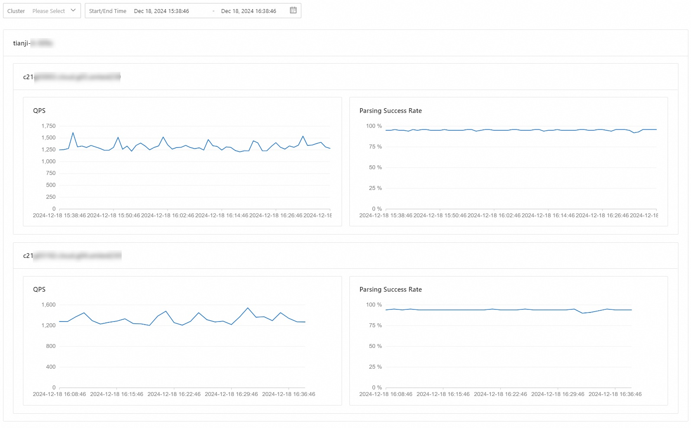

### 2.1.2. opsDNS domain service

This topic describes how to configure an opsDNS domain name service.

**Usage notes**

1. Make sure that you know the scope of impact after you submit a Domain Name System (DNS) record of a domain name. Pay attention to the potential impact of resolution type switching.

2. Operations on DNS records are idempotent. If you add DNS records of the same resolution type to the same domain name, the new record overwrites the original one.

3. The time-to-live (TTL) of all DNS records under the same domain name and of the same resolution type must be consistent. By default, the TTL configured for the DNS record that is added in the last operation prevails. The value of TTL is a positive integer of uint32.

4. CNAME records cannot coexist with records of other resolution types. Before you add a CNAME record to a domain name, remove other records from the domain name. A domain name can have only one CNAME record.

5. You cannot add CNAME records to defined zones in the cloud, such as tbsite.net.

6. You can add domain names only to defined zones in the cloud. You cannot register a domain name for a zone outside the cloud.

**Procedure**

1. Log on to the Apsara Uni-manager Operations Console.

2. In the top navigation bar, choose **Product Operation** > **Networking** > **Network Operations Console**.

3. In the left-side navigation pane, choose **Basic Network** > **opsDNS Management** > **opsDNS Domain Service**.

4. On the opsDNS Domain Service page, view the domain name resolution information, including **Domain Name**, **Resource Type**, **DNS Record**, and **TTL**.

   Click **Advanced Filter** to filter domain name resolution entries by **Domain Name**, **Record Type**, **Record Value**, or their combinations.

   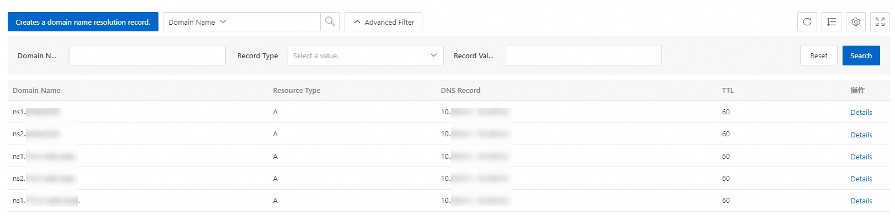

5. Click **Create a domain name resolution record.** In the Create DNS Record dialog box, configure the following parameters and click **OK.**

   It takes 0 to 5 minutes for a new domain name resolution entry to take effect.

   | Parameter | Description |
   | --- | --- |

   <table>
     <tr>
       <td>Domain Name</td>
       <td>The record name of the domain name. Note The record name consists of a domain name prefix and a domain name suffix. The domain name prefix must meet the following format requirements: i. The domain name cannot contain underscores (_). It can contain only letters, digits, and hyphens (-). ii. The domain name can be started only with letters or digits. iii. The domain name can be ended only with letters, digits, or periods (.). iv. A wildcard domain name is not allowed, which means that *. cannot be placed at the beginning of the domain name.</td>
     </tr>
     <tr>
       <td>Resource Type</td>
       <td>The resource type of the domain name resolution. Valid values: • A • AAAA • CHAME Note i. A CNAME record cannot coexist with records of other types. If an A or AAAA record already exists and you want to add a CNAME record, you must delete the existing record before you can add a new one. ii. A domain name can have only one CNAME record. iii. You cannot configure CNAME records for the DNS zone. In this case, the fixed suffix of opsDNS, such as tbsite.net, amtest00 and inter.env00.shuguang.com, can only have NS, SOA, and A records, and CNAME records are not allowed.</td>
     </tr>
     <tr>
       <td>DNS Record</td>
       <td>The IP address to which the domain name is mapped. Note i. An A record must be a valid IPv4 address. ii. An AAAA record must be a valid IPv6 address. iii. A CNAME record must be a valid domain name. The requirements for the character set and length of the domain name must be the same as the format requirements for the Domain Name parameter, but the CNAME value cannot be a generic domain name.</td>
     </tr>
     <tr>
       <td>TTL</td>
       <td>The TTL of a DNS record.</td>
     </tr>
   </table>

   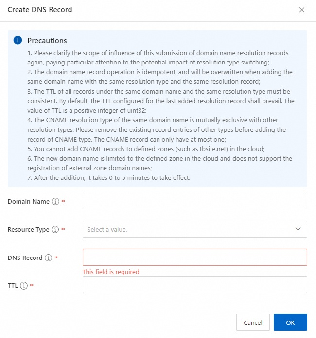

6. Go back to the opsDNS Domain Service page and click **Details** in the **Operation** column of a domain name resolution entry. On the opsDNS Resolution Settings page, view the detailed DNS records and search for a DNS record by **Record Value**.

   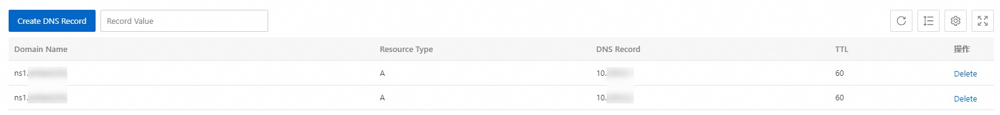

7. On the opsDNS Resolution Settings page, perform the following operations:

   - Create a DNS record: Click **Create DNS Record**. In the Create DNS Record dialog box, configure parameters and click **OK**. It takes 0 to 5 minutes for a new DNS record to take effect.

     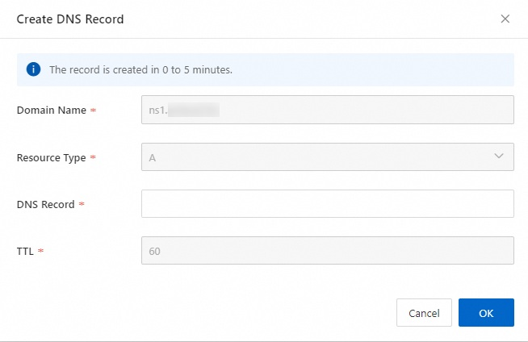

   - Delete a DNS record: Find the DNS record that you want to delete and click **Delete** in the **Operation** column. In the dialog box that appears, confirm the information, enter **DELETE** in the field, and then click **OK**. After 0 to 5 minutes, the DNS record is deleted.

     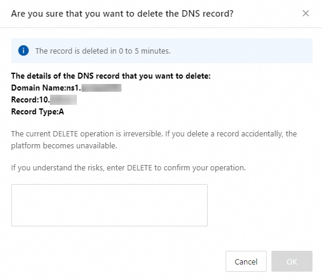

## 2.2. Tenant DNS management

### 2.2.1. Node management (in-cloud)

The Node Management page displays the DNS servers within the cloud. On this page, you can monitor the role and status of each node and check data consistency after synchronization.

**Procedure**

1. Log on to the Apsara Uni-manager Operations Console.

2. In the top navigation bar, choose **Product Operation** > **Networking** > **Network Operations Console**.

3. In the left-side navigation pane, choose **Basic Network** > **Tenant DNS Management** > **Node Management (In-cloud)**.

4. On the Node Management page, view the DNS servers. The information about the DNS servers is displayed in the following columns: **Service Instance IP Address**, **Service Instance Role**, **Mode**, **Status**, **Last Synchronized Log ID**, **Service Address**, and **Description**.

5. In the upper-left corner of the page, click **Create Emergency Group**. In the dialog box that appears, turn on or off **Emergency Group**. If you turn on **Emergency Group**, configure the **Service Instance** parameter to create an emergency group.

6. Return to the Node Management page.

   - Find a node that you want to manage and click **Description** in the **Actions** column. In the Add Description dialog box, configure the **Description** parameter.

   - Find a node that you want to manage and click **Switch to Primary** in the **Actions** column.

     > **Note**
     >
     > After you perform the preceding operation, the system sets the selected node as the new leader of the cluster for data synchronization.

### 2.2.2. Node management (cross-cloud)

The Node Management page displays the DNS servers across clouds. On this page, you can monitor the role and status of each node and check data consistency after synchronization.

**Procedure**

1. Log on to the Apsara Uni-manager Operations Console.

2. In the top navigation bar, choose **Product Operation** > **Networking** > **Network Operations Console**.

3. In the left-side navigation pane, choose **Basic Network** > **Tenant DNS Management** > **Node Management (Cross-cloud)**.

4. On the Node Management page, view the DNS servers. The information about the DNS servers is displayed in the following columns: **Service Instance IP Address**, **Service Instance Role**, **Mode**, **Status**, **Last Synchronized Log ID**, **Service Address**, and **Description**.

5. In the upper-left corner of the page, click **Create Emergency Group**. In the dialog box that appears, turn on or off **Emergency Group**. If you turn on **Emergency Group**, configure the **Service Instance** parameter to create an emergency group.

6. Return to the Node Management page.

   - Find a node that you want to manage and click **Description** in the **Actions** column. In the Add Description dialog box, configure the **Description** parameter.

   - Find a node that you want to manage and click **Switch to Primary** in the **Actions** column.

     > **Note**
     >
     > After you perform the preceding operation, the system sets the selected node as the new leader of the cluster for data synchronization.

# 3.Appendix

## 3.1. Introduction to Apsara Stack DNS

This topic describes Apsara Stack DNS and the features of its modules.

**Database management system**

The database management system compares the versions in the baseline configuration with those in the database to better manage databases. This allows you to validate the database version in each update.

**API system**

The API system determines the business logic of all calls and manages all data and tasks. This system is written in Java.

**DNS**

The DNS system consists of BIND and Agent. Agent receives and processes task information passed from the API system. Agent parses the tasks into commands, and then delivers the commands to the BIND system.

## 3.2. Maintenance

### 3.2.1. View operational logs

During operations and maintenance, you can query and view logs that are stored at specific locations in different systems to troubleshoot errors.

The operational logs of the API service are stored in the /home/admin/gdns/logs/ directory. You can query logs as needed.

The operational logs of the Agent service are stored in the /var/log/dns/ directory of the DNS server. Each log contains log entries of a specific day.

The operational logs of the BIND service are stored in the /var/named/chroot/var/log/ directory of the DNS server.

### 3.2.2. Enable and disable a service

You can log on to the API server as an administrator and run the  `/home/admin/gdns/bin/appctl.sh restart`  command to restart the API service. We recommend that you run the command on one server at a time to ensure that another server can provide services. You can specify the **start**, **stop**, and **restart** parameters in the preceding command.

Apsara Stack DNS provides services by using anycast IP addresses. You must run the  `service ospfd stop`  command to disable the OSPF service before you run the  `service named stop`  command to disable the DNS service.

You must run the  `service named start`  command to enable the DNS service before you run the  `service ospfd start`  command to enable the OSPF service.

You can run the  `/usr/local/AgentService/agent -s start`  command to enable the Agent service. If you receive a message that indicates the PID file already exists, delete the  `/var/dns/dns.pid`  file and run the command again.

You can run the  `/usr/local/AgentService/agent -s stop`  command to disable the Agent service.

### 3.2.3. Data backup

If you need to back up data before updating the service, copy the /var/named/ and /etc/named/ directories to a backup location. When you need to restore your data, copy the backup data to the original directories. Do not trigger automatic update during a data restoration process. Otherwise, data inconsistency may occur.

## 3.3. DNS API

### 3.3.1. Manage the API system

You can manage the API system in the Apsara Infrastructure Management Framework console. To log on to the server in which the API system resides, choose **Operations > Machine Operations** in the Apsara Infrastructure Management Framework console.

**Background information**

To determine whether a service role is running as expected, follow these steps:

**Procedure**

1. In the Apsara Infrastructure Management Framework console, check whether the API is at desired state.

   <ol type="i">

   <li>

   Log on to the Apsara Infrastructure Management Framework console.

   </li>

   <li>

   In the top navigation bar, choose **Tasks > Deployment Summary** to open the

   </li>

   </ol>

   **Deployment Summary** page.

   <ol type="i" start="3">

   <li>

   Click **Deployment Details**.

   </li>

   <li>

   On the **Deployment Details** page, find the **dnsProduct** project.

   </li>

   <li>

   Find the dnsServerRole# service role, and click **Details** in the Deployment Progress column to check whether the service role is at desired state. If a green check mark is displayed after dnsServerRole#, then dnsServerRole# is at desired state.

   Figure 1. View API status

   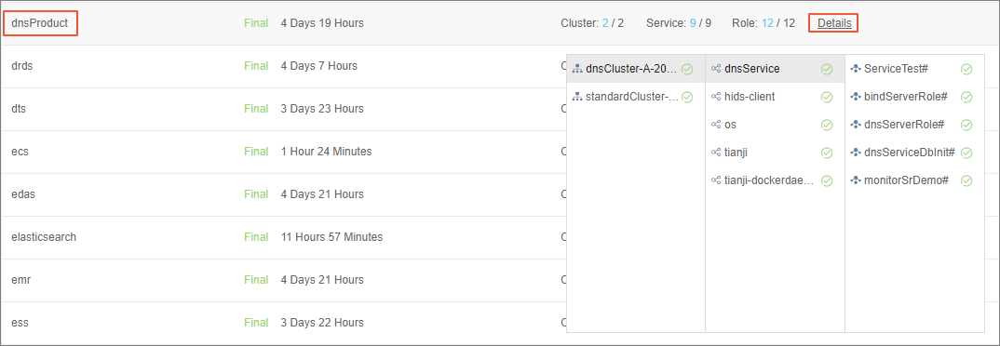

   </li>

   </ol>

2. Obtain the IP addresses of servers where the API services are deployed.

   <ol type="i">

   <li>

   Log on to the Apsara Infrastructure Management Framework console.

   </li>

   <li>

   In the top navigation bar, choose **Operations > Cluster Operations**.

   </li>

   <li>

   Click a cluster URL to open the **Cluster Dashboard** page.

   </li>

   <li>

   On the **Cluster Dashboard** page, choose **Operations Menu > Cluster Operation and Maintenance Center**.

   Figure 2. Cluster Operation and Maintenance Center

   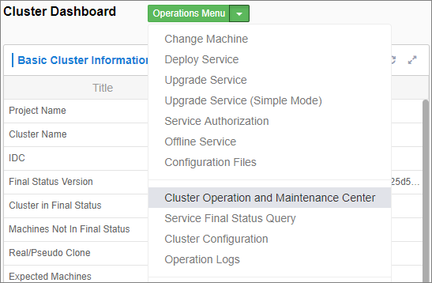

   </li>

   <li>

   On the **Cluster Operation and Maintenance Center** page, view and obtain the IP addresses of servers that are deployed with the API service.

   Figure 3. View the IP addresses of servers

   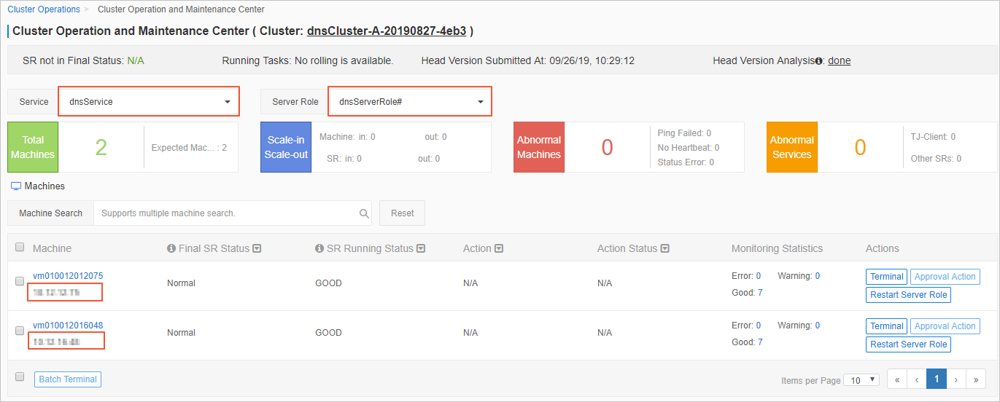

   </li>

   </ol>

3. Log on to the DNS API server. Run the  `curl http://localhost/checkpreload.htm` command, and check whether the command output is "success".

   <ol type="i">

   <li>

   Log on to the Apsara Infrastructure Management Framework console.

   </li>

   <li>

   In the top navigation bar, choose **Operations > Machine Operations**.

   </li>

   <li>

   Click **Terminal** in the Actions column of a server to log on to the server.

   </li>

   <li>

   Run the  `curl http://localhost/checkpreload.htm`  command on the server where the API service is deployed and check whether the command output is "success".

   Figure 4. Verify the server

   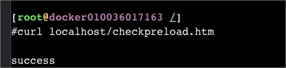

   </li>

   </ol>

### 3.3.2. Troubleshooting

**Procedure**

1. View logs stored in /home/admin/gdns/logs/.

2. Check whether the API service is running. If an error occurs when you call an API operation, check the log to troubleshoot the error.

3. If the API service is running, but its features do not function as expected, check the **application.log** file.

## 3.4. DNS system

### 3.4.1. Check whether a server role is normal

**Procedure**

1. In the Apsara Infrastructure Management Framework console, check whether the Apsara Stack DNS system is in its final state.

   <ol type="i">

   <li>

   Log on to the Apsara Infrastructure Management Framework console.

   </li>

   <li>

   In the top navigation bar, choose **Tasks > Deployment Summary**.

   </li>

   <li>

   On the **Deployment Summary** page, click **Deployment Details**.

   </li>

   <li>

   On the **Deployment Details** page, find **dnsProduct**.

   </li>

   <li>

   Click **Details** in the **Deployment Progress** column to check whether the **bindServerRole#** role is in its final state.

   Figure 1. Checking whether the bindServerRole# server role is in its final state

   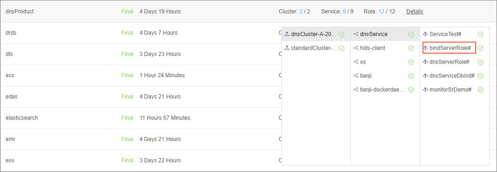

   </li>

   </ol>

2. Obtain the IP addresses of the servers where DNS services are deployed.

   <ol type="i">

   <li>

   Log on to the Apsara Infrastructure Management Framework console.

   </li>

   <li>

   In the top navigation bar, choose **Operations > Cluster Operations**.

   </li>

   <li>

   Click a cluster URL to go to the Cluster Dashboard page.

   </li>

   <li>

   On the Cluster Dashboard page, choose **Operations Menu > Cluster Operation and Maintenance Center**.

   Figure 2. Cluster Operation and Maintenance Center

   

   </li>

   <li>

   On the Cluster Operation and Maintenance Center page, view and obtain IP addresses of all the servers that are assigned with the bindServerRole# role.

   </li>

   </ol>

3. Log on to the DNS server, run the **python /bind/hello/check_health.py|echo $?** command, and check whether the command output is 0.

   <ol type="i">

   <li>

   Log on to the Apsara Infrastructure Management Framework console.

   </li>

   <li>

   Choose **Operations > Machine Operations**.

   </li>

   <li>

   Select a server and click **Terminal** to log on to the server.

   </li>

   <li>

   Run the **python /bind/hello/check_health.py|echo $?** command on each server that is assigned with the **bindServerRole#** role and check whether the command output is 0.

   Figure 3. Verifying the server

   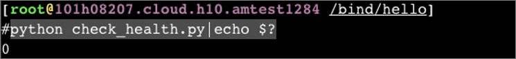

   </li>

   </ol>

### 3.4.2. Troubleshooting

**Procedure**

1. Check the operational logs of the BIND service that are stored in the /var/named/chroot/var/log/ directory, and determine whether errors have occurred.

2. Check the operational logs of the Agent service that are stored in the /var/log/dns/directory, and determine whether errors have occurred.

3. Run the **named-checkconf** command to check whether errors have occurred in the configuration file.

### 3.4.3. Errors and exceptions

Error: exit code 1

Run the health check script to view the cause of this error.

Common causes include:

- The DNS service is not running.

- The Agent service is not running.

- The OSPF service is not running, or anycast and public IP addresses cannot be advertised because of a network information retrieval error.

- Failed to run the task.

## 3.5. Log analysis

**Query log entries by request ID**

After you send a request, you will receive a response that contains the request ID. The request ID can be used in the following scenarios:

1. Query the tasks that are associated with the current request from the database.

2. Retrieve the execution results and error messages of the current request from the API system log.

3. Retrieve the results of the current request from the log of  `bindServerRole#` , and verify the results with information that is retrieved from multiple other systems.

## 3.6. View and process data

**Background information**

You can view task records and execution results.

**Procedure**

1. Log on to the API server to view database connection details.

2. Run the **use genesisdns** command of MySQL to log on to the database and then run the **select \* from task** command to retrieve the progress and status of each task.
