Alibaba Cloud  
Apsara Stack  
cloud gateway  
Operations and Maintenance  
Guide  
Product Version: v3.18.6-2607  
Document Version: 20260901

**Table of Contents**

- [1.Log on to the Apsara Uni-manager Operations Console](#section-1)
- [2.Basic network](#section-2)
    - [2.1. HPN management](#section-2-1)
        - [2.1.1. HPN network elements](#section-2-1-1)
        - [2.1.2. RDMA network interface O&M](#section-2-1-2)
        - [2.1.3. HPN performance analysis](#section-2-1-3)
        - [2.1.4. HPN instant diagnostics](#section-2-1-4)
    - [2.2. CPN](#section-2-2)
        - [2.2.1. CPN diagnosis](#section-2-2-1)
        - [2.2.2. CPN performance analysis](#section-2-2-2)
        - [2.2.3. CPN alert center](#section-2-2-3)
        - [2.2.4. CPN access gateways](#section-2-2-4)
            - [2.2.4.1. Manage RDMA devices](#section-2-2-4-1)
            - [2.2.4.2. Manage RDMA device policies](#section-2-2-4-2)
            - [2.2.4.3. Manage policies for the RDMA device interface](#section-2-2-4-3)
        - [2.2.5. RDMA NIC O&M](#section-2-2-5)
        - [2.2.6. CPN management](#section-2-2-6)
            - [2.2.6.1. CPN topology](#section-2-2-6-1)
            - [2.2.6.2. CPN network element](#section-2-2-6-2)
        - [2.2.7. CPN network monitoring](#section-2-2-7)
            - [2.2.7.1. CPN host monitoring dashboard](#section-2-2-7-1)
            - [2.2.7.2. CPN switch dashboard](#section-2-2-7-2)
            - [2.2.7.3. NAK packet analysis tool](#section-2-2-7-3)
            - [2.2.7.4. High-precision monitoring dashboard](#section-2-2-7-4)
            - [2.2.7.5. High-precision vSwitch monitoring dashboard](#section-2-2-7-5)
            - [2.2.7.6. Job monitoring](#section-2-2-7-6)
            - [2.2.7.7. CPN stream monitoring](#section-2-2-7-7)
    - [2.3. CGW](#section-2-3)
    - [2.4. Computing access gateways](#section-2-4)
- [3.Networking products](#section-3)
    - [3.1. CGW O&M](#section-3-1)
        - [3.1.1. CGW cluster management](#section-3-1-1)
        - [3.1.2. CGW management](#section-3-1-2)
- [4.Traffic visualization](#section-4)
    - [4.1. Visualization settings](#section-4-1)

<a id="section-1"></a>

# 1.Log on to the Apsara Uni-manager Operations Console

This topic describes how users such as O&M engineers log on to the Apsara Uni-manager Operations Console.

**Prerequisites**

- The endpoint of the Apsara Uni-manager Operations Console and the username and password that are used to log on to the console are obtained from a deployment engineer or an administrator.

  The endpoint of the Apsara Uni-manager Operations Console is in the following format: *regi on-id*.ops.console.*intranet-domain-id*.

- A web browser is available. We recommend that you use Google Chrome.

**Procedure**

1. Open your browser.

2. In the address bar, enter the endpoint of the Apsara Uni-manager Operations Console. Press the ENTER key.

   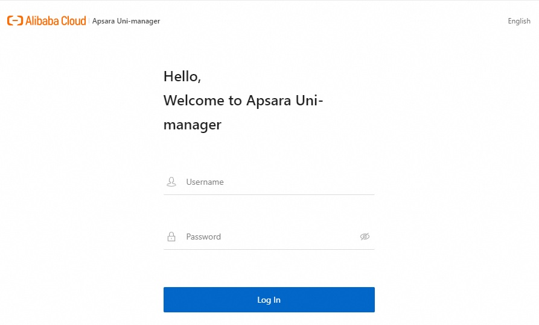

   > **Note**
   >
   > You can click the current language in the upper-right corner to switch to another language. Simplified Chinese, English, and traditional Chinese are supported.

3. Enter the username and password.

   > **Note**
   >
   > - Obtain the username and password that are used to log on to the Apsara Uni-manager Operations Console from a deployment engineer or an administrator.
   >
   > - If you enter an invalid password for three consecutive times, the system enables the image verification logon feature. If you enter an invalid password for five consecutive times, the account is locked. Contact the administrator to activate the account.

   If this is the first time you log on to the Apsara Uni-manager Operations Console, you must change the password as prompted.

   To enhance security, your password must meet the following requirements:

   - The password contains uppercase and lowercase letters.

   - The password contains digits.

   - The password contains at least one of the following special characters: ! @ # $ %

   - The password is 10 to 20 characters in length.

4. Click **Log In**.

<a id="section-2"></a>

# 2.Basic network

<a id="section-2-1"></a>

## 2.1. HPN management

> **Note**
>
> By default, the HPN Management module is not displayed. To use this module, perform the following operations: Log on to the Apsara Uni-manager Operations Console. In the top navigation bar, choose More > **User Authorities**. In the left-side navigation pane, click **Menu Management**. On the Menu management page, modify the menu settings to display the HPN Management module.

<a id="section-2-1-1"></a>

### 2.1.1. HPN network elements

This topic describes how to view High Performance Network (HPN) network device assets and monitoring and O&M information in the Apsara Uni-manager Operations Console.

**Procedure**

1. Log on to the Apsara Uni-manager Operations Console.

2. In the top navigation bar, choose **Product Operation** > **Networking** > **Network Operations Console**.

3. In the left-side navigation pane, choose **Basic Network** > **HPN Management** > **HPN Network Elements**.

4. On the HPN Network Element page, configure the **Select IDC** parameter and specify the name of a network element to search for the network element.

   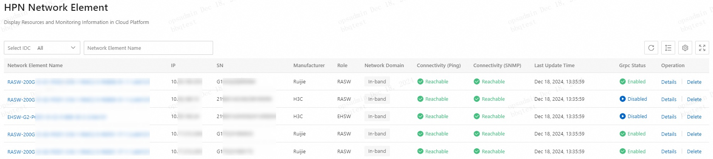

5. Click the name of the network element or click **Details** in the **Operation** column of the network element to view the details of the network element.

   - On the details page of the network element, view the basic information about the network element.

     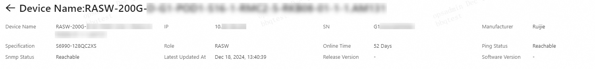

   - On the **Port** tab, view port information.

     Click the name of the port that you want to view or click **View** in the **Details** column of the port to view the port details.

     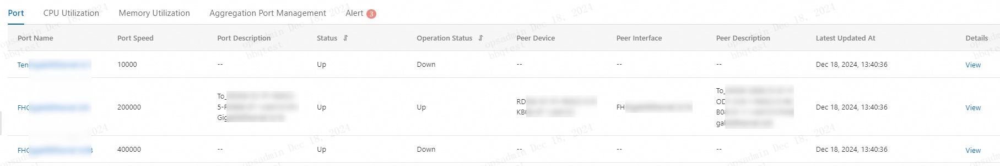

   - On the **CPU Utilization** tab, view CPU utilization.

     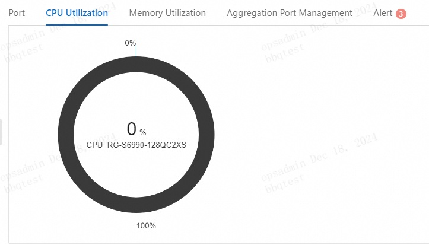

   - On the **Memory Utilization** tab, view memory usage.

     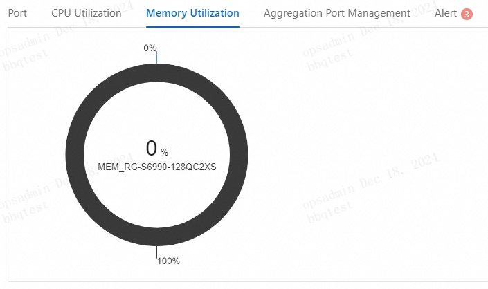

   - On the **Aggregation Port Management** tab, view the information about aggregation ports.

     Find the aggregation port that you want to view and click **View** in the **Actions** column to view the usage data charts of the aggregation port.

     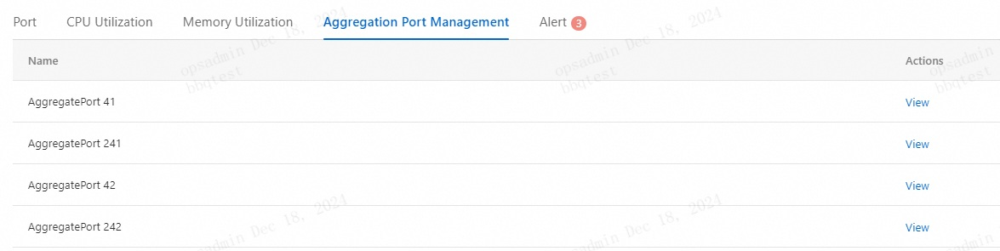

   - On the **Alert** tab, view the alert information about the network element.

     Find the alert that you want to view and click **View** in the **Alert Details** column to view the alert details.

     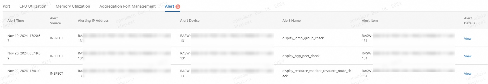

**Delete a network element**

1. On the HPN Network Element page, find the network element that you want to delete and click **Delete** in the **Operation** column.

2. In the message that appears, click **OK**.

   > **Note**
   >
   > Deleted network elements cannot be restored. Proceed with caution.

<a id="section-2-1-2"></a>

### 2.1.2. RDMA network interface O&M

The remote direct memory access (RDMA) network interface O&M feature can regularly check the performance metrics of an RDMA network interface by using performance monitoring. This helps you identify issues at the earliest opportunity, quickly troubleshoot and resolve issues, and ensure network stability and reliability.

**Terms**

**RDMA** is a high-speed network technology used to resolve delays in server-side data processing during network transmission. RDMA directly sends data to the storage area of a computer over the network. During the process, data is quickly transmitted from one system to the memory of a remote system. RDMA implements direct memory access between hosts without affecting the operating system, accelerates data transmission, and reduces CPU load.

**Procedure**

1. Log on to the Apsara Uni-manager Operations Console.

2. In the top navigation bar, choose **Product Operation** > **Networking** > **Network Operations Console**.

3. In the left-side navigation pane, choose **Basic Network** > **HPN Management** > **RDMA Card O&M**.

4. In the upper-right corner of the RDMA Card O&M page, select a data source from the **Data Source** drop-down list. The following data sources are available:

   - **Bare Metal Server (BMS)**

   - **Platform of Artificial Intelligence (PAI)**

   - **Cloud Parallel File System (CPFS)**

   - **Super Computing Cluster (SCC)**

   > **Note**
   >
   > - If you select **PAI**, you must configure the **Cluster** and **ViewType** parameters.
   >
   > - If you select **CPFS** or **SCC**, you must configure the **Cluster** parameter.

5. On the **Cluster** tab, view the monitoring data of a cluster.

   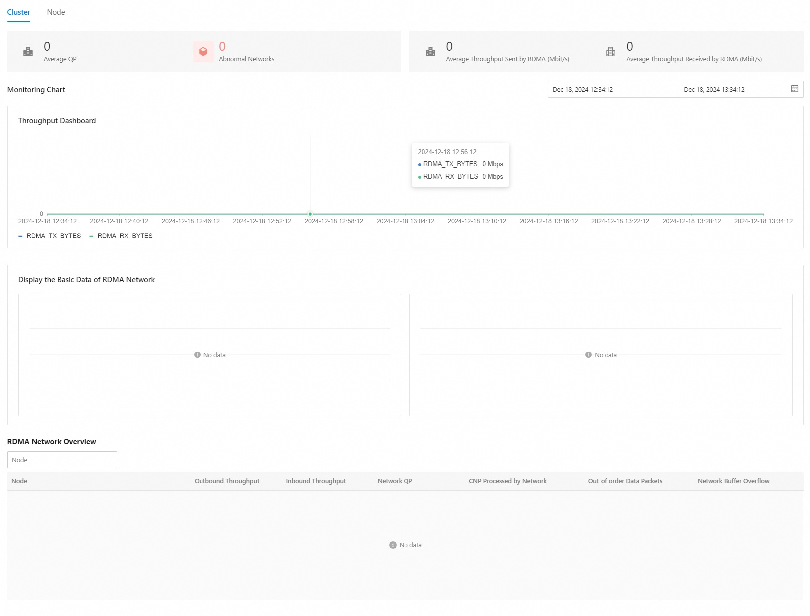

   | Section | Description |
   | --- | --- |

   <table>
     <tr>
       <td>Average QP</td>
       <td>The average number of queue pairs (QPs) in the RDMA network. If you select PAI as the data source, this metric is not displayed.<br>• If the QPs are insufficient, the communication queue in the RDMA network may be congested, which compromises the efficiency and stability of data transmission.<br>• Excessive QPs may increase the overhead, complexity, and failure rate of the system.<br>Note<br>QP is a key term of the RDMA network. It refers to the communication queue between a pair of endpoints.</td>
     </tr>
     <tr>
       <td>Abnormal Networks</td>
       <td>The number of times that network device or traffic exceptions occur in the RDMA network.</td>
     </tr>
     <tr>
       <td>Average Throughput Sent by RDMA (Mbit/s)</td>
       <td>The average amount of data that is sent by all nodes in the RDMA network per second.</td>
     </tr>
     <tr>
       <td>Average Throughput Received by RDMA (Mbit/s)</td>
       <td>The average amount of data that is received by all nodes in the RDMA network per second.</td>
     </tr>
     <tr>
       <td>Monitoring Chart</td>
       <td>i. On the right side of the monitoring chart, specify a time range to view the corresponding monitoring data.<br>ii. In the <strong>Throughput Dashboard</strong> section, view the data of the RDMA_TX_BYTES and RDMA_RX_BYTES metrics within the specified time range.<br>• The RDMA_TX_BYTES metric specifies the number of bytes that are sent over the RDMA network per second.<br>• The RDMA_RX_BYTES metric specifies the number of bytes that are received over the RDMA network per second.iii. In the <strong>Display the Basic Data of RDMA Network</strong> section, view the data of the following metrics within the specified time range.<br>• The <strong>RDMA_IGNORE_CNP_AVG</strong> metric specifies the average number of congestion notification packets (CNPs) that are ignored in the RDMA network per second.<br>Note<br>A CNP is used for network congestion control. When network congestion occurs, CNPs are sent to notify the sender to decrease the sending rate to prevent network congestion and packet loss.<br>• The <strong>RDMA_OOB_AVG</strong> metric specifies the average number of Out-of-Band (OOB) packets that are processed in the RDMA network per second.<br>Note<br>OOB data is a special type of data transmitted over the RDMA network.<br>• The <strong>RDMA_OOS_AVG</strong> metric specifies the average number of Out-of-Order (OOS) packets that are processed in the RDMA network per second.<br>Note<br>OOS data is a special type of data transmitted over the RDMA network. OOS data is generated when packet loss or delay occurs during data transmission.<br>• The <strong>RDMA_SENT_CNP_AVG</strong> metric specifies the average number of CNPs that are sent over the RDMA network per second.<br>• The <strong>RDMA_HANDLE_CNP_AVG</strong> metric specifies the average number of CNPs that are processed in the RDMA network per second.<br>• The <strong>RDMA_TX_BYTES_AVG</strong> metric specifies the average number of bytes that are sent over the RDMA network per second.<br>• The <strong>RDMA_RX_BYTES_AVG</strong> metric specifies the average number of bytes that are received over the RDMA network per second.</td>
     </tr>
     <tr>
       <td>RDMA Network Overview</td>
       <td>You can view the node information in the following columns: <strong>Node</strong>, <strong>Outbound Throughput</strong>, <strong>Inbound Throughput</strong>, <strong>Network QP</strong>, <strong>CNP</strong> <strong>Processed by Network</strong>, <strong>Out-of-order Data Packets</strong>, and <strong>Network</strong> <strong>Buffer Overflow</strong>.</td>
     </tr>
   </table>

6. On the **Node** tab, view the monitoring data of nodes.

   

   <table>
     <tr>
       <th>Parameter</th>
       <th>Description</th>
     </tr>
     <tr>
       <td>QP in RDMA Network</td>
       <td rowspan="5">The monitoring data of a node in the RDMA network. For more information about these metrics, see the description of them in the previous step.</td>
     </tr>
     <tr>
       <td>Abnormal Networks</td>
     </tr>
     <tr>
       <td>Throughput Sent by RDMA Network (Mbit/s)</td>
     </tr>
     <tr>
       <td>Throughput Received by RDMA Network (Mbit/s)</td>
     </tr>
     <tr>
       <td>Monitoring Chart</td>
     </tr>
   </table>

<a id="section-2-1-3"></a>

### 2.1.3. HPN performance analysis

The Apsara Uni-manager Operations Console provides the High Performance Network (HPN) performance analysis feature. This feature analyzes the maximum load and pressure resistance of the software and hardware by testing the performance of a machine under stress conditions. This helps you identify the pressure resistance limit of the machine and provides data support for O&M personnal to improve network performance.

**Procedure**

1. Log on to the Apsara Uni-manager Operations Console.

2. In the top navigation bar, choose **Product Operation** > **Networking** > **Network Operations Console**.

3. In the left-side navigation pane, choose **Basic Network** > **HPN Management** > **HPN Performance Analysis**.

4. On the HPN performance analysis page, click **Create a test** to create an analysis task.

   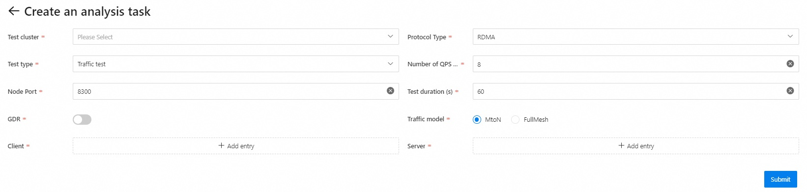

   The following table describes the parameter combinations for an analysis task.

   <table>
     <tr>
       <th>Test cluster</th>
       <th>Protocol type</th>
       <th>Test type</th>
       <th>Required parameters</th>
       <th>Traffic model</th>
       <th>Node</th>
     </tr>
     <tr>
       <td rowspan="5">All</td>
       <td rowspan="3">RDMA</td>
       <td rowspan="2">Traffic test</td>
       <td rowspan="2">• Number of QPS tested<br>• Node Port<br>• Test duration (s)<br>• GDR</td>
       <td>MtoN</td>
       <td>• Server<br>• Client</td>
     </tr>
     <tr>
       <td>FullMesh</td>
       <td>• Server</td>
     </tr>
     <tr>
       <td>Latency test</td>
       <td>• Node Port</td>
       <td>N/A</td>
       <td>• Server</td>
     </tr>
     <tr>
       <td rowspan="2">TCP</td>
       <td rowspan="2">Traffic test</td>
       <td rowspan="2">• Node Port<br>• Test duration (s)<br>• Concurrent connections</td>
       <td>MtoN</td>
       <td>• Server<br>• Client</td>
     </tr>
     <tr>
       <td>FullMesh</td>
       <td>• Server</td>
     </tr>
   </table>

   The following table describes the parameters.

   | Parameter | Description |
   | --- | --- |
   | Number of QPS tested | The number of test processes. This parameter determines the test bandwidth. |
   | Node Port | The port number used for the test. |
   | Test duration (s) | The duration of the test. Unit: seconds. |
   | GDR | Specifies whether to enable direct communication between GPUs If you turn on this switch, the system associates the Remote Direct Memory Access (RDMA) network interface controller (NIC) with the corresponding GPU for traffic testing. Make sure that the machine supports this feature before you turn on the switch. |
   | Concurrent connections | The number of connections that can be processed at the same time. |
   | MtoN | The many-to-many relationship model. This model is used to test the one-way connectivity between <strong>Client</strong> nodes and <strong>Server</strong> nodes, including the one-way connectivity between a single <strong>Client</strong> node and a single <strong>Server</strong> node and between multiple <strong>Client</strong> nodes and multiple <strong>Server</strong> nodes. |
   | FullMesh | All nodes in the network topology are connected to each other. This option allows you to test the two-way connectivity between all destination nodes. |
   | Client | The sender of the test traffic. |
   | Server | The receiver of the test traffic. |

5. Click **Submit**. Then, the analysis task is created.

   - Click **Cancel** to go back to the page for creating an analysis task. You can modify the parameters based on your business requirements.

   - Click **View task details** to go to the **Analysis Task details** page.

**What to do next**

**View task details**

1. On the **HPN performance analysis** page, click Advanced Filter and filter tasks by **Start and end time**, **Task ID**, **Test type**, **Protocol Type**, **Traffic model**, **Task Status**, or their combinations.

2. Click **Details** in the Actions column of a task.

3. On the **Analysis Task details** page, view the task information and analysis results.

**Refresh a task**

Click **Refresh** in the Actions column of a task to refresh the task.

<a id="section-2-1-4"></a>

### 2.1.4. HPN instant diagnostics

High Performance Network (HPN) instant diagnostics refer to a diagnosis on HPN nodes. During the diagnosis, the system software, network, and GPU of nodes are checked. After the diagnosis, the diagnostic results and details are provided to help administrators troubleshoot network performance issues.

**Procedure**

1. Log on to the Apsara Uni-manager Operations Console.

2. In the top navigation bar, choose **Product Operation** > **Networking** > **Network Operations Console**.

3. In the left-side navigation pane, choose **Basic Network** > **HPN Management** > **HPN Instant Diagnostics**.

4. On the HPN instant diagnosis page, select a test cluster and one or more nodes from the drop-down lists and then click **Diagnosis**.

   > **Note**
   >
   > You can select multiple nodes at a time.

5. View the diagnostic results.

   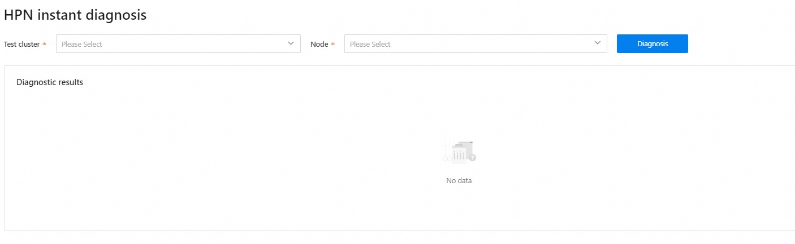

   | Diagnostic result | Description |
   | --- | --- |
   | Diagnostic Item | Displays the diagnostic items, including <strong>OS Release Version</strong>, <strong>OS Kernel</strong> <strong>Version</strong>, <strong>Server CPU Model</strong>, <strong>Server Disk Space</strong>, <strong>RDMA NIC Drive</strong> <strong>Installation</strong>, <strong>RDMA NIC Drive Load</strong>, <strong>bonding Module Installation</strong>, <strong>GDR</strong> <strong>Module Installation</strong>, <strong>GDR Module Load</strong>, <strong>Number of RDMA Devices</strong>, <strong>RDMA</strong> <strong>Device Firmware Version</strong>, <strong>RDMA Device Aggregation Mode</strong>, <strong>RDMA</strong> <strong>Device Aggregation Status</strong>, <strong>RDMA Device Hash Policy</strong>, <strong>RDMA Device</strong> <strong>Port Rate</strong>, <strong>RDMA Device MTU Settings</strong>, <strong>PCIe MRR Configuration</strong>, <strong>PCIe</strong> <strong>Link Details</strong>, <strong>PCIe Link Rate</strong>, <strong>PCIe Link Width</strong>, and <strong>GPU Online Check</strong>. |
   | Diagnostic Result | Displays the diagnostic result of each diagnostic item. The result can be <strong>Passed</strong> or <strong>Failed</strong>. |
   | Diagnostic Details | Displays the diagnostic details of each diagnostic item. For example, the RDMA device port rates are consistent. |
   | Current Value | Displays the diagnostic value corresponding to each diagnostic item. |

<a id="section-2-2"></a>

## 2.2. CPN

<a id="section-2-2-1"></a>

### 2.2.1. CPN diagnosis

The Computing Platform Network (CPN) diagnosis feature checks the nodes in CPN and displays information such as the diagnostic items, diagnostic details, and diagnostic results to help administrators better understand and manage network performance and troubleshoot issues.

**Procedure**

1. Log on to the Apsara Uni-manager Operations Console.

2. In the top navigation bar, choose **Product Operation** > **Networking** > **Network Operations Console**.

3. In the left-side navigation pane, choose **Basic Network > CPN Management > CPN Diagnostics**.

4. On the CPN Quick Diagnostics page, click **Create Diagnostics Task**.

   In the Create Diagnostics Task dialog box, configure the parameters that are described in the following table.

   | Parameter | Description |
   | --- | --- |
   | Task Name | The name of the diagnostic task. |
   | Resource Pool | Default value: No. This indicates the Elastic Compute Service (ECS) Bare Metal Instances that are not added to compute clusters. |
   | Cluster | The cluster on which the diagnostic task is performed. |
   | Group | The hosts within the cluster that are grouped based on the CIDR block of the connected vSwitch. Each group can contain up to 100 hosts. |
   | Diagnostics node | The node on which the diagnostic task is performed. |

   > **Note**
   >
   > You can select multiple nodes.

5. Click **OK**. The diagnostic task starts running immediately.

**View diagnostic results**

1. Log on to the Apsara Uni-manager Operations Console.

2. In the top navigation bar, choose **Product Operation** > **Networking** > **Network Operations Console**.

3. In the left-side navigation pane, choose **Basic Network > CPN Management > CPN Diagnostics**.

4. On the CPN Quick Diagnostics page, find the diagnostic task that you want to manage and click **Details** in the **Operation** column.

   | Tab | Description |
   | --- | --- |
   | Diagnostics Result | Displays the diagnostic results of the nodes on which the diagnostic task is performed. |
   | Overview view | Displays the cluster, the total number of instances, the number of normal items, and the number of abnormal items. |
   | Detailed View | Displays the diagnostic details by <strong>node</strong> or <strong>diagnostic item</strong>. |

5. Click the **Diagnostics Result** tab. On the Diagnostics Result tab, click **Details** in the Actions column of an abnormal diagnostic result. In the **Abnormal Diagnostic Details** panel, view the detailed information. Click **Details** in the Actions column of a diagnostic item. In the **Abnormal Diagnostic Result Details** dialog box, view the detailed information.

6. Click the **Overview View** tab to view the cluster, IP addresses, the total number of instances, the number of normal items, and the number of abnormal items.

7. Click the **Detailed View** tab to query diagnostic details by **node** or **diagnostic item**. You can view information such as the diagnostic results, diagnostic details, and error messages.

**What to do next**

The following table describes the operations that you can perform on the **CPN Quick Diagnostics** page.

| Operation | Procedure |
| --- | --- |
| Filter diagnostic tasks | • Basic filter<br>i. Select <strong>Start and End Time</strong> or <strong>Status</strong> from the drop-down list.<br>ii. Select a time range or state. The tasks that meet the filter condition are displayed.<br>• Advanced filter<br>i. Click <strong>Advanced Filter</strong>.<br>ii. Configure the <strong>Start and End Time</strong> and <strong>Status</strong> parameters and click <strong>Search</strong>. |
| Retry a diagnostic task | 1. Find the diagnostic task that you want to manage and click <strong>Retry</strong> in the <strong>Operation</strong> column.<br>2. In the message that appears, click <strong>OK</strong>. |
| Delete a diagnostic task | 1. Find the diagnostic task that you want to manage and click <strong>Delete</strong> in the <strong>Operation</strong> column.<br>2. In the message that appears, click <strong>OK</strong>. |

<a id="section-2-2-2"></a>

### 2.2.2. CPN performance analysis

You can perform a Computing Platform Network (CPN) performance analysis task to test the performance of machines under stress conditions. The task analyzes the maximum load and pressure resistance of the existing software and hardware. This helps identify the pressure limits of the machines and provides sufficient data for the O&M team to improve network performance.

**Procedure**

1. Log on to the Apsara Uni-manager Operations Console.

2. In the top navigation bar, choose **Product Operation** > **Networking** > **Network Operations Console**.

3. In the left-side navigation pane, choose **Basic Network > CPN Management > CPN Performance Analysis**.

4. On the CPN Performance Analysis page, click **Create Test**. On the Create Analysis Task page, create an analysis task.

   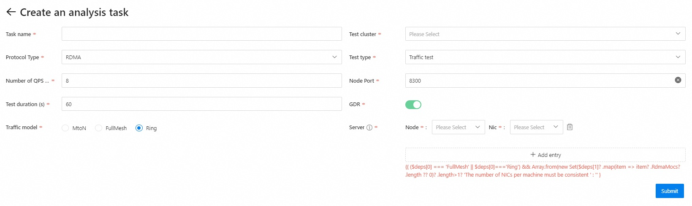

   The following table describes the parameter combinations of an analysis task for which the Protocol Type parameter is set to RDMA.

   <table>
     <tr>
       <th>Test cluster</th>
       <th>Protoc ol Type</th>
       <th>Test type</th>
       <th>Required parameter</th>
       <th>Traffic model value</th>
       <th>Node</th>
     </tr>
     <tr>
       <td rowspan="4"><em>Arbitrary</em></td>
       <td rowspan="4">RDMA</td>
       <td rowspan="3">Traffic test</td>
       <td rowspan="3">• Number of QPS tested<br>• Node Port<br>• Test duration (s)<br>• GDR</td>
       <td>MtoN</td>
       <td>• Server<br>• Client</td>
     </tr>
     <tr>
       <td>FullMesh</td>
       <td>Server</td>
     </tr>
     <tr>
       <td>Ring</td>
       <td>Server</td>
     </tr>
     <tr>
       <td>Latency Test</td>
       <td>• Node Port<br>• Test duration (s)</td>
       <td>N/A</td>
       <td>Server</td>
     </tr>
   </table>

   The following table describes the parameters you must configure to create an analysis task for which the Protocol Type parameter is set to RDMA.

   | Parameter | Description |
   | --- | --- |
   | Number of QPS tested | The number of test processes. This parameter determines the test bandwidth.<br>• If the queue pairs (QPs) are insufficient, the communication queue in the RDMA network may be congested, which compromises the efficiency and stability of data transmission.<br>• If the number of QPs is excessively large, the system overheads, complexity, and failure rate are increased.<br>Note<br>QP is a key term of the RDMA network. It refers to the communication queue between a pair of endpoints. |
   | Node Port | The port number used for the test. |
   | Test duration (s) | The duration of the test. Unit: seconds. |
   | GDR | Specifies whether to enable direct communication between GPUs If you turn on this switch, the system associates the RDMA network interface controller (NIC) with the corresponding GPU for traffic testing. Make sure that the machine supports this feature before you turn on the switch. |
   | MtoN | The many-to-many relationship model. This model is used to test the one-way connectivity between <strong>Client</strong> nodes and <strong>Server</strong> nodes, including the one-way connectivity between a single <strong>Client</strong> node and a single <strong>Server</strong> node and between multiple <strong>Client</strong> nodes and multiple <strong>Server</strong> nodes. |
   | FullMesh | All nodes in the network topology are connected to each other. This option allows you to test the two-way connectivity between all destination nodes. |
   | Ring | Multiple nodes in the network topology form a closed loop. Data packets are sent from one node to the next node in sequence and finally returned to the original node. This option allows you to test the actual available network bandwidth. |
   | Client | The sender of the test traffic. |
   | Server | The receiver of the test traffic. |

   The following table describes the parameters you must configure to create an analysis task for which the Protocol Type parameter is set to Communication Library.

   | Test clust er | Protocol Type | Test type | Communicati on Library | Required parameter |
   | --- | --- | --- | --- | --- |
   | <em>Arbitr</em> <em>ary</em> | Commun ication Library | Communi cation library test | • NCCL<br>• CPN-CCL<br>• RCCL<br>• PCCL | • <strong>Algorithm</strong>: the algorithm of the task. The algorithm bandwidth, bus bandwidth, and execution time of a task vary based on the algorithm.<br>• <strong>Communication Primitive</strong>: The data transmission and processing methods vary based on the communication primitive. Select a value from the drop-down list.<br>• <strong>Timeout Period (Seconds)</strong>: If the execution time of performance analysis test is greater than the specified timeout period plus 1 minute, the test task fails.<br>• <strong>Data Type</strong>: the data type of the performance analysis test. Select a value from the drop-down list.<br>• <strong>Iterations</strong>: the number of times the current task is executed.<br>• <strong>Minimum Bytes</strong>: the minimum amount of data to start the task.<br>• <strong>Maximum Bytes</strong>: the maximum amount of data to stop the task.<br>• <strong>Step Factor</strong>: Specify an integer greater than 1. If you set the parameter to 2, the data specification increases by two times. The first row corresponds to the value of the Start bytes parameter and the last row corresponds to the value of the Number of cut-off bytes parameter.<br>• <strong>Hosts</strong>: Click <strong>Select a node</strong> to add hosts.<br>• <strong>mpirun Custom Parameters</strong>: Specify custom parameters in the <code> --mca ... -</code><code>-mca ... </code> format. Example: <code> --mca </code> <code>pml ob1 --mca coll ^hcoll --mca btl</code><br><code>tcp,self --mca btl_tcp_if_include</code><br><code>bond0 --mca oob_tcp_if_include</code> <code>bond0 --bind-to none </code>.<br>• <strong>NCCL Parameters</strong>: the custom properties and values. |

5. Click **Submit**.

**What to do next**

The following table describes the operations that you can perform on the **CPN Performance Analysis** page.

| Operation | Procedure |
| --- | --- |
| Query a test task | • Basic filter<br>After you specify the start time and end time, the test tasks that meet the filter condition are displayed.<br>• Advanced filter<br>i. Click <strong>Advanced Filter</strong>.<br>ii. Configure the Start and end time, Test Type, Protocol Type, and Status parameters.<br>iii. Click <strong>Search</strong>. |
| View performance analysis details | 1. Find the test task that you want to manage and click <strong>Details</strong> in the <strong>Operation</strong> column.<br>2. On the Analysis Task Details page, view the basic information, analysis results, and device information of the task. |
| Export performance analysis details | Note<br>You can export the performance analysis details of a test task of the traffic test or latency test type.<br>1. Find the test task that you want to manage and click <strong>Details</strong> in the <strong>Operation</strong> column.<br>2. On the <strong>Analysis Task Details</strong> page, click <strong>Export</strong> to the right of <strong>Analysis Results</strong>.<br>3. View the exported Excel file on your computer. |
| Retry a test task | 1. Find the test task that you want to manage and click <strong>Retry</strong> in the <strong>Operation</strong> column.<br>2. In the message that appears, click <strong>OK</strong>. The value in the <strong>Task Status</strong> column changes to <strong>Running</strong>. |
| Delete a test task | 1. Find the test task that you want to manage and click <strong>Delete</strong> in the <strong>Operation</strong> column.<br>2. In the message that appears, click <strong>OK</strong>. |
| Terminate a test task | 1. Find the test task that you want to manage and click <strong>Stop</strong> in the <strong>Operation</strong> column.<br>2. In the message that appears, click <strong>OK</strong>. The value in the <strong>Task Status</strong> column changes to <strong>Stopping</strong>. If the value in the <strong>Task Status</strong> column changes to <strong>Stopped</strong>, the task is terminated. |

<a id="section-2-2-3"></a>

### 2.2.3. CPN alert center

The CPN Alarm Center module displays alerts, including real-time alerts that are not closed and closed historical alerts.

**Alert Distribution Overview**

1. Log in to the Apsara Uni-manager Operations Console.

2. In the top navigation bar, choose **Product Operation** > **Networking** > **Network Operations Console**.

3. In the left-side navigation pane, choose **Basic Network > CPN Management > CPN Alarm Center**.

4. On the **CPN Alerts** page, click the **Alert Distribution Overview** tab to view the statistics of various types of CPN alerts. By default, the statistics of **Not Closed** alerts are displayed. You can click **Closed** to view the statistics of closed alerts.

   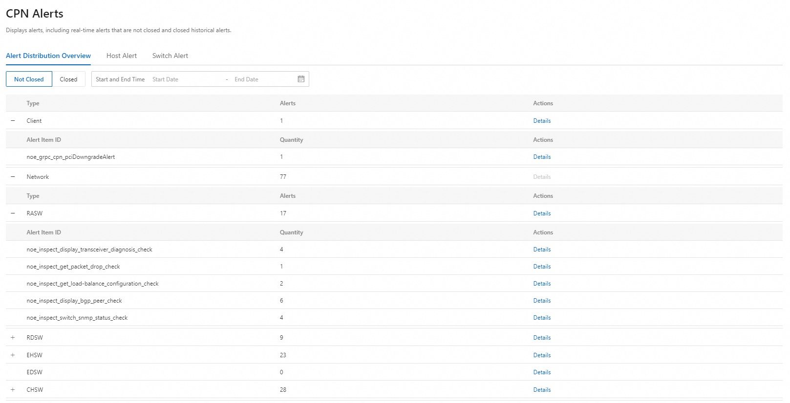

   - You can set **Start and End Time** to filter and view the alerts in the specified time range.

   - CPN alerts are classified into two types: **Client** and **Network**. Network-side alert types include **RASW**, **RDSW**, **EHSW**, **EDSW**, and **CHSW**.

   - You can click **Details** in the **Actions** column to go to the list of alerts of a specified type or a specified alert item.

**Host Alert**

1. Log in to the Apsara Uni-manager Operations Console.

2. In the top navigation bar, choose **Product Operation** > **Networking** > **Network Operations Console**.

3. In the left-side navigation pane, choose **Basic Network > CPN Management > CPN Alarm Center**.

4. On the **CPN Alerts** page, click the **Host Alert** tab to view real-time CPN alerts on the **Client** side. By default, **Not Closed** alerts are displayed. You can click **Closed** to view the closed alerts.

   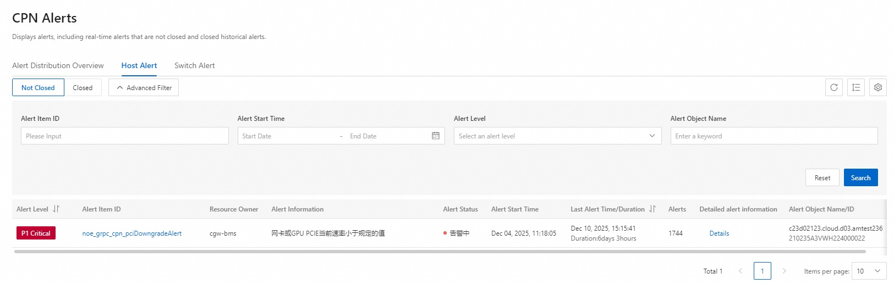

   - You can click the up or down arrow next to **Alert Level** or **Last Alert Time/Duration** to sort alerts.

   - The alert information includes **Alert Level**, **Alert Item ID**, **Resource Owner**, **Alert Information**, **Alert Status**, **Alert Start Time**, **Last Alert Time/Duration**, **Alerts**, **Alert Details**, and **Alert Object Name/ID**.

   - Click **Advanced Filter** and filter alerts by **Alert Item ID**, **Alert Start Time**, **Alert Level**, **Alert Object Name**, or any combination of them.

   - Click an alert item ID in the **Alert Item ID** column to go to the **Alert Details** page and view the details of the alert. For more information, see Alert details.

   - Move the pointer over **Details** in the **Alert Details** column of an alert to view the details of the alert.

**Switch Alert**

1. Log in to the Apsara Uni-manager Operations Console.

2. In the top navigation bar, choose **Product Operation** > **Networking** > **Network Operations Console**.

3. In the left-side navigation pane, choose **Basic Network > CPN Management > CPN Alarm Center**.

4. On the **CPN Alerts** page, click the **Switch Alert** tab to view real-time CPN alerts on the **Network** side. By default, **Not Closed** alerts of the **RASW** type are displayed. You can click **Closed** to view the closed alerts.

   You can also switch between tabs to view the real-time alerts of the **RASW**, **RDSW**, **EHSW**, **EDSW**, and **CHSW** types on the Network side.

   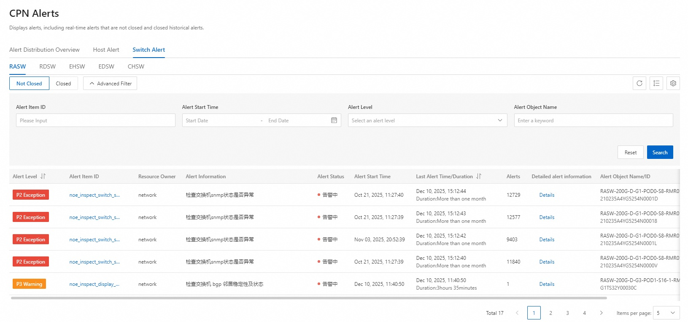

   - You can click the up or down arrow next to **Alert Level** or **Last Alert Time/Duration** to sort alerts.

   - The alert information includes **Alert Level**, **Alert Item ID**, **Resource Owner**, **Alert Information**, **Alert Status**, **Alert Start Time**, **Last Alert Time/Duration**, **Alerts**, **Alert Details**, and **Alert Object Name/ID**.

   - Click **Advanced Filter** and filter alerts by **Alert Item ID**, **Alert Start Time**, **Alert Level**, **Alert Object Name**, or any combination of them.

   - Click an alert item ID in the **Alert Item ID** column to go to the **Alert Details** page and view the details of the alert. For more information, see Alert details.

   - Move the pointer over **Details** in the **Alert Details** column of an alert to view the details of the alert.

<a id="section-2-2-4"></a>

### 2.2.4. CPN access gateways

<a id="section-2-2-4-1"></a>

#### 2.2.4.1. Manage RDMA devices

This topic describes how to manage Remote Direct Memory Access (RDMA) devices, including how to scan for and delete RDMA devices.

**Procedure**

1. Log on to the Apsara Uni-manager Operations Console.

2. In the top navigation bar, choose **Product Operation** > **Networking** > **Network Operations Console**.

3. In the left-side navigation pane, choose **Basic Network > CPN Management > CPN Access Gateway**.

4. Select the **RDMA Device Management** tab.

5. Manage RDMA devices.

   - Scan for new devices

     Click **Scan New Devices** to add new RDMA devices to the system.

   - Query new devices

     - Basic filter

       <ol type="a">

       <li>

       Select **Device Name**, **Equipment manufacturer**, **Equipment model**, **Device role**, **Device Management IP**, **Serial Number**, or **Device status** from the drop-down list.

       </li>

       <li>

       In the search box, enter the device name or manufacturer, or select the status of the

       device, and click  .

       </li>

       </ol>

     - Advanced filter

       <ol type="a">

       <li>

       Click **Advanced Filter**.

       </li>

       <li>

       Enter the device name, device manufacturer, device model, device role, device management IP address, and serial number, and select the device status.

       </li>

       </ol>

       <ol type="i" start="100">

       <li>

       Click **Search**.

       </li>

       </ol>

   - Delete a new device

     <ol type="a">

     <li>

     Click **Delete** in the **Actions** column.

     </li>

     <li>

     In the message that appears, click **OK**.

     </li>

     </ol>

<a id="section-2-2-4-2"></a>

#### 2.2.4.2. Manage RDMA device policies

This topic describes how to configure policies for Remote Direct Memory Access (RDMA) devices to manage RDMA devices in a centralized manner.

**Procedure**

1. Log on to the Apsara Uni-manager Operations Console.

2. In the top navigation bar, choose **Product Operation** > **Networking** > **Network Operations Console**.

3. In the left-side navigation pane, choose **Basic Network > CPN Management > CPN Access Gateway**.

4. Click the **RDMA device policy management** tab.

5. Click **Create an RDMA device policy** and set the parameters. The following table describes the parameters.

   | Parameter | Description |
   | --- | --- |
   | Policy name | Enter a custom name for the policy. |
   | Description | Enter the description of the policy. This parameter is optional. |
   | Equipment manufacturer | Select a device vendor from the drop-down list. The system automatically displays the device vendors on the <strong>RDMA Device Management</strong> tab. |
   | Device role | Select the role of the device to which the policy applies from the drop-down list.Valid values:<br>• <strong>RASW</strong>: the access vSwitch of the data exchange module in RDMA networking scenarios.<br>• <strong>RDSW</strong>: the core vSwitch of the data exchange module in RDMA networking scenarios. The core vSwitch is used to connect different access vSwitches.<br>• <strong>EHSW</strong>: the vSwitch that is used to connect to the custodian network in RDMA networking scenarios. |
   | Equipment model | Select the model of the device to which the policy applies from the drop-down list. The system automatically displays the device models on the <strong>RDMA</strong> <strong>Device Management</strong> tab. |
   | Device List | Select the device to which the policy applies from the drop-down list. The system automatically displays the devices of a specific device model on the <strong>RDMA Device Management</strong> tab. |
   | Headroom | The size of the RDMA over Converged Ethernet (RoCE) queue buffer, and the maximum number of available cell resources in the headroom. Enter the size of the global buffer. |

6. Click **OK**.

**What to do next**

On the **RDMA device policy management** tab, you can perform the following operations:

| Operation | Procedure |
| --- | --- |
| Query the policy for an RDMA device | 1. Select <strong>Device Name</strong>, <strong>Equipment manufacturer</strong>, <strong>Equipment model</strong>, <strong>Device role</strong>, <strong>Device Management IP</strong>, <strong>Serial Number</strong>, or <strong>Device status</strong> from the drop-down list.<br>2. Enter the device name, device vendor, device model, device role, device management IP address, serial number, or device status in the search box<br>and click. |
| View the details of the policy of an RDMA device | 1. Click <strong>Details</strong> in the <strong>Actions</strong> column.<br>2. Click <strong>OK</strong> or <strong>Cancel</strong>. |
| Retry the policy of an RDMA device | 1. Click <strong>Retry</strong> in the <strong>Actions</strong> column.<br>2. In the message that appears, click <strong>OK</strong>. |

<a id="section-2-2-4-3"></a>

#### 2.2.4.3. Manage policies for the RDMA device interface

This topic describes how to manage interface policies, such as policy configuration, query, and retry.

**Procedure**

1. Log on to the Apsara Uni-manager Operations Console.

2. In the top navigation bar, choose **Product Operation** > **Networking** > **Network Operations Console**.

3. In the left-side navigation pane, choose **Basic Network > CPN Management > CPN Access Gateway**.

4. Click the **RDMA device interface policy management** tab.

5. Click **Create an RDMA device interface policy** and configure the following parameters.

   | Parameter | Description |
   | --- | --- |
   | Policy Name | Enter a custom name for the policy. |
   | Description | Enter the description of the policy. This parameter is optional. |
   | Device Vendor | Select a device vendor from the drop-down list. The system automatically displays the device vendors on the <strong>RDMA Device Management</strong> tab. |
   | Device Role | Select the role of the device to which the policy applies from the drop-down list.Valid values:<br>• <strong>RASW</strong>: the access vSwitch of the data exchange module in Remote Direct Memory Access (RDMA) networking scenarios.<br>• <strong>RDSW</strong>: the core vSwitch of the data exchange module in RDMA networking scenarios. The core vSwitch is used to connect different access vSwitches.<br>• <strong>EHSW</strong>: the vSwitch that is used to connect to the custodian network in RDMA networking scenarios. |
   | Device Model | Select the model of the device to which the policy applies from the drop-down list. The system automatically displays the device models on the <strong>RDMA</strong> <strong>Device Management</strong> tab. |
   | Device List | Select the device to which the policy applies from the drop-down list. The system automatically displays the devices of a specific device model on the <strong>RDMA Device Management</strong> tab. |
   | RoCE queue PFCs configuration (RDMA over Converged Ethernet) | • <strong>Headroom cache threshold</strong>: the size of the RDMA over Converged Ethernet (RoCE) queue buffer, and the maximum number of available cell resources in the headroom.<br>• <strong>Back pressure frame trigger threshold</strong>: the analysis model of network traffic. The model ensures that the sum of the back pressure frame triggering thresholds for all ingresses is less than or equal to the tail-drops threshold for the egress.<br>• Offset between back pressure frame stop threshold and trigger <strong>threshold</strong>: When the number of cell resources used by packets with a 802.1p priority decreases by the value of this parameter after PFC is triggered, PFC stops sending PFC pause frames.<br>• <strong>PFCs reserved threshold</strong>: the number of cell resources reserved for packets with a 802.1p priority in the guaranteed storage capacity.<br>• <strong>PFCs</strong>: If you use PFC and congestion occurs in a specific type of traffic, the routing of other types of traffic is not affected. This ensures that different types of packets on the same link do not affect each other.<br>• <strong>Deadlock monitoring function</strong>: If a link or device failure occurs, temporary loops may occur during the route reconvergence period. In this case, PFC frames are repeatedly sent and received between devices, packets cannot be forwarded, cell resources in the interface buffer are occupied and cannot be released, and the device enters the PFC deadlock state. |
   | RoCE queue WRED configuration | • <strong>ECN function</strong>: Explicit Congestion Notification (ECN) uses the DiffServ field in the IP header to mark the congestion status along the packet transmission path. An ECN-capable terminal can determine whether congestion occurs on the transmission path based on the packet content. If congestion occurs, the terminal adjusts the method to send packets to prevent congestion from being aggravated.<br>• <strong>Lower limit of average queue length</strong>: the lower limit of the length of the queue that the packets of the forwarding device enter in the egress. The lower limit is also called ECN threshold.<br>• <strong>Upper limit of average queue length</strong>: When the device assigns packets to a queue in the outbound direction, the queue size reaches the upper threshold (ECN threshold).<br>• <strong>Discarding probability</strong>: the marking probability if ECN is used. A larger value indicates that more packets are marked between the upper and lower limits.<br>Note<br>• If the length of the queue that the packets of the forwarding device enter in the egress is smaller than the lower limit, the forwarding device directly forwards the packets from the egress without processing the packets.<br>• When the device assigns packets to a queue in the outbound direction, if the average queue size is between the lower threshold and the upper threshold, take note of the following items:<br>• If the value of the ECN field in the received packets is 00, the packets are sent out of an ECN-incapable terminal. In this case, the forwarding device determines whether to drop the packets based on the drop probability.<br>• If the value of the ECN field in the received packets is 01 or 10, the packets are sent out of an ECN-capable terminal. In this case, the forwarding devices change the value of the ECN field for some of these packets based on the drop probability and forward these packets. All incoming packets are not dropped.<br>• If the ECN field is 11 in a packet, the packet on the original device has experienced congestion along the transmission path. In this case, the device does not process the packet and directly forwards the packet out of the outgoing interface.<br>• When the device assigns packets to a queue in the outbound direction, if the average queue size exceeds the upper threshold, take note of the following items:<br>• If the ECN field is 00, the packets are sent out of an ECN-incapable terminal, the device drops the packets.<br>• If the value of the ECN field in the packet received by the device is 01 or 10, it indicates that the packet sender supports the ECN function. After the ECN field of the inbound packet is changed to 11, the packet continues to be forwarded, and all inbound packets are not discarded.<br>• If the ECN field is 11 in a packet, the packet on the original device has experienced congestion along the transmission path. In this case, the device does not process the packet and directly forwards the packet out of the outgoing interface. |

6. Click **OK**.

**What to do next**

On the **RDMA device interface policy management** tab, you can perform the following operations:

| Operation | Procedure |
| --- | --- |
| Query the policy for an RDMA device interface | 1. Configure the <strong>Policy Name</strong>, <strong>Device Vendor</strong>, <strong>Device Model</strong>, <strong>Device Role</strong>, or <strong>Device Management IP</strong> parameter.<br>2. Enter the policy name, device vendor, device model, device role, or device<br>management IP address in the search box and click theicon. |
| View the details of a policy of an RDMA device interface | 1. Click <strong>Details</strong> in the <strong>Actions</strong> column.<br>2. Click <strong>OK</strong> or <strong>Cancel</strong>. |
| Retry the policy for an RDMA device interface | 1. Click <strong>Retry</strong> in the <strong>Actions</strong> column.<br>2. In the message that appears, click <strong>OK</strong>. |

<a id="section-2-2-5"></a>

### 2.2.5. RDMA NIC O&M

To perform O&M on Remote Direct Memory Access (RDMA) network interface cards (NICs), you must check the performance metrics of RDMA NICs. RDMA NIC O&M allows you to identify and troubleshoot issues and ensure network stability and reliability.

**Terms**

**RDMA**: RDMA is a high-speed network technology developed to reduce the delay of server-side data processing in network transmission. RDMA transfers data directly into the memory of a computer over the RDMA network and enables direct memory access between hosts without affecting the operating system. This increases the data transfer speed and reduces the CPU load.

**Procedure**

1. Log on to the Apsara Uni-manager Operations Console.

2. In the top navigation bar, choose **Product Operation** > **Networking** > **Network Operations Console**.

3. In the left-side navigation pane, choose **Basic Network > CPN Management > RDMA Card O&M**.

4. In the upper-right corner of the page, select **Data Source** and **Cluster**. You can set Data Source only to CPN.

5. On the **Cluster** tab, view the monitoring information about the cluster.

   

   | Section | Description |
   | --- | --- |
   | Average QP | The average number of queue pairs (QPs) in the RDMA network. If you select PAI for Data Source, this parameter is unavailable.<br>• If the number of QPs is insufficient, the queue is blocked, which affects the efficiency and stability of data transmission.<br>• If the number of QPs is excessively large, the system overheads, complexity, and failure rate increase.<br>Note<br>A QP is a key concept in RDMA networks and is used to describe the queue between a pair of endpoints. |
   | Abnormal Networks | The number of times that network device exceptions or traffic exceptions occur in the RDMA network. |
   | Average Throughput Sent by RDMA (Mbit/s) | The average amount of data sent by all nodes in the RDMA network per second. |
   | Average Throughput Received by RDMA (Mbit/s) | The average amount of data received by all nodes in the RDMA network per second. |
   | Monitoring Chart | i. Select the start time and the end time on the right side of the monitoring chart to view the monitoring data within the time range.<br>ii. In the <strong>Throughput Dashboard</strong> section, view the RDMA_TX_BYTES and RDMA_RX_BYTES metrics.<br>• RDMA_TX_BYTES is the number of bytes sent in the RDMA network.<br>• RDMA_RX_BYTES is the number of bytes received in the RDMA network.iii. In the <strong>Basic Data of RDMA Network</strong> section, view the following data in the specified time range:<br>• <strong>RDMA_IGNORE_CNP_AVG</strong>: the average number of ignored Congestion Notification Packets (CNPs) in the RDMA network.<br>Note |
   | RDMA Network Overview | CNPs are packets used for network congestion control. When View the metrics of the nodes in the RDMA network, including <strong>Nodes</strong>, network congestion occurs, CNPs are sent to notify the sender to <strong>Outbound Throughput</strong>, <strong>Inbound Throughput</strong>, <strong>Network QP</strong>, <strong>CNP</strong> reduce the sending rate to avoid network congestion and packet <strong>Processed by Network</strong>, <strong>Out-of-order Data Packets</strong>, and <strong>Network</strong> loss.<strong>Buffer Overflow</strong>. |

   - **RDMA_TX_PFC_PAUSE_AVG**: the average number of Priority-based

6. On the **Node** tab, view the monitoring information of each node.

   Flow Control (PFC) packets when data is sent in the RDMA network.

   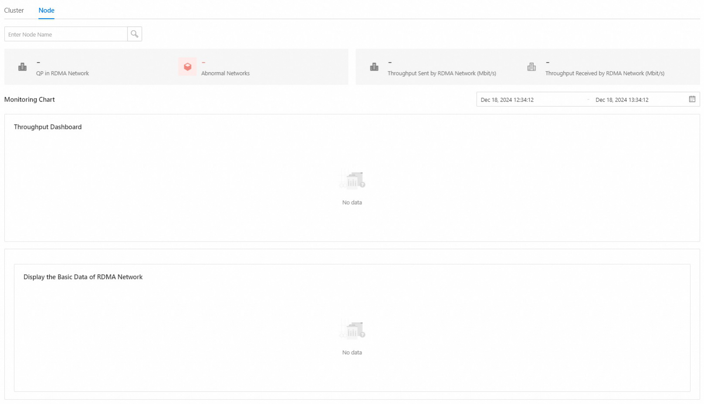

   - **RDMA_MARKED_ECN_AVG**: the average number of marked Explicit

   <table>
     <tr>
       <th>Con Parameter<br>• RD in t</th>
       <th>gestion Notification (ECN) packets in the RDMA network.Description MA_HANDLE_CNP_AVG: the average number of CNPs processed he RDMA network.</th>
     </tr>
     <tr>
       <td>• RD QP in RDMA Network that</td>
       <td rowspan="5">MA_TX_PFC_TRANS_AVG: the average number ofPFC packets are enabled in the RDMA network.<br>MA_QP_CNT_AVG:the average number of QPs in the RDMA work.<br>MA_TX_BYTES_AVG: the average number of bytes of data sent in RDMA network.<br>MA_RX_BYTES_AVGDisplays the monitoring data of a node. For more information,: the average number of bytes of data ived in the RDMA network.see the descriptions of the cluster metrics.</td>
     </tr>
     <tr>
       <td>• RD net Abnormal Networks<br>• RD</td>
     </tr>
     <tr>
       <td>the Throughput Sent by RDMA<br>• RD Network (Mbit/s) rece</td>
     </tr>
     <tr>
       <td>Throughput Received by RDMA Network (Mbit/s)</td>
     </tr>
     <tr>
       <td>Monitoring Chart</td>
     </tr>
   </table>

<a id="section-2-2-6"></a>

### 2.2.6. CPN management

<a id="section-2-2-6-1"></a>

#### 2.2.6.1. CPN topology

This topic describes how to query the topology information about clusters and nodes.

**Procedure**

1. Log on to the Apsara Uni-manager Operations Console.

2. In the top navigation bar, choose **Product Operation** > **Networking** > **Network Operations Console**.

3. In the left-side navigation pane, choose **Basic Network > CPN Management > CPN Network Management > CPN Topology**.

4. In the upper-left corner of the page, select **Cluster** and **Nodes**.

5. Click **Query** to query the topology information.

   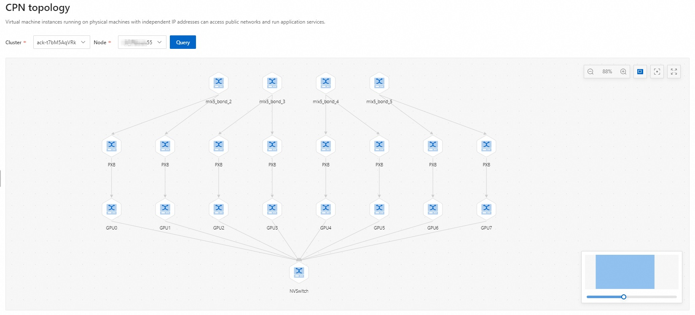

**What to do next**

After the topology is displayed, you can perform the following operations:

| Operation | Procedure |
| --- | --- |
| Zoom in or zoom out the topology | Clickorin the upper-right corner of the topology to zoom in or zoom<br>out the topology. |
| Reset the topology canvas | Clickin the upper-right corner of the topology to reset the canvas. |
| Display the topology in full screen | 1. Clickin the upper right corner of the topology to display the topology<br>in full screen.<br>2. Clickin the upper-right corner to exit the full screen. |

<a id="section-2-2-6-2"></a>

#### 2.2.6.2. CPN network element

This topic describes how to view network devices and monitoring and O&M information in the cloud platform.

**Procedure**

1. Log on to the Apsara Uni-manager Operations Console.

2. In the top navigation bar, choose **Product Operation** > **Networking** > **Network Operations Console**.

3. In the left-side navigation pane, choose **Basic Network > CPN Management > CPN Network Management > CPN Network Element**.

4. Select a data center from the drop-down list and enter a network element name in the **Network element name** search box.

5. Click the name of a network element or click **Details** in the **Actions** column to go to the details page of the network element.

   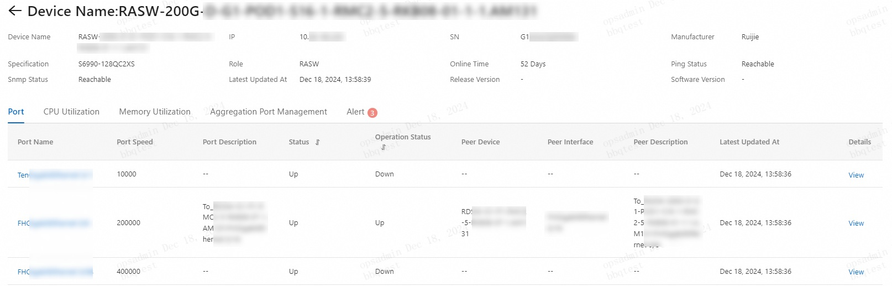

   | Tab | Description |
   | --- | --- |
   | Port | Displays the port information of the network element device. Click the port name or click <strong>View</strong> in the <strong>Actions</strong> column to view the usage data of the port. |
   | CPU Utilization | Displays the CPU usage of the network element device. |
   | Memory Utilization | Displays the memory utilization of the network element device. |
   | Aggregation Port Management | Displays the aggregated port information of the network element device.Click <strong>View</strong> in the <strong>Actions</strong> column to view the traffic of the port. |
   | Alert | Displays the alert information of the network element device. |

**What to do next**

On the **CPN network element** page, you can also perform the following operations:

| Operation | Procedure |
| --- | --- |
| Delete a CPN network element | 1. Click <strong>Delete</strong> in the <strong>Actions</strong> column.<br>2. In the message that appears, click <strong>OK</strong>. |

<a id="section-2-2-7"></a>

### 2.2.7. CPN network monitoring

<a id="section-2-2-7-1"></a>

#### 2.2.7.1. CPN host monitoring dashboard

You can use this feature to monitor the key metrics of remote direct memory access (RDMA) networks on the server side of the intelligent computing network. The metrics include bandwidth, packet loss rate, and traffic control.

**Procedure**

1. Log on to the Apsara Uni-manager Operations Console.

2. In the top navigation bar, choose **Product Operation** > **Networking** > **Network Operations Console**.

3. In the left-side navigation pane, choose **Basic Network > CPN Management > CPN Network Monitoring > CPN Host Monitoring**.

4. In the upper-right corner of the CPN host monitoring dashboard page, click **Variable Filtering**. In the Variable Filtering dialog box, configure the **Custer** and **Host** parameters, and click **OK**.

5. On the **CPN host monitoring dashboard** page, view information about the following metrics: **Network Overview**, **End-side congestion packet loss**, **Network card RDMA packet loss**, **Network card RDMA communication QP quantity & network card status**, **Network congestion metrics**, **Network physical throughput**, and **Nic queue**

   **throughput**. You can also click the  icon to the left of each metric to view details.

   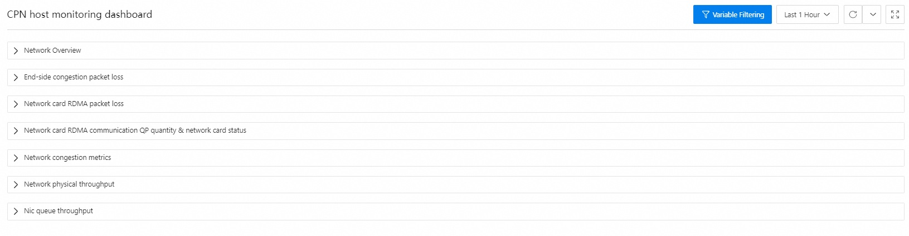

<a id="section-2-2-7-2"></a>

#### 2.2.7.2. CPN switch dashboard

You can use this feature to monitor the running status metrics of vSwitches. The metrics include bandwidth, packet loss, and traffic control.

**Procedure**

1. Log on to the Apsara Uni-manager Operations Console.

2. In the top navigation bar, choose **Product Operation** > **Networking** > **Network Operations Console**.

3. In the left-side navigation pane, choose **Basic Network > CPN Management > CPN Network Monitoring > CPN Switcher**.

4. In the upper-right corner of the CPN switch dashboard page, click **Variable Filtering**. In the Variable Filtering dialog box, configure the **idc** and **host** parameters, and click **OK**.

5. On the CPN switch dashboard page, view information about the following metrics: **Network Overview**, **Ruijie exception indicator top 50**, **Top 50 abnormal indicators**, **Queue**

   **metrics**, **Port metrics**, **Alarm status**, and **Logs**. You can also click the  icon to the left

   of each metric to view details.

   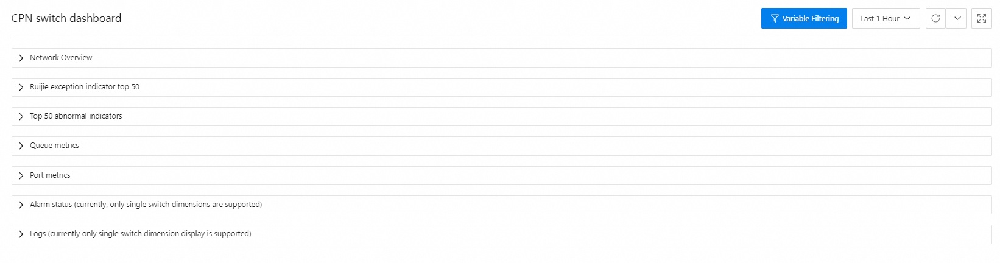

<a id="section-2-2-7-3"></a>

#### 2.2.7.3. NAK packet analysis tool

You can use this tool to collect NAK packets in real time. After the packets are aggregated and analyzed, a matrix diagram is generated to help you quickly identify abnormal nodes.

**Procedure**

1. Log on to the Apsara Uni-manager Operations Console.

2. In the top navigation bar, choose **Product Operation** > **Networking** > **Network Operations Console**.

3. In the left-side navigation pane, choose **Basic Network > CPN Management > CPN Network Monitoring > NAK Message Analysis Tool**.

4. In the upper-right corner of the NAK message Analysis Tool page, click **Variable Filtering**. In the Variable Filtering dialog box, configure the **Network cluster**, **SOURCE device Group**, and **Destination device Group** parameters, and click **OK**.

5. On the **NAK message Analysis Tool** page, view information about the following metrics: **Network cluster-level NAK dashboard** and **Device Group-level NAK dashboard.** You

   can also click the

   icon to the left of each metric to view details.

   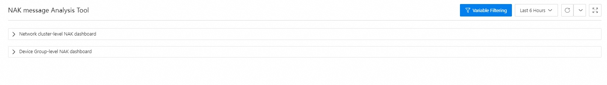

<a id="section-2-2-7-4"></a>

#### 2.2.7.4. High-precision monitoring dashboard

The high-precision monitoring dashboard of Computing Platform Network (CPN) allows you to monitor traffic of network interface cards (NICs) and bond devices with a latency of seconds.

**Procedure**

1. Log on to the Apsara Uni-manager Operations Console.

2. In the top navigation bar, choose **Product Operation** > **Networking** > **Network Operations Console**.

3. In the left-side navigation pane, choose **Basic Network > CPN Management > CPN Network Dashboard > High Precision Monitoring Dashboard**.

4. In the upper part of the page, select a cluster from the **High Precision Monitoring Clusters** drop-down list and one or more nodes from the **Node** drop-down list, and then click Start High-precision Task.

5. In the dialog box that appears, configure the **Duration (s)** parameter. Valid values: 1 to

   600. Default value: 300. Then, click **OK**.

6. In the upper-right corner of the page, specify the time range of the monitoring. Select a start time and an end time, and then click **OK**.

7. In the upper-right corner of the page, click the Refresh icon or set the automatic refresh interval to view the latest monitoring data.

> **Note**
>
> If one of the selected nodes is in the Running state, you cannot start the task again until the duration of the task elapses.

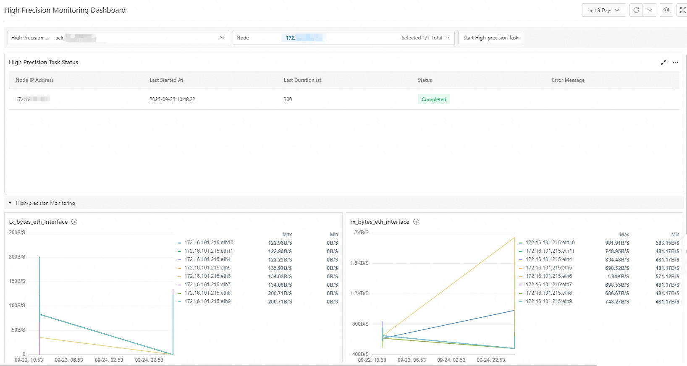

<a id="section-2-2-7-5"></a>

#### 2.2.7.5. High-precision vSwitch monitoring dashboard

The high-precision vSwitch monitoring dashboard of Computing Platform Network (CPN) allows you to monitor traffic of vSwitches with a latency of seconds.

**Procedure**

1. Log on to the Apsara Uni-manager Operations Console.

2. In the top navigation bar, choose **Product Operation** > **Networking** > **Network Operations Console**.

3. In the left-side navigation pane, choose **Basic Network > CPN Management > CPN Network Dashboard > Switch High Precision Monitoring Dashboard**.

4. In the upper part of the High-precision vSwitch Monitoring page, configure the required parameters and click **Start High-precision Task**.

   The following table describes the parameters.

   | Parameter | Description |
   | --- | --- |
   | idc | The data center on which the high-precision monitoring task is performed. |
   | vSwitch | The vSwitch on which the high-precision monitoring task is performed. |
   | Port | The port that you want to monitor. |
   | Queue | The number of queues configured for the specified port. Valid values: 0 to 7. |

5. In the dialog box that appears, configure the **Duration (s)** and **Task type** parameters. Valid values of the Duration (s) parameter: 1 to 600. Default value of the Duration (s) parameter: 300. Then, click **OK**.

   > **Note**
   >
   > The value of the Task type indicates the monitoring object of the task. The related data of the unselected monitoring object is not displayed on the High-precision vSwitch Monitoring page.

6. In the upper-right corner of the page, click the time range drop-down list. Then, select the monitoring start time and end time from the drop-down list and click **OK**.

7. In the upper-right corner of the page, click the Refresh icon or set the automatic refresh time to view the latest monitoring data.

> **Note**
>
> If one of the selected nodes is in the Running state, you cannot start the task again until the duration of the task elapses.

<a id="section-2-2-7-6"></a>

#### 2.2.7.6. Job monitoring

Computing Platform Network (CPN) provides the job monitoring feature, including the monitoring of top N metrics for hosts, end-to-end packet loss caused by congestion, and Remote Direct Memory Access (RDMA) packet loss of network interface cards (NICs).

**Prerequisites**

The related tasks are created in the task modeling module of AI Studio.

**Procedure**

1. Log on to the Apsara Uni-manager Operations Console.

2. In the top navigation bar, choose **Product Operation** > **Networking** > **Network Operations Console**.

3. In the left-side navigation pane, choose **Basic Network > CPN Management > CPN Network Dashboard > Job Monitoring**.

4. In the upper part of the **Job Monitoring** page, click **Expand more** and configure the **idc**, **Cluster**, **JobType**, **TrainJobId**, **Tips**, **hostIps**, and **swNames** parameters.

5. After you configure these parameters, the corresponding monitoring data appears in the

   lower part of the page. You can view the monitoring metrics in each panel. Click the

   icon to the left of each panel name to fold or unfold the panel.

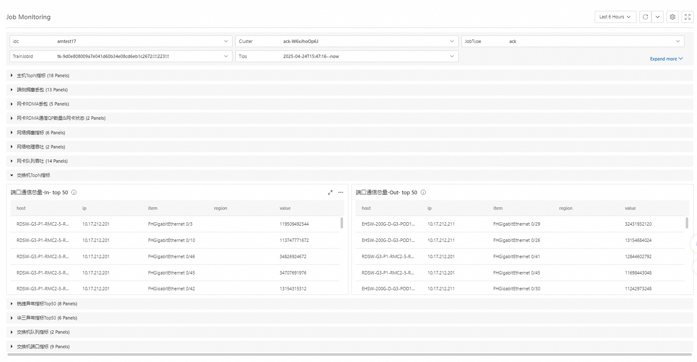

<a id="section-2-2-7-7"></a>

#### 2.2.7.7. CPN stream monitoring

Computing Platform Network (CPN) supports the global traffic observability feature, including the visualization of communication relationships, communication paths, communication quality, and impacts of congestion.

**Prerequisites**

By default, the stream-based visualization feature of CPN is disabled. Before you use this feature, make sure that the cpn-lsgo database is enabled. Run the following code statement to enable the database:

```sql
update config_detail_info set config_value='on' where config_key in 
('tracing_open','cpn_gtp','cpn_gto','cpn_gts','asnet-cpn-lsgo-agent');
```

After the database is enabled, you must restart the service.

**Procedure**

1. Log on to the Apsara Uni-manager Operations Console.

2. In the top navigation bar, choose **Product Operation** > **Networking** > **Network Operations Console**.

3. In the left-side navigation pane, choose **Basic Network > CPN Management > CPN Network Dashboard > CPN Flow Monitor**.

4. On the **Host** tab, view the traffic monitoring data by cluster.

   - Advanced Filter: In this section, configure the **Cluster Name**, **Management Port IP Address of Source NC Filter based on the source IP addresses of the stream.**, **Source NIC**, **Management Port IP Address of Destination NC Filter based on the destination IP address of the stream.**, **Destination NIC**, and **Time** parameters to filter and view data.

   - View stream details: You can click **Details** in the **Actions** column to go to the stream details page and view information in the **Stream Change Events**, **Path Change Events**, and **RTT Trend** sections.

5. On the **vSwitch** tab, view the traffic monitoring data by vSwitch.

   - Advanced Filter: In this section, configure the **Local Device**, **Type**, **Local Device Port**, **Peer Device**, and **Time** parameters to filter and view data.

   - View stream details

     <ol type="a">

     <li>

     Click **Details** in the **Actions** column to view the streams loaded on a port.

     </li>

     <li>

     In the **Stream List** panel, click **Details** in the **Actions** column to go to the stream details page and view information in the **Stream Change Events**, **Path Change Events**, and **RTT Trend** sections.

     </li>

     </ol>

   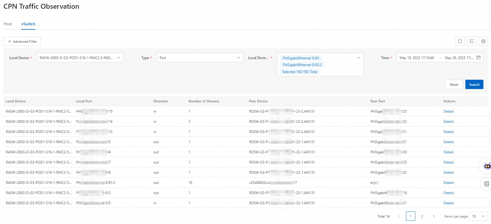

   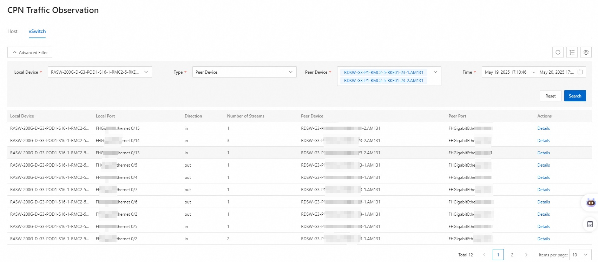

   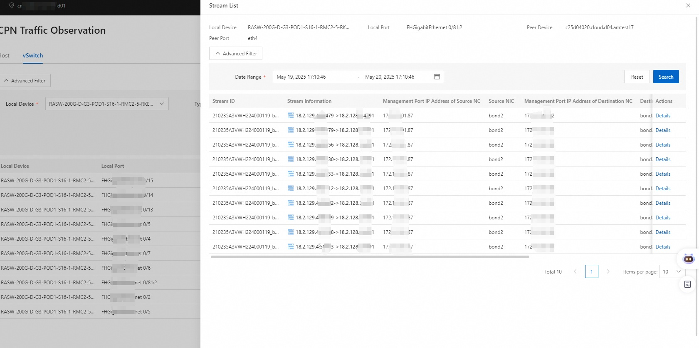

   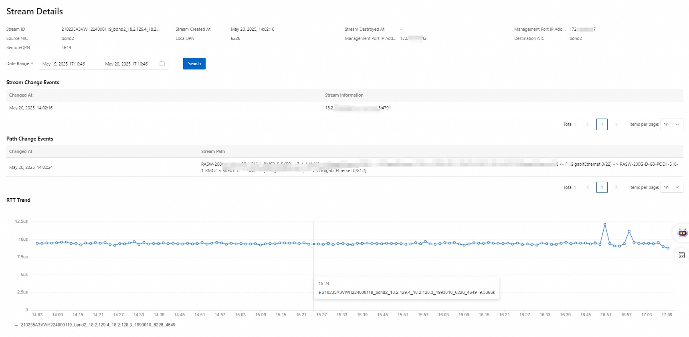

<a id="section-2-3"></a>

## 2.3. CGW

You can connect bare metal instances to a virtual private cloud (VPC) by using Central Gateway (CGW) to manage the bare metal instances in a centralized manner. CGW instances are dedicated hybrid switches (HSWs). The system supports operations such as instance management, operation log viewing, network management of bare metal instances, and O&M configurations to help you complete the daily O&M operations of CGW.

> **Note**
>
> By default, the CGW feature is not displayed. To use the feature, click **User Authorities** in the top navigation bar of the Apsara Uni-manager Operations Console. In the left-side navigation pane of the page that appears, click **Menu Management**. On the Menu management page, find Cloud Gateways and click Modify in the Actions column. In the Edit menu items panel, turn on **Show or not**.

**Instance management**

On the Instance Management page, you can manage the added CGW instances in a centralized manner and view the summary information about the CGW instances in the system.

**Display devices**

1. Log on to the Apsara Uni-manager Operations Console.

2. In the top navigation bar, choose **Product Operation** > **Networking** > **Network Operations Console**.

3. In the left-side navigation pane, choose **Basic Network** > **Cloud Gateways**.

4. On the Cloud Gateway page, click the **Instance Management** tab. On the **Display Devices** tab, view the instance details.

   | Parameter | Description |
   | --- | --- |
   | Cloud Gateway Name | The name of the CGW instance. |
   | IBGP Role | The role of the CGW instance in the environment.<br>• <strong>Client</strong>: specifies that the CGW instance acts as a client of an Internal Border Gateway Protocol (iBGP) neighbor and provides server access.<br>• <strong>Deploy Client and RR on a Device</strong>: specifies that the CGW instance acts as a route reflector (RR) of an iBGP neighbor and provides server access.<br>• <strong>Deploy RR on a Device</strong>: specifies that the CGW instance acts as an RR of an iBGP neighbor and does not provide server access. |
   | Manage IP Address | The IP address of the CGW instance. |
   | Management status | The initialization state of the CGW instance. Valid values:<br>• Uninitialized<br>• Initializing<br>• Initialized |
   | Authorization Status | The authorization state of the CGW instance. Valid values:<br>• Unauthorized<br>• Authorized<br>Note<br>To use CGW instances, you must plan the number of CGW licenses in Deployment Planner. If the number of CGW licenses in Deployment Planner is less than that of used CGW instances, the CGW instances without license authorization are in the Unauthorized state. In this case, you need to increase the number of CGW licenses. |
   | Created At | The time when the CGW instance was created. |

**Scan new devices**

1. Log on to the Apsara Uni-manager Operations Console.

2. In the top navigation bar, choose **Product Operation** > **Networking** > **Network Operations Console**.

3. In the left-side navigation pane, choose **Basic Network** > **Cloud Gateways**.

4. On the Cloud Gateway page, click the **Instance Management** tab. Then, click the **Scan for New Devices** tab.

5. On the Scan for New Devices tab, find the device that you want to manage and click **Manage** in the **Actions** column.

   Alternatively, select multiple devices that you want to manage and click **Batch Manage**.

6. In the Manage dialog box, find the device and configure the **IBGP Role** parameter.

   The IBGP Role parameter specifies the role of a CGW instance in the environment. Valid values of the IBGP Role parameter:

   - **Client**: specifies that the CGW instance acts as a client of an iBGP neighbor and provides server access.

   - **Deploy Client and RR on a Device**: specifies that the CGW instance acts as an RR of an iBGP neighbor and provides server access.

   - **Deploy RR on a Device**: specifies that the CGW instance acts as an RR of an iBGP neighbor and does not provide server access.

   > **Important**
   >
   > The iBGP role configurations must meet the following networking requirements:
   >
   > - Single-data center deployment: At least one group of CGW instances whose iBGP role is an RR and other devices whose iBGP role is a client are deployed in a single data center.
   >
   > - Multi-data center deployment: One group of CGW instances whose iBGP role is an RR and other devices whose iBGP role is a client are deployed in at least two data centers.
   >
   > - RR role recommendations:
   >
   >   - We recommend that you set the role to Deploy Client and RR on a Device.
   >
   >   - If you have higher network stability requirements, we recommend that you set the role to Deploy RR on a Device.

7. Click **OK**.

**Operation logs**

You can view records and results of CGW API operations that are called by the bare metal controller or Apsara Uni-manager Operations Console based on your O&M requirements.

1. Log on to the Apsara Uni-manager Operations Console.

2. In the top navigation bar, choose **Product Operation** > **Networking** > **Network Operations Console**.

3. In the left-side navigation pane, choose **Basic Network** > **Cloud Gateways**.

4. On the Cloud Gateway page, click the **Operation Logs** tab.

5. Optional. Select **Start/End Time** and configure the start time and end time.

6. View the operation logs.

   | Parameter | Description |
   | --- | --- |
   | ID | The ID of the API operation log. |
   | Bare Metal Name | The name of the bare metal instance that was applied for or released in the VPC. |
   | Created At | The time when the API operation was performed. |
   | API Operation | The category of the API operation. Valid values:<br>• <strong>add</strong>: specifies that a bare metal instance is applied for in the VPC.<br>• <strong>del</strong>: specifies that a bare metal instance is released in the VPC.<br>• <strong>del_pc</strong>: specifies that an Express Connect circuit is deleted.<br>• <strong>del_vbr</strong>: specifies that a virtual border router (VBR) is deleted.<br>• <strong>del_router_intf</strong>: specifies that a router interface is deleted.<br>• <strong>del_route_entry</strong>: specifies that a route entry is deleted. |
   | Vswitch ID | The ID of the dedicated vSwitch when the bare metal instance is applied for or released in the VPC. |
   | Cloud Gateway Name | The name of the CGW instance involved with the API operation. |
   | Port | The port to which the bare metal instance is connected. |
   | Status | The status of the API operation.<br>• <strong>success</strong>: The API operation was successful.<br>• If the API operation is in progress, the value indicates the real-time status of the API operation.<br>• If the API operation is complete but the value is not <strong>success</strong>, you can view the failure information in this column. Example: create vpc connection fail. |

7. Find the operation log that you want to view and click **Details** in the **Actions** column to view the details, including the region ID, initiator, and HTTP status code.

**Network management of bare metal instances**

**Create a bare metal instance and connect it to a VPC**

Create a bare metal instance and connect it to a VPC based on your O&M requirements. After the bare metal instance is connected to the VPC, the bare metal instance can communicate with other resources in the VPC over a private network.

1. Log on to the Apsara Uni-manager Operations Console.

2. In the top navigation bar, choose **Product Operation** > **Networking** > **Network Operations Console**.

3. In the left-side navigation pane, choose **Basic Network** > **Cloud Gateways**.

4. On the Cloud Gateway page, click the **Bare Metal Network Management** tab.

5. On the Bare Metal Network Management tab, click **Create Bare Metal Instance**. In the Create Bare Metal Instance dialog box, configure the **Bare Metal Name**, **SN**, and **Description** parameters and click **OK**.

   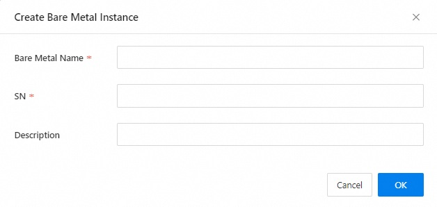

6. Find the bare metal instance that you created and click **Connect to VPC** in the **Actions** column. In the Connect to VPC dialog box, configure the parameters that are described in the following table and click **OK**.

   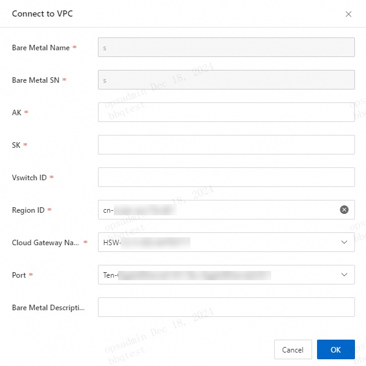

   <table>
     <tr>
       <th>Parameter</th>
       <th>Description</th>
     </tr>
     <tr>
       <td>Bare Metal Name</td>
       <td>The name of the bare metal instance. You do not need to configure this parameter.</td>
     </tr>
     <tr>
       <td>Bare Metal SN</td>
       <td>The serial number of the bare metal instance. You do not need to configure this parameter.</td>
     </tr>
     <tr>
       <td>AK</td>
       <td rowspan="2">The AccessKey ID and AccessKey secret of the organization, which can be obtained from the <strong>Organizations</strong> page of the Apsara Uni-manager Management Console based on the organization to which the VPC belongs. For more information, see <strong>Manage the AccessKey pairs of</strong> <strong>an organization</strong> in Apsara Uni-manager Management Console User Guide.</td>
     </tr>
     <tr>
       <td>SK</td>
     </tr>
     <tr>
       <td>Vswitch ID</td>
       <td>The ID of the dedicated vSwitch to which the bare metal instance is connected.</td>
     </tr>
     <tr>
       <td>Region ID</td>
       <td>The ID of the region in which the environment resides.</td>
     </tr>
     <tr>
       <td>Cloud Gateway Name</td>
       <td>The name of the CGW instance to which the bare metal instance is connected.</td>
     </tr>
     <tr>
       <td>Port</td>
       <td>The port of the CGW instance to which the bare metal instance is connected.</td>
     </tr>
     <tr>
       <td>Bare Metal Description</td>
       <td>The description of the bare metal instance.</td>
     </tr>
   </table>

**View the network information about a bare metal instance in a VPC**

1. On the **Bare Metal Network Management** tab, click **Advanced Filter** and filter bare metal instances by specifying the following conditions: **Start and End Time**, **Bare Metal Name**, **VPC ID**, **Vswitch ID**, **VBR ID**, **BD ID**, and **Cloud Gateway Name**.

2. View the network information about the bare metal instance that meets the filter conditions.

   | Parameter | Description |
   | --- | --- |
   | Bare Metal Name | The name of the bare metal instance. |
   | SN | The serial number of the bare metal instance. |
   | VPC ID | The ID of the VPC to which the bare metal instance belongs. |
   | Vswitch ID | The ID of the dedicated vSwitch to which the bare metal instance is connected. |
   | Cloud Gateway Name | The name of the CGW instance to which the bare metal instance is connected. |
   | Port | The port of the CGW instance to which the bare metal instance is connected. |
   | VBR ID | The VBR ID of the Express Connect circuit created on the HSW by the VPC to which the bare metal instance belongs. |
   | BD ID | The value of the hardware bridge-domain (BD) to which the bare metal instance is added. |
   | Created At | The time when the bare metal network was created. |
   | Bare Metal IP Address | The IP address of the bare metal instance. Click <strong>Manage</strong> in the Bare Metal IP Address column to assign an IP address to the bare metal instance. This helps you configure the network of bare metal instances. For more information, see the Manage the IP address of a bare metal instance section of this topic. |

3. Find the bare metal instance and click **Details** in the **Actions** column to view the details of the bare metal instance, such as the ID of the Express Connect circuit, VPC router interface, and VBR interface.

   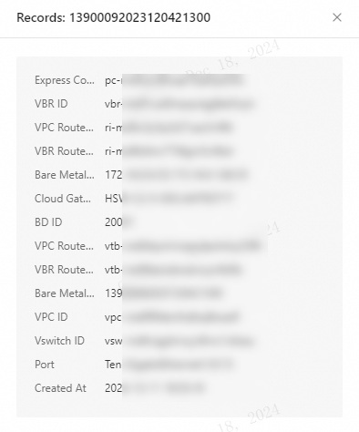

**Disconnect a bare metal instance from a VPC**

After a bare metal instance is disconnected from a VPC, access isolation of resources can be implemented.

**Procedure**

Find the bare metal instance and click **Close the Connection to VPC** or **Delete Instance** in the Actions column.

- Click **Close the Connection to VPC** in the **Actions** column to disconnect the bare metal instance from the VPC.

  > **Note**
  >
  > The Close the Connection to VPC option appears only after the bare metal instance is connected to a VPC.

- Click **Delete Instance** in the Actions column to disconnect the bare metal instance from the VPC and delete the bare metal instance.

  > **Note**
  >
  > The Delete Instance option appears only for bare metal instances created on the Bare Metal Network Management page.

**Manage the IP address of a bare metal instance**

In the Bare Metal IP Address Management panel, you can assign an IP address to a bare metal instance. This helps you configure the network of bare metal instances.

**Background information**

CGW works with Bare-metal Management Service (BMS). BMS is used to install bare metal instances, assign IP addresses, and complete network configurations. CGW is used to connect bare metal instances to VPCs.

In some scenarios, you may not install bare metal instances or complete network configurations by using BMS, but you must use CGW to connect bare metal instances to VPCs. In such scenarios, the system cannot assign IP addresses to bare metal instances, and you must manually maintain IP address assignment results. This may cause IP address conflicts and poor usability. Therefore, network management of bare metal instances is supported on the Cloud Gateway page. You can manage IP addresses of bare metal instances in the Bare Metal IP Address Management panel.

**Prerequisites**

A bare metal instance is connected to a VPC.

**Procedure**

1. Find the bare metal instance and click **Manage** in the **Bare Metal IP Address** column.

2. In the **Bare Metal IP Address Management** panel, click **Apply for Bare Metal IP Address**.

3. In the **Apply for Bare Metal IP Address** dialog box, configure the **Bare Metal NIC**, **IP**, and **IP Address Description** parameters and click **OK**.

   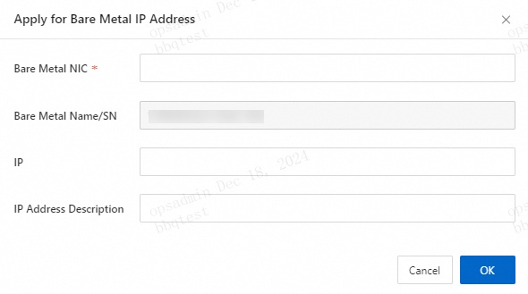

   > **Note**
   >
   > If you do not specify the IP parameter, an IP address is automatically generated.

4. After you apply for an IP address for a bare metal instance, view the IP address in the **Bare Metal IP Address Management** panel.

   - Find the IP address of the bare metal instance and click **Edit** to change the IP address.

   - Find the IP address of the bare metal instance and click **Release** to release the IP address.

**O&M configurations**

**Apply for a bare metal instance in a VPC**

In O&M emergency scenarios, you can use this feature to add the physical port of the CGW instance associated with a bare metal instance to the VPC.

> **Warning**
>
> - This operation is only for emergency scenarios and must be performed under the guidance of R&D engineers. Otherwise, normal business operations may be affected.
>
> - This feature can only be used to connect the bare metal instance to the CGW instance port but cannot be used to perform operations on the bare metal instance. To configure the network port, IP address, and routing information of the bare metal instance, contact the corresponding product team for guidance.
>
> - Typically, you cannot use this feature to apply for a bare metal instance in the VPC. You can use the bare metal controller to call an API operation to enable the bare metal network.

**Procedure**

1. Log on to the Apsara Uni-manager Operations Console.

2. In the top navigation bar, choose **Product Operation** > **Networking** > **Network Operations Console**.

3. In the left-side navigation pane, choose **Basic Network** > **Cloud Gateways**.

4. On the Cloud Gateway page, click the **O&M Settings** tab.

5. Select **Apply for Bare Metal in VPC** from the drop-down list in the upper-left corner of the tab.

   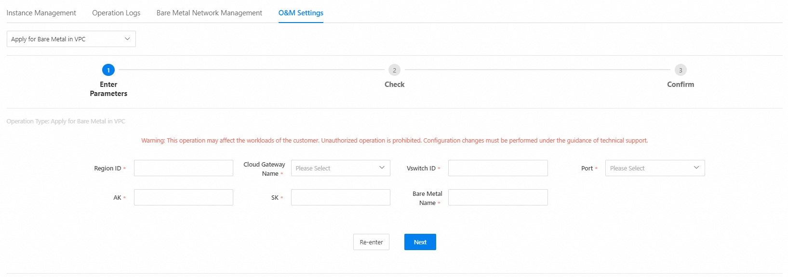

6. Configure the parameters that are described in the following table.

   <table>
     <tr>
       <th>Parameter</th>
       <th>Description</th>
     </tr>
     <tr>
       <td>Region ID</td>
       <td>The ID of the region in which the environment resides.</td>
     </tr>
     <tr>
       <td>Cloud Gateway Name</td>
       <td>The name of the CGW instance to which the bare metal instance is connected.</td>
     </tr>
     <tr>
       <td>Vswitch ID</td>
       <td>The ID of the vSwitch to which the bare metal instance is to be added. You can obtain the vSwitch ID from the VPC console of the Apsara Uni-manager Management Console.</td>
     </tr>
     <tr>
       <td>Port</td>
       <td>The port of the CGW instance to which the bare metal instance is connected.</td>
     </tr>
     <tr>
       <td>AK</td>
       <td rowspan="2">The AccessKey ID and AccessKey secret of the organization, which can be obtained from the <strong>Organizations</strong> page of the Apsara Uni-manager Management Console based on the organization to which the VPC belongs.<br>For more information, see <strong>Manage the AccessKey pairs of an</strong> <strong>organization</strong> in Apsara Uni-manager Management Console User Guide.</td>
     </tr>
     <tr>
       <td>SK</td>
     </tr>
     <tr>
       <td>Bare Metal Name</td>
       <td>The name of the bare metal instance that you want to apply for. The name must be unique.</td>
     </tr>
   </table>

   > **Note**
   >
   > If the specified values are invalid, click **Re-enter** in the lower part of the tab and configure the parameters again.

7. Click **Next**.

8. Check the information. If the information is correct, click **Confirm**.

   After the configurations are delivered, the **Result: Successful** message appears, and you can search for the bare metal instance by bare metal instance name on the **Bare Metal Network Management** tab. If the bare metal instance is displayed, it is connected to the VPC.

**Release a bare metal instance in a VPC**

In O&M emergency scenarios, you can use this feature to disconnect the physical port of the CGW instance associated with a bare metal instance from the VPC.

> **Warning**
>
> - This operation is only for emergency scenarios and must be performed under the guidance of R&D engineers. Otherwise, normal business operations may be affected.
>
> - This feature can only be used to connect the bare metal instance to the CGW instance port but cannot be used to perform operations on the bare metal instance. To configure the network port, IP address, and routing information of the bare metal instance, contact the corresponding product team for guidance.
>
> - Typically, you cannot use this feature to release a bare metal instance in the VPC. You can use the bare metal controller to call an API operation to delete the bare metal network.

**Procedure**

1. Log on to the Apsara Uni-manager Operations Console.

2. In the top navigation bar, choose **Product Operation** > **Networking** > **Network Operations Console**.

3. In the left-side navigation pane, choose **Basic Network** > **Cloud Gateways**.

4. On the Cloud Gateway page, click the **O&M Settings** tab.

5. Select **Release Bare Metal in VPC** from the drop-down list in the upper-left corner of the tab.

   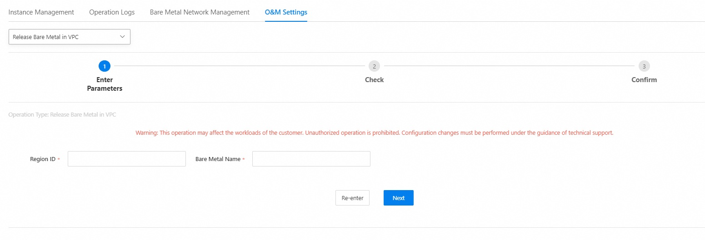

6. Configure the parameters that are described in the following table.

   | Parameter | Description |
   | --- | --- |
   | Region ID | The ID of the region in which the environment resides. |
   | Bare Metal Name | The name of the bare metal instance that you want to release.<br>You can obtain the name of the bare metal instance on the <strong>Bare</strong> <strong>Metal Network Management</strong> tab. |

   > **Note**
   >
   > If the specified values are invalid, click **Re-enter** in the lower part of the tab and configure the parameters again.

7. Click **Next**.

8. Check the information. If the information is correct, click **Confirm**.

   After the configurations are delivered, the **Result: Successful** message appears, and you can search for the bare metal instance by bare metal instance name on the **Bare Metal Network Management** tab. If the bare metal instance is not displayed, it is released in the VPC.

**Delete a route entry**

In O&M emergency scenarios, you can use this feature to delete route entries that point to the bare metal subnet in the VPC and the default route entries of a VBR.

> **Warning**
>
> - This operation is only for emergency scenarios and must be performed under the guidance of R&D engineers. Otherwise, normal business operations may be affected.
>
> - Typically, you cannot use this feature to delete a VPC route entry. This operation is only for emergency scenarios.
>
> - You can perform this operation to delete only one route entry at a time. To delete multiple route entries, you must perform this operation multiple times.

**Procedure**

1. Log on to the Apsara Uni-manager Operations Console.

2. In the top navigation bar, choose **Product Operation** > **Networking** > **Network Operations Console**.

3. In the left-side navigation pane, choose **Basic Network** > **Cloud Gateways**.

4. On the Cloud Gateway page, click the **O&M Settings** tab.

5. Select **Delete Route Table Entry** from the drop-down list in the upper-left corner of the tab.

   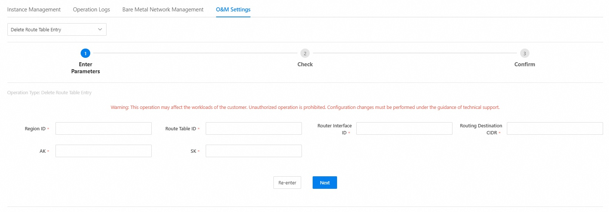

6. Configure the parameters that are described in the following table.

   <table>
     <tr>
       <th>Parameter</th>
       <th>Description about deleting a VPC route entry</th>
       <th>Description about deleting a VBR route entry</th>
     </tr>
     <tr>
       <td>Region ID</td>
       <td>The ID of the region in which the environment resides.</td>
       <td>The ID of the region in which the environment resides.</td>
     </tr>
     <tr>
       <td>Route Table ID</td>
       <td>The ID of the VPC route table, which can be obtained from the VPC console. For more information about how to obtain the ID of a VPC route table, see <strong>VPC</strong> <strong>User Guide</strong>.</td>
       <td>The ID of the VBR route table.<br>If the bare metal instance involved with the VBR is connected to a VPC, you can search for the bare metal instance by bare metal instance name on the <strong>Bare</strong> <strong>Metal Network Management</strong> tab, and then click Details in the Actions column. The value of the VBR Route Table ID parameter in the details is the value of this parameter.<br>If the bare metal instance involved with the VBR fails to be connected to a VPC, specify the name and creation time of the bare metal instance to search for the operation logs and find an operation log whose <strong>API Operation</strong> is <strong>add</strong> on the <strong>Operation Logs</strong> tab. Click <strong>Details</strong> in the Actions column. The value of the VBR Route Table ID parameter in the details is the value of this parameter.</td>
     </tr>
     <tr>
       <td>Router Interface ID</td>
       <td>The ID of the VPC router interface, which can be obtained from the VPC console. For more information about how to obtain the ID of a VPC router interface, see <strong>VPC User Guide</strong>.</td>
       <td>The ID of the VBR interface.<br>If the bare metal instance involved with the VBR is connected to a VPC, you can search for the bare metal instance by bare metal instance name on the <strong>Bare</strong> <strong>Metal Network Management</strong> tab, and then click Details in the Actions column. The value of the VBR Router Interface parameter in the details is the value of this parameter.<br>If the bare metal instance involved with the VBR fails to be connected to a VPC, specify the name and creation time of the bare metal instance to search for the operation logs and find an operation log whose <strong>API Operation</strong> is <strong>add</strong> on the <strong>Operation Logs</strong> tab. Click Details in the Actions column. The value of the VBR Router Interface parameter in the details is the value of this parameter.</td>
     </tr>
     <tr>
       <td>Routing Destinatio n CIDR</td>
       <td>The destination CIDR block to which the VPC points, which can be obtained from the VPC console. For more information about how to obtain a destination CIDR block, see <strong>VPC User Guide</strong>.</td>
       <td>Set the value to 0.0.0.0/0.</td>
     </tr>
     <tr>
       <td>AK</td>
       <td rowspan="2">The AccessKey ID and AccessKey secret of the organization, which can be obtained from the <strong>Organizations</strong> page of the Apsara Uni-manager Management Console based on the organization to which the VPC belongs.For more information, see <strong>Manage the</strong> AccessKey pairs of an organization in Apsara Uni-manager Management Console User Guide.</td>
       <td rowspan="2">The AccessKey ID and AccessKey secret of the organization, which can be obtained from the <strong>Organizations</strong> page of the Apsara Uni-manager Management Console based on the organization to which the VBR belongs. For more information, see <strong>Manage the</strong> AccessKey pairs of an organization in Apsara Uni-manager Management Console User Guide.</td>
     </tr>
     <tr>
       <td>SK</td>
     </tr>
   </table>

   > **Note**
   >
   > If the specified values are invalid, click **Re-enter** in the lower part of the tab and configure the parameters again.

7. Click **Next**.

8. Check the information. If the information is correct, click **Confirm**.

   The system begins to deliver the configurations. After the configurations are delivered, the **Result: Successful** message appears.

9. Optional. In actual fault scenarios, if multiple route entries exist in the route table, repeat Step 5 to Step 8 to delete other route entries.

**Delete a router interface**

In O&M emergency scenarios, you can use this feature to delete a VPC router interface and a VBR interface.

> **Warning**
>
> This operation is only for emergency scenarios and must be performed under the guidance of R&D engineers. Otherwise, normal business operations may be affected.

**Procedure**

1. Log on to the Apsara Uni-manager Operations Console.

2. In the top navigation bar, choose **Product Operation** > **Networking** > **Network Operations Console**.

3. In the left-side navigation pane, choose **Basic Network** > **Cloud Gateways**.

4. On the Cloud Gateway page, click the **O&M Settings** tab.

5. Select **Delete Router Interface** from the drop-down list in the upper-left corner of the tab.

   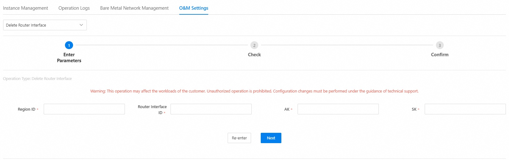

6. Configure the parameters that are described in the following table.

   <table>
     <tr>
       <th>Parameter</th>
       <th>Description about deleting a VPC router interface</th>
       <th>Description about deleting a VBR interface</th>
     </tr>
     <tr>
       <td>Region ID</td>
       <td>The ID of the region in which the environment resides.</td>
       <td>The ID of the region in which the environment resides.</td>
     </tr>
     <tr>
       <td>Router Interface ID</td>
       <td>The ID of the VPC router interface. On the <strong>Operation Logs</strong> tab, specify the name and creation time of the bare metal instance to search for the operation logs and find an operation log whose <strong>API Operation</strong> is <strong>add</strong>.Click Details in the Actions column.The value of the <strong>VPC Router</strong> <strong>Interface</strong> parameter in the details is the value of this parameter.</td>
       <td>The ID of the VBR interface.<br>If the bare metal instance involved with the VBR is connected to a VPC, you can search for the bare metal instance by bare metal instance name on the <strong>Bare</strong> <strong>Metal Network Management</strong> tab, and then click Details in the Actions column.The value of the VBR Router Interface parameter in the details is the value of this parameter.<br>If the bare metal instance involved with the VBR fails to be connected to a VPC, specify the name and creation time of the bare metal instance to search for the operation logs and find an operation log whose <strong>API Operation</strong> is <strong>add</strong> on the <strong>Operation Logs</strong> tab. Click Details in the Actions column. The value of the VBR Router Interface parameter in the details is the value of this parameter.</td>
     </tr>
     <tr>
       <td>AK</td>
       <td rowspan="2">The AccessKey ID and AccessKey secret of the organization, which can be obtained from the <strong>Organizations</strong> page of the Apsara Uni-manager Management Console based on the organization to which the VPC belongs. For more information, see Manage the AccessKey pairs of <strong>an organization</strong> in Apsara Uni-manager Management Console User Guide.</td>
       <td rowspan="2">The AccessKey ID and AccessKey secret of the organization, which can be obtained from the <strong>Organizations</strong> page of the Apsara Uni-manager Management Console based on the organization to which the VBR belongs. For more information, see <strong>Manage the</strong> AccessKey pairs of an organization in Apsara Uni-manager Management Console User Guide.</td>
     </tr>
     <tr>
       <td>SK</td>
     </tr>
   </table>

   > **Note**
   >
   > If the specified values are invalid, click **Re-enter** in the lower part of the tab and configure the parameters again.

7. Click **Next**.

8. Check the information. If the information is correct, click **Confirm**.

   The system begins to deliver the configurations. After the configurations are delivered, the **Result: Successful** message appears.

   After the configurations are delivered, you can choose **Product Operation** > **Networking** > **Network Intelligence** in the navigation bar of the Apsara Uni-manager Operations Console. On the homepage of Apsara Network Intelligence, enter the ID of the router interface to search for the router interface. If no search result appears, the router interface is deleted.

**Delete a VBR**

In O&M emergency scenarios, you can use this feature to delete a VBR.

> **Warning**
>
> This operation is only for emergency scenarios and must be performed under the guidance of R&D engineers. Otherwise, normal business operations may be affected.

**Procedure**

1. Log on to the Apsara Uni-manager Operations Console.

2. In the top navigation bar, choose **Product Operation** > **Networking** > **Network Operations Console**.

3. In the left-side navigation pane, choose **Basic Network** > **Cloud Gateways**.

4. On the Cloud Gateway page, click the **O&M Settings** tab.

5. Select **Delete VBR** from the drop-down list in the upper-left corner of the tab.

   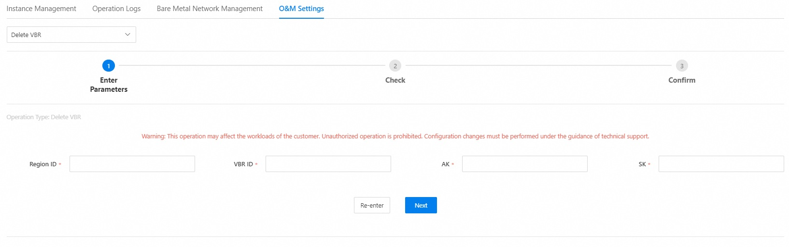

6. Configure the parameters that are described in the following table.

   <table>
     <tr>
       <th>Parameter</th>
       <th>Description</th>
     </tr>
     <tr>
       <td>Region ID</td>
       <td>The ID of the region in which the environment resides.</td>
     </tr>
     <tr>
       <td>VBR ID</td>
       <td>The ID of the VBR that you want to delete. On the <strong>Operation Logs</strong> tab, specify the name and creation time of the bare metal instance to search for the operation logs and find an operation log whose <strong>API Operation</strong> is <strong>add</strong>. Click Details in the Actions column. The value of the VBR ID parameter in the details is the value of this parameter.</td>
     </tr>
     <tr>
       <td>AK</td>
       <td rowspan="2">The AccessKey ID and AccessKey secret of the organization, which can be obtained from the <strong>Organizations</strong> page of the Apsara Uni-manager Management Console based on the organization to which the VBR belongs. For more information, see <strong>Manage the AccessKey pairs of</strong> <strong>an organization</strong> in Apsara Uni-manager Management Console User Guide.</td>
     </tr>
     <tr>
       <td>SK</td>
     </tr>
   </table>

   > **Note**
   >
   > If the specified values are invalid, click **Re-enter** in the lower part of the tab and configure the parameters again.

7. Click **Next**.

8. Check the information. If the information is correct, click **Confirm**.

   The system begins to deliver the configurations. After the configurations are delivered, the **Result: Successful** message appears.

   After the configurations are delivered, you can choose **Product Operation** > **Networking** > **Network Intelligence** in the navigation bar of the Apsara Uni-manager Operations Console. On the homepage of Apsara Network Intelligence, enter the ID of the VBR to search for the VBR. If no search result appears, the VBR is deleted.

**Delete an Express Connect circuit**

In O&M emergency scenarios, you can use this feature to delete an Express Connect circuit.

> **Warning**
>
> This operation is only for emergency scenarios and must be performed under the guidance of R&D engineers. Otherwise, normal business operations may be affected.

**Procedure**

1. Log on to the Apsara Uni-manager Operations Console.

2. In the top navigation bar, choose **Product Operation** > **Networking** > **Network Operations Console**.

3. In the left-side navigation pane, choose **Basic Network** > **Cloud Gateways**.

4. On the Cloud Gateway page, click the **O&M Settings** tab.

5. Select **Delete Express Connect Circuit** from the drop-down list in the upper-left corner of the tab.

   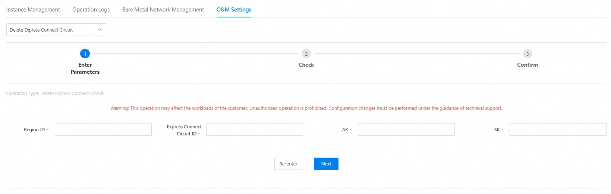

6. Configure the parameters that are described in the following table.

   <table>
     <tr>
       <th>Parameter</th>
       <th>Description</th>
     </tr>
     <tr>
       <td>Region ID</td>
       <td>The ID of the region in which the environment resides.</td>
     </tr>
     <tr>
       <td>Express Connect Circuit ID</td>
       <td>The ID of the Express Connect circuit that you want to delete. On the <strong>Operation Logs</strong> tab, specify the name and creation time of the bare metal instance to search for the operation logs and find an operation log whose <strong>API Operation</strong> is <strong>add</strong>. Click <strong>Details</strong> in the Actions column. The value of the Express Connect Circuit ID parameter in the details is the value of this parameter.</td>
     </tr>
     <tr>
       <td>AK</td>
       <td rowspan="2">The AccessKey ID and AccessKey secret of the organization, which can be obtained from the <strong>Organizations</strong> page of the Apsara Uni-manager Management Console based on the organization to which the VBR belongs. For more information, see <strong>Manage the AccessKey pairs of</strong> <strong>an organization</strong> in Apsara Uni-manager Management Console User Guide.</td>
     </tr>
     <tr>
       <td>SK</td>
     </tr>
   </table>

   > **Note**
   >
   > If the specified values are invalid, click **Re-enter** in the lower part of the tab and configure the parameters again.

7. Click **Next**.

8. Check the information. If the information is correct, click **Confirm**.

   The system begins to deliver the configurations. After the configurations are delivered, the **Result: Successful** message appears.

   After the configurations are delivered, you can choose **Product Operation** > **Networking** > **Network Intelligence** in the navigation bar of the Apsara Uni-manager Operations Console. On the homepage of Apsara Network Intelligence, enter the ID of the Express Connect circuit to search for the Express Connect circuit. If no search result appears, the Express Connect circuit is deleted.

**Delete all resources**

In O&M emergency scenarios, you can use this feature to delete all resources, including VPC route entries, VBR route entries, VPC router interfaces, VBR interfaces, VBRs, and Express Connect circuits.

> **Warning**
>
> This operation is only for emergency scenarios and must be performed under the guidance of R&D engineers. Otherwise, normal business operations may be affected.

**Procedure**

1. Log on to the Apsara Uni-manager Operations Console.

2. In the top navigation bar, choose **Product Operation** > **Networking** > **Network Operations Console**.

3. In the left-side navigation pane, choose **Basic Network** > **Cloud Gateways**.

4. On the Cloud Gateway page, click the **O&M Settings** tab.

5. Select **Delete ALL Resources** from the drop-down list in the upper-left corner of the tab.

   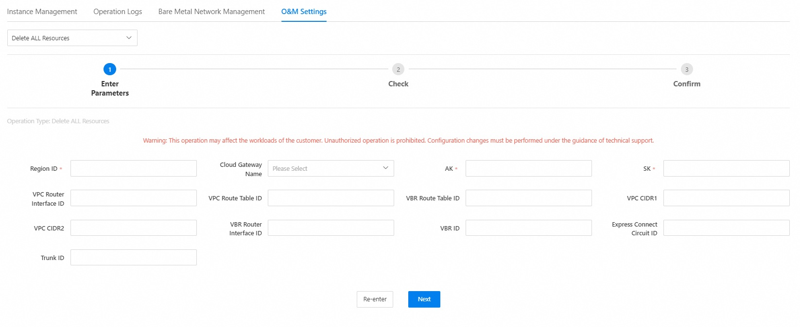

6. Configure the parameters that are described in the following table.

   <table>
     <tr>
       <th>Parameter</th>
       <th>Description</th>
     </tr>
     <tr>
       <td>Region ID</td>
       <td>The ID of the region in which the environment resides.</td>
     </tr>
     <tr>
       <td>Cloud Gateway Name</td>
       <td>The name of the CGW instance to which the bare metal instance is connected.</td>
     </tr>
     <tr>
       <td>AK</td>
       <td rowspan="2">The AccessKey ID and AccessKey secret of the organization, which can be obtained from the <strong>Organizations</strong> page of the Apsara Uni-manager Management Console based on the organization to which the VBR belongs. For more information, see <strong>Manage the AccessKey pairs of</strong> <strong>an organization</strong> in Apsara Uni-manager Management Console User Guide.</td>
     </tr>
     <tr>
       <td>SK</td>
     </tr>
     <tr>
       <td>VPC Router Interface ID</td>
       <td>The ID of the VPC router interface, which can be obtained from the VPC console. For more information about how to obtain the ID of a VPC router interface, see <strong>VPC User Guide</strong>.</td>
     </tr>
     <tr>
       <td>VPC Route Table ID</td>
       <td>The ID of the VPC route table, which can be obtained from the VPC console. For more information about how to obtain the ID of a VPC route table, see <strong>VPC User Guide</strong>.</td>
     </tr>
     <tr>
       <td>VBR Route Table ID</td>
       <td>The ID of the VBR route table.<br>If the bare metal instance involved with the VBR is connected to a VPC, you can search for the bare metal instance by bare metal instance name on the <strong>Bare Metal Network Management</strong> tab, and then click Details in the Actions column. The value of the <strong>VBR Route</strong> <strong>Table ID</strong> parameter in the details is the value of this parameter.<br>If the bare metal instance involved with the VBR fails to be connected to a VPC, specify the name and creation time of the bare metal instance to search for the operation logs and find an operation log whose <strong>API Operation</strong> is <strong>add</strong> on the <strong>Operation Logs</strong> tab. Click <strong>Details</strong> in the Actions column. The value of the VBR Route Table ID parameter in the details is the value of this parameter.</td>
     </tr>
     <tr>
       <td>VPC CIDR1</td>
       <td>The destination CIDR block 1 to which the VPC points, which can be obtained from the VPC console. For more information about how to obtain a destination CIDR block, see <strong>VPC User Guide</strong>.</td>
     </tr>
     <tr>
       <td>VPC CIDR2</td>
       <td>The destination CIDR block 2 to which the VPC points, which can be obtained from the VPC console. For more information about how to obtain a destination CIDR block, see <strong>VPC User Guide</strong>.</td>
     </tr>
     <tr>
       <td>VBR Router Interface ID</td>
       <td>The ID of the VBR interface.<br>If the bare metal instance involved with the VBR is connected to a VPC, you can search for the bare metal instance by bare metal instance name on the <strong>Bare Metal Network Management</strong> tab, and then click Details in the Actions column. The value of the <strong>VBR Router</strong> <strong>Interface</strong> parameter in the details is the value of this parameter.<br>If the bare metal instance involved with the VBR fails to be connected to a VPC, specify the name and creation time of the bare metal instance to search for the operation logs and find an operation log whose <strong>API Operation</strong> is <strong>add</strong> on the <strong>Operation Logs</strong> tab. Click Details in the Actions column. The value of the <strong>VBR Router Interface</strong> in the details is the value of this parameter.</td>
     </tr>
     <tr>
       <td>VBR ID</td>
       <td>The ID of the VBR that you want to delete. On the <strong>Operation Logs</strong> tab, specify the name and creation time of the bare metal instance to search for the operation logs and find an operation log whose <strong>API</strong> <strong>Operation</strong> is <strong>add</strong>. Click Details in the Actions column. The value of the <strong>VBR ID</strong> parameter in the details is the value of this parameter.</td>
     </tr>
     <tr>
       <td>Express Connect Circuit ID</td>
       <td>The ID of the Express Connect circuit that you want to delete. On the <strong>Operation Logs</strong> tab, specify the name and creation time of the bare metal instance to search for the operation logs and find an operation log whose <strong>API Operation</strong> is <strong>add</strong>. Click Details in the Actions column.The value of the <strong>Express Connect Circuit ID</strong> parameter in the details is the value of this parameter.</td>
     </tr>
     <tr>
       <td>Trunk ID</td>
       <td>You do not need to specify this parameter.</td>
     </tr>
   </table>

   > **Note**
   >
   > If the specified values are invalid, click **Re-enter** in the lower part of the tab and configure the parameters again.

7. Click **Next**.

8. Check the information. If the information is correct, click **Confirm**.

   The system begins to deliver the configurations. After the configurations are delivered, the **Result: Successful** message appears.

**View the bandwidth of an Express Connect circuit**

You can view the bandwidth of the Express Connect circuit to which a router interface corresponds based on your O&M requirements when a CGW instance is connected to a VPC in the system.

**Procedure**

1. Log on to the Apsara Uni-manager Operations Console.

2. In the top navigation bar, choose **Product Operation** > **Networking** > **Network Operations Console**.

3. In the left-side navigation pane, choose **Basic Network** > **Cloud Gateways**.

4. On the Cloud Gateway page, click the **O&M Settings** tab.

5. Select **View Express Connect Circuit Bandwidth** from the drop-down list in the upper-left corner of the tab.

6. Configure the parameters that are described in the following table and click **Query**. The system displays the bandwidth of the Express Connect circuit that meets the filter conditions.

   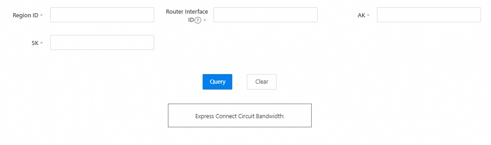

   <table>
     <tr>
       <th>Parameter</th>
       <th>Description</th>
     </tr>
     <tr>
       <td>Region ID</td>
       <td>The ID of the region in which the environment resides.</td>
     </tr>
     <tr>
       <td>Router Interface ID</td>
       <td>The ID of the VBR interface. On the <strong>Bare Metal Network Management</strong> tab, specify a VPC ID and CGW instance name. Click <strong>Details</strong> in the Actions column. The value of the VBR Router Interface parameter in the details is the value of this parameter.</td>
     </tr>
     <tr>
       <td>AK</td>
       <td rowspan="2">The AccessKey ID and AccessKey secret of the organization, which can be obtained from the <strong>Organizations</strong> page of the Apsara Uni-manager Management Console based on the organization to which the VBR belongs.For more information, see <strong>Manage the AccessKey pairs of an</strong> <strong>organization</strong> in Apsara Uni-manager Management Console User Guide.</td>
     </tr>
     <tr>
       <td>SK</td>
     </tr>
   </table>

7. View the table on the left and obtain the bandwidth in units of bit/s based on the specifications. The bandwidth information describes the specifications of the Express Connect circuit bandwidth on the HSW of the current VPC.

   | Specifications | Bandwidth (unit: bit/s) |
   | --- | --- |
   | Large.1 | 1G |
   | Large.2 | 2G |
   | Large.4 | 4G |
   | Large.5 | 5G |
   | Xlarge.1 | 10G |
   | Xlarge.2 | 20G |
   | Xlarge.4 | 40G |
   | Xlarge.5 | 50G |
   | Xlarge.8 | 80G |
   | Xlarge.10 | 100G |
   | Xlarge.16 | 160G |
   | Xlarge.20 | 200G |
   | Xlarge.50 | 500G |
   | Xlarge.320 | 3200G |

**Change the bandwidth of an Express Connect circuit**

In O&M emergency scenarios, you can use this feature to change the bandwidth of an Express Connect circuit.

> **Warning**
>
> This operation may affect your business. Unauthorized operations are prohibited. Configuration changes must be performed under the guidance of technical support.

**Procedure**

1. Log on to the Apsara Uni-manager Operations Console.

2. In the top navigation bar, choose **Product Operation** > **Networking** > **Network Operations Console**.

3. In the left-side navigation pane, choose **Basic Network** > **Cloud Gateways**.

4. On the Cloud Gateway page, click the **O&M Settings** tab.

5. Select **Change Express Connect Circuit Bandwidth** from the drop-down list in the upper-left corner of the tab.

   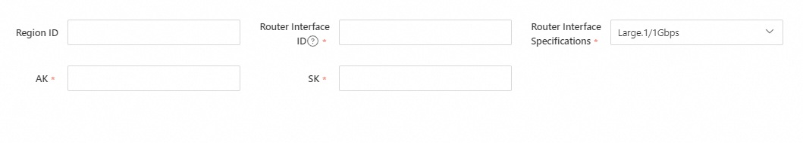

6. Configure the parameters that are described in the following table and click **Next**.

   <table>
     <tr>
       <th>Parameter</th>
       <th>Description</th>
     </tr>
     <tr>
       <td>Region ID</td>
       <td>The ID of the region in which the environment resides.</td>
     </tr>
     <tr>
       <td>Router Interface ID</td>
       <td>The ID of the VBR interface. On the <strong>Bare Metal Network Management</strong> tab, specify a VPC ID and CGW instance name. Click <strong>Details</strong> in the Actions column. The value of the VBR Router Interface parameter in the details is the value of this parameter.</td>
     </tr>
     <tr>
       <td>Router Interface Specifications</td>
       <td>The specifications of the Express Connect circuit bandwidth.</td>
     </tr>
     <tr>
       <td>AK</td>
       <td rowspan="2">The AccessKey ID and AccessKey secret of the organization, which can be obtained from the <strong>Organizations</strong> page of the Apsara Uni-manager Management Console based on the organization to which the VBR belongs.For more information, see <strong>Manage the AccessKey pairs of an</strong> <strong>organization</strong> in Apsara Uni-manager Management Console User Guide.</td>
     </tr>
     <tr>
       <td>SK</td>
     </tr>
   </table>

7. Check whether the parameter configurations are valid.

   - If yes, click **Confirm**. After the configurations are delivered, check whether the bandwidth of the Express Connect circuit is changed by referring to the View the bandwidth of an Express Connect circuit section of this topic.

   - If not, click **Back to Modify** to configure the parameters again.

**View trunk usage**

You can view trunk usage to obtain up-to-date information about the usage of hardware ports in a timely manner.

**Procedure**

1. Log on to the Apsara Uni-manager Operations Console.

2. In the top navigation bar, choose **Product Operation** > **Networking** > **Network Operations Console**.

3. In the left-side navigation pane, choose **Basic Network** > **Cloud Gateways**.

4. On the Cloud Gateway page, click the **O&M Settings** tab.

5. Select **View Trunk Usage** from the drop-down list in the upper-left corner of the tab.

6. Specify a trunk ID and CGW instance name, select a trunk state, and then click **Search** to view trunk usage. Valid values of the **Status** parameter are **Idle**, **Used**, **Creating**, and **Deleting**.

   > **Note**
   >
   > Specify the last integer of the value of the **Port** parameter that is obtained from the **Bare Metal Network Management** tab as a trunk ID. For example, if the value of the Port parameter is 10GE1/0/40, specify 40 as a trunk ID.

**View VPN usage of a bare metal instance**

You can view the VPN usage of a bare metal instance, and the VPN is assigned to a CGW instance.

**Procedure**

1. Log on to the Apsara Uni-manager Operations Console.

2. In the top navigation bar, choose **Product Operation** > **Networking** > **Network Operations Console**.

3. In the left-side navigation pane, choose **Basic Network** > **Cloud Gateways**.

4. On the Cloud Gateway page, click the **O&M Settings** tab.

5. Select **View BM VPN Usage** from the drop-down list in the upper-left corner of the tab.

6. Specify the name of a CGW instance, a Virtual Extensible Local Area Network (VXLAN) ID, and the VPN name of a bare metal instance, select a state, and then click **Search** to view the bare metal instance VPNs assigned to all the HSWs. Valid values of the **Status** parameter are **Succeeded** and **Creating**.

**View BD usage**

You can view BD usage to learn about the BD configuration distribution in a timely manner.

**Procedure**

1. Log on to the Apsara Uni-manager Operations Console.

2. In the top navigation bar, choose **Product Operation** > **Networking** > **Network Operations Console**.

3. In the left-side navigation pane, choose **Basic Network** > **Cloud Gateways**.

4. On the Cloud Gateway page, click the **O&M Settings** tab.

5. Select **View BD Usage** from the drop-down list in the upper-left corner of the tab.

6. Specify a CGW instance name, BD ID, and vSwitch ID, select a state, and then click **Search** to view BD usage. Valid values of the **Status** parameter are **Succeeded**, **Creating**, and **Deleting**.

**Check initialization configurations**

In O&M emergency scenarios, you can use this feature to check whether the initialization configurations of the HSW are successful.

> **Note**
>
> This feature only checks the initialization status of the platform access gateway vSwitch and whether the initialization configurations are successful. No operation is performed on the bare metal instance.

**Procedure**

1. Log on to the Apsara Uni-manager Operations Console.

2. In the top navigation bar, choose **Product Operation** > **Networking** > **Network Operations Console**.

3. In the left-side navigation pane, choose **Basic Network** > **Cloud Gateways**.

4. On the Cloud Gateway page, click the **O&M Settings** tab.

5. Select **Check the Initialization Configuration** from the drop-down list in the upper-left corner of the tab.

   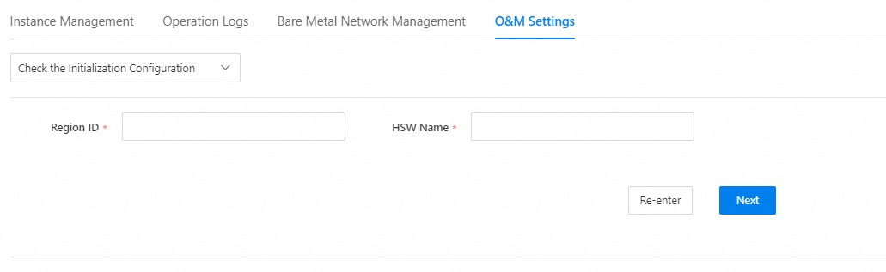

6. Configure the parameters that are described in the following table.

   | Parameter | Description |
   | --- | --- |
   | Region ID | The ID of the region in which the environment resides. |
   | HSW Name | The name of the vSwitch to be checked in instance management. |

   > **Note**
   >
   > If the specified values are invalid, click **Re-enter** in the lower part of the tab and configure the parameters again.

7. After you specify the parameters, click **Next** and click **Check** to check the initialization configurations of the vSwitch.

**Check route configurations**

In O&M emergency scenarios, you can use this feature to locate abnormal operations and check whether the route configurations of a bare metal instance are valid.

**Background information**

You can use this operation to locate the exception and scan the HSW after a bare metal instance fails to be added. This feature only checks whether the route configurations of the bare metal instance are valid. No operation is performed on the bare metal instance.

**Procedure**

1. Log on to the Apsara Uni-manager Operations Console.

2. In the top navigation bar, choose **Product Operation** > **Networking** > **Network Operations Console**.

3. In the left-side navigation pane, choose **Basic Network** > **Cloud Gateways**.

4. On the Cloud Gateway page, click the **O&M Settings** tab.

5. Select **Check the Route Configuration** from the drop-down list in the upper-left corner of the tab.

   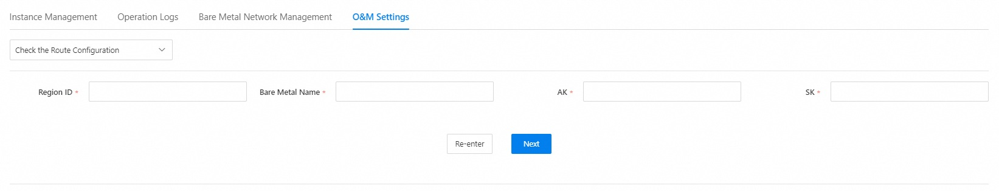

6. Configure the parameters that are described in the following table.

   <table>
     <tr>
       <th>Parameter</th>
       <th>Description</th>
     </tr>
     <tr>
       <td>Region ID</td>
       <td>The ID of the region in which the environment resides.</td>
     </tr>
     <tr>
       <td>Bare Metal Name</td>
       <td>The name of the bare metal instance that was applied for or released in a VPC. It uniquely identifies the bare metal instance within a region.</td>
     </tr>
     <tr>
       <td>AK</td>
       <td rowspan="2">The AccessKey ID and AccessKey secret of the organization, which can be obtained from the <strong>Organizations</strong> page of the Apsara Uni-manager Management Console based on the organization to which the VBR belongs.For more information, see <strong>Manage the AccessKey pairs of an</strong> <strong>organization</strong> in Apsara Uni-manager Management Console User Guide.</td>
     </tr>
     <tr>
       <td>SK</td>
     </tr>
   </table>

   > **Note**
   >
   > If the specified values are invalid, click **Re-enter** in the lower part of the tab and configure the parameters again.

7. After you specify the parameters, click **Next** and click **Check** to check the route configurations.

**Display the information about a bare metal network gateway**

In O&M emergency scenarios, you can use this feature to check the gateway of a vSwitch.

**Background information**

This operation is only for emergency scenarios in which the bare metal network is inaccessible. This operation is used to check the vSwitch gateway information and has no impact on the bare metal instance.

**Procedure**

1. Log on to the Apsara Uni-manager Operations Console.

2. In the top navigation bar, choose **Product Operation** > **Networking** > **Network Operations Console**.

3. In the left-side navigation pane, choose **Basic Network** > **Cloud Gateways**.

4. On the Cloud Gateway page, click the **O&M Settings** tab.

5. Select **Display the Information of Bare Metal Network Gateways** from the drop-down list in the upper-left corner of the tab.

   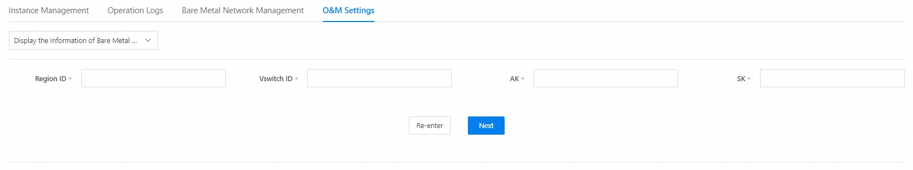

6. Configure the parameters that are described in the following table.

   <table>
     <tr>
       <th>Parameter</th>
       <th>Description</th>
     </tr>
     <tr>
       <td>Region ID</td>
       <td>The ID of the region in which the environment resides.</td>
     </tr>
     <tr>
       <td>Vswitch ID</td>
       <td>The ID of the vSwitch. You can obtain the vSwitch ID from the VPC console.</td>
     </tr>
     <tr>
       <td>AK</td>
       <td rowspan="2">The AccessKey ID and AccessKey secret of the organization, which can be obtained from the <strong>Organizations</strong> page of the Apsara Uni-manager Management Console based on the organization to which the VPC belongs.For more information, see <strong>Manage the AccessKey pairs of an</strong> <strong>organization</strong> in Apsara Uni-manager Management Console User Guide.</td>
     </tr>
     <tr>
       <td>SK</td>
     </tr>
   </table>

   > **Note**
   >
   > If the specified values are invalid, click **Re-enter** in the lower part of the tab and configure the parameters again.

7. After you configure the parameters, click **Next** and click **Check** to check the information about the bare metal network gateway.

<a id="section-2-4"></a>

## 2.4. Computing access gateways

You can use computing access gateways such as dedicated computing host switches (CHSWs) to connect intelligent computing servers to virtual private clouds (VPCs). This helps implement the centralized management of intelligent computing servers. The system supports operations such as instance management, operation log management, VPC management and Express Connect circuit management of bare metal instances, and O&M configurations to complete routine O&M operations on computing access gateways.

> **Note**
>
> By default, the Computing Access Gateway module is not displayed in the left-side navigation pane. To use this module, click **User Authorities** in the top navigation bar of the Apsara Uni-manager Operations Console. In the left-side navigation pane of the page that appears, click **Menu Management**. On the Menus page, find Computing Access Gateway and click Modify in the Actions column. In the Modify Menu panel, turn on **Show**.

**Manage access gateways**

On the Instance Management tab, you can view information about computing access gateways, such as the computing access gateway name, internal Border Gateway Protocol (IBGP) role, and creation time.

**Display devices**

1. Log in to the Apsara Uni-manager Operations Console.

2. In the top navigation bar, choose **Product Operation > Networking > Network Operations Console**.

3. In the left-side navigation pane, choose **Basic Network > Computing Access Gateway**.

4. On the **Computing Access Gateway** page, click the **Instance Management** tab.

5. On the **Display Devices** tab, view the information about computing access gateways.

   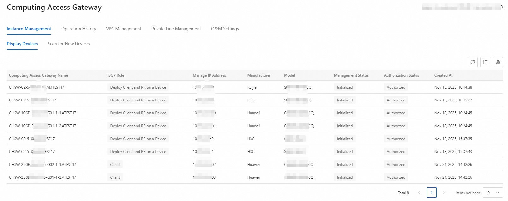

   | Parameter | Description |
   | --- | --- |
   | Computing Access Gateway Name | The name of the computing access gateway. |
   | IBGP Role | The role of the computing access gateway in the environment. |
   | Manage IP Address | The IP address of the computing access gateway. |
   | Manufacturer | The manufacturer of the computing access gateway. |
   | Model | The model of the computing access gateway. |
   | Management Status | The initialization status of the computing access gateway.<br>• Uninitialized<br>• Initializing<br>• Initialized |
   | Authorization Status | The authorization status of the computing access gateway.<br>• Unauthorized<br>• Authorized<br>Note<br>To use computing access gateways, you must plan the number of computing access gateway licenses in Deployment Planner. If the number of computing access gateway licenses in Deployment Planner is less than the number of computing access gateways in use, the computing access gateways without license authorization are in the Unauthorized state. In this case, you need to increase the number of computing access gateway licenses. |
   | Created At | The time when the computing access gateway was created. |

**Scan for new devices**

1. Log in to the Apsara Uni-manager Operations Console.

2. In the top navigation bar, choose **Product Operation > Networking > Network Operations Console**.

3. In the left-side navigation pane, choose **Basic Network > Computing Access Gateway**.

4. On the **Computing Access Gateway** page, click the **Instance Management** tab.

5. Click the **Scan for New Devices** tab.

   - **Stacked Networking Devices**

     <ol type="a">

     <li>

     View devices

     On the **Stacked Networking Devices** tab, you can view the following information about devices: **Computing Access Gateway Name**, **Manage IP Address**, **IBGP Role**, **Vendor**, and **Model**.

     </li>

     <li>

     Configure the IBGP role for a device

     <ol type="a">

     <li>

     In the device list, find the device that you want to manage and click **Manage** in the **Actions** column.

     Alternatively, select multiple devices that you want to manage and click **Batch Manage**.

     </li>

     <li>

     Select an IBGP role from the **IBGP Role** drop-down list. Then, click **OK**.

     The IBGP role specifies the role of the computing access gateway in the environment. Valid values: Client, Deploy Client and RR on a Device, and Deploy RR on a Device.

     - **Client**: The computing access gateway serves as the client of the IBGP peer and is used only for server access.

     - **Deploy Client and RR on a Device**: The computing access gateway serves as the RR reflective route of the IBGP peer and is used for server access.

     - **Deploy RR on a Device**: The computing access gateway serves only as the RR reflective route of the IBGP peer and cannot be used for server access.

     > **Important**
     >
     > The following list describes the networking requirements for the IBGP role:
     >
     > - Single-data center deployment: At least one set of computing access gateways is deployed, and the IBGP roles of the computing access gateways are RR roles. The IBGP roles of other devices are Client.
     >
     > - Multi-data center deployment: A set of computing access gateways is deployed in at least two data centers, and the IBGP roles of the computing access gateways are RR roles. The IBGP roles of other devices are Client.
     >
     > - RR role recommendations:
     >
     >   - We recommend that you set the role to Deploy Client and RR on A Device.
     >
     >   - If you have higher network stability requirements, we recommend that you set the role to Deploy RR on a Device.

     </li>

     </ol>

     </li>

     </ol>

   - **Unstacked Networking Devices**

     - Perform the following operations to manage devices.

       Click the **Unstacked Networking Devices** tab. You can view the following information about devices: **Name of Computing Platform Access Gateway 1**, **Management IP Address 1**, **Name of Computing Platform Access Gateway 2**, **Management IP Address 2**, **IBGP Role**, **Vendor**, and **Model**.

     - Configure the IBGP role for a device

       <ol type="a">

       <li>

       In the device list, find the device that you want to manage and click **Manage** in the **Actions** column.

       Alternatively, select multiple devices that you want to manage and click **Batch Manage**.

       </li>

       <li>

       Select an IBGP role from the **IBGP Role** drop-down list. Then, click **OK**.

       The IBGP role specifies the role of the computing access gateway in the environment. Valid values: Client, Deploy Client and RR on a Device, and Deploy RR on a Device.

       - **Client**: The computing access gateway serves as the client of the IBGP peer and is used only for server access.

       - **Deploy Client and RR on a Device**: The computing access gateway serves as the RR reflective route of the IBGP peer and is used for server access.

       - **Deploy RR on a Device**: The computing access gateway serves only as the RR reflective route of the IBGP peer and cannot be used for server access.

       > **Important**
       >
       > The following list describes the networking requirements for the IBGP role:
       >
       > - Single-data center deployment: At least one set of computing access gateways is deployed, and the IBGP roles of the computing access gateways are RR roles. The IBGP roles of other devices are Client.
       >
       > - Multi-data center deployment: A set of computing access gateways is deployed in at least two data centers, and the IBGP roles of the computing access gateways are RR roles. The IBGP roles of other devices are Client.
       >
       > - RR role recommendations:
       >
       >   - We recommend that you set the role to Deploy Client and RR on A Device.
       >
       >   - If you have higher network stability requirements, we recommend that you set the role to Deploy RR on a Device.

       </li>

       </ol>

**Manage operation logs**

To meet O&M requirements, you can view the records and results of API operations that are managed by bare metal instances and called by the Apsara Uni-manager Operations Console. The API records and results are provided by the computing access gateways.

1. Log in to the Apsara Uni-manager Operations Console.

2. In the top navigation bar, choose **Product Operation > Networking > Network Operations Console**.

3. In the left-side navigation pane, choose **Basic Network > Computing Access Gateway**.

4. On the **Computing Access Gateway** page, click the **Operation History** tab to view the operation logs.

   Click **Advanced Filter** and filter operation logs by **Start/End Time**, **Bare Metal Name**, **VPC ID**, **vSwitch ID**, **VBR ID**, **BD ID**, **Computing Access Gateway Name**, or any combination of them.

   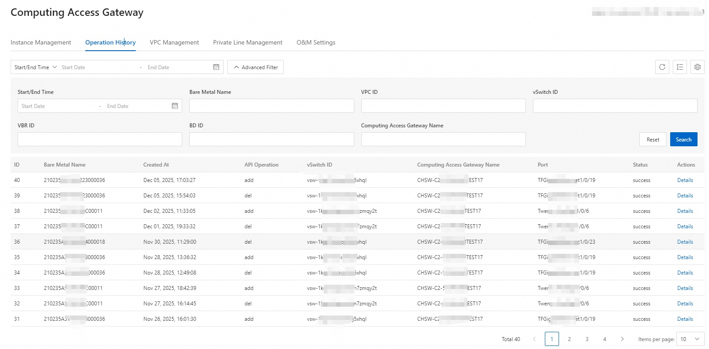

   | Parameter | Description |
   | --- | --- |
   | ID | The ID of the API operation log entry. |
   | Bare Metal Name | The name of the bare metal instance that was applied for or released in the VPC. |
   | Created At | The time when the API operation was performed. |
   | API Operation | The API operation, such as operations to apply for or release bare metal instances in a VPC. Valid values:<br>• <strong>add</strong>: applies for a bare metal instance in the VPC.<br>• <strong>del</strong>: releases a bare metal instance in the VPC.<br>• <strong>del_pc</strong>: deletes an Express Connect circuit.<br>• <strong>del_vbr</strong>: deletes a virtual border router (VBR).<br>• <strong>del_router_intf</strong>: deletes a router interface.<br>• <strong>del_route_entry</strong>: deletes a route entry. |
   | vSwitch ID | The ID of the dedicated vSwitch when the bare metal instance is applied for or released in the VPC. |
   | Computing Access Gateway Name | The name of the computing access gateway that is involved in the current API operation. |
   | Port | The port to which the bare metal instance is connected. |
   | Status | The status of the API operation.<br>• <strong>success</strong>: The API operation was successful.<br>• If the API operation is in progress, the value indicates the real-time status of the API operation.<br>• If the API operation is complete but the state is not <strong>success</strong>, you can view the failure information in this column. Example: create vpc connection fail. |

5. In the operation history list, find the operation log that you want to view and click **Details** in the **Actions** column. In the panel that appears, view the details of the operation log.

   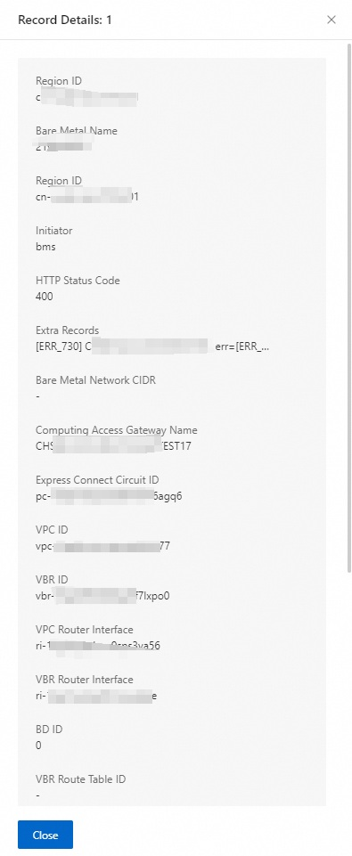

**VPC Management**

Create a bare metal instance and connect it to a VPC based on your O&M requirements. After the bare metal instance is connected to the VPC, the bare metal instance can communicate with other resources in the VPC over a private network.

1. Log in to the Apsara Uni-manager Operations Console.

2. In the top navigation bar, choose **Product Operation > Networking > Network Operations Console**.

3. In the left-side navigation pane, choose **Basic Network > Computing Access Gateway**.

4. On the **Computing Access Gateway** page, click the **VPC Management** tab.

5. Click **Create Bare Metal Instance**.

6. In the **Create Bare Metal Instance** dialog box, configure the **Bare Metal Name**, **SN**, and **Description** parameters, and then click **OK**.

   

7. On the **Computing Access Gateway** page, view the bare metal instances.

   Click **Advanced Filter** and filter bare metal instances by **Bare Metal Name**, **VPC ID**, **vSwitch ID**, **Computing Access Gateway Name**, or any combination of them.

   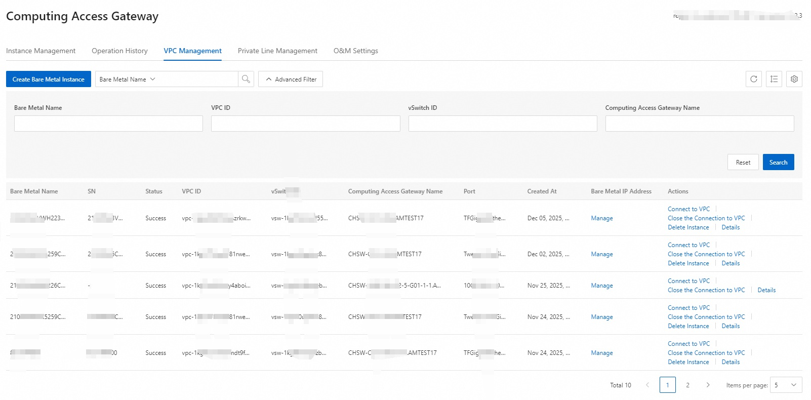

   | Parameter | Description |
   | --- | --- |
   | Bare Metal Name | The name of the bare metal instance. |
   | SN | The serial number of the bare metal instance. |
   | Status | The status of the bare metal instance. |
   | VPC ID | The ID of the VPC to which the bare metal instance belongs. |
   | vSwitch ID | The ID of the vSwitch to which the bare metal instance belongs. |
   | Computing Access Gateway Name | The name of the computing access gateway to which the bare metal instance is connected.<br>You can distinguish between stacked networking devices and unstacked networking devices based on Computing Access Gateway Name to perform operations on the devices. |
   | Port | The port of the computing access gateway to which the bare metal instance is connected. |
   | Created At | The time when the network of the bare metal instance was created. |
   | Bare Metal IP Address | The IP address of the bare metal instance. Click <strong>Manage</strong> in the Bare Metal IP Address column to assign an IP address to the bare metal instance. This helps you configure the network of the bare metal instance. For more information, see the Manage the IP address of a bare metal instance section of this topic. |

   - **View the network information about a bare metal instance in a VPC**

     <ol type="a">

     <li>

     In the bare metal instance list, find the bare metal instance that you want to view and click **Details** in the **Actions** column. In the panel that appears, view the details of the bare metal instance.

     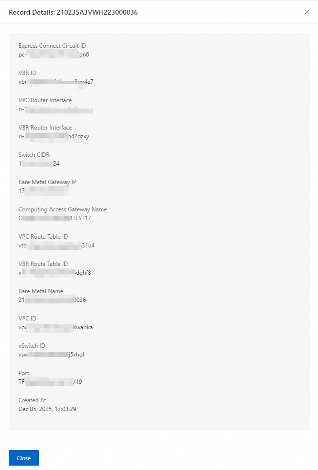

     </li>

     </ol>

   - **Connect the bare metal instance to a VPC**

     <ol type="a">

     <li>

     In the bare metal instance list, find the bare metal instance that you want to manage and click **Connect to VPC** in the **Actions** column.

     </li>

     <li>

     In the **Connect to VPC** dialog box, configure the following parameters and click **OK**.

     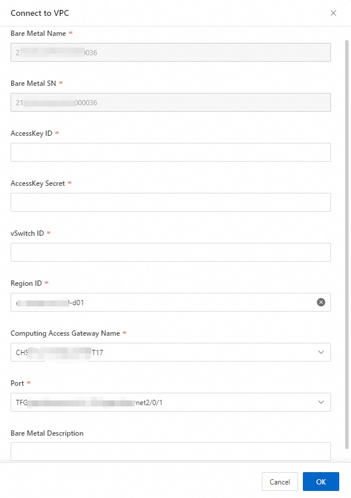

     <table>
       <tr>
         <th>Parameter</th>
         <th>Description</th>
       </tr>
       <tr>
         <td>Bare Metal Name</td>
         <td>The name of the bare metal instance. You do not need to specify this parameter.</td>
       </tr>
       <tr>
         <td>Bare Metal SN</td>
         <td>The serial number of the bare metal instance. You do not need to specify this parameter.</td>
       </tr>
       <tr>
         <td>AccessKey ID</td>
         <td rowspan="2">The AccessKey ID and AccessKey secret of the organization, which can be obtained from the <strong>Organizations</strong> page of the Apsara Uni-manager Management Console based on the organization to which the VPC belongs. For more information, see <strong>Manage the</strong> <strong>AccessKey pairs of an organization</strong> in Apsara Uni-manager Management Console User Guide.</td>
       </tr>
       <tr>
         <td>AccessKey Secret</td>
       </tr>
       <tr>
         <td>vSwitch ID</td>
         <td>The ID of the dedicated vSwitch to which the bare metal instance is connected.</td>
       </tr>
       <tr>
         <td>Region ID</td>
         <td>The ID of the region in which the current environment resides.</td>
       </tr>
       <tr>
         <td>Computing Access Gateway Name</td>
         <td>The name of the computing access gateway to which the bare metal instance is connected.<br>You can distinguish between stacked networking devices and unstacked networking devices based on Computing Access Gateway Name to perform operations on the devices.</td>
       </tr>
       <tr>
         <td>Port</td>
         <td>The port of the computing access gateway to which the bare metal instance is connected.</td>
       </tr>
       <tr>
         <td>Bare Metal Description</td>
         <td>The description of the bare metal instance.</td>
       </tr>
     </table>

     </li>

     </ol>

   - **Close the Connection to VPC**

     > **Note**
     >
     > - After a bare metal instance is connected to a VPC, you can click **Close the Connection to VPC** to disconnect the bare metal instance from the VPC.
     >
     > - After you disconnect the bare metal instance from the VPC, the connection cannot be recovered. Proceed with caution.

     <ol type="a">

     <li>

     In the bare metal instance list, find the bare metal instance that you want to manage and click **Close the Connection to VPC** in the **Actions** column.

     </li>

     <li>

     In the message that appears, click **Exit**.

     </li>

     </ol>

   - **Delete a bare metal instance**

     > **Note**
     >
     > - You can delete a bare metal instance only if the instance is created on the **VPC Management** page.
     >
     > - After a bare metal instance is connected to a VPC, you can click **Delete Instance** to disconnect the bare metal instance from the VPC and delete the instance.
     >
     > - After you delete a bare metal instance, it cannot be recovered. Proceed with caution.

     <ol type="a">

     <li>

     In the bare metal instance list, find the bare metal instance that you want to delete and click **Delete Instance** in the **Actions** column.

     </li>

     <li>

     In the message that appears, click **Delete**.

     </li>

     </ol>

   - **Manage the IP address of a bare metal instance**

     Computing access gateways work with Bare Metal Management Service (BMS). BMS is used to install bare metal instances, assign IP addresses, and complete network configurations. Computing access gateways are used to connect bare metal instances to VPCs. In some scenarios, you may not install bare metal instances or complete network configurations by using BMS, but you must use computing access gateways to connect bare metal instances to VPCs. In such scenarios, the system cannot assign IP addresses to bare metal instances, and you must manually maintain IP address assignment results. This may cause IP address conflicts and poor usability. Therefore, network management of bare metal instances is supported on the Computing Access Gateway page. You can manage IP addresses of bare metal instances in the Bare Metal IP Address Management panel.

     <ol type="a">

     <li>

     In the bare metal instance list, find the bare metal instance that you want to manage and click **Manage** in the **Bare Metal IP Address** column.

     </li>

     <li>

     In the **Bare Metal IP Address Management** panel, click **Apply for Bare Metal IP Address**.

     </li>

     </ol>

     <ol type="i" start="100">

     <li>

     In the **Apply for Bare Metal IP Address** dialog box, configure the **Bare Metal NIC**, **IP**, and **IP Address Description** parameters and click **OK**.

     

     > **Note**
     >
     > If you leave the **IP** parameter empty, the system automatically generates an IP address.

     </li>

     <li value="500">

     After you apply for an IP address for a bare metal instance, view the IP address in the **Bare Metal IP Address Management** panel. The IP address information includes **ID**, **IP Address**, **Bare Metal Name/SN**, **Bare Metal NIC**, **Created At**, **Modified At**, **Description**, **VPC ID**, and **vswitch id**.

     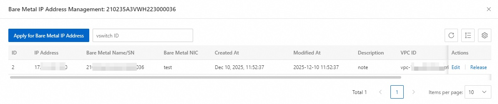

     - Find the bare metal IP address that you want to manage and click **Edit** in the **Actions** column to modify the **IP** and **IP Address Description** parameters.

     - Find the bare metal IP address that you want to manage and click **Release** in the **Actions** column to release the bare metal IP address.

     </li>

     </ol>

**Private Line Management**

On the Private Line Management tab, you can view the bare metal networks associated with Express Connect Routers (ECRs).

1. Log in to the Apsara Uni-manager Operations Console.

2. In the top navigation bar, choose **Product Operation > Networking > Network Operations Console**.

3. In the left-side navigation pane, choose **Basic Network > Computing Access Gateway**.

4. On the **Computing Access Gateway** page, click the **Private Line Management** tab to view the Express Connect circuit information about bare metal instances.

   Click **Advanced Filter** and filter bare metal instances by **vSwitch ID**, **VPC ID**, **Private Line Gateway Name**, or any combination of them.

   

   | Parameter | Description |
   | --- | --- |
   | VPC ID | The ID of the VPC to which the bare metal instance belongs. |
   | vSwitch ID | The ID of the vSwitch to which the bare metal instance belongs. |
   | Status | The status of the bare metal instance. |
   | Name of Private Line Gateway 1 | The name of ECR 1 to which the bare metal instance is connected. |
   | Source IP Address that Probes Gateway 1 | The source IP address of ECR 1. |
   | Name of Private Line Gateway 2 | The name of ECR 2 to which the bare metal instance is connected. |
   | Source IP Address that Probes Gateway 2 | The source IP address of ECR 2. |
   | Created At | The time when the network of the bare metal instance was created. |

   - **View Express Connect circuit details of a bare metal instance**

     In the bare metal instance list, find the bare metal instance that you want to view and click **Details** in the **Actions** column. In the panel that appears, view the Express Connect circuit details of the bare metal instance.

     

   - **Delete an Express Connect circuit for a bare metal instance**

     In the bare metal instance list, find the bare metal instance that you want to manage and click **Delete** in the **Actions** column to delete the Express Connect circuit for the bare metal instance.

**O&M Settings**

1. Log in to the Apsara Uni-manager Operations Console.

2. In the top navigation bar, choose **Product Operation > Networking > Network Operations Console**.

3. In the left-side navigation pane, choose **Basic Network > Computing Access Gateway**.

4. On the **Computing Access Gateway** page, click the **O&M Settings** tab to perform routine O&M operations.

   **Apply for a bare metal instance in a VPC**

   In O&M emergency scenarios, you can use this feature to add the physical port of the computing access gateway associated with a bare metal instance to the VPC.

   > **Warning**
   >
   > - This operation is only for emergency scenarios and must be performed under the guidance of R&D engineers. Otherwise, normal business operations may be affected.
   >
   > - This feature can be used only to connect a bare metal instance to the port of a computing access gateway but cannot be used to perform operations on the bare metal instance. To configure the network port, IP address, and routing information of the bare metal instance, contact the corresponding product team for guidance.
   >
   > - In most cases, you cannot use this feature to apply for a bare metal instance in a VPC. You can use the bare metal controller to call an API operation to enable the bare metal network.

   <ol type="i">

   <li>

   Select **Apply for Bare Metal in VPC** from the drop-down list in the upper-left corner of the tab.

   

   </li>

   <li>

   Configure the following parameters and click **Next**.

   </li>

   </ol>

   <table>
     <tr>
       <th>Parameter</th>
       <th>Description</th>
     </tr>
     <tr>
       <td>Region ID</td>
       <td>The name of the region in which the current environment resides.</td>
     </tr>
     <tr>
       <td>Computing Access Gateway Name</td>
       <td>The name of the computing access gateway to which the bare metal instance is connected.<br>You can distinguish between stacked networking devices and unstacked networking devices based on Computing Access Gateway Name to perform operations on the devices.</td>
     </tr>
     <tr>
       <td>vSwitch ID</td>
       <td>The ID of the vSwitch to which you want to add the bare metal instance. You can obtain the vSwitch ID from the VPC console of the Apsara Uni-manager Management Console.</td>
     </tr>
     <tr>
       <td>Port</td>
       <td>The port of the bare metal instance that is connected to the computing access gateway.</td>
     </tr>
     <tr>
       <td>AccessKey ID</td>
       <td rowspan="2">The AccessKey ID and AccessKey secret of the organization, which can be obtained from the <strong>Organizations</strong> page of the Apsara Uni-manager Management Console based on the organization to which the VPC belongs.<br>For more information, see <strong>Manage the AccessKey pairs of an</strong> <strong>organization</strong> in <strong>Apsara Uni-manager Management Console User</strong> <strong>Guide</strong>.</td>
     </tr>
     <tr>
       <td>AccessKey Secret</td>
     </tr>
     <tr>
       <td>Bare Metal Name</td>
       <td>The name of the bare metal instance that you want to apply for. The name must be unique.</td>
     </tr>
   </table>

   > **Note**
   >
   > If the specified values are invalid, click **Re-enter** in the lower part of the tab and configure the parameters again.

   <ol type="i" start="3">

   <li>

   Check whether the parameter configurations are valid.

   </li>

   </ol>

   - If yes, click **Confirm**. The system starts to apply the configurations.

     After the configurations are applied, the **Result: Successful** message appears.

   - If not, click **Back to Modify** to configure the parameters again.

   <ol type="i" start="4">

   <li>

   Optional. After the configurations are applied, you can search for the bare metal instance by bare metal instance name on the **VPC Management** tab. If the bare metal instance is displayed, it is connected to the VPC.

   </li>

   </ol>

   **Release a bare metal instance from a VPC**

   In O&M emergency scenarios, you can use this feature to disconnect the physical port of the computing access gateway associated with a bare metal instance from a VPC.

   > **Warning**
   >
   > - This operation is only for emergency scenarios and must be performed under the guidance of R&D engineers. Otherwise, normal business operations may be affected.
   >
   > - This feature can be used only to disconnect a bare metal instance from the port of a computing access gateway but cannot be used to perform operations on the bare metal instance. To configure the network port, IP address, and routing information of the bare metal instance, contact the corresponding product team for guidance.
   >
   > - In most cases, you cannot use the feature to release a bare metal instance in a VPC. You can use the bare metal controller to call an API operation to delete the network of the bare metal instance.

   <ol type="i">

   <li>

   Select **Release Bare Metal in VPC** from the drop-down list in the upper-left corner of the tab.

   

   </li>

   <li>

   Configure the following parameters and click **Next**.

   </li>

   </ol>

   | Parameter | Description |
   | --- | --- |
   | Region ID | The name of the region in which the current environment resides. |
   | Computing Access Gateway Name | The name of the computing access gateway to which the bare metal instance is connected.<br>You can distinguish between stacked networking devices and unstacked networking devices based on Computing Access Gateway Name to perform operations on the devices. |
   | Bare Metal Name | The name of the bare metal instance that you want to release.<br>You can obtain the name of the bare metal instance on the <strong>VPC</strong> <strong>Management</strong> tab. |

   > **Note**
   >
   > If the specified values are invalid, click **Re-enter** in the lower part of the tab and configure the parameters again.

   <ol type="i" start="3">

   <li>

   Check whether the parameter configurations are valid.

   </li>

   </ol>

   - If yes, click **Confirm**. The system starts to apply the configurations.

     After the configurations are applied, the **Result: Successful** message appears.

   - If not, click **Back to Modify** to configure the parameters again.

   <ol type="i" start="4">

   <li>

   Optional. After the configurations are applied, you can search for the bare metal instance by bare metal instance name on the **VPC Management** tab. If the bare metal instance is not displayed, it is released from the VPC.

   </li>

   </ol>

   **Delete a route entry**

   In O&M emergency scenarios, you can use this feature to delete route entries that point to the subnet of a bare metal instance in a VPC and the default route entries of a VBR.

   > **Warning**
   >
   > - This operation is only for emergency scenarios and must be performed under the guidance of R&D engineers. Otherwise, normal business operations may be affected.
   >
   > - In most cases, you cannot use this feature to delete a VPC route entry. This operation is only used for emergency scenarios.
   >
   > - You can perform this operation to delete only one route entry at a time. To delete multiple route entries, you must perform this operation multiple times.

   <ol type="i">

   <li>

   Select **Delete Route Table Entry** from the drop-down list in the upper-left corner of the tab.

   

   </li>

   <li>

   Configure the following parameters and click **Next**.

   </li>

   </ol>

   <table>
     <tr>
       <th>Parameter</th>
       <th>Description about deleting a VPC route entry</th>
       <th>Description about deleting a VBR route entry</th>
     </tr>
     <tr>
       <td>Region ID</td>
       <td>The name of the region in which the current environment resides.</td>
       <td>The name of the region in which the current environment resides.</td>
     </tr>
     <tr>
       <td>Route Table ID</td>
       <td>The ID of the VPC route table, which can be obtained from the VPC console.For more information about how to obtain the ID of a VPC route table, see <strong>VPC User Guide</strong>.</td>
       <td>The ID of the VBR route table.<br>If the bare metal instance associated with the VBR is connected to a VPC, you can search for the bare metal instance by bare metal instance name on the <strong>VPC Management</strong> tab, click Details in the Actions column, and then view the value of the VBR Route Table ID parameter.<br>If the bare metal instance associated with the VBR is not added to the VPC, specify the bare metal instance name and creation time to search for the operation log entry whose <strong>API</strong> <strong>Operation</strong> is <strong>add</strong> on the <strong>Operation</strong> <strong>History</strong> tab. Click Details and view the value of the <strong>VBR Route Table ID</strong> parameter.</td>
     </tr>
     <tr>
       <td>Router Interface ID</td>
       <td>The ID of the VPC router interface, which can be obtained from the VPC console. For more information about how to obtain the ID of a VPC router interface, see <strong>VPC User Guide</strong>.</td>
       <td>The ID of the VBR interface.<br>If the bare metal instance associated with the VBR is added to VPC, you can search for the bare metal instance on the <strong>VPC Management</strong> tab based on the bare metal instance name, and then click Detail to view the value of the VBR Router Interface parameter.<br>If the bare metal instance associated with the VBR is not added to the VPC, specify the bare metal instance name and creation time to search for the operation log entry whose <strong>API</strong> <strong>Operation</strong> is <strong>add</strong> on the <strong>Operation</strong> <strong>History</strong> tab. Click Details and view the value of the VBR Router Interface parameter.</td>
     </tr>
     <tr>
       <td>Routing Destinatio n CIDR</td>
       <td>The destination CIDR block to which the VPC points, which can be obtained from the VPC console. For more information about how to obtain a destination CIDR block, see <strong>VPC User</strong> <strong>Guide</strong>.</td>
       <td>Set the value to 0.0.0.0/0.</td>
     </tr>
     <tr>
       <td>AccessKey ID</td>
       <td rowspan="2">The AccessKey ID and AccessKey secret of the organization, which can be obtained from the <strong>Organizations</strong> page of the Apsara Uni-manager Management Console based on the organization to which the VPC belongs.For more information, see <strong>Manage</strong> the AccessKey pairs of an <strong>organization</strong> in <strong>Apsara Uni-</strong>manager Management Console <strong>User Guide</strong>.</td>
       <td rowspan="2">The AccessKey ID and AccessKey secret of the organization, which can be obtained from the <strong>Organizations</strong> page of the Apsara Uni-manager Management Console based on the organization to which the VBR belongs.For more information, see <strong>Manage</strong> the AccessKey pairs of an <strong>organization</strong> in <strong>Apsara Uni-</strong>manager Management Console <strong>User Guide</strong>.</td>
     </tr>
     <tr>
       <td>AccessKey Secret</td>
     </tr>
   </table>

   > **Note**
   >
   > If the specified values are invalid, click **Re-enter** in the lower part of the tab and configure the parameters again.

   <ol type="i" start="3">

   <li>

   Check whether the parameter configurations are valid.

   </li>

   </ol>

   - If yes, click **Confirm**. The system starts to apply the configurations.

     After the configurations are applied, the **Result: Successful** message appears.

   - If not, click **Back to Modify** to configure the parameters again.

   <ol type="i" start="4">

   <li>

   Optional. In actual fault scenarios, if multiple route entries exist in the route table, repeat Step 5 to Step 8 to delete other route entries.

   </li>

   </ol>

   **Delete a router interface**

   In O&M emergency scenarios, you can use this feature to delete a VPC router interface and a VBR interface.

   > **Warning**
   >
   > This operation is only for emergency scenarios and must be performed under the guidance of R&D engineers. Otherwise, normal business operations may be affected.

   <ol type="i">

   <li>

   Select **Delete Router Interface** from the drop-down list in the upper-left corner of the tab.

   

   </li>

   <li>

   Configure the following parameters and click **Next**.

   </li>

   </ol>

   <table>
     <tr>
       <th>Parameter</th>
       <th>Description about deleting a VPC router interface</th>
       <th>Description about deleting a VBR interface</th>
     </tr>
     <tr>
       <td>Region ID</td>
       <td>The name of the region in which the current environment resides.</td>
       <td>The name of the region in which the current environment resides.</td>
     </tr>
     <tr>
       <td>Router Interface ID</td>
       <td>The ID of the VPC router interface.On the <strong>Operation History</strong> tab, specify the name and creation time of the bare metal instance to search for the operation log entry whose <strong>API Operation</strong> is <strong>add</strong>. Click Details in the Actions column and view the value of the <strong>VPC Router Interface</strong> parameter.</td>
       <td>The ID of the VBR interface.<br>If the bare metal instance associated with the VBR is added to VPC, you can search for the bare metal instance on the <strong>VPC Management</strong> tab based on the bare metal instance name, and then click Detail to view the value of the VBR Router Interface parameter.<br>If the bare metal instance associated with the VBR is not added to the VPC, specify the bare metal instance name and creation time to search for the operation log entry whose <strong>API</strong> <strong>Operation</strong> is <strong>add</strong> on the <strong>Operation</strong> <strong>History</strong> tab. Click Details and view the value of the VBR Router Interface parameter.</td>
     </tr>
     <tr>
       <td>AccessKey ID</td>
       <td rowspan="2">The AccessKey ID and AccessKey secret of the organization, which can be obtained from the <strong>Organizations</strong> page of the Apsara Uni-manager Management Console based on the organization to which the VPC belongs. For more information, see <strong>Manage the</strong> AccessKey pairs of an <strong>organization</strong> in <strong>Apsara Uni-</strong>manager Management Console <strong>User Guide</strong>.</td>
       <td rowspan="2">The AccessKey ID and AccessKey secret of the organization, which can be obtained from the <strong>Organizations</strong> page of the Apsara Uni-manager Management Console based on the organization to which the VBR belongs. For more information, see <strong>Manage the</strong> AccessKey pairs of an organization in <strong>Apsara Uni-manager</strong> <strong>Management Console User Guide</strong>.</td>
     </tr>
     <tr>
       <td>AccessKey Secret</td>
     </tr>
   </table>

   > **Note**
   >
   > If the specified values are invalid, click **Re-enter** in the lower part of the tab and configure the parameters again.

   <ol type="i" start="3">

   <li>

   Check whether the parameter configurations are valid.

   </li>

   </ol>

   - If yes, click **Confirm**. The system starts to apply the configurations.

     After the configurations are applied, the **Result: Successful** message appears.

   - If not, click **Back to Modify** to configure the parameters again.

   <ol type="i" start="4">

   <li>

   Optional. After the configurations are applied, you can choose **Product Operation** > **Networking** > **Network Intelligence** in the top navigation bar of the Apsara Uni-manager Operations Console. On the homepage of Apsara Network Intelligence, enter the ID of the router interface to search for the router interface. If no search result appears, the router interface is deleted.

   </li>

   </ol>

   **Delete a VBR**

   In O&M emergency scenarios, you can use this feature to delete a VBR.

   > **Warning**
   >
   > This operation is only for emergency scenarios and must be performed under the guidance of R&D engineers. Otherwise, normal business operations may be affected.

   <ol type="i">

   <li>

   Select **Delete VBR** from the drop-down list in the upper-left corner of the tab.

   

   </li>

   <li>

   Configure the following parameters and click **Next**.

   </li>

   </ol>

   <table>
     <tr>
       <th>Parameter</th>
       <th>Description</th>
     </tr>
     <tr>
       <td>Region ID</td>
       <td>The name of the region in which the current environment resides.</td>
     </tr>
     <tr>
       <td>VBR ID</td>
       <td>The ID of the VBR that you want to delete. On the <strong>Operation History</strong> tab, specify the name and creation time of the bare metal instance to search for the operation log entry whose <strong>API Operation</strong> is <strong>add</strong>. Click Details in the Actions column to view the value of the VBR ID parameter.</td>
     </tr>
     <tr>
       <td>AccessKey ID</td>
       <td rowspan="2">The AccessKey ID and AccessKey secret of the organization, which can be obtained from the <strong>Organizations</strong> page of the Apsara Uni-manager Management Console based on the organization to which the VBR belongs. For more information, see <strong>Manage the AccessKey pairs of</strong> <strong>an organization</strong> in <strong>Apsara Uni-manager Management Console</strong> <strong>User Guide</strong>.</td>
     </tr>
     <tr>
       <td>AccessKey Secret</td>
     </tr>
   </table>

   > **Note**
   >
   > If the specified values are invalid, click **Re-enter** in the lower part of the tab and configure the parameters again.

   <ol type="i" start="3">

   <li>

   Check whether the parameter configurations are valid.

   </li>

   </ol>

   - If yes, click **Confirm**. The system starts to apply the configurations.

     After the configurations are applied, the **Result: Successful** message appears.

   - If not, click **Back to Modify** to configure the parameters again.

   <ol type="i" start="4">

   <li>

   Optional. After the configurations are applied, you can choose **Product Operation** > **Networking** > **Network Intelligence** in the top navigation bar of the Apsara Uni-manager Operations Console. On the homepage of Apsara Network Intelligence, enter the ID of the VBR to search for the VBR. If no search result appears, the VBR is deleted.

   </li>

   </ol>

   **Delete an Express Connect circuit**

   In O&M emergency scenarios, you can use this feature to delete an Express Connect circuit.

   > **Warning**
   >
   > This operation is only for emergency scenarios and must be performed under the guidance of R&D engineers. Otherwise, normal business operations may be affected.

   <ol type="i">

   <li>

   Select **Delete Express Connect Circuit** from the drop-down list in the upper-left corner of the tab.

   

   </li>

   <li>

   Configure the following parameters and click **Next**.

   </li>

   </ol>

   <table>
     <tr>
       <th>Parameter</th>
       <th>Description</th>
     </tr>
     <tr>
       <td>Region ID</td>
       <td>The name of the region in which the current environment resides.</td>
     </tr>
     <tr>
       <td>Express Connect Circuit ID</td>
       <td>The ID of the Express Connect circuit that you want to delete. On the <strong>Operation History</strong> tab, specify the bare metal instance name and creation time to search for the operation log entry whose <strong>API</strong> <strong>Operation</strong> is <strong>add</strong>. Click <strong>Details</strong> to view the value of the Express Connect Circuit ID parameter.</td>
     </tr>
     <tr>
       <td>AccessKey ID</td>
       <td rowspan="2">The AccessKey ID and AccessKey secret of the organization, which can be obtained from the <strong>Organizations</strong> page of the Apsara Uni-manager Management Console based on the organization to which the VPC belongs. For more information, see <strong>Manage the AccessKey pairs of</strong> <strong>an organization</strong> in <strong>Apsara Uni-manager Management Console</strong> <strong>User Guide</strong>.</td>
     </tr>
     <tr>
       <td>AccessKey Secret</td>
     </tr>
   </table>

   > **Note**
   >
   > If the specified values are invalid, click **Re-enter** in the lower part of the tab and configure the parameters again.

   <ol type="i" start="3">

   <li>

   Check whether the parameter configurations are valid.

   </li>

   </ol>

   - If yes, click **Confirm**. The system starts to apply the configurations.

     After the configurations are applied, the **Result: Successful** message appears.

   - If not, click **Back to Modify** to configure the parameters again.

   <ol type="i" start="4">

   <li>

   Optional. After the configurations are applied, you can choose **Product Operation** > **Networking** > **Network Intelligence** in the top navigation bar of the Apsara Uni-manager Operations Console. On the homepage of Apsara Network Intelligence, enter the ID of the Express Connect circuit to search for the Express Connect circuit. If no search result appears, the Express Connect circuit is deleted.

   </li>

   </ol>

   **Delete all resources**

   In O&M emergency scenarios, you can use this feature to delete all resources, including VPC route entries, VBR route entries, VPC router interfaces, VBR interfaces, VBRs, and Express Connect circuits.

   > **Warning**
   >
   > This operation is only for emergency scenarios and must be performed under the guidance of R&D engineers. Otherwise, normal business operations may be affected.

   <ol type="i">

   <li>

   Select **Delete ALL Resources** from the drop-down list in the upper-left corner of the tab.

   

   </li>

   <li>

   Configure the following parameters and click **Next**.

   </li>

   </ol>

   <table>
     <tr>
       <th>Parameter</th>
       <th>Description</th>
     </tr>
     <tr>
       <td>Region ID</td>
       <td>The ID of the region in which the environment resides.</td>
     </tr>
     <tr>
       <td>Computing Access Gateway Name</td>
       <td>The name of the computing access gateway to which the bare metal instance is connected.</td>
     </tr>
     <tr>
       <td>AccessKey ID</td>
       <td rowspan="2">The AccessKey ID and AccessKey secret of the organization, which can be obtained from the <strong>Organizations</strong> page of the Apsara Uni-manager Management Console based on the organization to which the VPC belongs. For more information, see <strong>Manage the</strong> <strong>AccessKey pairs of an organization</strong> in <strong>Apsara Uni-manager</strong> <strong>Management Console User Guide</strong>.</td>
     </tr>
     <tr>
       <td>AccessKey Secret</td>
     </tr>
     <tr>
       <td>VPC Router Interface ID</td>
       <td>The ID of the VPC router interface, which can be obtained from the VPC console. For more information about how to obtain the ID of a VPC router interface, see <strong>VPC User Guide</strong>.</td>
     </tr>
     <tr>
       <td>VPC Route Table ID</td>
       <td>The ID of the VPC route table, which can be obtained from the VPC console. For more information about how to obtain the ID of a VPC route table, see <strong>VPC User Guide</strong>.</td>
     </tr>
     <tr>
       <td>VBR Route Table ID</td>
       <td>The ID of the VBR route table.<br>If the bare metal instance associated with the VBR is connected to a VPC, you can search for the bare metal instance by bare metal instance name on the <strong>VPC Management</strong> tab, click Details in the Actions column, and then view the value of the <strong>VBR Route Table ID</strong> parameter.<br>If the bare metal instance associated with the VBR is not added to the VPC, specify the bare metal instance name and creation time to search for the operation log entry whose <strong>API Operation</strong> is <strong>add</strong> on the <strong>Operation History</strong> tab. Click Details and view the value of the <strong>VBR Route Table ID</strong> parameter.</td>
     </tr>
     <tr>
       <td>VPC CIDR1</td>
       <td>The Destination CIDR Block 1 to which the VPC points, which can be obtained from the VPC console. For more information about how to obtain a destination CIDR block, see <strong>VPC User Guide</strong>.</td>
     </tr>
     <tr>
       <td>VPC CIDR2</td>
       <td>The Destination CIDR Block 2 to which the VPC points, which can be obtained from the VPC console. For more information about how to obtain a destination CIDR block, see <strong>VPC User Guide</strong>.</td>
     </tr>
     <tr>
       <td>VBR Router Interface ID</td>
       <td>The ID of the VBR interface.<br>If the bare metal instance associated with the VBR is connected to a VPC, you can search for the bare metal instance by bare metal instance name on the <strong>VPC Management</strong> tab, click Details in the Actions column, and then view the value of the <strong>VBR Router</strong> <strong>Interface</strong> parameter.<br>If the bare metal instance associated with the VBR is not added to the VPC, specify the bare metal instance name and creation time to search for the operation log entry whose <strong>API Operation</strong> is <strong>add</strong> on the <strong>Operation History</strong> tab. Click Details and view the value of the <strong>VBR Router Interface</strong> parameter.</td>
     </tr>
     <tr>
       <td>VBR ID</td>
       <td>The ID of the VBR that you want to delete. On the <strong>Operation</strong> <strong>History</strong> tab, specify the name and creation time of the bare metal instance to search for the operation log entry whose <strong>API Operation</strong> is <strong>add</strong>. Click Details in the Actions column to view the value of the <strong>VBR ID</strong> parameter.</td>
     </tr>
     <tr>
       <td>Express Connect Circuit ID</td>
       <td>The ID of the Express Connect circuit that you want to delete. On the <strong>Operation History</strong> tab, specify the bare metal instance name and creation time to search for the operation log entry whose <strong>API</strong> <strong>Operation</strong> is <strong>add</strong>. Click <strong>Details</strong> to view the value of the Express Connect Circuit ID parameter.</td>
     </tr>
     <tr>
       <td>Trunk ID</td>
       <td>You do not need to specify this parameter.</td>
     </tr>
   </table>

   > **Note**
   >
   > If the specified values are invalid, click **Re-enter** in the lower part of the tab and configure the parameters again.

   <ol type="i" start="3">

   <li>

   Check whether the parameter configurations are valid.

   </li>

   </ol>

   - If yes, click **Confirm**. The system starts to apply the configurations.

     After the configurations are applied, the **Result: Successful** message appears.

   - If not, click **Back to Modify** to configure the parameters again.

   **View the bandwidth of an Express Connect circuit**

   You can view the bandwidth of the Express Connect circuit for a router interface when the computing access gateway is connected to a VPC based on your O&M requirements.

   <ol type="i">

   <li>

   Select **View Express Connect Circuit Bandwidth** from the drop-down list in the upper-left corner of the tab.

   

   </li>

   <li>

   Configure the following parameters and click **Query**. The system displays the bandwidth

   </li>

   </ol>

   of the Express Connect circuit that meets the filter conditions.

   <table>
     <tr>
       <th>Parameter</th>
       <th>Description</th>
     </tr>
     <tr>
       <td>Region ID</td>
       <td>The name of the region in which the current environment resides.</td>
     </tr>
     <tr>
       <td>Router Interface ID</td>
       <td>The ID of the VBR interface. On the <strong>VPC Management</strong> tab, specify a VPC ID and computing access gateway name and click Search. Click <strong>Details</strong> in the Actions column to view the value of the VBR Router Interface parameter.</td>
     </tr>
     <tr>
       <td>AccessKey ID</td>
       <td rowspan="2">The AccessKey ID and AccessKey secret of the organization, which can be obtained from the <strong>Organizations</strong> page of the Apsara Uni-manager Management Console based on the organization to which the VPC belongs. For more information, see <strong>Manage the AccessKey pairs of</strong> <strong>an organization</strong> in <strong>Apsara Uni-manager Management Console</strong> <strong>User Guide</strong>.</td>
     </tr>
     <tr>
       <td>AccessKey Secret</td>
     </tr>
   </table>

   <ol type="i" start="3">

   <li>

   View the table on the left and obtain the bandwidth in units of bit/s based on the

   </li>

   </ol>

   specifications. The bandwidth information describes the specifications of the Express Connect circuit bandwidth on the HSW of the current VPC.

   | Specification | Bandwidth (bit/s) |
   | --- | --- |
   | Large.1 | 1G |
   | Large.2 | 2G |
   | Large.4 | 4G |
   | Large.5 | 5G |
   | Xlarge.1 | 10G |
   | Xlarge.2 | 20G |
   | Xlarge.4 | 40G |
   | Xlarge.5 | 50G |
   | Xlarge.8 | 80G |
   | Xlarge.10 | 100G |
   | Xlarge.16 | 160G |
   | Xlarge.20 | 200G |
   | Xlarge.50 | 500G |
   | Xlarge.320 | 3200G |

   **Change the bandwidth of an Express Connect circuit**

   In O&M emergency scenarios, you can use this feature to change the bandwidth of an Express Connect circuit.

   > **Warning**
   >
   > This operation may affect your business. Unauthorized operations are prohibited. Configuration changes must be performed under the guidance of technical support.

   <ol type="i">

   <li>

   Select **Change Express Connect Circuit Bandwidth** from the drop-down list in the upper-left corner of the tab.

   

   </li>

   <li>

   Configure the following parameters and click **Next**.

   </li>

   </ol>

   <table>
     <tr>
       <th>Parameter</th>
       <th>Description</th>
     </tr>
     <tr>
       <td>Region ID</td>
       <td>The name of the region in which the current environment resides.</td>
     </tr>
     <tr>
       <td>Router Interface ID</td>
       <td>The ID of the VBR interface. On the <strong>VPC Management</strong> tab, specify a VPC ID and computing access gateway name and click Search. Click <strong>Details</strong> in the Actions column to view the value of the VBR Router Interface parameter.</td>
     </tr>
     <tr>
       <td>Router Interface Specifications</td>
       <td>The new bandwidth of the Express Connect circuit.</td>
     </tr>
     <tr>
       <td>AccessKey ID</td>
       <td rowspan="2">The AccessKey ID and AccessKey secret of the organization, which can be obtained from the <strong>Organizations</strong> page of the Apsara Uni-manager Management Console based on the organization to which the VPC belongs. For more information, see <strong>Manage the AccessKey pairs of an</strong> <strong>organization</strong> in <strong>Apsara Uni-manager Management Console User</strong> <strong>Guide</strong>.</td>
     </tr>
     <tr>
       <td>AccessKey Secret</td>
     </tr>
   </table>

   <ol type="i" start="3">

   <li>

   Check whether the parameter configurations are valid.

   </li>

   </ol>

   - If yes, click **Confirm**. The system starts to apply the configurations.

     After the configurations are applied, the **Result: Successful** message appears.

   - If not, click **Back to Modify** to configure the parameters again.

   <ol type="i" start="4">

   <li>

   Optional. After the configurations are applied, check whether the bandwidth of the Express Connect circuit is changed. For more information, see the View the bandwidth of an Express Connect circuit section of this topic.

   </li>

   </ol>

   **View trunk usage**

   You can view trunk usage to obtain up-to-date information about the usage of hardware ports.

   <ol type="i">

   <li>

   Select **View Trunk Usage** from the drop-down list in the upper-left corner of the tab.

   </li>

   <li>

   View the trunk usage in the list. By default, all data in the **idle** state is displayed.

   </li>

   </ol>

   Specify a trunk ID and computing access gateway name, select a trunk state, and then click **Search** to view trunk usage. Valid values of the **Status** parameter are **Idle**, **Used**, **Creating**, and **Deleting**.

   > **Note**
   >
   > Specify the last integer of the value of the **Port** parameter that is obtained from the **VPC Management** tab as the **trunk ID**. For example, if the value of the Port parameter is 10GE1/0/40, specify 40 as the **trunk ID**.

   

   **View VPN usage of a bare metal instance**

   You can view the VPN usage of a bare metal instance and the VPN assigned to a computing access gateway.

   <ol type="i">

   <li>

   Select **View BM VPN Usage** from the drop-down list in the upper-left corner of the tab.

   </li>

   <li>

   In the list, view the bare metal instance VPNs assigned to all the HSWs. By default, all

   </li>

   </ol>

   data in the **Succeeded** state is displayed.

   Specify the **name of a computing access gateway**, a **Virtual Extensible Local Area Network (VXLAN) ID**, and the **VPN name of a bare metal instance**, select a state, and then click **Search** to view the bare metal instance VPNs assigned to all the HSWs. Valid values of the **Status** parameter are **Succeeded** and **Creating**.

   

   **View BD usage**

   You can view BD usage to learn about the BD configuration distribution in a timely manner.

   <ol type="i">

   <li>

   Select **View BD Usage** from the drop-down list in the upper-left corner of the tab.

   </li>

   <li>

   View the BD usage in the list. By default, all data in the **Succeeded** state is displayed.

   </li>

   </ol>

   Specify a **computing access gateway name**, a **BD ID**, and a **vSwitch ID**, select a state, and then click **Search** to view BD usage. Valid values of the **Status** parameter are **Succeeded**, **Creating**, and **Deleting**.

   

   **Check initialization configurations**

   In O&M emergency scenarios, you can use this feature to check whether the initialization configurations of the HSW are successful.

   > **Note**
   >
   > This feature only checks the initialization status of vSwitches for computing access gateways and whether the initialization configurations are successful. No operation is performed on the bare metal instance.

   <ol type="i">

   <li>

   Select **Check the Initialization Configuration** from the drop-down list in the upper-left corner of the tab.

   

   </li>

   <li>

   Configure the following parameters and click **Next**.

   </li>

   </ol>

   | Parameter | Description |
   | --- | --- |
   | Region ID | The name of the region in which the current environment resides. |
   | HSW Name | The name of the vSwitch to be checked in instance management. |

   > **Note**
   >
   > If the specified values are invalid, click **Re-enter** in the lower part of the tab and configure the parameters again.

   <ol type="i" start="3">

   <li>

   Click **Check** to check the initial configuration of the vSwitch.

   </li>

   </ol>

   **Check route configurations**

   In O&M emergency scenarios, you can use this feature to locate abnormal operations and check whether the route configurations of a bare metal instance are valid.

   > **Note**
   >
   > - You can use this operation to locate the exception and scan the HSW after a bare metal instance fails to be added.
   >
   > - This feature checks only whether the route configurations of a bare metal instance are valid. No operation is performed on the bare metal instance.

   <ol type="i">

   <li>

   Select **Check the Route Configuration** from the drop-down list in the upper-left corner of the tab.

   

   </li>

   <li>

   Configure the following parameters and click **Next**.

   </li>

   </ol>

   <table>
     <tr>
       <th>Parameter</th>
       <th>Description</th>
     </tr>
     <tr>
       <td>Region ID</td>
       <td>The name of the region in which the current environment resides.</td>
     </tr>
     <tr>
       <td>Bare Metal Name</td>
       <td>The name of the bare metal instance that was applied for or released in a VPC. It uniquely identifies the bare metal instance within a region.</td>
     </tr>
     <tr>
       <td>AccessKey ID</td>
       <td rowspan="2">The AccessKey ID and AccessKey secret of the organization, which can be obtained from the <strong>Organizations</strong> page of the Apsara Uni-manager Management Console based on the organization to which the VPC belongs. For more information, see <strong>Manage the AccessKey pairs of</strong> <strong>an organization</strong> in <strong>Apsara Uni-manager Management Console</strong> <strong>User Guide</strong>.</td>
     </tr>
     <tr>
       <td>AccessKey Secret</td>
     </tr>
   </table>

   > **Note**
   >
   > If the specified values are invalid, click **Re-enter** in the lower part of the tab and configure the parameters again.

   <ol type="i" start="3">

   <li>

   Click **Check** to check the route configurations.

   </li>

   </ol>

   **Display the information about a bare metal network gateway**

   In O&M emergency scenarios, you can use this feature to check the gateway of a vSwitch.

   > **Note**
   >
   > - This operation is only for emergency scenarios in which bare metal networks are unavailable.
   >
   > - The feature only checks the gateway information of vSwitches. It does not perform operations on bare metal instances.

   <ol type="i">

   <li>

   Select **Display the Information of Bare Metal Network Gateways** from the drop-down list in the upper-left corner of the tab.

   

   </li>

   <li>

   Configure the following parameters and click **Next**.

   </li>

   </ol>

   <table>
     <tr>
       <th>Parameter</th>
       <th>Description</th>
     </tr>
     <tr>
       <td>Region ID</td>
       <td>The name of the region in which the current environment resides.</td>
     </tr>
     <tr>
       <td>vSwitch ID</td>
       <td>The ID of the vSwitch. You can obtain the vSwitch ID from the VPC console.</td>
     </tr>
     <tr>
       <td>AccessKey ID</td>
       <td rowspan="2">The AccessKey ID and AccessKey secret of the organization, which can be obtained from the <strong>Organizations</strong> page of the Apsara Uni-manager Management Console based on the organization to which the VPC belongs. For more information, see <strong>Manage the AccessKey pairs of</strong> <strong>an organization</strong> in <strong>Apsara Uni-manager Management Console</strong> <strong>User Guide</strong>.</td>
     </tr>
     <tr>
       <td>AccessKey Secret</td>
     </tr>
   </table>

   > **Note**
   >
   > If the specified values are invalid, click **Re-enter** in the lower part of the tab and configure the parameters again.

   <ol type="i" start="3">

   <li>

   Click **Check** to check the information about the bare metal network gateway.

   </li>

   </ol>

   **Upgrade single-RR deployment to double-RR deployment**

   In O&M emergency scenarios, you can use this feature to upgrade single-RR deployment to double-RR deployment.

   > **Warning**
   >
   > This operation may affect your business. Unauthorized operations are prohibited. Configuration changes must be performed under the guidance of technical support.

   <ol type="i">

   <li>

   Select **Change Single-RR Deployment to Double-RR Deployment** from the drop-down list in the upper-left corner of the tab.

   

   </li>

   <li>

   Configure the following parameters and click **Submit**.

   </li>

   </ol>

   | Parameter | Description |
   | --- | --- |
   | Region ID | The name of the region in which the current environment resides. |
   | Existing RR Device Name | The name of RR device that you want to upgrade. |
   | New RR Device Name | The name of the new RR device that you want to use. |

   **History of changing single-RR deployment to double-RR deployment**

   You can view the history of changing single-RR deployment to double-RR deployment to obtain the up-to-date status of your RR device.

   <ol type="i">

   <li>

   Select **History of Changing Single-RR Deployment to Double-RR Deployment** from the drop-down list in the upper-left corner of the tab.

   </li>

   <li>

   You can view the history of changing single-RR deployment to double-RR deployment.

   </li>

   </ol>

   Specify **Existing RR Device Name**, **New RR Device Name**, and **Request ID** to view the records of RR device upgrades that meet the filter conditions.

   

   <ol type="i" start="3">

   <li>

   Find the record that you want to view and click **Details** in the **Actions** column to view

   </li>

   </ol>

   the details of the record, such as the additional information and HTTP status code.

   **Associate a vSwitch with an ECR**

   > **Warning**
   >
   > This operation is only for emergency scenarios and must be performed under the guidance of R&D engineers. Otherwise, normal business operations may be affected.

   <ol type="i">

   <li>

   Select **vSwitch Bound to Private Line Gateway** from the drop-down list in the upper-left corner of the tab.

   </li>

   <li>

   Configure the following parameters and click **Next**.

   </li>

   </ol>

   <table>
     <tr>
       <th>Parameter</th>
       <th>Description</th>
     </tr>
     <tr>
       <td>Region ID</td>
       <td>The name of the region in which the current environment resides.</td>
     </tr>
     <tr>
       <td>vSwitch ID</td>
       <td>The ID of the vSwitch. You can obtain the vSwitch ID from the VPC console.</td>
     </tr>
     <tr>
       <td>AccessKey ID</td>
       <td rowspan="2">The AccessKey ID and AccessKey secret of the organization, which can be obtained from the <strong>Organizations</strong> page of the Apsara Uni-manager Management Console based on the organization to which the VPC belongs. For more information, see <strong>Manage the AccessKey</strong> <strong>pairs of an organization</strong> in Apsara Uni-manager Management Console User Guide.</td>
     </tr>
     <tr>
       <td>AccessKey Secret</td>
     </tr>
     <tr>
       <td>Name of Border Gateway 1</td>
       <td>The name of ECR 1 to which the bare metal instance is connected.<br>On the <strong>Private Line Management</strong> tab, specify a VPC ID and computing access gateway name and click Search. Then, view the value in the <strong>Name of Private Line Gateway 1</strong> column.</td>
     </tr>
     <tr>
       <td>Source IP Address that Probes Gateway 1</td>
       <td>The source IP address of ECR 1.<br>On the <strong>Private Line Management</strong> tab, specify a VPC ID and computing access gateway name and click Search. Then, view the value in the <strong>Source IP Address that Probes Gateway 1</strong> column.</td>
     </tr>
     <tr>
       <td>Name of Border Gateway 2</td>
       <td>The name of ECR 2 to which the bare metal instance is connected.<br>On the <strong>Private Line Management</strong> tab, specify a VPC ID and computing access gateway name and click Search. Then, view the value in the <strong>Source IP Address that Probes Gateway 2</strong> column.</td>
     </tr>
     <tr>
       <td>Source IP Address that Probes Gateway 2</td>
       <td>The source IP address of ECR 2.<br>On the <strong>Private Line Management</strong> tab, specify a VPC ID and computing access gateway name and click Search. Then, view the value in the <strong>Source IP Address that Probes Gateway 2</strong> column.</td>
     </tr>
   </table>

   > **Note**
   >
   > If the specified values are invalid, click **Re-enter** in the lower part of the tab and configure the parameters again.

   <ol type="i" start="3">

   <li>

   Check whether the parameter configurations are valid.

   </li>

   </ol>

   - If yes, click **Confirm**. The system starts to apply the configurations.

     After the configurations are applied, the **Result: Successful** message appears.

   - If not, click **Back to Modify** to configure the parameters again.

   **Disassociate a vSwitch from an ECR**

   > **Warning**
   >
   > This operation is only for emergency scenarios and must be performed under the guidance of R&D engineers. Otherwise, normal business operations may be affected.

   <ol type="i">

   <li>

   Select **vSwitch Unbound from Private Line Gateway** from the drop-down list in the upper-left corner of the tab.

   

   </li>

   <li>

   Configure the following parameters and click **Next**.

   </li>

   </ol>

   <table>
     <tr>
       <th>Parameter</th>
       <th>Description</th>
     </tr>
     <tr>
       <td>Region ID</td>
       <td>The name of the region in which the current environment resides.</td>
     </tr>
     <tr>
       <td>vSwitch ID</td>
       <td>The ID of the vSwitch. You can obtain the vSwitch ID from the VPC console.</td>
     </tr>
     <tr>
       <td>AccessKey ID</td>
       <td rowspan="2">The AccessKey ID and AccessKey secret of the organization, which can be obtained from the <strong>Organizations</strong> page of the Apsara Uni-manager Management Console based on the organization to which the VPC belongs. For more information, see <strong>Manage the AccessKey</strong> <strong>pairs of an organization</strong> in Apsara Uni-manager Management Console User Guide.</td>
     </tr>
     <tr>
       <td>AccessKey Secret</td>
     </tr>
   </table>

   > **Note**
   >
   > If the specified values are invalid, click **Re-enter** in the lower part of the tab and configure the parameters again.

   <ol type="i" start="3">

   <li>

   Check whether the parameter configurations are valid.

   </li>

   </ol>

   - If yes, click **Confirm**. The system starts to apply the configurations.

     After the configurations are applied, the **Result: Successful** message appears.

   - If not, click **Back to Modify** to configure the parameters again.

<a id="section-3"></a>

# 3.Networking products

<a id="section-3-1"></a>

## 3.1. CGW O&M

> **Note**
>
> By default, the **CGW O&M** module is hidden in the navigation pane. If you need to perform O&M operations on CGW clusters, you can modify the corresponding menu settings by referring to **User permissions** > **Menu Management** in Apsara Uni-manager Operations Console User Guide.

<a id="section-3-1-1"></a>

### 3.1.1. CGW cluster management

**Procedure**

1. Log on to the Apsara Uni-manager Operations Console.

2. In the top navigation bar, choose **Product Operation** > **Networking** > **Network Operations Console**.

3. In the left-side navigation pane, choose **Network Services** > **CGW O&M** > **CGW Cluster Management**.

4. On the CGW Cluster Management page, select a region from the **Region** drop-down list. The zones and cluster topology in the selected region are displayed in the **Zone List** and **Cluster Topology** sections.

   > **Note**
   >
   > Only x86-based physical machines can be managed.

   

5. Find the zone that you want to manage and click **Set Secondary Zone** in the **Actions** column.

   > **Note**
   >
   > You can perform this operation on zones for which the secondary zone is not configured.

6. In the Set Secondary Zone dialog box, select a secondary zone from the **Secondary Zone** drop-down list and click **OK**.

   > **Note**
   >
   > - The cluster that you select as the secondary zone must have the same architecture and reside in the same region as the current cluster.
   >
   > - The secondary zone that you select cannot be the secondary zone of another zone.

   

**What to do next**

**Remove a secondary zone**

> **Note**
>
> You can perform this operation on zones for which the secondary zone is configured.

1. Find the zone that you want to manage and click **Remove Secondary Zone** in the **Actions** column.

2. In the message that appears, click **OK**.

**View the change history of a zone**

1. Find the zone that you want to manage and click **View Change History** in the **Actions** column.

2. In the View Change History dialog box, view the change history of the zone.

   

3. Find the change record that you want to manage and click **View details** in the **Operation** column. On the **Execution Details** page, view detailed information. For more information, see Execution history.

<a id="section-3-1-2"></a>

### 3.1.2. CGW management

<a id="section-4"></a>

# 4.Traffic visualization

The Traffic Visualization module can monitor physical and virtual networks in the cloud platform, and analyze real-time and historical traffic in the networks. This module also analyzes traffic by virtual network, public network, and border physical network and generates visualized charts. You can also troubleshoot issues based on the traffic data or monitored traffic metrics.

> **Note**
>
> By default, the Traffic Visualization module is not displayed. To use this module, perform the following operations: Log on to the Apsara Uni-manager Operations Console. In the top navigation bar, choose More > **User Authorities**. In the left-side navigation pane, click **Menu Management**. On the Menu management page, modify the menu settings to display the Traffic Visualization module.

<a id="section-4-1"></a>

## 4.1. Visualization settings

Before using traffic visualization, you must configure analyzers, collection rules, and scenarios. This ensures that network traffic is collected, processed, and displayed according to your requirements.

**Workflow**

The following figure shows the workflow for configuring traffic visualization.

1. Add analyzers and analysis ports. For more information, see analyzer device management.

2. Add collection rules. For more information, see collection rule management.

3. Add analysis scenarios. For more information, see scenario management.

**Analyzer management**

Traffic collection and analysis rely on analyzers and analysis ports. You must create these devices before you begin.

**Usage notes**

- **Analyzer**: A device used for traffic analysis, also known as an NPM. Analyzers can be NPM Physical Machines or NPM Central Controllers.

- **Analysis port**: A traffic collection port on an NPM device. It receives traffic for analysis in a specific scenario.

**Procedure**

1. Log on to the Apsara Uni-manager Operations Console.

2. In the top navigation bar, choose **Product O&M** > **Network O&M** > **Network O&M Console**.

3. In the left-side navigation pane, choose **Traffic Visualization** > **Visualization Settings**.

4. On the **System Management** page, click the **Analysis Device Management** tab. You can perform the following operations.

   | Section | Task | Procedure |
   | --- | --- | --- |
   |  | Add an analyzer | i. In the <strong>Analyzer management</strong> section, click <strong>Add Analyzer</strong>.ii. In the <strong>Add Analyzer</strong> panel, configure the following parameters and click <strong>OK</strong>.<br><br>• <strong>Availability Zone</strong>: Select the availability zone where the analyzer is located.<br>• <strong>Analyzer Name</strong>: Enter a custom name for the analyzer.<br>The name can be up to 32 characters long and can contain Chinese characters, letters, digits, and underscores (_). It cannot start with a digit.<br>• <strong>Analyzer Role</strong>: The role of the NPM device.<br>• <strong>NPM Physical Machine</strong>: Collects and processes traffic.<br>• <strong>NPM Central Controller</strong>: Analyzes and visualizes traffic.<br>• <strong>Galaxy Security Gateway</strong>: When you configure VPC traffic mirror rules, traffic is preferentially routed to the <strong>traffic gateway</strong> without passing through an NPM device.<br>• <strong>Management IP:</strong> The IP address of the NPM device<strong>.</strong><br>• <strong>Username</strong>: The username for the NPM device.<br>• <strong>Password</strong>: The password for the NPM device.<br>• <strong>Serial Number</strong>: The serial number of the NPM device.<br>• <strong>Portal</strong>: The web address of the vendor's NPM central controller, used for daily O&amp;M and management of NPM devices. This address is automatically generated after the analyzer is created and appears in the list.<br>• <strong>Analyzer Description</strong>: Enter a custom description for the analyzer. |

   Analyzer management

   

   <ol type="i">

   <li>

   In the **Analyzer management** section, view the list of

   </li>

   </ol>

   View an

   analyzers. The list includes **Device ID**, **Analyzer Name**,

   analyzer

   **Availability Zone**, **Management IP**, **Authorization Status**, **Running Status**, **Role**, **Description**, **Serial Number**, **Portal**, **Creation Date**, and **Modification Time**.

   <ol type="i" start="2">

   <li>

   In the **Actions** column of the target analyzer, click **Details**. In

   </li>

   </ol>

   the **Details** panel, view the details of the analyzer.

   <ol type="i">

   <li>

   In the **Analyzer management** section, find the target analyzer and click **Edit** in the **Actions** column.

   </li>

   <li>

   In the **Edit Analyzer** panel, modify the parameters and click

   </li>

   </ol>

   **OK**.

   Edit an

   For parameter descriptions, see Add an analyzer.

   analyzer

   > **Note**
   >
   > You cannot modify the **Analyzer Role**.

   > **Important**
   >
   > - An analyzer cannot be deleted if it is associated with an analysis port.
   >
   > - An analyzer cannot be deleted if it is associated with a

   Delete an

   > collection rule.

   analyzer

   <ol type="i">

   <li>

   In the **Analyzer management** section, find the target analyzer and click **Delete** in the **Actions** column.

   </li>

   <li>

   Click **OK**.

   </li>

   </ol>

   > **Note**
   >
   > Before you add an analysis port, make sure that you have added an analyzer.

   <ol type="i">

   <li>

   In the **Analysis port management** section, click **Add Analysis Port**.

   </li>

   </ol>

   <table>
     <tr>
       <td>Analysis port management</td>
       <td>Add an analysis port</td>
       <td>ii. In the <strong>Add Analysis Port</strong> panel, configure the following parameters and click <strong>OK</strong>.<br><br>• <strong>Analysis Port Name:</strong> Enter a custom name for the analysis port.<br>The name can be up to 32 characters long and can contain Chinese characters, letters, digits, and underscores (_). The name cannot start with a digit.<br>• <strong>Analyzer Name:</strong> Select the associated analyzer.<br>• <strong>Analyzer Physical Interface Name:</strong> Select a physical interface on the analyzer.<br>• <strong>Analysis Port Type</strong>: Select the type of the analysis port.<br>• VPC<br>• Physical<br>• ACK<br>• ALL<br>• <strong>Analysis Port IP</strong>: Enter the IPv4 address of the analysis port.<br>• <strong>Description</strong>: Enter a custom description for the analysis port.</td>
     </tr>
     <tr>
       <td rowspan="4"></td>
       <td></td>
       <td></td>
     </tr>
     <tr>
       <td>View an analysis port</td>
       <td><br>i. In the <strong>Analysis port management</strong> section, view the list of analysis ports. The list includes <strong>ID</strong>, <strong>Analysis Port Name</strong>, <strong>Analyzer Name</strong>, <strong>Analyzer Physical Network Interface</strong> <strong>Name</strong>, <strong>Analysis Port Type</strong>, <strong>Analysis Port IP</strong>, <strong>Description</strong>, and <strong>Creation Date</strong>.<br>ii. In the <strong>Actions</strong> column of the target analysis port, click <strong>Details</strong>.In the <strong>Details</strong> panel, view the details of the analysis port.</td>
     </tr>
     <tr>
       <td>Edit an analysis port</td>
       <td>i. In the <strong>Analysis port management</strong> section, find the target analysis port and click <strong>Edit</strong> in the <strong>Actions</strong> column.<br>ii. In the <strong>Edit Analysis Port</strong> panel, modify the parameters and click <strong>OK</strong>.<br>For parameter descriptions, see Add an analysis port.<br>Note<br>You cannot modify <strong>Analyzer Name</strong> and <strong>Analyzer</strong> <strong>Physical Interface Name</strong>.</td>
     </tr>
     <tr>
       <td>Delete an analysis port</td>
       <td>Important<br>An analysis port cannot be deleted if it is associated with a collection rule.<br>i. In the <strong>Analysis port management</strong> section, find the target analysis port and click <strong>Delete</strong> in the <strong>Actions</strong> column.<br>ii. Click <strong>OK</strong>.</td>
     </tr>
   </table>

**Collection rule management**

Collection rules define the traffic data source and analysis mode, which analysis devices use to collect and analyze traffic.

**Prerequisites**

Before creating a collection rule, add the required analyzers and analysis ports. For more information, see analyzer device management.

**Procedure**

1. Log on to the Apsara Uni-manager Operations Console.

2. In the top navigation bar, choose **Product O&M** > **Network O&M** > **Network O&M Console**.

3. In the left-side navigation pane, choose **Traffic Visualization** > **Visualization Settings**.

4. On the **System Management** page, click the **Collection Rule Management** tab. You can perform the following operations.

   | Task | Procedure |
   | --- | --- |
   | Add a collection rule | i. Above the collection rule list, click <strong>Add Collection Rule</strong>.<br>ii. In the <strong>Add Collection Rule</strong> panel, configure the parameters and click <strong>OK</strong>.<br>For more information about the parameters, see Collection rule parameters. |
   |  |  |
   | View a collection rule | In the collection rule list, you can view information such as <strong>Rule ID</strong>, <strong>Collection</strong> <strong>Rule Name</strong>, <strong>Availability Zone</strong>, <strong>Data Source Type</strong>, <strong>Data Source Host</strong> <strong>Device</strong>, <strong>Data Source Port</strong>, <strong>VPC ID</strong>, <strong>Data Source Port ID</strong>, <strong>SLB ID</strong>, <strong>ACK</strong> <strong>Cluster ID</strong>, <strong>Traffic Direction</strong>, <strong>Traffic Analysis Mode</strong>, <strong>Analyzer Name</strong>, <strong>Analysis Port Name</strong>, <strong>Analysis Port VLAN ID</strong>, <strong>Status</strong>, <strong>Description</strong>, <strong>Creation</strong> <strong>Date</strong>, and <strong>Modification Time</strong>. |
   | Retry a rule | Note<br>The <strong>Retry</strong> operation is available for collection rules with a <strong>Status</strong> of Failed.<br>i. In the collection rule list, find the target rule and click <strong>Retry</strong> in the <strong>Actions</strong> column.<br>ii. In the panel that appears, modify the parameters and click <strong>OK</strong>. |

   

   <table>
     <tr>
       <td>Edit a collection rule</td>
       <td>Note<br>You can <strong>edit</strong> a collection rule when its <strong>Status</strong> is <strong>Effective</strong>, or when its <strong>Status</strong> is <strong>Failed</strong> due to insufficient resources.<br>i. In the collection rule list, find the target rule and click <strong>Edit</strong> in the <strong>Actions</strong> column.<br>ii. In the <strong>Edit Collection Rule</strong> panel, modify the parameters and click <strong>OK</strong>.<br>For more information about the parameters, see Collection rule parameters.<br>Note<br>• If the <strong>Data Source Type</strong> is <strong>Elastic Network Interface</strong>, you can modify <strong>Availability Zone</strong>, <strong>Rule Name</strong>, <strong>Show VPC Mirroring</strong> <strong>Filter Rules</strong>, <strong>SLB Instance</strong>, and <strong>Description</strong>.<br>• If the <strong>Data Source Type</strong> is <strong>Physical Switch</strong>, you can modify <strong>Availability Zone</strong>, <strong>Rule Name</strong>, and <strong>Description</strong>.<br>• If the <strong>Data Source Type</strong> is <strong>ACK Container</strong>, you can modify <strong>Rule</strong> <strong>Name</strong>, <strong>ACK Cluster ID</strong>, and <strong>Description</strong>.</td>
     </tr>
     <tr>
       <td>Delete a collection rule</td>
       <td>Important<br>A collection rule cannot be deleted if it is associated with an analysis scenario.<br>i. In the collection rule list, find the target rule and click <strong>Delete</strong> in the <strong>Actions</strong> column.<br>ii. Click <strong>OK</strong>.</td>
     </tr>
   </table>

**Collection rule parameters**

| Parameter | Description |
| --- | --- |
| Availability Zone | Select the availability zone to which the collection rule belongs. |
| Rule Name | Enter a custom name for the collection rule. |
| Data Source Type | Select the type of the data source. The default value is <strong>Physical Switch</strong>.<br>• <strong>Elastic Network Interface (ENI)</strong>: Collects traffic from an ENI.<br>• <strong>Physical Switch</strong>: Collects traffic from a physical switch.<br>• <strong>ACK Container</strong>: Collects traffic from an ACK container. |
| Traffic Analysis Mode | Select the mode for traffic analysis. Currently, only traffic mirroring is supported.<br><strong>Traffic mirroring</strong>: Copies full traffic packets to an analysis port.<br>Note<br>This parameter is required when <strong>Data Source Type</strong> is set to <strong>Elastic</strong> <strong>Network Interface</strong> or <strong>Physical Switch</strong>. |
| Resource Type to Create | Select the type of resource to create. Currently, only <strong>SLB Instance</strong> is supported.<br>Note<br>This parameter is required when <strong>Data Source Type</strong> is set to <strong>ACK</strong> <strong>Container</strong>. |
| <strong>SLB Type</strong> (for ACK container) | Select the SLB type.<br>• <strong>Data Channel</strong>: Creates an SLB instance to connect an ACK cluster and the ACK traffic analysis port of an NPM. This serves as the data channel for ACK traffic.<br>• <strong>Signaling Channel</strong>: Creates an SLB instance to connect an ACK cluster and the management port of an NPM. This serves as the signaling channel.<br>Note<br>This parameter is required when <strong>Data Source Type</strong> is set to <strong>ACK</strong> <strong>Container</strong>. |
| <strong>AliUid</strong>/<strong>Level-1</strong> Organization AliUid | Enter the AliUid of the Level-1 organization in the Apsara Uni-manager Operations Console that corresponds to the cloud access gateway. This is used for authorization.<br>Note<br>• This parameter is required when <strong>Data Source Type</strong> is set to <strong>Elastic Network Interface</strong> or <strong>ACK Container</strong>.<br>• This authorization allows the service to create VPC traffic mirrors and SLB resources, and to add NPM servers or traffic gateways as backend servers to SLB instances for the organization's tenant. |
| ACK Cluster ID | Enter the ID of the ACK cluster.<br>Note<br>This parameter is required when <strong>Data Source Type</strong> is set to <strong>ACK</strong> <strong>Container</strong>. |
| Select VPC | Select the VPC that contains the elastic network interface or ACK cluster.<br>Note<br>This parameter is required when <strong>Data Source Type</strong> is set to <strong>Elastic</strong> <strong>Network Interface</strong> or <strong>ACK Container</strong>. |
| Select VSwitch | Select the VSwitch that contains the ACK cluster.<br>Note<br>This parameter is required when <strong>Data Source Type</strong> is set to <strong>ACK</strong> <strong>Container</strong>. |
| Select ENI | Select the specific elastic network interface.<br>Note<br>This parameter is required when <strong>Data Source Type</strong> is set to <strong>Elastic</strong> <strong>Network Interface</strong>. |
| Show VPC Mirroring Filter Rules | Select <strong>Show</strong> or <strong>Hide</strong> to configure mirroring filter rules.<br>Note<br>This parameter is required when <strong>Data Source Type</strong> is set to <strong>Elastic</strong> <strong>Network Interface</strong>. |
| Inbound Rule Collection Policy | Select the collection policy for inbound traffic.<br>• Collect network traffic<br>• Do not collect network traffic<br>Note<br>This parameter is required when <strong>Data Source Type</strong> is set to <strong>Elastic</strong> <strong>Network Interface</strong> and <strong>Show VPC Mirroring Filter Rules</strong> is set to <strong>Show</strong>. |
| Source CIDR Block for Inbound Traffic | Specify a valid source CIDR block for inbound traffic.<br>Note<br>This parameter is required when <strong>Data Source Type</strong> is set to <strong>Elastic</strong> <strong>Network Interface</strong> and <strong>Show VPC Mirroring Filter Rules</strong> is set to <strong>Show</strong>. |
| Source Port Range for Inbound Traffic | Enter the source port range for inbound traffic.<br>Note<br>• This parameter is required when <strong>Data Source Type</strong> is set to <strong>Elastic Network Interface</strong> and <strong>Show VPC Mirroring Filter</strong> <strong>Rules</strong> is set to <strong>Show</strong>.<br>• The port range is 1 to 65535. Use a forward slash (/) to separate the start and end ports, for example, <code> 1/200 </code> or <code> 80/80 </code>. If the protocol is <strong>ALL</strong> or <strong>ICMP</strong>, you can leave this parameter unset to include all ports. |
| Protocol for Inbound Mirrored Traffic | Select the protocol of the inbound traffic to be mirrored. Valid values are <strong>ALL</strong>, <strong>ICMP</strong>, <strong>TCP</strong>, and <strong>UDP</strong>.<br>Note<br>This parameter is required when <strong>Data Source Type</strong> is set to <strong>Elastic</strong> <strong>Network Interface</strong> and <strong>Show VPC Mirroring Filter Rules</strong> is set to <strong>Show</strong>. |
| Destination CIDR Block for Inbound Traffic | Specify a valid destination CIDR block for inbound traffic.<br>Note<br>This parameter is required when <strong>Data Source Type</strong> is set to <strong>Elastic</strong> <strong>Network Interface</strong> and <strong>Show VPC Mirroring Filter Rules</strong> is set to <strong>Show</strong>. |
| Destination Port Range for Inbound Traffic | Enter the destination port range for inbound traffic.<br>Note<br>• This parameter is required when <strong>Data Source Type</strong> is set to <strong>Elastic Network Interface</strong> and <strong>Show VPC Mirroring Filter</strong> <strong>Rules</strong> is set to <strong>Show</strong>.<br>• The port range is 1 to 65535. Use a forward slash (/) to separate the start and end ports, for example, <code> 1/200 </code> or <code> 80/80 </code>. If the protocol is <strong>ALL</strong> or <strong>ICMP</strong>, you can leave this parameter unset to include all ports. |
| Outbound Rule Collection Policy | Select the collection policy for outbound traffic.<br>• Collect network traffic<br>• Do not collect network traffic<br>Note<br>This parameter is required when <strong>Data Source Type</strong> is set to <strong>Elastic</strong> <strong>Network Interface</strong> and <strong>Show VPC Mirroring Filter Rules</strong> is set to <strong>Show</strong>. |
| Source CIDR Block for Outbound Traffic | Specify a valid source CIDR block for outbound traffic.<br>Note<br>This parameter is required when <strong>Data Source Type</strong> is set to <strong>Elastic</strong> <strong>Network Interface</strong> and <strong>Show VPC Mirroring Filter Rules</strong> is set to <strong>Show</strong>. |
| Source Port Range for Outbound Traffic | Enter the source port range for outbound traffic.<br>Note<br>• This parameter is required when <strong>Data Source Type</strong> is set to <strong>Elastic Network Interface</strong> and <strong>Show VPC Mirroring Filter</strong> <strong>Rules</strong> is set to <strong>Show</strong>.<br>• The port range is 1 to 65535. Use a forward slash (/) to separate the start and end ports, for example, <code> 1/200 </code> or <code> 80/80 </code>. If the protocol is <strong>ALL</strong> or <strong>ICMP</strong>, you can leave this parameter unset to include all ports. |
| Protocol for Outbound Mirrored Traffic | Select the protocol of the outbound traffic to be mirrored. Valid values are <strong>ALL</strong>, <strong>ICMP</strong>, <strong>TCP</strong>, and <strong>UDP</strong>.<br>Note<br>This parameter is required when <strong>Data Source Type</strong> is set to <strong>Elastic</strong> <strong>Network Interface</strong> and <strong>Show VPC Mirroring Filter Rules</strong> is set to <strong>Show</strong>. |
| Destination CIDR Block for Outbound Traffic | Specify a valid destination CIDR block for outbound traffic.<br>Note<br>This parameter is required when <strong>Data Source Type</strong> is set to <strong>Elastic</strong> <strong>Network Interface</strong> and <strong>Show VPC Mirroring Filter Rules</strong> is set to <strong>Show</strong>. |
| Destination Port Range for Outbound Traffic | Enter the destination port range for outbound traffic.<br>Note<br>• This parameter is required when <strong>Data Source Type</strong> is set to <strong>Elastic Network Interface</strong> and <strong>Show VPC Mirroring Filter</strong> <strong>Rules</strong> is set to <strong>Show</strong>.<br>• The port range is 1 to 65535. Use a forward slash (/) to separate the start and end ports, for example, <code> 1/200 </code> or <code> 80/80 </code>. If the protocol is <strong>ALL</strong> or <strong>ICMP</strong>, you can leave this parameter unset to include all ports. |
| Select SLB Cluster | Select the specified SLB cluster.<br>Note<br>This parameter is required when <strong>Data Source Type</strong> is set to <strong>Elastic</strong> <strong>Network Interface</strong> or <strong>ACK Container</strong>. |
| <strong>SLB Type</strong> (for elastic network interface) | You can select <strong>Use Existing SLB Instance</strong> or <strong>Create New SLB</strong> <strong>Instance</strong>.<br>Note<br>• This parameter is required when <strong>Data Source Type</strong> is set to <strong>Elastic Network Interface</strong>.<br>• If you select <strong>Create New SLB Instance</strong>, the system automatically creates a new SLB instance. |
| SLB Instance | Select an existing SLB instance.<br>Note<br>This parameter is required when <strong>Data Source Type</strong> is set to <strong>Elastic</strong> <strong>Network Interface</strong> and <strong>SLB Type</strong> is set to <strong>Use Existing SLB</strong> <strong>Instance</strong>. |
| SLB Backend Server Name | Specify the analyzer that collects data from the SLB backend. This parameter is displayed when the data source type is <strong>Elastic Network</strong> <strong>Interface</strong> or <strong>ACK Container</strong>.<br>Note<br>This parameter is required when <strong>Data Source Type</strong> is set to <strong>Elastic</strong> <strong>Network Interface</strong> and <strong>SLB Type</strong> is set to <strong>Create New SLB</strong> <strong>Instance</strong>, or when <strong>Data Source Type</strong> is set to <strong>ACK Container</strong>. |
| SLB Backend Server Analysis Port Name | Specify the analysis port that collects data from the SLB backend.<br>Note<br>This parameter is required when <strong>Data Source Type</strong> is set to <strong>Elastic</strong> <strong>Network Interface</strong> and <strong>SLB Type</strong> is set to <strong>Create New SLB</strong> <strong>Instance</strong>, or when <strong>Data Source Type</strong> is set to <strong>ACK Container</strong>. |
| Data Source Host Device | Select the host device of the physical switch.<br>Note<br>This parameter is required when <strong>Data Source Type</strong> is set to <strong>Physical Switch</strong>. |
| Data Source Host Device Port Name | Based on the selected <strong>Data Source Host Device,</strong> select one of its ports.<br>Note<br>This parameter is required when <strong>Data Source Type</strong> is set to <strong>Physical Switch</strong>. |
| Data Source Port ID | The system automatically populates this ID based on the selected <strong>Data</strong> <strong>Source Host Device</strong> and <strong>Data Source Host Device Port Name</strong>.<br>Note<br>This parameter is required when <strong>Data Source Type</strong> is set to <strong>Physical Switch</strong>. |
| Analyzer Name | Select the analyzer for collection.<br>Note<br>This parameter is required when <strong>Data Source Type</strong> is set to <strong>Physical Switch</strong>. |
| Analysis Port Name | Select the analysis port for collection.<br>Note<br>This parameter is required when <strong>Data Source Type</strong> is set to <strong>Physical Switch</strong>. |
| Analysis Port VLANID | Enter the VLAN ID for the analysis port.<br>Note<br>This parameter is required when <strong>Data Source Type</strong> is set to <strong>Physical Switch</strong>. |
| Description | Enter a description for the collection rule. |

**Scenario management**

You can associate different collection rules with a single scenario to support various traffic analysis use cases.

**Prerequisites**

Before creating an analysis scenario, create the required collection rules. For more information, see collection rule management.

**Procedure**

1. Log on to the Apsara Uni-manager Operations Console.

2. In the top navigation bar, choose **Product O&M** > **Network O&M** > **Network O&M Console**.

3. In the left-side navigation pane, choose **Traffic Visualization** > **Visualization Settings**.

4. On the **System Management** page, click the **Scenario Management** tab. You can perform the following operations.

   | Task | Procedure |
   | --- | --- |
   | Add an analysis scenario | i. Above the analysis scenario list, click <strong>Create Analysis Scenario</strong>.ii. In the <strong>New Scenario</strong> panel, configure the following parameters and click <strong>OK</strong>.<br><br>• <strong>Availability Zone</strong>: Select the availability zone where the analysis scenario is located.<br>• <strong>Scenario Name</strong>: Enter a custom name for the scenario.<br>The name can be up to 32 characters long and can contain letters and digits. |
   | View an analysis scenario | • <strong>Network Type</strong>: Select the network type for the analysis scenario.<br>i. View the list of analysis scenarios.<br>• <strong>VPC</strong>: A virtual network.ii. In the <strong>Actions</strong> column of the target analysis scenario, click <strong>Details</strong>. In the <strong>Details</strong> panel, view the details of the analysis scenario.<br>• <strong>BORDER</strong>: A border physical network. |
   | Edit an analysis scenario | • <strong>Collection Rule</strong>: Select one or more collection rules to associate with the analysis scenario.<br>i. In the analysis scenario list, find the target scenario and click <strong>Edit</strong> in the <strong>Actions</strong> column.<br>• <strong>Description</strong>: Enter a custom description for the scenario.ii. In the <strong>Edit Scenario</strong> panel, modify the parameters and click <strong>OK</strong>.<br>For parameter descriptions, see Add an analysis scenario.<br>Note<br>The <strong>Network Type</strong> cannot be modified. |
   | Delete an analysis scenario | i. In the analysis scenario list, find the target scenario and click <strong>Delete</strong> in the <strong>Actions</strong> column.<br>ii. Click <strong>OK</strong>. |

**Network resource list**

This section displays a list of all SLB instances created by the traffic visualization feature.

**Procedure**

1. Log on to the Apsara Uni-manager Operations Console.

2. In the top navigation bar, choose **Product O&M** > **Network O&M** > **Network O&M Console**.

3. In the left-side navigation pane, choose **Traffic Visualization** > **Visualization Settings**.

4. On the **System Management** page, click the **Network Resource List** tab to view the list of network resources, which includes **Availability Zone**, **Resource ID**, **Resource Value**, **Resource Type**, **Cluster**, **VpcId**, **Resource Usage**, **Resource Owner**, and **Creation Time**.

   
