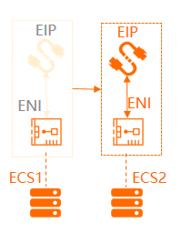
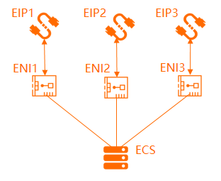

Alibaba Cloud  
Apsara Stack  
Elastic IP Address  
User Guide  
Product Version: V3.18.3  
Document Version: 20241025

**Table of Contents**

- [1.Log on to the EIP console](#section-1)
- [2.Quick start](#section-2)
    - [2.1. Overview](#section-2-1)
    - [2.2. Apply for an EIP](#section-2-2)
    - [2.3. Associate an EIP with an ECS instance](#section-2-3)
    - [2.4. Disassociate an EIP from an ECS instance](#section-2-4)
    - [2.5. Release an EIP](#section-2-5)
- [3.EIP overview](#section-3)
- [4.Manage EIPs](#section-4)
    - [4.1. Apply for an EIP](#section-4-1)
    - [4.2. Bind an EIP to a cloud instance](#section-4-2)
        - [4.2.1. Associate an EIP with an ECS instance](#section-4-2-1)
        - [4.2.2. Associate an EIP with an SLB instance](#section-4-2-2)
        - [4.2.3. Associate an EIP with an HAVIP](#section-4-2-3)
        - [4.2.4. Associate an EIP with a NAT gateway](#section-4-2-4)
        - [4.2.5. Associate an EIP with a secondary ENI](#section-4-2-5)
            - [4.2.5.1. Overview](#section-4-2-5-1)
            - [4.2.5.2. Associate an EIP with a secondary ENI in NAT mode](#section-4-2-5-2)
    - [4.3. Modify the maximum bandwidth](#section-4-3)
    - [4.4. Disassociate an EIP from a cloud resource](#section-4-4)
    - [4.5. Release an EIP](#section-4-5)
- [5.O&M and Monitoring](#section-5)
    - [5.1. Manage tags](#section-5-1)
    - [5.2. View operation logs](#section-5-2)

# 1.Log on to the EIP console

This topic describes how to log on to the Apsara Uni-manager Management Console to manage your elastic IP addresses (EIPs). The Google Chrome browser is used as an example.

**Prerequisites**

- The URL of the Apsara Uni-manager Management Console is obtained from the deployment personnel before you log on to the Apsara Uni-manager Management Console.

- A browser is available. We recommend that you use the Google Chrome browser.

**Procedure**

1. In the address bar, enter the URL of the Apsara Uni-manager Management Console. Press the Enter key.

2. Enter your username and password.

   Obtain the username and password that you can use to log on to the console from the operations administrator.

   > **Note**
   >
   > When you log on to the Apsara Uni-manager Management Console for the
   >
   > first time, you must change the password of your username. Your password must meet complexity requirements. The password must be 8 to 20 characters in length and must contain at least two of the following character types:
   >
   > - Uppercase or lowercase letters
   >
   > - Digits
   >
   > - Special characters, which include ! @ # $ %

3. Click **Login**.

4. If MFA is enabled for your account, perform the required operations based on the scenario:

   - **This is your first time logging on to the Apsara Uni-manager Management Console after MFA is enabled by the administrator.**

     <ol type="a">

     <li>

     On the Bind Virtual MFA Device page, follow the on-screen instructions to bind an MFA device.

     </li>

     <li>

     Enter the username and password again as in Step 2 and click **Log On**.

     </li>

     </ol>

     <ol type="i" start="100">

     <li>

     Enter a six-digit MFA verification code and click **Authenticate**.

     </li>

     </ol>

   - **You have enabled MFA and bound an MFA device.**

     Enter a six-digit MFA verification code and click **Authenticate**.

5. In the top navigation bar, choose **Products > Networking > Elastic IP Address**.

# 2.Quick start

## 2.1. Overview

This topic describes how to create an elastic IP address (EIP) and associate the EIP with an Elastic Compute Service (ECS) instance. This allows the ECS instance to access the Internet.

This topic includes the following operations:

1. Apply for an EIP

   An EIP is a public IP address that you can purchase and use as an independent resource. Before you get started, you must apply for an EIP.

2. Associate an EIP with an ECS instance

   You can associate the EIP with an ECS instance that is deployed in a virtual private cloud (VPC). After the ECS instance is associated with an EIP, the ECS instance can communicate with the Internet.

3. Disassociate an EIP from an ECS instance

   If you do not want the ECS instance to access the Internet, you can disassociate the EIP from the ECS instance.

4. Release an EIP

   You can release an EIP that you no longer need.

## 2.2. Apply for an EIP

This topic describes how to apply for an elastic IP address (EIP). An EIP is a public IP address that you can create and use as an independent resource.

**Procedure**

1. Log on to the EIP console.

2. On the **Elastic IP Addresses** page, click **Create EIP**.

3. On the **Create EIP** page, set the following parameters and click **Submit**.

   | Parameter | Description |
   | --- | --- |
   | Organization | Select the organization to which the EIP belongs. |
   | Resource Set | Select the resource set to which the EIP belongs. |
   | Region | Select the region in which you want to create the EIP. Make sure that the EIP and the cloud resource to be associated with the EIP are deployed in the same region. |
   | Quantity | Specify the number of EIPs that you want to create. |
   | Name | Enter a name for the EIP. |
   | Line Type | Select the line type of the EIP. The default type is <strong>BGP</strong>. You can select another type based on your requirements. |
   | Network Type | Select a network type for the EIP. • <strong>Internet</strong>: The EIP is used for communication over the Internet. • <strong>Hybrid Cloud</strong>: The EIP is used to establish communication within a hybrid cloud. For example, if you want to allow a data center to access the Internet by using SNAT and DNAT, you must select this type. |
   | Service IP Address | Specify the IP address of the EIP. Make sure that you enter an idle IPv4 address. If the IPv4 address is already in use, your application fails. Note If you do not specify an IPv4 address, the system randomly allocates one. |
   | Maximum Bandwidth | Specify the maximum bandwidth of the EIP. Unit: Mbit/s. |

**Related operations**

| Page | Operation |
| --- | --- |
| EIP list page | On the <strong>Elastic IP Addresses</strong> page, you can change the organization and region in the top navigation bar to view all created EIPs. You can perform the following operations on an EIP: • Associate an EIP with a resource • Change specifications • Disassociate an EIP from a cloud resource • Release an EIP You can also perform the following operations on the Elastic IP Addresses page: • <strong>Filter EIPs</strong>: Select and enter a filter condition from the drop-down list above the EIP list, and then click the Search icon to filter EIPs. You can also click <strong>Advanced Filter</strong> to enter a filter condition and click <strong>Search</strong> to filter EIPs. • <strong>Modify an EIP</strong>: Find the EIP, click the pencil icon below the EIP ID, modify the name of the EIP, and then click <strong>OK</strong>. • <strong>Export EIP information</strong>: In the upper-right corner of the <strong>Elastic IP</strong> <strong>Addresses</strong> page, click theicon, specify the download path, and then click <strong>Download</strong> to export the EIP information. |
| EIP details page | On the <strong>Elastic IP Addresses</strong> page, click the ID of the EIP. On the EIP details page, you can view the basic information about the EIP. You can also perform the following operations on an EIP: • <strong>Associate with a resource</strong>: Click <strong>Binding Resource</strong> to associate the EIP with a resource. For more information, see Associate an EIP with a resource. • <strong>Modify the configuration</strong>: Click <strong>Modify Configurations</strong> to change the maximum bandwidth of the EIP. |

## 2.3. Associate an EIP with an ECS instance

This topic describes how to associate an elastic IP address (EIP) with an Elastic Compute Service (ECS) instance in a virtual private cloud (VPC). After an ECS instance is associated with an EIP, the ECS instance can communicate with the Internet.

**Prerequisites**

An ECS instance is created. For more information, see the **Create an instance by using the provided wizard** topic in the **Quick Start** chapter of **ECS User Guide**.

**Procedure**

1. Log on to the EIP console.

2. In the top navigation bar, select the region where the EIP is deployed.

3. On the **Elastic IP Addresses** page, find the EIP that you want to manage, and click **Binding resource** in the **Operation** column.

4. In the **Bind elastic public network IP to resources** dialog box, set the following parameters and click **OK**.

   | Parameter | Description |
   | --- | --- |
   | Instance type | Select <strong>ECS instance</strong>. |
   | Binding mode | Select the mode in which you want to associate the EIP.You can select only <strong>Normal mode</strong>, which specifies the NAT mode. In NAT mode: • Both the private IP address and public IP address of the ECS instance are available for use. • The EIP is not displayed in the operating system. To query the EIP of the ECS instance, call the DescribeInstances operation. • The EIP does not support NAT application layer gateway (ALG) protocols such as H.323, Session Initiation Protocol (SIP), Domain Name System (DNS), Real-Time Streaming Protocol (RTSP), and Trivial File Transfer Protocol (TFTP). |
   | Select the to bind | Select the ECS instance with which you want to associate the EIP.Make sure that the following requirements are met: • The ECS instance is deployed in a VPC. • The ECS instance is in the Running or Stopped state. • Each ECS instance can be associated only with one EIP. • The ECS instance and the EIP are created in the same region. • The ECS instance is not assigned a static public IP address or associated with an EIP. |

## 2.4. Disassociate an EIP from an ECS instance

This topic describes how to disassociate an elastic IP address (EIP) from an Elastic Compute Service (ECS) instance. After the EIP is disassociated from the ECS instance, the ECS instance can no longer access the Internet by using the EIP.

**Procedure**

1. Log on to the EIP console.

2. In the top navigation bar, select the region where the EIP is deployed.

3. On the **Elastic IP Addresses** page, find the EIP that you want to disassociate and click **Unbind** in the **Actions** column.

4. In the message that appears, click **OK**.

## 2.5. Release an EIP

This topic describes how to release an elastic IP address (EIP) that you no longer need.

**Prerequisites**

The EIP is not associated with a cloud resource. For more information, see Disassociate an EIP from a cloud resource.

**Procedure**

1. Log on to the EIP console.

2. In the top navigation bar, select the region where the EIP is deployed.

3. On the **Elastic IP Addresses** page, find the EIP that you want to release and click **Release** in the **Actions** column.

4. In the **Release EIP** message, click **OK**.

# 3.EIP overview

An elastic IP address (EIP) is a public IP address that you can purchase and use as an independent resource. You can associate an EIP with an Elastic Compute Service (ECS) instance, an internal-facing Server Load Balancer (SLB) instance, or a secondary elastic network interface (ENI) deployed in a virtual private cloud (VPC). You can also associate an EIP with a NAT gateway or a high-availability virtual IP address (HAVIP).

An EIP is a NAT IP address provisioned in the Internet-facing gateway of Alibaba Cloud and is mapped to the associated cloud resource by using NAT. After an EIP is associated with a cloud resource, the cloud resource can use the EIP to communicate with the Internet.

**Differences between an EIP and the static public IP address of an ECS instance**

The following table describes the differences between an EIP and the static public IP address of an ECS instance.

| Item | EIP | Static public IP address |
| --- | --- | --- |
| Supported network | VPC | VPC |
| Used as an independent resource | Supported | Not supported |
| Associated with and disassociated from an ECS instance at any time | Supported | Not supported |
| Displayed in the ENI information of the associated ECS instance | No | No |

**Benefits**

EIPs have the following benefits:

- Purchase and use as independent resources

  You can purchase and use an EIP as an independent resource. EIPs are not bundled with other computing or storage resources.

- Associate with resources at any time

  You can associate an EIP with a cloud resource as needed. You can also disassociate and release an EIP at any time.

- Modify bandwidth limits on demand

  You can modify the bandwidth limit of an EIP at any time to meet your business requirements. The modification immediately takes effect.

# 4.Manage EIPs

## 4.1. Apply for an EIP

This topic describes how to apply for an elastic IP address (EIP). An EIP is a public IP address that you can create and use as an independent resource.

**Procedure**

1. Log on to the EIP console.

2. On the **Elastic IP Addresses** page, click **Create EIP**.

3. On the **Create EIP** page, set the following parameters and click **Submit**.

   | Parameter | Description |
   | --- | --- |
   | Organization | Select the organization to which the EIP belongs. |
   | Resource Set | Select the resource set to which the EIP belongs. |
   | Region | Select the region in which you want to create the EIP. Make sure that the EIP and the cloud resource to be associated with the EIP are deployed in the same region. |
   | Quantity | Specify the number of EIPs that you want to create. |
   | Name | Enter a name for the EIP. |
   | Line Type | Select the line type of the EIP. The default type is <strong>BGP</strong>. You can select another type based on your requirements. |
   | Network Type | Select a network type for the EIP. • <strong>Internet</strong>: The EIP is used for communication over the Internet. • <strong>Hybrid Cloud</strong>: The EIP is used to establish communication within a hybrid cloud. For example, if you want to allow a data center to access the Internet by using SNAT and DNAT, you must select this type. |
   | Service IP Address | Specify the IP address of the EIP. Make sure that you enter an idle IPv4 address. If the IPv4 address is already in use, your application fails. Note If you do not specify an IPv4 address, the system randomly allocates one. |
   | Maximum Bandwidth | Specify the maximum bandwidth of the EIP. Unit: Mbit/s. |

**Related operations**

| Page | Operation |
| --- | --- |
| EIP list page | On the <strong>Elastic IP Addresses</strong> page, you can change the organization and region in the top navigation bar to view all created EIPs. You can perform the following operations on an EIP: • Associate an EIP with a resource • Change specifications • Disassociate an EIP from a cloud resource • Release an EIP You can also perform the following operations on the Elastic IP Addresses page: • <strong>Filter EIPs</strong>: Select and enter a filter condition from the drop-down list above the EIP list, and then click the Search icon to filter EIPs. You can also click <strong>Advanced Filter</strong> to enter a filter condition and click <strong>Search</strong> to filter EIPs. • <strong>Modify an EIP</strong>: Find the EIP, click the pencil icon below the EIP ID, modify the name of the EIP, and then click <strong>OK</strong>. • <strong>Export EIP information</strong>: In the upper-right corner of the <strong>Elastic IP</strong> <strong>Addresses</strong> page, click theicon, specify the download path, and then click <strong>Download</strong> to export the EIP information. |
| EIP details page | On the <strong>Elastic IP Addresses</strong> page, click the ID of the EIP. On the EIP details page, you can view the basic information about the EIP. You can also perform the following operations on an EIP: • <strong>Associate with a resource</strong>: Click <strong>Binding Resource</strong> to associate the EIP with a resource. For more information, see Associate an EIP with a resource. • <strong>Modify the configuration</strong>: Click <strong>Modify Configurations</strong> to change the maximum bandwidth of the EIP. |

## 4.2. Bind an EIP to a cloud instance

### 4.2.1. Associate an EIP with an ECS instance

This topic describes how to associate an elastic IP address (EIP) with an Elastic Compute Service (ECS) instance in a virtual private cloud (VPC). After an ECS instance is associated with an EIP, the ECS instance can communicate with the Internet.

**Prerequisites**

An ECS instance is created. For more information, see the **Create an instance by using the provided wizard** topic in the **Quick Start** chapter of **ECS User Guide**.

**Procedure**

1. Log on to the EIP console.

2. In the top navigation bar, select the region where the EIP is deployed.

3. On the **Elastic IP Addresses** page, find the EIP that you want to manage, and click **Binding resource** in the **Operation** column.

4. In the **Bind elastic public network IP to resources** dialog box, set the following parameters and click **OK**.

   | Parameter | Description |
   | --- | --- |
   | Instance type | Select <strong>ECS instance</strong>. |
   | Binding mode | Select the mode in which you want to associate the EIP.You can select only <strong>Normal mode</strong>, which specifies the NAT mode. In NAT mode: • Both the private IP address and public IP address of the ECS instance are available for use. • The EIP is not displayed in the operating system. To query the EIP of the ECS instance, call the DescribeInstances operation. • The EIP does not support NAT application layer gateway (ALG) protocols such as H.323, Session Initiation Protocol (SIP), Domain Name System (DNS), Real-Time Streaming Protocol (RTSP), and Trivial File Transfer Protocol (TFTP). |
   | Select the to bind | Select the ECS instance with which you want to associate the EIP.Make sure that the following requirements are met: • The ECS instance is deployed in a VPC. • The ECS instance is in the Running or Stopped state. • Each ECS instance can be associated only with one EIP. • The ECS instance and the EIP are created in the same region. • The ECS instance is not assigned a static public IP address or associated with an EIP. |

### 4.2.2. Associate an EIP with an SLB instance

This topic describes how to associate an elastic IP address (EIP) with a Server Load Balancer (SLB) instance. After you associate an EIP with an SLB instance, the SLB instance can forward requests from the Internet.

**Prerequisites**

An SLB instance is created. For more information, see the **Create an SLB instance** topic in the **Quick Start** chapter of **SLB User Guide**.

**Procedure**

1. Log on to the EIP console.

2. In the top navigation bar, select the region where the EIP is deployed.

3. On the **Elastic IP Addresses** page, find the EIP that you want to manage and click **Bind Resource** in the **Actions** column.

4. In the **Associate EIP with Resource** dialog box, set the following parameters and click **OK**.

   | Parameter | Description |
   | --- | --- |
   | Instance Type | Select <strong>SLB Instance</strong>. |
   | Select an instance to associate. | Select the SLB instance with which you want to associate the EIP.Make sure that the following requirements are met: • The SLB instance must be deployed in a VPC. • The SLB instance and the EIP must belong to the same region. • You can associate only one EIP with each SLB instance. |

### 4.2.3. Associate an EIP with an HAVIP

This topic describes how to associate an elastic IP address (EIP) with a high-availability virtual IP address (HAVIP) so that the HAVIP can communicate with the Internet.

**Prerequisites**

An HAVIP is created. For more information, see the **Create an HAVIP** topic in the **HAVIP** section of the **VPC User Guide**.

**Procedure**

1. Log on to the EIP console.

2. In the top navigation bar, select the region where the EIP is deployed.

3. On the **Elastic IP Addresses** page, find the EIP that you want to manage, and click **Binding resource** in the **Operation** column.

4. In the **Associate EIP with Resource** dialog box, set the following parameters and click **OK**.

   | Parameter | Example |
   | --- | --- |
   | Instance Type | Select <strong>HAVIP</strong>. |
   | Select an instance to associate | Select the HAVIP to be associated with the EIP. Make sure that the following requirements are met: • The HAVIP and the EIP must belong to the same region. • The HAVIP must be in the Available or Allocated state. • An HAVIP can be associated with only one EIP. |

### 4.2.4. Associate an EIP with a NAT gateway

This topic describes how to associate an elastic IP address (EIP) with a NAT gateway. After you associate an EIP with a NAT gateway, you can specify the EIP in DNAT or SNAT entries.

**Prerequisites**

A NAT gateway is created. For more information, see the **Create a NAT gateway** topic in the **Quick Start** chapter of **NAT Gateway User Guide**.

**Procedure**

1. Log on to the EIP console.

2. In the top navigation bar, select the region where the EIP is deployed.

3. On the **Elastic IP Addresses** page, find the EIP that you want to manage and click **Bind Resource** in the **Actions** column.

4. In the **Associate EIP with Resource** dialog box, set the following parameters and click **OK**.

   | Parameter | Description |
   | --- | --- |
   | Instance Type | Select <strong>NAT Gateway</strong>. |
   | Select an instance to associate. | Select the NAT gateway with which you want to associate the EIP. The NAT gateway and the EIP must be created in the same region. |

### 4.2.5. Associate an EIP with a secondary ENI

#### 4.2.5.1. Overview

This topic describes how to associate an elastic IP address (EIP) with an elastic network interface (ENI). If you associate EIPs with ENIs and associate the ENIs with an Elastic Compute Service (ECS) instance, the ECS instance can use multiple EIPs. This improves the availability, flexibility, and scalability of your service.

Each ENI is assigned a private IP address. After you associate an EIP with an ENI, the ENI can send and receive network traffic through both a private IP address and a public IP address. If you migrate an ENI that is associated with an EIP from an ECS instance to another ECS instance, both the private and public IP addresses of the ENI are migrated. This solution allows you to migrate the IP addresses of an ECS instance without affecting the reliability and availability of your service.

You can associate multiple ENIs with an ECS instance. You can associate each ENI with an EIP. This way, the ECS instance has multiple public IP addresses. The ECS instance can use the EIPs to provide Internet-facing services. You can configure security group rules for the ECS instance to control access from the Internet.

**Association modes**

You can associate an EIP with an ENI in NAT mode. The following table describes the features in NAT mode.

| Feature | NAT mode |
| --- | --- |
| Whether the EIP is displayed on the ENI in the operating system | No |
| Types of ENIs that can be associated with EIPs | Primary ENI and secondary ENI |
| Number of EIPs that can be associated with a primary ENI | 1 |
| Number of EIPs that can be associated with a secondary ENI | Based on the number of private IP addresses of the secondary ENI Note Each EIP is mapped to a private IP address of a secondary ENI. If a secondary ENI is assigned 10 private IP addresses, at most 10 EIPs can be associated with the secondary ENI. |
| Whether private network features of a secondary ENI are available after an EIP is associated with the secondary ENI | Yes |
| Supported protocols | EIPs deployed as NAT application layer gateways (ALGs) do not support protocols such as H.323, Session Initiation Protocol (SIP), DNS, or Real Time Streaming Protocol (RTSP). |

#### 4.2.5.2. Associate an EIP with a secondary ENI in NAT mode

This topic describes how to associate an elastic IP address (EIP) with a secondary elastic network interface (ENI) in NAT mode. After you associate an EIP with a secondary ENI, both the private IP address and public IP address of the secondary ENI are available. The EIP is not displayed on the secondary ENI.

**Prerequisites**

Before you associate an EIP with a secondary ENI in NAT mode, make sure that the following requirements are met:

- A secondary ENI is created in a virtual private cloud (VPC). The secondary ENI and the EIP that you want to associate with the secondary ENI are created in the same region. For more information, see the **Create an ENI** topic in the **Elastic Network Interface** chapter of **ECS User Guide**.

- The secondary ENI is not associated with an Elastic Compute Service (ECS) instance. If the secondary ENI is associated with an ECS instance, disassociate the secondary ENI from the ECS instance, associate the EIP with the secondary ENI in NAT mode, and then associate the secondary ENI with the ECS instance. For more information, see the **Disassociate a secondary ENI from an ECS instance** topic in the **Elastic Network Interface** chapter of **ECS User Guide**.

**Procedure**

1. Log on to the EIP console.

2. In the top navigation bar, select the region where the EIP is deployed.

3. On the **Elastic IP Addresses** page, find the EIP that you want to manage, and click **Binding resource** in the **Actions** column.

4. In the **Bind elastic public network IP to resources** dialog box, set the following parameters and click **OK**.

   | Parameter | Description |
   | --- | --- |
   | Instance type | Select <strong>ECS instance</strong>. |
   | Binding mode | Select <strong>Normal mode</strong>.In NAT mode: • The number of EIPs that can be associated with a secondary ENI depends on the number of private IP addresses that are assigned to the secondary ENI. • The private IP address and public IP address of the secondary ENI are available for use. • The EIP is not displayed in the operating system. To query the EIP, call the DescribeEipAddresses operation. • The EIP does not support NAT application layer gateway (ALG) protocols such as H.323, Session Initiation Protocol (SIP), Domain Name System (DNS), Real-Time Streaming Protocol (RTSP), and Trivial File Transfer Protocol (TFTP). |
   | Select the to bind | Select the secondary ENI with which you want to associate the EIP.Make sure that the secondary ENI meets the following requirements: • The secondary ENI is deployed in a VPC. • The secondary ENI and the EIP belong to the same region. |

## 4.3. Modify the maximum bandwidth

This topic describes how to upgrade the maximum bandwidth of an elastic IP address (EIP). After you upgrade the maximum bandwidth of an EIP, the new maximum bandwidth immediately takes effect.

**Procedure**

1. Log on to the EIP console.

2. In the top navigation bar, select the region where the EIP is deployed.

3. On the **Elastic IP Addresses** page, find the EIP that you want to manage and click **Modify Configuration** in the **Actions** column.

4. On the **Change Specifications** page, specify a new maximum bandwidth value and click **Submit**.

## 4.4. Disassociate an EIP from a cloud resource

This topic describes how to disassociate an elastic IP address (EIP) from a cloud resource. After the EIP is disassociated from the cloud resource, the cloud resource can no longer access the Internet by using the EIP.

**Procedure**

1. Log on to the EIP console.

2. In the top navigation bar, select the region where the EIP is deployed.

3. On the **Elastic IP Addresses** page, disassociate an EIP from an instance or disassociate multiple EIPs from instances at a time.

   - To disassociate an EIP from an instance, click **Disassociate** in the **Actions** column.

     > **Note**
     >
     > - If you want to disassociate the EIP from a NAT gateway, make sure that the EIP is not specified in a DNAT or SNAT entry. You can also click **Forcefully Disassociate from NAT Gateway** in the **Actions** column. Then, the system automatically disassociates the EIP from the DNAT or SNAT entry, and disassociates the EIP from the NAT gateway.
     >
     > - You can also click the EIP ID to go to the details page. On the **Basic Information** tab, click **Disassociate Resources**.

   - To disassociate multiple EIPs at a time, select the EIPs and click **Disassociate** at the bottom.

4. In the message that appears, click **OK**.

## 4.5. Release an EIP

This topic describes how to release an elastic IP address (EIP) that you no longer need.

**Prerequisites**

The EIP is not associated with a cloud resource. For more information, see Disassociate an EIP from a cloud resource.

**Procedure**

1. Log on to the EIP console.

2. In the top navigation bar, select the region where the EIP is deployed.

3. On the **Elastic IP Addresses** page, release an EIP or multiple EIPs at a time based on the following information.

   - To release an EIP, find the EIP and click **Release** in the **Actions** column.

   - To release multiple EIPs at a time, select the EIPs and click **Release** at the bottom.

4. In the **Release** dialog box, click **Release**.

# 5.O&M and Monitoring

## 5.1. Manage tags

Elastic IP Address (EIP) supports tags. You can use tags to mark and classify EIPs. This facilitates the management of EIPs.

**Overview**

The management of EIPs becomes more difficult as the number of EIPs increases. You can use tags to group EIPs. This allows you to search for and filter EIPs in a more efficient way.

Tags are used to classify instances. Each tag consists of a key and a value. To use tags, make sure that the following requirements are met:

- The keys of tags that are added to the same instance must be unique.

- You cannot create tags without adding them to instances. All tags must be added to instances.

- Tag information is not shared across regions.

- You can add up to 20 tags to each EIP.

**Add tags**

**Add tags to an EIP**

1. Log on to the EIP console.

2. In the top navigation bar, select the region where the EIP is deployed.

3. On the **Elastic IP Addresses** page, find the EIP that you want to manage, move the pointer over the **-** icon or the right side of an existing tag in the **Tag** column, and click the pencil icon that appears.

4. In the **Edit Tag** dialog box, click **Add**, set the following parameters, and then click **OK**.

   | Parameter | Description |
   | --- | --- |
   | Tag Key | Specify a tag key. You can select or enter a tag key. The tag key cannot exceed 64 characters in length, and cannot start with <code> aliyun </code> or <code> acs: </code>. The tag key cannot contain <code> http:// </code> or <code> https:// </code>. |
   | Tag Value | Specify a tag value. You can select or enter a tag value. The tag value cannot exceed 128 characters in length, and cannot start with <code> aliyun </code> or <code> acs: </code>. The tag value cannot contain <code> http:// </code> or <code> https:// </code>. |

   In the **Edit Tag** dialog box, click **Add** multiple times to add multiple tags to the EIP.

5. In the **The tagging operation succeeds** dialog box, confirm the EIP and the associated tags, and click **OK**.

**Add tags to EIPs**

1. Log on to the EIP console.

2. In the top navigation bar, select the region where the EIP is deployed.

3. On the **Elastic IP Addresses** page, select the EIPs to which you want to add tags, and click **Add Tags** in the lower part of the page.

4. In the **Add Tags** dialog box, set the following parameters and click **OK**.

   | Parameter | Description |
   | --- | --- |
   | Tag Key | Specify a tag key. You can select or enter a tag key. The tag key cannot exceed 64 characters in length, and cannot start with <code> aliyun </code> or <code> acs: </code>. The tag key cannot contain <code> http:// </code> or <code> https:// </code>. |
   | Tag Value | Specify a tag value. You can select or enter a tag value. The tag value cannot exceed 128 characters in length, and cannot start with <code> aliyun </code> or <code> acs: </code>. The tag value cannot contain <code> http:// </code> or <code> https:// </code>. |

   In the **Add Tags** dialog box, click **Add** multiple times to add multiple tags to the selected EIPs.

5. In the **The tagging operation succeeds** dialog box, confirm the EIPs and the associated tags, and click **OK**.

**Search for EIPs by tag**

After you add tags to EIPs, you can search for the EIPs by tag.

1. Log on to the EIP console.

2. In the top navigation bar, select the region where the EIP is deployed.

3. On the **Elastic IP Addresses** page, click **Tag Filter**.

4. In the dialog box that appears, select or enter a key-value pair. You can select or enter a key-value pair or a tag key. At most 20 tags can be specified for each search.

**Remove tags**

If an EIP no longer needs a tag, you can remove the tag from the EIP. Before you remove tags, take note of the following items:

- Up to 20 tags can be removed at a time.

- If a tag is added to more than one EIP and you remove the tag from an EIP, the tag is not removed from other EIPs.

Remove tags from an EIP

1. Log on to the EIP console.

2. In the top navigation bar, select the region where the EIP is deployed.

3. On the **Elastic IP Addresses** page, find the EIP that you want to manage, move the pointer over the right side of an existing tag in the **Tag** column, and click the pencil icon that appears.

4. In the **Edit Tag** dialog box, find the tag that you want to remove, click the

   icon next to

   

   the tag, and then click **OK**. In the Edit Tag dialog box, you can also add tags to the EIP.

5. In the **The tagging operation succeeds** dialog box, confirm the EIP and the removed tags, and click **OK**.

**Remove tags from EIPs**

1. Log on to the EIP console.

2. In the top navigation bar, select the region where the EIP is deployed.

3. On the **Elastic IP Addresses** page, select the EIPs from which you want to remove tags, and click **Remove Tags** in the lower part of the page.

4. In the **Remove Tags** dialog box, find the tag that you want to remove, click the

   icon

   

   next to the tag, and then click **OK**.

5. In the **The tagging operation succeeds** dialog box, confirm the EIPs and the removed tags, and click **OK**.

## 5.2. View operation logs

This topic describes how to view the operation logs of an elastic IP address (EIP) to track and analyze operations.

**Procedure**

1. Log on to the EIP console.

2. In the top navigation bar, select the region where the EIP is deployed.

3. On the **Elastic IP Addresses** page, click the ID of the EIP.

4. On the Instance Details page, click the **Operation Logs** tab.

5. On the **Operation Logs** tab, view operation logs.

   You can filter operation logs by **Operation Name** and **Operator**. The following filter conditions are supported.

   | Filtering condition | Description |
   | --- | --- |
   | Operator | Specify the operator. |
   | Operation | Specify the API name. |
   | Execution status | Select <strong>Success</strong> or <strong>Failed</strong>. |
   | Operation Source IP | Specify the source IP address. |
   | Operation Time | Specify the time range that you want to query. |

6. **Optional**: Find the event that you want to view and click **Operation Details** in the **Operation** column to view details.
