Alibaba Cloud  
Apsara Stack  
Express Connect  
Operations and Maintenance  
Guide  
Product Version: v3.18.6-2607  
Document Version: 20260828

**Table of Contents**

- [1.Log on to the Apsara Uni-manager Operations Console](#section-1)
- [2.Leased line management](#section-2)
    - [2.1. Leased line dashboard](#section-2-1)
    - [2.2. Leased line group](#section-2-2)
    - [2.3. Access point management](#section-2-3)
    - [2.4. Access device management](#section-2-4)
    - [2.5. Manage physical connections](#section-2-5)
    - [2.6. VBR management](#section-2-6)
    - [2.7. Router interface management](#section-2-7)
    - [2.8. Route table management](#section-2-8)

# 1.Log on to the Apsara Uni-manager Operations Console

This topic describes how users such as O&M engineers log on to the Apsara Uni-manager Operations Console.

**Prerequisites**

- The endpoint of the Apsara Uni-manager Operations Console and the username and password that are used to log on to the console are obtained from a deployment engineer or an administrator.

  The endpoint of the Apsara Uni-manager Operations Console is in the following format: *regi on-id*.ops.console.*intranet-domain-id*.

- A web browser is available. We recommend that you use Google Chrome.

**Procedure**

1. Open your browser.

2. In the address bar, enter the endpoint of the Apsara Uni-manager Operations Console. Press the ENTER key.

   

   > **Note**
   >
   > You can click the current language in the upper-right corner to switch to another language. Simplified Chinese, English, and traditional Chinese are supported.

3. Enter the username and password.

   > **Note**
   >
   > - Obtain the username and password that are used to log on to the Apsara Uni-manager Operations Console from a deployment engineer or an administrator.
   >
   > - If you enter an invalid password for three consecutive times, the system enables the image verification logon feature. If you enter an invalid password for five consecutive times, the account is locked. Contact the administrator to activate the account.

   If this is the first time you log on to the Apsara Uni-manager Operations Console, you must change the password as prompted.

   To enhance security, your password must meet the following requirements:

   - The password contains uppercase and lowercase letters.

   - The password contains digits.

   - The password contains at least one of the following special characters: ! @ # $ %

   - The password is 10 to 20 characters in length.

4. Click **Log In**.

# 2.Leased line management

## 2.1. Leased line dashboard

The Apsara Uni-manager Operations Console allows you to manage virtual private cloud (VPC), Data Center Interconnect (DCI), and interconnection leased lines. You can also view the monitoring data of the leased lines.

**Procedure**

1. Log in to the Apsara Uni-manager Operations Console.

2. In the top navigation bar, choose **Product Operation** > **Networking** > **Network Operations Console**.

3. In the left-side navigation pane, choose **Basic Network** > **Leased Line Management** > **Leased Line Dashboard**.

4. In the upper part of the Leased Line Instances page, view the number of alerting instances, number of normal instances, and percentage of normal instances for **VPC Private Links**, **DCI Express Connect Circuits**, and **Connected Leased Lines**.

   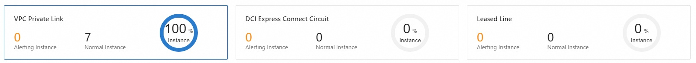

5. Click **VPC Private Links** to view the following information:

   - On the **Hosted Connections** tab, view the access point overview and the list of VPC leased lines.

     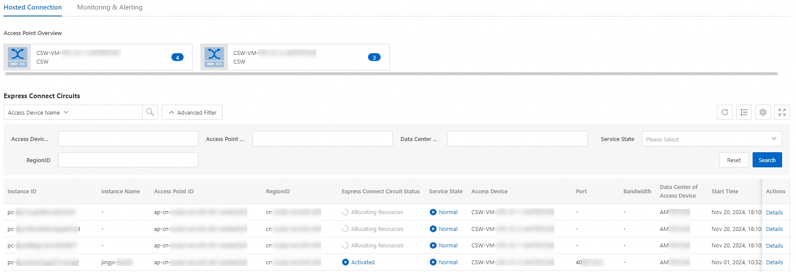

     - In the **Hosted Connections** section, click **Advanced Filter** to filter VPC leased lines by **Access Device Name**, **Access Point ID**, **Data Center of Access Device**, **Service Status**, **Region ID**, or their combinations.

     - In the **Hosted Connections** section, find the leased line that you want to view and click **Details** in the **Actions** column to view the details of the leased line.

       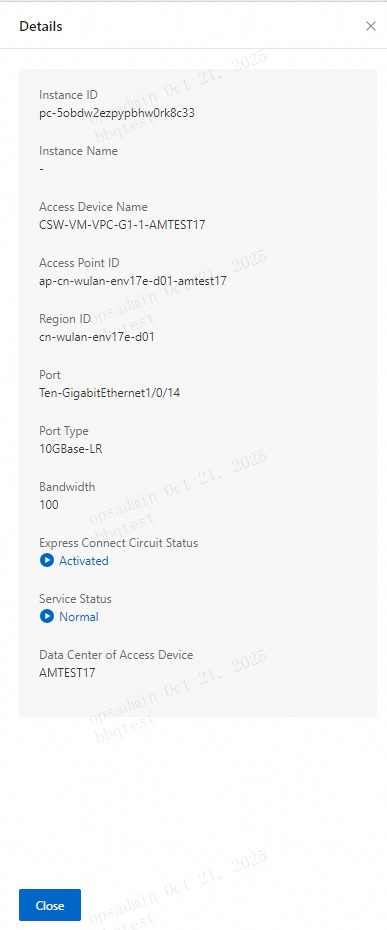

   - On the **Monitoring & Alerting** tab, view the monitoring and alerting information of the leased lines.

     Click **Details** in the **Alert Details** column of an alert to view its details.

     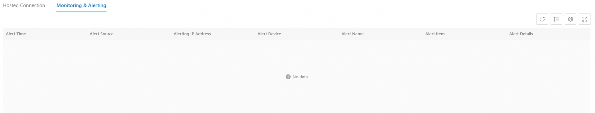

6. Click **DCI Express Connect Circuits** to view the following information:

   - On the **Hosted Connections** tab, view the DCI interconnection topology and the list of DCI Express Connect circuits.

     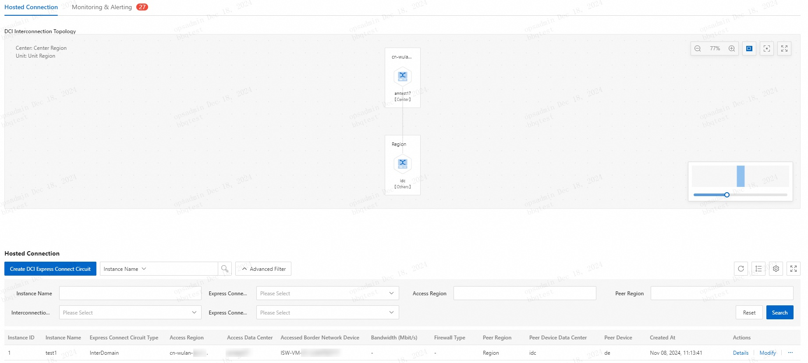

     - In the **Hosted Connections** section, click **Advanced Filter** to filter DCI Express Connect circuits by **Instance Name**, **Express Connect Circuit Type**, **Access Region**, **Peer Region**, **Interconnection Type on both Sides of the Express Connect Circuit**, **Express Connect Circuit Status**, or their combinations.

     - In the **Hosted Connections** section, find the DCI Express Connect circuit that you want to view and click **Details** in the **Actions** column to view the details of the DCI Express Connect circuit.

     - In the **Hosted Connections** section, you can also perform the following operations:

       - **Create a DCI Express Connect circuit**

         Click **Create DCI Express Connect Circuit**. In the dialog box that appears, configure the following parameters and click **OK**.

         **Section**

         **Parameter**

         **Description**

         **Express Connect**

         Enter a name for the Express Connect circuit.

         **Circuit Name**

         The type of the Express Connect circuit. Valid values:

         **Express Connect Circuit Type**

         - **InterDomain**

         - **IntraDomain**

         The region ID of the source access point of

         **Region**

         the DCI Express Connect circuit.

         The data center to which the source access

         **Data Center**

         point of the DCI Express Connect circuit belongs.

         **Local Basic Settings**

         The Internet service provider (ISP) that

         **Carrier**

         provides the DCI Express Connect circuit service.

         The source access point of the DCI Express

         **Access Device**

         Connect circuit.

         **Port**

         The port of the source access point.

         **Port Type**

         The port type of the source access point.

         **Express Connect**

         The bandwidth of the DCI Express Connect

         **Circuit Bandwidth**

         circuit. Unit: MB.

         The direct connection status of the DCI Express Connect circuit. Valid values:

         **Direct Connection Status**

         - **Firewall**

         - **Direct Connect**

         The type of the firewall. This parameter takes effect only if you set the **Direct Connection Status** parameter to **Firewall**.

         Valid values:

         **Firewall Type**

         - **Cloud Firewall**

         **Direct Connection**

         - **User Firewall**

         **Attributes and Firewall**

         - **Other**

         **Information**

         The name of the firewall device. This parameter takes effect only if you set the

         **Firewall Name**

         **Direct Connection Status** parameter to **Firewall**.

         The description of the firewall device. This parameter takes effect only if you set the

         **Firewall Remarks**

         **Direct Connection Status** parameter to **Firewall**.

         <table>
           <tr>
             <td rowspan="5">Peer Basic Settings</td>
             <td>Peer Region</td>
             <td>The region ID of the destination access point of the DCI Express Connect circuit.</td>
           </tr>
           <tr>
             <td>Peer Data Center</td>
             <td>The data center to which the destination access point of the DCI Express Connect circuit belongs.</td>
           </tr>
           <tr>
             <td>Peer Device</td>
             <td>The destination access point of the DCI Express Connect circuit.</td>
           </tr>
           <tr>
             <td>Peer Port</td>
             <td>The port of the destination access point.</td>
           </tr>
           <tr>
             <td>Peer Port Type</td>
             <td>The port type of the destination access point.</td>
           </tr>
           <tr>
             <td rowspan="5">Other Settings</td>
             <td>Local IP Address</td>
             <td>The CIDR block of the source access point.Set the value in the IP address/mask format.</td>
           </tr>
           <tr>
             <td>Peer IP Address</td>
             <td>The CIDR block of the destination access point. Set the value in the IP address/mask format.</td>
           </tr>
           <tr>
             <td>Status</td>
             <td>Specifies whether to enable or disable the DCI Express Connect circuit immediately after it is created.</td>
           </tr>
           <tr>
             <td>Associate Express Connect Circuit Group</td>
             <td>The group to which the DCI Express Connect circuit belongs. If no group is available, you can click <strong>Create</strong> <strong>Express Connect Circuit Group</strong> to create one. For more information, see Leased line group.</td>
           </tr>
           <tr>
             <td>Remarks</td>
             <td>The description of the DCI Express Connect circuit.</td>
           </tr>
         </table>

       - **Modify a DCI Express Connect circuit**

         Find the DCI Express Connect circuit that you want to modify and click **Modify** in the **Actions** column. In the dialog box that appears, modify the parameters based on your business requirements and click **OK**.

       - **Delete a DCI Express Connect circuit**

         > **Note**
         >
         > After you delete a DCI Express Connect circuit, it cannot be recovered. Proceed with caution.

         Find the DCI Express Connect circuit that you want to delete, and click  **> Delete**

         in the **Actions** column. In the message that appears, click **OK**.

       - **Perform quick diagnostics**

         Find the DCI Express Connect circuit that you want to manage, move the pointer over

         the  icon in the **Actions** column, and then select **Quick Diagnostics**. The

         **Network Instance Diagnostics Results** page appears. For more information, see Network instance diagnosis.

   - On the **Monitoring & Alerting** tab, view the monitoring and alerting information of DCI Express Connect circuits.

     Click **Details** in the **Alert Details** column of an alert to view its details.

     

7. Click **Connected Leased Lines** to view the following information:

   - On the **Hosted Connections** tab, view the interconnection leased line topology and the list of interconnection leased lines.

     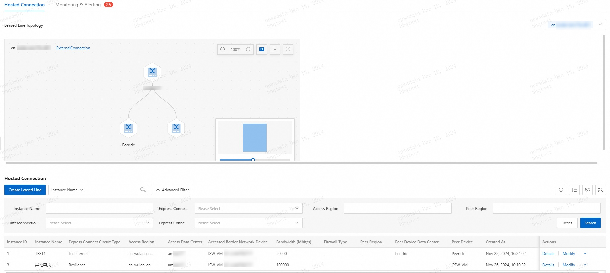

     In the **Hosted Connections** section, you can also perform the following operations:

     - Click **Advanced Filter** to filter leased lines by **Instance Name**, **Express Connect Circuit Type**, **Access Region**, **Peer Region**, **Interconnection Type on both Sides of the Express Connect Circuit**, **Express Connect Circuit Status**, or their combinations.

     - **View the details of a leased line**: Find the leased line that you want to view and click **Details** in the **Actions** column to view the details of the leased line.

     - **Create a leased line**: Click **Create Leased Line**. In the dialog box that appears, configure the parameters and click **OK**.

       For more information about the parameters, see Create a DCI Express Connect circuit.

     - **Modify a leased line**: Find the leased line that you want to modify and click **Modify** in the **Actions** column. In the dialog box that appears, modify the parameter settings based on your business requirements and click **OK**.

     - **Delete a leased line**: Find the leased line that you want to delete, move the pointer

       over the  icon in the **Actions** column, and then select **Delete**. In the message that

       appears, click **Delete**.

       > **Note**
       >
       > After you delete a leased line, it cannot be recovered. Proceed with caution.

     - **Perform quick diagnostics**: Find the leased line that you want to manage, move the

       pointer over the  icon in the **Actions** column, and then select **Quick Diagnostics**.

       The **Network Instance Diagnostics Results** page appears. For more information, see Network instance diagnosis.

   - On the **Monitoring & Alerting** tab, view the monitoring and alerting information of leased lines.

     Click **Details** in the **Alert Details** column of an alert to view its details.

     

## 2.2. Leased line group

Leased line management allows you to manage groups of data center interconnection (DCI) leased lines and interconnection leased lines.

**Create a leased line group**

1. Log in to the Apsara Uni-manager Operations Console.

2. In the top navigation bar, choose **Product Operation** > **Networking** > **Network Operations Console**.

3. In the left-side navigation pane, choose **Basic Network** > **Leased Line Management** > **Leased Line Groups**.

4. On the **Leased Line Group Management** page, click **Create Express Connect Circuit Group**.

5. In the **Create Express Connect Circuit Group** dialog box, configure the following parameters.

   | Parameter | Description |
   | --- | --- |
   | Express Connect Circuit Group Name | The name of the leased line group. |
   | Express Connect Circuit Group Type | The type of the leased line group. Valid values: • <strong>DCInterConnection</strong>: DCI leased line • <strong>ExternalConnection</strong>: interconnection leased line |
   | Region | The ID of the source region of the leased line group. |
   | Data Center | The name of the source data center of the leased line group. |
   | PeerRegion | The ID of the destination region of the leased line group after you specify <strong>Express Connect Circuit Group Type</strong>. |
   | Peer Data Center | The name of the destination data center of the leased line group after you specify <strong>Express Connect Circuit Group Type</strong>. |
   | Remarks | The remarks of the leased line group. |

   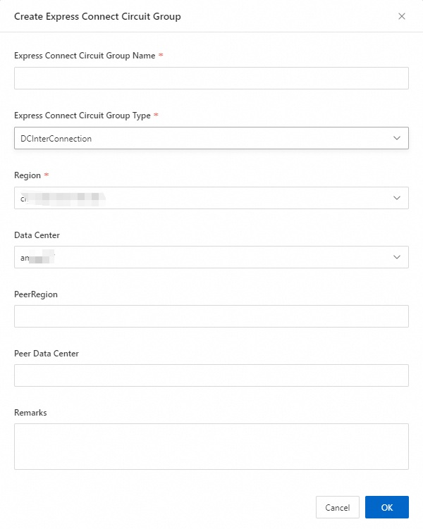

6. Click **OK**.

**View the details of a leased line group**

1. On the **Leased Line Group Management** page, view the details of the created leased line group, including **Group Name**, **Group Type**, **Source Region ID**, **Source IDC**, **Peer Region ID**, **Peer IDC**, **Remarks**, **Created At**, and **Last Updated At**.

   - On the Leased Line Group Management page, click **Advanced Filter** to filter leased line groups by **Group Name**, **Group Type**, **Source Region ID**, **Source IDC**, **Peer Region ID**, **Peer IDC**, **Remarks**, or their combinations.

     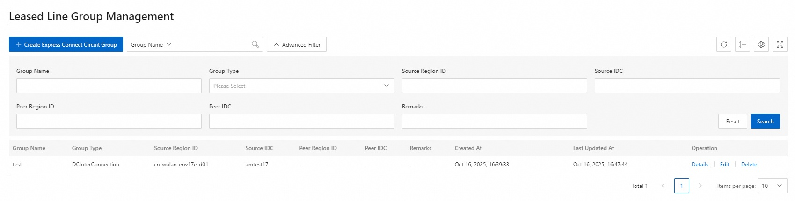

   - Find the leased line group that you want to view and click **Details** in the **Actions** column. On the **Leased Line Group Details** page, view the information in the **Group Details** and **Associate Hosted Connection** sections.

     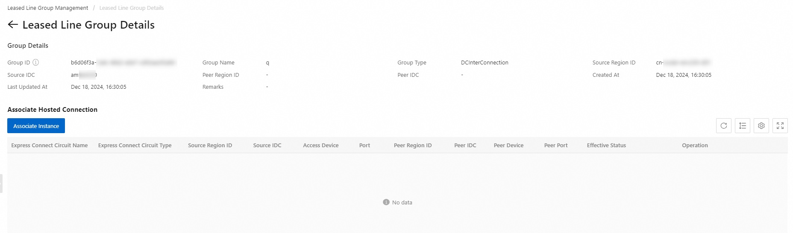

     **Associate Hosted Connection**

     In the **Associate Hosted Connection** section, you can perform the following operations:

     - **Associate the leased line group with a leased line**: Click **Associate Instance**. In the Associate Instance dialog box, specify the **Express Connect Circuit Group Type** and **Associated Hosted Connection** parameters and click **OK**.

       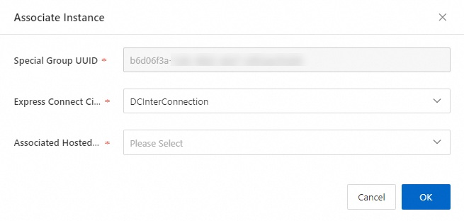

     - **View the details of the associated leased line**: Find the associated leased line and click **Details** in the **Actions** column.

       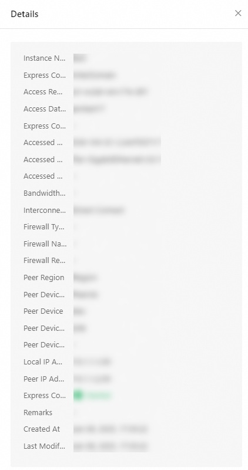

     - **Disassociate the leased line group from the leased line**: Find the leased line that you want to disassociate and click **Disassociate** in the **Actions** column. In the message that appears, click **OK**.

**Related operations**

| Operation | Description |
| --- | --- |
| Edit a leased line group | 1. On the <strong>Leased Line Group Management</strong> page, find the leased line group that you want to modify and click <strong>Edit</strong> in the <strong>Actions</strong> column. 2. In the dialog box that appears, modify the parameter settings and click <strong>OK</strong>. For more information about the parameters, see Create a DCI Express Connect circuit. |
| Delete a leased line group | 1. On the <strong>Leased Line Group Management</strong> page, find the leased line group that you want to delete and click <strong>Delete</strong> in the <strong>Actions</strong> column. 2. In the message that appears, click <strong>OK</strong>. Note This operation deletes the leased line group and disassociates the leased line group from leased lines. Proceed with caution. |

## 2.3. Access point management

Access points are Apsara Stack data centers located in different regions. One or more access points are deployed in each region. This topic describes how to manage access points.

**Procedure**

1. Log in to the Apsara Uni-manager Operations Console.

2. In the top navigation bar, choose **Product Operation** > **Networking** > **Network Operations Console**.

3. In the left-side navigation pane, choose **Basic Network** > **Leased Line Management** > **Access Point Management**.

4. On the **Access Point Management** page, view the following information about access points: **Access Point ID**, **Management Region**, **Physical Region**, **Type**, **Status**, **Access Point Name**, **Description**, **Physical Location**, **Data Center Operator**, **Created At**, and **Modified At**.

   You can filter access points by **Access Point ID**.

   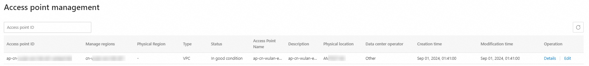

   - **View the details of an access point**

     Find the access point that you want to manage and click **Details** in the **Actions** column to view the details of the access point.

     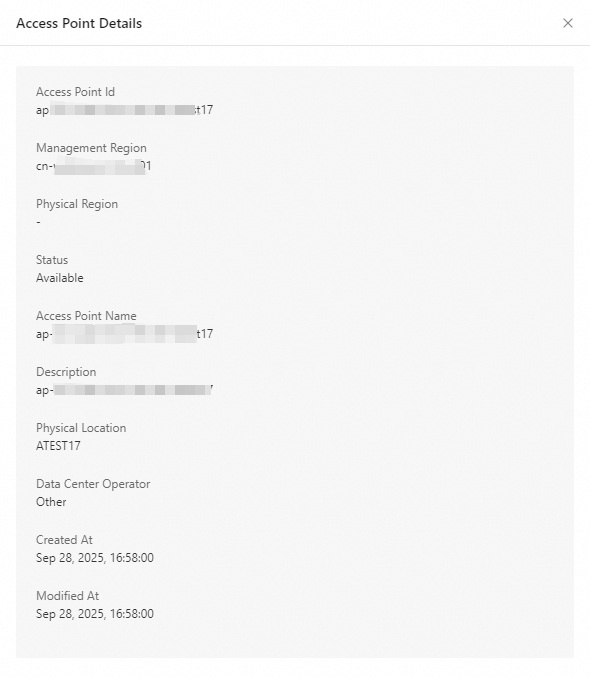

   - **Modify an access point**

     <ol type="a">

     <li>

     Find the access point that you want to manage and click **Edit** in the **Actions** column.

     </li>

     <li>

     In the **Edit Access Point** dialog box, modify the following parameters based on your business requirements and click **OK**.

     | Parameter | Description |
     | --- | --- |
     | Access Point ID | The ID of the access point. This parameter cannot be modified. |
     | Access Point Name | The name of the access point. You can enter a new name. The name must be 2 to 256 characters in length and cannot start with <code> http:// </code> or <code> https:// </code>. |
     | Description | The description of the access point. You can modify the description. The description must be 2 to 256 characters in length and cannot start with <code> http:// </code> or <code> https:// </code>. |
     | Access Point Status | The status of the access point. Valid values: • Available • Busy • Full • Unavailable |
     | Physical Location | The location of the access point. |
     | Data Center Operator | The Internet service provider (ISP) of the data center to which the access point belongs. |
     | Physical Region | The region ID of the access point. |

     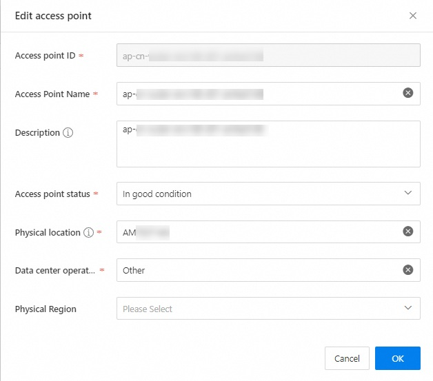

     </li>

     </ol>

## 2.4. Access device management

This topic describes how to manage access devices.

**Procedure**

1. Log in to the Apsara Uni-manager Operations Console.

2. In the top navigation bar, choose **Product Operation** > **Networking** > **Network Operations Console**.

3. In the left-side navigation pane, choose **Basic Network** > **Leased Line Management** > **Access Device Management**.

4. On the **Access Device Management** page, view the following information about access devices: **Device ID**, **Region**, **Access Point ID**, **Device Status**, **Physical Location**, **Access Method**, **Device Name**, **Description**, **Created At**, and **Modified At**.

   You can filter access devices by **Device ID**.

   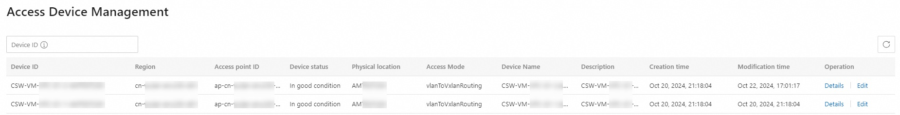

   - **View the details of an access device**

     Find the access device that you want to view and click **Details** in the **Actions** column to view the details of the access device.

     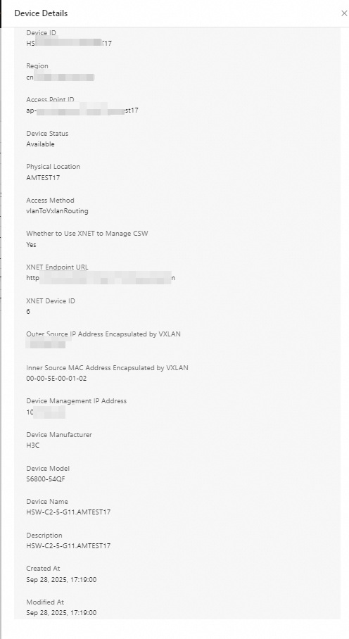

   - **Modify the information about an access device**

     <ol type="a">

     <li>

     On the Access Device Management page, find the access device that you want to manage and click **Edit** in the **Actions** column.

     </li>

     <li>

     In the **Edit Access Device** dialog box, modify the parameters that are described in the following table and click **OK**.

     | Parameter | Description |
     | --- | --- |
     | Device ID | The ID of the access device. This parameter cannot be modified. |
     | Device Status | The state of the access device. Valid values: • Available • Full • Unavailable |
     | Device Location | The location of the access device. |
     | Whether to Use XNET to Manage CSW | Specifies whether to use XNET to manage Customer Switches (CSWs). Valid values: • Yes • No |
     | XNET Endpoint URL | The URL of the XNET endpoint. |
     | XNET Device ID | The ID of the XNET device. |
     | Outer Source IP Address Encapsulated by VXLAN | The outer source IP address encapsulated by Virtual Extensible Local Area Network (VXLAN). |
     | Inner Source MAC Address Encapsulated by VXLAN | The inner source MAC address encapsulated by VXLAN. |
     | Device Management IP Address | The management IP address of the access device. |
     | Device Manufacturer | The manufacturer of the access device. |
     | Device Model | The model of the access device. |
     | Device Name | The name of the access device. |
     | Description | The description of the access device. |

     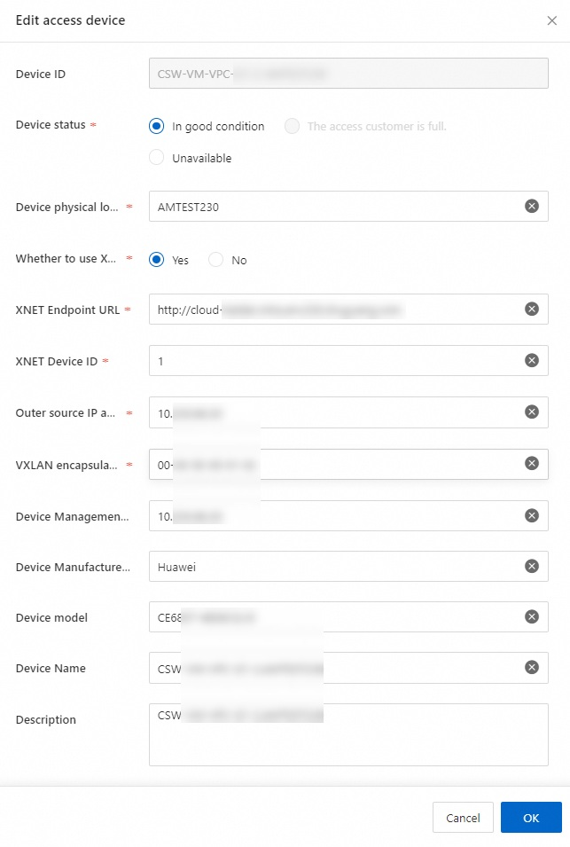

     </li>

     </ol>

## 2.5. Manage physical connections

You can establish a physical connection by using a leased line from a carrier to connect your on-premises data center to an Alibaba Cloud access point. This topic describes how to manage physical connections.

**Procedure**

1. Log on to the Apsara Uni-manager O&M Console.

2. In the top navigation bar, choose **Product O&M** > **Network O&M** > **Network O&M Console**.

3. In the left-side navigation pane, choose **Basic Network** > **Express Connect** > **Physical Connections**.

4. On the **Physical Connections** page, click **Create Physical Connection**.

5. In the **Create Physical Connection** dialog box, configure the following parameters, and then click **OK**.

   | Parameter | Description |
   | --- | --- |
   | Physical connection name | Enter a custom name for the physical connection. Must be 2 to 128 characters long and cannot start with <code> http:// </code> or <code> https:// </code>. |
   | Description | Enter a description for the physical connection. The value must be 2 to 128 characters in length and cannot start with <code> http:// </code> or <code> https:// </code>. |
   | BID | Enter the BID. The default value is <strong>26842</strong>. |
   | Account ID | Enter the account ID that owns the VPC you want to connect. |
   | Access point type | Select the access point type. Currently, only <strong>VPC Access Point</strong> is supported. <strong>VPC access point</strong>: A VPC-to-VPC access point that accepts leased line access to VPCs. |
   | Access point ID | Select the Alibaba Cloud access point closest to your on-premises data center. |
   | Access port type | Select the port type for the connection. |
   | Device name | Enter the name of the CSW device. The value must be 2 to 256 characters long and cannot start with <code> http:// </code> or <code> https:// </code>. |
   | Device port | Select the physical port on the CSW device. |
   | Access bandwidth | The connection bandwidth in Mbps. The value must be an integer from 2 to 10,000. |
   | Redundant physical connection | To create a redundant connection, enter the ID of an existing physical connection. If you specify a redundant physical connection ID, Alibaba Cloud provisions the new connection on separate hardware to ensure high availability. The specified physical connection must be in the Approved, Confirmed, or Enabled state. |

   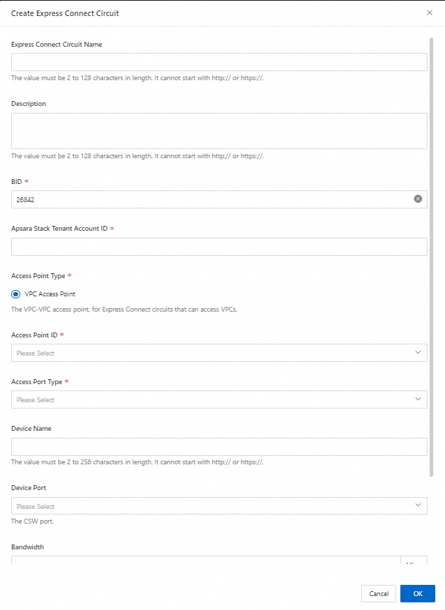

6. Once the physical connection is created, you can view its details, including **Account ID**, **Instance ID**, **Access point ID**, **Device ID**, **Connection status**, **Service status**, **Physical connection name**, **Description**, **Carrier**, **Access bandwidth**, **Access port type**, **Physical port**, **Peer IP address**, **Redundant physical connection**, **Enabled time**, and **Creation time**.

   - After creation, the **connection status** is **In Progress**. The status changes to **Confirmed** when the connection is successfully established.

   - You can quickly find a specific physical connection by filtering by **Status**, **BID**, **Account ID**, or **Instance ID**.

   - The **Status** filter supports the following options: **Pending**, **Approved**, **In Progress**, **Provisioned**, **Confirmed**, **Enabled**, **Canceled**, **Rejected**, **Terminated**, and **Deleted**.

**Additional operations**

| Actions | Description |
| --- | --- |
| Enable physical connection | 1. On the <strong>Physical Connections</strong> page, find the desired physical connection and click <strong>Enable</strong> in the <strong>Actions</strong> column. 2. In the confirmation dialog box, click <strong>OK</strong>. Note This operation is supported only for physical connections with a <strong>connection status</strong> of <strong>Confirmed</strong>. |
| Cancel physical connection | 1. On the <strong>Physical Connections</strong> page, find the desired physical connection and click <strong>Cancel</strong> in the <strong>Actions</strong> column. 2. In the confirmation dialog box, click <strong>OK</strong>. Note This operation is supported for physical connections whose <strong>connection</strong> <strong>status</strong> is <strong>Pending</strong>, <strong>Provisioned</strong>, <strong>Approved</strong>, or <strong>Confirmed</strong>. |
| Terminate physical connection | 1. On the <strong>Physical Connections</strong> page, find the desired physical connection and click <strong>Terminate</strong> in the <strong>Actions</strong> column. 2. In the confirmation dialog box, click <strong>OK</strong>. Note This operation is supported for physical connections with a <strong>Connection</strong> <strong>status</strong> of <strong>Enabled</strong>. |
| Delete physical connection | 1. On the <strong>Physical Connections</strong> page, find the desired physical connection and click <strong>Delete</strong> in the <strong>Actions</strong> column. 2. In the confirmation dialog box, click <strong>OK</strong>. Note This operation is supported for physical connections whose <strong>connection</strong> <strong>status</strong> is <strong>Rejected</strong>, <strong>Canceled</strong>, or <strong>Terminated</strong>. |
| Approve physical connection | 1. On the <strong>Physical Connections</strong> page, find the desired physical connection and click <strong>Approve</strong> in the <strong>Actions</strong> column. 2. In the confirmation dialog box, click <strong>OK</strong>. Note You can perform this operation on physical connections that have a <strong>Connection Status</strong> of <strong>Pending</strong>. |
| Reject physical connection | 1. On the <strong>Physical Connections</strong> page, find the desired physical connection and click <strong>Reject</strong> in the <strong>Actions</strong> column. 2. In the confirmation dialog box, click <strong>OK</strong>. Note This operation is supported for physical connections whose <strong>connection</strong> <strong>status</strong> is <strong>Pending</strong>. |
| Confirm physical connection | 1. On the <strong>Physical Connections</strong> page, find the desired physical connection and click <strong>Confirm</strong> in the <strong>Actions</strong> column. 2. In the confirmation dialog box, click <strong>OK</strong>. Note Only physical connections with a <strong>connection status</strong> of <strong>Provisioned</strong> support this operation. |

## 2.6. VBR management

A virtual border router (VBR) functions as a router between a customer-premises equipment (CPE) device and a virtual private cloud (VPC). VBRs route traffic between VPCs and data centers. This topic describes how to manage VBRs.

**Procedure**

1. Log in to the Apsara Uni-manager Operations Console.

2. In the top navigation bar, choose **Product Operation** > **Networking** > **Network Operations Console**.

3. In the left-side navigation pane, choose **Basic Network** > **Leased Line Management** > **VBR Management**.

4. On the **VBR Management** page, click **Create VBR**.

5. In the **Create VBR** dialog box, configure the following parameters and click **OK**.

   | Parameter | Description |
   | --- | --- |
   | BID | The bound ID. Default value: <strong>26842</strong>. |
   | Apsara Stack Tenant Account ID | The account ID of the VPC to which you want to connect the VBR. |
   | Region | The ID of the region in which the VBR is deployed. |
   | Express Connect Circuit ID | The ID of the Express Connect circuit that you want to connect to the VBR. |
   | VLAN ID | The VLAN ID of the VBR on the Express Connect circuit side. Valid values: 1 to 2999. Only the owner of the Express Connect circuit can specify or modify this VLAN ID. |
   | Local IP Address | The local IP address of the Express Connect circuit. This parameter is required when the Express Connect circuit is not in the waiting state. Only the owner of the VBR can specify or modify this parameter. |
   | Peer IP Address | The peer IP address of the Express Connect circuit. This parameter is required when the Express Connect circuit is not in the waiting state. Only the owner of the VBR can specify or modify this parameter. |
   | Subnet Mask | The subnet mask for the connection between the local and peer IP addresses of the Express Connect circuit. This parameter is required when the Express Connect circuit is not in the waiting state. Only the owner of the VBR can specify or modify this parameter. |
   | VBR Name | The name of the VBR. The name must be 2 to 128 characters in length and cannot start with <code> http:// </code> or <code> https:// </code>. |
   | Description | The description of the VBR. The description must be 2 to 128 characters in length and cannot start with <code> http:// </code> or <code> https:// </code>. |
   | Owner Bid | The bound ID of the VBR owner. |
   | Owner AliUid | The Apsara Stack account ID of the VBR owner. |

   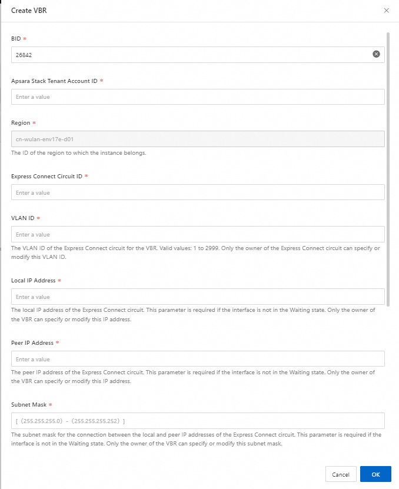

6. After the creation is complete, the **VBR Management** page is displayed. By default, the list does not display data. You can filter and view the desired VBRs based on your business requirements.

   - Click **Advanced Filter** to filter VBRs by **BID**, **UID**, and **VBR ID**.

   - On the VBR Management page, you can view the following information about VBRs: **VBR ID**, **VLAN ID**, **VLAN Interface ID**, **Status**, **Route Table ID**, **Local IP Address**, **Peer IP Address**, **Subnet Mask**, **VBR Name**, **Description**, **Express Connect Circuit ID**, **Service Status**, **Access Point ID**, **Device ID**, and **Source**.

   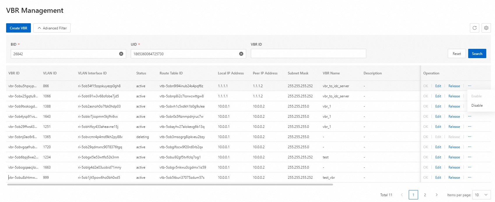

**Related operations**

| Operation | Description |
| --- | --- |
| Confirm | 1. On the <strong>VBR Management</strong> page, find the VBR that you want to manage and click <strong>OK</strong> in the <strong>Actions</strong> column. 2. In the message that appears, click <strong>OK</strong>. Note This operation is supported for VBRs whose <strong>Status</strong> is <strong>unconfirmed</strong>. |

<table>
  <tr>
    <td>Modify a VBR</td>
    <td>1. On the <strong>VBR Management</strong> page, find the VBR that you want to manage and click <strong>Edit</strong> in the <strong>Actions</strong> column. 2. In the dialog box that appears, modify the parameter settings and click <strong>OK</strong>. 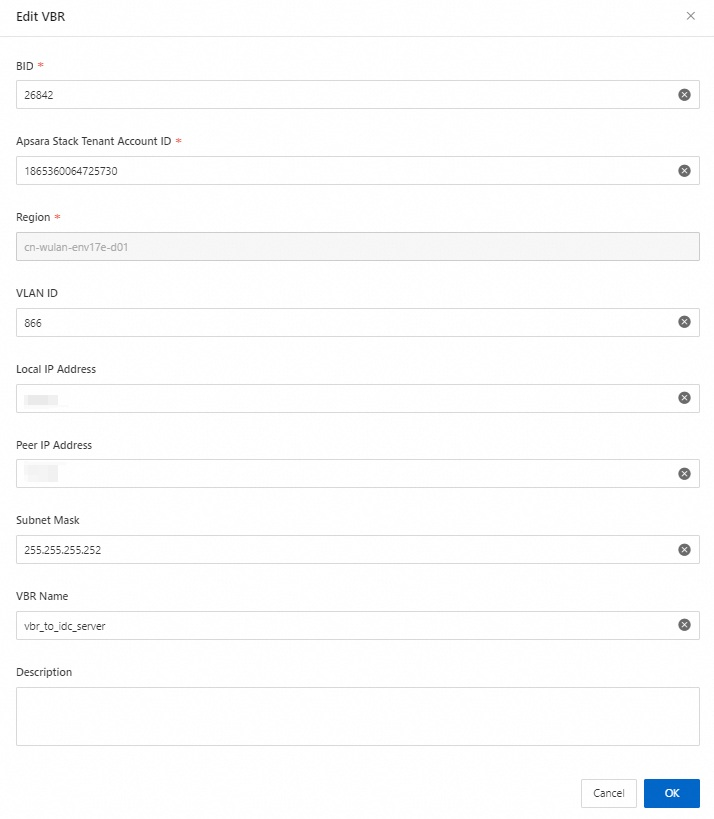 Note This operation is supported for VBRs whose <strong>Status</strong> is <strong>active</strong>, <strong>terminated</strong>, or <strong>unconfirmed</strong>.</td>
  </tr>
  <tr>
    <td>Release a VBR</td>
    <td>1. On the <strong>VBR Management</strong> page, find the VBR that you want to manage and click <strong>Release</strong> in the <strong>Actions</strong> column. 2. In the message that appears, click <strong>OK</strong>. Note • This operation is supported for VBRs whose <strong>Status</strong> is <strong>active</strong> or <strong>terminated</strong>. • VBRs whose <strong>Status</strong> is <strong>active</strong> cannot be released directly.You must disable them before you release them.</td>
  </tr>
  <tr>
    <td>Enable a VBR</td>
    <td>1. On the <strong>VBR Management</strong> page, find the VBR that you want to manage and click <strong>Enable</strong> in the <strong>Actions</strong> column. 2. In the message that appears, click <strong>OK</strong>. Note This operation is supported for VBRs whose <strong>Status</strong> is <strong>terminated</strong>.</td>
  </tr>
  <tr>
    <td>Disable a VBR</td>
    <td>1. On the <strong>VBR Management</strong> page, find the VBR that you want to manage and click <strong>Disable</strong> in the <strong>Actions</strong> column. 2. In the message that appears, click <strong>OK</strong>. Note This operation is supported for VBRs whose <strong>Status</strong> is <strong>active</strong>.</td>
  </tr>
</table>

## 2.7. Router interface management

After you create a virtual border router (VBR), you must create a router interface or a pair of router interfaces to connect the VBR to a virtual private cloud (VPC). This topic describes how to manage router interfaces.

**Procedure**

1. Log in to the Apsara Uni-manager Operations Console.

2. In the top navigation bar, choose **Product Operation** > **Networking** > **Network Operations Console**.

3. In the left-side navigation pane, choose **Basic Network** > **Leased Line Management** > Router Interface Management.

4. On the **Router Interface Management** page, click **Create Router Interface** to open the **Create Router Interface** page.

5. In the **Local Information** step, configure the following parameters and click **Next Step**.

   | Parameter | Description |
   | --- | --- |
   | Create Router Type | The type of the router interface that you want to create. Valid values: • Single • Pair |
   | Name | The name of the router interface. |
   | Description | The description of the router interface. |
   | BID | The bound ID. Default value: <strong>26842</strong>. |
   | UID | The UID of the VPC that you want to connect to the router interface. |
   | Region | The region ID of the router interface. |
   | Router Type | The type of the local router. • VRouter • VBR |
   | Zone | The zone of the router interface. |
   | Router ID | The ID of the local router. |
   | Access Point ID | The region ID of the local access point. Note This parameter is required if you set the <strong>Router Type</strong> parameter to VBR. |
   | Role | The role of the router interface. Valid values: • <strong>InitiatingSide</strong>: initiator • <strong>AcceptingSide</strong>: acceptor Note This parameter is required if you set the <strong>Router Type</strong> parameter to <strong>VRouter</strong>. |
   | Specifications | The specifications of the router interface. |
   | Health Check Source IP Address | The source IP address that is used for health checks. Note This parameter is required if you set the <strong>Router Type</strong> parameter to <strong>VRouter</strong> and set the <strong>Role</strong> parameter to <strong>AcceptingSide</strong>. |
   | Health Check Destination IP Address | The destination IP address that is used for health checks. Note This parameter is required if you set the <strong>Router Type</strong> parameter to <strong>VRouter</strong> and set the <strong>Role</strong> parameter to <strong>AcceptingSide</strong>. |
   | Skip Inventory Check | Specifies whether to skip inventory check. Valid values: • Yes • No |

   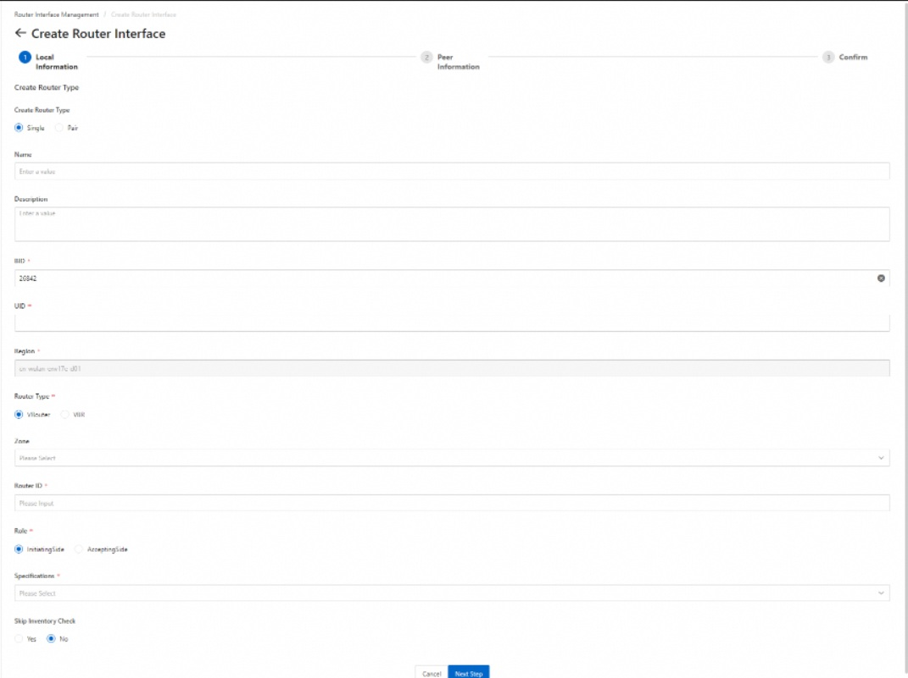

6. In the **Peer Information** step, configure the following parameters and click **Next Step**.

   - **Create a single router interface**

     | Parameter | Description |
     | --- | --- |
     | Region | The region ID of the peer router interface. |

     <table>
       <tr>
         <td>Router Type</td>
         <td>The type of the peer router. The following options are supported: • VRouter • VBR Note • If you set <strong>Router Type</strong> to <strong>VBR</strong> in the <strong>Local</strong> <strong>Information</strong> step, you can select only <strong>VRouter</strong> for <strong>Router Type</strong> in this step. • If you set <strong>Router Type</strong> to <strong>VRouter</strong> and <strong>Role</strong> to <strong>InitiatingSide</strong> in the <strong>Local Information</strong> step, you can select only <strong>VRouter</strong> for <strong>Router Type</strong> in this step.</td>
       </tr>
       <tr>
         <td>Router ID</td>
         <td>The ID of the peer router.</td>
       </tr>
       <tr>
         <td>Router Interface ID</td>
         <td>The ID of the peer router interface.</td>
       </tr>
       <tr>
         <td>Owner ID of Peer Router Interface</td>
         <td>The owner ID of the peer router interface.</td>
       </tr>
     </table>

     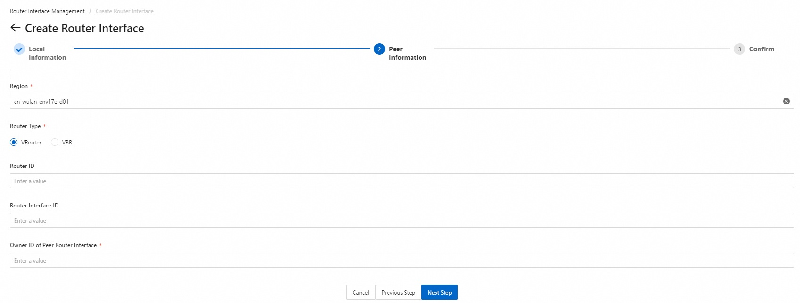

   - **Create a pair of router interfaces**

     | Parameter | Description |
     | --- | --- |
     | Name | The name of the router interface. |
     | Description | The description of the router interface. |
     | Bid | The bound ID. |
     | Uid | The UID of the VPC that you want to connect to the router interface. |
     | Region | The region ID of the router interface. |
     | Router Type | The type of the peer router. The following options are supported: • VRouter • VBR Note • If you set <strong>Router Type</strong> to <strong>VBR</strong> in the <strong>Local</strong> <strong>Information</strong> step, you can select only <strong>VRouter</strong> for <strong>Router Type</strong> in this step. • If you set <strong>Router Type</strong> to <strong>VRouter</strong> and <strong>Role</strong> to <strong>InitiatingSide</strong> in the <strong>Local Information</strong> step, you can select only <strong>VRouter</strong> for <strong>Router Type</strong> in this step. |
     | Zone | The zone of the router interface. Note This parameter is required if you set the <strong>Router Type</strong> parameter for the peer end to <strong>VRouter</strong>. |
     | Router ID | The ID of the peer VPC. |
     | Access Point ID | The region ID of the peer access point. Note This parameter is required if you set the <strong>Router Type</strong> parameter for the peer end to <strong>VBR</strong>. |
     | Role | The role of the peer router. Note • If you set <strong>Router Type</strong> to <strong>VBR</strong> in the <strong>Local</strong> <strong>Information</strong> step, set <strong>Role</strong> to <strong>AcceptingSide</strong> in this step. • If you set <strong>Router Type</strong> to <strong>VRouter</strong> and <strong>Role</strong> to <strong>InitiatingSide</strong> in the <strong>Local Information</strong> step, set <strong>Role</strong> to <strong>AcceptingSide</strong> in this step. • If you set <strong>Router Type</strong> to <strong>VRouter</strong> and <strong>Role</strong> to <strong>AcceptingSide</strong> in the <strong>Local Information</strong> step, set <strong>Role</strong> to <strong>InitiatingSide</strong> in this step. |
     | Specifications | The specifications of the peer router interface. |
     | Skip Inventory Check | Specifies whether to skip inventory check. Valid values: • Yes • No |

     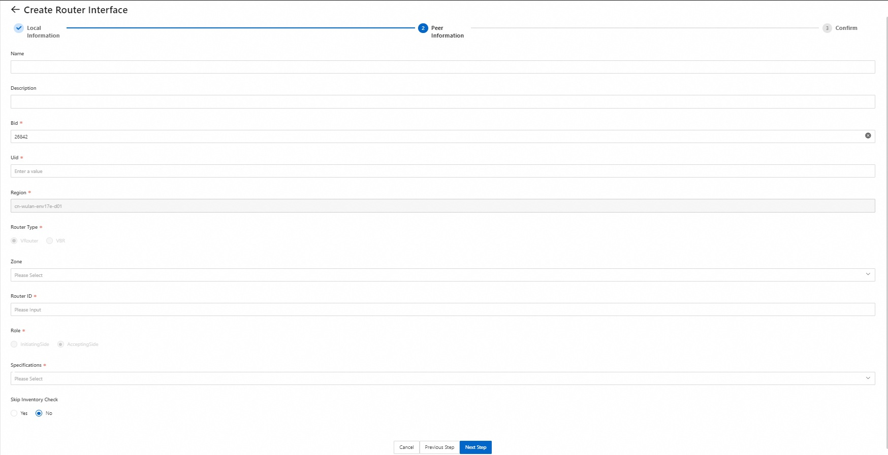

7. In the **Confirm** step, confirm the local information and peer information and then click **Create**.

   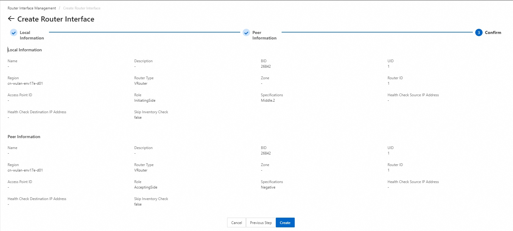

8. After the creation is complete, the **Router Interface Management** page is displayed. By default, the list does not display data. You can filter and view the desired router interfaces based on your business requirements.

   - When the router interface status changes to **Active**, the router interface is created.

   - Click **Advanced Filter** to filter router interfaces by **BID** and **UID**.

   - On the Router Interface Management page, you can view the following information about a router interface: **Local Router ID**, **Local Router Type**, **Local Router Interface ID**, **Local Router Interface Status**, **Local Access Point ID**, **Role**, **Peer Router ID**, **Peer Router Type**, **Peer Router Interface ID**, **Peer Router Interface Status**, **Peer Access Point ID**, **Owner ID of Peer Router Interface**, **GlobalTunnelId**, **Service Status**, **Connected At**, **Created At**, and **Modified At**.

   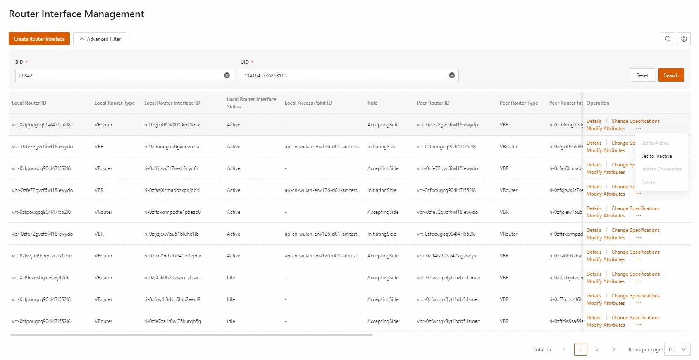

**Related operations**

**View the details of a router interface**

On the **Router Interface Management** page, find the router interface that you want to manage and click **Details** in the **Actions** column.

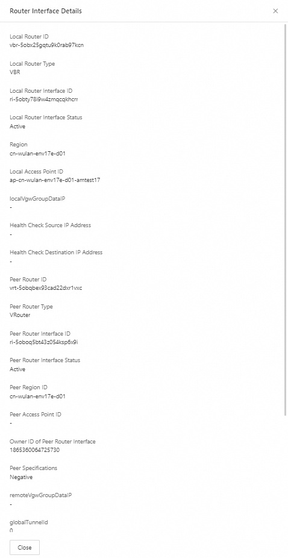

**Modify the specifications of a router interface**

1. On the **Router Interface Management** page, find the router interface that you want to manage and click **Change Specifications** in the **Actions** column.

2. In the dialog box that appears, change the specifications and click **OK**.

   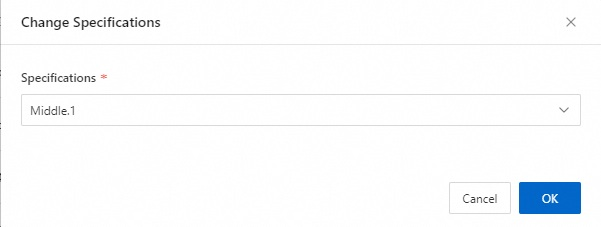

**Modify the attributes of a router interface**

> **Note**
>
> This operation is supported only for a router interface whose **Local Router Interface Status** is **Active**, **Inactive**, or **Idle**.

1. On the **Router Interface Management** page, find the router interface that you want to manage and click **Modify Attributes** in the **Actions** column.

2. In the **Modify Attributes** dialog box, modify the attributes and click **OK**.

   | Parameter | Description |
   | --- | --- |
   | Peer Router Interface ID | The ID of the peer router interface. Note This parameter is required if <strong>Local Router Interface Status</strong> is <strong>Idle</strong>. |
   | Peer Router ID | The ID of the peer router. Note This parameter is required if <strong>Local Router Interface Status</strong> is <strong>Idle</strong>. |
   | Owner ID of Peer Router Interface | The owner ID of the peer router interface. Note This parameter is required if <strong>Local Router Interface Status</strong> is <strong>Idle</strong>. |
   | Health Check Source IP Address | The source IP address that is used for health checks. Note This parameter is required when <strong>Local Router Interface</strong> <strong>Status</strong> is <strong>Active</strong> or <strong>Inactive</strong>, <strong>Local Router Type</strong> is <strong>VRouter</strong>, <strong>Role</strong> is <strong>AcceptingSide</strong>, and <strong>Peer Router Type</strong> is <strong>VBR</strong>. |
   | Health Check Destination IP Address | The destination IP address that is used for health checks. Note This parameter is required when <strong>Local Router Interface</strong> <strong>Status</strong> is <strong>Active</strong> or <strong>Inactive</strong>, <strong>Local Router Type</strong> is <strong>VRouter</strong>, <strong>Role</strong> is <strong>AcceptingSide</strong>, and <strong>Peer Router Type</strong> is <strong>VBR</strong>. |
   | Router Interface Name | The name of the router interface. |
   | Description | The description of the router interface. |

**Set the router interface to Active or Inactive**

> **Note**
>
> - You can set a router interface to **Inactive** only if **Local Router Interface Status** of the router interface is **Active**.
>
> - You can set a router interface to **Active** only if **Local Router Interface Status** of the router interface is **Inactive**.

1. On the **Router Interface Management** page, find the router interface that you want to manage and click **Set to Active** or **Set to Inactive** in the **Actions** column.

2. In the message that appears, click **OK**.

**Initiate a connection on a router interface**

> **Note**
>
> This operation is supported for a router interface whose **Local Router Interface Status** is **Idle** and **Role** is **InitiatingSide** (an acceptor cannot initiate a connection).

1. On the **Router Interface Management** page, find the router interface that you want to manage and click **Initiate Connection** in the **Actions** column.

2. In the message that appears, click **OK**.

**Delete a router interface**

> **Note**
>
> This operation is supported only for a router interface whose **Local Router Interface Status** is **Inactive**.

1. On the **Router Interface Management** page, find the router interface that you want to manage and click **Delete** in the **Actions** column.

2. In the message that appears, click **OK**.

## 2.8. Route table management

A route table contains a set of rules that are called route entries. This topic describes how to manage route tables.

**Procedure**

1. Log in to the Apsara Uni-manager Operations Console.

2. In the top navigation bar, choose **Product Operation** > **Networking** > **Network Operations Console**.

3. In the left-side navigation pane, choose **Basic Network** > **Leased Line Management** > **Route Table Management**.

4. On the **Route Table Management** page, click **Advanced Filter**, specify **BID**, **UID**, **Route Table ID**, **Router ID**, or their combinations, and then click **Search** to search for route tables.

   You can view the following information about route tables: **Route Table ID**, **Router ID**, **Router Type**, **Status**, **Type**, and **Route Entries**.

   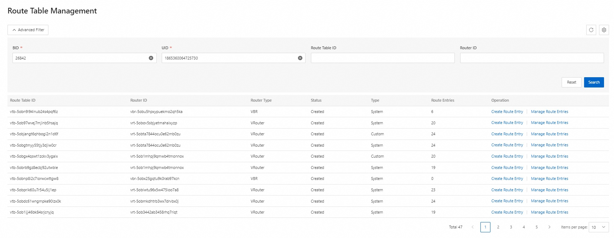

5. Create a route entry.

   <ol type="i">

   <li>

   Find the route table to which you want to add a route entry and click **Create Route Entry** in the **Actions** column.

   </li>

   <li>

   In the dialog box that appears, configure the following parameters and click **OK**.

   </li>

   </ol>

   | Parameter | Description |
   | --- | --- |
   | BID | The bound ID. Default value: <strong>26842</strong>. |
   | Apsara Stack Tenant Account ID | The account ID of the VPC to which you want to connect the VBR. |
   | Route Table ID | The ID of the route table to which the route entry belongs. |
   | Destination CIDR Block | The network mask. Example: 255.255.255.0/24. |
   | ECMP | Specify whether to enable equal-cost multi-path (ECMP) routing. Valid values: • Yes • No |
   | Next Hop Type | The type of the next hop. Valid values: • Instance • Tunnel • Havip • RouterInterface Note If you set <strong>ECMP</strong> to <strong>Yes</strong>, <strong>Next Hop Type</strong> is fixed at <strong>RouterInterface</strong>. |
   | Zone | The zone. Note This parameter is required if you set <strong>ECMP</strong> to <strong>Yes</strong>. |
   | Next Hop ID | The next hop interface ID for the route entry. Note This parameter is required if you set <strong>ECMP</strong> to <strong>No</strong>. |

   <table>
     <tr>
       <td>Next Hops</td>
       <td>The next hop list. • <strong>Next Hop ID</strong>: The next hop interface ID for the route entry. • <strong>Weight</strong>: The weight. Note • This parameter is required if you set <strong>ECMP</strong> to <strong>Yes</strong>. • Click <strong>Add Entry</strong> to add multiple next hops. • Click the icon in the <strong>Actions</strong> column of a next hop to delete the  next hop.</td>
     </tr>
   </table>

   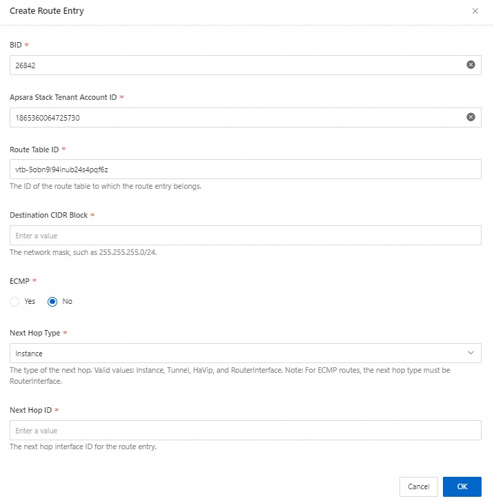

   > **Note**
   >
   > You can obtain **Next Hop ID** from **VLAN Interface ID** on the **VBR Management** page.

6. Manage route entries.

   <ol type="i">

   <li>

   Find the route table that you want to manage and click **Manage Route Entries** in the **Actions** column.

   </li>

   <li>

   In the **Manage Route Entries** panel, view **Route Entries**.

   </li>

   </ol>

   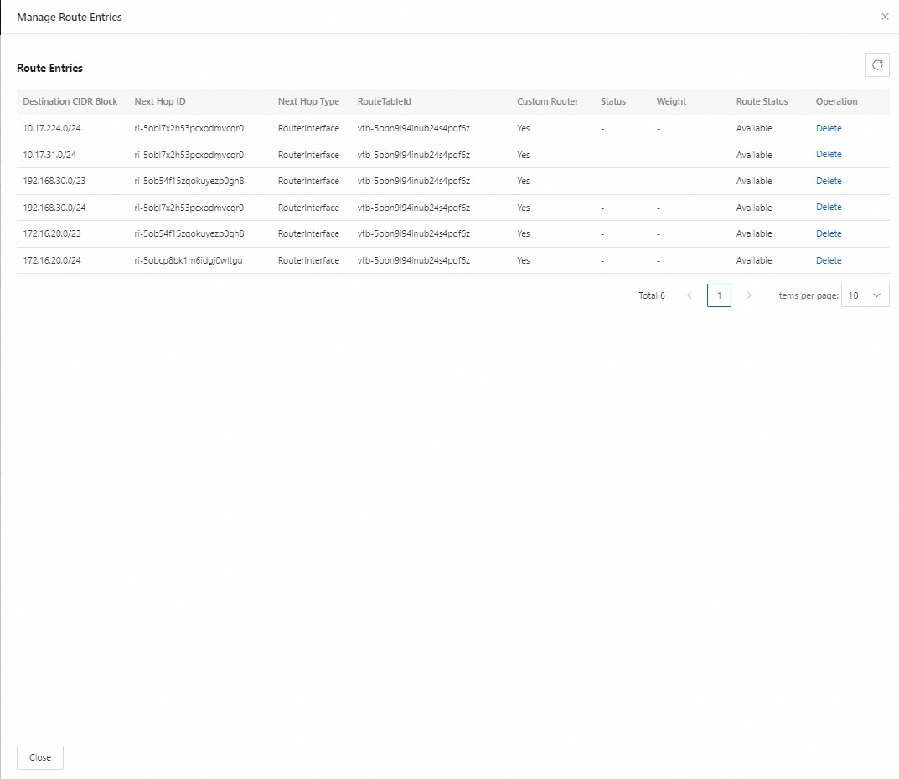

   <ol type="i" start="3">

   <li>

   Optional. Find the route entry that you want to delete and click **Delete** in the **Actions**

   </li>

   </ol>

   column.
