Alibaba Cloud  
Apsara Stack  
Express Connect  
Product Introduction  
Product Version: v3.18.6-2607  
Document Version: 20260828

**Table of Contents**

- [1.Express Connect](#section-1)
    - [1.1. What is Express Connect?](#section-1-1)
    - [1.2. Benefits](#section-1-2)
    - [1.3. Use cases](#section-1-3)
    - [1.4. Features](#section-1-4)

# 1.Express Connect

Express Connect allows you to establish private connections to enable fast, stable, and secure communication between different network environments. You can use Express Connect to ensure network stability and prevent data breaches.

## 1.1. What is Express Connect?

Apsara Stack Express Connect allows you to establish private, flexible, stable, and secure connections between virtual private clouds (VPCs). Network traffic does not traverse the Internet, which prevents data breaches and ensures network stability.

Express Connect allows you to connect VPCs within the same region and account. You can also connect VPCs across different regions and accounts.

**Benefits**

Express Connect provides the following benefits:

- High-speed connections

  Powered by the network virtualization technology of Apsara Stack, Express Connect allows networks to communicate with each other through direct, private, and high-speed connections. Network traffic does not traverse the Internet. The impact of distance on network performance is minimized to ensure low-latency and high-bandwidth communication.

- Stability and reliability

  Express Connect provides services based on the high-quality infrastructure of Apsara Stack. This guarantees stable and reliable communication between networks.

- Security

  Express Connect allows you to virtualize your networks and enables communication based on the infrastructure provided by Apsara Stack. Networks owned by different accounts are independent of each other. Data packets are exchanged through private connections to prevent beaches.

- On-demand purchase

  The maximum bandwidth of Express Connect circuits varies. You can set the maximum bandwidth based on your business requirements.

**Differences between Express Connect and Internet connections**

A VPC is a logically isolated network. Network traffic between VPCs or between VPCs and data centers are transferred through separate connections.

Compared with Internet connections, Express Connect provides higher performance and security. The following table describes the differences.

| Item | Connect VPCs through Internet connections | Connect VPCs through Express Connect |
| --- | --- | --- |
| Network performance and availability | When network traffic is transferred over a long distance, a low network latency and a low packet loss rate cannot be guaranteed. | Connections are built based on the infrastructure provided by Apsara Stack, which offers higher quality and availability. |
| Costs | You are charged a high Internet bandwidth fee or data transfer fee. | The cost for cross-region communication is minimized. You are not charged for connecting VPCs that belong to the same region. |
| Security | Network traffic is transferred over the Internet. Therefore, data breaches may occur. | Networks are virtualized on Apsara Stack and isolated from each other to ensure high security. |

## 1.2. Benefits

A virtual private cloud (VPC) is a logically isolated network. Network traffic between VPCs is transferred through separate connections.

Compared with Internet connections, Express Connect offers higher performance and security for communication between VPCs. The following table describes the differences.

| Item | Connect VPCs through Internet connections | Connect VPCs through Express Connect |
| --- | --- | --- |
| Network performance and availability | When network traffic is transferred over a long distance, a low network latency and a low packet loss rate cannot be guaranteed. | Connections are built based on the infrastructure provided by Apsara Stack, which offers higher quality and availability. |
| Costs | You are charged a high Internet bandwidth fee or data transfer fee. | The cost for cross-region communication is minimized. You are not charged for connecting VPCs that belong to the same region. |
| Security | Network traffic is transferred over the Internet. Therefore, data breaches may occur. | Networks are virtualized on Apsara Stack and isolated from each other to ensure high security. |

## 1.3. Use cases

Express Connect is ideal for establishing reliable, secure, and high-speed private communication between an on-premises data center and cloud VPCs. Express Connect provides various cloud connectivity services, allowing you to choose the best option for your business scenario and easily build a hybrid network across different architectures.

**Scenario 1: Multi-region disaster recovery and high-availability network**

To ensure maximum availability for mission-critical services in your on-premises data center, establish physical connections through multiple access points. This topology ensures resilience against connection failures caused by fiber optic cuts, device malfunctions, or access point outages.

Express Connect

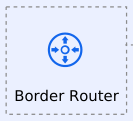

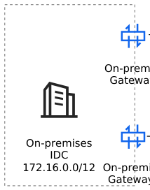

Physical

Connection

192.168.0.0/16

On-premises Gateway 1

Access Point

A

TR

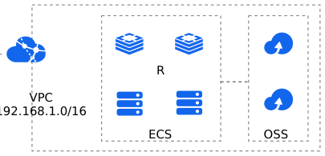

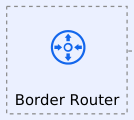

Physical

Connection

On-premises Gateway 2

192.168.1.0/16

Access Point

B

**Scenario 2: Highly elastic, high-availability network architecture**

When rapid business growth exceeds the capacity of your on-premises data center, you can quickly deploy services in the cloud. Using the ECMP link aggregation feature of Express Connect, you can elastically scale your physical connection bandwidth to easily handle terabytes of traffic. This topology provides resilience against device failures, physical connection failures, and access point outages.

Express Connect

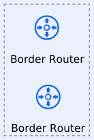

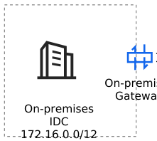

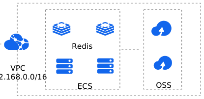

Physical

Connection

On-premises

Gateway

192.168.0.0/16

Access Point

A

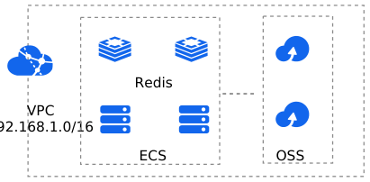

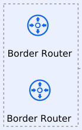

TR

Physical

Connection

192.168.1.0/16

On-premises

Gateway

Access Point

B

**Scenario 3: Simple network for non-critical workloads**

For non-critical workloads that do not require high elasticity or high availability, such as cloud-based development and testing environments, use Express Connect to establish a direct private connection between your on-premises data center and cloud networks. This topology ensures secure and reliable hybrid cloud communication.

Express Connect

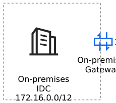

192.168.0.0/16

Physical

Border Router

Connection

On-premises

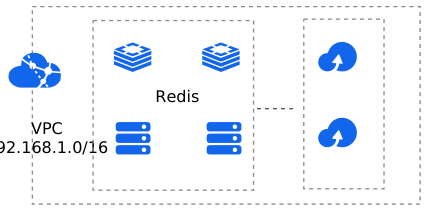

TR

Gateway

Border Router

Access Point

192.168.1.0/16

## 1.4. Features

Alibaba Cloud Express Connect lets you establish high-speed, stable, and secure private connections between different network environments. Use a physical connection to connect your on-premises IDC to a Virtual Private Cloud (VPC).

**Features**

**Feature**

**Description**

A Virtual Border Router (VBR) supports route learning from an on-premises IDC over BGP.

You can modify VBRs.

You can create VBRs.

Express Connect

physical connection

You can delete VBRs.

You can query VBRs.

You can connect a VPC to an on-premises IDC over a physical connection.

CGW deployment on

You can deploy a Customer Gateway (CGW) on

Docker

Docker.

virtualized gateway

Intra-city disaster recovery

Enables intra-city disaster recovery.

Multi-region support for

Supports multi-region deployments for a CGW

CGW on Docker

on Docker.

Intra-city disaster recovery

CGW supports intra-city disaster recovery.

Multi-region support

CGW supports multi-region deployments.

Support for three

Available on physical machines.

Multi-IDC

availability zones

CGW redundancy

Available on physical machines.

<table>
  <tr>
    <td rowspan="2">IPv6</td>
    <td>IPv6 support for physical connections</td>
    <td>Physical connections support IPv6.</td>
  </tr>
  <tr>
    <td>IPv6 ECMP for physical connections</td>
    <td>Physical connections support Equal-Cost Multi-Path (ECMP) for IPv6.</td>
  </tr>
  <tr>
    <td rowspan="2">Multi-cluster</td>
    <td rowspan="2">Multi-cluster support for CGW on physical machines</td>
    <td>Express Connect supports multi-cluster deployments.</td>
  </tr>
  <tr>
    <td>Express Connect supports tenant-based isolation for multi-cluster environments.</td>
  </tr>
  <tr>
    <td rowspan="6">Hardware and software ecosystem</td>
    <td>Intel processor support</td>
    <td>Available on physical machines.</td>
  </tr>
  <tr>
    <td>Hygon processor support</td>
    <td>Available on physical machines.</td>
  </tr>
  <tr>
    <td>Kunpeng processor support</td>
    <td>Available on physical machines.</td>
  </tr>
  <tr>
    <td>Phytium processor support</td>
    <td>Available on physical machines.</td>
  </tr>
  <tr>
    <td>Intel processor support for CGW on Docker</td>
    <td>Available on virtualized gateways.</td>
  </tr>
  <tr>
    <td>Hygon processor support for CGW on Docker</td>
    <td>Available on virtualized gateways.</td>
  </tr>
  <tr>
    <td rowspan="2">NIC</td>
    <td>Support for single-card, dual-port CX6 NICs</td>
    <td>Available on physical machines.</td>
  </tr>
  <tr>
    <td>Support for single-card, dual-port CX6 NICs with CGW on Docker</td>
    <td>Available on virtualized gateways.</td>
  </tr>
  <tr>
    <td rowspan="3">High performance</td>
    <td rowspan="2">100G network access</td>
    <td>Available on physical machines.</td>
  </tr>
  <tr>
    <td>Available on virtualized gateways.</td>
  </tr>
  <tr>
    <td>BFD link detection</td>
    <td>Uses Bidirectional Forwarding Detection (BFD) to improve the stability of physical connections.</td>
  </tr>
  <tr>
    <td>Health check detection time</td>
    <td>Health check detection time</td>
    <td>You can configure the health check detection time for physical connections.</td>
  </tr>
</table>
