Alibaba Cloud  
Apsara Stack  
IPv6 Gateway  
User Guide  
Product Version: V3.18.2  
Document Version: 20240516

**Table of Contents**

- [1.What is an IPv6 gateway?](#section-1)
- [2.Log on to the IPv6 Gateway console](#section-2)
- [3.Quick start](#section-3)
    - [3.1. Create a VPC with an IPv6 CIDR block](#section-3-1)
- [4.Enable IPv6 for VPCs](#section-4)
    - [4.1. Create a VPC that supports both IPv4 and IPv6](#section-4-1)
    - [4.2. Enable IPv6 for an existing VPC](#section-4-2)
- [5.Enable IPv6 for vSwitches](#section-5)
    - [5.1. Create a VPC that supports both IPv4 and IPv6](#section-5-1)
    - [5.2. Enable IPv6 for an existing vSwitch](#section-5-2)
- [6.Manage IPv6 Gateways](#section-6)
    - [6.1. Create an IPv6 gateway](#section-6-1)
    - [6.2. Modify the basic information about an IPv6 gateway](#section-6-2)
    - [6.3. Delete an IPv6 gateway](#section-6-3)
- [7.Manage IPv6 Internet bandwidth](#section-7)
    - [7.1. Purchase IPv6 Internet bandwidth](#section-7-1)
    - [7.2. Modify the maximum bandwidth of an IPv6 gateway](#section-7-2)
    - [7.3. Delete IPv6 Internet bandwidth](#section-7-3)
- [8.Manage egress-only rules](#section-8)
    - [8.1. Create an egress-only rule](#section-8-1)
    - [8.2. Delete an egress-only rule](#section-8-2)

# 1.What is an IPv6 gateway?

IPv6 gateways route IPv6 traffic to and from virtual private clouds (VPC). By default, an IPv6 address is used only for communication within VPCs. You can enable IPv6 Internet bandwidth for an IPv6 address of an IPv6 gateway in the VPC console. In this way, the IPv6 address can be used for communication over the Internet. In addition, you can configure egress-only rules to allow the IPv6 address to only access the Internet.

Internet

Internet

VPC

VPC

IPv6

IPv6

(With Egress-

With IPv6

Gateway

Gateway

only Rules

Internet

Configured)

Bandwidth

Enabled

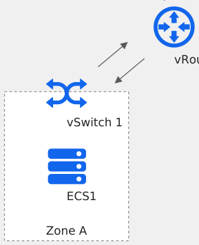

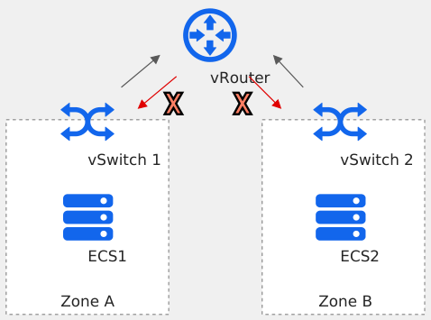

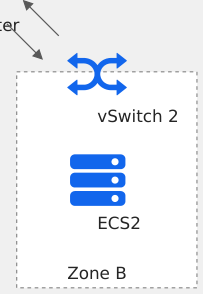

vRouter

**Terms**

| Term | Description |
| --- | --- |
| IPv6 address | An IPv6 address is allocated to an instance in a VPC by the system. An IPv6 address is made of 128 binary bits that are divided into eight 16-bit groups separated by colons (:). Each group is represented as a 4-digit hexadecimal number. Example: 2001:db8:1:1:1:1:1:1 |
| IPv6 gateway | IPv6 gateways serve as key components that connect Elastic Compute Service (ECS) instances in VPCs to the Internet by using IPv6 addresses. You can use IPv6 gateways to manage IPv6 Internet bandwidth and configure egress-only rules. |
| IPv6 Internet bandwidth | Whether IPv6 Internet bandwidth is enabled for an IPv6 address determines whether the IPv6 address can be used for communication over the Internet. You must enable IPv6 Internet bandwidth for an IPv6 address. In this way, the IPv6 address can be used for communication over the Internet. |
| egress-only rule | An IPv6 gateway uses an egress-only rule to implement egress control for IPv6 traffic. After you configure an egress-only rule for an IPv6 address, the IPv6 gateway allows only outbound traffic to the Internet over the IPv6 address. |
| IPv6 CIDR block of a VPC | An IPv6 CIDR block whose subnet mask is /56 is automatically allocated to a VPC by the system after IPv6 is enabled for the VPC. |
| IPv6 CIDR block of a vSwitch | By default, the subnet mask of an IPv6 CIDR block allocated to a vSwitch is/64. When you enable IPv6 for a vSwitch, you can specify a custom value to define the last eight bits of the IPv6 CIDR block of the vSwitch. |

**Features**

An IPv6 gateway supports the following features:

- **Communication within VPCs**

  By default, the Internet bandwidth of an IPv6 address that you apply for a VPC is 0 Mbit/s. IPv6 addresses are used only for communication within VPCs. If you create an ECS instance that is assigned an IPv6 address in a VPC, the ECS instance can access another ECS instance that is assigned an IPv6 address in the same VPC. The ECS instance cannot use the IPv6 address to access the Internet or provide services for IPv6 clients over the Internet.

- **Communication over the Internet**

  - You can purchase IPv6 Internet bandwidth for an IPv6 address of an ECS instance in a VPC. This way, the ECS instance can use the IPv6 address to access the Internet and provide services for IPv6 clients over the Internet.

  - You can set the IPv6 Internet bandwidth to 0 Mbit/s for an IPv6 address based on your business requirements. This way, the IPv6 address is used only for communication within VPCs.

  - You can configure egress-only rules for an IPv6 address of an ECS instance in a VPC. In this way, the ECS instance can access the Internet and deny access from the IPv6 clients.

  - You can delete an egress-only rule based on your business requirements. After the rule is deleted, the IPv6 address for which you enable IPv6 Internet bandwidth can be used for access to the Internet, and the ECS instance assigned the IPv6 address can be accessed by IPv6 clients over the Internet.

The communication capabilities of an IPv6 address are determined by the network type, Internet bandwidth, and egress-only rules of the IPv6 address. The following table describes the communication capabilities of an IPv6 address.

<table>
  <tr>
    <th>Network type</th>
    <th>Whether IPv6 Internet bandwidth is enabled</th>
    <th>Whether an egress-only rule is configured</th>
    <th>Communication capability</th>
  </tr>
  <tr>
    <td>VPC</td>
    <td>No</td>
    <td>No</td>
    <td>Communication within VPCs</td>
  </tr>
  <tr>
    <td rowspan="2">Internet</td>
    <td rowspan="2">Yes</td>
    <td>No</td>
    <td>Communication within VPCs Communicate over the Internet</td>
  </tr>
  <tr>
    <td>Yes</td>
    <td>Communication within VPCs Only access to the Internet is allowed.</td>
  </tr>
</table>

**Scenarios**

**Scenario 1: Enable IPv6 for a VPC and build an isolated IPv6 environment**

If you enable IPv6 for an existing VPC, the VPC supports both IPv4 and IPv6. Assign IPv6 addresses to ECS instances on which services reside. All the ECS instances are assigned both IPv4 addresses and IPv6 addresses. By default, the IPv6 addresses of the ECS instances can be used only for communication within the VPC.

ECS instances for which IPv4 and IPv6 are enabled can use IPv4 addresses or IPv6 addresses to communicate with other resources in the VPC. Communication over IPv4 and IPv6 are independent of each other. The ECS instances cannot use IPv6 addresses to access the Internet or provide services to IPv6 clients over the Internet.

VPC (With IPv4 and IPv6 Enabled)

IPv6

Gateway

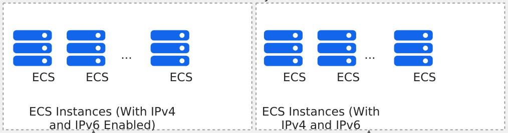

Enabled)

**Scenario 2: Enable ECS instances in a VPC to communicate with the Internet by using IPv6 addresses**

After you enable IPv6 Internet bandwidth for the IPv6 addresses of the ECS instances in a VPC, the IPv6 addresses can be used for communication over the Internet. IPv6 traffic between the ECS instances in the VPC and the Internet passes through the IPv6 gateway. The IPv6 gateway processes inbound and outbound IPv6 traffic.

The ECS instances in the VPC can use IPv4 addresses to communicate with the IPv4 clients over the Internet over elastic IP addresses, Server Load Balancer (SLB) instances, and NAT gateways.

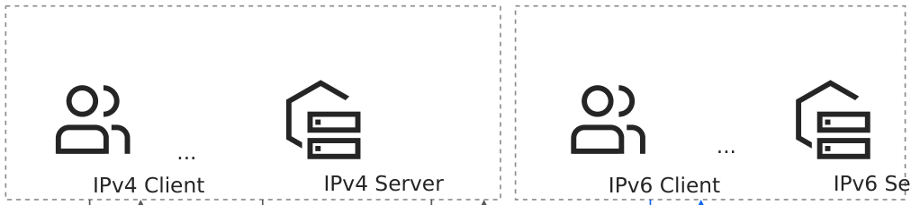

IPv6 Ser

IPv4

IPv4

IPv6

IPv6

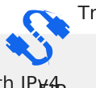

Traffic

Traffic

Traffic

Traffic

VPC (With IPv4

NAT Gateway

EIP

Load balancing

IPv6 Gateway

and IPv6 Enabled)

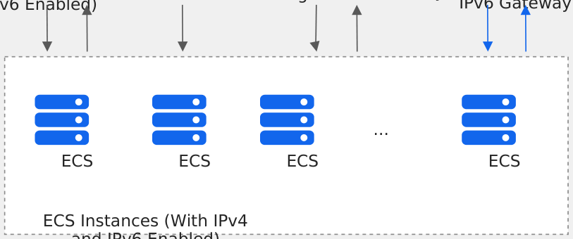

and IPv6 Enabled)

**Scenario 3: Configure egress-only rules to manage IPv6 traffic**

If you want an ECS instance to access IPv6 clients and deny access from IPv6 clients,

you can configure an egress-only rule for the IPv6 address of the ECS instance. This way, the ECS instance can access the Internet, but does not receive requests from the IPv6 clients.

IPv6 Client

IPv6 Client

IPv6

IPv6 Traffic is

Traffic

Dropped

VPC (With IPv4 and IPv6 Enabled)

IPv6

Gateway

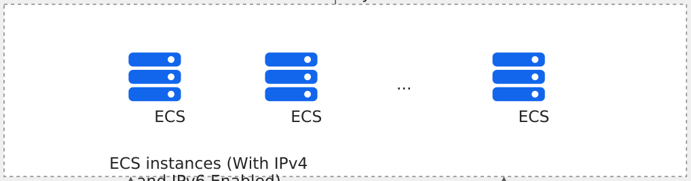

and IPv6 Enabled)

**Benefits**

An IPv6 gateway provides the following benefits:

- **High availability**

  IPv6 gateways provide high availability across zones to help you develop stable IPv6 gateway services for communication over the Internet.

- **High performance**

  A single IPv6 gateway can provide 10-gigabit throughput to process a large number of requests from or to the Internet by using IPv6 addresses.

- **Flexible management of communication over the Internet**

  You can manage the Internet communication capabilities of IPv6 addresses by adjusting the Internet bandwidth and configuring egress-only rules.

# 2.Log on to the IPv6 Gateway console

This topic describes how to log on to the Apsara Uni-manager Management Console to manage your IPv6 gateways. The Google Chrome browser is used as an example.

**Prerequisites**

- The URL of the Apsara Uni-manager Management Console is obtained from the deployment personnel before you log on to the Apsara Uni-manager Management Console.

- A browser is available. We recommend that you use the Google Chrome browser.

**Procedure**

1. In the address bar, enter the URL of the Apsara Uni-manager Management Console. Press the Enter key.

2. Enter your username and password.

   Obtain the username and password that you can use to log on to the console from the operations administrator.

   > **Note**
   >
   > When you log on to the Apsara Uni-manager Management Console for the
   >
   > first time, you must change the password of your username. Your password must meet complexity requirements. The password must be 8 to 20 characters in length and must contain at least two of the following character types:
   >
   > - Uppercase or lowercase letters
   >
   > - Digits
   >
   > - Special characters, which include ! @ # $ %

3. Click **Login**.

4. If your account has multi-factor authentication (MFA) enabled, perform corresponding steps in the following scenarios:

   - **This is the first time that you log on to the Apsara Uni-manager Management Console after MFA is enabled by the administrator.**

     <ol type="a">

     <li>

     On the Bind Virtual MFA Device page, bind an MFA device.

     </li>

     <li>

     Enter the username and password again as in Step 2 and click **Log On**.

     </li>

     </ol>

     <ol type="i" start="100">

     <li>

     Enter a six-digit MFA verification code and click **Authenticate**.

     </li>

     </ol>

   - **You have bound an MFA device and enabled MFA.**

     Enter a six-digit MFA verification code and click **Authenticate**.

     > **Note**
     >
     > For more information about how to bind an MFA device to enable MFA, see **Apsara Uni-manger > User Guide > Security > MFA > Manage MFA**.

5. In the top navigation bar, choose **Products > Networking > Virtual Private Cloud**.

6. In the left-side navigation pane, choose **Internet Access > IPv6 Gateway**.

# 3.Quick start

## 3.1. Create a VPC with an IPv6 CIDR block

This topic describes how to create a virtual private cloud (VPC) with an IPv6 CIDR block and create an Elastic Compute Service (ECS) instance with an IPv6 address in the VPC. This way, the ECS instance can access IPv6 services.

**Step 1: Create a VPC and a vSwitch**

Before you deploy cloud resources in a VPC, you must create a VPC and a vSwitch.

1. Log on to the VPC console. For more information, see **Virtual Private Cloud > User Guide> Log on to the VPC console**.

2. On the **Virtual Private Clouds** page, click **Create a proprietary network**.

3. On the **Create VPC** page, specify the parameters that are described in the following table and click **Submit**.

   | Paramet er | Description |
   | --- | --- |
   | Organiza tion | Select the organization to which the VPC belongs. |
   | Resourc e Set | Select the resource set to which the VPC belongs. |
   | Region | Select the region where you want to deploy the VPC. |
   | Sharing Scope | Select the sharing scope of the VPC. • <strong>Current Resource Set</strong>: Only the administrator of the current resource set can use the VPC to create resources. • <strong>Current Organization and Subordinate Organizations</strong>: Only the administrators of the current organization and its subordinate organizations can use the VPC to create resources. • <strong>Current Organization</strong>: Only the administrator of the current organization can use the VPC to create resources. <strong>Current Resource Set</strong> is selected in this example. |
   | VPC Name | Enter a name for the VPC.  <code>VPCtest</code> is used in this example. |

   <table>
     <tr>
       <td>IPv4 CIDR Block</td>
       <td>Specify an IPv4 CIDR block for the VPC. The following settings are supported: • <strong>Recommended CIDR Block</strong>: You can use one of the following standard IPv4 CIDR blocks: 192.168.0.0/16 and 172.16.0.0/16. • <strong>Custom CIDR Block</strong>: You can use 192.168.0.0/16, 172.16.0.0/16, or a subset of the preceding CIDR blocks. The subnet mask must be 8 to 28 bits in length. Example: 192.168.0.0/16. In this example, 192.168.0.0/16 is used as the IPv4 CIDR block of the VPC. Note After a VPC is created, you cannot change its IPv4 CIDR block.</td>
     </tr>
     <tr>
       <td>IPv6 CIDR Block</td>
       <td>Specify whether to assign an IPv6 CIDR block. • <strong>Do Not Assign</strong>: The system does not assign an IPv6 CIDR block to the VPC. • <strong>Assign</strong>: The system automatically assigns an IPv6 CIDR block to the VPC. <strong>Assign</strong> is selected in this example.</td>
     </tr>
     <tr>
       <td>Descripti on</td>
       <td>Enter a description for the VPC.</td>
     </tr>
   </table>

4. On the **Virtual Private Clouds** page, click **VSwitches** in the left-side navigation pane.

5. On the **VSwitches** page, click **Create a switch**.

6. On the **Create vSwitch** page, specify the parameters described in following table and click **Submit**.

   | Parameter | Description |
   | --- | --- |
   | Organization | Select the organization to which the vSwitch belongs. |
   | Resource Set | Select the resource set to which the vSwitch belongs. |
   | Region | Select the region where you want to deploy the vSwitch. |
   | Zone | Select the zone where you want to deploy the vSwitch. In a VPC, a vSwitch can be deployed only in one zone. You cannot deploy a vSwitch across zones. You can deploy cloud resources in vSwitches in different zones to implement cross-zone disaster recovery. Note An instance can be attached only to one vSwitch. |
   | Sharing Scope | Select the sharing scope of the vSwitch. • <strong>Current Resource Set</strong>: Only the administrator of the current resource set can use the vSwitch to create resources. • <strong>Current Organization and Subordinate Organizations</strong>: Only the administrators of the current organization and its subordinate organizations can use the vSwitch to create resources. • <strong>Current Organization</strong>: Only the administrator of the current organization can use the vSwitch to create resources. <strong>Current Resource Set</strong> is selected in this example. |
   | VPC | Select the VPC in which you want to create the vSwitch. <strong>VPCtest</strong> is selected in this example. |
   | Dedicated for Bare Metal Instances | Specify whether the vSwitch is dedicated for bare-metal servers. For more information about bare-metal servers, see <strong>Bare-metal servers</strong> in <strong>VPCs in Apsara Intelligent Operations Platform User Guide</strong>. <strong>No</strong> is selected in this example. |
   | vSwitch Name | Enter a name for the vSwitch. |
   | IPv4 CIDR Block | Specify an IPv4 CIDR block for the vSwitch. The default IPv4 CIDR block is used in this example. |
   | IPv6 CIDR Block | Specify an IPv6 CIDR block for the vSwitch. The default IPv6 CIDR block is used in this example. |
   | Description | Enter a description for the vSwitch. |

**Step 2: Create a security group**

1. In the top navigation bar, choose **Products > Elastic Computing > Elastic Compute Service**.

2. In the left-side navigation pane, choose **Network and Security > Security Groups**.

3. On the Security Groups page, click Create Security Group.

4. On the Create Security Group page, set the parameters and click **Submit**.

   | Parameter | Description |
   | --- | --- |
   | Organization | Select the organization to which the security group belongs. |
   | Resource Set | Select the resource set to which the security group belongs. |
   | Region | Select the region where you want to deploy the security group. Make sure that the security group and the VPC belong to the same region. |
   | Zone | Select the zone where you want to deploy the security group. |
   | Sharing Scope | Select the sharing scope of the security group. • <strong>Current Resource Set</strong>: Only the administrator of the current resource set can use the security group to create resources. • <strong>Current Organization and Subordinate Organizations</strong>: Only the administrators of the current organization and its subordinate organizations can use the security group to create resources. • <strong>Current Organization</strong>: Only the administrator of the current organization can use the security group to create resources. <strong>Current Resource Set</strong> is selected in this example. |
   | VPC | Select the VPC to which the security group belongs. |
   | Security Group Name | Enter a name for the security group. |
   | Description | Enter a description for the security group. |

**Step 3: Create and configure an ECS instance**

After you create a VPC with an IPv6 CIDR block and a vSwitch, create an ECS instance and assign an IPv6 address to the ECS instance. You must allocate the IPv6 address to the elastic network interface (ENI) of the ECS instance after the ECS instance is created.

1. In the top navigation bar, choose **Products > Networking > Virtual Private Cloud**.

2. In the left-side navigation pane, click **VSwitches**.

3. In the top navigation bar, select the region where the vSwitch is deployed.

4. On the **VSwitches** page, find the desired vSwitch and click **Create ECS Instance** in the **Operation** column.

5. On the **Create Instance** page, specify the required parameters and click **Submit**. In this example, **Assign** is selected for IPv6. For more information about other parameters, see **ECS > User Guide** > **Quick start**> **Create an ECS instance by using the wizard**.

6. Return to the **Instances** page, find the created ECS instance and click its ID to view the assigned IPv6 address.

7. Configure the static IPv6 address.

   - If the image of your ECS instance supports DHCPv6, you do not need to manually configure the static IPv6 address. DHCPv6 enables automatic configuration of IPv6 addresses. Therefore, if the image of your ECS instance supports DHCPv6, the ECS instance uses the assigned IPv6 address for communication within the private network. The following images support DHCPv6:

     - Linux images

       - CentOS 7.6 IPV6 64Bit

       - CentOS 6.10 64Bit

       - SUSE Linux Enterprise Server 12 SP4 64Bit

     - Windows Server images

   - If the image of your ECS instance does not support DHCPv6, you must manually configure the IPv6 address for your ECS instance. For more information, see the relevant documentation.

**Step 4: Purchase IPv6 Internet bandwidth**

By default, IPv6 addresses are used only for communication within private networks. If you want to use an IPv6 address to access the Internet or provide services to IPv6 clients over the Internet, you must purchase Internet bandwidth for the IPv6 address.

1. In the top navigation bar, choose **Products > Networking > Virtual Private Cloud**.

2. In the left-side navigation pane, click IPv6 Gateways.

3. In the top navigation bar, select the region where you want to create an IPv6 gateway.

4. On the **IPv6 Gateways** page, find the desired IPv6 gateway and click **Management** in the **Operation** column.

5. On the details page of the IPv6 gateway, click the IPv6 public network bandwidth tab.

6. On the **IPv6 public network bandwidth** tab, find the IPv6 address that you want to manage and click **Open public network bandwidth** in the **Operation** column.

7. Select a maximum bandwidth value and click Submit. For IPv6 gateways of Free Edition, Enterprise Edition, and Enhanced Enterprise Edition, the maximum bandwidth value of each IPv6 address cannot exceed 2 Gbit/s.

**Step 5: Configure security group rules**

Services that are assigned IPv4 addresses and services that are assigned IPv6 addresses cannot communicate with each other. If the current security group rules do not support your IPv6 services, you must configure IPv6 security group rules for ECS instances.

For more information about how to configure security group rules, see **ECS > User Guide** > **Security groups** > **Add a security group rule**.

**Step 6: Verify network connectivity**

Log on to the ECS instance and **ping** an IPv6 service to verify the network connectivity.

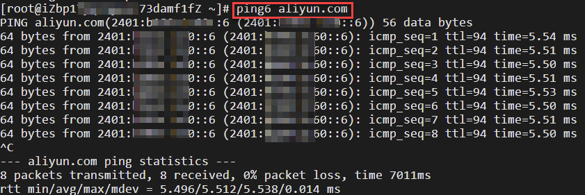

# 4.Enable IPv6 for VPCs

## 4.1. Create a VPC that supports both IPv4 and IPv6

This topic describes how to enable both Internet Protocol version 4 (IPv4) and Internet Protocol version 6 (IPv6) for a virtual private cloud (VPC) when you create the VPC. By default, IPv4 is enabled and cannot be disabled. You can choose whether to enable IPv6.

**Procedure**

1. Log on to the VPC consoleLog on to the VPC console.

2. In the top navigation bar, select the region where you want to create a VPC.

3. On the **Virtual Private Clouds** page, click **Create VPC**.

4. On the **Create a VPC** page, specify the parameters that are described in the following table and click **Submit**.

   | Paramet er | Description |
   | --- | --- |
   | Organiza tion | Select the organization to which the VPC belongs. |
   | Resource Set | Select the resource set to which the VPC belongs. |
   | Geograp hy | Select the region where you want to deploy the VPC. |
   | Shared Scope | Select the sharing scope of the VPC. • <strong>This resource set</strong>: Only the administrator of the current resource set can use the VPC to create resources. • <strong>This organization and its subordinate organization</strong>: Only the administrators of the current organization and its subordinate organizations can use the VPC to create resources. • <strong>The organization</strong>: Only the administrator of the current organization can use the VPC to create resources. <strong>This resource set</strong> is selected in this example. |
   | Private Network Name | Enter a name for the VPC. The name must be 2 to 128 characters in length and can contain digits, underscores (_), and hyphens (-). It must start with a letter but cannot start with <code> http:// </code> or <code> https:// </code>. |
   | IPv4 network segment | Specify an IPv4 CIDR block for the VPC. The following settings are supported: • <strong>Recommended network segment</strong>: Use 192.168.0.0/16 or 172.16.0.0/16. • <strong>Advanced Configuration network segment</strong>: Use 192.168.0.0/16, 172.16.0.0/12, 10.0.0.0/8, or one of their subnets as the IPv4 CIDR block of the VPC. The subnet mask must be 8 to 24 bits in length. Example: 192.168.0.0/16. Note After a VPC is created, you cannot change its IPv4 CIDR block. |
   | IPv6 network segment | Specify whether to assign an IPv6 CIDR block. In this example, <strong>Allocation</strong> is selected. Note After you create a VPC, you cannot change its IPv6 CIDR block. |
   | Descripti on | Enter a description for the VPC. The description must be 2 to 256 characters in length and can contain digits, underscores (_), hyphens (-), periods (.), colons (:), and commas (,). It must start with a letter but cannot start with <code> http:// </code> or <code> https:// </code>. |

## 4.2. Enable IPv6 for an existing VPC

This topic describes how to enable Internet Protocol version 6 (IPv6) for an existing virtual private cloud (VPC). After IPv6 is enabled, the system automatically creates a free IPv6 gateway for the VPC. You can use the IPv6 gateway to manage IPv6 Internet bandwidth and configure egress-only rules.

**Procedure**

1. Log on to the VPC consoleLog on to the VPC console.

2. In the top navigation bar, select the region where the desired VPC is deployed.

3. On the **Virtual Private Clouds** page, find the desired VPC and click **Enable IPv6** in the **IPv6 network segment** column.

   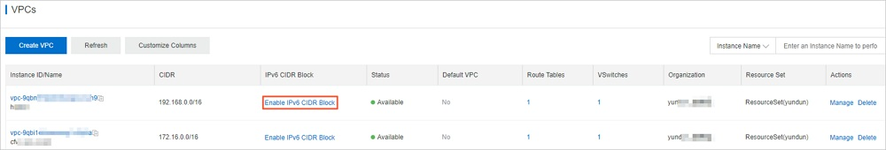

4. In the **Enable IPv6** dialog box, select **Automatically turn on IPv6 function of all switches in VPC** and click **OK**. If you do not select **Automatically turn on IPv6 function of all switches in VPC**, you must enable IPv6 for each vSwitch. For more information, see Enable an IPv6 CIDR block for an existing vSwitch.

# 5.Enable IPv6 for vSwitches

## 5.1. Create a VPC that supports both IPv4 and IPv6

This topic describes how to enable both Internet Protocol version 4 (IPv4) and Internet Protocol version 6 (IPv6) for a virtual private cloud (VPC) when you create the VPC. By default, IPv4 is enabled and cannot be disabled. You can choose whether to enable IPv6.

**Procedure**

1. Log on to the VPC consoleLog on to the VPC console.

2. In the top navigation bar, select the region where you want to create a VPC.

3. On the **Virtual Private Clouds** page, click **Create VPC**.

4. On the **Create a VPC** page, specify the parameters that are described in the following table and click **Submit**.

   | Paramet er | Description |
   | --- | --- |
   | Organiza tion | Select the organization to which the VPC belongs. |
   | Resource Set | Select the resource set to which the VPC belongs. |
   | Geograp hy | Select the region where you want to deploy the VPC. |
   | Shared Scope | Select the sharing scope of the VPC. • <strong>This resource set</strong>: Only the administrator of the current resource set can use the VPC to create resources. • <strong>This organization and its subordinate organization</strong>: Only the administrators of the current organization and its subordinate organizations can use the VPC to create resources. • <strong>The organization</strong>: Only the administrator of the current organization can use the VPC to create resources. <strong>This resource set</strong> is selected in this example. |
   | Private Network Name | Enter a name for the VPC. The name must be 2 to 128 characters in length and can contain digits, underscores (_), and hyphens (-). It must start with a letter but cannot start with <code> http:// </code> or <code> https:// </code>. |
   | IPv4 network segment | Specify an IPv4 CIDR block for the VPC. The following settings are supported: • <strong>Recommended network segment</strong>: Use 192.168.0.0/16 or 172.16.0.0/16. • <strong>Advanced Configuration network segment</strong>: Use 192.168.0.0/16, 172.16.0.0/12, 10.0.0.0/8, or one of their subnets as the IPv4 CIDR block of the VPC. The subnet mask must be 8 to 24 bits in length. Example: 192.168.0.0/16. Note After a VPC is created, you cannot change its IPv4 CIDR block. |
   | IPv6 network segment | Specify whether to assign an IPv6 CIDR block. In this example, <strong>Allocation</strong> is selected. Note After you create a VPC, you cannot change its IPv6 CIDR block. |
   | Descripti on | Enter a description for the VPC. The description must be 2 to 256 characters in length and can contain digits, underscores (_), hyphens (-), periods (.), colons (:), and commas (,). It must start with a letter but cannot start with <code> http:// </code> or <code> https:// </code>. |

## 5.2. Enable IPv6 for an existing vSwitch

This topic describes how to enable Internet Protocol version 6 (IPv6) for an existing vSwitch. After IPv6 is enabled, the system automatically allocates an IPv6 CIDR block for the vSwitch.

**Procedure**

1. Log on to the Virtual Private Cloud consoleLog on to the Virtual Private Cloud console.

2. In the left-side navigation pane, click **VSwitches**.

3. Select the region where the desired vSwitch is deployed.

4. On the **vSwitch** page, find the desired vSwitch and click **Open IPv6** in the **IPv6 network segment** column.

   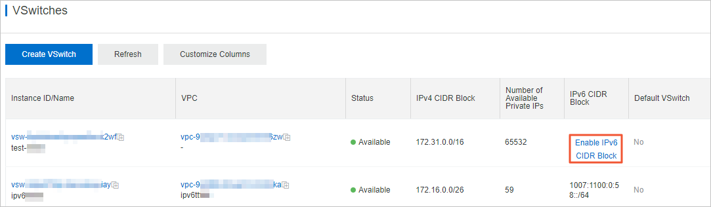

5. In the **Open IPv6** message, click **OK**.

   > **Note**
   >
   > This operation is required only when IPv6 is not enabled for the virtual
   >
   > private cloud (VPC) to which the vSwitch belongs.

6. Specify an IPv6 CIDR block and click **OK**.

   By default, the subnet mask of the IPv6 CIDR block of a vSwitch is /64. To specify the last 8 bits of the IPv6 CIDR block, enter an integer from 0 to 255.

   For example, if the IPv6 CIDR block of the VPC is 2XX1:db8::/64, you can enter 255 to define the last 8 bits of the IPv6 CIDR block of the vSwitch. In this case, the IPv6 CIDR block of the vSwitch is 2XX1:db8:ff::/64. ff is the hexadecimal value of 255.

# 6.Manage IPv6 Gateways

## 6.1. Create an IPv6 gateway

An Internet Protocol version 6 (IPv6) gateway is a device in a virtual private cloud (VPC) that uses IPv6 to transmit data over the Internet. After you create an IPv6 gateway, you can purchase IPv6 Internet bandwidth and configure egress-only rules for the IPv6 gateway.

**Prerequisites**

IPv6 is enabled for the VPC for which you want to create an IPv6 gateway. For more information, see Create a VPC that supports both IPv4 and IPv6 and Enable IPv6 for an existing VPC.

**Procedure**

1. Log on to the VPC console.

2. Click IPv6 Gateways in the left-side navigation pane. On the **IPv6 Gateways** page, click **Create IPv6 gateway**.

3. Specify the parameters that are described in the following table to configure the IPv6 gateway. Then, click **Submit**.

   | Parameter | Description |
   | --- | --- |
   | Organization | Select the organization to which the IPv6 gateway belongs. |
   | Resource Set | Select the resource set to which the IPv6 gateway belongs. |
   | Region | Select the region where you want to create the IPv6 gateway. The IPv6 gateway must belong to the same region as the VPC for which you want to create the IPv6 gateway. |
   | Name | Enter a name for the IPv6 gateway. The name must be 4 to 50 characters in length and can contain digits, underscores (_), and hyphens (-). It must start with a letter. |
   | VPC | Select the VPC for which you want to create the IPv6 gateway. The desired VPC may not be available due to the following reasons: • Only one IPv6 gateway can be created for each VPC. The VPC already has an IPv6 gateway. • The VPC has a custom route with the destination CIDR block set to ::/0.If this happens, you must delete this custom route before you can create an IPv6 gateway for the VPC. Note After an IPv6 gateway is created, you cannot change the VPC to which the IPv6 gateway is associated. |
   | Specifications | Select the edition of the IPv6 gateway. IPv6 gateways are available in the following editions: • Free Edition • Enterprise Edition • Enhanced Enterprise Edition When you use an IPv6 gateway to communicate with the Internet, the throughput capacity, the maximum bandwidth of each IPv6 address, and the maximum number of egress-only rules vary based on the edition. The following table describes the limits of each edition. |

## 6.2. Modify the basic information about an IPv6 gateway

This topic describes how to change the name and description of an Internet Protocol version 6 (IPv6) gateway.

**Procedure**

1. Log on to the Virtual Private Cloud console.

2. Click IPv6 Gateways in the left-side navigation pane. Select the region where the IPv6 gateway resides.

3. On the **IPv6 Gateways** page, find the desired IPv6 gateway and click **Management** in the **Operation** column.

4. On the details page of the IPv6 gateway, click **Modify** in the **Basic information** section. In the dialog box that appears, modify the name and description of the IPv6 gateway and click **OK**.

## 6.3. Delete an IPv6 gateway

This topic describes how to delete an Internet Protocol version 6 (IPv6) gateway. If a virtual private cloud (VPC) no longer needs to access or be accessed by IPv6 clients, you can delete the IPv6 gateway associated with the VPC.

**Prerequisites**

Before you delete an Enterprise Edition or Enhanced Enterprise Edition IPv6 gateway, you must delete the egress-only rules configured for the IPv6 gateway. For more information, see Delete an egress-only rule.

**Procedure**

1. Log on to the VPC console.

2. Click IPv6 Gateways in the left-side navigation pane. Select the region where the IPv6 gateway resides.

3. On the **IPv6 Gateways** page, find the IPv6 gateway that you want to delete and click **Delete** in the **Operation** column.

4. In the message that appears, click **OK**.

# 7.Manage IPv6 Internet bandwidth

## 7.1. Purchase IPv6 Internet bandwidth

This topic describes how to purchase Internet Protocol version 6 (IPv6) Internet bandwidth for an IPv6 address. This way, the IPv6 address can be used to communicate with the Internet.

**Prerequisites**

An Elastic Compute Service (ECS) instance is created in a virtual private cloud (VPC). In addition, the ECS instance is assigned an IPv6 address.

**Procedure**

1. Log on to the VPC console.

2. Click IPv6 Gateways in the left-side navigation pane. In the top navigation bar, select the region where the IPv6 gateway resides.

3. On the **IPv6 Gateways** page, find the desired IPv6 gateway and click **Management** in the **Operation** column.

4. On the page that appears, click the **IPv6 public network bandwidth** tab.

5. On the **IPv6 public network bandwidth** tab, find the desired IPv6 address and click **Open public network bandwidth** in the **Operation** column.

   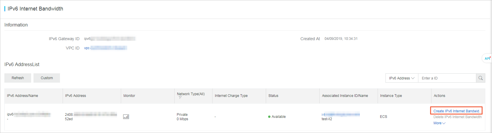

6. Specify a bandwidth and click **Submit**.

## 7.2. Modify the maximum bandwidth of an IPv6 gateway

This topic describes how to modify the maximum bandwidth of an Internet Protocol version 6 (IPv6) gateway. The modification takes effect immediately.

**Procedure**

1. Log on to the Virtual Private Cloud console.

2. Click IPv6 Gateways in the left-side navigation pane. In the top navigation bar, select the region where the IPv6 gateway resides.

3. On the **IPv6 Gateways** page, find the desired IPv6 gateway and click **Management** in the **Operation** column.

4. On the page that appears, click the **IPv6 public network bandwidth** tab.

5. On the **IPv6 public network bandwidth** tab, find the desired IPv6 address and click **Variable bandwidth** in the **Operation** column.

6. Modify the bandwidth and click **Submit**.

## 7.3. Delete IPv6 Internet bandwidth

If you no longer use an Internet Protocol version 6 (IPv6) address to communicate with the Internet, you can delete the Internet bandwidth of the IPv6 address.

**Procedure**

1. Log on to the Virtual Private Cloud console.

2. Click IPv6 Gateways in the left-side navigation pane. In the top navigation bar, select the region where the IPv6 gateway resides.

3. On the **IPv6 Gateways** page, find the desired IPv6 gateway and click **Management** in the **Operation** column.

4. On the page that appears, click the **IPv6 public network bandwidth** tab.

5. On the **IPv6 public network bandwidth** tab, find the desired IPv6 address and click **Delete public network bandwidth** in the **Operation** column.

6. In the message that appears, click **OK**.

# 8.Manage egress-only rules

## 8.1. Create an egress-only rule

This topic describes how to create an egress-only rule for an Internet Protocol version 6 (IPv6) address. After you create the egress-only rule, the cloud service instance assigned the IPv6 address in the virtual private cloud (VPC) can access the Internet by only using the IPv6 address and IPv6 clients cannot access the cloud service instance in the VPC over the Internet.

**Prerequisites**

IPv6 Internet bandwidth is purchased for the IPv6 address for which you want to create an egress-only rule. For more information, see Purchase IPv6 Internet bandwidth.

**Background information**

Free Edition IPv6 gateways do not support egress-only rules. An Enterprise Edition IPv6 gateway supports up to 50 egress-only rules. An Enhanced Enterprise Edition IPv6 gateway supports up to 200 egress-only rules.

**Procedure**

1. Log on to the VPC console.

2. Click IPv6 Gateways in the left-side navigation pane. In the top navigation bar, select the region where the IPv6 gateway resides.

3. On the **IPv6 Gateways** page, find the desired IPv6 gateway and click **Management** in the **Operation** column.

4. On the page that appears, click the **Only active rules** tab.

5. On the **Only active rules** tab, click **Create an active-only rule**.

6. In the **Create an active-only rule** dialog box, select an Elastic Compute Service (ECS) instance that uses an IPv6 address to communicate with the Internet and click **OK**.

## 8.2. Delete an egress-only rule

This topic describes how to delete an egress-only rule. After the rule is deleted, the related Internet Protocol version 6 (IPv6) address with Internet bandwidth can be used to access the Internet, and the cloud service instance assigned the IPv6 address in the virtual private cloud (VPC) can be accessed by IPv6 clients over the Internet.

**Procedure**

1. Log on to the VPC console.

2. Click IPv6 Gateways in the left-side navigation pane. In the top navigation bar, select the region where the desired IPv6 gateway resides.

3. On the **IPv6 Gateways** page, find the desired IPv6 gateway and click **Management** in the **Operation** column.

4. On the page that appears, click the **Only active rules** tab.

5. On the **Only active rules** tab, find the egress-only rule that you want to delete and click **Delete** in the **Operation** column.

6. In the message that appears, click **OK**.
