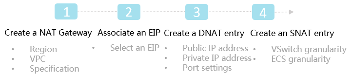

Alibaba Cloud  
Apsara Stack  
NAT Gateway  
User Guide  
Product Version: V3.18.3  
Document Version: 20241028

**Table of Contents**

- [1.Features](#section-1)
- [2.Log on to the NAT Gateway console](#section-2)
- [3.Quick Start](#section-3)
    - [3.1. Overview](#section-3-1)
    - [3.2. Create a NAT gateway](#section-3-2)
    - [3.3. Associate an EIP with a NAT gateway](#section-3-3)
    - [3.4. Create a DNAT entry](#section-3-4)
    - [3.5. Create an SNAT entry](#section-3-5)
- [4.Manage a NAT gateway](#section-4)
    - [4.1. Overview](#section-4-1)
    - [4.2. Create a NAT gateway](#section-4-2)
    - [4.3. View a NAT gateway](#section-4-3)
    - [4.4. Modify a NAT gateway](#section-4-4)
    - [4.5. Delete a NAT gateway](#section-4-5)
    - [4.6. Manage tags](#section-4-6)
- [5.Manage EIPs](#section-5)
    - [5.1. Associate an EIP with a NAT gateway](#section-5-1)
    - [5.2. Disassociate an EIP from a NAT gateway](#section-5-2)
- [6.Manage a DNAT table](#section-6)
    - [6.1. DNAT overview](#section-6-1)
    - [6.2. Create a DNAT entry](#section-6-2)
    - [6.3. Modify a DNAT entry](#section-6-3)
    - [6.4. Delete a DNAT entry](#section-6-4)
- [7.Manage an SNAT table](#section-7)
    - [7.1. SNAT table overview](#section-7-1)
    - [7.2. Create an SNAT entry](#section-7-2)
    - [7.3. Modify an SNAT entry](#section-7-3)
    - [7.4. Delete an SNAT entry](#section-7-4)
- [8.NAT service plan](#section-8)
    - [8.1. Create a NAT service plan](#section-8-1)
    - [8.2. Modify the maximum bandwidth of a NAT service plan](#section-8-2)
    - [8.3. Add an IP address](#section-8-3)
    - [8.4. Release IP addresses](#section-8-4)
    - [8.5. Delete a NAT service plan](#section-8-5)
- [9.Anti-DDoS Origin Basic](#section-9)

# 1.Features

NAT Gateway is an enterprise-level Network Address Translation (NAT) service that provides public IP addresses to enable Internet access. A NAT gateway supports up to 10 Gbit/s throughput and cross-zone disaster recovery.

**SNAT**

NAT gateways support the Source Network Address Translation (SNAT) feature. SNAT allows Elastic Compute Service (ECS) instances deployed in virtual private clouds (VPCs) to access the Internet when no public IP addresses are assigned to the ECS instances.

To ensure security, SNAT allows connections to be initiated only by ECS instances in VPCs and denies access from the Internet. SNAT blocks access to the ports that ECS instances use to provide services. This protects the ECS instances from external attacks.

**DNAT**

NAT gateways support the Destination Network Address Translation (DNAT) feature. You can create DNAT entries to map public IP addresses to ECS instances. This way, the ECS instances can provide Internet-facing services.

# 2.Log on to the NAT Gateway console

This topic describes how to log on to the Apsara Uni-manager Management Console to manage your NAT gateways. The Google Chrome browser is used as an example.

**Prerequisites**

- The URL of the Apsara Uni-manager Management Console is obtained from the deployment personnel before you log on to the Apsara Uni-manager Management Console.

- A browser is available. We recommend that you use the Google Chrome browser.

**Procedure**

1. In the address bar, enter the URL of the Apsara Uni-manager Management Console. Press the Enter key.

2. Enter your username and password.

   Obtain the username and password that you can use to log on to the console from the operations administrator.

   > **Note**
   >
   > When you log on to the Apsara Uni-manager Management Console for the
   >
   > first time, you must change the password of your username. Your password must meet complexity requirements. The password must be 8 to 20 characters in length and must contain at least two of the following character types:
   >
   > - Uppercase or lowercase letters
   >
   > - Digits
   >
   > - Special characters, which include ! @ # $ %

3. Click **Login**.

4. If your account has multi-factor authentication (MFA) enabled, perform corresponding operations in the following scenarios:

   - You log on to the Apsara Uni-manager Management Console for the first time after MFA is enabled by the administrator.

     <ol type="a">

     <li>

     On the Bind Virtual MFA Device page, bind an MFA device.

     </li>

     <li>

     Enter the username and password again as in Step 2 and click **Log On**.

     </li>

     </ol>

     <ol type="i" start="100">

     <li>

     Enter a six-digit MFA verification code and click **Authenticate**.

     </li>

     </ol>

   - You have enabled MFA and bound an MFA device:

     Enter a six-digit MFA verification code and click **Authenticate**.

     > **Note**
     >
     > For more information, see the **Multi-factor authentication** topic in
     >
     > **Apsara Uni-manager Management Console User Guide**.

5. In the top navigation bar, choose **Products > Networking > Virtual Private Cloud**.

6. In the left-side navigation pane, click **NAT Gateway**.

# 3.Quick Start

## 3.1. Overview

This topic describes how to configure SNAT and DNAT. You can configure SNAT and DNAT to enable Elastic Compute Service (ECS) instances in a virtual private cloud (VPC) to communicate with the Internet through a NAT gateway.

**Prerequisites**

Before you start, make sure that the following conditions are met:

- A VPC is created. For more information, see the **Create a VPC** topic in the **Quick Start** chapter of **VPC User Guide**.

- An ECS instance is created in the VPC. For more information, see the **Create an ECS instance** topic in the **Quick Start** chapter of **ECS User Guide**.

- An elastic IP address (EIP) is created. For more information, see the **Create an EIP** topic in the **Quick Start** chapter of **EIP User Guide**.

**Procedure**

The ECS instance used as an example in this topic is deployed in a VPC but is not assigned a public IP address. The following flowchart shows the configuration process.

1. Create a NAT gateway

   NAT gateways are enterprise-class gateways that provide network address translation services for accessing the Internet and VPCs. Before you configure SNAT and DNAT rules, you must create a NAT gateway.

   For more information, see Create a NAT gateway.

2. Associate an EIP with the NAT gateway

   A NAT gateway works as expected only after it is associated with an EIP. After a NAT gateway is created, you must associate an EIP with the NAT gateway.

   For more information, see Associate an EIP with a NAT gateway.

3. Create a DNAT entry

   NAT gateways support the DNAT feature. This feature allows you to map the public IP addresses of NAT gateways to ECS instances. This way, the ECS instances can provide Internet-facing services. DNAT supports port mapping and IP mapping.

   For more information, see Create a DNAT entry.

4. Create an SNAT entry

   NAT gateways support the SNAT feature. This feature allows ECS instances that are not assigned public IP addresses in a VPC to access the Internet through a NAT gateway.

   For more information, see Create an SNAT entry.

## 3.2. Create a NAT gateway

NAT gateways are enterprise-class gateways that provide network address translation services. Before you configure SNAT and DNAT rules, you must create a NAT gateway.

**Prerequisites**

A virtual private cloud (VPC) is created. For more information, see the **Create a VPC** topic in the **Quick Start** chapter of **VPC User Guide**.

**Procedure**

1. Log on to the NAT Gateway console.

2. On the **NAT Gateways** page, click **Create NAT Gateway**.

3. On the page that appears, set the following parameters and click **Submit**.

   <table>
     <tr>
       <th>Parameter</th>
       <th>Description</th>
     </tr>
     <tr>
       <td colspan="2">Region</td>
     </tr>
     <tr>
       <td>Organization</td>
       <td>Select the organization to which the NAT gateway belongs.</td>
     </tr>
     <tr>
       <td>Resource set</td>
       <td>Select the resource set to which the NAT gateway belongs.</td>
     </tr>
     <tr>
       <td>Region</td>
       <td>Select the region where you want to create the NAT gateway.</td>
     </tr>
     <tr>
       <td colspan="2">Basic configuration</td>
     </tr>
     <tr>
       <td>VPC</td>
       <td>Select the VPC to which the NAT gateway belongs.If you cannot find the VPC in the list, perform the following operations: • Check whether a NAT gateway is already deployed in the VPC. Only one NAT gateway can be deployed in each VPC. • Check whether the VPC contains a custom route entry whose destination CIDR block is 0.0.0.0/0. If the custom route exists, delete it.</td>
     </tr>
     <tr>
       <td>Sharing scope</td>
       <td>Select the sharing scope of the VPC. • <strong>The resource set</strong>: Only the administrator of the current resource set can use the VPC to create resources. • <strong>Organization and lower-level organizations</strong>: Only the administrators of the current organization and its subordinate organizations can use the VPC to create resources. • <strong>Organization</strong>: Only the administrator of the current organization can use the VPC to create resources.</td>
     </tr>
     <tr>
       <td>Specifications</td>
       <td>Select the size of the NAT gateway. Valid values: • <strong>Small</strong>: supports at most 10,000 SNAT connections. • <strong>Medium</strong>: supports at most 50,000 SNAT connections. • <strong>Large</strong>: supports at most 200,000 SNAT connections. • <strong>Super Large</strong>: supports at most 1,000,000 SNAT connections. Note The maximum number of SNAT connections is limited by the size of a NAT gateway. However, the gateway size does not affect the maximum number of DNAT connections.</td>
     </tr>
     <tr>
       <td>Name</td>
       <td>Enter a name for the NAT gateway. The name must be 2 to 128 characters in length, and can contain letters, digits, underscores (_), hyphens (-), and periods (.). The name must start with a letter and cannot start with <code> http:// </code> or <code> https:// </code>.</td>
     </tr>
   </table>

## 3.3. Associate an EIP with a NAT gateway

This topic describes how to associate an elastic IP address (EIP) with a NAT gateway. A NAT gateway can work as expected only after you associate an EIP with it. After you create a NAT gateway, you can associate an EIP with the NAT gateway.

**Prerequisites**

Before you associate an EIP with a NAT gateway, make sure that the following requirements are met:

- A NAT gateway is created. For more information, see Create a NAT gateway.

- An EIP is created. For more information, see the **Apply for EIPs** topic in the **Quick Start** chapter of **EIP User Guide**.

**Procedure**

1. Log on to the NAT Gateway console.

2. In the top navigation bar, select the region where the NAT gateway is deployed.

3. On the **NAT Gateways** page, find the NAT gateway with which you want to associate an EIP and choose  **> Bind elastic public network IP** in the **Operation** column.

4. In the **Bind elastic public network IP** dialog box, set the following parameters and click **OK**.

   | Parameter | Description |
   | --- | --- |
   | List of available EIPs | Select the EIP that you want to associate with the NAT gateway. |

## 3.4. Create a DNAT entry

This topic describes how to create a DNAT entry. DNAT can map public IP addresses of NAT gateways to Elastic Compute Service (ECS) instances. This way, the ECS instances can provide Internet-facing services. DNAT supports port mapping and IP mapping.

**Procedure**

1. Log on to the NAT Gateway console.

2. In the top navigation bar, select the region where the NAT gateway is deployed.

3. On the **NAT Gateways** page, find the NAT gateway that you want to manage and click **Set DNAT** in the **Operation** column.

4. On the **DNAT management** tab, click **Create DNAT entry**.

5. In the **Create DNAT entry** dialog box, set the following parameters, and then click **OK**.

   | Parameter | Description |
   | --- | --- |
   | Public IP address | Select an elastic IP address (EIP). Note An EIP specified in an SNAT entry cannot be specified in a DNAT entry. |
   | Private IP address | Select the ECS instance that uses the DNAT entry to provide Internet-facing services. You can specify the private IP address of the ECS instance in the following ways: • <strong>Select from the corresponding IP of ECS or ENI</strong>: Select the ECS instance from the drop-down list. • <strong>Self-filling</strong>: Enter the private IP address of the ECS instance. Note This private IP address must fall within the CIDR block of the virtual private cloud (VPC). You can also enter the private IP address of an existing ECS instance. |
   | Port settings | Choose a DNAT mapping method: • <strong>All ports</strong>: specifies IP mapping. All requests destined for the EIP are forwarded to the ECS instance. • <strong>Specific Port</strong>: specifies port mapping. The NAT gateway forwards requests to the specified ECS instance based on the specified protocol and ports. After you select Specific Port, set the following parameters: <strong>Public</strong> <strong>network port</strong>, <strong>Private network port</strong>, and <strong>Protocol type</strong>. |

## 3.5. Create an SNAT entry

This topic describes how to create an SNAT entry. SNAT can provide proxy services for Elastic Compute Service (ECS) instances. ECS instances that do not have public IP address assigned in virtual private clouds (VPCs) can access the Internet by using SNAT.

**Procedure**

1. Log on to the NAT Gateway console.

2. In the top navigation bar, select the region where the NAT gateway is deployed.

3. On the **NAT Gateways** page, find the NAT gateway that you want to manage and click **Set SNAT** in the **Operation** column.

4. On the **SNAT management** tab, click **Create SNAT Entry**.

5. In the **Create SNAT entry** dialog box, set the following parameters, and click **OK**.

   | Parameter | Description |
   | --- | --- |
   | Granularity setting | Specify whether to create an SNAT entry for a VPC, a vSwitch, an ECS instance, or a custom CIDR block. • <strong>Switch granularity</strong>: The ECS instances that belong to the vSwitch use the specified EIP to access the Internet. • <strong>Switch</strong>: Select a vSwitch in the VPC. All ECS instances in the vSwitch can access the Internet by using SNAT. • <strong>Switch CIDR Block</strong>: The CIDR block of the vSwitch is displayed. • <strong>ECS granularity</strong>: The specified ECS instances use the specified EIP to access the Internet. • <strong>List of available ECS</strong>: Select an ECS instance in the VPC.The selected ECS instance uses the EIP in the SNAT entry to access the Internet. Make sure that the following requirements are met: • The ECS instance is in the Running state. • No EIP is associated with the ECS instance and the ECS instance is not assigned a static public IP address. • <strong>ECS network segment</strong>: The CIDR block of the ECS instance is displayed. |
   | Public IP address | Select one or more EIPs that are used to access the Internet. You can select one or more EIPs to create an SNAT IP address pool. Note An EIP that is already used in a DNAT entry cannot be used in an SNAT entry. |
   | Entry name | Enter a name for the SNAT entry. The name must be 2 to 128 characters in length, and can contain digits, underscores (_), and hyphens (-). The name must start with a letter. |

# 4.Manage a NAT gateway

## 4.1. Overview

NAT gateways are enterprise-class gateways that support SNAT and DNAT features. Each NAT gateway provides a forwarding capacity of 10 Gbit/s. NAT gateways support cross-zone disaster recovery.

**Sizes of NAT gateways**

NAT gateways are available in multiple sizes, including small, middle, large, and super large-

1. The size of a NAT gateway determines the SNAT performance, which includes the

maximum number of connections and the number of new connections per second. However, the size of a NAT gateway does not affect the DNAT performance. The following table describes available sizes of NAT gateways.

| Size | Maximum number of SNAT connections | Number of new SNAT connections per second |
| --- | --- | --- |
| Small | 10,000 | 1,000 |
| Medium | 50,000 | 5,000 |
| Large | 200,000 | 10,000 |
| Super Large-1 | 1,000,000 | 50,000 |

When you specify the size of a NAT gateway, take note of the following limits:

- CloudMonitor monitors only the maximum number of SNAT connections for NAT gateways. CloudMonitor does not monitor the number of new SNAT connections per second.

- The timeout period of SNAT connections on NAT gateways is 900 seconds.

- To avoid timeouts of SNAT connections caused by network congestion or Internet jitter, make sure that your applications support automatic reconnection.

- NAT gateways do not support packet fragmentation.

- If you use the same destination public IP address and port, the maximum number of concurrent connections is based on the number of elastic IP addresses (EIPs) that are associated with the NAT gateway. Each EIP that is associated with the NAT gateway supports up to 55,000 concurrent connections. If N EIPs are associated with the NAT gateway, the maximum number of concurrent connections that the NAT gateway supports is N × 55,000.

## 4.2. Create a NAT gateway

NAT gateways are enterprise-class gateways that provide network address translation services. Before you configure SNAT and DNAT rules, you must create a NAT gateway.

**Prerequisites**

A virtual private cloud (VPC) is created. For more information, see the **Create a VPC** topic in the **Quick Start** chapter of **VPC User Guide**.

**Procedure**

1. Log on to the NAT Gateway console.

2. On the **NAT Gateways** page, click **Create NAT Gateway**.

3. On the page that appears, set the following parameters and click **Submit**.

   <table>
     <tr>
       <th>Parameter</th>
       <th>Description</th>
     </tr>
     <tr>
       <td colspan="2">Region</td>
     </tr>
     <tr>
       <td>Organization</td>
       <td>Select the organization to which the NAT gateway belongs.</td>
     </tr>
     <tr>
       <td>Resource set</td>
       <td>Select the resource set to which the NAT gateway belongs.</td>
     </tr>
     <tr>
       <td>Region</td>
       <td>Select the region where you want to create the NAT gateway.</td>
     </tr>
     <tr>
       <td colspan="2">Basic configuration</td>
     </tr>
     <tr>
       <td>VPC</td>
       <td>Select the VPC to which the NAT gateway belongs.If you cannot find the VPC in the list, perform the following operations: • Check whether a NAT gateway is already deployed in the VPC. Only one NAT gateway can be deployed in each VPC. • Check whether the VPC contains a custom route entry whose destination CIDR block is 0.0.0.0/0. If the custom route exists, delete it.</td>
     </tr>
     <tr>
       <td>Sharing scope</td>
       <td>Select the sharing scope of the VPC. • <strong>The resource set</strong>: Only the administrator of the current resource set can use the VPC to create resources. • <strong>Organization and lower-level organizations</strong>: Only the administrators of the current organization and its subordinate organizations can use the VPC to create resources. • <strong>Organization</strong>: Only the administrator of the current organization can use the VPC to create resources.</td>
     </tr>
     <tr>
       <td>Specifications</td>
       <td>Select the size of the NAT gateway. Valid values: • <strong>Small</strong>: supports at most 10,000 SNAT connections. • <strong>Medium</strong>: supports at most 50,000 SNAT connections. • <strong>Large</strong>: supports at most 200,000 SNAT connections. • <strong>Super Large</strong>: supports at most 1,000,000 SNAT connections. Note The maximum number of SNAT connections is limited by the size of a NAT gateway. However, the gateway size does not affect the maximum number of DNAT connections.</td>
     </tr>
     <tr>
       <td>Name</td>
       <td>Enter a name for the NAT gateway. The name must be 2 to 128 characters in length, and can contain letters, digits, underscores (_), hyphens (-), and periods (.). The name must start with a letter and cannot start with <code> http:// </code> or <code> https:// </code>.</td>
     </tr>
   </table>

## 4.3. View a NAT gateway

This topic describes how to view a NAT gateway.

**View the details of a NAT gateway.**

1. Log on to the NAT Gateway console.

2. In the top navigation bar, select the region where the NAT gateway is deployed.

3. On the **NAT Gateways** page, click **Advanced Filter**, enter the information about the NAT gateway, and then click **Search**. You can view the information about the NAT gateway in the following columns: **Status**, **Tag**, **Specification/Type**, **EIP**, **Organization/Resource Set**, **VPC ID /Name**, **Maximum Bandwidth**, and **Created At**.

   - In the **VPC ID/Name** column, click the virtual private cloud (VPC) ID to view the details of the VPC to which the NAT gateway belongs.

   - In the **EIP** column, click the elastic IP address (EIP) ID to view the details of the associated EIP.

4. In the **NAT Gateway ID /Name** column, click the NAT gateway ID to view the details.

**View NAT gateway operation records**

1. Log on to the NAT Gateway console.

2. In the top navigation bar, select the region where the NAT gateway is deployed.

3. On the **NAT Gateways** page, find the NAT gateway that you want to modify and click **Management** in the **Operation** column.

4. On the **Operation Records** tab, you can view the operation records of the NAT gateway. To view details, find the operation and click **Operation Details** in the **Actions** column.

5. In the **Operation Details** panel, view the details of the operation.

## 4.4. Modify a NAT gateway

You can modify the name and description of a NAT gateway.

**Procedure**

1. Log on to the NAT Gateway console.

2. In the top navigation bar, select the region where the NAT gateway is deployed.

3. On the **NAT Gateways** page, find the NAT gateway that you want to modify and click **Management** in the **Operation** column.

4. On the **Basic information** page, click  next to **NAT Gateway name**. In the dialog box

   that appears, enter a name for the NAT gateway and click **OK**.

5. Click  next to **Description**. In the dialog box that appears, enter a description for the NAT

   gateway and click **OK**.

## 4.5. Delete a NAT gateway

You can delete a NAT gateway that you no longer need.

**Prerequisites**

Before you delete a NAT gateway, make sure that the following requirements are met:

- No elastic IP address (EIP) is associated with the NAT gateway. If an EIP is associated with the NAT gateway, disassociate the EIP from the NAT gateway. For more information, see Disassociate an EIP from a NAT gateway.

- The DNAT table does not contain DNAT entries. If the DNAT table contains DNAT entries, delete the DNAT entries. For more information, see Delete a DNAT entry.

- The SNAT table does not contain SNAT entries. If the SNAT table contains SNAT entries, delete the SNAT entries. For more information, see Delete an SNAT entry.

**Procedure**

1. Log on to the NAT Gateway console.

2. In the top navigation bar, select the region where the NAT gateway is deployed.

3. On the **NAT Gateways** page, find the NAT gateway that you want to delete and choose 

   **> Delete** in the **Operation** column.

4. In the message that appears, click **OK**.

   > **Note**
   >
   > If you select **Force deletion**, the DNAT and SNAT entries of the NAT
   >
   > gateway are automatically deleted. The EIPs associated with the NAT gateway are also disassociated. If you select Force deletion, you do not need to delete the DNAT entries and SNAT entries, or disassociate the EIPs before you delete the NAT gateway.

## 4.6. Manage tags

You can mark and classify NAT gateways by adding tags to NAT gateways. This allows you to search and filter NAT gateways in a more efficient way.

**Procedure**

1. Log on to the NAT Gateway console.

2. In the top navigation bar, select the region where the NAT gateway is deployed.

3. On the **NAT Gateways** page, find the NAT gateway that you want to manage, move the pointer over the **-** icon or the right side of a tag in the **Tag** column, and then click the 

   icon.

4. In the **Configure Tags** dialog box, click **Add**, specify the key and value based on the following table, and then click **OK**.

   | Parameter | Description |
   | --- | --- |
   | Tag Key | Specify a tag key. You can select or enter a tag key. The tag key cannot exceed 64 characters in length, and cannot start with <code> aliyun </code> or <code> acs: </code>. The tag key cannot contain <code> http:// </code> or <code> https:// </code>. |
   | Tag Value | Specify a tag value. You can select or enter a tag value. The tag value cannot exceed 128 characters in length, and cannot start with <code> aliyun </code> or <code> acs: </code>. The tag value cannot contain <code> http:// </code> or <code> https:// </code>. |

5. Return to the **NAT Gateway** page and click **Filter by Tag**. In the **Filter by Tag** dialog box, you can specify tag keys and values to filter NAT gateways.

# 5.Manage EIPs

## 5.1. Associate an EIP with a NAT gateway

This topic describes how to associate an elastic IP address (EIP) with a NAT gateway. A NAT gateway can work as expected only after you associate an EIP with it. After you create a NAT gateway, you can associate an EIP with the NAT gateway.

**Prerequisites**

Before you associate an EIP with a NAT gateway, make sure that the following requirements are met:

- A NAT gateway is created. For more information, see Create a NAT gateway.

- An EIP is created. For more information, see the **Apply for EIPs** topic in the **Quick Start** chapter of **EIP User Guide**.

**Procedure**

1. Log on to the NAT Gateway console.

2. In the top navigation bar, select the region where the NAT gateway is deployed.

3. On the **NAT Gateways** page, find the NAT gateway with which you want to associate an EIP and choose  **> Bind elastic public network IP** in the **Operation** column.

4. In the **Bind elastic public network IP** dialog box, set the following parameters and click **OK**.

   | Parameter | Description |
   | --- | --- |
   | List of available EIPs | Select the EIP that you want to associate with the NAT gateway. |

## 5.2. Disassociate an EIP from a NAT gateway

This topic describes how to disassociate an elastic IP address (EIP) from a NAT gateway. After an EIP is disassociated from a NAT gateway, the NAT gateway can no longer communicate with the Internet by using the EIP.

**Prerequisites**

Make sure that the EIP to be disassociated is not used in an SNAT entry or a DNAT entry. If the EIP is used in an SNAT or a DNAT entry, delete the SNAT or DNAT entry first. For more information, see Delete an SNAT entry and Delete a DNAT entry.

**Procedure**

1. Log on to the NAT Gateway console.

2. In the top navigation bar, select the region where the NAT gateway is deployed.

3. On the **NAT Gateways** page, find the NAT gateway that you want to manage and choose  **> Unbind flexible public network IP** in the **Operation** column.

4. In the **Unbind flexible public network IP** dialog box, select the EIP that you want to disassociate, and click **OK**.

# 6.Manage a DNAT table

## 6.1. DNAT overview

NAT Gateway supports the DNAT feature. You can create DNAT entries to map public IP addresses to Elastic Compute Service (ECS) instances in a virtual private cloud (VPC). This way, the ECS instances can provide Internet-facing services.

**DNAT entries**

You can configure port mapping when you create a DNAT entry. After the DNAT entry is created, requests destined for the specified public IP address are forwarded to the ECS instances within a VPC based on the port mapping rule.

Each DNAT entry consists of the following items:

- **Public IP address**: the elastic IP address (EIP) associated with the NAT gateway.

- **Private IP address**: the private IP address assigned to the ECS instance in the VPC.

- **Public Port**: the external port on which requests from the Internet are received.

- **Private Port**: the internal port to which the requests received on the external port are forwarded.

- **IP Protocol**: the protocol used by the ports.

**Port mapping and IP mapping**

The DNAT feature supports port mapping and IP mapping:

- Port mapping After you configure port mapping for a NAT gateway, the NAT gateway forwards the requests that are destined for the specified public IP address to the specified ECS instance. The requests are forwarded based on the specified source and destination port and the specified protocol. The DNAT entries in the following table are used as an example:

  - Entry 1: The NAT gateway forwards requests that are destined for 1.1.XX.XX and TCP port 80 to 192.168.1.1 and TCP port 80.

  - Entry 2:The NAT gateway forwards requests that are destined for 2.2.XX.XX and UDP port 8080 to 192.168.1.2 and TCP port 8000.

  | DNAT entry | Public IP address | Public port | Private IP address | Private port | Protocol |
  | --- | --- | --- | --- | --- | --- |
  | Entry 1 | 1.1.XX.XX | 80 | 192.168.1.1 | 80 | TCP |
  | Entry 2 | 2.2.XX.XX | 8080 | 192.168.1.2 | 8000 | UDP |

- IP mapping

  After you configure IP mapping for a NAT gateway, the NAT gateway forwards all the requests that are destined for the specified public IP address to the specified ECS instance. The DNAT entry in the following table is used as an example.The NAT gateway forwards all the requests that are destined for 3.3.XX.XX to the ECS instance whose IP address is 192.168.1.3.

  | DNAT entry | Public IP address | Public port | Private IP address | Private port | Protocol |
  | --- | --- | --- | --- | --- | --- |
  | Entry 3 | 3.3.XX.XX | All | 192.168.1.3 | All | All |

## 6.2. Create a DNAT entry

This topic describes how to create a DNAT entry. DNAT can map public IP addresses of NAT gateways to Elastic Compute Service (ECS) instances. This way, the ECS instances can provide Internet-facing services. DNAT supports port mapping and IP mapping.

**Procedure**

1. Log on to the NAT Gateway console.

2. In the top navigation bar, select the region where the NAT gateway is deployed.

3. On the **NAT Gateways** page, find the NAT gateway that you want to manage and click **Set DNAT** in the **Operation** column.

4. On the **DNAT management** tab, click **Create DNAT entry**.

5. In the **Create DNAT entry** dialog box, set the following parameters, and then click **OK**.

   | Parameter | Description |
   | --- | --- |
   | Public IP address | Select an elastic IP address (EIP). Note An EIP specified in an SNAT entry cannot be specified in a DNAT entry. |
   | Private IP address | Select the ECS instance that uses the DNAT entry to provide Internet-facing services. You can specify the private IP address of the ECS instance in the following ways: • <strong>Select from the corresponding IP of ECS or ENI</strong>: Select the ECS instance from the drop-down list. • <strong>Self-filling</strong>: Enter the private IP address of the ECS instance. Note This private IP address must fall within the CIDR block of the virtual private cloud (VPC). You can also enter the private IP address of an existing ECS instance. |
   | Port settings | Choose a DNAT mapping method: • <strong>All ports</strong>: specifies IP mapping. All requests destined for the EIP are forwarded to the ECS instance. • <strong>Specific Port</strong>: specifies port mapping. The NAT gateway forwards requests to the specified ECS instance based on the specified protocol and ports. After you select Specific Port, set the following parameters: <strong>Public</strong> <strong>network port</strong>, <strong>Private network port</strong>, and <strong>Protocol type</strong>. |

## 6.3. Modify a DNAT entry

This topic describes how to modify a DNAT entry. You can modify the public IP address, private IP address, and port in a DNAT entry.

**Procedure**

1. Log on to the NAT Gateway console.

2. In the top navigation bar, select the region where the NAT gateway is deployed.

3. On the **NAT Gateways** page, find the NAT gateway that you want to manage and click **Set DNAT** in the **Operation** column.

4. On the **DNAT management** tab, find the DNAT entry that you want to modify and click **Edit** in the **Operation** column.

5. In the **Edit DNAT entry** dialog box, modify the public IP address, private IP address, or port in the DNAT entry, and then click **OK**.

## 6.4. Delete a DNAT entry

If you no longer need an ECS instance to provide Internet-facing services, you can delete the DNAT entry created for the ECS instance.

**Procedure**

1. Log on to the NAT Gateway console.

2. In the top navigation bar, select the region where the NAT gateway is deployed.

3. On the **NAT Gateways** page, find the NAT gateway that you want to manage and click **Set DNAT** in the **Operation** column.

4. On the **DNAT management** tab, find the DNAT entry that you want to delete and click **Delete** in the **Operation** column.

5. In the message that appears, click **OK**.

# 7.Manage an SNAT table

## 7.1. SNAT table overview

This topic describes how to configure SNAT. SNAT allows Elastic Compute Service (ECS) instances that are not assigned public IP addresses in a virtual private cloud (VPC) to access the Internet through a NAT gateway.

**SNAT entries**

You can add SNAT entries to an SNAT table to allow ECS instances to access the Internet.

Each SNAT entry consists of the following items:

- **vSwitches or ECS instances**: the vSwitch or ECS instances that require Internet access by using SNAT.

- **Public IP address**: the public IP address used to access the Internet.

**vSwitch granularity and ECS granularity**

SNAT entries can be created based on the following granularity to enable ECS instances in a VPC to access the Internet.

- vSwitch granularity

  If you create an SNAT entry for a vSwitch, the ECS instances attached to the vSwitch access the Internet by using the public IP address specified in the SNAT entry and through the NAT gateway on which the SNAT entry is created. By default, all ECS instances attached to the vSwitch can use the specified public IP address to access the Internet.

  > **Note**
  >
  > If an ECS instance has a public IP address, for example, the ECS instance is
  >
  > assigned a static public IP address, associated with an elastic IP address (EIP), or has DNAT IP mapping configured, the ECS instance uses the public IP address to access the Internet instead of the SNAT feature.

- ECS granularity

  If you create an SNAT entry for an ECS instance, the ECS instance can access the Internet by using the specified public IP address. The ECS instance accesses the Internet by using the public IP address specified in the SNAT entry and through the NAT gateway on which the SNAT entry is created.

## 7.2. Create an SNAT entry

This topic describes how to create an SNAT entry. SNAT can provide proxy services for Elastic Compute Service (ECS) instances. ECS instances that do not have public IP address assigned in virtual private clouds (VPCs) can access the Internet by using SNAT.

**Procedure**

1. Log on to the NAT Gateway console.

2. In the top navigation bar, select the region where the NAT gateway is deployed.

3. On the **NAT Gateways** page, find the NAT gateway that you want to manage and click **Set SNAT** in the **Operation** column.

4. On the **SNAT management** tab, click **Create SNAT Entry**.

5. In the **Create SNAT entry** dialog box, set the following parameters, and click **OK**.

   | Parameter | Description |
   | --- | --- |
   | Granularity setting | Specify whether to create an SNAT entry for a VPC, a vSwitch, an ECS instance, or a custom CIDR block. • <strong>Switch granularity</strong>: The ECS instances that belong to the vSwitch use the specified EIP to access the Internet. • <strong>Switch</strong>: Select a vSwitch in the VPC. All ECS instances in the vSwitch can access the Internet by using SNAT. • <strong>Switch CIDR Block</strong>: The CIDR block of the vSwitch is displayed. • <strong>ECS granularity</strong>: The specified ECS instances use the specified EIP to access the Internet. • <strong>List of available ECS</strong>: Select an ECS instance in the VPC.The selected ECS instance uses the EIP in the SNAT entry to access the Internet. Make sure that the following requirements are met: • The ECS instance is in the Running state. • No EIP is associated with the ECS instance and the ECS instance is not assigned a static public IP address. • <strong>ECS network segment</strong>: The CIDR block of the ECS instance is displayed. |
   | Public IP address | Select one or more EIPs that are used to access the Internet. You can select one or more EIPs to create an SNAT IP address pool. Note An EIP that is already used in a DNAT entry cannot be used in an SNAT entry. |
   | Entry name | Enter a name for the SNAT entry. The name must be 2 to 128 characters in length, and can contain digits, underscores (_), and hyphens (-). The name must start with a letter. |

## 7.3. Modify an SNAT entry

This topic describes how to modify the name of an SNAT entry and the elastic IP address (EIP) specified in the SNAT entry.

**Procedure**

1. Log on to the NAT Gateway console.

2. In the top navigation bar, select the region where the NAT gateway is deployed.

3. On the **NAT Gateways** page, find the NAT gateway that you want to manage and click **Set SNAT** in the **Operation** column.

4. On the **SNAT management** page, find the SNAT entry that you want to modify and click **Edit** in the **Operation** column.

5. In the **Edit SNAT entry** dialog box, modify the EIP and name of the SNAT entry, and click **OK**.

## 7.4. Delete an SNAT entry

You can delete an SNAT entry if the Elastic Compute Service (ECS) instances that do not have public IP addresses in a virtual private cloud (VPC) no longer need SNAT to access the Internet.

**Procedure Procedure**

1. Log on to the NAT Gateway console.

2. In the top navigation bar, select the region where the NAT gateway is deployed.

3. On the **NAT Gateways** page, find the NAT gateway that you want to manage and click **Set SNAT** in the **Operation** column.

4. On the **SNAT management** tab, find the SNAT entry that you want to delete and click **Delete** in the **Operation** column.

5. In the message that appears, click **OK**.

# 8.NAT service plan

## 8.1. Create a NAT service plan

You can associate an elastic IP address (EIP) or a NAT service plan with a NAT gateway. However, you can associate only one of them with a NAT gateway. To associate a NAT service plan with a NAT gateway, you must purchase a NAT service plan first. Then, you can configure the SNAT or DNAT feature for the NAT gateway. A NAT service plan consists of public IP addresses and Internet bandwidth.

**Procedure**

1. Log on to the NAT Gateway console.

2. On the **NAT Gateways** page, find the NAT gateway that you want to manage and choose **Purchase NAT Service Plan** in the **Bandwidth Plan** column.

3. On the **NAT bandwidth package** tab, click **Create**.

4. On the **NAT Service Plan** page, set the following parameters, and click **Submit**.

   <table>
     <tr>
       <th>Parameter</th>
       <th>Description</th>
     </tr>
     <tr>
       <td colspan="2">Region</td>
     </tr>
     <tr>
       <td>Organization</td>
       <td>The organization for which the NAT service plan is purchased is displayed.</td>
     </tr>
     <tr>
       <td>Resource Set</td>
       <td>The resource set for which the NAT service plan is purchased is displayed.</td>
     </tr>
     <tr>
       <td>Region</td>
       <td>The region for which the NAT service plan is purchased is displayed.</td>
     </tr>
     <tr>
       <td colspan="2">Basic configuration</td>
     </tr>
     <tr>
       <td>NAT gateway ID</td>
       <td>The ID of the NAT gateway for which the NAT service plan is purchased is displayed.</td>
     </tr>
     <tr>
       <td>Billing Method</td>
       <td>Select a billing method for the NAT service plan. Only <strong>By Bandwidth</strong> is supported.</td>
     </tr>
     <tr>
       <td>Bandwidth (Mbit/s)</td>
       <td>Enter a maximum bandwidth value for the NAT service plan that you want to purchase.</td>
     </tr>
     <tr>
       <td>Name</td>
       <td>Enter a name for the NAT service plan.</td>
     </tr>
     <tr>
       <td>Description</td>
       <td>Enter a description for the NAT service plan.</td>
     </tr>
     <tr>
       <td>Quantity</td>
       <td>Enter the number of NAT bandwidth plans that you want to purchase.</td>
     </tr>
   </table>

## 8.2. Modify the maximum bandwidth of a NAT service plan

This topic describes how to modify the maximum bandwidth of a NAT bandwidth plan. The modification takes effect immediately.

**Procedure**

1. Log on to the NAT Gateway console.

2. On the **NAT Gateways** page, find the NAT gateway that you want to manage and click the ID of the NAT service plan in the **Bandwidth Plan** column.

3. On the **NAT bandwidth package** tab, click **Modify bandwidth** in the **Specification information** section.

4. On the **Modify Bandwidth** page, modify the bandwidth and click **Submit**. The maximum bandwidth supported by a NAT service plan is 5,000 Mbit/s.

## 8.3. Add an IP address

This topic describes how to add IP addresses to a NAT service plan. The added IP addresses can be used to create Source Network Address Translation (SNAT) and Destination Network Address Translation (DNAT) rules.

**Procedure**

1. Log on to the NAT Gateway console.

2. On the **NAT Gateways** page, find the target NAT gateway and click the ID of the NAT service plan in the **Internet Shared Bandwidth** column.

3. On the **Bandwidth Package Details** page, click the target NAT service plan, and then choose **Add IP Address**.

4. On the **Modify IP Addresses** page, enter the number of IP addresses to be added, and then click **Submit**.

## 8.4. Release IP addresses

This topic describes how to release IP addresses in a NAT service plan. The NAT service plan must contain at least one IP address.

**Prerequisites**

Before you release an IP address in the NAT service plan, make sure that the IP address is not used in Source Network Address Translation (SNAT) or Destination Network Address Translation (DNAT) entries. If the IP address is used in an SNAT or DNAT entry, delete the SNAT or DNAT entry first. For more information, see Delete a DNAT entry and Delete an SNAT entry.

**Procedure**

1. Log on to the NAT Gateway console.

2. On the **NAT Gateways** page, find the NAT gateway that you want to manage and click the ID of the NAT service plan in the **Bandwidth Plan** column.

3. On the **NAT bandwidth package** tab, find the IP address that you want to release in the **Public IP list** section, and click **Release** in the **Actions** column.

4. In the **Release IP** message, click **OK**.

## 8.5. Delete a NAT service plan

This topic describes how to delete a service plan.

**Prerequisites**

Before you start, make sure that the following requirements are met:

- Delete the IP addresses that are used in Destination Network Address Translation (DNAT) entries. For more information, see Delete a DNAT entry.

- Delete the IP addresses that are used for Source Network Address Translation (SNAT) entries. For more information, see Delete an SNAT entry.

**Procedure**

1. Log on to the NAT Gateway console.

2. On the **NAT Gateways** page, find the target NAT gateway and click the ID of the NAT service plan in the **Internet Shared Bandwidth** column.

3. On the **Bandwidth Package Details** page, find the target NAT service plan and click **Delete**.

4. In the **Delete Shared Internet Shared Bandwidth** dialog box, click **OK**.

# 9.Anti-DDoS Origin Basic

A distributed denial-of-service (DDoS) attack is a malicious network attack against one or more systems, which can crash the targeted network. Alibaba Cloud provides up to 5 Gbit/s of basic anti-DDoS protection for a NAT gateway free of charge. Anti-DDoS Origin Basic can effectively prevent DDoS attacks.

**How Anti-DDoS Origin Basic works**

After you enable Anti-DDoS Origin Basic, traffic from the Internet must pass through Alibaba Cloud Security before the traffic arrives at the NAT gateway. Anti-DDoS Origin Basic scrubs and filters common DDoS attacks at Alibaba Cloud Security. Anti-DDoS Origin Basic protects your services against attacks such as SYN floods, UDP floods, ACK floods, ICMP floods, and DNS Query floods.

Anti-DDoS Origin Basic specifies the traffic scrubbing and blackhole triggering thresholds based on the bandwidth limit of the elastic IP address (EIP) that is associated with the NAT gateway. When the inbound traffic reaches the threshold, traffic scrubbing or blackhole is triggered:

- Traffic scrubbing: When the attack traffic from the Internet exceeds the scrubbing threshold or matches the attack traffic pattern, Alibaba Cloud Security starts to scrub the attack traffic. Traffic scrubbing includes packet filtering, bandwidth capping, and traffic throttling.

- Blackhole: When the attack traffic from the Internet exceeds the blackhole triggering threshold, blackhole is triggered and all inbound traffic is dropped.

**Traffic scrubbing and blackhole triggering thresholds**

The following table describes the methods that are used to calculate the traffic scrubbing and blackhole triggering thresholds on NAT gateways.

| Bandwidth limit of the EIP | Traffic scrubbing threshold (bit/s) | Traffic scrubbing threshold (pps) | Default blackhole triggering threshold |
| --- | --- | --- | --- |
| Lower than or equal to 800 Mbit/s | 800 Mbit/s | 120,000 | 1.5 Gbit/s |
| Higher than 800 Mbit/s | Predefined bandwidth | Predefined bandwidth × 150 | Predefined bandwidth × 2 |

If the bandwidth limit of the EIP is 1,000 Mbit/s, the traffic scrubbing threshold (bit/s) is 1,000 Mbit/s, the traffic scrubbing threshold (pps) is 150,000, and the default blackhole triggering threshold is 2 Gbit/s.
